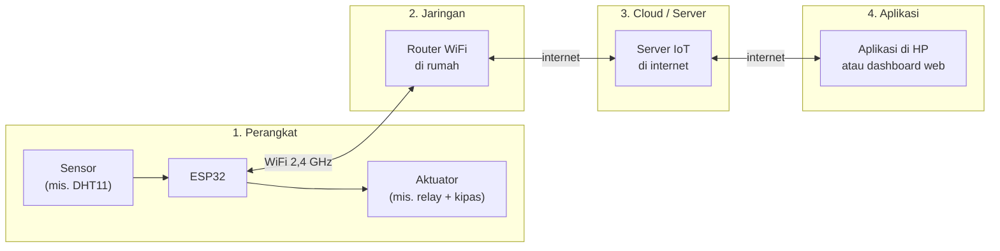
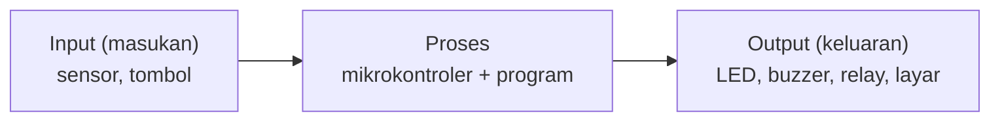
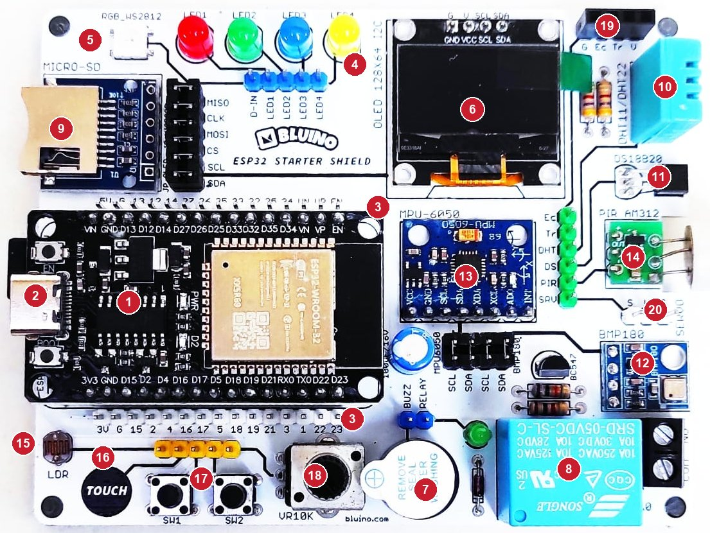

# BAB 1: Apa Itu IoT & Embedded System

> ✅ **Prasyarat:** Tidak ada — ini BAB pertama. Cukup bawa rasa ingin tahu.

Selamat datang! Di BAB pertama ini kamu belum akan menyambung kabel atau menulis program. Kita mulai dari gambaran besarnya dulu: apa itu IoT (*Internet of Things*), apa itu sistem tertanam (*embedded system*), dan kenapa sebuah chip kecil seperti ESP32 bisa menjadi "otak" perangkat pintar. Bayangkan lampu teras yang menyala sendiri saat hari mulai gelap dan bisa kamu matikan dari HP — setelah menyelesaikan materi ini, kamu bisa membuat perangkat seperti itu sendiri.

## 📌 Tujuan Pembelajaran

Setelah mempelajari BAB ini, kamu bisa:

- Menjelaskan apa itu IoT dengan bahasamu sendiri dan memberi contoh perangkat IoT di sekitarmu.
- Menyebutkan empat lapisan arsitektur IoT (perangkat, jaringan, *cloud*/*server*, aplikasi) beserta perannya.
- Menjelaskan apa itu sistem tertanam (*embedded system*) dan hubungannya dengan IoT.
- Membedakan mikrokontroler, mikroprosesor, dan komputer, serta tahu kenapa perangkat IoT umumnya memakai mikrokontroler.
- Mengenali komponen kit Bluino ESP32 IoT Starter Shield dan menggolongkannya menjadi sensor, aktuator, tampilan, atau penyimpanan.
- Memahami urutan materi di kurikulum ini dan cara membaca setiap BAB.

## 🧰 Yang Perlu Disiapkan

| Kebutuhan | Keterangan |
|---|---|
| *Hardware* | Tidak wajib — BAB ini teori. Kalau kit sudah ada, siapkan untuk diamati saat membaca [bagian 1.6](#16-mengenal-kit-bluino-esp32-iot-starter-shield) |
| Kabel *jumper* | Tidak perlu |
| Komponen tambahan | Tidak ada |
| *Software* | Tidak perlu — cukup *browser* untuk membaca materi ini |
| *Library* | Tidak perlu *library* tambahan |
| Alat uji | Tidak perlu — BAB ini belum memakai program |
| Jaringan | Tidak perlu WiFi (internet hanya untuk membuka materi dan tautan referensi) |

## 📑 Daftar Isi

- [1.1 Apa Itu Internet of Things (IoT)?](#11-apa-itu-internet-of-things-iot)
- [1.2 Arsitektur Sistem IoT](#12-arsitektur-sistem-iot)
- [1.3 Apa Itu Sistem Tertanam (*Embedded System*)?](#13-apa-itu-sistem-tertanam-embedded-system)
- [1.4 Mikrokontroler, Mikroprosesor, dan Komputer](#14-mikrokontroler-mikroprosesor-dan-komputer)
- [1.5 Contoh Penerapan IoT di Dunia Nyata](#15-contoh-penerapan-iot-di-dunia-nyata)
- [1.6 Mengenal Kit Bluino ESP32 IoT Starter Shield](#16-mengenal-kit-bluino-esp32-iot-starter-shield)
- [1.7 Cara Belajar dengan Materi Ini](#17-cara-belajar-dengan-materi-ini)
- [1.8 Pertanyaan yang Sering Muncul](#18-pertanyaan-yang-sering-muncul)
- [📝 Rangkuman](#-rangkuman)
- [💪 Latihan](#-latihan)
- [📚 Referensi](#-referensi)

---

## 1.1 Apa Itu Internet of Things (IoT)?

***Internet of Things*** (IoT, dibaca "ai-o-ti") kurang lebih berarti "internet untuk benda". Idenya sederhana: benda sehari-hari — lampu, pompa air, pintu, pot tanaman, kandang ayam — diberi "indra", sedikit "otak", dan kemampuan "berbicara" lewat jaringan. Hasilnya, benda itu bisa melaporkan keadaannya dan bisa dikendalikan dari jauh, misalnya dari HP.

Sebuah perangkat IoT biasanya punya empat kemampuan berikut:

| Kemampuan | Analogi pada manusia | Bagian yang melakukannya | Contoh di kit Bluino |
|---|---|---|---|
| Merasakan | Mata, kulit, telinga | **Sensor** | DHT11 merasakan suhu dan kelembapan udara |
| Berpikir | Otak | **Mikrokontroler** + program | ESP32 |
| Bertindak | Tangan, mulut | **Aktuator** (penggerak/pemberi aksi) | *Relay*, *buzzer*, LED |
| Berkomunikasi | Berbicara, menelepon | Modul komunikasi | WiFi dan Bluetooth yang sudah ada di dalam ESP32 |

### Contoh Sederhana: Pemantau Suhu Kamar

Bayangkan kamu memasang alat pemantau suhu di kamar:

1. **Sensor** suhu membaca suhu ruangan setiap 5 menit.
2. **Mikrokontroler** (ESP32) mengolah angka suhu itu.
3. ESP32 mengirim datanya lewat **WiFi** ke sebuah komputer *server* di internet (sering disebut *cloud*).
4. **Aplikasi di HP** kamu menampilkan suhu kamar — kapan pun dan dari mana pun.
5. Kalau suhu lebih dari 35 °C, ESP32 **menyalakan kipas** lewat *relay* secara otomatis, lalu mengirim notifikasi ke HP.

Inilah inti IoT: benda biasa (sensor suhu + kipas) menjadi "pintar" karena bisa merasakan, mengambil keputusan, bertindak, dan terhubung ke jaringan.

> 📌 **Catatan:** *Cloud* (awan) di dunia IoT artinya komputer *server* milik penyedia layanan yang bisa diakses lewat internet. Datamu tidak benar-benar "melayang di awan" — data itu tersimpan di pusat data (*data center*) milik penyedia layanan.

### Definisi Resmi

ITU (*International Telecommunication Union*), badan PBB yang mengurus standar telekomunikasi dunia, mendefinisikan IoT dalam rekomendasi **ITU-T Y.2060** (2012). Terjemahan bebasnya:

> *"Infrastruktur global bagi masyarakat informasi yang memungkinkan layanan-layanan canggih dengan menghubungkan benda-benda (fisik maupun virtual) berdasarkan teknologi informasi dan komunikasi yang sudah ada maupun yang terus berkembang dan dapat saling bekerja sama."*

Bahasa sederhananya: IoT adalah **jaringan benda yang saling terhubung dan bertukar data** supaya bisa memberi layanan yang berguna bagi manusia.

### Cek Pemahaman: Mana yang Termasuk IoT?

| Benda | IoT? | Alasan |
|---|---|---|
| *Remote* TV | Bukan | Tidak terhubung ke jaringan; hanya mengirim sinyal inframerah ke TV di depannya |
| Lampu pintar yang bisa dinyalakan dari aplikasi HP | Ya | Terhubung ke WiFi dan bisa dikendalikan dari jauh |
| *Rice cooker* digital biasa (tanpa WiFi) | Bukan | Ada "otak" elektroniknya, tetapi tidak terhubung ke jaringan — ini contoh sistem tertanam ([bagian 1.3](#13-apa-itu-sistem-tertanam-embedded-system)) |
| Jam tangan pintar (*smartwatch*) yang mengirim data langkah kaki ke HP | Ya | Mengirim data sensor lewat Bluetooth ke HP, lalu HP meneruskannya ke internet |
| Kamera CCTV yang bisa dipantau dari HP | Ya | Mengirim video lewat internet |

> 💡 **Tips:** Perangkat IoT tidak selalu tersambung langsung ke internet. Banyak perangkat (misalnya *smartwatch* tadi) memakai Bluetooth ke HP, lalu HP yang meneruskan datanya ke internet. Perangkat perantara seperti ini disebut *gateway*.

---

## 1.2 Arsitektur Sistem IoT

Arsitektur artinya "susunan bagian-bagian" sebuah sistem. Sistem IoT sesederhana pemantau suhu kamar pun umumnya tersusun dari **empat lapisan**. Data sensor mengalir dari kiri ke kanan (dari perangkat ke HP), sedangkan perintah dari HP mengalir sebaliknya (dari HP ke perangkat).

*Gambar 1.1 — Empat lapisan sistem IoT pada contoh pemantau suhu kamar. Sumber: dibuat untuk materi ini.*

| Lapisan | Tugasnya | Contoh |
|---|---|---|
| 1. Perangkat (*device*) | Membaca keadaan sekitar dan melakukan aksi | ESP32 + sensor DHT11 + *relay* |
| 2. Jaringan (konektivitas) | Mengantar data dari perangkat ke internet, dan sebaliknya | WiFi, Bluetooth, ESP-NOW |
| 3. *Cloud*/*server* | Menerima, menyimpan, dan mengolah data | *Broker* MQTT, Firebase, ThingSpeak |
| 4. Aplikasi | Menampilkan data dan menerima perintah dari pengguna | Aplikasi di HP, *dashboard* di *browser*, notifikasi Telegram |

### Lapisan 1 — Perangkat

Ini **lapisan fisik**, tempat sensor membaca kondisi lingkungan dan aktuator melakukan tindakan. Di tengahnya ada mikrokontroler (di kit kita: ESP32) yang menjalankan program.

| Kategori | Komponen di kit | Fungsinya |
|---|---|---|
| Sensor | DHT11 | Membaca suhu dan kelembapan udara |
| Sensor | BMP180 | Membaca tekanan udara |
| Sensor | PIR AM312 | Mendeteksi gerakan manusia atau hewan |
| Sensor | LDR | Mendeteksi terang-gelapnya cahaya |
| Aktuator | *Relay* | Menyalakan/mematikan perangkat listrik lain (misalnya kipas) |
| Aktuator | *Buzzer* | Mengeluarkan bunyi alarm |
| Aktuator | LED | Lampu indikator |
| Pemroses | ESP32 | "Otak" yang membaca sensor, mengambil keputusan, dan memerintah aktuator |

Daftar lengkap komponen kit ada di [bagian 1.6](#16-mengenal-kit-bluino-esp32-iot-starter-shield).

### Lapisan 2 — Jaringan

Lapisan ini menjawab pertanyaan: lewat jalan apa data dikirim? Teknologinya dipilih sesuai jarak dan banyaknya data:

| Teknologi | Perkiraan jangkauan | Kecepatan data | Contoh pemakaian | Ada di kit? |
|---|---|---|---|---|
| WiFi | ± 30–50 m di dalam rumah | Tinggi | Rumah pintar, *dashboard* web | Ya, bawaan ESP32 |
| Bluetooth & BLE | ± 10–30 m | Sedang | Jam pintar, kendali dari HP jarak dekat | Ya, bawaan ESP32 |
| ESP-NOW | Ratusan meter di tempat terbuka | Sedang (paket kecil) | Komunikasi langsung antar-ESP32 tanpa *router* | Ya, tetapi butuh ESP32 kedua |
| LoRa | Beberapa kilometer (hingga ± 15 km di area terbuka) | Sangat rendah | Pertanian, pemantauan jarak jauh | Tidak — butuh modul LoRa tambahan |

> 📌 **Catatan:** Angka jangkauan di atas hanya perkiraan kasar. Tembok, pepohonan, antena, dan gangguan sinyal lain bisa membuat jangkauannya jauh lebih pendek. BLE (*Bluetooth Low Energy*) adalah jenis Bluetooth yang hemat daya.

Selain "jalan"-nya, perangkat dan *server* juga harus sepakat soal "bahasa" yang dipakai. Kesepakatan ini disebut **protokol**. Contohnya **HTTP** (protokol yang dipakai *browser* untuk membuka halaman web) dan **MQTT** (protokol ringan yang populer untuk IoT). Keduanya berjalan **di atas** WiFi/internet, jadi bukan pengganti WiFi. Kamu akan mempraktikkannya di [BAB 46 (Web Server)](../BAB-46/README.md), [BAB 48 (HTTP Client & REST API)](../BAB-48/README.md), dan [BAB 50 (MQTT)](../BAB-50/README.md).

### Lapisan 3 — *Cloud*/*Server*

Data yang dikirim perangkat diterima, disimpan, dan diolah di *server*. Beberapa layanan yang populer untuk IoT:

- ***Broker* MQTT** — "kantor pos" yang meneruskan pesan MQTT dari pengirim ke penerima (dibahas di [BAB 50](../BAB-50/README.md)).
- **Firebase** — layanan basis data (*database*) dan *server* siap pakai dari Google.
- **ThingSpeak** — layanan IoT dari MathWorks untuk menyimpan data dan membuat grafik.
- **Blynk** — layanan IoT lengkap dengan aplikasi HP siap pakai.

> 📌 **Catatan:** Firebase, ThingSpeak, dan Blynk akan dibahas di **Bagian X — IoT Platform & Integrasi** yang sedang disusun (lihat [bagian 1.7](#17-cara-belajar-dengan-materi-ini)). Tidak semua proyek IoT butuh *cloud*: ESP32 juga bisa menjadi *server* kecil sendiri sehingga HP cukup membuka alamat ESP32 di jaringan WiFi yang sama ([BAB 46](../BAB-46/README.md)).

### Lapisan 4 — Aplikasi

Bagian yang dilihat dan disentuh pengguna:

- ***Dashboard* web** — grafik dan tombol kendali yang dibuka lewat *browser*.
- **Aplikasi HP** — misalnya aplikasi Blynk, atau aplikasi buatan sendiri.
- **Notifikasi** — pesan peringatan lewat Telegram, surel (*e-mail*), atau notifikasi HP.

---

## 1.3 Apa Itu Sistem Tertanam (*Embedded System*)?

**Sistem tertanam** (*embedded system*) adalah sistem komputer kecil yang "ditanam" di dalam sebuah alat untuk menjalankan **satu tugas khusus**. Kamu jarang menyadari keberadaannya karena bentuknya tidak seperti komputer: tidak ada layar besar, *keyboard*, atau *mouse* — yang terlihat hanya tombol, lampu indikator, atau layar kecil.

Contohnya ada di sekitarmu:

| Alat | Tugas khusus sistem tertanamnya |
|---|---|
| *Rice cooker* digital | Mengatur pemanas sesuai menu (nasi, bubur) dan menjalankan pengatur waktu |
| Mesin cuci otomatis | Menjalankan urutan isi air → mencuci → membilas → memeras |
| *Remote* TV | Membaca tombol yang ditekan lalu mengirim kode inframerah |
| AC | Menjaga suhu ruangan sesuai pengaturan |
| Sepeda motor injeksi | ECU (*Engine Control Unit*) mengatur jumlah bensin yang disemprotkan ke mesin |
| Printer | Menggerakkan motor dan kepala cetak sesuai data dari komputer |

Ciri-ciri sistem tertanam:

- **Tugasnya khusus.** Programnya dibuat untuk satu pekerjaan saja — berbeda dengan laptop yang bisa dipakai untuk apa saja.
- **Sumber dayanya terbatas.** Memori dan kecepatan prosesornya kecil, tetapi cukup untuk tugasnya, sehingga murah dan hemat daya.
- **Bekerja terus-menerus** dan sering harus bereaksi tepat waktu (*real-time*). Contoh ekstremnya kantong udara (*airbag*) mobil yang harus mengembang dalam sepersekian detik.
- **Programnya tersimpan permanen di dalam chip.** Program seperti ini disebut ***firmware*** dan tetap tersimpan walaupun listrik dimatikan.

Hampir semua sistem tertanam bekerja dengan pola **input → proses → output**:

*Gambar 1.2 — Pola kerja sistem tertanam: membaca input, memprosesnya dengan program, lalu menghasilkan output. Sumber: dibuat untuk materi ini.*

Contoh pada kit: tombol ditekan (input) → ESP32 menjalankan program (proses) → LED menyala (output). Program seperti ini akan kamu buat di [BAB 8](../BAB-08/README.md) dan [BAB 9](../BAB-09/README.md).

### Hubungan Sistem Tertanam dengan IoT

Perangkat IoT pada dasarnya adalah **sistem tertanam yang terhubung ke jaringan**. Jadi:

- Setiap perangkat IoT punya sistem tertanam di dalamnya.
- Tetapi tidak setiap sistem tertanam adalah perangkat IoT. *Rice cooker* digital tanpa WiFi tetap sistem tertanam, tetapi bukan perangkat IoT.

Kurikulum ini mengikuti urutan yang sama: kamu membuat sistem tertanam dulu (menyalakan LED, membaca tombol dan sensor, menampilkan data), lalu menghubungkannya ke jaringan sehingga menjadi perangkat IoT.

---

## 1.4 Mikrokontroler, Mikroprosesor, dan Komputer

Tiga istilah ini sering tertukar. Bedanya ada pada **apa saja yang sudah ada di dalam chip** dan **untuk apa chip itu dirancang**. Sebelum membandingkan, kenali dulu beberapa istilah berikut:

| Istilah | Kepanjangan/asal kata | Artinya |
|---|---|---|
| CPU | *Central Processing Unit* | Bagian yang menjalankan perintah program, "otak" yang berhitung |
| RAM | *Random Access Memory* | Memori kerja untuk menyimpan data sementara; isinya hilang saat listrik mati |
| Memori *flash* | *Flash memory* | Memori penyimpan program; isinya tetap ada walau listrik mati (seperti *flashdisk*) |
| GPIO | *General Purpose Input/Output* | Pin serbaguna yang bisa dipakai sebagai input (membaca tombol/sensor) atau output (menyalakan LED) |
| Periferal | *Peripheral* | Rangkaian pembantu di dalam chip, misalnya pengubah sinyal analog ke digital (ADC), pewaktu (*timer*), dan jalur komunikasi (UART, I2C, SPI) |

### Mikroprosesor

**Mikroprosesor** adalah chip yang isinya terutama CPU. Ia sangat cepat, tetapi tidak bisa bekerja sendirian: RAM, media penyimpanan (SSD), dan pengendali input/output berada di chip-chip lain di luar dirinya. Contohnya prosesor Intel Core dan AMD Ryzen di laptop.

### Mikrokontroler

**Mikrokontroler** adalah **komputer kecil lengkap dalam satu chip**: CPU, RAM, memori program, GPIO, dan periferal sudah ada di dalamnya. Cukup diberi listrik dan program, ia bisa langsung membaca sensor dan mengendalikan LED. Contohnya ATmega328P (di *board* Arduino Uno), STM32, dan **ESP32**.

ESP32 sering juga disebut **SoC** (*System on Chip*, sistem dalam satu chip) karena selain bagian-bagian mikrokontroler tadi, di dalamnya juga ada pemancar-penerima WiFi dan Bluetooth.

> 📌 **Catatan:** Pada ESP32 yang dipakai di kit ini, memori *flash* (4 MB) berupa chip terpisah, tetapi letaknya di dalam modul berpelindung logam yang sama dengan chip ESP32. Detailnya dibahas di [BAB 2](../BAB-02/README.md).

### Komputer

**Komputer** — laptop, PC, atau komputer mini seperti **Raspberry Pi** — adalah gabungan mikroprosesor (atau prosesor sejenisnya), RAM, media penyimpanan, dan sistem operasi seperti Windows, macOS, atau Linux. Komputer dirancang untuk banyak pekerjaan sekaligus, bukan satu tugas khusus.

### Perbandingan

| Aspek | Mikrokontroler (contoh: ESP32) | Komputer mini (contoh: Raspberry Pi 5) | Laptop/PC |
|---|---|---|---|
| Isi chip "otak"-nya | CPU, RAM, dan periferal dalam satu chip | Prosesor 4 inti; RAM di chip terpisah | Mikroprosesor; RAM dan SSD terpisah |
| Kecepatan prosesor | Belasan–ratusan MHz (Arduino Uno: 16 MHz, ESP32: hingga 240 MHz) | ± 2,4 GHz | ± 2–5 GHz |
| RAM | Kilobyte (Arduino Uno: 2 KB, ESP32: 520 KB) | Gigabyte (1–16 GB) | Gigabyte (8–32 GB) |
| Penyimpanan program | *Flash* beberapa MB (ESP32 di kit: 4 MB) | Kartu microSD/SSD, puluhan–ratusan GB | SSD, ratusan GB–beberapa TB |
| Sistem operasi | Tidak ada, atau RTOS yang sangat kecil (ESP32: FreeRTOS) | Linux | Windows, macOS, Linux |
| Waktu dari dinyalakan sampai siap | Kurang dari 1 detik | Belasan–puluhan detik | Belasan detik–beberapa menit |
| Konsumsi daya | ± 0,1–1 W saat aktif; sangat kecil saat mode tidur | ± 3–12 W | ± 15–100 W |
| Pin untuk sensor | Ada (GPIO); ESP32 juga punya ADC untuk sensor analog | Ada (GPIO), tetapi tanpa ADC | Tidak ada — butuh *board* tambahan |
| Harga (perkiraan) | Puluhan ribu rupiah (*board* ESP32) | Jutaan rupiah | Jutaan–puluhan juta rupiah |
| Cocok untuk | Perangkat IoT, alat kendali, alat yang menyala terus | *Gateway*, *server* kecil, pengolahan gambar/AI | Pekerjaan umum, menulis program |

Beberapa istilah di tabel:

- **MHz** (megahertz) dan **GHz** (gigahertz) menunjukkan berapa juta (MHz) atau miliar (GHz) detak *clock* prosesor dalam satu detik. Makin besar angkanya, umumnya makin cepat prosesornya.
- **KB, MB, GB** (kilobyte, megabyte, gigabyte) adalah satuan ukuran memori. 1 MB kira-kira seribu KB, dan 1 GB kira-kira seribu MB.
- **RTOS** (*Real-Time Operating System*) adalah sistem operasi mini yang fokus pada ketepatan waktu. Di ESP32, FreeRTOS bekerja di balik layar tanpa perlu kamu atur di BAB-BAB awal.

### Kenapa Perangkat IoT Umumnya Memakai Mikrokontroler?

1. **Hemat daya.** Mikrokontroler bisa "tidur" (*deep sleep*) dengan arus yang sangat kecil — chip ESP32 hanya sekitar 10 µA (mikroampere; 1 µA = sepersejuta ampere). Kalau dirancang dengan benar, perangkat bisa bertahan lama memakai baterai.
2. **Murah.** Sebuah *board* ESP32 harganya puluhan ribu rupiah, jauh lebih murah daripada komputer mini.
3. **Langsung tersambung ke sensor.** Sensor, tombol, dan LED bisa disambung langsung ke pin GPIO tanpa *hardware* tambahan.
4. **Respons cepat dan tepat waktu.** Tidak ada sistem operasi besar yang sibuk dengan pekerjaan lain, sehingga reaksinya cepat dan bisa diperkirakan.
5. **Langsung bekerja saat dinyalakan.** Tidak perlu *booting* lama, dan umumnya aman kalau listrik tiba-tiba padam — berbeda dengan komputer yang sistem operasinya bisa rusak kalau dimatikan mendadak.
6. **Kecil dan tahan dinyalakan terus-menerus**, 24 jam sehari.

Komputer mini seperti Raspberry Pi tetap berguna di dunia IoT, terutama sebagai *gateway* atau *server* kecil di rumah, atau saat butuh pengolahan berat seperti mengenali wajah dari kamera. Kombinasi yang sering dipakai: banyak ESP32 sebagai perangkat di lapangan, satu komputer sebagai pengumpul datanya.

> 📌 **Catatan:** Angka 10 µA itu untuk chip ESP32-nya saja. *Board* pengembangan seperti ESP32 DEVKIT V1 punya komponen tambahan (regulator tegangan, chip USB, lampu indikator) yang tetap menyedot arus beberapa mA (miliampere; 1 mA = 1000 µA) walaupun ESP32 sedang tidur. Teknik hemat daya dibahas di **Bagian XI — Teknik Lanjutan** (sedang disusun).

### Lalu, Arduino Itu Apa?

"Arduino" bukan nama sebuah chip. Arduino adalah platform elektronika terbuka yang terdiri atas *board* (misalnya Arduino Uno yang memakai mikrokontroler ATmega328P), *software* untuk menulis program (Arduino IDE), dan kumpulan *library*. *Library* adalah kumpulan kode siap pakai yang memudahkan pekerjaan, misalnya untuk membaca sensor tertentu.

Di kurikulum ini kita **tidak** memakai *board* Arduino. Kita memakai *software* **Arduino IDE** untuk memprogram ESP32, karena Espressif (pembuat ESP32) menyediakan paket pendukungnya. Cara memasangnya dibahas di [BAB 5](../BAB-05/README.md).

---

## 1.5 Contoh Penerapan IoT di Dunia Nyata

IoT sudah dipakai di banyak bidang. Kolom terakhir tabel di bawah menunjukkan komponen kit yang bisa kamu pakai untuk membuat versi mininya — jadi kamu bisa membayangkan proyek apa saja yang nanti bisa dibuat.

| Bidang | Contoh penerapan | Komponen kit untuk mencoba versi mininya |
|---|---|---|
| Rumah pintar (*smart home*) | Lampu menyala otomatis saat ada orang; kipas menyala saat panas; notifikasi ke HP saat ada gerakan di rumah yang kosong | PIR AM312, DHT11, *relay*, LED, *buzzer* |
| Pertanian pintar (*smart farming*) | Pemantauan suhu dan kelembapan *greenhouse*, penyiraman otomatis, stasiun cuaca mini di kebun | DHT11, BMP180, DS18B20, *relay* (untuk pompa); sensor kelembapan tanah perlu dibeli terpisah |
| Industri (*Industrial IoT*) | Memantau getaran dan suhu mesin supaya kerusakan terdeteksi lebih awal | MPU-6050 (getaran), DS18B20 (suhu) |
| Kesehatan | Alarm jatuh untuk lansia, gelang kebugaran yang menghitung langkah | MPU-6050 (deteksi gerakan/jatuh), *buzzer* |
| Transportasi | Sensor parkir, pelacakan posisi kendaraan | Konektor HC-SR04 (sensornya dibeli terpisah); pelacakan posisi butuh modul GPS tambahan |
| Kota pintar (*smart city*) | Lampu jalan otomatis, peringatan dini banjir dari ketinggian air sungai | LDR + LED (lampu otomatis), HC-SR04 (ketinggian air) |

> 🧪 **Coba Sendiri:** Perhatikan rumah, kampus, atau tempat kerjamu. Adakah alat yang bisa dipantau atau dikendalikan dari HP? Catat sensornya apa, aktuatornya apa, dan lewat jaringan apa datanya dikirim. Catatan ini berguna untuk [Latihan](#-latihan) di akhir BAB.

---

## 1.6 Mengenal Kit Bluino ESP32 IoT Starter Shield

Kit yang kamu pakai, **Bluino ESP32 IoT Starter Shield**, adalah sebuah papan PCB (*printed circuit board*, papan rangkaian tercetak) berwarna putih yang sudah berisi banyak komponen. Di atasnya tertancap *board* ESP32 DEVKIT V1. Papan tambahan yang menjadi "rumah" bagi *board* utama seperti ini biasa disebut *shield*. Semua bagian sistem tertanam ada di sini: ESP32 sebagai pemroses, sensor sebagai input, serta LED, *buzzer*, *relay*, dan layar sebagai output. Ditambah WiFi dan Bluetooth di dalam ESP32, kit ini cukup untuk membuat perangkat IoT sungguhan.

*Gambar 1.3 — Kit Bluino ESP32 IoT Starter Shield versi 3.x tampak atas; nomor dijelaskan pada tabel di bawah. Sumber: foto produk [Bluino](http://www.bluino.com), diberi nomor untuk materi ini.*

| No. | Komponen | Golongan | Fungsinya | Dibahas di |
|---|---|---|---|---|
| 1 | ESP32 DEVKIT V1 | Pemroses | "Otak" kit: menjalankan program, punya WiFi dan Bluetooth | [BAB 2](../BAB-02/README.md) |
| 2 | Konektor USB di *board* ESP32 | Daya & pemrograman | Disambung ke laptop untuk memberi daya, mengunggah program, dan melihat pesan dari ESP32 | [BAB 5](../BAB-05/README.md), [BAB 7](../BAB-07/README.md) |
| 3 | Dua baris *header* pin ESP32 | Sambungan | Tempat menancapkan kabel *jumper* ke pin ESP32; label angkanya sama dengan nomor pin (GPIO) ESP32 | [BAB 6](../BAB-06/README.md) |
| 4 | 4 LED (merah, hijau, biru, kuning) | Output | Lampu indikator | [BAB 8](../BAB-08/README.md) |
| 5 | RGB LED WS2812 | Output | LED yang warnanya bisa diatur lewat program | [BAB 36](../BAB-36/README.md) |
| 6 | OLED 0,96" 128×64 | Tampilan | Layar kecil untuk teks dan grafik | [BAB 35](../BAB-35/README.md) |
| 7 | *Buzzer* aktif | Output (aktuator) | Mengeluarkan bunyi "bip" | [BAB 8](../BAB-08/README.md) |
| 8 | *Relay* 5 V | Output (aktuator) | Sakelar elektronik untuk menyalakan/mematikan alat listrik lain | [BAB 37](../BAB-37/README.md) |
| 9 | Adaptor microSD | Penyimpanan | Menyimpan data ke kartu microSD | [BAB 41](../BAB-41/README.md) |
| 10 | DHT11 | Sensor | Suhu dan kelembapan udara | [BAB 26](../BAB-26/README.md) |
| 11 | DS18B20 | Sensor | Suhu dengan ketelitian lebih baik | [BAB 25](../BAB-25/README.md), [BAB 27](../BAB-27/README.md) |
| 12 | BMP180 | Sensor | Tekanan udara dan perkiraan ketinggian | [BAB 28](../BAB-28/README.md) |
| 13 | MPU-6050 | Sensor | Percepatan dan putaran (akselerometer dan giroskop) | [BAB 29](../BAB-29/README.md) |
| 14 | PIR AM312 | Sensor | Gerakan manusia atau hewan | [BAB 31](../BAB-31/README.md) |
| 15 | LDR | Sensor | Terang-gelapnya cahaya | [BAB 32](../BAB-32/README.md) |
| 16 | *Touch pad* | Sensor | Sentuhan jari | [BAB 14](../BAB-14/README.md) |
| 17 | Tombol SW1 dan SW2 | Input | Tombol tekan | [BAB 9](../BAB-09/README.md) |
| 18 | Potensiometer 10 kΩ | Input | Kenop putar yang menghasilkan tegangan analog | [BAB 11](../BAB-11/README.md) |
| 19 | Konektor HC-SR04 | Konektor | Tempat memasang sensor jarak ultrasonik | [BAB 30](../BAB-30/README.md) |
| 20 | Konektor servo | Konektor | Tempat memasang motor servo | [BAB 38](../BAB-38/README.md) |

Selain microSD, ESP32 juga bisa menyimpan data kecil (misalnya pengaturan) di memori *flash*-nya sendiri. Caranya dibahas di [BAB 39](../BAB-39/README.md) dan [BAB 40](../BAB-40/README.md).

> 📌 **Catatan:** Foto di atas adalah kit versi 3.x. Kit milikmu bisa punya tata letak, label, atau jenis konektor USB yang sedikit berbeda (misalnya micro-USB, bukan USB Type-C). Fungsi komponennya tetap sama.

### Komponen yang Sudah Tersambung dan Pin "Custom"

Sebagian komponen sudah tersambung ke pin ESP32 lewat *jumper cap* (penutup *jumper* hitam) di PCB, yaitu OLED, MPU-6050, BMP180, dan adaptor microSD. Komponen lain — DHT11, DS18B20, RGB LED WS2812, LED, tombol, *buzzer*, *relay*, potensiometer, LDR, PIR, *touch pad*, serta konektor HC-SR04 dan servo — berakhir di deretan pin kecil yang di skematik disebut **Custom** (di PCB, pin-pin ini diberi label nama komponennya, misalnya `DHT`, `LED1`, atau `SW1`). Kamu sendiri yang menyambungkan pin **Custom** itu ke pin ESP32 memakai kabel *jumper* *female-female* (kabel dengan lubang di kedua ujungnya). Desain ini sengaja dibuat supaya kamu belajar memilih dan menyambung pin.

Pin mana dipakai untuk komponen apa sudah dibakukan dalam **Peta Pin Standar** yang dibahas lengkap di [BAB 6](../BAB-06/README.md). Setiap program di BAB-BAB berikutnya juga punya tabel **Rangkaian** yang menunjukkan kabel mana yang perlu disambung.

> ⚠️ **Perhatian:** Sebelum sampai di BAB 6, jangan asal menancapkan kabel *jumper* ke pin ESP32. Beberapa pin punya fungsi khusus, dan pin ESP32 bekerja pada tegangan 3,3 V — sinyal 5 V yang masuk langsung bisa merusaknya (dibahas di [BAB 3](../BAB-03/README.md)). Letakkan juga kit di permukaan yang kering dan bukan logam supaya kaki-kaki komponen di bagian bawah PCB tidak saling terhubung lewat permukaan itu (korsleting).

### Isi Kotak dan yang Perlu Dibeli Terpisah

| Termasuk dalam kit | Tidak termasuk (beli terpisah bila BAB-nya membutuhkan) |
|---|---|
| *Shield* dengan semua komponen di Gambar 1.3 | Sensor ultrasonik HC-SR04 dan 2 resistor untuk pembagi tegangan pin Echo-nya |
| *Board* ESP32 DEVKIT V1 | Motor servo (misalnya SG90) |
| Kabel USB | Kartu microSD |
| Adaptor USB OTG (untuk menyambung ke HP Android) | ESP32 kedua/ketiga (untuk ESP-NOW, ESP-MESH, dan Bluetooth antar-ESP32) |
| 10 kabel *jumper* *female-female* | ESP32-C6/ESP32-H2 (untuk Thread) |

> 💡 **Tips:** Kabel USB yang kamu pakai harus kabel **data**, bukan kabel yang hanya bisa untuk mengisi daya. Kalau nanti ESP32 tidak terdeteksi oleh laptop, coba ganti kabel dulu.

---

## 1.7 Cara Belajar dengan Materi Ini

### Urutan Materi

Materi disusun bertahap, dari dasar sampai protokol IoT modern. Kerjakan berurutan, karena setiap BAB memakai pengetahuan dari BAB sebelumnya.

| Bagian | BAB | Yang kamu pelajari |
|---|---|---|
| I — Fondasi & Persiapan | [1](../BAB-01/README.md)–[7](../BAB-07/README.md) | Konsep IoT, mengenal ESP32, dasar elektronika, membaca skematik, memasang *software*, peta pin kit, program pertama |
| II — GPIO & Sinyal | [8](../BAB-08/README.md)–[15](../BAB-15/README.md) | LED, *buzzer*, tombol, *interrupt*, membaca nilai analog (ADC), PWM, DAC, sensor sentuh, *timer* |
| III — Pemrograman *Embedded* Profesional | [16](../BAB-16/README.md)–[21](../BAB-21/README.md) | Program yang tidak "macet", *state machine*, *callback*, kode multi-*file*, manajemen memori, *debugging* |
| IV — Protokol Komunikasi | [22](../BAB-22/README.md)–[25](../BAB-25/README.md) | UART, I2C, SPI, OneWire — "bahasa" antara ESP32 dan sensor |
| V — Sensor | [26](../BAB-26/README.md)–[34](../BAB-34/README.md) | Semua sensor di kit, sensor internal ESP32, dan pengolahan data sensor |
| VI — Aktuator & Tampilan | [35](../BAB-35/README.md)–[38](../BAB-38/README.md) | OLED, RGB LED, *relay*, motor servo |
| VII — Penyimpanan Data | [39](../BAB-39/README.md)–[41](../BAB-41/README.md) | Menyimpan data di memori *flash* dan kartu microSD |
| VIII — WiFi & Web | [42](../BAB-42/README.md)–[49](../BAB-49/README.md) | Menyambung ke WiFi, membuat halaman web di ESP32, HTTP, HTTPS |
| IX — Protokol IoT | [50](../BAB-50/README.md)–[56](../BAB-56/README.md) | MQTT, CoAP, Bluetooth, BLE, ESP-NOW, ESP-MESH, Matter & Thread |
| X — IoT Platform & Integrasi | 57–65 | *(sedang disusun)* Blynk, Firebase, ThingSpeak, Node-RED, Telegram, Home Assistant |
| XI — Teknik Lanjutan | 66–75 | *(sedang disusun)* FreeRTOS, *dual-core*, *deep sleep*, OTA, keamanan, ESP-IDF, MicroPython |
| XII — Proyek Terpadu | 76–80 | *(sedang disusun)* rumah pintar mini, stasiun cuaca, sistem keamanan, *data logger* |

Daftar judul lengkap setiap BAB ada di [halaman utama repositori](../README.md#-daftar-bab).

### Susunan Setiap BAB

Semua BAB memakai susunan yang sama, jadi kamu cepat terbiasa:

1. **Prasyarat** (paling atas) — BAB yang sebaiknya sudah kamu selesaikan.
2. **📌 Tujuan Pembelajaran** — apa yang bisa kamu lakukan setelah BAB itu.
3. **🧰 Yang Perlu Disiapkan** — komponen, kabel *jumper*, *software*, *library*, alat uji, dan perlu WiFi atau tidak.
4. **Materi** — konsep dulu, lalu contoh kecil, lalu program lengkap.
5. **Program** — setiap program punya bagian **Tujuan**, **Rangkaian**, **Cara Menjalankan**, **Kode Program**, **Penjelasan Kode**, **Contoh Output**, dan **Kalau Belum Berhasil**.
6. **📝 Rangkuman**, **💪 Latihan** (dasar → menengah → tantangan), dan **📚 Referensi** untuk belajar lebih jauh.

Kode program bisa kamu salin langsung dari halaman BAB. Kode yang sama juga tersedia sebagai *file* `.ino` di folder BAB-nya (misalnya `BAB-08/p1_nama/p1_nama.ino`) yang bisa dibuka di Arduino IDE lewat **File → Open**. Untuk mengunduh semua materi sekaligus, buka halaman utama repositori di GitHub, klik tombol hijau **Code → Download ZIP**, lalu ekstrak *file* ZIP-nya.

### Arti Kotak Catatan

Di setiap BAB kamu akan menemukan kotak-kotak berikut:

| Kotak | Artinya |
|---|---|
| 💡 **Tips** | Saran yang memudahkan pekerjaanmu |
| 📌 **Catatan** | Informasi tambahan yang perlu diingat |
| ⚠️ **Perhatian** | Hal yang bisa membuat program gagal atau komponen rusak kalau diabaikan |
| 🚨 **Bahaya** | Risiko keselamatan, misalnya listrik PLN 220 V |
| 🧪 **Coba Sendiri** | Percobaan kecil untuk menguji pemahamanmu |
| 🔬 **Pendalaman (opsional)** | Materi tambahan yang dilipat; klik judulnya untuk membuka. Boleh dilewati saat pertama kali membaca |

> 💡 **Tips:** Jangan hanya menyalin kode. Ketik ulang sebagian, ubah angkanya, lalu amati apa yang berubah. Cara ini membuatmu jauh lebih cepat paham daripada sekadar membaca.

---

## 1.8 Pertanyaan yang Sering Muncul

| Pertanyaan | Jawaban |
|---|---|
| Saya belum pernah membuat program sama sekali. Bisa ikut? | Bisa. Kamu mulai menulis program dari nol di [BAB 7](../BAB-07/README.md), dan setiap kode dijelaskan langkah demi langkah. |
| Kit saya belum datang. Apa yang bisa dikerjakan? | BAB 1–4 bisa dibaca tanpa kit. Kamu juga sudah bisa memasang Arduino IDE ([BAB 5](../BAB-05/README.md)) dan mencoba simulator ESP32 gratis di *browser*, misalnya [Wokwi](https://wokwi.com). |
| Laptop saya Windows/macOS/Linux. Apakah bisa? | Bisa. Arduino IDE 2 tersedia untuk ketiganya. Cara memasangnya ada di [BAB 5](../BAB-05/README.md). |
| Apakah harus selalu ada internet? | Internet dibutuhkan untuk mengunduh *software* dan *library*, serta untuk BAB yang memakai WiFi dan layanan *cloud*. BAB-BAB awal (GPIO, sensor) bisa dikerjakan tanpa internet setelah *software*-nya terpasang. |
| WiFi di rumah saya 5 GHz. Apakah ESP32 bisa tersambung? | ESP32 di kit ini hanya mendukung WiFi **2,4 GHz**. Kebanyakan *router* memancarkan 2,4 GHz dan 5 GHz sekaligus. Kalau *router*-mu hanya 5 GHz, pakai *hotspot* HP yang diatur ke 2,4 GHz. Dibahas di [BAB 42](../BAB-42/README.md). |
| Bisakah kit rusak kalau salah sambung? | Bisa, terutama kalau tegangan 5 V masuk ke pin ESP32 atau dua pin terhubung langsung. Ikuti tabel **Rangkaian** di setiap program, dan cabut kabel USB setiap kali memindahkan kabel *jumper*. |
| Apakah kit ini aman disentuh? | Aman. Kit bekerja dengan tegangan rendah (5 V dari USB). *Relay* di kit memang bisa dipakai untuk menyalakan alat listrik PLN 220 V, tetapi jangan pernah merangkai listrik PLN tanpa didampingi orang yang berpengalaman (dibahas di [BAB 37](../BAB-37/README.md)). |

---

## 📝 Rangkuman

- **IoT** adalah benda yang bisa merasakan (sensor), berpikir (mikrokontroler + program), bertindak (aktuator), dan berkomunikasi lewat jaringan.
- Sistem IoT tersusun dari **empat lapisan**: perangkat → jaringan → *cloud*/*server* → aplikasi. Data mengalir dari perangkat ke pengguna, perintah mengalir sebaliknya.
- **Sistem tertanam** adalah komputer kecil dengan tugas khusus di dalam sebuah alat, bekerja dengan pola input → proses → output. Perangkat IoT = sistem tertanam + jaringan.
- **Mikroprosesor** berisi CPU saja; **mikrokontroler** adalah komputer lengkap dalam satu chip; **komputer** menggabungkan mikroprosesor, RAM, media penyimpanan, dan sistem operasi.
- ESP32 adalah mikrokontroler (SoC) dengan WiFi dan Bluetooth. Mikrokontroler cocok untuk IoT karena hemat daya, murah, bisa langsung disambung ke sensor, dan langsung bekerja saat dinyalakan.
- Kit Bluino berisi ESP32 DEVKIT V1, sensor, output, layar, dan penyimpanan. Sebagian komponen disambung sendiri lewat pin **Custom** memakai kabel *jumper* ([BAB 6](../BAB-06/README.md)).

| Istilah | Arti singkat |
|---|---|
| Sensor | Komponen yang "merasakan" keadaan sekitar (suhu, cahaya, gerakan) |
| Aktuator | Komponen yang melakukan aksi (menyalakan, membunyikan, menggerakkan) |
| Mikrokontroler | Komputer kecil lengkap dalam satu chip |
| SoC | *System on Chip* — seluruh sistem dalam satu chip |
| *Firmware* | Program yang tersimpan permanen di dalam sistem tertanam |
| *Cloud* | Komputer *server* di internet milik penyedia layanan |
| *Gateway* | Perangkat perantara yang meneruskan data ke internet |
| Protokol | Aturan "bahasa" komunikasi, misalnya HTTP dan MQTT |
| GPIO | Pin serbaguna mikrokontroler untuk input atau output |

---

## 💪 Latihan

### Latihan Dasar

1. **IoT, sistem tertanam, atau bukan keduanya?** Golongkan benda berikut: (a) kalkulator, (b) lampu pintar WiFi, (c) mesin cuci otomatis tanpa WiFi, (d) kipas angin biasa dengan sakelar putar, (e) timbangan digital yang mengirim berat badanmu ke aplikasi HP lewat Bluetooth.
   *Petunjuk:* Sistem tertanam punya "otak" elektronik yang menjalankan program. Perangkat IoT adalah sistem tertanam yang juga terhubung ke jaringan. Kipas dengan sakelar putar tidak menjalankan program apa pun.
2. **Sensor atau aktuator?** Golongkan komponen kit berikut: DHT11, *relay*, LDR, *buzzer*, MPU-6050, LED, PIR AM312, OLED.
   *Petunjuk:* Sensor "merasakan" (input), aktuator "bertindak" (output). OLED adalah tampilan, yaitu salah satu jenis output. Lihat tabel di [bagian 1.6](#16-mengenal-kit-bluino-esp32-iot-starter-shield).
3. **Cari di kitmu.** Kalau kit sudah ada, temukan komponen nomor 1–20 pada Gambar 1.3 di kitmu.
   *Petunjuk:* Cocokkan tulisan yang tercetak di PCB, misalnya "LDR", "SW1", "BMP180", atau "MICRO-SD".

### Latihan Menengah

4. **Bedah perangkat IoT di sekitarmu.** Pilih 3 perangkat IoT yang pernah kamu lihat atau pakai. Untuk masing-masing, tuliskan keempat lapisannya: sensor/aktuator apa (perangkat), lewat jaringan apa, *server*/layanan apa, dan aplikasinya apa.
   *Petunjuk:* Pakai catatanmu dari kotak **Coba Sendiri** di [bagian 1.5](#15-contoh-penerapan-iot-di-dunia-nyata). Tidak semua perangkat IoT punya aktuator — tulis "tidak ada" kalau memang tidak ada.
5. **Rancang pemantau suhu ruangan.** Dengan komponen kit, rancang sistem yang membaca suhu setiap 10 detik, menampilkannya di OLED, mengirim notifikasi ke HP kalau suhu lebih dari 35 °C, dan menyalakan kipas lewat *relay*. Gambarkan diagram empat lapisannya.
   *Petunjuk:* Tiru bentuk Gambar 1.1 di kertas. Sensor yang cocok: DHT11 atau DS18B20. Kipas tidak termasuk kit — *relay* hanya berperan sebagai sakelarnya. Kalau ingin menggambar di komputer, buka [mermaid.live](https://mermaid.live) di *browser*, lalu ubah contoh diagram di sana.

### Tantangan Lanjutan

6. **ESP32 atau Raspberry Pi?** Kamu ingin membuat alat bertenaga baterai di kebun yang membaca suhu setiap 5 menit dan mengirimkannya ke *cloud*. Jelaskan minimal 3 alasan kenapa ESP32 lebih cocok daripada Raspberry Pi. Lalu sebutkan satu contoh proyek yang justru lebih cocok memakai Raspberry Pi.
   *Petunjuk:* Bandingkan konsumsi daya, harga, waktu menyala, dan kebutuhan sistem operasi pada tabel di [bagian 1.4](#14-mikrokontroler-mikroprosesor-dan-komputer). Untuk contoh Raspberry Pi, pikirkan pekerjaan "berat" seperti mengolah gambar dari kamera.
7. **Solusi IoT untuk kotamu.** Pilih satu masalah di sekitarmu (banjir, parkir, sampah, atau lampu jalan). Rancang solusi IoT-nya: komponen kit apa yang dipakai, komponen apa yang perlu dibeli terpisah, data apa yang dikirim, dan siapa yang menerima notifikasinya.
   *Petunjuk:* Lihat tabel di [bagian 1.5](#15-contoh-penerapan-iot-di-dunia-nyata) dan daftar "Tidak termasuk" di [bagian 1.6](#16-mengenal-kit-bluino-esp32-iot-starter-shield).

---

## 📚 Referensi

- [Recommendation ITU-T Y.2060: Overview of the Internet of things — ITU](https://www.itu.int/rec/T-REC-Y.2060-201206-I) — sumber definisi resmi IoT (2012).
- [What is IoT? — Amazon Web Services](https://aws.amazon.com/what-is/iot/) — pengantar IoT dan contoh penerapannya.
- [What is the Internet of Things (IoT)? — IBM](https://www.ibm.com/think/topics/internet-of-things) — pengantar IoT dari sisi industri.
- [ESP32 — Espressif Systems](https://www.espressif.com/en/products/socs/esp32) — halaman resmi chip ESP32.
- [ESP32 Series Datasheet — Espressif Systems](https://documentation.espressif.com/esp32_datasheet_en.pdf) — sumber angka konsumsi daya ESP32 (misalnya 10 µA saat *deep sleep*).
- [ESP-NOW — Espressif Systems](https://www.espressif.com/en/solutions/low-power-solutions/esp-now) — contoh jangkauan ESP-NOW (± 200 m di tempat terbuka).
- [LoRa and LoRaWAN: A Technical Overview — Semtech (PDF)](https://www.semtech.com/uploads/technology/LoRa/lora-and-lorawan.pdf) — sumber angka jangkauan LoRa.
- [What is Arduino? — Arduino Documentation](https://docs.arduino.cc/learn/starting-guide/whats-arduino/) — penjelasan platform Arduino (*board*, IDE, dan *library*).
- [Raspberry Pi 5 — Raspberry Pi](https://www.raspberrypi.com/products/raspberry-pi-5/) — spesifikasi komputer mini pembanding.
- [ESP32 IoT Starter Kit — toko Bluino di Tokopedia](https://www.tokopedia.com/bluino/esp32-starter-shield-modul-belajar-iot-kit-wifi-bluetooth-1731230521580291235) — daftar isi kit.

---

[🏠 Daftar Isi](../README.md) · [BAB 2: Pengenalan ESP32 ➡️](../BAB-02/README.md)

---

## ☕ Dukung Proyek Ini

Bab ini disusun dengan dedikasi waktu dan keahlian yang tidak sedikit. Kalau materi ini bermanfaat untuk proses belajar, riset, atau proyekmu, bentuk apresiasi terbaik yang bisa kamu berikan adalah mentraktir penulis secangkir kopi:

**💬 Konsultasi & Kolaborasi:**
Punya kritik, saran, atau butuh pendampingan khusus ESP32 & IoT? Silakan hubungi:
- ✉️ **Email:** [antonprafanto@unmul.ac.id](mailto:antonprafanto@unmul.ac.id)
- 📞 **WhatsApp:** [0811-553-393](https://wa.me/62811553393) / [0852-5069-0673](https://wa.me/6285250690673)
