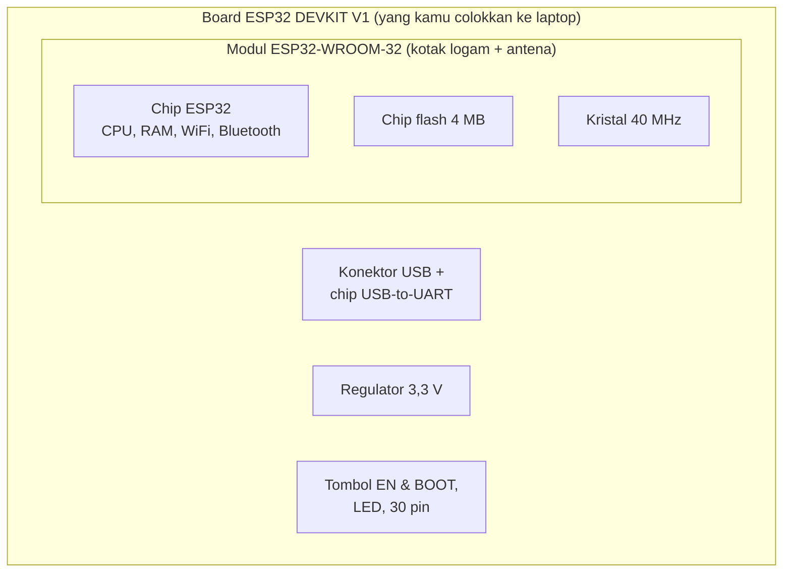
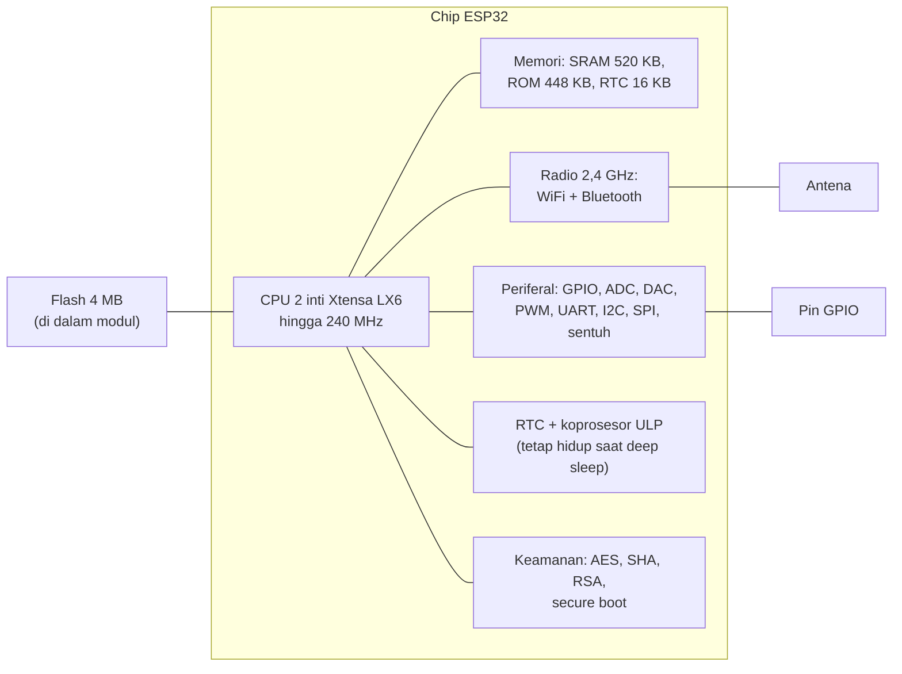
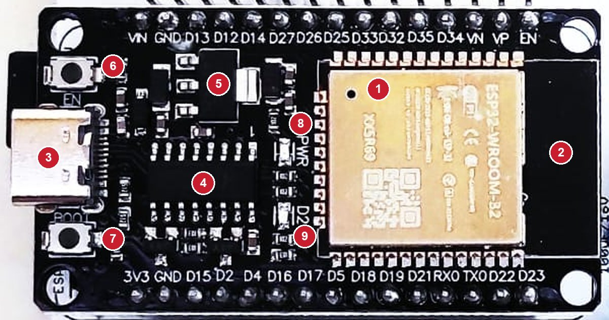

# BAB 2: Pengenalan ESP32

> ✅ **Prasyarat:** Selesaikan **BAB 1 (Apa Itu IoT & Embedded System)** — kamu sudah tahu apa itu mikrokontroler dan sudah mengenal isi kit Bluino.

Di BAB 1 kamu sudah tahu bahwa ESP32 adalah "otak" kit Bluino. Sekarang kita berkenalan lebih dekat: apa saja isi chip ESP32, apa bedanya chip, modul, dan *board*, serta bagian-bagian *board* ESP32 DEVKIT V1 yang akan kamu colokkan ke laptop setiap hari. Ibarat sebelum belajar menyetir, kamu perlu kenal dulu mana setir, gas, dan rem — pengetahuan di BAB ini akan sering terpakai saat ada program yang tidak berjalan sesuai harapan.

## 📌 Tujuan Pembelajaran

Setelah mempelajari BAB ini, kamu bisa:

- Menjelaskan apa itu ESP32, siapa pembuatnya, dan kenapa ESP32 populer untuk IoT.
- Membedakan chip ESP32, modul ESP32-WROOM-32, dan *board* ESP32 DEVKIT V1.
- Menyebutkan spesifikasi utama ESP32 (prosesor, memori, WiFi, Bluetooth, periferal) dan artinya bagi programmu.
- Mengenali bagian-bagian *board* ESP32 DEVKIT V1: konektor USB, chip USB-to-UART, tombol EN dan BOOT, LED, serta susunan pinnya.
- Membandingkan ESP32 dengan varian lain di keluarganya (S2, S3, C3, C5, C6, H2, P4) dan dengan Arduino Uno.
- Menyebutkan pilihan cara memprogram ESP32 dan alasan materi ini memakai Arduino IDE.

## 🧰 Yang Perlu Disiapkan

| Kebutuhan | Keterangan |
|---|---|
| *Hardware* | Tidak wajib — BAB ini teori. Kalau kit sudah ada, siapkan untuk mengamati *board* ESP32 DEVKIT V1 (tidak perlu disambung ke laptop) |
| Kabel *jumper* | Tidak perlu |
| Komponen tambahan | Tidak ada. Kamera HP (opsional) membantu membaca tulisan kecil di *board* dengan cara memperbesar foto |
| *Software* | Tidak perlu — cukup *browser* untuk membaca materi ini |
| *Library* | Tidak perlu *library* tambahan |
| Alat uji | Tidak perlu — BAB ini belum memakai program |
| Jaringan | Tidak perlu WiFi |

## 📑 Daftar Isi

- [2.1 Apa Itu ESP32?](#21-apa-itu-esp32)
- [2.2 Chip, Modul, dan Board: Apa Bedanya?](#22-chip-modul-dan-board-apa-bedanya)
- [2.3 Isi Chip ESP32](#23-isi-chip-esp32)
- [2.4 Mengenal Board ESP32 DEVKIT V1](#24-mengenal-board-esp32-devkit-v1)
- [2.5 Keluarga ESP32 — Varian Lainnya](#25-keluarga-esp32--varian-lainnya)
- [2.6 ESP32 vs Arduino Uno](#26-esp32-vs-arduino-uno)
- [2.7 Cara Memprogram ESP32](#27-cara-memprogram-esp32)
- [2.8 Anggapan Keliru yang Sering Muncul](#28-anggapan-keliru-yang-sering-muncul)
- [📝 Rangkuman](#-rangkuman)
- [💪 Latihan](#-latihan)
- [📚 Referensi](#-referensi)

---

## 2.1 Apa Itu ESP32?

**ESP32** adalah mikrokontroler buatan **Espressif Systems**, perusahaan asal Shanghai, Tiongkok. ESP32 diluncurkan pada tahun 2016 sebagai penerus **ESP8266**, chip WiFi murah yang sudah populer di kalangan penghobi elektronika sejak 2014. Di dalam satu chip ESP32 ada dua inti prosesor, WiFi, dan Bluetooth — itulah sebabnya ESP32 disebut **SoC** (*System on Chip*), seperti dibahas di [BAB 1](../BAB-01/README.md).

### Kenapa ESP32 Begitu Populer?

| Keunggulan | Penjelasan singkat |
|---|---|
| WiFi bawaan | Standar 802.11 b/g/n di frekuensi 2,4 GHz — bisa tersambung ke *router* atau menjadi *hotspot* sendiri |
| Bluetooth bawaan | Bluetooth Classic dan BLE (*Bluetooth Low Energy*, Bluetooth hemat daya) versi 4.2 |
| Dua inti prosesor | 2 inti CPU 32-bit dengan kecepatan hingga 240 MHz |
| Hemat daya | Saat *deep sleep*, chip-nya hanya menyedot arus sekitar 10 µA |
| Banyak pin | 34 GPIO di chip; 25 di antaranya keluar sebagai pin di *board* DEVKIT V1 |
| Periferal lengkap | ADC, DAC, PWM, sensor sentuh, UART, I2C, SPI, dan lain-lain |
| Terjangkau | *Board* pengembangannya dijual dengan harga puluhan ribu rupiah |
| Komunitas besar | Banyak *library*, contoh program, dan forum diskusi; bisa diprogram dengan Arduino IDE lewat paket resmi dari Espressif |

Jangan khawatir kalau beberapa istilah di tabel itu belum kamu kenal. Semuanya dijelaskan di [bagian 2.3](#23-isi-chip-esp32).

---

## 2.2 Chip, Modul, dan Board: Apa Bedanya?

Kata "ESP32" sering dipakai untuk menyebut tiga benda yang berbeda. Supaya tidak bingung saat membaca *datasheet* (lembar data teknis), mencari tutorial, atau membeli komponen, kenali dulu bedanya:

| Tingkat | Contoh | Isinya | Analogi |
|---|---|---|---|
| **Chip** | ESP32-D0WD-V3, ESP32-D0WDQ6 | Komponen persegi kecil (sisinya sekitar 5–6 mm) berisi CPU, RAM, WiFi, Bluetooth, dan periferal. Umumnya belum berisi memori *flash* untuk menyimpan program | Mesin mobil |
| **Modul** | ESP32-WROOM-32 | Chip ESP32 + chip *flash* 4 MB + kristal 40 MHz + antena, dirakit di PCB kecil dan ditutup pelindung logam | Mesin yang sudah dilengkapi tangki bensin dan knalpot, siap dipasang |
| ***Board* pengembangan** | ESP32 DEVKIT V1 | Modul + konektor USB + chip USB-to-UART + regulator tegangan + tombol + LED + 30 pin | Mobil utuh yang tinggal dikendarai |



*Gambar 2.1 — Chip ESP32 ada di dalam modul ESP32-WROOM-32, dan modul itu terpasang di board ESP32 DEVKIT V1. Sumber: dibuat untuk materi ini.*

Kristal adalah komponen yang menghasilkan detak (*clock*) yang sangat stabil, seperti metronom bagi chip. WiFi dan Bluetooth butuh detak yang tepat supaya bisa berkomunikasi.

Kenapa tidak memakai chip ESP32 langsung? Menyolder chip sekecil itu sulit, dan rangkaian antenanya harus dirancang sangat teliti. Modul menyelesaikan masalah itu, dan modul ESP32-WROOM-32 juga sudah lolos sertifikasi frekuensi radio. *Board* pengembangan lalu menambahkan semua yang kamu butuhkan untuk belajar: cukup colokkan kabel USB, dan ESP32 siap diprogram.

> 📌 **Catatan:** Tulisan di pelindung logam modul menunjukkan nama modulnya, misalnya **ESP32-WROOM-32**. Ada juga versi penerusnya, **ESP32-WROOM-32D** dan **ESP32-WROOM-32E**, yang fungsinya sama untuk materi ini. Modul ESP32-WROOM-32 versi awal memakai chip ESP32-D0WDQ6, sedangkan ESP32-WROOM-32E memakai chip ESP32-D0WD-V3. Di [BAB 7](../BAB-07/README.md) kamu bisa melihat nama chip di *board*-mu sendiri lewat program.

> 🧪 **Coba Sendiri:** Kalau kit sudah ada, perhatikan *board* ESP32 di kitmu. Temukan kotak logam bertuliskan nama modul, lalu bagian hitam di ujung modul (tanpa pelindung logam) — itulah antenanya.

---

## 2.3 Isi Chip ESP32

Gambar berikut menyederhanakan isi chip ESP32. Bagian tengahnya adalah CPU, dan semua bagian lain terhubung ke sana.



*Gambar 2.2 — Diagram sederhana isi chip ESP32 (disederhanakan dari diagram blok di datasheet ESP32). Sumber: dibuat untuk materi ini.*

### Prosesor (CPU)

ESP32 punya **2 inti** (*core*) CPU 32-bit berarsitektur **Xtensa LX6** dengan kecepatan hingga **240 MHz**. "32-bit" artinya prosesor mengolah data 32 bit sekaligus — jauh lebih leluasa daripada mikrokontroler 8-bit seperti ATmega328P di Arduino Uno. Di Arduino IDE, kecepatannya diatur lewat **Tools → CPU Frequency**, dan pilihan bawaannya sudah yang tercepat, yaitu 240 MHz (tertulis `240MHz (WiFi/BT)` di menu).

Dua inti berarti ESP32 bisa mengerjakan dua hal benar-benar bersamaan. Di Arduino-ESP32, pembagian bawaannya seperti ini:

| Inti | Nama di dokumentasi Espressif | Dipakai untuk (setelan bawaan) |
|---|---|---|
| Core 0 | PRO_CPU (*protocol CPU*) | WiFi, Bluetooth, dan tugas-tugas sistem |
| Core 1 | APP_CPU (*application CPU*) | Programmu: isi `setup()` dan `loop()` |

Jadi, saat programmu sibuk di `loop()`, urusan WiFi tetap berjalan di inti yang lain. Pembagian ini hanya setelan bawaan: lewat menu **Tools → Arduino Runs On** intinya bisa dipindah, dan dengan FreeRTOS kamu bisa menjalankan tugas sendiri di kedua inti (dibahas di Bagian XI — Teknik Lanjutan, sedang disusun).

### Memori

| Jenis | Ukuran | Letaknya | Fungsinya | Isinya saat listrik mati |
|---|---|---|---|---|
| SRAM | 520 KB | Di dalam chip | Memori kerja: variabel, *stack*, *heap* | Hilang |
| ROM | 448 KB | Di dalam chip | Kode bawaan pabrik, misalnya *bootloader* pertama (program yang berjalan paling awal saat ESP32 menyala) | Tetap (tidak bisa diubah) |
| RTC SRAM | 16 KB | Di dalam chip | Memori kecil yang tetap terisi saat ESP32 *deep sleep* | Hilang (tetapi bertahan saat *deep sleep*) |
| *Flash* | 4 MB | Di dalam modul, chip terpisah | Menyimpan program dan data (pengaturan, *file*) | Tetap |
| PSRAM | Tidak ada | — | RAM tambahan; hanya ada di modul lain seperti ESP32-WROVER | — |

Beberapa hal penting dari tabel di atas:

- **Tidak semua 520 KB SRAM bisa dipakai programmu.** Sebagian dipakai sistem, terutama saat WiFi dan Bluetooth menyala. Cara memantau sisa memori dibahas di [BAB 20](../BAB-20/README.md).
- **Ukuran program dibatasi pembagian *flash* (*partition scheme*).** Dengan pilihan bawaan di menu **Tools → Partition Scheme** (yang berawalan **Default 4MB with spiffs**), program maksimal sekitar 1,3 MB. Saat *compile*, Arduino IDE akan menulis `Maximum is 1310720 bytes`. Sisa *flash* dipakai untuk menyimpan *file* ([BAB 40](../BAB-40/README.md)) dan cadangan program untuk pembaruan lewat WiFi (OTA).
- ***Stack*** dan ***heap*** adalah dua "wilayah" di RAM: *stack* untuk variabel sementara di dalam fungsi, *heap* untuk data yang dibuat saat program berjalan. Detailnya juga ada di [BAB 20](../BAB-20/README.md).

### WiFi

- Standar **IEEE 802.11 b/g/n** (sering disebut WiFi 4), **hanya di pita 2,4 GHz**.
- Tiga mode: ***Station*** (tersambung ke *router*, seperti HP-mu — [BAB 42](../BAB-42/README.md)), ***Access Point*** (menjadi *hotspot* sendiri — [BAB 43](../BAB-43/README.md)), atau keduanya sekaligus.
- Kecepatan teoretis hingga 150 Mbps. Kecepatan nyatanya jauh lebih rendah, tetapi tetap lebih dari cukup untuk data sensor dan halaman web.
- Saat memancar, chip ESP32 bisa menyedot arus hingga sekitar 240 mA sesaat. Karena itu, kabel dan *port* USB yang lemah bisa membuat ESP32 menyala ulang sendiri saat WiFi menyala. Biasanya Serial Monitor lalu menampilkan pesan `Brownout detector was triggered` (tegangan sempat turun terlalu rendah).

> ⚠️ **Perhatian:** ESP32 **tidak bisa** tersambung ke WiFi 5 GHz. Pastikan *router* atau *hotspot* HP memancarkan 2,4 GHz. Nama WiFi (SSID) dan kata sandinya juga peka huruf besar-kecil.

### Bluetooth

ESP32 mendukung **Bluetooth 4.2** dalam dua jenis:

| Jenis | Cocok untuk | Dibahas di |
|---|---|---|
| Bluetooth Classic (BR/EDR) | Aliran data terus-menerus, misalnya pengganti kabel serial ke HP Android, atau audio | [BAB 52](../BAB-52/README.md) |
| BLE (*Bluetooth Low Energy*) | Data kecil yang hemat daya, misalnya sensor dan aplikasi HP (Android maupun iPhone) | [BAB 53](../BAB-53/README.md) |

WiFi dan Bluetooth memakai **radio dan antena yang sama**. Keduanya bisa menyala bersamaan, tetapi bergantian memakai radio, sehingga kinerja masing-masing bisa sedikit turun dan pemakaian memorinya bertambah.

> 📌 **Catatan:** iPhone tidak mendukung komunikasi data Bluetooth Classic jenis SPP (*Serial Port Profile*). Untuk iPhone, pakai BLE. Di antara keluarga ESP32 (lihat [bagian 2.5](#25-keluarga-esp32--varian-lainnya)), hanya ESP32 versi klasik — yang ada di kit ini — yang punya Bluetooth Classic.

### Periferal dan GPIO

Periferal adalah rangkaian pembantu di dalam chip. Berikut daftar periferal ESP32 dan BAB yang membahasnya:

| Periferal | Jumlah di chip | Kegunaannya | Dibahas di |
|---|---|---|---|
| GPIO (pin serbaguna) | 34 pin | Input/output digital | [BAB 6](../BAB-06/README.md), [BAB 8](../BAB-08/README.md), [BAB 9](../BAB-09/README.md) |
| ADC 12-bit (*Analog-to-Digital Converter*) | 18 kanal (ADC1: 8, ADC2: 10) | Membaca tegangan analog, misalnya dari potensiometer dan LDR | [BAB 11](../BAB-11/README.md) |
| DAC 8-bit (*Digital-to-Analog Converter*) | 2 kanal (IO25 dan IO26) | Mengeluarkan tegangan analog | [BAB 13](../BAB-13/README.md) |
| Sensor sentuh kapasitif | 10 kanal | Mendeteksi sentuhan jari | [BAB 14](../BAB-14/README.md) |
| LED PWM (LEDC) | 16 kanal | Meredupkan LED, membuat nada, menggerakkan servo | [BAB 12](../BAB-12/README.md) |
| *Timer* 64-bit | 4 | Pewaktu presisi dan *interrupt* berkala | [BAB 15](../BAB-15/README.md) |
| UART | 3 | Komunikasi serial; UART0 dipakai Serial Monitor | [BAB 22](../BAB-22/README.md) |
| I2C | 2 | Jalur sensor dan layar (OLED, BMP180, MPU-6050) | [BAB 23](../BAB-23/README.md) |
| SPI | 4 (2 di antaranya dipakai untuk *flash*) | Komunikasi cepat, misalnya kartu microSD | [BAB 24](../BAB-24/README.md) |
| RMT (*Remote Control*) | 8 kanal | Membuat/membaca sinyal berpola, misalnya *remote* inframerah | — |
| Motor PWM (MCPWM) | 2 unit | Mengendalikan motor | — |
| Pencacah pulsa (PCNT) | 8 unit | Menghitung pulsa dengan *hardware* | — |
| I2S, TWAI (CAN), SD/SDIO, Ethernet MAC | — | Audio digital, jaringan CAN di kendaraan/industri, kartu SD mode cepat, dan jaringan kabel LAN (CAN dan LAN butuh chip tambahan) | Bagian XI (sedang disusun) |

PWM (*Pulse Width Modulation*) adalah teknik menyalakan-mematikan pin dengan sangat cepat untuk mengatur "rata-rata" daya, misalnya untuk meredupkan LED. Istilah-istilah lain di tabel akan dijelaskan pelan-pelan di BAB masing-masing.

Tidak semua dari 34 GPIO itu bebas dipakai:

- **GPIO6–GPIO11** tersambung ke chip *flash* di dalam modul — jangan dipakai.
- **GPIO34–GPIO39** hanya bisa menjadi input dan tidak punya resistor *pull-up/pull-down* internal.
- **GPIO0, 2, 5, 12, 15** adalah pin *strapping*: keadaannya saat ESP32 dinyalakan menentukan cara ESP32 *boot* (memulai kerja), misalnya menjalankan program atau masuk mode unggah.
- **ADC2** tidak bisa dipakai membaca nilai analog saat WiFi menyala. Untuk sensor analog, pakai pin ADC1 (GPIO32–GPIO39).

Semua batasan ini dibahas tuntas di [BAB 6](../BAB-06/README.md).

> ⚠️ **Perhatian:** Pin ESP32 bekerja pada tegangan **3,3 V** dan **tidak tahan 5 V**. Menurut *datasheet*, tegangan di pin input tidak boleh melebihi 3,3 V + 0,3 V = 3,6 V. Setiap pin output bisa memberi arus sekitar 20 mA pada setelan bawaan (hingga ± 40 mA pada setelan terkuat). Itu cukup untuk LED (lewat resistor), tetapi beban besar seperti motor dan *relay* harus lewat transistor. Penjelasannya ada di [BAB 3](../BAB-03/README.md).

> 📌 **Catatan:** Materi lama sering menyebut ESP32 punya **sensor Hall** (pendeteksi medan magnet) dan **sensor suhu internal**. Espressif sudah menghapus keduanya dari *datasheet* ESP32 terbaru. Fungsi `hallRead()` juga sudah **dihapus** di Arduino-ESP32 *core* 3.x, sehingga contoh lama yang memakainya akan gagal dikompilasi. Fungsi `temperatureRead()` masih ada, tetapi pada ESP32 versi klasik hasilnya tidak dapat diandalkan. Ceritanya dibahas di [BAB 33](../BAB-33/README.md).

### Keamanan

ESP32 punya akselerator kriptografi (*hardware* khusus untuk enkripsi AES, *hash* SHA-2, RSA, dan pembangkit bilangan acak), fitur ***secure boot*** (hanya program bertanda tangan resmi yang boleh berjalan), dan ***flash encryption*** (isi *flash* dienkripsi supaya tidak bisa dibaca orang lain). Akselerator ini otomatis membantu saat ESP32 memakai HTTPS ([BAB 49](../BAB-49/README.md)). *Secure boot* dan *flash encryption* termasuk materi lanjutan (Bagian XI, sedang disusun).

### Mode Daya dan Koprosesor ULP

ESP32 bisa mematikan bagian-bagian yang tidak dipakai untuk menghemat daya. Angka di tabel ini adalah arus **chip ESP32 saja**, menurut *datasheet* Espressif:

| Mode | Yang masih menyala | Arus chip (perkiraan) |
|---|---|---|
| Aktif, WiFi memancar | Semua | ± 180–240 mA (sesaat) |
| Aktif, WiFi/Bluetooth menerima | Semua | ± 95–100 mA |
| *Modem-sleep* | CPU menyala, radio mati | ± 20–68 mA (bergantung kecepatan CPU) |
| *Light-sleep* | CPU berhenti sementara, isi RAM tetap | ± 0,8 mA |
| *Deep-sleep* | Hanya bagian RTC (dan koprosesor ULP bila dipakai) | ± 10 µA; ± 150 µA bila ULP menyala |
| *Hibernation* | Hanya *timer* RTC | ± 5 µA |

**Koprosesor ULP** (*Ultra-Low-Power*) adalah prosesor mini yang tetap bisa bekerja saat CPU utama tidur. Contohnya, ULP membaca sensor secara berkala lalu membangunkan CPU utama hanya kalau nilainya penting. Mode tidur dan ULP dibahas di Bagian XI (sedang disusun).

> 📌 **Catatan:** *Board* ESP32 DEVKIT V1 punya regulator tegangan, chip USB, dan LED daya yang tetap menyedot arus walaupun chip ESP32 sedang *deep sleep*. Jadi, angka mikroampere di atas tidak akan tercapai kalau kamu mengukur arus *board* secara keseluruhan.

---

## 2.4 Mengenal Board ESP32 DEVKIT V1

*Board* di kit Bluino adalah **ESP32 DEVKIT V1**. Desain aslinya dibuat oleh perusahaan DOIT, lalu dibuat ulang oleh banyak pabrik lain, sehingga *board* yang beredar bisa sedikit berbeda: konektornya micro-USB atau USB Type-C, chip USB-to-UART-nya CP2102 atau CH340, dan modulnya ESP32-WROOM-32, -32D, atau -32E. Susunan dan fungsi pinnya tetap sama, jadi semua materi di kurikulum ini berlaku untuk semua versi itu.

### Bagian-Bagian Board



*Gambar 2.3 — Board ESP32 DEVKIT V1 versi USB Type-C pada kit Bluino; nomor dijelaskan pada tabel di bawah. Sumber: foto produk [Bluino](http://www.bluino.com), diperbesar dan diberi nomor untuk materi ini.*

| No. | Bagian | Fungsinya |
|---|---|---|
| 1 | Modul ESP32-WROOM-32 | Berisi chip ESP32, *flash* 4 MB, dan kristal di bawah pelindung logam |
| 2 | Antena PCB | Jalur tembaga berpola di ujung modul untuk memancarkan dan menerima sinyal WiFi/Bluetooth. Jangan ditutup benda logam |
| 3 | Konektor USB | Jalur daya 5 V dari laptop, sekaligus jalur untuk mengunggah program dan Serial Monitor |
| 4 | Chip USB-to-UART | "Penerjemah" antara USB di laptop dan jalur serial (UART0) di ESP32. Jenisnya CP2102 atau CH340 (kadang CH9102), dan laptop mungkin perlu *driver* yang sesuai |
| 5 | Regulator tegangan | Menurunkan 5 V dari USB menjadi 3,3 V untuk ESP32 (biasanya IC AMS1117-3.3) |
| 6 | Tombol **EN** | *Reset*: menekannya membuat ESP32 menyala ulang dan menjalankan program dari awal. Program tidak terhapus |
| 7 | Tombol **BOOT** | Tersambung ke IO0. Kalau ditahan saat ESP32 di-*reset*, ESP32 masuk ke mode unggah program |
| 8 | LED daya (label **PWR**) | Menyala saat *board* mendapat daya |
| 9 | LED biru (label **D2**) | Tersambung ke IO2. LED inilah yang akan kamu kedipkan di [BAB 7](../BAB-07/README.md) |

Kenapa perlu chip USB-to-UART? ESP32 versi klasik **tidak punya USB bawaan**. Untuk diprogram dan berkirim pesan dengan laptop, ia memakai komunikasi serial UART lewat pin TX0 (IO1) dan RX0 (IO3). Chip nomor 4 mengubah sinyal USB dari laptop menjadi sinyal UART, dan sebaliknya. Varian yang lebih baru seperti ESP32-S3 dan ESP32-C3 sudah punya USB bawaan (lihat [bagian 2.5](#25-keluarga-esp32--varian-lainnya)).

> 💡 **Tips:** Ingin tahu chip USB-to-UART di *board*-mu? Foto chip nomor 4 dengan kamera HP, lalu perbesar fotonya untuk membaca tulisannya. Cara lain (di Windows): setelah *board* dicolokkan, buka **Device Manager** → **Ports (COM & LPT)**. Di sana akan tertulis misalnya *Silicon Labs CP210x USB to UART Bridge* atau *USB-SERIAL CH340*. Jenis chip ini menentukan *driver* yang perlu dipasang di [BAB 5](../BAB-05/README.md).

### Spesifikasi Board

| Parameter | Nilai |
|---|---|
| Modul | ESP32-WROOM-32 (atau penerusnya, -32D/-32E) |
| Chip | ESP32 *dual-core*, misalnya ESP32-D0WDQ6 atau ESP32-D0WD-V3 |
| CPU | 2 inti Xtensa LX6 32-bit, hingga 240 MHz |
| SRAM | 520 KB (di dalam chip) |
| *Flash* | 4 MB (di dalam modul) |
| PSRAM | Tidak ada |
| WiFi | 802.11 b/g/n, hanya 2,4 GHz |
| Bluetooth | v4.2 BR/EDR (Classic) dan BLE |
| Jumlah pin | 30 pin: 25 GPIO, EN, 3V3, VIN, dan 2 GND |
| Pin ADC yang keluar di *board* | 15 (ADC1: 6 pin, ADC2: 9 pin) |
| Pin sentuh yang keluar di *board* | 9 |
| USB | Micro-USB atau USB Type-C (tergantung versi), lewat chip USB-to-UART CP2102 atau CH340 |
| Tegangan kerja | 3,3 V — pin GPIO **tidak** tahan 5 V |
| Catu daya | 5 V dari USB, atau 5 V dari luar lewat pin VIN |
| Tombol | EN (*reset*) dan BOOT (IO0) |
| LED | LED daya dan LED biru di IO2 |

### Susunan Pin

*Board* ESP32 DEVKIT V1 punya 2 baris pin, masing-masing 15 pin. Kalau *board* dilihat dari atas dengan antena menghadap ke atas, susunannya seperti ini:

```text
                ┌─────────────────────────┐
                │       antena (PCB)      │
                │   ┌─────────────────┐   │
                │   │ ESP32-WROOM-32  │   │
                │   │ (pelindung      │   │
                │   │  logam)         │   │
                │   └─────────────────┘   │
          EN ───┤                         ├─── IO23
   VP (IO36) ───┤                         ├─── IO22
   VN (IO39) ───┤                         ├─── TX0 (IO1)
        IO34 ───┤                         ├─── RX0 (IO3)
        IO35 ───┤                         ├─── IO21
        IO32 ───┤                         ├─── IO19
        IO33 ───┤                         ├─── IO18
        IO25 ───┤                         ├─── IO5
        IO26 ───┤                         ├─── IO17
        IO27 ───┤                         ├─── IO16
        IO14 ───┤                         ├─── IO4
        IO12 ───┤                         ├─── IO2
        IO13 ───┤                         ├─── IO15
         GND ───┤                         ├─── GND
   VIN (5 V) ───┤   [EN]  [USB]  [BOOT]   ├─── 3V3
                └─────────────────────────┘
```

*Gambar 2.4 — Susunan pin ESP32 DEVKIT V1 dilihat dari atas, antena di atas dan konektor USB di bawah. Sumber: dibuat untuk materi ini.*

Tulisan di *board* sedikit berbeda dari diagram di atas: *board* menulis **D23, D22, TX0, RX0, D21, ...** (huruf D untuk "digital"), sedangkan *header* di *shield* kit hanya menulis angkanya (**23, 22, 1, 3, 21, ...**). Di kurikulum ini kita selalu menyebutnya **IO23, IO22, IO1, IO3, IO21**, dan seterusnya. Pin **VP** dan **VN** adalah IO36 dan IO39, dan beberapa *board* menulis IO17/IO16 sebagai **TX2/RX2**.

Di kit Bluino, kedua baris pin ini diteruskan ke dua *header* 15 pin di *shield*. Ke *header* itulah kamu menancapkan kabel *jumper*:


*Gambar 2.5 — ESP32 DEVKIT V1 dan dua header 15 pin pada shield. Sumber: skematik ESP32 Starter Shield 3.2, [Bluino](http://www.bluino.com).*

Pin daya yang perlu kamu kenal:

| Pin | Fungsinya |
|---|---|
| **3V3** | Keluaran 3,3 V dari regulator *board*, untuk memberi daya sensor kecil |
| **VIN** (di *shield* berlabel **5V**) | Jalur 5 V. Saat *board* dicolokkan ke USB, pin ini berisi ± 5 V dari USB |
| **GND** | *Ground* (0 V), titik acuan semua tegangan |
| **EN** | Pin *reset*: selama pin ini terhubung ke GND, ESP32 berhenti; saat dilepas, ESP32 menyala ulang |

> ⚠️ **Perhatian:** Jangan pernah menyambung pin VIN/5V langsung ke pin GPIO atau ke pin 3V3. Cabut kabel USB dulu setiap kali memindahkan kabel *jumper*. Fungsi khusus dan batasan setiap pin dibahas lengkap di [BAB 6](../BAB-06/README.md).

### Tombol EN, BOOT, dan Unggah Otomatis

Saat kamu mengklik **Upload** di Arduino IDE, chip USB-to-UART otomatis "menekan" tombol BOOT dan EN untukmu lewat rangkaian kecil di *board*. ESP32 pun masuk ke mode unggah, menerima program baru, lalu menyala ulang dan menjalankan program itu. Jadi, biasanya kamu **tidak perlu menekan tombol apa pun**.

*Shield* kit juga memasang kapasitor 0,1 µF antara pin EN dan GND (terlihat di kiri atas Gambar 2.5). Kapasitor ini sedikit memperlambat naiknya tegangan EN saat *reset*, sehingga proses masuk ke mode unggah otomatis lebih andal.

Kalau unggahan tetap gagal — di panel *Output* Arduino IDE muncul `Connecting......` yang tidak kunjung selesai, lalu pesan `Failed to connect to ESP32` — lakukan ini:

1. Klik **Upload** lagi.
2. Saat muncul tulisan `Connecting...`, **tekan dan tahan** tombol **BOOT**.
3. Lepaskan tombol BOOT setelah muncul tulisan `Writing at ...` (tanda program mulai ditulis).
4. Setelah selesai, tekan tombol **EN** sekali kalau programnya belum berjalan.

Penyebab gagal unggah lainnya (kabel USB yang hanya untuk mengisi daya, *driver* belum terpasang, *port* salah) dibahas di [BAB 5](../BAB-05/README.md) dan [BAB 7](../BAB-07/README.md).

---

## 2.5 Keluarga ESP32 — Varian Lainnya

ESP32 di kit ini adalah ESP32 "klasik", anggota pertama keluarga ESP32. Setelah itu Espressif merilis banyak varian dengan keunggulan masing-masing. Data di tabel ini diambil dari *datasheet* resmi setiap chip:

| Varian | Prosesor (kecepatan maks.) | WiFi | Bluetooth | Thread/Zigbee (802.15.4) | USB bawaan | Keunggulan utama |
|---|---|---|---|---|---|---|
| **ESP32** (di kit ini) | 2 inti Xtensa LX6 (240 MHz) | WiFi 4, 2,4 GHz | 4.2 Classic + LE | Tidak | Tidak ada (lewat chip USB-to-UART) | Satu-satunya yang punya Bluetooth Classic; contoh dan *library* paling banyak |
| ESP32-S2 | 1 inti Xtensa LX7 (240 MHz) | WiFi 4, 2,4 GHz | Tidak ada | Tidak | USB OTG | USB bawaan, tanpa Bluetooth |
| ESP32-S3 | 2 inti Xtensa LX7 (240 MHz) | WiFi 4, 2,4 GHz | 5 (LE saja) | Tidak | USB OTG + USB Serial/JTAG | Instruksi vektor untuk AI; cocok untuk kamera dan pengenalan suara |
| ESP32-C3 | 1 inti RISC-V (160 MHz) | WiFi 4, 2,4 GHz | 5 (LE saja) | Tidak | USB Serial/JTAG | Murah dan hemat daya |
| ESP32-C6 | 1 inti RISC-V (160 MHz) + 1 inti hemat daya (20 MHz) | WiFi 6, 2,4 GHz | 5 (LE saja) | Ya | USB Serial/JTAG | WiFi 6 dan Thread/Zigbee; cocok untuk Matter |
| ESP32-C5 | 1 inti RISC-V (240 MHz) + 1 inti hemat daya (48 MHz) | WiFi 6, **2,4 dan 5 GHz** | 5 (LE saja) | Ya | USB Serial/JTAG | Satu-satunya yang mendukung WiFi 5 GHz |
| ESP32-H2 | 1 inti RISC-V (96 MHz) | Tidak ada | 5 (LE saja) | Ya | USB Serial/JTAG | Khusus jaringan Thread/Zigbee yang hemat daya |
| ESP32-P4 | 2 inti RISC-V (400 MHz) + 1 inti hemat daya (40 MHz) | Tidak ada | Tidak ada | Tidak | USB 2.0 *High-Speed* OTG | Prosesor tercepat; untuk layar dan kamera. Butuh chip ESP32 lain sebagai pendamping untuk WiFi/Bluetooth |

Arti istilah di tabel:

- **Xtensa** dan **RISC-V** adalah dua "keluarga" desain prosesor. RISC-V bersifat terbuka (bebas dipakai tanpa membayar lisensi). Bagi pemrogram Arduino, bedanya hampir tidak terasa karena kodenya tetap sama.
- **WiFi 4** adalah nama lain 802.11n, sedangkan **WiFi 6** adalah 802.11ax yang lebih efisien di jaringan yang ramai.
- **Bluetooth 5 (LE saja)** artinya hanya mendukung BLE, tanpa Bluetooth Classic.
- **802.15.4** adalah standar radio hemat daya yang menjadi dasar jaringan **Thread** dan **Zigbee**, yang dipakai perangkat rumah pintar berstandar Matter ([BAB 56](../BAB-56/README.md)).
- **USB OTG** membuat chip bisa menjadi perangkat USB (misalnya *keyboard*) atau menjadi *host*. **USB Serial/JTAG** adalah USB bawaan untuk mengunggah program dan membuka Serial Monitor tanpa chip USB-to-UART.

Semua varian di tabel ini bisa diprogram dengan Arduino IDE memakai *board package* esp32 versi 3.3.x — kamu cukup memilih *board* yang sesuai di menu **Tools → Board**.

> 💡 **Tips:** Kenapa kit ini memakai ESP32 klasik? Karena contoh program dan *library*-nya paling banyak, ia satu-satunya varian dengan Bluetooth Classic ([BAB 52](../BAB-52/README.md)), punya DAC ([BAB 13](../BAB-13/README.md)) serta banyak pin ADC dan sentuh, dan harganya terjangkau. Untuk materi Thread di [BAB 56](../BAB-56/README.md), kamu butuh ESP32-C6 atau ESP32-H2 yang dibeli terpisah.

---

## 2.6 ESP32 vs Arduino Uno

Banyak orang mulai belajar mikrokontroler dengan Arduino Uno. Berikut perbandingannya dengan ESP32 DEVKIT V1 (yang dibandingkan adalah Arduino Uno R3, versi Uno yang paling banyak dipakai):

| Aspek | ESP32 DEVKIT V1 | Arduino Uno R3 |
|---|---|---|
| Mikrokontroler | ESP32 (32-bit, 2 inti) | ATmega328P (8-bit, 1 inti) |
| Kecepatan | Hingga 240 MHz | 16 MHz |
| RAM | 520 KB | 2 KB |
| Memori program (*flash*) | 4 MB | 32 KB |
| WiFi | Ada | Tidak ada (butuh modul tambahan) |
| Bluetooth | Ada | Tidak ada (butuh modul tambahan) |
| ADC | 12-bit, 15 pin di *board* | 10-bit, 6 pin |
| DAC | 2 kanal | Tidak ada |
| Sensor sentuh | 9 pin di *board* | Tidak ada |
| PWM | 16 kanal, bisa diarahkan ke hampir semua pin output | 6 pin |
| Tegangan logika | 3,3 V | 5 V |
| Sistem operasi | FreeRTOS (bekerja di balik layar) | Tidak ada |

Untuk proyek IoT yang butuh WiFi atau Bluetooth, ESP32 jelas lebih cocok. Meski begitu, Arduino Uno tetap punya kelebihan:

- **Logika 5 V**, sehingga cocok langsung dengan banyak modul lama yang bekerja di 5 V tanpa penurun tegangan.
- **Lebih sederhana**: tidak ada pin *flash* atau pin *strapping* yang harus dihindari.
- **ADC-nya lebih lurus (linear)**. ADC ESP32 kurang akurat di dekat 0 V dan di dekat batas atasnya ([BAB 11](../BAB-11/README.md)).
- **Bahan belajar untuk pemula sangat banyak.**

> 📌 **Catatan:** Arduino Uno generasi baru (Uno R4) sudah memakai prosesor 32-bit 48 MHz. Uno R4 WiFi bahkan memakai modul ESP32-S3 untuk WiFi dan Bluetooth-nya — bukti betapa populernya keluarga ESP32.

---

## 2.7 Cara Memprogram ESP32

ESP32 bisa diprogram dengan beberapa kerangka kerja (*framework*), yaitu kumpulan alat dan *library* untuk membuat program:

| Kerangka kerja | Bahasa | Tingkat | Keterangan |
|---|---|---|---|
| **Arduino IDE + Arduino-ESP32** (dipakai di materi ini) | C/C++ gaya Arduino | Pemula–menengah | *Board package* resmi dari Espressif; cara memasangnya ada di [BAB 5](../BAB-05/README.md) |
| PlatformIO | C/C++ | Menengah | Ekstensi untuk *editor* VS Code; bisa memakai *framework* Arduino maupun ESP-IDF |
| ESP-IDF | C/C++ | Lanjutan | *Framework* resmi Espressif dengan kendali penuh atas chip. Arduino-ESP32 sendiri dibangun di atas ESP-IDF |
| MicroPython | Python | Pemula | Program ditulis dalam bahasa Python dan langsung dijalankan ESP32 tanpa proses *compile* di laptop |
| ESPHome | YAML (*file* konfigurasi) | Pemula | Perangkat dibuat lewat konfigurasi, lalu terhubung ke Home Assistant |

Materi ini memakai **Arduino IDE** karena paling mudah dipasang (Windows, macOS, maupun Linux), semua sensor di kit punya *library* Arduino, dan bahasa C/C++ yang kamu pelajari tetap berguna kalau nanti pindah ke ESP-IDF. ESP-IDF, MicroPython, dan ESPHome akan diperkenalkan di Bagian X dan XI (sedang disusun).

> ⚠️ **Perhatian:** Materi ini memakai *board package* **esp32 by Espressif Systems versi 3.3.x**. Banyak contoh program di internet masih ditulis untuk versi 2.x dan bisa *error* di versi 3.x, misalnya karena fungsi `ledcSetup()` dan `hallRead()` sudah dihapus. Kalau menyalin kode dari internet, cek dulu untuk versi berapa kode itu dibuat.

---

## 2.8 Anggapan Keliru yang Sering Muncul

| Anggapan keliru | Yang benar |
|---|---|
| "ESP32 bisa tersambung ke WiFi 5 GHz." | ESP32 di kit ini hanya mendukung 2,4 GHz. Di keluarga ESP32, hanya ESP32-C5 yang mendukung 5 GHz. |
| "Pin ESP32 aman diberi sinyal 5 V, sama seperti Arduino Uno." | Tidak. Tegangan di pin ESP32 maksimal 3,6 V. Sinyal 5 V (misalnya dari pin Echo sensor HC-SR04) harus diturunkan dulu dengan pembagi tegangan ([BAB 3](../BAB-03/README.md), [BAB 30](../BAB-30/README.md)). |
| "Semua 34 GPIO bisa dipakai bebas." | *Board* hanya mengeluarkan 25 GPIO, dan sebagian punya batasan (*strapping*, hanya input, ADC2). Lihat [BAB 6](../BAB-06/README.md). |
| "520 KB SRAM semuanya untuk programku." | Sebagian dipakai sistem, WiFi, dan Bluetooth ([BAB 20](../BAB-20/README.md)). |
| "Saat *deep sleep*, *board*-ku hanya menyedot 10 µA." | Angka 10 µA hanya untuk chip ESP32. *Board* DEVKIT V1 tetap menyedot beberapa mA karena regulator, chip USB, dan LED dayanya. |
| "iPhone bisa menerima data ESP32 lewat Bluetooth Classic." | iPhone tidak mendukung Bluetooth Classic SPP. Pakai BLE ([BAB 53](../BAB-53/README.md)). |
| "Contoh kode ESP32 dari internet pasti bisa langsung dipakai." | Banyak yang ditulis untuk *core* 2.x. Materi ini memakai *core* 3.x yang beberapa fungsinya berbeda. |
| "*Board* tidak terdeteksi laptop berarti ESP32-nya rusak." | Paling sering penyebabnya kabel USB yang hanya untuk mengisi daya, atau *driver* CP2102/CH340 belum terpasang ([BAB 5](../BAB-05/README.md)). |
| "Menekan tombol EN menghapus program." | Tidak. Tombol EN hanya menyalakan ulang ESP32; programnya tetap tersimpan di *flash*. |

---

## 📝 Rangkuman

- **ESP32** adalah mikrokontroler (SoC) buatan Espressif yang berisi 2 inti CPU hingga 240 MHz, WiFi 2,4 GHz, dan Bluetooth 4.2 (Classic + BLE).
- **Chip** ESP32 ada di dalam **modul** ESP32-WROOM-32 (bersama *flash* 4 MB, kristal, dan antena), dan modul itu terpasang di ***board*** ESP32 DEVKIT V1 (bersama konektor USB, chip USB-to-UART, regulator, tombol, dan LED).
- Memori utama: SRAM 520 KB (memori kerja) dan *flash* 4 MB (program dan data). Program bawaan Arduino dibatasi sekitar 1,3 MB oleh pembagian *flash*.
- Di Arduino-ESP32, `setup()` dan `loop()` berjalan di Core 1, sedangkan WiFi dan Bluetooth di Core 0 (setelan bawaan).
- Pin ESP32 bekerja di **3,3 V dan tidak tahan 5 V**. Dari 34 GPIO di chip, 25 keluar di *board* DEVKIT V1, dan sebagian punya batasan.
- Tombol **EN** = *reset*, tombol **BOOT** = masuk mode unggah (biasanya otomatis). LED biru *board* ada di IO2.
- Varian lain (S2, S3, C3, C5, C6, H2, P4) punya keunggulan masing-masing, tetapi hanya ESP32 klasik yang punya Bluetooth Classic.
- Materi ini memakai Arduino IDE dengan *board package* esp32 versi 3.3.x.

| Angka penting | Nilai |
|---|---|
| CPU | 2 inti Xtensa LX6, hingga 240 MHz |
| SRAM / ROM / RTC SRAM | 520 KB / 448 KB / 16 KB |
| *Flash* di modul | 4 MB |
| GPIO di chip / di *board* | 34 / 25 |
| ADC / DAC / sentuh (di chip) | 18 kanal 12-bit / 2 kanal 8-bit / 10 kanal |
| Tegangan kerja | 3,3 V (maks. 3,6 V) |
| Arus *deep sleep* (chip) | ± 10 µA |

---

## 💪 Latihan

### Latihan Dasar

1. **Chip, modul, atau *board*?** Golongkan nama-nama berikut: ESP32-D0WD-V3, ESP32-WROOM-32E, ESP32 DEVKIT V1, ESP32-WROVER-E.
   *Petunjuk:* Lihat tabel di [bagian 2.2](#22-chip-modul-dan-board-apa-bedanya). Nama yang mengandung WROOM atau WROVER adalah nama modul.
2. **Isi kotak logam.** Sebutkan 3 komponen di dalam pelindung logam modul ESP32-WROOM-32 beserta fungsinya.
   *Petunjuk:* Lihat Gambar 2.1 dan penjelasan tentang kristal di bawahnya.
3. **Dua inti.** Pada setelan bawaan Arduino-ESP32, inti mana yang menjalankan `loop()`? Inti mana yang mengurus WiFi?
   *Petunjuk:* Lihat tabel di bagian "Prosesor (CPU)" pada [bagian 2.3](#23-isi-chip-esp32).
4. **Kenali *board*-mu.** Temukan kesembilan bagian pada Gambar 2.3 di *board* kitmu. Catat jenis konektor USB-nya (micro-USB atau USB Type-C) dan tulisan pada chip USB-to-UART-nya.
   *Petunjuk:* Pakai kamera HP lalu perbesar fotonya. Simpan catatan ini karena akan dipakai saat memasang *driver* di [BAB 5](../BAB-05/README.md).

### Latihan Menengah

5. **Pilih pin analog.** Sebuah proyek memakai WiFi dan perlu membaca 2 sensor analog. Dari pin IO4, IO25, IO34, dan IO35, mana yang boleh dipakai? Jelaskan alasannya.
   *Petunjuk:* Ingat batasan ADC2 di bagian "Periferal dan GPIO" pada [bagian 2.3](#23-isi-chip-esp32). Pin ADC1 adalah GPIO32–GPIO39.
6. **Hitung lama baterai.** Sebuah baterai 2000 mAh dipakai untuk chip ESP32 yang terus-menerus aktif dengan WiFi menerima data (± 100 mA). Berapa jam kira-kira baterai itu bertahan? Bandingkan kalau chip selalu dalam *deep sleep* (± 10 µA).
   *Petunjuk:* Lama (jam) ≈ kapasitas (mAh) ÷ arus (mA), dan 10 µA = 0,01 mA. Ingat, ini hitungan teoretis untuk chip saja — di dunia nyata baterai juga kehilangan isinya sendiri sedikit demi sedikit.
7. **Bluetooth untuk iPhone.** Temanmu memakai iPhone dan ingin menerima data suhu dari ESP32 lewat Bluetooth. Jenis Bluetooth mana yang harus kamu pakai, dan mengapa?
   *Petunjuk:* Lihat bagian "Bluetooth" pada [bagian 2.3](#23-isi-chip-esp32).

### Tantangan Lanjutan

8. **Pilih varian ESP32.** Untuk setiap proyek berikut, pilih varian yang paling cocok dan jelaskan alasannya: (a) lampu pintar Matter yang tersambung lewat Thread, (b) *keyboard* USB buatan sendiri, (c) perangkat yang harus tersambung ke WiFi 5 GHz, (d) *speaker* yang menerima musik dari HP lewat Bluetooth Classic.
   *Petunjuk:* Bandingkan kolom WiFi, Bluetooth, 802.15.4, dan USB di tabel [bagian 2.5](#25-keluarga-esp32--varian-lainnya).
9. **ESP32 atau Arduino Uno?** Kamu diminta membuat pemantau suhu yang mengirim data ke HP lewat Bluetooth. Sebutkan minimal 3 alasan teknis kenapa ESP32 lebih cocok daripada Arduino Uno R3, dan 1 hal yang perlu diwaspadai kalau ingin memakai sensor 5 V dengan ESP32.
   *Petunjuk:* Lihat tabel di [bagian 2.6](#26-esp32-vs-arduino-uno) dan kotak **Perhatian** tentang tegangan di [bagian 2.3](#23-isi-chip-esp32).

---

## 📚 Referensi

- [ESP32 Series Datasheet — Espressif Systems (PDF)](https://documentation.espressif.com/esp32_datasheet_en.pdf) — spesifikasi chip ESP32: CPU, memori, periferal, mode daya, dan karakteristik listrik (versi 5.3).
- [ESP32-WROOM-32 Datasheet — Espressif Systems (PDF)](https://documentation.espressif.com/esp32-wroom-32_datasheet_en.pdf) — isi modul: chip ESP32-D0WDQ6, *flash* 4 MB, kristal 40 MHz, dan antena PCB.
- [ESP32 Technical Reference Manual — Espressif Systems (PDF)](https://documentation.espressif.com/esp32_technical_reference_manual_en.pdf) — penjelasan rinci setiap periferal ESP32.
- [Dokumen teknis (datasheet ESP32-S2, -S3, -C3, -C5, -C6, -H2, -P4) — Espressif Systems](https://www.espressif.com/en/support/documents/technical-documents) — sumber data tabel keluarga ESP32 di bagian 2.5.
- [ESP Product Selector — Espressif Systems](https://products.espressif.com/) — alat pembanding resmi semua chip dan modul Espressif.
- [GPIO & RTC GPIO (ESP32) — ESP-IDF Programming Guide](https://docs.espressif.com/projects/esp-idf/en/stable/esp32/api-reference/peripherals/gpio.html) — daftar pin dan batasannya.
- [ADC Oneshot Mode Driver (ESP32) — ESP-IDF Programming Guide](https://docs.espressif.com/projects/esp-idf/en/stable/esp32/api-reference/peripherals/adc/adc_oneshot.html) — keterangan bahwa ADC2 juga dipakai oleh WiFi.
- [Arduino-ESP32 Documentation — Espressif Systems](https://docs.espressif.com/projects/arduino-esp32/en/latest/) — dokumentasi resmi *core* Arduino untuk ESP32.
- [Migration from 2.x to 3.0 — Arduino-ESP32 Documentation](https://docs.espressif.com/projects/arduino-esp32/en/latest/migration_guides/2.x_to_3.0.html) — daftar perubahan *core* 3.x, termasuk penghapusan `hallRead()` dan `ledcSetup()`.
- [Arduino UNO R3 — Arduino Documentation](https://docs.arduino.cc/hardware/uno-rev3/) — spesifikasi pembanding di bagian 2.6.
- [Arduino UNO R4 WiFi — Arduino Documentation](https://docs.arduino.cc/hardware/uno-r4-wifi/) — Uno generasi baru yang memakai modul ESP32-S3.

---

[⬅️ BAB 1: Apa Itu IoT & Embedded System](../BAB-01/README.md) · [🏠 Daftar Isi](../README.md) · [BAB 3: Dasar Elektronika untuk Mikrokontroler ➡️](../BAB-03/README.md)

---

## ☕ Dukung Proyek Ini

Bab ini disusun dengan dedikasi waktu dan keahlian yang tidak sedikit. Kalau materi ini bermanfaat untuk proses belajar, riset, atau proyekmu, bentuk apresiasi terbaik yang bisa kamu berikan adalah mentraktir penulis secangkir kopi:

[](https://trakteer.id/limitless7/tip)

**💬 Konsultasi & Kolaborasi:**
Punya kritik, saran, atau butuh pendampingan khusus ESP32 & IoT? Silakan hubungi:
- ✉️ **Email:** [antonprafanto@unmul.ac.id](mailto:antonprafanto@unmul.ac.id)
- 📞 **WhatsApp:** [0811-553-393](https://wa.me/62811553393) / [0852-5069-0673](https://wa.me/6285250690673)
