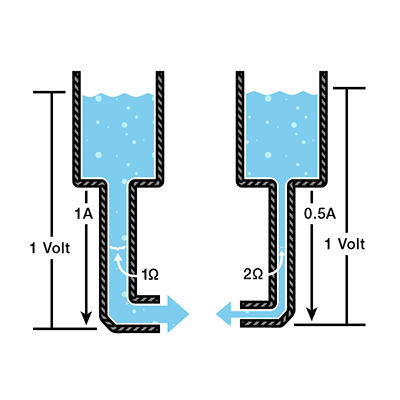
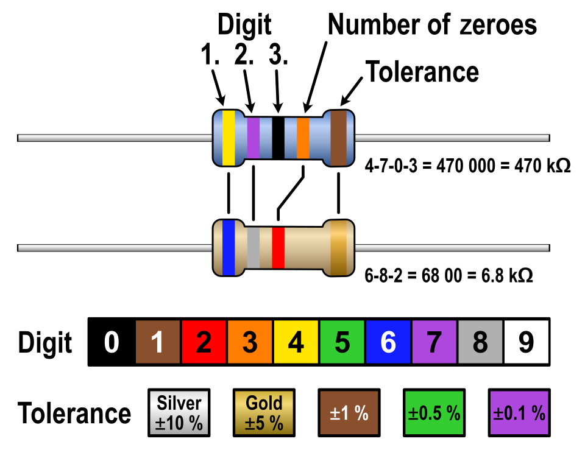
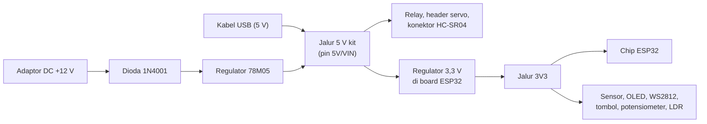
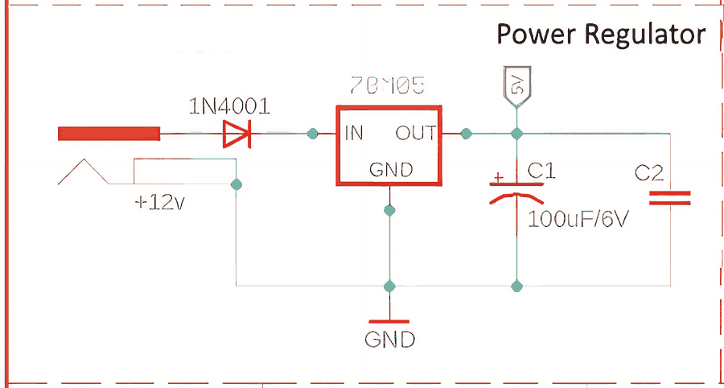
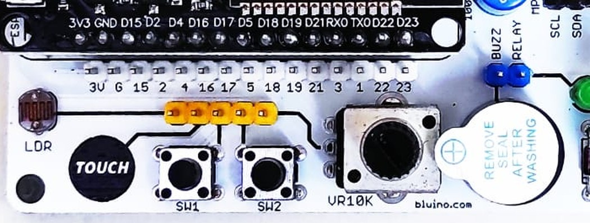

# BAB 3: Dasar Elektronika untuk Mikrokontroler

> ✅ **Prasyarat:** Selesaikan **BAB 2 (Pengenalan ESP32)** — kamu sudah mengenal *board* ESP32 DEVKIT V1 dan isi kit Bluino. Kamu **tidak** perlu pengalaman elektronika sebelumnya.

Sebelum menyambung kabel dan menulis program, kamu perlu paham sedikit "bahasa" listrik: tegangan, arus, dan hambatan. Di BAB ini kamu mempelajarinya dengan analogi aliran air, lalu langsung memakainya untuk memahami komponen nyata di kit Bluino — LED, tombol, potensiometer, LDR, dan *relay*. Bekal ini penting supaya kamu tahu **kenapa** sebuah rangkaian bekerja dan, yang tidak kalah penting, supaya ESP32-mu tidak rusak karena salah sambung.

## 📌 Tujuan Pembelajaran

Setelah mempelajari BAB ini, kamu bisa:

- Menjelaskan tegangan, arus, dan hambatan beserta satuannya dengan analogi sehari-hari.
- Memakai Hukum Ohm untuk menghitung arus LED di kit dan memilih nilai resistor.
- Membaca nilai resistor dari gelang warnanya.
- Menjelaskan cara kerja pembagi tegangan pada potensiometer, LDR, dan pin Echo sensor HC-SR04.
- Menjelaskan logika 3,3 V pada ESP32 dan alasan sinyal 5 V tidak boleh masuk langsung ke GPIO.
- Menjelaskan fungsi resistor *pull-up* dan *pull-down* pada tombol kit.
- Menyebutkan batas arus GPIO ESP32 dan kapan kamu butuh transistor (contoh: *relay*).
- Mengenali fungsi kapasitor, dioda, dan regulator tegangan di kit.
- Menyambung komponen Custom dengan kabel *jumper* secara benar dan aman.
- (Opsional) Mengukur tegangan dan sambungan kabel dengan multimeter.

## 🧰 Yang Perlu Disiapkan

| Kebutuhan | Keterangan |
|---|---|
| *Hardware* | Tidak wajib — BAB ini teori. Siapkan kit Bluino ESP32 IoT Starter Shield supaya bisa kamu amati sambil membaca |
| Kabel *jumper* | Tidak perlu (cara memakainya dijelaskan di [3.11](#311-kabel-jumper-dan-cara-menyambung-pin-custom)) |
| Komponen tambahan | Opsional: multimeter digital (tidak termasuk kit) untuk praktik di [3.12](#312-mengukur-dengan-multimeter-opsional) |
| *Software* | Tidak perlu |
| *Library* | Tidak perlu |
| Alat uji | Kalkulator (di HP atau laptop) untuk latihan hitungan |
| Jaringan | Tidak perlu WiFi |

## 📑 Daftar Isi

- [3.1 Tegangan, Arus, dan Hambatan](#31-tegangan-arus-dan-hambatan)
- [3.2 Hukum Ohm](#32-hukum-ohm)
- [3.3 Resistor dan Kode Warna](#33-resistor-dan-kode-warna)
- [3.4 LED dan Resistor Pembatas Arus](#34-led-dan-resistor-pembatas-arus)
- [3.5 Pembagi Tegangan](#35-pembagi-tegangan)
- [3.6 Logika Digital 3,3 V: ESP32 Tidak Tahan 5 V](#36-logika-digital-33-v-esp32-tidak-tahan-5-v)
- [3.7 Resistor *Pull-up* dan *Pull-down*](#37-resistor-pull-up-dan-pull-down)
- [3.8 Batas Arus GPIO ESP32](#38-batas-arus-gpio-esp32)
- [3.9 Transistor, *Relay*, dan Dioda *Flyback*](#39-transistor-relay-dan-dioda-flyback)
- [3.10 Kapasitor dan Catu Daya Kit](#310-kapasitor-dan-catu-daya-kit)
- [3.11 Kabel *Jumper* dan Cara Menyambung Pin Custom](#311-kabel-jumper-dan-cara-menyambung-pin-custom)
- [3.12 Mengukur dengan Multimeter (Opsional)](#312-mengukur-dengan-multimeter-opsional)
- [3.13 Keselamatan Dasar](#313-keselamatan-dasar)
- [3.14 Troubleshooting](#314-troubleshooting)
- [📝 Rangkuman](#-rangkuman)
- [💪 Latihan](#-latihan)
- [📚 Referensi](#-referensi)

---

## 3.1 Tegangan, Arus, dan Hambatan

Listrik tidak bisa dilihat, jadi cara termudah memahaminya adalah membandingkannya dengan air yang mengalir dari sebuah tangki melalui pipa.

| Besaran listrik | Simbol | Satuan | Analogi air | Contoh di kit |
|---|---|---|---|---|
| **Tegangan** (*voltage*) | V | volt (V) | Tekanan air — makin tinggi tangki, makin kuat dorongannya | Pin 3V3 memberi 3,3 V; kabel USB memberi 5 V |
| **Arus** (*current*) | I | ampere (A) | Debit — banyaknya air yang mengalir setiap detik | LED merah di kit dialiri sekitar 4 mA |
| **Hambatan** (*resistance*) | R | ohm (Ω) | Pipa yang menyempit sehingga aliran tertahan | Resistor 330 Ω di setiap LED kit |

Tiga hal yang perlu kamu ingat:

- **Tegangan selalu diukur di antara dua titik.** Kalimat "pin 3V3 bertegangan 3,3 V" artinya pin itu 3,3 V lebih tinggi daripada titik acuan **GND** (*ground*, 0 V). GND ibarat permukaan tanah tempat semua ketinggian diukur.
- **Arus hanya mengalir kalau jalurnya tertutup.** Arus berangkat dari sumber (kutub +), melewati komponen, lalu kembali ke GND. Kalau ada kabel yang lepas, rangkaian menjadi terbuka dan arus berhenti — seperti keran yang ditutup.
- **Tegangan adalah "dorongan", arus adalah "aliran".** Tegangan bisa ada tanpa arus (baterai di laci tetap bertegangan 1,5 V), tetapi arus tidak akan mengalir tanpa tegangan.

### 3.1.1 Satuan dan Awalan

Di dunia mikrokontroler, angkanya sering sangat kecil atau sangat besar, jadi dipakai awalan berikut:

| Awalan | Arti | Contoh |
|---|---|---|
| m (mili) | seperseribu (÷ 1.000) | 4 mA = 0,004 A |
| µ (mikro) | sepersejuta (÷ 1.000.000) | 10 µA = 0,00001 A |
| k (kilo) | ribuan (× 1.000) | 10 kΩ = 10 ribu Ω |
| M (mega) | jutaan (× 1.000.000) | 1 MΩ = 1 juta Ω |

> 💡 **Tips:** Di skematik, nilai resistor sering ditulis tanpa simbol Ω dan dengan huruf sebagai pengganti koma, misalnya `4K7` = 4,7 kΩ, `10K` = 10 kΩ, dan `330` = 330 Ω. Kamu akan sering menjumpainya di [BAB 4](../BAB-04/README.md).

### 3.1.2 Listrik DC dan AC

Kit Bluino memakai listrik **DC** (*Direct Current*, arus searah): tegangannya tetap (misalnya 3,3 V atau 5 V) dan arusnya mengalir satu arah. Listrik PLN di rumah adalah **AC** (*Alternating Current*, arus bolak-balik) 220 V yang arahnya berbalik 50 kali per detik. Listrik PLN jauh lebih berbahaya dan **tidak** dipakai langsung di kit ini.

---

## 3.2 Hukum Ohm

Hukum Ohm menghubungkan ketiga besaran tadi. Rumusnya cukup satu, lalu bisa dibalik sesuai besaran yang dicari:

```text
V = I × R        I = V ÷ R        R = V ÷ I

V = tegangan (volt, V)
I = arus     (ampere, A)
R = hambatan (ohm, Ω)
```

Artinya: kalau tegangannya tetap, **makin besar hambatan, makin kecil arus** yang mengalir. Gambar di bawah memperlihatkan hal itu dengan dua tangki air yang sama tingginya.



*Gambar 3.1 — Analogi Hukum Ohm: tekanan (tegangan) sama, tetapi pipa yang lebih sempit (hambatan 2 Ω) membuat aliran (arus) tinggal setengahnya. Sumber: [SparkFun Electronics — Voltage, Current, Resistance, and Ohm's Law](https://learn.sparkfun.com/tutorials/voltage-current-resistance-and-ohms-law/all), lisensi CC BY-SA 4.0.*

Cara gampang mengingat rumusnya adalah **segitiga Ohm** di bawah. Tutup besaran yang ingin kamu cari dengan jari, lalu baca sisanya:

- Tutup **V** → tersisa I dan R berdampingan → V = I × R.
- Tutup **I** → tersisa V di atas R → I = V ÷ R.
- Tutup **R** → tersisa V di atas I → R = V ÷ I.

```text
┌─────────┐
│    V    │
├────┬────┤
│ I  │ R  │
└────┴────┘
```

### 3.2.1 Contoh Hitungan

**Contoh 1 — mencari arus.** Saat tombol S1 di kit ditekan, resistor 10 kΩ di bawahnya mendapat tegangan 3,3 V (lihat [3.7](#37-resistor-pull-up-dan-pull-down)). Berapa arus yang mengalir?

```text
I = V ÷ R = 3,3 V ÷ 10.000 Ω = 0,00033 A = 0,33 mA
```

**Contoh 2 — mencari hambatan.** Kamu ingin membatasi arus 5 mA dari tegangan 3,3 V. Berapa hambatan yang dibutuhkan?

```text
R = V ÷ I = 3,3 V ÷ 0,005 A = 660 Ω
```

**Contoh 3 — mencari tegangan.** Arus 2 mA mengalir melalui resistor 1 kΩ. Berapa tegangan di kedua ujung resistor?

```text
V = I × R = 0,002 A × 1.000 Ω = 2 V
```

> 💡 **Tips:** Ubah dulu semua angka ke satuan dasar (mA → A, kΩ → Ω) sebelum menghitung. Jalan pintas yang sering dipakai: **volt ÷ kΩ = mA**. Contoh: 3,3 V ÷ 10 kΩ = 0,33 mA.

### 3.2.2 Daya Listrik

Setiap komponen yang dialiri arus mengubah sebagian energi listrik menjadi panas. Besarnya disebut **daya** (P, satuan watt/W):

```text
P = V × I
```

Contoh: resistor 330 Ω pada LED merah kit menahan tegangan sekitar 1,3 V dengan arus sekitar 3,9 mA, jadi dayanya hanya 1,3 V × 0,0039 A ≈ 0,005 W (5 mW). Resistor kecil yang umum dipakai mampu menahan 0,25 W (¼ W), jadi resistor itu sama sekali tidak panas. Konsep daya ini akan berguna saat membahas regulator tegangan di [3.10](#310-kapasitor-dan-catu-daya-kit).

---

## 3.3 Resistor dan Kode Warna

**Resistor** adalah komponen yang sengaja "menyempitkan pipa" untuk membatasi arus atau membagi tegangan. Resistor tidak punya kutub, jadi boleh dipasang bolak-balik.

### 3.3.1 Membaca Gelang Warna

Resistor kecil biasanya tidak dicetak angkanya, melainkan diberi **gelang warna**. Pada resistor 4 gelang (yang paling umum, badannya biasanya krem):

1. Gelang ke-1 = digit pertama.
2. Gelang ke-2 = digit kedua.
3. Gelang ke-3 = jumlah nol di belakangnya (pengali).
4. Gelang ke-4 = toleransi (emas = ±5%, perak = ±10%). Gelang ini biasanya agak terpisah dari tiga gelang lainnya — mulailah membaca dari ujung yang berlawanan.

| Warna | Digit | Warna | Digit |
|---|---|---|---|
| Hitam | 0 | Hijau | 5 |
| Cokelat | 1 | Biru | 6 |
| Merah | 2 | Ungu | 7 |
| Jingga (oranye) | 3 | Abu-abu | 8 |
| Kuning | 4 | Putih | 9 |



*Gambar 3.2 — Cara membaca gelang warna resistor. "Digit" = angka, "Number of zeroes" = jumlah nol, "Tolerance" = toleransi. Resistor atas memakai 5 gelang (tiga digit + jumlah nol + toleransi), resistor bawah memakai 4 gelang. Sumber: [Knarfili, Wikimedia Commons](https://commons.wikimedia.org/wiki/File:Resistor_Color_Code.svg), lisensi CC0 1.0.*

> 📌 **Catatan:** Resistor 5 gelang (badannya sering biru, toleransi ±1%) memakai **tiga** digit sebelum gelang jumlah nol. Contoh: 330 Ω ditulis jingga-jingga-hitam-hitam-cokelat. Kalau ragu, ukur saja dengan multimeter (lihat [3.12](#312-mengukur-dengan-multimeter-opsional)).

### 3.3.2 Resistor di Kit Bluino

Semua resistor berikut sudah terpasang di PCB kit, jadi kamu tidak perlu menambahkannya sendiri:

| Lokasi di kit | Nilai (tulisan di skematik) | Gelang warna (4 gelang) | Fungsi |
|---|---|---|---|
| 4 LED (merah, kuning, hijau, biru) | 330 Ω (`330`) | jingga-jingga-cokelat-emas | Membatasi arus LED ([3.4](#34-led-dan-resistor-pembatas-arus)) |
| DHT11 dan DS18B20 | 4,7 kΩ (`4K7`) | kuning-ungu-merah-emas | *Pull-up* jalur data ([3.7](#37-resistor-pull-up-dan-pull-down)) |
| Tombol S1 dan S2 | 10 kΩ (`10K`) | cokelat-hitam-jingga-emas | *Pull-down* tombol ([3.7](#37-resistor-pull-up-dan-pull-down)) |
| LDR | 10 kΩ (`10K`) | cokelat-hitam-jingga-emas | Pasangan pembagi tegangan LDR ([3.5](#35-pembagi-tegangan)) |
| Basis transistor *relay* | 10 kΩ (`10K`) | cokelat-hitam-jingga-emas | Membatasi arus basis BC547 ([3.9](#39-transistor-relay-dan-dioda-flyback)) |
| LED indikator *relay* | 1 kΩ (`1K`) | cokelat-hitam-merah-emas | Membatasi arus LED indikator |
| Potensiometer | 10 kΩ (`VR10K`) | — (nilainya tercetak di badan) | Resistor yang nilainya bisa diubah dengan diputar |

Tabel di atas memakai kode 4 gelang. Kalau resistor di kit-mu ternyata 5 gelang, baca dengan aturan pada catatan di atas.

### 3.3.3 Resistor Seri dan Paralel

- **Seri** (disambung berurutan, satu jalur): nilainya **dijumlahkan**. Dua resistor 1 kΩ yang diseri = 2 kΩ. Trik ini berguna saat kamu butuh nilai yang tidak kamu punya, misalnya untuk pembagi tegangan HC-SR04 di [3.5](#35-pembagi-tegangan).
- **Paralel** (disambung berdampingan, dua jalur): nilainya menjadi **lebih kecil** daripada resistor terkecilnya. Dua resistor yang sama nilainya diparalel = setengahnya (dua 10 kΩ paralel = 5 kΩ).

---

## 3.4 LED dan Resistor Pembatas Arus

**LED** (*Light Emitting Diode*, dioda pemancar cahaya) adalah dioda yang menyala saat dialiri arus. Seperti semua dioda, LED punya **kutub** dan hanya mengalirkan arus satu arah:

- **Anoda (+):** kaki yang lebih panjang. Arus masuk dari sini.
- **Katoda (−):** kaki yang lebih pendek; pinggiran badan LED di sisi ini biasanya rata. Arus keluar dari sini menuju GND.

Kalau dipasang terbalik, LED tidak menyala (tetapi juga tidak rusak pada tegangan sekecil 3,3 V).

### 3.4.1 Tegangan Maju (Vf) dan Kenapa Perlu Resistor

LED baru mau menyala setelah tegangan di kakinya mencapai **tegangan maju** atau **Vf** (*forward voltage*). Nilainya bergantung pada warna:

| Warna LED | Vf tipikal |
|---|---|
| Merah | ±1,8–2,2 V |
| Kuning | ±2,0–2,2 V |
| Hijau | ±2,0–2,2 V (hijau kekuningan) sampai ±3,0 V (hijau terang) |
| Biru dan putih | ±2,8–3,3 V |

Begitu tegangan melewati Vf, arus LED **melonjak sangat cepat** — sedikit saja tambahan tegangan bisa membuat arusnya berlipat-lipat. Tanpa "rem", LED bisa rusak dan pin ESP32 ikut terbebani. Rem itu adalah **resistor pembatas arus** yang dipasang seri dengan LED. Rumusnya turunan dari Hukum Ohm:

```text
I = (Vsumber − Vf) ÷ R          R = (Vsumber − Vf) ÷ I
```

Bagian (Vsumber − Vf) adalah sisa tegangan yang "ditanggung" resistor.

### 3.4.2 Contoh: LED di Kit Bluino

Setiap LED di kit sudah diberi resistor 330 Ω. Pin GPIO ESP32 yang diberi HIGH mengeluarkan sekitar 3,3 V. Mari hitung arusnya.

**LED merah** (Vf ≈ 2,0 V):

```text
Sisa tegangan di resistor = 3,3 V − 2,0 V = 1,3 V
I = 1,3 V ÷ 330 Ω ≈ 0,0039 A ≈ 3,9 mA   → kira-kira 4 mA
```

**LED biru** (Vf ≈ 3,0 V):

```text
Sisa tegangan di resistor = 3,3 V − 3,0 V = 0,3 V
I = 0,3 V ÷ 330 Ω ≈ 0,0009 A ≈ 0,9 mA   → kurang dari 1 mA
```

Ringkasan perkiraan untuk keempat LED kit:

| LED | Vf (perkiraan) | Arus (perkiraan) | Kesan nyala |
|---|---|---|---|
| Merah | 2,0 V | ±3,9 mA | Terang |
| Kuning | 2,1 V | ±3,6 mA | Terang |
| Hijau | 2,2–3,0 V | ±0,9–3,3 mA | Tergantung jenis LED hijaunya |
| Biru | 3,0 V | ±0,9 mA | Lebih redup |

Inilah sebabnya LED biru di kit biasanya tampak **lebih redup** daripada LED merah: sisa tegangan untuk resistornya tinggal sedikit, sehingga arusnya kecil. Itu normal, bukan kerusakan. Semua arus ini juga jauh di bawah batas LED 5 mm pada umumnya (±20 mA) dan aman untuk GPIO ESP32 (lihat [3.8](#38-batas-arus-gpio-esp32)).

> 📌 **Catatan:** Angka di atas adalah perkiraan. Vf asli berbeda sedikit antar-LED, dan tegangan pin ESP32 sedikit turun saat dibebani. Pada arus kecil, Vf LED biru juga sedikit lebih rendah, sehingga arus sebenarnya bisa sedikit di atas 1 mA — tetapi tetap jauh lebih kecil daripada LED merah.

**Memilih resistor sendiri.** Misalnya kamu ingin LED merah eksternal dialiri sekitar 10 mA dari pin 3,3 V:

```text
R = (3,3 V − 2,0 V) ÷ 0,010 A = 130 Ω   → pilih nilai standar terdekat yang lebih besar, misalnya 150 Ω
```

Memilih nilai yang **lebih besar** membuat arusnya sedikit lebih kecil dari target — lebih aman daripada kebesaran.

### 3.4.3 LED Kit Menyala Saat Pin HIGH (Aktif HIGH)

Di kit Bluino, anoda keempat LED tersambung ke header **Custom**, sedangkan katodanya lewat resistor 330 Ω ke GND:


*Gambar 3.3 — Rangkaian 4 LED pada kit. Segitiga pada simbol LED menunjuk arah arus: dari pin Custom (bawah) ke resistor 330 Ω lalu ke GND (atas). Sumber: skematik ESP32 Starter Shield 3.2, [Bluino](http://www.bluino.com).*

- Pin ESP32 **HIGH** (3,3 V) → ada beda tegangan → arus mengalir pin → LED → 330 Ω → GND → **LED menyala**.
- Pin ESP32 **LOW** (0 V) → tidak ada beda tegangan → **LED padam**.

Rangkaian seperti ini disebut **aktif HIGH** (*active-high*). Kamu akan menyalakan LED ini lewat program di [BAB 8](../BAB-08/README.md).

---

## 3.5 Pembagi Tegangan

**Pembagi tegangan** (*voltage divider*) adalah dua resistor yang disambung seri antara sebuah tegangan dan GND. Titik di antara keduanya menghasilkan tegangan yang lebih kecil, sesuai perbandingan kedua resistor. Bayangkan tegangan sebagai tinggi sebuah tangga: dua resistor membaginya menjadi dua anak tangga, dan titik tengahnya berada di ketinggian tertentu.

```text
    Vin
     │
    ┌┴┐
    │ │ R1  (resistor atas)
    └┬┘
     ├────── Vout  (titik tengah)
    ┌┴┐
    │ │ R2  (resistor bawah, ke GND)
    └┬┘
     │
    GND
```

Rumusnya:

```text
Vout = Vin × R2 ÷ (R1 + R2)
```

Kalau R1 = R2, Vout tepat setengah Vin. Makin besar R2 dibanding R1, makin dekat Vout ke Vin.

> ⚠️ **Perhatian:** Pembagi tegangan hanya cocok untuk **sinyal** (arusnya sangat kecil), misalnya sinyal yang dibaca pin ESP32. Jangan memakainya untuk menurunkan tegangan **catu daya** sebuah modul — untuk itu pakai regulator (lihat [3.10](#310-kapasitor-dan-catu-daya-kit)).

### 3.5.1 Potensiometer: Pembagi Tegangan yang Bisa Diputar

Potensiometer 10 kΩ di kit punya tiga kaki: dua ujung disambung ke 3V3 dan GND, sedangkan kaki tengah (*wiper*) bergeser saat kenopnya diputar. Artinya R1 dan R2 berubah-ubah, tetapi jumlahnya tetap 10 kΩ. Hasilnya, tegangan di pin Custom bisa diatur dari 0 V sampai 3,3 V.


*Gambar 3.4 — Potensiometer kit sebagai pembagi tegangan. Panah pada simbol adalah kaki tengah (wiper) yang menuju pin Custom. Sumber: skematik ESP32 Starter Shield 3.2, [Bluino](http://www.bluino.com).*

### 3.5.2 LDR: Pembagi Tegangan yang Peka Cahaya

**LDR** (*Light Dependent Resistor*) adalah resistor yang hambatannya berubah menurut cahaya: **makin terang, makin kecil hambatannya**. Di kit, LDR dipasang sebagai R2 (bawah, ke GND) dan resistor tetap 10 kΩ sebagai R1 (atas, ke 3V3):


*Gambar 3.5 — Rangkaian LDR pada kit: 3V3 → 10 kΩ → titik tengah (pin Custom) → LDR → GND. Sumber: skematik ESP32 Starter Shield 3.2, [Bluino](http://www.bluino.com).*

Contoh hitungan dengan nilai LDR rekaan (nilai LDR asli sangat bervariasi):

| Kondisi | Hambatan LDR (contoh) | Vout = 3,3 V × R_LDR ÷ (10 kΩ + R_LDR) |
|---|---|---|
| Terang | 1 kΩ | ±0,3 V |
| Remang | 10 kΩ | ±1,65 V |
| Gelap | 100 kΩ | ±3,0 V |

Kesimpulannya: **makin gelap, makin tinggi tegangannya**, sehingga nilai yang dibaca ESP32 makin besar. ESP32 membaca tegangan ini dengan ADC (*Analog-to-Digital Converter*, pengubah sinyal analog menjadi angka) yang akan kamu pelajari di [BAB 11](../BAB-11/README.md) dan [BAB 32](../BAB-32/README.md).

### 3.5.3 Menurunkan Sinyal Echo HC-SR04 dari 5 V ke Sekitar 3,3 V

Sensor jarak HC-SR04 (tidak termasuk kit — kit hanya menyediakan konektornya) bekerja dengan catu 5 V, sehingga pin **Echo**-nya mengeluarkan sinyal **5 V**. Sinyal ini terlalu tinggi untuk ESP32 (lihat [3.6](#36-logika-digital-33-v-esp32-tidak-tahan-5-v)), dan konektor HC-SR04 di kit **tidak** dilengkapi pembagi tegangan. Kamu harus menambahkannya sendiri dengan dua resistor, misalnya R1 = 1 kΩ dan R2 = 2 kΩ (dua resistor 1 kΩ yang diseri):

```text
 Echo HC-SR04 (5 V)
     │
    ┌┴┐
    │ │ R1 = 1 kΩ
    └┬┘
     ├────── ke IO36 (VP) ESP32
    ┌┴┐
    │ │ R2 = 2 kΩ
    └┬┘
     │
    GND

Vout = 5 V × 2 kΩ ÷ (1 kΩ + 2 kΩ) = 5 V × 2/3 ≈ 3,33 V
```

Hasil ±3,33 V masih di bawah batas maksimum pin ESP32 (3,6 V) dan jauh di atas ambang HIGH (±2,5 V), jadi sinyalnya aman dan tetap terbaca. Cara merangkainya secara lengkap dibahas di [BAB 30](../BAB-30/README.md).

---

## 3.6 Logika Digital 3,3 V: ESP32 Tidak Tahan 5 V

Pin digital hanya mengenal dua keadaan: **HIGH** (1, ada tegangan) dan **LOW** (0, tidak ada tegangan). ESP32 bekerja dengan **logika 3,3 V**: HIGH berarti sekitar 3,3 V dan LOW berarti sekitar 0 V. Arduino Uno yang mungkin pernah kamu dengar memakai logika 5 V — ini perbedaan yang sangat penting.

### 3.6.1 Kapan Sebuah Tegangan Dibaca HIGH atau LOW?

Datasheet ESP32 menetapkan ambang berikut (VDD = 3,3 V):

| Tegangan di pin input | Dibaca sebagai | Dasar (datasheet ESP32) |
|---|---|---|
| 0 V sampai ±0,8 V | **LOW** | V<sub>IL</sub> maks. = 0,25 × VDD = 0,825 V |
| ±0,8 V sampai ±2,5 V | **Tidak pasti** — bisa terbaca LOW atau HIGH | Daerah "abu-abu", hindari |
| ±2,5 V sampai ±3,6 V | **HIGH** | V<sub>IH</sub> min. = 0,75 × VDD = 2,475 V |
| Di atas ±3,6 V | **Berbahaya** — bisa merusak ESP32 | V<sub>IH</sub> maks. = VDD + 0,3 V = 3,6 V |

V<sub>IL</sub> dan V<sub>IH</sub> adalah singkatan dari *input low voltage* dan *input high voltage*. Supaya pembacaan selalu jelas, sinyal digital sebaiknya selalu berada di dekat 0 V atau di dekat 3,3 V — jangan menggantung di tengah.

### 3.6.2 Kenapa 5 V Bisa Merusak?

Batas tegangan maksimum (*absolute maximum rating*) pin catu ESP32 adalah **3,6 V**, dan pin input tidak boleh menerima lebih dari VDD + 0,3 V (±3,6 V). Pin GPIO ESP32 **tidak tahan 5 V** (*not 5 V tolerant*). Sinyal 5 V yang masuk langsung bisa merusak pin itu atau seluruh chip — kadang seketika, kadang perlahan (pin jadi tidak stabil).

> 🚨 **Bahaya:** Jangan pernah menyambung pin **5V/VIN** (tegangan USB) atau sinyal 5 V dari modul lain langsung ke GPIO ESP32. Turunkan dulu dengan pembagi tegangan (untuk sinyal satu arah, seperti Echo HC-SR04) atau modul *level shifter* (untuk sinyal dua arah).

### 3.6.3 Komponen Kit: Mana yang 3,3 V, Mana yang 5 V?

| Komponen | Daya dari | Arah sinyal | Aman tanpa tambahan? |
|---|---|---|---|
| 4 LED dan *buzzer* aktif | Langsung dari pin GPIO (3,3 V) | ESP32 → komponen | ✅ Aman |
| Tombol, potensiometer, LDR | 3V3 | Komponen → ESP32 (maks. 3,3 V) | ✅ Aman |
| OLED, BMP180, MPU-6050, DHT11, DS18B20, PIR AM312, microSD, WS2812 | 3V3 | Dua arah / ke ESP32 (maks. 3,3 V) | ✅ Aman |
| *Relay* | Koil 5 V lewat transistor BC547 | ESP32 hanya memberi sinyal 3,3 V ke transistor | ✅ Aman (lihat [3.9](#39-transistor-relay-dan-dioda-flyback)) |
| Servo (tidak termasuk kit) | 5 V dari header servo | ESP32 → servo (sinyal 3,3 V) | ✅ Aman — sinyal 3,3 V umumnya cukup untuk servo hobi |
| HC-SR04 (tidak termasuk kit) | 5 V dari konektornya | **Echo 5 V → ESP32** | ⚠️ **Wajib** pembagi tegangan ([3.5.3](#353-menurunkan-sinyal-echo-hc-sr04-dari-5-v-ke-sekitar-33-v)) |

Perhatikan polanya: komponen boleh **diberi daya** 5 V, asalkan **sinyal yang masuk ke ESP32** tidak lebih dari 3,3 V.

---

## 3.7 Resistor *Pull-up* dan *Pull-down*

Pin input yang tidak tersambung ke mana pun disebut **mengambang** (*floating*). Pin seperti ini mudah terpengaruh gangguan listrik di sekitarnya — bahkan dari jarimu yang mendekat — sehingga pembacaannya bisa melompat-lompat antara HIGH dan LOW. Bayangkan pintu tanpa per: tertiup angin sedikit saja, pintu bisa terbuka atau tertutup sendiri. Resistor *pull-up* atau *pull-down* adalah "per" yang menahan pintu di posisi awalnya sampai ada yang benar-benar mendorongnya.

| Jenis | Sambungan resistor | Keadaan awal (tanpa aksi) | Saat ada aksi |
|---|---|---|---|
| ***Pull-down*** | Pin → resistor → GND | LOW | HIGH (misalnya tombol menyambung pin ke 3V3) |
| ***Pull-up*** | Pin → resistor → 3V3 | HIGH | LOW (misalnya sensor menarik jalur ke GND) |

### 3.7.1 Tombol di Kit Memakai *Pull-down* 10 kΩ


*Gambar 3.6 — Rangkaian tombol S1 dan S2 pada kit: 3V3 → tombol → titik tengah (pin Custom) → resistor 10 kΩ → GND. Sumber: skematik ESP32 Starter Shield 3.2, [Bluino](http://www.bluino.com).*

- Tombol **tidak ditekan**: pin Custom hanya tersambung ke GND lewat 10 kΩ, jadi terbaca **LOW**.
- Tombol **ditekan**: pin Custom tersambung langsung ke 3V3, jadi terbaca **HIGH**. Arus yang lewat resistor hanya 3,3 V ÷ 10 kΩ = 0,33 mA (Contoh 1 di [3.2.1](#321-contoh-hitungan)).

Kenapa harus lewat resistor, bukan kabel langsung ke GND? Kalau pin disambung langsung ke GND, menekan tombol sama dengan menyambung 3V3 langsung ke GND — **korsleting** (hubung singkat). Resistor 10 kΩ menjaga arusnya tetap kecil.

Di program nanti ([BAB 9](../BAB-09/README.md)), tombol kit cukup diatur sebagai input biasa, dan **ditekan = HIGH**. Kamu belum perlu mencobanya sekarang — potongan kode ini hanya gambaran:

```cpp
pinMode(15, INPUT);   // tombol S1 di IO15; pull-down 10 kΩ sudah ada di PCB
```

> ⚠️ **Perhatian:** Jangan memakai `INPUT_PULLUP` untuk tombol kit. Selain tidak perlu, *pull-up* internal malah "melawan" resistor *pull-down* di PCB.

### 3.7.2 *Pull-up* pada DHT11 dan DS18B20

Jalur data DHT11 dan DS18B20 di kit diberi resistor *pull-up* 4,7 kΩ ke 3V3. Saat diam, jalurnya HIGH. Saat berkomunikasi, ESP32 dan sensor bergantian **menarik jalur ke LOW** untuk mengirim bit data, lalu melepasnya sehingga resistor mengembalikannya ke HIGH. Tanpa *pull-up*, jalur tidak bisa kembali HIGH dan komunikasi gagal. Kamu akan melihat urutan sinyalnya saat membaca datasheet DHT11 di [BAB 4](../BAB-04/README.md).

### 3.7.3 *Pull-up* dan *Pull-down* Internal ESP32

ESP32 juga punya resistor *pull-up* dan *pull-down* **di dalam chip** (sekitar 45 kΩ menurut datasheet) yang bisa diaktifkan lewat program dengan `INPUT_PULLUP` atau `INPUT_PULLDOWN`. Ini praktis untuk tombol eksternal yang tidak punya resistor sendiri.

> 📌 **Catatan:** **IO34–IO39 tidak punya** *pull-up/pull-down* internal (dan hanya bisa menjadi input). Kalau pin ini dipakai untuk tombol, kamu wajib memasang resistor eksternal.

---

## 3.8 Batas Arus GPIO ESP32

Pin GPIO (*General Purpose Input/Output*, pin serbaguna untuk input dan output) dirancang untuk mengirim dan menerima **sinyal**, bukan untuk menjadi sumber daya. Berikut angka dari datasheet resmi ESP32 (*ESP32 Series Datasheet* v5.3, Espressif):

| Parameter di datasheet | Nilai | Arti sederhananya |
|---|---|---|
| I<sub>OH</sub> (*high-level source current*) | ±40 mA (tipikal) | Arus yang bisa **dikeluarkan** pin saat HIGH, diukur pada kekuatan *drive* maksimum dengan tegangan pin minimal 2,64 V |
| I<sub>OH</sub> pin domain VDD_SDIO (termasuk IO16 dan IO17) | ±20 mA (tipikal) | Beberapa pin memang lebih lemah |
| I<sub>OL</sub> (*low-level sink current*) | ±28 mA (tipikal) | Arus yang bisa **diserap** pin saat LOW |
| *Cumulative IO output current* | 1,2 A (batas mutlak) | Jumlah arus keluar **semua** pin IO sekaligus |

Cara membaca tabel ini dengan benar:

- **40 mA bukan target pemakaian.** Angka itu diukur pada kekuatan *drive* paling tinggi. Arduino-ESP32 memakai pengaturan bawaan *medium* (level 2 dari 0–3), jadi kemampuan sebenarnya lebih kecil.
- **Kemampuan per pin turun kalau banyak pin dipakai bersamaan** — datasheet menyebut dari sekitar 40 mA menjadi sekitar 29 mA (dan pada domain VDD_SDIO dari sekitar 30 mA menjadi sekitar 10 mA).
- **Aturan praktis:** bebani setiap GPIO **sekecil mungkin** — beberapa mA saja. LED kit (±1–4 mA) dan basis transistor *relay* (±0,26 mA) jauh di bawah batas.

| Beban | Perkiraan arus | Boleh langsung dari GPIO? |
|---|---|---|
| LED kit dengan resistor 330 Ω | ±1–4 mA | ✅ Ya |
| Sinyal ke modul/sensor lain | Sangat kecil (mikroampere) | ✅ Ya |
| Basis transistor (lewat resistor 10 kΩ) | ±0,26 mA | ✅ Ya |
| Koil *relay* 5 V | ±71 mA | ❌ Tidak — pakai transistor ([3.9](#39-transistor-relay-dan-dioda-flyback)) |
| Motor DC, motor servo (dayanya), lampu, *strip* LED | Puluhan sampai ribuan mA | ❌ Tidak — pakai *driver* dan catu daya terpisah |

> ⚠️ **Perhatian:** Pin **3V3** di *board* juga punya batas. Pin ini disuplai regulator 3,3 V yang sama dengan chip ESP32, padahal ESP32 sendiri bisa menarik sekitar 240 mA saat WiFi mengirim data (datasheet). Jangan memakai pin 3V3 untuk menyalakan beban besar.

---

## 3.9 Transistor, *Relay*, dan Dioda *Flyback*

*Relay* adalah sakelar mekanis yang digerakkan elektromagnet. Di dalamnya ada **koil** (lilitan kawat): saat dialiri arus, koil menjadi magnet dan menarik kontak sakelar sehingga terdengar bunyi "klik". *Relay* di kit adalah **SRD-05VDC-SL-C** buatan Songle. Menurut datasheet-nya, koil 5 V *relay* ini berhambatan 70 Ω, butuh arus **71,4 mA**, dan baru **dijamin** menarik kontaknya kalau tegangannya paling sedikit **75% × 5 V = 3,75 V**.

Bandingkan dengan kemampuan pin ESP32: tegangannya hanya 3,3 V (kurang dari 3,75 V) dan arusnya sebaiknya hanya beberapa mA (jauh dari 71 mA). Jadi pin ESP32 **tidak bisa** menggerakkan *relay* secara langsung. Di sinilah transistor berperan.

### 3.9.1 Transistor sebagai Sakelar Elektronik

**Transistor** BC547 di kit adalah transistor NPN dengan tiga kaki: **basis** (B), **kolektor** (C), dan **emitor** (E). Arus kecil yang masuk ke basis "membuka" jalur besar dari kolektor ke emitor. Analoginya seperti keran air: putaran kecil di kepala keran (basis) mengatur aliran besar di pipa (kolektor → emitor).


*Gambar 3.7 — Rangkaian driver relay pada kit. Panah di bagian bawah adalah jalur catu 5 V. Sumber: skematik ESP32 Starter Shield 3.2, [Bluino](http://www.bluino.com).*

Urutan kerjanya:

1. Pin ESP32 (lewat pin Custom) diberi **HIGH** (3,3 V).
2. Arus kecil mengalir lewat resistor 10 kΩ ke basis BC547: I<sub>B</sub> ≈ (3,3 V − 0,7 V) ÷ 10 kΩ ≈ 0,26 mA. Angka 0,7 V adalah tegangan basis–emitor transistor yang sedang aktif.
3. Transistor "terbuka": arus koil sekitar 71 mA mengalir dari jalur 5 V → koil → kolektor → emitor → GND. Arus besar ini **tidak** lewat pin ESP32.
4. Koil menjadi magnet, kontak *relay* berpindah ("klik"), dan LED indikator (dengan resistor 1 kΩ) ikut menyala.
5. Pin diberi **LOW** → arus basis berhenti → transistor menutup → *relay* lepas.

Karena *relay* aktif saat pin HIGH, rangkaian ini juga **aktif HIGH**. Menurut datasheet onsemi, BC547 tahan arus kolektor sampai 100 mA, jadi 71 mA masih di dalam batasnya.

### 3.9.2 Dioda: Katup Satu Arah

**Dioda** hanya mengalirkan arus satu arah, dari anoda ke katoda — seperti katup satu arah pada pipa air. Di kit ada dua jenis:

| Dioda di kit | Tugas |
|---|---|
| **1N4148** (dioda sinyal kecil yang cepat) | Dioda *flyback* di *relay* (lihat di bawah) |
| **1N4001** (dioda penyearah 1 A) | Pelindung polaritas terbalik di colokan adaptor (lihat [3.10](#310-kapasitor-dan-catu-daya-kit)) |

### 3.9.3 Kenapa Butuh Dioda *Flyback*?

Koil menyimpan energi dalam medan magnetnya. Saat transistor tiba-tiba memutus arus, energi itu "memberontak" dan menghasilkan lonjakan tegangan balik yang bisa mencapai puluhan volt atau lebih — cukup untuk merusak transistor. Ini mirip **palu air** (*water hammer*): keran yang ditutup mendadak membuat pipa terhentak.

Dioda 1N4148 dipasang **paralel dengan koil dan terbalik** (katoda ke jalur 5 V, anoda ke kolektor). Saat *relay* aktif, dioda ini tidak menghantar. Saat *relay* dimatikan, dioda memberi jalan memutar bagi arus koil sampai energinya habis, sehingga lonjakan tegangan tidak sempat merusak transistor. Dioda dengan tugas ini disebut **dioda *flyback*** (atau dioda *freewheeling*).

> 🚨 **Bahaya:** Kontak *relay* ini secara teknis mampu memutus listrik PLN 220 V, tetapi kit ini adalah papan belajar. **Jangan menyambung listrik PLN ke *relay* kit** tanpa pendampingan orang yang benar-benar ahli. Untuk latihan, pakai beban DC tegangan rendah. *Relay* dibahas lengkap di [BAB 37](../BAB-37/README.md).

---

## 3.10 Kapasitor dan Catu Daya Kit

### 3.10.1 Kapasitor: Tangki Kecil Penampung Muatan

**Kapasitor** menyimpan muatan listrik sesaat lalu melepaskannya lagi. Analoginya seperti **tangki kecil** yang dipasang di tengah pipa: saat pasokan dari sumber tersendat sebentar, tangki ini menutupi kekurangannya sehingga aliran tetap halus. Satuannya **farad** (F), tetapi yang biasa dipakai adalah mikrofarad (µF), nanofarad (nF), dan pikofarad (pF).

| Jenis | Ciri | Catatan |
|---|---|---|
| Kapasitor **elektrolit** | Berbentuk tabung, nilainya besar (misalnya 100 µF) | **Berkutub**: kaki panjang = +, sisi badan yang bergaris = −. Tegangan maksimumnya tercetak di badan |
| Kapasitor **keramik** | Kecil dan pipih (atau berupa SMD), nilainya kecil (misalnya 0,1 µF) | Tidak berkutub |

Kapasitor yang terpasang di kit:

| Lokasi | Nilai | Fungsi |
|---|---|---|
| Antara pin EN dan GND ESP32 | 0,1 µF | Membantu ESP32 me-*reset* otomatis saat program diunggah |
| Jalur 5 V (tabung elektrolit di dekat MPU-6050) | 100 µF | Penampung arus sesaat saat *relay* atau servo bekerja |
| Keluaran regulator 78M05 (C1 dan C2) | 100 µF/6 V (elektrolit) dan satu kapasitor keramik | Menstabilkan tegangan 5 V dan meredam derau (*noise*) |

Selain itu, hampir setiap chip butuh kapasitor kecil di dekat kaki dayanya, yang disebut kapasitor ***decoupling***. Di *board* ESP32 dan modul-modul sensor kit, kapasitor ini sudah terpasang.

> ⚠️ **Perhatian:** Kalau suatu saat kamu memasang kapasitor elektrolit sendiri, perhatikan kutubnya dan tegangan maksimumnya. Kapasitor elektrolit yang terbalik atau kelebihan tegangan bisa menggembung, bahkan meletus.

### 3.10.2 Dari Mana Kit Mendapat Daya?



*Gambar 3.8 — Aliran daya pada kit Bluino. Sumber: dibuat untuk materi ini, berdasarkan skematik ESP32 Starter Shield 3.2.*

- **Lewat kabel USB** (cara yang dipakai di seluruh materi ini): tegangan 5 V dari laptop masuk ke *board* ESP32. Regulator kecil di *board* menurunkannya menjadi 3,3 V untuk chip ESP32 dan pin 3V3. Tegangan USB juga muncul di pin **5V/VIN** dan menjadi jalur 5 V kit untuk *relay*, header servo, dan konektor HC-SR04.
- **Lewat adaptor DC**: skematik kit juga memuat bagian *Power Regulator* untuk adaptor +12 V. Bagian ini berguna untuk pemasangan permanen tanpa laptop.

### 3.10.3 Regulator 78M05 dan Dioda 1N4001



*Gambar 3.9 — Bagian Power Regulator: adaptor +12 V → dioda 1N4001 → regulator 78M05 → jalur 5 V, dengan kapasitor C1 dan C2 di sisi keluaran. Sumber: skematik ESP32 Starter Shield 3.2, [Bluino](http://www.bluino.com).*

- **1N4001** adalah pelindung polaritas. Kalau kabel adaptor terbalik, dioda menghalangi arus sehingga rangkaian aman. Ongkosnya, sekitar 0,8 V hilang di dioda ini.
- **78M05** adalah regulator linear yang menghasilkan 5 V stabil dengan arus sampai 500 mA. Menurut datasheet-nya, tegangan masuknya harus sekitar 2 V di atas keluarannya (minimal ±7 V) dan tidak boleh melebihi 35 V.
- **Regulator linear membuang selisih tegangan sebagai panas**: P = (V<sub>IN</sub> − 5 V) × I. Dengan beban 300 mA dan adaptor 12 V (V<sub>IN</sub> ±11,2 V setelah dioda), panasnya ±1,9 W — cukup untuk membuat regulator sangat panas. Dengan adaptor 9 V, panasnya turun menjadi ±1 W.

> 📌 **Catatan:** Untuk belajar sehari-hari, cukup pakai kabel USB. Colokan adaptor tidak terlihat jelas di foto produk, jadi periksa papanmu sendiri sebelum memakainya. Kalau kamu memakai adaptor, pilih adaptor DC 9–12 V dan jangan lebih tinggi.

---

## 3.11 Kabel *Jumper* dan Cara Menyambung Pin Custom

**Kabel *jumper*** (sering disebut kabel Dupont) adalah kabel pendek berkonektor di kedua ujungnya untuk menyambung pin tanpa menyolder.

| Jenis | Ujung kabel | Biasa dipakai untuk |
|---|---|---|
| *Male-male* (M-M) | Jarum di kedua ujung | Menyambung lubang ke lubang, misalnya di *breadboard* |
| *Male-female* (M-F) | Jarum di satu ujung, lubang di ujung lain | Dari *breadboard* ke pin modul |
| ***Female-female*** (F-F) | Lubang di kedua ujung | Dari pin ke pin — **jenis inilah yang dipakai di kit** |

Kit Bluino menyertakan 10 kabel *female-female* sepanjang ±10 cm, karena pin Custom dan header ESP32 di kit sama-sama berupa pin jantan (*male header*).



*Gambar 3.10 — Header ESP32 bernomor (deretan putih) dan pin Custom (deretan kuning untuk LDR, touch pad, SW1, SW2, dan potensiometer VR10K) pada kit revisi v3.x. Garis hitam di PCB menunjukkan pin Custom milik setiap komponen. Tata letak papanmu bisa sedikit berbeda. Sumber: foto produk [Bluino](http://www.bluino.com).*

### 3.11.1 Satu Pin, Beberapa Nama

Satu pin yang sama bisa ditulis berbeda di tempat yang berbeda. Jangan bingung — semuanya merujuk ke pin yang sama:

| Di *board* ESP32 | Di header kit | Di skematik | Di program |
|---|---|---|---|
| D15 | 15 | IO15 | `15` |
| D4 | 4 | IO4 | `4` |
| VP / VN | VP / VN | VP / VN | `36` / `39` |
| RX0 / TX0 | 3 / 1 | IO3 / IO1 | Jangan dipakai — jalur Serial Monitor |
| 3V3 | 3V | 3V3 | — (pin daya 3,3 V) |
| VIN | 5V | 5V | — (pin daya 5 V) |
| GND | G | GND | — (*ground*) |

### 3.11.2 Langkah Menyambung (Contoh: Tombol S1 ke IO15)

1. **Cabut kabel USB** dulu. Biasakan selalu merangkai saat kit tidak bertegangan.
2. Cari pin Custom milik tombol S1: ikuti garis di PCB dari tombol SW1 ke deretan pin kuning.
3. Cari pin bernomor **15** di deretan header putih.
4. Tancapkan satu ujung kabel *female-female* ke pin Custom SW1, lalu ujung lainnya ke pin 15. Pastikan konektornya masuk penuh dan tidak goyang.
5. Cek ulang nomor pin, baru sambungkan kabel USB.

Pasangan pin untuk semua komponen Custom sudah ditetapkan dalam **Peta Pin Standar** yang dibahas di [BAB 6](../BAB-06/README.md). Dengan memakai peta yang sama di setiap BAB, kamu tidak perlu bongkar-pasang kabel terus-menerus.

> 💡 **Tips:** Kalau ada pilihan warna, biasakan kabel merah untuk daya, hitam untuk GND, dan warna lain untuk sinyal. Kabel *jumper* murah juga kadang putus di dalam. Kalau rangkaian yang sudah benar tetap tidak bekerja, coba ganti kabelnya atau uji dengan multimeter ([3.12](#312-mengukur-dengan-multimeter-opsional)).

---

## 3.12 Mengukur dengan Multimeter (Opsional)

**Multimeter digital** adalah alat ukur serbaguna untuk tegangan, hambatan, dan sambungan. Multimeter tidak termasuk kit, tetapi harganya terjangkau dan sangat membantu saat mencari kesalahan rangkaian.

### 3.12.1 Mode dan Colokan Probe

| Mode di sakelar putar | Mengukur | Contoh di kit |
|---|---|---|
| **V⎓** (kadang ditulis **DCV**) | Tegangan DC | Tegangan pin 3V dan 5V di header kit |
| **Ω** | Hambatan | Nilai resistor lepas, misalnya resistor untuk HC-SR04 |
| **Kontinuitas** (simbol gelombang suara) | Tersambung atau putus — berbunyi "bip" kalau tersambung | Menguji kabel *jumper* |
| **A⎓ / mA⎓** | Arus DC | Jarang diperlukan pemula — baca peringatan di bawah |
| **V~** (kadang ditulis **ACV**) | Tegangan AC | Tidak dipakai di kit ini |

Kabel probe **hitam** selalu ditancapkan di colokan **COM**. Kabel probe **merah** ditancapkan di colokan bertanda **V** dan **Ω** untuk hampir semua pengukuran. Colokan **A** atau **10A** hanya untuk mengukur arus besar.

### 3.12.2 Pengukuran yang Bisa Kamu Coba

1. **Tegangan 3,3 V.** Sambungkan kit ke USB. Putar sakelar ke **V⎓** (kalau multimeter-mu manual, pilih rentang 20 V). Tempelkan probe hitam ke pin **G** dan probe merah ke pin **3V** di header kit. Hasil yang wajar: sekitar 3,3 V (3,2–3,4 V).
2. **Tegangan 5 V.** Pindahkan probe merah ke pin **5V**. Hasil yang wajar: sekitar 4,5–5 V. Sedikit di bawah 5 V itu normal, karena tegangan USB turun sedikit sebelum sampai ke pin ini.
3. **Kabel *jumper*.** Lepas kabel dari kit, putar ke mode kontinuitas, lalu tempelkan kedua probe ke logam di dalam kedua konektornya. Bunyi "bip" berarti kabel bagus; diam berarti kabel putus.
4. **Resistor lepas.** Putar ke mode **Ω**, lalu tempelkan probe ke kedua kaki resistor. Contoh: resistor cokelat-hitam-merah-emas (1 kΩ) yang terbaca antara 950 Ω dan 1,05 kΩ masih sesuai toleransi ±5%.

> ⚠️ **Perhatian:**
>
> - Ukur hambatan dan kontinuitas hanya saat rangkaian **tidak bertegangan** (USB dicabut). Resistor yang masih terpasang di PCB juga sering terukur keliru karena komponen lain ikut terukur.
> - **Jangan** menempelkan probe ke sumber tegangan saat sakelar di mode arus (A/mA) atau saat probe merah tertancap di colokan A. Itu sama dengan korsleting dan bisa memutus sekring multimeter atau merusak sumber dayanya.
> - Jaga ujung probe agar tidak menyentuh dua pin yang bersebelahan sekaligus — pin 5V di header kit bersebelahan dengan pin G.

---

## 3.13 Keselamatan Dasar

Tegangan kit ini rendah (5 V dan 3,3 V), jadi tidak berbahaya bagi tubuhmu. Yang perlu dijaga adalah **ESP32, kit, dan laptopmu**. Biasakan aturan berikut sejak awal:

1. **Cabut kabel USB sebelum mengubah sambungan.** Pasang atau lepas kabel *jumper* hanya saat kit tidak bertegangan.
2. **Jangan menyambung 3V3 atau 5V langsung ke GND.** Itu korsleting. Tandanya: LED daya di *board* padam, *port* ESP32 hilang dari Arduino IDE, atau ada bagian yang cepat panas. Cabut USB segera.
3. **Jangan memasukkan sinyal di atas 3,3 V ke GPIO** (lihat [3.6](#36-logika-digital-33-v-esp32-tidak-tahan-5-v)).
4. **Jangan membebani GPIO dengan beban besar** seperti motor atau koil *relay* (lihat [3.8](#38-batas-arus-gpio-esp32)).
5. **Letakkan kit di permukaan yang tidak menghantar listrik.** Jangan menaruhnya di atas benda logam, kaleng, atau kertas timah, dan jauhkan dari minuman.
6. **Pegang PCB di bagian pinggirnya.** Hindari menyentuh kaki-kaki chip, karena listrik statis dari tubuh bisa merusak komponen yang sensitif.
7. **Kalau ada komponen panas atau tercium bau gosong**, cabut daya segera, lalu periksa sambungan sebelum mencoba lagi.

> 🚨 **Bahaya:** Listrik PLN 220 V bisa mematikan. Di seluruh materi ini, **jangan pernah** menyambung kit, *relay*, atau multimeter ke listrik PLN tanpa pendampingan orang yang benar-benar ahli.

---

## 3.14 Troubleshooting

| Masalah | Kemungkinan Penyebab | Solusi |
|---|---|---|
| LED biru tampak jauh lebih redup daripada LED merah | Vf LED biru ±3 V, sehingga arusnya kurang dari 1 mA | Normal, bukan kerusakan (lihat [3.4.2](#342-contoh-led-di-kit-bluino)) |
| LED kit tidak menyala walaupun program sudah memberi HIGH | Kabel *jumper* di pin yang salah, longgar, atau putus | Cocokkan nomor pin di header (lihat [3.11](#311-kabel-jumper-dan-cara-menyambung-pin-custom)), tancapkan ulang, atau uji kabelnya dengan multimeter |
| Tombol terbaca HIGH dan LOW bergantian sendiri | Pin mengambang: kabel tombol lepas atau tersambung ke pin lain | Pastikan kabel dari pin Custom SW1/SW2 masuk penuh ke IO yang benar |
| Nilai LDR justru membesar saat ruangan makin gelap | Memang begitu rangkaian kit (LDR di sisi GND) | Normal — sesuaikan logika programmu (lihat [3.5.2](#352-ldr-pembagi-tegangan-yang-peka-cahaya)) |
| ESP32 *restart* sendiri saat *relay* atau servo bekerja | Lonjakan arus membuat tegangan USB turun sesaat | Pakai kabel USB yang bagus dan pendek, colok langsung ke laptop (bukan lewat *hub*), dan jangan menyalakan banyak beban sekaligus |
| *Port* ESP32 hilang dan *board* terasa panas setelah kabel disambung | Korsleting 3V3/5V ke GND, atau sinyal 5 V masuk ke GPIO | Cabut USB segera, lalu periksa semua sambungan (lihat [3.13](#313-keselamatan-dasar)) |
| Multimeter menunjukkan 0 atau angka aneh | Mode atau colokan probe salah | Pakai mode V⎓, probe hitam di COM, probe merah di colokan V/Ω |
| Regulator 78M05 sangat panas saat memakai adaptor | Tegangan adaptor terlalu tinggi atau bebannya besar | Pakai adaptor 9 V, kurangi beban, atau cukup pakai daya USB (lihat [3.10.3](#3103-regulator-78m05-dan-dioda-1n4001)) |

---

## 📝 Rangkuman

| Konsep | Inti yang perlu diingat |
|---|---|
| Tegangan, arus, hambatan | Tegangan (V) = dorongan, arus (I) = aliran, hambatan (R) = penahan. Tegangan selalu diukur terhadap GND |
| Hukum Ohm | V = I × R. Jalan pintas: volt ÷ kΩ = mA |
| Resistor | Nilainya dibaca dari gelang warna; resistor seri dijumlahkan |
| LED | Punya kutub (kaki panjang = anoda) dan wajib diberi resistor. LED merah kit ±4 mA, LED biru kurang dari 1 mA (lebih redup) |
| Pembagi tegangan | Vout = Vin × R2 ÷ (R1 + R2). Dipakai potensiometer, LDR (makin gelap → nilai makin besar), dan Echo HC-SR04 (1 kΩ + 2 kΩ) |
| Logika 3,3 V | HIGH ≥ ±2,5 V, LOW ≤ ±0,8 V, maksimum 3,6 V. GPIO ESP32 **tidak tahan 5 V** |
| *Pull-up/pull-down* | Mencegah pin mengambang. Tombol kit memakai *pull-down* 10 kΩ → pakai `INPUT`, ditekan = HIGH |
| Batas arus GPIO | Datasheet: ±40 mA pada kondisi terbaik. Praktiknya, bebani beberapa mA saja |
| Transistor dan *relay* | BC547 menjadi sakelar untuk koil *relay* 71 mA; dioda *flyback* 1N4148 melindungi transistor |
| Catu daya | USB 5 V → regulator 3,3 V di *board*. 78M05 dipakai kalau memakai adaptor; kapasitor menstabilkan tegangan |
| Kabel *jumper* | *Female-female* dari pin Custom ke header ESP32 bernomor sama. Cabut USB sebelum merangkai |

---

## 💪 Latihan

### Latihan Dasar

1. **Konversi satuan.** Ubah (a) 0,025 A ke mA, (b) 4,7 kΩ ke Ω, dan (c) 350 µA ke mA.
   *Petunjuk:* m = ÷ 1.000, µ = ÷ 1.000.000, k = × 1.000 (lihat [3.1.1](#311-satuan-dan-awalan)).
2. **Arus LED kuning.** Hitung arus LED kuning kit (Vf ≈ 2,1 V) yang memakai resistor 330 Ω dari pin 3,3 V.
   *Petunjuk:* I = (3,3 V − Vf) ÷ R. Bandingkan hasilmu dengan tabel di [3.4.2](#342-contoh-led-di-kit-bluino).
3. **Membaca gelang warna.** Berapa nilai resistor bergelang kuning-ungu-merah-emas? Di bagian mana kit resistor bernilai sama ini dipakai?
   *Petunjuk:* Kuning = 4, ungu = 7, merah = tambahkan dua nol. Lihat tabel di [3.3.2](#332-resistor-di-kit-bluino).
4. **Tombol.** Saat tombol S2 tidak ditekan, pin Custom-nya terbaca HIGH atau LOW? Kenapa?
   *Petunjuk:* Lihat Gambar 3.6 dan penjelasan di [3.7](#37-resistor-pull-up-dan-pull-down).

### Latihan Menengah

5. **Resistor untuk LED hijau.** Kamu ingin LED hijau eksternal (Vf = 2,2 V) dialiri sekitar 5 mA dari pin 3,3 V. Berapa nilai resistornya?
   *Petunjuk:* R = (3,3 V − 2,2 V) ÷ 0,005 A. Bandingkan hasilnya dengan nilai standar 220 Ω, 270 Ω, dan 330 Ω.
6. **Pembagi tegangan 5 V → 3,3 V.** Sinyal 5 V ingin diturunkan menjadi sekitar 3,3 V. Kalau R2 (resistor bawah) = 10 kΩ, berapa R1 (resistor atas)?
   *Petunjuk:* Susun ulang rumusnya menjadi R1 = R2 × (Vin − Vout) ÷ Vout, lalu pilih nilai standar terdekat dan cek lagi Vout-nya (harus di bawah 3,6 V).
7. **LDR di ruangan gelap.** Saat ruangan gelap, hambatan LDR kit misalnya 50 kΩ. Berapa tegangan di pin Custom LDR? Nilai yang dibaca ESP32 besar atau kecil?
   *Petunjuk:* Vout = 3,3 V × R_LDR ÷ (10 kΩ + R_LDR) (lihat [3.5.2](#352-ldr-pembagi-tegangan-yang-peka-cahaya)).
8. ***Relay* tanpa transistor.** Sebutkan dua alasan pin ESP32 tidak boleh menggerakkan koil *relay* 5 V secara langsung.
   *Petunjuk:* Bandingkan data koil *relay* di [3.9](#39-transistor-relay-dan-dioda-flyback) (tegangan tarik dan arus) dengan kemampuan pin di [3.8](#38-batas-arus-gpio-esp32).

### Tantangan Lanjutan

9. **Berburu komponen di skematik.** Buka file [`Schematic.jpg`](../Schematic.jpg) (gambar skematik di folder utama repositori ini, bisa dibuka langsung di GitHub). Temukan semua dioda (selain LED) dan semua kapasitor, lalu tuliskan fungsi masing-masing.
   *Petunjuk:* Ada dua dioda dan empat kapasitor. Lihat bagian *Power Regulator*, *Relay*, header ESP32, dan bagian tengah atas skematik. Cara membaca skematik dibahas lengkap di [BAB 4](../BAB-04/README.md).
10. **Anggaran arus.** Misalkan keempat LED kit menyala bersamaan dan *relay* aktif. Hitung kira-kira total arus yang keluar dari pin-pin GPIO, dan total arus dari jalur 5 V untuk koil *relay*. Apakah arus GPIO masih jauh di bawah batas datasheet?
    *Petunjuk:* Jumlahkan arus tiap LED dari tabel di [3.4.2](#342-contoh-led-di-kit-bluino) dan arus basis transistor (±0,26 mA). Ingat, arus koil *relay* tidak lewat pin GPIO.

---

## 📚 Referensi

- [ESP32 Series Datasheet v5.3 — Espressif](https://www.espressif.com/sites/default/files/documentation/esp32_datasheet_en.pdf) — Tabel 5-1 (batas mutlak 3,6 V dan arus IO kumulatif 1,2 A), Tabel 5-3 (V<sub>IH</sub>, V<sub>IL</sub>, I<sub>OH</sub>, I<sub>OL</sub>, *pull-up/pull-down* internal 45 kΩ), catatan pin *input-only* IO34–IO39, dan arus WiFi.
- [GPIO & RTC GPIO (ESP32) — ESP-IDF Programming Guide](https://docs.espressif.com/projects/esp-idf/en/stable/esp32/api-reference/peripherals/gpio.html) — fungsi pin GPIO ESP32 dan pengaturan kekuatan *drive*.
- [Voltage, Current, Resistance, and Ohm's Law — SparkFun Learn](https://learn.sparkfun.com/tutorials/voltage-current-resistance-and-ohms-law/all) — analogi air untuk listrik (sumber Gambar 3.1).
- [Voltage Dividers — SparkFun Learn](https://learn.sparkfun.com/tutorials/voltage-dividers/all) — penjelasan dan contoh pembagi tegangan.
- [Pull-up Resistors — SparkFun Learn](https://learn.sparkfun.com/tutorials/pull-up-resistors/all) — cara kerja resistor *pull-up*.
- [Light-Emitting Diodes (LEDs) — SparkFun Learn](https://learn.sparkfun.com/tutorials/light-emitting-diodes-leds/all) — kutub LED, tegangan maju, dan resistor pembatas arus.
- [How to Use a Multimeter — SparkFun Learn](https://learn.sparkfun.com/tutorials/how-to-use-a-multimeter/all) — panduan dasar memakai multimeter.
- [File:Resistor Color Code.svg — Wikimedia Commons](https://commons.wikimedia.org/wiki/File:Resistor_Color_Code.svg) — diagram kode warna resistor (sumber Gambar 3.2, CC0).
- [SRD Relay Datasheet — Songle (salinan di Circuit Basics)](https://www.circuitbasics.com/wp-content/uploads/2015/11/SRD-05VDC-SL-C-Datasheet.pdf) — data koil SRD-05VDC-SL-C: 70 Ω, 71,4 mA, tegangan tarik maks. 75%.
- [BC546, BC547, BC548 Datasheet — onsemi](https://www.onsemi.com/pdf/datasheet/bc546-d.pdf) — arus kolektor maks. 100 mA dan penguatan arus (hFE).
- [MC78M00 Series Datasheet — onsemi](https://www.onsemi.com/pdf/datasheet/mc78m00-d.pdf) — regulator 5 V 500 mA, *dropout* ±2 V, tegangan masuk maks. 35 V.
- [Skematik ESP32 Starter Shield 3.2 — Bluino](../Schematic.jpg) — skematik lengkap kit (sumber Gambar 3.3–3.7 dan 3.9).

---

[⬅️ BAB 2: Pengenalan ESP32](../BAB-02/README.md) · [🏠 Daftar Isi](../README.md) · [BAB 4: Membaca Skematik & Datasheet ➡️](../BAB-04/README.md)

---

## ☕ Dukung Proyek Ini

Bab ini disusun dengan dedikasi waktu dan keahlian yang tidak sedikit. Kalau materi ini bermanfaat untuk proses belajar, riset, atau proyekmu, bentuk apresiasi terbaik yang bisa kamu berikan adalah mentraktir penulis secangkir kopi:

[](https://trakteer.id/limitless7/tip)

**💬 Konsultasi & Kolaborasi:**
Punya kritik, saran, atau butuh pendampingan khusus ESP32 & IoT? Silakan hubungi:
- ✉️ **Email:** [antonprafanto@unmul.ac.id](mailto:antonprafanto@unmul.ac.id)
- 📞 **WhatsApp:** [0811-553-393](https://wa.me/62811553393) / [0852-5069-0673](https://wa.me/6285250690673)
