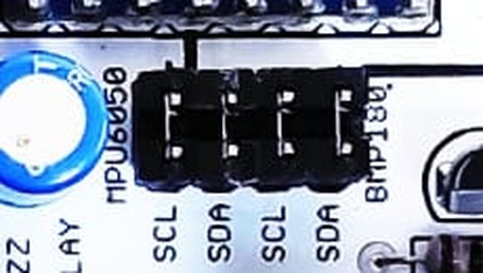
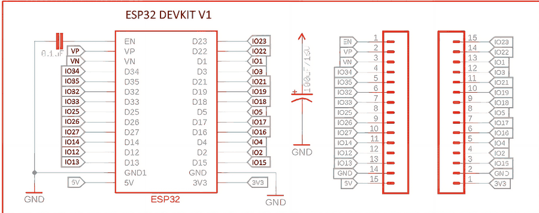
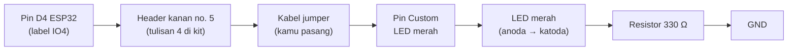
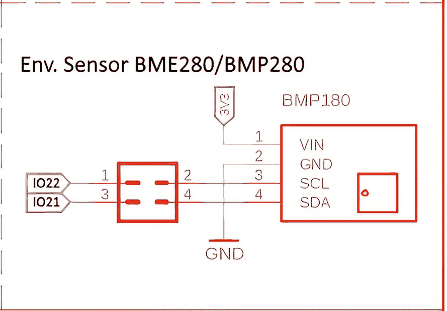
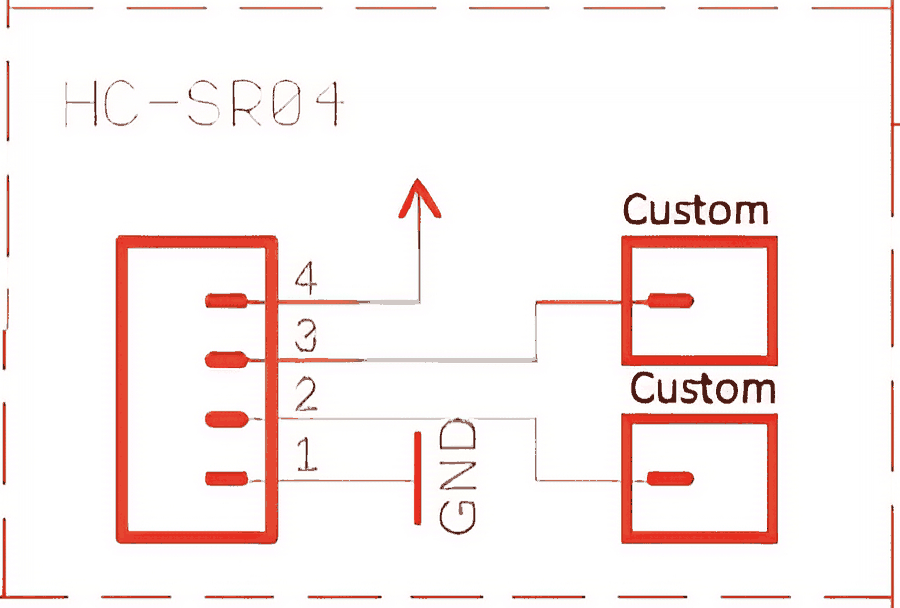
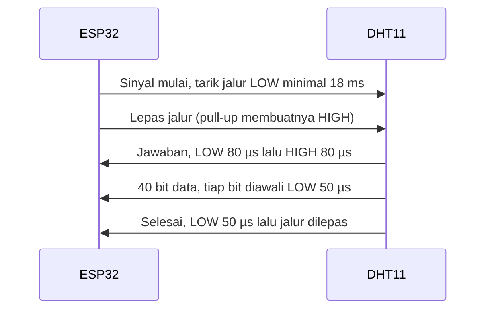

# BAB 4: Membaca Skematik & Datasheet

> ✅ **Prasyarat:** Selesaikan **BAB 3 (Dasar Elektronika untuk Mikrokontroler)** — kamu sudah paham tegangan, arus, resistor, LED, *pull-up/pull-down*, dan transistor.

Skematik adalah peta sebuah rangkaian, sedangkan *datasheet* adalah buku manual resmi sebuah komponen. Dari skematik kamu tahu komponen mana tersambung ke pin mana; dari *datasheet* kamu tahu batas aman dan cara memakai komponen itu. Di BAB ini kamu belajar membaca skematik asli kit Bluino dan beberapa *datasheet* sungguhan (DHT11, BMP180, dan ESP32), sehingga nanti kamu bisa memeriksa sendiri rangkaian dan program apa pun tanpa sekadar menebak.

## 📌 Tujuan Pembelajaran

Setelah mempelajari BAB ini, kamu bisa:

- Menjelaskan apa itu skematik dan bedanya dengan foto atau tata letak PCB.
- Mengenali simbol dasar: resistor, potensiometer, LDR, kapasitor, dioda, LED, tombol, transistor NPN, *relay*, *buzzer*, GND, label daya, dan titik sambungan.
- Memahami label net (misalnya IO21), pin header **Custom**, dan header *jumper* pada skematik kit.
- Menelusuri jalur dari pin ESP32 ke setiap komponen di skematik kit Bluino.
- Menemukan bagian penting *datasheet*: *pinout*, kondisi operasi, *absolute maximum ratings*, karakteristik listrik, dan diagram waktu.
- Membaca *datasheet* DHT11 dan BMP180 secara terpandu lalu mencocokkannya dengan rangkaian kit.

## 🧰 Yang Perlu Disiapkan

| Kebutuhan | Keterangan |
|---|---|
| *Hardware* | Tidak wajib — BAB ini teori. Siapkan kit Bluino supaya bisa kamu cocokkan dengan skematiknya |
| Kabel *jumper* | Tidak perlu |
| Komponen tambahan | Tidak ada |
| *Software* | *Browser* (Chrome, Edge, Firefox, atau Safari) untuk membuka gambar skematik dan *file* PDF *datasheet* |
| *Library* | Tidak perlu |
| Alat uji | *File* [`Schematic.jpg`](../Schematic.jpg) di repositori ini dan *datasheet* dari tautan di BAB ini |
| Jaringan | Koneksi internet di laptop/HP untuk membuka *datasheet* (ESP32 tidak perlu WiFi) |

## 📑 Daftar Isi

- [4.1 Apa Itu Skematik?](#41-apa-itu-skematik)
- [4.2 Simbol-Simbol Dasar](#42-simbol-simbol-dasar)
- [4.3 Label Net, Pin Custom, dan Header *Jumper*](#43-label-net-pin-custom-dan-header-jumper)
- [4.4 Praktik: Menjelajah Skematik Kit Bluino](#44-praktik-menjelajah-skematik-kit-bluino)
- [4.5 Apa Itu *Datasheet*?](#45-apa-itu-datasheet)
- [4.6 Contoh Terpandu 1: *Datasheet* DHT11](#46-contoh-terpandu-1-datasheet-dht11)
- [4.7 Contoh Terpandu 2: *Datasheet* BMP180](#47-contoh-terpandu-2-datasheet-bmp180)
- [4.8 Contoh Terpandu 3: Batas Listrik di *Datasheet* ESP32](#48-contoh-terpandu-3-batas-listrik-di-datasheet-esp32)
- [4.9 Daftar *Datasheet* Komponen Kit](#49-daftar-datasheet-komponen-kit)
- [4.10 Troubleshooting](#410-troubleshooting)
- [📝 Rangkuman](#-rangkuman)
- [💪 Latihan](#-latihan)
- [📚 Referensi](#-referensi)

---

## 4.1 Apa Itu Skematik?

**Skematik** (*schematic*) adalah gambar rangkaian elektronik yang memakai **simbol standar** untuk setiap komponen dan **garis** untuk setiap sambungan listrik. Skematik menjawab tiga pertanyaan: komponen apa saja yang dipakai, berapa nilainya, dan tersambung ke mana.

> 💡 **Tips:** Skematik mirip peta jalur KRL atau MRT. Letak stasiun di peta tidak sama dengan letak aslinya di kota, tetapi urutan dan sambungannya benar. Begitu juga skematik: letak simbol tidak sama dengan letak komponen di papan — yang penting sambungannya.

| Jenis gambar | Yang ditunjukkan | Kegunaan |
|---|---|---|
| Foto kit | Bentuk fisik dan letak komponen | Mencari komponen di papan |
| **Skematik** | Sambungan listrik antarkomponen | Memahami cara kerja dan menelusuri pin |
| Tata letak PCB (*layout*) | Jalur tembaga di papan | Membuat PCB (tidak dibahas di materi ini) |

### 4.1.1 Membuka Skematik Kit

Skematik kit tersimpan sebagai *file* [`Schematic.jpg`](../Schematic.jpg) di folder utama repositori ini. Cara membukanya:

1. **Di GitHub:** klik tautan `Schematic.jpg` di atas. Gambarnya besar (6400 × 4772 piksel, ±12 MB), jadi tunggu sampai selesai dimuat. Klik gambar atau tombol **Download raw file** untuk melihat ukuran penuhnya.
2. **Di laptop** (kalau kamu sudah mengunduh repositori sebagai ZIP): buka *file* itu dengan aplikasi penampil gambar, misalnya **Photos** di Windows atau **Preview** di macOS.
3. **Perbesar** bagian yang ingin dibaca: Ctrl + *scroll* (Windows/Linux), Cmd + *scroll* atau cubit *touchpad* (macOS), atau cubit layar di HP.


*Gambar 4.1 — Skematik lengkap kit (diperkecil; buka `Schematic.jpg` untuk versi tajam). Setiap kotak bergaris putus-putus adalah satu blok komponen dengan judulnya sendiri, misalnya "4 x LED 5mm" atau "Relay". Kotak judul di kanan bawah memuat nama dokumen (ESP32_Starter_Shield-3.2) dan tanggalnya. Sumber: skematik ESP32 Starter Shield 3.2, [Bluino](http://www.bluino.com).*

Tiga kebiasaan saat membaca skematik:

- **Baca per blok.** Jangan mencoba memahami seluruh gambar sekaligus. Pilih satu blok, misalnya "2 x Push Button", lalu telusuri garisnya.
- **Ikuti garis dari ujung ke ujung.** Mulai dari pin ESP32 atau pin header, lalu ikuti garisnya sampai ke kaki komponen.
- **Warna garis tidak berarti apa-apa.** Di skematik kit, sebagian garis berwarna merah dan sebagian hijau kebiruan. Itu hanya gaya gambar dari aplikasinya, bukan tanda tegangan atau jenis sinyal.

---

## 4.2 Simbol-Simbol Dasar

Setiap komponen punya simbol. Gambar berikut memotong simbol-simbol itu langsung dari skematik kit Bluino, jadi kamu akan menemukan bentuk yang persis sama saat membaca `Schematic.jpg`.


*Gambar 4.2 — Delapan belas simbol yang dipakai di skematik kit, dipotong dari `Schematic.jpg`. Sumber: diolah untuk materi ini dari skematik ESP32 Starter Shield 3.2, [Bluino](http://www.bluino.com).*

| No. | Simbol | Cara mengenalinya | Contoh di kit |
|---|---|---|---|
| 1 | Resistor | Garis zig-zag dengan nilai di dekatnya: `330` = 330 Ω, `1K` = 1 kΩ, `4K7` = 4,7 kΩ, `10K` = 10 kΩ. Di standar Eropa (IEC) resistor digambar sebagai kotak persegi panjang | LED, tombol, DHT11, *relay* |
| 2 | Potensiometer | Resistor dengan panah yang menunjuk ke badannya. Panah itu adalah kaki tengah (*wiper*) yang bisa digeser | Potensiometer VR10K |
| 3 | LDR | Bentuk lonjong berisi garis berkelok | LDR |
| 4 | Kapasitor elektrolit | Dua pelat — satu lurus, satu melengkung — dengan tanda **+**. Kapasitor ini berkutub | C1 (100 µF/6 V) |
| 5 | Kapasitor keramik | Dua pelat lurus sejajar tanpa tanda +. Tidak berkutub | C2 |
| 6 | Dioda | Segitiga yang menunjuk ke sebuah garis. Arus mengalir searah ujung segitiga: dari anoda (sisi lebar) ke katoda (garis) | 1N4001, 1N4148 |
| 7 | LED | Simbol dioda ditambah dua panah kecil yang keluar (cahaya) | 4 LED, LED indikator *relay* |
| 8 | Transistor NPN | Garis tegak (basis) dengan dua kaki miring. Kaki berpanah adalah emitor; pada NPN panahnya **keluar** | BC547 di *relay* |
| 9 | Tombol tekan | Kontak miring yang terputus; tersambung hanya saat ditekan | S1, S2 |
| 10 | *Relay* | Kotak berisi lilitan (koil) dan sakelar (kontak) | *Relay* 5 V |
| 11 | *Buzzer* | Kotak kecil berisi elemen piezo dengan dua kaki | *Buzzer* aktif |
| 12 | GND | Garis datar tebal di ujung kabel. Semua simbol GND saling tersambung | Hampir di setiap blok |
| 13 | Label daya | "Bendera" segi lima bertuliskan tegangan, misalnya **3V3** atau **5V** | Tombol, LDR, sensor |
| 14 | Panah catu daya | Panah tanpa tulisan, biasanya menunjuk ke atas (di blok *relay* digambar terbalik, menunjuk ke bawah). Di skematik kit, panah ini dipakai untuk jalur **5 V** (lihat *relay* 5 V dan HC-SR04) | *Relay*, HC-SR04 |
| 15 | Titik sambungan | Titik bulat di pertemuan garis: garis-garis itu **tersambung** | Simpul tombol, LDR |
| 16 | Pin header Custom | Kotak dengan satu pin: satu pin header di PCB tempat kabel *jumper* ditancapkan | LED, tombol, *relay* |
| 17 | Label net | "Bendera" bertuliskan nama jalur, misalnya **IO21** | OLED, MPU-6050, BMP180, microSD |
| 18 | Header *jumper* | Kotak berisi beberapa pasang pin; setiap pasang disambung dengan tutup *jumper* | Blok I2C dan microSD |

> 📌 **Catatan:** Dua garis yang **bersilangan tanpa titik** tidak tersambung — garis yang satu hanya "melintas" di atas garis lainnya. Garis baru dianggap tersambung kalau ada titik bulat di pertemuannya atau kalau ujung garis berhenti tepat di kaki komponen.

---

## 4.3 Label Net, Pin Custom, dan Header *Jumper*

Tiga hal ini sering membingungkan pemula, padahal kuncinya sederhana.

### 4.3.1 Label Net: Tersambung Lewat Nama

**Label net** (bentuk "bendera", nomor 13 dan 17 di Gambar 4.2) menyambungkan titik-titik yang **namanya sama**, walaupun tidak ada garis di antaranya. Contoh: pin SDA layar OLED (setelah melewati header *jumper*) berakhir di bendera **IO21**, dan pin D21 ESP32 juga berakhir di bendera **IO21**. Artinya, keduanya tersambung. Cara ini dipakai supaya skematik tidak penuh garis panjang yang saling silang.

Analoginya seperti nomor kursi bioskop: tiket bertuliskan C5 pasti menuju kursi C5, walaupun tidak ada garis dari loket ke kursi itu. Label daya **3V3**, **5V**, dan simbol **GND** bekerja dengan cara yang sama — semua 3V3 tersambung ke 3V3, semua GND tersambung ke GND.

### 4.3.2 Pin Header Custom dan Pin Berlabel IO

Kotak berpin satu (nomor 16 di Gambar 4.2) adalah **pin header** di PCB. Ada dua macam:

- Kotak bertuliskan **Custom** berarti pin itu **belum tersambung** ke ESP32. Kamu sendiri yang menyambungkannya dengan kabel *jumper* ke pin ESP32 (cara dan alasannya dibahas di [BAB 3](../BAB-03/README.md#311-kabel-jumper-dan-cara-menyambung-pin-custom)). Di materi ini, pasangan pin Custom mengikuti **Peta Pin Standar** di [BAB 6](../BAB-06/README.md).
- Kotak serupa yang bertuliskan **IO27**, **IO14**, atau **IO12** juga pin header, yaitu ujung jalur data DHT11, DS18B20, dan RGB LED WS2812. Tulisan IO27, IO14, dan IO12 adalah pin ESP32 yang **disarankan** perancang kit — jalurnya tetap **belum tersambung** ke ESP32. Di PCB, pin-pin ini berlabel **DHT**, **DS** (header hijau), dan **D-IN** (header LED). Kamu menyambungkannya dengan kabel *jumper*: `DHT` → IO27, `DS` → IO14, dan `D-IN` → IO12.

> 📌 **Catatan:** Kotak berpin satu (pin header) berbeda dengan **label net** di [4.3.1](#431-label-net-tersambung-lewat-nama). Label net menandai titik yang benar-benar tersambung, sedangkan pin header baru tersambung setelah kamu memasang kabel *jumper*.

### 4.3.3 Header *Jumper*: Sambungan yang Bisa Dilepas

Kotak berisi pasangan pin (nomor 18 di Gambar 4.2) adalah **header *jumper***. Pasangan pin 1–2, 3–4, dan seterusnya disambung dengan **tutup *jumper*** (*jumper cap*), yaitu konektor plastik kecil berisi logam. Di kit, header ini ada di antara ESP32 dan modul OLED, MPU-6050, BMP180 (masing-masing 2 × 2 pin), serta microSD (2 × 4 pin).



*Gambar 4.3 — Header jumper I2C di kit dengan tutup jumper hitam terpasang: dua pasang untuk MPU-6050 (SCL, SDA) dan dua pasang untuk BMP180 (SCL, SDA). Sumber: foto produk [Bluino](http://www.bluino.com).*

- **Tutup terpasang** → modul tersambung ke ESP32. Biarkan seperti ini untuk penggunaan normal.
- **Tutup dicabut** → modul terputus dari ESP32. Ini berguna kalau suatu saat kamu butuh pin itu untuk keperluan lain atau ingin mencari modul yang bermasalah.

> ⚠️ **Perhatian:** Kalau OLED, MPU-6050, BMP180, atau microSD tidak terdeteksi, periksa dulu apakah tutup *jumper*-nya masih terpasang lengkap dan tidak miring.

---

## 4.4 Praktik: Menjelajah Skematik Kit Bluino

Sekarang kita baca skematik kit blok demi blok. Siapkan `Schematic.jpg` di layar atau lihat potongan gambarnya di bawah.

### 4.4.1 ESP32 DEVKIT V1 dan Header Cermin



*Gambar 4.4 — Blok ESP32 DEVKIT V1 (kiri) dan dua header 15 pin yang "mencerminkan" pin-pinnya (kanan). Sumber: skematik ESP32 Starter Shield 3.2, [Bluino](http://www.bluino.com).*

Cara membacanya:

1. **Kotak besar bertuliskan ESP32** adalah *board* ESP32 DEVKIT V1. Nama pin di dalam kotak (D23, D22, D34, …) sama dengan tulisan di *board* aslinya. Pin **5V** di simbol ini adalah pin yang di *board* bertuliskan **VIN**.
2. **Setiap pin berakhir di label net** (IO23, IO22, …). Ingat aturan label net: semua label bernama sama saling tersambung.
3. **Dua header bernomor 1–15** di sebelah kanan memakai label net yang sama. Inilah deretan pin putih di kit tempat kamu menancapkan kabel *jumper*. Dengan kata lain, header ini adalah "cermin" pin ESP32.
4. **Kapasitor 0,1 µF** di kiri atas menghubungkan pin EN ke GND untuk membantu *reset* otomatis saat program diunggah. **Kapasitor elektrolit 100 µF** di tengah dipasang antara jalur 5 V (panah) dan GND sebagai penampung arus sesaat.

Urutan pin kedua header (dicocokkan dengan Gambar 4.4 dan label di papan kit):

| No. | Header kiri | Header kanan | No. | Header kiri | Header kanan |
|---|---|---|---|---|---|
| 1 | EN | 3V3 | 9 | IO26 | IO18 |
| 2 | VP (IO36) | GND | 10 | IO27 | IO19 |
| 3 | VN (IO39) | IO15 | 11 | IO14 | IO21 |
| 4 | IO34 | IO2 | 12 | IO12 | IO3 (RX0) |
| 5 | IO35 | IO4 | 13 | IO13 | IO1 (TX0) |
| 6 | IO32 | IO16 | 14 | GND | IO22 |
| 7 | IO33 | IO17 | 15 | 5V (VIN) | IO23 |
| 8 | IO25 | IO5 | | | |

> 💡 **Tips:** Di papan kit, header kanan bertuliskan `3V G 15 2 4 16 17 5 18 19 21 3 1 22 23` — persis urutan nomor 1 sampai 15 di tabel. Di skematik header kanan digambar terbalik (nomor 15 di atas), jadi selalu berpegang pada **nama pinnya**, bukan posisi gambarnya.

### 4.4.2 Menelusuri Jalur: Dari IO4 ke LED Merah

Mari berlatih menelusuri satu jalur lengkap, misalnya LED merah yang di Peta Pin Standar memakai IO4.


*Gambar 4.5 — Blok "4 x LED 5mm". Sumber: skematik ESP32 Starter Shield 3.2, [Bluino](http://www.bluino.com).*



*Gambar 4.6 — Jalur arus dari IO4 sampai GND saat LED merah menyala. Sumber: dibuat untuk materi ini.*

Perhatikan bahwa di skematik, jalur dari header ESP32 ke pin Custom **tidak ada** — bagian itu memang kabel *jumper* yang kamu pasang sendiri. Inilah arti pin Custom.

Tombol S1 dan S2 dibaca dengan cara yang sama: 3V3 → tombol → titik sambungan → pin Custom, dan dari titik sambungan yang sama ada resistor 10 kΩ ke GND (*pull-down*). Gambar dan penjelasannya ada di [BAB 3](../BAB-03/README.md#37-resistor-pull-up-dan-pull-down).

### 4.4.3 Bus I2C: OLED, MPU-6050, dan BMP180

Tiga modul ini berbagi dua jalur yang sama: **SDA** (data) ke IO21 dan **SCL** (*clock*) ke IO22. Contohnya blok BMP180:



*Gambar 4.7 — Blok BMP180: VIN ke 3V3, SCL dan SDA melewati header jumper 2 × 2 sebelum sampai ke label IO22 dan IO21. Sumber: skematik ESP32 Starter Shield 3.2, [Bluino](http://www.bluino.com).*

Dua hal menarik di blok ini:

- **SCL dan SDA melewati header *jumper*** (pin 1–2 dan 3–4) sebelum sampai ke label IO22 dan IO21. Blok OLED dan MPU-6050 dibuat dengan pola yang sama.
- **Judul blok menyebut "BME280/BMP280", tetapi komponen di dalamnya berlabel BMP180.** Skematik kadang masih menyimpan tulisan dari revisi lama. Kalau judul dan isi berbeda, percayai label komponen dan cocokkan dengan papan aslinya — di kit ini sensornya BMP180.

Karena ketiga modul berbagi jalur, setiap modul punya **alamat I2C** yang berbeda supaya ESP32 bisa memanggilnya satu per satu:

| Modul | Alamat I2C | Catu daya |
|---|---|---|
| OLED SSD1306 128 × 64 | `0x3C` | 3V3 |
| MPU-6050 | `0x68` | 3V3 |
| BMP180 | `0x77` | 3V3 |

Protokol I2C dibahas lengkap di [BAB 23](../BAB-23/README.md).

### 4.4.4 Bus SPI: microSD


*Gambar 4.8 — Blok Micro SD Adapter dengan header jumper 2 × 4. Sumber: skematik ESP32 Starter Shield 3.2, [Bluino](http://www.bluino.com).*

Telusuri setiap jalur dari pin modul, melewati pasangan pin *jumper*, sampai ke label net:

| Pin modul microSD | Lewat pasangan *jumper* | Label net / pin ESP32 | Fungsi SPI |
|---|---|---|---|
| 1 (3V3) | — | 3V3 | Catu daya |
| 2 (CS) | 2 ↔ 1 | IO5 | *Chip Select* |
| 3 (MOSI) | 4 ↔ 3 | IO23 | Data dari ESP32 ke kartu |
| 4 (CLK) | 6 ↔ 5 | IO18 | *Clock* |
| 5 (MISO) | 8 ↔ 7 | IO19 | Data dari kartu ke ESP32 |
| 6 (GND) | — | GND | *Ground* |

Perhatikan: **nomor pin modul** (1–6) berbeda dengan **nomor pin header *jumper*** (1–8). Selalu jelaskan nomor mana yang kamu maksud. SPI dibahas di [BAB 24](../BAB-24/README.md).

### 4.4.5 DHT11 dan DS18B20: Jalur Data dengan *Pull-up*


*Gambar 4.9 — Blok DHT11: pin DAT ke IO27 dengan resistor pull-up 4K7 ke 3V3. Sumber: skematik ESP32 Starter Shield 3.2, [Bluino](http://www.bluino.com).*

- **Pin 1 (VDD)** ke 3V3, **pin 4 (GND)** ke GND.
- **Pin 2 (DAT)** ke IO27, dan dari titik sambungan yang sama ada resistor **4K7** (4,7 kΩ) ke 3V3 — inilah *pull-up* yang dibahas di [BAB 3](../BAB-03/README.md#372-pull-up-pada-dht11-dan-ds18b20).
- **Pin 3 (N.C.)** berarti *not connected* — memang tidak disambung ke mana pun.

Blok DS18B20 di sebelahnya berpola sama: pin 3 (VDD) ke 3V3, pin 2 (DQ) ke IO14 dengan *pull-up* 4K7, dan pin 1 ke GND. Simpan Gambar 4.9 ini, karena kamu akan mencocokkannya dengan *datasheet* DHT11 di [4.6](#46-contoh-terpandu-1-datasheet-dht11).

### 4.4.6 *Relay*: Transistor, Dioda, dan LED Indikator


*Gambar 4.10 — Blok Relay. Sumber: skematik ESP32 Starter Shield 3.2, [Bluino](http://www.bluino.com).*

Latihan menelusuri:

1. **Pin Custom** → resistor **10K** → **basis** BC547 (kaki kiri transistor).
2. **Emitor** (kaki berpanah) → **GND**.
3. **Kolektor** (kaki atas) → garis atas yang tersambung ke ujung atas koil *relay*, **anoda** dioda 1N4148, dan resistor **1K** LED indikator.
4. Ujung bawah koil, **katoda** dioda, dan **anoda** LED indikator bertemu di garis bawah yang menuju **panah** — jalur 5 V.
5. Kontak *relay* keluar ke dua lingkaran di kanan: terminal sekrup **COM** dan **NO** (*normally open*, terbuka saat *relay* mati dan tertutup saat *relay* aktif).

Cara kerja rangkaian ini (transistor sebagai sakelar dan dioda *flyback*) sudah dibahas di [BAB 3](../BAB-03/README.md#39-transistor-relay-dan-dioda-flyback).

### 4.4.7 HC-SR04, Servo, dan *Power Regulator*



*Gambar 4.11 — Konektor HC-SR04: pin 1 = GND, pin 2 = Echo (ke pin Custom), pin 3 = Trig (ke pin Custom), pin 4 = VCC (panah, 5 V). Sumber: skematik ESP32 Starter Shield 3.2, [Bluino](http://www.bluino.com).*

- **HC-SR04:** jalur Echo langsung menuju pin Custom tanpa resistor apa pun. Artinya, **di papan tidak ada pembagi tegangan** — kamu wajib menambahkannya sendiri sebelum Echo masuk ke ESP32 (lihat [BAB 3](../BAB-03/README.md#353-menurunkan-sinyal-echo-hc-sr04-dari-5-v-ke-sekitar-33-v)). Membaca skematik dengan teliti menyelamatkan ESP32-mu!
- **Header servo (3 pin):** pin 1 ke GND, pin 2 ke label **5V**, dan pin 3 (sinyal) ke pin Custom.
- ***Power Regulator*:** colokan adaptor +12 V → dioda 1N4001 → regulator 78M05 → label **5V**. Kapasitor **C1 (100 µF/6 V)** dan **C2** terpasang di sisi **keluaran** (5 V), bukan di sisi masukan. Penjelasannya ada di [BAB 3](../BAB-03/README.md#3103-regulator-78m05-dan-dioda-1n4001).

### 4.4.8 Ringkasan: Jenis Sambungan Setiap Komponen

Hasil penelusuran di atas, digabung dengan **Peta Pin Standar** yang dipakai di seluruh materi ([BAB 6](../BAB-06/README.md)):

| Komponen | Di skematik tersambung lewat | Pin ESP32 di materi ini |
|---|---|---|
| OLED, MPU-6050, BMP180 | Label net IO21/IO22 + header *jumper* | SDA = IO21, SCL = IO22 |
| microSD | Label net + header *jumper* 2 × 4 | CS = IO5, MOSI = IO23, CLK = IO18, MISO = IO19 |
| DHT11 | Kotak IO27 + *pull-up* 4K7 (pin `DHT`, disambung kabel *jumper*) | IO27 |
| DS18B20 | Kotak IO14 + *pull-up* 4K7 (pin `DS`, disambung kabel *jumper*) | IO14 |
| RGB LED WS2812 | Kotak IO12 (pin `D-IN`, disambung kabel *jumper*) | IO12 |
| LED merah / kuning / hijau / biru | Header Custom 4 pin | IO4 / IO16 / IO17 / IO2 |
| Tombol S1 / S2 | Custom (+ *pull-down* 10K) | IO15 / IO25 |
| *Buzzer* aktif | Custom | IO13 |
| Potensiometer / LDR | Custom | IO34 / IO35 |
| PIR AM312 **atau** *touch pad* | Custom | IO33 (pasang salah satu saja) |
| *Relay* | Custom (lewat BC547) | IO26 |
| Servo (sinyal) | Custom | IO32 |
| HC-SR04 Trig / Echo | Custom | IO25 (bergantian dengan S2) / IO36 lewat pembagi tegangan |

> 📌 **Catatan:** *Touch pad* hanya bisa bekerja di pin yang punya fungsi sentuh (T0–T9), misalnya IO4, IO13, IO15, IO32, atau IO33. Materi ini memakai IO33 (T8).

---

## 4.5 Apa Itu *Datasheet*?

***Datasheet*** (lembar data) adalah dokumen teknis resmi dari pembuat komponen. Isinya: fungsi komponen, kaki-kakinya, batas aman, karakteristik listrik, cara berkomunikasi, dan contoh rangkaian. Bayangkan label informasi nilai gizi di kemasan makanan — singkat, penuh angka, tetapi semua yang penting ada di sana.

### 4.5.1 Mencari *Datasheet* yang Benar

1. Buka mesin pencari di *browser*, lalu ketik **nama komponen + `datasheet pdf`**, misalnya `BMP180 datasheet pdf`.
2. Utamakan sumber resmi: situs pembuat chip (Espressif, Bosch Sensortec, Analog Devices, TDK InvenSense, onsemi) atau distributor besar (Mouser, DigiKey, LCSC). Salinan dari situs belajar tepercaya seperti Adafruit atau SparkFun juga boleh.
3. Perhatikan **nomor dokumen, revisi, dan tanggalnya** (biasanya di halaman pertama atau di bagian bawah setiap halaman). Satu komponen bisa punya beberapa versi *datasheet* yang angkanya sedikit berbeda.
4. Bedakan ***datasheet* chip** dan **modul**. Kit memakai modul — papan kecil berisi chip plus komponen pendukung (regulator, resistor *pull-up*). *Datasheet* chip hanya menjelaskan chip-nya.

> 💡 **Tips:** *Datasheet* bisa setebal 30–80 halaman, tetapi kamu biasanya hanya perlu 3–5 halaman. Pakai fitur cari di penampil PDF (Ctrl + F di Windows/Linux, Cmd + F di macOS) dengan kata kunci seperti `absolute`, `pin`, `supply`, atau `timing`. Kalau bahasa Inggrisnya sulit, salin kalimatnya ke penerjemah.

### 4.5.2 Bagian-Bagian Penting

| Bagian (nama aslinya) | Isi | Pertanyaan yang dijawab |
|---|---|---|
| *Features* / *General Description* | Ringkasan kemampuan | Komponen ini bisa apa? |
| *Pin Configuration* / *Pin Description* (*pinout*) | Nama dan fungsi setiap kaki | Kaki mana disambung ke mana? |
| ***Absolute Maximum Ratings*** | Batas yang **tidak boleh** dilewati, walaupun sesaat | Kapan komponen bisa rusak? |
| *Recommended Operating Conditions* | Rentang kerja normal | Tegangan dan suhu berapa yang dianjurkan? |
| *Electrical Characteristics* | Angka listrik dalam kolom Min/Typ/Max | Berapa arusnya? Kapan sinyal dibaca HIGH? |
| *Timing Diagram* | Gambar urutan sinyal terhadap waktu | Bagaimana cara berkomunikasi? |
| *Typical Application* | Contoh rangkaian | Komponen pendukung apa yang dibutuhkan? |
| *Package Information* | Ukuran fisik | Jarang diperlukan pemula |

Dua konsep yang wajib dipahami:

- **Min / Typ / Max.** *Min* dan *Max* adalah batas yang dijamin pembuatnya. *Typ* (*typical*, tipikal) adalah nilai yang umum terjadi, tetapi **tidak dijamin**. Angka-angka ini hanya berlaku pada **kondisi uji** yang tertulis di tabel, misalnya "VDD = 3,3 V, 25 °C".
- ***Absolute maximum* bukan batas kerja.** Ibarat speedometer motor yang angkanya sampai 160 km/jam: itu bukan kecepatan yang aman dipakai sehari-hari. Rancang rangkaianmu di dalam *Recommended Operating Conditions*, dan jangan pernah mendekati *Absolute Maximum Ratings*.

---

## 4.6 Contoh Terpandu 1: *Datasheet* DHT11

Kita akan membaca **DHT11 Product Manual** dari Aosong, pembuat DHT11 ([salinan PDF di CUNY City Tech](https://openlab.citytech.cuny.edu/cet4711/files/2018/05/DHT11.pdf)). Buka *file*-nya di *browser*, lalu ikuti langkah berikut sambil membandingkan dengan Gambar 4.9 (blok DHT11 di skematik kit).

### 4.6.1 Langkah 1 — *Pinout*

Bagian *Pin Description* menulis:

| Pin DHT11 | Nama | Keterangan di *datasheet* | Di skematik kit |
|---|---|---|---|
| 1 | VDD | Catu daya | Ke 3V3 |
| 2 | DATA | Data serial satu kabel (*single bus*) | Ke IO27 + *pull-up* 4K7 |
| 3 | NC | Pin kosong | N.C. (tidak disambung) |
| 4 | GND | *Ground* | Ke GND |

Cocok persis dengan skematik. Inilah pemeriksaan pertama yang selalu dilakukan perancang rangkaian.

### 4.6.2 Langkah 2 — Tegangan dan Arus

Bagian *Electrical Characteristics* menulis:

| Parameter | Nilai di *datasheet* |
|---|---|
| Tegangan catu (*power supply*) | 3,5–5,5 V DC |
| Arus saat mengukur | 0,3 mA |
| Arus saat siaga (*standby*) | 60 µA |
| Periode pengambilan data (*sampling period*) | Lebih dari 2 detik |
| Akurasi (pada 25 °C) | Kelembapan ±5% RH, suhu ±2 °C |

Perhatikan baris pertama: manual versi ini menulis minimal **3,5 V**, padahal kit mencatu DHT11 dengan **3,3 V**. Apakah itu salah? Data produk DHT11 Aosong yang lebih baru (misalnya di [LCSC](https://www.lcsc.com/product-detail/C117051.html)) menulis **3,3–5,5 V**. Pelajarannya:

- *Datasheet* punya versi. Kalau angkanya berbeda, cari versi yang paling baru dan paling cocok dengan komponenmu.
- Manual ini juga berpesan: saat dicatu tegangan rendah, kabel ke sensor sebaiknya tidak lebih dari 20 cm supaya tegangannya tidak turun. Di kit, DHT11 terpasang di PCB dan hanya disambung kabel *jumper* sepanjang ±10 cm ke ESP32, jadi syarat ini terpenuhi.

### 4.6.3 Langkah 3 — Resistor *Pull-up*

Bagian *Typical circuit* menganjurkan resistor ***pull-up* 5,1 kΩ** pada jalur DATA untuk kabel di bawah 20 m. Kit memakai **4,7 kΩ** — nilai standar terdekat yang bekerja sama baiknya. Tanpa *pull-up*, jalur tidak bisa kembali HIGH dan komunikasi gagal.

### 4.6.4 Langkah 4 — Diagram Waktu (*Timing*)

DHT11 berkomunikasi lewat **satu kabel** dengan urutan sinyal yang ketat. Ringkasan dari bagian *Serial communication instructions*:



*Gambar 4.12 — Urutan komunikasi ESP32 dan DHT11 menurut datasheet. Sumber: dibuat untuk materi ini, berdasarkan DHT11 Product Manual (Aosong).*

Bit "0" dan "1" dibedakan dari **lamanya sinyal HIGH** setelah LOW 50 µs:

| Bit | LOW | HIGH |
|---|---|---|
| "0" | 50 µs | 26–28 µs |
| "1" | 50 µs | 70 µs |

*Datasheet* juga berpesan: setelah DHT11 diberi daya, tunggu **1 detik** sebelum mengirim perintah apa pun, dan nilai yang terbaca adalah hasil pengukuran **sebelumnya**.

### 4.6.5 Langkah 5 — Format Data dan *Checksum*

Ke-40 bit itu terdiri atas 5 *byte*: kelembapan (bilangan bulat), kelembapan (desimal), suhu (bilangan bulat), suhu (desimal), dan ***checksum*** — angka pemeriksa yang nilainya harus sama dengan 8 bit terakhir dari jumlah keempat *byte* sebelumnya. Contoh dari *datasheet*:

```text
0011 0101   0000 0000   0001 1000   0000 0000   0100 1101
RH bulat    RH desimal  T bulat     T desimal   checksum
= 53        = 0         = 24        = 0         = 77

Cek: 53 + 0 + 24 + 0 = 77  → sama dengan checksum → data benar
Hasil: kelembapan 53% RH, suhu 24 °C
```

### 4.6.6 Apa Artinya bagi Kita?

Kamu **tidak perlu** menulis kode pewaktu ini sendiri — *library* **DHT sensor library** (Adafruit) sudah mengurusnya di [BAB 26](../BAB-26/README.md). Tetapi dari *datasheet* kamu jadi tahu:

1. Baca sensor paling cepat **sekali tiap 2 detik**.
2. Resistor *pull-up* wajib ada (di kit sudah terpasang).
3. Kalau *checksum* tidak cocok, data dibuang. Itulah salah satu alasan *library* kadang mengembalikan nilai "gagal baca" — biasanya cukup dicoba lagi.

---

## 4.7 Contoh Terpandu 2: *Datasheet* BMP180

Dokumen: ***BMP180 Digital pressure sensor* — Bosch Sensortec**, nomor dokumen BST-BMP180-DS000-09, revisi 2.5, April 2013 ([salinan PDF di Adafruit](https://cdn-shop.adafruit.com/datasheets/BST-BMP180-DS000-09.pdf)). Fokus kita: membedakan **batas mutlak** dan **kondisi kerja**.

### 4.7.1 Langkah 1 — *Absolute Maximum Ratings*

Tabel 2 di *datasheet*:

| Parameter | Min | Max |
|---|---|---|
| Suhu penyimpanan | −40 °C | +85 °C |
| Tegangan catu (semua pin) | −0,3 V | **+4,25 V** |
| Ketahanan ESD (listrik statis, model HBM) | — | ±2 kV |
| Tekanan berlebih (*overpressure*) | — | 10.000 hPa |

### 4.7.2 Langkah 2 — Kondisi Kerja

Tabel 1 di *datasheet*:

| Parameter | Min | Typ | Max |
|---|---|---|---|
| Tegangan catu V<sub>DD</sub> | 1,8 V | 2,5 V | 3,6 V |
| Tegangan I/O V<sub>DDIO</sub> | 1,62 V | 2,5 V | 3,6 V |
| Suhu kerja | −40 °C | — | +85 °C (akurasi penuh 0–65 °C) |
| Rentang tekanan | 300 hPa | — | 1100 hPa |

**Cocokkan dengan kit:** BMP180 di kit dicatu **3V3** (Gambar 4.7). Angka 3,3 V berada di dalam rentang kerja 1,8–3,6 V dan jauh dari batas mutlak 4,25 V. Aman.

**Bagaimana kalau 5 V?** Chip BMP180 yang dicatu 5 V langsung melewati batas mutlak 4,25 V dan bisa rusak. Banyak **modul** BMP180 di pasaran punya regulator sendiri sehingga pin VIN-nya boleh diberi 5 V — tetapi chip di dalamnya tetap hanya menerima 3,3 V dari regulator itu. Inilah alasan kamu perlu membedakan *datasheet* chip dan modul.

### 4.7.3 Langkah 3 — Komunikasi I2C

- Bagian I2C menulis alamat **0xEE** untuk menulis dan **0xEF** untuk membaca. Kedua angka ini adalah alamat 7 bit **0x77** yang digeser satu bit (0x77 × 2 = 0xEE). Itulah sebabnya program Arduino memakai alamat `0x77`.
- Frekuensi *clock* I2C maksimum 3,4 MHz.
- Jalur SCL dan SDA butuh resistor *pull-up* (tipikal 4,7 kΩ). Pada modul, resistor ini biasanya sudah terpasang.

### 4.7.4 Langkah 4 — Waktu Konversi dan Arus

| Mode pengukuran tekanan | Waktu konversi maks. |
|---|---|
| *Ultra low power* | 4,5 ms |
| *Standard* | 7,5 ms |
| *High resolution* | 13,5 ms |
| *Ultra high resolution* | 25,5 ms |

Pengukuran suhu butuh maks. 4,5 ms. Artinya, setelah meminta pengukuran, program harus menunggu sebelum membaca hasilnya — *library* **Adafruit BMP085 Library** mengurus ini untukmu di [BAB 28](../BAB-28/README.md). Arusnya juga sangat kecil: sekitar 5 µA rata-rata pada mode standar dengan 1 pengukuran per detik.

---

## 4.8 Contoh Terpandu 3: Batas Listrik di *Datasheet* ESP32

Di [BAB 3](../BAB-03/README.md#38-batas-arus-gpio-esp32) kamu sudah memakai angka-angka dari *ESP32 Series Datasheet* (Espressif, versi 5.3). Berikut letaknya di dokumen, supaya kamu bisa memeriksanya sendiri:

| Bagian *datasheet* | Parameter | Nilai |
|---|---|---|
| Tabel 5-1 *Absolute Maximum Ratings* | Tegangan pin catu | −0,3 V sampai 3,6 V |
| Tabel 5-1 | Arus keluar semua IO (*cumulative IO output current*) | Maks. 1,2 A |
| Tabel 5-2 *Recommended Power Supply Characteristics* | Tegangan catu | Tipikal 3,3 V, maks. 3,6 V (minimal 2,3 V atau 3,0 V, tergantung jenis chip) |
| Tabel 5-2 | Arus yang harus bisa diberikan catu daya | Minimal 0,5 A |
| Tabel 5-3 *DC Characteristics* | V<sub>IH</sub> min. / V<sub>IL</sub> maks. | 0,75 × VDD / 0,25 × VDD |
| Tabel 5-3 | I<sub>OH</sub> / I<sub>OL</sub> (kekuatan *drive* maks.) | Tipikal 40 mA / 28 mA |
| Tabel 5-4 | Arus saat WiFi mengirim (802.11b, 19,5 dBm) | Tipikal 240 mA |
| Bagian mode daya | *Deep-sleep* | 10 µA (chip saja) |

Dua catatan penting saat membaca tabel ini:

- **Angka chip ≠ angka *board*.** Arus *deep-sleep* 10 µA adalah arus chip ESP32 saja. *Board* DEVKIT V1 juga punya regulator, chip USB-ke-serial, dan LED daya, sehingga konsumsi seluruh *board* jauh lebih besar.
- **Selalu cek ke sumber asli.** Di internet sering beredar angka "12 mA per pin" untuk ESP32. Angka itu tidak tercantum di *datasheet* ESP32 versi 5.3; yang tercantum adalah 40 mA dan 28 mA pada kekuatan *drive* maksimum, dengan catatan bahwa kemampuan per pin menurun kalau banyak pin dipakai bersamaan.

---

## 4.9 Daftar *Datasheet* Komponen Kit

Simpan tabel ini sebagai rujukan. Semua tautan menuju *file* PDF atau halaman produk yang bisa kamu buka di *browser*.

| Komponen | *Datasheet* | Yang paling sering dicari |
|---|---|---|
| ESP32 (chip) | [ESP32 Series Datasheet — Espressif](https://www.espressif.com/sites/default/files/documentation/esp32_datasheet_en.pdf) | Batas tegangan dan arus GPIO, fungsi pin |
| Modul ESP32-WROOM-32E | [ESP32-WROOM-32E Datasheet — Espressif](https://www.espressif.com/sites/default/files/documentation/esp32-wroom-32e_esp32-wroom-32ue_datasheet_en.pdf) | Pin modul, catu daya modul |
| DHT11 | [DHT11 Product Manual — Aosong (salinan CUNY City Tech)](https://openlab.citytech.cuny.edu/cet4711/files/2018/05/DHT11.pdf) | *Pinout*, *timing*, format data |
| DS18B20 | [DS18B20 Datasheet — Analog Devices (Maxim)](https://www.analog.com/media/en/technical-documentation/data-sheets/DS18B20.pdf) | Protokol OneWire, resolusi |
| BMP180 | [BMP180 Data Sheet — Bosch Sensortec (salinan Adafruit)](https://cdn-shop.adafruit.com/datasheets/BST-BMP180-DS000-09.pdf) | Tegangan, alamat I2C, waktu konversi |
| MPU-6050 | [MPU-6000/MPU-6050 Product Specification — TDK InvenSense](https://invensense.tdk.com/wp-content/uploads/2015/02/MPU-6000-Datasheet1.pdf) | Rentang akselerometer dan giroskop |
| OLED SSD1306 | [SSD1306 Datasheet — Solomon Systech (salinan Adafruit)](https://cdn-shop.adafruit.com/datasheets/SSD1306.pdf) | Perintah layar |
| RGB LED WS2812 | [WS2812B Datasheet — Worldsemi (salinan Adafruit)](https://cdn-shop.adafruit.com/datasheets/WS2812B.pdf) | *Timing* data |
| HC-SR04 | [HC-SR04 Datasheet (salinan SparkFun)](https://cdn.sparkfun.com/datasheets/Sensors/Proximity/HCSR04.pdf) | Tegangan, pulsa Trig/Echo |
| PIR AM312 | [AM312 Datasheet (salinan AllDatasheet)](https://pdf1.alldatasheet.com/datasheet-pdf/view/1328584/EONE/AM312.html) | Tegangan kerja, waktu tunda |
| Transistor BC547 | [BC546/BC547/BC548 Datasheet — onsemi](https://www.onsemi.com/pdf/datasheet/bc546-d.pdf) | Arus kolektor maks., penguatan |
| Dioda 1N4148 | [1N914/1N4148 Datasheet — onsemi](https://www.onsemi.com/pdf/datasheet/1n914-d.pdf) | Arus dan tegangan balik maks. |
| Dioda 1N4001 | [1N4001–1N4007 Datasheet — onsemi](https://www.onsemi.com/pdf/datasheet/1n4001-d.pdf) | Arus maju 1 A, tegangan balik |
| Regulator 78M05 | [MC78M00 Series Datasheet — onsemi](https://www.onsemi.com/pdf/datasheet/mc78m00-d.pdf) | Tegangan masuk, *dropout*, arus maks. |
| *Relay* SRD-05VDC-SL-C | [SRD Relay Datasheet — Songle (salinan Circuit Basics)](https://www.circuitbasics.com/wp-content/uploads/2015/11/SRD-05VDC-SL-C-Datasheet.pdf) | Arus koil, rating kontak |

> 📌 **Catatan:** Beberapa situs resmi (misalnya onsemi dan Analog Devices) kadang lambat atau meminta kamu menunggu beberapa detik sebelum PDF terbuka. Kalau tautan tidak bisa dibuka, cari nama dokumennya di mesin pencari.

---

## 4.10 Troubleshooting

| Masalah | Kemungkinan Penyebab | Solusi |
|---|---|---|
| `Schematic.jpg` tampil buram atau tulisannya terlalu kecil | Gambar ditampilkan dalam ukuran kecil | Klik **Download raw file** di GitHub, lalu perbesar dengan Ctrl + *scroll* atau cubit layar |
| Tidak menemukan pin Custom suatu komponen di papan | Skematik tidak menunjukkan letak fisik | Ikuti garis putih/hitam di PCB dari komponen ke deretan pin header, atau lihat foto kit di [BAB 3](../BAB-03/README.md#311-kabel-jumper-dan-cara-menyambung-pin-custom) |
| Bingung apakah dua garis tersambung | Persilangan tanpa titik | Garis hanya tersambung kalau ada titik sambungan atau label net yang sama namanya |
| Angka di dua *datasheet* untuk komponen yang sama berbeda | Versi atau pembuat *datasheet* berbeda | Cek nomor dokumen dan revisinya, pakai versi terbaru dari pembuat resminya |
| Modul dicatu 5 V padahal *datasheet* chip-nya maks. 3,6 V | Yang dibaca *datasheet* chip, bukan modul | Cek apakah modul punya regulator. Di kit, semua modul sensor dicatu 3V3 |
| Program memakai alamat I2C berbeda (misalnya `0x76`) dari skematik | Modul lain (BME280/BMP280) memakai alamat lain | Pastikan sensornya BMP180 (alamat `0x77`); pindai alamat I2C di [BAB 23](../BAB-23/README.md) |
| OLED, sensor I2C, atau microSD tidak terdeteksi | Tutup *jumper* di header *jumper* lepas atau miring | Pasang ulang tutup *jumper* hitamnya (lihat [4.3.3](#433-header-jumper-sambungan-yang-bisa-dilepas)) |

---

## 📝 Rangkuman

| Konsep | Inti yang perlu diingat |
|---|---|
| Skematik | Peta sambungan listrik, bukan peta letak fisik. Baca per blok dan ikuti garis dari ujung ke ujung |
| Simbol | Resistor zig-zag, dioda segitiga + garis, LED = dioda + panah keluar, NPN = panah emitor keluar, kapasitor elektrolit bertanda + |
| Sambungan | Titik bulat = tersambung; persilangan tanpa titik = tidak tersambung; label net bernama sama = tersambung |
| Pin Custom | Belum tersambung ke ESP32 — kamu sambung sendiri dengan kabel *jumper* mengikuti Peta Pin Standar |
| Header *jumper* | Sambungan I2C dan microSD lewat tutup *jumper*; harus terpasang supaya modul terhubung |
| Temuan penting di skematik kit | Echo HC-SR04 tanpa pembagi tegangan; judul blok "BME280/BMP280" berisi BMP180; C1 dan C2 di sisi keluaran 78M05 |
| *Datasheet* | Cari versi resmi; baca *pinout*, *Absolute Maximum Ratings*, kondisi kerja, karakteristik listrik, dan *timing* |
| Min/Typ/Max | Min dan Max dijamin; Typ hanya nilai umum. Rancang di dalam kondisi kerja, jangan di batas mutlak |
| DHT11 | *Pinout* cocok dengan kit; *pull-up* 5,1 kΩ (kit 4,7 kΩ); sinyal mulai ≥ 18 ms; bit 0/1 dibedakan lama HIGH; baca tiap ≥ 2 detik |
| BMP180 | Kerja 1,8–3,6 V, batas mutlak 4,25 V; kit mencatu 3,3 V; alamat I2C `0x77` |

---

## 💪 Latihan

### Latihan Dasar

1. **Menghitung komponen I2C.** Buka `Schematic.jpg`. Berapa modul yang memakai bus I2C, dan berapa alamat masing-masing?
   *Petunjuk:* Cari label net IO21 dan IO22 (lihat [4.4.3](#443-bus-i2c-oled-mpu-6050-dan-bmp180)).
2. **Membaca nilai resistor di skematik.** Tuliskan nilai resistor di blok LED, tombol, DHT11, dan *relay* dalam satuan Ω atau kΩ.
   *Petunjuk:* `330` = 330 Ω, `1K` = 1 kΩ, `4K7` = 4,7 kΩ, `10K` = 10 kΩ.
3. **Mengenali simbol.** Dari Gambar 4.2, sebutkan tiga simbol yang punya kutub (tidak boleh dipasang terbalik).
   *Petunjuk:* Cari simbol yang bersegitiga atau bertanda +.
4. **Pin Custom.** Hitung berapa kotak bertuliskan "Custom" di seluruh skematik.
   *Petunjuk:* Header LED (4 pin) dihitung satu kotak. Periksa blok tombol, LDR, *buzzer*, servo, HC-SR04, PIR, potensiometer, dan *relay*. Blok *Touch* juga punya kotak pin, tetapi tanpa tulisan Custom — menurutmu, apakah cara memakainya sama?

### Latihan Menengah

5. **Menelusuri jalur.** Telusuri jalur dari pin D27 ESP32 sampai ke pin DATA DHT11. Komponen apa saja yang ada di sepanjang jalur dan di sekitarnya?
   *Petunjuk:* Mulai dari label IO27, lalu perhatikan titik sambungan dan resistor 4K7 (lihat Gambar 4.9).
6. **Menelusuri jalur SPI.** Telusuri jalur dari IO5 sampai ke pin CS modul microSD. Pasangan pin *jumper* nomor berapa yang dilewati?
   *Petunjuk:* Lihat tabel di [4.4.4](#444-bus-spi-microsd).
7. **Datasheet ESP32.** Buka *ESP32 Series Datasheet*. Cari tabel *Absolute Maximum Ratings* dan *DC Characteristics*, lalu tuliskan batas tegangan catu dan nilai V<sub>IH</sub> minimum pada VDD = 3,3 V.
   *Petunjuk:* Pakai Ctrl + F dengan kata kunci `Absolute` dan `VIH`. Bandingkan hasilmu dengan [4.8](#48-contoh-terpandu-3-batas-listrik-di-datasheet-esp32).
8. **Dioda *flyback*.** Dari blok *relay*, jelaskan kenapa katoda 1N4148 disambung ke jalur 5 V. Apa yang terjadi kalau dioda ini tidak dipasang?
   *Petunjuk:* Ingat lonjakan tegangan dari koil saat transistor dimatikan ([BAB 3](../BAB-03/README.md#393-kenapa-butuh-dioda-flyback)).

### Tantangan Lanjutan

9. **Memeriksa rangkaian dengan *datasheet*.** Unduh *datasheet* DS18B20. Cocokkan nomor dan nama pinnya dengan blok DS18B20 di skematik kit, lalu cari nilai resistor *pull-up* yang dianjurkan dan rentang tegangan catunya. Apakah rangkaian kit sesuai?
   *Petunjuk:* Cari bagian *Pin Description* dan gambar rangkaian di halaman awal *datasheet*. Bandingkan dengan pola DHT11 di [4.6](#46-contoh-terpandu-1-datasheet-dht11).
10. **Mendekode data DHT11.** DHT11 mengirim 40 bit berikut: `0011 1100  0000 0000  0001 1101  0000 0000  0101 1001`. Berapa kelembapan dan suhunya? Apakah datanya valid?
    *Petunjuk:* Ubah setiap 8 bit menjadi angka desimal, lalu cek apakah jumlah empat *byte* pertama sama dengan *byte* terakhir (lihat [4.6.5](#465-langkah-5--format-data-dan-checksum)).

---

## 📚 Referensi

- [Skematik ESP32 Starter Shield 3.2 — Bluino](../Schematic.jpg) — skematik lengkap kit (sumber Gambar 4.1, 4.2, 4.4, 4.5, dan 4.7–4.11).
- [How to Read a Schematic — SparkFun Learn](https://learn.sparkfun.com/tutorials/how-to-read-a-schematic/all) — penjelasan simbol, label net, dan titik sambungan.
- [How to Read a Datasheet — SparkFun Learn](https://learn.sparkfun.com/tutorials/how-to-read-a-datasheet/all) — cara memahami bagian-bagian *datasheet*.
- [ESP32 Series Datasheet v5.3 — Espressif](https://www.espressif.com/sites/default/files/documentation/esp32_datasheet_en.pdf) — Tabel 5-1 sampai 5-4 untuk batas listrik ESP32.
- [DHT11 Product Manual — Aosong (salinan CUNY City Tech)](https://openlab.citytech.cuny.edu/cet4711/files/2018/05/DHT11.pdf) — *pinout*, tegangan, *pull-up*, *timing*, dan format data DHT11.
- [DHT11 (C117051) — LCSC](https://www.lcsc.com/product-detail/C117051.html) — data produk DHT11 Aosong yang lebih baru (catu 3,3–5,5 V).
- [BMP180 Data Sheet BST-BMP180-DS000-09 — Bosch Sensortec (salinan Adafruit)](https://cdn-shop.adafruit.com/datasheets/BST-BMP180-DS000-09.pdf) — Tabel 1 (kondisi kerja), Tabel 2 (*absolute maximum ratings*), alamat I2C, dan waktu konversi.
- [ESP32 Technical Reference Manual — Espressif](https://www.espressif.com/sites/default/files/documentation/esp32_technical_reference_manual_en.pdf) — rincian periferal ESP32 untuk pendalaman.

---

[⬅️ BAB 3: Dasar Elektronika untuk Mikrokontroler](../BAB-03/README.md) · [🏠 Daftar Isi](../README.md) · [BAB 5: Setup Lingkungan Pengembangan ➡️](../BAB-05/README.md)

---

## ☕ Dukung Proyek Ini

Bab ini disusun dengan dedikasi waktu dan keahlian yang tidak sedikit. Kalau materi ini bermanfaat untuk proses belajar, riset, atau proyekmu, bentuk apresiasi terbaik yang bisa kamu berikan adalah mentraktir penulis secangkir kopi:

[](https://trakteer.id/limitless7/tip)

**💬 Konsultasi & Kolaborasi:**
Punya kritik, saran, atau butuh pendampingan khusus ESP32 & IoT? Silakan hubungi:
- ✉️ **Email:** [antonprafanto@unmul.ac.id](mailto:antonprafanto@unmul.ac.id)
- 📞 **WhatsApp:** [0811-553-393](https://wa.me/62811553393) / [0852-5069-0673](https://wa.me/6285250690673)
