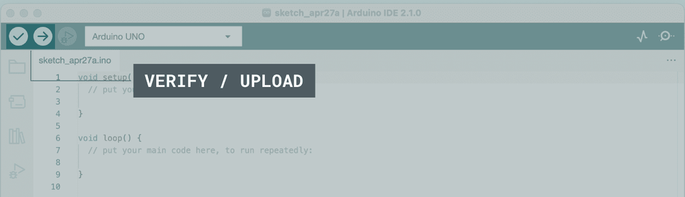
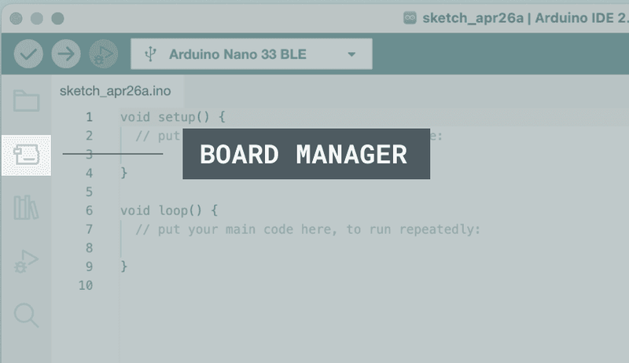
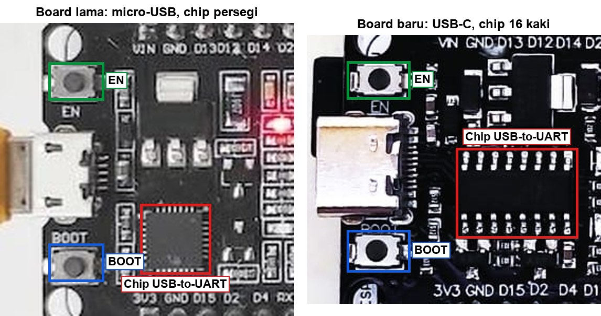
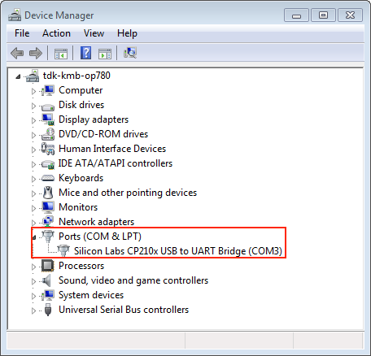
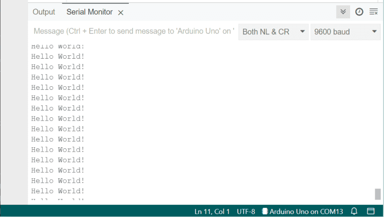

# BAB 5: Setup Lingkungan Pengembangan

> ✅ **Prasyarat:** Sudah membaca **BAB 2 (Pengenalan ESP32)** — kamu sudah kenal *board* ESP32 DEVKIT V1, termasuk tombol **EN** dan **BOOT**-nya. Belum perlu pengalaman memprogram.

Sebelum ESP32 bisa menjalankan program buatanmu, laptop perlu disiapkan dulu: dipasangi aplikasi untuk menulis kode, paket khusus ESP32, dan *driver* supaya laptop bisa "berbicara" dengan *board* lewat kabel USB. Ibaratnya menyiapkan dapur sebelum memasak: kompor, resep, dan peralatannya harus siap dulu. Di BAB ini kamu memasang semuanya langkah demi langkah, lalu mengujinya dengan program kecil yang membuat LED di *board* berkedip. Cukup dikerjakan **sekali** — semua BAB berikutnya memakai hasil persiapan ini.

## 📌 Tujuan Pembelajaran

Setelah mempelajari BAB ini, kamu bisa:

- Menginstal **Arduino IDE 2.x** di Windows, macOS, atau Linux.
- Menambahkan *board package* **esp32 by Espressif Systems** versi 3.3.x lewat **Boards Manager**, termasuk memperbaruinya kalau masih versi 2.x.
- Membedakan kabel USB **data** dari kabel yang hanya untuk mengisi daya.
- Mengenali chip USB-to-UART di *board* (CP2102 atau CH340), memasang *driver*-nya bila perlu, dan menemukan *port* ESP32 (misalnya `COM5`).
- Memilih *board* **ESP32 Dev Module** dan *port* yang benar, lalu mengunggah (*upload*) program uji pertama.
- Mengatasi *error* unggah yang paling sering muncul, termasuk *Wrong boot mode detected*.
- Memakai **Serial Monitor** dan **Library Manager** untuk keperluan dasar.

## 🧰 Yang Perlu Disiapkan

| Kebutuhan | Keterangan |
|---|---|
| *Hardware* | Kit Bluino ESP32 IoT Starter Shield (atau *board* ESP32 DEVKIT V1 saja) + kabel USB **data**; laptop/komputer dengan Windows 10/11 64-bit, macOS 10.15 (Catalina) atau lebih baru, atau Linux 64-bit |
| Kabel *jumper* | Tidak perlu |
| Komponen tambahan | Tidak ada |
| *Software* | Arduino IDE 2.x, *board package* **esp32** versi 3.3.x, dan *driver* USB-to-UART (kalau perlu) — semuanya dipasang di BAB ini |
| *Library* | Tidak perlu *library* tambahan (cara menginstal *library* dipelajari di [5.8](#58-dasar-library-manager)) |
| Alat uji | **Serial Monitor** Arduino IDE (baud 115200); **Device Manager** (Windows) atau **Terminal** (macOS/Linux) untuk mengecek *port* |
| Jaringan | Internet yang stabil — *board package* esp32 mengunduh sekitar 2 GB; siapkan juga ruang disk kosong sekitar 10 GB |

## 📑 Daftar Isi

- [5.1 Gambaran Besar: Apa Saja yang Dipasang?](#51-gambaran-besar-apa-saja-yang-dipasang)
- [5.2 Menginstal Arduino IDE 2.x](#52-menginstal-arduino-ide-2x)
- [5.3 Menambahkan Board ESP32 lewat Boards Manager](#53-menambahkan-board-esp32-lewat-boards-manager)
- [5.4 Kabel USB dan Driver USB-to-UART](#54-kabel-usb-dan-driver-usb-to-uart)
- [5.5 Memilih Board dan Port](#55-memilih-board-dan-port)
- [5.6 Program 1: Uji Upload — LED Bawaan Berkedip](#56-program-1-uji-upload--led-bawaan-berkedip)
- [5.7 Dasar Serial Monitor](#57-dasar-serial-monitor)
- [5.8 Dasar Library Manager](#58-dasar-library-manager)
- [5.9 Alternatif Opsional: PlatformIO dan Wokwi](#59-alternatif-opsional-platformio-dan-wokwi)
- [5.10 Troubleshooting](#510-troubleshooting)
- [📝 Rangkuman](#-rangkuman)
- [💪 Latihan](#-latihan)
- [📚 Referensi](#-referensi)

---

## 5.1 Gambaran Besar: Apa Saja yang Dipasang?

Ada tiga hal yang perlu dipasang di laptop, ditambah satu hal yang nanti dipasang sambil jalan:

| Yang dipasang | Fungsinya | Analogi |
|---|---|---|
| **Arduino IDE** | Aplikasi untuk menulis kode, menerjemahkannya menjadi bahasa mesin (*compile*), lalu mengirimkannya ke *board* (*upload*) | Dapur tempat memasak |
| *Board package* **esp32** | Paket berisi *compiler* dan kode inti khusus ESP32. Tanpa paket ini, Arduino IDE tidak "mengenal" ESP32 | Resep dan bumbu khusus untuk satu jenis masakan |
| *Driver* USB-to-UART | Program kecil di laptop agar chip USB di *board* dikenali sebagai *port* serial (misalnya `COM5`) | Penerjemah antara laptop dan ESP32 |
| *Library* (nanti) | Kode siap pakai untuk sensor/modul tertentu, dipasang saat BAB yang membutuhkannya | Bumbu instan |

Beberapa istilah yang akan sering muncul:

- **IDE** (*Integrated Development Environment*) — satu aplikasi yang berisi editor kode, *compiler*, dan alat unggah sekaligus.
- ***Sketch*** — sebutan Arduino untuk *file* program, berakhiran `.ino`.
- ***Compile*** — menerjemahkan kode yang kamu tulis menjadi kode mesin yang dimengerti ESP32. Di Arduino IDE tombolnya **Verify** (ikon centang ✓).
- ***Upload*** (mengunggah) — mengirim hasil *compile* ke memori *flash* ESP32 lewat kabel USB. Tombolnya **Upload** (ikon panah →).
- ***Port*** — "pintu" komunikasi serial di laptop tempat ESP32 tersambung. Di Windows namanya `COM3`, `COM5`, dan seterusnya; di macOS `/dev/cu.usbserial-…`; di Linux `/dev/ttyUSB0`.


*Gambar 5.1 — Perjalanan program dari laptop ke ESP32. Sumber: dibuat untuk materi ini.*

---

## 5.2 Menginstal Arduino IDE 2.x

Arduino IDE gratis dan tersedia untuk Windows, macOS, dan Linux. Materi ini memakai **Arduino IDE 2.x** (saat tulisan ini dibuat versi terbarunya 2.3.x). Arduino IDE 1.8.x yang lama masih bisa dipakai, tetapi tampilan dan letak menunya berbeda dengan materi ini.

**Langkah mengunduh:**

1. Buka [https://www.arduino.cc/en/software](https://www.arduino.cc/en/software) di *browser*.
2. Di bagian **Arduino IDE 2.x**, klik **Download**, lalu pilih *file* yang sesuai dengan sistem operasimu (lihat tabel di bawah).
3. Kalau muncul ajakan berdonasi atau berlangganan *newsletter*, kamu tidak wajib mengisinya — Arduino IDE gratis. Pilih tombol untuk langsung mengunduh (misalnya **Just Download**).

| Sistem operasi | *File* yang dipilih | Cara memasang |
|---|---|---|
| Windows 10/11 (64-bit) | **Windows** — *installer* `.exe` | Klik dua kali *file* `.exe` → **I Agree** → pilih **Anyone who uses this computer** (atau **Only for me**) → **Next** → **Install** → tunggu → **Finish** |
| macOS 10.15 atau lebih baru | **macOS** — pilih **Apple Silicon** (Mac M1/M2/M3/…) atau **Intel**, *file* `.dmg` | Buka *file* `.dmg`, lalu seret ikon **Arduino IDE** ke folder **Applications** |
| Linux 64-bit | **Linux AppImage 64 bits (X86-64)** | Klik kanan *file* → **Properties** → tab **Permissions** → centang **Allow executing file as program**, lalu klik dua kali *file*-nya |

> 💡 **Tips (macOS):** Jenis chip Mac-mu bisa dilihat di menu Apple (logo apel di pojok kiri atas layar) → **About This Mac**. Saat pertama kali dibuka, macOS mungkin bertanya *"Arduino IDE is an app downloaded from the Internet. Are you sure you want to open it?"* — klik **Open**.

> 💡 **Tips (Linux):** Kalau AppImage tidak mau terbuka, pasang FUSE dulu lewat **Terminal**. Di Ubuntu 22.04 ketik `sudo apt install libfuse2`; di Ubuntu 24.04 ketik `sudo apt install libfuse2t64`. Pengaturan izin *port* USB dibahas di [5.4](#54-kabel-usb-dan-driver-usb-to-uart).

**Saat pertama kali dibuka**, Arduino IDE akan mengunduh beberapa komponen tambahan (lihat pesan di pojok kanan bawah) — tunggu sampai selesai. Beberapa hal yang mungkin muncul dan aman untuk disetujui:

- Windows Defender Firewall meminta izin akses jaringan untuk Arduino IDE → klik **Allow access**.
- Windows bertanya apakah mau memasang *driver* dari "Arduino srl" atau "Arduino LLC" → klik **Install**. *Driver* ini untuk *board* Arduino resmi; tidak dipakai ESP32, tetapi juga tidak mengganggu.

Setelah itu kamu akan melihat jendela utama seperti ini:



*Gambar 5.2 — Tombol **Verify** (✓) dan **Upload** (→) di kiri atas jendela Arduino IDE 2; di kanan atas ada tombol **Serial Plotter** dan **Serial Monitor**. Sumber: [Arduino Docs — How to upload a sketch with the Arduino IDE 2](https://docs.arduino.cc/software/ide-v2/tutorials/getting-started/ide-v2-uploading-a-sketch/) (dipotong), lisensi CC BY-SA 4.0.*

Bagian-bagian penting jendela Arduino IDE 2:

| Bagian | Letak | Fungsi |
|---|---|---|
| **Verify** (✓) | Kiri atas | Mengecek dan meng-*compile* kode tanpa mengunggah |
| **Upload** (→) | Kiri atas | *Compile* lalu unggah ke *board* |
| Menu pilihan *board* | Di sebelah tombol **Upload** | Pilih *board* dan *port* dengan cepat |
| **Serial Monitor** (ikon kaca pembesar) | Kanan atas | Membuka jendela pesan dari ESP32 |
| Panel kiri (*sidebar*) | Sisi kiri | Ikon **Sketchbook**, **Boards Manager**, **Library Manager**, **Debug**, dan **Search** |
| Panel **Output** | Bawah | Menampilkan proses *compile*/*upload* beserta pesan *error* |

> 📌 **Catatan:** Materi ini memakai nama menu berbahasa Inggris (bawaan Arduino IDE). Kalau kamu pernah mengganti bahasa tampilan, kembalikan lewat **File → Preferences… → Language → English** supaya nama menunya sama dengan materi ini.

---

## 5.3 Menambahkan Board ESP32 lewat Boards Manager

Bawaannya, Arduino IDE hanya mengenal *board* Arduino resmi (Uno, Nano, dan lainnya). Supaya bisa memprogram ESP32, kita memasang ***board package*** (sering disebut juga ***core***) buatan **Espressif Systems** — perusahaan pembuat chip ESP32. Caranya dua langkah: menambahkan alamat paketnya, lalu menginstalnya.

### 5.3.1 Langkah 1 — Tambahkan URL Boards Manager

1. Buka pengaturan Arduino IDE:
   - Windows/Linux: **File → Preferences…** (atau tekan Ctrl+,).
   - macOS: **Arduino IDE → Settings…** (atau tekan ⌘+,).
2. Di tab **Settings**, cari kolom **Additional boards manager URLs** (di bagian bawah).
3. Salin URL resmi dari Espressif berikut, lalu tempel ke kolom tersebut:

   ```text
   https://espressif.github.io/arduino-esp32/package_esp32_index.json
   ```

   Kalau kolomnya sudah berisi URL lain, pisahkan dengan koma — atau klik ikon kecil di ujung kanan kolom, lalu tulis URL ESP32 di baris baru (satu URL per baris).
4. Klik **OK**. Arduino IDE akan mengunduh daftar paket (*index*) ESP32; tunggu sampai pesan unduhan di pojok kanan bawah hilang.

### 5.3.2 Langkah 2 — Instal esp32 by Espressif Systems

1. Buka **Tools → Board → Boards Manager…** (atau klik ikon **Boards Manager** di panel kiri).
2. Ketik `esp32` di kolom pencarian.
3. Akan muncul dua hasil yang mirip. Pilih **esp32 by Espressif Systems** — **bukan** *Arduino ESP32 Boards by Arduino* (paket itu untuk Arduino Nano ESP32, bukan DEVKIT V1).
4. Di menu pilihan versi pada kartu tersebut, pilih versi **3.3.x**. Materi ini diuji dengan **3.3.12**; versi 3.3.x yang lebih baru juga boleh.
5. Klik **INSTALL**, lalu tunggu. Proses ini mengunduh sekitar 2 GB sehingga bisa memakan waktu 10–30 menit (atau lebih), tergantung kecepatan internet. Progresnya terlihat di panel **Output**.
6. Instalasi selesai kalau kartu tersebut menampilkan tulisan **3.3.12 installed** (sesuai versi yang kamu pilih) dan tombolnya berubah menjadi **REMOVE**.



*Gambar 5.3 — Ikon **Boards Manager** (kedua dari atas) di panel kiri Arduino IDE 2. Ikon di bawahnya (bergambar buku) adalah **Library Manager**. Sumber: [Arduino Docs — Installing a board package in the IDE 2](https://docs.arduino.cc/software/ide-v2/tutorials/ide-v2-board-manager/) (dipotong), lisensi CC BY-SA 4.0.*

> ⚠️ **Perhatian:** Pastikan yang terpasang seri **3.x**, bukan 2.x. Kode di materi ini memakai fungsi-fungsi core 3.x (misalnya `ledcAttach()`), yang belum ada di 2.x. Sebaliknya, banyak contoh lama di internet ditulis untuk 2.x dan bisa *error* di 3.x.

> 💡 **Tips:** Paket esp32 berukuran besar karena berisi *compiler* untuk seluruh keluarga chip ESP32 (ESP32, S2, S3, C3, C6, H2, P4, dan lainnya). Pada pengujian di Windows dengan versi 3.3.12, unduhannya sekitar 2 GB; setelah terpasang paket ini memakan sekitar 6,5 GB ruang disk, ditambah sekitar 2 GB salinan *file* unduhannya. Jadi siapkan ruang kosong sekitar 10 GB, dan pakai WiFi yang stabil — jangan kuota seluler yang terbatas.

### 5.3.3 Kalau Sudah Pernah Memasang Versi 2.x

Mungkin laptopmu pernah dipakai untuk proyek ESP32 lama. Cek dan perbarui begini:

1. Buka **Boards Manager**, ketik `esp32`.
2. Lihat tulisan versi di kartu **esp32 by Espressif Systems**. Kalau tertulis **2.0.x installed**, pilih versi **3.3.x** di menu pilihan versi.
3. Klik tombol **INSTALL** (atau **UPDATE**, tergantung yang muncul). Versi lama otomatis diganti dengan versi baru.
4. Setelah selesai, pastikan kartunya menampilkan **3.3.x installed**.

> 📌 **Catatan:** Kalau nanti Arduino IDE menawarkan pembaruan (*Updates are available*), tetaplah di seri **3.3.x** supaya hasilnya sama dengan materi ini.

---

## 5.4 Kabel USB dan Driver USB-to-UART

Chip ESP32 di *board* DEVKIT V1 tidak bisa "berbicara" USB secara langsung. Ia berkomunikasi lewat **UART** (*Universal Asynchronous Receiver-Transmitter*), yaitu jalur komunikasi serial dengan dua kabel: TX (kirim) dan RX (terima). Karena itu, di dekat konektor USB ada chip kecil **USB-to-UART** yang menerjemahkan sinyal USB dari laptop menjadi sinyal UART untuk ESP32. Supaya laptop mengenali chip ini, dibutuhkan *driver* yang cocok.

### 5.4.1 Kabel USB Data vs Kabel Khusus Mengisi Daya

Tidak semua kabel USB sama. Ada kabel yang **hanya berisi jalur daya** tanpa jalur data — biasanya bawaan *power bank*, kipas USB, atau *charger* murah. Dengan kabel seperti ini, LED daya di *board* tetap menyala, tetapi **laptop tidak akan pernah menemukan *port*-nya**.

| | Kabel data | Kabel khusus mengisi daya (*charge-only*) |
|---|---|---|
| Isi kabel | Jalur daya + jalur data (D+ dan D−) | Hanya jalur daya |
| LED daya di *board* | Menyala | Menyala |
| *Port* muncul di laptop | Ya | **Tidak** |

Cara memastikan kabelmu kabel data:

1. Pakai kabel bawaan kit (micro-USB atau USB-C, sesuai konektor di *board*-mu).
2. Kalau ragu, coba kabel yang terbukti bisa memindahkan foto dari HP ke laptop — kabel itu pasti kabel data.
3. Colokkan langsung ke *port* USB laptop. Hindari *hub* USB atau kabel perpanjangan saat pertama kali mencoba.

> 💡 **Tips:** Kalau *port* ESP32 tidak muncul, **ganti kabel dulu** sebelum mengutak-atik *driver*. Kabel adalah penyebab yang paling sering.

### 5.4.2 Mengenali Chip USB-to-UART di Board Kamu

Ada beberapa jenis chip USB-to-UART yang dipakai *board* ESP32 DEVKIT V1, tergantung pabrik dan versinya. Lihat chip di dekat konektor USB:



*Gambar 5.4 — Dua versi ESP32 DEVKIT V1 pada kit Bluino. Kiri: board lama (micro-USB) dengan chip USB-to-UART persegi yang berkaki di keempat sisinya. Kanan: board baru (USB-C) dengan chip persegi panjang berkaki 16. Kotak hijau dan biru menandai tombol EN dan BOOT. Sumber: foto produk kit Bluino (versi lama dan v3.x), [Bluino](http://www.bluino.com), dipotong dan diberi penanda untuk materi ini.*

| Ciri chip | Kemungkinan chip | Nama di **Device Manager** (Windows) | *Driver* resmi |
|---|---|---|---|
| Persegi kecil, kaki di keempat sisi, tulisan `CP2102`/`CP2104` | **CP210x** (Silicon Labs) | Silicon Labs CP210x USB to UART Bridge (COM*x*) | [Silicon Labs — CP210x VCP Drivers](https://www.silabs.com/developers/usb-to-uart-bridge-vcp-drivers) |
| Persegi panjang, 16 kaki (8 di tiap sisi panjang), tulisan `CH340C`/`CH340G` | **CH340** (WCH) | USB-SERIAL CH340 (COM*x*) | [WCH — CH341SER (Windows)](https://www.wch-ic.com/downloads/CH341SER_EXE.html), [CH34XSER_MAC (macOS)](https://www.wch-ic.com/downloads/CH34XSER_MAC_ZIP.html) |
| Persegi kecil mirip CP2102, tulisan `CH9102` | **CH9102** (WCH) | USB-Enhanced-SERIAL CH9102 (COM*x*) | [WCH — CH343SER (Windows)](https://www.wch-ic.com/downloads/CH343SER_EXE.html) |

> 📌 **Catatan:** Tulisan di chip sangat kecil. Coba pakai senter dan fitur *zoom* kamera HP. Kalau tetap tidak terbaca, tidak apa-apa — sambungkan saja *board* ke laptop, lalu lihat namanya di **Device Manager** seperti langkah berikut.

### 5.4.3 Memasang Driver dan Mengecek Port

#### Windows

1. Colokkan ESP32 ke laptop dengan kabel data. Tunggu 10–30 detik — Windows 10/11 sering memasang *driver* secara otomatis.
2. Buka **Device Manager**: klik kanan tombol **Start** → pilih **Device Manager** (di Windows berbahasa Indonesia: **Pengelola Perangkat**).
3. Klik tanda panah di samping **Ports (COM & LPT)** (Indonesia: **Port (COM & LPT)**) untuk membukanya.
4. Kalau terlihat **Silicon Labs CP210x USB to UART Bridge (COM3)**, **USB-SERIAL CH340 (COM5)**, atau nama serupa, *driver* sudah terpasang. **Catat nomor COM-nya** — nomor ini dipilih di Arduino IDE nanti.



*Gambar 5.5 — Contoh tampilan Device Manager: ESP32 dengan chip CP210x terdeteksi sebagai COM3 di bawah Ports (COM & LPT). Nomor COM di laptopmu bisa berbeda. Sumber: [Espressif Systems — ESP-IDF Programming Guide: Establish Serial Connection with ESP32](https://docs.espressif.com/projects/esp-idf/en/stable/esp32/get-started/establish-serial-connection.html), lisensi Apache-2.0.*

5. Kalau yang muncul justru perangkat bertanda segitiga kuning di bagian **Other devices** (misalnya **CP2102 USB to UART Bridge Controller** atau **USB2.0-Serial**), pasang *driver* sesuai chipnya:
   - **CP210x:** unduh paket *driver* Windows dari halaman Silicon Labs, ekstrak *file* ZIP-nya, lalu jalankan `CP210xVCPInstaller_x64.exe` (atau klik kanan *file* `silabser.inf` → **Install**, tergantung isi paketnya).
   - **CH340:** unduh `CH341SER.EXE` dari halaman WCH, jalankan, klik **INSTALL**, lalu tunggu sampai muncul pesan bahwa *driver* berhasil dipasang.
   - **CH9102:** unduh `CH343SER.EXE` dari halaman WCH, lalu pasang dengan cara yang sama.
6. Cabut lalu colokkan lagi kabel USB-nya. Sekarang *port*-nya seharusnya muncul di **Ports (COM & LPT)**.

> 💡 **Tips:** Bingung *port* mana yang ESP32? Cabut kabelnya dan perhatikan baris mana yang hilang, lalu colokkan lagi dan lihat baris mana yang muncul kembali.

#### macOS

1. Buka **Terminal**: tekan ⌘+Spasi, ketik `Terminal`, lalu tekan Enter.
2. Dengan ESP32 tersambung, ketik perintah berikut lalu tekan Enter:

   ```bash
   ls /dev/cu.*
   ```

3. Cari nama seperti `/dev/cu.usbserial-0001`, `/dev/cu.usbserial-1410`, `/dev/cu.SLAB_USBtoUART` (CP210x dengan *driver* Silicon Labs), atau `/dev/cu.wchusbserial1410` (CH340 dengan *driver* WCH). Di macOS versi baru, CP210x dan CH340 sering langsung dikenali tanpa *driver* tambahan.
4. Kalau tidak ada nama baru yang muncul, pasang *driver* resmi dari tabel di atas. Setelah dipasang, buka **System Settings → Privacy & Security** (di macOS lama: **System Preferences → Security & Privacy**), lalu klik **Allow** pada pesan bahwa perangkat lunak sistem dari pengembang tersebut diblokir. *Restart* Mac kalau diminta.

#### Linux

1. *Driver* CP210x dan CH340 sudah ada di kernel Linux, jadi tidak perlu dipasang.
2. Buka **Terminal** (di Ubuntu: Ctrl+Alt+T), lalu dengan ESP32 tersambung ketik:

   ```bash
   ls /dev/ttyUSB*
   ```

   Hasilnya biasanya `/dev/ttyUSB0`.
3. Beri akun kamu izin memakai *port* serial (cukup sekali), lalu **log out dan login lagi** (atau *restart*):

   ```bash
   sudo usermod -a -G dialout $USER
   ```

   Di Arch Linux, ganti `dialout` dengan `uucp`.

> ⚠️ **Perhatian (Ubuntu 22.04 ke atas):** Kalau `/dev/ttyUSB0` muncul sebentar lalu langsung hilang (sering terjadi pada chip CH340), penyebabnya biasanya paket `brltty` (*driver* layar braille) yang "merebut" *port* tersebut. Kalau kamu tidak memakai layar braille, hapus paketnya dengan `sudo apt remove brltty`, lalu colokkan ulang ESP32.

---

## 5.5 Memilih Board dan Port

Setiap kali akan mengunggah program, Arduino IDE perlu tahu dua hal: **jenis *board*** yang dipakai dan ***port*** tempat *board* itu tersambung.

**Langkah memilih *board*:**

1. Sambungkan ESP32 ke laptop dengan kabel data.
2. Klik **Tools → Board → esp32 → ESP32 Dev Module**. Daftarnya panjang, jadi gulir pelan-pelan.

   Cara lain yang lebih cepat: klik menu pilihan *board* di sebelah tombol **Upload** → **Select other board and port…** → ketik `ESP32 Dev Module` di kolom pencarian *board* → pilih juga *port*-nya di kolom kanan → klik **OK**.

**Langkah memilih *port*:**

1. Klik **Tools → Port**.
2. Pilih *port* ESP32 kamu:
   - Windows: `COM` dengan nomor yang tadi terlihat di **Device Manager** (misalnya `COM5`). `COM1` biasanya *port* bawaan laptop, bukan ESP32.
   - macOS: `/dev/cu.usbserial-…` (pilih yang berawalan `cu`, bukan `tty`).
   - Linux: `/dev/ttyUSB0`.
3. Cek *status bar* di pojok kanan bawah jendela. Seharusnya tertulis kira-kira **ESP32 Dev Module on COM5**.

> 📌 **Catatan:** Di daftar *board* ada juga pilihan **DOIT ESP32 DEVKIT V1**. Pilihan itu juga bisa dipakai, tetapi seluruh materi ini memakai **ESP32 Dev Module** supaya pengaturannya seragam dan sama dengan program yang sudah diuji.

**Pengaturan lain di menu Tools** biasanya tidak perlu diubah. Setelah memilih **ESP32 Dev Module**, nilai bawaannya sudah sesuai untuk DEVKIT V1:

| Menu di **Tools** | Nilai yang dipakai | Keterangan |
|---|---|---|
| **Board** | `ESP32 Dev Module` | Wajib dipilih |
| **Port** | *Port* ESP32 kamu | Wajib dipilih |
| **Upload Speed** | `921600` | Turunkan ke `115200` kalau unggah sering gagal di tengah jalan |
| **CPU Frequency** | `240MHz (WiFi/BT)` | Bawaan |
| **Flash Frequency** | `80MHz` | Bawaan |
| **Flash Mode** | `QIO` | Bawaan |
| **Flash Size** | `4MB (32Mb)` | Sesuai *flash* DEVKIT V1 |
| **Partition Scheme** | `Default 4MB with spiffs (1.2MB APP/1.5MB SPIFFS)` | Ganti hanya kalau BAB tertentu memintanya (misalnya **Huge APP**) |
| **Core Debug Level** | `None` | Bawaan |
| **PSRAM** | `Disabled` | Modul ESP32-WROOM-32 di DEVKIT V1 tidak punya PSRAM |
| **Erase All Flash Before Sketch Upload** | `Disabled` | Kalau `Enabled`, data yang tersimpan di *flash* ikut terhapus setiap unggah |

---

## 5.6 Program 1: Uji Upload — LED Bawaan Berkedip

**Tujuan:** Memastikan semua persiapan berhasil. Program ini membuat LED biru bawaan *board* ESP32 berkedip setiap 1 detik dan mengirim pesan ke **Serial Monitor**. Kalau LED berkedip dan pesannya muncul, berarti Arduino IDE, paket esp32, kabel, dan *driver* sudah bekerja.

**Rangkaian:**

*Tidak perlu merangkai — LED biru yang dipakai sudah terpasang di* board *ESP32 DEVKIT V1 dan tersambung ke IO2.*

**Cara Menjalankan:**

1. Sambungkan ESP32 ke laptop dengan kabel USB data. Kabel *jumper* belum diperlukan.
2. Buka Arduino IDE → **File → New Sketch**, hapus seluruh isinya, lalu salin kode di bawah. Kode yang sama juga tersedia di *file* [`p1_uji_upload.ino`](p1_uji_upload/p1_uji_upload.ino).
3. Simpan *sketch*-nya dengan **File → Save** (Ctrl+S), misalnya dengan nama `p1_uji_upload`.
4. Pastikan **Tools → Board** = **ESP32 Dev Module** dan **Tools → Port** = *port* ESP32 kamu (misalnya `COM5` di Windows atau `/dev/ttyUSB0` di Linux).
5. Klik tombol **Upload** (ikon panah →). Panel **Output** di bawah akan menampilkan proses *compile* (pertama kali bisa 1–3 menit), lalu proses unggah.
6. Tunggu sampai muncul tulisan **Done uploading** di pojok kanan bawah.
7. Buka **Serial Monitor** (**Tools → Serial Monitor** atau Ctrl+Shift+M), lalu pilih baud **115200** di menu pilihan sebelah kanan.

**Kode Program:**

<!-- sketch: p1_uji_upload -->
```cpp
// BAB 5 — Program 1: Uji Upload
// LED biru bawaan board ESP32 DEVKIT V1 berkedip setiap 1 detik,
// dan setiap perubahan dilaporkan ke Serial Monitor.

#define LED_BAWAAN 2  // LED biru bawaan board terhubung ke IO2

void setup() {
  Serial.begin(115200);         // kecepatan komunikasi dengan Serial Monitor
  pinMode(LED_BAWAAN, OUTPUT);  // jadikan IO2 sebagai output
  delay(1000);                  // beri waktu Serial Monitor tersambung
  Serial.println("Halo! ESP32 siap dipakai.");
}

void loop() {
  digitalWrite(LED_BAWAAN, HIGH);  // LED menyala
  Serial.println("LED menyala");
  delay(1000);                     // tunggu 1 detik

  digitalWrite(LED_BAWAAN, LOW);   // LED mati
  Serial.println("LED mati");
  delay(1000);                     // tunggu 1 detik
}
```

**Penjelasan Kode:**

- `#define LED_BAWAAN 2` memberi nama yang mudah dibaca untuk pin IO2, tempat LED biru bawaan *board* tersambung.
- `setup()` dijalankan **sekali** saat ESP32 menyala atau di-*reset*. Di sini kita membuka komunikasi serial dengan kecepatan 115200 baud, menjadikan IO2 sebagai *output*, lalu mencetak salam pembuka.
- `loop()` dijalankan **berulang terus-menerus**: menyalakan LED, mencetak pesan, menunggu 1 detik (`delay(1000)` = 1000 milidetik), lalu mematikan LED, mencetak pesan, dan menunggu lagi.
- Struktur `setup()`/`loop()`, `Serial`, dan `digitalWrite()` dibahas lebih dalam di [BAB 7](../BAB-07/README.md) dan [BAB 8](../BAB-08/README.md). Di BAB ini cukup pastikan programnya bisa diunggah dan berjalan.

> 📌 **Catatan:** Contoh bawaan **File → Examples → 01.Basics → Blink** memakai `LED_BUILTIN`, yang **tidak didefinisikan** untuk **ESP32 Dev Module** di core 3.3.x, sehingga muncul *error* `'LED_BUILTIN' was not declared in this scope`. Karena itu kita memakai angka pinnya langsung (`2`).

**Contoh Output:**

Saat unggah berhasil, bagian akhir panel **Output** kira-kira seperti ini (nomor *port*, alamat, dan ukuran bisa berbeda):

```text
Connecting....
Connected to ESP32 on COM5:
Chip type:          ESP32-D0WD-V3 (revision v3.1)
...
Hash of data verified.

Hard resetting via RTS pin...
```

Setelah itu, **Serial Monitor** menampilkan:

```text
Halo! ESP32 siap dipakai.
LED menyala
LED mati
LED menyala
LED mati
```

Di *board*, LED biru kecil berkedip: 1 detik menyala, 1 detik mati. LED merah (PWR) tetap menyala karena itu lampu indikator daya.

> 💡 **Tips:** Kalau baris `Halo! ESP32 siap dipakai.` terlewat, tekan tombol **EN** di *board* untuk menjalankan ulang program dari awal. Sebelum salam itu mungkin muncul beberapa baris seperti `ets Jun  8 2016 00:22:57` dan `rst:0x1 (POWERON_RESET),boot:0x13 (SPI_FAST_FLASH_BOOT)` — itu pesan bawaan chip ESP32 saat *booting*, normal dan bisa diabaikan.

**Kalau Belum Berhasil:**

- **Menu Tools → Port abu-abu atau ESP32 tidak ada di daftar** → kabel *charge-only* atau *driver* belum terpasang. Ganti kabel, lalu cek **Device Manager** (lihat [5.4](#54-kabel-usb-dan-driver-usb-to-uart)).
- **Unggah berhenti di `Connecting......` lalu muncul `A fatal error occurred: Failed to connect to ESP32: Wrong boot mode detected (0x13)! The chip needs to be in download mode.`** → ESP32 tidak masuk mode unggah secara otomatis. Tekan dan **tahan tombol BOOT**, klik **Upload**, lalu lepaskan BOOT setelah muncul tulisan `Writing at 0x…` (atau persentase unggah) di panel **Output**. Penjelasan lengkapnya ada di [5.10](#510-troubleshooting).
- **Serial Monitor menampilkan karakter acak seperti `⸮⸮⸮`** → baud Serial Monitor tidak sama dengan program. Pilih **115200**.
- **Unggah berhasil tetapi LED tidak berkedip** → tekan tombol **EN** sekali. Kalau pesan di Serial Monitor muncul tetapi LED tetap diam, kemungkinan LED bawaan di *board*-mu memakai pin lain — tidak masalah, yang penting proses unggah sudah berhasil.

---

## 5.7 Dasar Serial Monitor

**Serial Monitor** adalah jendela di Arduino IDE untuk membaca pesan teks yang dikirim ESP32 lewat kabel USB — dan sebaliknya, untuk mengirim teks ke ESP32. Anggap saja kotak obrolan antara kamu dan ESP32. Inilah alat utama untuk "mengintip" apa yang sedang dikerjakan program, jadi akan kamu pakai di hampir setiap BAB.

**Cara membuka:** **Tools → Serial Monitor** (Ctrl+Shift+M), atau klik ikon kaca pembesar di kanan atas jendela. Serial Monitor muncul sebagai tab di panel bawah, di sebelah tab **Output**.



*Gambar 5.6 — Panel Serial Monitor di Arduino IDE 2 (versi awal). Contoh di gambar memakai 9600 baud; untuk materi ini selalu pilih 115200 baud. Di versi terbaru, pesan di kolom Message cukup dikirim dengan tombol Enter. Sumber: [Arduino Docs — Using the Serial Monitor tool](https://docs.arduino.cc/software/ide-v2/tutorials/ide-v2-serial-monitor/) (dipotong), lisensi CC BY-SA 4.0.*

| Bagian | Fungsi |
|---|---|
| Kolom **Message** | Tempat mengetik teks untuk dikirim ke ESP32 (tekan Enter untuk mengirim). Dipakai di BAB yang menerima perintah dari laptop, misalnya [BAB 22](../BAB-22/README.md) |
| Menu *line ending* (**No Line Ending**, **New Line**, **Carriage Return**, **Both NL & CR**) | Karakter penutup yang ikut terkirim di akhir teks. BAB yang membutuhkannya akan menyebutkan pilihan yang tepat |
| Menu baud (misalnya **115200 baud**) | Kecepatan komunikasi. **Harus sama** dengan angka di `Serial.begin()` — di materi ini selalu 115200 |
| Tombol **Toggle Autoscroll** | Menghentikan atau melanjutkan gulir otomatis, berguna untuk membaca pesan lama |
| Tombol **Toggle Timestamp** (ikon jam) | Menambahkan jam di depan setiap baris pesan |
| Tombol **Clear Output** | Mengosongkan layar Serial Monitor |

Aturan penting supaya Serial Monitor tidak membingungkan:

1. **Baud harus sama.** Kalau program memakai `Serial.begin(115200)` tetapi Serial Monitor diatur 9600, yang muncul hanya karakter acak.
2. **Serial Monitor membaca *port* yang dipilih di Tools → Port.** Pastikan *port*-nya benar.
3. **Satu *port* hanya bisa dipakai satu aplikasi.** Kalau *port* sedang dibuka aplikasi lain (misalnya Serial Monitor di jendela Arduino IDE lain atau PuTTY), unggah akan gagal. Serial Monitor di jendela yang **sama** tidak perlu ditutup — Arduino IDE 2 otomatis melepasnya selama unggah, lalu menyambung lagi.
4. **Tekan EN untuk melihat pesan dari awal.** Tombol **EN** me-*restart* ESP32 sehingga program berjalan lagi dari `setup()`.

> 💡 **Tips:** Ada juga **Serial Plotter** (**Tools → Serial Plotter**) yang menggambar grafik dari angka-angka yang dikirim ESP32. Alat ini dipakai di BAB-BAB sensor, misalnya [BAB 32](../BAB-32/README.md) (LDR).

---

## 5.8 Dasar Library Manager

***Library*** adalah kumpulan kode siap pakai buatan orang lain untuk mengendalikan sensor atau modul tertentu, sehingga kamu tidak perlu menulis semuanya dari nol. Ibaratnya bumbu instan: tinggal pakai tanpa meracik sendiri. *Library* dipasang lewat **Library Manager**.

**Cara menginstal *library*:**

1. Buka **Sketch → Include Library → Manage Libraries…** (Ctrl+Shift+I), atau klik ikon **Library Manager** (bergambar buku) di panel kiri.
2. Ketik nama *library* di kolom pencarian, persis seperti yang disebut di BAB terkait (misalnya `DHT sensor library`).
3. Perhatikan **nama pembuatnya** (tulisan "by …" di bawah judul). Banyak *library* bernama mirip, jadi pilih yang pembuatnya sama dengan di materi (misalnya **DHT sensor library** by **Adafruit**).
4. Klik **INSTALL**. Kalau muncul jendela **Install library dependencies** yang menawarkan *library* pendukung, klik **Install All** supaya semuanya ikut terpasang.
5. Instalasi selesai kalau kartu *library* menampilkan tulisan **installed** beserta nomor versinya.

**Cara memakai *library*:** tulis `#include <NamaLibrary.h>` di baris paling atas program. Hampir semua *library* juga menyediakan contoh program di **File → Examples → (nama *library*)**.

> 📌 **Catatan:** *Library* yang kamu instal disimpan di folder `Documents/Arduino/libraries` (Windows dan macOS) atau `~/Arduino/libraries` (Linux). Kalau sebuah *library* tidak ada di Library Manager, ia bisa dipasang dari *file* ZIP lewat **Sketch → Include Library → Add .ZIP Library…** — tetapi semua *library* di materi ini tersedia di Library Manager.

**Daftar *library* yang dipakai di materi ini** (jangan diinstal sekarang — instal saat BAB terkait memintanya):

| Nama di Library Manager | Pembuat | Dipakai untuk | Mulai dipakai di |
|---|---|---|---|
| DHT sensor library | Adafruit | DHT11 | BAB 26 |
| Adafruit Unified Sensor | Adafruit | Pendukung DHT dan MPU6050 | BAB 26 |
| OneWire | Paul Stoffregen dkk. | Protokol OneWire | BAB 25 |
| DallasTemperature | Miles Burton dkk. | DS18B20 | BAB 25 |
| Adafruit BMP085 Library | Adafruit | BMP180 | BAB 28 |
| Adafruit MPU6050 | Adafruit | MPU-6050 | BAB 29 |
| Adafruit SSD1306 | Adafruit | OLED | BAB 35 |
| Adafruit GFX Library | Adafruit | Grafik OLED | BAB 35 |
| FastLED | Daniel Garcia | WS2812 (NeoPixel) | BAB 36 |
| ESP32Servo | Kevin Harrington, John K. Bennett | Servo | BAB 38 |
| ArduinoJson (versi 7) | Benoit Blanchon | JSON | BAB 41 |
| WiFiManager | tzapu | Portal konfigurasi WiFi | BAB 44 |
| WebSockets | Markus Sattler | WebSocket | BAB 47 |
| PubSubClient | Nick O'Leary | MQTT | BAB 50 |
| CoAP simple library | Hirotaka Niisato | CoAP | BAB 51 |
| painlessMesh | Coopdis dkk. | ESP-MESH | BAB 55 |

*Library* berikut sudah termasuk dalam paket esp32, jadi **tidak perlu diinstal**: `WiFi`, `WebServer`, `HTTPClient`, `WiFiClientSecure`, `ESPmDNS`, `Preferences`, `LittleFS`, `SPIFFS`, `SD`, `SPI`, `Wire`, `BluetoothSerial`, `BLE`, `esp_now`, dan `Matter`.

> ⚠️ **Perhatian:** Jangan memasang *library* bernama `WiFi` atau `SD` dari Library Manager. Versi itu dibuat untuk *board* Arduino lain, sedangkan versi untuk ESP32 sudah ada di paket esp32. Kalau keduanya terpasang, Arduino IDE akan menampilkan pesan *Multiple libraries were found for "WiFi.h"* yang membingungkan.

---

## 5.9 Alternatif Opsional: PlatformIO dan Wokwi

Seluruh materi ini memakai **Arduino IDE 2**. Bagian ini hanya untuk yang penasaran dengan alat lain — boleh dilewati.

<details>
<summary><b>🔬 Pendalaman (opsional): PlatformIO di Visual Studio Code</b></summary>

**PlatformIO** adalah ekstensi untuk editor **Visual Studio Code** (VS Code) yang populer di kalangan pengembang *embedded*. Kelebihannya: fitur editor lebih lengkap, pengaturan *board* dan *library* tertulis rapi di satu *file* `platformio.ini`, dan cocok untuk proyek besar.

| Aspek | Arduino IDE 2 | PlatformIO (VS Code) |
|---|---|---|
| Kemudahan untuk pemula | Sangat mudah | Perlu adaptasi |
| Pengaturan *board* dan *library* | Lewat menu | Ditulis di `platformio.ini` |
| Format kode | *Sketch* `.ino` | `src/main.cpp` (C++ biasa) |
| Dukungan esp32 core 3.x | Langsung lewat Boards Manager | Lewat platform komunitas **pioarduino** |

> ⚠️ **Perhatian:** Platform resmi `espressif32` milik PlatformIO masih memakai Arduino-ESP32 core **2.x**, sedangkan kode di materi ini butuh core **3.x**. Karena itu pakai platform komunitas **pioarduino** seperti contoh di bawah.

**Cara mencoba:**

1. Instal [Visual Studio Code](https://code.visualstudio.com/).
2. Buka VS Code → panel **Extensions** (Ctrl+Shift+X) → cari **PlatformIO IDE** → klik **Install**. Tunggu sampai selesai, lalu *restart* VS Code.
3. Klik ikon **PlatformIO** yang muncul di panel kiri → **PIO Home** → **New Project**. Isi nama proyek, pilih *board* **Espressif ESP32 Dev Module** dan *framework* **Arduino**, lalu klik **Finish**.
4. Buka *file* `platformio.ini` di proyek tersebut dan ganti isinya menjadi:

   ```ini
   [env:esp32dev]
   platform = https://github.com/pioarduino/platform-espressif32/releases/download/stable/platform-espressif32.zip
   board = esp32dev
   framework = arduino
   monitor_speed = 115200
   ```

5. Tulis program di `src/main.cpp`. Berbeda dengan *sketch* `.ino`, baris pertamanya harus `#include <Arduino.h>`, dan fungsi buatanmu harus dideklarasikan sebelum dipakai.
6. Klik ikon centang (**Build**) atau panah (**Upload**) di *status bar* bawah. Serial Monitor dibuka dengan ikon colokan.

</details>

<details>
<summary><b>🔬 Pendalaman (opsional): Simulator Wokwi</b></summary>

**Wokwi** adalah simulator ESP32 gratis yang berjalan di *browser*. Cocok untuk mencoba logika program saat kit tidak sedang dibawa.

**Cara mencoba:**

1. Buka [https://wokwi.com](https://wokwi.com) di *browser*.
2. Pada bagian proyek baru, pilih **ESP32**, lalu pilih *template* Arduino untuk ESP32.
3. Tulis kode di tab `sketch.ino`. Tambahkan komponen virtual dengan tombol **+** di panel simulasi, lalu sambungkan kabelnya dengan mengeklik kaki komponen.
4. Klik tombol ▶ (**Start the simulation**) untuk menjalankan.

Yang perlu diketahui tentang Wokwi:

| Fitur/komponen | Di Wokwi |
|---|---|
| WiFi | ✅ Lewat jaringan virtual **Wokwi-GUEST** tanpa kata sandi: `WiFi.begin("Wokwi-GUEST", "", 6);` |
| Bluetooth/BLE | ❌ Belum bisa disimulasikan |
| DHT11 | ❌ Tidak ada — pakai DHT22 sebagai gantinya |
| DS18B20, BMP180, MPU6050, OLED SSD1306 | ✅ Tersedia |
| WS2812 (NeoPixel), servo, *relay*, HC-SR04, PIR, microSD | ✅ Tersedia |
| LDR, potensiometer, *buzzer*, tombol | ✅ Tersedia |

> 📌 **Catatan:** Simulator bukan pengganti *hardware* asli. Pewaktuan, derau (*noise*) sensor, dan masalah kabel di dunia nyata tidak selalu muncul di simulasi.

</details>

---

## 5.10 Troubleshooting

| Masalah | Kemungkinan Penyebab | Solusi |
|---|---|---|
| **Tools → Port** abu-abu atau ESP32 tidak ada di daftar | Kabel *charge-only*; *driver* belum terpasang; *port* USB atau *hub* bermasalah | Ganti dengan kabel data; pasang *driver* (lihat [5.4](#54-kabel-usb-dan-driver-usb-to-uart)); colokkan langsung ke laptop atau coba *port* USB lain |
| Tidak ada pilihan **esp32** di **Tools → Board** | Paket esp32 belum terpasang | Ulangi [5.3](#53-menambahkan-board-esp32-lewat-boards-manager), lalu *restart* Arduino IDE |
| `Failed to connect to ESP32: Wrong boot mode detected (0x13)! The chip needs to be in download mode.` | ESP32 menjalankan program lama, bukan masuk mode unggah (*download mode*); rangkaian *reset* otomatis di *board* tidak berhasil | Tahan tombol **BOOT** → klik **Upload** → lepas BOOT setelah muncul `Writing at 0x…`. Cara lain ada di bawah tabel ini |
| `Failed to connect to ESP32: No serial data received.` | *Port* salah; kabel atau *driver* bermasalah; *board* tidak mendapat daya | Pilih *port* yang benar; cek LED daya di *board*; ganti kabel; coba cara tombol BOOT |
| `could not open port 'COM5'` atau `Access is denied` (Windows) | *Port* sedang dipakai aplikasi lain | Tutup Serial Monitor di jendela Arduino IDE lain, PuTTY, atau aplikasi serial lainnya; cabut lalu colokkan lagi kabelnya |
| `Permission denied: '/dev/ttyUSB0'` (Linux) | Akun belum punya izin memakai *port* serial | Jalankan `sudo usermod -a -G dialout $USER`, lalu *log out* dan login lagi |
| Unggah gagal di tengah jalan (`timed out` atau `The chip stopped responding`) | Koneksi USB kurang stabil pada kecepatan tinggi | **Tools → Upload Speed** → `115200`; ganti kabel atau *port* USB |
| *Compile* lama sekali | *Compile* pertama memang membangun seluruh kode inti ESP32 | Tunggu; *compile* berikutnya jauh lebih cepat |
| `'LED_BUILTIN' was not declared in this scope` | **ESP32 Dev Module** tidak mendefinisikan `LED_BUILTIN` | Ganti `LED_BUILTIN` dengan `2`, atau pakai [Program 1](#56-program-1-uji-upload--led-bawaan-berkedip) |
| `'ledcSetup' was not declared in this scope` (atau fungsi lain tidak dikenal) | Kode contoh ditulis untuk core 2.x | Pakai kode dari materi ini (core 3.x). Daftar perubahan fungsi ada di [Panduan Kontribusi bagian 8](../CONTRIBUTING.md#8-aturan-kode-program) |
| Serial Monitor menampilkan karakter acak | Baud tidak sama dengan `Serial.begin()` | Pilih **115200** |
| Serial Monitor kosong | Pesan terkirim sebelum Serial Monitor dibuka; *port* atau baud salah | Tekan **EN**; cek **Tools → Port** dan baud |
| ESP32 terus *restart* dengan pesan `Brownout detector was triggered` | Daya dari USB kurang (kabel panjang/tipis, *hub* tanpa adaptor) | Colokkan langsung ke laptop; pakai kabel yang lebih pendek dan bagus |
| Instalasi paket esp32 gagal dengan `DEADLINE_EXCEEDED` | Internet lambat sehingga batas waktu unduh terlewati | Ubah batas waktu unduh (lihat di bawah tabel), lalu ulangi instalasi |
| Instalasi gagal dengan `archive hash differs from hash in index` | *File* unduhan rusak karena koneksi terputus | Hapus isi folder `staging` (lihat di bawah tabel), lalu ulangi instalasi |

**Cara lain masuk mode unggah (manual).** Kalau cara "tahan BOOT saat unggah" tetap gagal:

1. Tekan dan tahan tombol **BOOT**.
2. Sambil tetap menahan BOOT, tekan lalu lepaskan tombol **EN**.
3. Lepaskan tombol **BOOT**. Sekarang ESP32 berada di mode unggah dan menunggu program baru. Kalau Serial Monitor sedang terbuka, di sana muncul tulisan `waiting for download`.
4. Klik **Upload** dan tunggu sampai **Done uploading**.
5. Tekan **EN** sekali untuk menjalankan program yang baru diunggah.

> 📌 **Catatan:** PCB kit Bluino sudah dilengkapi kapasitor 0,1 µF antara pin EN dan GND untuk membantu proses *reset* otomatis, jadi biasanya kamu tidak perlu menekan BOOT. Cara di atas hanya untuk cadangan.

<details>
<summary><b>🔬 Pendalaman (opsional): mengatasi DEADLINE_EXCEEDED dan file unduhan rusak</b></summary>

**`DEADLINE_EXCEEDED`** — tambahkan batas waktu unduh yang lebih panjang:

1. Tutup Arduino IDE.
2. Buka *file* `arduino-cli.yaml` dengan editor teks (misalnya Notepad). Letaknya:
   - Windows: `C:\Users\<nama-akun>\.arduinoIDE\arduino-cli.yaml`
   - macOS: `/Users/<nama-akun>/.arduinoIDE/arduino-cli.yaml` (folder berawalan titik tersembunyi; tekan ⌘+Shift+. di Finder untuk menampilkannya)
   - Linux: `/home/<nama-akun>/.arduinoIDE/arduino-cli.yaml`
3. Tambahkan baris berikut di bagian paling bawah (kalau bagian `network:` sudah ada, cukup tambahkan baris `connection_timeout`):

   ```yaml
   network:
     connection_timeout: 300s
   ```

4. Simpan, buka lagi Arduino IDE, lalu ulangi instalasi lewat **Boards Manager**.

**`archive hash differs from hash in index`** — hapus *file* unduhan yang rusak:

1. Tutup Arduino IDE.
2. Hapus isi folder `staging` di folder data Arduino:
   - Windows: `C:\Users\<nama-akun>\AppData\Local\Arduino15\staging`
   - macOS: `/Users/<nama-akun>/Library/Arduino15/staging`
   - Linux: `/home/<nama-akun>/.arduino15/staging`
3. Buka lagi Arduino IDE dan ulangi instalasi.

</details>

---

## 📝 Rangkuman

- Untuk memprogram ESP32 dibutuhkan **Arduino IDE 2.x**, *board package* **esp32 by Espressif Systems 3.3.x**, dan *driver* USB-to-UART (sering sudah terpasang otomatis).
- URL Boards Manager resmi: `https://espressif.github.io/arduino-esp32/package_esp32_index.json`, dimasukkan di **File → Preferences…** (macOS: **Arduino IDE → Settings…**).
- Paket esp32 berukuran besar (unduhan sekitar 2 GB) — pakai internet yang stabil.
- Kabel USB harus kabel **data**. Kalau *port* tidak muncul, curigai kabel lebih dulu.
- Chip USB-to-UART di DEVKIT V1 biasanya CP210x atau CH340; namanya terlihat di **Device Manager → Ports (COM & LPT)**.
- Setiap unggah: pilih **Tools → Board → ESP32 Dev Module** dan **Tools → Port** yang benar, lalu klik **Upload** dan tunggu **Done uploading**.
- *Error* **Wrong boot mode detected** diatasi dengan menahan tombol **BOOT** saat unggah.
- **Serial Monitor** (Ctrl+Shift+M) harus memakai baud yang sama dengan `Serial.begin()` — di materi ini **115200**.
- *Library* diinstal lewat **Library Manager**: cari nama persisnya, cek pembuatnya, klik **INSTALL** (pilih **Install All** bila ditawari).

## 💪 Latihan

### Latihan Dasar

1. **Catat lingkunganmu.** Tuliskan versi Arduino IDE, versi paket esp32 yang terpasang, jenis chip USB-to-UART di *board*-mu, dan nomor *port* ESP32.
   *Petunjuk:* versi Arduino IDE ada di **Help → About Arduino IDE** (macOS: **Arduino IDE → About Arduino IDE**); versi paket esp32 di **Boards Manager**; nama chip dan nomor *port* di **Device Manager** atau **Tools → Port**.
2. **Kedip lebih cepat.** Ubah Program 1 supaya LED berkedip dua kali lebih cepat, lalu unggah ulang.
   *Petunjuk:* ganti angka `1000` pada kedua `delay()` menjadi `500`. Perhatikan pesan di Serial Monitor juga ikut lebih cepat.

### Latihan Menengah

3. **Hitung kedipan.** Ubah Program 1 supaya Serial Monitor menampilkan `Kedipan ke-1`, `Kedipan ke-2`, dan seterusnya setiap kali LED menyala.
   *Petunjuk:* buat variabel `int hitung = 0;` di atas `setup()`, tambahkan `hitung++;` di dalam `loop()`, lalu cetak dengan `Serial.print("Kedipan ke-");` diikuti `Serial.println(hitung);`.
4. **Latihan Library Manager.** Instal *library* **Adafruit SSD1306** by Adafruit (pilih **Install All** agar **Adafruit GFX Library** dan **Adafruit BusIO** ikut terpasang). Buka **File → Examples → Adafruit SSD1306 → ssd1306_128x64_i2c**, lalu klik **Verify** saja.
   *Petunjuk:* kalau muncul **Done compiling**, *library* sudah terpasang dengan benar. Program OLED-nya sendiri baru dibahas di [BAB 35](../BAB-35/README.md).

### Tantangan Lanjutan

5. **Mode unggah manual.** Latih cara masuk mode unggah manual (tahan BOOT → tekan-lepas EN → lepas BOOT), unggah Program 1, lalu jalankan dengan menekan EN.
   *Petunjuk:* ikuti langkah di [5.10](#510-troubleshooting). Buka Serial Monitor sebelum mulai: setelah langkah manual akan muncul `waiting for download`, dan program baru berjalan setelah unggah selesai lalu EN ditekan.
6. **Coba simulator.** Jalankan Program 1 di Wokwi dengan tambahan LED eksternal yang disambungkan ke GPIO2 ESP32 virtual (lengkap dengan resistor).
   *Petunjuk:* lihat bagian Wokwi di [5.9](#59-alternatif-opsional-platformio-dan-wokwi). Pin GPIO2 berlabel `2` atau `D2`, tergantung jenis *board* virtualnya. Pasang resistor sekitar 330 Ω antara pin itu dan kaki panjang (anoda) LED, lalu sambungkan kaki pendek (katoda) ke GND.

## 📚 Referensi

- [Installing — Arduino-ESP32 Documentation — Espressif](https://docs.espressif.com/projects/arduino-esp32/en/latest/installing.html) — URL Boards Manager resmi dan langkah instalasi paket esp32.
- [Troubleshooting — Arduino-ESP32 Documentation — Espressif](https://docs.espressif.com/projects/arduino-esp32/en/latest/troubleshooting.html) — masalah unggah dan tombol BOOT.
- [Troubleshooting — esptool Documentation — Espressif](https://docs.espressif.com/projects/esptool/en/latest/esp32/troubleshooting.html) — arti pesan *Wrong boot mode detected* dan *No serial data received*.
- [Establish Serial Connection with ESP32 — ESP-IDF Programming Guide — Espressif](https://docs.espressif.com/projects/esp-idf/en/stable/esp32/get-started/establish-serial-connection.html) — *driver* USB-to-UART dan cara mengecek *port* di Windows, macOS, dan Linux.
- [Downloading and installing the Arduino IDE 2 — Arduino Docs](https://docs.arduino.cc/software/ide-v2/tutorials/getting-started/ide-v2-downloading-and-installing/) — kebutuhan sistem dan cara instalasi per sistem operasi.
- [How to upload a sketch with the Arduino IDE 2 — Arduino Docs](https://docs.arduino.cc/software/ide-v2/tutorials/getting-started/ide-v2-uploading-a-sketch/) — tombol Verify/Upload dan izin *port* di Linux.
- [Installing a board package in the IDE 2 — Arduino Docs](https://docs.arduino.cc/software/ide-v2/tutorials/ide-v2-board-manager/) — cara memakai Boards Manager.
- [Using the Serial Monitor tool — Arduino Docs](https://docs.arduino.cc/software/ide-v2/tutorials/ide-v2-serial-monitor/) — Serial Monitor di Arduino IDE 2.
- [Installing libraries — Arduino Docs](https://docs.arduino.cc/software/ide-v2/tutorials/ide-v2-installing-a-library/) — cara memakai Library Manager.
- [Fix port access on Linux — Arduino Help Center](https://support.arduino.cc/hc/en-us/articles/360016495679-Fix-port-access-on-Linux) — izin *port* serial di Linux.
- [CP210x USB to UART Bridge VCP Drivers — Silicon Labs](https://www.silabs.com/developers/usb-to-uart-bridge-vcp-drivers) — *driver* resmi CP210x.
- [CH341SER (Windows) — WCH](https://www.wch-ic.com/downloads/CH341SER_EXE.html) dan [CH34XSER_MAC — WCH](https://www.wch-ic.com/downloads/CH34XSER_MAC_ZIP.html) — *driver* resmi CH340.
- [Drivers for WCH USB to Serial Chips CH9102F, CH9102 — Adafruit Learn](https://learn.adafruit.com/how-to-install-drivers-for-wch-usb-to-serial-chips-ch9102f-ch9102) — panduan *driver* CH9102.
- [IDE 2.3.7 now gives Error: 4 DEADLINE_EXCEEDED — Arduino Forum](https://forum.arduino.cc/t/ide-2-3-7-now-gives-error-4-deadline-exceeded/1422321) — solusi `connection_timeout` saat instalasi paket esp32 gagal.
- [pioarduino platform-espressif32 — GitHub](https://github.com/pioarduino/platform-espressif32) — platform PlatformIO komunitas untuk esp32 core 3.x.
- [ESP32 Simulation dan ESP32 WiFi Networking — Wokwi Docs](https://docs.wokwi.com/guides/esp32) — fitur yang didukung simulator Wokwi.
- [Installing ESP32 Board in Arduino IDE 2 — Random Nerd Tutorials](https://randomnerdtutorials.com/installing-esp32-arduino-ide-2-0/) — panduan alternatif bergambar (bahasa Inggris).

---

[⬅️ BAB 4: Membaca Skematik & Datasheet](../BAB-04/README.md) · [🏠 Daftar Isi](../README.md) · [BAB 6: Pin Mapping Kit Bluino & Restriksi GPIO ➡️](../BAB-06/README.md)

---

## ☕ Dukung Proyek Ini

Bab ini disusun dengan dedikasi waktu dan keahlian yang tidak sedikit. Kalau materi ini bermanfaat untuk proses belajar, riset, atau proyekmu, bentuk apresiasi terbaik yang bisa kamu berikan adalah mentraktir penulis secangkir kopi:

[](https://trakteer.id/limitless7/tip)

**💬 Konsultasi & Kolaborasi:**
Punya kritik, saran, atau butuh pendampingan khusus ESP32 & IoT? Silakan hubungi:
- ✉️ **Email:** [antonprafanto@unmul.ac.id](mailto:antonprafanto@unmul.ac.id)
- 📞 **WhatsApp:** [0811-553-393](https://wa.me/62811553393) / [0852-5069-0673](https://wa.me/6285250690673)
