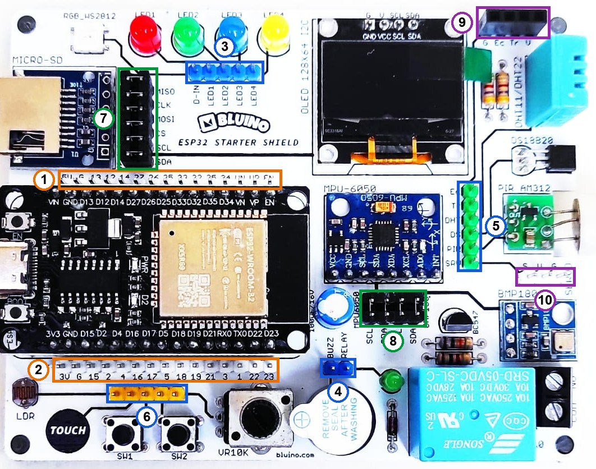
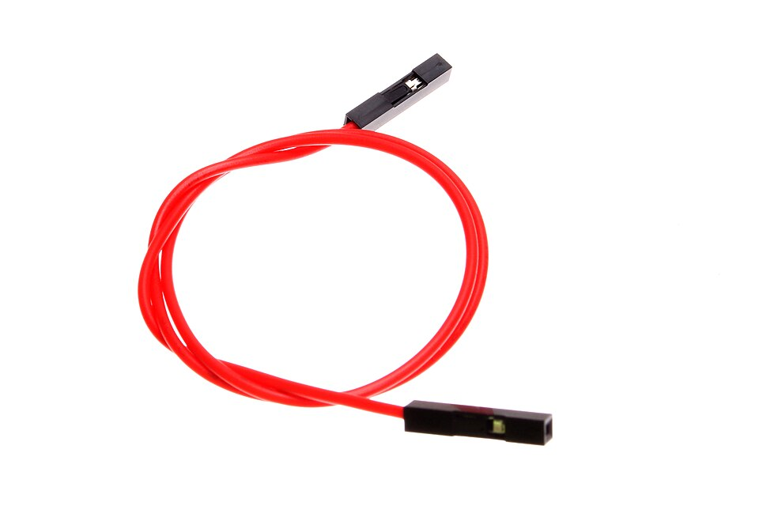

# BAB 6: Pin Mapping Kit Bluino & Restriksi GPIO

> ✅ **Prasyarat:** Selesaikan **BAB 5 (Setup Lingkungan Pengembangan)** — kamu sudah bisa mengunggah program ke ESP32 dan membuka Serial Monitor. Kemampuan membaca skematik sederhana dari [BAB 4](../BAB-04/README.md) akan membantu.

Sebelum menyalakan LED atau membaca sensor, kamu perlu tahu "alamat" setiap komponen: tersambung ke pin ESP32 nomor berapa. BAB ini adalah peta kit Bluino — mirip denah gedung yang menunjukkan ruangan mana di lantai mana. Kamu juga akan belajar bahwa tidak semua pin ESP32 sama: ada pin yang hanya bisa membaca, ada yang memengaruhi proses *booting*, dan ada yang tidak bisa membaca nilai analog saat WiFi menyala. **Peta Pin Standar** di BAB ini dipakai di seluruh BAB berikutnya, jadi tandai halaman ini supaya mudah dibuka lagi.

## 📌 Tujuan Pembelajaran

Setelah mempelajari BAB ini, kamu bisa:

- Membaca susunan 30 pin ESP32 DEVKIT V1 dan deretan pin kit yang menirunya.
- Menjelaskan konsep pin **Custom** dan menyambungkannya ke ESP32 dengan kabel *jumper* *female-female*.
- Memakai **Peta Pin Standar** kit Bluino untuk setiap komponen.
- Mengenali pin yang punya batasan: pin *flash* (IO6–IO11), pin *strapping*, pin TX0/RX0, pin *input-only* (IO34–IO39), dan pin ADC2 yang tidak bisa dipakai bersama WiFi.
- Menjelaskan bus I2C bersama beserta alamat perangkatnya (OLED `0x3C`, MPU-6050 `0x68`, BMP180 `0x77`).
- Mengetahui pin yang dipakai bergantian (IO33 dan IO25) dan alasan di balik pemilihan setiap pin standar.
- Memeriksa sambungan kit dengan program uji LED/tombol dan program pemindai I2C.

## 🧰 Yang Perlu Disiapkan

| Kebutuhan | Keterangan |
|---|---|
| *Hardware* | Kit Bluino ESP32 IoT Starter Shield + kabel USB **data** (konektornya micro-USB atau USB-C, tergantung versi *board*) |
| Kabel *jumper* | 6 kabel *female-female* untuk Program 1 (4 LED + 2 tombol) — sudah ada di kit |
| Komponen tambahan | Tidak ada |
| *Software* | Arduino IDE 2.x + *board package* **esp32** versi 3.3.x (lihat [BAB 5](../BAB-05/README.md)) |
| *Library* | Tidak perlu *library* tambahan (`Wire` untuk I2C sudah termasuk paket esp32) |
| Alat uji | **Serial Monitor** Arduino IDE (baud 115200) |
| Jaringan | Tidak perlu WiFi |

## 📑 Daftar Isi

- [6.1 Mengenal Pin ESP32 DEVKIT V1](#61-mengenal-pin-esp32-devkit-v1)
- [6.2 Konsep Pin Custom dan Cara Memasang Kabel Jumper](#62-konsep-pin-custom-dan-cara-memasang-kabel-jumper)
- [6.3 Peta Pin Standar Kit Bluino](#63-peta-pin-standar-kit-bluino)
- [6.4 Program 1: Uji Peta Pin — LED dan Tombol](#64-program-1-uji-peta-pin--led-dan-tombol)
- [6.5 Restriksi GPIO ESP32](#65-restriksi-gpio-esp32)
- [6.6 ADC1, ADC2, dan WiFi](#66-adc1-adc2-dan-wifi)
- [6.7 Bus I2C dan Alamat Perangkat](#67-bus-i2c-dan-alamat-perangkat)
- [6.8 Program 2: Pemindai I2C](#68-program-2-pemindai-i2c)
- [6.9 Pin Bergantian dan Alasan Pemilihan Pin Standar](#69-pin-bergantian-dan-alasan-pemilihan-pin-standar)
- [6.10 Memilih Pin untuk Komponen Tambahan](#610-memilih-pin-untuk-komponen-tambahan)
- [6.11 Troubleshooting](#611-troubleshooting)
- [📝 Rangkuman](#-rangkuman)
- [💪 Latihan](#-latihan)
- [📚 Referensi](#-referensi)

---

## 6.1 Mengenal Pin ESP32 DEVKIT V1

### 6.1.1 GPIO dan Cara Pin Diberi Nama

Setiap kaki ESP32 yang bisa diatur program disebut **GPIO** (*General Purpose Input/Output*, pin masukan/keluaran serbaguna). Satu GPIO bisa dijadikan *output* (misalnya menyalakan LED) atau *input* (misalnya membaca tombol), tergantung perintah di program.

*Board* ESP32 DEVKIT V1 di kit punya **30 pin** dalam dua baris (15 pin per sisi):

- **25 pin GPIO** yang bisa diprogram;
- **5 pin lain**: EN (*reset*), dua GND, VIN (jalur 5 V), dan 3V3 (jalur 3,3 V dari regulator *board*).

Satu pin yang sama bisa ditulis dengan beberapa nama. Jangan bingung — semuanya merujuk ke pin yang sama:

| Tulisan di *board* ESP32 | Label di deretan pin kit | Di skematik | Ditulis di kode |
|---|---|---|---|
| `D4` | `4` | `IO4` | `4` |
| `D13` | `13` | `IO13` | `13` |
| `VP` | `VP` | `VP` (IO36) | `36` |
| `VN` | `VN` | `VN` (IO39) | `39` |
| `TX0` | `1` | `IO1` | `1` |
| `RX0` | `3` | `IO3` | `3` |
| `RX2` atau `D16` | `16` | `IO16` | `16` |
| `TX2` atau `D17` | `17` | `IO17` | `17` |

Di materi ini pin ditulis dengan awalan **IO** (misalnya IO4), sedangkan di kode cukup angkanya (`4`).

> ⚠️ **Perhatian:** Semua GPIO ESP32 bekerja pada **3,3 V**. Jangan pernah memberi tegangan 5 V ke pin GPIO — pinnya bisa rusak permanen.

### 6.1.2 Susunan Pin di Kit

Di kit, *board* ESP32 dipasang mendatar dengan konektor USB di sebelah kiri. Tepat di atas dan di bawahnya ada **dua deretan pin header** yang meniru pin-pin ESP32: setiap pin di deretan itu tersambung ke pin ESP32 dengan nomor yang sama. Ke deretan inilah kabel *jumper* nanti dicolokkan.


*Gambar 6.1 — ESP32 DEVKIT V1 (kiri) dan dua header 15 pin yang tersambung ke pin-pinnya (kanan). Kapasitor 0,1 µF di pin EN membantu proses* reset *otomatis saat mengunggah. Sumber: skematik ESP32 Starter Shield 3.2, [Bluino](http://www.bluino.com).*

Urutan label di kedua deretan, dilihat dengan konektor USB ESP32 di sebelah kiri:

| Urutan dari kiri | Deretan atas | Deretan bawah |
|---|---|---|
| 1 | `5V` (tersambung ke VIN) | `3V` (tersambung ke 3V3) |
| 2 | `G` (GND) | `G` (GND) |
| 3 | `13` | `15` |
| 4 | `12` | `2` |
| 5 | `14` | `4` |
| 6 | `27` | `16` |
| 7 | `26` | `17` |
| 8 | `25` | `5` |
| 9 | `33` | `18` |
| 10 | `32` | `19` |
| 11 | `35` | `21` |
| 12 | `34` | `3` (RX0) |
| 13 | `VN` (IO39) | `1` (TX0) |
| 14 | `VP` (IO36) | `22` |
| 15 | `EN` | `23` |

> 📌 **Catatan:** ESP32 DEVKIT V1 versi 30 pin **tidak** mengeluarkan IO0 (pin tombol **BOOT**) dan IO6–IO11 (pin *flash*) ke header. Jadi pin-pin itu memang tidak bisa kamu pakai di kit ini.

---

## 6.2 Konsep Pin Custom dan Cara Memasang Kabel Jumper

Komponen di kit Bluino terbagi dua:

1. **Sudah tersambung ke ESP32** lewat jalur PCB dan *jumper cap* — OLED, MPU-6050, BMP180 (bus I2C), dan adaptor microSD.
2. **Belum tersambung.** Ujung sinyal komponen hanya dibawa ke sebuah pin header yang di skematik diberi tanda **Custom** (atau nomor IO yang disarankan, misalnya `IO27`), dan di PCB diberi label nama komponennya (misalnya `DHT`, `LED1`, `SW1`). Kamu sendiri yang menyambungkannya ke pin ESP32 dengan kabel *jumper*. Kelompok ini mencakup **semua** komponen lain, termasuk DHT11, DS18B20, dan RGB LED WS2812.

Sistem ini mirip papan sambung telepon zaman dulu: operator memilih kabel mana yang dicolokkan ke saluran mana. Manfaatnya, kamu terlatih membaca *pinout* (peta pin), bebas memilih pin, dan komponen yang tidak dipakai tidak ikut mengganggu.

### 6.2.1 Letak Header di Kit



*Gambar 6.2 — Letak deretan pin ESP32 dan header Custom pada kit v3.x; tata letak kit v3.2 milikmu bisa sedikit berbeda. Sumber: foto produk ESP32 Starter Shield, [Bluino](http://www.bluino.com), dipotong dan diberi penanda untuk materi ini.*

| No. | Bagian | Label (urut dari kiri atau dari atas) |
|---|---|---|
| 1 | Deretan pin ESP32 atas | `5V`, `G`, `13`, `12`, `14`, `27`, `26`, `25`, `33`, `32`, `35`, `34`, `VN`, `VP`, `EN` |
| 2 | Deretan pin ESP32 bawah | `3V`, `G`, `15`, `2`, `4`, `16`, `17`, `5`, `18`, `19`, `21`, `3`, `1`, `22`, `23` |
| 3 | Header LED (biru, di bawah 4 LED) | `D-IN` (data WS2812), `LED1` (merah), `LED2` (hijau), `LED3` (biru), `LED4` (kuning) |
| 4 | Header biru dekat *buzzer* | `BUZZ` (*buzzer*), `RELAY` — bersebelahan, jangan tertukar |
| 5 | Header hijau (dari atas) | `Ec` (Echo HC-SR04), `Tr` (Trig HC-SR04), `DHT` (DHT11), `DS` (DS18B20), `PIR`, `SRV` (sinyal servo) |
| 6 | Header kuning 5 pin, tanpa tulisan (dari kiri) | LDR, TOUCH, SW1 (tombol S1), SW2 (tombol S2), VR10K (potensiometer) |
| 7 | Blok *jumper cap* microSD dan OLED | `MISO`, `CLK`, `MOSI`, `CS` (microSD), `SCL`, `SDA` (OLED) |
| 8 | Blok *jumper cap* MPU-6050 dan BMP180 | `SCL`, `SDA` (MPU6050), `SCL`, `SDA` (BMP180) |
| 9 | Konektor HC-SR04 | `G`, `Ec`, `Tr`, `V` — tempat modul HC-SR04 dicolokkan |
| 10 | Konektor servo | `S` (sinyal), `V` (5 V), `G` (GND) |

Beberapa hal yang sering membingungkan pemula:

- **Nomor LED tidak urut dengan nomor pin.** LED1 = merah, LED2 = hijau, LED3 = biru, LED4 = kuning. Yang menentukan pin adalah **warnanya** (lihat [6.3](#63-peta-pin-standar-kit-bluino)). Kalau urutan warna di kit-mu berbeda, ikuti garis jalur PCB dari LED ke pin header-nya.
- **Header kuning tidak diberi tulisan.** Kenali dari garis jalurnya: garis dari LDR berakhir di pin ke-1, TOUCH ke-2, SW1 ke-3, SW2 ke-4, dan VR10K ke-5.
- **Angka di atas header kuning bukan nama pin kuning.** Angka `3V G 15 2 4 16 17 5 …` yang tercetak di dekatnya adalah label deretan pin ESP32 bawah (pin putih tepat di atasnya).
- ***Jumper cap*** (penutup *jumper*) di blok nomor 7 dan 8 adalah konektor kecil yang menghubungkan dua pin berdampingan. Dari pabrik semuanya sudah terpasang sehingga OLED, MPU-6050, BMP180, dan microSD langsung tersambung ke ESP32. **Biarkan terpasang.** Melepasnya berarti memutus modul tersebut dari ESP32.

### 6.2.2 Kabel Jumper Female-Female

Kabel *jumper* *female-female* punya **soket (lubang) di kedua ujungnya**, sehingga pas dicolokkan ke pin header jantan di kit. Kit menyediakan 10 kabel seperti ini.



*Gambar 6.3 — Kabel jumper female-female: kedua ujungnya berupa soket. Sumber: [oomlout](https://commons.wikimedia.org/wiki/File:Female-Female_Jumper_Wire.jpg), lisensi CC BY-SA 2.0.*

### 6.2.3 Langkah Memasang Kabel Jumper

Contoh: menyambungkan LED merah ke IO4.

1. **Cabut kabel USB dulu.** Biasakan merangkai saat ESP32 tidak bertegangan.
2. Cari pin Custom komponennya — LED merah adalah `LED1` di header LED (nomor 3 pada Gambar 6.2).
3. Colokkan satu ujung kabel *jumper* ke pin tersebut sampai masuk penuh.
4. Cari pin tujuan di deretan pin ESP32 — untuk IO4, cari label `4` di deretan bawah (nomor 2).
5. Colokkan ujung lainnya, lalu cocokkan sekali lagi dengan tabel **Rangkaian** di BAB yang sedang kamu kerjakan.
6. Sambungkan kembali kabel USB.

Aturan aman saat memasang kabel:

- Jangan menyambungkan pin Custom ke pin `5V`, `3V`, atau `G`, kecuali BAB yang kamu kerjakan memintanya.
- Satu pin ESP32 hanya untuk satu komponen, kecuali pin yang memang dipakai bergantian dengan aturan khusus (lihat [6.9](#69-pin-bergantian-dan-alasan-pemilihan-pin-standar)).
- Jangan menyambungkan dua pin ESP32 satu sama lain.
- Pin IO34, IO35, IO36 (VP), dan IO39 (VN) hanya bisa menjadi *input* (lihat [6.5](#65-restriksi-gpio-esp32)).
- Hitung posisi pin dengan teliti. Kabel yang meleset satu pin bisa berbahaya: misalnya label `15` bersebelahan dengan `G`, sehingga kabel tombol S1 yang tergeser ke `G` akan menyambung 3,3 V langsung ke GND (hubung singkat) saat tombol ditekan.

---

## 6.3 Peta Pin Standar Kit Bluino

Peta berikut dipakai di **semua** BAB supaya kamu tidak perlu bongkar-pasang kabel setiap ganti BAB. Kalau sebuah program terpaksa memakai pin lain (misalnya karena fitur yang hanya ada di pin tertentu), BAB tersebut akan menjelaskan alasannya dan kabel mana yang perlu dipindah.

### 6.3.1 Komponen dengan Pin Tetap

Komponen berikut punya pin yang sudah ditentukan perancang kit, lengkap dengan komponen pendukungnya (misalnya resistor *pull-up*) di PCB:

| Komponen | Pin ESP32 | Cara tersambung |
|---|---|---|
| OLED SSD1306 (alamat I2C `0x3C`) | SDA = IO21, SCL = IO22 | Lewat *jumper cap* (blok nomor 7) — sudah terpasang |
| BMP180 (alamat I2C `0x77`) | SDA = IO21, SCL = IO22 | Lewat *jumper cap* (blok nomor 8) — sudah terpasang |
| MPU-6050 (alamat I2C `0x68`) | SDA = IO21, SCL = IO22 | Lewat *jumper cap* (blok nomor 8) — sudah terpasang |
| DHT11 (*pull-up* 4,7 kΩ di PCB) | IO27 | Kabel *jumper*: pin `DHT` (header hijau) → label `27` |
| DS18B20 (*pull-up* 4,7 kΩ di PCB) | IO14 | Kabel *jumper*: pin `DS` (header hijau) → label `14` |
| RGB LED WS2812 | IO12 | Kabel *jumper*: pin `D-IN` (header LED) → label `12` |
| microSD (SPI) | CS = IO5, MOSI = IO23, CLK = IO18, MISO = IO19 | Lewat *jumper cap* (blok nomor 7) — sudah terpasang |

> ⚠️ **Perhatian (DHT11, DS18B20, WS2812):** Pin ketiga komponen ini sudah ditentukan perancang kit (di skematik v3.2 tertulis IO27, IO14, IO12), tetapi jalurnya **belum** tersambung ke ESP32 — sama seperti pin Custom. Di PCB, pin datanya berlabel `DHT`, `DS` (header hijau), dan `D-IN` (header LED). Pasang kabel *jumper* `DHT` → `27`, `DS` → `14`, dan `D-IN` → `12` sebelum memakai komponen tersebut. Tanpa kabel ini, sensor tidak akan terbaca dan WS2812 tidak akan menyala.

### 6.3.2 Pin Custom (Disambung dengan Kabel Jumper)

| Komponen | Pin Custom di kit | Pin ESP32 | Catatan |
|---|---|---|---|
| LED Merah | `LED1` | IO4 | Aktif HIGH (menyala saat HIGH) |
| LED Kuning | `LED4` | IO16 | Aktif HIGH |
| LED Hijau | `LED2` | IO17 | Aktif HIGH |
| LED Biru | `LED3` | IO2 | Aktif HIGH; IO2 juga terhubung ke LED biru bawaan *board* |
| *Buzzer* aktif | `BUZZ` | IO13 | Aktif HIGH |
| *Relay* | `RELAY` | IO26 | Aktif HIGH (lewat transistor BC547) |
| Tombol S1 (SW1) | Pin kuning ke-3 | IO15 | Ditekan = HIGH (*pull-down* 10 kΩ di PCB) → pakai `INPUT` |
| Tombol S2 (SW2) | Pin kuning ke-4 | IO25 | Ditekan = HIGH → pakai `INPUT` |
| Sensor PIR AM312 | `PIR` | IO33 | HIGH saat ada gerakan |
| *Touch pad* | Pin kuning ke-2 | IO33 (T8) | Bergantian dengan PIR — pasang salah satu saja |
| Potensiometer | Pin kuning ke-5 | IO34 | ADC1, aman dipakai bersama WiFi |
| LDR | Pin kuning ke-1 | IO35 | ADC1; **makin gelap → nilai ADC makin besar** (LDR di sisi GND) |
| Servo (sinyal) | `SRV` | IO32 | Daya servo dari header servo (5 V) |
| HC-SR04 Trig | `Tr` | IO25 | Bergantian dengan tombol S2 |
| HC-SR04 Echo | `Ec` | IO36 (VP) | **Wajib lewat pembagi tegangan** (Echo = 5 V, ESP32 maks. 3,3 V) |

Cara menyambung: kabel *jumper* *female-female* dari pin Custom ke pin di deretan ESP32 yang labelnya sama dengan nomor IO-nya (misalnya label `4` untuk IO4). Istilah yang mungkin baru:

- **Aktif HIGH** — komponen bekerja saat pinnya HIGH (sekitar 3,3 V). LED, *buzzer*, dan *relay* di kit semuanya aktif HIGH.
- ***Pull-up*/*pull-down*** — resistor yang "menarik" pin ke 3,3 V (*pull-up*) atau ke GND (*pull-down*) supaya nilainya tidak mengambang. Dibahas tuntas di [BAB 9](../BAB-09/README.md).
- **ADC** (*Analog-to-Digital Converter*) — pengubah tegangan analog menjadi angka. Dibahas di [6.6](#66-adc1-adc2-dan-wifi) dan [BAB 11](../BAB-11/README.md).

> 📌 **Catatan:** Sensor HC-SR04 dan motor servo **tidak termasuk kit** — kit hanya menyediakan konektornya (nomor 9 dan 10 pada Gambar 6.2). Pembagi tegangan untuk pin Echo juga butuh 2 resistor tambahan; caranya dibahas di [BAB 30](../BAB-30/README.md).

---

## 6.4 Program 1: Uji Peta Pin — LED dan Tombol

**Tujuan:** Memeriksa apakah kabel *jumper* LED dan tombol sudah terpasang sesuai Peta Pin Standar. Saat dinyalakan, keempat LED menyala bergiliran; setelah itu tombol S1 menyalakan LED merah dan kuning, sedangkan tombol S2 menyalakan LED hijau dan biru. Setiap kejadian dilaporkan ke Serial Monitor.

**Rangkaian:**

| Pin **Custom** di kit | Sambungkan ke pin ESP32 |
|---|---|
| `LED1` (LED merah) | IO4 (label `4`, deretan bawah) |
| `LED4` (LED kuning) | IO16 (label `16`, deretan bawah) |
| `LED2` (LED hijau) | IO17 (label `17`, deretan bawah) |
| `LED3` (LED biru) | IO2 (label `2`, deretan bawah) |
| SW1 (pin kuning ke-3) | IO15 (label `15`, deretan bawah) |
| SW2 (pin kuning ke-4) | IO25 (label `25`, deretan atas) |

**Cara Menjalankan:**

1. Cabut kabel USB, lalu pasang 6 kabel *jumper* sesuai tabel **Rangkaian** di atas (lihat langkah di [6.2.3](#623-langkah-memasang-kabel-jumper)). Pastikan kabel S1 tertancap di `15`, bukan di `G` sebelahnya.
2. Sambungkan kembali kabel USB.
3. Buka Arduino IDE → **File → New Sketch**, hapus isinya, lalu salin kode di bawah. Kode yang sama juga tersedia di *file* [`p1_uji_peta_pin.ino`](p1_uji_peta_pin/p1_uji_peta_pin.ino).
4. Pastikan **Tools → Board** = **ESP32 Dev Module** dan **Tools → Port** = *port* ESP32 kamu (misalnya `COM5` di Windows atau `/dev/ttyUSB0` di Linux).
5. Klik tombol **Upload** (ikon panah →) dan tunggu sampai muncul tulisan **Done uploading**.
6. Buka **Serial Monitor** (**Tools → Serial Monitor**) lalu pilih baud **115200**. Tekan tombol **EN** di *board* supaya uji LED diulang dari awal sambil kamu amati.

**Kode Program:**

<!-- sketch: p1_uji_peta_pin -->
```cpp
// BAB 6 — Program 1: Uji Peta Pin (LED dan Tombol)
// Memeriksa kabel jumper LED dan tombol sesuai Peta Pin Standar kit Bluino.
// Rangkaian:
//   LED1 (merah) -> IO4    LED4 (kuning) -> IO16
//   LED2 (hijau) -> IO17   LED3 (biru)   -> IO2
//   SW1 (pin kuning ke-3) -> IO15, SW2 (pin kuning ke-4) -> IO25

#define LED_MERAH  4
#define LED_KUNING 16
#define LED_HIJAU  17
#define LED_BIRU   2    // IO2 juga menyalakan LED biru bawaan board
#define TOMBOL_S1  15   // ditekan = HIGH (pull-down 10 kΩ sudah ada di kit)
#define TOMBOL_S2  25   // ditekan = HIGH

bool s1Sebelumnya = false;  // keadaan tombol pada putaran loop() sebelumnya
bool s2Sebelumnya = false;

// Menyalakan satu LED selama 0,7 detik sambil melaporkannya ke Serial Monitor
void ujiLed(int pin, const char *warna) {
  Serial.print("LED ");
  Serial.print(warna);
  Serial.print(" (IO");
  Serial.print(pin);
  Serial.println(") menyala");
  digitalWrite(pin, HIGH);
  delay(700);
  digitalWrite(pin, LOW);
}

void setup() {
  Serial.begin(115200);
  delay(1000);  // beri waktu Serial Monitor tersambung

  pinMode(LED_MERAH, OUTPUT);
  pinMode(LED_KUNING, OUTPUT);
  pinMode(LED_HIJAU, OUTPUT);
  pinMode(LED_BIRU, OUTPUT);
  pinMode(TOMBOL_S1, INPUT);  // INPUT biasa, karena pull-down sudah ada di PCB
  pinMode(TOMBOL_S2, INPUT);

  Serial.println("=== Uji Peta Pin Kit Bluino ===");
  ujiLed(LED_MERAH, "merah");
  ujiLed(LED_KUNING, "kuning");
  ujiLed(LED_HIJAU, "hijau");
  ujiLed(LED_BIRU, "biru");
  Serial.println("Uji LED selesai. Tekan tombol S1 atau S2.");
}

void loop() {
  bool s1 = (digitalRead(TOMBOL_S1) == HIGH);
  bool s2 = (digitalRead(TOMBOL_S2) == HIGH);

  // S1 menyalakan LED merah dan kuning, S2 menyalakan LED hijau dan biru
  digitalWrite(LED_MERAH, s1 ? HIGH : LOW);
  digitalWrite(LED_KUNING, s1 ? HIGH : LOW);
  digitalWrite(LED_HIJAU, s2 ? HIGH : LOW);
  digitalWrite(LED_BIRU, s2 ? HIGH : LOW);

  // Laporkan hanya saat keadaan tombol berubah
  if (s1 != s1Sebelumnya) {
    Serial.println(s1 ? "S1 (IO15) ditekan" : "S1 (IO15) dilepas");
    s1Sebelumnya = s1;
  }
  if (s2 != s2Sebelumnya) {
    Serial.println(s2 ? "S2 (IO25) ditekan" : "S2 (IO25) dilepas");
    s2Sebelumnya = s2;
  }

  delay(20);  // jeda singkat supaya getaran kontak tombol tidak terbaca berkali-kali
}
```

**Penjelasan Kode:**

- Bagian `#define` memberi nama untuk setiap nomor pin sesuai Peta Pin Standar. Kalau suatu saat pinnya berubah, cukup ubah di satu tempat.
- Fungsi `ujiLed()` menyalakan satu LED selama 0,7 detik sambil mencetak warnanya dan nomor IO-nya, sehingga kamu bisa mencocokkan LED yang menyala dengan tulisan di Serial Monitor.
- Tombol memakai `pinMode(…, INPUT)` biasa karena resistor *pull-down* 10 kΩ sudah terpasang di PCB: dilepas = LOW, ditekan = HIGH.
- Di `loop()`, keadaan tombol dibaca terus-menerus. Variabel `s1Sebelumnya` dan `s2Sebelumnya` menyimpan keadaan sebelumnya, jadi pesan hanya dicetak saat keadaan **berubah** (ditekan atau dilepas), bukan ratusan kali per detik.
- Ekspresi `s1 ? HIGH : LOW` artinya "kalau `s1` benar pakai HIGH, kalau tidak pakai LOW".

**Contoh Output:**

```text
=== Uji Peta Pin Kit Bluino ===
LED merah (IO4) menyala
LED kuning (IO16) menyala
LED hijau (IO17) menyala
LED biru (IO2) menyala
Uji LED selesai. Tekan tombol S1 atau S2.
S1 (IO15) ditekan
S1 (IO15) dilepas
S2 (IO25) ditekan
S2 (IO25) dilepas
```

Di kit, LED merah, kuning, hijau, dan biru menyala bergiliran masing-masing 0,7 detik (saat LED biru menyala, LED kecil bawaan *board* ikut menyala). Setelah itu, selama S1 ditahan LED merah dan kuning menyala, dan selama S2 ditahan LED hijau dan biru menyala.

> 📌 **Catatan:** Selama kabel S1 terpasang, baris-baris pesan *boot* bawaan ESP32 (seperti `rst:0x1 (POWERON_RESET),boot:0x13 …`) tidak muncul saat tombol EN ditekan. Itu normal — penyebabnya dijelaskan di [6.5.2](#652-pin-strapping).

**Kalau Belum Berhasil:**

- **Ada LED yang tidak menyala saat uji, padahal Serial Monitor menuliskannya** → kabel LED itu longgar atau tertancap di pin yang salah. Cocokkan warna, label header (`LED1`–`LED4`), dan label pin ESP32-nya sekali lagi.
- **Yang menyala LED dengan warna berbeda dari tulisan di Serial Monitor** → kabel antar-LED tertukar. Ingat: LED1 = merah, LED2 = hijau, LED3 = biru, LED4 = kuning.
- **Serial Monitor terus menampilkan "ditekan"/"dilepas" padahal tombol tidak disentuh** → pin tombol mengambang karena kabelnya lepas atau tertancap di pin yang salah. Cabut USB dan pasang ulang kabelnya.
- **ESP32 *restart* setiap kali S1 ditekan** → kabel S1 tergeser ke pin `G` sehingga terjadi hubung singkat. Segera cabut USB dan pindahkan kabel ke pin `15`.

---

## 6.5 Restriksi GPIO ESP32

Tidak semua GPIO bisa dipakai bebas. Ada empat kelompok pin yang perlu kamu kenali.

### 6.5.1 Pin Flash IO6–IO11 (Dilarang)

Di dalam modul ESP32-WROOM-32 ada chip memori *flash* 4 MB tempat programmu disimpan. Chip ESP32 membaca *flash* itu lewat IO6 (CLK), IO7 (SD0), IO8 (SD1), IO9 (SD2), IO10 (SD3), dan IO11 (CMD). Kalau pin-pin ini dipakai untuk keperluan lain, ESP32 tidak bisa membaca programnya sendiri lalu *crash* atau *restart* terus-menerus.

Di DEVKIT V1 versi 30 pin, IO6–IO11 tidak dikeluarkan ke header, jadi tidak mungkin tersambung kabel secara tidak sengaja. Yang perlu dijaga: **jangan menulis nomor 6–11 di kode** (misalnya `pinMode(6, OUTPUT)`).

### 6.5.2 Pin Strapping

**Pin *strapping*** adalah pin yang levelnya (HIGH atau LOW) dibaca ESP32 **sekali**, tepat saat dinyalakan atau di-*reset*, untuk menentukan pengaturan *boot*. Ibaratnya sakelar pengaturan kecil di bagian belakang alat elektronik yang hanya diperiksa saat alat dinyalakan. Setelah proses *boot* selesai, pin *strapping* bisa dipakai seperti GPIO biasa — asalkan rangkaian yang tersambung tidak memaksakan level yang salah saat *boot*.

ESP32 punya lima pin *strapping*. Masing-masing sudah punya resistor internal yang memberi level bawaan yang aman:

| Pin | Dibaca saat *boot* untuk… | Level bawaan | Kalau levelnya salah | Di kit Bluino |
|---|---|---|---|---|
| IO0 | Memilih mode: HIGH = jalankan program, LOW = mode unggah | HIGH | ESP32 masuk mode unggah sehingga programmu tidak berjalan | Tersambung ke tombol **BOOT**; tidak ada di header |
| IO2 | Ikut menentukan mode unggah; harus LOW atau mengambang saat masuk mode unggah | LOW | Unggah gagal kalau IO2 HIGH | LED biru — aman, karena LED dan resistor ke GND tidak membuatnya HIGH |
| IO5 | Pengaturan *timing* antarmuka SDIO | HIGH | Tidak berpengaruh pada pemakaian biasa | CS microSD |
| IO12 (MTDI) | Memilih tegangan chip *flash*: LOW = 3,3 V, HIGH = 1,8 V | LOW | *Flash* 3,3 V di ESP32-WROOM-32 hanya diberi 1,8 V sehingga ESP32 gagal *boot* (misalnya muncul pesan `flash read err, 1000`) | Data WS2812 — aman, karena input WS2812 tidak membuat IO12 HIGH |
| IO15 (MTDO) | Menyalakan atau mematikan pesan *boot* bawaan di Serial Monitor | HIGH | Kalau LOW, pesan *boot* bawaan tidak tampil (tidak berbahaya) | Tombol S1 dengan *pull-down* 10 kΩ, jadi pesan *boot* bawaan tidak tampil selama kabel S1 terpasang |

Aturan praktisnya:

- **Jangan** memasang resistor *pull-up*, tombol ke 3,3 V, atau modul yang mengeluarkan HIGH ke **IO12** — ESP32 bisa gagal *boot*.
- **Jangan** memasang sesuatu yang menarik **IO2** ke HIGH, karena unggah akan gagal.
- Kalau ESP32 tiba-tiba gagal *boot* atau gagal diunggah setelah kamu menambah kabel, curigai pin *strapping*: cabut kabel itu dulu, lalu coba lagi.

> 💡 **Tips:** Kalau kabel S1 terpasang lalu kamu menahan tombol S1 sambil menekan **EN**, IO15 terbaca HIGH dan pesan *boot* bawaan (`rst:0x1 (POWERON_RESET),boot:0x13 …`) muncul lagi. Cara ini berguna untuk membuktikan bahwa IO15 benar-benar pin *strapping*.

### 6.5.3 Pin Serial TX0/RX0 (IO1 dan IO3)

IO1 (TX0) dan IO3 (RX0) tersambung ke chip USB-to-UART di *board*. Lewat dua pin inilah program diunggah dan Serial Monitor bekerja. Kalau kamu menyambungkan komponen lain ke pin ini, unggah bisa gagal dan pesan di Serial Monitor jadi kacau. Anggap saja keduanya sudah "dipesan" untuk USB — jangan dipakai.

### 6.5.4 Pin Input-Only IO34–IO39

IO34, IO35, IO36 (VP), dan IO39 (VN) **hanya bisa menjadi *input***:

- Tidak bisa menyalakan LED atau *buzzer* — `digitalWrite()` ke pin ini tidak berpengaruh.
- Tidak punya resistor *pull-up*/*pull-down* internal, jadi `INPUT_PULLUP` dan `INPUT_PULLDOWN` tidak bekerja. Kalau butuh, pasang resistor sendiri di luar.
- Sangat cocok untuk sensor yang hanya dibaca: potensiometer (IO34), LDR (IO35), dan sinyal Echo HC-SR04 (IO36). Rangkaian potensiometer dan LDR di kit sudah berupa pembagi tegangan, jadi tidak perlu resistor tambahan.

> ⚠️ **Perhatian:** Espressif mencatat (*errata* ESP32) bahwa saat ADC menyala, input IO36 dan IO39 bisa tertarik LOW sesaat (sekitar 80 nanodetik). Untuk pembacaan biasa hal ini tidak terasa, tetapi bisa memicu *interrupt* palsu. Karena itu jangan pakai IO36/IO39 untuk *interrupt* (dibahas di [BAB 10](../BAB-10/README.md)) bila program memakai ADC atau WiFi/Bluetooth dengan mode hemat daya.

### 6.5.5 Ringkasan Restriksi

| GPIO | Status | Keterangan |
|---|---|---|
| IO0 | ⚠️ *Strapping* | Tombol BOOT; LOW saat *reset* = mode unggah. Tidak ada di header kit |
| IO1, IO3 | ❌ TX0/RX0 | Dipakai USB untuk unggah dan Serial Monitor — jangan dipakai |
| IO2 | ⚠️ *Strapping* | Harus LOW/mengambang saat masuk mode unggah. Aman untuk LED |
| IO5 | ⚠️ *Strapping* | Dipakai CS microSD pada kit ini |
| IO6–IO11 | 🚫 Dilarang | Tersambung ke *flash* internal; tidak ada di header kit |
| IO12 | ⚠️ *Strapping* | Harus LOW saat *boot* (tegangan *flash*). Dipakai WS2812 pada kit ini |
| IO15 | ⚠️ *Strapping* | LOW saat *boot* hanya mematikan pesan *boot* bawaan; aman untuk tombol S1 |
| IO34–IO39 | ℹ️ Hanya *input* | Tanpa *pull-up*/*pull-down* internal; IO36/IO39 jangan dipakai untuk *interrupt* |
| ADC2 (IO0, 2, 4, 12–15, 25–27) | ⚠️ ADC2 | Tidak bisa membaca analog saat WiFi aktif — pakai ADC1 (IO32–IO39), lihat [6.6](#66-adc1-adc2-dan-wifi) |

---

## 6.6 ADC1, ADC2, dan WiFi

**ADC** (*Analog-to-Digital Converter*) mengubah tegangan analog (misalnya 0–3,3 V dari potensiometer) menjadi angka yang bisa diolah program. ESP32 punya **dua unit ADC**:

| Unit | Pin di DEVKIT V1 | Bisa dipakai saat WiFi aktif? |
|---|---|---|
| **ADC1** | IO32, IO33, IO34, IO35, IO36 (VP), IO39 (VN) | ✅ Bisa |
| **ADC2** | IO0, IO2, IO4, IO12, IO13, IO14, IO15, IO25, IO26, IO27 | ❌ Tidak bisa |

ADC2 juga dipakai oleh *driver* WiFi. Selama WiFi menyala, `analogRead()` pada pin ADC2 bisa gagal — biasanya hasilnya 0 atau tidak masuk akal. Ibaratnya satu-satunya meteran di rumah sedang dipinjam tetangga: kamu tidak bisa memakainya sampai dikembalikan.

Itulah sebabnya potensiometer (IO34) dan LDR (IO35) di Peta Pin Standar sengaja ditempatkan di **ADC1**, sehingga tetap bisa dibaca di BAB-BAB WiFi mulai [BAB 42](../BAB-42/README.md).

> 💡 **Tips:** Kalau proyekmu memakai WiFi dan butuh membaca sensor analog tambahan, pilih pin ADC1. Di Peta Pin Standar, pin ADC1 yang masih bebas adalah **IO39 (VN)**.

---

## 6.7 Bus I2C dan Alamat Perangkat

**I2C** (*Inter-Integrated Circuit*) adalah cara berkomunikasi dengan banyak perangkat hanya lewat **dua kabel**:

- **SDA** (*Serial Data*) — jalur data, di kit memakai **IO21**;
- **SCL** (*Serial Clock*) — jalur detak/penanda waktu, di kit memakai **IO22**.

Semua perangkat I2C menumpang di dua kabel yang sama, seperti rumah-rumah di satu jalan. Supaya tidak tertukar, setiap perangkat punya **alamat** sendiri. ESP32 "memanggil" alamat tertentu, dan hanya perangkat dengan alamat itu yang menjawab.

| Perangkat di kit | Alamat I2C | Alamat dalam desimal | Kegunaan |
|---|---|---|---|
| OLED SSD1306 128×64 | `0x3C` | 60 | Layar tampilan |
| MPU-6050 | `0x68` | 104 | Akselerometer dan giroskop |
| BMP180 | `0x77` | 119 | Tekanan udara dan suhu |

Karena alamatnya berbeda-beda, ketiga perangkat bisa dipakai **bersamaan**. Awalan `0x` artinya angka ditulis dalam heksadesimal (basis 16).

Hal-hal penting tentang bus I2C di kit:

- Di kode, bus I2C dimulai dengan `Wire.begin(21, 22);`. Karena IO21 dan IO22 adalah pin I2C bawaan untuk **ESP32 Dev Module**, `Wire.begin();` tanpa angka pun memakai pin yang sama.
- Ketiga modul tersambung ke IO21/IO22 lewat *jumper cap* (blok nomor 7 dan 8 pada Gambar 6.2). Kalau satu modul tidak terdeteksi, periksa dulu *jumper cap*-nya.
- Bus I2C membutuhkan resistor *pull-up* di SDA dan SCL. Pada modul-modul seperti ini resistornya umumnya sudah ada di papan modul, jadi kamu tidak perlu menambahkannya.
- Kalau kamu menambah perangkat I2C sendiri, pastikan alamatnya **tidak sama** dengan `0x3C`, `0x68`, atau `0x77`. Contohnya, modul BME280/BMP280 sering beralamat `0x76` atau `0x77`; yang `0x77` akan bentrok dengan BMP180.
- IO21 dan IO22 sudah dipakai bus I2C — jangan disambungkan ke tombol, LED, atau komponen lain.

Protokol I2C dibahas lebih dalam di [BAB 23](../BAB-23/README.md).

---

## 6.8 Program 2: Pemindai I2C

**Tujuan:** Mencari semua perangkat yang tersambung ke bus I2C kit (SDA = IO21, SCL = IO22), lalu menampilkan alamat dan nama perangkatnya di Serial Monitor. Program ini berguna untuk memastikan OLED, MPU-6050, dan BMP180 tersambung dengan baik sebelum kamu memakainya di BAB-BAB berikutnya.

**Rangkaian:**

*Tidak perlu merangkai — OLED, MPU-6050, dan BMP180 sudah tersambung ke IO21/IO22 lewat* jumper cap *di kit. Pastikan saja semua* jumper cap *di blok nomor 7 dan 8 (Gambar 6.2) terpasang.*

**Cara Menjalankan:**

1. Pastikan *jumper cap* I2C terpasang. Kabel *jumper* dari Program 1 boleh tetap terpasang — program ini tidak memakai pin LED dan tombol.
2. Buka Arduino IDE → **File → New Sketch**, hapus isinya, lalu salin kode di bawah. Kode yang sama juga tersedia di *file* [`p2_pemindai_i2c.ino`](p2_pemindai_i2c/p2_pemindai_i2c.ino).
3. Pastikan **Tools → Board** = **ESP32 Dev Module** dan **Tools → Port** = *port* ESP32 kamu (misalnya `COM5` di Windows atau `/dev/ttyUSB0` di Linux).
4. Klik tombol **Upload** (ikon panah →) dan tunggu sampai muncul tulisan **Done uploading**.
5. Buka **Serial Monitor** (**Tools → Serial Monitor**) lalu pilih baud **115200**. Hasil pemindaian muncul setiap 5 detik.

**Kode Program:**

<!-- sketch: p2_pemindai_i2c -->
```cpp
// BAB 6 — Program 2: Pemindai I2C
// Mencari semua perangkat di bus I2C kit Bluino (SDA = IO21, SCL = IO22),
// lalu menampilkan alamat dan nama perangkatnya di Serial Monitor.

#include <Wire.h>

#define PIN_SDA 21
#define PIN_SCL 22

// Mengembalikan nama perangkat kit berdasarkan alamat I2C-nya
const char *namaPerangkat(uint8_t alamat) {
  switch (alamat) {
    case 0x3C: return "OLED SSD1306";
    case 0x68: return "MPU-6050";
    case 0x77: return "BMP180";
    default:   return "perangkat lain";
  }
}

void setup() {
  Serial.begin(115200);
  delay(1000);  // beri waktu Serial Monitor tersambung
  Wire.begin(PIN_SDA, PIN_SCL);
  Serial.println("Pemindai I2C kit Bluino (SDA = IO21, SCL = IO22)");
}

void loop() {
  Serial.println("Memindai alamat 0x01 sampai 0x7E ...");
  int jumlah = 0;

  for (uint8_t alamat = 0x01; alamat <= 0x7E; alamat++) {
    Wire.beginTransmission(alamat);           // "memanggil" alamat ini
    uint8_t hasil = Wire.endTransmission();   // 0 = ada perangkat yang menjawab

    if (hasil == 0) {
      Serial.printf("  Ditemukan: 0x%02X (%s)\n", alamat, namaPerangkat(alamat));
      jumlah++;
    }
  }

  Serial.printf("Selesai: %d perangkat ditemukan.\n\n", jumlah);
  delay(5000);  // ulangi pemindaian setiap 5 detik
}
```

**Penjelasan Kode:**

- `#include <Wire.h>` memuat *library* I2C bawaan paket esp32, lalu `Wire.begin(PIN_SDA, PIN_SCL)` menyalakan bus I2C di IO21 (SDA) dan IO22 (SCL).
- Perulangan `for` mencoba setiap alamat dari `0x01` sampai `0x7E`. Untuk setiap alamat, `Wire.beginTransmission()` lalu `Wire.endTransmission()` mengirim "panggilan" kosong. Kalau ada perangkat yang menjawab, `endTransmission()` mengembalikan 0.
- Fungsi `namaPerangkat()` memakai `switch` untuk menerjemahkan alamat yang dikenal (`0x3C`, `0x68`, `0x77`) menjadi nama perangkat kit.
- `Serial.printf()` mencetak teks dengan format: `%02X` menampilkan angka dalam heksadesimal dua digit (misalnya `3C`), `%s` menampilkan teks, dan `%d` menampilkan bilangan bulat.

**Contoh Output:**

```text
Pemindai I2C kit Bluino (SDA = IO21, SCL = IO22)
Memindai alamat 0x01 sampai 0x7E ...
  Ditemukan: 0x3C (OLED SSD1306)
  Ditemukan: 0x68 (MPU-6050)
  Ditemukan: 0x77 (BMP180)
Selesai: 3 perangkat ditemukan.

```

Pemindaian diulang setiap 5 detik. Program ini tidak menampilkan apa pun di OLED — layar tetap gelap, dan itu normal.

**Kalau Belum Berhasil:**

- **`Selesai: 0 perangkat ditemukan.`** → *jumper cap* I2C terlepas, atau ada kabel *jumper* lain yang tersambung ke label `21`/`22`. Cabut USB, periksa blok nomor 7 dan 8, lalu lepaskan kabel apa pun dari pin 21 dan 22.
- **Hanya satu atau dua perangkat yang ditemukan** → *jumper cap* modul yang hilang terlepas atau modulnya longgar. Pasang kembali dengan USB tercabut.
- **Muncul alamat lain, misalnya `0x76` atau `0x69`** → modul di kit-mu mungkin versi berbeda (misalnya BMP280 di `0x76`, atau MPU-6050 dengan pin AD0 HIGH di `0x69`). Catat alamatnya dan pakai alamat itu di program sensor nanti.
- **Serial Monitor kosong** → baud belum 115200 atau Serial Monitor dibuka terlambat. Tunggu 5 detik untuk pemindaian berikutnya, atau tekan **EN**.

---

## 6.9 Pin Bergantian dan Alasan Pemilihan Pin Standar

### 6.9.1 Pin yang Dipakai Bergantian

ESP32 DEVKIT V1 hanya punya 25 GPIO, sedangkan kit punya banyak komponen. Karena itu ada dua pin yang dipakai **bergantian** — pasang kabel untuk **salah satu** komponen saja:

| Pin | Pilihan A | Pilihan B | Kenapa tidak boleh dua-duanya |
|---|---|---|---|
| IO33 | Sensor PIR (`PIR` di header hijau) | *Touch pad* (pin kuning ke-2) | Keluaran PIR "memaksa" level pin sehingga pembacaan sentuh kacau, dan sebaliknya |
| IO25 | Tombol S2 (pin kuning ke-4) | HC-SR04 Trig (`Tr` di header hijau) | Saat IO25 menjadi *output* LOW untuk Trig, menekan S2 menyambungkan 3,3 V langsung ke pin itu — pin GPIO bisa rusak |

Selain itu, perhatikan dua hal berikut:

- **DAC** (*Digital-to-Analog Converter*, pengubah angka menjadi tegangan analog) hanya ada di **IO25** (DAC1) dan **IO26** (DAC2). Di [BAB 13](../BAB-13/README.md), kabel tombol S2/Trig dan *relay* perlu dicabut dari pin tersebut.
- Di Peta Pin Standar, setiap pin sentuh (*touch*) sudah dipakai komponen lain kecuali IO33 (T8). Itulah sebabnya *touch pad* diletakkan di IO33.

### 6.9.2 Kenapa Pin-Pin Ini yang Dipilih?

Peta Pin Standar tidak disusun asal-asalan. Setiap pilihan mempertimbangkan restriksi yang sudah kamu pelajari:

| Komponen | Pin | Alasan pemilihan |
|---|---|---|
| LED merah | IO4 | Pin serbaguna, bukan pin *strapping*, bisa PWM untuk mengatur terang-redup |
| LED kuning, LED hijau | IO16, IO17 | Pin digital tanpa fungsi ADC atau sentuh, jadi tidak "menghabiskan" pin analog. Pada modul ESP32-WROOM-32 kedua pin ini bebas (pada modul ESP32-WROVER dipakai PSRAM) |
| LED biru | IO2 | Sudah tersambung ke LED bawaan *board*. Walaupun pin *strapping*, LED dan resistor ke GND justru menjaga IO2 tetap LOW, sesuai syarat mode unggah |
| *Buzzer* | IO13 | Pin serbaguna yang tidak mengeluarkan sinyal saat *booting*, jadi *buzzer* tidak berbunyi sendiri ketika ESP32 dinyalakan |
| *Relay* | IO26 | Sama seperti IO13: tidak bergejolak saat *booting*, sehingga *relay* tidak "klik" sendiri |
| Tombol S1 | IO15 | Cukup sebagai *input*. *Pull-down* di PCB hanya mematikan pesan *boot* bawaan (tidak berbahaya), dan labelnya berada dekat header kuning sehingga kabelnya pendek |
| Tombol S2 | IO25 | Pin serbaguna, bukan pin *strapping* |
| PIR / *touch pad* | IO33 | Satu-satunya pin sentuh (T8) yang masih bebas; PIR cukup memakai *input* digital biasa sehingga bisa berbagi pin |
| Potensiometer, LDR | IO34, IO35 | ADC1 — tetap bisa dibaca saat WiFi aktif; sifat *input-only* tidak masalah karena sensor hanya dibaca |
| Servo | IO32 | Bisa mengeluarkan PWM, bukan pin *strapping*, dan tidak bergejolak saat *booting* sehingga servo tidak bergerak sendiri |
| HC-SR04 Trig | IO25 | Butuh *output* digital; berbagi dengan S2 karena keduanya jarang dipakai bersamaan |
| HC-SR04 Echo | IO36 (VP) | Echo hanya dibaca, jadi memakai pin *input-only* yang memang tidak bisa dipakai untuk *output* |
| DHT11, DS18B20, WS2812 | IO27, IO14, IO12 | Ditentukan perancang kit, lengkap dengan resistor *pull-up* untuk DHT11 dan DS18B20 di PCB |
| Bus I2C | IO21, IO22 | Pin I2C bawaan Arduino-ESP32, sehingga `Wire.begin()` langsung memakai pin ini |
| microSD | IO5, IO18, IO19, IO23 | Pin SPI (VSPI) bawaan Arduino-ESP32, sehingga *library* `SD` langsung memakai pin ini |

> 📌 **Catatan:** Beberapa pin (antara lain IO1, IO3, IO5, IO14, dan IO15) sempat mengeluarkan sinyal sebentar atau menjadi HIGH saat ESP32 *booting*. Pin seperti itu sengaja tidak dipakai untuk komponen yang langsung bereaksi, seperti *buzzer*, *relay*, dan servo.

---

## 6.10 Memilih Pin untuk Komponen Tambahan

Suatu saat kamu mungkin ingin menambah komponen di luar kit, misalnya sensor kelembapan tanah. Mulailah dengan melihat pemakaian semua GPIO di Peta Pin Standar:

| GPIO | ADC | Sentuh | Dipakai untuk (Peta Pin Standar) |
|---|---|---|---|
| IO1, IO3 | — | — | TX0/RX0 (USB dan Serial Monitor) — jangan dipakai |
| IO2 | ADC2 | T2 | LED biru (+ LED bawaan *board*) |
| IO4 | ADC2 | T0 | LED merah |
| IO5 | — | — | microSD CS |
| IO12 | ADC2 | T5 | WS2812 |
| IO13 | ADC2 | T4 | *Buzzer* |
| IO14 | ADC2 | T6 | DS18B20 |
| IO15 | ADC2 | T3 | Tombol S1 |
| IO16, IO17 | — | — | LED kuning, LED hijau |
| IO18, IO19, IO23 | — | — | microSD (CLK, MISO, MOSI) |
| IO21, IO22 | — | — | Bus I2C (SDA, SCL) |
| IO25 | ADC2 | — | Tombol S2 **atau** HC-SR04 Trig (juga DAC1) |
| IO26 | ADC2 | — | *Relay* (juga DAC2) |
| IO27 | ADC2 | T7 | DHT11 |
| IO32 | ADC1 | T9 | Servo |
| IO33 | ADC1 | T8 | PIR **atau** *touch pad* |
| IO34, IO35 | ADC1 | — | Potensiometer, LDR (*input* saja) |
| IO36 (VP) | ADC1 | — | HC-SR04 Echo (*input* saja) |
| IO39 (VN) | ADC1 | — | **Bebas** (*input* saja) |

Hampir semua pin sudah punya "pemilik". Jadi, untuk komponen tambahan:

1. **Hindari** IO6–IO11 (*flash*) dan IO1/IO3 (TX0/RX0).
2. Butuh ***output*** (LED, *relay*, dan sejenisnya)? Jangan pakai IO34–IO39.
3. Butuh **membaca analog** dan proyeknya memakai **WiFi**? Wajib ADC1 (IO32–IO39).
4. Hindari pin *strapping* (IO2, IO5, IO12, IO15) untuk komponen yang punya resistor *pull-up*/*pull-down* sendiri atau yang memaksakan level pin saat ESP32 dinyalakan.
5. Butuh fitur khusus? Sentuh hanya di pin T0–T9 (lihat kolom **Sentuh**), DAC hanya di IO25/IO26.
6. Pakai pin bebas (IO39) atau **pinjam pin milik komponen kit yang sedang tidak dipakai** — cabut dulu kabel *jumper* komponen tersebut, lalu tulis perubahan pin itu di komentar programmu.
7. Pastikan tegangan sinyal komponen tambahan tidak lebih dari 3,3 V.

**Contoh:** kamu ingin menambah sensor kelembapan tanah analog di proyek yang memakai WiFi. Sensor ini perlu dibaca secara analog → wajib ADC1 → pin ADC1 yang bebas adalah **IO39 (VN)**, dan IO39 memang cukup sebagai *input*. Beri daya sensor dari pin `3V` (bukan `5V`) supaya keluarannya tidak melebihi 3,3 V.

---

## 6.11 Troubleshooting

| Masalah | Kemungkinan Penyebab | Solusi |
|---|---|---|
| Komponen Custom (LED, *buzzer*, tombol) tidak bereaksi sama sekali | Kabel *jumper* belum terpasang, longgar, atau di pin yang salah | Cabut USB, cocokkan dengan tabel di [6.3](#63-peta-pin-standar-kit-bluino), lalu pasang ulang sampai tertancap penuh |
| Warna LED yang menyala tidak sesuai program | Kabel LED tertukar | Ingat: LED1 = merah (IO4), LED2 = hijau (IO17), LED3 = biru (IO2), LED4 = kuning (IO16) |
| Nilai tombol berubah-ubah sendiri | Pin tombol mengambang karena kabelnya lepas | Pasang kabel dari pin kuning ke-3 (S1) ke `15` dan pin kuning ke-4 (S2) ke `25` |
| ESP32 *restart* setiap kali tombol S1 ditekan | Kabel S1 tergeser ke `G` sehingga terjadi hubung singkat | Segera cabut USB, pindahkan kabel ke label `15` |
| ESP32 gagal *boot* setelah menambah komponen; Serial Monitor menampilkan `flash read err` | IO12 tertarik HIGH saat *boot* | Lepas komponen tambahan dari IO12; jangan pasang *pull-up* di IO12 |
| Unggah gagal setelah menambah komponen | Pin *strapping* IO2 tertarik HIGH, atau ada kabel di TX0/RX0 (label `1`/`3`) | Lepas kabel tersebut, unggah ulang, lalu pindahkan komponen ke pin lain |
| `analogRead()` selalu 0 setelah WiFi menyala | Sensor terpasang di pin ADC2 | Pindahkan sensor ke pin ADC1 (IO32–IO39) |
| LED di IO34, IO35, IO36, atau IO39 tidak bisa menyala | Pin tersebut hanya bisa menjadi *input* | Pindahkan LED ke pin yang bisa menjadi *output* |
| Pemindai I2C tidak menemukan perangkat | *Jumper cap* terlepas atau ada kabel lain di pin 21/22 | Periksa blok *jumper cap* nomor 7 dan 8; lepaskan kabel dari pin 21/22 |
| DHT11, DS18B20, atau WS2812 tidak merespons | Pin `DHT`/`DS`/`D-IN` belum tersambung ke ESP32 | Pasang kabel `DHT` → `27`, `DS` → `14`, `D-IN` → `12` (lihat [6.3.1](#631-komponen-dengan-pin-tetap)) |
| PIR dan *touch pad* saling mengganggu | Keduanya tersambung ke IO33 | Cabut salah satu kabel |
| Pesan *boot* bawaan tidak muncul di Serial Monitor | Kabel S1 terpasang sehingga IO15 LOW saat *boot* | Normal, tidak perlu diperbaiki (lihat [6.5.2](#652-pin-strapping)) |

---

## 📝 Rangkuman

- ESP32 DEVKIT V1 punya 30 pin, 25 di antaranya GPIO. Di kit, dua deretan pin di atas dan di bawah *board* meniru pin-pin ESP32 dengan label nomor IO-nya.
- Komponen bertanda **Custom** belum tersambung ke ESP32; sambungkan dengan kabel *jumper* *female-female* dari pin Custom ke label pin ESP32 yang sesuai, sebaiknya saat USB dicabut.
- **Peta Pin Standar** dipakai di semua BAB: LED1 (merah) → IO4, LED4 (kuning) → IO16, LED2 (hijau) → IO17, LED3 (biru) → IO2, *buzzer* → IO13, *relay* → IO26, S1 → IO15, S2 → IO25, PIR/*touch* → IO33, potensiometer → IO34, LDR → IO35, servo → IO32, HC-SR04 Trig → IO25 dan Echo → IO36.
- OLED (`0x3C`), MPU-6050 (`0x68`), dan BMP180 (`0x77`) berbagi bus I2C di IO21 (SDA) dan IO22 (SCL) lewat *jumper cap*; microSD memakai IO5, IO18, IO19, IO23. DHT11 (IO27), DS18B20 (IO14), dan WS2812 (IO12) punya pin tetap, tetapi tetap harus disambung kabel *jumper* dari pin `DHT`, `DS`, dan `D-IN`.
- Jangan pakai IO6–IO11 (*flash*) dan IO1/IO3 (TX0/RX0). Pin *strapping* (IO0, IO2, IO5, IO12, IO15) aman dipakai asalkan tidak memaksakan level yang salah saat *boot*.
- IO34–IO39 hanya bisa menjadi *input* dan tidak punya *pull-up*/*pull-down* internal.
- ADC2 tidak bisa dipakai saat WiFi aktif — sensor analog untuk proyek WiFi wajib di ADC1 (IO32–IO39).
- IO33 (PIR atau *touch pad*) dan IO25 (S2 atau Trig) dipakai bergantian — pasang salah satu saja.

## 💪 Latihan

### Latihan Dasar

1. **Hafalkan peta.** Tanpa melihat tabel, tuliskan pin ESP32 untuk LED merah, kuning, hijau, biru, *buzzer*, dan *relay*. Setelah itu cocokkan dengan [6.3](#63-peta-pin-standar-kit-bluino).
   *Petunjuk:* ingat bahwa urutan LED1–LED4 tidak sama dengan urutan nomor pin; patokannya warna.
2. **Benar atau salah?** (a) IO34 bisa dipakai untuk menyalakan LED. (b) IO25 bisa membaca analog saat WiFi aktif. (c) IO21 bebas dipakai untuk tombol tambahan. (d) IO4 bisa menghasilkan sinyal PWM.
   *Petunjuk:* baca lagi [6.5](#65-restriksi-gpio-esp32), [6.6](#66-adc1-adc2-dan-wifi), dan [6.7](#67-bus-i2c-dan-alamat-perangkat).

<details>
<summary><b>Kunci jawaban Latihan 2</b></summary>

(a) Salah — IO34 hanya bisa menjadi *input*. (b) Salah — IO25 termasuk ADC2, yang tidak bisa dipakai saat WiFi aktif. (c) Salah — IO21 adalah SDA bus I2C yang dipakai OLED, MPU-6050, dan BMP180. (d) Benar — IO4 bisa menjadi *output*, jadi bisa menghasilkan PWM.

</details>

### Latihan Menengah

3. **Tambah *buzzer*.** Ubah Program 1 supaya *buzzer* ikut berbunyi selama tombol S1 ditekan.
   *Petunjuk:* pasang kabel dari pin `BUZZ` ke label `13`, tambahkan `#define BUZZER 13`, `pinMode(BUZZER, OUTPUT);` di `setup()`, dan `digitalWrite(BUZZER, s1 ? HIGH : LOW);` di `loop()`.
4. **Uji *jumper cap*.** Jalankan Program 2, lalu cabut USB dan lepaskan *jumper cap* `SDA` milik OLED (blok nomor 7). Sambungkan USB lagi dan perhatikan hasil pemindaian. Setelah selesai, cabut USB dan pasang kembali *jumper cap*-nya.
   *Petunjuk:* alamat `0x3C` seharusnya hilang dari hasil pemindaian. Simpan *jumper cap* di tempat aman supaya tidak hilang.
5. **Analisis konflik.** Jelaskan apa yang terjadi kalau (a) kode memakai IO6 untuk LED, (b) program membaca ADC di IO27 saat WiFi aktif, dan (c) sinyal 5 V dimasukkan langsung ke IO34.
   *Petunjuk:* lihat [6.5.1](#651-pin-flash-io6io11-dilarang), [6.6](#66-adc1-adc2-dan-wifi), dan peringatan tegangan di [6.1.1](#611-gpio-dan-cara-pin-diberi-nama).

### Tantangan Lanjutan

6. **Rencanakan pin proyek.** Sebuah proyek WiFi memakai 2 LED, 1 *buzzer*, 1 LDR, 1 tombol, dan 1 sensor kelembapan tanah analog tambahan. Tentukan pin untuk setiap komponen dan jelaskan alasannya, terutama untuk sensor analog.
   *Petunjuk:* komponen kit memakai Peta Pin Standar; untuk sensor tambahan, cari pin ADC1 yang masih bebas (lihat [6.10](#610-memilih-pin-untuk-komponen-tambahan)).
7. **Pemindai yang lebih cerdas.** Ubah Program 2 supaya setelah setiap pemindaian ia juga menuliskan perangkat kit yang **tidak** ditemukan, misalnya `Tidak ditemukan: BMP180 (0x77)`.
   *Petunjuk:* buat tiga variabel `bool` (misalnya `adaOled`, `adaMpu`, `adaBmp`) bernilai `false` sebelum perulangan, ubah menjadi `true` saat alamatnya ditemukan, lalu periksa ketiganya setelah perulangan selesai.

## 📚 Referensi

- [ESP32 Series Datasheet — Espressif](https://documentation.espressif.com/esp32_datasheet_en.pdf) — daftar pin, pin *strapping*, ADC, dan sentuh.
- [GPIO & RTC GPIO (ESP32) — ESP-IDF Programming Guide — Espressif](https://docs.espressif.com/projects/esp-idf/en/stable/esp32/api-reference/peripherals/gpio.html) — pin *flash*, pin *input-only*, pin *strapping*, dan larangan ADC2 saat WiFi.
- [ADC Oneshot Mode Driver — ESP-IDF Programming Guide — Espressif](https://docs.espressif.com/projects/esp-idf/en/stable/esp32/api-reference/peripherals/adc_oneshot.html) — ADC2 dipakai bersama *driver* WiFi.
- [GPIO Inputs Pulled Down (GPIO-3.11) — ESP32 Errata — Espressif](https://docs.espressif.com/projects/esp-chip-errata/en/latest/esp32/03-errata-description/esp32/gpio-inputs-pulled-down.html) — gangguan sesaat pada IO36/IO39.
- [Boot Mode Selection — esptool Documentation — Espressif](https://docs.espressif.com/projects/esptool/en/latest/esp32/advanced-topics/boot-mode-selection.html) — peran IO0 dan IO2 saat masuk mode unggah.
- [I2C — Arduino-ESP32 Documentation — Espressif](https://docs.espressif.com/projects/arduino-esp32/en/latest/api/i2c.html) — fungsi `Wire.begin()`, `beginTransmission()`, dan `endTransmission()`.
- [ESP32 Pinout Reference: Which GPIO Pins Should You Use? — Random Nerd Tutorials](https://randomnerdtutorials.com/esp32-pinout-reference-gpios/) — ringkasan pin yang aman dan pin yang bergejolak saat *booting*.
- [Skematik ESP32 Starter Shield 3.2 — Bluino](../Schematic.jpg) — skematik lengkap kit (tersimpan di repositori ini).

---

[⬅️ BAB 5: Setup Lingkungan Pengembangan](../BAB-05/README.md) · [🏠 Daftar Isi](../README.md) · [BAB 7: Program Pertama — Hello World ➡️](../BAB-07/README.md)

---

## ☕ Dukung Proyek Ini

Bab ini disusun dengan dedikasi waktu dan keahlian yang tidak sedikit. Kalau materi ini bermanfaat untuk proses belajar, riset, atau proyekmu, bentuk apresiasi terbaik yang bisa kamu berikan adalah mentraktir penulis secangkir kopi:

[](https://trakteer.id/limitless7/tip)

**💬 Konsultasi & Kolaborasi:**
Punya kritik, saran, atau butuh pendampingan khusus ESP32 & IoT? Silakan hubungi:
- ✉️ **Email:** [antonprafanto@unmul.ac.id](mailto:antonprafanto@unmul.ac.id)
- 📞 **WhatsApp:** [0811-553-393](https://wa.me/62811553393) / [0852-5069-0673](https://wa.me/6285250690673)
