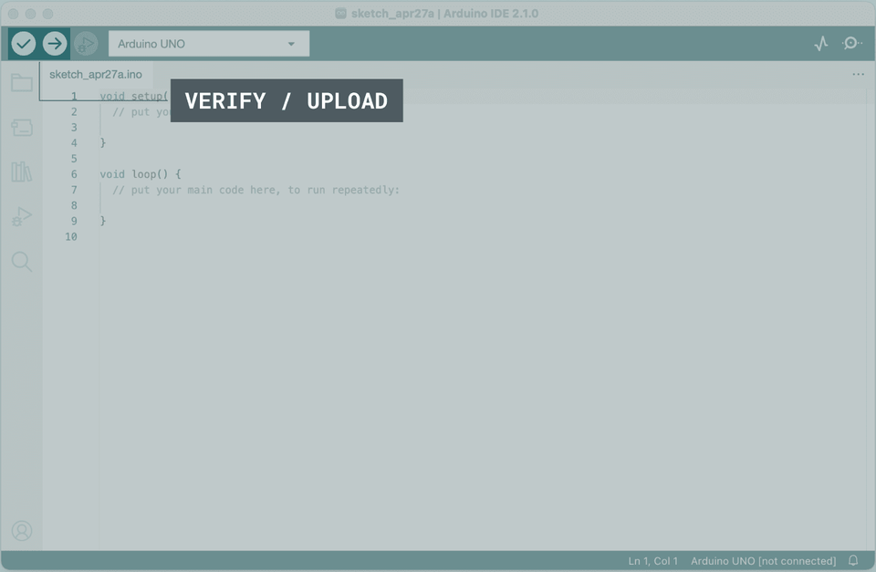
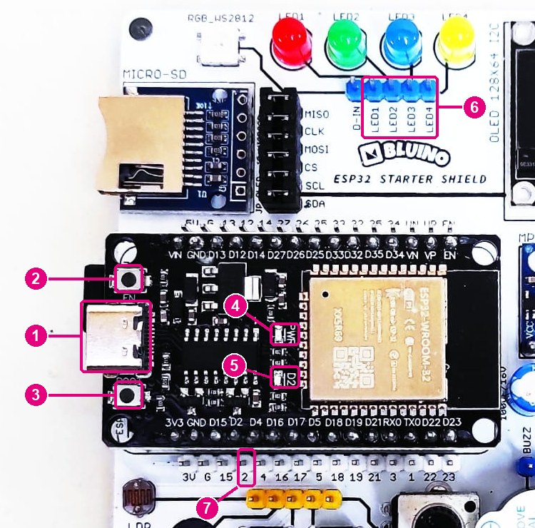
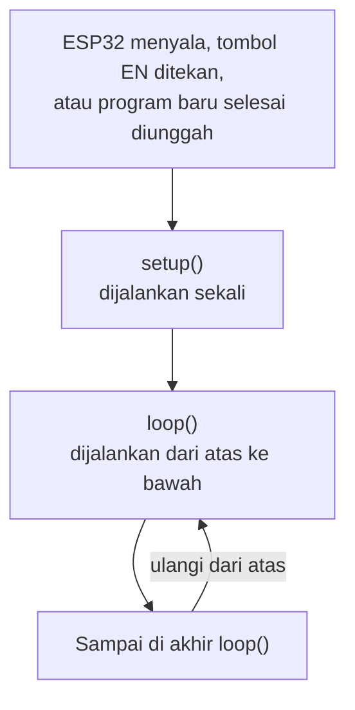
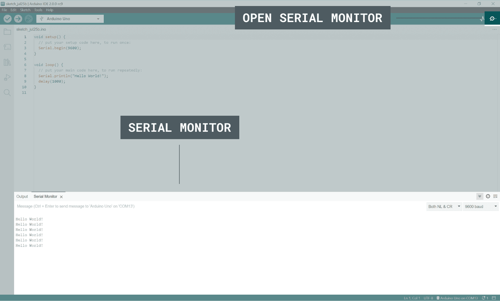

# BAB 7: Program Pertama — Hello World

> ✅ **Prasyarat:** Selesaikan **BAB 5 (Setup Lingkungan Pengembangan)** — Arduino IDE 2.x dan *board package* **esp32** sudah terpasang, *driver* USB sudah beres, dan *port* ESP32 sudah muncul di komputer. Sebaiknya baca juga **BAB 6 (Pin Mapping Kit Bluino & Restriksi GPIO)** supaya kamu mengenal nama-nama pin di kit.

Inilah saatnya ESP32 kamu "berbicara" untuk pertama kali! Di BAB ini kamu akan menulis program, mengubahnya menjadi bahasa mesin (*compile*), lalu mengunggahnya ke ESP32 — mulai dari menampilkan tulisan "Hello World!" di layar laptop sampai membuat LED biru berkedip. Ibarat belajar menyetir, BAB ini adalah latihan menyalakan mesin dan maju pelan-pelan: kamu mengenal tombol-tombol Arduino IDE, membaca pesan dari ESP32 lewat Serial Monitor, dan tahu harus berbuat apa kalau proses *upload* gagal. Semua keterampilan ini akan terus kamu pakai di BAB-BAB berikutnya.

## 📌 Tujuan Pembelajaran

Setelah mempelajari BAB ini, kamu bisa:

- Membuka Arduino IDE, membuat *sketch* baru, menyimpannya, serta memilih *board* dan *port* yang benar.
- Menjelaskan tugas `setup()` dan `loop()` serta aturan dasar menulis kode (titik koma, kurung kurawal, komentar).
- Membedakan tombol **Verify** dan **Upload**, lalu mengunggah program ke ESP32.
- Menampilkan teks dan angka di **Serial Monitor** dengan `Serial.begin()`, `Serial.print()`, dan `Serial.println()`.
- Mengedipkan LED biru bawaan *board* (IO2) dengan `pinMode()`, `digitalWrite()`, dan `delay()`.
- Membuat fungsi sendiri supaya kode lebih rapi (contoh: sinyal SOS).
- Membaca informasi chip ESP32 untuk memastikan *board* bekerja normal.
- Mengatasi masalah yang paling sering muncul: *port* tidak terdeteksi, *upload* gagal, pesan *error* saat *compile*, dan tulisan acak di Serial Monitor.

## 🧰 Yang Perlu Disiapkan

| Kebutuhan | Keterangan |
|---|---|
| *Hardware* | Kit Bluino ESP32 IoT Starter Shield (ESP32 DEVKIT V1 sudah terpasang) + kabel USB **data** — micro-USB atau USB-C, sesuai konektor di *board* ESP32 kamu |
| Kabel *jumper* | Tidak wajib. Siapkan 1 kabel *female-female* kalau ingin ikut menyalakan LED biru kit (bagian opsional di Program 2) |
| Komponen tambahan | Tidak ada |
| *Software* | Arduino IDE 2.x + *board package* **esp32** versi 3.3.x (lihat [BAB 5](../BAB-05/README.md)) |
| *Library* | Tidak perlu *library* tambahan |
| Alat uji | **Serial Monitor** Arduino IDE (baud 115200) |
| Jaringan | Tidak perlu WiFi maupun internet |

## 📑 Daftar Isi

- [7.1 Mengenal Arduino IDE](#71-mengenal-arduino-ide)
- [7.2 Struktur Program: setup() dan loop()](#72-struktur-program-setup-dan-loop)
- [7.3 Verify dan Upload](#73-verify-dan-upload)
- [7.4 Serial Monitor: Jendela Percakapan dengan ESP32](#74-serial-monitor-jendela-percakapan-dengan-esp32)
- [7.5 Program 1: Hello World](#75-program-1-hello-world)
- [7.6 Pin GPIO dan LED](#76-pin-gpio-dan-led)
- [7.7 Program 2: LED Biru Berkedip (Blink)](#77-program-2-led-biru-berkedip-blink)
- [7.8 Fungsi Buatan Sendiri dan Kode Morse](#78-fungsi-buatan-sendiri-dan-kode-morse)
- [7.9 Program 3: Sinyal SOS dengan Fungsi Buatan Sendiri](#79-program-3-sinyal-sos-dengan-fungsi-buatan-sendiri)
- [7.10 Program 4: Informasi Chip ESP32](#710-program-4-informasi-chip-esp32)
- [7.11 Kebiasaan Baik Menulis Kode](#711-kebiasaan-baik-menulis-kode)
- [7.12 Troubleshooting](#712-troubleshooting)
- [📝 Rangkuman](#-rangkuman)
- [💪 Latihan](#-latihan)
- [📚 Referensi](#-referensi)

---

## 7.1 Mengenal Arduino IDE

Arduino IDE (*Integrated Development Environment*, lingkungan pengembangan terpadu) adalah aplikasi tempat kamu menulis kode, memeriksanya, lalu mengirimkannya ke ESP32 lewat kabel USB. Anggap saja Arduino IDE sebagai "dapur": di sini kamu menulis resep (kode), memasaknya (*compile*), lalu menyajikannya ke ESP32 (*upload*). Kalau Arduino IDE belum terpasang, ikuti dulu [BAB 5](../BAB-05/README.md). Kalau di BAB 5 kamu sudah sempat mencoba mengunggah program uji, sebagian langkah di bawah ini akan terasa familier — di BAB ini setiap langkah dijelaskan lebih lengkap.

### 7.1.1 Membuka Arduino IDE dan Membuat Sketch Baru

1. Buka Arduino IDE:
   - **Windows:** klik tombol **Start**, ketik `Arduino IDE`, lalu tekan Enter.
   - **macOS:** buka **Launchpad** (atau folder **Applications**), lalu klik **Arduino IDE**.
   - **Linux:** buka dari menu aplikasi, atau jalankan *file* AppImage yang kamu unduh di BAB 5.
2. Tunggu sampai jendela utama terbuka. Saat pertama kali dibuka, Arduino IDE kadang butuh waktu agak lama untuk memeriksa pembaruan — tunggu sampai prosesnya selesai.
3. Klik menu **File → New Sketch** (pintasan **Ctrl+N**; di macOS **Cmd+N**). Jendela baru akan terbuka dan langsung berisi kerangka kode dengan dua bagian, `void setup()` dan `void loop()` (lihat Gambar 7.1).

Program yang ditulis di Arduino IDE disebut ***sketch*** (sketsa). Arduino IDE memberi nama sementara secara otomatis, misalnya `sketch_oct23a` (dari bulan dan tanggal pembuatan, ditambah huruf urut). Nama itu bisa kamu ganti saat menyimpan (lihat [7.1.4](#714-menyimpan-sketch)).

> 💡 **Tips:** Komentar di kerangka bawaan masih berbahasa Inggris. *Put your setup code here, to run once* artinya "tulis kode persiapan di sini, dijalankan sekali", sedangkan *put your main code here, to run repeatedly* artinya "tulis kode utama di sini, dijalankan berulang-ulang". Maksudnya dibahas di [7.2](#72-struktur-program-setup-dan-loop).

### 7.1.2 Bagian-Bagian Jendela Arduino IDE



*Gambar 7.1 — Jendela Arduino IDE 2 dengan sketch baru. Tombol **Verify** (centang) dan **Upload** (panah) ada di kiri atas. Contoh di gambar memakai board Arduino UNO; kamu nanti memilih ESP32 Dev Module. Sumber: [Karl Söderby & Jacob Hylén, Arduino Docs](https://docs.arduino.cc/software/ide-v2/tutorials/getting-started/ide-v2-uploading-a-sketch/), lisensi CC BY-SA 4.0 (dipotong dan diperkecil).*

| Bagian | Letak | Kegunaan |
|---|---|---|
| Tombol **Verify** (ikon centang ✓) | Kiri atas | Memeriksa kode dan menerjemahkannya menjadi program mesin (*compile*) **tanpa** mengirimnya ke ESP32 |
| Tombol **Upload** (ikon panah →) | Di kanan tombol **Verify** | Melakukan *compile*, lalu mengirim hasilnya ke ESP32 |
| Tombol **Debug** | Di kanan tombol **Upload** | Fitur *debugging* lanjutan — tidak dipakai di materi ini |
| Kotak pilihan *board* | Tengah *toolbar* | Memilih jenis *board* dan *port*. Tertulis **Select Board** kalau belum ada yang dipilih |
| Tombol **Serial Plotter** (ikon grafik) | Kanan atas | Menggambar grafik dari angka yang dikirim ESP32 (dipakai di BAB-BAB sensor) |
| Tombol **Serial Monitor** (ikon kaca pembesar) | Pojok kanan atas | Membuka "jendela percakapan" teks dengan ESP32 (lihat [7.4](#74-serial-monitor-jendela-percakapan-dengan-esp32)) |
| *Sidebar* kiri | Tepi kiri | Ikon **Sketchbook** (daftar *sketch*), **Boards Manager**, **Library Manager**, **Debug**, dan **Search** |
| Editor | Tengah | Tempat menulis kode. Angka di sebelah kiri adalah nomor baris — berguna saat membaca pesan *error* |
| Panel **Output** | Di bawah editor | Menampilkan jalannya *compile*/*upload* dan pesan *error*. **Serial Monitor** juga muncul di panel ini sebagai tab |
| Baris status | Paling bawah | Posisi kursor (`Ln`, `Col`) serta *board* dan *port* yang sedang dipilih |

Menu **File**, **Edit**, **Sketch**, **Tools**, dan **Help** ada di bagian paling atas jendela (di macOS, di bagian atas layar).

### 7.1.3 Menyambungkan ESP32 serta Memilih Board dan Port

Sebelum mengirim program, Arduino IDE perlu tahu dua hal: **jenis *board*** dan ***port***. Ibarat mengirim surat, *board* menentukan "bahasa" surat yang dimengerti penerima (kode di-*compile* khusus untuk chip ESP32), sedangkan *port* adalah alamat rumahnya (jalur USB mana yang tersambung ke ESP32).



*Gambar 7.2 — Bagian penting board ESP32 di kit Bluino v3.x. Board ESP32 di kit kamu bisa sedikit berbeda (misalnya konektor micro-USB), tetapi letak tombol dan labelnya mirip. Sumber: foto produk [Bluino](http://www.bluino.com), diberi penanda nomor untuk materi ini.*

| No. | Bagian | Kegunaan di BAB ini |
|---|---|---|
| 1 | Konektor USB (di foto: USB-C) | Sambungan ke laptop: sumber daya sekaligus jalur data untuk *upload* dan Serial Monitor |
| 2 | Tombol **EN** | Me-*reset* ESP32 — program berhenti lalu mulai lagi dari awal (`setup()`) |
| 3 | Tombol **BOOT** | Ditahan saat *upload* kalau ESP32 gagal masuk mode unggah (lihat [7.12](#712-troubleshooting)) |
| 4 | LED **PWR** | Menyala saat *board* mendapat daya |
| 5 | LED bawaan bertanda **D2** | LED biru yang terhubung ke IO2 — dipakai di Program 2 dan 3 |
| 6 | *Header* **LED1**–**LED4** | Ujung "Custom" keempat LED kit (merah, hijau, biru, kuning). **LED3** = LED biru, dipakai di bagian opsional Program 2 |
| 7 | *Header* ESP32 di *shield* (label `3V G 15 2 4 …`) | Tempat menancapkan kabel *jumper*. Pin berlabel **2** = IO2 |

Langkahnya:

1. Colokkan kabel USB ke *board* ESP32 dan ke laptop. LED **PWR** (biasanya merah) akan menyala.
2. Pilih *board*: klik menu **Tools → Board → esp32 → ESP32 Dev Module**.
   Cara lain: klik kotak pilihan *board* di *toolbar* → **Select other board and port...** → ketik `ESP32 Dev Module` di kolom pencarian **BOARDS** → klik namanya → pilih *port* di kolom **PORTS** → klik **OK**.
3. Pilih *port*: klik **Tools → Port**, lalu pilih *port* ESP32 kamu. Contoh namanya:

   | Sistem operasi | Contoh nama *port* ESP32 |
   |---|---|
   | Windows | `COM3`, `COM5`, dan seterusnya |
   | macOS | `/dev/cu.usbserial-0001`, `/dev/cu.SLAB_USBtoUART`, atau `/dev/cu.wchusbserial…` |
   | Linux | `/dev/ttyUSB0` |

4. Lihat baris status di pojok kanan bawah. Kalau sudah benar, tertulis kira-kira **ESP32 Dev Module on COM5** (nama *port*-nya menyesuaikan).

> 💡 **Tips:** Bingung *port* yang mana? Cabut kabel USB, buka **Tools → Port**, lalu ingat daftarnya. Colokkan lagi kabelnya dan buka menu itu sekali lagi — *port* yang baru muncul itulah ESP32 kamu.

> 📌 **Catatan:** Di menu **Tools → Board** juga ada pilihan **DOIT ESP32 DEVKIT V1**. Pilihan itu juga cocok untuk *board* di kit ini, tetapi seluruh materi memakai **ESP32 Dev Module** supaya seragam. Biarkan pengaturan lain di menu **Tools** (misalnya **Upload Speed**, **Flash Size**, dan **Partition Scheme**) pada nilai bawaannya, kecuali sebuah BAB meminta lain.

> ⚠️ **Perhatian:** Kalau *port* tidak muncul sama sekali, penyebab paling sering adalah kabel USB yang hanya bisa untuk mengisi daya atau *driver* USB yang belum terpasang. Lihat [7.12 Troubleshooting](#712-troubleshooting) dan [BAB 5](../BAB-05/README.md).

### 7.1.4 Menyimpan Sketch

1. Klik **File → Save As...** (atau **File → Save**, pintasan **Ctrl+S**; di macOS **Cmd+S**).
2. Ketik nama *sketch* tanpa spasi, misalnya `p1_hello_world`, lalu klik **Save**.
3. Arduino IDE otomatis membuat **folder** bernama sama yang berisi *file* `p1_hello_world.ino`. Aturan "nama folder = nama *file* `.ino`" ini wajib di Arduino IDE.

Secara bawaan, *sketch* disimpan di folder *sketchbook*, yaitu `Documents\Arduino` (Windows) atau `Documents/Arduino` (macOS/Linux). Lokasinya bisa dilihat dan diubah di **File → Preferences → Sketchbook location**.

> 💡 **Tips:** Semua program di materi ini juga tersedia sebagai *file* `.ino` di folder BAB-nya, misalnya `BAB-07/p1_hello_world/p1_hello_world.ino`. Kamu bisa membukanya lewat **File → Open...** tanpa perlu menyalin kode.

---

## 7.2 Struktur Program: setup() dan loop()

Setiap *sketch* Arduino minimal punya dua **fungsi**, yaitu `setup()` dan `loop()`. Fungsi adalah sekumpulan perintah yang diberi nama — mirip satu langkah besar dalam buku resep.

Bayangkan kamu membuka warung kopi:

- **Persiapan sebelum buka** — menyalakan lampu, membuka pintu, dan menyiapkan kasir. Cukup dilakukan **sekali** setiap pagi. Inilah `setup()`.
- **Melayani pembeli** — menerima pesanan, membuat kopi, menerima pembayaran, lalu kembali menunggu pembeli berikutnya. Dilakukan **berulang-ulang** sampai warung tutup. Inilah `loop()`.

### 7.2.1 setup() — Persiapan, Dijalankan Sekali

```cpp
void setup() {
  // Perintah di sini dijalankan sekali saja,
  // tepat setelah ESP32 menyala atau di-reset.
  // Contoh: membuka komunikasi Serial, mengatur pin sebagai output.
}
```

### 7.2.2 loop() — Pekerjaan Utama, Diulang Terus

```cpp
void loop() {
  // Perintah di sini dijalankan dari atas ke bawah,
  // lalu diulang lagi dari atas, terus-menerus tanpa henti.
  // Contoh: membaca sensor, menyalakan dan mematikan LED.
}
```

Arti bagian-bagian penulisannya:

| Bagian | Arti |
|---|---|
| `void` | Fungsi ini tidak mengembalikan nilai apa pun. Untuk sekarang, anggap saja bagian wajib dari cara menulis `setup()` dan `loop()` |
| `setup` / `loop` | Nama fungsi. Harus ditulis persis seperti itu (huruf kecil semua) |
| `()` | Tempat parameter (data masukan untuk fungsi). Pada `setup()` dan `loop()` selalu kosong |
| `{` … `}` | Awal dan akhir isi fungsi. Semua perintah milik fungsi itu ditulis di antara kedua kurung kurawal ini |



*Gambar 7.3 — Alur program Arduino: setup() dijalankan sekali, lalu loop() diulang terus selama ESP32 menyala. Sumber: dibuat untuk materi ini.*

Kapan `setup()` dijalankan lagi? Hanya saat ESP32 mulai dari awal: kabel USB dicabut lalu dicolokkan lagi, tombol **EN** ditekan, atau program baru selesai diunggah. Program yang sudah diunggah tersimpan di memori *flash* ESP32, jadi tidak hilang walaupun kabel dicabut. Begitu ESP32 mendapat daya lagi — dari laptop maupun dari *charger* HP — program terakhir langsung berjalan dari `setup()`.

### 7.2.3 Aturan Dasar Menulis Kode

| Aturan | Contoh | Catatan |
|---|---|---|
| Setiap perintah diakhiri titik koma `;` | `delay(1000);` | Seperti titik di akhir kalimat. Lupa titik koma = *error* saat *compile* |
| Kurung kurawal `{ }` selalu berpasangan | `void loop() { ... }` | Setiap `{` harus punya pasangan `}` |
| Huruf besar dan kecil dibedakan (*case-sensitive*) | `Serial` ≠ `serial`, `digitalWrite` ≠ `digitalwrite` | Salah satu huruf saja sudah membuat *error* |
| Teks ditulis di antara tanda kutip ganda | `"Hello World!"` | Teks seperti ini disebut *string* |
| Komentar tidak ikut dijalankan | `// catatan` atau `/* catatan */` | Catatan untuk manusia yang membaca kode |
| Indentasi (spasi di awal baris) | 2 spasi untuk isi `{ }` | Tidak wajib bagi ESP32, tetapi membuat kode jauh lebih mudah dibaca |

Contoh dua jenis komentar:

```cpp
// Ini komentar satu baris: semua tulisan setelah tanda // diabaikan.

/* Ini komentar beberapa baris.
   Cocok untuk keterangan yang panjang. */

void loop() {
  delay(1000);  // komentar juga boleh ditaruh di akhir baris perintah
}
```

> 💡 **Tips:** Indentasi kodemu berantakan? Klik **Tools → Auto Format** (pintasan **Ctrl+T**; di macOS **Cmd+T**) untuk merapikannya secara otomatis.

<details>
<summary><b>🔬 Pendalaman (opsional): Apa yang terjadi di balik setup() dan loop()?</b></summary>

Kalau kamu pernah belajar bahasa C/C++, mungkin kamu heran: di mana fungsi `main()`-nya? Di ESP32, "fungsi utama" itu sudah disiapkan oleh *board package* esp32 (di *file* `cores/esp32/main.cpp`), jadi kamu tidak perlu menulisnya sendiri:

1. Saat ESP32 menyala, fungsi `app_main()` menyiapkan sistem, lalu membuat sebuah *task* (tugas) FreeRTOS bernama `loopTask`. FreeRTOS adalah sistem operasi mini yang membagi waktu kerja prosesor untuk beberapa tugas.
2. `loopTask` berjalan di **core 1** — ESP32 punya dua inti prosesor, core 0 dan core 1. *Task* ini memanggil `setup()` satu kali.
3. Setelah itu `loopTask` memanggil `loop()` di dalam perulangan tanpa akhir. Di antara dua putaran `loop()`, sistem juga menjalankan pekerjaan kecil, misalnya fungsi `serialEvent()` kalau kamu membuatnya.
4. Secara bawaan, *task* WiFi dan Bluetooth berjalan di **core 0**, sehingga tidak berebut prosesor dengan `loop()` milikmu.

Gambaran sederhananya (bukan kode yang perlu kamu tulis):

```cpp
// Gambaran sederhana isi main.cpp di board package esp32
void loopTask(void *parameter) {
  setup();      // dijalankan sekali
  for (;;) {    // perulangan tanpa akhir
    loop();     // dijalankan berulang-ulang
  }
}
```

</details>

---

## 7.3 Verify dan Upload

ESP32 tidak bisa membaca kode yang kamu tulis secara langsung. Kode itu harus diterjemahkan dulu menjadi bahasa mesin — deretan angka biner (0 dan 1) yang dimengerti prosesor. Proses penerjemahan ini disebut ***compile*** (kompilasi). Arduino IDE menyediakan dua tombol untuk itu:

| Tombol | Pintasan | Yang dikerjakan | Kapan dipakai |
|---|---|---|---|
| **Verify** (ikon centang ✓) | **Ctrl+R** (macOS: **Cmd+R**) | Memeriksa penulisan kode lalu melakukan *compile*. **Tidak** mengirim apa pun ke ESP32 | Mengecek *error* — bisa dilakukan walaupun ESP32 belum dicolokkan |
| **Upload** (ikon panah →) | **Ctrl+U** (macOS: **Cmd+U**) | Melakukan *compile*, lalu mengirim hasilnya ke memori *flash* ESP32 lewat USB | Menjalankan program di ESP32 |

Jadi **Upload** sudah termasuk **Verify**. Meski begitu, membiasakan diri menekan **Verify** dulu itu bagus: kesalahan penulisan langsung ketahuan tanpa harus menunggu proses *upload*.

> 📌 **Catatan:** *Compile* pertama kali untuk ESP32 bisa memakan waktu sekitar satu sampai beberapa menit, tergantung kecepatan laptop, karena seluruh "mesin" pendukung ESP32 ikut di-*compile*. *Compile* berikutnya jauh lebih cepat karena hasil sebelumnya disimpan. Selama proses berjalan, jangan menekan tombol berkali-kali — tunggu sampai muncul tulisan **Done compiling** atau **Done uploading** di pojok kanan bawah.

### 7.3.1 Apa yang Terjadi Saat Upload?


*Gambar 7.4 — Tahapan saat tombol Upload diklik. Tombol Verify hanya mengerjakan tahap 1. Sumber: dibuat untuk materi ini.*

| Tahap | Yang terjadi | Tulisan di panel **Output** |
|---|---|---|
| 1. *Compile* | Sama seperti **Verify** | `Sketch uses ... bytes ...` |
| 2. Menghubungi ESP32 | Arduino IDE menjalankan program **esptool** buatan Espressif. esptool "menekan" tombol **EN** dan **BOOT** secara elektronik lewat chip USB di *board*, sehingga ESP32 masuk mode unggah (*download mode*) | `Connecting....` lalu `Connected to ESP32 on COM5:` |
| 3. Menulis program | Program dikirim ke memori *flash* ESP32 | `Writing at 0x... [====>   ]  45.0% ...` |
| 4. Memeriksa hasil | Isi *flash* dicocokkan dengan program yang dikirim | `Hash of data verified.` |
| 5. *Reset* | ESP32 dimulai ulang dan langsung menjalankan program baru | `Hard resetting via RTS pin...` |

Setelah tahap 5, muncul pemberitahuan **Done uploading.** di pojok kanan bawah Arduino IDE. Kalau tahap 2 gagal (esptool tidak berhasil membuat ESP32 masuk mode unggah), kamu bisa menekan tombol **BOOT** secara manual — caranya ada di [7.12 Troubleshooting](#712-troubleshooting).

### 7.3.2 Contoh Pesan Berhasil

Setelah **Verify** (atau tahap 1 dari **Upload**) berhasil, panel **Output** menampilkan ukuran program. Contoh untuk Program 1 di BAB ini:

```text
Sketch uses 269280 bytes (20%) of program storage space. Maximum is 1310720 bytes.
Global variables use 22116 bytes (6%) of dynamic memory, leaving 305564 bytes for local variables. Maximum is 327680 bytes.
```

- ***Program storage space*** adalah memori *flash* yang dipakai program. Batasnya 1310720 *byte* (1,25 MB), bukan 4 MB, karena pengaturan **Partition Scheme** bawaan membagi *flash* 4 MB menjadi beberapa bagian: tempat program, tempat cadangan untuk memperbarui program lewat WiFi (OTA, *Over-The-Air*), dan tempat penyimpanan *file* ([BAB 40](../BAB-40/README.md)).
- ***Dynamic memory*** adalah RAM yang dipakai variabel global. Sisanya (*leaving … for local variables*) dipakai program saat berjalan.

Angka di laptopmu bisa sedikit berbeda, tergantung versi *software*. Yang penting, tidak ada tulisan *error*.

Saat **Upload**, panel **Output** menampilkan jalannya esptool. Contohnya (dipersingkat; angka dan nama *port* di layarmu pasti berbeda):

```text
esptool v5.3.1
Serial port COM5:
Connecting....
Connected to ESP32 on COM5:
Chip type:          ESP32-D0WD-V3 (revision v3.1)
...
Writing at 0x00051c70 [==============================] 100.0% 155587/155587 bytes...
Wrote 269424 bytes (155587 compressed) at 0x00010000 in 2.2 seconds (979.7 kbit/s).
Hash of data verified.

Hard resetting via RTS pin...
```

### 7.3.3 Membaca Pesan Error Saat Compile

Kalau ada kesalahan penulisan, *compile* gagal dan program **tidak** dikirim ke ESP32. Panel **Output** menampilkan pesan berwarna merah, baris yang bermasalah ditandai di editor, dan muncul pemberitahuan **Compilation error**. Contohnya, kalau titik koma di akhir baris `delay(2000);` pada Program 1 terhapus:

```text
p1_hello_world.ino:29:14: error: expected ';' before '}' token
   29 |   delay(2000)  // tunggu 2 detik, lalu loop() diulang dari atas
      |              ^
      |              ;
```

Cara membacanya:

- `p1_hello_world.ino:29:14` → kesalahan ada di *file* `p1_hello_world.ino`, **baris 29**, kolom ke-14 (di depannya biasanya tertulis lokasi folder lengkap *sketch*-nya).
- `error: expected ';' before '}' token` → *compiler* "mengharapkan" tanda `;` sebelum tanda `}`.
- Tanda `^` menunjuk posisi yang dimaksud, dan baris di bawahnya menyarankan karakter yang kurang (`;`).

Pesan *error* yang paling sering ditemui pemula:

| Pesan *error* | Artinya | Cara memperbaiki |
|---|---|---|
| `expected ';' before ...` | Ada titik koma yang lupa ditulis | Periksa akhir baris yang ditunjuk, atau baris tepat di atasnya |
| `'serial' was not declared in this scope; did you mean 'Serial'?` | Nama tidak dikenal — biasanya salah ketik atau salah huruf besar/kecil | Tulis persis seperti saran *compiler*, di sini `Serial` dengan S kapital |
| `expected '}' at end of input` | Ada kurung kurawal `{` yang belum ditutup. Baris `note: to match this '{'` menunjukkan `{` mana yang belum punya pasangan | Tambahkan `}` penutupnya |
| `missing terminating " character` | Tanda kutip penutup teks lupa ditulis | Pastikan teks diapit `"` di awal dan di akhir |
| `'LED_BUILTIN' was not declared in this scope` | Nama `LED_BUILTIN` tidak tersedia kalau *board* yang dipilih **ESP32 Dev Module** | Tulis nomor pinnya sendiri, misalnya `#define LED_BIRU 2` (lihat Program 2) |

> 💡 **Tips:** Satu kesalahan kecil bisa memunculkan beberapa pesan *error* sekaligus. Perbaiki pesan **paling atas** dulu, lalu klik **Verify** lagi — sering kali pesan-pesan lainnya ikut hilang.

> 🧪 **Coba Sendiri:** Setelah Program 1 berhasil, hapus titik koma di akhir baris `delay(2000);`, lalu klik **Verify**. Bandingkan pesan yang muncul dengan contoh di atas. Kembalikan titik komanya dan klik **Verify** lagi sampai berhasil.

---

## 7.4 Serial Monitor: Jendela Percakapan dengan ESP32

ESP32 tidak punya layar. Supaya kita tahu apa yang sedang dikerjakannya, ESP32 bisa mengirim pesan teks ke laptop lewat kabel USB yang sama dengan kabel *upload*. Pesan itu ditampilkan oleh **Serial Monitor** di Arduino IDE. Inilah alat paling penting untuk memeriksa program (*debugging*): kalau program berperilaku aneh, langkah pertama hampir selalu "cetak dulu nilainya ke Serial Monitor".

### 7.4.1 Serial dan Baud Rate

*Serial* artinya data dikirim berurutan, satu bit demi satu bit, lewat satu jalur. *Board* ESP32 DEVKIT V1 punya chip penerjemah USB-ke-serial (biasanya CP2102 atau CH340, lihat [BAB 5](../BAB-05/README.md)) yang menjembatani pin TX dan RX ESP32 (IO1 dan IO3) dengan *port* USB laptop.

***Baud rate*** adalah kecepatan pengiriman itu, dalam satuan bit per detik. Pengirim dan penerima **wajib memakai kecepatan yang sama**. Ibarat dua orang bercakap: kalau yang satu berbicara sangat cepat sementara yang lain mendengarkan dengan tempo lambat, yang tertangkap hanya kata-kata kacau. Materi ini selalu memakai **115200** baud:

- di kode: `Serial.begin(115200);`
- di Serial Monitor: pilih **115200 baud** pada kotak pilihan di sisi kanan panel.

Kalau keduanya berbeda, Serial Monitor menampilkan karakter acak seperti `⸮⸮⸮x⸮⸮` — bukan karena ESP32 rusak, hanya "tempo"-nya tidak cocok.

> 📌 **Catatan:** Karena IO1 (TX) dan IO3 (RX) dipakai untuk berkomunikasi dengan laptop, kedua pin itu jangan dipakai untuk komponen lain (lihat [BAB 6](../BAB-06/README.md)).

### 7.4.2 Membuka Serial Monitor

1. Pastikan *board* dan *port* sudah dipilih (lihat [7.1.3](#713-menyambungkan-esp32-serta-memilih-board-dan-port)).
2. Klik tombol **Serial Monitor** (ikon kaca pembesar di pojok kanan atas), atau menu **Tools → Serial Monitor**, atau pintasan **Ctrl+Shift+M** (macOS: **Cmd+Shift+M**).
3. Serial Monitor muncul sebagai tab di bagian bawah jendela, di sebelah tab **Output**.
4. Pada kotak pilihan kecepatan di sisi kanan panel, pilih **115200 baud**.



*Gambar 7.5 — Serial Monitor di Arduino IDE 2: tombol pembukanya di pojok kanan atas, panelnya di bagian bawah. Contoh di gambar memakai 9600 baud; untuk materi ini selalu pilih 115200 baud. Sumber: [Karl Söderby, Arduino Docs](https://docs.arduino.cc/software/ide-v2/tutorials/ide-v2-serial-monitor/), lisensi CC BY-SA 4.0 (dipotong dan diperkecil).*

| Bagian panel Serial Monitor | Kegunaan |
|---|---|
| Area teks | Tempat pesan dari ESP32 muncul, baris demi baris |
| Kolom **Message** | Untuk mengirim teks ke ESP32 — belum dipakai di BAB ini |
| Pilihan *line ending* (misalnya **New Line**) | Tanda akhir baris yang ikut terkirim bersama pesan — belum dipakai di BAB ini |
| Pilihan kecepatan (misalnya **115200 baud**) | Harus sama dengan angka di `Serial.begin()` |
| Ikon **Toggle Autoscroll**, **Toggle Timestamp**, dan **Clear Output** di kanan atas panel | Menggulung otomatis ke pesan terbaru, menampilkan jam di depan setiap baris, dan membersihkan layar |

> ⚠️ **Perhatian:** Membuka Serial Monitor **tidak selalu** membuat program ESP32 mulai dari awal. Pesan dari `setup()` yang terkirim sebelum Serial Monitor terbuka akan terlewat. Solusinya mudah: tekan tombol **EN** di *board* ESP32 sekali — ESP32 mulai ulang dan pesan dari `setup()` dikirim lagi.

### 7.4.3 Pesan Boot Saat ESP32 Mulai Ulang

Setiap kali ESP32 mulai ulang (tombol **EN** ditekan, kabel baru dicolokkan, atau *upload* selesai), program bawaan di dalam chip (ROM *bootloader*) mencetak beberapa baris informasi sebelum program kamu berjalan. Contohnya:

```text
ets Jul 29 2019 12:21:46

rst:0x1 (POWERON_RESET),boot:0x13 (SPI_FAST_FLASH_BOOT)
configsip: 0, SPIWP:0xee
clk_drv:0x00,q_drv:0x00,d_drv:0x00,cs0_drv:0x00,hd_drv:0x00,wp_drv:0x00
mode:DIO, clock div:1
load:0x3fff0030,len:4980
load:0x40078000,len:16612
load:0x40080400,len:3480
entry 0x400805b4
```

Pesan ini **normal** dan bukan *error*. Yang perlu kamu perhatikan hanya dua hal:

- `rst:0x1 (POWERON_RESET)` → ESP32 mulai dari kondisi baru menyala atau tombol **EN** ditekan. Nanti kamu mungkin juga melihat alasan lain, misalnya `rst:0xc (SW_CPU_RESET)`, artinya ESP32 dimulai ulang oleh program — termasuk setelah program mengalami *crash* (dibahas di [BAB 21](../BAB-21/README.md)).
- `boot:0x13 (SPI_FAST_FLASH_BOOT)` → ESP32 menjalankan program dari memori *flash* (mode normal). Kalau tertulis `DOWNLOAD_BOOT`, ESP32 sedang menunggu *upload* — tekan tombol **EN** untuk kembali ke mode normal.

Tanggal di baris pertama dan angka-angka `load:`/`len:` bisa berbeda di *board*-mu, tergantung revisi chip dan versi *software*. Satu-dua karakter acak tepat sebelum pesan boot juga wajar.

> 📌 **Catatan:** Kalau nanti tombol S1 kit tersambung ke IO15 (BAB 9), pesan boot ini tidak muncul. Itu juga normal: IO15 yang bernilai LOW saat ESP32 menyala memang mematikan pesan boot (lihat [BAB 6](../BAB-06/README.md)).

### 7.4.4 Perintah Serial yang Dipakai di BAB Ini

| Perintah | Kegunaan |
|---|---|
| `Serial.begin(115200);` | Membuka komunikasi Serial dengan kecepatan 115200 baud. Cukup sekali, di `setup()` |
| `Serial.print(x);` | Mencetak teks atau angka **tanpa** pindah baris — cetakan berikutnya menyambung di baris yang sama |
| `Serial.println(x);` | Mencetak teks atau angka, lalu **pindah ke baris baru** (*println* = *print line*) |
| `Serial.println();` | Mencetak baris kosong |

Contoh menggabungkan `print()` dan `println()` menjadi satu baris:

```cpp
Serial.print("Suhu: ");   // tampil: Suhu:
Serial.print(27.5);       // menyambung: Suhu: 27.50  (angka desimal dicetak dengan 2 angka di belakang titik)
Serial.println(" °C");    // menyambung: Suhu: 27.50 °C  lalu pindah baris
```

---

## 7.5 Program 1: Hello World

**Tujuan:** Menampilkan pesan pembuka "Hello World!" sekali saat program mulai, lalu mengirim pesan berhitung setiap 2 detik ke Serial Monitor. Program ini sekaligus menguji bahwa *upload* dan Serial Monitor sudah bekerja.

**Rangkaian:**

*Tidak perlu merangkai — cukup colokkan kabel USB.*

**Cara Menjalankan:**

1. Colokkan kabel USB ke *board* ESP32 dan ke laptop.
2. Buka Arduino IDE → **File → New Sketch**, hapus isinya, lalu salin kode di bawah. Kode yang sama juga tersedia di *file* [`p1_hello_world.ino`](p1_hello_world/p1_hello_world.ino).
3. Pastikan **Tools → Board** = **ESP32 Dev Module** dan **Tools → Port** = *port* ESP32 kamu (misalnya `COM5` di Windows atau `/dev/ttyUSB0` di Linux).
4. Klik **Verify** (ikon centang) dan tunggu sampai muncul **Done compiling**. Kalau muncul *error*, periksa lagi kodenya (lihat [7.3.3](#733-membaca-pesan-error-saat-compile)).
5. Klik tombol **Upload** (ikon panah →) dan tunggu sampai muncul tulisan **Done uploading**.
6. Buka **Serial Monitor** (**Tools → Serial Monitor**) lalu pilih baud **115200**.
7. Kalau pesan pembuka belum terlihat, tekan tombol **EN** di *board* ESP32 sekali.

**Kode Program:**

<!-- sketch: p1_hello_world -->
```cpp
/*
 * BAB 7 - Program 1: Hello World
 * Menampilkan pesan pembuka sekali (di setup), lalu pesan
 * berhitung setiap 2 detik (di loop) ke Serial Monitor.
 *
 * Hardware : ESP32 DEVKIT V1 di kit Bluino (tidak perlu merangkai)
 * Alat uji : Serial Monitor, baud 115200
 */

int hitungan = 0;  // variabel untuk menyimpan angka hitungan, nilai awalnya 0

void setup() {
  Serial.begin(115200);  // buka komunikasi Serial dengan kecepatan 115200 baud
  delay(1000);           // jeda 1 detik supaya Serial Monitor sempat siap

  Serial.println("=================================");
  Serial.println("  Hello World!");
  Serial.println("  Halo dari ESP32 di kit Bluino");
  Serial.println("=================================");
  Serial.println();      // cetak baris kosong
}

void loop() {
  hitungan = hitungan + 1;  // tambah 1 setiap kali loop() berjalan

  Serial.print("ESP32 sedang berjalan... putaran ke-");
  Serial.println(hitungan);  // cetak angkanya, lalu pindah baris

  delay(2000);  // tunggu 2 detik, lalu loop() diulang dari atas
}
```

**Penjelasan Kode:**

1. **Komentar pembuka** `/* ... */` berisi keterangan program. Bagian ini tidak dijalankan ESP32.
2. **`int hitungan = 0;`** membuat sebuah **variabel** bernama `hitungan`. Variabel ibarat kotak berlabel untuk menyimpan data. `int` (*integer*) artinya isinya bilangan bulat, dan `= 0` adalah nilai awalnya. Variabel ini ditulis di luar fungsi (disebut variabel global) supaya nilainya tetap tersimpan dari satu putaran `loop()` ke putaran berikutnya.
3. **`Serial.begin(115200);`** membuka komunikasi Serial dengan kecepatan 115200 baud. Perintah ini wajib dipanggil sebelum mencetak apa pun.
4. **`delay(1000);`** menghentikan program selama 1000 milidetik (1 detik). Jeda ini memberi kesempatan Serial Monitor tersambung kembali setelah *upload* sebelum pesan pembuka dikirim.
5. **`Serial.println("...");`** mencetak teks lalu pindah baris. `Serial.println();` tanpa isi mencetak baris kosong. Semua ini ada di `setup()`, jadi hanya tampil **sekali**.
6. **`hitungan = hitungan + 1;`** artinya "ambil nilai `hitungan`, tambah 1, lalu simpan lagi ke `hitungan`". Karena `loop()` diulang terus, nilainya menjadi 1, 2, 3, dan seterusnya.
7. **`Serial.print(...)` lalu `Serial.println(hitungan);`** membentuk satu baris utuh: teks dicetak dulu **tanpa** pindah baris, kemudian angkanya dicetak **dengan** pindah baris.
8. **`delay(2000);`** menunggu 2 detik sebelum `loop()` diulang dari atas.

> 📌 **Catatan:** Selama `delay()` berjalan, ESP32 hanya menunggu dan tidak mengerjakan hal lain di `loop()`. Untuk program sederhana seperti ini tidak masalah. Cara menunggu tanpa membuat program "membeku" dibahas di [BAB 16 (Non-Blocking Programming)](../BAB-16/README.md).

**Contoh Output:**

```text
=================================
  Hello World!
  Halo dari ESP32 di kit Bluino
=================================

ESP32 sedang berjalan... putaran ke-1
ESP32 sedang berjalan... putaran ke-2
ESP32 sedang berjalan... putaran ke-3
```

Baris baru muncul setiap 2 detik. Di kit tidak ada komponen yang bereaksi — hanya LED **PWR** yang menyala. Kalau kamu menekan tombol **EN**, pesan boot (lihat [7.4.3](#743-pesan-boot-saat-esp32-mulai-ulang)) muncul lebih dulu, lalu pesan pembuka tampil lagi dan hitungan mulai dari 1, karena program berjalan dari awal dan `hitungan` kembali bernilai 0.

**Kalau Belum Berhasil:**

- **Serial Monitor kosong** → pesan pembuka sudah terkirim sebelum Serial Monitor dibuka, atau *port* yang dipilih salah. Tekan tombol **EN** sekali dan pastikan **Tools → Port** menunjuk ke ESP32.
- **Muncul karakter acak seperti `⸮⸮⸮`** → kecepatan Serial Monitor tidak sama dengan kode. Pilih **115200 baud** di kanan panel Serial Monitor.
- **Upload gagal dengan pesan `Failed to connect to ESP32`** → ESP32 gagal masuk mode unggah. Ulangi **Upload** sambil menahan tombol **BOOT** (langkah lengkap di [7.12](#712-troubleshooting)).
- **Muncul `Compilation error`** → ada salah ketik. Baca nomor baris di pesan *error* (lihat [7.3.3](#733-membaca-pesan-error-saat-compile)) atau salin ulang kodenya.

---

## 7.6 Pin GPIO dan LED

Di dunia mikrokontroler, program pertama yang "menyentuh" dunia nyata biasanya **Blink**: menyalakan dan memadamkan LED (*Light Emitting Diode*, dioda pancaran cahaya) secara bergantian. Kalau Hello World menyapa lewat layar, Blink menyapa lewat cahaya. Mungkin kamu sudah mencoba program serupa sebagai uji *upload* di BAB 5; sekarang kita bedah cara kerjanya.

LED dikendalikan lewat **pin GPIO** (*General Purpose Input/Output*), yaitu "kaki" ESP32 yang bisa diatur sebagai **output** (mengeluarkan tegangan) atau **input** (membaca tegangan). Nama seperti IO2 artinya GPIO nomor 2; di kode cukup ditulis angkanya, `2`. *Board* ESP32 DEVKIT V1 punya LED biru kecil yang tersambung ke IO2 (nomor 5 di [Gambar 7.2](#713-menyambungkan-esp32-serta-memilih-board-dan-port)). Menurut Peta Pin Standar kurikulum ini, LED biru di kit juga memakai IO2, jadi keduanya bisa berkedip bersamaan.

Tiga fungsi yang dipakai untuk mengendalikan LED:

| Fungsi | Contoh | Kegunaan |
|---|---|---|
| `pinMode(pin, mode)` | `pinMode(2, OUTPUT);` | Mengatur arah pin. `OUTPUT` = pin mengeluarkan sinyal (untuk LED dan *buzzer*); `INPUT` = pin membaca sinyal (untuk tombol, [BAB 9](../BAB-09/README.md)) |
| `digitalWrite(pin, nilai)` | `digitalWrite(2, HIGH);` | Memberi nilai pada pin output: `HIGH` = 3,3 V (logika 1), `LOW` = 0 V (logika 0) |
| `delay(ms)` | `delay(1000);` | Menunggu sekian milidetik (1000 ms = 1 detik) |

---

## 7.7 Program 2: LED Biru Berkedip (Blink)

**Tujuan:** Mengedipkan LED biru bawaan *board* ESP32 (IO2) — menyala 1 detik, padam 1 detik, berulang terus — sambil menampilkan statusnya di Serial Monitor.

**Rangkaian:**

*Tidak perlu merangkai — LED biru bawaan board ESP32 sudah terhubung ke IO2.*

Opsional, supaya LED biru di kit ikut berkedip, pasang 1 kabel *jumper* *female-female*:

| Pin **Custom** di kit | Sambungkan ke pin ESP32 |
|---|---|
| LED biru (pin **LED3** di *header* LED, nomor 6 di Gambar 7.2) | IO2 (pin berlabel **2** di *header* ESP32, nomor 7 di Gambar 7.2) |


*Gambar 7.6 — Rangkaian 4 LED di kit. Setiap LED tersambung ke GND lewat resistor 330 Ω, sehingga LED menyala saat pin ESP32 yang tersambung ke ujung Custom-nya bernilai HIGH. LED3 adalah LED biru. Sumber: skematik ESP32 Starter Shield 3.2, [Bluino](http://www.bluino.com).*

**Cara Menjalankan:**

1. (Opsional) Cabut dulu kabel USB, pasang kabel *jumper* sesuai tabel **Rangkaian** di atas, lalu colokkan kembali kabel USB. Memasang kabel saat *board* tidak dialiri listrik adalah kebiasaan yang aman.
2. Buka Arduino IDE → **File → New Sketch**, hapus isinya, lalu salin kode di bawah. Kode yang sama juga tersedia di *file* [`p2_blink_led_biru.ino`](p2_blink_led_biru/p2_blink_led_biru.ino).
3. Pastikan **Tools → Board** = **ESP32 Dev Module** dan **Tools → Port** = *port* ESP32 kamu (misalnya `COM5` di Windows atau `/dev/ttyUSB0` di Linux).
4. Klik tombol **Upload** (ikon panah →) dan tunggu sampai muncul tulisan **Done uploading**.
5. Buka **Serial Monitor** (**Tools → Serial Monitor**) lalu pilih baud **115200**.

**Kode Program:**

<!-- sketch: p2_blink_led_biru -->
```cpp
/*
 * BAB 7 - Program 2: LED Biru Berkedip (Blink)
 * Menyalakan dan memadamkan LED biru bawaan board (IO2) setiap 1 detik,
 * sambil menampilkan statusnya di Serial Monitor.
 *
 * Hardware : ESP32 DEVKIT V1 di kit Bluino
 * Pin      : IO2 = LED biru bawaan board
 *            (opsional: LED biru kit, pin LED3 di header LED → IO2)
 * Alat uji : Serial Monitor, baud 115200
 */

// ---------- Pengaturan pin ----------
#define LED_BIRU 2  // LED biru terhubung ke IO2

// ---------- Pengaturan waktu ----------
const int JEDA_KEDIP = 1000;  // lama LED menyala/padam dalam milidetik (1000 ms = 1 detik)

void setup() {
  Serial.begin(115200);
  pinMode(LED_BIRU, OUTPUT);  // jadikan IO2 sebagai OUTPUT (pin pengirim sinyal)
  Serial.println("Program Blink dimulai!");
}

void loop() {
  digitalWrite(LED_BIRU, HIGH);  // HIGH = pin bertegangan 3.3 V → LED menyala
  Serial.println("LED: NYALA");
  delay(JEDA_KEDIP);             // tunggu selama JEDA_KEDIP milidetik

  digitalWrite(LED_BIRU, LOW);   // LOW = pin 0 V → LED padam
  Serial.println("LED: PADAM");
  delay(JEDA_KEDIP);
}
```

**Penjelasan Kode:**

1. **`#define LED_BIRU 2`** memberi nama `LED_BIRU` untuk angka 2. Sebelum *compile*, setiap tulisan `LED_BIRU` di kode diganti dengan angka 2. Kode jadi mudah dibaca, dan kalau LED dipindah ke pin lain, cukup ubah satu baris ini.
2. **`const int JEDA_KEDIP = 1000;`** membuat **konstanta**, yaitu variabel yang nilainya tidak boleh berubah selama program berjalan. Ubah angka ini untuk mempercepat atau memperlambat kedipan.
3. **`pinMode(LED_BIRU, OUTPUT);`** di `setup()` mengatur IO2 sebagai output. Cukup sekali, karena arah pin tidak berubah selama program berjalan.
4. **`digitalWrite(LED_BIRU, HIGH);`** membuat IO2 bertegangan 3,3 V. Arus mengalir dari IO2, melewati LED dan resistor, menuju GND — LED menyala.
5. **`digitalWrite(LED_BIRU, LOW);`** membuat IO2 bertegangan 0 V. Arus berhenti — LED padam.
6. **`delay(JEDA_KEDIP);`** memberi jeda supaya kedipan terlihat mata. Tanpa jeda, LED akan berganti nyala-padam ratusan kali per detik sehingga mata hanya melihat LED yang menyala agak redup.

> 📌 **Catatan:** Contoh bawaan Arduino IDE (**File → Examples → 01.Basics → Blink**) memakai nama `LED_BUILTIN`. Untuk *board* **ESP32 Dev Module**, nama itu tidak tersedia sehingga *compile* gagal dengan pesan `'LED_BUILTIN' was not declared in this scope`. Karena itulah kita menuliskan nomor pinnya sendiri lewat `#define LED_BIRU 2`.

> 💡 **Tips:** IO2 termasuk *strapping pin* (lihat [BAB 6](../BAB-06/README.md)) — kondisinya ikut dibaca ESP32 sesaat setelah menyala. LED dengan resistor ke GND, seperti di *board* dan di kit ini, tidak mengganggu proses itu, jadi IO2 aman dipakai untuk LED.

**Contoh Output:**

```text
Program Blink dimulai!
LED: NYALA
LED: PADAM
LED: NYALA
LED: PADAM
```

Di *board*, LED biru kecil bertanda **D2** menyala 1 detik lalu padam 1 detik, terus berulang, tepat bersamaan dengan munculnya tulisan `LED: NYALA` dan `LED: PADAM`. Kalau kabel *jumper* opsional terpasang, LED biru besar di kit (LED3) ikut berkedip bersamaan. Baris `Program Blink dimulai!` hanya muncul sekali; kalau terlewat, tekan tombol **EN**.

**Kalau Belum Berhasil:**

- **Tulisan di Serial Monitor muncul, tetapi LED di *board* tidak berkedip** → sebagian *board* ESP32 tidak punya LED bawaan di IO2. Pasang kabel *jumper* opsional supaya LED biru di kit yang berkedip.
- **LED di kit tidak ikut berkedip** → kabel *jumper* belum tersambung ke pin yang benar. Pastikan ujungnya di pin **LED3** (bukan D-IN, LED1, LED2, atau LED4) dan di pin berlabel **2** pada *header* ESP32.
- **Muncul `'LED_BUILTIN' was not declared in this scope`** → kamu memakai contoh bawaan Blink. Pakai kode di atas yang menuliskan nomor pinnya sendiri.
- **Kedipan terlalu cepat atau terlalu lambat** → periksa nilai `JEDA_KEDIP`. Ingat, satuannya milidetik: 1000 = 1 detik.

---

## 7.8 Fungsi Buatan Sendiri dan Kode Morse

Sejauh ini kamu memakai fungsi yang sudah disediakan, seperti `digitalWrite()` dan `delay()`. Kamu juga bisa **membuat fungsi sendiri**: memberi nama pada sekumpulan perintah supaya bisa dipanggil berkali-kali tanpa menulis ulang. Ibarat resep "membuat teh manis" — cukup ditulis sekali, lalu tinggal disebut namanya setiap kali dibutuhkan.

Contoh yang pas adalah sinyal SOS dalam kode Morse. Kode Morse menyusun huruf dari sinyal pendek (titik, `.`) dan sinyal panjang (garis, `-`). Huruf S = `...` dan huruf O = `---`. Lama setiap unsur diukur dengan satu **satuan** waktu:

| Unsur Morse | Lama |
|---|---|
| Titik (`.`) | LED menyala 1 satuan |
| Garis (`-`) | LED menyala 3 satuan |
| Jeda antarsinyal dalam satu huruf | LED padam 1 satuan |
| Jeda antarhuruf | LED padam 3 satuan |
| Jeda antarkata | LED padam 7 satuan |

---

## 7.9 Program 3: Sinyal SOS dengan Fungsi Buatan Sendiri

**Tujuan:** Mengedipkan LED biru (IO2) dengan pola Morse SOS secara berulang, memakai dua fungsi buatan sendiri, `titik()` dan `garis()`. Serial Monitor menampilkan titik dan garis yang sedang dikirim.

**Rangkaian:**

*Tidak perlu merangkai — program memakai LED biru bawaan board (IO2). Kabel jumper opsional dari Program 2 boleh tetap terpasang.*

**Cara Menjalankan:**

1. Buka Arduino IDE → **File → New Sketch**, hapus isinya, lalu salin kode di bawah. Kode yang sama juga tersedia di *file* [`p3_sos_morse.ino`](p3_sos_morse/p3_sos_morse.ino).
2. Pastikan **Tools → Board** = **ESP32 Dev Module** dan **Tools → Port** = *port* ESP32 kamu (misalnya `COM5` di Windows atau `/dev/ttyUSB0` di Linux).
3. Klik tombol **Upload** (ikon panah →) dan tunggu sampai muncul tulisan **Done uploading**.
4. Buka **Serial Monitor** (**Tools → Serial Monitor**) lalu pilih baud **115200**.

**Kode Program:**

<!-- sketch: p3_sos_morse -->
```cpp
/*
 * BAB 7 - Program 3: Sinyal SOS dengan Fungsi Buatan Sendiri
 * LED biru (IO2) mengedipkan kode Morse SOS ( ... --- ... ) berulang-ulang,
 * sementara Serial Monitor menampilkan titik dan garis yang dikirim.
 *
 * Hardware : ESP32 DEVKIT V1 di kit Bluino
 * Pin      : IO2 = LED biru bawaan board
 * Alat uji : Serial Monitor, baud 115200
 */

#define LED_BIRU 2

const int SATUAN = 200;  // 1 satuan waktu Morse dalam milidetik (makin kecil, makin cepat)

// Fungsi buatan sendiri: mengirim satu "titik" (LED menyala 1 satuan)
void titik() {
  Serial.print(".");
  digitalWrite(LED_BIRU, HIGH);
  delay(SATUAN);
  digitalWrite(LED_BIRU, LOW);
  delay(SATUAN);  // jeda antarsinyal dalam satu huruf = 1 satuan
}

// Fungsi buatan sendiri: mengirim satu "garis" (LED menyala 3 satuan)
void garis() {
  Serial.print("-");
  digitalWrite(LED_BIRU, HIGH);
  delay(3 * SATUAN);
  digitalWrite(LED_BIRU, LOW);
  delay(SATUAN);  // jeda antarsinyal dalam satu huruf = 1 satuan
}

void setup() {
  Serial.begin(115200);
  pinMode(LED_BIRU, OUTPUT);
  Serial.print("Program SOS dimulai! 1 satuan = ");
  Serial.print(SATUAN);
  Serial.println(" ms");
}

void loop() {
  // Huruf S = titik titik titik
  titik(); titik(); titik();
  Serial.print(" ");
  delay(2 * SATUAN);  // jeda antarhuruf: 1 satuan (dari sinyal terakhir) + 2 satuan = 3 satuan

  // Huruf O = garis garis garis
  garis(); garis(); garis();
  Serial.print(" ");
  delay(2 * SATUAN);  // jeda antarhuruf = 3 satuan

  // Huruf S lagi
  titik(); titik(); titik();
  Serial.println();   // satu kata SOS selesai, pindah baris
  delay(6 * SATUAN);  // jeda antarkata: 1 + 6 = 7 satuan
}
```

**Penjelasan Kode:**

1. **`const int SATUAN = 200;`** adalah satuan waktu dasar. Semua jeda dihitung dari angka ini, jadi untuk mempercepat atau memperlambat seluruh pola cukup ubah satu angka.
2. **`void titik() { ... }`** dan **`void garis() { ... }`** adalah fungsi buatan sendiri. Cara menulisnya sama seperti `setup()` dan `loop()`: `void`, nama fungsi, `()`, lalu isinya di antara `{ }`. Fungsi ditulis di luar `setup()` dan `loop()`.
3. **Memanggil fungsi** cukup dengan menulis namanya diikuti `();`, misalnya `titik();`. ESP32 akan "melompat" menjalankan isi fungsi itu, lalu kembali ke baris setelah pemanggilan.
4. **`3 * SATUAN`** — tanda `*` artinya perkalian, jadi garis menyala 3 × 200 = 600 ms.
5. **`titik(); titik(); titik();`** — beberapa perintah boleh ditulis dalam satu baris asalkan masing-masing diakhiri `;`. Di sini sengaja ditulis sebaris supaya mudah dikenali sebagai satu huruf S.
6. **Jeda antarhuruf** cukup `2 * SATUAN`, karena setiap titik atau garis sudah diakhiri jeda 1 satuan. Totalnya 1 + 2 = 3 satuan, sesuai aturan Morse. Begitu juga jeda antarkata: 1 + 6 = 7 satuan.
7. **`Serial.print(".")`** ditaruh sebelum LED dinyalakan, sehingga tanda yang muncul di Serial Monitor berbarengan dengan kedipan LED.
8. **`Serial.print(SATUAN);`** di `setup()` mencetak nilai konstanta. Kalau `SATUAN` kamu ubah, pesan pembukanya ikut menyesuaikan.

**Contoh Output:**

```text
Program SOS dimulai! 1 satuan = 200 ms
... --- ...
... --- ...
```

Tanda titik dan garis bertambah satu per satu mengikuti kedipan LED biru: tiga kedipan pendek, tiga kedipan panjang, lalu tiga kedipan pendek lagi. Satu kata SOS (satu baris) butuh 34 satuan = 6,8 detik, termasuk jeda antarkata sebelum baris berikutnya dimulai.

> 📌 **Catatan:** Dalam pemakaian sungguhan sebagai sinyal darurat, SOS dikirim sebagai satu rangkaian tanpa jeda antarhuruf (`...---...`). Program ini sengaja memberi jeda antarhuruf supaya huruf S dan O mudah dikenali saat belajar.

> 💡 **Tips:** Penasaran bagaimana membuat LED menyala redup lalu terang perlahan (*fade*)? Itu memakai teknik PWM (*Pulse Width Modulation*) yang dibahas di [BAB 12](../BAB-12/README.md).

**Kalau Belum Berhasil:**

- **Pola terlalu cepat sehingga sulit dibedakan** → perbesar nilai `SATUAN`, misalnya menjadi 300, lalu unggah ulang.
- **Muncul *error* `'titk' was not declared in this scope`** (atau nama lain yang mirip) → nama fungsi saat dipanggil berbeda dengan saat dibuat. Ingat, huruf besar dan kecil juga dibedakan.
- **LED tidak berkedip, tetapi titik dan garis muncul di Serial Monitor** → *board* kamu mungkin tidak punya LED bawaan di IO2. Pasang kabel *jumper* opsional dari Program 2 ke LED biru kit.

---

## 7.10 Program 4: Informasi Chip ESP32

**Tujuan:** Menampilkan informasi chip ESP32 — model chip, jumlah inti prosesor, ukuran memori, dan versi *software* — sekali saat program mulai. Program ini berguna untuk memastikan *board* bekerja normal dan *board package* yang terpasang sudah versi 3.3.x seperti yang dipakai materi ini.

**Rangkaian:**

*Tidak perlu merangkai — cukup colokkan kabel USB.*

**Cara Menjalankan:**

1. Buka Arduino IDE → **File → New Sketch**, hapus isinya, lalu salin kode di bawah. Kode yang sama juga tersedia di *file* [`p4_info_chip.ino`](p4_info_chip/p4_info_chip.ino).
2. Pastikan **Tools → Board** = **ESP32 Dev Module** dan **Tools → Port** = *port* ESP32 kamu (misalnya `COM5` di Windows atau `/dev/ttyUSB0` di Linux).
3. Klik tombol **Upload** (ikon panah →) dan tunggu sampai muncul tulisan **Done uploading**.
4. Buka **Serial Monitor** (**Tools → Serial Monitor**) lalu pilih baud **115200**.
5. Semua informasi dicetak sekali saja di `setup()`. Kalau belum terlihat, tekan tombol **EN** di *board* ESP32.

**Kode Program:**

<!-- sketch: p4_info_chip -->
```cpp
/*
 * BAB 7 - Program 4: Informasi Chip ESP32
 * Menampilkan data chip, memori, dan versi software sekali saat program mulai.
 *
 * Hardware : ESP32 DEVKIT V1 di kit Bluino (tidak perlu merangkai)
 * Alat uji : Serial Monitor, baud 115200
 * Tips     : tekan tombol EN di board untuk menampilkan ulang informasinya
 */

void setup() {
  Serial.begin(115200);
  delay(1000);  // jeda 1 detik supaya Serial Monitor sempat siap

  Serial.println("=================================");
  Serial.println("      Informasi Chip ESP32");
  Serial.println("=================================");

  Serial.print("Model chip       : ");
  Serial.println(ESP.getChipModel());

  Serial.print("Revisi chip      : ");
  Serial.println(ESP.getChipRevision());  // contoh: 301 artinya revisi v3.1

  Serial.print("Jumlah core      : ");
  Serial.println(ESP.getChipCores());

  Serial.print("Frekuensi CPU    : ");
  Serial.print(ESP.getCpuFreqMHz());
  Serial.println(" MHz");

  Serial.print("Ukuran flash     : ");
  Serial.print(ESP.getFlashChipSize() / (1024 * 1024));  // byte → MB
  Serial.println(" MB");

  Serial.print("Ukuran program   : ");
  Serial.print(ESP.getSketchSize() / 1024);  // byte → KB
  Serial.println(" KB");

  Serial.print("RAM (heap) bebas : ");
  Serial.print(ESP.getFreeHeap() / 1024);  // byte → KB
  Serial.println(" KB");

  Serial.print("Versi core esp32 : ");
  Serial.println(ESP.getCoreVersion());

  Serial.print("Versi ESP-IDF    : ");
  Serial.println(ESP.getSdkVersion());

  Serial.println("=================================");
}

void loop() {
  // Kosong: semua informasi sudah dicetak sekali di setup().
}
```

**Penjelasan Kode:**

1. **`ESP`** adalah objek bawaan *board package* esp32 yang berisi fungsi-fungsi untuk "menanyai" chip tentang dirinya sendiri. Cara memakainya: `ESP.namaFungsi()`, misalnya `ESP.getChipModel()`. Hasilnya langsung dicetak dengan `Serial.println()`.
2. **`/ 1024`** mengubah satuan *byte* menjadi KB (1 KB = 1024 *byte*), dan **`/ (1024 * 1024)`** mengubahnya menjadi MB. Pembagian antarbilangan bulat membuang angka di belakang koma, jadi hasilnya selalu bilangan bulat.
3. **`loop()` boleh kosong.** Program ini tidak punya pekerjaan berulang, tetapi `loop()` tetap wajib ada. ESP32 akan terus menjalankan `loop()` yang kosong itu tanpa masalah.

Arti setiap baris hasilnya:

| Baris | Fungsi | Arti |
|---|---|---|
| Model chip | `ESP.getChipModel()` | Tipe chip di dalam modul ESP32, misalnya `ESP32-D0WD-V3` atau `ESP32-D0WDQ6` |
| Revisi chip | `ESP.getChipRevision()` | Versi cetakan chip. Angka ratusan = versi mayor, dua angka terakhir = versi minor: `301` = v3.1, `100` = v1.0 |
| Jumlah core | `ESP.getChipCores()` | Jumlah inti prosesor — ESP32 DEVKIT V1 punya 2 |
| Frekuensi CPU | `ESP.getCpuFreqMHz()` | Kecepatan prosesor, sesuai **Tools → CPU Frequency** (bawaan 240 MHz) |
| Ukuran flash | `ESP.getFlashChipSize()` | Kapasitas memori *flash* tempat program disimpan — umumnya 4 MB |
| Ukuran program | `ESP.getSketchSize()` | Besar program yang sedang berjalan |
| RAM (heap) bebas | `ESP.getFreeHeap()` | Sisa RAM yang masih bisa dipakai program saat berjalan. Nilainya akan turun cukup banyak saat WiFi dipakai ([BAB 42](../BAB-42/README.md)) |
| Versi core esp32 | `ESP.getCoreVersion()` | Versi *board package* esp32 yang dipakai saat *compile* — harus 3.3.x untuk materi ini |
| Versi ESP-IDF | `ESP.getSdkVersion()` | Versi ESP-IDF, kerangka *software* resmi Espressif yang menjadi "fondasi" *board package* esp32 |

**Contoh Output:**

```text
=================================
      Informasi Chip ESP32
=================================
Model chip       : ESP32-D0WD-V3
Revisi chip      : 301
Jumlah core      : 2
Frekuensi CPU    : 240 MHz
Ukuran flash     : 4 MB
Ukuran program   : 264 KB
RAM (heap) bebas : 298 KB
Versi core esp32 : 3.3.12
Versi ESP-IDF    : v5.5.5
=================================
```

Model chip, revisi, ukuran program, dan sisa RAM di *board*-mu bisa berbeda — itu normal. Yang penting, **Jumlah core** bernilai 2, **Ukuran flash** sesuai *board*-mu (umumnya 4 MB), dan **Versi core esp32** diawali 3.3. Di kit tidak ada komponen yang bereaksi; informasi hanya tampil sekali sampai tombol **EN** ditekan.

**Kalau Belum Berhasil:**

- **Serial Monitor kosong** → informasi sudah tercetak sebelum Serial Monitor dibuka. Tekan tombol **EN** sekali.
- **Versi core esp32 bukan 3.3.x**, atau muncul *error* `'class EspClass' has no member named ...` → *board package* esp32 kamu masih versi lama. Perbarui lewat **Tools → Board → Boards Manager...**, cari `esp32`, lalu instal versi 3.3.x (lihat [BAB 5](../BAB-05/README.md)).
- **Ukuran flash bukan 4 MB** → *board* ESP32-mu memakai chip *flash* yang berbeda. Program-program dasar tetap berjalan; catat saja ukurannya untuk BAB-BAB yang memakai penyimpanan *file*.

---

## 7.11 Kebiasaan Baik Menulis Kode

Program yang rapi lebih mudah diperbaiki, baik oleh orang lain maupun oleh dirimu sendiri beberapa minggu kemudian. Biasakan hal-hal berikut sejak program pertama — semua program di materi ini juga ditulis dengan pola yang sama.

**1. Tulis "kepala" program di baris paling atas.** Isinya keterangan singkat: nama program, kegunaan, *hardware*, pin, dan alat uji. Contoh:

```cpp
/*
 * Nama Program : LED Biru Berkedip
 * BAB          : 7
 * Deskripsi    : Mengedipkan LED biru dan menampilkan statusnya di Serial Monitor
 * Hardware     : ESP32 DEVKIT V1 + kit Bluino ESP32 IoT Starter Shield v3.2
 * Pin          : IO2 (LED biru bawaan board)
 * Alat uji     : Serial Monitor, baud 115200
 * Penulis      : (nama kamu)
 * Tanggal      : (tanggal hari ini)
 */
```

**2. Beri nama pada pin dan angka penting, lalu taruh di bagian atas kode.** Pakai `#define LED_BIRU 2` atau `const int JEDA_KEDIP = 1000;`, bukan angka yang tersebar di mana-mana. Kalau pin atau waktunya berubah, kamu cukup mengubah satu baris.

**3. Pilih nama yang menjelaskan isinya.** `LED_BIRU` dan `JEDA_KEDIP` jauh lebih jelas daripada `x` atau `a1`. Kebiasaan di materi ini: konstanta ditulis HURUF_BESAR dengan garis bawah, sedangkan variabel biasa ditulis huruf kecil (misalnya `hitungan`).

**4. Tulis komentar yang menjelaskan "mengapa", bukan mengulang "apa".**

| Jenis komentar | Contoh |
|---|---|
| ❌ Kurang berguna (hanya mengulang isi kode) | `digitalWrite(2, HIGH);  // menulis HIGH ke pin 2` |
| ✅ Lebih berguna (menjelaskan maksudnya) | `digitalWrite(LED_BIRU, HIGH);  // nyalakan LED tanda program sedang berjalan` |

**5. Rapikan indentasi.** Isi setiap `{ }` dimasukkan 2 spasi. **Tools → Auto Format** (**Ctrl+T**; di macOS **Cmd+T**) bisa melakukannya otomatis.

**6. Klik Verify sedikit demi sedikit.** Setiap selesai menambah beberapa baris, klik **Verify**. Kalau muncul *error*, kamu tahu kesalahannya pasti ada di baris-baris yang baru ditulis.

**7. Simpan dengan nama yang jelas.** Misalnya `p2_blink_led_biru`, bukan `sketch_oct23a`. Satu program = satu folder.

---

## 7.12 Troubleshooting

| Masalah | Kemungkinan Penyebab | Solusi |
|---|---|---|
| *Port* tidak muncul di **Tools → Port** | Kabel USB hanya untuk mengisi daya; *driver* chip USB (CP210x atau CH340) belum terpasang; kabel longgar | Ganti dengan kabel USB **data** (misalnya kabel yang biasa dipakai memindahkan *file* dari HP). Pasang *driver* (lihat [BAB 5](../BAB-05/README.md)). Coba *port* USB lain. Di Windows, cek **Device Manager → Ports (COM & LPT)** |
| Linux (misalnya Ubuntu): *port* `/dev/ttyUSB0` muncul sebentar lalu hilang | Paket `brltty` (program untuk alat baca *braille*) mengira ESP32 adalah alat *braille* dan "merebut" *port*-nya | Kalau kamu tidak memakai alat *braille*, buka **Terminal** lalu jalankan `sudo apt remove brltty`. Periksa daftar paket yang akan dihapus sebelum menekan `Y`. Setelah itu cabut dan colokkan lagi kabel USB |
| *Upload* gagal: `Failed to connect to ESP32: No serial data received.` atau `Wrong boot mode detected (0x13)! The chip needs to be in download mode.` | ESP32 gagal masuk mode unggah secara otomatis | **Cara 1:** klik **Upload**; saat muncul `Connecting....`, tekan dan tahan tombol **BOOT**, lalu lepaskan setelah muncul `Writing at ...`. **Cara 2:** tahan **BOOT**, tekan lalu lepas **EN**, lepaskan **BOOT** (ESP32 kini menunggu di mode unggah), lalu klik **Upload**. Setelah selesai, tekan **EN** sekali agar program berjalan |
| *Upload* gagal: `Could not open COM5, the port is busy or doesn't exist.` | *Port* sedang dipakai program lain (jendela Arduino IDE lain, aplikasi terminal serial), *port* yang dipilih salah, atau kabel tercabut | Tutup program lain yang memakai *port* itu. Cabut-colok kabel USB, lalu pilih ulang **Tools → Port** |
| Linux: `Permission denied: '/dev/ttyUSB0'` | Akun Linux-mu belum punya izin memakai *port* serial | Buka **Terminal**, jalankan `sudo usermod -a -G dialout $USER`, lalu *log out* dan *log in* lagi (di sebagian distro, nama grupnya `uucp`) |
| *Upload* berhenti di tengah jalan (`Packet content transfer stopped`, `Serial data stream stopped`, atau `Invalid head of packet`) | Kabel USB kurang bagus atau terlalu panjang, memakai *hub* USB | Pakai kabel yang lebih pendek dan bagus, colokkan langsung ke laptop, atau turunkan **Tools → Upload Speed** menjadi **115200** |
| Muncul `Failed uploading: uploading error: exit status 2` | Ini hanya ringkasan bahwa *upload* gagal | Gulir panel **Output** ke atas dan baca baris `A fatal error occurred: ...`, lalu cocokkan dengan baris-baris tabel ini |
| Muncul `Compilation error: ...` | Ada salah ketik di kode, atau *board* yang dipilih bukan ESP32 | Baca nomor baris di pesan *error* ([7.3.3](#733-membaca-pesan-error-saat-compile)). Pastikan **Tools → Board** = **ESP32 Dev Module** |
| Serial Monitor menampilkan karakter acak `⸮⸮⸮` | Kecepatan Serial Monitor tidak sama dengan `Serial.begin()` | Pilih **115200 baud** di kanan panel Serial Monitor |
| Serial Monitor kosong | Pesan dari `setup()` terkirim sebelum Serial Monitor dibuka; *port* salah; Serial Monitor belum tersambung lagi setelah *upload* | Tekan tombol **EN**. Periksa **Tools → Port**. Tutup tab Serial Monitor lalu buka lagi |
| Serial Monitor menampilkan `Brownout detector was triggered` dan ESP32 terus mulai ulang | Daya dari USB tidak cukup (kabel jelek, *hub* USB tanpa adaptor daya) | Ganti kabel USB dan colokkan langsung ke *port* USB laptop |
| *Upload* berhasil, tetapi LED tidak berkedip | *Board* tidak punya LED bawaan di IO2, atau kabel *jumper* terpasang di pin yang salah | Pasang kabel *jumper* dari pin **LED3** ke pin **2** (lihat Program 2), lalu periksa sambungannya |

> 💡 **Tips:** Saat meminta bantuan di forum atau grup, sertakan **pesan *error* lengkap** dari panel **Output** (salin teksnya, bukan foto layar), versi *board package* esp32 (lihat Program 4), dan sistem operasi laptopmu. Pesan seperti `exit status 2` saja tidak cukup untuk menebak penyebabnya.

---

## 📝 Rangkuman

| Konsep | Intinya |
|---|---|
| *Sketch* | Program Arduino. Disimpan sebagai *file* `.ino` di dalam folder yang namanya sama |
| *Board* dan *port* | Pilih **ESP32 Dev Module** dan *port* ESP32 (`COMx`, `/dev/cu.…`, atau `/dev/ttyUSB0`) sebelum *upload* |
| `setup()` | Dijalankan **sekali** saat ESP32 menyala, tombol **EN** ditekan, atau program baru selesai diunggah |
| `loop()` | Dijalankan **berulang-ulang** tanpa henti setelah `setup()` selesai |
| Aturan menulis kode | Akhiri perintah dengan `;`, pasangkan `{ }`, perhatikan huruf besar-kecil, beri komentar dengan `//` atau `/* */` |
| **Verify** vs **Upload** | **Verify** hanya *compile* untuk mengecek *error*. **Upload** = *compile* + kirim ke ESP32 + *reset* |
| Pesan *error* | Baca nama *file*, nomor baris, dan pesannya. Perbaiki pesan paling atas lebih dulu |
| Serial Monitor | Menampilkan pesan dari ESP32. Kecepatannya harus sama dengan `Serial.begin(115200)` — kalau beda, muncul karakter acak |
| `print()` vs `println()` | `println()` pindah baris setelah mencetak, `print()` tidak |
| `pinMode()`, `digitalWrite()`, `delay()` | Mengatur arah pin, memberi `HIGH` (3,3 V) atau `LOW` (0 V), dan menunggu dalam milidetik |
| LED biru | LED bawaan *board* terhubung ke IO2. LED biru kit (pin **LED3**) bisa disambungkan ke IO2 dengan kabel *jumper* |
| Fungsi buatan sendiri | Mengelompokkan perintah supaya bisa dipanggil berulang, misalnya `titik()` dan `garis()` |
| Tombol **EN** dan **BOOT** | **EN** memulai ulang program. **BOOT** ditahan untuk masuk mode unggah kalau *upload* gagal tersambung |

## 💪 Latihan

### Latihan Dasar

1. **Perkenalan diri.** Ubah Program 1 agar pesan pembukanya menampilkan nama kamu, kota asal, dan kalimat "Saya sedang belajar ESP32!".
   *Petunjuk:* tambahkan beberapa baris `Serial.println("...");` di `setup()`. Setelah diunggah, tekan **EN** untuk melihat pesannya dari awal.
2. **Blink kustom.** Ubah Program 2 agar LED menyala 200 ms dan padam 800 ms. Bagaimana kesan kedipannya dibandingkan semula?
   *Petunjuk:* ganti `JEDA_KEDIP` dengan dua konstanta, misalnya `JEDA_NYALA = 200` dan `JEDA_PADAM = 800`, lalu pakai masing-masing di `delay()` yang sesuai.
3. **Cari kesalahannya.** Potongan kode berikut punya **tiga** kesalahan. Temukan semuanya tanpa bantuan Arduino IDE, lalu salin ke *sketch* baru dan klik **Verify** untuk melihat pesan *error*-nya. Setelah ketiganya diperbaiki, tambahkan `void loop() {}` di bawahnya (setiap *sketch* wajib punya `loop()`), lalu klik **Verify** lagi sampai berhasil.

   ```cpp
   void setup() {
     serial.begin(115200);
     Serial.println("Halo ESP32")
     delay(1000);
   ```

   *Petunjuk:* periksa huruf besar-kecil, akhir setiap baris, dan pasangan kurung kurawal. Bandingkan pesannya dengan tabel di [7.3.3](#733-membaca-pesan-error-saat-compile).
4. **Kenali chip-mu.** Jalankan Program 4 dan catat model chip, revisi, jumlah core, ukuran *flash*, dan sisa RAM. Bandingkan dengan spesifikasi ESP32 di [BAB 2](../BAB-02/README.md).
   *Petunjuk:* revisi `301` berarti v3.1, sedangkan `100` berarti v1.0.

### Latihan Menengah

5. **Penghitung 1–10.** Tampilkan angka 1 sampai 10 di Serial Monitor dengan jeda 500 ms, lalu mulai lagi dari 1, begitu seterusnya.
   *Petunjuk:* gunakan variabel seperti di Program 1. Setelah menambah nilainya, tambahkan perintah `if (hitungan > 10) { hitungan = 1; }` — artinya "jika `hitungan` lebih dari 10, kembalikan ke 1".
6. **Detak jantung.** Buat LED biru berkedip seperti detak jantung: nyala 100 ms, padam 100 ms, nyala 100 ms, lalu padam 700 ms, berulang terus.
   *Petunjuk:* cukup tulis urutan `digitalWrite()` dan `delay()` di `loop()`. Kalau ingin lebih rapi, buat fungsi sendiri bernama `detak()`.
7. **Morse nama sendiri.** Kirim nama depanmu dalam kode Morse memakai fungsi `titik()` dan `garis()` dari Program 3.
   *Petunjuk:* lihat tabel huruf pada halaman [Kode Morse di Wikipedia](https://id.wikipedia.org/wiki/Kode_Morse). Beri jeda antarhuruf 3 satuan dan jeda antarkata 7 satuan, seperti di Program 3.

### Tantangan Lanjutan

8. **Ukur dengan stempel waktu.** Jalankan Program 3, lalu aktifkan ikon **Toggle Timestamp** di Serial Monitor. Hitung selisih waktu antara dua baris `... --- ...` yang berurutan. Apakah hasilnya mendekati 6,8 detik? Tebak dulu berapa detiknya kalau `SATUAN` diubah menjadi 100, lalu buktikan.
   *Petunjuk:* satu baris SOS = 34 satuan. Selisih waktu yang terukur bisa meleset sedikit karena waktu pengiriman data ke laptop.
9. **Gabungkan dua program.** Buat satu program yang menampilkan informasi chip (Program 4) **sekali** saat mulai, lalu mengedipkan LED biru (Program 2) **terus-menerus**.
   *Petunjuk:* pikirkan perintah mana yang cukup sekali (taruh di `setup()`) dan mana yang harus berulang (taruh di `loop()`). Jangan lupa `pinMode()`.
10. **Eksperimen tanpa jeda.** Salin Program 2 ke *sketch* baru, hapus kedua baris `delay(JEDA_KEDIP);`, lalu unggah. Amati LED dan Serial Monitor. Jelaskan dengan kata-katamu sendiri mengapa hasilnya seperti itu.
    *Petunjuk:* tanpa jeda, `loop()` berputar ratusan kali per detik — kecepatannya hanya dibatasi oleh waktu mengirim teks ke Serial Monitor. Setelah selesai mengamati, unggah lagi Program 2 yang asli supaya Serial Monitor tidak terus dibanjiri pesan.

## 📚 Referensi

- [setup() — Arduino Language Reference](https://docs.arduino.cc/language-reference/en/structure/sketch/setup/) — fungsi yang dijalankan sekali saat program mulai.
- [loop() — Arduino Language Reference](https://docs.arduino.cc/language-reference/en/structure/sketch/loop/) — fungsi yang dijalankan berulang-ulang.
- [Serial.begin() — Arduino Language Reference](https://docs.arduino.cc/language-reference/en/functions/communication/serial/begin/) — membuka komunikasi Serial dengan *baud rate* tertentu.
- [Serial.print() — Arduino Language Reference](https://docs.arduino.cc/language-reference/en/functions/communication/serial/print/) — termasuk aturan angka desimal yang dicetak dengan 2 angka di belakang titik.
- [Serial.println() — Arduino Language Reference](https://docs.arduino.cc/language-reference/en/functions/communication/serial/println/) — mencetak lalu pindah baris.
- [pinMode() — Arduino Language Reference](https://docs.arduino.cc/language-reference/en/functions/digital-io/pinMode/), [digitalWrite()](https://docs.arduino.cc/language-reference/en/functions/digital-io/digitalwrite/), dan [delay()](https://docs.arduino.cc/language-reference/en/functions/time/delay/) — tiga fungsi yang dipakai di Program 2 dan 3.
- [How to upload a sketch with the Arduino IDE 2 — Arduino Docs](https://docs.arduino.cc/software/ide-v2/tutorials/getting-started/ide-v2-uploading-a-sketch/) — perbedaan **Verify** dan **Upload**; sumber Gambar 7.1.
- [Using the Serial Monitor tool — Arduino Docs](https://docs.arduino.cc/software/ide-v2/tutorials/ide-v2-serial-monitor/) — cara memakai Serial Monitor di Arduino IDE 2; sumber Gambar 7.5.
- [Troubleshooting — Espressif esptool Documentation](https://docs.espressif.com/projects/esptool/en/latest/esp32/troubleshooting.html) — arti pesan `Failed to connect` dan `Wrong boot mode detected`, mode unggah manual, dan izin *port* serial di Linux.
- [Troubleshooting — Arduino-ESP32 Documentation (Espressif)](https://docs.espressif.com/projects/arduino-esp32/en/latest/troubleshooting.html) — masalah umum saat memakai ESP32 di Arduino IDE.
- [Resolve BRLTTY conflict on Linux — Arduino Help Center](https://support.arduino.cc/hc/en-us/articles/29350073597468-Resolve-BRLTTY-conflict-on-Linux) — *port* yang hilang di Linux karena paket `brltty`.
- [ESP32 Series Datasheet — Espressif](https://www.espressif.com/sites/default/files/documentation/esp32_datasheet_en.pdf) — bab *Boot Configurations*: GPIO0/GPIO2 menentukan mode unggah, MTDO (IO15) mengatur pesan boot.
- [cores/esp32/main.cpp — arduino-esp32 (GitHub)](https://github.com/espressif/arduino-esp32/blob/master/cores/esp32/main.cpp) — cara *board package* esp32 menjalankan `setup()` dan `loop()` di `loopTask`.
- [cores/esp32/Esp.h — arduino-esp32 (GitHub)](https://github.com/espressif/arduino-esp32/blob/master/cores/esp32/Esp.h) — daftar fungsi objek `ESP` yang dipakai di Program 4.
- [Recommendation ITU-R M.1677-1: International Morse code — ITU](https://www.itu.int/rec/R-REC-M.1677-1-200910-I/en) — aturan lama titik, garis, dan jeda dalam kode Morse.
- [SOS — Wikipedia](https://en.wikipedia.org/wiki/SOS) — SOS sebagai sinyal darurat yang dikirim tanpa jeda antarhuruf.

---

[⬅️ BAB 6: Pin Mapping Kit Bluino & Restriksi GPIO](../BAB-06/README.md) · [🏠 Daftar Isi](../README.md) · [BAB 8: Digital Output — LED & Buzzer ➡️](../BAB-08/README.md)

---

## ☕ Dukung Proyek Ini

Bab ini disusun dengan dedikasi waktu dan keahlian yang tidak sedikit. Kalau materi ini bermanfaat untuk proses belajar, riset, atau proyekmu, bentuk apresiasi terbaik yang bisa kamu berikan adalah mentraktir penulis secangkir kopi:

[](https://trakteer.id/limitless7/tip)

**💬 Konsultasi & Kolaborasi:**
Punya kritik, saran, atau butuh pendampingan khusus ESP32 & IoT? Silakan hubungi:
- ✉️ **Email:** [antonprafanto@unmul.ac.id](mailto:antonprafanto@unmul.ac.id)
- 📞 **WhatsApp:** [0811-553-393](https://wa.me/62811553393) / [0852-5069-0673](https://wa.me/6285250690673)
