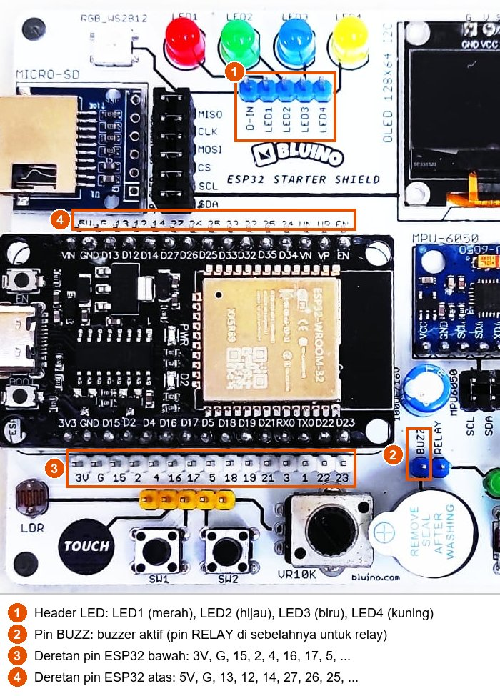

# BAB 8: Digital Output — LED & Buzzer

> ✅ **Prasyarat:** Selesaikan **BAB 7 (Program Pertama — Hello World)** — kamu sudah bisa meng-*upload* program ke ESP32 dan membuka Serial Monitor. Peta pin kit dibahas di **BAB 6 (Pin Mapping Kit Bluino & Restriksi GPIO)**.

Di BAB 7 kamu sudah membuat LED bawaan *board* berkedip. Sekarang kita memakai komponen kit yang sebenarnya: **4 LED berwarna** dan sebuah *buzzer* aktif. Keduanya dikendalikan dengan **output digital** — pin ESP32 bisa "menyalakan" atau "mematikan" tegangan, mirip sakelar lampu di rumah yang hanya punya dua posisi. Lampu lalu lintas, lampu indikator pengisian daya, dan bunyi "bip" mesin cuci bekerja dengan prinsip yang sama.

## 📌 Tujuan Pembelajaran

Setelah mempelajari BAB ini, kamu bisa:

- Menjelaskan arti HIGH dan LOW pada pin output ESP32.
- Membedakan rangkaian *active-high* dan *active-low*.
- Menyambungkan LED dan *buzzer* kit ke pin ESP32 dengan kabel *jumper* sesuai Peta Pin Standar.
- Memakai `pinMode()` dan `digitalWrite()` untuk menyalakan dan mematikan LED serta *buzzer*.
- Mengendalikan beberapa LED sekaligus dengan *array* dan perulangan `for`.
- Menghitung perkiraan arus LED dan memahami batas arus pin GPIO supaya ESP32 tetap aman.

## 🧰 Yang Perlu Disiapkan

| Kebutuhan | Keterangan |
|---|---|
| *Hardware* | Kit Bluino ESP32 IoT Starter Shield (ESP32 DEVKIT V1 sudah terpasang di kit) + kabel USB **data** |
| Kabel *jumper* | 5 kabel *female-female* (4 untuk LED, 1 untuk *buzzer*) — sudah ada di kit |
| Komponen tambahan | Tidak ada — LED (lengkap dengan resistor 330 Ω) dan *buzzer* aktif sudah terpasang di kit |
| *Software* | Arduino IDE 2.x + *board package* **esp32** versi 3.3.x (lihat [BAB 5](../BAB-05/README.md)) |
| *Library* | Tidak perlu *library* tambahan |
| Alat uji | **Serial Monitor** Arduino IDE (baud 115200) |
| Jaringan | Tidak perlu WiFi |

## 📑 Daftar Isi

- [8.1 Konsep Output Digital](#81-konsep-output-digital)
- [8.2 LED pada Kit Bluino](#82-led-pada-kit-bluino)
- [8.3 Program 1: LED Merah Berkedip](#83-program-1-led-merah-berkedip)
- [8.4 Program 2: Empat LED Menyala Bergantian](#84-program-2-empat-led-menyala-bergantian)
- [8.5 Program 3: LED Berjalan (Knight Rider)](#85-program-3-led-berjalan-knight-rider)
- [8.6 Buzzer Aktif pada Kit Bluino](#86-buzzer-aktif-pada-kit-bluino)
- [8.7 Program 4: Buzzer Bip-Bip-Bip](#87-program-4-buzzer-bip-bip-bip)
- [8.8 Program 5: Alarm Sederhana (LED + Buzzer)](#88-program-5-alarm-sederhana-led--buzzer)
- [8.9 Arus dan Keamanan Pin GPIO](#89-arus-dan-keamanan-pin-gpio)
- [8.10 Troubleshooting](#810-troubleshooting)
- [📝 Rangkuman](#-rangkuman)
- [💪 Latihan](#-latihan)
- [📚 Referensi](#-referensi)

---

## 8.1 Konsep Output Digital

Setiap kaki ESP32 yang bisa diprogram disebut **GPIO** (*General Purpose Input/Output*, pin masukan/keluaran serbaguna). Saat dijadikan **output**, pin GPIO bekerja seperti sakelar yang dikendalikan program: pin itu bisa mengeluarkan tegangan atau tidak.

| Perintah | Keadaan pin | Tegangan di pin | LED di kit |
|---|---|---|---|
| `digitalWrite(pin, HIGH)` | HIGH (logika 1) | sekitar 3,3 V | Menyala |
| `digitalWrite(pin, LOW)` | LOW (logika 0) | 0 V (sama dengan GND) | Mati |

Disebut **digital** karena hanya ada dua keadaan: HIGH atau LOW, tidak ada "setengah". Mengatur terang-redup LED secara halus memakai teknik lain, yaitu PWM, yang dibahas di [BAB 12](../BAB-12/README.md).

> 📌 **Catatan:** ESP32 bekerja pada 3,3 V, bukan 5 V seperti Arduino Uno. Jadi HIGH pada ESP32 kira-kira 3,3 V. Karena itu pula, jangan pernah memberi tegangan 5 V ke pin GPIO ESP32 — pinnya bisa rusak.

### 8.1.1 Fungsi yang Dipakai

Tiga fungsi ini sudah kamu kenal sekilas di [BAB 7](../BAB-07/README.md):

| Fungsi | Gunanya | Biasanya ditulis di |
|---|---|---|
| `pinMode(pin, OUTPUT)` | Menjadikan pin sebagai output | `setup()` — cukup sekali |
| `digitalWrite(pin, HIGH)` atau `digitalWrite(pin, LOW)` | Membuat pin HIGH atau LOW | `loop()` atau di mana pun dibutuhkan |
| `delay(ms)` | Menunggu sekian milidetik (1000 ms = 1 detik) | Di mana pun dibutuhkan |

Contoh potongan kode (bukan program lengkap):

```cpp
#define LED_MERAH 4             // beri nama "LED_MERAH" untuk angka 4 (IO4)

pinMode(LED_MERAH, OUTPUT);     // di setup(): IO4 menjadi output
digitalWrite(LED_MERAH, HIGH);  // IO4 = HIGH → LED merah menyala
delay(1000);                    // tunggu 1 detik
digitalWrite(LED_MERAH, LOW);   // IO4 = LOW → LED merah mati
```

Baris `#define LED_MERAH 4` artinya: "setiap kali ada tulisan `LED_MERAH`, ganti dengan angka `4`". Nama seperti ini membuat kode lebih mudah dibaca daripada angka 4 saja. Kalau suatu saat kamu memindahkan kabel ke pin lain, cukup ubah satu baris itu.

> ⚠️ **Perhatian:** Jangan lupa `pinMode(pin, OUTPUT)`. Tanpa baris itu, `digitalWrite()` di esp32 core 3.x tidak melakukan apa-apa — LED tetap mati, dan dengan pengaturan bawaan Arduino IDE tidak ada pesan *error* apa pun di Serial Monitor.

### 8.1.2 Active-High dan Active-Low

Komponen output bisa disambung ke pin dengan dua cara. Bedanya ada pada arah arus:

| | *Active-high* | *Active-low* |
|---|---|---|
| Rangkaian | Pin → komponen → GND | 3,3 V → komponen → pin |
| Arah arus | Keluar **dari** pin ke komponen | Dari 3,3 V lewat komponen, **masuk** ke pin |
| Komponen aktif saat pin | **HIGH** | **LOW** |
| Contoh | Semua LED, *buzzer*, dan *relay* di kit Bluino | Banyak modul *relay* murah, LED bawaan beberapa *board* lain (misalnya ESP8266) |

Semua output di kit Bluino *active-high*, jadi di BAB ini aturannya sederhana: **HIGH = nyala, LOW = mati**.

> 💡 **Tips:** Kalau suatu saat kamu memakai modul *active-low*, beri nama supaya kode tetap mudah dibaca, misalnya `#define NYALA LOW` dan `#define MATI HIGH`, lalu tulis `digitalWrite(pinRelay, NYALA);`.

---

## 8.2 LED pada Kit Bluino

### 8.2.1 Rangkaian LED di Kit

Kit Bluino punya 4 LED berukuran 5 mm. Kaki positif (anoda) setiap LED dibawa ke *header* (deretan pin) bertanda **Custom**, sedangkan kaki negatifnya (katoda) disambung lewat resistor 330 Ω ke GND:


*Gambar 8.1 — Rangkaian 4 LED pada kit. Sumber: skematik ESP32 Starter Shield 3.2, [Bluino](http://www.bluino.com).*

Cara membacanya:

- **LED** (*Light Emitting Diode*) adalah dioda yang memancarkan cahaya. Seperti dioda lainnya, arus hanya bisa lewat satu arah: dari anoda (+) ke katoda (−).
- **Resistor 330 Ω** membatasi arus supaya LED dan pin ESP32 tidak kelebihan arus. Resistor ini **sudah terpasang** di PCB, jadi kamu tidak perlu menambahkannya.
- Jalurnya pin → LED → resistor → GND, jadi LED di kit bersifat *active-high*: pin HIGH = LED menyala.

Perhitungan arus setiap LED (dan alasan LED biru dan hijau tampak lebih redup) ada di [8.9](#89-arus-dan-keamanan-pin-gpio).

### 8.2.2 Menyambungkan Kabel Jumper

Pin **Custom** belum tersambung ke ESP32 sampai kamu memasang kabel *jumper*. Di atas dan di bawah *board* ESP32 ada dua deretan pin yang tersambung langsung ke pin-pin ESP32. Setiap pin diberi label nomor GPIO-nya, misalnya `4`, `16`, `17`, dan `2` di deretan bawah serta `13` di deretan atas. Satu ujung kabel *jumper* dipasang ke pin komponen (misalnya LED1), ujung lainnya ke pin ESP32 dengan label yang sesuai.



*Gambar 8.2 — Letak header LED (1), pin BUZZ (2), dan deretan pin ESP32 (3 dan 4) pada kit v3.x; tata letak kit v3.2 milikmu bisa sedikit berbeda. Sumber: foto produk ESP32 Starter Shield, [Bluino](http://www.bluino.com), dipotong dan diberi penanda untuk materi ini.*

Sambungkan LED sesuai Peta Pin Standar berikut (dipakai di seluruh BAB):

| Warna LED | Label di *header* LED | Sambungkan ke pin ESP32 | Letak pin ESP32 |
|---|---|---|---|
| Merah | LED1 | IO4 (label `4`) | Deretan bawah |
| Hijau | LED2 | IO17 (label `17`) | Deretan bawah |
| Biru | LED3 | IO2 (label `2`) | Deretan bawah |
| Kuning | LED4 | IO16 (label `16`) | Deretan bawah |

> 📌 **Catatan:** Pada foto kit, urutan warnanya LED1 merah, LED2 hijau, LED3 biru, LED4 kuning — jadi nomor LED **tidak** urut dengan nomor pin. Yang menentukan adalah **warnanya**: merah → IO4, kuning → IO16, hijau → IO17, biru → IO2. Kalau urutan warna di kit kamu berbeda, ikuti garis jalur di PCB dari LED ke pin *header*-nya. Pin **D-IN** di *header* yang sama tidak dipakai di BAB ini.

Langkah memasang kabel:

1. Cabut kabel USB dulu supaya aman saat merangkai.
2. Pasang ujung kabel *jumper* ke pin **LED1** (merah), lalu ujung lainnya ke pin berlabel **4** di deretan bawah.
3. Ulangi untuk LED2 → **17**, LED3 → **2**, dan LED4 → **16**.
4. Periksa lagi: setiap kabel tertancap penuh dan tidak ada yang bergeser satu pin.
5. Sambungkan kembali kabel USB ke laptop/komputer.

> 💡 **Tips:** Program 1 hanya memakai LED merah, tetapi tidak ada salahnya langsung memasang keempat kabel karena Program 2 dan 3 memakai semua LED.

> 📌 **Catatan:** IO2 juga tersambung ke LED biru kecil bawaan *board* ESP32 (yang kamu kedipkan di BAB 7). Jadi saat LED biru kit menyala, LED kecil di *board* ikut menyala — itu normal. IO2 juga termasuk pin *strapping* (pin yang dibaca ESP32 sesaat setelah dinyalakan untuk menentukan mode *boot*), tetapi LED dengan resistor ke GND seperti di kit tidak mengganggu proses *boot* maupun *upload*.

---

## 8.3 Program 1: LED Merah Berkedip

**Tujuan:** Menyalakan LED merah selama 1 detik, lalu mematikannya 1 detik, terus berulang, sambil menampilkan keadaannya di Serial Monitor.

**Rangkaian:**

| Pin **Custom** di kit | Sambungkan ke pin ESP32 |
|---|---|
| LED1 (LED merah) | IO4 |

**Cara Menjalankan:**

1. Sambungkan kabel *jumper* sesuai tabel **Rangkaian** di atas (lihat juga [8.2.2](#822-menyambungkan-kabel-jumper)).
2. Buka Arduino IDE → **File → New Sketch**, hapus isinya, lalu salin kode di bawah. Kode yang sama juga tersedia di *file* [`p1_led_berkedip.ino`](p1_led_berkedip/p1_led_berkedip.ino).
3. Pastikan **Tools → Board** = **ESP32 Dev Module** dan **Tools → Port** = *port* ESP32 kamu (misalnya `COM5` di Windows atau `/dev/ttyUSB0` di Linux).
4. Klik tombol **Upload** (ikon panah →) dan tunggu sampai muncul tulisan **Done uploading**.
5. Buka **Serial Monitor** (**Tools → Serial Monitor**) lalu pilih baud **115200**.

**Kode Program:**

<!-- sketch: p1_led_berkedip -->
```cpp
/*
 * BAB 8 - Program 1: LED Merah Berkedip
 * LED merah menyala 1 detik, mati 1 detik, berulang terus.
 *
 * Rangkaian: LED1 (merah) di header LED → IO4
 */

#define LED_MERAH 4  // LED merah → IO4

void setup() {
  Serial.begin(115200);
  pinMode(LED_MERAH, OUTPUT);    // IO4 menjadi output
  digitalWrite(LED_MERAH, LOW);  // mulai dalam keadaan mati

  Serial.println("BAB 8 - Program 1: LED Merah Berkedip");
}

void loop() {
  digitalWrite(LED_MERAH, HIGH);  // IO4 = HIGH → LED menyala (active-high)
  Serial.println("LED merah: NYALA");
  delay(1000);                    // tunggu 1 detik

  digitalWrite(LED_MERAH, LOW);   // IO4 = LOW → LED mati
  Serial.println("LED merah: MATI");
  delay(1000);                    // tunggu 1 detik
}
```

**Penjelasan Kode:**

- `#define LED_MERAH 4` memberi nama untuk pin 4, jadi di bagian lain kode cukup menulis `LED_MERAH`.
- `setup()` dijalankan **sekali** saat ESP32 mulai: membuka komunikasi Serial pada 115200 baud, menjadikan IO4 sebagai output, memastikan LED mati, lalu mencetak judul program.
- `loop()` diulang **terus-menerus**: pin dibuat HIGH (LED menyala), status dicetak, tunggu 1 detik; lalu pin dibuat LOW (LED mati), status dicetak, tunggu 1 detik lagi. Satu putaran `loop()` = 2 detik.
- Selama `delay()`, ESP32 hanya diam menunggu dan tidak bisa mengerjakan hal lain, misalnya membaca tombol. Untuk program sederhana ini tidak masalah. Cara menunggu tanpa `delay()` dibahas di [BAB 16](../BAB-16/README.md).

**Contoh Output:**

```text
BAB 8 - Program 1: LED Merah Berkedip
LED merah: NYALA
LED merah: MATI
LED merah: NYALA
LED merah: MATI
```

Di kit: LED merah berkedip pelan — 1 detik menyala, 1 detik mati. Setiap 1 detik muncul satu baris baru di Serial Monitor.

> 💡 **Tips:** Baris judul hanya dicetak sekali saat program mulai. Kalau Serial Monitor baru kamu buka setelah program berjalan, baris itu sudah terlewat. Tekan tombol **EN** (di sebelah konektor USB *board* ESP32) untuk memulai ulang program, dan judulnya akan muncul lagi. Sebelum judul mungkin muncul beberapa baris log *boot* bawaan ESP32, misalnya `rst:0x1 (POWERON_RESET),boot:0x13 ...`; itu normal dan boleh diabaikan.

**Kalau Belum Berhasil:**

- **Serial Monitor menampilkan NYALA/MATI, tetapi LED tidak menyala** → kabel *jumper* belum tertancap di pin yang benar. Cek ujung di pin **LED1** dan ujung di pin berlabel **4** di deretan bawah (bukan pin di sebelahnya).
- **Proses *upload* gagal dengan pesan `Failed to connect to ESP32`** → pilih *port* yang benar, ganti dengan kabel USB **data**, atau tahan tombol **BOOT** saat muncul tulisan `Connecting...` (lihat [BAB 7](../BAB-07/README.md)).
- **Serial Monitor kosong atau berisi karakter aneh** → pastikan baud di Serial Monitor **115200**, lalu tekan tombol **EN** di *board*.

---

## 8.4 Program 2: Empat LED Menyala Bergantian

**Tujuan:** Menyalakan keempat LED satu per satu dari kiri ke kanan, lalu mematikannya satu per satu. Program ini memperkenalkan *array* (daftar nilai) dan perulangan `for`, supaya kode untuk 4 LED tetap pendek.

**Rangkaian:**

| Pin **Custom** di kit | Sambungkan ke pin ESP32 |
|---|---|
| LED1 (merah) | IO4 |
| LED2 (hijau) | IO17 |
| LED3 (biru) | IO2 |
| LED4 (kuning) | IO16 |

**Cara Menjalankan:**

1. Sambungkan keempat kabel *jumper* sesuai tabel **Rangkaian** di atas.
2. Buka Arduino IDE → **File → New Sketch**, hapus isinya, lalu salin kode di bawah. Kode yang sama juga tersedia di *file* [`p2_empat_led.ino`](p2_empat_led/p2_empat_led.ino).
3. Pastikan **Tools → Board** = **ESP32 Dev Module** dan **Tools → Port** = *port* ESP32 kamu.
4. Klik tombol **Upload** dan tunggu sampai muncul tulisan **Done uploading**.
5. Buka **Serial Monitor** (**Tools → Serial Monitor**) lalu pilih baud **115200**.

**Kode Program:**

<!-- sketch: p2_empat_led -->
```cpp
/*
 * BAB 8 - Program 2: Empat LED Menyala Bergantian
 * LED menyala satu per satu dari kiri ke kanan, lalu mati satu per satu.
 *
 * Rangkaian (header LED di kit → pin ESP32):
 *   LED1 (merah)  → IO4
 *   LED2 (hijau)  → IO17
 *   LED3 (biru)   → IO2
 *   LED4 (kuning) → IO16
 */

#define LED_MERAH  4
#define LED_KUNING 16
#define LED_HIJAU  17
#define LED_BIRU   2

// Urutan array = urutan posisi LED di kit, dari kiri ke kanan
const int LED_PINS[] = {LED_MERAH, LED_HIJAU, LED_BIRU, LED_KUNING};
const char *NAMA_LED[] = {"merah", "hijau", "biru", "kuning"};
const int JUMLAH_LED = sizeof(LED_PINS) / sizeof(LED_PINS[0]);  // = 4

void setup() {
  Serial.begin(115200);

  // Jadikan semua pin LED output dan pastikan semuanya mati
  for (int i = 0; i < JUMLAH_LED; i++) {
    pinMode(LED_PINS[i], OUTPUT);
    digitalWrite(LED_PINS[i], LOW);
  }

  Serial.println("BAB 8 - Program 2: Empat LED Menyala Bergantian");
}

void loop() {
  // Nyalakan satu per satu
  for (int i = 0; i < JUMLAH_LED; i++) {
    digitalWrite(LED_PINS[i], HIGH);
    Serial.print("LED ");
    Serial.print(NAMA_LED[i]);
    Serial.println(": NYALA");
    delay(500);
  }
  delay(1000);  // semua menyala selama 1 detik

  // Matikan satu per satu
  for (int i = 0; i < JUMLAH_LED; i++) {
    digitalWrite(LED_PINS[i], LOW);
    Serial.print("LED ");
    Serial.print(NAMA_LED[i]);
    Serial.println(": MATI");
    delay(500);
  }
  delay(1000);  // semua mati selama 1 detik
}
```

**Penjelasan Kode:**

- `LED_PINS[]` adalah ***array***: satu nama untuk sederet nilai. `LED_PINS[0]` berisi 4 (merah), `LED_PINS[1]` berisi 17 (hijau), dan seterusnya. Nomor urut (indeks) *array* selalu dimulai dari **0**, bukan 1.
- Urutan di dalam *array* sengaja disamakan dengan posisi LED di kit dari kiri ke kanan (merah, hijau, biru, kuning). Urutan inilah yang menentukan urutan LED menyala.
- `NAMA_LED[]` adalah *array* berisi teks nama warna dengan urutan yang sama, dipakai untuk pesan di Serial Monitor. Tulisan `const char *` adalah cara C++ menyatakan teks yang tetap; untuk sekarang anggap saja "daftar teks".
- `sizeof(LED_PINS) / sizeof(LED_PINS[0])` menghitung jumlah elemen *array* secara otomatis: ukuran seluruh *array* dibagi ukuran satu elemen = 4. Kalau kamu menambah atau mengurangi LED, `JUMLAH_LED` ikut menyesuaikan.
- `for (int i = 0; i < JUMLAH_LED; i++)` mengulang isi kurung kurawal untuk `i` = 0, 1, 2, 3. Dengan cara ini, satu baris `pinMode(LED_PINS[i], OUTPUT);` sudah cukup untuk mengatur keempat pin.

**Contoh Output:**

```text
BAB 8 - Program 2: Empat LED Menyala Bergantian
LED merah: NYALA
LED hijau: NYALA
LED biru: NYALA
LED kuning: NYALA
LED merah: MATI
LED hijau: MATI
LED biru: MATI
LED kuning: MATI
LED merah: NYALA
```

Di kit: setiap 0,5 detik satu LED bertambah menyala dari kiri (merah) ke kanan (kuning). Setelah keempatnya menyala 1 detik, LED padam satu per satu dengan urutan yang sama, lalu semuanya mati 1 detik sebelum mengulang. LED biru kecil di *board* ESP32 ikut menyala bersama LED biru kit karena keduanya di IO2. LED biru dan hijau mungkin terlihat lebih redup daripada merah dan kuning — alasannya ada di [8.9](#89-arus-dan-keamanan-pin-gpio).

**Kalau Belum Berhasil:**

- **Hanya sebagian LED yang menyala** → periksa kabel LED yang tidak menyala dan bandingkan dengan tabel **Rangkaian**. Kabel yang bergeser satu pin adalah penyebab paling umum.
- **Nama warna di Serial Monitor tidak cocok dengan LED yang menyala** → ada kabel yang tertukar. Ingat, yang menentukan adalah warnanya: merah → IO4, hijau → IO17, biru → IO2, kuning → IO16.
- **LED menyala tidak urut dari kiri ke kanan** → urutan warna LED di kit kamu mungkin berbeda. Ubah urutan isi `LED_PINS[]` dan `NAMA_LED[]` sesuai posisi LED di kit kamu.

---

## 8.5 Program 3: LED Berjalan (Knight Rider)

**Tujuan:** Membuat satu LED menyala bergantian maju-mundur, seperti lampu di depan mobil KITT dalam serial TV *Knight Rider* tahun 1980-an. Program ini juga menunjukkan cara membuat fungsi sendiri supaya `loop()` tetap pendek.

**Rangkaian:** sama dengan Program 2 (keempat LED tersambung).

| Pin **Custom** di kit | Sambungkan ke pin ESP32 |
|---|---|
| LED1 (merah) | IO4 |
| LED2 (hijau) | IO17 |
| LED3 (biru) | IO2 |
| LED4 (kuning) | IO16 |

**Cara Menjalankan:**

1. Biarkan kabel *jumper* seperti pada Program 2.
2. Buka Arduino IDE → **File → New Sketch**, hapus isinya, lalu salin kode di bawah. Kode yang sama juga tersedia di *file* [`p3_led_berjalan.ino`](p3_led_berjalan/p3_led_berjalan.ino).
3. Pastikan **Tools → Board** = **ESP32 Dev Module** dan **Tools → Port** = *port* ESP32 kamu.
4. Klik tombol **Upload** dan tunggu sampai muncul tulisan **Done uploading**.
5. Buka **Serial Monitor** (**Tools → Serial Monitor**) lalu pilih baud **115200**.

**Kode Program:**

<!-- sketch: p3_led_berjalan -->
```cpp
/*
 * BAB 8 - Program 3: LED Berjalan (Knight Rider)
 * Satu LED menyala bergantian maju-mundur.
 *
 * Rangkaian sama dengan Program 2:
 *   LED1 (merah) → IO4, LED2 (hijau) → IO17,
 *   LED3 (biru)  → IO2, LED4 (kuning) → IO16
 */

#define LED_MERAH  4
#define LED_KUNING 16
#define LED_HIJAU  17
#define LED_BIRU   2

// Urutan sesuai posisi di kit (kiri → kanan): merah, hijau, biru, kuning
const int LED_PINS[] = {LED_MERAH, LED_HIJAU, LED_BIRU, LED_KUNING};
const int JUMLAH_LED = sizeof(LED_PINS) / sizeof(LED_PINS[0]);
const int JEDA_MS = 150;  // lama setiap LED menyala; makin kecil makin cepat

// Matikan semua LED
void matikanSemua() {
  for (int i = 0; i < JUMLAH_LED; i++) {
    digitalWrite(LED_PINS[i], LOW);
  }
}

// Nyalakan hanya LED dengan indeks tertentu, lalu tunggu sebentar
void nyalakanSatu(int indeks) {
  matikanSemua();
  digitalWrite(LED_PINS[indeks], HIGH);
  delay(JEDA_MS);
}

void setup() {
  Serial.begin(115200);
  for (int i = 0; i < JUMLAH_LED; i++) {
    pinMode(LED_PINS[i], OUTPUT);
  }
  matikanSemua();

  Serial.println("BAB 8 - Program 3: LED Berjalan (Knight Rider)");
}

void loop() {
  // Maju: indeks 0 → 1 → 2 → 3 (merah → hijau → biru → kuning)
  for (int i = 0; i < JUMLAH_LED; i++) {
    nyalakanSatu(i);
  }

  // Mundur: indeks 2 → 1 (kedua ujung tidak diulang supaya gerakannya mulus)
  for (int i = JUMLAH_LED - 2; i > 0; i--) {
    nyalakanSatu(i);
  }
}
```

**Penjelasan Kode:**

- `matikanSemua()` dan `nyalakanSatu(indeks)` adalah **fungsi buatan sendiri**. Perintah yang sering dipakai dikumpulkan dalam satu nama, sehingga `loop()` jadi pendek dan mudah dibaca. Kedua fungsi ditulis sebelum `setup()` — kebiasaan baik di C++ supaya fungsi sudah dikenal sebelum dipakai.
- Perulangan "maju" menghasilkan `i` = 0, 1, 2, 3. Perulangan "mundur" dimulai dari `JUMLAH_LED - 2` (= 2) dan berhenti sebelum 0, jadi menghasilkan `i` = 2, 1.
- Kedua ujung (indeks 3 dan 0) sengaja tidak diulang di perulangan mundur, supaya LED di ujung tidak menyala dua kali berturut-turut. Urutan lengkapnya: 0, 1, 2, 3, 2, 1, lalu `loop()` mulai lagi dari 0.
- `JEDA_MS` mengatur kecepatan: setiap LED menyala selama 150 ms.

**Contoh Output:**

```text
BAB 8 - Program 3: LED Berjalan (Knight Rider)
```

Hanya satu baris, karena program ini tidak mencetak apa pun di dalam `loop()`. Di kit: satu LED menyala bergantian dari kiri ke kanan lalu kembali — merah → hijau → biru → kuning → biru → hijau → merah → dan seterusnya, masing-masing selama 150 ms.

> 🧪 **Coba Sendiri:** Ubah `JEDA_MS` menjadi `50`, lalu `500`, dan *upload* ulang. Pada nilai berapa gerakannya paling enak dilihat?

**Kalau Belum Berhasil:**

- **Gerakan LED tidak bolak-balik dengan rapi** → urutan pin di `LED_PINS[]` tidak sesuai dengan posisi LED di kit kamu, atau ada kabel yang tertukar.
- **Satu LED tidak pernah menyala** → kabel LED itu belum terpasang atau bergeser satu pin.
- **Semua LED mati, padahal judul muncul di Serial Monitor** → cek kembali bahwa kabel dipasang ke deretan pin ESP32 **bawah** dengan label `4`, `17`, `2`, dan `16`.

---

## 8.6 Buzzer Aktif pada Kit Bluino

*Buzzer* adalah komponen kecil penghasil bunyi "bip", seperti bunyi pada *microwave*, mesin cuci, atau sensor parkir mobil. Ada dua jenis yang sering dijumpai:

| | *Buzzer* aktif (yang ada di kit) | *Buzzer* pasif |
|---|---|---|
| Isinya | Elemen bunyi + rangkaian osilator (pembangkit getaran) | Hanya elemen bunyi |
| Cara membunyikan | Cukup diberi tegangan: HIGH = bunyi, LOW = diam | Harus diberi sinyal naik-turun yang cepat dengan frekuensi nada yang diinginkan |
| Nada | Satu nada tetap (umumnya sekitar 2–3 kHz) | Bisa bermacam-macam nada, misalnya untuk melodi |
| Perintah Arduino | `digitalWrite()` | `tone()` atau `ledcWriteTone()` (dibahas di [BAB 12](../BAB-12/README.md)) |

Karena osilatornya sudah ada di dalam, *buzzer* aktif bisa dikendalikan persis seperti LED.

### 8.6.1 Rangkaian Buzzer di Kit


*Gambar 8.3 — Rangkaian buzzer aktif pada kit. Sumber: skematik ESP32 Starter Shield 3.2, [Bluino](http://www.bluino.com).*

- Pin **Custom** *buzzer* — berlabel **BUZZ** di kit (nomor 2 pada Gambar 8.2) — tersambung ke kaki positif *buzzer*, sedangkan kaki lainnya ke GND. Jadi *buzzer* juga *active-high*: HIGH = bunyi.
- *Buzzer* disambung langsung ke pin tanpa transistor, sehingga arus untuk *buzzer* datang dari pin ESP32 itu sendiri. Kit memang dirancang begitu dan aman dipakai, asalkan kamu tidak menggantinya dengan beban yang lebih besar (lihat [8.9](#89-arus-dan-keamanan-pin-gpio)).
- Menurut Peta Pin Standar, *buzzer* disambung ke **IO13**, yaitu pin berlabel `13` di deretan pin ESP32 **atas**.

| Pin **Custom** di kit | Sambungkan ke pin ESP32 | Letak pin ESP32 |
|---|---|---|
| BUZZ | IO13 (label `13`) | Deretan atas |

> ⚠️ **Perhatian:** Pin **BUZZ** bersebelahan dengan pin **RELAY**. Pastikan kabel terpasang di BUZZ. Kalau tertukar, *relay* akan berbunyi "klik-klik" dan lampu indikatornya berkedip, sedangkan *buzzer* tetap diam.

> 💡 **Tips:** *Buzzer* baru biasanya masih tertutup stiker bertuliskan "REMOVE SEAL AFTER WASHING". Stiker itu melindungi *buzzer* saat PCB dicuci di pabrik. Selama stiker masih menempel, bunyinya sedikit lebih pelan — biarkan saja kalau kamu ingin suasana belajar tetap tenang.

---

## 8.7 Program 4: Buzzer Bip-Bip-Bip

**Tujuan:** Membunyikan *buzzer* aktif tiga kali pendek ("bip-bip-bip"), diam 2 detik, lalu mengulanginya terus.

**Rangkaian:**

| Pin **Custom** di kit | Sambungkan ke pin ESP32 |
|---|---|
| BUZZ | IO13 |

**Cara Menjalankan:**

1. Sambungkan kabel *jumper* dari pin **BUZZ** ke pin berlabel **13** di deretan pin ESP32 atas. Kabel LED dari program sebelumnya boleh tetap terpasang.
2. Buka Arduino IDE → **File → New Sketch**, hapus isinya, lalu salin kode di bawah. Kode yang sama juga tersedia di *file* [`p4_buzzer_bip.ino`](p4_buzzer_bip/p4_buzzer_bip.ino).
3. Pastikan **Tools → Board** = **ESP32 Dev Module** dan **Tools → Port** = *port* ESP32 kamu.
4. Klik tombol **Upload** dan tunggu sampai muncul tulisan **Done uploading**.
5. Buka **Serial Monitor** (**Tools → Serial Monitor**) lalu pilih baud **115200**.

**Kode Program:**

<!-- sketch: p4_buzzer_bip -->
```cpp
/*
 * BAB 8 - Program 4: Buzzer Bip-Bip-Bip
 * Buzzer aktif berbunyi pendek 3 kali, lalu diam 2 detik, berulang.
 *
 * Rangkaian: pin BUZZ di kit → IO13
 */

#define BUZZER_PIN 13  // buzzer aktif (pin BUZZ) → IO13

void setup() {
  Serial.begin(115200);
  pinMode(BUZZER_PIN, OUTPUT);
  digitalWrite(BUZZER_PIN, LOW);  // pastikan buzzer diam saat mulai

  Serial.println("BAB 8 - Program 4: Buzzer Bip-Bip-Bip");
}

void loop() {
  Serial.println("Bip-bip-bip!");

  for (int i = 0; i < 3; i++) {
    digitalWrite(BUZZER_PIN, HIGH);  // buzzer berbunyi
    delay(100);                      // selama 100 ms
    digitalWrite(BUZZER_PIN, LOW);   // buzzer diam
    delay(100);                      // selama 100 ms
  }

  delay(2000);  // diam 2 detik sebelum mengulang
}
```

**Penjelasan Kode:**

- Polanya sama dengan LED: `digitalWrite(BUZZER_PIN, HIGH)` membuat *buzzer* berbunyi, `LOW` membuatnya diam.
- Perulangan `for` mengulang pasangan "bunyi 100 ms – diam 100 ms" sebanyak 3 kali, sehingga terdengar "bip-bip-bip".
- Angka di `delay(100)` menentukan panjang bunyi. Ubah menjadi `delay(300)` kalau ingin bunyi yang lebih panjang.
- `digitalWrite(BUZZER_PIN, LOW)` di `setup()` memastikan *buzzer* diam sejak awal.

**Contoh Output:**

```text
BAB 8 - Program 4: Buzzer Bip-Bip-Bip
Bip-bip-bip!
Bip-bip-bip!
Bip-bip-bip!
```

Di kit: terdengar tiga bunyi pendek, diam 2 detik, lalu berulang. Satu putaran = 3 × (100 + 100) ms + 2000 ms = 2,6 detik, jadi tulisan `Bip-bip-bip!` muncul setiap 2,6 detik.

**Kalau Belum Berhasil:**

- **Tidak ada bunyi sama sekali** → cek kabel dari pin **BUZZ** ke pin berlabel **13** di deretan **atas** (bukan `12` atau `14` di sebelahnya).
- **Terdengar "klik-klik" dari *relay* dan lampu *relay* berkedip** → kabel terpasang di pin **RELAY**. Pindahkan ke pin **BUZZ**.
- **Bunyinya pelan** → stiker penutup *buzzer* masih menempel, itu normal. Selain itu, *buzzer* yang diberi 3,3 V dari pin ESP32 memang tidak senyaring *buzzer* yang diberi 5 V.

---

## 8.8 Program 5: Alarm Sederhana (LED + Buzzer)

**Tujuan:** Menggabungkan LED merah dan *buzzer* menjadi alarm: keduanya menyala dan berbunyi bersamaan 5 kali, lalu jeda 3 detik. Pola seperti ini dipakai pada alarm pintu, alarm asap, dan peringatan suhu.

**Rangkaian:**

| Pin **Custom** di kit | Sambungkan ke pin ESP32 |
|---|---|
| LED1 (LED merah) | IO4 |
| BUZZ | IO13 |

**Cara Menjalankan:**

1. Pastikan kabel LED1 → **4** (deretan bawah) dan BUZZ → **13** (deretan atas) terpasang.
2. Buka Arduino IDE → **File → New Sketch**, hapus isinya, lalu salin kode di bawah. Kode yang sama juga tersedia di *file* [`p5_alarm_sederhana.ino`](p5_alarm_sederhana/p5_alarm_sederhana.ino).
3. Pastikan **Tools → Board** = **ESP32 Dev Module** dan **Tools → Port** = *port* ESP32 kamu.
4. Klik tombol **Upload** dan tunggu sampai muncul tulisan **Done uploading**.
5. Buka **Serial Monitor** (**Tools → Serial Monitor**) lalu pilih baud **115200**.

**Kode Program:**

<!-- sketch: p5_alarm_sederhana -->
```cpp
/*
 * BAB 8 - Program 5: Alarm Sederhana (LED + Buzzer)
 * LED merah berkedip bersamaan dengan bunyi buzzer 5 kali, lalu jeda 3 detik.
 *
 * Rangkaian:
 *   LED1 (merah) → IO4
 *   BUZZ         → IO13
 */

#define LED_MERAH  4
#define BUZZER_PIN 13

const int JUMLAH_KEDIP = 5;  // berapa kali alarm berbunyi dalam satu siklus

void setup() {
  Serial.begin(115200);
  pinMode(LED_MERAH, OUTPUT);
  pinMode(BUZZER_PIN, OUTPUT);
  digitalWrite(LED_MERAH, LOW);
  digitalWrite(BUZZER_PIN, LOW);

  Serial.println("BAB 8 - Program 5: Alarm Sederhana");
}

void loop() {
  Serial.println("ALARM! (5x kedip + bunyi)");

  for (int i = 0; i < JUMLAH_KEDIP; i++) {
    // Nyala + bunyi bersamaan
    digitalWrite(LED_MERAH, HIGH);
    digitalWrite(BUZZER_PIN, HIGH);
    delay(200);

    // Mati + diam bersamaan
    digitalWrite(LED_MERAH, LOW);
    digitalWrite(BUZZER_PIN, LOW);
    delay(200);
  }

  Serial.println("--- Jeda 3 detik ---");
  delay(3000);
}
```

**Penjelasan Kode:**

- Dua perintah `digitalWrite()` berturut-turut dijalankan dalam hitungan mikrodetik (sepersejuta detik), jadi LED dan *buzzer* terlihat dan terdengar aktif bersamaan.
- `JUMLAH_KEDIP` menyimpan jumlah kedipan dalam satu siklus. Ubah angkanya untuk alarm yang lebih panjang atau lebih pendek.
- Satu siklus = 5 × (200 + 200) ms = 2 detik alarm, lalu jeda 3 detik.
- Di BAB berikutnya kamu akan belajar membaca tombol, sehingga alarm seperti ini bisa dimatikan dengan menekan tombol.

**Contoh Output:**

```text
BAB 8 - Program 5: Alarm Sederhana
ALARM! (5x kedip + bunyi)
--- Jeda 3 detik ---
ALARM! (5x kedip + bunyi)
--- Jeda 3 detik ---
```

Di kit: LED merah berkedip sambil *buzzer* berbunyi "bip" 5 kali dalam 2 detik, lalu keduanya diam selama 3 detik, dan berulang.

**Kalau Belum Berhasil:**

- **LED berkedip, tetapi *buzzer* diam** → cek kabel BUZZ → **13** (dan pastikan bukan pin **RELAY**).
- ***Buzzer* berbunyi, tetapi LED diam** → cek kabel LED1 → **4**.
- **Keduanya diam dan Serial Monitor kosong** → program belum ter-*upload*. *Upload* ulang sampai muncul tulisan **Done uploading**, lalu tekan tombol **EN**.

---

## 8.9 Arus dan Keamanan Pin GPIO

Setelah semua program berjalan, mari pahami **berapa arus** yang dikeluarkan pin ESP32 dan batas amannya. Bagian ini penting supaya kelak kamu tidak merusak ESP32 saat menyambung komponen lain.

### 8.9.1 Menghitung Arus LED

Kamu sudah mengenal Hukum Ohm di [BAB 3](../BAB-03/README.md). Pada rangkaian LED kit, tegangan pin (±3,3 V) terbagi untuk dua komponen: sebagian "dipakai" LED — disebut **tegangan maju** (*forward voltage*, V<sub>f</sub>) — dan sisanya jatuh di resistor. Arus yang mengalir:

**I = (3,3 V − V<sub>f</sub>) ÷ 330 Ω**

Nilai V<sub>f</sub> bergantung pada warna (bahan) LED:

| Warna LED | V<sub>f</sub> khas | Perhitungan | Perkiraan arus |
|---|---|---|---|
| Merah | ±2,0 V | (3,3 V − 2,0 V) ÷ 330 Ω | ±3,9 mA |
| Kuning | ±2,1 V | (3,3 V − 2,1 V) ÷ 330 Ω | ±3,6 mA |
| Hijau | ±3,0 V | (3,3 V − 3,0 V) ÷ 330 Ω | ±0,9 mA |
| Biru | ±3,0 V | (3,3 V − 3,0 V) ÷ 330 Ω | ±0,9 mA |
| **Total jika keempatnya menyala** | | | **±9 mA** |

Apa artinya?

- LED merah dan kuning mendapat arus ±4 mA, sedangkan LED hijau dan biru hanya sekitar 1 mA. V<sub>f</sub> LED hijau dan biru hampir sama dengan 3,3 V, sehingga sisa tegangan untuk "mendorong" arus lewat resistor tinggal sedikit. **Itulah sebabnya LED biru dan hijau di kit tampak lebih redup.** Ini normal, bukan kerusakan.
- Angka di tabel hanya perkiraan. V<sub>f</sub> setiap LED sedikit berbeda (dan ikut turun saat arusnya kecil), dan tegangan HIGH pin juga sedikit di bawah 3,3 V. Jadi arus sebenarnya bisa sedikit berbeda. LED hijau jenis lama (hijau kekuningan) punya V<sub>f</sub> ±2,2 V sehingga arusnya sekitar 3 mA.
- Yang terpenting: semua arus ini **jauh di bawah** kemampuan pin ESP32, jadi aman.

### 8.9.2 Batas Arus Pin ESP32

Datasheet ESP32 menyebutkan angka-angka berikut:

| Parameter | Nilai menurut datasheet | Artinya untuk kamu |
|---|---|---|
| Arus keluar per pin saat HIGH (*source current*) | ±40 mA (±20 mA untuk IO16 dan IO17) | Kemampuan pada pengaturan *drive* terkuat, bukan angka untuk dipakai terus-menerus. Kalau banyak pin mengeluarkan arus bersamaan, kemampuan per pin turun hingga ±29 mA |
| Arus masuk per pin saat LOW (*sink current*) | ±28 mA | Berlaku untuk rangkaian *active-low* |
| Total arus semua pin IO | 1200 mA | Batas mutlak (*absolute maximum*): melewatinya bisa merusak chip |

Secara bawaan, esp32 core memakai kekuatan *drive* tingkat 2 dari 4 tingkat (0–3), bukan yang terkuat. Jadi pada program biasa, kemampuan arus pin lebih kecil daripada angka maksimum di tabel.

**Pedoman praktis:**

- Usahakan arus setiap pin di bawah ±20 mA, dan total arus semua pin sekecil mungkin.
- LED kit (±1–4 mA) dan *buzzer* aktif kit aman disambung langsung ke pin, seperti di BAB ini.
- Jangan menyambung beban besar — motor DC, kipas, solenoid, kumparan *relay*, lampu, atau *buzzer* besar — langsung ke pin. Pakai *driver*, misalnya transistor. *Relay* di kit sudah dilengkapi transistor BC547 sebagai *driver*, jadi aman dikendalikan dari pin (dibahas di [BAB 37](../BAB-37/README.md)).

> ⚠️ **Perhatian:** Pin output yang sedang HIGH jangan sampai tersambung langsung ke GND, misalnya karena kabel *jumper* nyasar. Hubung singkat seperti itu membuat arus melewati batas dan bisa merusak pin. Biasakan mencabut kabel USB sebelum memindahkan kabel *jumper*.

---

## 8.10 Troubleshooting

| Masalah | Kemungkinan Penyebab | Solusi |
|---|---|---|
| LED tidak menyala, padahal Serial Monitor menampilkan pesan | Kabel *jumper* belum terpasang, salah pin, atau bergeser satu pin | Cocokkan dengan tabel di [8.2.2](#822-menyambungkan-kabel-jumper) dan pastikan kabel tertancap penuh |
| LED tidak menyala dan tidak ada pesan *error* sama sekali | `pinMode(pin, OUTPUT)` belum ditulis | Tambahkan `pinMode()` untuk setiap pin output di `setup()` |
| LED biru dan hijau lebih redup daripada merah dan kuning | V<sub>f</sub> LED biru/hijau mendekati 3,3 V sehingga arusnya kecil | Normal, lihat [8.9.1](#891-menghitung-arus-led) |
| LED kecil di *board* ESP32 ikut berkedip | LED bawaan *board* juga tersambung ke IO2 | Normal, tidak perlu diperbaiki |
| Urutan nyala LED loncat-loncat | Kabel tertukar, atau urutan warna LED di kit kamu berbeda | Periksa kabel; sesuaikan urutan isi `LED_PINS[]` |
| *Buzzer* diam, tetapi *relay* berbunyi "klik" | Kabel terpasang di pin **RELAY** | Pindahkan kabel ke pin **BUZZ** |
| *Buzzer* berbunyi terus | Pin *buzzer* tertinggal dalam keadaan HIGH, misalnya baris `digitalWrite(BUZZER_PIN, LOW)` terhapus | Periksa kode, lalu *upload* ulang |
| *Upload* gagal (`Failed to connect to ESP32`) | *Port* salah, kabel USB hanya untuk mengisi daya, atau *driver* USB belum terpasang | Lihat [BAB 5](../BAB-05/README.md); tahan tombol **BOOT** saat muncul tulisan `Connecting...` |
| Serial Monitor kosong atau berisi karakter aneh | Baud Serial Monitor tidak sama dengan kode | Pilih **115200**, lalu tekan tombol **EN** |
| *Error* `'LED_MERAH' was not declared in this scope` saat *compile* | Baris `#define` terhapus atau nama salah ketik (huruf besar-kecil berpengaruh) | Samakan penulisan nama dengan baris `#define` |

---

## 📝 Rangkuman

- **Output digital** hanya punya dua keadaan: HIGH (±3,3 V) dan LOW (0 V).
- Tulis `pinMode(pin, OUTPUT)` sekali di `setup()`, lalu pakai `digitalWrite(pin, HIGH)` atau `digitalWrite(pin, LOW)` untuk mengubah keadaan pin.
- Semua output di kit Bluino *active-high*: HIGH = nyala/bunyi, LOW = mati/diam. Pada rangkaian *active-low* logikanya terbalik.
- *Array* dan perulangan `for` membuat kode untuk banyak LED tetap pendek; urutan isi *array* menentukan urutan nyala.
- *Buzzer* aktif cukup diberi HIGH/LOW dan hanya punya satu nada. Untuk melodi dibutuhkan *buzzer* pasif dan PWM ([BAB 12](../BAB-12/README.md)).
- Arus LED kit hanya ±1–4 mA; LED biru dan hijau lebih redup karena V<sub>f</sub>-nya tinggi. Beban besar wajib memakai *driver* seperti transistor.
- `delay()` membuat ESP32 menunggu tanpa bisa mengerjakan hal lain. Cara tanpa `delay()` dibahas di [BAB 16](../BAB-16/README.md).

Peta pin yang dipakai di BAB ini:

| Komponen | Label di kit | Pin ESP32 |
|---|---|---|
| LED merah | LED1 | IO4 |
| LED kuning | LED4 | IO16 |
| LED hijau | LED2 | IO17 |
| LED biru | LED3 | IO2 |
| *Buzzer* aktif | BUZZ | IO13 |

---

## 💪 Latihan

### Latihan Dasar

1. **Lampu lalu lintas:** Buat simulasi lampu lalu lintas: hijau menyala 5 detik → kuning 2 detik → merah 5 detik → ulangi. Tampilkan nama lampu yang sedang menyala di Serial Monitor.
   *Petunjuk:* Pakai pasangan `digitalWrite()` dan `delay()` untuk setiap warna, dan pastikan hanya satu LED yang menyala pada satu waktu.
2. **Lampu sirene:** Buat LED merah dan biru berkedip bergantian setiap 300 ms — merah menyala saat biru mati, dan sebaliknya.
   *Petunjuk:* Dalam satu langkah, buat satu LED HIGH dan yang lain LOW, tunggu 300 ms, lalu tukar keadaannya.

### Latihan Menengah

3. **Bilangan biner:** Tampilkan angka 0 sampai 15 dalam bentuk biner (0000–1111) memakai 4 LED, berganti setiap 1 detik. Cetak juga angka desimalnya di Serial Monitor.
   *Petunjuk:* Untuk angka `n`, LED ke-`b` (b = 0–3) menyala jika `(n >> b) & 1` bernilai 1. Pakai dua perulangan `for`: yang luar untuk `n` (0–15), yang dalam untuk `b` (0–3).
4. **SOS dengan *buzzer*:** Bunyikan kode Morse "SOS" (titik-titik-titik, garis-garis-garis, titik-titik-titik) dengan *buzzer*, seperti pola LED SOS di BAB 7.
   *Petunjuk:* Buat dua fungsi, `titik()` (bunyi 200 ms) dan `garis()` (bunyi 600 ms), masing-masing diikuti diam 200 ms. Setelah setiap huruf, tunggu lagi 400 ms (jadi jeda antarhuruf totalnya 600 ms), dan tunggu 2 detik sebelum mengulang "SOS".

### Tantangan Lanjutan

5. **LED acak:** Nyalakan salah satu dari 4 LED secara acak selama 1 detik, lalu bunyikan *buzzer* sekali pendek. Ulangi terus dan cetak warna LED yang terpilih di Serial Monitor.
   *Petunjuk:* `random(0, 4)` menghasilkan angka acak 0–3 yang bisa dipakai sebagai indeks `LED_PINS[]` dan `NAMA_LED[]` dari Program 2. Di ESP32, `random()` sudah memakai pembangkit angka acak *hardware*, jadi tidak perlu `randomSeed()`.
6. **Alarm makin cepat:** Buat *buzzer* berbunyi "bip" dengan jeda yang makin singkat: mula-mula 1000 ms, lalu berkurang 100 ms setiap bunyi sampai 100 ms, kemudian kembali ke 1000 ms. Makin cepat alarmnya, makin banyak LED yang menyala (0 LED saat paling lambat, 4 LED saat paling cepat).
   *Petunjuk:* Simpan lama jeda dalam variabel `int jeda = 1000;`, kurangi 100 setiap putaran `loop()`, dan kembalikan ke 1000 kalau sudah di bawah 100. Rumus `int jumlahLed = (1100 - jeda) / 250;` menghasilkan angka 0 sampai 4; nyalakan LED dengan indeks lebih kecil dari `jumlahLed`, matikan sisanya.

---

## 📚 Referensi

- [digitalWrite() — Arduino Language Reference](https://docs.arduino.cc/language-reference/en/functions/digital-io/digitalwrite/) — fungsi untuk membuat pin HIGH atau LOW.
- [pinMode() — Arduino Language Reference](https://docs.arduino.cc/language-reference/en/functions/digital-io/pinMode/) — mengatur pin sebagai input atau output.
- [GPIO — Arduino-ESP32 Documentation, Espressif](https://docs.espressif.com/projects/arduino-esp32/en/latest/api/gpio.html) — API GPIO pada esp32 core 3.x.
- [ESP32 Series Datasheet — Espressif](https://www.espressif.com/sites/default/files/documentation/esp32_datasheet_en.pdf) — bagian 5.1 (*Absolute Maximum Ratings*) dan 5.3 (*DC Characteristics*): batas arus pin dan tegangan HIGH/LOW.
- [Light-Emitting Diodes (LEDs) — SparkFun Learn](https://learn.sparkfun.com/tutorials/light-emitting-diodes-leds) — cara kerja LED, tegangan maju, dan resistor pembatas arus.
- [ESP32 Digital Inputs and Digital Outputs — Random Nerd Tutorials](https://randomnerdtutorials.com/esp32-digital-inputs-outputs-arduino/) — contoh tambahan output digital pada ESP32.

---

[⬅️ BAB 7: Program Pertama — Hello World](../BAB-07/README.md) · [🏠 Daftar Isi](../README.md) · [BAB 9: Digital Input — Push Button ➡️](../BAB-09/README.md)

---

## ☕ Dukung Proyek Ini

Bab ini disusun dengan dedikasi waktu dan keahlian yang tidak sedikit. Kalau materi ini bermanfaat untuk proses belajar, riset, atau proyekmu, bentuk apresiasi terbaik yang bisa kamu berikan adalah mentraktir penulis secangkir kopi:

[](https://trakteer.id/limitless7/tip)

**💬 Konsultasi & Kolaborasi:**
Punya kritik, saran, atau butuh pendampingan khusus ESP32 & IoT? Silakan hubungi:
- ✉️ **Email:** [antonprafanto@unmul.ac.id](mailto:antonprafanto@unmul.ac.id)
- 📞 **WhatsApp:** [0811-553-393](https://wa.me/62811553393) / [0852-5069-0673](https://wa.me/6285250690673)
