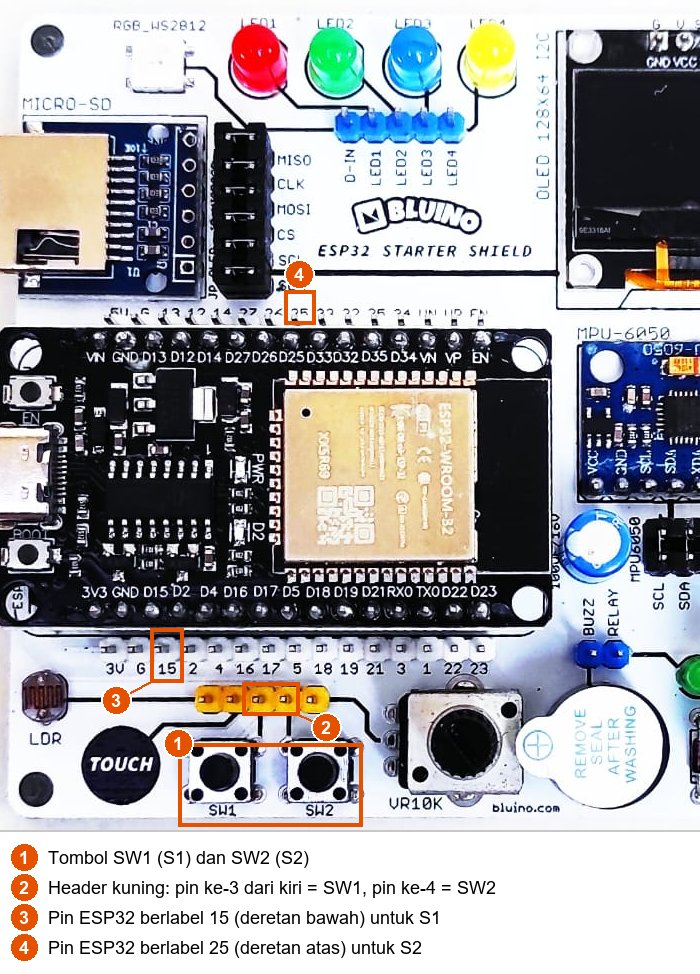
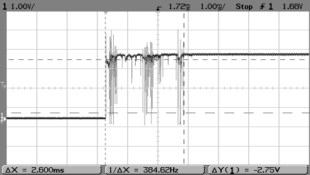
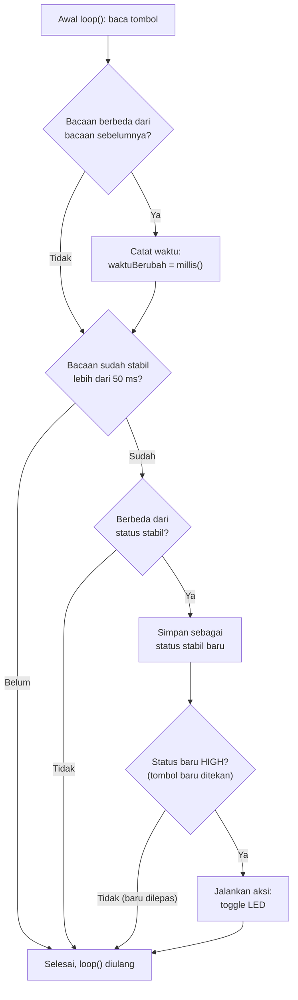

# BAB 9: Digital Input — Push Button

> ✅ **Prasyarat:** Selesaikan **BAB 8 (Digital Output — LED & Buzzer)** — kamu sudah bisa memasang kabel *jumper* dari pin Custom ke pin ESP32 dan menyalakan LED kit dengan `digitalWrite()`.

Di BAB 8, ESP32 "berbicara" lewat LED dan *buzzer*. Sekarang giliran ESP32 "mendengar": membaca **input digital** dari tombol tekan (*push button*). Tombol adalah cara paling sederhana bagi manusia untuk memberi perintah ke mikrokontroler — bel pintu, tombol lift, dan *remote* TV bekerja dengan prinsip yang sama. Di BAB ini kamu juga akan bertemu masalah klasik tombol mekanis, yaitu *bouncing*, beserta cara mengatasinya.

## 📌 Tujuan Pembelajaran

Setelah mempelajari BAB ini, kamu bisa:

- Menjelaskan arti input digital dan batas tegangan HIGH/LOW pada pin ESP32.
- Menjelaskan kenapa pin input tidak boleh dibiarkan mengambang (*floating*) dan apa fungsi resistor *pull-down* dan *pull-up*.
- Membaca tombol S1 dan S2 kit dengan `pinMode(pin, INPUT)` dan `digitalRead()`.
- Mendeteksi momen tombol baru ditekan (*edge detection*) untuk membuat penghitung dan sakelar *toggle*.
- Menjelaskan *bouncing* dan mengatasinya dengan *debouncing* berbasis `millis()`.
- Memilih antara `INPUT`, `INPUT_PULLUP`, dan `INPUT_PULLDOWN` sesuai rangkaian tombolnya.

## 🧰 Yang Perlu Disiapkan

| Kebutuhan | Keterangan |
|---|---|
| *Hardware* | Kit Bluino ESP32 IoT Starter Shield (ESP32 DEVKIT V1 sudah terpasang di kit) + kabel USB **data** |
| Kabel *jumper* | 6 kabel *female-female*: 2 untuk tombol S1 dan S2, 4 untuk LED — sudah ada di kit |
| Komponen tambahan | Tidak ada — tombol (lengkap dengan resistor *pull-down* 10 kΩ) dan LED sudah terpasang di kit |
| *Software* | Arduino IDE 2.x + *board package* **esp32** versi 3.3.x (lihat [BAB 5](../BAB-05/README.md)) |
| *Library* | Tidak perlu *library* tambahan |
| Alat uji | **Serial Monitor** Arduino IDE (baud 115200) |
| Jaringan | Tidak perlu WiFi |

## 📑 Daftar Isi

- [9.1 Konsep Input Digital](#91-konsep-input-digital)
- [9.2 Tombol pada Kit Bluino](#92-tombol-pada-kit-bluino)
- [9.3 Program 1: Membaca Tombol S1](#93-program-1-membaca-tombol-s1)
- [9.4 Mendeteksi Momen Tombol Ditekan (Edge Detection)](#94-mendeteksi-momen-tombol-ditekan-edge-detection)
- [9.5 Program 2: Penghitung Tanpa Debounce](#95-program-2-penghitung-tanpa-debounce)
- [9.6 Bouncing: Kontak Tombol yang Memantul](#96-bouncing-kontak-tombol-yang-memantul)
- [9.7 Debouncing dengan millis()](#97-debouncing-dengan-millis)
- [9.8 Program 3: Sakelar Toggle dengan Debounce](#98-program-3-sakelar-toggle-dengan-debounce)
- [9.9 Program 4: Dua Tombol Mengatur Jumlah LED](#99-program-4-dua-tombol-mengatur-jumlah-led)
- [9.10 Pull-Up dan Pull-Down Internal ESP32](#910-pull-up-dan-pull-down-internal-esp32)
- [9.11 Troubleshooting](#911-troubleshooting)
- [📝 Rangkuman](#-rangkuman)
- [💪 Latihan](#-latihan)
- [📚 Referensi](#-referensi)

---

## 9.1 Konsep Input Digital

Saat dijadikan **input**, pin GPIO tidak mengeluarkan tegangan, tetapi **mengukur** tegangan yang masuk. Bayangkan pin input seperti voltmeter yang hanya bisa menjawab dua hal: "tinggi" (HIGH) atau "rendah" (LOW).

```cpp
pinMode(pin, INPUT);           // di setup(): jadikan pin sebagai input
int nilai = digitalRead(pin);  // baca pin: hasilnya HIGH (1) atau LOW (0)
```

### 9.1.1 Batas Tegangan HIGH dan LOW

ESP32 tidak membutuhkan tegangan yang persis 3,3 V atau persis 0 V. Menurut datasheet ESP32, pada tegangan kerja 3,3 V:

| Tegangan di pin | Hasil `digitalRead()` |
|---|---|
| Minimal 2,475 V (75% dari 3,3 V) sampai 3,3 V | HIGH (1) |
| Di antara 0,825 V dan 2,475 V | Tidak pasti — bisa HIGH, bisa LOW |
| 0 V sampai maksimal 0,825 V (25% dari 3,3 V) | LOW (0) |

Rangkaian input yang baik selalu membuat tegangan pin berada jelas di daerah HIGH atau LOW, tidak pernah di daerah "tidak pasti".

> ⚠️ **Perhatian:** Tegangan input maksimum pin ESP32 adalah 3,3 V. Jangan memasukkan sinyal 5 V (misalnya dari modul sensor 5 V) langsung ke pin GPIO.

### 9.1.2 Pin Mengambang dan Resistor Pull-Down

Bagaimana kalau pin input tidak tersambung ke mana pun? Pin seperti ini disebut **mengambang** (*floating*). Tegangannya tidak jelas dan mudah terpengaruh gangguan listrik di sekitarnya — dari tanganmu, kabel di dekatnya, bahkan listrik statis. Akibatnya `digitalRead()` bisa membaca HIGH dan LOW secara acak, seperti pintu yang tidak dikunci dan terbuka-tertutup sendiri tertiup angin.

Masalahnya, tombol yang **dilepas** sama saja dengan kabel yang terputus. Kalau tombol hanya disambung ke 3,3 V, pin akan mengambang setiap kali tombol dilepas. Solusinya adalah resistor tambahan yang selalu "menarik" pin ke keadaan tertentu:

- **Resistor *pull-down*** menarik pin ke GND (LOW) selama tombol dilepas. Saat tombol ditekan, pin tersambung langsung ke 3,3 V sehingga terbaca HIGH. Ibaratnya pegas yang selalu mengembalikan pintu ke posisi tertutup.
- **Resistor *pull-up*** kebalikannya: menarik pin ke 3,3 V (HIGH) selama tombol dilepas, dan tombol menyambungkan pin ke GND saat ditekan (terbaca LOW).

Nilai resistornya dipilih cukup besar (misalnya 10 kΩ) supaya arus yang terbuang saat tombol ditekan kecil: 3,3 V ÷ 10 kΩ = 0,33 mA. Namun, nilainya juga tidak boleh terlalu besar, supaya tarikannya tetap cukup kuat melawan gangguan.

---

## 9.2 Tombol pada Kit Bluino

### 9.2.1 Rangkaian Tombol di Kit

Kit Bluino punya dua tombol tekan, **SW1** dan **SW2** (di materi ini disebut S1 dan S2). Masing-masing sudah dilengkapi resistor *pull-down* 10 kΩ di PCB:


*Gambar 9.1 — Rangkaian tombol S1 dan S2 pada kit: 3V3 → tombol → pin Custom → resistor 10 kΩ → GND. Sumber: skematik ESP32 Starter Shield 3.2, [Bluino](http://www.bluino.com).*

Cara kerjanya:

| Keadaan tombol | Jalur yang terbentuk | Tegangan di pin | `digitalRead()` |
|---|---|---|---|
| Dilepas | Pin → resistor 10 kΩ → GND | 0 V | LOW (0) |
| Ditekan | 3,3 V → tombol → pin | 3,3 V | HIGH (1) |

Jadi untuk tombol kit: **ditekan = HIGH, dilepas = LOW**. Karena resistor *pull-down* sudah ada di PCB, pin cukup diatur dengan `pinMode(pin, INPUT)` — **jangan** memakai `INPUT_PULLUP` untuk tombol kit (alasannya ada di [9.10](#910-pull-up-dan-pull-down-internal-esp32)).

### 9.2.2 Menyambungkan Kabel Jumper

Pin Custom kedua tombol ada di *header* kuning berisi 5 pin, di atas tombol. Pin kuning ini tidak diberi tulisan, jadi kenali dari garis jalur di PCB: garis dari SW1 berakhir di pin kuning **ke-3 dari kiri**, dan garis dari SW2 di pin **ke-4**. Tiga pin lainnya untuk LDR (ke-1), *touch pad* (ke-2), dan potensiometer (ke-5).



*Gambar 9.2 — Letak tombol (1), pin Custom tombol di header kuning (2), pin ESP32 berlabel 15 (3), dan pin ESP32 berlabel 25 (4) pada kit v3.x; tata letak kit v3.2 milikmu bisa sedikit berbeda. Sumber: foto produk ESP32 Starter Shield, [Bluino](http://www.bluino.com), dipotong dan diberi penanda untuk materi ini.*

| Tombol | Pin Custom (*header* kuning) | Sambungkan ke pin ESP32 | Letak pin ESP32 |
|---|---|---|---|
| S1 (SW1) | Pin ke-3 dari kiri | IO15 (label `15`) | Deretan bawah |
| S2 (SW2) | Pin ke-4 dari kiri | IO25 (label `25`) | Deretan atas |

> ⚠️ **Perhatian:** Angka `15 2 4 16 17 5 ...` yang tercetak tepat di atas pin kuning adalah label **deretan pin ESP32** (pin putih di atasnya), bukan nama pin kuning. Contohnya, pin kuning ke-3 berada di dekat tulisan `16` dan `17`, tetapi pin itu **bukan** IO16 atau IO17 — itu pin Custom milik SW1.

Langkah memasang kabel:

1. Cabut kabel USB dulu supaya aman saat merangkai.
2. Pasang kabel *jumper* dari pin kuning ke-3 (SW1) ke pin berlabel **15** di deretan pin ESP32 bawah.
3. Pasang kabel *jumper* dari pin kuning ke-4 (SW2) ke pin berlabel **25** di deretan pin ESP32 atas.
4. Untuk LED, gunakan sambungan yang sama dengan BAB 8: LED1 (merah) → **4**, LED2 (hijau) → **17**, LED3 (biru) → **2**, LED4 (kuning) → **16** (lihat [BAB 8](../BAB-08/README.md)).
5. Periksa sekali lagi, lalu sambungkan kembali kabel USB.

> ⚠️ **Perhatian:** Di deretan bawah, pin `15` bersebelahan dengan pin `G` (GND). Pastikan kabel S1 benar-benar tertancap di `15`. Kalau tergeser ke `G`, menekan S1 akan menyambungkan 3,3 V langsung ke GND (hubung singkat): ESP32 bisa langsung *restart* dan jalur dayanya terbebani berlebihan.

### 9.2.3 Catatan tentang IO15 dan IO25

- **IO15 adalah pin *strapping*** — pin yang dibaca ESP32 sesaat setelah dinyalakan untuk menentukan pengaturan *boot*. Pada pemakaian biasa, level IO15 saat *boot* hanya menentukan apakah ESP32 mencetak log *boot* bawaan (baris seperti `rst:0x1 (POWERON_RESET),boot:0x13 ...`) ke Serial Monitor. Resistor *pull-down* 10 kΩ di kit membuat IO15 terbaca LOW saat *boot*, sehingga log *boot* itu **tidak muncul** selama kabel S1 terpasang. Ini aman: program tetap berjalan normal dan semua pesan dari `Serial.println()` programmu tetap tampil. Kalau kamu menahan S1 saat menekan tombol **EN**, log *boot* akan muncul lagi — itu juga tidak masalah.
- **IO25 juga dipakai sebagai pin Trig sensor HC-SR04** di [BAB 30](../BAB-30/README.md). Di Peta Pin Standar, keduanya bergantian: pasang tombol S2 **atau** HC-SR04, jangan keduanya sekaligus di IO25.

---

## 9.3 Program 1: Membaca Tombol S1

**Tujuan:** Membaca keadaan tombol S1 lima kali per detik dan menampilkannya di Serial Monitor. LED merah ikut menyala selama tombol ditekan.

**Rangkaian:**

| Pin **Custom** di kit | Sambungkan ke pin ESP32 |
|---|---|
| Tombol S1 (pin kuning ke-3) | IO15 |
| LED1 (LED merah) | IO4 |

**Cara Menjalankan:**

1. Sambungkan kabel *jumper* sesuai tabel **Rangkaian** di atas (lihat juga [9.2.2](#922-menyambungkan-kabel-jumper)).
2. Buka Arduino IDE → **File → New Sketch**, hapus isinya, lalu salin kode di bawah. Kode yang sama juga tersedia di *file* [`p1_baca_tombol.ino`](p1_baca_tombol/p1_baca_tombol.ino).
3. Pastikan **Tools → Board** = **ESP32 Dev Module** dan **Tools → Port** = *port* ESP32 kamu (misalnya `COM5` di Windows atau `/dev/ttyUSB0` di Linux).
4. Klik tombol **Upload** (ikon panah →) dan tunggu sampai muncul tulisan **Done uploading**.
5. Buka **Serial Monitor** (**Tools → Serial Monitor**) lalu pilih baud **115200**.
6. Tekan dan tahan tombol S1 beberapa detik, lalu lepaskan.

**Kode Program:**

<!-- sketch: p1_baca_tombol -->
```cpp
/*
 * BAB 9 - Program 1: Membaca Tombol S1
 * LED merah menyala selama tombol S1 ditekan.
 * Keadaan tombol ditampilkan di Serial Monitor 5 kali per detik.
 *
 * Rangkaian:
 *   Tombol S1 (pin kuning ke-3) → IO15
 *   LED1 (merah)                → IO4
 */

#define TOMBOL_S1 15  // tombol S1 → IO15 (pull-down 10 kΩ sudah ada di kit)
#define LED_MERAH 4   // LED merah → IO4

void setup() {
  Serial.begin(115200);
  pinMode(TOMBOL_S1, INPUT);   // INPUT biasa, bukan INPUT_PULLUP
  pinMode(LED_MERAH, OUTPUT);

  Serial.println("BAB 9 - Program 1: Membaca Tombol S1");
  Serial.println("Tekan dan tahan tombol S1...");
}

void loop() {
  int status = digitalRead(TOMBOL_S1);  // HIGH = ditekan, LOW = dilepas

  if (status == HIGH) {
    digitalWrite(LED_MERAH, HIGH);      // tombol ditekan → LED menyala
    Serial.println("S1: HIGH (ditekan) -> LED menyala");
  } else {
    digitalWrite(LED_MERAH, LOW);       // tombol dilepas → LED mati
    Serial.println("S1: LOW (dilepas) -> LED mati");
  }

  delay(200);  // baca 5 kali per detik supaya Serial Monitor mudah dibaca
}
```

**Penjelasan Kode:**

- `pinMode(TOMBOL_S1, INPUT)` menjadikan IO15 input biasa, tanpa resistor internal, karena resistor *pull-down* sudah ada di kit.
- `digitalRead(TOMBOL_S1)` menghasilkan `HIGH` saat tombol ditekan dan `LOW` saat dilepas. Hasilnya disimpan di variabel `status`.
- `if (status == HIGH) { ... } else { ... }` memilih satu dari dua aksi: menyalakan LED dan mencetak "ditekan", atau mematikan LED dan mencetak "dilepas". Perhatikan tanda `==` (dua tanda sama dengan) untuk **membandingkan**; satu tanda `=` berarti **mengisi** nilai.
- `delay(200)` membuat tombol dibaca 5 kali per detik supaya Serial Monitor tidak kebanjiran tulisan. Akibatnya LED bisa terlambat sampai 0,2 detik. Program 3 nanti membaca tombol tanpa `delay()`.

**Contoh Output:**

```text
BAB 9 - Program 1: Membaca Tombol S1
Tekan dan tahan tombol S1...
S1: LOW (dilepas) -> LED mati
S1: LOW (dilepas) -> LED mati
S1: HIGH (ditekan) -> LED menyala
S1: HIGH (ditekan) -> LED menyala
S1: HIGH (ditekan) -> LED menyala
S1: LOW (dilepas) -> LED mati
```

Di kit: LED merah menyala selama S1 ditekan dan mati begitu dilepas. Selama tombol tidak disentuh, Serial Monitor terus menampilkan `S1: LOW (dilepas) -> LED mati` lima kali per detik.

> 📌 **Catatan:** Selama kabel S1 terpasang di IO15, log *boot* bawaan ESP32 tidak muncul saat *board* di-*reset* (lihat [9.2.3](#923-catatan-tentang-io15-dan-io25)). Serial Monitor langsung dimulai dari tulisan `BAB 9 - Program 1: ...`. Kalau tulisan judul terlewat, tekan tombol **EN** di *board* ESP32.

**Kalau Belum Berhasil:**

- **Selalu `LOW` walaupun tombol ditekan** → kabel tidak terpasang di pin kuning ke-3, atau tidak di pin berlabel `15`. Ikuti garis jalur dari SW1 untuk memastikan pinnya.
- **Nilai berubah-ubah sendiri tanpa disentuh** → IO15 mengambang: kabel *jumper* lepas, atau ujungnya terpasang di pin lain (misalnya `3V` atau `G` yang bersebelahan dengan `15`). Cabut USB, lalu pasang ulang ke pin yang benar.
- **ESP32 *restart* sendiri setiap kali S1 ditekan** → kabel S1 tertancap di pin `G` sehingga terjadi hubung singkat. Segera cabut USB dan pindahkan kabel ke pin `15`.
- **Serial Monitor menampilkan `HIGH (ditekan)`, tetapi LED tidak menyala** → kabel LED1 → `4` belum terpasang.

---

## 9.4 Mendeteksi Momen Tombol Ditekan (Edge Detection)

Program 1 membaca **keadaan** tombol: selama tombol ditahan, hasilnya HIGH terus-menerus. Padahal sering kali kita hanya ingin bereaksi **sekali** setiap tombol ditekan, misalnya untuk menghitung jumlah tekanan atau menyalakan-mematikan lampu dengan satu tombol. Untuk itu kita perlu mendeteksi **momen perubahannya**, yang disebut **tepi** (*edge*):

```text
Keadaan tombol : dilepas        ditekan (ditahan)   dilepas
digitalRead()  : LOW  LOW  LOW  HIGH HIGH HIGH HIGH LOW  LOW
                                ^                   ^
                          tepi naik           tepi turun
                          (LOW -> HIGH)       (HIGH -> LOW)
```

- **Tepi naik** (*rising edge*): pembacaan berubah dari LOW ke HIGH — pada tombol kit artinya tombol **baru saja ditekan**.
- **Tepi turun** (*falling edge*): pembacaan berubah dari HIGH ke LOW — tombol **baru saja dilepas**.

Caranya: simpan hasil `digitalRead()` dari putaran `loop()` sebelumnya, lalu bandingkan dengan hasil sekarang. Contoh potongan kode:

```cpp
int status = digitalRead(TOMBOL_S1);

if (status == HIGH && statusSebelumnya == LOW) {
  // tepi naik: tombol baru saja ditekan → lakukan aksi sekali
}

statusSebelumnya = status;  // simpan untuk dibandingkan di putaran berikutnya
```

Tanda `&&` berarti "dan": kedua syarat harus benar. Teknik ini disebut ***edge detection*** (deteksi tepi).

---

## 9.5 Program 2: Penghitung Tanpa Debounce

**Tujuan:** Menghitung berapa kali tombol S1 ditekan memakai *edge detection*, **tanpa** penanganan *bouncing*. Program ini sengaja dibuat sederhana supaya kamu bisa melihat sendiri masalah yang dibahas di subbab berikutnya.

**Rangkaian:**

| Pin **Custom** di kit | Sambungkan ke pin ESP32 |
|---|---|
| Tombol S1 (pin kuning ke-3) | IO15 |

**Cara Menjalankan:**

1. Pastikan kabel S1 → **15** masih terpasang. Kabel LED boleh tetap terpasang.
2. Buka Arduino IDE → **File → New Sketch**, hapus isinya, lalu salin kode di bawah. Kode yang sama juga tersedia di *file* [`p2_hitung_tanpa_debounce.ino`](p2_hitung_tanpa_debounce/p2_hitung_tanpa_debounce.ino).
3. Pastikan **Tools → Board** = **ESP32 Dev Module** dan **Tools → Port** = *port* ESP32 kamu.
4. Klik tombol **Upload** dan tunggu sampai muncul tulisan **Done uploading**.
5. Buka **Serial Monitor** (**Tools → Serial Monitor**) lalu pilih baud **115200**.
6. Tekan tombol S1 **satu kali**, lepaskan, lalu lihat angkanya. Ulangi sekitar 10 kali sambil menghitung sendiri jumlah tekananmu.

**Kode Program:**

<!-- sketch: p2_hitung_tanpa_debounce -->
```cpp
/*
 * BAB 9 - Program 2: Penghitung Tanpa Debounce
 * Menghitung berapa kali tombol S1 ditekan, sengaja tanpa debounce,
 * supaya efek bouncing terlihat (hitungan kadang melompat).
 *
 * Rangkaian: Tombol S1 (pin kuning ke-3) → IO15
 */

#define TOMBOL_S1 15

int statusSebelumnya = LOW;  // hasil digitalRead() pada putaran loop() sebelumnya
int jumlahTekan = 0;         // berapa kali tombol terhitung ditekan

void setup() {
  Serial.begin(115200);
  pinMode(TOMBOL_S1, INPUT);

  Serial.println("BAB 9 - Program 2: Penghitung Tanpa Debounce");
  Serial.println("Tekan S1 satu kali, lalu lihat angkanya...");
}

void loop() {
  int status = digitalRead(TOMBOL_S1);

  // Tepi naik: sebelumnya LOW, sekarang HIGH → dihitung satu kali tekan
  if (status == HIGH && statusSebelumnya == LOW) {
    jumlahTekan++;
    Serial.print("Tombol ditekan! Jumlah = ");
    Serial.println(jumlahTekan);
  }

  statusSebelumnya = status;  // simpan untuk putaran berikutnya
}
```

**Penjelasan Kode:**

- `statusSebelumnya` menyimpan hasil pembacaan putaran sebelumnya. Nilai awalnya `LOW` karena tombol belum ditekan saat program mulai.
- Syarat `status == HIGH && statusSebelumnya == LOW` hanya benar tepat pada putaran ketika tombol berubah dari dilepas ke ditekan. Selama tombol ditahan, `statusSebelumnya` sudah HIGH sehingga syaratnya salah dan hitungan tidak bertambah.
- `jumlahTekan++` artinya "tambah satu" (sama dengan `jumlahTekan = jumlahTekan + 1`).
- `loop()` tidak memakai `delay()`, jadi tombol dibaca ribuan kali per detik. Itu bagus untuk respons yang cepat — tetapi juga membuat program "melihat" setiap pantulan kontak tombol.

**Contoh Output:**

```text
BAB 9 - Program 2: Penghitung Tanpa Debounce
Tekan S1 satu kali, lalu lihat angkanya...
Tombol ditekan! Jumlah = 1
Tombol ditekan! Jumlah = 2
Tombol ditekan! Jumlah = 3
Tombol ditekan! Jumlah = 4
Tombol ditekan! Jumlah = 5
```

Pada contoh di atas tombol hanya ditekan **3 kali**, tetapi hitungannya sampai 5. Kadang satu tekanan terhitung 2 kali atau lebih, bahkan hitungan bisa bertambah saat tombol **dilepas**. Hasil di kit kamu bisa berbeda: kadang pas, kadang melompat. Penyebabnya adalah ***bouncing***, yang dibahas di subbab berikut.

**Kalau Belum Berhasil:**

- **Hitungan tidak bertambah sama sekali** → cek kabel S1 → `15` seperti pada Program 1.
- **Hitungan selalu pas, tidak pernah melompat** → tidak apa-apa, *bouncing* tidak terjadi di setiap tekanan. Coba tekan tombol dengan berbagai cara (cepat, pelan, ragu-ragu) sebanyak 20–30 kali.
- **Hitungan bertambah terus walaupun tombol tidak disentuh** → IO15 mengambang karena kabel lepas atau salah pin.

---

## 9.6 Bouncing: Kontak Tombol yang Memantul

Di dalam tombol tekan ada keping logam yang bersentuhan saat tombol ditekan. Saat bertemu, keping logam itu tidak langsung diam, tetapi **memantul** beberapa kali dalam waktu sangat singkat — mirip bola yang dijatuhkan ke lantai dan memantul beberapa kali sebelum diam. Selama memantul, sambungan tersambung-terputus berkali-kali, sehingga tegangan di pin naik-turun sebelum akhirnya stabil. Peristiwa ini disebut ***bouncing***.



*Gambar 9.3 — Tegangan sebuah sakelar saat ditekan, dilihat dengan osiloskop (alat untuk melihat perubahan tegangan terhadap waktu). Sebelum stabil di HIGH, tegangannya naik-turun berkali-kali selama ±2,6 ms, yaitu jarak antara dua garis putus-putus tegak. Sumber: [Super Rad!](https://commons.wikimedia.org/wiki/File:Bouncy_Switch.png), lisensi CC0 1.0.*

Apa akibatnya?

- Bagi manusia, 2–3 ms terasa seketika. Tetapi ESP32 membaca tombol ribuan kali per detik, sehingga setiap pantulan bisa terbaca sebagai tekanan baru. Itulah yang terjadi pada Program 2.
- Lama pantulan bergantung pada jenis dan kondisi tombol. Dalam pengujian Jack Ganssle terhadap 18 sakelar, kebanyakan memantul rata-rata ±1,6 ms dan tidak lebih dari ±6,2 ms, tetapi ada sakelar yang memantul jauh lebih lama.
- *Bouncing* bisa terjadi saat tombol **ditekan** maupun saat **dilepas**.

Cara mengatasinya disebut ***debouncing***: memastikan perubahan pada tombol sudah stabil sebelum dianggap sungguhan.

| Cara | Contoh | Catatan |
|---|---|---|
| *Hardware* | Menambah rangkaian RC (resistor + kapasitor) atau IC khusus yang meredam pantulan | Perlu komponen tambahan; tombol kit tidak memakainya |
| *Software* | Program menunggu sampai pembacaan tombol tidak berubah lagi selama beberapa puluh milidetik | Tanpa komponen tambahan — cara yang dipakai di BAB ini |

---

## 9.7 Debouncing dengan millis()

### 9.7.1 Mengenal millis()

`millis()` mengembalikan berapa milidetik sudah berlalu sejak ESP32 mulai menjalankan program — seperti *stopwatch* yang terus berjalan dan tidak pernah berhenti. Berbeda dengan `delay()`, `millis()` **tidak membuat program berhenti menunggu**; fungsi ini hanya "melihat jam". Contoh potongan kode:

```cpp
unsigned long waktuMulai = millis();  // catat waktu sekarang

// ... di putaran loop() berikutnya ...
if (millis() - waktuMulai > 50) {
  // sudah lewat lebih dari 50 ms sejak waktuMulai
}
```

Dua aturan penting:

- Simpan hasil `millis()` di variabel bertipe `unsigned long`, tipe yang sama dengan nilai yang dikembalikan `millis()`.
- Selalu bandingkan **selisihnya**: `millis() - waktuMulai > jeda`. Nilai `millis()` kembali ke 0 setelah sekitar 49,7 hari (*overflow*). Dengan bentuk selisih dan tipe `unsigned long`, hasil perhitungannya tetap benar walaupun terjadi *overflow*. Bentuk `millis() > waktuMulai + jeda` bisa salah saat itu terjadi.

Pola menunggu dengan `millis()` dibahas lebih dalam di [BAB 16](../BAB-16/README.md).

### 9.7.2 Cara Kerja Debounce

Idenya sederhana: **perubahan dianggap sungguhan kalau pembacaan tombol tidak berubah lagi selama 50 ms**. Setiap kali pembacaan berubah — karena ditekan, dilepas, atau memantul — "*stopwatch*" diulang dari nol. Pantulan terjadi berturut-turut dalam waktu singkat, jadi selama tombol masih memantul, *stopwatch* tidak pernah sempat mencapai 50 ms.

Program memakai tiga variabel:

| Variabel | Isinya |
|---|---|
| `bacaanSebelumnya` | Hasil `digitalRead()` pada putaran `loop()` sebelumnya — masih "mentah" dan bisa ikut memantul |
| `waktuBerubah` | Kapan (hasil `millis()`) bacaan mentah terakhir kali berubah |
| `statusStabil` | Keadaan tombol yang sudah dipastikan stabil — inilah yang dipakai untuk mengambil keputusan |

Alur di setiap putaran `loop()`:



*Gambar 9.4 — Alur debounce dan edge detection di setiap putaran `loop()`. Sumber: dibuat untuk materi ini.*

**Kenapa 50 ms?** Cukup lama untuk melewati pantulan yang biasanya hanya beberapa milidetik, tetapi cukup singkat sehingga tidak terasa terlambat bagi manusia. Kalau tombolmu masih kadang terhitung dobel, naikkan menjadi 80–100 ms.

---

## 9.8 Program 3: Sakelar Toggle dengan Debounce

**Tujuan:** Setiap kali S1 ditekan, LED merah berganti keadaan (nyala ↔ mati), seperti sakelar lampu di rumah. Tekanan dibaca dengan *debounce* berbasis `millis()`, jadi satu tekanan selalu terhitung tepat satu kali.

**Rangkaian:**

| Pin **Custom** di kit | Sambungkan ke pin ESP32 |
|---|---|
| Tombol S1 (pin kuning ke-3) | IO15 |
| LED1 (LED merah) | IO4 |

**Cara Menjalankan:**

1. Pastikan kabel S1 → **15** dan LED1 → **4** terpasang.
2. Buka Arduino IDE → **File → New Sketch**, hapus isinya, lalu salin kode di bawah. Kode yang sama juga tersedia di *file* [`p3_toggle_debounce.ino`](p3_toggle_debounce/p3_toggle_debounce.ino).
3. Pastikan **Tools → Board** = **ESP32 Dev Module** dan **Tools → Port** = *port* ESP32 kamu.
4. Klik tombol **Upload** dan tunggu sampai muncul tulisan **Done uploading**.
5. Buka **Serial Monitor** (**Tools → Serial Monitor**) lalu pilih baud **115200**.
6. Tekan S1 beberapa kali dan perhatikan LED merah serta Serial Monitor.

**Kode Program:**

<!-- sketch: p3_toggle_debounce -->
```cpp
/*
 * BAB 9 - Program 3: Sakelar Toggle dengan Debounce
 * Setiap kali S1 ditekan, LED merah berganti keadaan (nyala <-> mati).
 * Debounce memakai millis(), jadi satu tekanan = satu kali hitung.
 *
 * Rangkaian:
 *   Tombol S1 (pin kuning ke-3) → IO15
 *   LED1 (merah)                → IO4
 */

#define TOMBOL_S1 15
#define LED_MERAH 4

const unsigned long WAKTU_DEBOUNCE = 50;  // ms: bacaan harus stabil selama ini

int bacaanSebelumnya = LOW;      // bacaan mentah pada putaran loop() sebelumnya
int statusStabil = LOW;          // keadaan tombol yang sudah lolos debounce
unsigned long waktuBerubah = 0;  // kapan bacaan mentah terakhir kali berubah

bool ledNyala = false;  // keadaan LED: true = nyala, false = mati
int jumlahTekan = 0;

void setup() {
  Serial.begin(115200);
  pinMode(TOMBOL_S1, INPUT);
  pinMode(LED_MERAH, OUTPUT);
  digitalWrite(LED_MERAH, LOW);

  Serial.println("BAB 9 - Program 3: Sakelar Toggle dengan Debounce");
  Serial.println("Tekan S1 untuk menyalakan/mematikan LED merah.");
}

void loop() {
  int bacaan = digitalRead(TOMBOL_S1);

  // 1. Bacaan mentah berubah (karena ditekan, dilepas, atau memantul)?
  //    Catat waktunya: "stopwatch" diulang dari nol.
  if (bacaan != bacaanSebelumnya) {
    waktuBerubah = millis();
    bacaanSebelumnya = bacaan;
  }

  // 2. Bacaan tidak berubah lagi selama lebih dari WAKTU_DEBOUNCE
  //    dan berbeda dari status stabil → perubahan yang sungguhan.
  if ((millis() - waktuBerubah) > WAKTU_DEBOUNCE && bacaan != statusStabil) {
    statusStabil = bacaan;

    // 3. Edge detection: hanya bereaksi saat tombol baru ditekan (LOW → HIGH)
    if (statusStabil == HIGH) {
      ledNyala = !ledNyala;  // balik keadaan LED
      digitalWrite(LED_MERAH, ledNyala ? HIGH : LOW);
      jumlahTekan++;

      Serial.print("Tekan ke-");
      Serial.print(jumlahTekan);
      Serial.print(" -> LED ");
      Serial.println(ledNyala ? "NYALA" : "MATI");
    }
  }
}
```

**Penjelasan Kode:**

- Langkah 1–3 di dalam `loop()` persis mengikuti alur pada Gambar 9.4.
- `ledNyala = !ledNyala;` membalik nilai: `true` menjadi `false`, dan sebaliknya. Tanda `!` berarti "bukan".
- `ledNyala ? HIGH : LOW` adalah **operator *ternary***, singkatan dari `if-else`: kalau `ledNyala` bernilai `true` hasilnya `HIGH`, kalau `false` hasilnya `LOW`. Cara yang sama dipakai untuk memilih teks `"NYALA"` atau `"MATI"`.
- Saat tombol dilepas, perubahan ke LOW juga melewati *debounce* dan memperbarui `statusStabil`, tetapi tidak memicu aksi apa pun karena program hanya bereaksi pada tepi naik.
- Tidak ada `delay()` di `loop()`, jadi tombol tetap dibaca ribuan kali per detik dan LED langsung merespons.

**Contoh Output:**

```text
BAB 9 - Program 3: Sakelar Toggle dengan Debounce
Tekan S1 untuk menyalakan/mematikan LED merah.
Tekan ke-1 -> LED NYALA
Tekan ke-2 -> LED MATI
Tekan ke-3 -> LED NYALA
```

Di kit: tekan S1 sekali, LED merah menyala dan tetap menyala walaupun tombol sudah dilepas. Tekan lagi, LED mati. Bandingkan dengan Program 2: sekarang angka "Tekan ke-" selalu bertambah tepat satu untuk setiap tekanan.

> 🧪 **Coba Sendiri:** Ubah `WAKTU_DEBOUNCE` menjadi `1` dan *upload* ulang — apakah hitungan mulai melompat lagi? Lalu coba `500` dan tekan tombol dengan cepat berkali-kali. Tekanan yang lebih singkat dari setengah detik tidak akan terhitung, karena tombol harus stabil selama 500 ms dulu.

**Kalau Belum Berhasil:**

- **LED tidak berubah saat S1 ditekan** → cek kabel S1 → `15` dan LED1 → `4`.
- **LED kadang berubah dua kali (menyala lalu langsung mati) dalam satu tekanan** → pantulan tombolmu lebih lama dari 50 ms. Naikkan `WAKTU_DEBOUNCE` menjadi 80 atau 100.
- **Tekanan yang sangat cepat kadang tidak terhitung** → `WAKTU_DEBOUNCE` terlalu besar. Pakai nilai 30–50 ms.

---

## 9.9 Program 4: Dua Tombol Mengatur Jumlah LED

**Tujuan:** S1 menambah satu LED yang menyala, S2 mengurangi satu LED, seperti indikator level volume. Kedua tombol memakai *debounce*, dan kode *debounce*-nya dibungkus dalam satu fungsi supaya bisa dipakai untuk dua tombol sekaligus.

**Rangkaian:**

| Pin **Custom** di kit | Sambungkan ke pin ESP32 |
|---|---|
| Tombol S1 (pin kuning ke-3) | IO15 |
| Tombol S2 (pin kuning ke-4) | IO25 |
| LED1 (merah) | IO4 |
| LED2 (hijau) | IO17 |
| LED3 (biru) | IO2 |
| LED4 (kuning) | IO16 |

**Cara Menjalankan:**

1. Sambungkan keenam kabel *jumper* sesuai tabel **Rangkaian** di atas. Perhatikan bahwa S2 disambung ke pin berlabel **25** di deretan pin ESP32 **atas**.
2. Buka Arduino IDE → **File → New Sketch**, hapus isinya, lalu salin kode di bawah. Kode yang sama juga tersedia di *file* [`p4_dua_tombol.ino`](p4_dua_tombol/p4_dua_tombol.ino).
3. Pastikan **Tools → Board** = **ESP32 Dev Module** dan **Tools → Port** = *port* ESP32 kamu.
4. Klik tombol **Upload** dan tunggu sampai muncul tulisan **Done uploading**.
5. Buka **Serial Monitor** (**Tools → Serial Monitor**) lalu pilih baud **115200**.
6. Tekan S1 beberapa kali, lalu S2 beberapa kali.

**Kode Program:**

<!-- sketch: p4_dua_tombol -->
```cpp
/*
 * BAB 9 - Program 4: Dua Tombol Mengatur Jumlah LED
 * S1 menambah satu LED yang menyala, S2 mengurangi satu LED.
 * LED menyala berurutan dari kiri ke kanan seperti indikator level.
 *
 * Rangkaian:
 *   Tombol S1 (pin kuning ke-3) → IO15
 *   Tombol S2 (pin kuning ke-4) → IO25
 *   LED1 (merah) → IO4,  LED2 (hijau)  → IO17
 *   LED3 (biru)  → IO2,  LED4 (kuning) → IO16
 */

#define TOMBOL_S1 15
#define TOMBOL_S2 25

#define LED_MERAH  4
#define LED_KUNING 16
#define LED_HIJAU  17
#define LED_BIRU   2

// LED diurutkan sesuai posisinya di kit, dari kiri ke kanan
const int LED_PINS[] = {LED_MERAH, LED_HIJAU, LED_BIRU, LED_KUNING};
const int JUMLAH_LED = sizeof(LED_PINS) / sizeof(LED_PINS[0]);

// Data debounce untuk 2 tombol: indeks 0 = S1, indeks 1 = S2
const int TOMBOL_PINS[] = {TOMBOL_S1, TOMBOL_S2};
const int JUMLAH_TOMBOL = 2;
const unsigned long WAKTU_DEBOUNCE = 50;  // ms

int bacaanSebelumnya[JUMLAH_TOMBOL] = {LOW, LOW};
int statusStabil[JUMLAH_TOMBOL] = {LOW, LOW};
unsigned long waktuBerubah[JUMLAH_TOMBOL] = {0, 0};

int ledMenyala = 0;  // berapa LED yang sedang menyala (0 sampai 4)

// Mengembalikan true hanya satu kali setiap tombol ke-i baru ditekan (sudah di-debounce).
// Panggil fungsi ini di setiap putaran loop() supaya tidak ada perubahan yang terlewat.
bool baruDitekan(int i) {
  int bacaan = digitalRead(TOMBOL_PINS[i]);

  if (bacaan != bacaanSebelumnya[i]) {
    waktuBerubah[i] = millis();
    bacaanSebelumnya[i] = bacaan;
  }

  if ((millis() - waktuBerubah[i]) > WAKTU_DEBOUNCE && bacaan != statusStabil[i]) {
    statusStabil[i] = bacaan;
    return statusStabil[i] == HIGH;  // true hanya pada tepi naik (LOW → HIGH)
  }
  return false;
}

void setup() {
  Serial.begin(115200);

  for (int i = 0; i < JUMLAH_TOMBOL; i++) {
    pinMode(TOMBOL_PINS[i], INPUT);  // tombol kit: pull-down 10 kΩ sudah ada
  }
  for (int i = 0; i < JUMLAH_LED; i++) {
    pinMode(LED_PINS[i], OUTPUT);
    digitalWrite(LED_PINS[i], LOW);
  }

  Serial.println("BAB 9 - Program 4: Dua Tombol Mengatur Jumlah LED");
  Serial.println("S1 = tambah LED, S2 = kurangi LED");
}

void loop() {
  if (baruDitekan(0)) {  // S1 baru ditekan
    if (ledMenyala < JUMLAH_LED) {
      digitalWrite(LED_PINS[ledMenyala], HIGH);
      ledMenyala++;
      Serial.print("S1: tambah -> LED menyala: ");
      Serial.println(ledMenyala);
    } else {
      Serial.println("S1: sudah penuh (4 LED menyala)");
    }
  }

  if (baruDitekan(1)) {  // S2 baru ditekan
    if (ledMenyala > 0) {
      ledMenyala--;
      digitalWrite(LED_PINS[ledMenyala], LOW);
      Serial.print("S2: kurangi -> LED menyala: ");
      Serial.println(ledMenyala);
    } else {
      Serial.println("S2: sudah kosong (0 LED menyala)");
    }
  }
}
```

**Penjelasan Kode:**

- Kode *debounce* dari Program 3 dipindahkan ke fungsi `baruDitekan(i)`. Data setiap tombol disimpan di *array*: indeks 0 untuk S1, indeks 1 untuk S2. Dengan begitu, kode yang sama bisa dipakai untuk dua tombol tanpa ditulis dua kali.
- `baruDitekan(i)` mengembalikan `true` hanya **sekali** setiap tombol ke-`i` baru ditekan; di putaran lain hasilnya `false`. Fungsi ini dipanggil di **setiap** putaran `loop()` untuk kedua tombol, supaya perubahan tombol tidak terlewat.
- `ledMenyala` menyimpan berapa LED yang sedang menyala. Saat S1 ditekan, LED dengan indeks `ledMenyala` dinyalakan, lalu `ledMenyala` ditambah 1. Saat S2 ditekan, `ledMenyala` dikurangi 1 dulu, baru LED dengan indeks itu dimatikan.
- Batas 0 dan 4 diperiksa dengan `if`, supaya indeks *array* tidak keluar dari `LED_PINS[0]` sampai `LED_PINS[3]`. Menulis ke indeks di luar *array* adalah *bug* berbahaya yang bisa membuat program berperilaku aneh.

**Contoh Output:**

```text
BAB 9 - Program 4: Dua Tombol Mengatur Jumlah LED
S1 = tambah LED, S2 = kurangi LED
S1: tambah -> LED menyala: 1
S1: tambah -> LED menyala: 2
S2: kurangi -> LED menyala: 1
S2: kurangi -> LED menyala: 0
S2: sudah kosong (0 LED menyala)
```

Di kit: setiap S1 ditekan, satu LED bertambah menyala dari kiri ke kanan (merah, hijau, biru, kuning). Setiap S2 ditekan, LED paling kanan yang menyala dimatikan. LED biru kecil di *board* ESP32 ikut menyala bersama LED biru kit.

**Kalau Belum Berhasil:**

- **S1 bekerja, tetapi S2 tidak** → cek kabel S2: pin kuning ke-4 → pin berlabel `25` di deretan **atas** (bukan deretan bawah).
- **LED tidak menyala berurutan dari kiri ke kanan** → kabel LED tertukar. Cocokkan lagi dengan tabel **Rangkaian**.
- **Satu tekanan menambah dua LED sekaligus** → naikkan `WAKTU_DEBOUNCE` menjadi 80 atau 100.

---

## 9.10 Pull-Up dan Pull-Down Internal ESP32

Tombol kit sudah dilengkapi resistor *pull-down*. Tapi kalau kelak kamu merangkai tombol sendiri — misalnya tombol tambahan di *breadboard* — kamu tidak wajib menambah resistor. Hampir semua pin GPIO ESP32 punya resistor *pull-up* dan *pull-down* **internal** (di dalam chip) sebesar ±45 kΩ yang bisa diaktifkan lewat `pinMode()`:

| Rangkaian | Mode `pinMode()` | Resistor | Tombol disambung antara pin dan | Dilepas | Ditekan |
|---|---|---|---|---|---|
| Tombol kit Bluino (S1, S2) | `INPUT` | *Pull-down* 10 kΩ di PCB kit | 3,3 V | LOW | HIGH |
| Tombol sendiri + *pull-up* internal | `INPUT_PULLUP` | ±45 kΩ ke 3,3 V, di dalam chip | GND | HIGH | LOW |
| Tombol sendiri + *pull-down* internal | `INPUT_PULLDOWN` | ±45 kΩ ke GND, di dalam chip | 3,3 V | LOW | HIGH |

Contoh potongan kode untuk tombol buatan sendiri dengan `INPUT_PULLUP`:

```cpp
// Tombol buatan sendiri: satu kaki ke pin GPIO, kaki lain ke GND (tanpa resistor)
pinMode(pinTombol, INPUT_PULLUP);  // aktifkan pull-up internal ±45 kΩ

if (digitalRead(pinTombol) == LOW) {
  // logikanya terbalik: LOW berarti tombol sedang ditekan
}
```

`INPUT_PULLUP` paling sering dipakai pada contoh di internet karena tombol cukup disambung ke GND. Ingat, logikanya terbalik: **ditekan = LOW**.

> ⚠️ **Perhatian:** Untuk tombol S1 dan S2 di kit, **selalu** pakai `INPUT`. Kalau memakai `INPUT_PULLUP`, resistor *pull-up* internal (±45 kΩ) akan "tarik-menarik" dengan *pull-down* 10 kΩ di kit. Pin memang masih terbaca LOW saat tombol dilepas (sekitar 0,6 V), tetapi ada arus yang terbuang percuma. Selain itu, contoh program `INPUT_PULLUP` dari internet menganggap "ditekan = LOW", sehingga logikanya terbalik kalau disalin mentah-mentah untuk kit ini.

> 📌 **Catatan:** Pin IO34–IO39 hanya bisa menjadi input dan **tidak punya** resistor *pull-up*/*pull-down* internal, jadi `INPUT_PULLUP` dan `INPUT_PULLDOWN` tidak berpengaruh di pin itu. Tombol yang disambung ke IO34–IO39 wajib memakai resistor luar.

---

## 9.11 Troubleshooting

| Masalah | Kemungkinan Penyebab | Solusi |
|---|---|---|
| `digitalRead()` selalu LOW walaupun tombol ditekan | Kabel *jumper* belum terpasang, terpasang di pin kuning yang salah, atau di pin ESP32 yang salah | Ikuti garis jalur dari SW1/SW2 ke pin kuning ke-3/ke-4, lalu cocokkan label `15`/`25` (lihat [9.2.2](#922-menyambungkan-kabel-jumper)) |
| Nilai berubah-ubah sendiri tanpa disentuh | Pin mengambang: kabel lepas atau terpasang di pin lain | Pasang ulang kabel; pastikan kedua ujungnya di pin yang benar |
| ESP32 *restart* sendiri setiap kali S1 ditekan | Kabel S1 tertancap di pin `G` (GND) di sebelah `15`, sehingga terjadi hubung singkat 3,3 V ke GND | Segera cabut USB dan pindahkan kabel ke pin `15` |
| Program bereaksi saat tombol dilepas, bukan saat ditekan | Kode memeriksa `== LOW` seperti contoh untuk rangkaian *pull-up* | Untuk tombol kit, ditekan = HIGH: periksa `== HIGH` |
| Satu tekanan terhitung lebih dari sekali | *Bouncing* | Pakai *debounce* `millis()` seperti Program 3; naikkan `WAKTU_DEBOUNCE` kalau perlu |
| Tombol terasa lambat atau tekanan cepat tidak terhitung | Ada `delay()` panjang di `loop()`, atau `WAKTU_DEBOUNCE` terlalu besar | Hindari `delay()` panjang; pakai `WAKTU_DEBOUNCE` 30–50 ms |
| Log *boot* (`rst:0x1 ...`) tidak muncul di Serial Monitor | IO15 (pin *strapping*) terbaca LOW saat *boot* karena *pull-down* tombol S1 | Normal dan aman, lihat [9.2.3](#923-catatan-tentang-io15-dan-io25) |
| S2 tidak bekerja saat sensor HC-SR04 juga terpasang | IO25 dipakai bergantian dengan pin Trig HC-SR04 | Pasang salah satu saja |
| *Upload* gagal (`Failed to connect to ESP32`) | *Port* salah atau kabel USB hanya untuk mengisi daya | Lihat [BAB 5](../BAB-05/README.md); tahan tombol **BOOT** saat muncul tulisan `Connecting...` |

---

## 📝 Rangkuman

- **Input digital**: pin mengukur tegangan. Pada 3,3 V, tegangan ≥ 2,475 V terbaca HIGH dan ≤ 0,825 V terbaca LOW.
- Pin input tidak boleh **mengambang**. Resistor *pull-down* atau *pull-up* memberi keadaan yang pasti saat tombol dilepas.
- Tombol S1 (IO15) dan S2 (IO25) di kit memakai *pull-down* 10 kΩ di PCB: pakai `pinMode(pin, INPUT)`, dan **ditekan = HIGH**. Jangan memakai `INPUT_PULLUP` untuk tombol kit.
- ***Edge detection***: bandingkan bacaan sekarang dengan bacaan sebelumnya supaya program bereaksi sekali per tekanan (tepi naik LOW → HIGH).
- ***Bouncing*** membuat satu tekanan terbaca berkali-kali. ***Debouncing*** dengan `millis()` menunggu sampai bacaan stabil (±50 ms) tanpa menghentikan program.
- Simpan hasil `millis()` di `unsigned long` dan selalu hitung **selisihnya** (`millis() - waktuMulai`).
- IO15 adalah pin *strapping*: LOW saat *boot* hanya mematikan log *boot*, jadi aman. IO25 dipakai bergantian dengan pin Trig HC-SR04.
- Membaca tombol berulang-ulang di `loop()` disebut *polling*. Cara lain, yaitu *interrupt*, dibahas di [BAB 10](../BAB-10/README.md).

Peta pin yang dipakai di BAB ini:

| Komponen | Pin Custom di kit | Pin ESP32 | Mode |
|---|---|---|---|
| Tombol S1 (SW1) | Pin kuning ke-3 | IO15 | `INPUT` |
| Tombol S2 (SW2) | Pin kuning ke-4 | IO25 | `INPUT` |
| LED merah / hijau / biru / kuning | LED1 / LED2 / LED3 / LED4 | IO4 / IO17 / IO2 / IO16 | `OUTPUT` |

---

## 💪 Latihan

### Latihan Dasar

1. **Dua tombol, dua LED:** Selama S1 ditekan, LED hijau menyala; selama S2 ditekan, LED merah menyala. Kedua LED mati saat tidak ada tombol yang ditekan.
   *Petunjuk:* Kembangkan Program 1: baca kedua tombol dengan `digitalRead()`, lalu pakai dua pasang `if-else`.
2. **Bel pintu:** *Buzzer* berbunyi selama S1 ditekan, dan Serial Monitor menampilkan "Ding-dong!" satu kali setiap tombol mulai ditekan.
   *Petunjuk:* Bunyi *buzzer* (IO13, lihat [BAB 8](../BAB-08/README.md)) mengikuti keadaan tombol seperti Program 1, sedangkan tulisan "Ding-dong!" memakai *edge detection* seperti Program 3.

### Latihan Menengah

3. **Penghitung 0–9:** Setiap S1 ditekan, angka bertambah 1 dan tampil di Serial Monitor; setelah 9, angka kembali ke 0. Tombol S2 mengembalikan angka ke 0 kapan saja.
   *Petunjuk:* Pakai fungsi `baruDitekan()` dari Program 4. Setelah menambah angka, tulis `if (angka > 9) angka = 0;`.
4. **Kombinasi tombol:** S1 saja → LED merah menyala; S2 saja → LED hijau menyala; kedua tombol bersamaan → *buzzer* berbunyi; tidak ada yang ditekan → semua mati.
   *Petunjuk:* Simpan hasil kedua `digitalRead()` di variabel, lalu pakai `if` – `else if` dengan `&&`. Periksa kondisi "keduanya ditekan" **paling awal**, karena kondisi itu juga memenuhi syarat "S1 ditekan".

### Tantangan Lanjutan

5. **Kecepatan LED berjalan:** Gabungkan dengan Program 3 BAB 8 (LED berjalan). S1 mempercepat gerakan, S2 memperlambatnya, dengan jeda antara 50 ms dan 500 ms (langkah 50 ms). Tampilkan jeda saat ini di Serial Monitor.
   *Petunjuk:* `delay()` di program LED berjalan membuat tombol jarang dibaca. Ganti dengan pola `millis()`: pindahkan LED hanya kalau `millis() - waktuPindah >= jeda`, sehingga `loop()` terus berputar dan `baruDitekan()` selalu sempat membaca tombol.
6. **Tekan singkat vs tekan lama:** Tekan S1 sebentar (kurang dari 1 detik) → LED merah *toggle*; tahan S1 minimal 1 detik → *buzzer* berbunyi sekali dan semua LED mati.
   *Petunjuk:* Catat `millis()` saat tepi naik (tombol ditekan), lalu hitung selisihnya saat tepi turun (tombol dilepas). Selisih itu adalah lama tombol ditekan.

---

## 📚 Referensi

- [digitalRead() — Arduino Language Reference](https://docs.arduino.cc/language-reference/en/functions/digital-io/digitalread/) — membaca keadaan pin input.
- [millis() — Arduino Language Reference](https://docs.arduino.cc/language-reference/en/functions/time/millis/) — waktu sejak program mulai, dasar *debounce* tanpa `delay()`.
- [Debounce on a Pushbutton — Arduino Built-in Examples](https://docs.arduino.cc/built-in-examples/digital/Debounce/) — contoh resmi *debounce* dengan `millis()` yang menjadi dasar Program 3.
- [Digital Pins — Arduino Documentation](https://docs.arduino.cc/learn/microcontrollers/digital-pins/) — pin input, pin mengambang, dan resistor *pull-up*.
- [GPIO — Arduino-ESP32 Documentation, Espressif](https://docs.espressif.com/projects/arduino-esp32/en/latest/api/gpio.html) — mode `INPUT`, `INPUT_PULLUP`, dan `INPUT_PULLDOWN` pada esp32 core 3.x.
- [ESP32 Series Datasheet — Espressif](https://www.espressif.com/sites/default/files/documentation/esp32_datasheet_en.pdf) — bagian 3 (*Boot Configurations*: pin *strapping* dan kontrol log *boot* lewat MTDO/IO15) dan 5.3 (*DC Characteristics*: batas HIGH/LOW dan resistor internal ±45 kΩ).
- [Pull-up Resistors — SparkFun Learn](https://learn.sparkfun.com/tutorials/pull-up-resistors) — penjelasan resistor *pull-up* dan pin mengambang.
- [A Guide to Debouncing — Jack Ganssle](https://www.ganssle.com/debouncing.htm) — hasil pengukuran lama *bouncing* pada berbagai sakelar.
- [ESP32 Digital Inputs and Digital Outputs — Random Nerd Tutorials](https://randomnerdtutorials.com/esp32-digital-inputs-outputs-arduino/) — contoh tambahan membaca tombol pada ESP32.

---

[⬅️ BAB 8: Digital Output — LED & Buzzer](../BAB-08/README.md) · [🏠 Daftar Isi](../README.md) · [BAB 10: Interrupt & ISR ➡️](../BAB-10/README.md)

---

## ☕ Dukung Proyek Ini

Bab ini disusun dengan dedikasi waktu dan keahlian yang tidak sedikit. Kalau materi ini bermanfaat untuk proses belajar, riset, atau proyekmu, bentuk apresiasi terbaik yang bisa kamu berikan adalah mentraktir penulis secangkir kopi:

[](https://trakteer.id/limitless7/tip)

**💬 Konsultasi & Kolaborasi:**
Punya kritik, saran, atau butuh pendampingan khusus ESP32 & IoT? Silakan hubungi:
- ✉️ **Email:** [antonprafanto@unmul.ac.id](mailto:antonprafanto@unmul.ac.id)
- 📞 **WhatsApp:** [0811-553-393](https://wa.me/62811553393) / [0852-5069-0673](https://wa.me/6285250690673)
