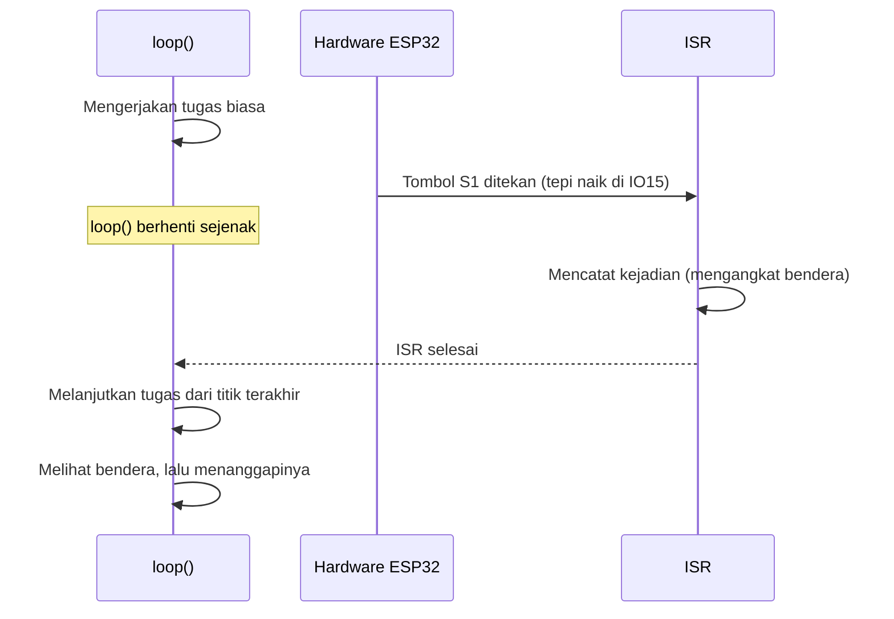
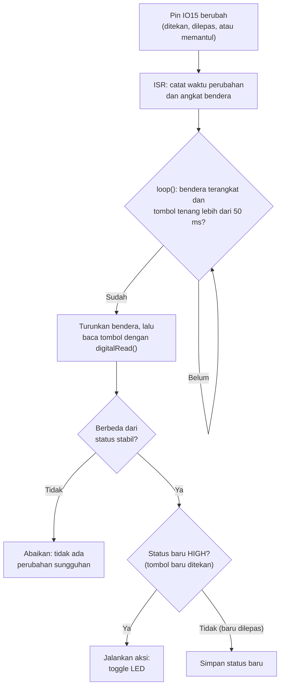
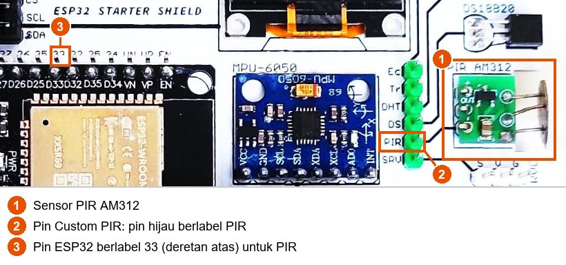

# BAB 10: Interrupt & ISR

> ✅ **Prasyarat:** Selesaikan **BAB 9 (Digital Input — Push Button)** — kamu sudah bisa membaca tombol S1 dan S2 dengan `digitalRead()`, mengenal *bouncing*, dan memakai `millis()` untuk *debounce*. Cara memasang kabel LED dan *buzzer* kit ada di **BAB 8 (Digital Output — LED & Buzzer)**.

Di BAB 9, program membaca tombol dengan bertanya terus-menerus di dalam `loop()` — cara yang disebut ***polling***. Di BAB ini kamu belajar cara kedua yang sering lebih cerdas, yaitu **interupsi** (*interrupt*): *hardware* ESP32 sendiri yang "menyela" program begitu ada perubahan di sebuah pin, lalu menjalankan fungsi khusus yang disebut **ISR**. Bayangkan kamu menunggu kurir paket: kamu bisa bolak-balik mengintip ke pintu setiap beberapa menit (*polling*), atau santai mengerjakan hal lain sampai bel pintu berbunyi (interupsi). Interupsi dipakai untuk menangkap kejadian yang singkat atau datang tiba-tiba, misalnya tombol darurat, sensor gerak, atau pulsa dari sensor putaran.

## 📌 Tujuan Pembelajaran

Setelah mempelajari BAB ini, kamu bisa:

- Menjelaskan perbedaan *polling* dan interupsi, serta kapan sebaiknya memakai masing-masing.
- Menjelaskan apa itu ISR (*Interrupt Service Routine*) dan apa yang terjadi saat interupsi muncul.
- Memasang dan melepas interupsi pada pin GPIO dengan `attachInterrupt()` dan `detachInterrupt()`, serta memilih mode `RISING`, `FALLING`, atau `CHANGE`.
- Menulis ISR yang aman: ditandai `IRAM_ATTR`, memakai variabel `volatile`, singkat, dan tanpa `Serial` maupun `delay()`.
- Memakai pola "bendera" (*flag*): ISR hanya mencatat kejadian, sedangkan pekerjaan yang lama dikerjakan di `loop()`.
- Menjelaskan kenapa *bouncing* memicu banyak interupsi dan menerapkan *debounce* yang benar.
- Melindungi variabel bersama dengan bagian kritis (`portMUX_TYPE`, `portENTER_CRITICAL()`, dan `portENTER_CRITICAL_ISR()`).
- Membuat alarm gerakan sederhana dengan sensor PIR, dua tombol, LED, dan *buzzer*.

## 🧰 Yang Perlu Disiapkan

| Kebutuhan | Keterangan |
|---|---|
| *Hardware* | Kit Bluino ESP32 IoT Starter Shield (ESP32 DEVKIT V1 sudah terpasang di kit) + kabel USB **data** |
| Kabel *jumper* | 5 kabel *female-female*: tombol S1, tombol S2, sensor PIR, LED merah, dan *buzzer* — sudah ada di kit |
| Komponen tambahan | Tidak ada — tombol (lengkap dengan resistor *pull-down* 10 kΩ), sensor PIR AM312, LED, dan *buzzer* aktif sudah terpasang di kit |
| *Software* | Arduino IDE 2.x + *board package* **esp32** versi 3.3.x (lihat [BAB 5](../BAB-05/README.md)) |
| *Library* | Tidak perlu *library* tambahan |
| Alat uji | **Serial Monitor** Arduino IDE (baud 115200) |
| Jaringan | Tidak perlu WiFi |

## 📑 Daftar Isi

- [10.1 Polling dan Masalahnya](#101-polling-dan-masalahnya)
- [10.2 Cara Kerja Interupsi dan ISR](#102-cara-kerja-interupsi-dan-isr)
- [10.3 Memasang Interupsi pada Pin GPIO](#103-memasang-interupsi-pada-pin-gpio)
- [10.4 Aturan Menulis ISR](#104-aturan-menulis-isr)
- [10.5 Program 1: Tombol Tetap Tercatat Saat loop() Sibuk](#105-program-1-tombol-tetap-tercatat-saat-loop-sibuk)
- [10.6 Bouncing Memicu Banyak Interupsi](#106-bouncing-memicu-banyak-interupsi)
- [10.7 Variabel Bersama dan Bagian Kritis](#107-variabel-bersama-dan-bagian-kritis)
- [10.8 Program 2: Sakelar Toggle dengan Interupsi dan Debounce](#108-program-2-sakelar-toggle-dengan-interupsi-dan-debounce)
- [10.9 Sensor Gerak PIR AM312 pada Kit](#109-sensor-gerak-pir-am312-pada-kit)
- [10.10 Program 3: Alarm Gerakan dengan PIR dan Dua Tombol](#1010-program-3-alarm-gerakan-dengan-pir-dan-dua-tombol)
- [10.11 Polling atau Interupsi?](#1011-polling-atau-interupsi)
- [10.12 Troubleshooting](#1012-troubleshooting)
- [📝 Rangkuman](#-rangkuman)
- [💪 Latihan](#-latihan)
- [📚 Referensi](#-referensi)

---

## 10.1 Polling dan Masalahnya

Di BAB 9, tombol dibaca dengan pola seperti ini (potongan kode, bukan program lengkap):

```cpp
void loop() {
  if (digitalRead(TOMBOL_S1) == HIGH) {
    // tombol sedang ditekan → lakukan sesuatu
  }
  // ... pekerjaan lain ...
}
```

Program sendiri yang aktif bertanya "tombolnya ditekan atau tidak?" setiap kali `loop()` berputar. Cara ini disebut ***polling*** (memeriksa secara berkala). *Polling* sederhana dan mudah dipahami, dan untuk banyak program sudah cukup. Masalah baru muncul ketika `loop()` punya pekerjaan lain yang makan waktu, misalnya menunggu dengan `delay()`, membaca sensor yang lambat, atau mengirim data lewat WiFi. Selama pekerjaan itu berjalan, tombol **tidak diperiksa sama sekali**.

Contohnya, `loop()` memeriksa tombol lalu sibuk selama 3 detik. Kalau kamu menekan tombol selama 0,3 detik di tengah 3 detik itu, tombol sudah dilepas lagi saat pemeriksaan berikutnya — tekanannya **terlewat**, seolah-olah tidak pernah terjadi.

Kelemahan *polling*:

- Kejadian yang singkat bisa **terlewat** kalau `loop()` sedang sibuk.
- Tanggapannya **terlambat**: kejadian baru diketahui pada pemeriksaan berikutnya.
- Supaya tidak ada yang terlewat, pemeriksaan harus disisipkan di banyak tempat, sehingga kode makin rumit.

Interupsi menyelesaikan masalah ini dengan membalik cara kerjanya: bukan program yang terus bertanya, melainkan *hardware* yang langsung memberi tahu.

| | *Polling* | Interupsi |
|---|---|---|
| Analogi | Bolak-balik mengintip ke pintu, menunggu kurir datang | Mengerjakan hal lain sampai bel pintu berbunyi |
| Siapa yang memeriksa pin | Program, di dalam `loop()` | *Hardware* ESP32, otomatis |
| Kejadian singkat saat `loop()` sibuk | Bisa terlewat | Tetap tercatat |
| Kerumitan kode | Sederhana | Perlu mengikuti beberapa aturan khusus (dibahas di BAB ini) |

---

## 10.2 Cara Kerja Interupsi dan ISR

**Interupsi** adalah sinyal dari *hardware* yang membuat prosesor (CPU) **berhenti sejenak** dari pekerjaannya, menjalankan sebuah fungsi khusus, lalu **melanjutkan** pekerjaan semula tepat dari titik yang ditinggalkan. Fungsi khusus itu disebut **ISR** (*Interrupt Service Routine*, rutin layanan interupsi). Dalam kode dan dokumentasi berbahasa Inggris istilahnya *interrupt*, misalnya pada nama fungsi `attachInterrupt()`.

Analoginya seperti rapat. Seorang peserta mengangkat tangan, "Interupsi!". Pembicara berhenti sebentar, mendengarkan, lalu melanjutkan pembicaraannya dari kalimat terakhir. Supaya rapat tidak kacau, interupsi harus **singkat** — begitu pula ISR.

Urutan kejadian saat tombol S1 ditekan:



*Gambar 10.1 — Urutan kejadian saat interupsi muncul. Sumber: dibuat untuk materi ini.*

Hal penting yang perlu kamu ingat:

- ISR **tidak dipanggil oleh kodemu sendiri**. Kamu hanya "mendaftarkan" ISR dengan `attachInterrupt()`; selanjutnya *hardware* yang memanggilnya setiap kali kejadiannya muncul.
- ISR mulai berjalan dalam hitungan mikrodetik (sepersejuta detik) setelah kejadian, walaupun `loop()` sedang menjalankan `delay()`.
- Selama ISR berjalan, `loop()` berhenti. Karena itu ISR harus sangat singkat (aturannya ada di [10.4](#104-aturan-menulis-isr)).

---

## 10.3 Memasang Interupsi pada Pin GPIO

### 10.3.1 Fungsi attachInterrupt()

Interupsi dipasang dengan satu baris, biasanya di `setup()` setelah `pinMode()`:

```cpp
attachInterrupt(digitalPinToInterrupt(pin), namaISR, mode);
```

| Bagian | Artinya | Contoh |
|---|---|---|
| `digitalPinToInterrupt(pin)` | Mengubah nomor pin menjadi nomor interupsi. Di ESP32 hasilnya sama dengan nomor GPIO-nya, tetapi tetap ditulis supaya kodenya juga cocok untuk *board* Arduino lain | `digitalPinToInterrupt(15)` |
| `namaISR` | Nama fungsi ISR, **tanpa** tanda kurung `()`. Kamu memberikan fungsinya untuk dipanggil nanti, bukan menjalankannya sekarang | `isrTombolS1` |
| `mode` | Perubahan seperti apa yang memicu ISR (lihat [10.3.2](#1032-mode-interupsi)) | `RISING` |

Contoh potongan kode yang memasang interupsi pada tombol S1:

```cpp
#define TOMBOL_S1 15  // tombol S1 → IO15

void IRAM_ATTR isrTombolS1() {
  // isi ISR: harus singkat (lihat 10.4)
}

void setup() {
  pinMode(TOMBOL_S1, INPUT);  // pull-down 10 kΩ sudah ada di kit
  attachInterrupt(digitalPinToInterrupt(TOMBOL_S1), isrTombolS1, RISING);
}
```

### 10.3.2 Mode Interupsi

Mode menentukan **perubahan** apa yang memicu ISR. Ingat dari BAB 9: tombol kit memakai resistor *pull-down*, jadi **ditekan = HIGH** dan **dilepas = LOW**. Sensor PIR di kit juga mengeluarkan HIGH selama ada gerakan.

| Mode | ISR dipanggil saat | Pada tombol kit | Pada sensor PIR |
|---|---|---|---|
| `RISING` | Tepi naik: LOW → HIGH | Tombol **ditekan** | Gerakan **mulai** terdeteksi |
| `FALLING` | Tepi turun: HIGH → LOW | Tombol **dilepas** | Sinyal gerakan berakhir (±2 detik setelah gerakan terakhir) |
| `CHANGE` | Setiap perubahan, naik maupun turun | Ditekan **dan** dilepas | Mulai **dan** berakhir |

```text
           dilepas        ditekan (ditahan)     dilepas
HIGH                  +----------------------+
                      |                      |
LOW        -----------+                      +-----------
                      ^                      ^
                   RISING                 FALLING
           (mode CHANGE memicu ISR di kedua titik ini)
```

> ⚠️ **Perhatian:** Jangan menulis `HIGH` atau `LOW` sebagai mode. Di Arduino Uno, mode `LOW` berarti "selama pin LOW", tetapi di ESP32 nilai `HIGH` sama dengan `RISING` dan nilai `LOW` sama dengan `DISABLED` (interupsi tidak aktif). Programnya tetap lolos *compile* tanpa pesan *error*, tetapi perilakunya tidak seperti yang kamu harapkan. Untuk interupsi selama pin bernilai tertentu, ESP32 memakai `ONHIGH` dan `ONLOW` (lihat bagian Pendalaman di [10.11](#1011-polling-atau-interupsi)).

### 10.3.3 Pin yang Bisa Dipakai

- Hampir semua GPIO ESP32 bisa memicu interupsi, termasuk semua pin yang dipakai di BAB ini: IO15 (tombol S1), IO25 (tombol S2), dan IO33 (sensor PIR).
- IO34–IO39 juga bisa, tetapi pin-pin ini hanya bisa menjadi input dan **tidak punya** resistor *pull-up/pull-down* internal.
- **Hindari IO36 (VP) dan IO39 (VN) untuk interupsi.** Dokumentasi Espressif meminta agar interupsi kedua pin ini tidak dipakai saat ADC dipakai atau saat WiFi/Bluetooth berjalan dengan mode tidur (*sleep mode*). Penyebabnya cacat chip yang tercatat di *errata* (daftar cacat resmi) ESP32: saat ADC dinyalakan, input IO36 dan IO39 sesaat ditarik ke LOW selama ±80 nanodetik, cukup untuk memicu interupsi palsu.
- IO6–IO11 tersambung ke memori *flash* di dalam modul ESP32 dan tidak boleh dipakai sama sekali (lihat [BAB 6](../BAB-06/README.md)).

### 10.3.4 Melepas Interupsi dengan detachInterrupt()

Kalau sebuah pin tidak perlu diawasi lagi, lepaskan interupsinya:

```cpp
detachInterrupt(digitalPinToInterrupt(TOMBOL_S1));  // perubahan di IO15 tidak lagi memicu ISR
```

Setelah dilepas, perubahan di pin itu diabaikan sampai kamu memanggil `attachInterrupt()` lagi. Contohnya alarm yang hanya mengawasi sensor PIR saat alarm sedang aktif ([Program 3](#1010-program-3-alarm-gerakan-dengan-pir-dan-dua-tombol)), atau permainan yang berhenti menghitung tekanan tombol setelah waktunya habis.

> 📌 **Catatan:** Panggil `attachInterrupt()` dan `detachInterrupt()` dari `setup()` atau `loop()`, **jangan** dari dalam ISR.

---

## 10.4 Aturan Menulis ISR

ISR bisa menyela program utama kapan saja: di tengah `delay()`, di tengah `Serial.print()`, bahkan di tengah sebuah perhitungan. Karena itu ada beberapa aturan khusus. Ingat analogi rapat tadi: interupsi yang baik itu singkat dan tidak mengacaukan pembicaraan.

### 10.4.1 Tandai ISR dengan IRAM_ATTR

```cpp
void IRAM_ATTR isrTombolS1() {
  // isi ISR
}
```

`IRAM_ATTR` meminta kompiler menyimpan kode ISR di **IRAM** (*Instruction RAM*, RAM internal yang sangat cepat), bukan di memori *flash* tempat program biasa disimpan. Kode di *flash* lebih lambat diambil, dan pada saat tertentu — misalnya ketika ESP32 sedang menulis data ke *flash* — *flash* sama sekali tidak bisa dibaca. Dengan `IRAM_ATTR`, ISR selalu siap dijalankan secepat mungkin.

> 📌 **Catatan:** Pada esp32 core 3.3.x dengan pengaturan bawaan Arduino IDE, ISR tanpa `IRAM_ATTR` biasanya tetap berjalan, karena interupsi pin otomatis ditunda selama *flash* sibuk. Meski begitu, biasakan selalu menulis `IRAM_ATTR`: ISR jadi lebih cepat, dan di pengaturan lain (misalnya proyek ESP-IDF yang memasang interupsi dengan *flag* `ESP_INTR_FLAG_IRAM`) tanda ini wajib. Contoh resmi Arduino-ESP32 menulis `ARDUINO_ISR_ATTR`; pada pengaturan bawaan core 3.3.x tanda itu tidak menambahkan apa-apa, jadi kamu mungkin juga menjumpai ISR tanpa `IRAM_ATTR`.

### 10.4.2 Variabel Bersama Wajib volatile

Variabel yang diubah di ISR dan dibaca di `loop()` (atau sebaliknya) disebut **variabel bersama**. Variabel seperti ini wajib diberi kata kunci `volatile`:

```cpp
volatile unsigned long jumlahInterupsi = 0;  // diubah ISR, dibaca loop()
```

Kenapa? Supaya program cepat, kompiler (program yang menerjemahkan kodemu menjadi instruksi mesin) kadang menyimpan salinan sebuah variabel di register CPU dan terus memakai salinan itu. Kompiler tidak tahu bahwa ISR bisa mengubah variabel itu kapan saja, karena ISR tidak pernah dipanggil dari `loop()`. Akibatnya `loop()` bisa terus melihat nilai lama. Kata `volatile` berarti "nilai variabel ini bisa berubah sewaktu-waktu dari luar alur program — selalu baca langsung dari memori". Ibaratnya, kamu selalu melihat papan skor setiap kali ingin tahu skornya, bukan mengandalkan ingatanmu.

- Semua variabel **global** yang ditulis di ISR dan dipakai di luar ISR → beri `volatile`.
- Variabel **lokal** di dalam ISR (yang dibuat dan dipakai hanya di dalam ISR) tidak perlu `volatile`.
- `volatile` **tidak** membuat langkah yang terdiri atas beberapa operasi menjadi aman dari selaan ISR. Masalah ini dibahas di [10.7](#107-variabel-bersama-dan-bagian-kritis).

### 10.4.3 ISR Harus Singkat

| ✅ Boleh di ISR | ❌ Jangan di ISR | Kenapa dilarang |
|---|---|---|
| Mengubah variabel `volatile`, misalnya mengangkat bendera | `Serial.print()` dan `Serial.println()` | Fungsi Serial memakai mekanisme penguncian yang tidak boleh dipakai dari ISR; ESP32 bisa *crash* lalu *restart* |
| Menambah penghitung (`jumlah = jumlah + 1`) | `delay()` | `delay()` menunggu dengan bantuan sistem operasi FreeRTOS, yang tidak boleh dipakai di ISR; ESP32 *crash* lalu *restart* |
| Mencatat waktu dengan `millis()` atau `micros()` | Membaca sensor yang lambat (DHT11, sensor I2C atau SPI) | Butuh waktu milidetik dan memakai fungsi yang tidak aman untuk ISR |
| `digitalRead()`, atau `digitalWrite()` yang singkat | `String`, `new`, `malloc()` | Memesan memori dari dalam ISR tidak aman |
| | Fungsi WiFi, Bluetooth, HTTP, MQTT | Jauh terlalu lama dan rumit |

Aturan praktisnya: **ISR hanya mencatat, `loop()` yang mengerjakan.** ISR yang baik biasanya hanya berisi 1–5 baris.

### 10.4.4 Pola Bendera: ISR Mencatat, loop() Mengerjakan

Cara paling umum memakai interupsi adalah **pola bendera** (*flag*). ISR hanya "mengangkat bendera" (mengisi variabel `bool` dengan `true`). `loop()` memeriksa bendera itu; kalau terangkat, `loop()` menurunkannya lagi (`false`) lalu mengerjakan tugas yang sebenarnya. Mirip notifikasi di HP: saat pesan masuk, HP hanya menampilkan tanda notifikasi (cepat), lalu kamu membuka dan membalas pesannya nanti, saat sempat.

```cpp
volatile bool tombolDitekan = false;  // bendera

void IRAM_ATTR isrTombolS1() {
  tombolDitekan = true;               // ISR: cukup angkat bendera
}

void loop() {
  if (tombolDitekan) {                // loop(): ada bendera terangkat?
    tombolDitekan = false;            // turunkan benderanya
    Serial.println("Tombol ditekan!");  // kerjakan tugasnya di sini
  }
}
```

Potongan kode di atas sudah cukup untuk memahami idenya. Di [10.7](#107-variabel-bersama-dan-bagian-kritis) kamu akan melihat kenapa langkah "periksa lalu turunkan bendera" sebaiknya dilindungi agar tidak disela ISR tepat di tengah-tengahnya.

---

## 10.5 Program 1: Tombol Tetap Tercatat Saat loop() Sibuk

**Tujuan:** Membuktikan bahwa tekanan tombol S1 tetap tercatat oleh interupsi walaupun `loop()` sedang sibuk 3 detik. ISR hanya menghitung, sedangkan `loop()` yang mencetak hasilnya ke Serial Monitor.

**Rangkaian:**

| Pin **Custom** di kit | Sambungkan ke pin ESP32 |
|---|---|
| `SW1` — tombol S1 (header kuning, pin ke-3 dari kiri) | IO15 |

**Cara Menjalankan:**

1. Sambungkan kabel *jumper* dari pin `SW1` (pin ke-3 dari kiri pada header kuning di atas tombol) ke pin berlabel **15** di deretan pin ESP32 bawah, sama seperti di [BAB 9](../BAB-09/README.md).
2. Buka Arduino IDE → **File → New Sketch**, hapus isinya, lalu salin kode di bawah. Kode yang sama juga tersedia di *file* [`p1_interupsi_pertama.ino`](p1_interupsi_pertama/p1_interupsi_pertama.ino).
3. Pastikan **Tools → Board** = **ESP32 Dev Module** dan **Tools → Port** = *port* ESP32 kamu (misalnya `COM5` di Windows atau `/dev/ttyUSB0` di Linux).
4. Klik tombol **Upload** (ikon panah →) dan tunggu sampai muncul tulisan **Done uploading**.
5. Buka **Serial Monitor** (**Tools → Serial Monitor**) lalu pilih baud **115200**.
6. Setiap kali muncul tulisan `loop(): sibuk 3 detik...`, tekan S1 **satu kali** dengan cepat, lalu tunggu hasilnya muncul.

> ⚠️ **Perhatian:** Pin berlabel `15` bersebelahan dengan pin `G` (GND). Kalau kabel S1 meleset ke `G`, menekan S1 akan menyambung 3,3 V langsung ke GND (korsleting). Periksa sekali lagi sebelum menyambungkan kabel USB.

**Kode Program:**

<!-- sketch: p1_interupsi_pertama -->
```cpp
/*
 * BAB 10 - Program 1: Tombol Tetap Tercatat Saat loop() Sibuk
 * Tombol S1 memicu interupsi. ISR hanya menghitung, loop() yang mencetak.
 * loop() sengaja dibuat sibuk 3 detik untuk menunjukkan bahwa tekanan
 * tombol tetap tercatat walaupun program sedang mengerjakan hal lain.
 *
 * Rangkaian: SW1 (tombol S1, header kuning) → IO15
 */

#define TOMBOL_S1 15  // tombol S1 → IO15 (pull-down 10 kΩ sudah ada di kit)

volatile unsigned long jumlahInterupsi = 0;  // diubah oleh ISR → wajib volatile
unsigned long jumlahSebelumnya = 0;          // hanya dipakai loop()

// ISR: dijalankan otomatis setiap ada tepi naik (LOW → HIGH) di IO15
void IRAM_ATTR isrTombolS1() {
  jumlahInterupsi = jumlahInterupsi + 1;  // cukup menghitung, lalu selesai secepatnya
}

void setup() {
  Serial.begin(115200);
  pinMode(TOMBOL_S1, INPUT);  // INPUT biasa: pull-down sudah ada di kit

  // Daftarkan ISR: setiap tepi naik di IO15 → jalankan isrTombolS1()
  attachInterrupt(digitalPinToInterrupt(TOMBOL_S1), isrTombolS1, RISING);

  Serial.println("BAB 10 - Program 1: Tombol Tetap Tercatat Saat loop() Sibuk");
  Serial.println("Tekan S1 satu kali saat loop() sedang sibuk...");
}

void loop() {
  Serial.println("loop(): sibuk 3 detik...");
  delay(3000);  // pura-pura mengerjakan tugas yang lama; tombol TIDAK diperiksa

  // Salin nilai dari ISR satu kali, lalu pakai salinannya
  unsigned long jumlahSekarang = jumlahInterupsi;

  if (jumlahSekarang != jumlahSebelumnya) {
    Serial.print("  -> Selama sibuk, S1 memicu ");
    Serial.print(jumlahSekarang - jumlahSebelumnya);
    Serial.print(" interupsi (total: ");
    Serial.print(jumlahSekarang);
    Serial.println(")");
    jumlahSebelumnya = jumlahSekarang;
  }
}
```

**Penjelasan Kode:**

- `jumlahInterupsi` adalah variabel bersama: diubah oleh ISR dan dibaca oleh `loop()`. Karena itu ia diberi `volatile`. Tipenya `unsigned long`, bilangan bulat tanpa tanda minus yang di ESP32 berukuran 32 bit (4 *byte*).
- `isrTombolS1()` ditandai `IRAM_ATTR` dan isinya hanya satu baris: menambah penghitung. Tidak ada `Serial.print()` dan tidak ada `delay()` di dalamnya. Penambahannya ditulis `jumlahInterupsi = jumlahInterupsi + 1;`, bukan `jumlahInterupsi++;`, karena standar C++ yang dipakai esp32 core 3.x menganggap `++` pada variabel `volatile` sudah usang dan kompiler akan memberi peringatan (*warning*). Hasilnya sama saja.
- `attachInterrupt(digitalPinToInterrupt(TOMBOL_S1), isrTombolS1, RISING)` mendaftarkan ISR. Mulai saat itu, setiap tepi naik di IO15 (tombol ditekan) membuat *hardware* menjalankan `isrTombolS1()`.
- `delay(3000)` meniru pekerjaan yang lama. Selama 3 detik itu `loop()` sama sekali tidak memeriksa tombol, tetapi setiap tekanan tetap dihitung oleh ISR. Begitu `delay()` selesai, `loop()` tinggal melihat hasil hitungannya.
- `unsigned long jumlahSekarang = jumlahInterupsi;` menyalin nilai dari ISR **satu kali**, lalu semua perbandingan dan pencetakan memakai salinan itu. Dengan begitu angka yang dicetak tetap konsisten walaupun ISR menambah hitungan di tengah-tengah pencetakan.
- `jumlahSebelumnya` hanya dipakai di `loop()` untuk mengetahui berapa interupsi baru sejak pemeriksaan sebelumnya. Variabel ini tidak perlu `volatile` karena tidak pernah disentuh ISR.

**Contoh Output:**

```text
BAB 10 - Program 1: Tombol Tetap Tercatat Saat loop() Sibuk
Tekan S1 satu kali saat loop() sedang sibuk...
loop(): sibuk 3 detik...
loop(): sibuk 3 detik...
  -> Selama sibuk, S1 memicu 1 interupsi (total: 1)
loop(): sibuk 3 detik...
  -> Selama sibuk, S1 memicu 3 interupsi (total: 4)
loop(): sibuk 3 detik...
```

Setiap 3 detik muncul tulisan `loop(): sibuk 3 detik...`. Kalau selama 3 detik itu kamu menekan S1, di akhir periode muncul baris `-> Selama sibuk, S1 memicu ...`. Tidak ada LED yang menyala di program ini; semua hasilnya terlihat di Serial Monitor.

Perhatikan baris terakhir pada contoh di atas: tombol hanya ditekan **satu kali**, tetapi tercatat **3 interupsi**. Di kit kamu angkanya bisa 1, 2, atau lebih, dan kadang interupsi tercatat juga saat tombol **dilepas**. Penyebabnya *bouncing* yang sudah kamu kenal di BAB 9 — penjelasannya ada di [10.6](#106-bouncing-memicu-banyak-interupsi).

> 🧪 **Coba Sendiri:** Ganti `RISING` menjadi `FALLING`, lalu *upload* ulang. Tekan S1 dan **tahan** lebih dari 3 detik. Kapan interupsinya tercatat sekarang: saat ditekan atau saat dilepas? Setelah itu coba `CHANGE` — satu kali tekan-lepas sekarang memicu paling sedikit 2 interupsi.

> 📌 **Catatan:** Selama kabel S1 terpasang di IO15, log *boot* bawaan ESP32 tidak muncul saat *board* di-*reset* (lihat BAB 9). Kalau judul program terlewat, tekan tombol **EN** di *board* ESP32.

**Kalau Belum Berhasil:**

- **Jumlah interupsi tidak pernah bertambah** → kabel tidak terpasang di pin `SW1` (pin kuning ke-3) atau tidak di pin berlabel `15`. Periksa juga baris `attachInterrupt(...)`: mode harus `RISING`, bukan `HIGH` atau `LOW`.
- **Interupsi tercatat walaupun tombol tidak disentuh** → IO15 mengambang (*floating*) karena kabel *jumper* lepas atau terpasang di pin lain. Pasang ulang dengan benar.
- **ESP32 terus *restart* dan Serial Monitor menampilkan `Guru Meditation Error` atau `abort()`** → kamu menambahkan `Serial.print()` atau `delay()` di dalam ISR. Hapus, lalu pindahkan ke `loop()`.

---

## 10.6 Bouncing Memicu Banyak Interupsi

Di BAB 9 kamu sudah melihat bahwa keping logam di dalam tombol **memantul** beberapa kali selama beberapa milidetik sebelum diam (*bouncing*). Setiap pantulan membuat tegangan pin naik-turun, dan setiap kenaikan adalah **tepi naik baru**. Interupsi bereaksi dalam hitungan mikrodetik, jadi ia "melihat" hampir semua pantulan itu — bahkan lebih teliti daripada *polling*. Itulah sebabnya satu tekanan di Program 1 bisa tercatat sebagai beberapa interupsi.

Yang sering tidak disadari: pantulan juga terjadi saat tombol **dilepas**, dan pantulan saat dilepas juga mengandung tepi naik. Jadi interupsi `RISING` bisa ikut terpicu ketika tombol dilepas:

```text
                  tombol ditekan           tombol dilepas
HIGH                  +-+ +-+ +---------------+ +-+ +-+
                      | | | | |               | | | | |
LOW        -----------+ +-+ +-+               +-+ +-+ +---------
                      ^   ^   ^                 ^   ^
                 RISING 3 kali             RISING lagi 2 kali!
```

Diagram di atas disederhanakan; jumlah pantulan yang sebenarnya berbeda-beda di setiap tekanan.

### 10.6.1 Cara yang Kurang Tepat: Mengabaikan Interupsi Selama Beberapa Saat

Cara berikut sering dijumpai di internet: ISR mengabaikan interupsi yang datang kurang dari 200 ms setelah interupsi terakhir yang diterima.

```cpp
// ❌ Kurang tepat: debounce dengan "jeda kunci" di dalam ISR
void IRAM_ATTR isrTombolS1() {
  unsigned long sekarang = millis();
  if (sekarang - waktuTerakhir > 200) {  // abaikan interupsi < 200 ms setelah yang terakhir diterima
    ledNyala = !ledNyala;
    waktuTerakhir = sekarang;
  }
}
```

Untuk tekanan yang singkat, cara ini terlihat berhasil. Tetapi kalau tombol **ditahan lebih dari 200 ms**, pantulan saat tombol dilepas menghasilkan tepi naik baru yang datang lebih dari 200 ms setelah tekanan tadi. ISR menganggapnya tekanan baru, sehingga LED berganti keadaan dua kali dan kembali ke keadaan semula — kadang-kadang saja, sehingga membingungkan. Selain itu, dua tekanan cepat yang jaraknya kurang dari 200 ms ikut terbuang.

### 10.6.2 Cara yang Benar: Tunggu Tombol Tenang, Lalu Baca Keadaannya

Debounce yang andal memakai ide yang sama dengan BAB 9: **perubahan dianggap sungguhan kalau tombol sudah tidak berubah lagi selama 50 ms**. Bedanya, sekarang interupsi yang memberi tahu kapan tombol berubah:

1. ISR dipasang dengan mode `CHANGE`, sehingga terpanggil di **setiap** perubahan, termasuk setiap pantulan. ISR hanya mencatat waktu perubahan terakhir (dengan `millis()`) dan mengangkat bendera.
2. `loop()` menunggu sampai tidak ada perubahan lagi selama 50 ms. Setiap pantulan baru membuat ISR mencatat waktu yang lebih baru, sehingga "*stopwatch*" 50 ms seolah diulang dari nol.
3. Setelah tombol tenang, `loop()` membaca keadaan tombol yang sebenarnya dengan `digitalRead()` dan membandingkannya dengan status stabil terakhir — persis seperti di BAB 9. Aksi dijalankan hanya kalau status baru HIGH (tombol baru ditekan).

Mode yang dipakai adalah `CHANGE`, bukan `RISING`, karena kita perlu tahu kapan pantulan **berhenti**, baik saat ditekan maupun saat dilepas.



*Gambar 10.2 — Alur debounce dengan interupsi: ISR hanya mencatat, loop() yang memutuskan. Sumber: dibuat untuk materi ini.*

Langkah 1 dan 2 memakai **dua** variabel bersama sekaligus: bendera dan waktu perubahan. `loop()` harus membaca dan menurunkan bendera tanpa disela ISR di tengah-tengahnya. Caranya dibahas di subbab berikut, lalu dipakai di [Program 2](#108-program-2-sakelar-toggle-dengan-interupsi-dan-debounce).

---

## 10.7 Variabel Bersama dan Bagian Kritis

ISR bisa menyela `loop()` di antara dua instruksi mesin mana pun. Kalau saat itu `loop()` sedang mengerjakan langkah yang terdiri atas beberapa operasi pada variabel bersama, hasilnya bisa kacau. Masalah ini disebut ***race condition*** (dua bagian program "berebut" data yang sama).

Analoginya begini. Kamu menyalin nomor telepon dari papan tulis: empat angka pertama dulu, lalu sisanya. Tepat di antaranya, seseorang menghapus papan dan menulis nomor baru. Hasil salinanmu: separuh nomor lama dan separuh nomor baru — nomor yang tidak pernah ada.

### 10.7.1 Kapan Perlu Dilindungi?

| Situasi di `loop()` | Perlu dilindungi? | Contoh |
|---|---|---|
| Membaca **atau** menulis satu variabel berukuran 32 bit atau lebih kecil (`bool`, `int`, `unsigned long`) | Tidak — ESP32 mengerjakannya dalam satu langkah yang tidak bisa disela | `unsigned long n = jumlahInterupsi;` di Program 1 |
| Membaca variabel yang lebih besar dari 32 bit (`long long`, `uint64_t`, `double`) | **Ya** — dibaca dalam dua langkah | Waktu 64 bit dari `esp_timer_get_time()` |
| Membaca beberapa variabel yang saling berkaitan | **Ya** | Bendera dan waktu perubahan di Program 2 |
| "Baca lalu ubah": memeriksa lalu menurunkan bendera, atau mengambil hitungan lalu mengosongkannya | **Ya** | `n = jumlah; jumlah = 0;` |

Contoh "baca lalu ubah" yang berbahaya: `loop()` mengambil hitungan tekanan (`n = jumlah;`), dan **sebelum** sempat menjalankan `jumlah = 0;`, ISR menambah hitungan karena ada tekanan baru. Tekanan baru itu langsung terhapus oleh `jumlah = 0;` dan hilang begitu saja. Kejadian seperti ini jarang, tetapi justru karena jarang, kesalahannya sulit dilacak.

### 10.7.2 Membuat Bagian Kritis dengan portMUX_TYPE

Solusinya adalah **bagian kritis** (*critical section*): potongan kode yang tidak boleh disela ISR. ESP32 punya dua inti prosesor (*core*) yang bisa bekerja bersamaan, jadi bagian kritis di ESP32 memakai sebuah "kunci" (*spinlock*) bertipe `portMUX_TYPE`. Hanya pemegang kunci yang boleh menyentuh data bersama; yang lain harus menunggu sampai kuncinya dikembalikan — seperti kunci toilet di SPBU yang hanya ada satu.

Contoh potongan kode — ISR menghitung tekanan, `loop()` mengambil hitungan lalu mengosongkannya setiap 5 detik:

```cpp
portMUX_TYPE kunci = portMUX_INITIALIZER_UNLOCKED;  // satu kunci untuk data bersama

volatile unsigned long jumlahTekan = 0;

void IRAM_ATTR isrTombolS1() {
  portENTER_CRITICAL_ISR(&kunci);  // di DALAM ISR: pakai versi _ISR
  jumlahTekan = jumlahTekan + 1;
  portEXIT_CRITICAL_ISR(&kunci);
}

void loop() {
  portENTER_CRITICAL(&kunci);           // di loop()/setup(): pakai versi biasa
  unsigned long jumlah = jumlahTekan;   // ambil hitungannya...
  jumlahTekan = 0;                      // ...lalu kosongkan, tanpa bisa disela ISR
  portEXIT_CRITICAL(&kunci);

  Serial.print("Interupsi dalam 5 detik terakhir: ");  // Serial di LUAR bagian kritis
  Serial.println(jumlah);
  delay(5000);
}
```

Aturan memakai bagian kritis:

- **Selalu berpasangan.** Setiap `portENTER_CRITICAL...` harus diikuti `portEXIT_CRITICAL...` dengan kunci yang sama.
- **Di dalam ISR** pakai `portENTER_CRITICAL_ISR()` dan `portEXIT_CRITICAL_ISR()`. **Di `setup()` dan `loop()`** pakai `portENTER_CRITICAL()` dan `portEXIT_CRITICAL()`.
- **Sesingkat mungkin.** Isinya cukup menyalin atau mengubah variabel. Selama bagian kritis berjalan, interupsi lain di inti itu ikut tertahan, jadi jangan memanggil `Serial`, `delay()`, atau fungsi WiFi di dalamnya.
- **Satu kunci untuk satu kelompok data.** ISR dan `loop()` yang memakai data yang sama harus memakai kunci yang sama. Kunci ditulis sebagai variabel global.

> 📌 **Catatan:** Di Arduino Uno, bagian kritis biasa dibuat dengan `noInterrupts()` dan `interrupts()`. Di ESP32 kedua fungsi itu hanya mematikan interupsi pada **satu inti**, yaitu inti yang menjalankannya. Dokumentasi ESP-IDF menegaskan bahwa pada sistem dua inti, mematikan interupsi saja bukan cara yang sah untuk melindungi data bersama. Jadi di ESP32, pakai `portMUX_TYPE` beserta `portENTER_CRITICAL()` dan `portEXIT_CRITICAL()`.

---

## 10.8 Program 2: Sakelar Toggle dengan Interupsi dan Debounce

**Tujuan:** Setiap kali S1 ditekan, LED merah berganti keadaan (nyala ↔ mati), seperti sakelar lampu di rumah. Interupsi mencatat setiap perubahan tombol, *debounce* memastikan satu tekanan selalu terhitung tepat satu kali, dan bagian kritis melindungi variabel bersama.

**Rangkaian:**

| Pin **Custom** di kit | Sambungkan ke pin ESP32 |
|---|---|
| `SW1` — tombol S1 (header kuning, pin ke-3 dari kiri) | IO15 |
| `LED1` — LED merah (header LED) | IO4 |

**Cara Menjalankan:**

1. Sambungkan kabel *jumper* sesuai tabel **Rangkaian** di atas: `SW1` → pin berlabel **15** dan `LED1` → pin berlabel **4**, keduanya di deretan pin ESP32 bawah (letak *header* LED ada di BAB 8).
2. Buka Arduino IDE → **File → New Sketch**, hapus isinya, lalu salin kode di bawah. Kode yang sama juga tersedia di *file* [`p2_toggle_interupsi.ino`](p2_toggle_interupsi/p2_toggle_interupsi.ino).
3. Pastikan **Tools → Board** = **ESP32 Dev Module** dan **Tools → Port** = *port* ESP32 kamu.
4. Klik tombol **Upload** dan tunggu sampai muncul tulisan **Done uploading**.
5. Buka **Serial Monitor** (**Tools → Serial Monitor**) lalu pilih baud **115200**.
6. Tekan S1 beberapa kali — sebagian dengan tekanan singkat, sebagian ditahan 1–2 detik — sambil memperhatikan LED merah dan Serial Monitor.

**Kode Program:**

<!-- sketch: p2_toggle_interupsi -->
```cpp
/*
 * BAB 10 - Program 2: Sakelar Toggle dengan Interupsi dan Debounce
 * Setiap kali S1 ditekan, LED merah berganti keadaan (nyala <-> mati).
 * ISR hanya mencatat waktu perubahan dan mengangkat bendera;
 * debounce dan aksi dikerjakan di loop().
 *
 * Rangkaian:
 *   SW1 (tombol S1, header kuning) → IO15
 *   LED1 (merah, header LED)       → IO4
 */

#define TOMBOL_S1 15
#define LED_MERAH 4

const unsigned long WAKTU_DEBOUNCE = 50;  // ms: tombol harus tenang selama ini

// Variabel bersama ISR <-> loop(): wajib volatile
volatile bool adaPerubahan = false;         // bendera: pin S1 berubah (ditekan/dilepas/memantul)
volatile unsigned long waktuPerubahan = 0;  // kapan perubahan terakhir terjadi (ms)

// Kunci bagian kritis: melindungi adaPerubahan dan waktuPerubahan
portMUX_TYPE kunciTombol = portMUX_INITIALIZER_UNLOCKED;

// Variabel yang hanya dipakai loop()
int statusStabil = LOW;  // keadaan tombol yang sudah lolos debounce
bool ledNyala = false;   // keadaan LED: true = nyala, false = mati
int jumlahTekan = 0;

// ISR: dipanggil di SETIAP perubahan IO15 (mode CHANGE), termasuk setiap pantulan
void IRAM_ATTR isrTombolS1() {
  portENTER_CRITICAL_ISR(&kunciTombol);
  waktuPerubahan = millis();  // "stopwatch" debounce diulang dari nol
  adaPerubahan = true;        // angkat bendera
  portEXIT_CRITICAL_ISR(&kunciTombol);
}

void setup() {
  Serial.begin(115200);
  pinMode(TOMBOL_S1, INPUT);
  pinMode(LED_MERAH, OUTPUT);
  digitalWrite(LED_MERAH, LOW);

  // CHANGE: ISR terpanggil saat tombol ditekan, dilepas, dan setiap pantulan
  attachInterrupt(digitalPinToInterrupt(TOMBOL_S1), isrTombolS1, CHANGE);

  Serial.println("BAB 10 - Program 2: Sakelar Toggle dengan Interupsi dan Debounce");
  Serial.println("Tekan S1 untuk menyalakan/mematikan LED merah.");
}

void loop() {
  bool sudahTenang = false;

  // 1. Periksa bendera dan waktunya di dalam bagian kritis, supaya ISR
  //    tidak mengubahnya di tengah-tengah pemeriksaan.
  portENTER_CRITICAL(&kunciTombol);
  if (adaPerubahan && (millis() - waktuPerubahan > WAKTU_DEBOUNCE)) {
    adaPerubahan = false;  // turunkan bendera
    sudahTenang = true;
  }
  portEXIT_CRITICAL(&kunciTombol);

  // 2. Tombol sudah tenang lebih dari 50 ms → baca keadaan sebenarnya
  if (sudahTenang) {
    int bacaan = digitalRead(TOMBOL_S1);

    if (bacaan != statusStabil) {
      statusStabil = bacaan;

      // 3. Hanya bereaksi saat tombol baru ditekan (LOW → HIGH)
      if (statusStabil == HIGH) {
        ledNyala = !ledNyala;  // balik keadaan LED
        digitalWrite(LED_MERAH, ledNyala ? HIGH : LOW);
        jumlahTekan++;

        Serial.print("Tekan ke-");
        Serial.print(jumlahTekan);
        Serial.print(" -> LED ");
        Serial.println(ledNyala ? "NYALA" : "MATI");
      }
    }
  }

  // Di sini loop() bebas mengerjakan hal lain, asalkan tanpa delay() yang panjang.
}
```

**Penjelasan Kode:**

- **ISR (`isrTombolS1`)** dipasang dengan mode `CHANGE`, jadi terpanggil setiap kali IO15 berubah — saat ditekan, saat dilepas, dan di setiap pantulan. Isinya hanya mencatat waktu dengan `millis()` dan mengangkat bendera `adaPerubahan`. Kedua baris dibungkus `portENTER_CRITICAL_ISR()`/`portEXIT_CRITICAL_ISR()` karena keduanya satu paket data bersama.
- **Langkah 1** di `loop()` memeriksa dua hal sekaligus di dalam bagian kritis: apakah bendera terangkat **dan** apakah perubahan terakhir sudah lewat lebih dari 50 ms. Kalau ya, bendera diturunkan dan `sudahTenang` diisi `true`. Karena dikerjakan di dalam bagian kritis, ISR tidak bisa mengubah `waktuPerubahan` atau `adaPerubahan` di antara pemeriksaan dan penurunan bendera. Selama tombol masih memantul, ISR terus memperbarui `waktuPerubahan`, sehingga syarat "lebih dari 50 ms" baru terpenuhi setelah pantulan berhenti.
- `sudahTenang` adalah variabel lokal biasa. Hasil pemeriksaan dibawa keluar dari bagian kritis lewat variabel ini, supaya `digitalRead()` dan `Serial.print()` dijalankan **di luar** bagian kritis.
- **Langkah 2 dan 3** sama dengan Program 3 di BAB 9: baca keadaan tombol yang sebenarnya, bandingkan dengan `statusStabil`, dan jalankan aksi hanya saat status baru HIGH (tombol baru ditekan). Saat tombol dilepas, `statusStabil` ikut diperbarui menjadi LOW tanpa aksi apa pun.
- `ledNyala ? HIGH : LOW` adalah operator *ternary* (singkatan `if-else`) yang sudah kamu kenal di BAB 9.

**Contoh Output:**

```text
BAB 10 - Program 2: Sakelar Toggle dengan Interupsi dan Debounce
Tekan S1 untuk menyalakan/mematikan LED merah.
Tekan ke-1 -> LED NYALA
Tekan ke-2 -> LED MATI
Tekan ke-3 -> LED NYALA
```

Di kit: tekan S1 sekali, LED merah menyala dan tetap menyala setelah tombol dilepas. Tekan lagi, LED mati. Berbeda dengan Program 1, angka "Tekan ke-" sekarang selalu bertambah tepat satu untuk setiap tekanan — baik tekanan singkat maupun yang ditahan lama.

> 📌 **Catatan:** Seperti debounce di BAB 9, cara ini membutuhkan `loop()` yang sering berputar. Keadaan tombol baru dibaca setelah `loop()` sempat memeriksa bendera, jadi kalau `loop()` disisipi `delay()` yang panjang, tekanan singkat bisa terbaca terlambat atau malah terlewat (saat dibaca, tombol sudah dilepas lagi). Cara menulis `loop()` yang tetap responsif tanpa `delay()` dibahas di [BAB 16](../BAB-16/README.md).

> 🧪 **Coba Sendiri:** Ubah `WAKTU_DEBOUNCE` menjadi `0`, lalu *upload* ulang dan tekan S1 berkali-kali. Apakah LED kadang berganti dua kali dalam satu tekanan? Kembalikan ke `50` setelah selesai mencoba.

**Kalau Belum Berhasil:**

- **LED tidak berubah saat S1 ditekan** → cek kabel `SW1` → `15` dan `LED1` → `4`. Kalau Serial Monitor menampilkan "Tekan ke-..." tetapi LED diam, berarti hanya kabel LED yang bermasalah.
- **LED kadang berganti dua kali dalam satu tekanan** → pantulan tombolmu lebih lama dari 50 ms. Naikkan `WAKTU_DEBOUNCE` menjadi 80 atau 100.
- **Muncul *error* `'portMUX_TYPE' does not name a type` saat *compile*** → *board* yang dipilih bukan ESP32. Pilih **Tools → Board → esp32 → ESP32 Dev Module**.

---

## 10.9 Sensor Gerak PIR AM312 pada Kit

Program 3 memakai sensor gerak **PIR** (*Passive Infrared*, inframerah pasif). Semua benda hangat, termasuk tubuh manusia dan hewan, memancarkan sinar inframerah yang tidak terlihat mata. Sensor PIR mendeteksi **perubahan** pancaran inframerah itu, misalnya saat seseorang lewat di depannya. Disebut "pasif" karena sensor ini tidak memancarkan apa pun, hanya menerima. Lampu otomatis di lorong atau toilet umum memakai sensor jenis ini.

Kit Bluino memakai modul PIR mini **AM312** yang bekerja pada 3,3 V:


*Gambar 10.3 — Rangkaian sensor PIR AM312 pada kit: VCC ke 3V3, OUT ke pin Custom, dan GND. Sumber: skematik ESP32 Starter Shield 3.2, [Bluino](http://www.bluino.com).*

Perilaku output AM312 yang perlu kamu tahu:

| Keadaan | Output PIR (pin OUT) |
|---|---|
| Tidak ada gerakan | LOW (0 V) |
| Ada gerakan | HIGH (±3,3 V), dan tetap HIGH selama gerakan masih ada |
| Gerakan berhenti | Kembali LOW sekitar 2 detik setelah gerakan terakhir. Setelah itu sensor "beristirahat" sekitar 2 detik dan belum bisa mendeteksi gerakan baru |
| Baru dinyalakan | Butuh waktu stabil beberapa puluh detik (sampai sekitar 1 menit); selama itu output bisa memberi sinyal gerakan palsu |

Output PIR berasal dari rangkaian elektronik di dalam modul, bukan dari kontak logam seperti tombol, jadi sinyalnya **bersih tanpa pantulan**. Karena itu PIR cocok sekali dipasangi interupsi `RISING`: satu tepi naik = gerakan mulai terdeteksi, tanpa perlu *debounce*.

Pin Custom sensor PIR adalah pin berlabel **PIR** pada header hijau 6 pin di sebelah kanan modul MPU-6050 (urutan labelnya dari atas: `Ec`, `Tr`, `DHT`, `DS`, `PIR`, `SRV`). Sambungkan ke pin berlabel **33** di deretan pin ESP32 atas:



*Gambar 10.4 — Letak sensor PIR AM312 (1), pin Custom PIR di header hijau (2), dan pin ESP32 berlabel 33 (3) pada kit v3.x; tata letak kit v3.2 milikmu bisa sedikit berbeda. Sumber: foto produk ESP32 Starter Shield, [Bluino](http://www.bluino.com), dipotong dan diberi penanda untuk materi ini.*

| Pin **Custom** di kit | Sambungkan ke pin ESP32 | Letak pin ESP32 |
|---|---|---|
| `PIR` (header hijau, pin ke-5 dari atas) | IO33 (label `33`) | Deretan atas |

> 📌 **Catatan:** Menurut Peta Pin Standar, IO33 juga dipakai untuk *touch pad* ([BAB 14](../BAB-14/README.md)). Pasang salah satu saja: PIR **atau** *touch pad*. Pembahasan PIR yang lebih lengkap ada di [BAB 31](../BAB-31/README.md).

---

## 10.10 Program 3: Alarm Gerakan dengan PIR dan Dua Tombol

**Tujuan:** Membuat alarm sederhana. Tombol S1 mengaktifkan alarm, tombol S2 mematikannya, dan saat alarm aktif, gerakan di depan sensor PIR membunyikan *buzzer* terus-menerus sampai S2 ditekan. Program ini sengaja mencampur dua cara: S1 dibaca dengan *polling*, sedangkan S2 dan PIR memakai interupsi. Program ini juga memakai `detachInterrupt()`: sensor PIR hanya diawasi selama alarm aktif.

**Rangkaian:**

| Pin **Custom** di kit | Sambungkan ke pin ESP32 |
|---|---|
| `SW1` — tombol S1 (header kuning, pin ke-3 dari kiri) | IO15 |
| `SW2` — tombol S2 (header kuning, pin ke-4 dari kiri) | IO25 |
| `PIR` — sensor PIR (header hijau) | IO33 |
| `LED1` — LED merah (header LED) | IO4 |
| `BUZZ` — *buzzer* aktif | IO13 |

**Cara Menjalankan:**

1. Cabut kabel USB, lalu pasang 5 kabel *jumper* sesuai tabel **Rangkaian**: `SW1` → **15** dan `LED1` → **4** di deretan pin ESP32 bawah; `SW2` → **25**, `PIR` → **33**, dan `BUZZ` → **13** di deretan pin ESP32 atas. Letak pin tombol ada di BAB 9, letak `LED1` dan `BUZZ` di BAB 8, dan letak pin `PIR` di Gambar 10.4.
2. Kalau kabel HC-SR04 atau *touch pad* dari percobaan lain masih terpasang di IO25 atau IO33, lepas dulu.
3. Sambungkan kembali kabel USB. Buka Arduino IDE → **File → New Sketch**, hapus isinya, lalu salin kode di bawah. Kode yang sama juga tersedia di *file* [`p3_alarm_pir.ino`](p3_alarm_pir/p3_alarm_pir.ino).
4. Pastikan **Tools → Board** = **ESP32 Dev Module** dan **Tools → Port** = *port* ESP32 kamu.
5. Klik tombol **Upload** dan tunggu sampai muncul tulisan **Done uploading**.
6. Buka **Serial Monitor** (**Tools → Serial Monitor**) lalu pilih baud **115200**.
7. Tunggu sekitar 1 menit supaya PIR stabil, sambil menjauhkan tangan dari sensor. Lalu tekan S1, lambaikan tangan di depan PIR, dan tekan S2 untuk menghentikan alarm.

**Kode Program:**

<!-- sketch: p3_alarm_pir -->
```cpp
/*
 * BAB 10 - Program 3: Alarm Gerakan dengan PIR dan Dua Tombol
 * S1 = aktifkan alarm (dibaca dengan polling)
 * S2 = matikan alarm (interupsi), PIR = deteksi gerakan (interupsi)
 * Saat alarm aktif, gerakan di depan sensor PIR membunyikan buzzer
 * terus-menerus sampai alarm dimatikan dengan S2.
 *
 * Rangkaian:
 *   SW1 (tombol S1, header kuning) → IO15
 *   SW2 (tombol S2, header kuning) → IO25
 *   PIR (header hijau)             → IO33
 *   LED1 (merah, header LED)       → IO4   (indikator alarm aktif)
 *   BUZZ                           → IO13
 */

#define TOMBOL_S1  15
#define TOMBOL_S2  25
#define PIR_PIN    33
#define LED_MERAH  4
#define BUZZER_PIN 13

// Variabel bersama ISR <-> loop(): wajib volatile
volatile bool alarmAktif = false;  // diisi true oleh loop() (S1), false oleh ISR S2
volatile bool adaGerakan = false;  // bendera dari ISR sensor PIR

// Kunci bagian kritis untuk bendera adaGerakan
portMUX_TYPE kunciGerakan = portMUX_INITIALIZER_UNLOCKED;

bool alarmAktifSebelumnya = false;  // hanya dipakai loop()

// ISR tombol S2: matikan alarm.
// Pantulan tidak masalah: mengisi false berkali-kali hasilnya tetap false.
void IRAM_ATTR isrTombolS2() {
  alarmAktif = false;
}

// ISR sensor PIR: output PIR berubah LOW → HIGH = gerakan mulai terdeteksi
void IRAM_ATTR isrPir() {
  portENTER_CRITICAL_ISR(&kunciGerakan);
  adaGerakan = true;
  portEXIT_CRITICAL_ISR(&kunciGerakan);
}

// Bunyikan buzzer dan kedipkan LED terus-menerus sampai alarm dimatikan (S2)
void bunyikanAlarm() {
  while (alarmAktif) {  // alarmAktif diubah oleh ISR S2 dari "luar" perulangan ini
    digitalWrite(BUZZER_PIN, HIGH);
    digitalWrite(LED_MERAH, LOW);
    delay(100);
    digitalWrite(BUZZER_PIN, LOW);
    digitalWrite(LED_MERAH, HIGH);
    delay(150);
  }
  digitalWrite(BUZZER_PIN, LOW);  // pastikan buzzer diam
}

void setup() {
  Serial.begin(115200);
  pinMode(TOMBOL_S1, INPUT);  // pull-down 10 kΩ sudah ada di kit
  pinMode(TOMBOL_S2, INPUT);
  pinMode(PIR_PIN, INPUT);    // output PIR sudah HIGH/LOW yang jelas
  pinMode(LED_MERAH, OUTPUT);
  pinMode(BUZZER_PIN, OUTPUT);
  digitalWrite(LED_MERAH, LOW);
  digitalWrite(BUZZER_PIN, LOW);

  // S2 memakai interupsi supaya bisa menghentikan alarm kapan saja.
  // Interupsi PIR baru dipasang saat alarm aktif (lihat loop()).
  attachInterrupt(digitalPinToInterrupt(TOMBOL_S2), isrTombolS2, RISING);

  Serial.println("BAB 10 - Program 3: Alarm Gerakan dengan PIR dan Dua Tombol");
  Serial.println("S1 = aktifkan alarm, S2 = matikan alarm.");
  Serial.println("Beri PIR waktu sekitar 1 menit setelah dinyalakan supaya stabil.");
}

void loop() {
  // 1. S1 cukup dibaca dengan polling: saat menunggu, loop() berputar sangat cepat
  if (digitalRead(TOMBOL_S1) == HIGH) {
    alarmAktif = true;
  }

  // 2. Status alarm berubah (karena S1 atau S2)? Pasang atau lepas interupsi PIR.
  bool aktifSekarang = alarmAktif;  // salin sekali, lalu pakai salinannya
  if (aktifSekarang != alarmAktifSebelumnya) {
    alarmAktifSebelumnya = aktifSekarang;

    if (aktifSekarang) {
      attachInterrupt(digitalPinToInterrupt(PIR_PIN), isrPir, RISING);
      digitalWrite(LED_MERAH, HIGH);
      Serial.println("Alarm AKTIF: PIR diawasi (LED merah menyala)");
    } else {
      detachInterrupt(digitalPinToInterrupt(PIR_PIN));
      digitalWrite(LED_MERAH, LOW);
      Serial.println("Alarm MATI: PIR tidak diawasi");
    }
  }

  // 3. Ambil bendera gerakan: baca lalu turunkan di dalam satu bagian kritis
  portENTER_CRITICAL(&kunciGerakan);
  bool gerakan = adaGerakan;
  adaGerakan = false;
  portEXIT_CRITICAL(&kunciGerakan);

  // 4. Ada gerakan saat alarm aktif? Bunyikan sampai S2 ditekan.
  if (gerakan && alarmAktif) {
    Serial.println("GERAKAN TERDETEKSI! Alarm berbunyi sampai S2 ditekan...");
    bunyikanAlarm();
    Serial.println("Alarm dihentikan dengan tombol S2");
  }
}
```

**Penjelasan Kode:**

- **S1 dibaca dengan *polling*, S2 dan PIR memakai interupsi.** Selama menunggu, `loop()` berputar ribuan kali per detik, jadi S1 cukup dibaca dengan `digitalRead()` di langkah 1. Sebaliknya, S2 harus bisa menghentikan alarm **kapan saja**, termasuk saat program sedang terjebak di perulangan alarm — tugas yang cocok untuk interupsi. Gerakan juga bisa datang kapan saja, jadi PIR memakai interupsi. Memilih *polling* atau interupsi sesuai kebutuhan setiap input adalah kebiasaan yang baik (lihat [10.11](#1011-polling-atau-interupsi)).
- **Dua ISR, keduanya sangat singkat.** `isrTombolS2()` hanya mengisi `alarmAktif = false`, dan `isrPir()` hanya mengangkat bendera `adaGerakan`.
- **Kenapa tombol di sini tidak perlu *debounce*?** Pantulan membuat ISR S2 terpanggil berkali-kali, tetapi mengisi `alarmAktif = false` lima kali hasilnya sama saja dengan sekali. Begitu pula S1 yang terbaca HIGH berkali-kali. Bandingkan dengan Program 2: di sana setiap tekanan **membalik** keadaan, sehingga pantulan harus disaring. Kalau aksi sebuah tombol hanya "menyalakan" atau hanya "mematikan", pantulan tidak menjadi masalah.
- **Langkah 2** memeriksa apakah status alarm berubah. Saat alarm diaktifkan, `attachInterrupt()` memasang interupsi PIR; saat dimatikan, `detachInterrupt()` melepasnya, sehingga gerakan di depan PIR sama sekali tidak memanggil ISR. Kedua fungsi ini dipanggil dari `loop()`, bukan dari ISR.
- **Langkah 3** mengambil bendera gerakan dengan pola "baca lalu turunkan" di dalam bagian kritis, seperti di [10.7](#107-variabel-bersama-dan-bagian-kritis). Bendera yang tersisa saat alarm sudah dimatikan otomatis terbuang di langkah ini.
- **Langkah 4** membunyikan alarm lewat `bunyikanAlarm()`. Perhatikan `while (alarmAktif)`: perulangan ini sama sekali tidak membaca tombol S2. Yang mengubah `alarmAktif` menjadi `false` adalah ISR S2, dari "luar" perulangan — itulah sebabnya variabel ini wajib `volatile`. Walaupun program sedang terjebak di dalam perulangan yang penuh `delay()`, alarm berhenti paling lambat 0,25 detik setelah S2 ditekan. Dengan *polling*, kamu harus menyisipkan pembacaan S2 di dalam perulangan itu.
- S2 (IO25) dan PIR (IO33) sengaja berada di dua kelompok pin interupsi yang berbeda. Alasannya dijelaskan di bagian Pendalaman pada [10.11](#1011-polling-atau-interupsi).

**Contoh Output:**

```text
BAB 10 - Program 3: Alarm Gerakan dengan PIR dan Dua Tombol
S1 = aktifkan alarm, S2 = matikan alarm.
Beri PIR waktu sekitar 1 menit setelah dinyalakan supaya stabil.
Alarm AKTIF: PIR diawasi (LED merah menyala)
GERAKAN TERDETEKSI! Alarm berbunyi sampai S2 ditekan...
Alarm dihentikan dengan tombol S2
Alarm MATI: PIR tidak diawasi
```

Di kit: setelah S1 ditekan, LED merah menyala sebagai tanda alarm aktif. Lambaikan tangan di depan PIR: *buzzer* berbunyi "bip-bip" terus-menerus dan LED merah berkedip. Tekan S2: *buzzer* langsung diam dan LED mati. Selama alarm mati, gerakan di depan PIR tidak berpengaruh apa pun.

**Kalau Belum Berhasil:**

- **Alarm tidak pernah berbunyi walaupun ada gerakan** → cek kabel `PIR` → `33` (deretan atas) dan pastikan alarm sudah diaktifkan dengan S1 (LED merah menyala). Interupsi PIR hanya terpicu saat output PIR berubah dari LOW ke HIGH; kalau saat S1 ditekan sensor sudah terlanjur mendeteksi gerakan, diamlah atau menjauh beberapa detik, lalu coba lagi.
- **Alarm berbunyi sendiri tanpa ada yang bergerak** → PIR belum stabil (tunggu sekitar 1 menit setelah dinyalakan), ada sumber panas yang bergerak di dekat sensor (misalnya kipas atau tirai yang tertiup angin), atau kabel PIR lepas sehingga IO33 mengambang.
- **S1 atau S2 tidak berpengaruh** → cek kabel `SW1` → `15` (deretan bawah) dan `SW2` → `25` (deretan atas). Kalau IO25 dipakai bergantian dengan HC-SR04, pastikan yang terpasang di IO25 adalah kabel `SW2`. Ingat juga: selama S1 masih ditekan, alarm tidak bisa dimatikan, karena `loop()` terus mengaktifkannya lagi.
- ***Buzzer* diam, tetapi *relay* berbunyi "klik"** → kabel terpasang di pin RELAY, bukan BUZZ. Pindahkan ke pin **BUZZ**.

---

## 10.11 Polling atau Interupsi?

Setelah mencoba keduanya, berikut perbandingannya:

| Kebutuhan | *Polling* | Interupsi |
|---|---|---|
| Kejadian jarang dan datang tiba-tiba (tombol darurat, sensor gerak) | Harus terus diperiksa | ✅ Cocok |
| Pulsa sangat singkat (kurang dari 1 ms), misalnya dari sensor putaran | ❌ Bisa terlewat | ✅ Tertangkap |
| Mencatat waktu kejadian dengan tepat | Terlambat sebanyak sisa putaran `loop()` | ✅ Tepat sampai orde mikrodetik |
| `loop()` sering sibuk (ada `delay()` atau tugas yang lama) | ❌ Kejadian bisa terlewat | ✅ Kejadian tetap tercatat |
| Pekerjaan panjang atau membaca sensor lambat (I2C, DHT11) | ✅ Bebas dikerjakan | ❌ Tidak boleh di dalam ISR — kerjakan di `loop()` |
| Tombol mekanis | ✅ Cukup dengan *debounce* (BAB 9) | Tetap perlu *debounce* ([10.6](#106-bouncing-memicu-banyak-interupsi)) |
| Mencari kesalahan (*debugging*) | ✅ Lebih mudah | ❌ Lebih sulit, kesalahannya sering muncul acak |

Pedoman praktis:

- Untuk tombol di program sederhana yang `loop()`-nya berputar cepat, *polling* dengan *debounce* (BAB 9) sudah cukup dan lebih mudah dipahami.
- Pakai interupsi untuk kejadian yang singkat atau tidak terduga, sinyal bersih tanpa pantulan (misalnya PIR), menghitung pulsa yang cepat, atau ketika `loop()` sering sibuk.
- Apa pun pilihannya, pakai pola bendera: **ISR hanya mencatat, `loop()` yang mengerjakan.**
- Satu program boleh mencampur keduanya, seperti Program 3: S1 di-*polling*, sedangkan S2 dan PIR memakai interupsi.
- Interupsi tidak hanya datang dari pin. ESP32 juga punya interupsi *timer* yang memanggil ISR secara berkala, dibahas di [BAB 15](../BAB-15/README.md).

<details>
<summary><b>🔬 Pendalaman (opsional): Di balik attachInterrupt() pada esp32 core 3.x</b></summary>

- **Mode interupsi lainnya.** Selain `RISING`, `FALLING`, dan `CHANGE`, esp32 core 3.x menyediakan `ONHIGH` dan `ONLOW` (interupsi *level*: ISR dipanggil berulang-ulang **selama** pin bernilai HIGH atau LOW, sehingga `loop()` hampir tidak kebagian waktu), serta `ONHIGH_WE` dan `ONLOW_WE` (sama, ditambah *wake enable*: pin itu juga bisa membangunkan ESP32 dari mode tidur ringan atau *light sleep*). Mode-mode ini jarang dipakai pemula.
- **Satu ISR untuk banyak pin.** Fungsi `attachInterruptArg(pin, fungsi, argumen, mode)` memberikan sebuah argumen (*pointer*) ke ISR, sehingga satu fungsi ISR bisa melayani beberapa tombol. Contohnya ada di menu **File → Examples → ESP32 → GPIO → GPIOInterrupt** di Arduino IDE.
- **Di inti mana ISR berjalan?** Layanan interupsi GPIO dipasang pada inti yang pertama kali memanggil `attachInterrupt()`. Di Arduino, `setup()` dan `loop()` berjalan di inti 1, jadi ISR pin juga dilayani inti 1, sedangkan WiFi dan Bluetooth secara bawaan bekerja di inti 0.
- **`IRAM_ATTR` pada core 3.3.x.** Menurut dokumentasi ESP-IDF, ISR untuk pin GPIO baru **wajib** berada di IRAM kalau layanan interupsinya dipasang dengan *flag* `ESP_INTR_FLAG_IRAM`. Arduino-ESP32 3.3.x memasangnya tanpa *flag* itu, sehingga interupsi pin otomatis ditunda selama *flash* sedang ditulis. Karena itulah ISR tanpa `IRAM_ATTR` biasanya tetap berjalan, walaupun tetap lebih baik memakainya.
- **`noInterrupts()` di ESP32** diterjemahkan menjadi `portDISABLE_INTERRUPTS()`, yang hanya menahan interupsi di inti yang memanggilnya. Itulah sebabnya bagian kritis di ESP32 memakai `portMUX_TYPE`.
- **Beberapa interupsi tepi dalam satu kelompok pin.** Register interupsi GPIO ESP32 dibagi menjadi kelompok IO0–IO31 dan IO32–IO39. *Errata* ESP32 nomor GPIO-3.14 menyebutkan bahwa kalau satu pin dalam sebuah kelompok memakai interupsi tepi (`RISING`, `FALLING`, atau `CHANGE`), interupsi pin lain di kelompok yang sama seharusnya tidak dipakai, karena sebuah tepi bisa gagal terdeteksi saat status interupsi sedang dibersihkan. Dalam praktik banyak program, termasuk contoh resmi Arduino-ESP32, tetap memasang beberapa interupsi tepi sekaligus, dan untuk tombol yang ditekan manusia kegagalan seperti itu sangat jarang terjadi. Untuk sinyal yang sama sekali tidak boleh terlewat, letakkan pin-pinnya di kelompok yang berbeda — seperti S2 (IO25) dan PIR (IO33) di Program 3.

</details>

---

## 10.12 Troubleshooting

| Masalah | Kemungkinan Penyebab | Solusi |
|---|---|---|
| ISR tidak pernah terpanggil | Kabel salah pin atau lepas; `attachInterrupt()` belum dipanggil; mode ditulis `LOW` (sama dengan `DISABLED`) | Cek kabel; pastikan `attachInterrupt()` ada di `setup()`; pakai `RISING`, `FALLING`, atau `CHANGE` |
| Interupsi terpicu sendiri walaupun tombol tidak disentuh | Pin mengambang karena kabel *jumper* lepas atau salah pin | Pasang ulang kabel ke pin header yang benar ([10.5](#105-program-1-tombol-tetap-tercatat-saat-loop-sibuk)) |
| Satu tekanan terhitung beberapa kali | *Bouncing*: setiap pantulan memicu interupsi | Pakai *debounce* seperti Program 2 ([10.6](#106-bouncing-memicu-banyak-interupsi)) |
| LED *toggle* kadang kembali ke keadaan semula saat tombol ditahan lama | *Debounce* "jeda kunci" di dalam ISR; pantulan saat dilepas dianggap tekanan baru | Pakai cara "tunggu tenang, lalu baca" seperti Program 2 |
| ESP32 *restart* dengan pesan `Guru Meditation Error` atau `abort()` setiap ada interupsi | `Serial.print()`, `delay()`, atau fungsi lambat di dalam ISR | Pindahkan ke `loop()`; ISR hanya mengangkat bendera atau menghitung |
| `loop()` tidak pernah melihat perubahan yang dibuat ISR | Variabel bersama tanpa `volatile` | Tambahkan `volatile` pada variabel itu |
| Hitungan sesekali hilang atau nilainya aneh | *Race condition* pada langkah "baca lalu ubah", beberapa variabel berkaitan, atau data lebih besar dari 32 bit | Bungkus dengan `portENTER_CRITICAL()`/`portEXIT_CRITICAL()` ([10.7](#107-variabel-bersama-dan-bagian-kritis)) |
| Tekanan singkat kadang terlewat di Program 2 | `loop()` disisipi `delay()` panjang, sehingga tombol baru dibaca setelah dilepas | Buang `delay()` panjang dari `loop()` (lihat [BAB 16](../BAB-16/README.md)) |
| Interupsi palsu di IO36 (VP) atau IO39 (VN) | Cacat chip saat ADC atau WiFi/Bluetooth dengan mode tidur aktif | Pakai pin lain untuk interupsi ([10.3.3](#1033-pin-yang-bisa-dipakai)) |
| *Error* `'portMUX_TYPE' does not name a type` saat *compile* | *Board* yang dipilih bukan ESP32 | Pilih **Tools → Board → esp32 → ESP32 Dev Module** |
| Log *boot* ESP32 tidak muncul di Serial Monitor | Tombol S1 di IO15 (pin *strapping*) membuat log *boot* tidak dicetak | Normal, lihat BAB 9; tekan **EN** kalau judul program terlewat |

---

## 📝 Rangkuman

- ***Polling***: program sendiri yang terus memeriksa pin. **Interupsi**: *hardware* yang langsung memanggil ISR begitu pin berubah, walaupun `loop()` sedang sibuk.
- Pasang interupsi dengan `attachInterrupt(digitalPinToInterrupt(pin), namaISR, mode)` di `setup()`, dan lepas dengan `detachInterrupt(digitalPinToInterrupt(pin))` dari `loop()` atau `setup()`.
- Mode: `RISING` (tombol kit ditekan, gerakan PIR mulai), `FALLING` (tombol dilepas), `CHANGE` (keduanya). Jangan memakai `HIGH`/`LOW` sebagai mode di ESP32.
- Aturan ISR: tandai dengan `IRAM_ATTR`, beri `volatile` pada variabel bersama, buat sesingkat mungkin, tanpa `Serial` dan `delay()`. **ISR mencatat, `loop()` mengerjakan.**
- *Bouncing* membuat satu tekanan memicu banyak interupsi, juga saat tombol dilepas. *Debounce* yang andal: ISR (`CHANGE`) mencatat waktu, `loop()` menunggu tombol tenang 50 ms, lalu membaca keadaannya dengan `digitalRead()`.
- Lindungi langkah "baca lalu ubah", beberapa variabel yang saling berkaitan, dan data lebih besar dari 32 bit dengan bagian kritis: `portMUX_TYPE` + `portENTER_CRITICAL()` di `loop()` atau `portENTER_CRITICAL_ISR()` di ISR. Di ESP32, `noInterrupts()` saja tidak cukup.
- Kalau aksi tombol hanya "menyalakan" atau hanya "mematikan" (bukan membalik), pantulan tidak menjadi masalah.
- Hindari interupsi di IO36 dan IO39.

Peta pin yang dipakai di BAB ini:

| Komponen | Label header di kit | Pin ESP32 |
|---|---|---|
| Tombol S1 | `SW1` (header kuning) | IO15 |
| Tombol S2 | `SW2` (header kuning) | IO25 |
| Sensor PIR AM312 | `PIR` (header hijau) | IO33 |
| LED merah | `LED1` (header LED) | IO4 |
| *Buzzer* aktif | `BUZZ` | IO13 |

---

## 💪 Latihan

### Latihan Dasar

1. **Mode FALLING:** Ubah Program 1 supaya interupsi terpicu saat tombol **dilepas**. Tahan tombol 2–3 detik, lalu lepaskan. Kapan baris "S1 memicu ..." muncul sekarang?
   *Petunjuk:* Cukup ganti `RISING` menjadi `FALLING` di baris `attachInterrupt()`. Ingat, hasilnya baru dicetak setelah `delay(3000)` selesai.
2. **Penghitung untuk S2:** Tambahkan tombol S2 (IO25) ke Program 1 dengan ISR dan penghitungnya sendiri, lalu tampilkan hitungan S1 dan S2 di Serial Monitor.
   *Petunjuk:* Buat ISR kedua (`isrTombolS2()`), variabel `volatile unsigned long` kedua, dan panggil `attachInterrupt()` untuk `TOMBOL_S2` di `setup()`. Jangan lupa kabel `SW2` → **25**. Untuk latihan dengan tombol seperti ini, dua interupsi tepi di kelompok IO0–IO31 tidak masalah (lihat catatan *errata* di Pendalaman [10.11](#1011-polling-atau-interupsi)).

### Latihan Menengah

3. **Tekanan per 5 detik:** Buat program yang setiap 5 detik mencetak berapa kali S1 ditekan selama 5 detik terakhir, lalu mengosongkan hitungannya.
   *Petunjuk:* Pakai pola "ambil lalu kosongkan" di dalam `portENTER_CRITICAL()`/`portEXIT_CRITICAL()` seperti contoh di [10.7.2](#1072-membuat-bagian-kritis-dengan-portmux_type). Hitungan ini masih termasuk pantulan; bandingkan hasilnya saat kamu menekan tombol pelan-pelan dan cepat.
4. **Stopwatch:** S1 = mulai/berhenti, S2 = kembali ke nol. Tampilkan waktu berjalan di Serial Monitor setiap 100 ms dalam satuan detik dengan satu angka di belakang koma.
   *Petunjuk:* S1 membalik keadaan, jadi pakai interupsi dengan *debounce* seperti Program 2. S2 cukup dibaca dengan *polling* seperti S1 di Program 3, karena aksinya selalu sama. Saat mulai, catat `millis()`; waktu berjalan = waktu yang sudah terkumpul + (`millis()` − waktu mulai). Ubah ke detik dengan `float detik = waktuBerjalan / 1000.0;`, lalu cetak dengan `Serial.println(detik, 1);` setiap kali `millis()` sudah bertambah 100 sejak pencetakan terakhir (pola selisih `millis()` yang sama dengan *debounce* di BAB 9).

### Tantangan Lanjutan

5. **Uji refleks:** Setelah jeda acak 2–5 detik, LED merah menyala. Tekan S1 secepat mungkin, lalu tampilkan waktu reaksimu dalam milidetik. Kalau S1 ditekan sebelum LED menyala, tampilkan "Terlalu cepat!".
   *Petunjuk:* ISR cukup mencatat `waktuTekan = micros();` dan mengangkat bendera — hanya untuk tepi pertama, jadi abaikan panggilan berikutnya selama bendera masih terangkat. Pakai `detachInterrupt()` setelah tekanan tercatat dan `attachInterrupt()` lagi di ronde berikutnya. `random(2000, 5001)` menghasilkan angka acak 2000–5000 untuk jeda dalam milidetik.
6. **Waktu 64 bit:** Ganti `micros()` di Latihan 5 dengan `esp_timer_get_time()`, yang menghasilkan waktu dalam mikrodetik bertipe `int64_t` (64 bit). Kenapa sekarang pembacaan `waktuTekan` di `loop()` wajib dibungkus bagian kritis?
   *Petunjuk:* Lihat tabel di [10.7.1](#1071-kapan-perlu-dilindungi). Variabel 64 bit dibaca ESP32 dalam dua langkah, dan ISR bisa menyela di antaranya.
7. **Alarm dengan hitung mundur:** Kembangkan Program 3. Setelah S1 ditekan, alarm baru benar-benar aktif 10 detik kemudian (waktu untuk keluar ruangan). Selama hitung mundur, LED merah berkedip pelan dan sisa detiknya dicetak di Serial Monitor.
   *Petunjuk:* Catat `millis()` saat S1 terbaca HIGH, lalu pasang interupsi PIR hanya setelah `millis()` bertambah 10000 sejak saat itu. Hindari `delay(10000)`, supaya S2 tetap bisa membatalkan hitung mundur.

---

## 📚 Referensi

- [GPIO — Arduino-ESP32 Documentation, Espressif](https://docs.espressif.com/projects/arduino-esp32/en/latest/api/gpio.html) — `attachInterrupt()`, `attachInterruptArg()`, `detachInterrupt()`, dan daftar mode interupsi di esp32 core 3.x.
- [attachInterrupt() — Arduino Language Reference](https://docs.arduino.cc/language-reference/en/functions/external-interrupts/attachInterrupt/) — penjelasan umum interupsi eksternal di Arduino, ISR, dan `volatile`.
- [GPIO & RTC GPIO — ESP-IDF Programming Guide, Espressif](https://docs.espressif.com/projects/esp-idf/en/stable/esp32/api-reference/peripherals/gpio.html) — IO34–IO39 hanya input tanpa *pull-up/pull-down*, larangan memakai interupsi IO36/IO39 saat ADC atau WiFi/Bluetooth dengan mode tidur aktif, dan syarat `IRAM_ATTR` untuk ISR GPIO.
- [ESP32 Series SoC Errata — Espressif](https://docs.espressif.com/projects/esp-chip-errata/en/latest/esp32/03-errata-description/index.html) — GPIO-3.11 (IO36/IO39 sesaat ditarik ke LOW saat ADC dinyalakan) dan GPIO-3.14 (interupsi tepi dalam satu kelompok pin).
- [FreeRTOS (IDF): Critical Sections — ESP-IDF Programming Guide, Espressif](https://docs.espressif.com/projects/esp-idf/en/stable/esp32/api-reference/system/freertos_idf.html#critical-sections) — `portMUX_TYPE`, bagian kritis, dan alasan mematikan interupsi saja tidak cukup pada ESP32 dua inti.
- [Memory Types — ESP-IDF Programming Guide, Espressif](https://docs.espressif.com/projects/esp-idf/en/stable/esp32/api-guides/memory-types.html) — apa itu IRAM dan kode apa saja yang perlu diletakkan di sana.
- [A Guide to Debouncing — Jack Ganssle](https://www.ganssle.com/debouncing.htm) — hasil pengukuran *bouncing* pada berbagai sakelar dan cara-cara *debounce*.
- [ESP32 with PIR Motion Sensor using Interrupts and Timers — Random Nerd Tutorials](https://randomnerdtutorials.com/esp32-pir-motion-sensor-interrupts-timers/) — contoh tambahan interupsi dengan sensor PIR.

---

[⬅️ BAB 9: Digital Input — Push Button](../BAB-09/README.md) · [🏠 Daftar Isi](../README.md) · [BAB 11: Analog Input & ADC ➡️](../BAB-11/README.md)

---

## ☕ Dukung Proyek Ini

Bab ini disusun dengan dedikasi waktu dan keahlian yang tidak sedikit. Kalau materi ini bermanfaat untuk proses belajar, riset, atau proyekmu, bentuk apresiasi terbaik yang bisa kamu berikan adalah mentraktir penulis secangkir kopi:

[](https://trakteer.id/limitless7/tip)

**💬 Konsultasi & Kolaborasi:**
Punya kritik, saran, atau butuh pendampingan khusus ESP32 & IoT? Silakan hubungi:
- ✉️ **Email:** [antonprafanto@unmul.ac.id](mailto:antonprafanto@unmul.ac.id)
- 📞 **WhatsApp:** [0811-553-393](https://wa.me/62811553393) / [0852-5069-0673](https://wa.me/6285250690673)
