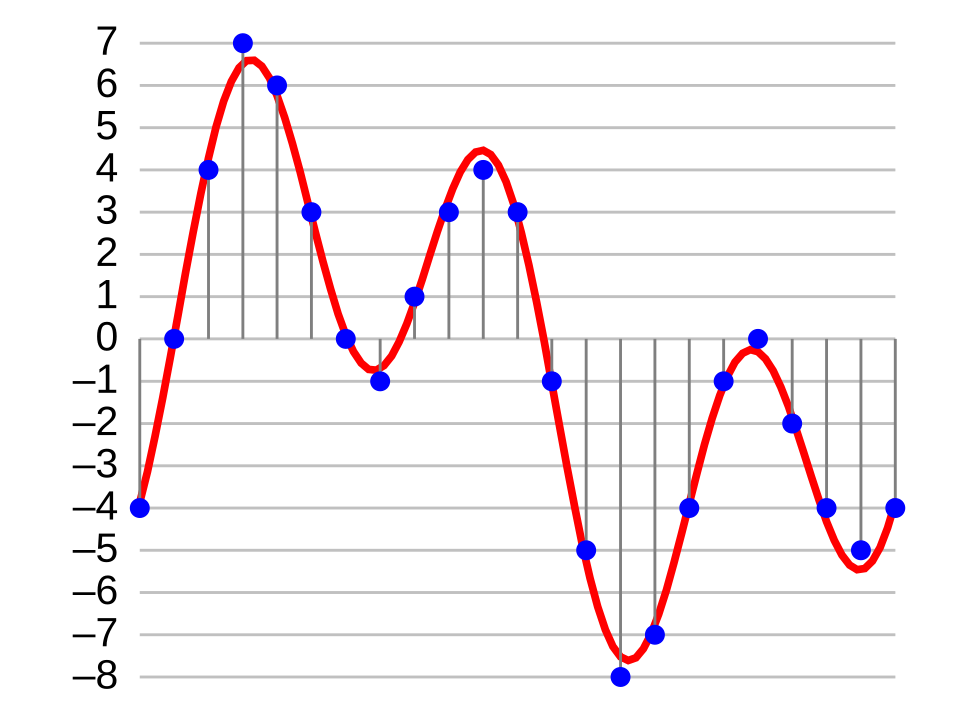
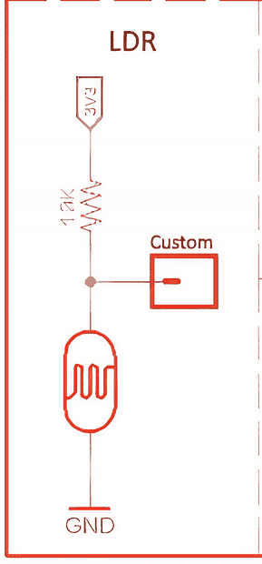
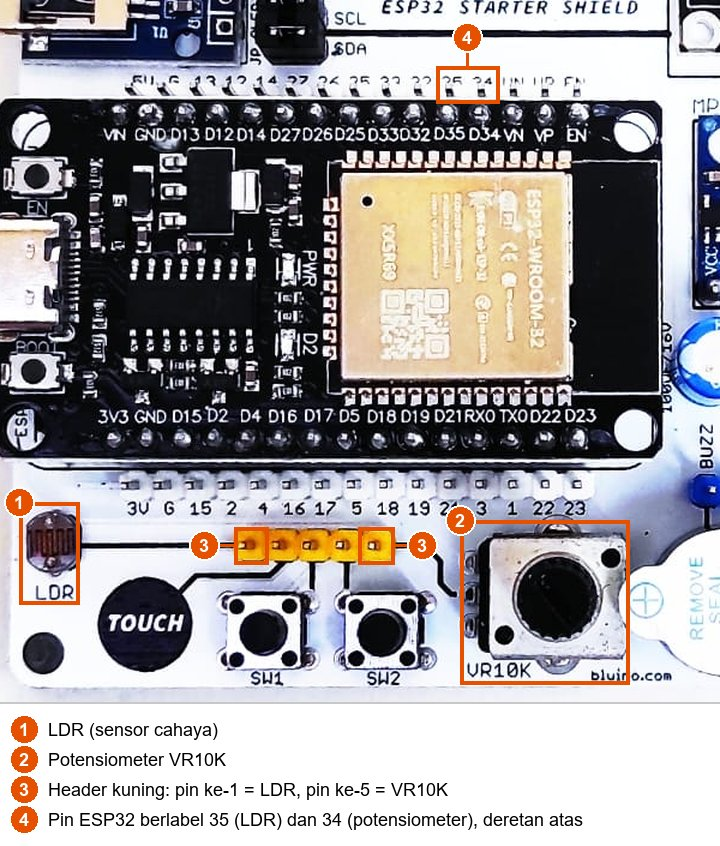
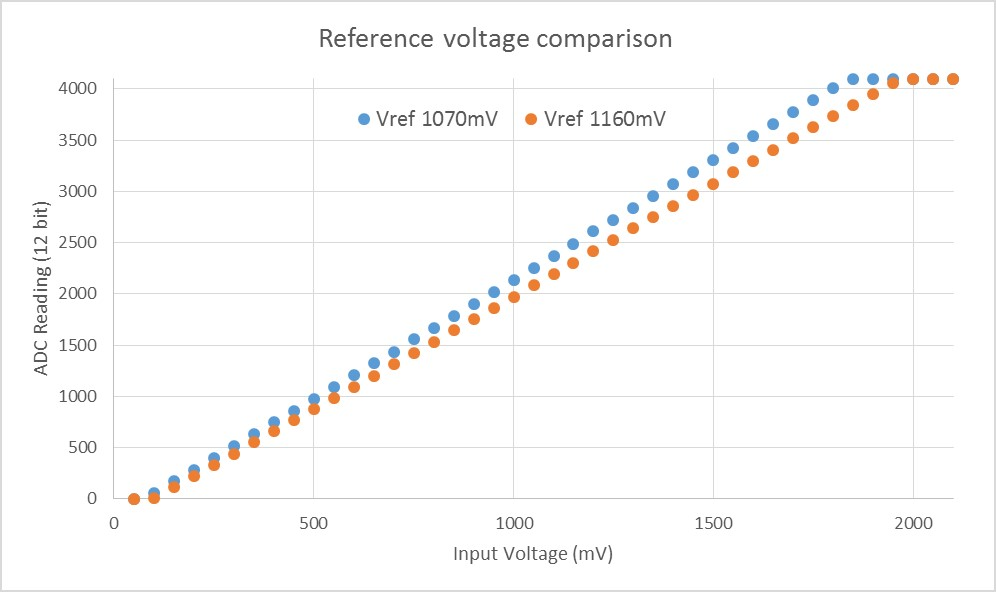
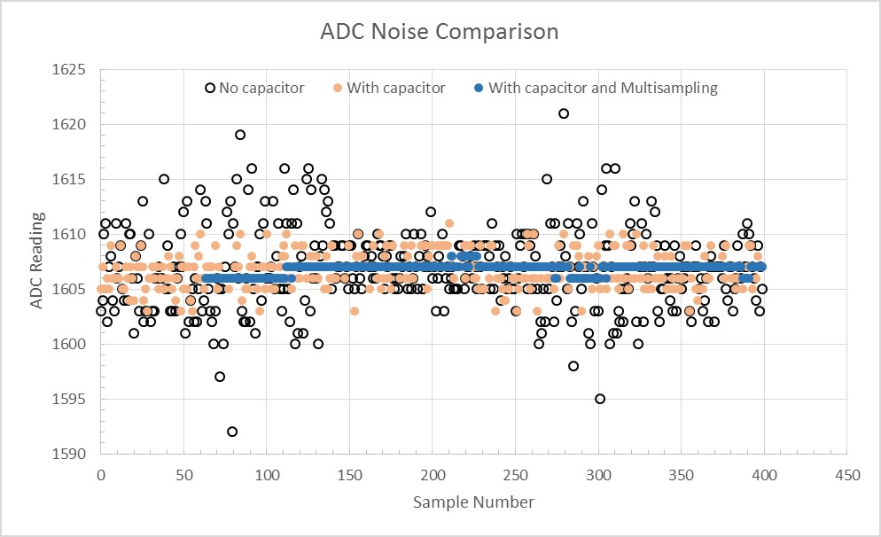

# BAB 11: Analog Input & ADC

> ✅ **Prasyarat:** Selesaikan **BAB 9 (Digital Input — Push Button)** — kamu sudah bisa memasang kabel *jumper* dari pin header kit ke pin ESP32 dan membuka Serial Monitor. Cara kerja pembagi tegangan pada potensiometer dan LDR dijelaskan di **BAB 3 (Dasar Elektronika untuk Mikrokontroler)**. BAB 10 tidak wajib untuk BAB ini.

Input digital di BAB 9 hanya mengenal dua keadaan: HIGH atau LOW. Padahal banyak hal di sekitar kita berubah secara halus, misalnya putaran tombol volume, terang-redupnya cahaya, atau suhu ruangan. Sinyal seperti ini disebut **sinyal analog**, dan ESP32 membacanya dengan **ADC** (*Analog-to-Digital Converter*, pengubah analog ke digital) yang mengubah tegangan menjadi angka. Ibaratnya, sakelar lampu hanya bisa "nyala" atau "mati", sedangkan penggaris bisa menunjukkan panjang berapa pun. Di BAB ini kamu memakai ADC untuk membaca potensiometer dan sensor cahaya LDR di kit, menampilkan grafiknya, dan mengatasi kelemahan ADC ESP32.

## 📌 Tujuan Pembelajaran

Setelah mempelajari BAB ini, kamu bisa:

- Menjelaskan perbedaan sinyal digital dan analog, serta cara kerja ADC 12 bit (nilai 0–4095).
- Membaca potensiometer dan LDR di kit dengan `analogRead()` dan `analogReadMilliVolts()`.
- Mengubah nilai ADC menjadi persentase, kategori, atau kecerahan LED dengan `map()`.
- Menampilkan nilai sensor sebagai grafik dengan **Serial Plotter**.
- Mengatur atenuasi dan resolusi ADC dengan `analogSetAttenuation()`, `analogSetPinAttenuation()`, dan `analogReadResolution()`.
- Menjelaskan perbedaan ADC1 dan ADC2, serta kenapa hanya ADC1 yang aman dipakai bersama WiFi.
- Mengatasi keterbatasan ADC ESP32 (tidak linear, berbeda antarchip, dan mengandung derau atau *noise*) dengan pembacaan milivolt terkalibrasi dan rata-rata beberapa sampel.

## 🧰 Yang Perlu Disiapkan

| Kebutuhan | Keterangan |
|---|---|
| *Hardware* | Kit Bluino ESP32 IoT Starter Shield (ESP32 DEVKIT V1 sudah terpasang di kit) + kabel USB **data** |
| Kabel *jumper* | 3 kabel *female-female*: potensiometer (`VR10K`), LDR (`LDR`), dan LED merah (`LED1`, untuk Program 4) — sudah ada di kit |
| Komponen tambahan | Tidak ada — potensiometer 10 kΩ, LDR beserta resistor 10 kΩ-nya, dan LED sudah terpasang di kit. Senter HP berguna untuk menyinari LDR |
| *Software* | Arduino IDE 2.x + *board package* **esp32** versi 3.3.x (lihat [BAB 5](../BAB-05/README.md)) |
| *Library* | Tidak perlu *library* tambahan |
| Alat uji | **Serial Monitor** (baud 115200) dan **Serial Plotter** (**Tools → Serial Plotter**, baud 115200) di Arduino IDE |
| Jaringan | Tidak perlu WiFi |

## 📑 Daftar Isi

- [11.1 Sinyal Digital dan Sinyal Analog](#111-sinyal-digital-dan-sinyal-analog)
- [11.2 Cara Kerja ADC](#112-cara-kerja-adc)
- [11.3 ADC1 dan ADC2: Pin Mana yang Boleh Dipakai?](#113-adc1-dan-adc2-pin-mana-yang-boleh-dipakai)
- [11.4 Potensiometer dan LDR pada Kit](#114-potensiometer-dan-ldr-pada-kit)
- [11.5 Program 1: Membaca Potensiometer](#115-program-1-membaca-potensiometer)
- [11.6 Program 2: Sensor Cahaya LDR](#116-program-2-sensor-cahaya-ldr)
- [11.7 Atenuasi dan Resolusi ADC](#117-atenuasi-dan-resolusi-adc)
- [11.8 Keterbatasan ADC ESP32 dan Cara Mengatasinya](#118-keterbatasan-adc-esp32-dan-cara-mengatasinya)
- [11.9 Program 3: Grafik Nilai ADC di Serial Plotter](#119-program-3-grafik-nilai-adc-di-serial-plotter)
- [11.10 Program 4: Potensiometer Mengatur Kecerahan LED](#1110-program-4-potensiometer-mengatur-kecerahan-led)
- [11.11 Troubleshooting](#1111-troubleshooting)
- [📝 Rangkuman](#-rangkuman)
- [💪 Latihan](#-latihan)
- [📚 Referensi](#-referensi)

---

## 11.1 Sinyal Digital dan Sinyal Analog

| | Sinyal digital | Sinyal analog |
|---|---|---|
| Nilai yang mungkin | Hanya dua: HIGH atau LOW | Banyak sekali, berubah halus dari rendah ke tinggi |
| Analogi | Sakelar lampu: nyala atau mati | Pengatur volume atau peredup lampu (*dimmer*) |
| Contoh di kit | Tombol S1/S2, sensor PIR | Potensiometer, LDR (sensor cahaya) |
| Fungsi Arduino | `digitalRead()` → `HIGH`/`LOW` | `analogRead()` → angka 0–4095 |

Pin digital hanya menjawab "tegangannya tinggi atau rendah?". ADC menjawab pertanyaan yang lebih rinci: "tegangannya **berapa**?". Dengan ADC, ESP32 bisa tahu seberapa jauh kenop potensiometer diputar atau seberapa terang cahaya di sekitar LDR.

---

## 11.2 Cara Kerja ADC

ADC mengukur tegangan di sebuah pin, lalu mengubahnya menjadi angka bulat. Hasilnya bukan nilai yang halus tak terhingga, melainkan "dibulatkan" ke salah satu dari sejumlah tingkat. Banyaknya tingkat ditentukan oleh **resolusi** dalam satuan bit:

- ADC 4 bit → 2⁴ = 16 tingkat.
- ADC ESP32 12 bit → 2¹² = **4096 tingkat**, yaitu angka **0 sampai 4095**.



*Gambar 11.1 — Cara kerja ADC: sinyal analog (garis merah) diukur pada waktu-waktu tertentu, lalu setiap hasilnya dibulatkan ke tingkat terdekat (titik biru). Gambar ini memakai ADC 4 bit (16 tingkat, termasuk tingkat negatif). ADC ESP32 bekerja dengan cara serupa, tetapi memakai 4096 tingkat dan hanya mengukur tegangan positif. Sumber: [Aquegg, Wikimedia Commons](https://commons.wikimedia.org/wiki/File:4-bit-linear-PCM.svg), lisensi CC BY-SA 3.0.*

Secara sederhana: **makin tinggi tegangan, makin besar angkanya**. Pada pengaturan bawaan Arduino-ESP32, 0 V terbaca 0, dan tegangan sekitar 3,1 V ke atas terbaca 4095 (nilai maksimum). Setiap kenaikan 1 angka kira-kira setara dengan 0,8 mV. Hubungan ini tidak persis lurus dan sedikit berbeda di setiap chip — itulah sebabnya ada fungsi `analogReadMilliVolts()` yang dibahas di [11.8](#118-keterbatasan-adc-esp32-dan-cara-mengatasinya).

| Spesifikasi ADC ESP32 | Nilai |
|---|---|
| Jumlah ADC | 2 buah: ADC1 dan ADC2, jenis SAR (*Successive Approximation Register*) |
| Resolusi | 12 bit (0–4095) secara bawaan, bisa diubah menjadi 9–12 bit |
| Jumlah kanal (pin analog) | 18 di dalam chip: 8 milik ADC1 dan 10 milik ADC2 |
| Atenuasi bawaan Arduino-ESP32 | 11 dB — cocok untuk tegangan 0–3,3 V seperti potensiometer dan LDR kit (lihat [11.7](#117-atenuasi-dan-resolusi-adc)) |
| Rentang paling akurat pada 11 dB | ±150–2450 mV, dengan galat ±60 mV setelah kalibrasi (menurut datasheet ESP32) |

Ingat juga dua hal penting:

- ADC hanya bisa mengukur **tegangan**. Karena itu sensor seperti potensiometer dan LDR dirangkai sebagai pembagi tegangan, supaya perubahan putaran atau cahaya menjadi perubahan tegangan (lihat [BAB 3](../BAB-03/README.md)).
- Fungsi `analogRead()` otomatis menyiapkan pin sebagai input analog, jadi kamu **tidak perlu** menulis `pinMode()` untuk pin ADC.

> ⚠️ **Perhatian:** Tegangan di pin ADC tidak boleh melebihi 3,3 V (batas mutlaknya 3,6 V, lihat BAB 3). Pengaturan atenuasi hanya mengubah rentang ukur, **tidak** membuat pin tahan tegangan yang lebih tinggi. Jangan pernah menyambungkan sinyal 5 V langsung ke pin ADC.

---

## 11.3 ADC1 dan ADC2: Pin Mana yang Boleh Dipakai?

Kedua ADC di ESP32 punya pin-pinnya sendiri. Bedanya sangat penting kalau programmu memakai WiFi:

| Unit | Pin yang tersedia di header kit | Saat WiFi aktif |
|---|---|---|
| **ADC1** | IO32, IO33, IO34, IO35, IO36 (VP), IO39 (VN) | ✅ Tetap bisa dipakai |
| **ADC2** | IO2, IO4, IO12, IO13, IO14, IO15, IO25, IO26, IO27 | ❌ Tidak bisa dipakai |

ADC2 juga dipakai oleh *driver* WiFi. Selama WiFi aktif, pembacaan analog di pin ADC2 gagal; di esp32 core 3.x, `analogRead()` pada pin seperti itu biasanya hanya menghasilkan 0. Karena itu, kalau proyekmu memakai WiFi, **pakai pin ADC1 untuk membaca sensor analog**. Peta Pin Standar kit sudah mengikuti aturan ini:

| Komponen kit | Label header | Pin ESP32 | Kanal ADC | Aman bersama WiFi? |
|---|---|---|---|---|
| Potensiometer 10 kΩ | `VR10K` (header kuning) | IO34 | ADC1_CH6 | ✅ Ya |
| LDR (sensor cahaya) | `LDR` (header kuning) | IO35 | ADC1_CH7 | ✅ Ya |

> 📌 **Catatan:** Batasan ADC2 hanya berlaku untuk membaca **analog**. Pin ADC2 seperti IO4 (LED merah) dan IO13 (*buzzer*) tetap bisa dipakai sebagai output digital atau PWM walaupun WiFi aktif. IO0 juga termasuk ADC2, tetapi pin itu dipakai tombol **BOOT** dan tidak tersedia di header kit.

> 💡 **Tips:** IO34–IO39 hanya bisa menjadi input dan tidak punya resistor *pull-up/pull-down* internal. Untuk membaca analog, hal itu justru tidak masalah — karena itu IO34 dan IO35 cocok sekali untuk potensiometer dan LDR.

---

## 11.4 Potensiometer dan LDR pada Kit

### 11.4.1 Potensiometer

Potensiometer 10 kΩ di kit adalah resistor yang nilainya bisa diubah dengan memutar kenopnya. Kedua ujungnya tersambung ke 3V3 dan GND, sedangkan kaki tengahnya (*wiper*) tersambung ke pin header `VR10K`:


*Gambar 11.2 — Rangkaian potensiometer pada kit. Panah pada simbol adalah kaki tengah (wiper) yang menuju pin Custom. Sumber: skematik ESP32 Starter Shield 3.2, [Bluino](http://www.bluino.com).*

Saat kenop diputar dari satu ujung ke ujung lain, tegangan di kaki tengah berubah dari 0 V sampai 3,3 V. Jadi `analogRead()` akan menghasilkan angka dari 0 sampai 4095.

### 11.4.2 LDR (Sensor Cahaya)

**LDR** (*Light Dependent Resistor*, resistor peka cahaya) adalah resistor yang hambatannya **makin kecil** saat cahaya **makin terang**. Di kit, LDR dipasang di sisi GND dan resistor tetap 10 kΩ di sisi 3V3:



*Gambar 11.3 — Rangkaian LDR pada kit: 3V3 → 10 kΩ → titik tengah (pin Custom) → LDR → GND. Sumber: skematik ESP32 Starter Shield 3.2, [Bluino](http://www.bluino.com).*

| Kondisi | Hambatan LDR | Tegangan di pin | Nilai `analogRead()` |
|---|---|---|---|
| Terang (disinari senter) | Kecil | Rendah (mendekati 0 V) | Kecil |
| Remang | Sedang | Sekitar tengah | Sedang |
| Gelap (ditutup jari) | Besar | Tinggi (mendekati 3,3 V) | Besar |

Jadi di kit ini berlaku aturan: **makin gelap, makin besar nilai ADC-nya**. Aturan ini kebalikan dari tebakan banyak orang, jadi ingat baik-baik. Perhitungan lengkapnya ada di BAB 3.

### 11.4.3 Menyambungkan Kabel Jumper

Pin `VR10K` dan `LDR` ada di header kuning 5 pin di bawah *board* ESP32. Urutan pin dari kiri: `LDR`, `TOUCH`, `SW1`, `SW2`, `VR10K`. Pin header ini tidak diberi tulisan, jadi kenali dari garis jalur di PCB: pin ke-1 tersambung ke LDR di sebelah kiri, dan pin ke-5 tersambung ke potensiometer di sebelah kanan.



*Gambar 11.4 — Letak LDR (1), potensiometer (2), pin header kuning untuk LDR dan potensiometer (3), dan pin ESP32 berlabel 35 dan 34 di deretan atas (4) pada kit v3.x; tata letak kit v3.2 milikmu bisa sedikit berbeda. Sumber: foto produk ESP32 Starter Shield, [Bluino](http://www.bluino.com), dipotong dan diberi penanda untuk materi ini.*

| Komponen | Pin Custom (header kuning) | Sambungkan ke pin ESP32 | Letak pin ESP32 |
|---|---|---|---|
| Potensiometer | `VR10K` (pin ke-5 dari kiri) | IO34 (label `34`) | Deretan atas |
| LDR | `LDR` (pin ke-1 dari kiri) | IO35 (label `35`) | Deretan atas |

Langkah memasang kabel:

1. Cabut kabel USB dulu supaya aman saat merangkai.
2. Pasang kabel *jumper* dari pin ke-5 header kuning (`VR10K`) ke pin berlabel **34** di deretan pin ESP32 atas.
3. Pasang kabel *jumper* dari pin ke-1 header kuning (`LDR`) ke pin berlabel **35** di deretan pin ESP32 atas.
4. Periksa sekali lagi, lalu sambungkan kembali kabel USB.

> ⚠️ **Perhatian:** Di deretan pin ESP32 atas, urutannya `... 33, 32, 35, 34, VN, VP, EN` — label **35 berada di kiri 34**. Kabel yang tertukar tidak merusak apa pun, tetapi programmu akan membaca LDR padahal yang kamu putar potensiometer, atau sebaliknya.

---

## 11.5 Program 1: Membaca Potensiometer

**Tujuan:** Membaca posisi kenop potensiometer dengan dua cara: sebagai angka mentah 0–4095 dengan `analogRead()` dan sebagai tegangan dalam milivolt dengan `analogReadMilliVolts()`. Program juga mengubah angka mentah menjadi perkiraan posisi putaran dalam persen.

**Rangkaian:**

| Pin **Custom** di kit | Sambungkan ke pin ESP32 |
|---|---|
| `VR10K` — potensiometer (header kuning, pin ke-5 dari kiri) | IO34 |

**Cara Menjalankan:**

1. Sambungkan kabel *jumper* dari pin `VR10K` ke pin berlabel **34** di deretan pin ESP32 atas (lihat [11.4.3](#1143-menyambungkan-kabel-jumper)).
2. Buka Arduino IDE → **File → New Sketch**, hapus isinya, lalu salin kode di bawah. Kode yang sama juga tersedia di file [`p1_baca_potensiometer.ino`](p1_baca_potensiometer/p1_baca_potensiometer.ino).
3. Pastikan **Tools → Board** = **ESP32 Dev Module** dan **Tools → Port** = *port* ESP32 kamu (misalnya `COM5` di Windows atau `/dev/ttyUSB0` di Linux).
4. Klik tombol **Upload** (ikon panah →) dan tunggu sampai muncul tulisan **Done uploading**.
5. Buka **Serial Monitor** (**Tools → Serial Monitor**) lalu pilih baud **115200**.
6. Putar kenop potensiometer pelan-pelan dari ujung kiri ke ujung kanan sambil memperhatikan angkanya.

**Kode Program:**

<!-- sketch: p1_baca_potensiometer -->
```cpp
/*
 * BAB 11 - Program 1: Membaca Potensiometer
 * Membaca potensiometer sebagai angka mentah 0-4095 (analogRead)
 * dan sebagai tegangan terkalibrasi dalam milivolt (analogReadMilliVolts).
 *
 * Rangkaian: VR10K (potensiometer, header kuning pin ke-5) → IO34
 */

#define POT_PIN 34  // potensiometer → IO34 (ADC1_CH6, aman dipakai bersama WiFi)

void setup() {
  Serial.begin(115200);
  // Tidak perlu pinMode(): analogRead() otomatis menyiapkan pin sebagai input analog.
  // Resolusi bawaan 12 bit (0-4095) dan atenuasi bawaan 11 dB sudah cocok untuk 0-3.3 V.

  Serial.println("BAB 11 - Program 1: Membaca Potensiometer");
  Serial.println("Putar kenop potensiometer pelan-pelan dari ujung ke ujung...");
}

void loop() {
  int nilaiAdc = analogRead(POT_PIN);                 // angka mentah 0-4095
  uint32_t milivolt = analogReadMilliVolts(POT_PIN);  // tegangan terkalibrasi (mV)
  float persen = nilaiAdc * 100.0 / 4095.0;           // perkiraan posisi putaran 0-100 %

  Serial.print("ADC: ");
  Serial.print(nilaiAdc);
  Serial.print(" | Tegangan: ");
  Serial.print(milivolt);
  Serial.print(" mV | Posisi: ");
  Serial.print(persen, 1);  // 1 angka di belakang titik desimal
  Serial.println(" %");

  delay(500);  // 2 pembacaan per detik supaya mudah dibaca
}
```

**Penjelasan Kode:**

- `analogRead(POT_PIN)` mengukur tegangan di IO34 dan mengembalikan angka mentah 0–4095. Angka ini belum dikoreksi, jadi bisa sedikit berbeda di setiap chip ESP32.
- `analogReadMilliVolts(POT_PIN)` mengukur pin yang sama, lalu mengubah hasilnya menjadi milivolt memakai data kalibrasi pabrik yang tersimpan di chip. Tipenya `uint32_t`, yaitu bilangan bulat tanpa tanda minus berukuran 32 bit.
- `nilaiAdc * 100.0 / 4095.0` mengubah angka 0–4095 menjadi 0–100 %. Angka `100.0` dan `4095.0` sengaja ditulis dengan titik desimal supaya perhitungannya memakai bilangan pecahan (`float`), bukan bilangan bulat yang membuang angka di belakang koma.
- `Serial.print(persen, 1)` mencetak angka pecahan dengan 1 angka di belakang titik desimal. Di dalam program, desimal selalu ditulis dengan **titik**, bukan koma.
- Tidak ada `pinMode()` dan tidak ada pengaturan ADC: pengaturan bawaan (12 bit, 11 dB) sudah cocok untuk potensiometer kit.

**Contoh Output:**

```text
BAB 11 - Program 1: Membaca Potensiometer
Putar kenop potensiometer pelan-pelan dari ujung ke ujung...
ADC: 0 | Tegangan: 142 mV | Posisi: 0.0 %
ADC: 0 | Tegangan: 142 mV | Posisi: 0.0 %
ADC: 851 | Tegangan: 827 mV | Posisi: 20.8 %
ADC: 1869 | Tegangan: 1647 mV | Posisi: 45.6 %
ADC: 2893 | Tegangan: 2472 mV | Posisi: 70.6 %
ADC: 4095 | Tegangan: 3135 mV | Posisi: 100.0 %
```

Setiap setengah detik muncul satu baris baru. Saat kenop diputar ke satu arah, ketiga angka naik; diputar ke arah sebaliknya, ketiganya turun. Angka di kit kamu pasti sedikit berbeda, karena bergantung pada posisi kenop dan chip ESP32-mu. Beberapa hal yang wajar terjadi:

- Di ujung bawah, ADC sudah 0 tetapi tegangannya masih terbaca beberapa puluh sampai sekitar 150 mV, bukan 0 mV.
- Di ujung atas, ADC mentok di 4095 dan tegangannya sekitar 3100 mV, bukan 3300 mV.
- Saat kenop tidak disentuh pun, angka ADC bisa naik-turun beberapa angka.

Ketiganya adalah sifat ADC ESP32, bukan kerusakan. Penjelasan dan cara mengatasinya ada di [11.8](#118-keterbatasan-adc-esp32-dan-cara-mengatasinya).

> 🧪 **Coba Sendiri:** Putar kenop sampai tepat di tengah. Apakah tegangannya sekitar 1650 mV (setengah dari 3,3 V)? Lalu perhatikan angka ADC-nya: apakah tepat 2048 (setengah dari 4096)? Kalau tidak, catat angkanya — kita akan membahasnya di 11.8.

**Kalau Belum Berhasil:**

- **Angka selalu 0, atau berubah-ubah sendiri tanpa kenop disentuh** → kabel *jumper* belum terpasang di pin `VR10K` atau di pin berlabel `34`. Pin analog yang tidak tersambung ke mana pun "mengambang" dan nilainya acak.
- **Angka berubah saat LDR ditutup, bukan saat kenop diputar** → kabel terpasang di pin `LDR` (pin ke-1), bukan `VR10K` (pin ke-5), atau tertukar dengan label `35`.
- **Angka selalu 4095** → kabel terpasang di pin `3V` (3,3 V) atau pin lain yang selalu bertegangan tinggi. Periksa kembali kedua ujung kabel.

---

## 11.6 Program 2: Sensor Cahaya LDR

**Tujuan:** Membaca LDR, lalu menampilkan nilai ADC, perkiraan kecerahan dalam persen, dan kategori cahayanya (sangat terang sampai sangat gelap). Program ini juga memperkenalkan fungsi `map()`.

**Rangkaian:**

| Pin **Custom** di kit | Sambungkan ke pin ESP32 |
|---|---|
| `LDR` — sensor cahaya (header kuning, pin ke-1 dari kiri) | IO35 |

**Cara Menjalankan:**

1. Sambungkan kabel *jumper* dari pin `LDR` ke pin berlabel **35** di deretan pin ESP32 atas. Kabel potensiometer dari Program 1 boleh tetap terpasang.
2. Buka Arduino IDE → **File → New Sketch**, hapus isinya, lalu salin kode di bawah. Kode yang sama juga tersedia di file [`p2_sensor_cahaya_ldr.ino`](p2_sensor_cahaya_ldr/p2_sensor_cahaya_ldr.ino).
3. Pastikan **Tools → Board** = **ESP32 Dev Module** dan **Tools → Port** = *port* ESP32 kamu.
4. Klik tombol **Upload** dan tunggu sampai muncul tulisan **Done uploading**.
5. Buka **Serial Monitor** (**Tools → Serial Monitor**) lalu pilih baud **115200**.
6. Amati angkanya dalam cahaya ruangan, lalu tutup LDR dengan jari, kemudian sinari LDR dengan senter HP.

**Kode Program:**

<!-- sketch: p2_sensor_cahaya_ldr -->
```cpp
/*
 * BAB 11 - Program 2: Sensor Cahaya LDR
 * Menampilkan nilai ADC, perkiraan kecerahan, dan kategori cahaya.
 * Di kit, LDR berada di sisi GND: makin gelap → tegangan naik → nilai ADC makin BESAR.
 *
 * Rangkaian: LDR (header kuning, pin ke-1) → IO35
 */

#define LDR_PIN 35  // LDR → IO35 (ADC1_CH7, aman dipakai bersama WiFi)

void setup() {
  Serial.begin(115200);
  Serial.println("BAB 11 - Program 2: Sensor Cahaya LDR");
  Serial.println("Tutup LDR dengan jari, lalu sinari dengan senter HP...");
}

void loop() {
  int nilaiAdc = analogRead(LDR_PIN);  // 0 = sangat terang, 4095 = sangat gelap

  // Balik skalanya dengan map(): ADC 0 → kecerahan 100 %, ADC 4095 → kecerahan 0 %
  int kecerahan = map(nilaiAdc, 0, 4095, 100, 0);

  // Kategori cahaya. Ingat: makin gelap, makin BESAR nilai ADC.
  // Ambang (500, 1500, ...) boleh kamu sesuaikan dengan ruanganmu.
  const char *kategori;
  if (nilaiAdc < 500) {
    kategori = "Sangat terang";
  } else if (nilaiAdc < 1500) {
    kategori = "Terang";
  } else if (nilaiAdc < 2500) {
    kategori = "Redup";
  } else if (nilaiAdc < 3500) {
    kategori = "Gelap";
  } else {
    kategori = "Sangat gelap";
  }

  Serial.print("ADC: ");
  Serial.print(nilaiAdc);
  Serial.print(" | Kecerahan: ");
  Serial.print(kecerahan);
  Serial.print(" % | Kategori: ");
  Serial.println(kategori);

  delay(500);
}
```

**Penjelasan Kode:**

- `map(nilaiAdc, 0, 4095, 100, 0)` mengubah angka dari rentang 0–4095 menjadi rentang 100–0 secara sebanding, mirip mengubah nilai ujian 0–100 menjadi skala lain. Karena rentang tujuannya ditulis terbalik (100 ke 0), hasilnya juga terbalik: ADC kecil (terang) menjadi kecerahan besar. `map()` bekerja dengan bilangan bulat, jadi angka di belakang koma dibuang.
- Rantai `if ... else if ... else` memilih **satu** kategori, diperiksa dari atas ke bawah. Contohnya, ADC 1200 tidak lolos syarat `< 500`, tetapi lolos syarat `< 1500`, sehingga kategorinya "Terang" dan syarat di bawahnya tidak diperiksa lagi.
- `const char *kategori` adalah variabel untuk menyimpan teks yang tetap, seperti di BAB 8.
- Nilai ambang 500, 1500, 2500, dan 3500 hanya contoh. Hambatan setiap LDR dan terang ruangan berbeda-beda, jadi sesuaikan angkanya setelah melihat nilai ADC di ruanganmu.

**Contoh Output:**

```text
BAB 11 - Program 2: Sensor Cahaya LDR
Tutup LDR dengan jari, lalu sinari dengan senter HP...
ADC: 1012 | Kecerahan: 76 % | Kategori: Terang
ADC: 1020 | Kecerahan: 76 % | Kategori: Terang
ADC: 2650 | Kecerahan: 36 % | Kategori: Gelap
ADC: 3874 | Kecerahan: 6 % | Kategori: Sangat gelap
ADC: 105 | Kecerahan: 98 % | Kategori: Sangat terang
```

Pada contoh di atas, baris pertama dan kedua diambil di bawah lampu ruangan, baris ketiga saat LDR mulai ditutupi tangan, baris keempat saat LDR ditutup rapat dengan jari, dan baris terakhir saat LDR disinari senter HP. Angka di kit kamu akan berbeda, tetapi polanya sama: **ditutup → ADC besar**, **disinari → ADC kecil**.

> 💡 **Tips:** LDR bereaksi agak lambat, terutama saat berubah dari terang ke gelap. Tunggu satu atau dua detik sampai angkanya stabil.

**Kalau Belum Berhasil:**

- **Angka tidak berubah saat LDR ditutup** → kabel tidak terpasang di pin `LDR` (pin ke-1 header kuning) atau tidak di pin berlabel `35`.
- **Angka berubah saat kenop potensiometer diputar** → kabel tertukar dengan potensiometer. Pindahkan ke pin `LDR` dan label `35`.
- **Kategori selalu sama (misalnya selalu "Terang")** → ambangnya tidak cocok dengan ruanganmu. Catat nilai ADC saat terang dan saat LDR ditutup, lalu ubah angka 500, 1500, 2500, dan 3500 di kode.

---

## 11.7 Atenuasi dan Resolusi ADC

### 11.7.1 Atenuasi

Bagian inti ADC ESP32 sebenarnya hanya mampu mengukur tegangan kecil, kurang dari sekitar 1 V. Supaya tegangan yang lebih besar bisa diukur, di depan ADC ada **peredam** (*attenuator*) yang mengecilkan tegangan masukan sebelum diukur — mirip memilih skala pengukuran pada multimeter. Besarnya peredaman disebut **atenuasi** dan dinyatakan dalam desibel (dB). Makin besar atenuasinya, makin lebar rentang tegangan yang bisa diukur, tetapi ketelitiannya sedikit berkurang.

| Konstanta di Arduino | Rentang yang disarankan | Galat setelah kalibrasi | Catatan |
|---|---|---|---|
| `ADC_0db` | ±100–950 mV | ±23 mV | Untuk sinyal kecil |
| `ADC_2_5db` | ±100–1250 mV | ±30 mV | |
| `ADC_6db` | ±150–1750 mV | ±40 mV | |
| `ADC_11db` | ±150–2450 mV | ±60 mV | **Bawaan Arduino-ESP32.** Masih bisa membaca sampai sekitar 3100 mV, tetapi kurang akurat |

Sumber angka: datasheet ESP32 (tabel *ADC Calibration Results*) dan dokumentasi Arduino-ESP32. Di luar rentang yang disarankan hasilnya kurang akurat, dan tegangan yang terlalu tinggi untuk atenuasi yang dipilih terbaca mentok di 4095.

Potensiometer dan LDR di kit menghasilkan 0–3,3 V, jadi **biarkan atenuasi bawaan (11 dB)**. Kalau kamu memilih `ADC_0db`, semua tegangan di atas sekitar 1 V akan terbaca 4095.

Fungsi untuk mengatur atenuasi (potongan kode, bukan program lengkap):

```cpp
// Semua pin ADC memakai atenuasi 6 dB (biasanya ditulis di setup())
analogSetAttenuation(ADC_6db);

// Hanya satu pin: pin itu harus sudah pernah dibaca dengan analogRead() dulu
analogRead(POT_PIN);
analogSetPinAttenuation(POT_PIN, ADC_6db);
```

> ⚠️ **Perhatian:** Dua jebakan pada esp32 core 3.3.x:
>
> - `analogSetPinAttenuation()` hanya berlaku untuk pin yang **sudah pernah** dibaca dengan `analogRead()`. Kalau dipanggil sebelumnya, perintah itu diabaikan tanpa pesan *error* di Serial Monitor.
> - `analogReadMilliVolts()` memakai data kalibrasi untuk atenuasi yang diatur `analogSetAttenuation()` (atenuasi untuk semua pin). Kalau sebuah pin diberi atenuasi berbeda dengan `analogSetPinAttenuation()`, hasil milivolt pin itu bisa salah. Jadi, kalau kamu butuh nilai milivolt, ubah atenuasi dengan `analogSetAttenuation()`.

> 📌 **Catatan:** Di ESP-IDF versi 5, pengaturan 11 dB diberi nama `ADC_ATTEN_DB_12`, karena peredaman sebenarnya sekitar 12 dB. Di Arduino-ESP32 namanya tetap `ADC_11db`, jadi kalau membaca dokumentasi lain, anggap keduanya sama.

### 11.7.2 Resolusi

Secara bawaan, hasil `analogRead()` memakai 12 bit (0–4095). Kamu bisa mengubahnya dengan `analogReadResolution()`:

```cpp
analogReadResolution(10);  // hasil analogRead() menjadi 0-1023, seperti Arduino Uno
```

| Resolusi | Rentang angka `analogRead()` | Kapan dipakai |
|---|---|---|
| 12 bit (bawaan) | 0–4095 | Hampir selalu |
| 10 bit | 0–1023 | Menyamakan dengan kode Arduino Uno yang ingin kamu pindahkan ke ESP32 |
| 9 bit | 0–511 | Resolusi terkecil yang didukung *hardware* ADC ESP32 |

Resolusi yang lebih kecil **tidak** membuat pembacaan lebih akurat — angkanya hanya menjadi lebih kasar. Hasil `analogReadMilliVolts()` tidak terpengaruh, karena selalu dalam satuan milivolt.

---

## 11.8 Keterbatasan ADC ESP32 dan Cara Mengatasinya

ADC ESP32 praktis dan murah, tetapi tidak sempurna. Ada tiga kelemahan yang perlu kamu kenal, ditambah satu batasan ADC2 yang sudah dibahas di [11.3](#113-adc1-dan-adc2-pin-mana-yang-boleh-dipakai).

### 11.8.1 Tidak Linear di Ujung-Ujungnya

Idealnya, angka ADC naik lurus sebanding dengan tegangan. Pada ESP32 (atenuasi 11 dB), kenyataannya seperti ini:

| Tegangan di pin | Hasil `analogRead()` | Keterangan |
|---|---|---|
| 0 sampai ±0,15 V | 0 atau hampir 0 | Terlalu kecil untuk terbaca dengan baik |
| ±0,15 sampai ±2,45 V | Naik hampir lurus | Daerah paling akurat |
| ±2,45 sampai ±3,1 V | Masih naik, tetapi makin melengkung | Akurasi menurun |
| Di atas ±3,1 V | 4095 | Mentok (jenuh) |

Jadi angka 0–4095 sebenarnya "terpakai" untuk rentang sekitar 0,15–3,1 V, bukan 0–3,3 V. Itulah sebabnya pada Program 1 posisi tengah potensiometer (±1,65 V) tidak menghasilkan ADC 2048, dan putaran penuh hanya terbaca sekitar 3100 mV.

### 11.8.2 Berbeda di Setiap Chip

Menurut datasheet ESP32, hasil ADC mentah antarchip bisa berbeda sampai ±6%. Penyebab utamanya adalah tegangan referensi di dalam chip yang tidak persis sama: menurut dokumentasi ESP-IDF, nilainya bisa berkisar 1000–1200 mV di antara chip ESP32 yang berbeda. Akibatnya, tegangan yang sama bisa menghasilkan angka mentah yang berbeda:



*Gambar 11.5 — Dua chip ESP32 dengan tegangan referensi berbeda (1070 mV dan 1160 mV) menghasilkan angka ADC berbeda untuk tegangan masukan yang sama. Sumbu mendatar: tegangan masukan (mV); sumbu tegak: hasil ADC 12 bit. Sumber: [Espressif Systems — ESP-IDF Programming Guide v4.4, ADC](https://docs.espressif.com/projects/esp-idf/en/v4.4/esp32/api-reference/peripherals/adc.html), lisensi Apache-2.0.*

**Solusinya: `analogReadMilliVolts()`.** Setiap chip ESP32 menyimpan data kalibrasi dari pabrik di memori khusus bernama eFuse. `analogReadMilliVolts()` memakai data itu untuk mengoreksi perbedaan antarchip dan sebagian ketidaklinearan, sehingga hasilnya langsung dalam milivolt. Menurut datasheet, galatnya ±60 mV pada rentang ±150–2450 mV (atenuasi 11 dB).

Bandingkan dengan menghitung tegangan sendiri dari angka mentah, misalnya memakai data Program 1 di posisi tengah:

```text
Rumus "ideal" : 1869 × 3300 ÷ 4095 ≈ 1506 mV   ← meleset sekitar 140 mV
analogReadMilliVolts()          : 1647 mV   ← mendekati 1650 mV yang sebenarnya
```

Jadi, **kalau kamu butuh nilai tegangan, pakai `analogReadMilliVolts()`**. Kalau kamu hanya butuh "lebih besar atau lebih kecil" (misalnya terang atau gelap), `analogRead()` sudah cukup.

### 11.8.3 Derau (Noise)

Walaupun tegangan di pin tidak berubah, hasil pembacaan ADC biasanya sedikit naik-turun. Gangguan acak ini disebut **derau** (*noise*). Sumbernya bisa dari catu daya, kabel *jumper* yang bertindak seperti antena, atau aktivitas di dalam chip itu sendiri, misalnya WiFi.



*Gambar 11.6 — Perbandingan derau ADC pada tegangan tetap: tanpa kapasitor (No capacitor, lingkaran hitam), dengan kapasitor (With capacitor, oranye), dan dengan kapasitor ditambah rata-rata 64 sampel (With capacitor and Multisampling, biru). Sumbu mendatar: urutan pembacaan; sumbu tegak: hasil ADC. Sumber: [Espressif Systems — ESP-IDF Programming Guide v4.4, ADC](https://docs.espressif.com/projects/esp-idf/en/v4.4/esp32/api-reference/peripherals/adc.html), lisensi Apache-2.0.*

Ada dua cara mengurangi derau:

1. **Rata-rata beberapa sampel (*software*).** Baca pin beberapa kali berturut-turut, jumlahkan, lalu bagi dengan jumlah pembacaannya. Derau yang acak saling "menetralkan", sehingga hasilnya lebih stabil. Cara ini juga disarankan datasheet ESP32 dan akan kamu lihat sendiri di Program 3.
2. **Kapasitor 100 nF (*hardware*, opsional).** Dokumentasi ESP-IDF menyarankan kapasitor keramik 100 nF antara pin ADC dan GND. Kit Bluino tidak memasang kapasitor ini, jadi lewati saja kalau kamu tidak punya komponen tambahan.

Fungsi rata-rata yang dipakai di Program 3 dan Program 4 (potongan kode):

```cpp
// Baca pin beberapa kali, lalu kembalikan rata-ratanya
int bacaRataRata(int pin, int jumlahSampel) {
  long total = 0;  // penampung jumlah semua pembacaan
  for (int i = 0; i < jumlahSampel; i++) {
    total += analogRead(pin);
  }
  return total / jumlahSampel;
}
```

Makin banyak sampel, makin halus hasilnya, tetapi makin lama waktu bacanya dan makin lambat reaksinya terhadap perubahan. Untuk potensiometer dan LDR, 16–64 sampel biasanya sudah cukup.

---

## 11.9 Program 3: Grafik Nilai ADC di Serial Plotter

**Tujuan:** Menampilkan nilai potensiometer sebagai grafik garis di **Serial Plotter**, alat bawaan Arduino IDE yang menggambar angka dari Serial menjadi grafik. Ada dua garis: nilai mentah (sekali baca) dan rata-rata 32 kali baca, supaya kamu bisa melihat sendiri derau ADC dan efek perata-rataan.

**Rangkaian:**

| Pin **Custom** di kit | Sambungkan ke pin ESP32 |
|---|---|
| `VR10K` — potensiometer (header kuning, pin ke-5 dari kiri) | IO34 |

**Cara Menjalankan:**

1. Pastikan kabel `VR10K` → **34** masih terpasang.
2. Buka Arduino IDE → **File → New Sketch**, hapus isinya, lalu salin kode di bawah. Kode yang sama juga tersedia di file [`p3_grafik_plotter.ino`](p3_grafik_plotter/p3_grafik_plotter.ino).
3. Pastikan **Tools → Board** = **ESP32 Dev Module** dan **Tools → Port** = *port* ESP32 kamu.
4. Klik tombol **Upload** dan tunggu sampai muncul tulisan **Done uploading**.
5. Buka **Serial Plotter** lewat **Tools → Serial Plotter**, atau klik ikon grafik di pojok kanan atas Arduino IDE (di sebelah ikon Serial Monitor). Serial Plotter terbuka di jendela tersendiri.
6. Di jendela Serial Plotter, pilih baud **115200**.
7. Biarkan kenop diam beberapa detik, lalu putar perlahan dari ujung ke ujung.

**Kode Program:**

<!-- sketch: p3_grafik_plotter -->
```cpp
/*
 * BAB 11 - Program 3: Grafik Nilai ADC di Serial Plotter
 * Menggambar dua garis: nilai mentah potensiometer (sekali baca)
 * dan rata-rata 32 kali baca, untuk melihat efek perata-rataan terhadap derau.
 * Buka Tools → Serial Plotter, lalu pilih baud 115200.
 *
 * Rangkaian: VR10K (potensiometer, header kuning pin ke-5) → IO34
 */

#define POT_PIN 34  // potensiometer → IO34 (ADC1_CH6)

const int JUMLAH_SAMPEL = 32;  // banyaknya pembacaan yang dirata-rata

// Baca pin beberapa kali, lalu kembalikan rata-ratanya
int bacaRataRata(int pin, int jumlahSampel) {
  long total = 0;  // penampung jumlah semua pembacaan
  for (int i = 0; i < jumlahSampel; i++) {
    total += analogRead(pin);
  }
  return total / jumlahSampel;
}

void setup() {
  Serial.begin(115200);
  // Sengaja tidak mencetak judul: Serial Plotter menganggap setiap baris sebagai data grafik.
}

void loop() {
  int mentah = analogRead(POT_PIN);                     // sekali baca
  int rataRata = bacaRataRata(POT_PIN, JUMLAH_SAMPEL);  // rata-rata 32 kali baca

  // Format Serial Plotter: label:nilai, dipisah koma, satu baris = satu titik grafik
  Serial.print("Mentah:");
  Serial.print(mentah);
  Serial.print(",RataRata:");
  Serial.println(rataRata);

  delay(50);  // sekitar 20 titik per detik
}
```

**Penjelasan Kode:**

- Serial Plotter membaca teks dari Serial **baris demi baris**. Setiap baris menjadi satu titik di setiap garis grafik.
- Format `label:nilai` memberi nama pada setiap garis. Beberapa pasangan dalam satu baris dipisah koma, misalnya `Mentah:1868,RataRata:1871`. Nama label tidak boleh mengandung spasi, karena Serial Plotter juga menganggap spasi sebagai pemisah — karena itu ditulis `RataRata`, bukan `Rata Rata`.
- `bacaRataRata()` adalah fungsi dari [11.8.3](#1183-derau-noise): membaca pin 32 kali, menjumlahkannya dalam variabel `long`, lalu membaginya dengan 32.
- Program ini sengaja tidak mencetak judul di `setup()`. Baris teks biasa bisa ikut dianggap data oleh Serial Plotter dan memunculkan garis aneh di grafik.
- `delay(50)` membuat grafik bergerak sekitar 20 titik per detik, cukup halus untuk diamati.

**Contoh Output:**

Di Serial Plotter muncul dua garis berwarna dengan keterangan **Mentah** dan **RataRata**. Saat kenop diam, garis **Mentah** bergerigi naik-turun, sedangkan garis **RataRata** jauh lebih rata. Saat kenop diputar, kedua garis naik atau turun bersama-sama.

Kalau kamu membuka **Serial Monitor** (di Arduino IDE 2, Serial Monitor dan Serial Plotter boleh terbuka bersamaan), teksnya terlihat seperti ini:

```text
Mentah:1868,RataRata:1871
Mentah:1879,RataRata:1871
Mentah:1859,RataRata:1870
Mentah:1874,RataRata:1871
Mentah:1866,RataRata:1871
```

> 📌 **Catatan:** Sumbu tegak Serial Plotter menyesuaikan skalanya secara otomatis. Saat kenop diam, grafik "memperbesar" daerah sempit di sekitar nilainya, sehingga derau beberapa angka pun terlihat seperti gerigi besar. Perhatikan angka di sumbu tegak supaya tidak salah menilai besarnya derau.

> 🧪 **Coba Sendiri:** Ubah `JUMLAH_SAMPEL` menjadi `4`, lalu `128`, dan *upload* ulang. Bagaimana kehalusan garis **RataRata** berubah? Kamu juga bisa menyembunyikan salah satu garis dengan mengklik keterangannya di bagian atas jendela Serial Plotter.

**Kalau Belum Berhasil:**

- **Serial Plotter kosong atau tidak bergerak** → baud di jendela Serial Plotter belum **115200**, atau *port* yang dipilih salah. Tutup jendela Serial Plotter, periksa **Tools → Port**, lalu buka lagi.
- **Muncul garis tambahan yang aneh, misalnya bernama "value 1"** → ada baris teks lain yang tercetak, misalnya karena kamu menambahkan `Serial.println("...")`. Untuk Serial Plotter, cetak hanya baris data.
- **Kedua garis datar di 0 atau 4095** → periksa kabel `VR10K` → `34` seperti pada Program 1.

---

## 11.10 Program 4: Potensiometer Mengatur Kecerahan LED

**Tujuan:** Mengatur kecerahan LED merah dengan memutar potensiometer. Nilai ADC (0–4095) diubah dengan `map()` menjadi nilai kecerahan PWM (0–255). Inilah pola dasar banyak alat sehari-hari, misalnya pengatur kecepatan kipas atau peredup lampu.

**Rangkaian:**

| Pin **Custom** di kit | Sambungkan ke pin ESP32 |
|---|---|
| `VR10K` — potensiometer (header kuning, pin ke-5 dari kiri) | IO34 |
| `LED1` — LED merah (header LED) | IO4 |

**Cara Menjalankan:**

1. Pastikan kabel `VR10K` → **34** (deretan atas) terpasang, lalu tambahkan kabel `LED1` → **4** di deretan pin ESP32 bawah (letak *header* LED ada di [BAB 8](../BAB-08/README.md)).
2. Buka Arduino IDE → **File → New Sketch**, hapus isinya, lalu salin kode di bawah. Kode yang sama juga tersedia di file [`p4_pot_kecerahan_led.ino`](p4_pot_kecerahan_led/p4_pot_kecerahan_led.ino).
3. Pastikan **Tools → Board** = **ESP32 Dev Module** dan **Tools → Port** = *port* ESP32 kamu.
4. Klik tombol **Upload** dan tunggu sampai muncul tulisan **Done uploading**.
5. Buka **Serial Monitor** (**Tools → Serial Monitor**) lalu pilih baud **115200**. Kalau Serial Plotter dari Program 3 masih terbuka, tutup dulu supaya tidak membingungkan.
6. Putar kenop potensiometer pelan-pelan dan perhatikan LED merah.

**Kode Program:**

<!-- sketch: p4_pot_kecerahan_led -->
```cpp
/*
 * BAB 11 - Program 4: Potensiometer Mengatur Kecerahan LED
 * Putar potensiometer untuk mengatur kecerahan LED merah (ADC → PWM).
 *
 * Rangkaian:
 *   VR10K (potensiometer, header kuning pin ke-5) → IO34
 *   LED1 (merah, header LED)                       → IO4
 */

#define POT_PIN   34  // potensiometer → IO34 (ADC1)
#define LED_MERAH 4   // LED merah → IO4 (output PWM)

const int FREKUENSI_PWM = 5000;  // Hz: LED dinyalakan-dimatikan 5000 kali per detik
const int RESOLUSI_PWM = 8;      // 8 bit → nilai kecerahan 0-255
const int JUMLAH_SAMPEL = 16;    // rata-rata 16 kali baca supaya kecerahan LED stabil

// Baca pin beberapa kali, lalu kembalikan rata-ratanya
int bacaRataRata(int pin, int jumlahSampel) {
  long total = 0;
  for (int i = 0; i < jumlahSampel; i++) {
    total += analogRead(pin);
  }
  return total / jumlahSampel;
}

void setup() {
  Serial.begin(115200);

  // Siapkan PWM di IO4: frekuensi 5000 Hz, resolusi 8 bit (dibahas lengkap di BAB 12)
  ledcAttach(LED_MERAH, FREKUENSI_PWM, RESOLUSI_PWM);

  Serial.println("BAB 11 - Program 4: Potensiometer Mengatur Kecerahan LED");
}

void loop() {
  int nilaiPot = bacaRataRata(POT_PIN, JUMLAH_SAMPEL);  // 0-4095
  int kecerahan = map(nilaiPot, 0, 4095, 0, 255);       // ubah ke rentang PWM 0-255

  ledcWrite(LED_MERAH, kecerahan);  // atur kecerahan LED

  Serial.print("Potensiometer: ");
  Serial.print(nilaiPot);
  Serial.print(" -> Kecerahan LED: ");
  Serial.println(kecerahan);

  delay(100);
}
```

**Penjelasan Kode:**

- **PWM** (*Pulse Width Modulation*, modulasi lebar pulsa) menyalakan dan mematikan LED ribuan kali per detik. Mata kita tidak bisa melihat kedipan secepat itu, jadi yang terlihat adalah terang rata-ratanya: makin lama bagian "nyala" dalam setiap kedipan, makin terang LED terlihat. PWM dibahas lengkap di [BAB 12](../BAB-12/README.md).
- `ledcAttach(LED_MERAH, FREKUENSI_PWM, RESOLUSI_PWM)` menyiapkan PWM di IO4 dengan frekuensi 5000 Hz dan resolusi 8 bit, sehingga kecerahan bisa diatur dari 0 (mati) sampai 255 (paling terang).
- `map(nilaiPot, 0, 4095, 0, 255)` mengubah nilai potensiometer 0–4095 menjadi kecerahan 0–255 secara sebanding.
- `ledcWrite(LED_MERAH, kecerahan)` menerapkan kecerahan itu ke LED.
- `bacaRataRata()` membuat nilai potensiometer stabil. Tanpa perata-rataan, derau ADC bisa membuat kecerahan LED bergetar sedikit walaupun kenop tidak disentuh.

**Contoh Output:**

```text
BAB 11 - Program 4: Potensiometer Mengatur Kecerahan LED
Potensiometer: 0 -> Kecerahan LED: 0
Potensiometer: 0 -> Kecerahan LED: 0
Potensiometer: 1024 -> Kecerahan LED: 63
Potensiometer: 2051 -> Kecerahan LED: 127
Potensiometer: 4095 -> Kecerahan LED: 255
```

Di kit: saat kenop diputar ke satu ujung, LED merah padam; diputar ke ujung lain, LED menyala paling terang; di antaranya, LED meredup atau menerang mengikuti putaran kenop. Kamu mungkin merasa LED sudah cukup terang sebelum kenop diputar penuh — mata manusia lebih peka terhadap perubahan pada cahaya yang redup daripada yang terang, jadi itu normal.

**Kalau Belum Berhasil:**

- **Serial Monitor menampilkan angka yang berubah, tetapi LED tidak menyala** → kabel `LED1` → `4` belum terpasang atau bergeser satu pin.
- **LED menyala, tetapi tidak berubah saat kenop diputar** → kabel potensiometer belum terpasang di `VR10K` → `34`; periksa apakah angka "Potensiometer" di Serial Monitor ikut berubah.
- ***Error* `'ledcAttach' was not declared in this scope` saat *compile*** → *board package* esp32 yang terpasang masih versi 2.x. Perbarui ke versi 3.3.x lewat **Tools → Board → Boards Manager** (lihat [BAB 5](../BAB-05/README.md)).

---

## 11.11 Troubleshooting

| Masalah | Kemungkinan Penyebab | Solusi |
|---|---|---|
| `analogRead()` selalu 0 | Kabel *jumper* belum terpasang atau salah pin; pin yang dibaca termasuk ADC2 sementara WiFi aktif | Periksa kabel ([11.4.3](#1143-menyambungkan-kabel-jumper)); pakai pin ADC1 (IO32–IO39) kalau memakai WiFi ([11.3](#113-adc1-dan-adc2-pin-mana-yang-boleh-dipakai)) |
| `analogRead()` selalu 4095 | Tegangan di pin sekitar 3,1 V atau lebih; kabel nyasar ke pin `3V`; atenuasi diubah ke `ADC_0db` | Periksa kabel; kembalikan atenuasi ke `ADC_11db` ([11.7](#117-atenuasi-dan-resolusi-adc)) |
| Angka berubah-ubah sendiri tanpa disentuh | Pin mengambang karena kabel lepas; atau derau ADC biasa | Pasang ulang kabel; rata-ratakan beberapa sampel ([11.8.3](#1183-derau-noise)) |
| Angka potensiometer berubah saat LDR ditutup (atau sebaliknya) | Kabel `LDR`/`VR10K` atau label `35`/`34` tertukar | Ingat: `LDR` → **35**, `VR10K` → **34**; di deretan atas, 35 berada di kiri 34 |
| Di ujung bawah tegangan tidak 0 mV, di ujung atas hanya sekitar 3100 mV | Sifat ADC ESP32: tidak linear di ujung-ujungnya | Normal ([11.8.1](#1181-tidak-linear-di-ujung-ujungnya)); pakai daerah ±150–2450 mV untuk pengukuran yang akurat |
| Tegangan hasil hitungan sendiri meleset lebih dari 100 mV | Memakai rumus `nilai × 3300 ÷ 4095` | Pakai `analogReadMilliVolts()` ([11.8.2](#1182-berbeda-di-setiap-chip)) |
| Hasil `analogReadMilliVolts()` salah setelah memakai `analogSetPinAttenuation()` | Kalibrasi milivolt mengikuti atenuasi semua pin | Ubah atenuasi dengan `analogSetAttenuation()` ([11.7.1](#1171-atenuasi)) |
| `analogSetPinAttenuation()` tidak berpengaruh | Dipanggil sebelum pin pernah dibaca dengan `analogRead()` | Panggil `analogRead(pin)` sekali dulu |
| LDR terasa "terbalik": gelap malah angkanya besar | Memang begitu rangkaian kit: LDR di sisi GND | Normal ([11.4.2](#1142-ldr-sensor-cahaya)); balik skalanya dengan `map()` seperti Program 2 |
| Serial Plotter kosong atau muncul garis aneh | Baud bukan 115200; ada baris teks selain data; label mengandung spasi | Pilih baud 115200; cetak hanya baris `label:nilai`; pakai label tanpa spasi |
| *Error* `'ledcAttach' was not declared in this scope` | *Board package* esp32 masih versi 2.x | Perbarui ke versi 3.3.x ([BAB 5](../BAB-05/README.md)) |

---

## 📝 Rangkuman

- **ADC** mengubah tegangan menjadi angka. ADC ESP32 12 bit menghasilkan angka **0–4095**: makin tinggi tegangan, makin besar angkanya.
- `analogRead(pin)` memberi angka **mentah** yang belum dikoreksi; `analogReadMilliVolts(pin)` memberi tegangan **terkalibrasi** dalam milivolt. Untuk nilai tegangan, pakai `analogReadMilliVolts()`.
- Pin ADC tidak perlu `pinMode()`. Tegangannya tidak boleh melebihi 3,3 V.
- **ADC2 tidak bisa dipakai saat WiFi aktif.** Pakai ADC1 (IO32–IO39); di kit, potensiometer di IO34 dan LDR di IO35 sudah aman.
- Di kit, **makin gelap → nilai ADC LDR makin besar**.
- Atenuasi bawaan Arduino-ESP32 adalah 11 dB (`ADC_11db`): rentang paling akurat ±150–2450 mV, mentok di 4095 sekitar 3,1 V. Ubah dengan `analogSetAttenuation()`; `analogSetPinAttenuation()` hanya untuk pin yang sudah pernah dibaca.
- `analogReadResolution(bits)` mengubah rentang angka `analogRead()` (misalnya 10 bit → 0–1023), bukan akurasinya.
- ADC ESP32 tidak linear di ujung-ujungnya, sedikit berbeda di setiap chip (±6%), dan mengandung derau. Atasi dengan `analogReadMilliVolts()` dan rata-rata beberapa sampel.
- `map()` mengubah angka dari satu rentang ke rentang lain, misalnya 0–4095 menjadi 0–255 untuk PWM.
- **Serial Plotter** (**Tools → Serial Plotter**) menggambar grafik dari baris berformat `label:nilai`, dipisah koma, satu baris per titik.

Peta pin yang dipakai di BAB ini:

| Komponen | Label header di kit | Pin ESP32 |
|---|---|---|
| Potensiometer 10 kΩ | `VR10K` (header kuning, pin ke-5) | IO34 (ADC1_CH6) |
| LDR | `LDR` (header kuning, pin ke-1) | IO35 (ADC1_CH7) |
| LED merah | `LED1` (header LED) | IO4 (output PWM) |

---

## 💪 Latihan

### Latihan Dasar

1. **Voltmeter sederhana:** Tampilkan tegangan potensiometer dalam satuan volt dengan dua angka di belakang titik desimal, misalnya `Tegangan: 1.65 V`.
   *Petunjuk:* Pakai `analogReadMilliVolts()`, lalu bagi dengan `1000.0` (bukan `1000`) supaya hasilnya bilangan pecahan. Cetak dengan `Serial.print(volt, 2);`.
2. **Lampu malam otomatis:** Nyalakan LED merah saat ruangan gelap dan matikan saat terang, berdasarkan nilai LDR.
   *Petunjuk:* Pakai `if (nilaiAdc > 3000)` untuk menyalakan LED dengan `digitalWrite()`. Ingat, makin gelap makin besar nilainya. Sesuaikan angka 3000 dengan ruanganmu.

### Latihan Menengah

3. **Histeresis:** Pada Latihan 2, LED bisa berkedip-kedip saat cahaya berada tepat di sekitar batas. Perbaiki dengan dua ambang: LED menyala kalau nilai di atas 3000, dan baru mati kalau nilai turun di bawah 2600.
   *Petunjuk:* Simpan keadaan LED dalam variabel `bool lampuNyala`. Saat LED mati, periksa ambang 3000; saat LED menyala, periksa ambang 2600. Jarak antara dua ambang ini disebut **histeresis**, seperti cara kerja termostat setrika.
4. **Bandingkan atenuasi:** Jalankan Program 1 dengan `analogSetAttenuation(ADC_6db);` di `setup()`. Pada posisi kenop berapa persen nilai ADC sudah mentok di 4095? Berapa milivolt yang terbaca saat itu?
   *Petunjuk:* Lihat tabel di [11.7.1](#1171-atenuasi). Atenuasi 6 dB disarankan untuk sekitar 150–1750 mV.
5. **Berapa sampel yang cukup?** Ubah Program 3 supaya menggambar empat garis sekaligus: rata-rata 1, 4, 16, dan 64 sampel. Ukur juga lamanya membaca 64 sampel.
   *Petunjuk:* Cetak dengan format `S1:...,S4:...,S16:...,S64:...`. Untuk mengukur waktu, catat `micros()` sebelum dan sesudah `bacaRataRata(POT_PIN, 64)`, lalu cetak selisihnya di program terpisah (jangan dicampur dengan data Serial Plotter).

### Tantangan Lanjutan

6. **Indikator level 4 LED:** Tampilkan posisi potensiometer dengan 4 LED kit seperti indikator volume: 0 LED menyala di ujung bawah sampai 4 LED menyala di ujung atas.
   *Petunjuk:* Hitung `int jumlahLed = nilaiPot * 5 / 4096;` (hasilnya 0–4), lalu nyalakan LED dengan indeks lebih kecil dari `jumlahLed` memakai *array* pin seperti di BAB 8: `LED1` merah → IO4, `LED2` hijau → IO17, `LED3` biru → IO2, `LED4` kuning → IO16.
7. **Alarm gelap dengan ambang yang bisa diatur:** Bunyikan *buzzer* (IO13) saat LDR lebih gelap daripada ambang yang diatur dengan potensiometer. Cetak nilai LDR dan ambang di Serial Monitor.
   *Petunjuk:* Baca keduanya dengan `bacaRataRata()`. Bandingkan langsung `nilaiLdr > nilaiPot`: memutar kenop berarti menggeser batas gelapnya. Tambahkan histeresis dari Latihan 3 supaya *buzzer* tidak berbunyi putus-putus di sekitar batas.

---

## 📚 Referensi

- [ADC — Arduino-ESP32 Documentation, Espressif](https://docs.espressif.com/projects/arduino-esp32/en/latest/api/adc.html) — `analogRead()`, `analogReadMilliVolts()`, `analogReadResolution()`, `analogSetAttenuation()`, `analogSetPinAttenuation()`, dan tabel rentang tegangan setiap atenuasi.
- [ESP32 Series Datasheet — Espressif](https://www.espressif.com/sites/default/files/documentation/esp32_datasheet_en.pdf) — bagian 4.9.1 *Analog-to-Digital Converter*: tabel 4-3 (*ADC Characteristics*) dan 4-4 (*ADC Calibration Results*), serta daftar pin ADC1/ADC2.
- [ADC Oneshot Mode Driver — ESP-IDF Programming Guide, Espressif](https://docs.espressif.com/projects/esp-idf/en/stable/esp32/api-reference/peripherals/adc/adc_oneshot.html) — batasan *hardware*, termasuk ADC2 yang juga dipakai WiFi.
- [Analog to Digital Converter (ADC) — ESP-IDF Programming Guide v4.4, Espressif](https://docs.espressif.com/projects/esp-idf/en/v4.4/esp32/api-reference/peripherals/adc.html) — cara mengurangi derau (kapasitor 100 nF dan *multisampling*) serta perbedaan tegangan referensi antarchip.
- [analogRead() — Arduino Language Reference](https://docs.arduino.cc/language-reference/en/functions/analog-io/analogRead/) — penjelasan umum fungsi `analogRead()`.
- [map() — Arduino Language Reference](https://docs.arduino.cc/language-reference/en/functions/math/map/) — mengubah angka dari satu rentang ke rentang lain.
- [Using the Serial Plotter Tool — Arduino Documentation](https://docs.arduino.cc/software/ide-v2/tutorials/ide-v2-serial-plotter/) — cara memakai Serial Plotter di Arduino IDE 2.
- [Analog to Digital Conversion — SparkFun Learn](https://learn.sparkfun.com/tutorials/analog-to-digital-conversion) — konsep dasar ADC untuk pemula.
- [ESP32 ADC – Read Analog Values with Arduino IDE — Random Nerd Tutorials](https://randomnerdtutorials.com/esp32-adc-analog-read-arduino-ide/) — contoh tambahan membaca ADC di ESP32.

---

[⬅️ BAB 10: Interrupt & ISR](../BAB-10/README.md) · [🏠 Daftar Isi](../README.md) · [BAB 12: PWM dengan LEDC ➡️](../BAB-12/README.md)

---

## ☕ Dukung Proyek Ini

Bab ini disusun dengan dedikasi waktu dan keahlian yang tidak sedikit. Kalau materi ini bermanfaat untuk proses belajar, riset, atau proyekmu, bentuk apresiasi terbaik yang bisa kamu berikan adalah mentraktir penulis secangkir kopi:

[](https://trakteer.id/limitless7/tip)

**💬 Konsultasi & Kolaborasi:**
Punya kritik, saran, atau butuh pendampingan khusus ESP32 & IoT? Silakan hubungi:
- ✉️ **Email:** [antonprafanto@unmul.ac.id](mailto:antonprafanto@unmul.ac.id)
- 📞 **WhatsApp:** [0811-553-393](https://wa.me/62811553393) / [0852-5069-0673](https://wa.me/6285250690673)
