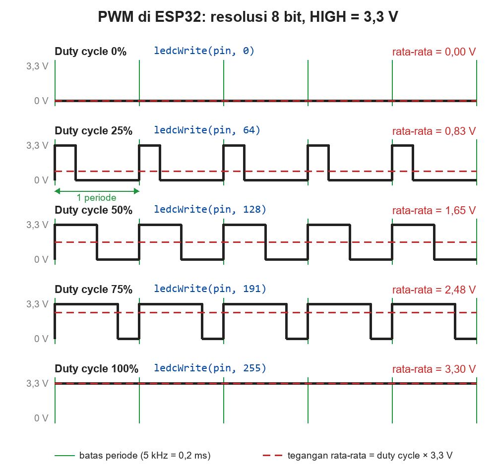
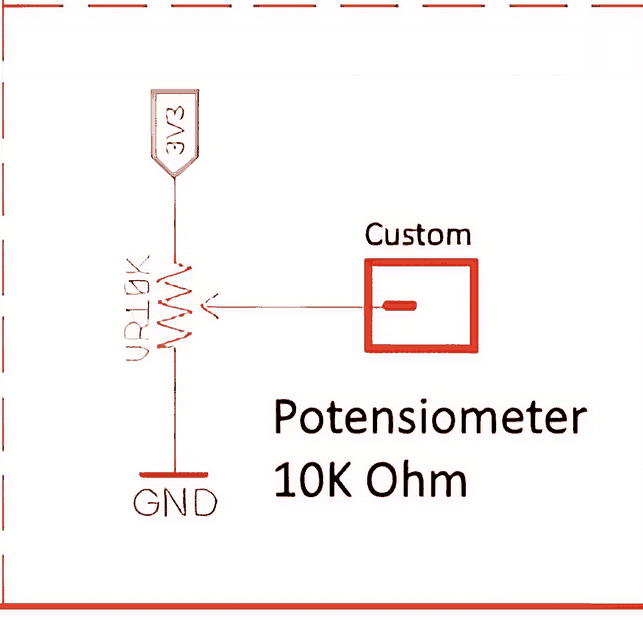
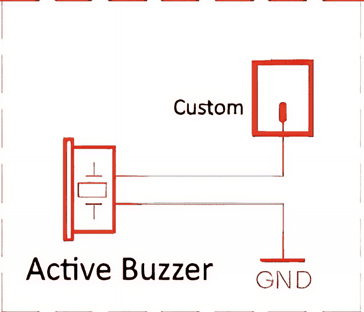

# BAB 12: PWM dengan LEDC

> ✅ **Prasyarat:** Selesaikan **BAB 8 (Digital Output — LED & Buzzer)** — kamu sudah bisa menyambung LED dan *buzzer* kit dengan kabel *jumper*. Program 5 memakai potensiometer dari **BAB 11 (Analog Input & ADC)**, dan Program 6 memakai fungsi *callback* yang mirip ISR di **BAB 10 (Interrupt & ISR)**.

Di BAB 8, pin output ESP32 hanya punya dua keadaan: HIGH (menyala) atau LOW (mati). Lalu bagaimana membuat LED menyala setengah terang, atau perlahan meredup seperti lampu tidur? Caranya: nyalakan dan matikan pin itu ribuan kali per detik, lalu atur perbandingan lama nyala dan lama matinya. Teknik ini disebut **PWM**, dan dipakai di mana-mana: peredup lampu, pengatur kecepatan kipas laptop, motor, sampai servo. Di ESP32, PWM dibuat oleh bagian khusus bernama **LEDC**.

## 📌 Tujuan Pembelajaran

Setelah mempelajari BAB ini, kamu bisa:

- Menjelaskan cara kerja PWM serta arti *duty cycle*, frekuensi, periode, dan resolusi.
- Mengubah persentase kecerahan menjadi nilai *duty* dan memperkirakan tegangan rata-ratanya.
- Memakai fungsi LEDC esp32 core 3.x: `ledcAttach()`, `ledcWrite()`, `ledcChangeFrequency()`, `ledcWriteTone()`, dan `ledcFadeWithInterrupt()`.
- Memilih pasangan frekuensi dan resolusi yang bisa dibuat ESP32 (frekuensi × 2<sup>resolusi</sup> ≤ 80 MHz).
- Membuat efek LED bertingkat, bernapas, berjalan halus, dan *dimmer* (peredup) dengan potensiometer.
- Menjelaskan beda *buzzer* aktif (yang ada di kit) dan *buzzer* pasif, serta apa yang bisa dan tidak bisa dilakukan PWM pada *buzzer* aktif.

## 🧰 Yang Perlu Disiapkan

| Kebutuhan | Keterangan |
|---|---|
| *Hardware* | Kit Bluino ESP32 IoT Starter Shield (ESP32 DEVKIT V1 sudah terpasang di kit) + kabel USB **data** |
| Kabel *jumper* | 6 kabel *female-female* (4 untuk LED, 1 untuk potensiometer, 1 untuk *buzzer*) — sudah ada di kit |
| Komponen tambahan | Tidak ada untuk Program 1–7. Opsional: modul *buzzer* pasif untuk Program 8 dan multimeter untuk mengukur tegangan rata-rata (keduanya tidak termasuk kit) |
| *Software* | Arduino IDE 2.x + *board package* **esp32** versi 3.3.x (lihat [BAB 5](../BAB-05/README.md)) |
| *Library* | Tidak perlu *library* tambahan — fungsi LEDC sudah bawaan *board package* esp32 |
| Alat uji | **Serial Monitor** Arduino IDE (baud 115200), ditambah mata dan telingamu untuk mengamati LED dan *buzzer* |
| Jaringan | Tidak perlu WiFi |

## 📑 Daftar Isi

- [12.1 Apa Itu PWM?](#121-apa-itu-pwm)
- [12.2 LEDC: Pembangkit PWM di ESP32](#122-ledc-pembangkit-pwm-di-esp32)
- [12.3 Menyiapkan Rangkaian](#123-menyiapkan-rangkaian)
- [12.4 Program 1: Kecerahan LED Bertingkat](#124-program-1-kecerahan-led-bertingkat)
- [12.5 Program 2: LED Bernapas](#125-program-2-led-bernapas)
- [12.6 Program 3: Dari Berkedip Menjadi Redup](#126-program-3-dari-berkedip-menjadi-redup)
- [12.7 Program 4: LED Berjalan Halus](#127-program-4-led-berjalan-halus)
- [12.8 Program 5: Dimmer dengan Potensiometer](#128-program-5-dimmer-dengan-potensiometer)
- [12.9 Program 6: Fade Otomatis dengan Hardware](#129-program-6-fade-otomatis-dengan-hardware)
- [12.10 Buzzer Aktif dan Buzzer Pasif](#1210-buzzer-aktif-dan-buzzer-pasif)
- [12.11 Program 7: Alarm Bip Makin Cepat](#1211-program-7-alarm-bip-makin-cepat)
- [12.12 Program 8 (Opsional): Melodi dengan Buzzer Pasif](#1212-program-8-opsional-melodi-dengan-buzzer-pasif)
- [12.13 PWM untuk Servo dan Motor](#1213-pwm-untuk-servo-dan-motor)
- [12.14 Troubleshooting](#1214-troubleshooting)
- [📝 Rangkuman](#-rangkuman)
- [💪 Latihan](#-latihan)
- [📚 Referensi](#-referensi)

---

## 12.1 Apa Itu PWM?

**PWM** (*Pulse Width Modulation*, modulasi lebar pulsa) adalah cara membuat keluaran "setengah-setengah" hanya dengan HIGH dan LOW. Pin dibuat HIGH dan LOW bergantian dengan sangat cepat. Kalau dalam setiap kedipan pin lebih lama HIGH, LED tampak lebih terang; kalau lebih lama LOW, LED tampak lebih redup.

Bayangkan kipas angin yang tombolnya kamu tekan nyala-mati bergantian dengan cepat. Baling-balingnya tidak sempat berhenti, jadi berputar dengan kecepatan "tengah-tengah". Makin lama bagian "nyala" dibanding bagian "mati", makin kencang putarannya. PWM bekerja persis seperti itu, hanya saja ESP32 menekan "tombolnya" ribuan kali per detik.

### 12.1.1 Duty Cycle dan Tegangan Rata-Rata

Satu kali pola "HIGH lalu LOW" disebut satu **periode**. ***Duty cycle*** (siklus kerja) adalah persentase waktu HIGH dalam satu periode:

```text
duty cycle = (lama HIGH ÷ lama satu periode) × 100%
```



*Gambar 12.1 — Sinyal PWM dengan berbagai duty cycle. Garis hijau menandai batas setiap periode, garis merah putus-putus adalah tegangan rata-ratanya. Sumber: dibuat untuk materi ini.*

| *Duty cycle* | Lama HIGH dalam 1 periode (frekuensi 5 kHz) | Tegangan rata-rata | Kesan pada LED |
|---|---|---|---|
| 0% | 0 µs (selalu LOW) | 0 V | Mati |
| 25% | 50 µs dari 200 µs | ±0,83 V | Redup |
| 50% | 100 µs dari 200 µs | ±1,65 V | Sedang |
| 75% | 150 µs dari 200 µs | ±2,48 V | Terang |
| 100% | 200 µs (selalu HIGH) | 3,3 V | Paling terang |

Satuan µs (mikrodetik) artinya sepersejuta detik. Tegangan rata-ratanya mudah dihitung: **tegangan rata-rata = *duty cycle* × 3,3 V**. Contoh: 25% × 3,3 V ≈ 0,83 V.

> 📌 **Catatan:** LED sebenarnya tidak pernah "setengah menyala". Dalam setiap periode, LED menyala penuh lalu mati total. Kedipannya terlalu cepat untuk diikuti mata, sehingga yang kita lihat adalah **rata-rata** cahayanya. Kalau kamu punya multimeter, mode V⎓ (lihat [BAB 3](../BAB-03/README.md)) juga menampilkan tegangan rata-rata ini saat probe merah ditempel ke pin PWM dan probe hitam ke GND.

Mata manusia juga tidak menilai kecerahan secara lurus (linear). LED dengan *duty cycle* 50% terlihat jauh lebih terang daripada "setengahnya", dan perubahan paling terasa justru di bagian redup (*duty cycle* kecil). Kamu akan melihatnya sendiri di Program 1 dan Program 2.

### 12.1.2 Frekuensi dan Periode

**Frekuensi** adalah berapa kali pola HIGH–LOW berulang dalam satu detik, satuannya hertz (Hz); 1 kHz (kilohertz) sama dengan seribu hertz. **Periode** adalah lama satu pola, yaitu 1 ÷ frekuensi. Contoh: frekuensi 5 kHz → periode 1 ÷ 5.000 detik = 0,2 ms = 200 µs.

| Frekuensi (*duty cycle* 50%) | Periode | Yang terlihat pada LED |
|---|---|---|
| 1 Hz | 1 detik | Berkedip pelan: 0,5 detik menyala, 0,5 detik mati |
| 10 Hz | 100 ms | Berkedip cepat |
| 50 Hz | 20 ms | Hampir stabil, tetapi mungkin masih tampak bergetar |
| 100 Hz ke atas | 10 ms atau kurang | Menyala stabil dengan kecerahan "setengah" |
| 5 kHz (dipakai di BAB ini) | 0,2 ms | Menyala stabil |

Jadi untuk LED, **kecerahan diatur oleh *duty cycle***, sedangkan **frekuensi cukup dibuat tinggi** supaya kedipannya tidak terlihat. Kamu bisa membuktikannya sendiri di [Program 3](#126-program-3-dari-berkedip-menjadi-redup).

> 💡 **Tips:** Kamera HP kadang bisa "melihat" kedipan PWM yang tidak terlihat oleh mata. Saat merekam LED yang sedang diredupkan, mungkin muncul garis-garis atau kedipan di layar HP. Itu normal.

### 12.1.3 Resolusi

**Resolusi** menentukan berapa banyak pilihan tingkat *duty cycle*. Satuannya bit. Resolusi 8 bit berarti ada 2<sup>8</sup> = 256 tingkat, yaitu **nilai *duty*** (angka yang kamu kirim ke `ledcWrite()`) 0 sampai 255. Ibarat tangga: makin banyak anak tangganya, makin halus langkah naiknya.

| Resolusi | Jumlah tingkat | Rentang nilai *duty* | Nilai untuk 25% | Nilai untuk 50% |
|---|---|---|---|---|
| 8 bit | 256 | 0–255 | 64 | 128 |
| 10 bit | 1.024 | 0–1023 | 256 | 512 |
| 12 bit | 4.096 | 0–4095 | 1024 | 2048 |
| 16 bit | 65.536 | 0–65535 | 16384 | 32768 |

Cara menghitungnya: **nilai *duty* = persen × nilai maksimum ÷ 100**, lalu dibulatkan. Contoh untuk 25% pada resolusi 8 bit: 25 × 255 ÷ 100 = 63,75 → dibulatkan menjadi 64.

> 📌 **Catatan:** Nilai maksimum (misalnya 255 pada resolusi 8 bit) membuat pin **selalu HIGH**, alias 100%. Nilai yang lebih besar dari maksimum juga dianggap 100%.

Resolusi 8 bit sudah cukup untuk kebanyakan efek LED. Resolusi lebih tinggi berguna kalau kamu butuh langkah yang sangat halus, misalnya saat LED hampir padam, atau supaya angkanya cocok dengan sumber data lain (contohnya nilai ADC 12 bit di Program 5).

---

## 12.2 LEDC: Pembangkit PWM di ESP32

ESP32 punya periferal (bagian *hardware* khusus di dalam chip yang bisa bekerja sendiri) bernama **LEDC** (*LED Control*). Setelah diatur, LEDC terus membuat sinyal PWM tanpa perlu diurus program, sehingga CPU bebas mengerjakan hal lain. Walaupun namanya *LED Control*, LEDC bisa dipakai untuk apa saja yang butuh PWM: *buzzer*, servo, atau motor (lewat *driver*).

| Spesifikasi LEDC pada ESP32 | Nilai |
|---|---|
| Jumlah *channel* (saluran PWM) | 16 — bisa membuat 16 sinyal PWM sekaligus |
| Jumlah *timer* (pengatur frekuensi dan resolusi) | 8, dalam dua kelompok yang masing-masing berisi 4 |
| Resolusi | 1–20 bit |
| Frekuensi | Dari di bawah 1 Hz sampai 40 MHz, bergantung pada resolusi (lihat [12.2.2](#1222-batas-frekuensi-dan-resolusi)) |
| Pin yang bisa dipakai | Semua GPIO yang boleh dipakai sebagai output (lihat [BAB 6](../BAB-06/README.md)) — **tidak** termasuk IO34–IO39 karena keenam pin itu hanya bisa input |

Setiap pin yang ber-PWM memakai satu *channel*. Frekuensi dan resolusinya diatur oleh *timer*; beberapa *channel* dengan frekuensi dan resolusi yang sama boleh berbagi satu *timer*. Di esp32 core 3.x kamu tidak perlu memilih nomor *channel* sendiri — `ledcAttach()` memilihkannya otomatis.

> 📌 **Catatan:** Kalau kamu pernah memakai Arduino Uno, fungsi `analogWrite(pin, nilai)` juga tersedia di esp32 core 3.x. Di balik layar fungsi itu memakai LEDC dengan pengaturan bawaan 1 kHz dan 8 bit. Di BAB ini kita memakai fungsi LEDC secara langsung supaya frekuensi dan resolusinya terlihat jelas. Jangan mencampur `analogWrite()` dan `ledcAttach()` pada pin yang sama.

### 12.2.1 Fungsi LEDC di Core 3.x

| Fungsi | Gunanya | Hasil yang dikembalikan |
|---|---|---|
| `ledcAttach(pin, frekuensi, resolusi)` | Menyambungkan pin ke LEDC (cukup sekali, di `setup()`) | `true` kalau berhasil, `false` kalau gagal |
| `ledcWrite(pin, duty)` | Mengatur *duty cycle* | `true` kalau berhasil |
| `ledcChangeFrequency(pin, frekuensi, resolusi)` | Mengganti frekuensi dan resolusi saat program berjalan | Frekuensi yang benar-benar dipakai; 0 kalau gagal |
| `ledcWriteTone(pin, frekuensi)` | Membuat sinyal *duty cycle* 50% dengan frekuensi tertentu, misalnya untuk nada *buzzer* pasif. Frekuensi 0 = diam | Frekuensi yang dipakai; 0 kalau gagal atau diam |
| `ledcWriteNote(pin, nada, oktaf)` | Seperti `ledcWriteTone()`, tetapi memakai nama nada (`NOTE_C`, `NOTE_D`, dan seterusnya) | Frekuensi yang dipakai |
| `ledcFade(pin, dutyAwal, dutyAkhir, lamaMs)` | Mengubah *duty* perlahan secara otomatis oleh *hardware* | `true` kalau berhasil |
| `ledcFadeWithInterrupt(pin, dutyAwal, dutyAkhir, lamaMs, fungsi)` | Sama seperti `ledcFade()`, lalu memanggil `fungsi` saat selesai | `true` kalau berhasil |
| `ledcDetach(pin)` | Melepas pin dari LEDC supaya bisa dipakai untuk hal lain | `true` kalau berhasil |

Contoh potongan kode (bukan program lengkap):

```cpp
#define LED_MERAH 4

ledcAttach(LED_MERAH, 5000, 8);  // di setup(): IO4 menjadi PWM 5 kHz, resolusi 8 bit
ledcWrite(LED_MERAH, 128);       // duty 128 dari 255 → ±50%, LED setengah terang
ledcWrite(LED_MERAH, 0);         // duty 0 → LED mati
```

Perhatikan bahwa **tidak ada `pinMode()`**: `ledcAttach()` sudah sekaligus menyiapkan pin sebagai output.

> ⚠️ **Perhatian:** Banyak tutorial lama di internet ditulis untuk esp32 core 2.x dan memakai `ledcSetup(channel, frekuensi, resolusi)` + `ledcAttachPin(pin, channel)`, lalu `ledcWrite(channel, duty)`. Di core 3.x kedua fungsi pertama **sudah dihapus**, sehingga muncul *error* `'ledcSetup' was not declared in this scope`. Ganti dengan `ledcAttach(pin, frekuensi, resolusi)`, dan ingat bahwa `ledcWrite()` sekarang menerima nomor **pin**, bukan nomor *channel*.

> ⚠️ **Perhatian:** Setelah sebuah pin dipakai LEDC, jangan memakai `digitalWrite()` atau `pinMode()` pada pin itu. `digitalWrite()` tidak akan berpengaruh apa-apa, sedangkan `pinMode()` justru memutus PWM-nya. Untuk mematikan LED, pakai `ledcWrite(pin, 0)`.

### 12.2.2 Batas Frekuensi dan Resolusi

LEDC menghitung waktu dengan detak (*clock*) internal sebesar **80 MHz**, artinya 80 juta ketukan per detik. Dalam satu periode PWM, *timer* LEDC harus menghitung sebanyak 2<sup>resolusi</sup> langkah. Karena itu berlaku aturan:

```text
frekuensi × 2^resolusi  ≤  80.000.000
```

Makin tinggi resolusi, makin rendah frekuensi maksimumnya — dan sebaliknya:

| Resolusi | Jumlah langkah per periode | Frekuensi maksimum (80 MHz ÷ 2<sup>resolusi</sup>) |
|---|---|---|
| 1 bit | 2 | 40 MHz |
| 8 bit | 256 | 312,5 kHz |
| 10 bit | 1.024 | ±78 kHz |
| 12 bit | 4.096 | ±19,5 kHz |
| 13 bit | 8.192 | ±9,8 kHz |
| 14 bit | 16.384 | ±4,9 kHz |
| 16 bit | 65.536 | ±1,2 kHz |
| 20 bit | 1.048.576 | ±76 Hz |

**Cara memilih:** tentukan frekuensinya dulu, lalu cari resolusi terbesar yang masih memenuhi aturan. Contoh untuk 5 kHz: 80.000.000 ÷ 5.000 = 16.000. Bilangan 2<sup>13</sup> = 8.192 masih di bawah 16.000, sedangkan 2<sup>14</sup> = 16.384 sudah melewatinya. Jadi pada 5 kHz resolusi maksimumnya **13 bit**. Kombinasi yang dipakai di BAB ini (5 kHz dengan 8, 10, atau 12 bit) semuanya aman.

Kalau kombinasinya tidak mungkin, `ledcAttach()` mengembalikan `false` dan PWM tidak berjalan. Serial Monitor mungkin juga menampilkan pesan bawaan seperti `E (...) ledc: requested frequency 5000 and duty resolution 14 can not be achieved, try reducing freq_hz or duty_resolution`. Karena itu, semua program di BAB ini memeriksa hasil `ledcAttach()` dan mencetak pesan yang jelas kalau gagal.

<details>
<summary><b>🔬 Pendalaman (opsional): batas frekuensi terendah dan pembagian timer</b></summary>

- **Frekuensi terendah.** *Timer* LEDC hanya bisa memperlambat *clock*-nya sampai ±1.024 kali. Untuk frekuensi yang sangat rendah, ESP32 otomatis memakai *clock* lain yang lebih lambat (REF_TICK, 1 MHz). Batas bawahnya kira-kira 1.000.000 ÷ (1.024 × 2<sup>resolusi</sup>) Hz, sehingga resolusi kecil justru menaikkan batas bawah. Contoh: 1 Hz butuh resolusi minimal 10 bit, sedangkan pada 8 bit frekuensi terendahnya ±4 Hz.
- **Pembagian *timer*.** ESP32 punya 2 kelompok *channel* (0–7 dan 8–15), dan setiap kelompok punya 4 *timer*. Pin yang di-*attach* dengan frekuensi **dan** resolusi yang sama biasanya memakai *timer* yang sama. Akibatnya, `ledcChangeFrequency()` atau `ledcWriteTone()` pada satu pin ikut mengubah pin lain yang berbagi *timer*. Kalau dua pin harus punya frekuensi berbeda, *attach* keduanya dengan frekuensi berbeda sejak awal.
- **Memilih *channel* sendiri.** Kalau benar-benar perlu, pakai `ledcAttachChannel(pin, frekuensi, resolusi, channel)`.

</details>

---

## 12.3 Menyiapkan Rangkaian

Semua program di BAB ini memakai komponen yang sudah ada di kit, dengan Peta Pin Standar yang sama seperti di [BAB 8](../BAB-08/README.md) dan [BAB 11](../BAB-11/README.md). Kamu bisa memasang semua kabelnya sekarang dan membiarkannya terpasang sampai akhir BAB:

| Pin **Custom** di kit | Sambungkan ke pin ESP32 | Letak pin ESP32 | Dipakai di |
|---|---|---|---|
| LED1 (merah) | IO4 (label `4`) | Deretan bawah | Program 1–6 |
| LED2 (hijau) | IO17 (label `17`) | Deretan bawah | Program 4 |
| LED3 (biru) | IO2 (label `2`) | Deretan bawah | Program 4 dan 6 |
| LED4 (kuning) | IO16 (label `16`) | Deretan bawah | Program 4 |
| VR10K (potensiometer) | IO34 (label `34`) | Deretan atas | Program 5 |
| BUZZ (*buzzer* aktif) | IO13 (label `13`) | Deretan atas | Program 7 |

Letak *header* LED, pin BUZZ, dan kedua deretan pin ESP32 bisa kamu lihat di [Gambar 8.2 pada BAB 8](../BAB-08/README.md#822-menyambungkan-kabel-jumper). Pin Custom potensiometer (VR10K) ada di deretan pin kuning di dekat tombol SW1 dan SW2.


*Gambar 12.2 — Rangkaian 4 LED pada kit: setiap LED punya resistor 330 Ω ke GND, jadi LED menyala saat pin HIGH. Sumber: skematik ESP32 Starter Shield 3.2, [Bluino](http://www.bluino.com).*

> 📌 **Catatan:** Ingat dari BAB 8: nomor LED **tidak** urut dengan nomor pin. Yang menentukan adalah warnanya — merah → IO4, kuning → IO16, hijau → IO17, biru → IO2. IO2 juga tersambung ke LED biru kecil bawaan *board*, jadi LED itu ikut menyala dan meredup bersama LED biru kit.

> 💡 **Tips:** Cabut kabel USB setiap kali memasang atau memindahkan kabel *jumper*. Pasang kembali setelah semua kabel dicek.

---

## 12.4 Program 1: Kecerahan LED Bertingkat

**Tujuan:** Menyalakan LED merah dengan *duty cycle* 0%, 10%, 25%, 50%, 75%, lalu 100%, masing-masing selama 2 detik. Kamu bisa melihat langsung hubungan antara persentase, nilai *duty*, dan kecerahan LED.

**Rangkaian:**

| Pin **Custom** di kit | Sambungkan ke pin ESP32 |
|---|---|
| LED1 (LED merah) | IO4 |

**Cara Menjalankan:**

1. Sambungkan kabel *jumper* sesuai tabel **Rangkaian** di atas (lihat juga [12.3](#123-menyiapkan-rangkaian)).
2. Buka Arduino IDE → **File → New Sketch**, hapus isinya, lalu salin kode di bawah. Kode yang sama juga tersedia di file [`p1_kecerahan_bertingkat.ino`](p1_kecerahan_bertingkat/p1_kecerahan_bertingkat.ino).
3. Pastikan **Tools → Board** = **ESP32 Dev Module** dan **Tools → Port** = *port* ESP32 kamu (misalnya `COM5` di Windows atau `/dev/ttyUSB0` di Linux).
4. Klik tombol **Upload** (ikon panah →) dan tunggu sampai muncul tulisan **Done uploading**.
5. Buka **Serial Monitor** (**Tools → Serial Monitor**) lalu pilih baud **115200**.

**Kode Program:**

<!-- sketch: p1_kecerahan_bertingkat -->
```cpp
/*
 * BAB 12 - Program 1: Kecerahan LED Bertingkat
 * LED merah menyala dengan duty cycle 0%, 10%, 25%, 50%, 75%, dan 100%,
 * masing-masing selama 2 detik, lalu mengulang dari awal.
 *
 * Rangkaian: LED1 (merah) di header LED → IO4
 */

#define LED_MERAH 4  // LED merah → IO4

const uint32_t FREKUENSI = 5000;  // 5 kHz: kedipannya terlalu cepat untuk terlihat mata
const uint8_t RESOLUSI = 8;       // 8 bit → nilai duty 0–255
const int DUTY_MAKS = 255;        // nilai duty terbesar pada resolusi 8 bit

const int DAFTAR_PERSEN[] = {0, 10, 25, 50, 75, 100};
const int JUMLAH_LANGKAH = sizeof(DAFTAR_PERSEN) / sizeof(DAFTAR_PERSEN[0]);

void setup() {
  Serial.begin(115200);
  Serial.println("BAB 12 - Program 1: Kecerahan LED Bertingkat");

  // Sambungkan IO4 ke LEDC: frekuensi 5 kHz, resolusi 8 bit
  if (!ledcAttach(LED_MERAH, FREKUENSI, RESOLUSI)) {
    Serial.println("Gagal mengatur PWM di IO4! Periksa frekuensi dan resolusi.");
    while (true) {
      delay(1000);  // program berhenti di sini
    }
  }
}

void loop() {
  for (int i = 0; i < JUMLAH_LANGKAH; i++) {
    int persen = DAFTAR_PERSEN[i];
    int duty = round(persen * DUTY_MAKS / 100.0);  // ubah persen menjadi nilai duty

    ledcWrite(LED_MERAH, duty);  // LEDC terus membuat PWM dengan duty ini

    Serial.print("Duty cycle ");
    Serial.print(persen);
    Serial.print("% -> nilai duty ");
    Serial.print(duty);
    Serial.println(" dari 255");

    delay(2000);  // tahan 2 detik supaya sempat diamati
  }
}
```

**Penjelasan Kode:**

- `FREKUENSI` dan `RESOLUSI` disimpan sebagai konstanta di bagian atas supaya mudah diubah. Tipe `uint32_t` dan `uint8_t` artinya bilangan bulat tanpa tanda minus berukuran 32 bit dan 8 bit — sama dengan tipe yang diminta `ledcAttach()`.
- `ledcAttach()` mengembalikan `true` kalau berhasil. Tanda `!` artinya "tidak", jadi `if (!ledcAttach(...))` berarti "kalau `ledcAttach()` gagal". Program lalu mencetak pesan dan berhenti di perulangan `while (true)` yang tidak pernah selesai, supaya kamu tidak bingung melihat LED yang tidak menyala tanpa penjelasan.
- `round(persen * DUTY_MAKS / 100.0)` menerapkan rumus di [12.1.3](#1213-resolusi). Angka `100.0` (dengan titik desimal) membuat pembagiannya menghasilkan pecahan, lalu `round()` membulatkannya. Contoh: 10 × 255 ÷ 100 = 25,5 → dibulatkan menjadi 26.
- `ledcWrite(LED_MERAH, duty)` cukup dipanggil sekali untuk setiap tingkat. Setelah itu LEDC terus membuat sinyal PWM sendiri, sehingga LED tetap menyala dengan kecerahan itu selama `delay(2000)`.

**Contoh Output:**

```text
BAB 12 - Program 1: Kecerahan LED Bertingkat
Duty cycle 0% -> nilai duty 0 dari 255
Duty cycle 10% -> nilai duty 26 dari 255
Duty cycle 25% -> nilai duty 64 dari 255
Duty cycle 50% -> nilai duty 128 dari 255
Duty cycle 75% -> nilai duty 191 dari 255
Duty cycle 100% -> nilai duty 255 dari 255
Duty cycle 0% -> nilai duty 0 dari 255
```

Di kit: LED merah mati selama 2 detik, lalu menyala makin terang setiap 2 detik sampai paling terang, kemudian mati lagi dan mengulang. Perhatikan bahwa lompatan dari 0% ke 10% terasa sangat jelas, sedangkan 75% dan 100% hampir sama terangnya. Itulah sifat mata yang tidak linear (lihat [12.1.1](#1211-duty-cycle-dan-tegangan-rata-rata)).

> 🧪 **Coba Sendiri:** Ganti isi `DAFTAR_PERSEN[]` menjadi `{0, 1, 2, 5, 10, 20}`, lalu *upload* ulang. Tingkat kecerahan di bagian redup ternyata masih mudah dibedakan.

**Kalau Belum Berhasil:**

- **Serial Monitor menampilkan pesan, tetapi LED tidak menyala** → kabel *jumper* belum tertancap di pin yang benar. Cek ujung di pin **LED1** dan ujung di pin berlabel **4** di deretan bawah.
- **Muncul tulisan `Gagal mengatur PWM di IO4!`** → kombinasi `FREKUENSI` dan `RESOLUSI` yang kamu ubah tidak mungkin dibuat (lihat [12.2.2](#1222-batas-frekuensi-dan-resolusi)). Kembalikan ke 5000 dan 8.
- ***Error* `'ledcAttach' was not declared in this scope` saat *compile*** → *board package* esp32 yang terpasang masih versi 2.x, atau *board* yang dipilih bukan ESP32. Perbarui ke versi 3.3.x lewat **Boards Manager** (lihat [BAB 5](../BAB-05/README.md)) dan pilih **ESP32 Dev Module**.

---

## 12.5 Program 2: LED Bernapas

**Tujuan:** Membuat LED merah perlahan makin terang, lalu perlahan meredup, berulang terus seperti orang bernapas (*breathing*). Efek ini sering dipakai sebagai lampu indikator "siaga" pada laptop atau pengisi daya.

**Rangkaian:**

| Pin **Custom** di kit | Sambungkan ke pin ESP32 |
|---|---|
| LED1 (LED merah) | IO4 |

**Cara Menjalankan:**

1. Biarkan kabel *jumper* seperti pada Program 1.
2. Buka Arduino IDE → **File → New Sketch**, hapus isinya, lalu salin kode di bawah. Kode yang sama juga tersedia di file [`p2_led_bernapas.ino`](p2_led_bernapas/p2_led_bernapas.ino).
3. Pastikan **Tools → Board** = **ESP32 Dev Module** dan **Tools → Port** = *port* ESP32 kamu.
4. Klik tombol **Upload** dan tunggu sampai muncul tulisan **Done uploading**.
5. Buka **Serial Monitor** (**Tools → Serial Monitor**) lalu pilih baud **115200**.

**Kode Program:**

<!-- sketch: p2_led_bernapas -->
```cpp
/*
 * BAB 12 - Program 2: LED Bernapas
 * LED merah perlahan makin terang (fade in), lalu perlahan meredup (fade out),
 * berulang terus.
 *
 * Rangkaian: LED1 (merah) di header LED → IO4
 */

#define LED_MERAH 4  // LED merah → IO4

const uint32_t FREKUENSI = 5000;  // 5 kHz
const uint8_t RESOLUSI = 8;       // nilai duty 0–255
const int JEDA_MS = 8;            // jeda setiap langkah; makin kecil, napasnya makin cepat

void setup() {
  Serial.begin(115200);
  Serial.println("BAB 12 - Program 2: LED Bernapas");

  if (!ledcAttach(LED_MERAH, FREKUENSI, RESOLUSI)) {
    Serial.println("Gagal mengatur PWM di IO4! Periksa frekuensi dan resolusi.");
    while (true) {
      delay(1000);
    }
  }
}

void loop() {
  Serial.println("Makin terang...");
  for (int duty = 0; duty <= 255; duty++) {   // fade in: 0, 1, 2, ..., 255
    ledcWrite(LED_MERAH, duty);
    delay(JEDA_MS);
  }

  Serial.println("Makin redup...");
  for (int duty = 255; duty >= 0; duty--) {   // fade out: 255, 254, ..., 0
    ledcWrite(LED_MERAH, duty);
    delay(JEDA_MS);
  }

  delay(500);  // istirahat sebentar dalam keadaan mati
}
```

**Penjelasan Kode:**

- Perulangan pertama menaikkan *duty* dari 0 sampai 255, satu langkah setiap 8 ms. Totalnya 256 langkah × 8 ms ≈ 2 detik untuk "menarik napas".
- Perulangan kedua menurunkan *duty* dari 255 sampai 0 dengan kecepatan yang sama, lalu LED beristirahat 0,5 detik. Satu kali napas lengkap ≈ 2 + 2 + 0,5 = 4,5 detik.
- `duty++` artinya "tambah 1", sedangkan `duty--` artinya "kurangi 1".
- Variabel `duty` sengaja memakai tipe `int`. Kalau diganti `uint8_t` (bilangan 0–255), syarat `duty <= 255` selalu benar karena setelah 255 nilainya kembali ke 0, sehingga perulangan tidak pernah berhenti.
- Selama perulangan berjalan, ESP32 sibuk menunggu `delay()`. Di [Program 6](#129-program-6-fade-otomatis-dengan-hardware) kamu akan melihat cara membuat efek yang sama tanpa membuat program sibuk.

**Contoh Output:**

```text
BAB 12 - Program 2: LED Bernapas
Makin terang...
Makin redup...
Makin terang...
Makin redup...
```

Di kit: LED merah perlahan menyala sampai paling terang dalam ±2 detik, lalu perlahan padam dalam ±2 detik, diam sebentar, dan mengulang. Satu baris baru muncul di Serial Monitor setiap kali arah perubahannya berganti. Kamu mungkin merasa LED cepat sekali menjadi terang lalu "tertahan" lama di bagian terang — lagi-lagi karena mata lebih peka pada perubahan di bagian redup. Cara mengakalinya ada di [Latihan](#-latihan) nomor 5.

> 🧪 **Coba Sendiri:** Ubah `JEDA_MS` menjadi `3` (napas cepat) dan `20` (napas lambat). Berapa lama satu kali napas untuk masing-masing nilai?

**Kalau Belum Berhasil:**

- **LED tidak menyala sama sekali, tetapi tulisan muncul** → periksa kabel LED1 → **4**.
- **Program macet setelah tulisan `Makin terang...`** → tipe variabel `duty` diubah menjadi `uint8_t` atau `byte`. Kembalikan ke `int`.
- **LED berkedip-kedip, bukan meredup halus** → nilai `FREKUENSI` diubah menjadi terlalu kecil (di bawah ±100 Hz). Kembalikan ke 5000.

---

## 12.6 Program 3: Dari Berkedip Menjadi Redup

**Tujuan:** Membuktikan bahwa PWM sebenarnya adalah kedipan. *Duty cycle* dibuat tetap 50%, sedangkan frekuensinya dinaikkan bertahap dari 1 Hz sampai 1 kHz (1000 Hz). Pada frekuensi rendah LED terlihat berkedip; pada frekuensi tinggi kedipan itu "melebur" menjadi cahaya redup yang stabil.

**Rangkaian:**

| Pin **Custom** di kit | Sambungkan ke pin ESP32 |
|---|---|
| LED1 (LED merah) | IO4 |

**Cara Menjalankan:**

1. Biarkan kabel *jumper* seperti pada Program 1.
2. Buka Arduino IDE → **File → New Sketch**, hapus isinya, lalu salin kode di bawah. Kode yang sama juga tersedia di file [`p3_berkedip_jadi_redup.ino`](p3_berkedip_jadi_redup/p3_berkedip_jadi_redup.ino).
3. Pastikan **Tools → Board** = **ESP32 Dev Module** dan **Tools → Port** = *port* ESP32 kamu.
4. Klik tombol **Upload** dan tunggu sampai muncul tulisan **Done uploading**.
5. Buka **Serial Monitor** (**Tools → Serial Monitor**) lalu pilih baud **115200**. Amati LED setiap kali baris baru muncul.

**Kode Program:**

<!-- sketch: p3_berkedip_jadi_redup -->
```cpp
/*
 * BAB 12 - Program 3: Dari Berkedip Menjadi Redup
 * Duty cycle tetap 50%, tetapi frekuensi PWM dinaikkan bertahap dari 1 Hz
 * sampai 1000 Hz. Pada frekuensi rendah LED terlihat berkedip; pada frekuensi
 * tinggi LED terlihat menyala stabil dengan kecerahan setengah.
 *
 * Rangkaian: LED1 (merah) di header LED → IO4
 */

#define LED_MERAH 4  // LED merah → IO4

const uint8_t RESOLUSI = 10;         // 10 bit → nilai duty 0–1023 (cukup untuk frekuensi 1 Hz)
const uint32_t DUTY_SETENGAH = 512;  // 512 dari 1024 tingkat = 50%
const uint32_t DAFTAR_FREKUENSI[] = {1, 2, 5, 10, 25, 50, 100, 1000};
const int JUMLAH_LANGKAH = sizeof(DAFTAR_FREKUENSI) / sizeof(DAFTAR_FREKUENSI[0]);
const unsigned long LAMA_AMATI_MS = 4000;  // lama mengamati setiap frekuensi

void setup() {
  Serial.begin(115200);
  Serial.println("BAB 12 - Program 3: Dari Berkedip Menjadi Redup");

  // Mulai dari frekuensi pertama di daftar (1 Hz)
  if (!ledcAttach(LED_MERAH, DAFTAR_FREKUENSI[0], RESOLUSI)) {
    Serial.println("Gagal mengatur PWM di IO4! Periksa frekuensi dan resolusi.");
    while (true) {
      delay(1000);
    }
  }
}

void loop() {
  for (int i = 0; i < JUMLAH_LANGKAH; i++) {
    // Ganti frekuensi. Hasilnya = frekuensi yang benar-benar dipakai (0 = gagal)
    uint32_t frekuensi = ledcChangeFrequency(LED_MERAH, DAFTAR_FREKUENSI[i], RESOLUSI);
    if (frekuensi == 0) {
      Serial.println("Gagal mengganti frekuensi!");
      continue;  // lewati frekuensi ini
    }
    ledcWrite(LED_MERAH, DUTY_SETENGAH);  // duty cycle tetap 50%

    float periodeMs = 1000.0 / frekuensi;  // periode = 1 ÷ frekuensi, dalam milidetik

    Serial.print("Frekuensi ");
    Serial.print(frekuensi);
    Serial.print(" Hz -> menyala ");
    Serial.print(periodeMs / 2, 1);
    Serial.print(" ms, mati ");
    Serial.print(periodeMs / 2, 1);
    Serial.println(" ms");

    delay(LAMA_AMATI_MS);
  }
}
```

**Penjelasan Kode:**

- Resolusinya 10 bit, bukan 8 bit, karena frekuensi serendah 1 Hz baru bisa dibuat mulai resolusi 10 bit (lihat bagian Pendalaman di [12.2.2](#1222-batas-frekuensi-dan-resolusi)). Pada 10 bit, *duty cycle* 50% = 512.
- `ledcChangeFrequency(pin, frekuensi, resolusi)` mengganti frekuensi tanpa perlu melepas dan memasang ulang pin. Fungsi ini mengembalikan frekuensi yang benar-benar dipakai, atau 0 kalau gagal. Kata `continue` melompati sisa isi perulangan dan langsung lanjut ke frekuensi berikutnya.
- Setelah frekuensi diganti, `ledcWrite()` dipanggil lagi untuk memastikan *duty cycle* tetap 50%.
- `periodeMs / 2` adalah lama LED menyala (dan lama mati) dalam satu periode, karena *duty cycle*-nya 50%. Angka `1` di `Serial.print(..., 1)` artinya tampilkan 1 angka di belakang titik desimal.

**Contoh Output:**

```text
BAB 12 - Program 3: Dari Berkedip Menjadi Redup
Frekuensi 1 Hz -> menyala 500.0 ms, mati 500.0 ms
Frekuensi 2 Hz -> menyala 250.0 ms, mati 250.0 ms
Frekuensi 5 Hz -> menyala 100.0 ms, mati 100.0 ms
Frekuensi 10 Hz -> menyala 50.0 ms, mati 50.0 ms
Frekuensi 25 Hz -> menyala 20.0 ms, mati 20.0 ms
Frekuensi 50 Hz -> menyala 10.0 ms, mati 10.0 ms
Frekuensi 100 Hz -> menyala 5.0 ms, mati 5.0 ms
Frekuensi 1000 Hz -> menyala 0.5 ms, mati 0.5 ms
```

Setiap frekuensi ditahan 4 detik, lalu daftar diulang dari 1 Hz. Yang terlihat di kit:

| Frekuensi | Yang biasanya terlihat |
|---|---|
| 1 Hz dan 2 Hz | LED berkedip jelas, bisa dihitung |
| 5 Hz dan 10 Hz | Berkedip cepat |
| 25 Hz | Bergetar (*flicker*), sulit dihitung |
| 50 Hz | Hampir stabil; sebagian orang masih melihat getaran halus |
| 100 Hz dan 1 kHz | Stabil, setengah terang — dan kecerahan keduanya sama |

Baris terakhir tabel itu penting: setelah kedipan tidak terlihat lagi, **menaikkan frekuensi tidak mengubah kecerahan**. Yang mengatur kecerahan adalah *duty cycle*.

> 🧪 **Coba Sendiri:** Saat frekuensinya 100 Hz, lirik dengan cepat dari kiri ke kanan melewati LED. Kamu mungkin melihat jejak cahaya yang putus-putus — bukti bahwa LED sebenarnya masih berkedip.

**Kalau Belum Berhasil:**

- **Muncul `Gagal mengatur PWM di IO4!` setelah kamu mengubah `RESOLUSI` menjadi 8** → pada resolusi 8 bit frekuensi terendahnya ±4 Hz, jadi 1 Hz dan 2 Hz tidak bisa dibuat. Kembalikan ke 10.
- **LED tidak pernah berkedip, langsung terlihat stabil** → mungkin baris pertama sudah lewat sebelum kamu sempat melihat. Tekan tombol **EN** di *board* untuk mengulang dari 1 Hz.
- **LED tidak menyala** → periksa kabel LED1 → **4**.

---

## 12.7 Program 4: LED Berjalan Halus

**Tujuan:** Membuat cahaya "berpindah" dengan halus dari satu LED ke LED di sebelahnya: LED yang sedang menyala perlahan meredup, sementara LED berikutnya perlahan makin terang. Program ini adalah versi PWM dari lampu berjalan di BAB 8, sekaligus menunjukkan bahwa setiap pin punya *duty cycle* sendiri.

**Rangkaian:**

| Pin **Custom** di kit | Sambungkan ke pin ESP32 |
|---|---|
| LED1 (merah) | IO4 |
| LED2 (hijau) | IO17 |
| LED3 (biru) | IO2 |
| LED4 (kuning) | IO16 |

**Cara Menjalankan:**

1. Sambungkan keempat kabel *jumper* sesuai tabel **Rangkaian** di atas.
2. Buka Arduino IDE → **File → New Sketch**, hapus isinya, lalu salin kode di bawah. Kode yang sama juga tersedia di file [`p4_led_berjalan_halus.ino`](p4_led_berjalan_halus/p4_led_berjalan_halus.ino).
3. Pastikan **Tools → Board** = **ESP32 Dev Module** dan **Tools → Port** = *port* ESP32 kamu.
4. Klik tombol **Upload** dan tunggu sampai muncul tulisan **Done uploading**.
5. Buka **Serial Monitor** (**Tools → Serial Monitor**) lalu pilih baud **115200**.

**Kode Program:**

<!-- sketch: p4_led_berjalan_halus -->
```cpp
/*
 * BAB 12 - Program 4: LED Berjalan Halus
 * Cahaya berpindah dengan halus dari satu LED ke LED di sebelahnya:
 * LED sekarang meredup sementara LED berikutnya makin terang.
 *
 * Rangkaian (header LED di kit → pin ESP32):
 *   LED1 (merah)  → IO4
 *   LED2 (hijau)  → IO17
 *   LED3 (biru)   → IO2
 *   LED4 (kuning) → IO16
 */

#define LED_MERAH  4
#define LED_KUNING 16
#define LED_HIJAU  17
#define LED_BIRU   2

// Urutan sesuai posisi LED di kit, dari kiri ke kanan
const int LED_PINS[] = {LED_MERAH, LED_HIJAU, LED_BIRU, LED_KUNING};
const char *NAMA_LED[] = {"merah", "hijau", "biru", "kuning"};
const int JUMLAH_LED = sizeof(LED_PINS) / sizeof(LED_PINS[0]);

const uint32_t FREKUENSI = 5000;  // keempat LED memakai frekuensi dan resolusi yang sama
const uint8_t RESOLUSI = 8;       // nilai duty 0–255
const int LANGKAH = 5;            // besar perubahan duty setiap langkah
const int JEDA_MS = 15;           // jeda setiap langkah

void setup() {
  Serial.begin(115200);
  Serial.println("BAB 12 - Program 4: LED Berjalan Halus");

  // Sambungkan keempat pin ke LEDC; setiap pin mendapat channel sendiri
  for (int i = 0; i < JUMLAH_LED; i++) {
    if (!ledcAttach(LED_PINS[i], FREKUENSI, RESOLUSI)) {
      Serial.print("Gagal mengatur PWM di IO");
      Serial.println(LED_PINS[i]);
    }
  }

  ledcWrite(LED_PINS[0], 255);  // mulai dengan LED merah menyala penuh
}

void loop() {
  for (int i = 0; i < JUMLAH_LED; i++) {
    int berikut = (i + 1) % JUMLAH_LED;  // LED di sebelahnya; setelah LED terakhir kembali ke 0

    Serial.print("Pindah dari LED ");
    Serial.print(NAMA_LED[i]);
    Serial.print(" ke LED ");
    Serial.println(NAMA_LED[berikut]);

    for (int duty = 0; duty <= 255; duty += LANGKAH) {
      ledcWrite(LED_PINS[berikut], duty);  // LED berikutnya makin terang
      ledcWrite(LED_PINS[i], 255 - duty);  // LED sekarang makin redup
      delay(JEDA_MS);
    }
  }
}
```

**Penjelasan Kode:**

- `LED_PINS[]` dan `NAMA_LED[]` sama seperti di BAB 8: urutannya mengikuti posisi LED di kit dari kiri ke kanan.
- Keempat pin di-*attach* dengan frekuensi dan resolusi yang sama. Setiap pin mendapat *channel* sendiri, sehingga *duty cycle*-nya bisa berbeda-beda, tetapi keempatnya cukup memakai satu *timer* bersama.
- Operator `%` menghasilkan **sisa bagi**. Untuk `i` = 3 (LED kuning), `(3 + 1) % 4` = 0, sehingga LED berikutnya adalah LED merah lagi dan putarannya tidak pernah berhenti.
- Di perulangan dalam, *duty* LED berikutnya naik dari 0 ke 255, sedangkan *duty* LED sekarang turun dari 255 ke 0 (`255 - duty`). Jumlah keduanya selalu 255, sehingga total cahayanya kira-kira tetap. Satu kali perpindahan = 52 langkah × 15 ms ≈ 0,8 detik.

**Contoh Output:**

```text
BAB 12 - Program 4: LED Berjalan Halus
Pindah dari LED merah ke LED hijau
Pindah dari LED hijau ke LED biru
Pindah dari LED biru ke LED kuning
Pindah dari LED kuning ke LED merah
Pindah dari LED merah ke LED hijau
```

Di kit: cahaya mengalir halus dari merah → hijau → biru → kuning, lalu melompat kembali ke merah dan mengulang. Saat perpindahan, dua LED menyala bersamaan dengan kecerahan setengah. LED hijau dan biru tampak lebih redup daripada merah dan kuning karena tegangan majunya lebih tinggi (lihat [BAB 8](../BAB-08/README.md#891-menghitung-arus-led)); itu normal.

> 🧪 **Coba Sendiri:** Ubah `JEDA_MS` menjadi `5` atau `40`, dan ubah `LANGKAH` menjadi `1`. Bagaimana pengaruhnya terhadap kehalusan dan kecepatan perpindahan?

**Kalau Belum Berhasil:**

- **Hanya sebagian LED yang menyala** → periksa kabel LED yang tidak menyala dan bandingkan dengan tabel **Rangkaian**.
- **Nama di Serial Monitor tidak cocok dengan LED yang menyala** → ada kabel yang tertukar. Ingat: merah → IO4, hijau → IO17, biru → IO2, kuning → IO16.
- **Muncul `Gagal mengatur PWM di IO...`** → nilai `FREKUENSI` atau `RESOLUSI` diubah menjadi kombinasi yang tidak mungkin. Kembalikan ke 5000 dan 8.

---

## 12.8 Program 5: Dimmer dengan Potensiometer

**Tujuan:** Membuat peredup lampu (*dimmer*): putar potensiometer, dan kecerahan LED merah ikut berubah. Program ini menggabungkan input analog dari [BAB 11](../BAB-11/README.md) dengan output PWM.

**Rangkaian:**

| Pin **Custom** di kit | Sambungkan ke pin ESP32 |
|---|---|
| VR10K (potensiometer) | IO34 |
| LED1 (LED merah) | IO4 |



*Gambar 12.3 — Potensiometer kit adalah pembagi tegangan antara 3V3 dan GND. Kaki tengahnya (panah) menuju pin Custom, jadi tegangannya berubah dari 0 V sampai 3,3 V saat diputar. Sumber: skematik ESP32 Starter Shield 3.2, [Bluino](http://www.bluino.com).*

**Cara Menjalankan:**

1. Sambungkan kabel *jumper* dari pin Custom **VR10K** ke pin berlabel **34** di deretan pin ESP32 atas. Kabel LED1 → **4** tetap terpasang.
2. Buka Arduino IDE → **File → New Sketch**, hapus isinya, lalu salin kode di bawah. Kode yang sama juga tersedia di file [`p5_dimmer_potensiometer.ino`](p5_dimmer_potensiometer/p5_dimmer_potensiometer.ino).
3. Pastikan **Tools → Board** = **ESP32 Dev Module** dan **Tools → Port** = *port* ESP32 kamu.
4. Klik tombol **Upload** dan tunggu sampai muncul tulisan **Done uploading**.
5. Buka **Serial Monitor** (**Tools → Serial Monitor**) lalu pilih baud **115200**. Putar potensiometer perlahan dari ujung ke ujung.

**Kode Program:**

<!-- sketch: p5_dimmer_potensiometer -->
```cpp
/*
 * BAB 12 - Program 5: Dimmer dengan Potensiometer
 * Putar potensiometer untuk mengatur kecerahan LED merah.
 *
 * Rangkaian:
 *   VR10K (potensiometer) → IO34
 *   LED1 (merah)          → IO4
 */

#define POT_PIN   34  // potensiometer → IO34 (ADC1, pin khusus input)
#define LED_MERAH 4   // LED merah → IO4

const uint32_t FREKUENSI = 5000;  // 5 kHz
const uint8_t RESOLUSI = 12;      // 12 bit → nilai duty 0–4095, sama dengan rentang ADC
                                  // cek: 5000 × 4096 = 20480000, masih di bawah 80000000

void setup() {
  Serial.begin(115200);
  Serial.println("BAB 12 - Program 5: Dimmer dengan Potensiometer");

  if (!ledcAttach(LED_MERAH, FREKUENSI, RESOLUSI)) {
    Serial.println("Gagal mengatur PWM di IO4! Periksa frekuensi dan resolusi.");
    while (true) {
      delay(1000);
    }
  }
}

void loop() {
  int nilaiPot = analogRead(POT_PIN);  // 0–4095 (ADC 12 bit)
  ledcWrite(LED_MERAH, nilaiPot);      // resolusi PWM juga 12 bit → bisa langsung dipakai

  float persen = nilaiPot * 100.0 / 4095;

  Serial.print("Potensiometer: ");
  Serial.print(nilaiPot);
  Serial.print(" | duty cycle: ");
  Serial.print(persen, 0);  // 0 angka di belakang koma → dibulatkan
  Serial.println("%");

  delay(100);  // baca 10 kali per detik
}
```

**Penjelasan Kode:**

- `analogRead(POT_PIN)` menghasilkan angka 0–4095 karena ADC ESP32 memakai 12 bit (lihat [BAB 11](../BAB-11/README.md)).
- Resolusi PWM sengaja dibuat **12 bit** juga, sehingga rentang *duty*-nya 0–4095 — sama persis dengan rentang ADC. Hasil `analogRead()` bisa langsung dipakai sebagai nilai *duty* tanpa perlu diubah dengan `map()`. Kombinasi 5 kHz dan 12 bit aman karena 5.000 × 4.096 = 20.480.000, masih di bawah 80.000.000.
- `persen` hanya untuk tampilan di Serial Monitor. `Serial.print(persen, 0)` mencetak tanpa angka desimal (sudah dibulatkan).
- Pin IO34 termasuk ADC1, jadi program ini tetap bisa dipakai nanti saat ESP32 memakai WiFi.

**Contoh Output** (angkanya bergantung pada posisi potensiometer):

```text
BAB 12 - Program 5: Dimmer dengan Potensiometer
Potensiometer: 0 | duty cycle: 0%
Potensiometer: 1024 | duty cycle: 25%
Potensiometer: 2048 | duty cycle: 50%
Potensiometer: 3072 | duty cycle: 75%
Potensiometer: 4095 | duty cycle: 100%
```

Di kit: putar potensiometer ke satu arah, LED makin terang; putar ke arah sebaliknya, LED makin redup sampai mati. Setiap 0,1 detik muncul satu baris baru. Wajar kalau angkanya sedikit naik-turun walaupun potensiometer tidak disentuh (*noise* ADC, lihat BAB 11) — perubahan sekecil itu tidak terlihat pada LED. Wajar juga kalau di dekat kedua ujung putaran angkanya sudah mentok di 0 atau 4095, karena ADC ESP32 kurang peka di dekat 0 V dan 3,3 V.

**Kalau Belum Berhasil:**

- **Angka selalu 0 atau selalu 4095** → kabel VR10K belum tersambung ke pin **34**, atau terpasang di pin lain. Periksa juga apakah kabelnya tertancap penuh.
- **Angka berubah, tetapi LED tidak menyala** → periksa kabel LED1 → **4**.
- **LED hanya terang di sebagian kecil putaran** → itu sifat mata yang tidak linear. Coba Latihan nomor 5 (koreksi gamma) untuk membuat perubahan kecerahan terasa lebih merata.

---

## 12.9 Program 6: Fade Otomatis dengan Hardware

**Tujuan:** Membuat LED merah bernapas seperti Program 2, tetapi perubahan kecerahannya dikerjakan sendiri oleh *hardware* LEDC dengan `ledcFadeWithInterrupt()`. Selama itu, `loop()` bebas mengerjakan hal lain — di sini mengedipkan LED biru.

**Rangkaian:**

| Pin **Custom** di kit | Sambungkan ke pin ESP32 |
|---|---|
| LED1 (merah) | IO4 |
| LED3 (biru) | IO2 |

**Cara Menjalankan:**

1. Pastikan kabel LED1 → **4** dan LED3 → **2** terpasang (kabel lain boleh tetap terpasang).
2. Buka Arduino IDE → **File → New Sketch**, hapus isinya, lalu salin kode di bawah. Kode yang sama juga tersedia di file [`p6_fade_hardware.ino`](p6_fade_hardware/p6_fade_hardware.ino).
3. Pastikan **Tools → Board** = **ESP32 Dev Module** dan **Tools → Port** = *port* ESP32 kamu.
4. Klik tombol **Upload** dan tunggu sampai muncul tulisan **Done uploading**.
5. Buka **Serial Monitor** (**Tools → Serial Monitor**) lalu pilih baud **115200**.

**Kode Program:**

<!-- sketch: p6_fade_hardware -->
```cpp
/*
 * BAB 12 - Program 6: Fade Otomatis dengan Hardware
 * LED merah menerang dan meredup sendiri oleh hardware LEDC (ledcFade),
 * sementara loop() bebas mengedipkan LED biru setiap 250 ms.
 *
 * Rangkaian:
 *   LED1 (merah) → IO4
 *   LED3 (biru)  → IO2
 */

#define LED_MERAH 4
#define LED_BIRU  2

const uint32_t FREKUENSI = 5000;          // 5 kHz
const uint8_t RESOLUSI = 10;              // 10 bit → nilai duty 0–1023
const uint32_t DUTY_MAKS = 1023;
const int LAMA_FADE_MS = 2000;            // lama maksimum satu kali fade
const unsigned long JEDA_KEDIP_MS = 250;  // LED biru berganti keadaan setiap 250 ms

volatile bool fadeSelesai = false;  // diubah oleh fungsi callback, dibaca di loop()
bool arahNaik = true;               // arah fade berikutnya: true = makin terang
bool biruMenyala = false;
unsigned long waktuKedipTerakhir = 0;

// Dipanggil otomatis oleh LEDC saat fade selesai.
// Berjalan seperti ISR (BAB 10): harus singkat, tanpa Serial dan tanpa delay().
void IRAM_ATTR saatFadeSelesai() {
  fadeSelesai = true;
}

// Memulai fade baru sesuai arah saat ini
void mulaiFade() {
  bool berhasil;
  if (arahNaik) {
    berhasil = ledcFadeWithInterrupt(LED_MERAH, 0, DUTY_MAKS, LAMA_FADE_MS, saatFadeSelesai);
    Serial.println("Fade naik: 0 -> 1023");
  } else {
    berhasil = ledcFadeWithInterrupt(LED_MERAH, DUTY_MAKS, 0, LAMA_FADE_MS, saatFadeSelesai);
    Serial.println("Fade turun: 1023 -> 0");
  }
  if (!berhasil) {
    Serial.println("Gagal memulai fade!");
  }
}

void setup() {
  Serial.begin(115200);
  Serial.println("BAB 12 - Program 6: Fade Otomatis dengan Hardware");

  pinMode(LED_BIRU, OUTPUT);  // LED biru memakai output digital biasa

  if (!ledcAttach(LED_MERAH, FREKUENSI, RESOLUSI)) {
    Serial.println("Gagal mengatur PWM di IO4! Periksa frekuensi dan resolusi.");
    while (true) {
      delay(1000);
    }
  }

  mulaiFade();  // fade pertama: makin terang
}

void loop() {
  // Tugas 1: kalau fade sudah selesai, mulai fade berikutnya dengan arah sebaliknya
  if (fadeSelesai) {
    fadeSelesai = false;
    arahNaik = !arahNaik;
    mulaiFade();
  }

  // Tugas 2: sementara itu, kedipkan LED biru tanpa delay()
  if (millis() - waktuKedipTerakhir >= JEDA_KEDIP_MS) {
    waktuKedipTerakhir = millis();
    biruMenyala = !biruMenyala;
    digitalWrite(LED_BIRU, biruMenyala);
  }
}
```

**Penjelasan Kode:**

- `ledcFadeWithInterrupt(pin, dutyAwal, dutyAkhir, lamaMs, fungsi)` menyuruh LEDC mengubah *duty* dari `dutyAwal` ke `dutyAkhir` secara bertahap dalam waktu paling lama `lamaMs` milidetik. Fungsi ini **langsung kembali** tanpa menunggu, jadi program bisa lanjut mengerjakan hal lain. Kalau tidak butuh pemberitahuan, cukup pakai `ledcFade(pin, dutyAwal, dutyAkhir, lamaMs)`.
- Saat fade selesai, LEDC memicu *interrupt* yang memanggil `saatFadeSelesai()`. Fungsi seperti ini disebut ***callback***. Aturannya sama dengan ISR di [BAB 10](../BAB-10/README.md): diberi `IRAM_ATTR`, isinya sesingkat mungkin, dan variabel yang dipakai bersama `loop()` diberi `volatile`. Tugas beratnya (mencetak ke Serial dan memulai fade berikutnya) dikerjakan di `loop()`.
- Pada ESP32, fade yang sedang berjalan **tidak bisa dihentikan atau diubah**. Memanggil fade baru sebelum yang lama selesai akan gagal. Karena itu program menunggu tanda `fadeSelesai` dulu.
- LED biru dikedipkan dengan pola `millis()` yang sudah kamu kenal di [BAB 9](../BAB-09/README.md): bandingkan waktu sekarang dengan waktu kedipan terakhir, tanpa `delay()`. LED biru tetap berkedip teratur, membuktikan bahwa `loop()` tidak tertahan oleh proses fade.
- `lamaMs` adalah waktu **maksimum**. ESP32 membagi perubahan *duty* menjadi langkah-langkah bulat, sehingga fade bisa selesai sedikit lebih cepat, misalnya sekitar 1,8 detik.

**Contoh Output:**

```text
BAB 12 - Program 6: Fade Otomatis dengan Hardware
Fade naik: 0 -> 1023
Fade turun: 1023 -> 0
Fade naik: 0 -> 1023
Fade turun: 1023 -> 0
```

Di kit: LED merah perlahan menerang lalu meredup terus-menerus, sementara LED biru (dan LED biru kecil di *board*) berkedip teratur 2 kali per detik tanpa terganggu. Satu baris baru muncul kira-kira setiap 2 detik.

**Kalau Belum Berhasil:**

- **Muncul `Gagal memulai fade!`** → fade baru dipanggil sebelum fade sebelumnya selesai, misalnya karena kamu menambahkan pemanggilan `ledcFade()` di tempat lain. Panggil fade berikutnya hanya setelah `fadeSelesai` bernilai `true`.
- **LED merah hanya sekali menerang lalu diam** → fungsi `saatFadeSelesai` tidak dipanggil, misalnya karena kamu memakai `ledcFade()` (tanpa *callback*) tetapi tetap menunggu `fadeSelesai`.
- **LED biru tidak berkedip** → periksa kabel LED3 → **2**. Ingat, LED biru kecil di *board* juga ikut berkedip karena tersambung ke IO2.

---

## 12.10 Buzzer Aktif dan Buzzer Pasif

Banyak tutorial memakai PWM untuk memainkan lagu dengan *buzzer*. Sebelum mencobanya, kenali dulu jenis *buzzer* di kit kamu, karena hasilnya sangat berbeda:

| | *Buzzer* aktif (yang ada di kit) | *Buzzer* pasif (tidak termasuk kit) |
|---|---|---|
| Isinya | Elemen bunyi + osilator (pembangkit getaran) sendiri | Hanya elemen bunyi |
| Cara membunyikan | Cukup diberi HIGH; osilator di dalamnya yang membuat getaran | Harus diberi sinyal naik-turun dengan frekuensi nada yang diinginkan |
| Nada | Satu nada tetap (umumnya sekitar 2–3 kHz) | Mengikuti frekuensi sinyal: 262 Hz = do, 440 Hz = la, dan seterusnya |
| Bisa memainkan melodi? | **Tidak** | Ya, dengan `ledcWriteTone()` |



*Gambar 12.4 — Buzzer aktif pada kit tersambung langsung antara pin Custom (BUZZ) dan GND. Sumber: skematik ESP32 Starter Shield 3.2, [Bluino](http://www.bluino.com).*

Lalu apa yang terjadi kalau *buzzer* aktif diberi sinyal PWM?

- **Frekuensi rendah (beberapa Hz):** *buzzer* berbunyi dan diam bergantian mengikuti PWM. Hasilnya bunyi "bip-bip" dengan jumlah bip per detik sama dengan frekuensinya, sedangkan **nadanya tetap sama**. Inilah yang dipakai di Program 7.
- **Frekuensi tinggi (ratusan sampai ribuan Hz):** osilator di dalam *buzzer* terus-menerus terputus, sehingga bunyinya menjadi kasar atau serak. Mengganti frekuensinya **tidak** menghasilkan nada do-re-mi yang rapi.

Jadi dengan *buzzer* bawaan kit, PWM hanya bisa mengatur **irama** bunyi, bukan **nada**-nya. Untuk melodi kamu butuh *buzzer* pasif (lihat Program 8 yang opsional).

> 💡 **Tips:** Cara membedakan keduanya: *buzzer* aktif biasanya bagian bawahnya tertutup rapat (sering hitam) dan sudah berbunyi "biiip" hanya dengan diberi tegangan tetap. *Buzzer* pasif biasanya memperlihatkan papan PCB hijau di bagian bawahnya dan hanya berbunyi "tik" kalau diberi tegangan tetap.

---

## 12.11 Program 7: Alarm Bip Makin Cepat

**Tujuan:** Memakai `ledcWriteTone()` dengan frekuensi rendah untuk membuat alarm dari *buzzer* aktif kit: 1 bip per detik, lalu 2, 4, dan 8 bip per detik, kemudian diam 3 detik. Program ini juga menunjukkan dengan jujur batas *buzzer* aktif: iramanya berubah, nadanya tidak.

**Rangkaian:**

| Pin **Custom** di kit | Sambungkan ke pin ESP32 |
|---|---|
| BUZZ | IO13 |

**Cara Menjalankan:**

1. Sambungkan kabel *jumper* dari pin **BUZZ** ke pin berlabel **13** di deretan pin ESP32 atas (sama seperti di BAB 8).
2. Buka Arduino IDE → **File → New Sketch**, hapus isinya, lalu salin kode di bawah. Kode yang sama juga tersedia di file [`p7_alarm_bip.ino`](p7_alarm_bip/p7_alarm_bip.ino).
3. Pastikan **Tools → Board** = **ESP32 Dev Module** dan **Tools → Port** = *port* ESP32 kamu.
4. Klik tombol **Upload** dan tunggu sampai muncul tulisan **Done uploading**.
5. Buka **Serial Monitor** (**Tools → Serial Monitor**) lalu pilih baud **115200**.

**Kode Program:**

<!-- sketch: p7_alarm_bip -->
```cpp
/*
 * BAB 12 - Program 7: Alarm Bip Makin Cepat (buzzer aktif di kit)
 * PWM berfrekuensi rendah menyalakan dan mematikan buzzer aktif:
 * 1 Hz = 1 bip per detik, 2 Hz = 2 bip per detik, dan seterusnya.
 * Nada bipnya tetap sama karena ditentukan osilator di dalam buzzer.
 *
 * Rangkaian: BUZZ → IO13
 */

#define BUZZER_PIN 13  // buzzer aktif (pin BUZZ) → IO13

const uint8_t RESOLUSI = 10;  // 10 bit: frekuensi serendah 1 Hz bisa dibuat
const uint32_t DAFTAR_BIP_PER_DETIK[] = {1, 2, 4, 8};
const int JUMLAH_LANGKAH = sizeof(DAFTAR_BIP_PER_DETIK) / sizeof(DAFTAR_BIP_PER_DETIK[0]);

void setup() {
  Serial.begin(115200);
  Serial.println("BAB 12 - Program 7: Alarm Bip Makin Cepat");

  // Pin harus di-attach dulu sebelum memakai ledcWriteTone()
  if (!ledcAttach(BUZZER_PIN, 1, RESOLUSI)) {
    Serial.println("Gagal mengatur PWM di IO13! Periksa frekuensi dan resolusi.");
    while (true) {
      delay(1000);
    }
  }
  ledcWrite(BUZZER_PIN, 0);  // mulai dalam keadaan diam
}

void loop() {
  for (int i = 0; i < JUMLAH_LANGKAH; i++) {
    uint32_t bip = DAFTAR_BIP_PER_DETIK[i];

    // Sinyal duty cycle 50%: separuh periode berbunyi, separuh periode diam
    if (ledcWriteTone(BUZZER_PIN, bip) == 0) {
      Serial.println("Gagal mengatur frekuensi!");
      continue;
    }

    Serial.print("Alarm: ");
    Serial.print(bip);
    Serial.println(" bip per detik");

    delay(3000);  // tahan 3 detik
  }

  ledcWriteTone(BUZZER_PIN, 0);  // frekuensi 0 = diam
  Serial.println("Diam 3 detik...");
  delay(3000);
}
```

**Penjelasan Kode:**

- `ledcWriteTone(pin, frekuensi)` membuat sinyal dengan *duty cycle* 50% pada frekuensi yang diminta. Pada 1 Hz, *buzzer* berbunyi 0,5 detik lalu diam 0,5 detik; pada 8 Hz, bunyinya hanya 62,5 ms lalu diam 62,5 ms. `ledcWriteTone(pin, 0)` membuat *buzzer* diam.
- Pin tetap harus di-*attach* dulu dengan `ledcAttach()`. Tanpa itu, `ledcWriteTone()` mengembalikan 0 dan tidak terjadi apa-apa.
- `ledcWriteTone()` selalu memakai resolusi 10 bit. Resolusi 10 bit juga dipakai di `ledcAttach()` supaya frekuensi serendah 1 Hz bisa dibuat.
- Efek yang sama sebenarnya bisa dibuat dengan `digitalWrite()` dan `delay()` seperti di BAB 8. Bedanya, di sini iramanya dibuat oleh *hardware*, jadi `loop()` sebenarnya bebas mengerjakan hal lain selama 3 detik itu.

**Contoh Output:**

```text
BAB 12 - Program 7: Alarm Bip Makin Cepat
Alarm: 1 bip per detik
Alarm: 2 bip per detik
Alarm: 4 bip per detik
Alarm: 8 bip per detik
Diam 3 detik...
Alarm: 1 bip per detik
```

Di kit: *buzzer* berbunyi "bip... bip..." pelan, makin lama makin rapat seperti alarm yang makin mendesak, lalu diam 3 detik dan mengulang. Nada setiap bip tetap sama dari awal sampai akhir.

> 🧪 **Coba Sendiri:** Tambahkan angka `100` di akhir `DAFTAR_BIP_PER_DETIK[]`, lalu *upload* ulang. Bip-bipnya melebur menjadi bunyi kasar yang terus-menerus — contoh nyata bahwa *buzzer* aktif tidak cocok untuk membuat nada.

**Kalau Belum Berhasil:**

- **Tidak ada bunyi sama sekali** → cek kabel dari pin **BUZZ** ke pin berlabel **13** di deretan **atas** (bukan `12` atau `14` di sebelahnya).
- **Terdengar "klik-klik" dari *relay* dan lampu *relay* berkedip** → kabel terpasang di pin **RELAY**. Pindahkan ke pin **BUZZ**.
- **Muncul `Gagal mengatur PWM di IO13!`** → `RESOLUSI` diubah menjadi lebih kecil dari 10 bit, sehingga 1 Hz tidak bisa dibuat. Kembalikan ke 10.

---

## 12.12 Program 8 (Opsional): Melodi dengan Buzzer Pasif

> ⚠️ **Perhatian:** Program ini butuh ***buzzer* pasif** yang **tidak termasuk kit**, misalnya modul *buzzer* pasif 3 pin. *Buzzer* aktif bawaan kit **tidak bisa** memainkan melodi — kalau program ini dijalankan dengan *buzzer* kit, yang terdengar hanya bunyi kasar dengan nada yang hampir sama. Kalau kamu tidak punya *buzzer* pasif, cukup baca bagian ini lalu lanjut ke [12.13](#1213-pwm-untuk-servo-dan-motor).

**Tujuan:** Memainkan tangga nada do-re-mi-fa-sol-la-si-do dengan `ledcWriteTone()` pada *buzzer* pasif, sambil menampilkan nama nada dan frekuensinya.

**Rangkaian:**

| Pin modul *buzzer* pasif | Sambungkan ke pin ESP32 |
|---|---|
| S (sinyal) | IO13 (label `13`, deretan atas) |
| − (GND) | G (pin GND di sebelah pin `13`, deretan atas) |

**Cara Menjalankan:**

1. Cabut kabel USB, lalu **lepas kabel *jumper* BUZZ dari pin 13**. Satu pin hanya bisa dipasangi satu kabel, dan *buzzer* aktif kit tidak boleh ikut berbunyi.
2. Sambungkan modul *buzzer* pasif sesuai tabel **Rangkaian**. Kalau modulmu punya pin ketiga bertanda `+` atau VCC, sambungkan ke pin **3V**. Kalau yang kamu punya adalah *buzzer* pasif lepas (bukan modul) dan kamu ragu jenisnya, pasang resistor ±100 Ω secara seri di kaki sinyalnya supaya arus pin tidak berlebihan.
3. Buka Arduino IDE → **File → New Sketch**, hapus isinya, lalu salin kode di bawah. Kode yang sama juga tersedia di file [`p8_melodi_buzzer_pasif.ino`](p8_melodi_buzzer_pasif/p8_melodi_buzzer_pasif.ino).
4. Pastikan **Tools → Board** = **ESP32 Dev Module** dan **Tools → Port** = *port* ESP32 kamu, lalu klik **Upload** dan tunggu sampai muncul tulisan **Done uploading**.
5. Buka **Serial Monitor** (**Tools → Serial Monitor**) lalu pilih baud **115200**.

**Kode Program:**

<!-- sketch: p8_melodi_buzzer_pasif -->
```cpp
/*
 * BAB 12 - Program 8 (Opsional): Melodi dengan Buzzer Pasif
 * Memainkan tangga nada do-re-mi-fa-sol-la-si-do.
 * BUTUH buzzer pasif tambahan (tidak termasuk kit).
 * Buzzer aktif bawaan kit TIDAK bisa memainkan melodi.
 *
 * Rangkaian (modul buzzer pasif):
 *   S (sinyal) → IO13   (lepas dulu kabel BUZZ kit dari IO13)
 *   − (GND)    → G
 */

#define BUZZER_PIN 13

// Frekuensi nada dalam Hz (dibulatkan): C4, D4, E4, F4, G4, A4, B4, C5
const uint32_t NADA[] = {262, 294, 330, 349, 392, 440, 494, 523};
const char *NAMA_NADA[] = {"do", "re", "mi", "fa", "sol", "la", "si", "do (tinggi)"};
const int JUMLAH_NADA = sizeof(NADA) / sizeof(NADA[0]);
const int LAMA_NADA_MS = 400;  // lama setiap nada

void setup() {
  Serial.begin(115200);
  Serial.println("BAB 12 - Program 8: Melodi dengan Buzzer Pasif");

  // Frekuensi awal bebas (di sini 1000 Hz); ledcWriteTone() akan menggantinya
  if (!ledcAttach(BUZZER_PIN, 1000, 10)) {
    Serial.println("Gagal mengatur PWM di IO13! Periksa frekuensi dan resolusi.");
    while (true) {
      delay(1000);
    }
  }
  ledcWrite(BUZZER_PIN, 0);  // diam dulu
}

void loop() {
  for (int i = 0; i < JUMLAH_NADA; i++) {
    ledcWriteTone(BUZZER_PIN, NADA[i]);  // bunyikan nada ke-i

    Serial.print(NAMA_NADA[i]);
    Serial.print(" = ");
    Serial.print(NADA[i]);
    Serial.println(" Hz");

    delay(LAMA_NADA_MS);
    ledcWriteTone(BUZZER_PIN, 0);  // diam sebentar supaya setiap nada terdengar terpisah
    delay(50);
  }

  delay(2000);  // jeda sebelum mengulang
}
```

**Penjelasan Kode:**

- *Array* `NADA[]` berisi frekuensi tangga nada C mayor. Pada *buzzer* pasif, frekuensi sinyal = tinggi nada: makin besar frekuensinya, makin tinggi nadanya. Nada do tinggi (523 Hz) frekuensinya kira-kira dua kali do biasa (262 Hz).
- `ledcWriteTone(BUZZER_PIN, NADA[i])` membunyikan nada, lalu `ledcWriteTone(BUZZER_PIN, 0)` membuatnya diam 50 ms supaya nada yang berurutan tidak menyatu.
- Core 3.x juga punya `ledcWriteNote(pin, NOTE_C, 4)` yang menerima nama nada dan oktaf secara langsung. Frekuensinya bisa berbeda 1 Hz dari tabel di atas karena pembulatan.

**Contoh Output:**

```text
BAB 12 - Program 8: Melodi dengan Buzzer Pasif
do = 262 Hz
re = 294 Hz
mi = 330 Hz
fa = 349 Hz
sol = 392 Hz
la = 440 Hz
si = 494 Hz
do (tinggi) = 523 Hz
```

Dengan *buzzer* pasif: terdengar tangga nada naik "do-re-mi-fa-sol-la-si-do", diam 2 detik, lalu mengulang.

**Kalau Belum Berhasil:**

- **Yang terdengar bunyi kasar dengan nada yang hampir sama** → yang tersambung ke IO13 masih *buzzer* aktif kit, atau *buzzer* yang kamu beli ternyata *buzzer* aktif.
- **Tidak ada bunyi** → periksa kabel S → **13** dan − → **G**. Pastikan kabel BUZZ kit sudah dilepas dari pin 13.
- **Bunyinya sangat pelan** → wajar untuk *buzzer* yang diberi 3,3 V. Coba lepas resistor seri kalau *buzzer*-mu jenis piezo.

---

## 12.13 PWM untuk Servo dan Motor

PWM tidak hanya untuk LED dan *buzzer*:

- **Motor servo** dikendalikan dengan pulsa 50 Hz (periode 20 ms). Lebar pulsanya, kira-kira 0,5–2,5 ms, menentukan sudut putaran. Servo **tidak termasuk kit** — kit hanya menyediakan konektornya, yang pin sinyalnya disambung ke IO32. Servo dibahas lengkap di [BAB 38](../BAB-38/README.md) dengan *library* ESP32Servo, yang di dalamnya juga memakai LEDC.
- **Motor DC** (misalnya motor mainan atau kipas kecil) bisa diatur kecepatannya dengan PWM, tetapi **jangan pernah** disambung langsung ke pin GPIO. Arus motor jauh melebihi kemampuan pin (lihat [BAB 8](../BAB-08/README.md#89-arus-dan-keamanan-pin-gpio)), jadi wajib memakai *driver*, misalnya transistor MOSFET atau modul *driver* motor.

| Penggunaan | Frekuensi yang umum | Resolusi yang umum | Dibahas di |
|---|---|---|---|
| Kecerahan LED | 1–5 kHz | 8–13 bit | BAB ini |
| Nada *buzzer* pasif | 200 Hz–5 kHz (sesuai nada) | 10 bit (otomatis di `ledcWriteTone()`) | BAB ini |
| Servo | 50 Hz | 12–16 bit | [BAB 38](../BAB-38/README.md) |
| Motor DC lewat *driver* | 1–20 kHz | 8–10 bit | Tidak dibahas di kurikulum ini |

---

## 12.14 Troubleshooting

| Masalah | Kemungkinan Penyebab | Solusi |
|---|---|---|
| *Error* `'ledcSetup' was not declared in this scope` atau `'ledcAttachPin' was not declared in this scope` | Kode diambil dari tutorial lama untuk esp32 core 2.x | Ganti dengan `ledcAttach(pin, frekuensi, resolusi)`, dan pakai nomor **pin** di `ledcWrite()` (lihat [12.2.1](#1221-fungsi-ledc-di-core-3x)) |
| *Error* `'ledcAttach' was not declared in this scope` | *Board package* esp32 masih versi 2.x, atau *board* yang dipilih bukan ESP32 | Perbarui ke versi 3.3.x (lihat [BAB 5](../BAB-05/README.md)) dan pilih **ESP32 Dev Module** |
| LED tidak menyala, padahal Serial Monitor menampilkan pesan | Kabel *jumper* belum terpasang, salah pin, atau bergeser satu pin | Cocokkan dengan tabel di [12.3](#123-menyiapkan-rangkaian) |
| Muncul `Gagal mengatur PWM ...` atau pesan `E (...) ledc: requested frequency ... can not be achieved` | Frekuensi × 2<sup>resolusi</sup> melebihi 80.000.000, atau frekuensinya terlalu rendah untuk resolusi yang kecil | Turunkan frekuensi atau resolusi; untuk frekuensi beberapa Hz pakai minimal 10 bit (lihat [12.2.2](#1222-batas-frekuensi-dan-resolusi)) |
| `digitalWrite()` tidak berpengaruh, atau PWM berhenti setelah `pinMode()` | Pin sedang dipakai LEDC | Pakai `ledcWrite(pin, 0)` untuk mematikan. Kalau pin ingin dipakai sebagai output digital lagi, panggil `ledcDetach(pin)` dulu, baru `pinMode()` |
| LED tampak bergetar atau berkedip, bukan redup halus | Frekuensi PWM terlalu rendah (di bawah ±100 Hz) | Pakai 1–5 kHz untuk LED |
| Kecerahan tidak sebanding dengan angka *duty* (50% tampak hampir seterang 100%) | Mata manusia tidak menilai cahaya secara linear | Normal; pakai koreksi gamma (Latihan nomor 5) |
| LED hijau dan biru lebih redup daripada merah dan kuning | Tegangan maju LED hijau dan biru mendekati 3,3 V | Normal, lihat [BAB 8](../BAB-08/README.md#891-menghitung-arus-led) |
| Mengubah frekuensi satu pin ikut mengubah pin lain | Kedua pin di-*attach* dengan frekuensi dan resolusi yang sama sehingga berbagi *timer* | *Attach* dengan frekuensi berbeda sejak awal (lihat Pendalaman di [12.2.2](#1222-batas-frekuensi-dan-resolusi)) |
| *Buzzer* kit tidak bisa memainkan lagu, bunyinya kasar | *Buzzer* kit adalah *buzzer* aktif | Normal; untuk melodi pakai *buzzer* pasif (lihat [12.10](#1210-buzzer-aktif-dan-buzzer-pasif)) |
| Muncul `Gagal memulai fade!` | Fade baru dipanggil sebelum fade sebelumnya selesai | Tunggu *callback* fade selesai dulu, seperti di Program 6 |
| *Upload* gagal (`Failed to connect to ESP32`) | *Port* salah, kabel USB hanya untuk mengisi daya, atau *driver* USB belum terpasang | Lihat [BAB 5](../BAB-05/README.md); tahan tombol **BOOT** saat muncul tulisan `Connecting...` |
| Serial Monitor kosong atau berisi karakter aneh | Baud Serial Monitor tidak sama dengan kode | Pilih **115200**, lalu tekan tombol **EN** di *board* |

---

## 📝 Rangkuman

- **PWM** membuat pin HIGH dan LOW bergantian dengan cepat. ***Duty cycle*** (persentase waktu HIGH) menentukan rata-ratanya: tegangan rata-rata = *duty cycle* × 3,3 V, dan makin besar *duty cycle*, makin terang LED.
- **Frekuensi** menentukan seberapa cepat kedipannya. Untuk LED, frekuensi cukup dibuat di atas ±100 Hz (di BAB ini 5 kHz) supaya kedipannya tidak terlihat; setelah itu, menaikkan frekuensi tidak mengubah kecerahan.
- **Resolusi** menentukan jumlah tingkat *duty*: 8 bit = 0–255, 10 bit = 0–1023, 12 bit = 0–4095. Nilai maksimum berarti selalu HIGH (100%).
- Batas utama LEDC: **frekuensi × 2<sup>resolusi</sup> ≤ 80.000.000**. Pada 5 kHz resolusi maksimumnya 13 bit. Frekuensi beberapa Hz butuh resolusi minimal sekitar 10 bit.
- Fungsi LEDC core 3.x: `ledcAttach(pin, frekuensi, resolusi)` (periksa hasilnya), `ledcWrite(pin, duty)`, `ledcChangeFrequency()`, `ledcWriteTone()`, `ledcFade()` / `ledcFadeWithInterrupt()`, dan `ledcDetach()`. Fungsi lama `ledcSetup()` dan `ledcAttachPin()` sudah dihapus.
- Jangan memakai `digitalWrite()` atau `pinMode()` pada pin yang sedang dipakai LEDC.
- ESP32 punya 16 *channel* dan 8 *timer* LEDC. Pin dengan frekuensi dan resolusi yang sama berbagi *timer*.
- *Buzzer* kit adalah *buzzer* aktif: PWM hanya bisa mengatur iramanya, bukan nadanya. Melodi butuh *buzzer* pasif. Servo dibahas di [BAB 38](../BAB-38/README.md), dan motor DC wajib memakai *driver*.

Peta pin yang dipakai di BAB ini:

| Komponen | Label di kit | Pin ESP32 |
|---|---|---|
| LED merah | LED1 | IO4 |
| LED hijau | LED2 | IO17 |
| LED biru | LED3 | IO2 |
| LED kuning | LED4 | IO16 |
| Potensiometer | VR10K | IO34 |
| *Buzzer* aktif | BUZZ | IO13 |

---

## 💪 Latihan

### Latihan Dasar

1. **Lampu tidur kuning.** Ubah Program 1 supaya memakai LED kuning (IO16) dengan lima tingkat kecerahan: 20%, 40%, 60%, 80%, dan 100%.
   *Petunjuk:* Ganti `#define LED_MERAH 4` menjadi `#define LED_KUNING 16` beserta semua pemakaiannya, lalu ubah isi `DAFTAR_PERSEN[]`. Jangan lupa memasang kabel LED4 → **16**.
2. **Hitung sendiri.** Tanpa menjalankan program, hitung nilai *duty* untuk 30% dan 80% pada resolusi 8 bit dan 10 bit. Lalu periksa: apakah PWM 20 kHz dengan resolusi 12 bit bisa dibuat ESP32?
   *Petunjuk:* Nilai *duty* = persen × nilai maksimum ÷ 100, lalu dibulatkan ([12.1.3](#1213-resolusi)). Untuk pertanyaan kedua, hitung 20.000 × 4.096 lalu bandingkan dengan 80.000.000 ([12.2.2](#1222-batas-frekuensi-dan-resolusi)).

### Latihan Menengah

3. **Efek lilin.** Buat LED merah berkedip-kedip tidak beraturan seperti nyala lilin.
   *Petunjuk:* Di `loop()`, tulis `ledcWrite(LED_MERAH, random(120, 256));` lalu `delay(random(30, 120));`. Fungsi `random(a, b)` menghasilkan angka acak dari `a` sampai `b - 1`.
4. **Grafik batang di Serial Monitor.** Kembangkan Program 5 supaya Serial Monitor menampilkan batang seperti `[##########----------] 50%`.
   *Petunjuk:* Hitung `int jumlahPagar = nilaiPot * 20 / 4095;`, lalu dengan perulangan `for` cetak `#` sebanyak `jumlahPagar` kali dan `-` sebanyak `20 - jumlahPagar` kali, di antara tanda `[` dan `]`.

### Tantangan Lanjutan

5. **Koreksi gamma.** Buat perubahan kecerahan di Program 2 atau Program 5 terasa lebih merata di mata dengan koreksi gamma: `duty = (x ÷ 255)^2,2 × 255`, dengan `x` = nilai biasa 0–255.
   *Petunjuk:* Buat fungsi `int gamma8(int x) { return round(pow(x / 255.0, 2.2) * 255); }`, lalu tulis `ledcWrite(LED_MERAH, gamma8(duty));`. Supaya langkah di bagian redup tetap halus, kamu bisa memakai resolusi 12 bit dan mengganti angka `255` di depan `round` dengan `4095`. Bandingkan hasilnya dengan program aslinya.
6. **Dimmer dua tombol.** Atur kecerahan LED merah dengan tombol: S1 (IO15) menambah 10%, S2 (IO25) mengurangi 10%. Tampilkan persentasenya di Serial Monitor setiap kali berubah.
   *Petunjuk:* Pakai deteksi momen tombol ditekan dan *debounce* dari [BAB 9](../BAB-09/README.md). Simpan kecerahan di variabel `int persen`, batasi dengan `persen = constrain(persen, 0, 100);`, lalu ubah menjadi nilai *duty* dengan rumus di Program 1.

---

## 📚 Referensi

- [LEDC — Arduino-ESP32 Documentation, Espressif](https://docs.espressif.com/projects/arduino-esp32/en/latest/api/ledc.html) — daftar fungsi LEDC core 3.x, nilai yang dikembalikan, jumlah *channel*, dan pembagian *timer*.
- [LED Control (LEDC) — ESP-IDF Programming Guide (ESP32), Espressif](https://docs.espressif.com/projects/esp-idf/en/stable/esp32/api-reference/peripherals/ledc.html) — sumber *clock* (APB 80 MHz, REF_TICK 1 MHz), contoh batas frekuensi dan resolusi (5 kHz → maks. 13 bit; 40 MHz → 1 bit), serta fade yang tidak bisa dihentikan di ESP32.
- [Migration from 2.x to 3.0 — Arduino-ESP32 Documentation, Espressif](https://docs.espressif.com/projects/arduino-esp32/en/latest/migration_guides/2.x_to_3.0.html) — `ledcSetup()` dan `ledcAttachPin()` dihapus dan digantikan `ledcAttach()`.
- [ESP32 Technical Reference Manual — Espressif](https://www.espressif.com/sites/default/files/documentation/esp32_technical_reference_manual_en.pdf) — bab *LED PWM Controller* (LEDC): *channel*, *timer*, dan cara kerja *hardware*-nya.
- [Basics of PWM (Pulse Width Modulation) — Arduino Docs](https://docs.arduino.cc/learn/microcontrollers/analog-output/) — penjelasan dasar PWM dan *duty cycle*.
- [Pulse Width Modulation — SparkFun Learn](https://learn.sparkfun.com/tutorials/pulse-width-modulation/all) — PWM, *duty cycle*, dan contoh pemakaiannya.
- [ESP32 PWM with Arduino IDE (Analog Output) — Random Nerd Tutorials](https://randomnerdtutorials.com/esp32-pwm-arduino-ide/) — contoh tambahan yang sudah memakai `ledcAttach()` dan `ledcWrite(pin, duty)`.

---

[⬅️ BAB 11: Analog Input & ADC](../BAB-11/README.md) · [🏠 Daftar Isi](../README.md) · [BAB 13: DAC — Output Analog Asli ➡️](../BAB-13/README.md)

---

## ☕ Dukung Proyek Ini

Bab ini disusun dengan dedikasi waktu dan keahlian yang tidak sedikit. Kalau materi ini bermanfaat untuk proses belajar, riset, atau proyekmu, bentuk apresiasi terbaik yang bisa kamu berikan adalah mentraktir penulis secangkir kopi:

[](https://trakteer.id/limitless7/tip)

**💬 Konsultasi & Kolaborasi:**
Punya kritik, saran, atau butuh pendampingan khusus ESP32 & IoT? Silakan hubungi:
- ✉️ **Email:** [antonprafanto@unmul.ac.id](mailto:antonprafanto@unmul.ac.id)
- 📞 **WhatsApp:** [0811-553-393](https://wa.me/62811553393) / [0852-5069-0673](https://wa.me/6285250690673)
