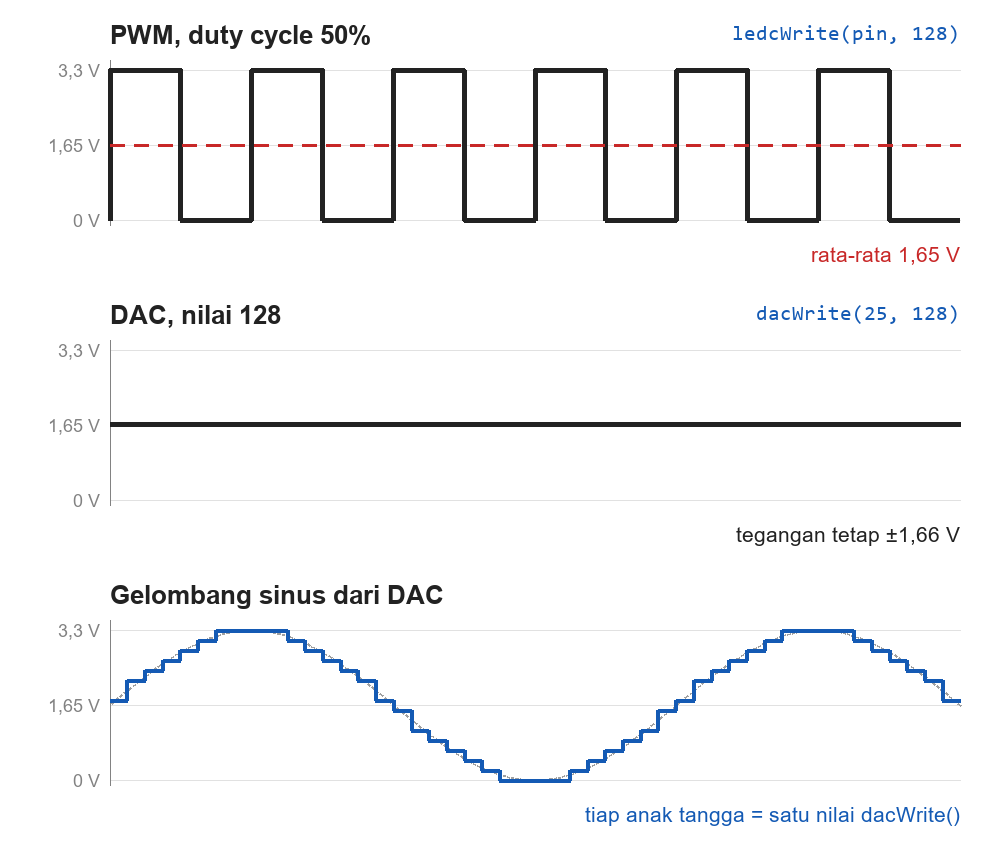
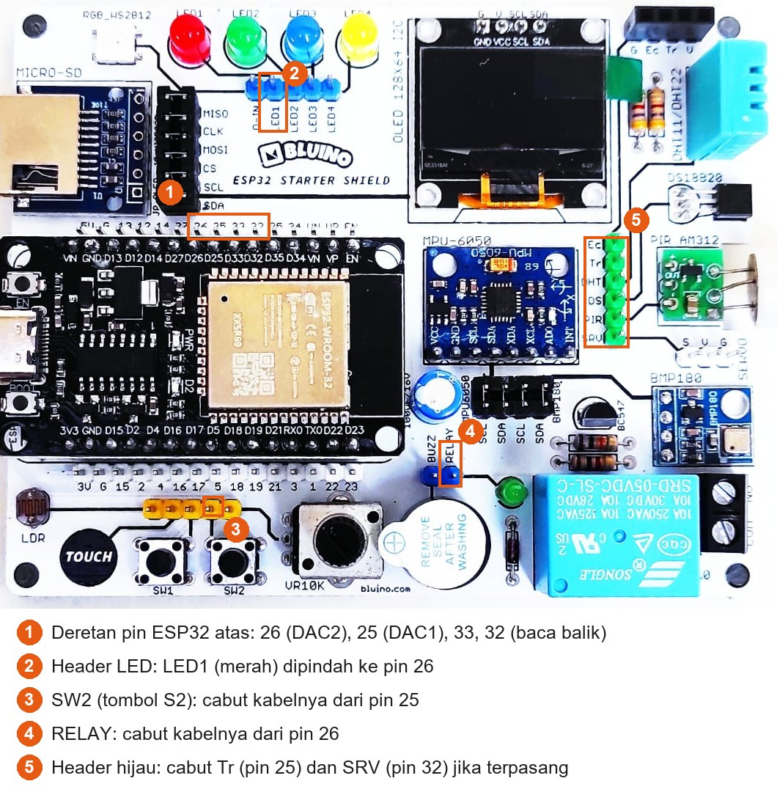

# BAB 13: DAC — Output Analog Asli

> ✅ **Prasyarat:** Selesaikan **BAB 11 (Analog Input & ADC)** — kamu sudah bisa membaca tegangan dengan `analogReadMilliVolts()` — dan **BAB 12 (PWM dengan LEDC)**, karena di BAB ini DAC akan dibandingkan dengan PWM.

Di BAB 12 kamu meredupkan LED dengan PWM. Sebenarnya pin itu hanya berkedip sangat cepat antara 0 V dan 3,3 V; yang "setengah" hanyalah rata-ratanya. ESP32 di kit kamu punya fitur yang lebih jujur: **DAC**, yang bisa mengeluarkan tegangan yang **benar-benar tetap** di antara 0 V dan 3,3 V, misalnya 1,2 V tanpa berkedip sedikit pun. Ibaratnya, PWM seperti keran yang dibuka-tutup penuh dengan cepat, sedangkan DAC seperti keran yang memang dibuka setengah. DAC dipakai untuk membuat tegangan acuan, sinyal uji, dan suara sederhana.

## 📌 Tujuan Pembelajaran

Setelah mempelajari BAB ini, kamu bisa:

- Menjelaskan apa itu DAC dan bedanya dengan PWM.
- Menghitung tegangan keluaran DAC 8 bit dari nilai 0–255 (±12,9 mV per langkah).
- Memakai `dacWrite()` dan `dacDisable()` pada dua pin DAC ESP32: IO25 dan IO26.
- Menyiapkan kabel dengan benar: melepas komponen yang biasanya tersambung ke IO25, IO26, dan IO32, lalu membaca balik tegangan DAC dengan ADC.
- Membuat gelombang gigi gergaji, segitiga, dan sinus, lalu melihatnya di Serial Plotter.
- Menjelaskan kenapa LED yang diberi tegangan DAC baru menyala setelah tegangannya melewati tegangan maju LED.
- Menyebutkan chip ESP32 mana yang punya DAC dan mana yang tidak.

## 🧰 Yang Perlu Disiapkan

| Kebutuhan | Keterangan |
|---|---|
| *Hardware* | Kit Bluino ESP32 IoT Starter Shield (ESP32 DEVKIT V1 sudah terpasang di kit) + kabel USB **data** |
| Kabel *jumper* | 3 kabel *female-female* — sudah ada di kit: pin `25` → pin `32` (untuk membaca balik tegangan DAC), LED1 (merah) → pin `26`, dan VR10K (potensiometer) → pin `34` |
| Komponen tambahan | Tidak ada. Opsional: multimeter digital (tidak termasuk kit) untuk mengukur tegangan DAC secara langsung |
| *Software* | Arduino IDE 2.x + *board package* **esp32** versi 3.3.x (lihat [BAB 5](../BAB-05/README.md)) |
| *Library* | Tidak perlu *library* tambahan — `dacWrite()` sudah bawaan *board package* esp32 |
| Alat uji | **Serial Monitor** (baud 115200) dan **Serial Plotter** (**Tools → Serial Plotter**, baud 115200) di Arduino IDE |
| Jaringan | Tidak perlu WiFi |

## 📑 Daftar Isi

- [13.1 Apa Itu DAC?](#131-apa-itu-dac)
- [13.2 DAC pada ESP32](#132-dac-pada-esp32)
- [13.3 Menyiapkan Rangkaian: Membebaskan IO25 dan IO26](#133-menyiapkan-rangkaian-membebaskan-io25-dan-io26)
- [13.4 Program 1: Tangga Tegangan](#134-program-1-tangga-tegangan)
- [13.5 Program 2: Gelombang di Serial Plotter](#135-program-2-gelombang-di-serial-plotter)
- [13.6 Program 3: LED dengan Tegangan DAC](#136-program-3-led-dengan-tegangan-dac)
- [13.7 Program 4: Potensiometer ke DAC](#137-program-4-potensiometer-ke-dac)
- [13.8 Aplikasi dan Keterbatasan DAC](#138-aplikasi-dan-keterbatasan-dac)
- [13.9 Troubleshooting](#139-troubleshooting)
- [📝 Rangkuman](#-rangkuman)
- [💪 Latihan](#-latihan)
- [📚 Referensi](#-referensi)

---

## 13.1 Apa Itu DAC?

**DAC** (*Digital-to-Analog Converter*, pengubah digital ke analog) mengubah sebuah **angka** menjadi **tegangan**. DAC adalah kebalikan dari ADC yang kamu pelajari di BAB 11:

```text
ADC (BAB 11) :  tegangan ±1,65 V  →  angka ±2048 (dari 0–4095)
DAC (BAB ini):  angka 128 (dari 0–255)  →  tegangan ±1,66 V
```

### 13.1.1 DAC vs PWM

| Aspek | PWM (BAB 12) | DAC (BAB ini) |
|---|---|---|
| Bentuk sinyal | Kotak: bolak-balik 0 V ↔ 3,3 V dengan sangat cepat | Tegangan tetap (rata) di antara 0 V dan 3,3 V |
| Tegangan "setengah" (±1,65 V) didapat dari | Rata-rata, dengan *duty cycle* 50% | Tegangan sungguhan (nilai 128) |
| Resolusi | 1–20 bit, bisa diatur | 8 bit (256 tingkat), tetap |
| Pin yang bisa dipakai | Hampir semua pin output, hingga 16 sinyal | Hanya 2 pin: IO25 dan IO26 |
| Kemampuan arus | Sekuat pin output digital biasa | Lemah — hanya untuk sinyal, bukan untuk beban |
| Cocok untuk | LED, *buzzer*, servo, motor (lewat *driver*) | Tegangan acuan, sinyal uji, suara sederhana |



*Gambar 13.1 — Atas: PWM hanya mengenal 0 V dan 3,3 V; 1,65 V adalah rata-ratanya. Tengah: DAC dengan nilai 128 mengeluarkan ±1,66 V sungguhan. Bawah: gelombang dari DAC tersusun dari anak tangga kecil (di gambar ini dibuat 16 tingkat supaya terlihat; DAC ESP32 punya 256 tingkat). Sumber: dibuat untuk materi ini.*

Kenapa perbedaan ini penting? Rangkaian yang butuh tegangan tetap — misalnya masukan penguat suara atau pin acuan sebuah IC — tetap "melihat" PWM sebagai kotak-kotak 0 V dan 3,3 V. PWM baru menjadi tegangan rata kalau disaring dulu dengan rangkaian penyaring (*filter*) resistor–kapasitor. DAC tidak butuh penyaring itu.

### 13.1.2 Resolusi 8 Bit: 256 Anak Tangga

DAC ESP32 memakai 8 bit, jadi nilainya 0 sampai 255. Rumus idealnya:

```text
tegangan keluaran ≈ nilai × 3,3 V ÷ 255
```

Satu langkah nilai = 3,3 V ÷ 255 ≈ 0,0129 V = **12,9 mV**. Tegangan DAC tidak bisa diatur lebih halus dari itu.

| Nilai di `dacWrite()` | Tegangan ideal |
|---|---|
| 0 | 0 V |
| 1 | ±0,013 V (12,9 mV) |
| 64 | ±0,83 V |
| 128 | ±1,66 V |
| 192 | ±2,48 V |
| 255 | ±3,3 V |

Untuk mencari nilai dari tegangan yang diinginkan, balik rumusnya: **nilai = tegangan × 255 ÷ 3,3**, lalu bulatkan. Contoh: 1,2 V → 1,2 × 255 ÷ 3,3 ≈ 92,7 → nilai 93.

> 📌 **Catatan:** DAC memakai tegangan catu 3,3 V chip ESP32 sebagai acuan. Kalau 3,3 V di *board*-mu sebenarnya 3,28 V, nilai 255 juga mengikuti angka itu. Dalam praktik, keluarannya juga tidak tepat 0 V dan 3,3 V di kedua ujung: biasanya sedikit di atas 0 V dan sedikit di bawah 3,3 V, dan setiap chip sedikit berbeda. Program 1 akan menunjukkan angka sebenarnya di kit kamu. Untuk belajar, ketelitian ini sudah cukup, tetapi DAC ESP32 bukan sumber tegangan presisi.

---

## 13.2 DAC pada ESP32

ESP32 punya dua kanal DAC 8 bit. Rangkaian DAC-nya tersambung permanen ke dua pin tertentu di dalam chip, jadi — berbeda dengan PWM — **tidak bisa dipindah ke pin lain**:

| Kanal | Pin | Pemakaian pin ini di Peta Pin Standar |
|---|---|---|
| DAC1 | **IO25** | Tombol S2 (label `SW2`) atau HC-SR04 Trig (label `Tr`) |
| DAC2 | **IO26** | *Relay* (label `RELAY`) |

Karena kedua pin itu biasanya dipakai komponen lain, BAB ini punya langkah khusus untuk "membebaskannya" (lihat [13.3](#133-menyiapkan-rangkaian-membebaskan-io25-dan-io26)).

### 13.2.1 Fungsi DAC

| Fungsi | Gunanya | Hasil yang dikembalikan |
|---|---|---|
| `dacWrite(pin, nilai)` | Mengeluarkan tegangan di pin 25 atau 26. `nilai` = 0–255 | `true` kalau berhasil; `false` kalau pin itu bukan pin DAC |
| `dacDisable(pin)` | Mematikan DAC di pin itu, supaya pin bisa dipakai untuk fungsi lain | `true` kalau berhasil |

Contoh potongan kode (bukan program lengkap):

```cpp
dacWrite(25, 128);  // IO25 mengeluarkan ±1,66 V terus-menerus sampai diubah
dacWrite(25, 0);    // IO25 menjadi ±0 V
dacDisable(25);     // DAC di IO25 dimatikan; pin bisa dipakai untuk hal lain
```

Seperti `ledcWrite()`, **tidak perlu `pinMode()`**, dan tegangannya bertahan sampai kamu mengubahnya.

> ⚠️ **Perhatian:** Parameter `nilai` bertipe `uint8_t` (bilangan 0–255). Angka yang lebih besar **tidak** dianggap 255, melainkan "berputar" kembali dari 0: `dacWrite(25, 256)` sama dengan `dacWrite(25, 0)`, dan `dacWrite(25, 300)` sama dengan `dacWrite(25, 44)`. Batasi dulu nilainya, misalnya dengan `constrain(nilai, 0, 255)`.

> ⚠️ **Perhatian:** Keluaran DAC itu **lemah**. DAC dibuat untuk mengirim sinyal, bukan untuk memberi daya. LED dengan resistor 330 Ω seperti di kit masih boleh, tetapi **jangan** menyambungkan *speaker*, *earphone*, motor, atau kumparan *relay* langsung ke pin DAC. Untuk beban seperti itu dibutuhkan penguat (misalnya *op-amp* atau modul penguat audio).

> 📌 **Catatan:** Tidak semua chip ESP32 punya DAC. **ESP32** (yang ada di kit) dan **ESP32-S2** punya; **ESP32-S3, ESP32-C3, ESP32-C6, ESP32-H2**, dan seri yang lebih baru **tidak punya**. Kalau kode BAB ini di-*compile* untuk chip tanpa DAC, muncul *error* `'dacWrite' was not declared in this scope`. Pada chip seperti itu, gunakan PWM yang disaring resistor–kapasitor atau modul DAC luar, misalnya MCP4725 (I2C, 12 bit).

---

## 13.3 Menyiapkan Rangkaian: Membebaskan IO25 dan IO26

Di BAB lain, IO25, IO26, dan IO32 dipakai komponen lain sesuai Peta Pin Standar. Untuk BAB ini, **cabut dulu** kabel-kabel berikut kalau sedang terpasang:

| Cabut kabel ini | Alasannya |
|---|---|
| `SW2` (tombol S2) → pin `25` | Tombol S2 menyambungkan 3,3 V langsung ke pin saat ditekan, dan resistor *pull-down* 10 kΩ-nya selalu menarik pin ke GND. Keduanya akan "melawan" keluaran DAC |
| `Tr` (HC-SR04 Trig) → pin `25` | Pin Trig modul ultrasonik akan menerima tegangan yang naik-turun tanpa arti |
| `RELAY` → pin `26` | Tegangan DAC yang naik-turun bisa membuat *relay* berbunyi "klik" dan ikut membebani DAC |
| `SRV` (servo) → pin `32` | IO32 akan dipakai untuk membaca balik tegangan DAC |

Lalu **pasang** kabel berikut:

| Dari | Ke | Dipakai di | Fungsinya |
|---|---|---|---|
| Pin header ESP32 `25` | Pin header ESP32 `32` | Program 1, 2, 4 | IO32 (ADC1) membaca balik tegangan DAC1 |
| LED1 (merah) di header LED | Pin header ESP32 `26` (**bukan** `4`) | Program 3, 4 | LED sebagai penunjuk tegangan DAC2 |
| VR10K (potensiometer) | Pin header ESP32 `34` | Program 4 | Masukan analog, sama seperti BAB 11 |



*Gambar 13.2 — Pin yang dipakai di BAB ini (1) dan header komponen yang kabelnya perlu dicabut atau dipindah (2–5) pada kit v3.x; tata letak kit v3.2 milikmu bisa sedikit berbeda. Sumber: foto produk ESP32 Starter Shield, [Bluino](http://www.bluino.com), dipotong dan diberi penanda untuk materi ini.*

Kabel pertama agak berbeda dari biasanya: kedua ujungnya dipasang ke **pin header ESP32**, bukan ke pin komponen. Urutan deretan pin atas dari kiri adalah `5V`, `G`, `13`, `12`, `14`, `27`, `26`, `25`, `33`, `32`, ... — jadi pin `25` dan `32` hanya dipisahkan oleh pin `33`. Dengan kabel ini, tegangan yang dikeluarkan DAC di IO25 bisa langsung diukur oleh ADC di IO32, sehingga kamu bisa "melihat" tegangan DAC di Serial Monitor tanpa multimeter. Sambungan ini aman, karena di semua program BAB ini IO32 hanya dipakai sebagai input.

Kenapa memakai IO32? Pin itu termasuk ADC1 (aman dipakai bersama WiFi, lihat BAB 11) dan di Peta Pin Standar hanya dipakai untuk servo, yang tidak termasuk kit.

> ⚠️ **Perhatian:** Setelah selesai BAB ini, **cabut kabel 25 → 32** dan kembalikan kabel lain ke tempat semula: LED1 → `4`, `SW2` → `25`, `RELAY` → `26`. Kabel 25 → 32 yang tertinggal bisa mengacaukan program di BAB lain yang memakai salah satu pin itu sebagai output.

> 💡 **Tips:** Seperti biasa, cabut kabel USB sebelum memasang atau memindahkan kabel *jumper*.

---

## 13.4 Program 1: Tangga Tegangan

**Tujuan:** Membuat DAC1 (IO25) mengeluarkan lima tingkat tegangan seperti anak tangga — nilai 0, 64, 128, 192, dan 255 — masing-masing selama 3 detik. Setiap tingkat dibandingkan dengan hasil ukur ADC di IO32, sehingga kamu bisa melihat seberapa dekat tegangan sebenarnya dengan hitungan rumus.

**Rangkaian:**

| Dari | Sambungkan ke |
|---|---|
| Pin header ESP32 `25` | Pin header ESP32 `32` |

*Tidak ada komponen kit yang dipakai.* Pastikan tidak ada kabel lain di pin `25` dan `32` (lihat [13.3](#133-menyiapkan-rangkaian-membebaskan-io25-dan-io26)).

**Cara Menjalankan:**

1. Cabut kabel USB, lalu pasang kabel *jumper* dari pin `25` ke pin `32` di deretan pin ESP32 atas.
2. Buka Arduino IDE → **File → New Sketch**, hapus isinya, lalu salin kode di bawah. Kode yang sama juga tersedia di *file* [`p1_tangga_tegangan.ino`](p1_tangga_tegangan/p1_tangga_tegangan.ino).
3. Sambungkan kabel USB. Pastikan **Tools → Board** = **ESP32 Dev Module** dan **Tools → Port** = *port* ESP32 kamu (misalnya `COM5` di Windows atau `/dev/ttyUSB0` di Linux).
4. Klik tombol **Upload** (ikon panah →) dan tunggu sampai muncul tulisan **Done uploading**.
5. Buka **Serial Monitor** (**Tools → Serial Monitor**) lalu pilih baud **115200**.
6. (Opsional) Kalau punya multimeter, putar ke mode **V⎓** (lihat [BAB 3](../BAB-03/README.md#312-mengukur-dengan-multimeter-opsional)). Tempelkan probe hitam ke pin **G** di deretan atas, dan probe merah ke ujung kaki **D25** yang menonjol di *board* ESP32 (pin header `25` sudah tertutup kabel). Hati-hati jangan sampai probe menyentuh dua kaki sekaligus. Setiap tingkat ditahan 3 detik supaya sempat dibaca.

**Kode Program:**

<!-- sketch: p1_tangga_tegangan -->
```cpp
/*
 * BAB 13 - Program 1: Tangga Tegangan
 * DAC1 (IO25) mengeluarkan 5 tingkat tegangan, masing-masing ±3 detik.
 * Tegangannya dibaca balik oleh ADC di IO32 lewat kabel jumper 25 → 32.
 *
 * Rangkaian:
 *   Kabel jumper dari pin header 25 ke pin header 32 (deretan atas)
 *   Pin 25 dan 32 tidak boleh tersambung ke komponen lain (cabut SW2, Tr, SRV)
 */

#define DAC_PIN  25  // DAC1 → IO25
#define BACA_PIN 32  // ADC1 → IO32, membaca balik tegangan DAC

const int DAFTAR_NILAI[] = {0, 64, 128, 192, 255};
const int JUMLAH_LANGKAH = sizeof(DAFTAR_NILAI) / sizeof(DAFTAR_NILAI[0]);

// Baca tegangan 16 kali lalu dirata-rata supaya hasilnya stabil (lihat BAB 11)
float bacaVolt(int pin) {
  uint32_t total = 0;
  for (int i = 0; i < 16; i++) {
    total += analogReadMilliVolts(pin);
  }
  return (total / 16) / 1000.0;  // mV → V
}

void setup() {
  Serial.begin(115200);
  Serial.println("BAB 13 - Program 1: Tangga Tegangan");

  // dacWrite() mengembalikan false kalau DAC_PIN bukan pin DAC (harus 25 atau 26)
  if (!dacWrite(DAC_PIN, 0)) {
    Serial.println("Gagal! DAC hanya ada di IO25 dan IO26.");
    while (true) {
      delay(1000);  // program berhenti di sini
    }
  }
}

void loop() {
  for (int i = 0; i < JUMLAH_LANGKAH; i++) {
    int nilai = DAFTAR_NILAI[i];
    dacWrite(DAC_PIN, nilai);  // keluarkan tegangan di IO25
    delay(100);                // tunggu sebentar sampai tegangannya stabil

    float ideal = nilai * 3.3 / 255;     // hitungan rumus (volt)
    float terukur = bacaVolt(BACA_PIN);  // hasil ukur ADC di IO32 (volt)

    Serial.print("Nilai DAC ");
    Serial.print(nilai);
    Serial.print(" -> ideal ");
    Serial.print(ideal, 2);
    Serial.print(" V | terukur ADC ");
    Serial.print(terukur, 2);
    Serial.println(" V");

    delay(2900);  // tahan ±3 detik supaya sempat diamati atau diukur
  }
  Serial.println("--- ulang dari awal ---");
}
```

**Penjelasan Kode:**

- `dacWrite(DAC_PIN, nilai)` langsung membuat IO25 mengeluarkan tegangan, tanpa `pinMode()`. Tegangan itu bertahan selama `delay()`, sampai `dacWrite()` berikutnya.
- Di `setup()`, hasil `dacWrite()` diperiksa. Kalau `DAC_PIN` diganti ke pin yang tidak punya DAC (misalnya 27), program memberi tahu kesalahannya, alih-alih diam saja.
- `ideal` dihitung dengan rumus di [13.1.2](#1312-resolusi-8-bit-256-anak-tangga), sedangkan `terukur` adalah hasil `analogReadMilliVolts()` di IO32 yang dirata-rata 16 kali oleh fungsi `bacaVolt()`, seperti teknik *multi-sampling* di BAB 11.
- `(total / 16) / 1000.0` mengubah milivolt menjadi volt. Angka `1000.0` dengan titik desimal membuat hasilnya berupa pecahan.

**Contoh Output** (angka "terukur" di kit kamu akan sedikit berbeda):

```text
BAB 13 - Program 1: Tangga Tegangan
Nilai DAC 0 -> ideal 0.00 V | terukur ADC 0.14 V
Nilai DAC 64 -> ideal 0.83 V | terukur ADC 0.86 V
Nilai DAC 128 -> ideal 1.66 V | terukur ADC 1.67 V
Nilai DAC 192 -> ideal 2.48 V | terukur ADC 2.47 V
Nilai DAC 255 -> ideal 3.30 V | terukur ADC 3.13 V
--- ulang dari awal ---
```

Setiap 3 detik muncul satu baris baru. Di bagian tengah (sekitar 0,2–2,5 V), angka ideal dan terukur biasanya hanya berbeda beberapa puluh milivolt. Di kedua ujung perbedaannya lebih besar karena dua hal:

- **Di dekat 0 V**, ADC ESP32 tidak bisa membaca tegangan yang sangat kecil; dengan pengaturan bawaan, hasil terkecilnya sekitar 0,1–0,15 V walaupun tegangannya hampir 0 V.
- **Di dekat 3,3 V**, keluaran DAC sendiri tidak sampai penuh, dan ADC juga kurang teliti di atas ±2,5 V.

Kalau kamu memakai multimeter, angka multimeter biasanya lebih dekat ke angka ideal daripada angka ADC, terutama di kedua ujung.

> 🧪 **Coba Sendiri:** Ganti isi `DAFTAR_NILAI[]` dengan `{93}` saja, lalu *upload* ulang. Berapa tegangan yang terukur? Bandingkan dengan contoh hitungan 1,2 V di [13.1.2](#1312-resolusi-8-bit-256-anak-tangga).

**Kalau Belum Berhasil:**

- **Angka "terukur" selalu sekitar `0.14` atau acak-acakan** → kabel 25 → 32 belum terpasang, terpasang di pin sebelahnya (misalnya `33`), atau longgar.
- **Angka "terukur" jauh berbeda dari angka ideal di bagian tengah (lebih dari ±0,1 V)** → masih ada kabel lain di pin `25` atau `32`, misalnya dari `SW2`, `Tr`, atau `SRV`, yang ikut membebani DAC. Cabut kabel itu (lihat [13.3](#133-menyiapkan-rangkaian-membebaskan-io25-dan-io26)).
- **Muncul tulisan `Gagal! DAC hanya ada di IO25 dan IO26.`** → nilai `DAC_PIN` diubah ke pin lain. Kembalikan ke 25.

---

## 13.5 Program 2: Gelombang di Serial Plotter

**Tujuan:** Membuat DAC1 (IO25) mengeluarkan gelombang lambat secara bergantian — gigi gergaji, segitiga, lalu sinus — dan menampilkan tegangan ideal serta tegangan terukurnya sebagai grafik di **Serial Plotter**.

**Rangkaian:**

| Dari | Sambungkan ke |
|---|---|
| Pin header ESP32 `25` | Pin header ESP32 `32` |

Sama dengan Program 1.

**Cara Menjalankan:**

1. Biarkan kabel 25 → 32 seperti pada Program 1.
2. Buka Arduino IDE → **File → New Sketch**, hapus isinya, lalu salin kode di bawah. Kode yang sama juga tersedia di *file* [`p2_gelombang_plotter.ino`](p2_gelombang_plotter/p2_gelombang_plotter.ino).
3. Pastikan **Tools → Board** = **ESP32 Dev Module** dan **Tools → Port** = *port* ESP32 kamu.
4. Klik tombol **Upload** dan tunggu sampai muncul tulisan **Done uploading**.
5. Buka **Serial Plotter** (**Tools → Serial Plotter**). Di jendela Serial Plotter, pilih baud **115200** pada pilihan di pojok kanan bawah. Kalau Serial Monitor sedang terbuka dan Serial Plotter tidak mau tersambung, tutup dulu Serial Monitor.

**Kode Program:**

<!-- sketch: p2_gelombang_plotter -->
```cpp
/*
 * BAB 13 - Program 2: Gelombang di Serial Plotter
 * DAC1 (IO25) membuat gelombang lambat secara bergantian:
 * gigi gergaji, segitiga, lalu sinus (masing-masing 3 gelombang).
 * ADC di IO32 membaca balik tegangannya.
 * Buka Tools → Serial Plotter untuk melihat grafiknya.
 *
 * Rangkaian: kabel jumper dari pin header 25 ke pin header 32 (sama dengan Program 1)
 */

#define DAC_PIN  25  // DAC1 → IO25
#define BACA_PIN 32  // ADC1 → IO32, membaca balik tegangan DAC

const int TITIK_PER_GELOMBANG = 25;  // 25 titik: dua gelombang muat di layar Serial Plotter
const int JEDA_MS = 80;              // 25 titik × 80 ms = 2 detik per gelombang
const int JUMLAH_GELOMBANG = 3;      // setiap bentuk diulang 3 kali

// Menghitung nilai DAC (0–255) untuk titik ke-i dari bentuk gelombang tertentu
int hitungNilai(int bentuk, int i) {
  float posisi = (float)i / TITIK_PER_GELOMBANG;  // dari 0.0 sampai hampir 1.0

  if (bentuk == 0) {          // gigi gergaji: naik lurus, lalu jatuh
    return posisi * 255;
  } else if (bentuk == 1) {   // segitiga: naik lurus, lalu turun lurus
    if (posisi < 0.5) {
      return posisi * 2 * 255;
    }
    return (1.0 - posisi) * 2 * 255;
  } else {                    // sinus: naik-turun melengkung, di tengah 127,5
    return 127.5 + 127.5 * sin(2 * PI * posisi);
  }
}

void setup() {
  Serial.begin(115200);
  // Sengaja tidak mencetak judul supaya grafik di Serial Plotter tetap bersih
}

void loop() {
  for (int bentuk = 0; bentuk < 3; bentuk++) {
    for (int g = 0; g < JUMLAH_GELOMBANG; g++) {
      for (int i = 0; i < TITIK_PER_GELOMBANG; i++) {
        int nilai = hitungNilai(bentuk, i);
        dacWrite(DAC_PIN, nilai);
        delay(JEDA_MS);

        int target = nilai * 3300 / 255;               // tegangan ideal (mV)
        int terukur = analogReadMilliVolts(BACA_PIN);  // tegangan terbaca ADC (mV)

        // Format Serial Plotter: nama:nilai,nama:nilai
        Serial.print("target_mV:");
        Serial.print(target);
        Serial.print(",terukur_mV:");
        Serial.println(terukur);
      }
    }
  }
}
```

**Penjelasan Kode:**

- Fungsi `hitungNilai()` menerima nomor bentuk gelombang (0 = gigi gergaji, 1 = segitiga, 2 = sinus) dan nomor titik `i`. `posisi` adalah letak titik itu di dalam satu gelombang, dari 0,0 (awal) sampai hampir 1,0 (akhir).
- **Gigi gergaji**: nilainya naik lurus dari 0 ke hampir 255, lalu langsung jatuh ke 0. **Segitiga**: naik lurus sampai tengah gelombang, lalu turun lurus. **Sinus**: memakai fungsi `sin()`; `127.5 + 127.5 * sin(...)` menggeser hasil `sin()` (−1 sampai 1) menjadi 0 sampai 255. `PI` adalah konstanta 3,14159... yang sudah disediakan Arduino.
- Setiap baris dicetak dengan format `nama:nilai,nama:nilai`. Serial Plotter mengenali format ini dan menggambar satu garis untuk setiap nama, lengkap dengan keterangannya. Nama tidak boleh berisi spasi, jadi dipakai `target_mV` dan `terukur_mV`.
- Program ini sengaja **tidak** mencetak judul, karena baris teks biasa bisa ikut "digambar" oleh Serial Plotter dan membuat grafiknya berantakan.
- Serial Plotter Arduino IDE 2 hanya menampilkan sekitar 50 titik terakhir. Karena itu satu gelombang dibuat 25 titik, supaya dua gelombang utuh terlihat di layar.

**Contoh Output:**

Di **Serial Plotter** terlihat dua garis yang hampir berimpit: `target_mV` (tegangan ideal) dan `terukur_mV` (hasil ADC). Bentuknya berganti setiap 6 detik: tiga gigi gergaji, tiga segitiga, lalu tiga gelombang sinus, dan berulang. Garis `terukur_mV` tidak pernah turun sampai 0 karena batas bawah ADC yang dibahas di Program 1.

Kalau kamu membuka **Serial Monitor**, yang terlihat adalah angka-angka seperti ini (angka `terukur_mV` di kit kamu akan sedikit berbeda):

```text
target_mV:0,terukur_mV:142
target_mV:129,terukur_mV:151
target_mV:258,terukur_mV:268
target_mV:388,terukur_mV:401
target_mV:517,terukur_mV:529
```

> 🧪 **Coba Sendiri:** Ubah `JEDA_MS` menjadi `20`. Gelombangnya menjadi 4 kali lebih cepat (0,5 detik per gelombang) dan garisnya bergerak lebih cepat di Serial Plotter.

**Kalau Belum Berhasil:**

- **Serial Plotter kosong** → pastikan baud di pojok kanan bawah Serial Plotter **115200**, lalu tekan tombol **EN** di *board*. Tutup Serial Monitor kalau masih terbuka.
- **Garis `terukur_mV` tidak ikut bergelombang (datar atau acak), sedangkan `target_mV` bergelombang** → kabel 25 → 32 belum terpasang, longgar, atau terpasang di pin yang salah.
- **Muncul garis tambahan yang aneh** → kamu menambahkan perintah `Serial.println()` berisi teks. Hapus baris itu, atau pakai format `nama:nilai`.

---

## 13.6 Program 3: LED dengan Tegangan DAC

**Tujuan:** Menaikkan tegangan DAC2 (IO26) ke LED merah sedikit demi sedikit, dari 0 V sampai ±3,3 V. Kamu akan melihat bahwa LED **tetap gelap** sampai tegangannya melewati tegangan maju LED, lalu dengan cepat menjadi terang. Ini berbeda sekali dengan PWM di BAB 12.

**Rangkaian:**

| Pin **Custom** di kit | Sambungkan ke pin ESP32 |
|---|---|
| LED1 (merah) | IO26 (**bukan** IO4) |

Cabut dulu kabel `RELAY` dari pin `26` kalau ada. Kabel 25 → 32 dari Program 1 boleh tetap terpasang.

**Cara Menjalankan:**

1. Cabut kabel USB. Pindahkan kabel LED1 (merah) dari pin `4` ke pin **26** di deretan pin ESP32 atas (lihat Gambar 13.2).
2. Buka Arduino IDE → **File → New Sketch**, hapus isinya, lalu salin kode di bawah. Kode yang sama juga tersedia di *file* [`p3_led_dac.ino`](p3_led_dac/p3_led_dac.ino).
3. Sambungkan kabel USB. Pastikan **Tools → Board** = **ESP32 Dev Module** dan **Tools → Port** = *port* ESP32 kamu.
4. Klik tombol **Upload** dan tunggu sampai muncul tulisan **Done uploading**.
5. Buka **Serial Monitor** (**Tools → Serial Monitor**) lalu pilih baud **115200**. Catat pada nilai berapa LED mulai menyala.

**Kode Program:**

<!-- sketch: p3_led_dac -->
```cpp
/*
 * BAB 13 - Program 3: LED dengan Tegangan DAC
 * DAC2 (IO26) menaikkan tegangan ke LED merah sedikit demi sedikit,
 * lalu mematikannya dan mengulang. Amati: LED baru mulai menyala
 * setelah tegangannya melewati tegangan maju (Vf) LED.
 *
 * Rangkaian: LED1 (merah) di header LED → IO26 (bukan IO4!)
 *            Cabut dulu kabel RELAY dari IO26.
 */

#define DAC_LED 26  // DAC2 → IO26 → LED merah

const int LANGKAH = 15;    // kenaikan nilai DAC setiap langkah
const int JEDA_MS = 1000;  // lama setiap langkah: 1 detik

void setup() {
  Serial.begin(115200);
  Serial.println("BAB 13 - Program 3: LED dengan Tegangan DAC");

  if (!dacWrite(DAC_LED, 0)) {
    Serial.println("Gagal! DAC hanya ada di IO25 dan IO26.");
    while (true) {
      delay(1000);
    }
  }
}

void loop() {
  for (int nilai = 0; nilai <= 255; nilai += LANGKAH) {
    dacWrite(DAC_LED, nilai);

    float tegangan = nilai * 3.3 / 255;  // perkiraan tegangan di IO26 (volt)
    Serial.print("Nilai DAC ");
    Serial.print(nilai);
    Serial.print(" -> ");
    Serial.print(tegangan, 2);
    Serial.println(" V");

    delay(JEDA_MS);
  }

  dacWrite(DAC_LED, 0);  // matikan LED sebelum mengulang
  Serial.println("--- LED dimatikan, ulang dari awal ---");
  delay(2000);
}
```

**Penjelasan Kode:**

- Perulangan `for` menaikkan nilai DAC dari 0 sampai 255 dengan langkah 15 (0, 15, 30, ..., 255), satu langkah per detik. Totalnya 18 langkah, jadi satu putaran ±18 detik ditambah jeda 2 detik.
- Tegangan yang dicetak adalah perkiraan dengan rumus ideal. Pin IO26 tidak dibaca balik karena kabelnya sudah dipakai untuk LED.
- Program ini sengaja dibuat lambat, supaya kamu sempat mengamati LED di setiap langkah.

**Contoh Output:**

```text
BAB 13 - Program 3: LED dengan Tegangan DAC
Nilai DAC 0 -> 0.00 V
Nilai DAC 15 -> 0.19 V
Nilai DAC 30 -> 0.39 V
Nilai DAC 45 -> 0.58 V
Nilai DAC 60 -> 0.78 V
Nilai DAC 75 -> 0.97 V
Nilai DAC 90 -> 1.16 V
Nilai DAC 105 -> 1.36 V
Nilai DAC 120 -> 1.55 V
Nilai DAC 135 -> 1.75 V
Nilai DAC 150 -> 1.94 V
Nilai DAC 165 -> 2.14 V
Nilai DAC 180 -> 2.33 V
Nilai DAC 195 -> 2.52 V
Nilai DAC 210 -> 2.72 V
Nilai DAC 225 -> 2.91 V
Nilai DAC 240 -> 3.11 V
Nilai DAC 255 -> 3.30 V
--- LED dimatikan, ulang dari awal ---
```

Di kit: selama kira-kira separuh pertama, LED merah **sama sekali tidak menyala** walaupun tegangannya sudah lebih dari 1 V. Biasanya LED mulai berpendar redup di sekitar nilai 120–150 (±1,6–1,9 V), lalu cepat menjadi terang sampai nilai 255. Angka persisnya bergantung pada LED di kit kamu.

**Kenapa begitu?** Ingat dari [BAB 3](../BAB-03/README.md#341-tegangan-maju-vf-dan-kenapa-perlu-resistor): LED baru mengalirkan arus — dan menyala — setelah tegangannya melewati **tegangan maju** (V<sub>f</sub>), sekitar 1,8–2 V untuk LED merah. Di bawah itu hampir tidak ada arus. Di atasnya, arus naik sebanding dengan sisa tegangan yang jatuh di resistor 330 Ω: I ≈ (V<sub>DAC</sub> − V<sub>f</sub>) ÷ 330 Ω. Jadi kecerahan LED yang diatur dengan DAC **tidak linear**: separuh rentang nilai DAC terbuang di bagian gelap.

Bandingkan dengan PWM di BAB 12: pada *duty cycle* 25%, LED sudah jelas menyala, karena setiap pulsa PWM selalu mencapai 3,3 V — di atas V<sub>f</sub> — dan LED menyala penuh selama pulsa itu. Dengan DAC, nilai 64 (±0,83 V, juga "25%") sama sekali tidak menyalakan LED. Itulah sebabnya **untuk meredupkan LED, PWM lebih cocok daripada DAC**.

> 🧪 **Coba Sendiri:** Pindahkan kabel dari LED1 (merah) ke LED3 (biru), tetap ke pin `26`. LED biru punya V<sub>f</sub> sekitar 3 V, sehingga hanya menyala sangat redup di nilai paling atas — atau bahkan tidak menyala sama sekali.

**Kalau Belum Berhasil:**

- **LED tidak pernah menyala, bahkan di nilai 255** → kabel LED1 masih di pin `4`, atau terpasang di pin `25`/`27` di sebelah pin `26`. Periksa juga apakah kabel `RELAY` sudah dicabut dari pin `26`.
- ***Relay* berbunyi "klik"** → kabel `RELAY` masih tersambung ke pin `26`. Cabut kabel itu.
- **LED sudah menyala redup sejak nilai 0** → kabel LED1 mungkin tersambung ke pin lain yang sedang HIGH. Periksa ulang kabelnya.

---

## 13.7 Program 4: Potensiometer ke DAC

**Tujuan:** Membaca tegangan potensiometer dengan ADC, mengubahnya menjadi nilai DAC, lalu "menyalin" tegangan itu ke DAC1 (IO25, dibaca balik di IO32) dan DAC2 (IO26, menyalakan LED merah). Rantai **tegangan → angka → tegangan** seperti ini adalah dasar banyak sistem digital, misalnya perekam dan pemutar suara.

**Rangkaian:**

| Dari | Sambungkan ke pin ESP32 |
|---|---|
| VR10K (potensiometer) | IO34 |
| Pin header ESP32 `25` | IO32 (pin header `32`) |
| LED1 (merah) | IO26 |

**Cara Menjalankan:**

1. Cabut kabel USB. Pastikan ketiga kabel di tabel **Rangkaian** terpasang: kabel 25 → 32 dan LED1 → 26 dari program sebelumnya, ditambah kabel dari pin Custom **VR10K** ke pin **34**.
2. Buka Arduino IDE → **File → New Sketch**, hapus isinya, lalu salin kode di bawah. Kode yang sama juga tersedia di *file* [`p4_pot_ke_dac.ino`](p4_pot_ke_dac/p4_pot_ke_dac.ino).
3. Sambungkan kabel USB. Pastikan **Tools → Board** = **ESP32 Dev Module** dan **Tools → Port** = *port* ESP32 kamu.
4. Klik tombol **Upload** dan tunggu sampai muncul tulisan **Done uploading**.
5. Buka **Serial Monitor** (**Tools → Serial Monitor**) lalu pilih baud **115200**. Putar potensiometer perlahan.

**Kode Program:**

<!-- sketch: p4_pot_ke_dac -->
```cpp
/*
 * BAB 13 - Program 4: Potensiometer ke DAC
 * Tegangan potensiometer dibaca ADC (IO34), diubah menjadi nilai DAC 0–255,
 * lalu dikeluarkan lagi oleh DAC1 (IO25, dibaca balik di IO32)
 * dan DAC2 (IO26, menyalakan LED merah).
 *
 * Rangkaian:
 *   VR10K (potensiometer) → IO34
 *   Kabel jumper pin header 25 → pin header 32
 *   LED1 (merah)          → IO26
 */

#define POT_PIN  34  // potensiometer → IO34 (ADC1)
#define DAC_PIN  25  // DAC1 → IO25
#define BACA_PIN 32  // ADC1 → IO32, membaca balik DAC1
#define DAC_LED  26  // DAC2 → IO26 → LED merah

void setup() {
  Serial.begin(115200);
  Serial.println("BAB 13 - Program 4: Potensiometer ke DAC");
}

void loop() {
  int potMv = analogReadMilliVolts(POT_PIN);          // tegangan potensiometer (mV)
  int nilai = constrain(potMv * 255 / 3300, 0, 255);  // ubah menjadi nilai DAC 0–255

  dacWrite(DAC_PIN, nilai);  // salin tegangan potensiometer ke IO25
  dacWrite(DAC_LED, nilai);  // tegangan yang sama untuk LED merah di IO26
  delay(20);                 // tunggu sebentar sampai tegangannya stabil

  int keluaranMv = analogReadMilliVolts(BACA_PIN);  // tegangan DAC1 yang terbaca

  Serial.print("Potensiometer: ");
  Serial.print(potMv);
  Serial.print(" mV -> nilai DAC ");
  Serial.print(nilai);
  Serial.print(" -> keluaran DAC: ");
  Serial.print(keluaranMv);
  Serial.println(" mV");

  delay(200);
}
```

**Penjelasan Kode:**

- `analogReadMilliVolts(POT_PIN)` membaca tegangan potensiometer dalam milivolt (BAB 11).
- `potMv * 255 / 3300` memakai rumus di [13.1.2](#1312-resolusi-8-bit-256-anak-tangga): tegangan (dalam mV) diubah menjadi nilai 0–255. `constrain(..., 0, 255)` memastikan hasilnya tidak pernah lebih dari 255 — ingat, angka 256 akan "berputar" menjadi 0.
- Nilai yang sama dikirim ke kedua DAC. DAC1 dibaca balik di IO32, sehingga kamu bisa membandingkan tegangan masuk (potensiometer) dengan tegangan keluar (DAC). DAC2 menyalakan LED, jadi kamu bisa melihat lagi efek tegangan maju dari Program 3.

**Contoh Output** (angkanya bergantung pada posisi potensiometer dan sedikit berbeda di setiap kit):

```text
BAB 13 - Program 4: Potensiometer ke DAC
Potensiometer: 820 mV -> nilai DAC 63 -> keluaran DAC: 829 mV
Potensiometer: 1652 mV -> nilai DAC 127 -> keluaran DAC: 1648 mV
Potensiometer: 2475 mV -> nilai DAC 191 -> keluaran DAC: 2466 mV
```

Di kit: setiap 0,2 detik muncul satu baris baru. Angka "Potensiometer" dan "keluaran DAC" bergerak bersama saat potensiometer diputar, dan selisihnya biasanya hanya beberapa puluh milivolt — DAC berhasil "menyalin" tegangan potensiometer. LED merah mulai menyala setelah potensiometer melewati sekitar setengah putaran, sama seperti di Program 3.

**Kalau Belum Berhasil:**

- **Angka "Potensiometer" selalu sekitar 0 atau tidak berubah** → kabel VR10K belum tersambung ke pin `34`.
- **Angka "keluaran DAC" tidak mengikuti angka potensiometer** → kabel 25 → 32 lepas atau masih ada kabel lain di pin `25`.
- **LED tidak pernah menyala** → kabel LED1 belum dipindah ke pin `26`, atau potensiometer belum diputar melewati setengah putaran.

> ⚠️ **Perhatian:** Sudah selesai mencoba keempat program? Cabut kabel 25 → 32, lalu kembalikan kabel ke Peta Pin Standar: LED1 (merah) → `4`, `SW2` → `25`, dan `RELAY` → `26` (kalau sebelumnya terpasang). BAB berikutnya kembali memakai susunan standar itu.

---

## 13.8 Aplikasi dan Keterbatasan DAC

Beberapa contoh pemakaian DAC:

| Aplikasi | Contoh |
|---|---|
| Tegangan acuan | Memberi tegangan tetap, misalnya 1 V, untuk rangkaian pembanding (komparator), atau untuk menguji ketelitian ADC seperti di Program 1 |
| Sinyal uji | Membuat gelombang sinus, segitiga, atau gigi gergaji untuk menguji rangkaian lain, seperti di Program 2 |
| Suara sederhana | Memutar nada atau rekaman suara 8 bit — wajib lewat penguat (*amplifier*) |
| Mengatur rangkaian analog | Memberi tegangan pengatur ke rangkaian analog lain, misalnya penguat atau sensor |

Keterbatasan yang perlu diingat:

- **Hanya 8 bit.** Langkah terkecilnya 12,9 mV. Untuk tegangan yang lebih halus, pakai modul DAC luar seperti MCP4725 (12 bit).
- **Tidak tepat 0 V sampai 3,3 V,** dan setiap chip sedikit berbeda. Ukur dulu kalau ketelitian penting.
- **Arus keluarannya kecil.** Untuk menggerakkan beban dibutuhkan penguat.
- **Hanya 2 pin**, yaitu IO25 dan IO26, yang di kit juga dipakai tombol S2, HC-SR04, dan *relay*.
- **Tidak ada di ESP32-S3, ESP32-C3, ESP32-C6, ESP32-H2**, dan chip yang lebih baru.
- **Untuk LED, PWM lebih cocok** karena LED baru menyala di atas tegangan majunya (Program 3).

<details>
<summary><b>🔬 Pendalaman (opsional): gelombang cepat, generator kosinus, dan suara</b></summary>

**Gelombang cepat dengan tabel.** Menghitung `sin()` untuk setiap titik memakan waktu. Untuk gelombang yang cepat, hitung semua nilainya sekali di awal dan simpan di *array* — teknik ini disebut tabel *lookup*. Contoh potongan kode (bukan program lengkap):

```cpp
uint8_t tabelSinus[64];  // 64 titik untuk satu gelombang

// Di setup(): isi tabel sekali saja
for (int i = 0; i < 64; i++) {
  tabelSinus[i] = 127.5 + 127.5 * sin(2 * PI * i / 64);
}

// Di loop(): keluarkan isi tabel secepat mungkin
for (int i = 0; i < 64; i++) {
  dacWrite(25, tabelSinus[i]);
  delayMicroseconds(100);
}
```

Satu gelombang butuh 64 × 0,1 ms ≈ 6,4 ms, atau sekitar 150 Hz — sedikit lebih rendah karena `dacWrite()` sendiri juga butuh waktu. Gelombang secepat ini hanya bisa dilihat dengan osiloskop; Serial Plotter terlalu lambat untuk menampilkannya.

**Generator kosinus.** DAC ESP32 punya pembangkit gelombang kosinus di dalam *hardware*. Setelah dinyalakan, gelombangnya berjalan sendiri tanpa membebani CPU, dengan frekuensi mulai sekitar 130 Hz. Fitur ini diakses lewat *driver* ESP-IDF `driver/dac_cosine.h` (`dac_cosine_new_channel()` dan `dac_cosine_start()`), yang juga bisa dipanggil dari Arduino IDE.

**Suara.** Untuk memutar rekaman suara dengan lancar, data harus dikirim ke DAC dengan kecepatan tetap tanpa bergantung pada `loop()`. Caranya memakai DMA (*Direct Memory Access*) lewat *driver* `driver/dac_continuous.h`, atau I2S dengan DAC luar yang kualitasnya jauh lebih baik. I2S dan DMA akan dibahas di BAB 73 (segera hadir). Ingat, keluaran DAC selalu perlu penguat sebelum disambung ke *speaker*.

</details>

---

## 13.9 Troubleshooting

| Masalah | Kemungkinan Penyebab | Solusi |
|---|---|---|
| *Error* `'dacWrite' was not declared in this scope` | *Board* yang dipilih bukan ESP32 biasa, misalnya ESP32-S3 atau ESP32-C3 yang tidak punya DAC | Pilih **Tools → Board → ESP32 Dev Module**. Kalau *board*-mu memang ESP32-S3/C3/C6, DAC tidak tersedia (lihat [13.2.1](#1321-fungsi-dac)) |
| Muncul `Gagal! DAC hanya ada di IO25 dan IO26.` | Pin DAC diganti ke pin lain | Pakai pin 25 (DAC1) atau 26 (DAC2) |
| Tegangan "terukur" tidak berubah atau acak | Kabel 25 → 32 belum terpasang, longgar, atau di pin yang salah | Pasang kabel dari pin header `25` ke pin header `32` (lihat [13.3](#133-menyiapkan-rangkaian-membebaskan-io25-dan-io26)) |
| Tegangan "terukur" jauh dari angka ideal di bagian tengah | Masih ada kabel komponen lain (`SW2`, `Tr`, `SRV`) di pin 25 atau 32 | Cabut kabel komponen dari pin 25 dan 32 |
| Angka terukur tidak pernah 0 dan tidak pernah 3,30 | Batas ADC (dekat 0 V) dan batas DAC (dekat 3,3 V) | Normal; lihat penjelasan di [Program 1](#134-program-1-tangga-tegangan) |
| Nilai di atas 255 malah membuat tegangan turun | Parameter `dacWrite()` hanya 0–255; angka 256 berputar menjadi 0 | Batasi nilainya dengan `constrain(nilai, 0, 255)` |
| *Relay* berbunyi "klik" saat program DAC berjalan | Kabel `RELAY` masih tersambung ke pin 26 | Cabut kabel `RELAY` dari pin 26 |
| LED merah baru menyala di nilai sekitar 120–150 | Tegangan maju LED merah ±1,8–2 V | Normal (lihat [Program 3](#136-program-3-led-dengan-tegangan-dac)); untuk meredupkan LED pakai PWM ([BAB 12](../BAB-12/README.md)) |
| Serial Plotter kosong atau menampilkan garis aneh | Baud Serial Plotter salah, atau ada baris teks biasa yang ikut tercetak | Pilih **115200** di Serial Plotter dan pakai format `nama:nilai` |
| Tombol S2 atau *relay* tidak bekerja di BAB berikutnya | Kabel belum dikembalikan setelah BAB ini | Kembalikan ke Peta Pin Standar: `SW2` → 25, `RELAY` → 26, LED1 → 4, dan cabut kabel 25 → 32 |

---

## 📝 Rangkuman

- **DAC** mengubah angka menjadi tegangan sungguhan, kebalikan dari ADC. Berbeda dengan PWM yang hanya bolak-balik 0 V ↔ 3,3 V, DAC mengeluarkan tegangan yang benar-benar tetap.
- DAC ESP32 punya **2 kanal 8 bit**: DAC1 di **IO25** dan DAC2 di **IO26**. Tidak bisa dipindah ke pin lain.
- Tegangan ideal ≈ **nilai × 3,3 V ÷ 255**, jadi satu langkah ≈ 12,9 mV. Dalam praktik keluarannya sedikit di atas 0 V dan sedikit di bawah 3,3 V di kedua ujung.
- `dacWrite(pin, nilai)` mengeluarkan tegangan (tanpa `pinMode()`) dan mengembalikan `false` kalau pin bukan pin DAC; `dacDisable(pin)` mematikannya. Nilainya hanya 0–255 — angka yang lebih besar "berputar" dari 0.
- Di kit, IO25 dipakai `SW2`/`Tr` dan IO26 dipakai `RELAY`, jadi kabel-kabel itu harus dicabut dulu. Tegangan DAC bisa dibaca balik dengan ADC lewat kabel dari pin 25 ke pin 32.
- Keluaran DAC lemah: cocok untuk sinyal, bukan untuk beban. Jangan menyambung *speaker*, motor, atau *relay* langsung.
- LED yang diberi tegangan DAC baru menyala di atas tegangan majunya, sehingga kecerahannya tidak linear. Untuk LED, pakai PWM.
- DAC hanya ada di ESP32 dan ESP32-S2; ESP32-S3, C3, C6, dan H2 tidak punya.

Pin yang dipakai di BAB ini:

| Pin ESP32 | Dipakai sebagai | Sambungan di BAB ini |
|---|---|---|
| IO25 | DAC1 | Kabel ke pin header `32` |
| IO26 | DAC2 | LED1 (merah) |
| IO32 | ADC1 (baca balik DAC1) | Kabel dari pin header `25` |
| IO34 | ADC1 (potensiometer) | VR10K |

---

## 💪 Latihan

### Latihan Dasar

1. **Tegangan pesanan.** Buat DAC1 mengeluarkan tepat 1,2 V terus-menerus, lalu cek hasilnya di Serial Monitor.
   *Petunjuk:* Hitung nilainya dengan nilai = 1,2 × 255 ÷ 3,3, lalu bulatkan. Pakai Program 1 dan ganti isi `DAFTAR_NILAI[]` dengan nilai hasil hitunganmu.
2. **Tangga 0,5 V.** Buat DAC1 mengeluarkan tangga tegangan 0 V → 0,5 V → 1,0 V → ... → 3,0 V, masing-masing 2 detik, dan tampilkan hasil ukurnya.
   *Petunjuk:* Hitung tujuh nilai DAC-nya dengan rumus di [13.1.2](#1312-resolusi-8-bit-256-anak-tangga) (misalnya 0,5 V → 39), lalu masukkan ke `DAFTAR_NILAI[]` di Program 1 dan ubah `delay(2900)` menjadi `delay(1900)`.

### Latihan Menengah

3. **Gelombang kotak.** Tambahkan bentuk keempat di Program 2: gelombang kotak yang bernilai 0 di separuh pertama dan 255 di separuh kedua.
   *Petunjuk:* Tambahkan `else if (bentuk == 3)` di `hitungNilai()` yang mengembalikan `0` kalau `posisi < 0.5` dan `255` kalau tidak. Ubah juga batas perulangan `bentuk < 3` menjadi `bentuk < 4`.
4. **LED bernapas dengan DAC.** Buat LED merah di IO26 bernapas (menerang dan meredup) hanya dengan DAC, tanpa "waktu gelap" yang panjang.
   *Petunjuk:* Dari Program 3 kamu tahu LED baru menyala di sekitar nilai 120–150. Naik-turunkan nilai DAC hanya di antara batas itu dan 255, misalnya dengan dua perulangan `for` seperti Program 2 di BAB 12.

### Tantangan Lanjutan

5. **Sinus dan kosinus.** Keluarkan gelombang sinus di DAC1 (IO25) dan kosinus (bergeser seperempat gelombang) di DAC2 (IO26), lalu tampilkan keduanya di Serial Plotter.
   *Petunjuk:* Lepas kabel LED1 dari pin 26. Pasang kabel 26 → 33 untuk membaca balik DAC2 di IO33 (ADC1), dan pastikan kabel PIR atau *touch pad* tidak terpasang di pin 33. Pakai `sin()` untuk DAC1 dan `cos()` untuk DAC2, lalu cetak dua nilai terukur dengan format `sinus_mV:...,kosinus_mV:...`.
6. **Peta kesalahan ADC.** Pakai DAC sebagai "penguji" ADC: naikkan nilai DAC1 dari 0 sampai 255 dengan langkah 5, lalu cetak tegangan ideal, tegangan terukur, dan selisihnya. Di rentang tegangan mana ADC paling teliti?
   *Petunjuk:* Kembangkan Program 1 dengan perulangan `for (int nilai = 0; nilai <= 255; nilai += 5)`. Selisih = terukur − ideal. Kamu bisa menampilkan selisihnya di Serial Plotter dengan format `selisih_mV:...`.

---

## 📚 Referensi

- [Digital To Analog Converter (DAC) — ESP-IDF Programming Guide (ESP32), Espressif](https://docs.espressif.com/projects/esp-idf/en/stable/esp32/api-reference/peripherals/dac.html) — dua kanal DAC 8 bit di GPIO25 dan GPIO26, rumus tegangan keluaran (V<sub>ref</sub> × nilai ÷ 255), generator kosinus, dan mode DMA.
- [DAC — Arduino-ESP32 Documentation, Espressif](https://docs.espressif.com/projects/arduino-esp32/en/latest/api/dac.html) — fungsi `dacWrite()` dan `dacDisable()`, serta pin DAC pada ESP32 dan ESP32-S2.
- [Libraries (tabel periferal per chip) — Arduino-ESP32 Documentation, Espressif](https://docs.espressif.com/projects/arduino-esp32/en/latest/libraries.html) — DAC hanya tersedia di ESP32 dan ESP32-S2.
- [ESP32 Series Datasheet — Espressif](https://www.espressif.com/sites/default/files/documentation/esp32_datasheet_en.pdf) — fungsi pin GPIO25 (DAC_1) dan GPIO26 (DAC_2).
- [ESP32 Technical Reference Manual — Espressif](https://www.espressif.com/sites/default/files/documentation/esp32_technical_reference_manual_en.pdf) — bab *On-Chip Sensors and Analog Signal Processing*: cara kerja DAC dan generator kosinus.
- [Using the Serial Plotter Tool — Arduino Docs](https://docs.arduino.cc/software/ide-v2/tutorials/ide-v2-serial-plotter/) — cara membuka Serial Plotter di Arduino IDE 2 dan format `nama:nilai`.
- [Analog vs. Digital — SparkFun Learn](https://learn.sparkfun.com/tutorials/analog-vs-digital/all) — beda sinyal analog dan digital untuk pemula.
- [Digital-to-analog converter — Wikipedia](https://en.wikipedia.org/wiki/Digital-to-analog_converter) — pengertian DAC, resolusi, dan contoh penerapannya.

---

[⬅️ BAB 12: PWM dengan LEDC](../BAB-12/README.md) · [🏠 Daftar Isi](../README.md) · [BAB 14: Capacitive Touch ➡️](../BAB-14/README.md)

---

## ☕ Dukung Proyek Ini

Bab ini disusun dengan dedikasi waktu dan keahlian yang tidak sedikit. Kalau materi ini bermanfaat untuk proses belajar, riset, atau proyekmu, bentuk apresiasi terbaik yang bisa kamu berikan adalah mentraktir penulis secangkir kopi:

[](https://trakteer.id/limitless7/tip)

**💬 Konsultasi & Kolaborasi:**
Punya kritik, saran, atau butuh pendampingan khusus ESP32 & IoT? Silakan hubungi:
- ✉️ **Email:** [antonprafanto@unmul.ac.id](mailto:antonprafanto@unmul.ac.id)
- 📞 **WhatsApp:** [0811-553-393](https://wa.me/62811553393) / [0852-5069-0673](https://wa.me/6285250690673)
