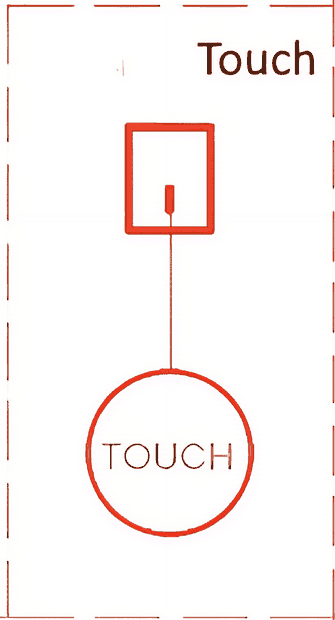
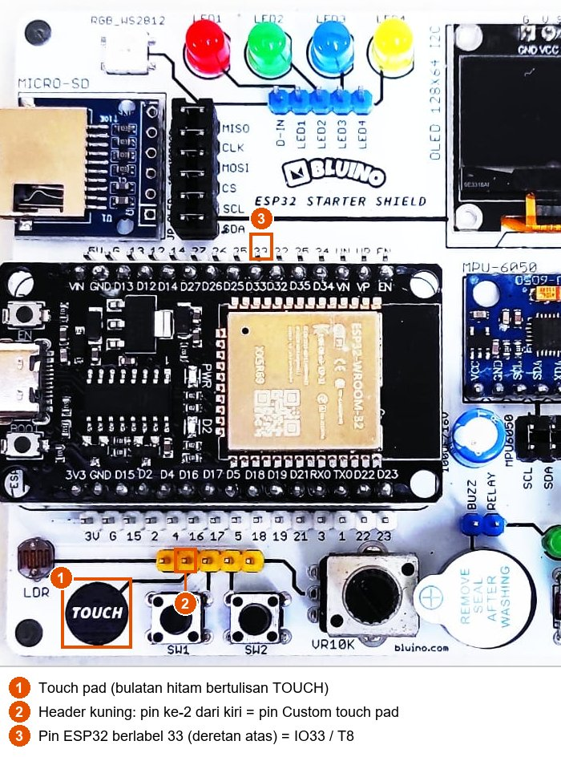
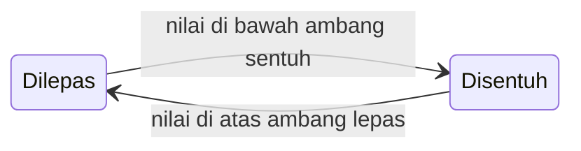

# BAB 14: Capacitive Touch

> ✅ **Prasyarat:** Selesaikan **BAB 9 (Digital Input — Push Button)** dan **BAB 10 (Interrupt & ISR)** — kamu sudah bisa membaca tombol, mendeteksi momen tombol mulai ditekan (*edge detection*), dan mengenal `volatile` serta `IRAM_ATTR`. Cara menyambung LED kit dibahas di **BAB 8 (Digital Output — LED & Buzzer)**.

Tombol lift, lampu meja sentuh, dan layar HP bereaksi hanya dengan sentuhan jari — tanpa tombol yang ditekan sampai berbunyi "klik". Teknologinya disebut **sensor sentuh kapasitif** (*capacitive touch*), dan ESP32 sudah membawanya di dalam chip: cukup sebuah bidang logam, misalnya bulatan **TOUCH** di kit Bluino, maka ESP32 bisa merasakan jari yang menyentuhnya. Di BAB ini kamu belajar membaca nilai sentuhan, menentukan ambang sentuhan lewat kalibrasi, membuat sakelar sentuh, memakai *interrupt* sentuh, dan (opsional) membangunkan ESP32 dari tidur dengan sentuhan.

## 📌 Tujuan Pembelajaran

Setelah mempelajari BAB ini, kamu bisa:

- Menjelaskan cara kerja sensor sentuh kapasitif ESP32 dengan analogi sehari-hari.
- Menyebutkan 10 pin *touch* ESP32 (T0–T9) dan memilih pin yang aman dipakai di kit.
- Menyambungkan *touch pad* kit ke IO33 (T8) dan menjelaskan kenapa tidak boleh bersamaan dengan sensor PIR.
- Membaca nilai sentuhan dengan `touchRead()` dan melihat grafiknya di Serial Plotter.
- Mengalibrasi ambang (*threshold*) dari nilai saat pad tidak disentuh dan saat disentuh, serta meredam derau (*noise*) dengan rata-rata dan histeresis.
- Membuat sakelar sentuh (*toggle*) dengan deteksi tepi.
- Memakai `touchAttachInterrupt()` dan `touchInterruptGetLastStatus()` pada esp32 core 3.3.x.
- (Opsional) Membangunkan ESP32 dari *deep sleep* dengan sentuhan.

## 🧰 Yang Perlu Disiapkan

| Kebutuhan | Keterangan |
|---|---|
| *Hardware* | Kit Bluino ESP32 IoT Starter Shield (ESP32 DEVKIT V1 sudah terpasang di kit) + kabel USB **data** |
| Kabel *jumper* | 2 kabel *female-female*: *touch pad* → IO33 dan LED merah → IO4 — sudah ada di kit |
| Komponen tambahan | Tidak ada — *touch pad* sudah tercetak di PCB kit. Opsional untuk [14.10](#1410-membuat-touch-pad-sendiri) dan latihan: aluminium *foil*, koin, atau klip kertas |
| *Software* | Arduino IDE 2.x + *board package* **esp32** versi 3.3.x (lihat [BAB 5](../BAB-05/README.md)) |
| *Library* | Tidak perlu *library* tambahan — fungsi *touch* sudah ada di *board package* esp32 |
| Alat uji | **Serial Monitor** Arduino IDE (baud 115200) dan **Serial Plotter** |
| Jaringan | Tidak perlu WiFi |

## 📑 Daftar Isi

- [14.1 Cara Kerja Sensor Sentuh Kapasitif](#141-cara-kerja-sensor-sentuh-kapasitif)
- [14.2 Touch Pad pada Kit Bluino](#142-touch-pad-pada-kit-bluino)
- [14.3 Program 1: Membaca Nilai Sentuhan](#143-program-1-membaca-nilai-sentuhan)
- [14.4 Kalibrasi Ambang Sentuhan](#144-kalibrasi-ambang-sentuhan)
- [14.5 Program 2: Kalibrasi Dua Langkah](#145-program-2-kalibrasi-dua-langkah)
- [14.6 Program 3: Sakelar Sentuh (Toggle LED)](#146-program-3-sakelar-sentuh-toggle-led)
- [14.7 Interrupt Sentuh](#147-interrupt-sentuh)
- [14.8 Program 4: Interrupt Sentuh](#148-program-4-interrupt-sentuh)
- [14.9 Program 5: Bangun dari Deep Sleep dengan Sentuhan (Opsional)](#149-program-5-bangun-dari-deep-sleep-dengan-sentuhan-opsional)
- [14.10 Membuat Touch Pad Sendiri](#1410-membuat-touch-pad-sendiri)
- [14.11 Troubleshooting](#1411-troubleshooting)
- [📝 Rangkuman](#-rangkuman)
- [💪 Latihan](#-latihan)
- [📚 Referensi](#-referensi)

---

## 14.1 Cara Kerja Sensor Sentuh Kapasitif

### 14.1.1 Kapasitansi dan Jari Kita

**Kapasitor** adalah komponen yang bisa menyimpan muatan listrik untuk sementara, mirip wadah yang menampung air (kapasitor juga dibahas di [BAB 3](../BAB-03/README.md#310-kapasitor-dan-catu-daya-kit)). Kemampuan menyimpan muatan itu disebut **kapasitansi**, satuannya farad (F). Bukan hanya komponen kapasitor yang punya kapasitansi — setiap benda penghantar listrik juga punya, termasuk sepotong kabel, bidang tembaga di PCB, dan **tubuh manusia**.

Tubuhmu bersifat konduktor (penghantar) dan punya kapasitansi sendiri terhadap lingkungan di sekitarnya. Saat jari menyentuh sebuah bidang logam (*pad*), kapasitansi tubuhmu seolah-olah "ditambahkan" ke kapasitansi pad itu. Jadi pad yang disentuh punya kapasitansi **lebih besar** daripada pad yang tidak disentuh. Perubahan inilah yang dirasakan ESP32.

### 14.1.2 Cara ESP32 Mengukur Sentuhan

ESP32 punya rangkaian khusus untuk mengukur kapasitansi. Rangkaian ini mengisi pad sampai tegangan tertentu, lalu mengosongkannya lagi, berulang-ulang dengan sangat cepat. Selama waktu ukur yang tetap, ESP32 **menghitung berapa kali** siklus isi-kosong itu terjadi. Hasil hitungannya adalah angka yang kamu baca dengan fungsi `touchRead()`.

Analogi: bayangkan kamu mengisi wadah dari keran lalu menuangnya, berulang-ulang selama 1 menit. Kalau wadahnya gelas, kamu bisa mengulangnya berkali-kali. Kalau wadahnya diganti ember, dalam 1 menit kamu hanya sempat beberapa kali.

| Keadaan pad | Kapasitansi | Waktu satu siklus isi-kosong | Angka `touchRead()` |
|---|---|---|---|
| Tidak disentuh | Kecil ("gelas") | Singkat | **Besar** |
| Disentuh jari | Besar ("ember") | Lebih lama | **Kecil** |

Jadi pada ESP32 yang dipakai di kit (ESP32 "klasik", modul ESP32-WROOM-32), **nilai turun saat pad disentuh**.

> ⚠️ **Perhatian:** Chip ESP32-S2 dan ESP32-S3 memakai sensor *touch* generasi berbeda yang nilainya justru **naik** saat disentuh. Kalau kamu menyalin kode dari tutorial untuk ESP32-S2/S3, logika perbandingannya (`<` atau `>`) harus dibalik.

Keunggulan sensor sentuh kapasitif: tidak ada bagian yang bergerak sehingga tidak aus, pad bisa berupa bidang logam apa saja, dan tetap bisa bekerja di balik lapisan plastik atau kaca tipis. Kekurangannya: nilainya mudah terpengaruh kelembapan, tetesan air, kabel yang panjang, dan derau listrik. Karena itu kita perlu **kalibrasi** (dibahas di [14.4](#144-kalibrasi-ambang-sentuhan)).

### 14.1.3 Pin Touch ESP32

ESP32 punya **10 kanal *touch***, diberi nama T0 sampai T9. Setiap kanal terikat ke satu pin GPIO tertentu. Di program, kamu boleh menulis nama kanalnya (`T8`) atau nomor GPIO-nya (`33`) — keduanya sama.

| Kanal | Pin ESP32 | Dipakai untuk apa di kit (Peta Pin Standar) | Bisa dipakai untuk *touch*? |
|---|---|---|---|
| T0 | IO4 | LED merah (`LED1`) | Bisa, kalau kabel `LED1` dilepas |
| T1 | IO0 | Tombol **BOOT** di *board* ESP32; pin *strapping* | Jangan |
| T2 | IO2 | LED biru (`LED3`) + LED bawaan *board*; pin *strapping* | Hindari |
| T3 | IO15 | Tombol S1 (`SW1`); pin *strapping* | Bisa, kalau kabel `SW1` dilepas |
| T4 | IO13 | *Buzzer* (`BUZZ`) | Bisa, kalau kabel `BUZZ` dilepas |
| T5 | IO12 | WS2812 (`D-IN`); pin *strapping* | Hindari |
| T6 | IO14 | DS18B20 (`DS`) | Bisa, kalau kabel `DS` dilepas |
| T7 | IO27 | DHT11 (`DHT`) | Bisa, kalau kabel `DHT` dilepas |
| T8 | IO33 | ***Touch pad* kit (`TOUCH`)**, bergantian dengan PIR (`PIR`) | **Ya — dipakai di BAB ini** |
| T9 | IO32 | Sinyal servo (`SRV`) | Bisa untuk pad kedua, kalau kabel `SRV` dilepas |

Pin yang tertulis "bisa" hanya boleh dipakai untuk *touch* kalau kabel komponennya **tidak sedang dipasang**. Komponen yang tersambung — misalnya resistor *pull-up* 4,7 kΩ di jalur DHT11 dan DS18B20, atau LED dengan resistornya — ikut "menarik" pin sehingga pengukuran kapasitansinya kacau.

Kenapa ada yang "jangan" dan "hindari"? IO0 tersambung ke tombol BOOT dan rangkaian *upload* otomatis di *board*, sedangkan IO2 tersambung permanen ke LED bawaan *board*. IO0, IO2, dan IO12 juga termasuk pin *strapping* (pin yang dibaca ESP32 sesaat setelah dinyalakan untuk menentukan mode *boot*, lihat [BAB 6](../BAB-06/README.md)); IO12, misalnya, ikut menentukan tegangan *flash*. Pin seperti ini lebih aman dibiarkan untuk fungsi bawaannya. IO15 juga pin *strapping*, tetapi terutama hanya mengatur pesan *boot*, sehingga masih aman dipakai sebagai pin *touch*.

---

## 14.2 Touch Pad pada Kit Bluino

### 14.2.1 Rangkaian Touch Pad di Kit

Rangkaian *touch pad* di kit sangat sederhana: bulatan tembaga bertulisan **TOUCH** langsung disambung ke satu pin **Custom**, tanpa resistor atau komponen lain. Semua "kecerdasan"-nya ada di dalam chip ESP32.



*Gambar 14.1 — Rangkaian touch pad pada kit. Sumber: skematik ESP32 Starter Shield 3.2, [Bluino](http://www.bluino.com).*

### 14.2.2 Menyambungkan Kabel Jumper

Pin Custom *touch pad* — disebut pin `TOUCH` — ada di *header* kuning berisi 5 pin di atas tombol SW1–SW2 (*header* yang sama dengan tombol di [BAB 9](../BAB-09/README.md)). Urutan pin kuning dari kiri: `LDR`, `TOUCH`, `SW1`, `SW2`, `VR10K` (potensiometer). Nama-nama itu tidak tercetak tepat di pinnya, jadi kenali dari garis jalur di PCB: garis dari bulatan TOUCH berakhir di pin kuning **ke-2 dari kiri**. Menurut Peta Pin Standar, pin ini disambung ke **IO33 (T8)**, yaitu pin berlabel `33` di deretan pin ESP32 **atas**.



*Gambar 14.2 — Letak touch pad (1), pin Custom touch pad di header kuning (2), dan pin ESP32 berlabel 33 (3) pada kit v3.x; tata letak kit v3.2 milikmu bisa sedikit berbeda. Sumber: foto produk ESP32 Starter Shield, [Bluino](http://www.bluino.com), dipotong dan diberi penanda untuk materi ini.*

| Komponen | Pin Custom di kit | Sambungkan ke pin ESP32 | Letak pin ESP32 |
|---|---|---|---|
| *Touch pad* | `TOUCH` (*header* kuning, pin ke-2 dari kiri) | IO33 / T8 (label `33`) | Deretan atas |
| LED merah (indikator, Program 2–5) | `LED1` (*header* LED) | IO4 (label `4`) | Deretan bawah |

Langkah memasang kabel:

1. Cabut kabel USB dulu supaya aman saat merangkai.
2. Kalau masih ada kabel dari pin `PIR` (*header* hijau di sebelah kanan MPU-6050) ke pin `33` dari BAB lain, **lepas dulu**.
3. Pasang kabel *jumper* dari pin `TOUCH` (pin kuning ke-2) ke pin berlabel **33** di deretan pin ESP32 atas.
4. Pasang kabel *jumper* dari `LED1` (LED merah) ke pin berlabel **4** di deretan bawah (sama seperti di [BAB 8](../BAB-08/README.md)).
5. Sambungkan kembali kabel USB ke laptop/komputer.

> ⚠️ **Perhatian:** Menurut Peta Pin Standar, sensor PIR (pin `PIR`) **juga** memakai IO33. Pasang **salah satu saja**. Keluaran PIR aktif mendorong pin menjadi HIGH atau LOW, sehingga kalau keduanya tersambung, pengukuran sentuhan menjadi kacau.

> 💡 **Tips:** Kabel *jumper* ikut menjadi bagian dari sensor. Menyentuh kabelnya, menggerakkannya, atau meletakkan tangan di dekatnya akan mengubah nilai sentuhan. Biarkan kabel diam dan sentuh bulatan TOUCH dengan ujung jari.

> 📌 **Catatan:** Angka `2 4 16 17 5 18` yang tercetak tepat di atas *header* kuning adalah label **deretan pin ESP32 bawah** (pin putih di atasnya), bukan nama pin kuning. Pin kuning ke-2 memang berada di dekat tulisan `4` dan `16`, tetapi pin itu **bukan** IO4 atau IO16 — itu pin Custom milik *touch pad*.

---

## 14.3 Program 1: Membaca Nilai Sentuhan

**Tujuan:** Menampilkan nilai `touchRead()` dari *touch pad* kit 10 kali per detik, supaya kamu bisa melihat sendiri berapa nilainya saat pad tidak disentuh dan saat disentuh. Angka-angka inilah bekal untuk kalibrasi di program berikutnya.

**Rangkaian:**

| Pin **Custom** di kit | Sambungkan ke pin ESP32 |
|---|---|
| `TOUCH` (*touch pad*, pin kuning ke-2) | IO33 (T8) |

**Cara Menjalankan:**

1. Sambungkan kabel *jumper* sesuai tabel **Rangkaian** di atas (lihat juga [14.2.2](#1422-menyambungkan-kabel-jumper)). Pastikan tidak ada kabel dari pin `PIR` di pin `33`.
2. Buka Arduino IDE → **File → New Sketch**, hapus isinya, lalu salin kode di bawah. Kode yang sama juga tersedia di *file* [`p1_baca_touch.ino`](p1_baca_touch/p1_baca_touch.ino).
3. Pastikan **Tools → Board** = **ESP32 Dev Module** dan **Tools → Port** = *port* ESP32 kamu (misalnya `COM5` di Windows atau `/dev/ttyUSB0` di Linux).
4. Klik tombol **Upload** (ikon panah →) dan tunggu sampai muncul tulisan **Done uploading**.
5. Buka **Serial Monitor** (**Tools → Serial Monitor**) lalu pilih baud **115200**. Amati angkanya, lalu sentuh bulatan TOUCH dengan ujung jari selama beberapa detik dan lepaskan lagi.
6. Untuk melihat grafiknya, buka **Tools → Serial Plotter** dan pilih baud **115200**.

**Kode Program:**

<!-- sketch: p1_baca_touch -->
```cpp
/*
 * BAB 14 - Program 1: Membaca Nilai Sentuhan
 * Menampilkan nilai touchRead() dari touch pad kit setiap 100 ms.
 * Pada ESP32 "klasik", nilainya TURUN saat pad disentuh.
 *
 * Rangkaian: TOUCH (touch pad, header kuning) → IO33 (T8)
 */

#define TOUCH_PIN T8  // T8 = kanal touch di IO33

void setup() {
  Serial.begin(115200);
  delay(1000);  // beri waktu Serial Monitor tersambung

  Serial.println("BAB 14 - Program 1: Membaca Nilai Sentuhan");
  Serial.println("Sentuh pad TOUCH dan perhatikan nilainya turun.");
}

void loop() {
  uint32_t nilai = touchRead(TOUCH_PIN);  // baca nilai sentuhan terbaru

  Serial.print("Sentuh:");  // format "label:nilai" juga bisa digambar Serial Plotter
  Serial.println(nilai);

  delay(100);  // 10 kali per detik
}
```

**Penjelasan Kode:**

- `#define TOUCH_PIN T8` memberi nama untuk kanal *touch* T8, yaitu IO33. Menulis `33` juga boleh, tetapi `T8` mengingatkan bahwa pin ini dipakai sebagai pin *touch*.
- Pin *touch* **tidak perlu** `pinMode()`. Saat `touchRead()` dipanggil pertama kali, esp32 core otomatis menyiapkan sensor *touch* untuk pin itu.
- `touchRead()` mengembalikan bilangan bulat positif. Hasilnya disimpan di variabel bertipe `uint32_t` (*unsigned integer* 32 bit: bilangan bulat yang tidak bisa negatif, sampai sekitar 4,29 miliar) karena di esp32 core 3.3.x tipe itulah yang dipakai fungsi ini.
- Di esp32 core 3.3.x, sensor *touch* mengukur terus-menerus di latar belakang dan hasilnya dihaluskan (*smoothing*) oleh *driver* sekitar setiap 10 ms. `touchRead()` hanya mengambil hasil terbaru itu, jadi pemanggilannya sangat cepat dan tidak menghambat program.
- Teks dicetak dengan format `Sentuh:1030` (label, titik dua, angka, tanpa spasi). Format ini nyaman dibaca di Serial Monitor sekaligus bisa digambar sebagai grafik oleh Serial Plotter dengan nama garis "Sentuh".

**Contoh Output:**

```text
BAB 14 - Program 1: Membaca Nilai Sentuhan
Sentuh pad TOUCH dan perhatikan nilainya turun.
Sentuh:1032
Sentuh:1030
Sentuh:1031
Sentuh:614
Sentuh:268
Sentuh:259
Sentuh:262
Sentuh:657
Sentuh:1029
Sentuh:1031
```

Baris `Sentuh:614` dan `Sentuh:657` adalah nilai "peralihan" saat jari baru menempel atau baru diangkat, karena *driver* menghaluskan perubahannya. Di Serial Plotter, sentuhan tampak sebagai lembah yang dalam: garis turun tajam saat pad disentuh dan naik kembali saat dilepas.

> 📌 **Catatan:** Angka di kit kamu hampir pasti **berbeda** dengan contoh di atas — bisa ratusan, bisa ribuan, tergantung *board*, panjang kabel, cara menyentuh, dan sumber daya USB. Tutorial lama di internet (esp32 core 1.x/2.x) sering menampilkan angka puluhan, misalnya 60–80, karena waktu ukurnya sekitar 0,5 ms. Di esp32 core 3.3.x, waktu ukurnya sekitar 5 ms (kira-kira 10 kali lebih lama), sehingga angkanya jauh lebih besar. Yang penting bukan angkanya, melainkan **polanya**: nilai turun jelas saat disentuh.

> 🧪 **Coba Sendiri:** Catat tiga angka: nilai saat pad tidak disentuh, saat disentuh ringan dengan ujung jari, dan saat ditekan dengan seluruh permukaan jari. Coba juga mendekatkan jari tanpa menyentuh. Angka-angka ini dipakai di [14.4](#144-kalibrasi-ambang-sentuhan).

**Kalau Belum Berhasil:**

- **Nilai tidak berubah saat pad disentuh** → kabel tidak tersambung ke pin `TOUCH` (pin kuning ke-2) atau tidak ke pin berlabel `33` di deretan **atas**. Lepas juga kabel dari pin `PIR` kalau masih tersambung ke pin `33`.
- **Nilai selalu `0`** → `TOUCH_PIN` diisi pin yang bukan pin *touch* (misalnya 34 atau 35). Pakai `T8` atau `33`.
- **Nilai naik-turun sendiri walau tidak disentuh** → perubahan beberapa angka itu normal (derau). Kalau perubahannya besar, pastikan kabel *jumper* tidak tersentuh atau bergoyang dan tanganmu tidak berada di dekat kabel.
- **Serial Monitor kosong atau berisi karakter aneh** → pilih baud **115200**, lalu tekan tombol **EN** di *board* untuk memulai ulang program.

---

## 14.4 Kalibrasi Ambang Sentuhan

### 14.4.1 Apa Itu Ambang dan Kenapa Perlu Kalibrasi

Program perlu sebuah **ambang** (*threshold*): angka batas untuk memutuskan "disentuh" atau "tidak". Di ESP32 klasik aturannya: **nilai di bawah ambang = disentuh**. Mirip batas nilai kelulusan ujian — nilai di bawah batas berarti harus remedial.

Banyak tutorial lama menulis ambang tetap, misalnya `if (nilai < 30)`. Cara itu rapuh karena nilai *touch* berbeda di setiap *board*, kabel, versi esp32 core, bahkan berubah mengikuti kelembapan udara. Ambang milik orang lain bisa membuat sentuhanmu tidak pernah terdeteksi, atau sebaliknya terdeteksi terus walau tidak disentuh. Karena itu, **ukur dulu, baru tentukan ambangnya**. Proses ini disebut **kalibrasi**.

Resep kalibrasi dua langkah:

1. Ukur nilai saat pad **tidak disentuh** (ambil rata-ratanya), misalnya 1030.
2. Ukur nilai saat pad **disentuh**, misalnya 260.
3. Pilih ambang **di tengah-tengah**: (1030 + 260) ÷ 2 = 645. Dengan ambang di tengah, jarak aman ke kedua keadaan sama besar.

Ada juga cara yang lebih praktis untuk program sehari-hari: saat program mulai, ukur hanya nilai tanpa sentuhan, lalu tetapkan ambang sebagai **persentase** dari nilai itu, misalnya 70% × 1030 ≈ 721. Cara ini bekerja kalau nilai saat disentuh jauh di bawah persentase itu. Program 2 di [14.5](#145-program-2-kalibrasi-dua-langkah) menghitung "persentase sentuh" milik kit kamu supaya kamu bisa memilih angka persen yang pas.

### 14.4.2 Meredam Derau dengan Rata-Rata

Nilai *touch* selalu bergoyang sedikit walau pad tidak disentuh. Goyangan acak ini disebut **derau** (*noise*). Untuk kalibrasi, satu kali baca saja tidak cukup — ambil beberapa bacaan lalu hitung **rata-ratanya**:

```cpp
// Potongan kode: rata-rata beberapa bacaan touchRead()
uint32_t bacaRataRata(int jumlah) {
  uint32_t total = 0;
  for (int i = 0; i < jumlah; i++) {
    total += touchRead(TOUCH_PIN);
    delay(20);  // beri jeda: driver memperbarui nilai sekitar setiap 10 ms
  }
  return total / jumlah;
}
```

Jeda `delay(20)` penting. Karena *driver* hanya memperbarui nilai sekitar setiap 10 ms, membaca 50 kali tanpa jeda hanya menghasilkan angka yang sama 50 kali. Dengan 50 bacaan berjeda 20 ms, kalibrasi memakan waktu sekitar 1 detik.

### 14.4.3 Histeresis: Dua Ambang Supaya Tidak Berkedip

Kalau hanya ada satu ambang, nilai yang berada tepat di sekitar ambang (misalnya saat jari menyentuh dengan ragu-ragu) bisa membuat status berganti-ganti "disentuh–dilepas–disentuh" dalam waktu singkat. Solusinya adalah **histeresis**: memakai dua ambang yang berbeda.

- **Ambang sentuh** (lebih rendah): status berubah menjadi "disentuh" hanya kalau nilai turun **di bawah** ambang ini.
- **Ambang lepas** (lebih tinggi): status kembali "dilepas" hanya kalau nilai naik **di atas** ambang ini.
- Di antara kedua ambang, status **tidak berubah**.

Termostat AC bekerja dengan cara serupa: kompresor menyala saat suhu naik di atas 26 °C dan baru mati saat suhu turun di bawah 24 °C, sehingga tidak hidup-mati terus di sekitar 25 °C.



*Gambar 14.3 — Status pad dengan histeresis: di antara kedua ambang, status tetap seperti sebelumnya. Sumber: dibuat untuk materi ini.*

Histeresis dipakai di Program 3. Mirip *debounce* tombol di [BAB 9](../BAB-09/README.md), tujuannya sama: satu sentuhan dihitung tepat satu kali.

---

## 14.5 Program 2: Kalibrasi Dua Langkah

**Tujuan:** Memandu kamu mengukur nilai pad saat tidak disentuh dan saat disentuh, menghitung ambang di tengah-tengahnya, lalu memakai ambang itu untuk menyalakan LED merah selama pad disentuh.

**Rangkaian:**

| Pin **Custom** di kit | Sambungkan ke pin ESP32 |
|---|---|
| `TOUCH` (*touch pad*, pin kuning ke-2) | IO33 (T8) |
| `LED1` (LED merah) | IO4 |

**Cara Menjalankan:**

1. Sambungkan kedua kabel *jumper* sesuai tabel **Rangkaian** di atas.
2. Buka Arduino IDE → **File → New Sketch**, hapus isinya, lalu salin kode di bawah. Kode yang sama juga tersedia di *file* [`p2_kalibrasi_touch.ino`](p2_kalibrasi_touch/p2_kalibrasi_touch.ino).
3. Pastikan **Tools → Board** = **ESP32 Dev Module** dan **Tools → Port** = *port* ESP32 kamu.
4. Klik tombol **Upload** dan tunggu sampai muncul tulisan **Done uploading**.
5. Buka **Serial Monitor** (**Tools → Serial Monitor**) lalu pilih baud **115200**. Tekan tombol **EN** di *board* supaya program mulai dari awal sambil kamu membaca petunjuknya.
6. Ikuti petunjuk di Serial Monitor: pada **Langkah 1** jauhkan tangan dari pad; pada **Langkah 2** sentuh dan tahan pad sampai muncul tulisan `Silakan lepaskan jari.`

**Kode Program:**

<!-- sketch: p2_kalibrasi_touch -->
```cpp
/*
 * BAB 14 - Program 2: Kalibrasi Dua Langkah
 * 1) Ukur nilai saat pad TIDAK disentuh, 2) ukur nilai saat pad DISENTUH,
 * 3) hitung ambang di tengah-tengahnya, lalu pakai untuk menyalakan LED.
 *
 * Rangkaian:
 *   TOUCH (touch pad, header kuning) → IO33 (T8)
 *   LED1 (LED merah, header LED)     → IO4
 */

#define TOUCH_PIN T8  // T8 = IO33
#define LED_MERAH 4

const int JUMLAH_SAMPEL = 50;  // 50 bacaan x 20 ms = sekitar 1 detik

uint32_t ambang = 0;           // hasil kalibrasi
bool statusTerakhir = false;   // false = dilepas, true = disentuh

// Rata-rata beberapa bacaan supaya derau teredam
uint32_t bacaRataRata(int jumlah) {
  uint32_t total = 0;
  for (int i = 0; i < jumlah; i++) {
    total += touchRead(TOUCH_PIN);
    delay(20);  // driver memperbarui nilai sekitar setiap 10 ms
  }
  return total / jumlah;
}

// Menampilkan hitung mundur "3... 2... 1..." di Serial Monitor
void hitungMundur(int detik) {
  for (int i = detik; i > 0; i--) {
    Serial.print(i);
    Serial.print("... ");
    delay(1000);
  }
  Serial.println();
}

void setup() {
  Serial.begin(115200);
  pinMode(LED_MERAH, OUTPUT);
  digitalWrite(LED_MERAH, LOW);
  delay(1000);  // beri waktu Serial Monitor tersambung

  Serial.println("BAB 14 - Program 2: Kalibrasi Dua Langkah");

  // Langkah 1: pad tidak disentuh
  Serial.println("Langkah 1: JANGAN sentuh pad. Mengukur dalam");
  hitungMundur(3);
  uint32_t nilaiLepas = bacaRataRata(JUMLAH_SAMPEL);
  Serial.print("Nilai tanpa sentuhan : ");
  Serial.println(nilaiLepas);

  // Langkah 2: pad disentuh
  Serial.println("Langkah 2: SENTUH dan TAHAN pad. Mengukur dalam");
  hitungMundur(3);
  uint32_t nilaiSentuh = bacaRataRata(JUMLAH_SAMPEL);
  Serial.print("Nilai saat disentuh  : ");
  Serial.println(nilaiSentuh);
  Serial.println("Silakan lepaskan jari.");

  // Langkah 3: ambang di tengah-tengah kedua nilai
  ambang = (nilaiLepas + nilaiSentuh) / 2;
  Serial.print("Ambang (tengah-tengah): ");
  Serial.println(ambang);

  if (nilaiLepas > 0) {
    Serial.print("Persentase sentuh    : ");
    Serial.print(nilaiSentuh * 100 / nilaiLepas);
    Serial.println("% dari nilai tanpa sentuhan");
  }

  // Penurunan kurang dari 20% dianggap terlalu kecil untuk deteksi yang andal
  if (nilaiSentuh * 10 > nilaiLepas * 8) {
    Serial.println("PERINGATAN: perbedaannya terlalu kecil!");
    Serial.println("Cek kabel touch pad -> IO33, lalu tekan EN untuk mengulang.");
  }

  Serial.println("Kalibrasi selesai. Sentuh pad untuk menyalakan LED merah.");
}

void loop() {
  uint32_t nilai = touchRead(TOUCH_PIN);
  bool disentuh = (nilai < ambang);  // ESP32 klasik: disentuh = nilai di bawah ambang

  digitalWrite(LED_MERAH, disentuh ? HIGH : LOW);

  // Cetak hanya saat status berubah, supaya Serial Monitor tidak banjir
  if (disentuh != statusTerakhir) {
    Serial.print(disentuh ? "Disentuh" : "Dilepas");
    Serial.print(" (nilai ");
    Serial.print(nilai);
    Serial.println(")");
    statusTerakhir = disentuh;
  }

  delay(20);
}
```

**Penjelasan Kode:**

- `bacaRataRata()` menjumlahkan 50 bacaan berjeda 20 ms, lalu membaginya dengan 50. Hasilnya lebih stabil daripada satu kali baca (lihat [14.4.2](#1442-meredam-derau-dengan-rata-rata)).
- `hitungMundur(3)` memberi waktu 3 detik untuk bersiap sebelum setiap pengukuran. Pengukurannya sendiri berlangsung sekitar 1 detik setelah hitung mundur selesai, jadi tahan jari sampai muncul tulisan `Silakan lepaskan jari.`
- Ambang dihitung `(nilaiLepas + nilaiSentuh) / 2`, persis seperti resep di [14.4.1](#1441-apa-itu-ambang-dan-kenapa-perlu-kalibrasi).
- "Persentase sentuh" = nilai saat disentuh dibagi nilai tanpa sentuhan × 100. Angka ini berguna untuk Program 3 dan 4. Baris `if (nilaiLepas > 0)` mencegah pembagian dengan nol kalau sensor ternyata tidak terbaca.
- Pemeriksaan `nilaiSentuh * 10 > nilaiLepas * 8` sama artinya dengan "nilai saat disentuh lebih dari 80% nilai tanpa sentuhan". Bentuk perkalian dipakai supaya tidak ada pembulatan pecahan pada bilangan bulat.
- Di `loop()`, LED merah menyala selama nilai di bawah ambang. Variabel `statusTerakhir` dipakai agar pesan hanya dicetak saat status **berubah** — teknik yang sama dengan deteksi tepi di [BAB 9](../BAB-09/README.md).

**Contoh Output:**

```text
BAB 14 - Program 2: Kalibrasi Dua Langkah
Langkah 1: JANGAN sentuh pad. Mengukur dalam
3... 2... 1...
Nilai tanpa sentuhan : 1031
Langkah 2: SENTUH dan TAHAN pad. Mengukur dalam
3... 2... 1...
Nilai saat disentuh  : 262
Silakan lepaskan jari.
Ambang (tengah-tengah): 646
Persentase sentuh    : 25% dari nilai tanpa sentuhan
Kalibrasi selesai. Sentuh pad untuk menyalakan LED merah.
Disentuh (nilai 598)
Dilepas (nilai 671)
Disentuh (nilai 611)
Dilepas (nilai 702)
```

Di kit: LED merah menyala selama pad disentuh dan mati begitu jari diangkat. Angka di dalam kurung adalah nilai pertama yang melewati ambang, jadi nilainya dekat dengan ambang. Angka hasil kalibrasimu tentu berbeda dengan contoh ini.

> 💡 **Tips:** Catat **persentase sentuh** milikmu. Kalau hasilnya 25%, ambang 70% di Program 3 sudah aman. Kalau hasilnya besar, misalnya 75%, pilih persentase ambang di tengah antara angka itu dan 100%, misalnya 87%.

**Kalau Belum Berhasil:**

- **Muncul `PERINGATAN: perbedaannya terlalu kecil!`** → pad mungkin tidak tersentuh saat Langkah 2, atau kabel belum tersambung ke IO33. Periksa kabel, lalu tekan **EN** dan ulangi dengan menyentuh pad sampai tulisan `Silakan lepaskan jari.` muncul.
- **LED menyala terus walau pad tidak disentuh** → kamu menyentuh pad (atau kabelnya) saat Langkah 1, sehingga nilai tanpa sentuhan terukur terlalu rendah. Tekan **EN** dan ulangi kalibrasi.
- **Pesan `Disentuh`/`Dilepas` muncul berganti-ganti dengan cepat saat jari diam** → jari menyentuh pad sangat ringan sehingga nilainya tepat di sekitar ambang. Tekan pad lebih mantap. Program 3 mengatasi masalah ini dengan histeresis.

---

## 14.6 Program 3: Sakelar Sentuh (Toggle LED)

**Tujuan:** Membuat sakelar sentuh seperti lampu meja sentuh: sentuh sekali → LED merah menyala, sentuh lagi → LED mati. Ambang dihitung otomatis saat program mulai, dan histeresis memastikan satu sentuhan dihitung tepat satu kali.

**Rangkaian:**

| Pin **Custom** di kit | Sambungkan ke pin ESP32 |
|---|---|
| `TOUCH` (*touch pad*, pin kuning ke-2) | IO33 (T8) |
| `LED1` (LED merah) | IO4 |

**Cara Menjalankan:**

1. Biarkan kabel *jumper* seperti pada Program 2.
2. Buka Arduino IDE → **File → New Sketch**, hapus isinya, lalu salin kode di bawah. Kode yang sama juga tersedia di *file* [`p3_sakelar_sentuh.ino`](p3_sakelar_sentuh/p3_sakelar_sentuh.ino).
3. Kalau persentase sentuh hasil Program 2 lebih dari 50%, sesuaikan dulu `PERSEN_SENTUH` dan `PERSEN_LEPAS` (lihat **Penjelasan Kode**).
4. Pastikan **Tools → Board** = **ESP32 Dev Module** dan **Tools → Port** = *port* ESP32 kamu.
5. Klik tombol **Upload** dan tunggu sampai muncul tulisan **Done uploading**. **Jangan sentuh pad** selama sekitar 2 detik setelah *upload* atau setelah menekan **EN**, karena saat itulah program mengukur nilai tanpa sentuhan.
6. Buka **Serial Monitor** (**Tools → Serial Monitor**) lalu pilih baud **115200**.

**Kode Program:**

<!-- sketch: p3_sakelar_sentuh -->
```cpp
/*
 * BAB 14 - Program 3: Sakelar Sentuh (Toggle LED)
 * Sentuh sekali = LED menyala, sentuh lagi = LED mati.
 * Ambang dihitung otomatis dari nilai tanpa sentuhan, memakai histeresis.
 *
 * Rangkaian:
 *   TOUCH (touch pad, header kuning) → IO33 (T8)
 *   LED1 (LED merah, header LED)     → IO4
 */

#define TOUCH_PIN T8  // T8 = IO33
#define LED_MERAH 4

// Ambang dalam persen dari nilai tanpa sentuhan (sesuaikan dengan hasil Program 2)
const uint32_t PERSEN_SENTUH = 70;  // nilai di bawah 70% → dianggap disentuh
const uint32_t PERSEN_LEPAS  = 85;  // nilai di atas 85% → dianggap dilepas

uint32_t ambangSentuh = 0;
uint32_t ambangLepas  = 0;

bool disentuh = false;   // status pad saat ini
bool ledNyala = false;   // status LED saat ini
int jumlahSentuhan = 0;

// Rata-rata beberapa bacaan supaya derau teredam
uint32_t bacaRataRata(int jumlah) {
  uint32_t total = 0;
  for (int i = 0; i < jumlah; i++) {
    total += touchRead(TOUCH_PIN);
    delay(20);  // driver memperbarui nilai sekitar setiap 10 ms
  }
  return total / jumlah;
}

void setup() {
  Serial.begin(115200);
  pinMode(LED_MERAH, OUTPUT);
  digitalWrite(LED_MERAH, LOW);
  delay(1000);  // beri waktu Serial Monitor tersambung

  Serial.println("BAB 14 - Program 3: Sakelar Sentuh");
  Serial.println("Kalibrasi... jangan sentuh pad selama 1 detik.");

  uint32_t nilaiLepas = bacaRataRata(50);
  ambangSentuh = nilaiLepas * PERSEN_SENTUH / 100;
  ambangLepas  = nilaiLepas * PERSEN_LEPAS / 100;

  Serial.print("Nilai tanpa sentuhan: ");
  Serial.print(nilaiLepas);
  Serial.print(" | ambang sentuh: ");
  Serial.print(ambangSentuh);
  Serial.print(" | ambang lepas: ");
  Serial.println(ambangLepas);
  Serial.println("Siap! Sentuh pad untuk menyalakan/mematikan LED.");
}

void loop() {
  uint32_t nilai = touchRead(TOUCH_PIN);

  if (!disentuh && nilai < ambangSentuh) {
    // Momen pad MULAI disentuh (tepi) → balik keadaan LED
    disentuh = true;
    ledNyala = !ledNyala;
    digitalWrite(LED_MERAH, ledNyala ? HIGH : LOW);

    jumlahSentuhan++;
    Serial.print("Sentuhan ke-");
    Serial.print(jumlahSentuhan);
    Serial.print(": LED ");
    Serial.println(ledNyala ? "NYALA" : "MATI");
  } else if (disentuh && nilai > ambangLepas) {
    // Jari sudah benar-benar lepas → siap menerima sentuhan berikutnya
    disentuh = false;
  }
  // Nilai di antara kedua ambang: status tidak berubah (histeresis)

  delay(20);
}
```

**Penjelasan Kode:**

- Saat program mulai, `bacaRataRata(50)` mengukur nilai tanpa sentuhan selama sekitar 1 detik. Dari nilai itu dihitung dua ambang: **ambang sentuh** 70% dan **ambang lepas** 85% (lihat [14.4.3](#1443-histeresis-dua-ambang-supaya-tidak-berkedip)).
- Perkaliannya ditulis `nilaiLepas * PERSEN_SENTUH / 100` (kali dulu, baru bagi). Kalau ditulis `PERSEN_SENTUH / 100 * nilaiLepas`, hasil `70 / 100` pada bilangan bulat adalah 0, sehingga ambangnya selalu 0.
- Variabel `disentuh` menyimpan status pad. LED hanya dibalik pada **momen** status berubah dari "dilepas" menjadi "disentuh" — inilah deteksi tepi, sama seperti tombol di [BAB 9](../BAB-09/README.md). Selama jari masih menempel, LED tidak berkedip-kedip.
- Status baru kembali "dilepas" kalau nilai naik di atas ambang lepas. Selama nilai berada di antara kedua ambang, tidak terjadi apa-apa. Jadi sentuhan yang ragu-ragu tidak terhitung berkali-kali.
- Cara memilih angka persen: `PERSEN_SENTUH` sebaiknya di tengah antara persentase sentuh hasil Program 2 dan 100%, sedangkan `PERSEN_LEPAS` sedikit di atasnya (tetapi tetap di bawah ±95%, supaya derau tidak dianggap sentuhan). Contoh: persentase sentuh 25% → 70 dan 85 sudah pas; persentase sentuh 75% → coba 87 dan 93.

**Contoh Output:**

```text
BAB 14 - Program 3: Sakelar Sentuh
Kalibrasi... jangan sentuh pad selama 1 detik.
Nilai tanpa sentuhan: 1030 | ambang sentuh: 721 | ambang lepas: 875
Siap! Sentuh pad untuk menyalakan/mematikan LED.
Sentuhan ke-1: LED NYALA
Sentuhan ke-2: LED MATI
Sentuhan ke-3: LED NYALA
```

Di kit: setiap kali kamu menyentuh pad, LED merah berganti keadaan — menyala, lalu mati pada sentuhan berikutnya, dan seterusnya. Menahan jari lama di pad tetap dihitung satu sentuhan.

**Kalau Belum Berhasil:**

- **Sentuhan tidak pernah terdeteksi** → pad tersentuh saat kalibrasi (nilai tanpa sentuhan jadi terlalu kecil), atau `PERSEN_SENTUH` terlalu kecil untuk kit kamu. Tekan **EN** tanpa menyentuh pad; kalau masih gagal, naikkan `PERSEN_SENTUH` sesuai hasil Program 2.
- **LED berganti sendiri tanpa disentuh** → `PERSEN_SENTUH` atau `PERSEN_LEPAS` terlalu dekat dengan 100% sehingga derau dianggap sentuhan. Turunkan angkanya dan pastikan kabel *jumper* tidak bergoyang.
- **Satu sentuhan terhitung dua kali** → jarak antara `PERSEN_SENTUH` dan `PERSEN_LEPAS` terlalu sempit. Perlebar jaraknya, misalnya 65 dan 85.

---

## 14.7 Interrupt Sentuh

Program 2 dan 3 memakai cara *polling*: `loop()` terus-menerus bertanya "nilainya berapa?". Seperti tombol di [BAB 10](../BAB-10/README.md), sensor *touch* juga bisa memakai cara *interrupt*: kamu mendaftarkan sebuah fungsi, lalu *driver touch* memanggil fungsi itu sendiri saat pad disentuh. `loop()` tidak perlu terus memeriksa nilai pad.

### 14.7.1 Fungsi Interrupt Touch di Core 3.3.x

| Fungsi | Kegunaan |
|---|---|
| `touchAttachInterrupt(pin, fungsi, ambang)` | Mendaftarkan `fungsi` yang dipanggil saat pad **disentuh dan saat dilepas** |
| `touchInterruptGetLastStatus(pin)` | Mengembalikan `true` kalau status terakhir pad "disentuh", `false` kalau "dilepas" |
| `touchDetachInterrupt(pin)` | Berhenti memanggil fungsi tadi |
| `touchSetDefaultThreshold(persen)` | Mengatur ambang otomatis yang dipakai kalau `ambang` diisi 0 (panggil sebelum fungsi *touch* lain) |

Hal-hal yang perlu kamu tahu tentang `touchAttachInterrupt()` di esp32 core 3.3.x:

- **`ambang` adalah angka mutlak** dengan satuan yang sama seperti hasil `touchRead()`. Pada ESP32 klasik, pad dianggap disentuh saat nilainya (yang sudah dihaluskan) turun di bawah `ambang`. Jadi ambang tetap harus dikalibrasi seperti di [14.4](#144-kalibrasi-ambang-sentuhan).
- Kalau `ambang` diisi **0**, *driver* memakai ambang otomatis: nilai awal pad dikurangi 1,5%. Untuk ESP32 klasik, selisih 1,5% itu sangat kecil sehingga derau saja bisa dianggap sentuhan. Lebih aman memberi ambang hasil kalibrasimu sendiri.
- Fungsi yang didaftarkan dipanggil **dua kali** untuk setiap sentuhan: sekali saat pad mulai disentuh, sekali lagi saat dilepas. Panggil `touchInterruptGetLastStatus()` untuk membedakan keduanya.
- Pada ESP32 klasik, *driver* memeriksa status pad sekitar setiap 10 ms, jadi reaksinya tetap terasa seketika bagi manusia.

> ⚠️ **Perhatian:** Pada esp32 core lama (1.x/2.x), fungsi *interrupt touch* di ESP32 klasik dipanggil **berulang-ulang** selama pad disentuh dan tidak dipanggil saat dilepas. Banyak tutorial lama ditulis berdasarkan perilaku itu. Di esp32 core 3.3.x perilakunya sudah berbeda seperti dijelaskan di atas, jadi kode lama bisa bertingkah aneh — misalnya LED berkedip dua kali untuk satu sentuhan.

### 14.7.2 Aturan Fungsi Callback

Fungsi yang dipanggil oleh *driver* disebut ***callback***. Fungsi ini berjalan di luar `loop()`, sama seperti ISR (*Interrupt Service Routine*) di [BAB 10](../BAB-10/README.md), jadi ikuti aturan yang sama:

- Buat sesingkat mungkin — cukup mengubah sebuah variabel penanda (*flag*).
- Variabel yang diubah di *callback* dan dibaca di `loop()` diberi kata kunci `volatile`.
- Jangan memanggil `Serial.print()` atau `delay()` di dalamnya. Kerjakan semua itu di `loop()` setelah melihat penandanya.
- Beri tanda `IRAM_ATTR` seperti ISR di BAB 10, supaya fungsi disimpan di RAM internal dan aman dipanggil kapan saja.

---

## 14.8 Program 4: Interrupt Sentuh

**Tujuan:** Menyalakan LED merah selama pad disentuh dan mematikannya saat dilepas, memakai `touchAttachInterrupt()`. `loop()` hanya bereaksi saat ada kejadian, sehingga bebas mengerjakan tugas lain — di sini dicontohkan dengan pesan "loop tetap berjalan" setiap 5 detik.

**Rangkaian:**

| Pin **Custom** di kit | Sambungkan ke pin ESP32 |
|---|---|
| `TOUCH` (*touch pad*, pin kuning ke-2) | IO33 (T8) |
| `LED1` (LED merah) | IO4 |

**Cara Menjalankan:**

1. Biarkan kabel *jumper* seperti pada Program 2 dan 3.
2. Buka Arduino IDE → **File → New Sketch**, hapus isinya, lalu salin kode di bawah. Kode yang sama juga tersedia di *file* [`p4_interrupt_touch.ino`](p4_interrupt_touch/p4_interrupt_touch.ino).
3. Pastikan **Tools → Board** = **ESP32 Dev Module** dan **Tools → Port** = *port* ESP32 kamu.
4. Klik tombol **Upload** dan tunggu sampai muncul tulisan **Done uploading**. Jangan sentuh pad selama sekitar 2 detik setelahnya (kalibrasi).
5. Buka **Serial Monitor** (**Tools → Serial Monitor**) lalu pilih baud **115200**. Sentuh pad, tahan sebentar, lalu lepaskan.

**Kode Program:**

<!-- sketch: p4_interrupt_touch -->
```cpp
/*
 * BAB 14 - Program 4: Interrupt Sentuh
 * Driver touch memanggil fungsi kita saat pad disentuh DAN saat dilepas.
 * loop() hanya bereaksi kalau ada kejadian; selebihnya bebas mengerjakan hal lain.
 *
 * Rangkaian:
 *   TOUCH (touch pad, header kuning) → IO33 (T8)
 *   LED1 (LED merah, header LED)     → IO4
 */

#define TOUCH_PIN T8  // T8 = IO33
#define LED_MERAH 4

const uint32_t PERSEN_AMBANG = 70;  // disentuh jika nilai < 70% nilai tanpa sentuhan

volatile bool adaKejadian = false;  // diubah oleh callback, dibaca oleh loop()
unsigned long waktuPesan = 0;       // untuk pesan berkala di loop()

// Callback: dipanggil driver touch saat pad disentuh atau dilepas.
// Perlakukan seperti ISR: singkat, tanpa Serial.print() dan delay().
void IRAM_ATTR saatPadBerubah() {
  adaKejadian = true;
}

// Rata-rata beberapa bacaan supaya derau teredam
uint32_t bacaRataRata(int jumlah) {
  uint32_t total = 0;
  for (int i = 0; i < jumlah; i++) {
    total += touchRead(TOUCH_PIN);
    delay(20);  // driver memperbarui nilai sekitar setiap 10 ms
  }
  return total / jumlah;
}

void setup() {
  Serial.begin(115200);
  pinMode(LED_MERAH, OUTPUT);
  digitalWrite(LED_MERAH, LOW);
  delay(1000);  // beri waktu Serial Monitor tersambung

  Serial.println("BAB 14 - Program 4: Interrupt Sentuh");
  Serial.println("Kalibrasi... jangan sentuh pad selama 1 detik.");

  uint32_t nilaiLepas = bacaRataRata(50);
  uint32_t ambang = nilaiLepas * PERSEN_AMBANG / 100;

  Serial.print("Nilai tanpa sentuhan: ");
  Serial.print(nilaiLepas);
  Serial.print(" | ambang: ");
  Serial.println(ambang);

  // Daftarkan callback dengan ambang hasil kalibrasi
  touchAttachInterrupt(TOUCH_PIN, saatPadBerubah, ambang);
  Serial.println("Siap! Sentuh dan lepaskan pad.");
}

void loop() {
  if (adaKejadian) {
    adaKejadian = false;

    // Cari tahu: kejadian ini "disentuh" atau "dilepas"?
    if (touchInterruptGetLastStatus(TOUCH_PIN)) {
      digitalWrite(LED_MERAH, HIGH);
      Serial.println("Pad DISENTUH -> LED nyala");
    } else {
      digitalWrite(LED_MERAH, LOW);
      Serial.println("Pad DILEPAS  -> LED mati");
    }
  }

  // Contoh tugas lain: loop() tetap bebas bekerja tanpa memeriksa pad
  if (millis() - waktuPesan >= 5000) {
    waktuPesan = millis();
    Serial.println("(loop tetap berjalan...)");
  }
}
```

**Penjelasan Kode:**

- Bagian kalibrasi sama dengan Program 3, tetapi hanya ada satu ambang (70%). *Driver touch* di esp32 core 3.3.x tidak memakai histeresis, jadi sentuhan yang sangat ringan di sekitar ambang bisa memunculkan beberapa pesan berturut-turut.
- `touchAttachInterrupt(TOUCH_PIN, saatPadBerubah, ambang)` mendaftarkan fungsi `saatPadBerubah()` sekaligus menyetel ambang di *driver*.
- `saatPadBerubah()` hanya berisi satu baris: `adaKejadian = true;`. Variabel itu diberi `volatile` karena diubah di luar `loop()`.
- Di `loop()`, begitu `adaKejadian` bernilai `true`, penanda dikembalikan ke `false`, lalu `touchInterruptGetLastStatus()` menentukan apakah pad sedang disentuh (LED menyala) atau baru dilepas (LED mati).
- Bagian `millis() - waktuPesan >= 5000` mencetak pesan setiap 5 detik tanpa `delay()`, memakai pola yang sama dengan *debounce* di [BAB 9](../BAB-09/README.md). Ini bukti bahwa `loop()` tidak tersandera oleh urusan pad.

**Contoh Output:**

```text
BAB 14 - Program 4: Interrupt Sentuh
Kalibrasi... jangan sentuh pad selama 1 detik.
Nilai tanpa sentuhan: 1030 | ambang: 721
Siap! Sentuh dan lepaskan pad.
Pad DISENTUH -> LED nyala
Pad DILEPAS  -> LED mati
(loop tetap berjalan...)
Pad DISENTUH -> LED nyala
Pad DILEPAS  -> LED mati
(loop tetap berjalan...)
```

Di kit: LED merah menyala selama jari menempel di pad dan mati saat jari diangkat. Pesan `(loop tetap berjalan...)` muncul setiap 5 detik, disentuh atau tidak.

**Kalau Belum Berhasil:**

- **Tidak ada pesan sama sekali saat pad disentuh** → ambang terlalu rendah untuk kit kamu, atau pad tersentuh saat kalibrasi. Tekan **EN** tanpa menyentuh pad; kalau tetap gagal, naikkan `PERSEN_AMBANG` sesuai persentase sentuh dari Program 2.
- **Pesan DISENTUH/DILEPAS muncul sendiri tanpa disentuh** → ambang terlalu dekat dengan nilai tanpa sentuhan. Turunkan `PERSEN_AMBANG`, misalnya menjadi 60.
- **Satu sentuhan memunculkan beberapa pasang pesan DISENTUH/DILEPAS** → jari menyentuh terlalu ringan sehingga nilainya bolak-balik melewati ambang (*driver* tidak memakai histeresis). Sentuh lebih mantap, atau turunkan `PERSEN_AMBANG` sedikit.

---

## 14.9 Program 5: Bangun dari Deep Sleep dengan Sentuhan (Opsional)

Bagian ini opsional — boleh dilewati dulu dan dipelajari lagi setelah [BAB 27](../BAB-27/README.md) yang membahas *deep sleep* secara lengkap.

***Deep sleep*** adalah mode tidur ESP32 yang sangat hemat daya: prosesor dan sebagian besar bagian chip dimatikan, sehingga arusnya turun drastis. Saat bangun, ESP32 mulai lagi dari `setup()` seperti baru di-*reset*. Sensor *touch* bisa menjadi "bel" pembangunnya: selama ESP32 tidur, sensor *touch* tetap berjaga, dan sentuhan pada pad membangunkan chip. Karena sensornya tetap bekerja, arus tidurnya lebih besar daripada *deep sleep* tanpa sensor *touch*, tetapi tetap jauh lebih hemat daripada ESP32 yang terus menyala.

**Tujuan:** Menidurkan ESP32 dalam *deep sleep* dan membangunkannya dengan menyentuh pad. Setiap kali bangun, ESP32 menampilkan penyebab bangun dan sudah berapa kali ia bangun.

**Rangkaian:**

| Pin **Custom** di kit | Sambungkan ke pin ESP32 |
|---|---|
| `TOUCH` (*touch pad*, pin kuning ke-2) | IO33 (T8) |
| `LED1` (LED merah) | IO4 |

**Cara Menjalankan:**

1. Biarkan kabel *jumper* seperti pada program sebelumnya.
2. Buka Arduino IDE → **File → New Sketch**, hapus isinya, lalu salin kode di bawah. Kode yang sama juga tersedia di *file* [`p5_bangun_sentuh.ino`](p5_bangun_sentuh/p5_bangun_sentuh.ino).
3. Pastikan **Tools → Board** = **ESP32 Dev Module** dan **Tools → Port** = *port* ESP32 kamu.
4. Klik tombol **Upload** dan tunggu sampai muncul tulisan **Done uploading**.
5. Buka **Serial Monitor** (**Tools → Serial Monitor**) lalu pilih baud **115200**, kemudian tekan tombol **EN** supaya program mulai dari awal.
6. Tunggu sampai muncul tulisan `Tidur...` dan LED merah padam, lalu sentuh pad.

**Kode Program:**

<!-- sketch: p5_bangun_sentuh -->
```cpp
/*
 * BAB 14 - Program 5: Bangun dari Deep Sleep dengan Sentuhan
 * ESP32 tidur (deep sleep) dan bangun saat touch pad disentuh.
 * Jumlah bangun disimpan di memori RTC supaya tidak hilang selama tidur.
 *
 * Rangkaian:
 *   TOUCH (touch pad, header kuning) → IO33 (T8)
 *   LED1 (LED merah, header LED)     → IO4
 */

#define TOUCH_PIN T8  // T8 = IO33
#define LED_MERAH 4

const uint32_t PERSEN_AMBANG = 70;  // bangun jika nilai < 70% nilai tanpa sentuhan

RTC_DATA_ATTR int jumlahBangun = 0;  // disimpan di memori RTC, tetap ada selama deep sleep

// Callback kosong: hanya dipakai agar touchAttachInterrupt() bisa menyetel ambang
void callbackKosong() {}

// Rata-rata beberapa bacaan supaya derau teredam
uint32_t bacaRataRata(int jumlah) {
  uint32_t total = 0;
  for (int i = 0; i < jumlah; i++) {
    total += touchRead(TOUCH_PIN);
    delay(20);  // driver memperbarui nilai sekitar setiap 10 ms
  }
  return total / jumlah;
}

void setup() {
  Serial.begin(115200);
  pinMode(LED_MERAH, OUTPUT);
  digitalWrite(LED_MERAH, HIGH);  // LED menyala = ESP32 sedang bangun
  delay(1000);                    // beri waktu Serial Monitor tersambung

  jumlahBangun++;
  Serial.println("BAB 14 - Program 5: Bangun dengan Sentuhan");
  Serial.print("Bangun ke-");
  Serial.println(jumlahBangun);

  if (esp_sleep_get_wakeup_cause() == ESP_SLEEP_WAKEUP_TOUCHPAD) {
    Serial.println("Penyebab: touch pad disentuh");
  } else {
    Serial.println("Penyebab: baru dinyalakan atau di-reset");
  }

  Serial.println("Lepaskan jari dari pad. Tidur lagi dalam 3 detik...");
  delay(3000);

  // Ukur nilai tanpa sentuhan, lalu setel ambang bangun
  uint32_t nilaiLepas = bacaRataRata(25);
  uint32_t ambang = nilaiLepas * PERSEN_AMBANG / 100;
  touchAttachInterrupt(TOUCH_PIN, callbackKosong, ambang);  // menyetel ambang di driver
  touchSleepWakeUpEnable(TOUCH_PIN, ambang);                // pad ini menjadi sumber bangun

  Serial.print("Ambang bangun: ");
  Serial.println(ambang);
  Serial.println("Tidur... sentuh pad untuk membangunkan.");
  Serial.flush();                // tunggu sampai semua teks selesai terkirim
  digitalWrite(LED_MERAH, LOW);  // LED mati = ESP32 tidur

  esp_deep_sleep_start();        // mulai deep sleep; baris setelah ini tidak dijalankan
}

void loop() {
  // Tidak pernah dijalankan: setelah bangun, ESP32 mulai lagi dari setup()
}
```

**Penjelasan Kode:**

- `RTC_DATA_ATTR` menyimpan `jumlahBangun` di memori RTC — memori kecil yang tetap menyala selama *deep sleep*. Variabel biasa akan kembali ke nilai awalnya setiap kali ESP32 bangun. Isi memori RTC tetap hilang kalau kabel USB dicabut atau tombol **EN** ditekan, jadi hitungannya mulai dari 1 lagi.
- `esp_sleep_get_wakeup_cause()` memberi tahu penyebab ESP32 menyala. Nilai `ESP_SLEEP_WAKEUP_TOUCHPAD` berarti bangun karena sentuhan.
- `delay(3000)` memberi waktu untuk mengangkat jari. Kalau jari masih menempel saat nilai tanpa sentuhan diukur, ambangnya menjadi salah.
- Ambang disetel dengan `touchAttachInterrupt()`, lalu `touchSleepWakeUpEnable()` menjadikan pad itu sumber bangun. Kenapa perlu dua fungsi? Di esp32 core 3.3.x, khusus ESP32 klasik, angka ambang di `touchSleepWakeUpEnable()` **tidak dipakai** — chip memakai ambang yang sudah tersimpan di *driver*. Tanpa `touchAttachInterrupt()`, yang terpakai adalah ambang otomatis 1,5% yang terlalu peka (lihat [14.7.1](#1471-fungsi-interrupt-touch-di-core-33x)), sehingga ESP32 bisa terbangun sendiri oleh derau.
- `Serial.flush()` menunggu sampai semua teks benar-benar terkirim ke laptop sebelum tidur. Tanpa baris ini, baris terakhir bisa terpotong.
- `esp_deep_sleep_start()` memulai tidur. Baris di bawahnya dan `loop()` tidak pernah dijalankan.

**Contoh Output:**

```text
BAB 14 - Program 5: Bangun dengan Sentuhan
Bangun ke-1
Penyebab: baru dinyalakan atau di-reset
Lepaskan jari dari pad. Tidur lagi dalam 3 detik...
Ambang bangun: 721
Tidur... sentuh pad untuk membangunkan.
BAB 14 - Program 5: Bangun dengan Sentuhan
Bangun ke-2
Penyebab: touch pad disentuh
Lepaskan jari dari pad. Tidur lagi dalam 3 detik...
Ambang bangun: 720
Tidur... sentuh pad untuk membangunkan.
```

Di kit: LED merah menyala sekitar 4,5 detik setiap kali ESP32 bangun, lalu padam saat ESP32 tidur. Sentuh pad, maka LED menyala lagi dan muncul blok pesan baru. Sebelum setiap blok baru, Serial Monitor biasanya menampilkan beberapa baris log *boot* bawaan ESP32, misalnya `rst:0x5 (DEEPSLEEP_RESET),boot:0x13 ...`. Itu normal.

**Kalau Belum Berhasil:**

- **ESP32 langsung bangun lagi tanpa disentuh** → ambang terlalu dekat dengan nilai tanpa sentuhan, atau jari masih menempel saat pengukuran. Turunkan `PERSEN_AMBANG` (misalnya 60) dan angkat jari sebelum hitungan 3 detik habis.
- **ESP32 tidak mau bangun walau pad disentuh** → ambang terlalu rendah untuk kit kamu. Naikkan `PERSEN_AMBANG` sesuai persentase sentuh dari Program 2, lalu tekan **EN** untuk memulai ulang.
- ***Upload* program lain gagal saat ESP32 sedang tidur** → tekan dan tahan tombol **BOOT**, tekan **EN** sekali, lalu klik **Upload** dan lepaskan **BOOT** setelah muncul tulisan `Connecting...`.

---

## 14.10 Membuat Touch Pad Sendiri

Bulatan TOUCH di kit hanyalah bidang tembaga. Benda penghantar listrik apa pun bisa menjadi pad, asalkan disambung ke pin *touch*. Untuk pad kedua, pakai **IO32 (T9)** — pastikan kabel dari pin `SRV` (sinyal servo) tidak sedang tersambung ke IO32, karena menurut Peta Pin Standar IO32 dipakai servo.

| Bahan | Cara memasang | Catatan |
|---|---|---|
| Klip kertas | Luruskan, lalu colokkan ke ujung bebas kabel *jumper female* | Paling mudah dicoba; bidangnya kecil, jadi perubahan nilainya lebih kecil |
| Koin logam | Rekatkan ke ujung klip kertas dengan selotip | Bidang sentuh lebih lebar |
| Aluminium *foil* | Tempel ke karton, lalu jepit atau lilitkan ke klip kertas | Murah dan bisa digunting sesuai bentuk tombol yang diinginkan |
| Pita tembaga (*copper tape*) | Tempel di permukaan kotak atau meja | Bisa dibuat beberapa tombol berdampingan, masing-masing ke pin *touch* berbeda |

Tips supaya pad buatanmu bekerja baik:

- **Kalibrasi ulang** setiap kali bahan, ukuran, atau panjang kabel berubah. Pakai Program 1 atau Program 2.
- Pad yang lebih lebar memberi perubahan nilai lebih besar, sehingga lebih mudah dibedakan dari derau.
- Kabel yang panjang ikut menjadi sensor dan menambah derau. Pakai kabel sependek mungkin dan jangan biarkan bergoyang.
- Pad bisa ditutup plastik, kertas, atau kaca tipis. Sentuhan tetap terasa, tetapi perubahan nilainya lebih kecil, jadi persentase ambangnya perlu disesuaikan.
- Tetesan air di atas pad bisa terbaca sebagai sentuhan. Jaga pad tetap kering.
- Sensor *touch* ESP32 tidak membutuhkan resistor tambahan. Saran memasang resistor bernilai besar (misalnya 1 MΩ) yang sering muncul di internet berasal dari *library* CapacitiveSensor untuk Arduino Uno, yang cara kerjanya berbeda.

> ⚠️ **Perhatian:** Jangan menyambung pad ke pin yang tidak punya fungsi *touch* (misalnya IO34 atau IO35) — `touchRead()` hanya akan menghasilkan 0. Lihat tabel di [14.1.3](#1413-pin-touch-esp32).

---

## 14.11 Troubleshooting

| Masalah | Kemungkinan Penyebab | Solusi |
|---|---|---|
| Nilai `touchRead()` tidak berubah saat pad disentuh | Kabel tidak di pin `TOUCH` (pin kuning ke-2) atau tidak di pin `33`; kabel dari pin `PIR` masih tersambung ke pin `33` | Cocokkan dengan Gambar 14.2 di [14.2.2](#1422-menyambungkan-kabel-jumper); lepas kabel `PIR` |
| `touchRead()` selalu menghasilkan 0 | Pin yang dipakai bukan pin *touch* (misalnya IO34 atau IO35) | Pakai salah satu dari T0–T9; di kit pakai `T8` (IO33) |
| Angkanya jauh berbeda dengan contoh di BAB ini atau di internet | Wajar: setiap *board*, kabel, dan versi esp32 core berbeda; tutorial lama memakai core 1.x/2.x | Selalu kalibrasi sendiri; jangan menyalin angka ambang milik orang lain |
| Sentuhan terdeteksi sendiri tanpa disentuh | Ambang terlalu dekat dengan nilai tanpa sentuhan; kabel *jumper* bergoyang atau tersentuh; pad basah | Turunkan persentase ambang, rapikan kabel, keringkan pad |
| Sentuhan tidak pernah terdeteksi | Pad tersentuh saat kalibrasi; persentase ambang terlalu kecil untuk kit kamu | Tekan **EN** tanpa menyentuh pad; sesuaikan persentase dengan hasil Program 2 |
| Satu sentuhan terhitung beberapa kali | Hanya satu ambang, atau jarak antara ambang sentuh dan ambang lepas terlalu sempit | Pakai histeresis seperti Program 3 dan perlebar jarak kedua ambang |
| Nilai bergeser setelah laptop dicolok/dicabut dari *charger* | Sumber daya dan *ground* berubah sehingga nilai dasar ikut berubah | Kalibrasi ulang (tekan **EN**) setelah kondisi berubah |
| Kode dari tutorial ESP32-S2/S3 tidak bereaksi | Di ESP32-S2/S3 nilai **naik** saat disentuh, di ESP32 klasik **turun** | Balik perbandingannya, misalnya `>` menjadi `<` |
| *Error* `'touchSetCycles' was not declared in this scope` saat *compile* | Kode ditulis untuk esp32 core lama; di core 3.3.x fungsi itu tidak ada untuk ESP32 | Hapus baris tersebut — pengaturan bawaan sudah cukup |
| Fungsi *callback* dipanggil dua kali untuk satu sentuhan | Perilaku normal core 3.3.x: dipanggil saat disentuh **dan** saat dilepas | Bedakan dengan `touchInterruptGetLastStatus()` seperti Program 4 |
| ESP32 terus terbangun sendiri dari *deep sleep* | Ambang bangun terlalu peka atau jari masih menempel saat pengukuran | Turunkan `PERSEN_AMBANG` di Program 5 dan angkat jari sebelum ESP32 tidur |

---

## 📝 Rangkuman

- Sensor sentuh kapasitif mendeteksi **tambahan kapasitansi** dari jari. ESP32 menghitung berapa kali pad bisa diisi dan dikosongkan dalam waktu tetap; hasilnya dibaca dengan `touchRead()`.
- Pada ESP32 klasik (yang ada di kit), **nilai turun saat pad disentuh**. Pada ESP32-S2/S3 nilainya justru naik.
- ESP32 punya 10 kanal *touch* (T0–T9). *Touch pad* kit disambung ke **IO33 (T8)** dan bergantian dengan sensor PIR — pasang salah satu saja.
- Pin *touch* tidak perlu `pinMode()`. Di esp32 core 3.3.x, hasil ukur dihaluskan *driver* sekitar setiap 10 ms, dan angkanya jauh lebih besar daripada di tutorial lama.
- **Kalibrasi dulu, baru tentukan ambang:** ukur nilai tanpa sentuhan dan saat disentuh, lalu pilih ambang di tengah-tengahnya — atau pakai persentase dari nilai tanpa sentuhan. Rata-rata beberapa bacaan meredam derau, dan histeresis (dua ambang) mencegah satu sentuhan terhitung berkali-kali.
- `touchAttachInterrupt(pin, fungsi, ambang)` memakai ambang mutlak. Di core 3.3.x, fungsinya dipanggil saat pad disentuh **dan** saat dilepas; bedakan dengan `touchInterruptGetLastStatus()`. Perlakukan fungsi itu seperti ISR: singkat, variabel bersama `volatile`, tanpa `Serial.print()` dan `delay()`.
- Sentuhan bisa membangunkan ESP32 dari *deep sleep*: setel ambang dengan `touchAttachInterrupt()`, lalu panggil `touchSleepWakeUpEnable()` dan `esp_deep_sleep_start()`.

Peta pin yang dipakai di BAB ini:

| Komponen | Label *header* di kit | Pin ESP32 |
|---|---|---|
| *Touch pad* | `TOUCH` (*header* kuning, pin ke-2 dari kiri) | IO33 (T8) — bergantian dengan `PIR` |
| LED merah | `LED1` (*header* LED) | IO4 |

---

## 💪 Latihan

### Latihan Dasar

1. **Penghitung sentuhan:** Ubah Program 3 menjadi penghitung: setiap sentuhan menambah hitungan dan mencetak `Jumlah sentuhan: N` di Serial Monitor, tanpa menyalakan LED.
   *Petunjuk:* Pertahankan bagian deteksi tepi (`!disentuh && nilai < ambangSentuh`) dan histeresisnya, lalu hapus baris-baris yang mengatur LED.
2. **Lampu tangga otomatis:** Setiap sentuhan menyalakan LED merah selama 3 detik, lalu LED mati sendiri. Sentuhan baru saat LED masih menyala mengulang hitungan 3 detik dari awal.
   *Petunjuk:* Simpan `millis()` ke variabel `waktuNyala` setiap kali sentuhan terdeteksi. Di `loop()`, matikan LED kalau `millis() - waktuNyala >= 3000`. Jangan pakai `delay(3000)` supaya sentuhan tetap terbaca.

### Latihan Menengah

3. **Dua *touch pad*:** Buat pad kedua dari klip kertas atau aluminium *foil* (lihat [14.10](#1410-membuat-touch-pad-sendiri)) dan sambungkan ke IO32 (T9). Pad TOUCH (IO33) menyalakan/mematikan LED merah (IO4), pad kedua menyalakan/mematikan LED kuning (IO16).
   *Petunjuk:* Setiap pad punya nilai tanpa sentuhan, ambang, dan variabel status sendiri. Ubah `bacaRataRata()` supaya menerima nomor pin sebagai parameter. Lepas kabel `SRV` (servo) dari IO32 kalau sedang terpasang.
4. **Tekan lama untuk *reset*:** Kembangkan Latihan 1: sentuhan singkat menambah hitungan, sedangkan sentuhan yang ditahan 3 detik atau lebih mengembalikan hitungan ke 0 dan mencetak `Penghitung di-reset`.
   *Petunjuk:* Catat `millis()` saat pad mulai disentuh. Saat pad dilepas, hitung lamanya sentuhan: kalau ≥ 3000 ms, *reset* hitungan; kalau lebih singkat, tambah hitungan.

### Tantangan Lanjutan

5. **Peredup sentuh (*dimmer*):** Selama pad disentuh, kecerahan LED merah naik perlahan dari 0 sampai 255. Saat dilepas, kecerahan berhenti di tingkat terakhir. Sentuhan berikutnya menurunkan kecerahan, sentuhan sesudahnya menaikkan lagi, dan seterusnya.
   *Petunjuk:* Pakai PWM dari [BAB 12](../BAB-12/README.md): `ledcAttach(LED_MERAH, 5000, 8);` di `setup()`, lalu `ledcWrite(LED_MERAH, kecerahan);`. Selama disentuh, ubah `kecerahan` sebesar 5 setiap 30 ms (batasi 0–255), dan balik arahnya setiap ada sentuhan baru.
6. **Bel sentuh berpola:** Pakai dua pad (TOUCH di IO33 dan pad buatan sendiri di IO32) dan *buzzer* aktif kit di IO13. Sentuhan di pad 1 membunyikan satu bip panjang (500 ms), sentuhan di pad 2 membunyikan tiga bip pendek (masing-masing 100 ms, berjeda 100 ms).
   *Petunjuk:* *Buzzer* kit adalah *buzzer* aktif yang hanya punya **satu nada** (lihat [BAB 8](../BAB-08/README.md)), jadi yang dibedakan adalah **pola** bunyinya, bukan nadanya. Bunyikan pola hanya pada momen pad mulai disentuh (deteksi tepi). Untuk "piano sentuh" dengan nada Do-Re-Mi dibutuhkan *buzzer* pasif yang tidak termasuk kit (lihat [BAB 12](../BAB-12/README.md)).

---

## 📚 Referensi

- [Touch — Arduino-ESP32 Documentation, Espressif](https://docs.espressif.com/projects/arduino-esp32/en/latest/api/touch.html) — daftar fungsi *touch*; sebagian isinya masih menjelaskan *driver* lama (misalnya `touchSetCycles()`).
- [esp32-hal-touch-ng.h — arduino-esp32 3.3.12, GitHub](https://github.com/espressif/arduino-esp32/blob/3.3.12/cores/esp32/esp32-hal-touch-ng.h) — daftar fungsi *touch* yang benar-benar tersedia di esp32 core 3.3.x beserta komentarnya.
- [Contoh Touch — arduino-esp32 3.3.12, GitHub](https://github.com/espressif/arduino-esp32/tree/3.3.12/libraries/ESP32/examples/Touch) — contoh resmi `TouchRead`, `TouchInterrupt`, dan `TouchButton` (juga ada di Arduino IDE: **File → Examples → ESP32 → Touch**).
- [Capacitive Touch Sensor — ESP-IDF Programming Guide v5.5 (ESP32), Espressif](https://docs.espressif.com/projects/esp-idf/en/v5.5/esp32/api-reference/peripherals/cap_touch_sens.html) — prinsip pengukuran, nilai turun saat disentuh pada ESP32, *filter* perangkat lunak, dan *wake-up* dari tidur.
- [ESP32 Technical Reference Manual — Espressif](https://www.espressif.com/sites/default/files/documentation/esp32_technical_reference_manual_en.pdf) — bab *On-Chip Sensors and Analog Signal Processing*, bagian *Touch Sensor*.
- [ESP32 Touch Pins with Arduino IDE — Random Nerd Tutorials](https://randomnerdtutorials.com/esp32-touch-pins-arduino-ide/) — contoh tambahan; angka nilai sentuhan di tutorial ini berasal dari esp32 core versi lama.

---

[⬅️ BAB 13: DAC — Output Analog Asli](../BAB-13/README.md) · [🏠 Daftar Isi](../README.md) · [BAB 15: Timer Hardware ➡️](../BAB-15/README.md)

---

## ☕ Dukung Proyek Ini

Bab ini disusun dengan dedikasi waktu dan keahlian yang tidak sedikit. Kalau materi ini bermanfaat untuk proses belajar, riset, atau proyekmu, bentuk apresiasi terbaik yang bisa kamu berikan adalah mentraktir penulis secangkir kopi:

[](https://trakteer.id/limitless7/tip)

**💬 Konsultasi & Kolaborasi:**
Punya kritik, saran, atau butuh pendampingan khusus ESP32 & IoT? Silakan hubungi:
- ✉️ **Email:** [antonprafanto@unmul.ac.id](mailto:antonprafanto@unmul.ac.id)
- 📞 **WhatsApp:** [0811-553-393](https://wa.me/62811553393) / [0852-5069-0673](https://wa.me/6285250690673)
