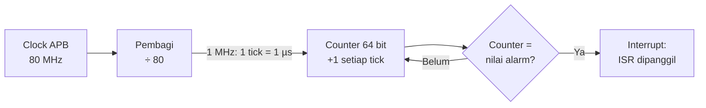
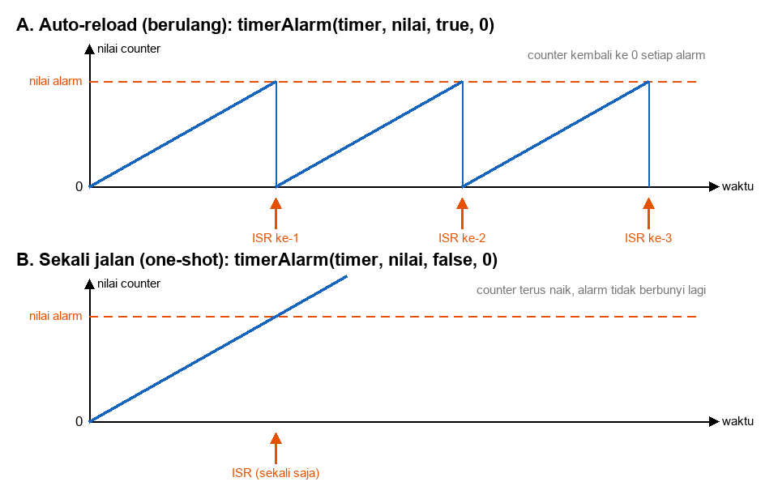
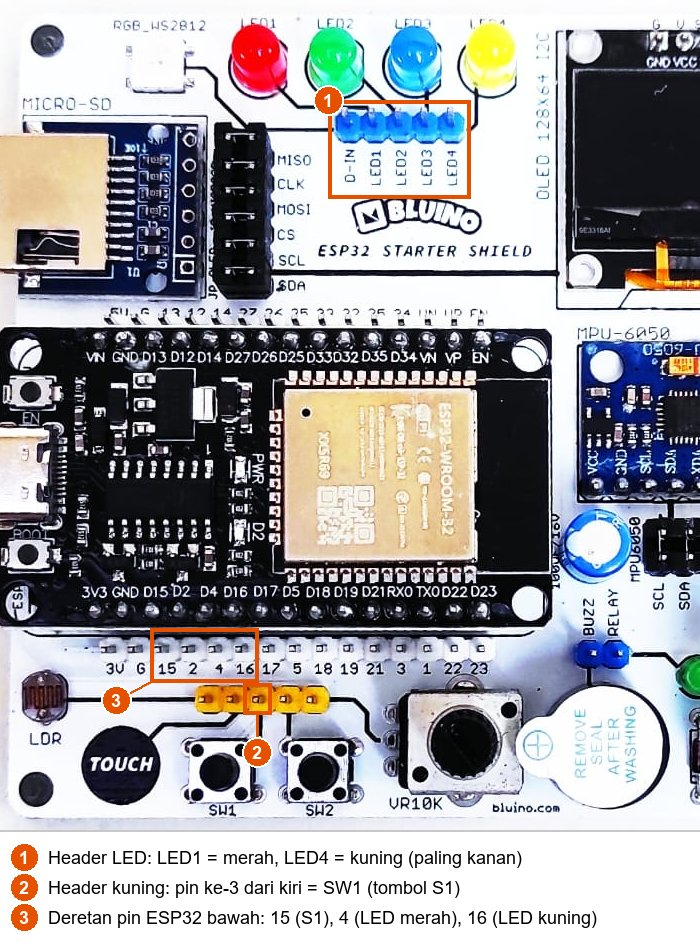

# BAB 15: Timer Hardware

> ✅ **Prasyarat:** Selesaikan **BAB 10 (Interrupt & ISR)** — kamu sudah mengenal ISR, `IRAM_ATTR`, `volatile`, dan bagian kritis (*critical section*). Kamu juga sudah memakai `millis()` untuk *debounce* tombol di **BAB 9 (Digital Input — Push Button)**. Cara menyambung LED kit dibahas di **BAB 8 (Digital Output — LED & Buzzer)**.

Metronom, lampu lalu lintas, dan mesin cuci sama-sama butuh "jam" yang berdetak teratur. Di dalam chip ESP32 ada **4 timer hardware** serbaguna: penghitung yang terus berdetak sendiri tanpa diawasi prosesor, lalu "membunyikan alarm" tepat pada waktunya — walaupun program utamamu sedang sibuk. Di BAB ini kamu belajar cara kerja timer hardware, memakai fungsi timer esp32 core 3.x untuk alarm berulang, alarm sekali jalan, dan *stopwatch*, menulis ISR timer yang aman, serta membandingkannya dengan `millis()` dan *library* Ticker.

## 📌 Tujuan Pembelajaran

Setelah mempelajari BAB ini, kamu bisa:

- Menjelaskan cara kerja timer hardware: sumber detak (*clock*), pembagi (*prescaler*), penghitung (*counter*), dan alarm.
- Menghitung frekuensi timer dan nilai alarm untuk interval yang diinginkan.
- Memakai fungsi timer esp32 core 3.x: `timerBegin()`, `timerAttachInterrupt()`, `timerAlarm()`, `timerStart()`, `timerStop()`, `timerRestart()`, `timerWrite()`, `timerRead()`/`timerReadMicros()`, dan `timerEnd()`.
- Menulis ISR timer yang aman: `IRAM_ATTR`, `volatile`, *critical section*, tanpa `Serial.print()` dan `delay()`.
- Membuat alarm berulang (*auto-reload*) dan alarm sekali jalan (*one-shot*).
- Membandingkan `delay()`, `millis()`, timer hardware, dan *library* Ticker, lalu memilih cara yang tepat.

## 🧰 Yang Perlu Disiapkan

| Kebutuhan | Keterangan |
|---|---|
| *Hardware* | Kit Bluino ESP32 IoT Starter Shield (ESP32 DEVKIT V1 sudah terpasang di kit) + kabel USB **data** |
| Kabel *jumper* | 3 kabel *female-female*: LED merah → IO4, LED kuning → IO16, tombol S1 → IO15 — sudah ada di kit |
| Komponen tambahan | Tidak ada — LED dan tombol sudah terpasang di kit |
| *Software* | Arduino IDE 2.x + *board package* **esp32** versi 3.3.x (lihat [BAB 5](../BAB-05/README.md)) |
| *Library* | Tidak perlu *library* tambahan — fungsi timer dan *library* Ticker sudah termasuk *board package* esp32 |
| Alat uji | **Serial Monitor** Arduino IDE (baud 115200) |
| Jaringan | Tidak perlu WiFi |

## 📑 Daftar Isi

- [15.1 Kenapa Butuh Timer Hardware?](#151-kenapa-butuh-timer-hardware)
- [15.2 Cara Kerja Timer Hardware ESP32](#152-cara-kerja-timer-hardware-esp32)
- [15.3 Fungsi Timer pada Core 3.x](#153-fungsi-timer-pada-core-3x)
- [15.4 Aturan Menulis ISR Timer](#154-aturan-menulis-isr-timer)
- [15.5 Rangkaian untuk Seluruh BAB](#155-rangkaian-untuk-seluruh-bab)
- [15.6 Program 1: LED Berkedip dengan Timer Hardware](#156-program-1-led-berkedip-dengan-timer-hardware)
- [15.7 Program 2: Timer Hardware vs millis()](#157-program-2-timer-hardware-vs-millis)
- [15.8 Program 3: Lampu Tangga dengan Alarm Sekali Jalan](#158-program-3-lampu-tangga-dengan-alarm-sekali-jalan)
- [15.9 Program 4: Stopwatch dengan Timer Hardware](#159-program-4-stopwatch-dengan-timer-hardware)
- [15.10 Library Ticker: Timer Software Bawaan Core](#1510-library-ticker-timer-software-bawaan-core)
- [15.11 Program 5: LED Berkedip dengan Ticker](#1511-program-5-led-berkedip-dengan-ticker)
- [15.12 Memilih Cara Mengatur Waktu](#1512-memilih-cara-mengatur-waktu)
- [15.13 Troubleshooting](#1513-troubleshooting)
- [📝 Rangkuman](#-rangkuman)
- [💪 Latihan](#-latihan)
- [📚 Referensi](#-referensi)

---

## 15.1 Kenapa Butuh Timer Hardware?

Banyak tugas mikrokontroler harus terjadi **tepat waktu**: LED berkedip setiap 0,5 detik, sensor dibaca setiap 1 detik, bunyi "tik" metronom, atau lampu yang mati sendiri setelah 5 detik. Sejauh ini kamu sudah mengenal dua cara mengatur waktu, dan BAB ini menambahkan cara ketiga:

| Cara | Analogi | Kelemahan |
|---|---|---|
| `delay()` | Menatap jam dinding sampai waktunya tiba, tanpa mengerjakan hal lain | `loop()` berhenti; tombol dan sensor tidak terbaca selama menunggu |
| `millis()` ([BAB 9](../BAB-09/README.md)) | Sesekali melirik jam sambil mengerjakan hal lain | Ketepatannya bergantung pada seberapa sering `loop()` sempat melirik jam. Kalau `loop()` sedang sibuk, jadwalnya ikut terlambat |
| Timer hardware (BAB ini) | Memasang *timer* dapur yang berbunyi sendiri tepat pada waktunya | Kode yang dipanggil alarm (ISR) harus mengikuti aturan ketat, dan jumlah timer terbatas (4 buah) |

Contoh potongan kode berikut memperlihatkan masalah `delay()` (bukan program lengkap):

```cpp
void loop() {
  bacaSensor();   // dijalankan
  delay(5000);    // loop() berhenti 5 detik: tombol tidak terbaca, LED tidak diperbarui
  kirimData();    // baru dijalankan setelah 5 detik
}
```

Timer hardware adalah rangkaian tersendiri di dalam chip yang terus menghitung, terlepas dari apa yang sedang dikerjakan prosesor. Saat hitungannya mencapai nilai alarm, timer menyela (*interrupt*, lihat [BAB 10](../BAB-10/README.md)) prosesor dan menjalankan ISR-mu saat itu juga. Karena itu, timer hardware tetap tepat waktu walaupun `loop()` sedang menjalankan `delay()` atau tugas berat lainnya. Program 2 di [15.7](#157-program-2-timer-hardware-vs-millis) membuktikannya.

> 📌 **Catatan:** Teknik `millis()` tetap menjadi pilihan utama untuk sebagian besar tugas berkala, dan dibahas tuntas di [BAB 16](../BAB-16/README.md). Timer hardware dipakai saat ketepatan waktu benar-benar penting, atau saat `loop()` tidak bisa dijamin selalu cepat.

---

## 15.2 Cara Kerja Timer Hardware ESP32

### 15.2.1 Bagian-Bagian Timer

Setiap timer hardware ESP32 terdiri dari empat bagian:

| Bagian | Fungsinya | Analogi metronom |
|---|---|---|
| Sumber detak (*clock*) APB 80 MHz | Detak dasar: 80 juta kali per detik | Mesin penggerak metronom |
| Pembagi (*prescaler*) | Memperlambat detak, misalnya ÷ 80 sehingga tinggal 1 juta detak per detik | Pengatur kecepatan ketukan |
| Penghitung (*counter*) 64 bit | Bertambah 1 pada setiap detak hasil pembagian (disebut ***tick***) | Hitungan ketukan |
| Alarm | Membandingkan isi *counter* dengan nilai alarm; kalau sama, ISR dipanggil | Bel yang berbunyi pada ketukan ke-sekian |



*Gambar 15.1 — Alur kerja timer hardware ESP32 dengan frekuensi 1 MHz. Sumber: dibuat untuk materi ini.*

ESP32 punya **4 timer serbaguna** (*general-purpose timer*) seperti ini, tersusun dalam 2 grup × 2 timer. Chip ESP32 juga punya timer lain untuk keperluan sistem (misalnya *watchdog*), tetapi yang bebas kamu pakai adalah keempat timer ini. Di esp32 core 3.x kamu tidak perlu memilih nomor timernya: `timerBegin()` otomatis mengambil timer yang masih bebas. Kalau keempatnya sudah terpakai, `timerBegin()` berikutnya gagal.

*Counter* 64 bit sangat besar. Pada 1 *tick* per mikrodetik, *counter* baru penuh setelah sekitar 584.942 tahun — bandingkan dengan `millis()` yang kembali ke 0 setelah sekitar 49,7 hari dan `micros()` setelah sekitar 71,6 menit.

### 15.2.2 Menghitung Frekuensi dan Nilai Alarm

Fungsi `timerBegin(frekuensi)` menentukan berapa *tick* per detik. Pembaginya dihitung sendiri oleh esp32 core: **pembagi = 80.000.000 ÷ frekuensi**. Dari situ:

- Lama 1 *tick* = 1 ÷ frekuensi detik.
- **Nilai alarm = interval (detik) × frekuensi.** Contoh: frekuensi 1 MHz dan interval 500 ms → 0,5 × 1.000.000 = 500.000.

| Pemanggilan | Pembagi | Lama 1 *tick* | Nilai alarm untuk 1 detik | Keterangan |
|---|---|---|---|---|
| `timerBegin(1000000)` | 80 | 1 µs | 1000000 | Paling praktis: nilai alarm = jumlah mikrodetik |
| `timerBegin(10000)` | 8.000 | 0,1 ms | 10000 | |
| `timerBegin(2000)` | 40.000 | 0,5 ms | 2000 | |
| `timerBegin(1000)` | 80.000 | — | — | **Gagal**: pembagi melebihi batas 65.536, `timerBegin()` mengembalikan `NULL` |

Pembagi hanya boleh bernilai 2 sampai 65.536, jadi frekuensi timer di ESP32 harus berada di antara sekitar 1,22 kHz (80 MHz ÷ 65.536) dan 40 MHz. Pilih frekuensi yang membagi 80 MHz dengan pas (misalnya 1 MHz atau 10 kHz). Kalau tidak pas, frekuensi yang benar-benar dipakai sedikit berbeda dari yang kamu minta.

> 💡 **Tips:** Biasakan memakai `timerBegin(1000000)`. Dengan 1 *tick* = 1 µs, nilai alarm cukup ditulis dalam mikrodetik: 1 detik → `1000000`, 250 ms → `250000`.

### 15.2.3 Alarm Berulang dan Alarm Sekali Jalan

Saat alarm berbunyi, ada dua pilihan:

- **Berulang (*auto-reload*)**: *counter* otomatis kembali ke 0 dan mulai menghitung lagi, sehingga alarm berbunyi terus dengan jarak yang sama — seperti metronom. Cocok untuk LED berkedip atau membaca sensor secara berkala.
- **Sekali jalan (*one-shot*)**: alarm berbunyi satu kali saja; *counter* tetap naik, tetapi alarm tidak berbunyi lagi sampai diatur ulang — seperti *timer* dapur. Cocok untuk "matikan lampu 5 detik lagi".



*Gambar 15.2 — Perbedaan alarm berulang (A) dan alarm sekali jalan (B). Sumber: dibuat untuk materi ini.*

---

## 15.3 Fungsi Timer pada Core 3.x

### 15.3.1 Daftar Fungsi

Semua fungsi berikut sudah tersedia di *board package* esp32 3.3.x — tidak perlu `#include` apa pun.

| Fungsi | Kegunaan |
|---|---|
| `hw_timer_t *timer = timerBegin(frekuensi);` | Membuat timer dengan frekuensi *tick* tertentu (Hz) dan **langsung menjalankannya**. Mengembalikan `NULL` kalau gagal |
| `timerAttachInterrupt(timer, &fungsi);` | Mendaftarkan ISR yang dipanggil setiap kali alarm berbunyi |
| `timerAlarm(timer, nilai, autoreload, 0);` | Mengatur alarm: berbunyi saat *counter* mencapai `nilai`. `autoreload` = `true` untuk alarm berulang, `false` untuk sekali jalan |
| `timerStart(timer);` / `timerStop(timer);` | Menjalankan / menghentikan hitungan. Isi *counter* tidak berubah, seperti tombol *pause* |
| `timerRestart(timer);` | Mengembalikan *counter* ke 0. Fungsi ini **tidak** menjalankan timer yang sedang berhenti |
| `timerWrite(timer, nilai);` | Mengisi *counter* dengan nilai tertentu, misalnya 0 |
| `timerRead(timer)` | Membaca isi *counter* dalam satuan *tick* (tipe `uint64_t`) |
| `timerReadMicros(timer)`, `timerReadMillis(timer)`, `timerReadSeconds(timer)` | Membaca isi *counter* yang sudah diubah ke mikrodetik, milidetik, atau detik |
| `timerGetFrequency(timer)` | Frekuensi *tick* yang benar-benar dipakai timer |
| `timerDetachInterrupt(timer);` | Melepas ISR dan mematikan alarm |
| `timerEnd(timer);` | Menghentikan timer dan mengembalikannya ke sistem, supaya bisa dipakai `timerBegin()` lain |

`hw_timer_t *` adalah tipe data untuk "pegangan" (*handle*) sebuah timer. Simpan hasil `timerBegin()` di variabel global bertipe ini, lalu berikan variabel itu ke fungsi-fungsi timer lainnya.

Pola dasarnya hanya tiga baris di `setup()` (potongan kode):

```cpp
hw_timer_t *timer = NULL;  // pegangan timer, diisi oleh timerBegin()

void IRAM_ATTR saatWaktuHabis() {
  // dipanggil setiap kali alarm berbunyi — isinya harus singkat
}

void setup() {
  timer = timerBegin(1000000);                   // 1 MHz → 1 tick = 1 µs, timer langsung berjalan
  timerAttachInterrupt(timer, &saatWaktuHabis);  // ISR untuk alarm
  timerAlarm(timer, 1000000, true, 0);           // alarm setiap 1.000.000 µs (1 detik), berulang
}
```

Kalau timer tidak dibutuhkan lagi (potongan kode):

```cpp
timerEnd(timer);  // hentikan timer dan kembalikan ke sistem
timer = NULL;     // tandai bahwa timer sudah tidak ada
```

> 📌 **Catatan:** Untuk parameter keempat `timerAlarm()`, selalu isi `0`. Dokumentasi resmi menyebutnya "jumlah pengulangan (0 = tanpa batas)", tetapi di esp32 core 3.3.x angka ini dipakai sebagai nilai awal *counter* setiap kali alarm berulang. Dengan `0`, keduanya sama: alarm berulang terus dan setiap putaran dimulai dari nol.

### 15.3.2 Perbedaan dengan Core 2.x

Banyak tutorial di internet masih memakai fungsi timer esp32 core 2.x. Kode seperti itu **gagal di-*compile*** di core 3.x. Kenali bentuk lamanya supaya kamu bisa menerjemahkannya:

| Core 2.x (jangan dipakai) | Core 3.x (pakai ini) |
|---|---|
| `timerBegin(0, 80, true)` — nomor timer, pembagi, arah hitung | `timerBegin(1000000)` — cukup frekuensi dalam Hz |
| `timerAttachInterrupt(timer, &fungsi, true)` | `timerAttachInterrupt(timer, &fungsi)` |
| `timerAlarmWrite(timer, 1000000, true)` + `timerAlarmEnable(timer)` | `timerAlarm(timer, 1000000, true, 0)` |
| `timerAlarmDisable(timer)` | `timerStop(timer)` atau `timerDetachInterrupt(timer)` |

---

## 15.4 Aturan Menulis ISR Timer

ISR timer adalah ISR biasa seperti di [BAB 10](../BAB-10/README.md), jadi aturannya sama. Ringkasnya:

1. **Beri tanda `IRAM_ATTR`.** Tanda ini menaruh fungsi di RAM internal (IRAM) yang bisa langsung diakses prosesor, bukan di memori *flash* yang dibaca lewat *cache*, sehingga ISR selalu siap dijalankan dengan cepat. Biasakan selalu menuliskannya, sama seperti di BAB 10.
2. **Buat sesingkat mungkin.** Idealnya ISR hanya mengubah satu-dua variabel atau membalik keadaan LED dengan `digitalWrite()`. Pekerjaan berat dikerjakan di `loop()`.
3. **Jangan memanggil `Serial.print()` atau `delay()` di dalam ISR.** Keduanya bisa menunggu, padahal ISR tidak boleh menunggu. Akibatnya ESP32 bisa *crash*: Serial Monitor menampilkan pesan *error* (misalnya `assert failed` atau `Guru Meditation Error`), lalu ESP32 *restart* sendiri.
4. **Variabel bersama diberi `volatile`.** Variabel yang diubah di ISR dan dibaca di `loop()` harus ditulis `volatile`, supaya *compiler* selalu membaca nilai terbarunya dari memori.
5. **Lindungi data bersama dengan *critical section*.** Pakai ini kalau ISR dan `loop()` sama-sama memakai **lebih dari satu variabel yang saling berkaitan**, mengubah variabel yang sama (misalnya ISR menambah `jumlah`, sedangkan `loop()` mengembalikannya ke 0), atau memakai variabel 64 bit (prosesor 32 bit membacanya dalam dua langkah, dan ISR bisa menyela di tengah-tengahnya).

*Critical section* (bagian kritis) di ESP32 memakai sebuah "kunci" bertipe `portMUX_TYPE` (potongan kode):

```cpp
portMUX_TYPE kunciTimer = portMUX_INITIALIZER_UNLOCKED;  // kunci, dibuat sekali (global)
volatile uint32_t jumlahAlarm = 0;
volatile uint32_t waktuAlarm = 0;

void IRAM_ATTR saatWaktuHabis() {
  portENTER_CRITICAL_ISR(&kunciTimer);  // versi untuk di dalam ISR
  jumlahAlarm = jumlahAlarm + 1;        // bukan jumlahAlarm++ (lihat catatan di bawah)
  waktuAlarm = millis();
  portEXIT_CRITICAL_ISR(&kunciTimer);
}

void loop() {
  portENTER_CRITICAL(&kunciTimer);      // versi untuk di luar ISR
  uint32_t jumlah = jumlahAlarm;        // salin secepatnya...
  uint32_t waktu = waktuAlarm;
  portEXIT_CRITICAL(&kunciTimer);
  // ...lalu pakai salinannya di luar critical section (misalnya untuk Serial.print)
}
```

Selama di dalam *critical section*, ISR lain tidak bisa menyela, jadi kedua variabel pasti dibaca sebagai pasangan yang cocok. Buat bagian ini sesingkat mungkin — cukup menyalin nilai — dan jangan pernah memanggil `Serial.print()` atau `delay()` di dalamnya.

> 💡 **Tips:** Kenapa ditulis `jumlahAlarm = jumlahAlarm + 1;`, bukan `jumlahAlarm++`? Versi C++ yang dipakai esp32 core 3.x menganggap `++` pada variabel `volatile` sebagai gaya lama dan memunculkan peringatan (*warning*) saat *compile*. Hasilnya sama saja, tetapi bentuk panjang ini bebas peringatan — sama seperti di BAB 10 dan contoh resmi Espressif.

> 📌 **Catatan:** Ini cara yang sama dengan bagian kritis di [BAB 10](../BAB-10/README.md). Hindari menggantinya dengan `noInterrupts()`/`interrupts()`: di ESP32 keduanya hanya mematikan *interrupt* di inti (*core*) prosesor yang sedang menjalankan kode itu, padahal ESP32 punya dua inti. Kunci `portMUX_TYPE` juga menahan inti yang lain.

---

## 15.5 Rangkaian untuk Seluruh BAB

Semua program di BAB ini memakai komponen berikut. Pasang sekali saja di awal, lalu biarkan sampai BAB selesai.

| Komponen | Pin Custom di kit | Sambungkan ke pin ESP32 | Letak pin ESP32 | Dipakai di |
|---|---|---|---|---|
| LED merah | `LED1` (*header* LED) | IO4 (label `4`) | Deretan bawah | Program 1–5 |
| LED kuning | `LED4` (*header* LED, paling kanan) | IO16 (label `16`) | Deretan bawah | Program 2 dan 5 |
| Tombol S1 | `SW1` (*header* kuning, pin ke-3 dari kiri) | IO15 (label `15`) | Deretan bawah | Program 3, 4, dan 5 |



*Gambar 15.3 — Letak header LED (1), pin Custom tombol S1 (2), dan pin ESP32 berlabel 15, 4, dan 16 (3) pada kit v3.x; tata letak kit v3.2 milikmu bisa sedikit berbeda. Sumber: foto produk ESP32 Starter Shield, [Bluino](http://www.bluino.com), dipotong dan diberi penanda untuk materi ini.*

Langkah memasang kabel:

1. Cabut kabel USB dulu supaya aman saat merangkai.
2. Pasang kabel *jumper* dari `LED1` (merah) ke pin berlabel **4** di deretan pin ESP32 bawah.
3. Pasang kabel *jumper* dari `LED4` (kuning, paling kanan di *header* LED) ke pin berlabel **16**.
4. Pasang kabel *jumper* dari `SW1` (pin kuning ke-3 dari kiri) ke pin berlabel **15**.
5. Periksa lagi setiap kabel, lalu sambungkan kembali kabel USB ke laptop/komputer.

> ⚠️ **Perhatian:** Nomor LED tidak urut dengan nomor pin: LED **kuning** adalah `LED4`, bukan `LED2`. Selain itu, label `15` bersebelahan dengan `G` (GND). Kalau kabel S1 meleset satu pin ke `G`, menekan tombol akan menyambung 3,3 V langsung ke GND. Periksa sekali lagi sebelum menyalakan kit.

> 📌 **Catatan:** Tombol S1 di kit sudah punya resistor *pull-down* 10 kΩ, jadi di program ditulis `pinMode(TOMBOL_S1, INPUT)`: tidak ditekan = LOW, ditekan = HIGH (lihat [BAB 9](../BAB-09/README.md)).

---

## 15.6 Program 1: LED Berkedip dengan Timer Hardware

**Tujuan:** Membuat timer hardware yang membunyikan alarm setiap 500 ms. Setiap alarm, ISR membalik keadaan LED merah, menghitung jumlah alarm, dan mencatat waktunya. `loop()` hanya bertugas mencetak laporan ke Serial Monitor.

**Rangkaian:**

| Pin **Custom** di kit | Sambungkan ke pin ESP32 |
|---|---|
| `LED1` (LED merah) | IO4 |

**Cara Menjalankan:**

1. Sambungkan kabel *jumper* sesuai tabel **Rangkaian** di atas (lihat juga [15.5](#155-rangkaian-untuk-seluruh-bab)).
2. Buka Arduino IDE → **File → New Sketch**, hapus isinya, lalu salin kode di bawah. Kode yang sama juga tersedia di file [`p1_timer_kedip.ino`](p1_timer_kedip/p1_timer_kedip.ino).
3. Pastikan **Tools → Board** = **ESP32 Dev Module** dan **Tools → Port** = *port* ESP32 kamu (misalnya `COM5` di Windows atau `/dev/ttyUSB0` di Linux).
4. Klik tombol **Upload** (ikon panah →) dan tunggu sampai muncul tulisan **Done uploading**.
5. Buka **Serial Monitor** (**Tools → Serial Monitor**) lalu pilih baud **115200**.

**Kode Program:**

<!-- sketch: p1_timer_kedip -->
```cpp
/*
 * BAB 15 - Program 1: LED Berkedip dengan Timer Hardware
 * Timer hardware memanggil ISR setiap 500 ms. ISR membalik LED merah,
 * menghitung jumlah alarm, dan mencatat waktunya. loop() hanya mencetak.
 *
 * Rangkaian: LED1 (LED merah, header LED) → IO4
 */

#define LED_MERAH 4

const uint64_t INTERVAL_US = 500000;  // 500.000 µs = 500 ms

hw_timer_t *timer = NULL;                                // pegangan timer
portMUX_TYPE kunciTimer = portMUX_INITIALIZER_UNLOCKED;  // kunci critical section

volatile bool ledNyala = false;     // keadaan LED, diubah di ISR
volatile uint32_t jumlahAlarm = 0;  // berapa kali alarm sudah berbunyi
volatile uint32_t waktuAlarm = 0;   // millis() saat alarm terakhir

uint32_t sudahDicetak = 0;          // jumlah alarm yang sudah dilaporkan loop()

// ISR: dipanggil timer hardware setiap 500 ms
void IRAM_ATTR saatWaktuHabis() {
  ledNyala = !ledNyala;
  digitalWrite(LED_MERAH, ledNyala ? HIGH : LOW);

  portENTER_CRITICAL_ISR(&kunciTimer);
  jumlahAlarm = jumlahAlarm + 1;  // cara menambah variabel volatile tanpa peringatan compiler
  waktuAlarm = millis();
  portEXIT_CRITICAL_ISR(&kunciTimer);
}

void setup() {
  Serial.begin(115200);
  pinMode(LED_MERAH, OUTPUT);
  digitalWrite(LED_MERAH, LOW);
  delay(1000);  // beri waktu Serial Monitor tersambung

  Serial.println("BAB 15 - Program 1: LED Berkedip dengan Timer Hardware");

  timer = timerBegin(1000000);  // 1 MHz → 1 tick = 1 µs; timer langsung berjalan
  if (timer == NULL) {
    Serial.println("Gagal membuat timer! Program berhenti.");
    while (true) {
      delay(1000);
    }
  }
  timerAttachInterrupt(timer, &saatWaktuHabis);  // pasang ISR
  timerAlarm(timer, INTERVAL_US, true, 0);        // alarm berulang setiap 500 ms

  Serial.println("Timer berjalan: alarm setiap 500 ms.");
}

void loop() {
  // Salin data milik ISR di dalam critical section
  portENTER_CRITICAL(&kunciTimer);
  uint32_t jumlah = jumlahAlarm;
  uint32_t waktu = waktuAlarm;
  portEXIT_CRITICAL(&kunciTimer);

  // Lapor hanya kalau ada alarm baru
  if (jumlah != sudahDicetak) {
    sudahDicetak = jumlah;
    Serial.print("Alarm ke-");
    Serial.print(jumlah);
    Serial.print(" pada ");
    Serial.print(waktu);
    Serial.println(" ms");
  }
}
```

**Penjelasan Kode:**

- `timerBegin(1000000)` membuat timer 1 MHz (1 *tick* = 1 µs) dan langsung menjalankannya. Hasilnya diperiksa: kalau `NULL`, timer gagal dibuat, jadi program mencetak pesan lalu berhenti di `while (true)` alih-alih berjalan tanpa timer.
- `timerAttachInterrupt(timer, &saatWaktuHabis)` mendaftarkan ISR. Tanda `&` di depan nama fungsi berarti "alamat fungsi ini" — kita menyerahkan fungsinya untuk dipanggil nanti, bukan menjalankannya sekarang.
- `timerAlarm(timer, INTERVAL_US, true, 0)` memasang alarm berulang setiap 500.000 *tick* = 500 ms. `INTERVAL_US` bertipe `uint64_t` karena parameter nilai alarm memang 64 bit.
- ISR `saatWaktuHabis()` membalik LED dengan `digitalWrite()` — perintah singkat yang aman di ISR timer — lalu memperbarui `jumlahAlarm` dan `waktuAlarm` di dalam *critical section*, karena keduanya adalah pasangan data yang dibaca `loop()` (lihat [15.4](#154-aturan-menulis-isr-timer)).
- `loop()` menyalin kedua variabel di dalam *critical section*, lalu mencetaknya di luar *critical section*. `Serial.print()` sengaja **tidak** ditaruh di ISR.

**Contoh Output:**

```text
BAB 15 - Program 1: LED Berkedip dengan Timer Hardware
Timer berjalan: alarm setiap 500 ms.
Alarm ke-1 pada 1538 ms
Alarm ke-2 pada 2038 ms
Alarm ke-3 pada 2538 ms
Alarm ke-4 pada 3038 ms
Alarm ke-5 pada 3538 ms
```

Di kit: LED merah menyala 500 ms dan mati 500 ms, terus-menerus. Angka waktu di Serial Monitor kamu bisa berbeda, tetapi selisih antarbaris tetap 500 ms (sesekali 499 atau 501, karena `millis()` membuang pecahan milidetiknya).

**Kalau Belum Berhasil:**

- **Muncul `Gagal membuat timer! Program berhenti.`** → frekuensi di `timerBegin()` diubah ke nilai di luar jangkauan (misalnya `1000`), atau keempat timer sudah terpakai. Kembalikan ke `timerBegin(1000000)`.
- ***Error compile* `too many arguments to function 'timerBegin'` atau `'timerAlarmWrite' was not declared in this scope`** → kode yang kamu salin memakai gaya core 2.x. Pakai kode dari BAB ini (lihat [15.3.2](#1532-perbedaan-dengan-core-2x)).
- ***Error compile* `too few arguments to function 'timerBegin'` atau `'timerAlarm' was not declared in this scope`** → kebalikannya: *board package* esp32 di Arduino IDE masih versi 2.x. Perbarui ke versi 3.3.x lewat **Tools → Board → Boards Manager…** (lihat [BAB 5](../BAB-05/README.md)).
- **Laporan muncul di Serial Monitor, tetapi LED tidak berkedip** → kabel `LED1` belum tersambung ke pin berlabel `4` di deretan bawah.
- **ESP32 *restart* terus dan Serial Monitor menampilkan pesan *error*** → kamu menambahkan `Serial.print()` atau `delay()` di dalam ISR. Pindahkan ke `loop()`.

---

## 15.7 Program 2: Timer Hardware vs millis()

**Tujuan:** Membuktikan keunggulan timer hardware. LED merah dikedipkan oleh timer hardware, LED kuning dikedipkan dengan pola `millis()` di `loop()`; keduanya berganti keadaan setiap 250 ms. Setiap 5 detik, `loop()` pura-pura sibuk selama 2 detik. Perhatikan LED mana yang tetap berkedip.

**Rangkaian:**

| Pin **Custom** di kit | Sambungkan ke pin ESP32 |
|---|---|
| `LED1` (LED merah) | IO4 |
| `LED4` (LED kuning) | IO16 |

**Cara Menjalankan:**

1. Pastikan kabel `LED1` → **4** dan `LED4` → **16** terpasang (lihat [15.5](#155-rangkaian-untuk-seluruh-bab)).
2. Buka Arduino IDE → **File → New Sketch**, hapus isinya, lalu salin kode di bawah. Kode yang sama juga tersedia di file [`p2_timer_vs_millis.ino`](p2_timer_vs_millis/p2_timer_vs_millis.ino).
3. Pastikan **Tools → Board** = **ESP32 Dev Module** dan **Tools → Port** = *port* ESP32 kamu.
4. Klik tombol **Upload** dan tunggu sampai muncul tulisan **Done uploading**.
5. Buka **Serial Monitor** (**Tools → Serial Monitor**) lalu pilih baud **115200**. Amati kedua LED saat muncul tulisan `loop() sibuk 2 detik...`.

**Kode Program:**

<!-- sketch: p2_timer_vs_millis -->
```cpp
/*
 * BAB 15 - Program 2: Timer Hardware vs millis()
 * LED merah dikedipkan timer hardware, LED kuning dikedipkan millis() di loop().
 * Setiap 5 detik loop() "sibuk" 2 detik: LED kuning macet, LED merah tetap berkedip.
 *
 * Rangkaian:
 *   LED1 (LED merah, header LED)  → IO4
 *   LED4 (LED kuning, header LED) → IO16
 */

#define LED_MERAH  4
#define LED_KUNING 16

const unsigned long INTERVAL_KUNING = 250;  // ms, sama dengan LED merah

hw_timer_t *timer = NULL;
volatile bool merahNyala = false;  // keadaan LED merah, diubah di ISR

bool kuningNyala = false;
unsigned long waktuKuning = 0;  // terakhir kali LED kuning dibalik
unsigned long waktuSibuk = 0;   // terakhir kali loop() selesai "sibuk"

// ISR: membalik LED merah setiap 250 ms, apa pun yang sedang dikerjakan loop()
void IRAM_ATTR saatWaktuHabis() {
  merahNyala = !merahNyala;
  digitalWrite(LED_MERAH, merahNyala ? HIGH : LOW);
}

void setup() {
  Serial.begin(115200);
  pinMode(LED_MERAH, OUTPUT);
  pinMode(LED_KUNING, OUTPUT);
  digitalWrite(LED_MERAH, LOW);
  digitalWrite(LED_KUNING, LOW);
  delay(1000);  // beri waktu Serial Monitor tersambung

  Serial.println("BAB 15 - Program 2: Timer Hardware vs millis()");

  timer = timerBegin(1000000);  // 1 tick = 1 µs
  if (timer == NULL) {
    Serial.println("Gagal membuat timer! Program berhenti.");
    while (true) {
      delay(1000);
    }
  }
  timerAttachInterrupt(timer, &saatWaktuHabis);
  timerAlarm(timer, 250000, true, 0);  // 250.000 µs = 250 ms, berulang

  Serial.println("LED merah: timer hardware | LED kuning: millis()");
}

void loop() {
  // LED kuning: pola millis(). Hanya dibalik kalau loop() sempat memeriksa jam.
  if (millis() - waktuKuning >= INTERVAL_KUNING) {
    waktuKuning = millis();
    kuningNyala = !kuningNyala;
    digitalWrite(LED_KUNING, kuningNyala ? HIGH : LOW);
  }

  // Setiap 5 detik, pura-pura mengerjakan tugas berat selama 2 detik
  if (millis() - waktuSibuk >= 5000) {
    Serial.println("loop() sibuk 2 detik... LED kuning macet, LED merah tetap berkedip");
    delay(2000);  // simulasi tugas berat, misalnya menunggu sensor yang lambat
    Serial.println("loop() selesai sibuk");
    waktuSibuk = millis();
  }
}
```

**Penjelasan Kode:**

- LED merah sepenuhnya diurus timer hardware: setiap 250 ms, timer menyela prosesor dan ISR membalik LED. `loop()` sama sekali tidak menyentuh LED merah.
- LED kuning memakai pola `millis()` dari [BAB 9](../BAB-09/README.md): `loop()` memeriksa apakah sudah lewat 250 ms sejak terakhir dibalik. Pola ini hanya bekerja selama `loop()` berputar cepat.
- Bagian kedua `loop()` meniru tugas berat dengan `delay(2000)`. Selama 2 detik itu, `loop()` tidak bisa memeriksa jam, jadi LED kuning berhenti di keadaan terakhirnya. Timer hardware tidak terpengaruh karena ia rangkaian terpisah yang menyela prosesor kapan pun alarm berbunyi.
- `waktuSibuk = millis()` dicatat **setelah** `delay()`, jadi jedanya 5 detik dihitung dari saat tugas berat selesai.

**Contoh Output:**

```text
BAB 15 - Program 2: Timer Hardware vs millis()
LED merah: timer hardware | LED kuning: millis()
loop() sibuk 2 detik... LED kuning macet, LED merah tetap berkedip
loop() selesai sibuk
loop() sibuk 2 detik... LED kuning macet, LED merah tetap berkedip
loop() selesai sibuk
```

Di kit: kedua LED berkedip cepat bersamaan. Saat tulisan `loop() sibuk 2 detik...` muncul, LED kuning berhenti (tetap menyala atau tetap mati) selama 2 detik, sedangkan LED merah tetap berkedip dengan irama yang sama. Setelah `loop() selesai sibuk`, LED kuning berkedip lagi.

> 💡 **Tips:** Inilah alasan timer hardware dipakai untuk hal-hal yang iramanya tidak boleh terganggu, misalnya membangkitkan sinyal, mengambil sampel sensor dengan jarak yang sama persis, atau menjalankan motor *stepper*. Meski begitu, solusi terbaik untuk `loop()` yang sibuk adalah tidak memakai `delay()` panjang sama sekali — dibahas di [BAB 16](../BAB-16/README.md).

**Kalau Belum Berhasil:**

- **Kedua LED ikut macet saat `loop()` sibuk** → kamu mungkin mengedipkan LED merah dari `loop()`, bukan dari ISR. Pastikan `digitalWrite(LED_MERAH, ...)` hanya ada di dalam `saatWaktuHabis()`.
- **LED kuning tidak pernah menyala** → kabel `LED4` (paling kanan di *header* LED) belum tersambung ke pin berlabel `16`.
- **LED merah tidak berkedip** → kabel `LED1` belum tersambung ke pin berlabel `4`, atau `timerAlarm()` terhapus.

---

## 15.8 Program 3: Lampu Tangga dengan Alarm Sekali Jalan

**Tujuan:** Meniru lampu tangga otomatis: tekan S1 → LED merah menyala selama 5 detik, lalu mati sendiri. Kalau S1 ditekan lagi saat lampu masih menyala, hitungan 5 detik diulang dari awal. Program ini memakai alarm **sekali jalan** serta `timerStart()`, `timerStop()`, dan `timerRestart()`.

**Rangkaian:**

| Pin **Custom** di kit | Sambungkan ke pin ESP32 |
|---|---|
| `SW1` (tombol S1, pin kuning ke-3) | IO15 |
| `LED1` (LED merah) | IO4 |

**Cara Menjalankan:**

1. Pastikan kabel `SW1` → **15** dan `LED1` → **4** terpasang (lihat [15.5](#155-rangkaian-untuk-seluruh-bab)).
2. Buka Arduino IDE → **File → New Sketch**, hapus isinya, lalu salin kode di bawah. Kode yang sama juga tersedia di file [`p3_lampu_tangga.ino`](p3_lampu_tangga/p3_lampu_tangga.ino).
3. Pastikan **Tools → Board** = **ESP32 Dev Module** dan **Tools → Port** = *port* ESP32 kamu.
4. Klik tombol **Upload** dan tunggu sampai muncul tulisan **Done uploading**.
5. Buka **Serial Monitor** (**Tools → Serial Monitor**) lalu pilih baud **115200**. Tekan S1 sekali dan tunggu; lalu coba tekan S1 lagi sebelum 5 detik habis.

**Kode Program:**

<!-- sketch: p3_lampu_tangga -->
```cpp
/*
 * BAB 15 - Program 3: Lampu Tangga dengan Alarm Sekali Jalan
 * Tekan S1 → LED merah menyala 5 detik, lalu mati sendiri.
 * Menekan S1 lagi saat LED masih menyala mengulang hitungan 5 detik dari awal.
 *
 * Rangkaian:
 *   SW1 (tombol S1, header kuning) → IO15
 *   LED1 (LED merah, header LED)   → IO4
 */

#define TOMBOL_S1 15
#define LED_MERAH 4

const uint64_t LAMA_NYALA_US = 5000000;   // 5 detik = 5.000.000 µs
const unsigned long WAKTU_DEBOUNCE = 50;  // ms, sama seperti BAB 9

hw_timer_t *timer = NULL;
volatile bool waktuHabis = false;  // diisi true oleh ISR

bool lampuNyala = false;

// Variabel debounce (pola dari BAB 9)
int bacaanSebelumnya = LOW;      // bacaan mentah pada putaran loop() sebelumnya
int statusStabil = LOW;          // keadaan tombol yang sudah lolos debounce
unsigned long waktuBerubah = 0;  // kapan bacaan mentah terakhir kali berubah

// ISR: alarm sekali jalan berbunyi → cukup beri tanda untuk loop()
void IRAM_ATTR saatWaktuHabis() {
  waktuHabis = true;
}

void nyalakanLampu() {
  timerRestart(timer);                         // counter kembali ke 0
  timerAlarm(timer, LAMA_NYALA_US, false, 0);  // alarm SEKALI JALAN, 5 detik dari 0
  waktuHabis = false;                          // abaikan tanda alarm lama (kalau ada)
  timerStart(timer);                           // jalankan (tidak berpengaruh kalau sudah berjalan)

  digitalWrite(LED_MERAH, HIGH);
  if (lampuNyala) {
    Serial.println("S1 ditekan lagi: hitungan 5 detik diulang dari awal");
  } else {
    Serial.println("S1 ditekan: lampu NYALA selama 5 detik");
  }
  lampuNyala = true;
}

void setup() {
  Serial.begin(115200);
  pinMode(TOMBOL_S1, INPUT);  // pull-down 10 kΩ di PCB: ditekan = HIGH
  pinMode(LED_MERAH, OUTPUT);
  digitalWrite(LED_MERAH, LOW);
  delay(1000);  // beri waktu Serial Monitor tersambung

  Serial.println("BAB 15 - Program 3: Lampu Tangga (alarm sekali jalan)");

  timer = timerBegin(1000000);  // 1 tick = 1 µs; timer langsung berjalan...
  if (timer == NULL) {
    Serial.println("Gagal membuat timer! Program berhenti.");
    while (true) {
      delay(1000);
    }
  }
  timerStop(timer);             // ...jadi hentikan dulu sampai S1 ditekan
  timerAttachInterrupt(timer, &saatWaktuHabis);

  Serial.println("Tekan S1 untuk menyalakan lampu.");
}

void loop() {
  // 1. Baca S1 dengan debounce; bereaksi saat tombol baru ditekan
  int bacaan = digitalRead(TOMBOL_S1);
  if (bacaan != bacaanSebelumnya) {
    waktuBerubah = millis();
    bacaanSebelumnya = bacaan;
  }
  if ((millis() - waktuBerubah) > WAKTU_DEBOUNCE && bacaan != statusStabil) {
    statusStabil = bacaan;
    if (statusStabil == HIGH) {
      nyalakanLampu();
    }
  }

  // 2. Alarm sekali jalan sudah berbunyi? Matikan lampu.
  if (waktuHabis) {
    waktuHabis = false;
    timerStop(timer);  // timer tidak perlu berjalan lagi sampai S1 ditekan
    digitalWrite(LED_MERAH, LOW);
    lampuNyala = false;
    Serial.println("Waktu habis: lampu MATI");
  }
}
```

**Penjelasan Kode:**

- Di `setup()`, timer langsung dihentikan dengan `timerStop()` karena `timerBegin()` otomatis menjalankannya. Timer baru dijalankan saat S1 ditekan.
- `nyalakanLampu()` menjalankan empat langkah: `timerRestart()` mengembalikan *counter* ke 0, `timerAlarm(..., false, 0)` memasang alarm **sekali jalan** 5.000.000 µs dari nol, `waktuHabis = false` membuang tanda alarm lama, lalu `timerStart()` menjalankan timer. Kalau timer sudah berjalan (S1 ditekan lagi), `timerStart()` tidak berpengaruh, dan hitungannya otomatis mulai dari nol lagi karena `timerRestart()`.
- Alarm sekali jalan harus dipasang ulang dengan `timerAlarm()` setiap kali ingin dipakai lagi — setelah berbunyi, alarm tidak aktif sampai diatur ulang (lihat Gambar 15.2).
- ISR hanya mengisi `waktuHabis = true`. Mematikan LED, menghentikan timer, dan mencetak pesan dikerjakan di `loop()`.
- Bagian tombol memakai *debounce* yang sama persis dengan [BAB 9](../BAB-09/README.md): `statusStabil` baru berubah setelah bacaan tombol tidak berubah selama 50 ms.

**Contoh Output:**

```text
BAB 15 - Program 3: Lampu Tangga (alarm sekali jalan)
Tekan S1 untuk menyalakan lampu.
S1 ditekan: lampu NYALA selama 5 detik
Waktu habis: lampu MATI
S1 ditekan: lampu NYALA selama 5 detik
S1 ditekan lagi: hitungan 5 detik diulang dari awal
Waktu habis: lampu MATI
```

Di kit: setelah S1 ditekan, LED merah menyala dan padam sendiri 5 detik kemudian. Pada contoh di atas, S1 ditekan dua kali berturut-turut pada percobaan kedua, sehingga lampu menyala lebih lama: 5 detik dihitung dari tekanan terakhir.

**Kalau Belum Berhasil:**

- **Tidak ada reaksi saat S1 ditekan** → kabel `SW1` (pin kuning ke-3) belum tersambung ke pin berlabel `15`, atau `pinMode(TOMBOL_S1, INPUT)` diganti `INPUT_PULLUP`. Tombol kit memakai *pull-down*, jadi harus `INPUT`.
- **Pesan muncul di Serial Monitor, tetapi LED tidak menyala** → kabel `LED1` belum tersambung ke pin berlabel `4` di deretan bawah.
- **Lampu tidak pernah mati** → `timerAttachInterrupt()` atau `timerAlarm()` terhapus, sehingga ISR tidak pernah dipanggil.

---

## 15.9 Program 4: Stopwatch dengan Timer Hardware

**Tujuan:** Membuat *stopwatch*: tekan S1 untuk mulai dari nol, tekan lagi untuk berhenti dan melihat hasilnya. Program ini tidak memakai ISR sama sekali — timer hardware dipakai sebagai "jam" yang sangat teliti, dengan `timerStart()`, `timerStop()`, `timerWrite()`, dan fungsi-fungsi `timerRead...()`.

**Rangkaian:**

| Pin **Custom** di kit | Sambungkan ke pin ESP32 |
|---|---|
| `SW1` (tombol S1, pin kuning ke-3) | IO15 |
| `LED1` (LED merah) | IO4 |

**Cara Menjalankan:**

1. Biarkan kabel seperti pada Program 3.
2. Buka Arduino IDE → **File → New Sketch**, hapus isinya, lalu salin kode di bawah. Kode yang sama juga tersedia di file [`p4_stopwatch.ino`](p4_stopwatch/p4_stopwatch.ino).
3. Pastikan **Tools → Board** = **ESP32 Dev Module** dan **Tools → Port** = *port* ESP32 kamu.
4. Klik tombol **Upload** dan tunggu sampai muncul tulisan **Done uploading**.
5. Buka **Serial Monitor** (**Tools → Serial Monitor**) lalu pilih baud **115200**. Tekan S1 untuk mulai, tunggu beberapa detik, lalu tekan S1 lagi.

**Kode Program:**

<!-- sketch: p4_stopwatch -->
```cpp
/*
 * BAB 15 - Program 4: Stopwatch dengan Timer Hardware
 * Tekan S1: stopwatch mulai dari 0 (LED merah menyala).
 * Tekan S1 lagi: stopwatch berhenti dan hasilnya ditampilkan.
 * Timer hardware dipakai sebagai "jam" presisi, tanpa ISR.
 *
 * Rangkaian:
 *   SW1 (tombol S1, header kuning) → IO15
 *   LED1 (LED merah, header LED)   → IO4
 */

#define TOMBOL_S1 15
#define LED_MERAH 4

const unsigned long WAKTU_DEBOUNCE = 50;  // ms, sama seperti BAB 9

hw_timer_t *timer = NULL;
bool berjalan = false;         // apakah stopwatch sedang berjalan
unsigned long waktuLapor = 0;  // untuk laporan setiap 1 detik

// Variabel debounce (pola dari BAB 9)
int bacaanSebelumnya = LOW;
int statusStabil = LOW;
unsigned long waktuBerubah = 0;

void tombolDitekan() {
  if (!berjalan) {
    timerWrite(timer, 0);  // counter diisi 0: mulai dari nol
    timerStart(timer);
    berjalan = true;
    waktuLapor = millis();
    digitalWrite(LED_MERAH, HIGH);
    Serial.println("Mulai!");
  } else {
    timerStop(timer);      // counter berhenti; nilainya tetap tersimpan
    berjalan = false;
    digitalWrite(LED_MERAH, LOW);

    uint64_t jumlahTick = timerRead(timer);  // 1 tick = 1 µs
    double detik = timerReadSeconds(timer);  // sudah dalam detik
    Serial.print("Berhenti! Waktu: ");
    Serial.print(detik, 3);  // 3 angka di belakang titik desimal
    Serial.print(" detik (");
    Serial.print(jumlahTick);
    Serial.println(" tick)");
  }
}

void setup() {
  Serial.begin(115200);
  pinMode(TOMBOL_S1, INPUT);  // pull-down 10 kΩ di PCB: ditekan = HIGH
  pinMode(LED_MERAH, OUTPUT);
  digitalWrite(LED_MERAH, LOW);
  delay(1000);  // beri waktu Serial Monitor tersambung

  Serial.println("BAB 15 - Program 4: Stopwatch dengan Timer Hardware");

  timer = timerBegin(1000000);  // 1 tick = 1 µs
  if (timer == NULL) {
    Serial.println("Gagal membuat timer! Program berhenti.");
    while (true) {
      delay(1000);
    }
  }
  timerStop(timer);       // timerBegin() langsung berjalan; hentikan dulu
  timerWrite(timer, 0);

  Serial.println("Tekan S1 untuk mulai, tekan lagi untuk berhenti.");
}

void loop() {
  // 1. Baca S1 dengan debounce; bereaksi saat tombol baru ditekan
  int bacaan = digitalRead(TOMBOL_S1);
  if (bacaan != bacaanSebelumnya) {
    waktuBerubah = millis();
    bacaanSebelumnya = bacaan;
  }
  if ((millis() - waktuBerubah) > WAKTU_DEBOUNCE && bacaan != statusStabil) {
    statusStabil = bacaan;
    if (statusStabil == HIGH) {
      tombolDitekan();
    }
  }

  // 2. Selama berjalan, laporkan waktu setiap 1 detik
  if (berjalan && millis() - waktuLapor >= 1000) {
    waktuLapor += 1000;
    Serial.print("  berjalan: ");
    Serial.print(timerReadMillis(timer));
    Serial.println(" ms");
  }
}
```

**Penjelasan Kode:**

- Timer disiapkan di `setup()` lalu langsung dihentikan, karena *stopwatch* baru boleh berjalan setelah S1 ditekan.
- Tekanan pertama: `timerWrite(timer, 0)` mengisi *counter* dengan 0, lalu `timerStart()` menjalankannya. Tekanan kedua: `timerStop()` menghentikan *counter* tanpa menghapus isinya, sehingga hasilnya bisa dibaca dengan tenang.
- `timerRead()` mengembalikan isi *counter* dalam *tick* (di sini 1 *tick* = 1 µs), bertipe `uint64_t`. `timerReadSeconds()` mengubahnya menjadi detik (`double`), dan `timerReadMillis()` menjadi milidetik. Untuk mikrodetik tersedia `timerReadMicros()`.
- `Serial.print(detik, 3)` mencetak angka desimal dengan 3 angka di belakang titik. Output program memakai titik sebagai tanda desimal, bukan koma.
- Laporan "berjalan" memakai pola `millis()`. `waktuLapor += 1000` (bukan `waktuLapor = millis()`) menjaga laporan tetap tepat setiap 1 detik walaupun `loop()` sesekali terlambat.
- Tekanan mulai dan tekanan berhenti sama-sama tertunda ±50 ms oleh *debounce*, sehingga keterlambatannya saling menghapus. Ketelitian *stopwatch* ini sebenarnya dibatasi oleh jempolmu, bukan oleh timernya.

**Contoh Output:**

```text
BAB 15 - Program 4: Stopwatch dengan Timer Hardware
Tekan S1 untuk mulai, tekan lagi untuk berhenti.
Mulai!
  berjalan: 1000 ms
  berjalan: 2000 ms
  berjalan: 3000 ms
Berhenti! Waktu: 3.482 detik (3482153 tick)
```

Di kit: LED merah menyala selama *stopwatch* berjalan dan padam saat berhenti. Angka laporan bisa meleset 1 ms (misalnya `2001 ms`), dan hasil akhirnya tentu bergantung pada kapan kamu menekan S1.

> 🧪 **Coba Sendiri:** Bandingkan dengan *stopwatch* di HP: tekan keduanya bersamaan, tunggu sekitar 60 detik, lalu hentikan bersamaan. Selisihnya biasanya hanya sepersekian detik — dan sebagian besar berasal dari jarimu.

**Kalau Belum Berhasil:**

- **Tekan sekali, langsung muncul `Mulai!` lalu `Berhenti!`** → tombol memantul lebih lama dari 50 ms. Naikkan `WAKTU_DEBOUNCE` menjadi 80–100.
- **Hasil selalu `0.000 detik`** → `timerStart()` terhapus, sehingga *counter* tidak pernah berjalan.
- **Tidak ada reaksi saat S1 ditekan** → periksa kabel `SW1` → pin berlabel `15` dan pastikan memakai `pinMode(TOMBOL_S1, INPUT)`.

---

## 15.10 Library Ticker: Timer Software Bawaan Core

Selain 4 timer hardware, *board package* esp32 juga membawa *library* **Ticker**. Ticker memakai *timer* milik sistem bernama `esp_timer` — "jam" yang sama yang dipakai `millis()` dan `micros()`. Jadi Ticker **tidak** mengurangi jatah 4 timer hardware, dan kamu boleh membuat Ticker sebanyak yang kamu perlukan (selama memori masih cukup).

Perbedaan terpentingnya: fungsi yang dipanggil Ticker **bukan ISR**. Fungsi itu dijalankan oleh sebuah *task* (tugas) khusus milik sistem, sehingga aturannya lebih longgar — tidak perlu `IRAM_ATTR`, dan memanggil `digitalWrite()` atau mengubah variabel biasa tidak masalah. Meski begitu, tetap buat fungsinya singkat dan **jangan** memanggil `delay()` di dalamnya, karena semua Ticker bergantian memakai *task* yang sama: satu fungsi yang lambat membuat Ticker lain ikut terlambat.

| Fungsi Ticker | Kegunaan |
|---|---|
| `ticker.attach(detik, fungsi);` | Memanggil `fungsi` berulang setiap `detik` (boleh pecahan, misalnya `0.5`) |
| `ticker.attach_ms(ms, fungsi);` | Sama, tetapi interval dalam milidetik |
| `ticker.once(detik, fungsi);` / `ticker.once_ms(ms, fungsi);` | Memanggil `fungsi` **sekali** setelah waktu tertentu |
| `ticker.detach();` | Menghentikan Ticker |
| `ticker.active()` | `true` kalau Ticker masih aktif |

Memanggil `attach...()` atau `once...()` lagi pada objek Ticker yang sama akan mengganti jadwal sebelumnya. Sifat ini praktis untuk "mengulang hitungan", seperti lampu tangga di Program 3.

---

## 15.11 Program 5: LED Berkedip dengan Ticker

**Tujuan:** Mengulang ide Program 1 dan Program 3 dengan Ticker: LED merah berkedip setiap 500 ms (Ticker berulang), dan setiap kali S1 ditekan, LED kuning menyala lalu mati sendiri setelah 2 detik (Ticker sekali jalan). Bandingkan betapa ringkasnya kode ini.

**Rangkaian:**

| Pin **Custom** di kit | Sambungkan ke pin ESP32 |
|---|---|
| `LED1` (LED merah) | IO4 |
| `LED4` (LED kuning) | IO16 |
| `SW1` (tombol S1, pin kuning ke-3) | IO15 |

**Cara Menjalankan:**

1. Pastikan ketiga kabel terpasang sesuai [15.5](#155-rangkaian-untuk-seluruh-bab).
2. Buka Arduino IDE → **File → New Sketch**, hapus isinya, lalu salin kode di bawah. Kode yang sama juga tersedia di file [`p5_ticker_kedip.ino`](p5_ticker_kedip/p5_ticker_kedip.ino). *Library* Ticker sudah termasuk *board package* esp32, jadi tidak perlu diinstal.
3. Pastikan **Tools → Board** = **ESP32 Dev Module** dan **Tools → Port** = *port* ESP32 kamu.
4. Klik tombol **Upload** dan tunggu sampai muncul tulisan **Done uploading**.
5. Buka **Serial Monitor** (**Tools → Serial Monitor**) lalu pilih baud **115200**. Tekan S1 beberapa kali.

**Kode Program:**

<!-- sketch: p5_ticker_kedip -->
```cpp
/*
 * BAB 15 - Program 5: LED Berkedip dengan Ticker
 * Ticker berulang   : LED merah berkedip setiap 500 ms.
 * Ticker sekali jalan: tekan S1 → LED kuning menyala, lalu mati sendiri setelah 2 detik.
 *
 * Rangkaian:
 *   LED1 (LED merah, header LED)   → IO4
 *   LED4 (LED kuning, header LED)  → IO16
 *   SW1 (tombol S1, header kuning) → IO15
 */

#include <Ticker.h>  // library bawaan board package esp32

#define LED_MERAH  4
#define LED_KUNING 16
#define TOMBOL_S1  15

const unsigned long WAKTU_DEBOUNCE = 50;  // ms, sama seperti BAB 9

Ticker tickerKedip;   // untuk tugas berulang
Ticker tickerKuning;  // untuk tugas sekali jalan

bool merahNyala = false;

// Variabel debounce (pola dari BAB 9)
int bacaanSebelumnya = LOW;
int statusStabil = LOW;
unsigned long waktuBerubah = 0;

// Dipanggil Ticker setiap 500 ms (bukan ISR, jadi tidak perlu IRAM_ATTR)
void kedipMerah() {
  merahNyala = !merahNyala;
  digitalWrite(LED_MERAH, merahNyala ? HIGH : LOW);
}

// Dipanggil Ticker sekali, 2 detik setelah S1 ditekan
void matikanKuning() {
  digitalWrite(LED_KUNING, LOW);
}

void setup() {
  Serial.begin(115200);
  pinMode(LED_MERAH, OUTPUT);
  pinMode(LED_KUNING, OUTPUT);
  pinMode(TOMBOL_S1, INPUT);  // pull-down 10 kΩ di PCB: ditekan = HIGH
  digitalWrite(LED_MERAH, LOW);
  digitalWrite(LED_KUNING, LOW);
  delay(1000);  // beri waktu Serial Monitor tersambung

  Serial.println("BAB 15 - Program 5: LED Berkedip dengan Ticker");

  tickerKedip.attach_ms(500, kedipMerah);  // panggil kedipMerah() setiap 500 ms
  Serial.println("LED merah berkedip. Tekan S1 untuk menyalakan LED kuning 2 detik.");
}

void loop() {
  // Baca S1 dengan debounce; bereaksi saat tombol baru ditekan
  int bacaan = digitalRead(TOMBOL_S1);
  if (bacaan != bacaanSebelumnya) {
    waktuBerubah = millis();
    bacaanSebelumnya = bacaan;
  }
  if ((millis() - waktuBerubah) > WAKTU_DEBOUNCE && bacaan != statusStabil) {
    statusStabil = bacaan;
    if (statusStabil == HIGH) {
      tickerKuning.once_ms(2000, matikanKuning);  // jadwalkan: matikan 2 detik lagi
      digitalWrite(LED_KUNING, HIGH);             // lalu nyalakan LED kuning
      Serial.println("S1 ditekan: LED kuning menyala 2 detik");
    }
  }
}
```

**Penjelasan Kode:**

- `#include <Ticker.h>` memanggil *library* Ticker. Setiap objek `Ticker` mengurus satu jadwal; di sini ada dua: `tickerKedip` dan `tickerKuning`.
- `tickerKedip.attach_ms(500, kedipMerah)` cukup ditulis sekali di `setup()`. Sejak itu `kedipMerah()` dipanggil setiap 500 ms tanpa `hw_timer_t`, tanpa `timerAlarm()`, dan tanpa *critical section*.
- `tickerKuning.once_ms(2000, matikanKuning)` menjadwalkan `matikanKuning()` sekali saja, 2 detik dari sekarang. Kalau S1 ditekan lagi sebelum 2 detik, jadwal lama diganti yang baru, jadi LED kuning tetap menyala 2 detik dari tekanan terakhir.
- Jadwal dipasang **sebelum** LED kuning dinyalakan. Urutan ini mencegah jadwal lama (dari tekanan sebelumnya) mematikan LED yang baru saja dinyalakan.
- `merahNyala` tidak perlu `volatile`, karena hanya dipakai di dalam `kedipMerah()` dan tidak dibaca `loop()`.

**Contoh Output:**

```text
BAB 15 - Program 5: LED Berkedip dengan Ticker
LED merah berkedip. Tekan S1 untuk menyalakan LED kuning 2 detik.
S1 ditekan: LED kuning menyala 2 detik
S1 ditekan: LED kuning menyala 2 detik
```

Di kit: LED merah berkedip terus (500 ms menyala, 500 ms mati). Setiap kali S1 ditekan, LED kuning menyala dan padam sendiri 2 detik kemudian.

**Kalau Belum Berhasil:**

- ***Error* `Ticker.h: No such file or directory`** → *board* yang dipilih bukan ESP32 atau *board package* esp32 belum terpasang. Pilih **Tools → Board → esp32 → ESP32 Dev Module**.
- **LED merah tidak berkedip** → baris `tickerKedip.attach_ms(...)` terhapus, atau kabel `LED1` belum tersambung ke pin berlabel `4`.
- **LED kuning tidak pernah mati** → `once_ms()` terhapus atau tertukar dengan `attach_ms()` sehingga fungsi yang salah dipanggil.

---

## 15.12 Memilih Cara Mengatur Waktu

| Cara | Ketepatan | Menghentikan `loop()`? | Cocok untuk |
|---|---|---|---|
| `delay(ms)` | ±1 ms | **Ya** | Program sangat sederhana, atau jeda singkat di `setup()` |
| `millis()` | 1 ms, tetapi bergantung pada seberapa sering `loop()` memeriksa | Tidak | Sebagian besar tugas berkala: LED, membaca sensor, mengirim data ([BAB 16](../BAB-16/README.md)) |
| `micros()` | 1 µs, juga bergantung pada `loop()` | Tidak | Mengukur durasi yang sangat singkat |
| Timer hardware | Sangat tepat (orde mikrodetik), tidak terganggu `loop()` yang sibuk | Tidak — ISR menyela | Irama yang tidak boleh meleset: sampel sensor berjarak tetap, sinyal, *stopwatch* teliti |
| Ticker | Resolusi mikrodetik, tetapi bisa sedikit terlambat saat sistem sibuk | Tidak | Banyak tugas berkala sederhana tanpa repot aturan ISR |

Panduan memilih:

1. **Mulai dari `millis()`.** Cara ini cukup untuk hampir semua program di kurikulum ini.
2. Pakai **Ticker** kalau kamu punya banyak tugas berkala dan ingin kodenya ringkas tanpa banyak variabel waktu.
3. Pakai **timer hardware** kalau ketepatan waktu benar-benar penting, atau kalau `loop()` bisa sibuk lama dan iramanya tidak boleh ikut terganggu.

> 📌 **Catatan:** Di ESP32, `delay()` sebenarnya memberi kesempatan tugas lain milik sistem (misalnya WiFi) tetap berjalan. Yang berhenti hanya `loop()`-mu. ESP32 juga punya FreeRTOS untuk menjalankan beberapa tugas sungguhan secara bersamaan — topik itu dibahas di BAB lanjutan.

---

## 15.13 Troubleshooting

| Masalah | Kemungkinan Penyebab | Solusi |
|---|---|---|
| `timerBegin()` mengembalikan `NULL` (muncul `Gagal membuat timer!`) | Frekuensi di luar jangkauan ±1,22 kHz–40 MHz (misalnya `1000`), atau keempat timer sudah terpakai | Pakai `timerBegin(1000000)`; panggil `timerEnd()` untuk timer yang tidak dipakai lagi |
| *Error compile* `too many arguments to function 'timerBegin'` | Kode ditulis untuk core 2.x, misalnya `timerBegin(0, 80, true)` | Ganti dengan `timerBegin(1000000)` (lihat [15.3.2](#1532-perbedaan-dengan-core-2x)) |
| *Error compile* `'timerAlarmWrite' was not declared in this scope` (atau `timerAlarmEnable`) | Fungsi core 2.x yang sudah dihapus | Ganti dengan `timerAlarm(timer, nilai, true, 0)` |
| *Error compile* `too few arguments to function 'timerBegin'` atau `'timerAlarm' was not declared in this scope` | *Board package* esp32 yang terpasang masih versi 2.x | Perbarui ke versi 3.3.x lewat **Tools → Board → Boards Manager…** (lihat [BAB 5](../BAB-05/README.md)) |
| ESP32 *restart* terus; Serial Monitor menampilkan `assert failed` atau `Guru Meditation Error` | Ada `Serial.print()`, `delay()`, atau kode berat di dalam ISR | ISR cukup mengubah variabel penanda; pindahkan pekerjaan lain ke `loop()` |
| Variabel yang diubah ISR tidak pernah berubah di `loop()` | Variabel itu tidak diberi `volatile` | Tulis `volatile` di depan tipe datanya |
| Angka dari ISR kadang tidak cocok satu sama lain | Beberapa variabel bersama dibaca tanpa *critical section* | Salin semuanya di antara `portENTER_CRITICAL()` dan `portEXIT_CRITICAL()` (lihat [15.4](#154-aturan-menulis-isr-timer)) |
| Interval jauh lebih cepat atau lebih lambat daripada dugaan | Nilai alarm dihitung dengan frekuensi yang salah | Nilai alarm = interval (detik) × frekuensi. Dengan `timerBegin(1000000)`, nilai alarm = jumlah mikrodetik |
| LED berkedip dengan periode dua kali nilai alarm | Normal: setiap alarm hanya membalik LED, jadi satu kedipan (nyala + mati) = dua alarm | Pakai setengah nilainya kalau ingin satu kedipan penuh sesuai angka itu |
| Alarm sekali jalan hanya bekerja satu kali | Perilaku normal alarm sekali jalan | Panggil `timerRestart()` dan `timerAlarm(..., false, 0)` lagi sebelum `timerStart()`, seperti Program 3 |
| Fungsi Ticker terlambat atau macet | Ada `delay()` atau pekerjaan berat di dalam fungsi Ticker | Buat fungsi Ticker singkat; pindahkan pekerjaan berat ke `loop()` |
| Tombol S1 tidak bereaksi | Kabel `SW1` belum ke pin berlabel `15`, atau memakai `INPUT_PULLUP` | Periksa kabel (Gambar 15.3) dan pakai `pinMode(TOMBOL_S1, INPUT)` |

---

## 📝 Rangkuman

- **Timer hardware** adalah penghitung di dalam chip yang berdetak sendiri. Alurnya: *clock* APB 80 MHz → pembagi → *counter* 64 bit → alarm → ISR. ESP32 punya **4** timer hardware.
- `timerBegin(frekuensi)` menentukan jumlah *tick* per detik dan langsung menjalankan timer. Frekuensi harus ±1,22 kHz–40 MHz; yang paling praktis `timerBegin(1000000)` sehingga 1 *tick* = 1 µs.
- **Nilai alarm = interval (detik) × frekuensi.** `timerAlarm(timer, nilai, true, 0)` membuat alarm berulang; `timerAlarm(timer, nilai, false, 0)` membuat alarm sekali jalan yang harus dipasang ulang untuk dipakai lagi.
- `timerStart()`/`timerStop()` menjalankan dan menghentikan hitungan, `timerRestart()` dan `timerWrite(timer, 0)` mengembalikan *counter* ke nol, `timerRead...()` membaca isinya, dan `timerEnd()` mengembalikan timer ke sistem.
- **Aturan ISR:** tandai dengan `IRAM_ATTR`, buat singkat, tanpa `Serial.print()` dan `delay()`, variabel bersama diberi `volatile`, dan data yang saling berkaitan dibaca di dalam *critical section* (`portENTER_CRITICAL`).
- Timer hardware tetap tepat walaupun `loop()` sibuk, sedangkan `millis()` hanya setepat seberapa sering `loop()` memeriksa jam.
- **Ticker** menjadwalkan fungsi berulang (`attach`) atau sekali (`once`) dengan kode yang ringkas. Fungsinya dijalankan *task* sistem, bukan ISR, dan tidak memakai jatah timer hardware.
- Fungsi timer core 2.x (`timerBegin(0, 80, true)`, `timerAlarmWrite()`, `timerAlarmEnable()`) tidak bisa dipakai lagi di core 3.x.

Peta pin yang dipakai di BAB ini:

| Komponen | Label *header* di kit | Pin ESP32 |
|---|---|---|
| LED merah | `LED1` (*header* LED) | IO4 |
| LED kuning | `LED4` (*header* LED) | IO16 |
| Tombol S1 | `SW1` (*header* kuning, pin ke-3 dari kiri) | IO15 |

---

## 💪 Latihan

### Latihan Dasar

1. **Ubah irama kedip:** Ubah Program 1 sehingga LED merah menyala 100 ms dan mati 100 ms. Setelah berhasil, ubah lagi menjadi 2 detik menyala dan 2 detik mati.
   *Petunjuk:* Dengan `timerBegin(1000000)`, nilai alarm sama dengan jumlah mikrodetik: 100 ms = 100.000 dan 2 detik = 2.000.000. Cukup ubah `INTERVAL_US`.
2. **Frekuensi timer lain:** Ubah Program 1 agar memakai `timerBegin(10000)`, tetapi LED tetap berganti keadaan setiap 500 ms. Cetak juga frekuensi timer yang dipakai.
   *Petunjuk:* Pada 10 kHz, 1 *tick* = 0,1 ms, jadi nilai alarm untuk 500 ms = 0,5 × 10.000 = 5.000. Pakai `Serial.println(timerGetFrequency(timer));` di `setup()`.

### Latihan Menengah

3. **Lampu lalu lintas dengan timer:** Buat ISR timer yang berbunyi setiap 1 detik dan hanya menambah variabel `detik`. Di `loop()`, nyalakan LED hijau 5 detik, lalu kuning 2 detik, lalu merah 5 detik, terus berulang.
   *Petunjuk:* Salin `detik` di dalam *critical section*, lalu hitung posisi dalam siklus 12 detik dengan `detik % 12`: 0–4 hijau, 5–6 kuning, 7–11 merah. Tambahkan kabel `LED2` (hijau) → IO17.
4. **Uji waktu reaksi:** Setelah S1 ditekan, LED merah menyala setelah jeda acak 2–5 detik. Tekan S1 secepat mungkin begitu LED menyala, lalu tampilkan waktu reaksimu dalam milidetik dengan satu angka desimal. Kalau S1 ditekan sebelum LED menyala, tampilkan `Terlalu cepat!`.
   *Petunjuk:* Pakai `random(2000, 5001)` untuk jeda acak dan tunggu dengan `millis()` (bukan `delay()`) supaya tekanan yang terlalu cepat tetap terbaca. Saat LED menyala, panggil `timerRestart(timer)`; saat S1 ditekan, waktu reaksi = `timerReadMicros(timer) / 1000.0` milidetik.

### Tantangan Lanjutan

5. **Metronom:** *Buzzer* aktif (`BUZZ` → IO13) berbunyi "tik" pendek (30 ms) sesuai tempo 40–200 BPM (*beats per minute*, ketukan per menit) yang diatur dengan potensiometer (`VR10K` → IO34). Tampilkan BPM di Serial Monitor setiap kali berubah.
   *Petunjuk:* Interval (µs) = 60.000.000 ÷ BPM. Baca potensiometer di `loop()`, ubah ke BPM dengan `map(nilaiADC, 0, 4095, 40, 200)`, dan saat BPM berubah panggil `timerRestart(timer)` lalu `timerAlarm(timer, interval, true, 0)`. ISR menyalakan *buzzer* dan memberi tanda; `loop()` mematikannya 30 ms kemudian dengan `millis()`.
6. **Dua timer, satu Ticker:** LED merah berganti keadaan setiap 300 ms dengan timer hardware pertama, LED kuning setiap 700 ms dengan timer hardware kedua, dan LED hijau setiap 1 detik dengan Ticker. Amati pola gabungannya.
   *Petunjuk:* Panggil `timerBegin()` dua kali dan simpan hasilnya di dua variabel `hw_timer_t *` yang berbeda, masing-masing dengan ISR sendiri. Ticker tidak memakai jatah 4 timer hardware.

---

## 📚 Referensi

- [Timer — Arduino-ESP32 Documentation, Espressif](https://docs.espressif.com/projects/arduino-esp32/en/latest/api/timer.html) — daftar fungsi timer esp32 core 3.x.
- [esp32-hal-timer.h — arduino-esp32 3.3.12, GitHub](https://github.com/espressif/arduino-esp32/blob/3.3.12/cores/esp32/esp32-hal-timer.h) — deklarasi fungsi timer yang benar-benar tersedia di core 3.3.x.
- [Contoh RepeatTimer — arduino-esp32 3.3.12, GitHub](https://github.com/espressif/arduino-esp32/tree/3.3.12/libraries/ESP32/examples/Timer/RepeatTimer) — contoh resmi ISR timer dengan *critical section* (juga ada di Arduino IDE: **File → Examples → ESP32 → Timer → RepeatTimer**).
- [Library Ticker — arduino-esp32 3.3.12, GitHub](https://github.com/espressif/arduino-esp32/tree/3.3.12/libraries/Ticker) — kode dan contoh *library* Ticker.
- [Migration from 2.x to 3.0 — Arduino-ESP32 Documentation, Espressif](https://docs.espressif.com/projects/arduino-esp32/en/latest/migration_guides/2.x_to_3.0.html) — perubahan fungsi timer dari core 2.x ke 3.x.
- [General Purpose Timer (GPTimer) — ESP-IDF Programming Guide v5.5 (ESP32), Espressif](https://docs.espressif.com/projects/esp-idf/en/v5.5/esp32/api-reference/peripherals/gptimer.html) — *driver* timer yang dipakai esp32 core 3.x: resolusi, alarm, dan *auto-reload*.
- [ESP Timer (High Resolution Timer) — ESP-IDF Programming Guide v5.5 (ESP32), Espressif](https://docs.espressif.com/projects/esp-idf/en/v5.5/esp32/api-reference/system/esp_timer.html) — dasar `millis()`, `micros()`, dan Ticker.
- [ESP32 Technical Reference Manual — Espressif](https://www.espressif.com/sites/default/files/documentation/esp32_technical_reference_manual_en.pdf) — bab *Timer Group (TIMG)*: *counter* 64 bit dan pembagi 16 bit.
- [Blink Without Delay — Arduino Documentation](https://docs.arduino.cc/built-in-examples/digital/BlinkWithoutDelay/) — pola `millis()` yang dibandingkan di BAB ini.

---

[⬅️ BAB 14: Capacitive Touch](../BAB-14/README.md) · [🏠 Daftar Isi](../README.md) · [BAB 16: Non-Blocking Programming ➡️](../BAB-16/README.md)

---

## ☕ Dukung Proyek Ini

Bab ini disusun dengan dedikasi waktu dan keahlian yang tidak sedikit. Kalau materi ini bermanfaat untuk proses belajar, riset, atau proyekmu, bentuk apresiasi terbaik yang bisa kamu berikan adalah mentraktir penulis secangkir kopi:

[](https://trakteer.id/limitless7/tip)

**💬 Konsultasi & Kolaborasi:**
Punya kritik, saran, atau butuh pendampingan khusus ESP32 & IoT? Silakan hubungi:
- ✉️ **Email:** [antonprafanto@unmul.ac.id](mailto:antonprafanto@unmul.ac.id)
- 📞 **WhatsApp:** [0811-553-393](https://wa.me/62811553393) / [0852-5069-0673](https://wa.me/6285250690673)
