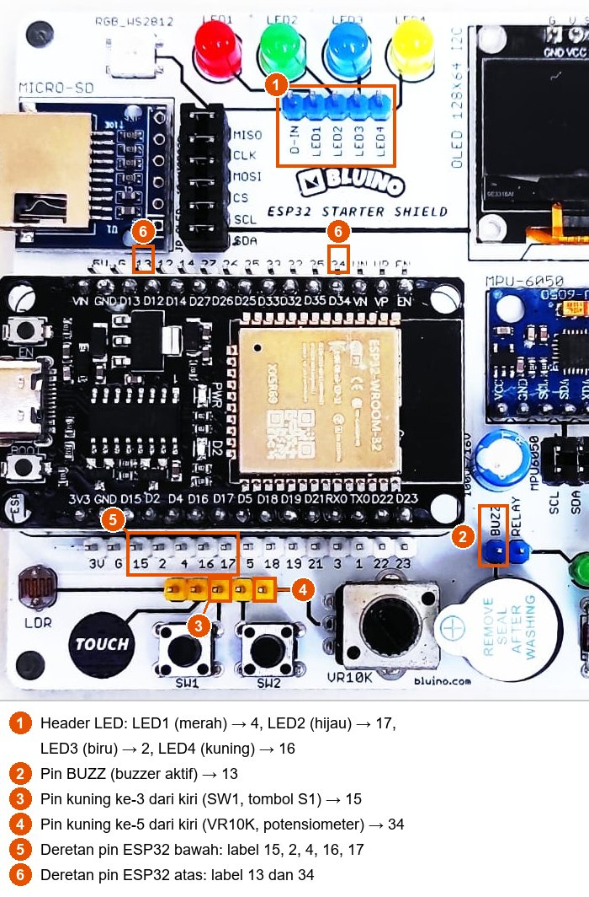
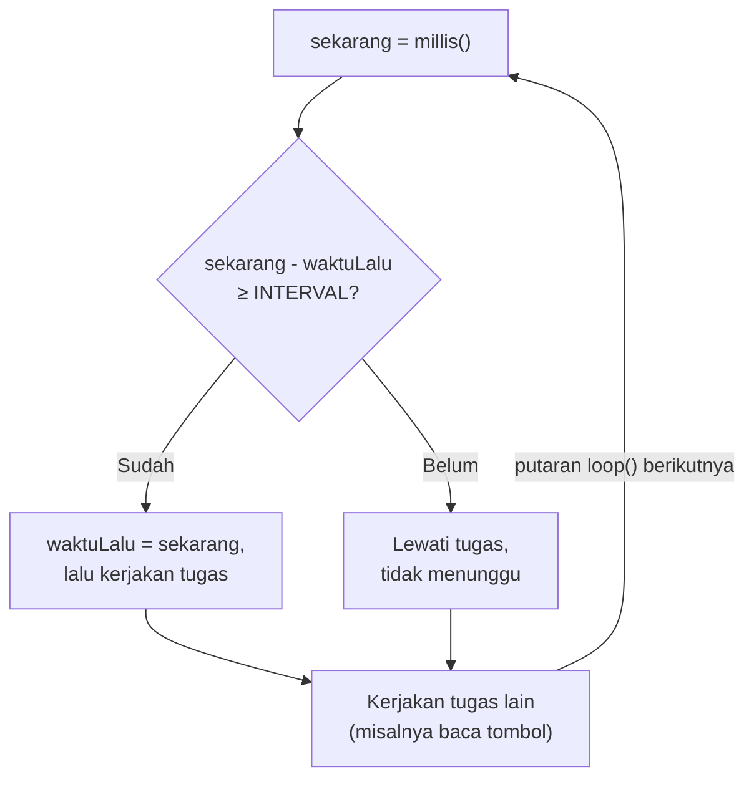
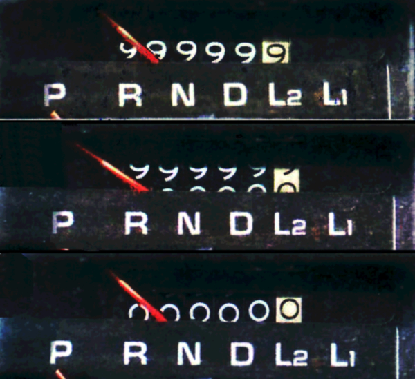

# BAB 16: Non-Blocking Programming

> ✅ **Prasyarat:** Selesaikan **BAB 9 (Digital Input — Push Button)** — kamu sudah bisa membaca tombol dan mengenal `millis()` dari materi *debounce*. Beberapa program juga membaca potensiometer dengan `analogRead()` yang dibahas di **BAB 11 (Analog Input & ADC)**.

Sejauh ini kamu banyak memakai `delay()` untuk mengatur waktu. Caranya mudah, tetapi ada kelemahan besar: selama `delay()` berjalan, program berhenti di tempat dan tidak bisa mengerjakan hal lain — tombol yang ditekan pun bisa terlewat. Di BAB ini kamu belajar menulis program ***non-blocking*** (tidak menghambat): alih-alih diam menunggu, program cukup "melirik jam" dengan `millis()`, lalu langsung mengerjakan tugas lain. Ibaratnya memasak mi sambil menggoreng telur: kamu tidak berdiri terpaku menatap panci selama tiga menit, tetapi sesekali melihat jam sambil mengerjakan yang lain. Pola ini menjadi dasar hampir semua program di BAB-BAB berikutnya, yang harus membaca sensor, melayani tombol, dan berkomunikasi lewat WiFi pada saat yang sama.

## 📌 Tujuan Pembelajaran

Setelah mempelajari BAB ini, kamu bisa:

- Menjelaskan arti kode *blocking* dan kenapa `delay()` membuat tombol terlambat merespons.
- Menerapkan pola *blink without delay*: menjalankan tugas berkala dengan `millis()` tanpa menghentikan program.
- Menjalankan beberapa tugas dengan interval berbeda secara bersamaan.
- Merapikan banyak *timer* (pengatur waktu) dengan `struct` dan *array*.
- Menjalankan urutan langkah, misalnya alarm "bip" 10 kali, tanpa `delay()` sehingga bisa dihentikan kapan saja.
- Membaca perintah dari Serial Monitor tanpa membuat program menunggu.
- Mengukur durasi yang sangat singkat dengan `micros()`.
- Menjelaskan kenapa rumus `millis() - waktuLalu >= INTERVAL` tetap benar walaupun nilai `millis()` kembali ke nol (*rollover*).
- Menentukan kapan `delay()` masih boleh dipakai.

## 🧰 Yang Perlu Disiapkan

| Kebutuhan | Keterangan |
|---|---|
| *Hardware* | Kit Bluino ESP32 IoT Starter Shield (ESP32 DEVKIT V1 sudah terpasang di kit) + kabel USB **data** |
| Kabel *jumper* | 7 kabel *female-female*: 4 untuk LED, 1 untuk *buzzer*, 1 untuk tombol S1, 1 untuk potensiometer — sudah ada di kit |
| Komponen tambahan | Tidak ada — semua komponen sudah terpasang di kit |
| *Software* | Arduino IDE 2.x + *board package* **esp32** versi 3.3.x (lihat [BAB 5](../BAB-05/README.md)) |
| *Library* | Tidak perlu *library* tambahan |
| Alat uji | **Serial Monitor** Arduino IDE (baud 115200). Program 6 juga memakai kolom kirim pesan Serial Monitor dengan *line ending* **New Line** |
| Jaringan | Tidak perlu WiFi |

## 📑 Daftar Isi

- [16.1 Kode *Blocking* dan Masalah delay()](#161-kode-blocking-dan-masalah-delay)
- [16.2 Rangkaian untuk Seluruh BAB](#162-rangkaian-untuk-seluruh-bab)
- [16.3 Program 1: Tombol yang Terlambat Merespons](#163-program-1-tombol-yang-terlambat-merespons)
- [16.4 Pola *Blink Without Delay*](#164-pola-blink-without-delay)
- [16.5 Program 2: LED Berkedip Tanpa delay()](#165-program-2-led-berkedip-tanpa-delay)
- [16.6 Menjalankan Beberapa Tugas Sekaligus](#166-menjalankan-beberapa-tugas-sekaligus)
- [16.7 Program 3: Beberapa Tugas Sekaligus](#167-program-3-beberapa-tugas-sekaligus)
- [16.8 Timer di Dalam struct dan Array](#168-timer-di-dalam-struct-dan-array)
- [16.9 Program 4: Empat LED dengan Interval Berbeda](#169-program-4-empat-led-dengan-interval-berbeda)
- [16.10 Urutan Langkah Tanpa delay()](#1610-urutan-langkah-tanpa-delay)
- [16.11 Program 5: Alarm yang Bisa Dihentikan Kapan Saja](#1611-program-5-alarm-yang-bisa-dihentikan-kapan-saja)
- [16.12 Membaca Input Serial Tanpa Menunggu](#1612-membaca-input-serial-tanpa-menunggu)
- [16.13 Program 6: Perintah Serial Tanpa Menunggu](#1613-program-6-perintah-serial-tanpa-menunggu)
- [16.14 Mengukur Waktu Singkat dengan micros()](#1614-mengukur-waktu-singkat-dengan-micros)
- [16.15 Program 7: Mengukur Waktu dengan micros()](#1615-program-7-mengukur-waktu-dengan-micros)
- [16.16 Rollover: Kenapa Rumus Selisih Selalu Benar](#1616-rollover-kenapa-rumus-selisih-selalu-benar)
- [16.17 Program 8: Simulasi Rollover millis()](#1617-program-8-simulasi-rollover-millis)
- [16.18 Kapan delay() Masih Boleh Dipakai?](#1618-kapan-delay-masih-boleh-dipakai)
- [16.19 Kesalahan yang Sering Terjadi](#1619-kesalahan-yang-sering-terjadi)
- [16.20 Troubleshooting](#1620-troubleshooting)
- [📝 Rangkuman](#-rangkuman)
- [💪 Latihan](#-latihan)
- [📚 Referensi](#-referensi)

---

## 16.1 Kode *Blocking* dan Masalah delay()

Perintah yang membuat program **berhenti menunggu** sampai sesuatu selesai disebut kode ***blocking*** (menghambat). Contoh paling umum adalah `delay()`. Saat ESP32 menjalankan `delay(1000)`, `loop()` tertahan di baris itu selama 1 detik penuh. Tombol yang ditekan selama itu tidak terbaca, nilai sensor tidak diperbarui, dan perintah dari Serial Monitor harus antre menunggu giliran.

Bayangkan kamu menjaga warung sendirian sambil merebus air. Kalau kamu berdiri diam di depan kompor sampai airnya mendidih, pembeli yang datang tidak terlayani. Penjaga warung yang cerdik menyalakan kompor, melayani pembeli, lalu **sesekali melirik** panci. Itulah bedanya *blocking* dan *non-blocking*.

Kode *blocking* tidak selalu berbentuk `delay()`. Berikut contoh yang sering dijumpai:

| Kode | Kenapa *blocking* |
|---|---|
| `delay(1000);` | Diam menunggu 1 detik penuh |
| `while (digitalRead(TOMBOL_S1) == LOW) { }` | Diam menunggu sampai tombol ditekan — bisa selamanya |
| `while (millis() - mulai < 1000) { }` | Memakai `millis()`, tetapi tetap diam menunggu di dalam `while` |
| `Serial.readString();` atau `Serial.parseInt();` | Menunggu data dari Serial Monitor sampai batas waktu bawaannya, yaitu 1 detik |
| `delayMicroseconds(500);` | Diam menunggu, walaupun sangat singkat (0,5 ms) |

Kode **non-blocking** tidak pernah diam menunggu. Setiap kali `loop()` berputar, program hanya bertanya, "Apakah sudah waktunya?" Kalau belum, program langsung lanjut ke tugas berikutnya. Karena tidak ada yang menunggu, `loop()` bisa berputar ratusan ribu kali per detik (kamu akan mengukurnya sendiri di Program 7), sehingga setiap tugas cepat mendapat giliran.

> 📌 **Catatan:** Di ESP32, `delay()` sebenarnya memanggil `vTaskDelay()` milik FreeRTOS, sistem operasi kecil yang berjalan di dalam ESP32. Selama `delay()`, prosesor tetap bisa mengerjakan pekerjaan sistem di latar belakang, misalnya mengurus WiFi. Yang berhenti adalah **program kamu** di `loop()`. Jadi masalah `delay()` bukan "ESP32 mati sementara", melainkan "kodemu tidak sempat memeriksa tombol, sensor, dan lainnya".

---

## 16.2 Rangkaian untuk Seluruh BAB

Semua program di BAB ini memakai komponen yang sama, jadi cukup pasang kabelnya **sekali** di awal. Total ada 7 kabel *jumper*:

| Komponen | Pin **Custom** di kit | Sambungkan ke pin ESP32 | Letak pin ESP32 |
|---|---|---|---|
| LED merah | LED1 (*header* LED) | IO4 (label `4`) | Deretan bawah |
| LED hijau | LED2 (*header* LED) | IO17 (label `17`) | Deretan bawah |
| LED biru | LED3 (*header* LED) | IO2 (label `2`) | Deretan bawah |
| LED kuning | LED4 (*header* LED) | IO16 (label `16`) | Deretan bawah |
| Tombol S1 (SW1) | Pin kuning ke-3 dari kiri | IO15 (label `15`) | Deretan bawah |
| Potensiometer (VR10K) | Pin kuning ke-5 dari kiri | IO34 (label `34`) | Deretan atas |
| *Buzzer* aktif | BUZZ | IO13 (label `13`) | Deretan atas |



*Gambar 16.1 — Letak pin yang disambung di BAB ini pada kit v3.x: header LED (1), pin BUZZ (2), pin kuning SW1 (3) dan VR10K (4), serta label pin ESP32 di deretan bawah (5) dan atas (6). Tata letak kit v3.2 milikmu bisa sedikit berbeda. Sumber: foto produk ESP32 Starter Shield, [Bluino](http://www.bluino.com), dipotong dan diberi penanda untuk materi ini.*

Langkah memasang kabel:

1. Cabut kabel USB dulu supaya aman saat merangkai.
2. Pasang keempat kabel LED seperti di [BAB 8](../BAB-08/README.md): LED1 (merah) → **4**, LED2 (hijau) → **17**, LED3 (biru) → **2**, LED4 (kuning) → **16**.
3. Pasang kabel dari pin kuning ke-3 (SW1) ke pin berlabel **15** di deretan bawah, seperti di [BAB 9](../BAB-09/README.md).
4. Pasang kabel dari pin kuning ke-5 (VR10K) ke pin berlabel **34** di deretan atas. Pin ini tersambung ke kaki tengah potensiometer, sehingga nilai `analogRead()` berubah dari 0 sampai 4095 saat kenopnya diputar (lihat [BAB 11](../BAB-11/README.md)).
5. Pasang kabel dari pin **BUZZ** ke pin berlabel **13** di deretan atas.
6. Periksa sekali lagi bahwa setiap kabel tertancap penuh dan tidak bergeser satu pin, lalu sambungkan kembali kabel USB.

> ⚠️ **Perhatian:** Di deretan bawah, pin `15` bersebelahan dengan pin `G` (GND). Kalau kabel S1 tergeser ke `G`, menekan S1 akan menyambungkan 3,3 V langsung ke GND (hubung singkat). Pin **BUZZ** juga bersebelahan dengan pin **RELAY** — pastikan kabel *buzzer* terpasang di BUZZ.

> 📌 **Catatan:** Selama kabel S1 terpasang di IO15, log *boot* bawaan ESP32 (baris seperti `rst:0x1 (POWERON_RESET),boot:0x13 ...`) tidak muncul di Serial Monitor. Itu normal dan aman (penjelasannya di [BAB 9](../BAB-09/README.md)). Serial Monitor langsung dimulai dari judul program.

---

## 16.3 Program 1: Tombol yang Terlambat Merespons

**Tujuan:** Merasakan sendiri masalah `delay()`. LED merah berkedip memakai `delay()`, sedangkan LED hijau seharusnya menyala selama tombol S1 ditekan. Kamu akan melihat LED hijau terlambat merespons, dan tekanan singkat sering tidak terbaca sama sekali.

**Rangkaian:**

| Pin **Custom** di kit | Sambungkan ke pin ESP32 |
|---|---|
| LED1 (merah) | IO4 |
| LED2 (hijau) | IO17 |
| Tombol S1 (pin kuning ke-3) | IO15 |

**Cara Menjalankan:**

1. Sambungkan kabel *jumper* sesuai tabel **Rangkaian** di atas (atau langsung pasang semua kabel seperti di [16.2](#162-rangkaian-untuk-seluruh-bab)).
2. Buka Arduino IDE → **File → New Sketch**, hapus isinya, lalu salin kode di bawah. Kode yang sama juga tersedia di *file* [`p1_masalah_delay.ino`](p1_masalah_delay/p1_masalah_delay.ino).
3. Pastikan **Tools → Board** = **ESP32 Dev Module** dan **Tools → Port** = *port* ESP32 kamu (misalnya `COM5` di Windows atau `/dev/ttyUSB0` di Linux).
4. Klik tombol **Upload** (ikon panah →) dan tunggu sampai muncul tulisan **Done uploading**.
5. Buka **Serial Monitor** (**Tools → Serial Monitor**) lalu pilih baud **115200**.
6. Tekan S1 sebentar (kurang dari setengah detik) beberapa kali. Setelah itu, tekan dan tahan S1 selama 3 detik. Perhatikan LED hijau dan Serial Monitor.

**Kode Program:**

<!-- sketch: p1_masalah_delay -->
```cpp
/*
 * BAB 16 - Program 1: Tombol yang Terlambat Merespons
 * LED merah berkedip dengan delay(). LED hijau seharusnya mengikuti tombol S1,
 * tetapi tombol hanya sempat dibaca sekali setiap 2 detik.
 *
 * Rangkaian:
 *   LED1 (merah)                → IO4
 *   LED2 (hijau)                → IO17
 *   Tombol S1 (pin kuning ke-3) → IO15
 */

#define LED_MERAH 4
#define LED_HIJAU 17
#define TOMBOL_S1 15

void setup() {
  Serial.begin(115200);
  pinMode(LED_MERAH, OUTPUT);
  pinMode(LED_HIJAU, OUTPUT);
  pinMode(TOMBOL_S1, INPUT);  // tombol kit: pull-down 10 kΩ sudah ada di PCB

  Serial.println("BAB 16 - Program 1: Tombol yang Terlambat Merespons");
}

void loop() {
  // Tugas 1: LED merah berkedip (cara lama, memakai delay)
  digitalWrite(LED_MERAH, HIGH);
  delay(1000);                   // program tertahan 1 detik di sini...
  digitalWrite(LED_MERAH, LOW);
  delay(1000);                   // ...lalu 1 detik lagi di sini

  // Tugas 2: LED hijau mengikuti S1 — baru sempat dijalankan setiap 2 detik
  int s1 = digitalRead(TOMBOL_S1);
  digitalWrite(LED_HIJAU, s1);   // HIGH (ditekan) → LED hijau menyala
  Serial.print("Tombol S1 dibaca: ");
  Serial.println(s1 == HIGH ? "DITEKAN" : "dilepas");
}
```

**Penjelasan Kode:**

- Dua `delay(1000)` membuat satu putaran `loop()` berlangsung 2 detik. Selama itu, program tertahan di salah satu `delay()`.
- Tombol S1 hanya dibaca **sekali** di akhir setiap putaran, tepat sebelum LED merah menyala lagi. Ibaratnya satpam yang hanya membuka mata sekali setiap 2 detik.
- Akibatnya, tekanan singkat yang terjadi di tengah `delay()` tidak terbaca sama sekali. Tekanan panjang memang terbaca, tetapi bisa terlambat sampai 2 detik. LED hijau juga tetap menyala sampai pembacaan berikutnya, walaupun tombol sudah dilepas.
- `digitalWrite(LED_HIJAU, s1);` langsung memakai hasil `digitalRead()` (HIGH atau LOW) untuk LED: tombol ditekan (HIGH) → LED hijau menyala.

**Contoh Output:**

```text
BAB 16 - Program 1: Tombol yang Terlambat Merespons
Tombol S1 dibaca: dilepas
Tombol S1 dibaca: dilepas
Tombol S1 dibaca: DITEKAN
Tombol S1 dibaca: DITEKAN
Tombol S1 dibaca: dilepas
```

Satu baris baru muncul setiap 2 detik. Di kit: LED merah berkedip pelan (1 detik menyala, 1 detik mati). Tekanan singkat pada S1 biasanya tidak menghasilkan apa-apa. Saat S1 ditahan, LED hijau baru menyala ketika LED merah mulai menyala lagi, dan baris `DITEKAN` baru muncul saat itu juga.

**Kalau Belum Berhasil:**

- **LED hijau terlambat dan tekanan singkat tidak terbaca** → itu memang yang ingin ditunjukkan program ini, bukan kesalahan. Perbaikannya ada di Program 2.
- **Selalu `dilepas` walaupun S1 ditahan lebih dari 2 detik** → kabel S1 belum terpasang di pin kuning ke-3 atau di pin berlabel `15`.
- **Tulisan muncul, tetapi LED merah tidak berkedip** → cek kabel LED1 → `4`.

---

## 16.4 Pola *Blink Without Delay*

Solusinya: **jangan menunggu, tetapi catat waktu dan periksa** di setiap putaran `loop()`. Kamu sudah mengenal `millis()` di [BAB 9](../BAB-09/README.md) (bagian 9.7.1): fungsi yang mengembalikan berapa milidetik sudah berlalu sejak ESP32 mulai menjalankan program, seperti *stopwatch* yang terus berjalan. Memanggil `millis()` tidak membuat program menunggu — fungsi ini hanya "melihat jam".

Pola berikut terkenal dengan nama ***blink without delay*** (berkedip tanpa *delay*), karena dipopulerkan oleh contoh LED berkedip bawaan Arduino IDE (**File → Examples → 02.Digital → BlinkWithoutDelay**). Contoh potongan kode (bukan program lengkap):

```cpp
const unsigned long INTERVAL = 1000;  // jalankan tugas setiap 1000 ms
unsigned long waktuLalu = 0;          // kapan tugas terakhir dijalankan

void loop() {
  unsigned long sekarang = millis();       // 1. lirik jam

  if (sekarang - waktuLalu >= INTERVAL) {  // 2. sudah lewat 1000 ms?
    waktuLalu = sekarang;                  // 3. catat waktu tindakan ini
    // 4. kerjakan tugasnya di sini (singkat saja!)
  }

  // 5. tugas lain langsung dikerjakan, tanpa menunggu
}
```

Polanya mirip memasak mi instan sambil mengerjakan hal lain. Saat air mulai mendidih, kamu mencatat jam (`waktuLalu = sekarang`). Setiap kali lewat dapur, kamu melirik jam dan menghitung sudah berapa lama (`sekarang - waktuLalu`). Belum 3 menit? Lanjutkan pekerjaan lain. Sudah 3 menit? Angkat mi, lalu catat jam lagi kalau mau memasak bungkus berikutnya.



*Gambar 16.2 — Alur pola blink without delay di setiap putaran `loop()`. Sumber: dibuat untuk materi ini.*

Empat aturan yang perlu diingat:

| Aturan | Alasannya |
|---|---|
| Simpan waktu di variabel `unsigned long` | Tipe yang sama dengan hasil `millis()`. Tipe lain bisa terpotong atau bernilai negatif |
| Selalu hitung **selisihnya**: `sekarang - waktuLalu` | Tetap benar walaupun `millis()` kembali ke 0 setelah ±49,7 hari. Buktinya ada di [16.16](#1616-rollover-kenapa-rumus-selisih-selalu-benar) |
| Pakai `>=`, bukan `==` | `loop()` belum tentu memeriksa tepat pada milidetik ke-1000. Bisa saja baru memeriksa pada milidetik ke-1001, dan `==` akan melewatkannya |
| Isi tugasnya harus singkat | Kalau tugas di dalam `if` memakai `delay()` atau `while` yang menunggu, masalahnya kembali lagi |

> 📌 **Catatan:** Timer *hardware* di [BAB 15](../BAB-15/README.md) juga bisa menjalankan sesuatu secara berkala tanpa `delay()`, tetapi kodenya berjalan di dalam *interrupt* dengan aturan yang ketat. Untuk jadwal dengan ketelitian milidetik — kedip LED, membaca sensor, mengirim laporan — pola `millis()` jauh lebih sederhana dan sudah cukup.

---

## 16.5 Program 2: LED Berkedip Tanpa delay()

**Tujuan:** Memperbaiki Program 1 dengan pola *blink without delay*. LED merah tetap berkedip setiap 1 detik, tetapi sekarang LED hijau langsung mengikuti tombol S1 tanpa terlambat sedikit pun.

**Rangkaian:** sama dengan Program 1.

| Pin **Custom** di kit | Sambungkan ke pin ESP32 |
|---|---|
| LED1 (merah) | IO4 |
| LED2 (hijau) | IO17 |
| Tombol S1 (pin kuning ke-3) | IO15 |

**Cara Menjalankan:**

1. Biarkan kabel *jumper* seperti pada Program 1.
2. Buka Arduino IDE → **File → New Sketch**, hapus isinya, lalu salin kode di bawah. Kode yang sama juga tersedia di *file* [`p2_kedip_tanpa_delay.ino`](p2_kedip_tanpa_delay/p2_kedip_tanpa_delay.ino).
3. Pastikan **Tools → Board** = **ESP32 Dev Module** dan **Tools → Port** = *port* ESP32 kamu.
4. Klik tombol **Upload** dan tunggu sampai muncul tulisan **Done uploading**.
5. Buka **Serial Monitor** (**Tools → Serial Monitor**) lalu pilih baud **115200**.
6. Tekan S1 sebentar beberapa kali, lalu tahan beberapa detik. Bandingkan dengan Program 1.

**Kode Program:**

<!-- sketch: p2_kedip_tanpa_delay -->
```cpp
/*
 * BAB 16 - Program 2: LED Berkedip Tanpa delay()
 * LED merah berkedip setiap 1 detik memakai millis(),
 * sementara LED hijau langsung mengikuti tombol S1.
 *
 * Rangkaian:
 *   LED1 (merah)                → IO4
 *   LED2 (hijau)                → IO17
 *   Tombol S1 (pin kuning ke-3) → IO15
 */

#define LED_MERAH 4
#define LED_HIJAU 17
#define TOMBOL_S1 15

const unsigned long INTERVAL_KEDIP = 1000;  // ms: LED merah ganti keadaan setiap 1 detik

unsigned long waktuKedipLalu = 0;  // kapan LED merah terakhir ganti keadaan
bool merahNyala = false;           // keadaan LED merah saat ini

void setup() {
  Serial.begin(115200);
  pinMode(LED_MERAH, OUTPUT);
  pinMode(LED_HIJAU, OUTPUT);
  pinMode(TOMBOL_S1, INPUT);

  Serial.println("BAB 16 - Program 2: LED Berkedip Tanpa delay()");
}

void loop() {
  unsigned long sekarang = millis();  // lirik jam sekali di awal loop()

  // Tugas 1: LED merah berkedip — hanya bertindak kalau sudah waktunya
  if (sekarang - waktuKedipLalu >= INTERVAL_KEDIP) {
    waktuKedipLalu = sekarang;          // catat waktu tindakan ini
    merahNyala = !merahNyala;           // balik keadaan LED
    digitalWrite(LED_MERAH, merahNyala ? HIGH : LOW);

    Serial.print("LED merah: ");
    Serial.println(merahNyala ? "NYALA" : "MATI");
  }

  // Tugas 2: LED hijau mengikuti S1 — diperiksa di SETIAP putaran loop()
  digitalWrite(LED_HIJAU, digitalRead(TOMBOL_S1));
}
```

**Penjelasan Kode:**

- `unsigned long sekarang = millis();` membaca "jam" sekali di awal `loop()`. Semua pemeriksaan di putaran itu memakai nilai yang sama, sehingga hasilnya konsisten.
- Blok `if` hanya dijalankan kalau sudah lewat 1000 ms sejak `waktuKedipLalu`. Di dalamnya, waktu tindakan dicatat, keadaan LED dibalik dengan `!` (bukan), lalu keadaan barunya dicetak. Isi blok ini selesai dalam sekejap.
- Di sebagian besar putaran, syarat `if` belum terpenuhi, jadi program langsung lompat ke Tugas 2. Karena tidak ada yang menunggu, `loop()` berputar ratusan ribu kali per detik, dan tombol S1 ikut terbaca sesering itu.
- `digitalWrite(LED_HIJAU, digitalRead(TOMBOL_S1));` menyalin keadaan tombol ke LED hijau dalam satu baris: ditekan (HIGH) → LED menyala, dilepas (LOW) → LED mati.
- Bandingkan dengan Program 1: tugas LED merahnya sama persis, tetapi sekarang tugas itu tidak lagi "menyandera" tugas lain.

**Contoh Output:**

```text
BAB 16 - Program 2: LED Berkedip Tanpa delay()
LED merah: NYALA
LED merah: MATI
LED merah: NYALA
LED merah: MATI
```

Satu baris baru muncul setiap 1 detik. Di kit: LED merah berkedip seperti di Program 1, sedangkan LED hijau menyala **seketika** saat S1 ditekan dan mati seketika saat dilepas — tekanan sesingkat apa pun ikut terlihat.

> 🧪 **Coba Sendiri:** Ubah `INTERVAL_KEDIP` menjadi `100`, lalu *upload* ulang. LED merah berkedip jauh lebih cepat, tetapi LED hijau tetap langsung merespons tombol. Dengan `delay()`, mempercepat kedipan tidak akan pernah membuat tombol terbaca "sambil jalan".

**Kalau Belum Berhasil:**

- **LED hijau tidak menyala saat S1 ditekan** → cek kabel S1 → `15` dan LED2 → `17`.
- **LED hijau menyala-mati sendiri tanpa disentuh** → IO15 mengambang karena kabel S1 lepas atau salah pin.
- **LED merah tidak berkedip, padahal tulisan `NYALA`/`MATI` muncul** → cek kabel LED1 → `4`.

---

## 16.6 Menjalankan Beberapa Tugas Sekaligus

Kekuatan pola *blink without delay* baru terasa saat tugasnya banyak. Kuncinya sederhana: **setiap tugas punya "jam weker" sendiri**, yaitu pasangan variabel *interval* dan *waktuLalu*. Setiap putaran `loop()` memeriksa semua jam weker itu satu per satu. Tugas yang sudah waktunya dijalankan sebentar, tugas yang belum dilewati.

Contohnya, kalau LED merah berganti keadaan setiap 500 ms dan laporan dicetak setiap 1000 ms, urutan kejadiannya seperti ini:

```text
Waktu (ms) :  0 ...... 500 ...... 1000 ...... 1500 ...... 2000
LED merah  :           jalan      jalan       jalan       jalan
Laporan    :                      jalan                   jalan
Tombol S1  :  diperiksa terus-menerus, di setiap putaran loop()
```

Cara kerja seperti ini disebut ***multitasking* kooperatif**: tugas-tugas bergiliran memakai prosesor, dan setiap tugas "tahu diri" untuk cepat selesai supaya tugas lain kebagian giliran. Mirip satu kasir yang melayani beberapa antrean dengan cepat — selama tidak ada pembeli yang mengajak mengobrol 10 menit, semua antrean tetap bergerak. Satu saja tugas yang memakai `delay()` panjang akan membuat semua tugas lain ikut tertahan.

> 📌 **Catatan:** Tugas-tugas ini tidak benar-benar berjalan bersamaan. Mereka dijalankan bergantian dengan sangat cepat, sehingga bagi manusia terlihat bersamaan. ESP32 juga mendukung *multitasking* sungguhan dengan FreeRTOS (beberapa *task* berjalan terpisah), tetapi itu topik lanjutan. Untuk sebagian besar program, pola `millis()` di BAB ini sudah cukup dan jauh lebih sederhana.

---

## 16.7 Program 3: Beberapa Tugas Sekaligus

**Tujuan:** Menjalankan lima tugas dengan jadwal berbeda dalam satu `loop()`: LED merah berkedip tetap, potensiometer dibaca berkala, LED kuning berkedip dengan kecepatan sesuai potensiometer, laporan dicetak setiap detik, dan LED hijau mengikuti tombol S1.

**Rangkaian:**

| Pin **Custom** di kit | Sambungkan ke pin ESP32 |
|---|---|
| LED1 (merah) | IO4 |
| LED2 (hijau) | IO17 |
| LED4 (kuning) | IO16 |
| Tombol S1 (pin kuning ke-3) | IO15 |
| Potensiometer VR10K (pin kuning ke-5) | IO34 |

**Cara Menjalankan:**

1. Sambungkan kabel *jumper* sesuai tabel **Rangkaian** di atas (lihat [16.2](#162-rangkaian-untuk-seluruh-bab)).
2. Buka Arduino IDE → **File → New Sketch**, hapus isinya, lalu salin kode di bawah. Kode yang sama juga tersedia di *file* [`p3_multitugas.ino`](p3_multitugas/p3_multitugas.ino).
3. Pastikan **Tools → Board** = **ESP32 Dev Module** dan **Tools → Port** = *port* ESP32 kamu.
4. Klik tombol **Upload** dan tunggu sampai muncul tulisan **Done uploading**.
5. Buka **Serial Monitor** (**Tools → Serial Monitor**) lalu pilih baud **115200**.
6. Putar kenop potensiometer pelan-pelan dari ujung ke ujung, sambil sesekali menekan S1.

**Kode Program:**

<!-- sketch: p3_multitugas -->
```cpp
/*
 * BAB 16 - Program 3: Beberapa Tugas Sekaligus
 * Tugas 1: LED merah ganti keadaan setiap 500 ms
 * Tugas 2: potensiometer dibaca setiap 50 ms
 * Tugas 3: LED kuning berkedip, intervalnya 100–1000 ms sesuai potensiometer
 * Tugas 4: laporan ke Serial Monitor setiap 1 detik
 * Tugas 5: LED hijau mengikuti tombol S1 di setiap putaran loop()
 *
 * Rangkaian:
 *   LED1 (merah)                          → IO4
 *   LED2 (hijau)                          → IO17
 *   LED4 (kuning)                         → IO16
 *   Tombol S1 (pin kuning ke-3)           → IO15
 *   Potensiometer VR10K (pin kuning ke-5) → IO34
 */

#define LED_MERAH  4
#define LED_HIJAU  17
#define LED_KUNING 16
#define TOMBOL_S1  15
#define POT_PIN    34

// Interval tugas yang tetap (ms)
const unsigned long INTERVAL_MERAH   = 500;
const unsigned long INTERVAL_POT     = 50;
const unsigned long INTERVAL_LAPORAN = 1000;

// "Jam weker" setiap tugas: kapan terakhir dijalankan
unsigned long waktuMerahLalu   = 0;
unsigned long waktuPotLalu     = 0;
unsigned long waktuKuningLalu  = 0;
unsigned long waktuLaporanLalu = 0;

bool merahNyala  = false;
bool kuningNyala = false;
int nilaiPot = 0;                    // hasil analogRead() terakhir (0–4095)
unsigned long intervalKuning = 500;  // berubah mengikuti potensiometer

void setup() {
  Serial.begin(115200);
  pinMode(LED_MERAH, OUTPUT);
  pinMode(LED_HIJAU, OUTPUT);
  pinMode(LED_KUNING, OUTPUT);
  pinMode(TOMBOL_S1, INPUT);
  // POT_PIN (IO34) cukup dibaca dengan analogRead(), tidak perlu pinMode()

  Serial.println("BAB 16 - Program 3: Beberapa Tugas Sekaligus");
  Serial.println("Putar potensiometer untuk mengubah kecepatan LED kuning.");
}

void loop() {
  unsigned long sekarang = millis();

  // Tugas 1: LED merah — ganti keadaan setiap 500 ms
  if (sekarang - waktuMerahLalu >= INTERVAL_MERAH) {
    waktuMerahLalu = sekarang;
    merahNyala = !merahNyala;
    digitalWrite(LED_MERAH, merahNyala ? HIGH : LOW);
  }

  // Tugas 2: baca potensiometer setiap 50 ms, lalu hitung interval LED kuning
  if (sekarang - waktuPotLalu >= INTERVAL_POT) {
    waktuPotLalu = sekarang;
    nilaiPot = analogRead(POT_PIN);
    intervalKuning = map(nilaiPot, 0, 4095, 100, 1000);
  }

  // Tugas 3: LED kuning — ganti keadaan sesuai interval dari potensiometer
  if (sekarang - waktuKuningLalu >= intervalKuning) {
    waktuKuningLalu = sekarang;
    kuningNyala = !kuningNyala;
    digitalWrite(LED_KUNING, kuningNyala ? HIGH : LOW);
  }

  // Tugas 4: laporan ke Serial Monitor setiap 1 detik
  if (sekarang - waktuLaporanLalu >= INTERVAL_LAPORAN) {
    waktuLaporanLalu = sekarang;
    Serial.print("Potensiometer: ");
    Serial.print(nilaiPot);
    Serial.print(" | Interval LED kuning: ");
    Serial.print(intervalKuning);
    Serial.println(" ms");
  }

  // Tugas 5: LED hijau mengikuti S1 — di setiap putaran, tanpa jadwal
  digitalWrite(LED_HIJAU, digitalRead(TOMBOL_S1));
}
```

**Penjelasan Kode:**

- Setiap tugas berjadwal punya pasangan **interval** dan **waktu...Lalu** sendiri, dan polanya sama persis dengan Program 2. Menambah tugas baru cukup dengan menambah satu pasangan variabel dan satu blok `if`.
- Tugas 2 membaca potensiometer dengan `analogRead()` (hasilnya 0–4095), lalu `map()` mengubah rentang 0–4095 menjadi 100–1000. Contoh: nilai 2047 (kenop di tengah) menjadi 549 ms. `map()` memakai pembagian bilangan bulat, jadi angka di belakang koma dibuang.
- Tugas 3 memakai `intervalKuning` yang **berubah-ubah**. Pola *blink without delay* tetap bekerja walaupun intervalnya diganti di tengah jalan — sesuatu yang sulit dilakukan dengan `delay()`.
- Tugas 5 tidak punya jadwal: LED hijau diperbarui di setiap putaran `loop()`. Kalau LED hijau tetap langsung merespons tombol, itu bukti bahwa tidak ada tugas lain yang menghambat.
- Urutan blok `if` di dalam `loop()` tidak terlalu penting, karena setiap blok selesai dalam waktu yang sangat singkat.

**Contoh Output:**

```text
BAB 16 - Program 3: Beberapa Tugas Sekaligus
Putar potensiometer untuk mengubah kecepatan LED kuning.
Potensiometer: 1838 | Interval LED kuning: 503 ms
Potensiometer: 1841 | Interval LED kuning: 504 ms
Potensiometer: 2955 | Interval LED kuning: 749 ms
Potensiometer: 4095 | Interval LED kuning: 1000 ms
Potensiometer: 0 | Interval LED kuning: 100 ms
```

Angka di kit kamu tentu berbeda, tergantung posisi kenop. Nilainya juga bisa bergeser sedikit walaupun kenop tidak diputar (misalnya 1838 lalu 1841) — itu derau (*noise*) ADC yang normal, seperti dibahas di [BAB 11](../BAB-11/README.md). Di kit: LED merah berkedip dengan irama tetap, LED kuning makin lambat saat kenop diputar ke arah nilai besar dan makin cepat ke arah nilai kecil, dan LED hijau langsung menyala setiap kali S1 ditekan.

**Kalau Belum Berhasil:**

- **Nilai potensiometer selalu 0 atau selalu 4095** → kabel VR10K belum terpasang di pin kuning ke-5, atau tidak di pin berlabel `34` di deretan **atas**.
- **Nilai potensiometer melompat-lompat acak walaupun kenop diam** → kabel di IO34 lepas sehingga pin mengambang. Pasang ulang kabelnya.
- **LED kuning tidak berkedip** → cek kabel LED4 (kuning) → `16`. Ingat, label **LED4** disambung ke pin `16`, bukan ke pin `4` — pin `4` untuk LED1 (merah).

---

## 16.8 Timer di Dalam struct dan Array

Program 3 sudah punya empat pasang variabel (`INTERVAL_...` dan `waktu...Lalu`). Bayangkan kalau tugasnya sepuluh: variabelnya makin banyak, dan mudah sekali salah ketik, misalnya memperbarui `waktuMerahLalu` di blok milik LED kuning. Solusinya adalah membungkus setiap pasangan ke dalam satu paket.

### 16.8.1 Mengenal struct

`struct` (singkatan dari *structure*) adalah cara C++ menggabungkan beberapa variabel menjadi satu paket, mirip formulir yang punya beberapa kolom isian. Contoh potongan kode:

```cpp
struct Timer {
  unsigned long interval;   // jalankan setiap sekian ms
  unsigned long waktuLalu;  // kapan terakhir dijalankan
};

Timer timerMerah   = {500, 0};   // kolom diisi berurutan: interval, waktuLalu
Timer timerLaporan = {1000, 0};

void setup() {
  // Mengakses kolom memakai tanda titik:
  timerMerah.interval = 250;     // ubah interval timer LED merah
}
```

### 16.8.2 Fungsi di Dalam struct

Pemeriksaan "sudah waktunya?" bisa ditaruh **di dalam** `struct` sebagai fungsi. Dengan begitu, setiap *timer* bisa memeriksa dirinya sendiri, dan logikanya cukup ditulis sekali untuk semua *timer*:

```cpp
struct Timer {
  unsigned long interval;   // jalankan setiap sekian ms
  unsigned long waktuLalu;  // kapan terakhir dijalankan

  // Mengembalikan true kalau sudah waktunya, lalu mencatat waktunya
  bool sudahWaktunya(unsigned long sekarang) {
    if (sekarang - waktuLalu >= interval) {
      waktuLalu = sekarang;
      return true;
    }
    return false;
  }
};

Timer timerMerah   = {500, 0};
Timer timerLaporan = {1000, 0};

void loop() {
  unsigned long sekarang = millis();

  if (timerMerah.sudahWaktunya(sekarang)) {
    // balik keadaan LED merah
  }
  if (timerLaporan.sudahWaktunya(sekarang)) {
    // cetak laporan
  }
}
```

Baca `timerMerah.sudahWaktunya(sekarang)` seperti bertanya, "*Timer* merah, sudah waktunya belum?" Fungsi di dalam `struct` bisa langsung memakai kolom milik *timer*-nya sendiri (`interval` dan `waktuLalu`), jadi `timerMerah` dan `timerLaporan` tidak akan tertukar. Cara menggabungkan data dan fungsi seperti ini akan sering kamu temui lagi, misalnya saat membuat "tombol pintar" di [BAB 18](../BAB-18/README.md).

### 16.8.3 Array dari struct

Kalau tugasnya mirip satu sama lain — misalnya empat LED yang berkedip dengan kecepatan berbeda — simpan semuanya dalam *array* berisi `struct`, lalu proses dengan satu perulangan `for`. Kamu sudah memakai *array* dan `for` untuk LED di [BAB 8](../BAB-08/README.md); bedanya, sekarang setiap elemen *array* adalah satu paket lengkap berisi pin, nama, *timer*, dan keadaan LED. Inilah yang dilakukan Program 4.

---

## 16.9 Program 4: Empat LED dengan Interval Berbeda

**Tujuan:** Membuat keempat LED berkedip dengan interval berbeda (250, 500, 1000, dan 2000 ms) memakai *array* berisi `struct`. Setiap 5 detik, Serial Monitor menampilkan berapa kali setiap LED sudah berganti keadaan, sebagai bukti bahwa semua LED berjalan sendiri-sendiri tanpa saling mengganggu.

**Rangkaian:**

| Pin **Custom** di kit | Sambungkan ke pin ESP32 |
|---|---|
| LED1 (merah) | IO4 |
| LED2 (hijau) | IO17 |
| LED3 (biru) | IO2 |
| LED4 (kuning) | IO16 |

**Cara Menjalankan:**

1. Pastikan keempat kabel LED terpasang sesuai tabel **Rangkaian** di atas.
2. Buka Arduino IDE → **File → New Sketch**, hapus isinya, lalu salin kode di bawah. Kode yang sama juga tersedia di *file* [`p4_timer_struct.ino`](p4_timer_struct/p4_timer_struct.ino).
3. Pastikan **Tools → Board** = **ESP32 Dev Module** dan **Tools → Port** = *port* ESP32 kamu.
4. Klik tombol **Upload** dan tunggu sampai muncul tulisan **Done uploading**.
5. Buka **Serial Monitor** (**Tools → Serial Monitor**) lalu pilih baud **115200**.

**Kode Program:**

<!-- sketch: p4_timer_struct -->
```cpp
/*
 * BAB 16 - Program 4: Empat LED dengan Interval Berbeda
 * Setiap LED punya timer sendiri, disimpan dalam array berisi struct.
 * Setiap 5 detik, Serial Monitor menampilkan berapa kali setiap LED
 * sudah berganti keadaan.
 *
 * Rangkaian (header LED di kit → pin ESP32):
 *   LED1 (merah) → IO4,  LED2 (hijau)  → IO17
 *   LED3 (biru)  → IO2,  LED4 (kuning) → IO16
 */

#define LED_MERAH  4
#define LED_KUNING 16
#define LED_HIJAU  17
#define LED_BIRU   2

// Timer serbaguna: interval + catatan waktu + fungsi pemeriksa
struct Timer {
  unsigned long interval;   // ms
  unsigned long waktuLalu;  // hasil millis() saat terakhir dijalankan

  // Mengembalikan true kalau sudah waktunya, lalu mencatat waktunya
  bool sudahWaktunya(unsigned long sekarang) {
    if (sekarang - waktuLalu >= interval) {
      waktuLalu = sekarang;
      return true;
    }
    return false;
  }
};

// Satu LED berkedip = pin + nama + timer + keadaan + penghitung
struct LedKedip {
  int pin;
  const char *nama;
  Timer timer;
  bool nyala;
  int jumlahGanti;  // berapa kali LED ini sudah berganti keadaan
};

LedKedip daftarLed[] = {
  // pin,      nama,     {interval, waktuLalu}, nyala, jumlahGanti
  {LED_MERAH,  "merah",  {250, 0},              false, 0},
  {LED_HIJAU,  "hijau",  {500, 0},              false, 0},
  {LED_BIRU,   "biru",   {1000, 0},             false, 0},
  {LED_KUNING, "kuning", {2000, 0},             false, 0},
};
const int JUMLAH_LED = sizeof(daftarLed) / sizeof(daftarLed[0]);  // = 4

Timer timerLaporan = {5000, 0};  // laporan setiap 5 detik
unsigned long waktuMulai = 0;    // kapan semua timer mulai menghitung

void setup() {
  Serial.begin(115200);
  for (int i = 0; i < JUMLAH_LED; i++) {
    pinMode(daftarLed[i].pin, OUTPUT);
    digitalWrite(daftarLed[i].pin, LOW);
  }

  // Semua timer mulai menghitung dari saat yang sama
  waktuMulai = millis();
  for (int i = 0; i < JUMLAH_LED; i++) {
    daftarLed[i].timer.waktuLalu = waktuMulai;
  }
  timerLaporan.waktuLalu = waktuMulai;

  Serial.println("BAB 16 - Program 4: Empat LED dengan Interval Berbeda");
}

void loop() {
  unsigned long sekarang = millis();

  // Satu perulangan untuk semua LED
  for (int i = 0; i < JUMLAH_LED; i++) {
    if (daftarLed[i].timer.sudahWaktunya(sekarang)) {
      daftarLed[i].nyala = !daftarLed[i].nyala;
      digitalWrite(daftarLed[i].pin, daftarLed[i].nyala ? HIGH : LOW);
      daftarLed[i].jumlahGanti++;
    }
  }

  // Laporan setiap 5 detik
  if (timerLaporan.sudahWaktunya(sekarang)) {
    Serial.print("Detik ke-");
    Serial.print((sekarang - waktuMulai) / 1000);
    for (int i = 0; i < JUMLAH_LED; i++) {
      Serial.print(" | ");
      Serial.print(daftarLed[i].nama);
      Serial.print(": ");
      Serial.print(daftarLed[i].jumlahGanti);
      Serial.print("x");
    }
    Serial.println();
  }
}
```

**Penjelasan Kode:**

- `struct Timer` adalah paket *timer* serbaguna dari [16.8.2](#1682-fungsi-di-dalam-struct). `struct LedKedip` memakai `Timer` sebagai salah satu kolomnya, ditambah pin, nama, keadaan, dan penghitung.
- `daftarLed[]` berisi empat paket LED. Isian setiap baris mengikuti urutan kolom di `struct LedKedip`; isian `{250, 0}` masuk ke kolom `timer` (interval 250 ms, `waktuLalu` 0). Untuk menambah LED kelima, cukup tambahkan satu baris — `JUMLAH_LED` ikut menyesuaikan.
- Tulisan seperti `daftarLed[i].timer.sudahWaktunya(sekarang)` dibaca dari kiri ke kanan: "LED ke-`i` → *timer*-nya → sudah waktunya belum?"
- Di `setup()`, semua *timer* diisi dengan `waktuMulai`, supaya semuanya mulai menghitung dari saat yang sama. Hasilnya, angka di laporan selalu rapi dan bisa kamu hitung sendiri.
- Fungsi `sudahWaktunya()` dipakai oleh kelima *timer* (empat LED + laporan), padahal logikanya hanya ditulis sekali di dalam `struct Timer`.
- Di setiap putaran, perulangan `for` memeriksa keempat LED. LED yang sudah waktunya dibalik keadaannya dan penghitungnya ditambah 1.
- Laporan dicetak setelah perulangan LED. Jadi pada detik ke-5, pergantian LED yang jatuh tepat pada milidetik ke-5000 sudah ikut terhitung.

**Contoh Output:**

```text
BAB 16 - Program 4: Empat LED dengan Interval Berbeda
Detik ke-5 | merah: 20x | hijau: 10x | biru: 5x | kuning: 2x
Detik ke-10 | merah: 40x | hijau: 20x | biru: 10x | kuning: 5x
Detik ke-15 | merah: 60x | hijau: 30x | biru: 15x | kuning: 7x
```

Coba cocokkan dengan hitunganmu sendiri: dalam 5 detik (5000 ms), LED merah yang berganti keadaan setiap 250 ms berganti 5000 ÷ 250 = 20 kali; LED kuning yang berganti setiap 2000 ms baru berganti 2 kali (pada detik ke-2 dan ke-4). Di kit: LED merah berkedip paling cepat, disusul hijau, biru, lalu kuning yang paling lambat. LED biru kecil di *board* ESP32 ikut berkedip bersama LED biru kit karena keduanya di IO2.

> 🧪 **Coba Sendiri:** Ubah interval LED hijau menjadi `333`, lalu *upload* ulang. Berapa kali LED hijau berganti keadaan dalam 5 detik? Hitung dulu, baru cocokkan dengan Serial Monitor.

**Kalau Belum Berhasil:**

- **Satu LED tidak pernah menyala, padahal angkanya di laporan bertambah** → kabel LED itu belum terpasang atau bergeser satu pin. Cocokkan lagi warnanya: merah → `4`, hijau → `17`, biru → `2`, kuning → `16`.
- **Baris pertama yang muncul bukan `Detik ke-5`** → laporan dihitung sejak program mulai, bukan sejak Serial Monitor dibuka. Cocokkan angkanya dengan detik di awal baris, misalnya `Detik ke-35` → LED merah 35 × 4 = 140x. Untuk melihat laporan dari awal, tekan tombol **EN** di *board*.
- ***Error* `'Timer' does not name a type` saat *compile*** → `struct Timer` harus ditulis **sebelum** `struct LedKedip` yang memakainya.

<details>
<summary><b>🔬 Pendalaman (opsional): versi fungsi biasa dengan tanda & dan library TaskScheduler</b></summary>

Pemeriksaan *timer* juga bisa ditulis sebagai fungsi biasa di luar `struct`. Bedanya, *timer* yang diperiksa harus dikirim sebagai parameter:

```cpp
struct Timer {
  unsigned long interval;
  unsigned long waktuLalu;
};

bool sudahWaktunya(Timer &t, unsigned long sekarang) {
  if (sekarang - t.waktuLalu >= t.interval) {
    t.waktuLalu = sekarang;
    return true;
  }
  return false;
}

// Di dalam loop():
// if (sudahWaktunya(timerLaporan, millis())) { ... }
```

Perhatikan tanda `&` pada `Timer &t`. Tanda ini membuat fungsi bekerja langsung pada **timer aslinya** (disebut *reference*). Tanpa `&`, fungsi hanya menerima **salinan**: `waktuLalu` di salinan diperbarui, tetapi *timer* aslinya tidak, sehingga syaratnya selalu terpenuhi dan tugas berjalan di setiap putaran — LED berkedip sangat cepat tanpa henti. Versi fungsi di dalam `struct` seperti di Program 4 terhindar dari jebakan ini.

Untuk program dengan sangat banyak tugas, ada juga *library* siap pakai bernama **TaskScheduler** (oleh Anatoli Arkhipenko) yang menjalankan pola yang sama secara otomatis. Kamu tidak memerlukannya di BAB ini, tetapi namanya akan kamu temui lagi karena *library* ESP-MESH (painlessMesh) di [BAB 55](../BAB-55/README.md) memakainya.

</details>

---

## 16.10 Urutan Langkah Tanpa delay()

Sejauh ini setiap tugas hanya berulang dengan irama tetap. Bagaimana dengan **urutan langkah**, misalnya alarm "bunyi 200 ms → diam 200 ms" sebanyak 10 kali lalu berhenti? Dengan `delay()`, urutan seperti ini biasanya ditulis dengan `for`:

```cpp
// Cara blocking: selama 4 detik, program tidak bisa mengerjakan hal lain
for (int i = 1; i <= 10; i++) {
  digitalWrite(BUZZER_PIN, HIGH);
  delay(200);
  digitalWrite(BUZZER_PIN, LOW);
  delay(200);
}
```

Kode itu mudah dibaca, tetapi selama 10 × 400 ms = 4 detik program tertahan di dalam `for`. Tombol "matikan alarm" tidak akan terbaca sampai alarm selesai sendiri — persis kebalikan dari fungsi tombol itu.

Versi *non-blocking*-nya memakai **penanda langkah**: variabel yang mengingat "sekarang sedang di langkah mana", ditambah catatan waktu kapan langkah itu dimulai. Mirip pembatas buku: kamu boleh menutup buku kapan saja, lalu melanjutkan dari halaman yang ditandai. Setiap putaran `loop()` hanya bertanya, "Langkah yang sekarang sudah cukup lama belum? Kalau sudah, pindah ke langkah berikutnya."

```text
Waktu (ms) : 0      200    400    600    800    ...   3600   3800
Buzzer     : BUNYI  diam   BUNYI  diam   BUNYI  ...   BUNYI  selesai
Bip ke-    : 1      1      2      2      3      ...   10
```

Program 5 memakai dua penanda: `sedangBunyi` (langkah "bunyi" atau "diam") dan `bipKe` (bip ke berapa). Cara berpikir "sedang di keadaan apa, dan kapan pindah ke keadaan berikutnya" ini adalah bentuk sederhana dari ***state machine***, yang dibahas tuntas di [BAB 17](../BAB-17/README.md).

---

## 16.11 Program 5: Alarm yang Bisa Dihentikan Kapan Saja

**Tujuan:** Membuat alarm yang berbunyi 10 kali (*buzzer* dan LED merah) setiap kali tombol S1 ditekan. Kalau S1 ditekan lagi di tengah alarm, alarm langsung berhenti. LED hijau berkedip pelan terus-menerus sebagai tanda bahwa program tidak pernah macet.

**Rangkaian:**

| Pin **Custom** di kit | Sambungkan ke pin ESP32 |
|---|---|
| BUZZ | IO13 |
| LED1 (merah) | IO4 |
| LED2 (hijau) | IO17 |
| Tombol S1 (pin kuning ke-3) | IO15 |

**Cara Menjalankan:**

1. Sambungkan kabel *jumper* sesuai tabel **Rangkaian** di atas. Pastikan kabel *buzzer* terpasang di pin **BUZZ**, bukan **RELAY**.
2. Buka Arduino IDE → **File → New Sketch**, hapus isinya, lalu salin kode di bawah. Kode yang sama juga tersedia di *file* [`p5_alarm_bisa_dihentikan.ino`](p5_alarm_bisa_dihentikan/p5_alarm_bisa_dihentikan.ino).
3. Pastikan **Tools → Board** = **ESP32 Dev Module** dan **Tools → Port** = *port* ESP32 kamu.
4. Klik tombol **Upload** dan tunggu sampai muncul tulisan **Done uploading**.
5. Buka **Serial Monitor** (**Tools → Serial Monitor**) lalu pilih baud **115200**.
6. Tekan S1 sekali dan biarkan alarm selesai. Setelah itu, tekan S1 lagi, lalu tekan sekali lagi saat alarm baru berbunyi tiga kali.

**Kode Program:**

<!-- sketch: p5_alarm_bisa_dihentikan -->
```cpp
/*
 * BAB 16 - Program 5: Alarm yang Bisa Dihentikan Kapan Saja
 * Tekan S1 → alarm berbunyi 10 kali (buzzer + LED merah).
 * Tekan S1 lagi di tengah alarm → alarm langsung berhenti.
 * LED hijau berkedip pelan sebagai tanda program tidak pernah macet.
 *
 * Rangkaian:
 *   BUZZ                        → IO13
 *   LED1 (merah)                → IO4
 *   LED2 (hijau)                → IO17
 *   Tombol S1 (pin kuning ke-3) → IO15
 */

#define BUZZER_PIN 13
#define LED_MERAH  4
#define LED_HIJAU  17
#define TOMBOL_S1  15

// Pengaturan alarm
const int JUMLAH_BIP = 10;
const unsigned long LAMA_BUNYI = 200;  // ms buzzer berbunyi
const unsigned long LAMA_DIAM  = 200;  // ms buzzer diam di antara bunyi

// Penanda langkah alarm
bool alarmAktif = false;
bool sedangBunyi = false;        // true = langkah "bunyi", false = langkah "diam"
int bipKe = 0;                   // bip ke berapa (1 sampai JUMLAH_BIP)
unsigned long waktuLangkah = 0;  // kapan langkah sekarang dimulai

// Debounce tombol S1 (sama seperti Program 3 di BAB 9)
const unsigned long WAKTU_DEBOUNCE = 50;
int bacaanSebelumnya = LOW;
int statusStabil = LOW;
unsigned long waktuBerubah = 0;

// LED hijau "detak jantung" (heartbeat)
const unsigned long INTERVAL_DETAK = 500;
unsigned long waktuDetakLalu = 0;
bool hijauNyala = false;

// Mengembalikan true hanya sekali setiap S1 baru ditekan (sudah di-debounce)
bool s1BaruDitekan() {
  int bacaan = digitalRead(TOMBOL_S1);
  if (bacaan != bacaanSebelumnya) {
    waktuBerubah = millis();
    bacaanSebelumnya = bacaan;
  }
  if ((millis() - waktuBerubah) > WAKTU_DEBOUNCE && bacaan != statusStabil) {
    statusStabil = bacaan;
    return statusStabil == HIGH;  // true hanya pada tepi naik (LOW → HIGH)
  }
  return false;
}

// Menyalakan atau mematikan buzzer dan LED merah bersamaan
void bunyikan(bool nyala) {
  digitalWrite(BUZZER_PIN, nyala ? HIGH : LOW);
  digitalWrite(LED_MERAH, nyala ? HIGH : LOW);
}

// Memulai satu bip baru (langkah "bunyi")
void mulaiBip(unsigned long sekarang) {
  bipKe++;
  sedangBunyi = true;
  waktuLangkah = sekarang;
  bunyikan(true);
  Serial.print("Bip ke-");
  Serial.print(bipKe);
  Serial.print(" dari ");
  Serial.println(JUMLAH_BIP);
}

void setup() {
  Serial.begin(115200);
  pinMode(BUZZER_PIN, OUTPUT);
  pinMode(LED_MERAH, OUTPUT);
  pinMode(LED_HIJAU, OUTPUT);
  pinMode(TOMBOL_S1, INPUT);
  bunyikan(false);

  Serial.println("BAB 16 - Program 5: Alarm yang Bisa Dihentikan Kapan Saja");
  Serial.println("Tekan S1 untuk menyalakan alarm, tekan lagi untuk menghentikannya.");
}

void loop() {
  unsigned long sekarang = millis();

  // Tugas 1: S1 menyalakan atau menghentikan alarm
  if (s1BaruDitekan()) {
    if (!alarmAktif) {
      alarmAktif = true;
      bipKe = 0;
      Serial.println("Alarm MULAI");
      mulaiBip(sekarang);
    } else {
      alarmAktif = false;
      bunyikan(false);
      Serial.print("Alarm DIHENTIKAN pada bip ke-");
      Serial.println(bipKe);
    }
  }

  // Tugas 2: urutan bunyi-diam alarm, tanpa delay()
  if (alarmAktif) {
    if (sedangBunyi && sekarang - waktuLangkah >= LAMA_BUNYI) {
      // Langkah "bunyi" selesai → pindah ke langkah "diam"
      sedangBunyi = false;
      waktuLangkah = sekarang;
      bunyikan(false);
      if (bipKe >= JUMLAH_BIP) {  // bip terakhir sudah selesai
        alarmAktif = false;
        Serial.println("Alarm SELESAI");
      }
    } else if (!sedangBunyi && sekarang - waktuLangkah >= LAMA_DIAM) {
      // Langkah "diam" selesai → mulai bip berikutnya
      mulaiBip(sekarang);
    }
  }

  // Tugas 3: LED hijau berkedip pelan sebagai tanda program tetap berjalan
  if (sekarang - waktuDetakLalu >= INTERVAL_DETAK) {
    waktuDetakLalu = sekarang;
    hijauNyala = !hijauNyala;
    digitalWrite(LED_HIJAU, hijauNyala ? HIGH : LOW);
  }
}
```

**Penjelasan Kode:**

- `s1BaruDitekan()` adalah *debounce* + *edge detection* dari [BAB 9](../BAB-09/README.md) yang dibungkus menjadi fungsi. Fungsi ini mengembalikan `true` hanya sekali setiap S1 baru ditekan, jadi satu tekanan tidak terbaca dua kali.
- Saat S1 ditekan dan alarm belum aktif, `bipKe` dikembalikan ke 0 lalu `mulaiBip()` memulai bip pertama. Saat S1 ditekan dan alarm sedang aktif, alarm langsung dimatikan — tidak perlu menunggu urutannya selesai.
- Tugas 2 adalah inti urutan langkah. Kalau langkah "bunyi" sudah berjalan 200 ms, program pindah ke langkah "diam". Kalau langkah "diam" sudah 200 ms, program memulai bip berikutnya. Setelah bip ke-10 selesai berbunyi, alarm berhenti sendiri.
- `bunyikan()` dan `mulaiBip()` adalah fungsi kecil supaya `loop()` tetap mudah dibaca. `mulaiBip()` dipakai di dua tempat: saat alarm baru dimulai dan saat langkah "diam" selesai.
- Tugas 3 membuat LED hijau berkedip setiap 500 ms tanpa peduli alarm sedang aktif atau tidak. LED seperti ini disebut ***heartbeat*** (detak jantung) dan sering dipakai di perangkat sungguhan, misalnya lampu yang berkedip di *router*: selama lampunya berkedip teratur, programnya masih hidup dan tidak macet.

**Contoh Output:**

```text
BAB 16 - Program 5: Alarm yang Bisa Dihentikan Kapan Saja
Tekan S1 untuk menyalakan alarm, tekan lagi untuk menghentikannya.
Alarm MULAI
Bip ke-1 dari 10
Bip ke-2 dari 10
Bip ke-3 dari 10
Bip ke-4 dari 10
Bip ke-5 dari 10
Bip ke-6 dari 10
Bip ke-7 dari 10
Bip ke-8 dari 10
Bip ke-9 dari 10
Bip ke-10 dari 10
Alarm SELESAI
Alarm MULAI
Bip ke-1 dari 10
Bip ke-2 dari 10
Bip ke-3 dari 10
Alarm DIHENTIKAN pada bip ke-3
```

Di kit: setelah S1 ditekan, *buzzer* berbunyi "bip" bersamaan dengan LED merah sebanyak 10 kali dalam ±4 detik. Tekan S1 di tengah alarm, maka bunyinya langsung berhenti. Sementara itu LED hijau terus berkedip dengan irama yang sama, baik saat alarm berbunyi maupun tidak.

> 🧪 **Coba Sendiri:** Ubah `LAMA_BUNYI` menjadi `50` dan `JUMLAH_BIP` menjadi `3`, lalu *upload* ulang. Sekarang alarmnya terdengar seperti bunyi "bip-bip-bip" pendek di BAB 8 — tetapi bisa dihentikan kapan saja.

**Kalau Belum Berhasil:**

- **Alarm tidak mulai saat S1 ditekan** → cek kabel S1 → `15`. LED hijau yang tetap berkedip menandakan programnya berjalan normal.
- **LED merah berkedip, tetapi tidak ada bunyi** → cek kabel BUZZ → `13`. Kalau terdengar "klik-klik" dari *relay*, kabelnya terpasang di pin **RELAY**.
- **Satu tekanan langsung memulai lalu menghentikan alarm** → tombolmu memantul lebih lama dari 50 ms. Naikkan `WAKTU_DEBOUNCE` menjadi 80 atau 100.

---

## 16.12 Membaca Input Serial Tanpa Menunggu

Perintah yang kamu ketik di Serial Monitor tidak tiba sekaligus, tetapi **satu karakter demi satu karakter**. Karakter yang sudah tiba disimpan ESP32 di tempat penampungan sementara (*buffer* penerima, berukuran 256 *byte* di esp32 core 3.x) sampai programmu mengambilnya. Fungsi-fungsi Serial berikut ada yang langsung selesai, ada yang menunggu:

| Fungsi | Menunggu? | Keterangan |
|---|---|---|
| `Serial.available()` | Tidak | Mengembalikan jumlah karakter yang sudah tiba dan belum diambil |
| `Serial.read()` | Tidak | Mengambil satu karakter (hasilnya -1 kalau tidak ada karakter) |
| `Serial.readString()` | Ya, sampai 1 detik | Terus menunggu sampai tidak ada karakter baru selama 1 detik |
| `Serial.readStringUntil('\n')` | Ya, sampai 1 detik | Menunggu karakter akhir baris `'\n'`, atau sampai batas waktu habis |
| `Serial.parseInt()` | Ya, sampai 1 detik | Menunggu sampai angkanya selesai diterima |

Batas waktu 1 detik itu adalah nilai bawaan (bisa diubah dengan `Serial.setTimeout()`), dan selama menunggu, `loop()` tertahan. Pada program yang juga mengedipkan LED atau membaca tombol, jeda seperti itu terasa sebagai "macet sesaat".

Cara *non-blocking*-nya: di setiap putaran `loop()`, ambil **hanya karakter yang sudah tiba**, kumpulkan di sebuah variabel penampung, dan baru proses perintahnya setelah karakter akhir baris (`'\n'`) datang. Mirip mencatat pesan yang didiktekan lewat telepon: kamu menulis setiap kata yang sudah terdengar, dan baru bertindak setelah lawan bicara berkata "selesai".

> 📌 **Catatan:** Karakter akhir baris hanya dikirim kalau pilihan *line ending* di Serial Monitor **bukan** "No Line Ending". Program 6 memakai **New Line** (`'\n'`). Pilihan **Both NL & CR** juga bisa, karena program mengabaikan baris kosong.

---

## 16.13 Program 6: Perintah Serial Tanpa Menunggu

**Tujuan:** Mengendalikan LED merah dengan perintah teks dari Serial Monitor — `nyala`, `mati`, `kedip`, dan `status` — tanpa membuat program menunggu. Dalam mode `kedip`, LED tetap berkedip teratur walaupun kamu sedang mengetik perintah berikutnya.

**Rangkaian:**

| Pin **Custom** di kit | Sambungkan ke pin ESP32 |
|---|---|
| LED1 (merah) | IO4 |

**Cara Menjalankan:**

1. Pastikan kabel LED1 (merah) → **4** terpasang. Kabel lain boleh tetap terpasang.
2. Buka Arduino IDE → **File → New Sketch**, hapus isinya, lalu salin kode di bawah. Kode yang sama juga tersedia di *file* [`p6_perintah_serial.ino`](p6_perintah_serial/p6_perintah_serial.ino).
3. Pastikan **Tools → Board** = **ESP32 Dev Module** dan **Tools → Port** = *port* ESP32 kamu.
4. Klik tombol **Upload** dan tunggu sampai muncul tulisan **Done uploading**.
5. Buka **Serial Monitor** (**Tools → Serial Monitor**). Di bagian kanan panel Serial Monitor ada dua pilihan: pilih **New Line** untuk *line ending* dan **115200 baud** untuk kecepatan.
6. Klik kolom pesan di bagian atas panel Serial Monitor (bertuliskan *Message (Enter to send message to ...)*), ketik `nyala`, lalu tekan **Enter**. Coba juga `kedip`, `status`, `mati`, dan sebuah kata asal, misalnya `halo`.

**Kode Program:**

<!-- sketch: p6_perintah_serial -->
```cpp
/*
 * BAB 16 - Program 6: Perintah Serial Tanpa Menunggu
 * Ketik perintah di Serial Monitor (line ending: New Line):
 *   nyala  → LED merah menyala
 *   mati   → LED merah mati
 *   kedip  → LED merah berkedip setiap 300 ms
 *   status → tampilkan mode, keadaan LED, dan lama program berjalan
 *
 * Rangkaian: LED1 (merah) → IO4
 */

#define LED_MERAH 4

const unsigned long INTERVAL_KEDIP = 300;  // ms
const unsigned int PANJANG_MAKS = 20;      // batas panjang satu perintah

String penampung = "";  // karakter yang sudah tiba, menunggu akhir baris
bool modeKedip = false;
bool merahNyala = false;
unsigned long waktuKedipLalu = 0;

void aturLed(bool nyala) {
  merahNyala = nyala;
  digitalWrite(LED_MERAH, nyala ? HIGH : LOW);
}

void prosesPerintah(String perintah) {
  perintah.trim();                      // buang spasi di awal dan akhir
  perintah.toLowerCase();               // "NYALA" dianggap sama dengan "nyala"
  if (perintah.length() == 0) return;   // baris kosong: abaikan

  Serial.print("> ");
  Serial.println(perintah);

  if (perintah == "nyala") {
    modeKedip = false;
    aturLed(true);
    Serial.println("LED merah NYALA");
  } else if (perintah == "mati") {
    modeKedip = false;
    aturLed(false);
    Serial.println("LED merah MATI");
  } else if (perintah == "kedip") {
    modeKedip = true;
    Serial.println("LED merah BERKEDIP setiap 300 ms");
  } else if (perintah == "status") {
    Serial.print("Mode: ");
    Serial.print(modeKedip ? "kedip" : "tetap");
    Serial.print(" | LED: ");
    Serial.print(merahNyala ? "NYALA" : "MATI");
    Serial.print(" | Program berjalan: ");
    Serial.print(millis() / 1000);
    Serial.println(" detik");
  } else {
    Serial.println("Perintah tidak dikenal. Pilihan: nyala, mati, kedip, status");
  }
}

void setup() {
  Serial.begin(115200);
  pinMode(LED_MERAH, OUTPUT);
  aturLed(false);
  penampung.reserve(PANJANG_MAKS);  // siapkan memori sekali di awal

  Serial.println("BAB 16 - Program 6: Perintah Serial Tanpa Menunggu");
  Serial.println("Ketik: nyala, mati, kedip, atau status (line ending: New Line)");
}

void loop() {
  // Tugas 1: ambil karakter yang SUDAH tiba saja, tanpa menunggu karakter berikutnya
  while (Serial.available() > 0) {
    char c = Serial.read();
    if (c == '\n' || c == '\r') {      // akhir baris → perintah lengkap
      prosesPerintah(penampung);
      penampung = "";
    } else if (penampung.length() < PANJANG_MAKS) {
      penampung += c;                  // tambahkan karakter ke penampung
    }
  }

  // Tugas 2: mode kedip, memakai pola blink without delay
  unsigned long sekarang = millis();
  if (modeKedip && sekarang - waktuKedipLalu >= INTERVAL_KEDIP) {
    waktuKedipLalu = sekarang;
    aturLed(!merahNyala);
  }
}
```

**Penjelasan Kode:**

- `while (Serial.available() > 0)` hanya mengambil karakter yang **sudah** ada di *buffer*. Begitu *buffer* kosong, perulangan langsung selesai, jadi `while` ini tidak menunggu apa pun. Bandingkan dengan `while (digitalRead(...) == LOW) { }` di [16.1](#161-kode-blocking-dan-masalah-delay) yang menunggu sesuatu yang belum terjadi.
- Setiap karakter biasa ditambahkan ke `penampung`. Saat karakter akhir baris (`'\n'` atau `'\r'`) tiba, isi `penampung` diproses lalu dikosongkan untuk perintah berikutnya.
- `PANJANG_MAKS` membatasi panjang perintah menjadi 20 karakter. Karakter yang lebih dari itu dibuang, sehingga teks yang sangat panjang (misalnya karena salah tempel) tidak menghabiskan memori. `penampung.reserve()` menyiapkan memorinya sekali di `setup()`.
- `prosesPerintah()` merapikan teks dengan `trim()` dan `toLowerCase()`, menampilkan kembali perintah yang diterima (diawali `> `) supaya kamu tahu apa yang sampai ke ESP32, lalu memilih aksi dengan `if` – `else if`.
- Mode kedip memakai pola *blink without delay* yang sama dengan Program 2, dan berjalan bersamaan dengan pembacaan perintah.

**Contoh Output:**

```text
BAB 16 - Program 6: Perintah Serial Tanpa Menunggu
Ketik: nyala, mati, kedip, atau status (line ending: New Line)
> nyala
LED merah NYALA
> kedip
LED merah BERKEDIP setiap 300 ms
> status
Mode: kedip | LED: NYALA | Program berjalan: 25 detik
> mati
LED merah MATI
> halo
Perintah tidak dikenal. Pilihan: nyala, mati, kedip, status
```

Angka detik dan keadaan LED pada baris `status` tergantung kapan kamu mengetiknya. Perintah boleh diketik dengan huruf besar (`MATI` tetap dikenali, dan ditampilkan sebagai `> mati`). Di kit: LED merah menyala, berkedip, atau mati sesuai perintah. Dalam mode kedip, iramanya tetap teratur selama kamu mengetik.

**Kalau Belum Berhasil:**

- **Perintah diketik, tetapi tidak ada tanggapan sama sekali** → *line ending* masih **No Line Ending**, sehingga karakter `'\n'` tidak pernah terkirim. Ganti menjadi **New Line**, lalu kirim ulang perintahnya.
- **Muncul `Perintah tidak dikenal` padahal ejaannya benar** → periksa tidak ada spasi di tengah kata dan tidak ada karakter lain. Perintah yang lebih dari 20 karakter juga terpotong.
- **LED tidak menyala, padahal muncul `LED merah NYALA`** → cek kabel LED1 → `4`.

---

## 16.14 Mengukur Waktu Singkat dengan micros()

`micros()` bekerja persis seperti `millis()`, tetapi satuannya **mikrodetik** (µs): 1 µs = sepersejuta detik = seperseribu milidetik. Di ESP32, keduanya membaca *timer* sistem yang sama, sehingga `micros()` benar-benar naik setiap 1 µs.

| | `millis()` | `micros()` |
|---|---|---|
| Satuan | milidetik (ms) | mikrodetik (µs) |
| 1 detik sama dengan | 1.000 | 1.000.000 |
| Kembali ke 0 setelah | ±49,7 hari | ±71,6 menit |
| Cocok untuk | Jadwal tugas: kedip LED, baca sensor, laporan berkala | Mengukur durasi sangat singkat: lama sebuah perintah, lebar pulsa sinyal |

Pola mengukur durasi dengan `micros()` (potongan kode):

```cpp
unsigned long mulai = micros();           // catat waktu awal
// ... kode yang ingin diukur ...
unsigned long durasi = micros() - mulai;  // lama kode tersebut, dalam µs
```

Rumus selisih yang sama juga dipakai untuk jadwal yang lebih rapat dari 1 ms, misalnya `if (micros() - waktuLalu >= 250)`. Durasi dalam mikrodetik akan kamu temui lagi saat mengukur lebar pulsa pantulan gelombang ultrasonik pada sensor HC-SR04 di [BAB 30](../BAB-30/README.md).

> ⚠️ **Perhatian:** `micros()` sudah kembali ke 0 setelah ±71,6 menit — jauh lebih cepat daripada `millis()` yang baru kembali ke 0 setelah ±49,7 hari. Program yang menyala lebih dari satu jam pasti mengalaminya. Karena itu, selalu pakai rumus selisih (`micros() - mulai`) yang tetap benar saat *rollover*, seperti dijelaskan di [16.16](#1616-rollover-kenapa-rumus-selisih-selalu-benar).

---

## 16.15 Program 7: Mengukur Waktu dengan micros()

**Tujuan:** Membuktikan dengan angka seberapa cepat `loop()` berputar kalau tidak ada yang menghambat, sekaligus berlatih mengukur durasi dengan `micros()`. Setiap 1 detik, program menampilkan jumlah putaran `loop()` dan lama dua perintah: `analogRead()` dan `delayMicroseconds(100)`.

**Rangkaian:**

| Pin **Custom** di kit | Sambungkan ke pin ESP32 |
|---|---|
| Potensiometer VR10K (pin kuning ke-5) | IO34 |

**Cara Menjalankan:**

1. Pastikan kabel VR10K (pin kuning ke-5) → **34** terpasang.
2. Buka Arduino IDE → **File → New Sketch**, hapus isinya, lalu salin kode di bawah. Kode yang sama juga tersedia di *file* [`p7_ukur_micros.ino`](p7_ukur_micros/p7_ukur_micros.ino).
3. Pastikan **Tools → Board** = **ESP32 Dev Module** dan **Tools → Port** = *port* ESP32 kamu.
4. Klik tombol **Upload** dan tunggu sampai muncul tulisan **Done uploading**.
5. Buka **Serial Monitor** (**Tools → Serial Monitor**) lalu pilih baud **115200**.

**Kode Program:**

<!-- sketch: p7_ukur_micros -->
```cpp
/*
 * BAB 16 - Program 7: Mengukur Waktu dengan micros()
 * Setiap 1 detik menampilkan:
 *   - berapa kali loop() berputar dalam 1 detik terakhir
 *   - lama analogRead() dalam mikrodetik (us)
 *   - lama delayMicroseconds(100) sebagai pembanding (seharusnya ±100 us)
 *
 * Rangkaian: Potensiometer VR10K (pin kuning ke-5) → IO34
 */

#define POT_PIN 34

const unsigned long INTERVAL_LAPORAN = 1000;  // ms
unsigned long waktuLaporanLalu = 0;
unsigned long jumlahPutaran = 0;  // putaran loop() sejak laporan terakhir

void setup() {
  Serial.begin(115200);
  analogRead(POT_PIN);  // pembacaan pertama sekaligus menyiapkan ADC

  Serial.println("BAB 16 - Program 7: Mengukur Waktu dengan micros()");
}

void loop() {
  jumlahPutaran++;  // hitung setiap putaran loop()

  unsigned long sekarang = millis();
  if (sekarang - waktuLaporanLalu >= INTERVAL_LAPORAN) {
    waktuLaporanLalu = sekarang;

    // Ukur lama analogRead()
    unsigned long mulai = micros();
    int nilai = analogRead(POT_PIN);
    unsigned long lamaAdc = micros() - mulai;

    // Ukur lama delayMicroseconds(100) sebagai pembanding
    mulai = micros();
    delayMicroseconds(100);
    unsigned long lamaTunda = micros() - mulai;

    Serial.print("loop() per detik: ");
    Serial.print(jumlahPutaran);
    Serial.print(" | analogRead(): ");
    Serial.print(lamaAdc);
    Serial.print(" us (nilai ");
    Serial.print(nilai);
    Serial.print(") | delayMicroseconds(100): ");
    Serial.print(lamaTunda);
    Serial.println(" us");

    jumlahPutaran = 0;  // mulai menghitung lagi untuk detik berikutnya
  }
}
```

**Penjelasan Kode:**

- `jumlahPutaran++` dijalankan di **setiap** putaran `loop()`. Setiap 1 detik, nilainya dicetak lalu dikembalikan ke 0, jadi angka di laporan adalah jumlah putaran dalam satu detik terakhir.
- Durasi diukur dengan pola `mulai = micros(); ... ; micros() - mulai`. Variabel `mulai` dipakai dua kali: untuk `analogRead()`, lalu untuk `delayMicroseconds(100)`.
- `delayMicroseconds(100)` sengaja diukur sebagai pembanding: kita tahu lamanya seharusnya ±100 µs, jadi hasilnya membuktikan bahwa pengukuran dengan `micros()` bisa dipercaya. Ingat, `delayMicroseconds()` juga *blocking* — hanya saja sangat singkat.
- `analogRead()` di `setup()` dipanggil sekali lebih dulu, karena pemanggilan pertama juga menyiapkan ADC dan butuh waktu lebih lama. Dengan begitu, angka di laporan adalah lama pembacaan biasa.
- Di laporan tertulis `us` sebagai pengganti `µs`, karena huruf µ tidak ada di papan ketik biasa. Keduanya sama-sama berarti mikrodetik.

**Contoh Output:**

```text
BAB 16 - Program 7: Mengukur Waktu dengan micros()
loop() per detik: 748912 | analogRead(): 46 us (nilai 1838) | delayMicroseconds(100): 101 us
loop() per detik: 763105 | analogRead(): 45 us (nilai 1841) | delayMicroseconds(100): 100 us
loop() per detik: 763098 | analogRead(): 46 us (nilai 1839) | delayMicroseconds(100): 101 us
```

Angka di kit kamu **pasti berbeda**, karena bergantung pada versi *board package*, isi `loop()`, dan posisi kenop potensiometer. Yang penting polanya:

- `loop()` berputar **ratusan ribu kali per detik** (bisa juga lebih dari sejuta). Bandingkan dengan Program 1, yang `loop()`-nya hanya berputar sekali setiap 2 detik.
- `analogRead()` butuh puluhan mikrodetik — cepat bagi manusia, tetapi puluhan kali lebih lama daripada satu putaran `loop()` yang kosong. Inilah alasan Program 3 membaca potensiometer setiap 50 ms saja, bukan di setiap putaran.
- `delayMicroseconds(100)` terukur sekitar 100–101 µs. Kelebihan 1 µs berasal dari waktu yang dibutuhkan `micros()` sendiri.

> 🧪 **Coba Sendiri:** Tambahkan `delay(1);` di baris pertama `loop()`, lalu *upload* ulang. Berapa sekarang jumlah putaran per detik? Satu `delay()` sekecil itu sudah memangkas kecepatan `loop()` menjadi sekitar seribu putaran per detik.

**Kalau Belum Berhasil:**

- **Nilai potensiometer selalu 0 atau 4095** → cek kabel VR10K (pin kuning ke-5) → `34` di deretan **atas**. Pengukuran waktunya tetap berjalan walaupun kabel ini belum terpasang.
- **Jumlah putaran jauh lebih kecil dari contoh, misalnya hanya ribuan** → periksa apakah ada `delay()` atau `Serial.print()` yang tidak sengaja kamu tambahkan di luar blok laporan. Mencetak ke Serial di setiap putaran membuat `loop()` jauh lebih lambat.
- **Baris laporan tidak muncul** → pastikan baud Serial Monitor **115200**, lalu tekan tombol **EN** di *board*.

---

## 16.16 Rollover: Kenapa Rumus Selisih Selalu Benar

### 16.16.1 Angka yang Kembali ke Nol

`millis()` dan `micros()` mengembalikan nilai bertipe `unsigned long`, yang di ESP32 berukuran 32 bit. Tipe ini hanya bisa menyimpan bilangan bulat tidak negatif dari 0 sampai 4.294.967.295. Setelah mencapai angka terbesar itu, nilainya kembali ke 0 dan mulai naik lagi. Peristiwa ini disebut ***rollover*** atau *overflow*, persis seperti odometer (penghitung jarak) mobil yang angkanya terbatas:



*Gambar 16.3 — Odometer mobil yang "kembali ke nol" setelah menunjukkan 99.999,9 mil. `millis()` mengalami hal yang sama setelah 4.294.967.295. Sumber: [Hellbus, Wikimedia Commons](https://commons.wikimedia.org/wiki/File:Odometer_rollover.jpg), domain publik.*

Untuk `millis()`, *rollover* terjadi setelah 4.294.967.296 ms ≈ **49,7 hari**; untuk `micros()`, setelah 4.294.967.296 µs ≈ **71,6 menit**. Perangkat IoT yang menyala terus-menerus pasti mengalaminya. Kabar baiknya: kalau kamu memakai rumus selisih seperti di semua program BAB ini, program tetap berjalan benar.

### 16.16.2 Analogi Jam Dinding

Jam dinding juga mengalami *rollover*: setelah pukul 12, jarumnya kembali ke pukul 1. Misalnya kamu mulai memasak pukul 11.00 dan sekarang pukul 2.00. Berapa lama sudah berlalu? Kamu tidak menjawab "2 − 11 = −9 jam", tetapi langsung tahu jawabannya **3 jam**. Diam-diam kamu menambahkan 12 pada hasil yang negatif: −9 + 12 = 3.

Pengurangan bilangan `unsigned long` di dalam ESP32 bekerja dengan cara yang sama. Bilangan *unsigned* (tak bertanda) tidak mengenal nilai negatif, jadi kalau hasil pengurangan seharusnya negatif, hasilnya otomatis "berputar" — seolah-olah ditambah 4.294.967.296 (bilangan yang berperan seperti angka 12 pada jam dinding). Hasilnya selalu sama dengan **waktu yang benar-benar sudah berlalu**, asalkan selisihnya kurang dari satu putaran penuh (±49,7 hari untuk `millis()`).

### 16.16.3 Contoh dengan Angka

Misalkan sebuah tugas terakhir dijalankan saat `waktuLalu` = 4.294.966.796, yaitu 500 ms sebelum `millis()` kembali ke 0. Intervalnya 1000 ms, jadi tugas seharusnya baru berjalan lagi saat `millis()` = 500 (setelah kembali ke 0).

| `millis()` sekarang | Sebenarnya sudah berlalu | Rumus selisih: `sekarang - waktuLalu >= 1000` | Rumus penjumlahan: `sekarang >= waktuLalu + 1000` |
|---|---|---|---|
| 4.294.967.000 | 204 ms | 204 → belum ✅ | 4.294.967.000 ≥ 500 → sudah ❌ |
| 0 (baru *rollover*) | 500 ms | 0 − 4.294.966.796 → 500 → belum ✅ | 0 ≥ 500 → belum ✅ |
| 300 | 800 ms | 800 → belum ✅ | 300 ≥ 500 → belum ✅ |
| 500 | 1000 ms | 1000 → sudah ✅ | 500 ≥ 500 → sudah ✅ |

Kenapa rumus penjumlahan keliru? Hasil `waktuLalu + 1000` = 4.294.967.796 melebihi angka terbesar, sehingga ikut berputar menjadi 500. Akibatnya, syarat `sekarang >= 500` langsung terpenuhi begitu `waktuLalu` dicatat: tugas berjalan hampir 1 detik terlalu cepat, lalu terus berjalan di **setiap** putaran sampai `millis()` kembali ke 0. Rumus selisih tidak punya masalah ini karena yang dibandingkan selalu **lama waktu yang berlalu**, bukan jam saat ini.

Kesimpulannya, tiga aturan berikut sudah cukup untuk membuat programmu kebal *rollover*:

1. Simpan waktu di variabel `unsigned long`.
2. Tulis pemeriksaannya sebagai selisih: `sekarang - waktuLalu >= INTERVAL`.
3. Jangan pernah menulis `sekarang >= waktuLalu + INTERVAL`.

Kamu tidak perlu menunggu 49,7 hari untuk membuktikannya — Program 8 menyimulasikan angka-angka di atas.

---

## 16.17 Program 8: Simulasi Rollover millis()

**Tujuan:** Membuktikan perhitungan di [16.16.3](#16163-contoh-dengan-angka) dengan ESP32 sendiri. Program memakai angka buatan di sekitar titik *rollover*, lalu membandingkan rumus selisih dan rumus penjumlahan dengan jawaban yang benar.

**Rangkaian:** *Tidak perlu merangkai — program ini hanya berhitung dan mencetak hasilnya ke Serial Monitor.*

**Cara Menjalankan:**

1. Kabel *jumper* boleh tetap terpasang; program ini tidak memakainya.
2. Buka Arduino IDE → **File → New Sketch**, hapus isinya, lalu salin kode di bawah. Kode yang sama juga tersedia di *file* [`p8_simulasi_rollover.ino`](p8_simulasi_rollover/p8_simulasi_rollover.ino).
3. Pastikan **Tools → Board** = **ESP32 Dev Module** dan **Tools → Port** = *port* ESP32 kamu.
4. Klik tombol **Upload** dan tunggu sampai muncul tulisan **Done uploading**.
5. Buka **Serial Monitor** (**Tools → Serial Monitor**) lalu pilih baud **115200**.
6. Hasilnya hanya dicetak sekali. Kalau Serial Monitor kosong atau tulisannya terpotong, tekan tombol **EN** di *board* untuk menjalankan ulang program.

**Kode Program:**

<!-- sketch: p8_simulasi_rollover -->
```cpp
/*
 * BAB 16 - Program 8: Simulasi Rollover millis()
 * Membandingkan dua rumus pemeriksa waktu memakai angka buatan
 * di sekitar titik millis() kembali ke 0. Tidak perlu menunggu 49,7 hari!
 *
 * Rangkaian: tidak perlu merangkai.
 */

const unsigned long INTERVAL   = 1000;          // ms
const unsigned long WAKTU_LALU = 4294966796UL;  // 500 ms sebelum millis() kembali ke 0

// Lima contoh nilai millis() "sekarang" dan lama yang sebenarnya sudah berlalu
const unsigned long CONTOH_SEKARANG[] = {4294967000UL, 4294967295UL, 0, 300, 500};
const unsigned long SUDAH_BERLALU[]   = {204, 499, 500, 800, 1000};
const int JUMLAH_CONTOH = 5;

void setup() {
  Serial.begin(115200);
  delay(1000);  // beri waktu Serial Monitor tersambung; delay() di setup() tidak masalah

  Serial.println("BAB 16 - Program 8: Simulasi Rollover millis()");
  Serial.print("waktuLalu = ");
  Serial.print(WAKTU_LALU);
  Serial.print(", INTERVAL = ");
  Serial.print(INTERVAL);
  Serial.println(" ms");

  for (int i = 0; i < JUMLAH_CONTOH; i++) {
    unsigned long sekarang = CONTOH_SEKARANG[i];
    bool seharusnya = (SUDAH_BERLALU[i] >= INTERVAL);  // jawaban yang benar

    // Rumus 1 (dipakai di BAB ini): hitung selisihnya
    unsigned long selisih = sekarang - WAKTU_LALU;
    bool hasilSelisih = (selisih >= INTERVAL);

    // Rumus 2 (keliru): bandingkan dengan hasil penjumlahan
    bool hasilJumlah = (sekarang >= WAKTU_LALU + INTERVAL);

    Serial.println();
    Serial.print("millis() = ");
    Serial.print(sekarang);
    Serial.print(" (sebenarnya sudah berlalu ");
    Serial.print(SUDAH_BERLALU[i]);
    Serial.println(" ms)");

    Serial.print("  Rumus selisih    : selisih = ");
    Serial.print(selisih);
    Serial.print(" -> ");
    Serial.print(hasilSelisih ? "SUDAH waktunya" : "belum waktunya");
    Serial.println(hasilSelisih == seharusnya ? "  (benar)" : "  <- KELIRU!");

    Serial.print("  Rumus penjumlahan: ");
    Serial.print(hasilJumlah ? "SUDAH waktunya" : "belum waktunya");
    Serial.println(hasilJumlah == seharusnya ? "  (benar)" : "  <- KELIRU!");
  }
}

void loop() {
  // Tidak ada yang perlu diulang. Tekan tombol EN untuk menjalankan ulang.
}
```

**Penjelasan Kode:**

- `WAKTU_LALU` dan `CONTOH_SEKARANG[]` berisi angka buatan, jadi kita tidak perlu menunggu `millis()` benar-benar mencapai 4.294.967.295. Akhiran `UL` menandai angka sebagai `unsigned long`.
- `SUDAH_BERLALU[]` berisi lama waktu yang sebenarnya sudah berlalu untuk setiap contoh. Dari situ program menghitung `seharusnya`, yaitu jawaban yang benar: sudah waktunya atau belum.
- `sekarang - WAKTU_LALU` dihitung dengan aturan `unsigned long`, sehingga hasilnya "berputar" seperti jam dinding. `WAKTU_LALU + INTERVAL` juga berputar, tetapi justru itulah yang membuat rumus penjumlahan keliru.
- Setiap hasil dibandingkan dengan `seharusnya`. Kalau sama, program mencetak `(benar)`; kalau berbeda, `<- KELIRU!`.
- `loop()` sengaja dibiarkan kosong karena semua pekerjaan sudah selesai di `setup()`.

**Contoh Output:**

```text
BAB 16 - Program 8: Simulasi Rollover millis()
waktuLalu = 4294966796, INTERVAL = 1000 ms

millis() = 4294967000 (sebenarnya sudah berlalu 204 ms)
  Rumus selisih    : selisih = 204 -> belum waktunya  (benar)
  Rumus penjumlahan: SUDAH waktunya  <- KELIRU!

millis() = 4294967295 (sebenarnya sudah berlalu 499 ms)
  Rumus selisih    : selisih = 499 -> belum waktunya  (benar)
  Rumus penjumlahan: SUDAH waktunya  <- KELIRU!

millis() = 0 (sebenarnya sudah berlalu 500 ms)
  Rumus selisih    : selisih = 500 -> belum waktunya  (benar)
  Rumus penjumlahan: belum waktunya  (benar)

millis() = 300 (sebenarnya sudah berlalu 800 ms)
  Rumus selisih    : selisih = 800 -> belum waktunya  (benar)
  Rumus penjumlahan: belum waktunya  (benar)

millis() = 500 (sebenarnya sudah berlalu 1000 ms)
  Rumus selisih    : selisih = 1000 -> SUDAH waktunya  (benar)
  Rumus penjumlahan: SUDAH waktunya  (benar)
```

Rumus selisih selalu menghasilkan angka yang sama dengan lama waktu yang sebenarnya sudah berlalu, sehingga jawabannya selalu benar. Rumus penjumlahan keliru tepat sebelum *rollover*. Output ini akan sama persis di setiap ESP32, karena programnya hanya berhitung. Tidak ada yang terjadi pada LED atau *buzzer* kit.

> 🧪 **Coba Sendiri:** Ganti `WAKTU_LALU` menjadi `1000` dan isi `CONTOH_SEKARANG[]` menjadi `{1204, 1499, 1500, 1800, 2000}` (lama berlalunya tetap sama). Sekarang tidak ada *rollover*, dan kedua rumus selalu benar. Artinya, rumus penjumlahan hanya gagal di sekitar *rollover* — itulah kenapa *bug* seperti ini sulit ditemukan saat pengujian singkat.

**Kalau Belum Berhasil:**

- **Serial Monitor kosong** → program hanya mencetak sekali di awal. Tekan tombol **EN** di *board* dengan Serial Monitor tetap terbuka.
- **Angka berbeda dari contoh** → periksa kembali isi `WAKTU_LALU`, `CONTOH_SEKARANG[]`, dan `SUDAH_BERLALU[]`; tanpa perubahan, outputnya pasti sama dengan contoh.
- **Muncul tulisan aneh di awal** → itu sisa log *boot* atau baud yang tidak cocok. Pastikan baud **115200**, lalu tekan **EN**.

---

## 16.18 Kapan delay() Masih Boleh Dipakai?

`delay()` tidak selalu salah. Yang penting, kamu tahu akibatnya:

| Situasi | Boleh pakai `delay()`? | Alasannya |
|---|---|---|
| Di `setup()`, misalnya memberi waktu sensor atau Serial Monitor bersiap | ✅ Boleh | `setup()` hanya berjalan sekali, dan tugas lain belum dimulai |
| Program sederhana yang hanya mengerjakan satu hal, seperti di [BAB 7](../BAB-07/README.md) dan [BAB 8](../BAB-08/README.md) | ✅ Boleh | Tidak ada tugas lain yang perlu dilayani |
| Jeda sangat singkat yang dibutuhkan komponen, misalnya *library* DHT11 yang menunggu sekitar 25 ms setiap kali meminta data sensor | ⚠️ Biasanya tidak masalah | Terlalu singkat untuk dirasakan, asalkan tidak terjadi terus-menerus |
| Menunggu sensor yang lambat, misalnya DS18B20 yang butuh hingga 750 ms per pengukuran | ⚠️ Hati-hati | Kalau tombol harus tetap responsif, pakai mode tanpa menunggu dari *library*-nya, seperti di [BAB 25](../BAB-25/README.md) |
| `loop()` yang menjalankan beberapa tugas sekaligus | ❌ Hindari | Semua tugas ikut tertahan |
| Program WiFi, *web server*, atau MQTT (mulai [BAB 42](../BAB-42/README.md)) | ❌ Hindari `delay()` panjang | WiFi tetap diurus di latar belakang, tetapi permintaan dari *browser* atau pesan MQTT baru dilayani setelah `delay()` selesai |

> 💡 **Tips:** Aturan praktisnya: kalau programmu hanya mengerjakan **satu** hal, `delay()` tidak masalah. Begitu ada **dua tugas atau lebih** yang harus tetap responsif, pakai pola `millis()`.

---

## 16.19 Kesalahan yang Sering Terjadi

| Kesalahan | Akibatnya | Perbaikan |
|---|---|---|
| Menaruh `delay()` di dalam blok `if (sekarang - waktuLalu >= INTERVAL)` | Pola *non-blocking* jadi percuma; semua tugas tertahan lagi | Pecah tugasnya menjadi beberapa langkah ([16.10](#1610-urutan-langkah-tanpa-delay)) |
| Menunggu dengan `while (millis() - mulai < 1000) { }` | Sama saja dengan `delay(1000)` | Ganti `while` dengan `if` yang diperiksa di setiap putaran `loop()` |
| Menunggu tombol dengan `while (digitalRead(TOMBOL_S1) == LOW) { }` | Program macet sampai tombol ditekan | Periksa tombol dengan `if` di setiap putaran, seperti di [BAB 9](../BAB-09/README.md) |
| Lupa menulis `waktuLalu = sekarang;` di dalam blok `if` | Setelah interval pertama lewat, tugas berjalan di **setiap** putaran | Selalu catat waktu begitu tugas dijalankan |
| Menyimpan waktu di variabel `int` | Di ESP32 kebetulan masih bekerja karena `int` juga 32 bit, tetapi di *board* lain (misalnya Arduino Uno, `int` hanya 16 bit) program kacau setelah ±33 detik | Selalu pakai `unsigned long` |
| Menulis `millis() >= waktuLalu + INTERVAL` | Tugas berjalan terlalu cepat dan berulang-ulang di sekitar *rollover* | Pakai rumus selisih `millis() - waktuLalu >= INTERVAL` ([16.16](#1616-rollover-kenapa-rumus-selisih-selalu-benar)) |
| Mencetak ke Serial di setiap putaran `loop()` | Serial Monitor kebanjiran tulisan, dan `loop()` melambat karena `Serial.print()` harus menunggu saat tempat penampungan data kirimnya penuh | Cetak hanya saat ada perubahan atau secara berkala, seperti laporan di Program 3 |

Contoh potongan kode untuk kesalahan kedua (menunggu dengan `while`) beserta perbaikannya. Tujuannya: *buzzer* berbunyi selama 3 detik, lalu diam.

```cpp
// ❌ Keliru: memakai millis(), tetapi tetap diam menunggu 3 detik
digitalWrite(BUZZER_PIN, HIGH);
unsigned long mulai = millis();
while (millis() - mulai < 3000) {
  // tombol dan tugas lain tidak terlayani selama 3 detik
}
digitalWrite(BUZZER_PIN, LOW);

// ✅ Benar: saat buzzer mulai berbunyi, catat waktunya...
//    (waktuBuzzerMulai dan buzzerAktif adalah variabel global)
digitalWrite(BUZZER_PIN, HIGH);
waktuBuzzerMulai = millis();
buzzerAktif = true;

// ...lalu di setiap putaran loop(), periksa apakah sudah 3 detik
if (buzzerAktif && millis() - waktuBuzzerMulai >= 3000) {
  buzzerAktif = false;
  digitalWrite(BUZZER_PIN, LOW);
}
// tugas lain tetap berjalan di setiap putaran
```

<details>
<summary><b>🔬 Pendalaman (opsional): waktuLalu = sekarang atau waktuLalu += INTERVAL?</b></summary>

Semua program di BAB ini mencatat waktu dengan `waktuLalu = sekarang;`. Kalau sebuah pemeriksaan terlambat — misalnya tugas lain sempat memakan 3 ms — jadwal berikutnya ikut bergeser 3 ms. Pergeseran kecil ini bisa menumpuk. Untuk LED berkedip atau laporan berkala, hal itu tidak terasa.

Untuk sesuatu yang harus tepat dalam jangka panjang, misalnya jam digital yang berdetak setiap 1000 ms, pakai `waktuLalu += INTERVAL;`. Jadwalnya tetap terkunci pada kelipatan interval (1000, 2000, 3000, ...), sehingga keterlambatan tidak menumpuk. Konsekuensinya, kalau program pernah tertahan lama (misalnya 5 detik), tugas itu akan dijalankan beberapa kali berturut-turut untuk "mengejar" jadwal yang tertinggal.

| Cara mencatat | Kelebihan | Kekurangan | Cocok untuk |
|---|---|---|---|
| `waktuLalu = sekarang;` | Sederhana, tidak pernah "mengejar" | Jadwal bisa bergeser sedikit demi sedikit | LED berkedip, laporan, membaca sensor |
| `waktuLalu += INTERVAL;` | Jadwal tidak bergeser dalam jangka panjang | Bisa berjalan beberapa kali beruntun setelah program tertahan | Jam, penghitung waktu, pengambilan sampel yang harus teratur |

</details>

---

## 16.20 Troubleshooting

| Masalah | Kemungkinan Penyebab | Solusi |
|---|---|---|
| Tombol terasa lambat atau tekanan singkat tidak terbaca | Ada `delay()` atau `while` yang menunggu di dalam `loop()` | Ganti dengan pola *blink without delay* ([16.4](#164-pola-blink-without-delay)) |
| Tugas berjalan terus-menerus tanpa jeda | Lupa `waktuLalu = sekarang;`, atau fungsi biasa menerima *timer* tanpa tanda `&` | Periksa blok `if`; lihat [16.8](#168-timer-di-dalam-struct-dan-array) |
| Tugas tidak pernah berjalan | Syarat memakai `==`, atau interval tertukar satuannya (ms dengan µs) | Pakai `>=`, dan cocokkan satuan interval dengan `millis()` atau `micros()` |
| LED berkedip dua kali lebih lambat dari dugaan | Interval adalah lama **satu keadaan** (nyala saja atau mati saja), bukan satu kedipan penuh | Satu kedipan penuh (nyala + mati) = 2 × interval |
| Perintah di Serial Monitor tidak ditanggapi | *Line ending* masih **No Line Ending** | Pilih **New Line**, lalu kirim ulang |
| Serial Monitor penuh tulisan dan program terasa lambat | Mencetak di setiap putaran `loop()` | Cetak berkala, misalnya setiap 1 detik |
| Nilai potensiometer melompat-lompat | Kabel IO34 lepas (pin mengambang), atau derau ADC biasa | Pasang ulang kabel VR10K → `34`; derau kecil itu normal ([BAB 11](../BAB-11/README.md)) |
| Program normal berhari-hari, lalu tiba-tiba berperilaku aneh | *Bug rollover*: memakai rumus penjumlahan atau tipe selain `unsigned long` | Pakai rumus selisih dan `unsigned long` ([16.16](#1616-rollover-kenapa-rumus-selisih-selalu-benar)) |
| Log *boot* (`rst:0x1 ...`) tidak muncul di Serial Monitor | IO15 terbaca LOW saat *boot* karena *pull-down* tombol S1 | Normal dan aman (lihat [BAB 9](../BAB-09/README.md)) |
| *Upload* gagal (`Failed to connect to ESP32`) | *Port* salah atau kabel USB hanya untuk mengisi daya | Lihat [BAB 5](../BAB-05/README.md); tahan tombol **BOOT** saat muncul tulisan `Connecting...` |

---

## 📝 Rangkuman

- Kode ***blocking*** — `delay()`, `while` yang menunggu, `Serial.readString()` — membuat `loop()` tertahan, sehingga tombol, sensor, dan perintah lain tidak terlayani.
- Pola ***blink without delay***: baca `sekarang = millis()`, lalu `if (sekarang - waktuLalu >= INTERVAL) { waktuLalu = sekarang; ...tugas... }`. Program tidak pernah menunggu, hanya memeriksa.
- Setiap tugas punya **interval** dan **waktuLalu** sendiri, sehingga banyak tugas bisa berjalan bergantian dengan cepat (*multitasking* kooperatif). Syaratnya, setiap tugas cepat selesai.
- `struct` mengelompokkan data *timer*; fungsi di dalam `struct` dan *array* berisi `struct` membuat banyak tugas tetap rapi.
- **Urutan langkah** (misalnya alarm 10 bip) ditulis dengan penanda langkah + *timer*, sehingga bisa dihentikan kapan saja. Ini bentuk sederhana *state machine* ([BAB 17](../BAB-17/README.md)).
- Untuk input Serial, ambil hanya karakter yang **sudah** tiba dengan `Serial.available()` dan `Serial.read()`, lalu proses perintah saat karakter akhir baris datang.
- `micros()` mengukur durasi dalam mikrodetik dan kembali ke 0 setiap ±71,6 menit; `millis()` setiap ±49,7 hari.
- Simpan waktu di `unsigned long` dan selalu pakai rumus **selisih**. Rumus ini tetap benar saat *rollover*, sedangkan rumus penjumlahan tidak.
- `delay()` masih boleh di `setup()` dan di program yang hanya mengerjakan satu hal.

| Kebutuhan | Pakai |
|---|---|
| Menjalankan tugas berkala | `millis()` + rumus selisih |
| Mengukur durasi sangat singkat | `micros()` + rumus selisih |
| Membaca perintah dari Serial Monitor | `Serial.available()` + `Serial.read()` + penampung |
| Menunggu sebentar di `setup()` | `delay()` boleh |

Peta pin yang dipakai di BAB ini:

| Komponen | Pin Custom di kit | Pin ESP32 |
|---|---|---|
| LED merah / hijau / biru / kuning | LED1 / LED2 / LED3 / LED4 | IO4 / IO17 / IO2 / IO16 |
| Tombol S1 (SW1) | Pin kuning ke-3 | IO15 |
| Potensiometer (VR10K) | Pin kuning ke-5 | IO34 |
| *Buzzer* aktif | BUZZ | IO13 |

---

## 💪 Latihan

### Latihan Dasar

1. **Lampu sirene tanpa delay():** Buat LED merah dan LED biru berkedip bergantian setiap 300 ms (seperti Latihan 2 di BAB 8), tetapi tanpa `delay()`. Selama S1 ditekan, *buzzer* berbunyi.
   *Petunjuk:* Satu *timer* 300 ms sudah cukup. Setiap kali waktunya tiba, balik variabel `giliranMerah`, lalu tulis `digitalWrite(LED_MERAH, giliranMerah ? HIGH : LOW);` dan kebalikannya untuk LED biru. *Buzzer* mengikuti S1 di setiap putaran, seperti LED hijau di Program 2.
2. **Jam waktu jalan:** Tampilkan lama program berjalan dalam format `jam:menit:detik` (misalnya `00:01:05`) setiap 1 detik.
   *Petunjuk:* Hitung `detikTotal = millis() / 1000`, lalu `jam = detikTotal / 3600`, `menit = (detikTotal / 60) % 60`, dan `detik = detikTotal % 60`. Cetak `"0"` lebih dulu kalau angkanya kurang dari 10.

### Latihan Menengah

3. **Penyetel kecerahan lewat Serial:** Kembangkan Program 6 dengan perintah `terang 0` sampai `terang 255` yang mengatur kecerahan LED merah memakai PWM.
   *Petunjuk:* Pakai `ledcAttach(LED_MERAH, 5000, 8);` di `setup()` dan `ledcWrite(LED_MERAH, nilai);` ([BAB 12](../BAB-12/README.md)). Setelah `ledcAttach()`, ganti juga perintah `nyala`/`mati` menjadi `ledcWrite(LED_MERAH, 255)`/`ledcWrite(LED_MERAH, 0)`. Cek awalan perintah dengan `perintah.startsWith("terang ")`, ambil angkanya dengan `perintah.substring(7).toInt()`, lalu batasi dengan `constrain(nilai, 0, 255)`.
4. **Pencatat tekanan tombol:** Setiap S1 ditekan, simpan waktunya (`millis()`) ke *array* berisi maksimal 10 catatan. Ketik `log` di Serial Monitor untuk menampilkan semua catatan, dan `hapus` untuk mengosongkannya.
   *Petunjuk:* Gabungkan `s1BaruDitekan()` dari Program 5 dengan pembaca perintah dari Program 6. Simpan banyaknya catatan di variabel `jumlahCatatan`, dan jangan menulis melewati indeks 9.
5. **Alarm dengan hitung mundur:** Kembangkan Program 5: setelah S1 ditekan, tampilkan hitung mundur `5`, `4`, `3`, `2`, `1` (satu angka per detik) sebelum alarm berbunyi. Menekan S1 selama hitung mundur membatalkan alarm.
   *Petunjuk:* Tambahkan satu "langkah" baru sebelum bip pertama, misalnya variabel `sedangHitungMundur` dan `sisaDetik` yang dikurangi setiap 1000 ms.

### Tantangan Lanjutan

6. **Pengukur waktu reaksi tanpa delay():** LED hijau menyala setelah jeda acak 2–5 detik, lalu kamu harus menekan S1 secepat mungkin. Tampilkan waktu reaksimu dalam milidetik dengan satu angka di belakang koma. Kalau S1 ditekan sebelum LED menyala, tampilkan `Terlalu cepat!`.
   *Petunjuk:* Simpan jeda acak dari `random(2000, 5001)` dan catat `micros()` saat LED menyala. Waktu reaksi = `(micros() - waktuNyala) / 1000.0`. Pakai penanda langkah seperti Program 5 (menunggu → LED menyala → hasil) supaya program tetap *non-blocking*.
7. **Metronom:** Buat metronom yang temponya diatur potensiometer, dari 40 sampai 200 ketukan per menit (BPM). Setiap ketukan, *buzzer* berbunyi 30 ms. Ketukan pertama dari setiap 4 ketukan menyalakan LED merah, ketukan lainnya LED hijau.
   *Petunjuk:* Interval antarketukan = `60000 / bpm` ms. Pakai dua *timer*: satu untuk ketukan dan satu untuk mematikan *buzzer* 30 ms kemudian. Hitung ketukan dengan `ketukanKe = (ketukanKe + 1) % 4`.

---

## 📚 Referensi

- [Blink Without Delay — Arduino Built-in Examples](https://docs.arduino.cc/built-in-examples/digital/BlinkWithoutDelay/) — contoh resmi pola *blink without delay* yang menjadi dasar Program 2.
- [millis() — Arduino Language Reference](https://docs.arduino.cc/language-reference/en/functions/time/millis/) — waktu sejak program mulai, dalam milidetik.
- [micros() — Arduino Language Reference](https://docs.arduino.cc/language-reference/en/functions/time/micros/) — waktu sejak program mulai, dalam mikrodetik.
- [Serial.setTimeout() — Arduino Language Reference](https://docs.arduino.cc/language-reference/en/functions/communication/serial/setTimeout/) — batas waktu tunggu fungsi seperti `readString()` dan `parseInt()` (bawaan 1000 ms).
- [esp32-hal-misc.c — arduino-esp32, Espressif (GitHub)](https://github.com/espressif/arduino-esp32/blob/master/cores/esp32/esp32-hal-misc.c) — kode sumber `millis()`, `micros()`, dan `delay()` di esp32 core (`delay()` memanggil `vTaskDelay()`).
- [ESP Timer (High Resolution Timer) — ESP-IDF Programming Guide, Espressif](https://docs.espressif.com/projects/esp-idf/en/stable/esp32/api-reference/system/esp_timer.html) — *timer* sistem 64 bit beresolusi 1 µs yang menjadi sumber `millis()` dan `micros()` di ESP32.
- [vTaskDelay — FreeRTOS Documentation](https://www.freertos.org/Documentation/02-Kernel/04-API-references/02-Task-control/01-vTaskDelay) — fungsi FreeRTOS di balik `delay()`.
- [millis() overflow ... a bad thing? — Nick Gammon](https://www.gammon.com.au/millis) — penjelasan *rollover* dan alasan rumus selisih selalu benar.
- [Multi-tasking the Arduino — Part 1, Adafruit Learning System](https://learn.adafruit.com/multi-tasking-the-arduino-part-1/ditch-the-delay) — menjalankan beberapa tugas dengan `millis()` dan *class*.
- [Demonstration code for several things at the same time — Arduino Forum](https://forum.arduino.cc/t/demonstration-code-for-several-things-at-the-same-time/217158) — contoh klasik beberapa LED, tombol, dan servo yang berjalan bersamaan tanpa `delay()`.
- [TaskScheduler — Anatoli Arkhipenko (GitHub)](https://github.com/arkhipenko/TaskScheduler) — *library* penjadwal tugas kooperatif yang dipakai painlessMesh.

---

[⬅️ BAB 15: Timer Hardware](../BAB-15/README.md) · [🏠 Daftar Isi](../README.md) · [BAB 17: State Machine ➡️](../BAB-17/README.md)

---

## ☕ Dukung Proyek Ini

Bab ini disusun dengan dedikasi waktu dan keahlian yang tidak sedikit. Kalau materi ini bermanfaat untuk proses belajar, riset, atau proyekmu, bentuk apresiasi terbaik yang bisa kamu berikan adalah mentraktir penulis secangkir kopi:

[](https://trakteer.id/limitless7/tip)

**💬 Konsultasi & Kolaborasi:**
Punya kritik, saran, atau butuh pendampingan khusus ESP32 & IoT? Silakan hubungi:
- ✉️ **Email:** [antonprafanto@unmul.ac.id](mailto:antonprafanto@unmul.ac.id)
- 📞 **WhatsApp:** [0811-553-393](https://wa.me/62811553393) / [0852-5069-0673](https://wa.me/6285250690673)
