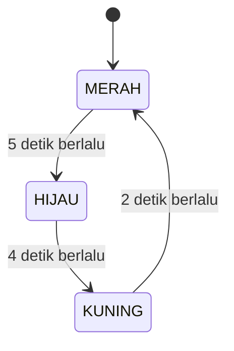
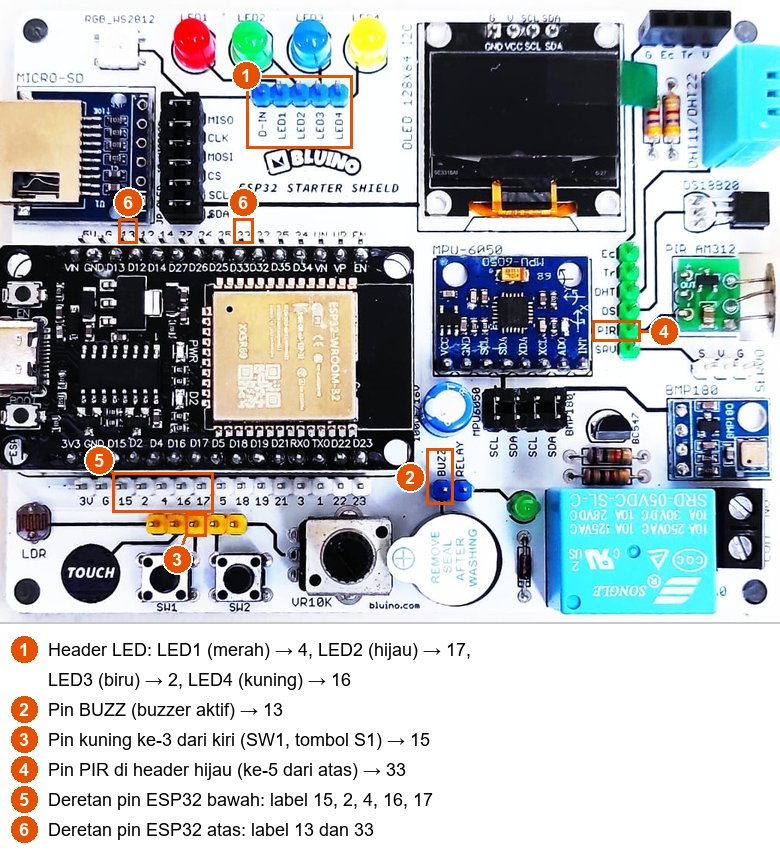
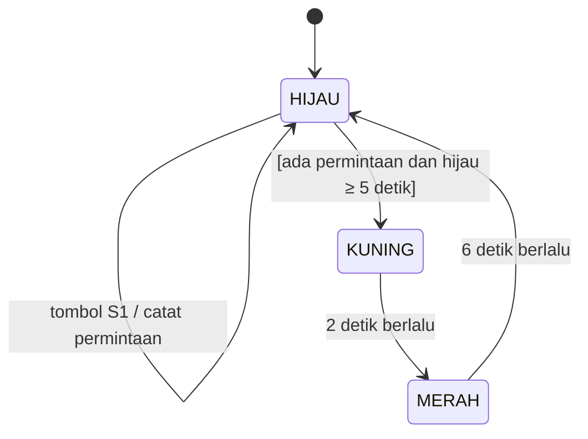
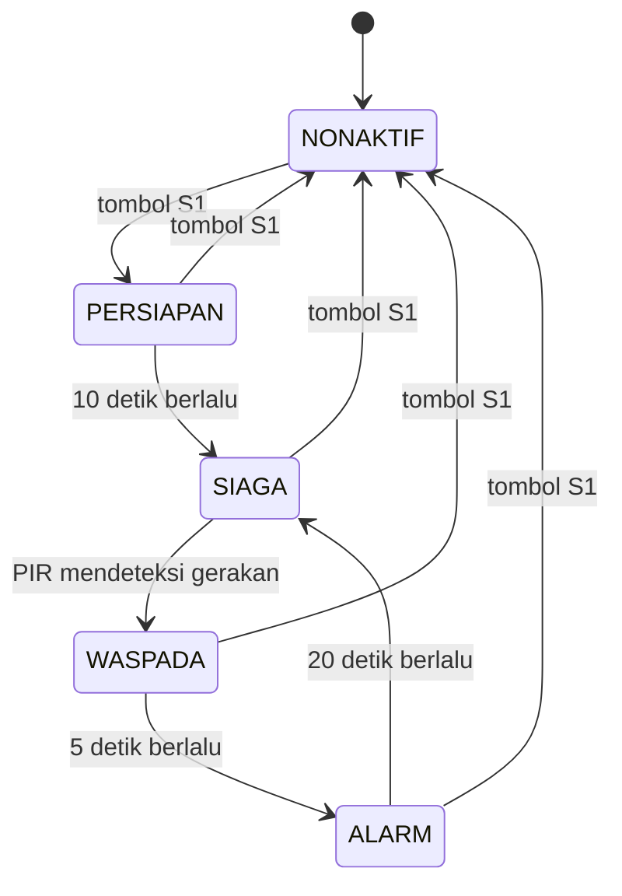

# BAB 17: State Machine

> ✅ **Prasyarat:** Selesaikan **BAB 16 (Non-Blocking Programming)** — kamu sudah terbiasa mengatur waktu dengan `millis()` tanpa `delay()`. Fungsi *debounce* tombol dari **BAB 9 (Digital Input — Push Button)** juga dipakai lagi di sini.

Banyak perangkat di sekitarmu bekerja dengan cara yang sama: lampu lalu lintas, mesin cuci, lift, sampai alarm rumah. Pada satu waktu, perangkat itu selalu berada di **satu keadaan** — misalnya lampu sedang merah, atau mesin cuci sedang membilas — dan baru berpindah ke keadaan lain kalau terjadi sesuatu: waktunya habis, tombol ditekan, atau sensor mendeteksi gerakan. Cara berpikir ini disebut ***state machine*** (mesin keadaan). Di BAB 16 kamu sudah mencicipinya lewat penanda langkah pada alarm di Program 5. Di BAB ini kamu belajar menyusunnya dengan rapi memakai `enum` dan `switch-case`, sehingga program yang rumit tetap mudah dibaca, mudah dikembangkan, dan tetap *non-blocking*.

## 📌 Tujuan Pembelajaran

Setelah mempelajari BAB ini, kamu bisa:

- Menjelaskan arti *state*, *event*, transisi, dan aksi pada *state machine*.
- Menggambar diagram *state* dan menyusun tabel transisi sebelum menulis kode.
- Menuliskan daftar *state* dengan `enum` dan memprosesnya dengan `switch-case`.
- Membuat transisi yang dipicu waktu (*timeout*) maupun peristiwa (tombol, sensor PIR) tanpa `delay()`.
- Membedakan aksi saat masuk *state* (sekali) dan aksi selama berada di *state* (berulang).
- Menambahkan syarat tambahan (*guard*) pada sebuah transisi.
- Membuat lampu lalu lintas, lampu penyeberangan, dan sistem keamanan sederhana dengan sensor PIR.
- Melacak kesalahan *state machine* lewat log perpindahan *state* di Serial Monitor.

## 🧰 Yang Perlu Disiapkan

| Kebutuhan | Keterangan |
|---|---|
| *Hardware* | Kit Bluino ESP32 IoT Starter Shield (ESP32 DEVKIT V1 sudah terpasang di kit) + kabel USB **data** |
| Kabel *jumper* | 7 kabel *female-female*: 4 untuk LED, 1 untuk *buzzer*, 1 untuk tombol S1, 1 untuk sensor PIR — sudah ada di kit |
| Komponen tambahan | Tidak ada — sensor PIR AM312 juga sudah terpasang di kit |
| *Software* | Arduino IDE 2.x + *board package* **esp32** versi 3.3.x (lihat [BAB 5](../BAB-05/README.md)) |
| *Library* | Tidak perlu *library* tambahan |
| Alat uji | **Serial Monitor** Arduino IDE (baud 115200). Opsional: [Mermaid Live Editor](https://mermaid.live) di *browser* untuk mencoba menggambar diagram *state* |
| Jaringan | Tidak perlu WiFi untuk ESP32. Mermaid Live Editor (opsional) butuh internet di laptop/HP |

## 📑 Daftar Isi

- [17.1 Apa Itu State Machine?](#171-apa-itu-state-machine)
- [17.2 Diagram State dan Tabel Transisi](#172-diagram-state-dan-tabel-transisi)
- [17.3 Menulis State Machine dengan enum dan switch-case](#173-menulis-state-machine-dengan-enum-dan-switch-case)
- [17.4 Rangkaian untuk Seluruh BAB](#174-rangkaian-untuk-seluruh-bab)
- [17.5 Program 1: Lampu Lalu Lintas](#175-program-1-lampu-lalu-lintas)
- [17.6 Event, Guard, dan Aksi di Dalam State](#176-event-guard-dan-aksi-di-dalam-state)
- [17.7 Program 2: Lampu Penyeberangan](#177-program-2-lampu-penyeberangan)
- [17.8 Merancang Sistem Keamanan](#178-merancang-sistem-keamanan)
- [17.9 Program 3: Sistem Keamanan dengan Sensor PIR](#179-program-3-sistem-keamanan-dengan-sensor-pir)
- [17.10 Panduan Mendesain State Machine](#1710-panduan-mendesain-state-machine)
- [17.11 Troubleshooting](#1711-troubleshooting)
- [📝 Rangkuman](#-rangkuman)
- [💪 Latihan](#-latihan)
- [📚 Referensi](#-referensi)

---

## 17.1 Apa Itu State Machine?

***State machine*** (mesin keadaan) adalah cara menggambarkan dan memprogram sistem yang perilakunya bergantung pada **keadaan saat ini**. Ada empat istilah yang perlu kamu kenal:

| Istilah | Artinya | Contoh pada lampu lalu lintas |
|---|---|---|
| ***State*** (keadaan) | Kondisi sistem pada suatu saat. Sistem selalu berada di **tepat satu** *state* | MERAH, HIJAU, KUNING |
| ***Event*** (peristiwa) | Sesuatu yang terjadi dan bisa memicu perpindahan *state* | Waktu nyala lampu habis |
| **Transisi** | Perpindahan dari satu *state* ke *state* lain | MERAH → HIJAU |
| **Aksi** | Pekerjaan yang dilakukan saat berpindah atau selama berada di sebuah *state* | Menyalakan LED hijau |

Karena jumlah *state*-nya terbatas, sebutan lengkapnya adalah ***Finite State Machine*** (FSM, mesin keadaan terhingga). Contoh lain di sekitarmu:

| Perangkat | Contoh *state* | Contoh *event* |
|---|---|---|
| Lampu lalu lintas | MERAH, HIJAU, KUNING | Waktu nyala lampu habis |
| Mesin cuci | MENUNGGU, MENCUCI, MEMBILAS, MEMERAS, SELESAI | Tombol mulai ditekan, waktu satu tahap habis, pintu dibuka |
| Lift | DIAM, NAIK, TURUN, PINTU TERBUKA | Tombol lantai ditekan, lift sampai di lantai tujuan |
| Alarm rumah | NONAKTIF, SIAGA, ALARM | Tombol ditekan, sensor mendeteksi gerakan |

### 17.1.1 Kenapa Perlu State Machine?

Tanpa *state machine*, pemula biasanya mencatat keadaan sistem dengan banyak variabel `bool`:

```cpp
// Tanpa state machine: banyak variabel bool
bool sedangBersiap = false;
bool sedangSiaga   = false;
bool alarmBerbunyi = false;
// Bagaimana kalau sedangSiaga dan alarmBerbunyi sama-sama true?
// Atau semuanya false — sistem sebenarnya sedang apa?
```

Tiga variabel `bool` punya 2 × 2 × 2 = 8 kemungkinan kombinasi, padahal hanya sebagian yang masuk akal. Satu salah ketik saja bisa membuat sistem berada di kombinasi yang "mustahil". Dengan *state machine*, keadaan sistem disimpan dalam **satu** variabel:

```cpp
// Dengan state machine: satu variabel, selalu tepat satu keadaan
enum StateAlarm { NONAKTIF, PERSIAPAN, SIAGA, ALARM };
StateAlarm state = NONAKTIF;
```

| | Banyak variabel `bool` | Satu variabel *state* |
|---|---|---|
| Mengetahui sistem sedang apa | Harus memeriksa banyak variabel | Cukup lihat satu variabel |
| Kombinasi yang mustahil (misalnya bersiap dan alarm berbunyi sekaligus) | Bisa terjadi tanpa sengaja | Tidak mungkin terjadi |
| Bentuk logika program | `if` bersarang yang makin lama makin rumit | Satu `case` untuk setiap *state* |
| Menambah fitur | Mudah merusak logika yang sudah ada | Tambahkan *state* dan transisi baru |
| Mencari kesalahan | Sulit | Cetak nama *state* setiap kali berpindah |

---

## 17.2 Diagram State dan Tabel Transisi

Sebelum menulis kode, gambarkan dulu *state machine*-nya. Ada dua alat bantu yang saling melengkapi: **diagram *state*** untuk melihat gambaran besarnya, dan **tabel transisi** untuk memastikan tidak ada yang terlewat.

### 17.2.1 Diagram State

Berikut diagram *state* lampu lalu lintas yang akan kamu buat di Program 1. Di Indonesia, urutan lampunya merah → hijau → kuning → merah.



*Gambar 17.1 — Diagram state lampu lalu lintas. Sumber: dibuat untuk materi ini.*

Cara membacanya:

- Titik hitam beserta panahnya menunjukkan *state* awal saat program mulai, yaitu MERAH.
- Setiap kotak adalah satu *state*.
- Setiap panah adalah satu transisi. Tulisan pada panah adalah *event* yang memicunya.

> 💡 **Tips:** Kamu bisa menggambar diagram seperti ini di kertas, atau di [Mermaid Live Editor](https://mermaid.live) lewat *browser*: tempel kode diagram di kotak sebelah kiri, gambarnya langsung muncul di sebelah kanan. Semua diagram di BAB ini ditulis dengan Mermaid dan ditampilkan otomatis oleh GitHub.

<details>
<summary><b>Lihat kode Mermaid untuk Gambar 17.1</b></summary>

```text
stateDiagram-v2
    [*] --> MERAH
    MERAH --> HIJAU : 5 detik berlalu
    HIJAU --> KUNING : 4 detik berlalu
    KUNING --> MERAH : 2 detik berlalu
```

Baris `A --> B : teks` berarti "dari *state* A ke *state* B, dipicu oleh teks". `[*]` adalah titik awal.

</details>

### 17.2.2 Tabel Transisi

Tabel transisi menuliskan isi diagram dalam bentuk baris-baris yang rapi:

| *State* sekarang | *Event* | *State* berikutnya | Aksi saat masuk *state* berikutnya |
|---|---|---|---|
| MERAH | Sudah 5 detik di MERAH | HIJAU | LED hijau menyala, LED lain mati |
| HIJAU | Sudah 4 detik di HIJAU | KUNING | LED kuning menyala, LED lain mati |
| KUNING | Sudah 2 detik di KUNING | MERAH | LED merah menyala, LED lain mati |

Setiap baris tabel nanti menjadi satu `if` di dalam kode. Tabel juga memaksamu memikirkan pertanyaan penting yang sering terlupa: ***apa yang terjadi kalau event X datang saat sistem berada di state Y?*** Pertanyaan ini akan sangat berguna di Program 2 dan 3, yang punya tombol dan sensor.

---

## 17.3 Menulis State Machine dengan enum dan switch-case

### 17.3.1 enum: Daftar Nama State

```cpp
enum StateLampu {
  MERAH,   // = 0
  HIJAU,   // = 1
  KUNING   // = 2
};

StateLampu state = MERAH;  // hanya boleh berisi salah satu nama di atas
```

`enum` (singkatan dari *enumeration*, daftar pilihan) membuat tipe data baru yang berisi daftar nama. Di balik layar setiap nama hanyalah angka (MERAH = 0, HIJAU = 1, KUNING = 2), tetapi kamu cukup memakai namanya. Kode jadi mudah dibaca: `state = HIJAU;` jauh lebih jelas daripada `state = 1;`.

### 17.3.2 switch-case: Satu Blok untuk Setiap State

```cpp
switch (state) {
  case MERAH:
    // kode yang dijalankan saat state = MERAH
    break;
  case HIJAU:
    // kode untuk state HIJAU
    break;
  case KUNING:
    // kode untuk state KUNING
    break;
}
```

`switch (state)` langsung melompat ke `case` yang cocok dengan isi `state`. Kata `break;` menandai akhir sebuah `case`. Kalau `break;` lupa ditulis, program akan "jatuh" (*fall through*) dan ikut menjalankan `case` di bawahnya — salah satu kesalahan paling umum saat menulis *state machine*.

### 17.3.3 Pola Lengkap: pindahState() dan Lama di State

Potongan kode berikut adalah kerangka yang dipakai semua program di BAB ini:

```cpp
StateLampu state = MERAH;
unsigned long waktuMasukState = 0;  // kapan state sekarang dimulai

void pindahState(StateLampu stateBaru) {
  state = stateBaru;
  waktuMasukState = millis();       // mulai menghitung lama di state baru
  // aksi masuk: dijalankan SEKALI setiap kali masuk state baru
}

void loop() {
  unsigned long lamaDiState = millis() - waktuMasukState;

  switch (state) {
    case MERAH:
      if (lamaDiState >= 5000) pindahState(HIJAU);  // = satu baris tabel transisi
      break;
    // ... case untuk state lainnya
  }
}
```

Tidak ada `delay()` sama sekali. Lama berada di sebuah *state* dihitung dengan `millis() - waktuMasukState`, persis pola *blink without delay* di [BAB 16](../BAB-16/README.md). Jadi selama lampu merah menyala 5 detik, `loop()` tetap berputar ratusan ribu kali per detik dan masih bisa membaca tombol atau sensor.

Ada tiga jenis kode di dalam *state machine*:

| Jenis kode | Kapan dijalankan | Ditulis di | Contoh |
|---|---|---|---|
| Aksi masuk (*entry action*) | Sekali, tepat saat masuk *state* | `pindahState()` | Menyalakan LED hijau |
| Aksi selama di *state* | Di setiap putaran `loop()`, selama berada di *state* itu | `case` milik *state* itu | LED berkedip, hitung mundur |
| Pemeriksaan transisi | Di setiap putaran `loop()` | `case` milik *state* itu | `if (lamaDiState >= 5000) pindahState(HIJAU);` |

### 17.3.4 Mencetak Nama State

`Serial.println(state);` hanya mencetak angkanya (0, 1, atau 2). Supaya log di Serial Monitor mudah dibaca, buat fungsi yang mengubah *state* menjadi teks:

```cpp
const char *namaState(StateLampu s) {
  switch (s) {
    case MERAH:  return "MERAH";
    case HIJAU:  return "HIJAU";
    case KUNING: return "KUNING";
  }
  return "?";
}

// Contoh pemakaian: Serial.println(namaState(state));
```

Program 3 memakai fungsi seperti ini untuk mencatat setiap perpindahan *state*, misalnya `SIAGA -> WASPADA (PIR mendeteksi gerakan)`. Log seperti itu adalah alat terbaik untuk mencari kesalahan *state machine*.

---

## 17.4 Rangkaian untuk Seluruh BAB

Ketiga program di BAB ini memakai komponen yang sama, jadi cukup pasang kabelnya **sekali**. Total ada 7 kabel *jumper*:

| Komponen | Pin header di kit | Sambungkan ke pin ESP32 | Letak pin ESP32 | Dipakai di |
|---|---|---|---|---|
| LED merah | LED1 (*header* LED) | IO4 (label `4`) | Deretan bawah | Program 1, 2, 3 |
| LED kuning | LED4 (*header* LED) | IO16 (label `16`) | Deretan bawah | Program 1, 2 |
| LED hijau | LED2 (*header* LED) | IO17 (label `17`) | Deretan bawah | Program 1, 2, 3 |
| LED biru | LED3 (*header* LED) | IO2 (label `2`) | Deretan bawah | Program 2 |
| Tombol S1 (SW1) | Pin kuning ke-3 dari kiri | IO15 (label `15`) | Deretan bawah | Program 2, 3 |
| *Buzzer* aktif | BUZZ | IO13 (label `13`) | Deretan atas | Program 2, 3 |
| Sensor PIR AM312 | PIR (*header* hijau, pin ke-5 dari atas) | IO33 (label `33`) | Deretan atas | Program 3 |



*Gambar 17.2 — Letak pin yang disambung di BAB ini pada kit v3.x: header LED (1), pin BUZZ (2), pin kuning SW1 (3), pin PIR di header hijau (4), serta label pin ESP32 di deretan bawah (5) dan atas (6). Tata letak kit v3.2 milikmu bisa sedikit berbeda. Sumber: foto produk ESP32 Starter Shield, [Bluino](http://www.bluino.com), dipotong dan diberi penanda untuk materi ini.*

Langkah memasang kabel:

1. Cabut kabel USB dulu supaya aman saat merangkai.
2. Pasang keempat kabel LED seperti di [BAB 8](../BAB-08/README.md): LED1 (merah) → **4**, LED2 (hijau) → **17**, LED3 (biru) → **2**, LED4 (kuning) → **16**.
3. Pasang kabel dari pin kuning ke-3 (SW1) ke pin berlabel **15** di deretan bawah, seperti di [BAB 9](../BAB-09/README.md).
4. Pasang kabel dari pin **BUZZ** ke pin berlabel **13** di deretan atas.
5. Cari *header* hijau berisi 6 pin di sebelah kanan modul MPU-6050. Urutan labelnya dari atas: `Ec`, `Tr`, `DHT`, `DS`, `PIR`, `SRV`. Pasang kabel dari pin **PIR** (ke-5 dari atas) ke pin berlabel **33** di deretan atas.
6. Periksa sekali lagi bahwa setiap kabel tertancap penuh dan tidak bergeser satu pin, lalu sambungkan kembali kabel USB.

> ⚠️ **Perhatian:** Di deretan bawah, pin `15` bersebelahan dengan pin `G` (GND) — kabel S1 yang tergeser ke `G` akan membuat hubung singkat saat S1 ditekan. Pin **BUZZ** bersebelahan dengan **RELAY**, dan pin **PIR** di *header* hijau diapit `DS` dan `SRV`. Pastikan setiap kabel terpasang di label yang benar.

> 📌 **Catatan:** IO33 juga dipakai oleh *touch pad* (pin `TOUCH` di *header* kuning). Di BAB ini IO33 khusus untuk PIR, jadi jangan sambungkan pin `TOUCH` ke `33` pada saat yang sama. Selama kabel S1 terpasang di IO15, log *boot* bawaan ESP32 juga tidak muncul di Serial Monitor — itu normal (lihat [BAB 9](../BAB-09/README.md)).

Sensor PIR AM312 mengeluarkan sinyal HIGH saat mendeteksi gerakan, dan sinyal itu bertahan sekitar 2 detik setelah gerakan terakhir. Setelah dinyalakan, sensor PIR juga butuh waktu "pemanasan" sebelum pembacaannya stabil. Detail sensor ini dibahas di [BAB 31](../BAB-31/README.md); di BAB ini cukup diingat: **HIGH = ada gerakan**.

---

## 17.5 Program 1: Lampu Lalu Lintas

**Tujuan:** Membuat lampu lalu lintas dengan *state machine* yang hanya dipicu waktu: MERAH selama 5 detik, HIJAU 4 detik, KUNING 2 detik, lalu kembali ke MERAH. Setiap kali *state* berganti, Serial Monitor mencatatnya.

**Rangkaian:**

| Pin **Custom** di kit | Sambungkan ke pin ESP32 |
|---|---|
| LED1 (merah) | IO4 |
| LED4 (kuning) | IO16 |
| LED2 (hijau) | IO17 |

**Cara Menjalankan:**

1. Sambungkan kabel *jumper* sesuai tabel **Rangkaian** di atas (atau langsung pasang semua kabel seperti di [17.4](#174-rangkaian-untuk-seluruh-bab)).
2. Buka Arduino IDE → **File → New Sketch**, hapus isinya, lalu salin kode di bawah. Kode yang sama juga tersedia di *file* [`p1_lampu_lalu_lintas.ino`](p1_lampu_lalu_lintas/p1_lampu_lalu_lintas.ino).
3. Pastikan **Tools → Board** = **ESP32 Dev Module** dan **Tools → Port** = *port* ESP32 kamu (misalnya `COM5` di Windows atau `/dev/ttyUSB0` di Linux).
4. Klik tombol **Upload** (ikon panah →) dan tunggu sampai muncul tulisan **Done uploading**.
5. Buka **Serial Monitor** (**Tools → Serial Monitor**) lalu pilih baud **115200**.

**Kode Program:**

<!-- sketch: p1_lampu_lalu_lintas -->
```cpp
/*
 * BAB 17 - Program 1: Lampu Lalu Lintas
 * State machine yang dipicu waktu:
 *   MERAH (5 detik) → HIJAU (4 detik) → KUNING (2 detik) → MERAH → ...
 *
 * Rangkaian:
 *   LED1 (merah)  → IO4
 *   LED4 (kuning) → IO16
 *   LED2 (hijau)  → IO17
 */

#define LED_MERAH  4
#define LED_KUNING 16
#define LED_HIJAU  17

// 1. Daftar semua state
enum StateLampu {
  MERAH,
  HIJAU,
  KUNING
};

// 2. Lama setiap state (ms)
const unsigned long LAMA_MERAH  = 5000;
const unsigned long LAMA_HIJAU  = 4000;
const unsigned long LAMA_KUNING = 2000;

// 3. Variabel state dan waktu masuknya
StateLampu state = MERAH;
unsigned long waktuMasukState = 0;  // kapan state sekarang dimulai

void aturLampu(bool merah, bool kuning, bool hijau) {
  digitalWrite(LED_MERAH, merah ? HIGH : LOW);
  digitalWrite(LED_KUNING, kuning ? HIGH : LOW);
  digitalWrite(LED_HIJAU, hijau ? HIGH : LOW);
}

// 4. Pindah ke state baru, lalu jalankan aksi masuknya (SEKALI)
void pindahState(StateLampu stateBaru) {
  state = stateBaru;
  waktuMasukState = millis();

  switch (state) {
    case MERAH:
      aturLampu(true, false, false);
      Serial.print("[MERAH]  kendaraan berhenti selama ");
      Serial.print(LAMA_MERAH / 1000);
      Serial.println(" detik");
      break;
    case HIJAU:
      aturLampu(false, false, true);
      Serial.print("[HIJAU]  kendaraan boleh jalan selama ");
      Serial.print(LAMA_HIJAU / 1000);
      Serial.println(" detik");
      break;
    case KUNING:
      aturLampu(false, true, false);
      Serial.print("[KUNING] kendaraan bersiap berhenti selama ");
      Serial.print(LAMA_KUNING / 1000);
      Serial.println(" detik");
      break;
  }
}

void setup() {
  Serial.begin(115200);
  pinMode(LED_MERAH, OUTPUT);
  pinMode(LED_KUNING, OUTPUT);
  pinMode(LED_HIJAU, OUTPUT);

  Serial.println("BAB 17 - Program 1: Lampu Lalu Lintas");
  pindahState(MERAH);  // masuk ke state awal sekaligus menjalankan aksi masuknya
}

void loop() {
  unsigned long lamaDiState = millis() - waktuMasukState;

  // 5. Periksa transisi milik state saat ini (sesuai tabel transisi)
  switch (state) {
    case MERAH:
      if (lamaDiState >= LAMA_MERAH) pindahState(HIJAU);
      break;
    case HIJAU:
      if (lamaDiState >= LAMA_HIJAU) pindahState(KUNING);
      break;
    case KUNING:
      if (lamaDiState >= LAMA_KUNING) pindahState(MERAH);
      break;
  }

  // Tugas lain boleh ditambahkan di sini — tidak ada yang menunggu
}
```

**Penjelasan Kode:**

- Bagian 1–3 menyiapkan *state machine*: daftar *state* dalam `enum`, lama setiap *state*, variabel `state`, dan `waktuMasukState`.
- `pindahState()` adalah satu-satunya tempat *state* diubah. Fungsi ini mencatat waktu masuk, lalu menjalankan **aksi masuk** sesuai *state* barunya: menyalakan lampu yang tepat dan mencetak satu baris log. Karena hanya dipanggil saat berpindah, aksi ini berjalan sekali saja, bukan ribuan kali per detik.
- `pindahState(MERAH)` di akhir `setup()` membuat program langsung masuk ke *state* awal dengan lampu yang benar.
- Di `loop()`, `switch (state)` hanya memeriksa transisi milik *state* saat ini. Tiga `if` di dalamnya sama persis dengan tiga baris tabel transisi di [17.2.2](#1722-tabel-transisi).
- `LAMA_MERAH / 1000` mengubah milidetik menjadi detik untuk log. Kalau kamu mengubah `LAMA_MERAH`, tulisan di Serial Monitor ikut menyesuaikan.

**Contoh Output:**

```text
BAB 17 - Program 1: Lampu Lalu Lintas
[MERAH]  kendaraan berhenti selama 5 detik
[HIJAU]  kendaraan boleh jalan selama 4 detik
[KUNING] kendaraan bersiap berhenti selama 2 detik
[MERAH]  kendaraan berhenti selama 5 detik
[HIJAU]  kendaraan boleh jalan selama 4 detik
```

Di kit: LED merah menyala 5 detik, lalu LED hijau 4 detik, lalu LED kuning 2 detik, dan berulang. Pada satu waktu hanya satu LED yang menyala, dan setiap kali lampu berganti, satu baris baru muncul di Serial Monitor.

> 🧪 **Coba Sendiri:** Di beberapa negara Eropa, lampu merah dan kuning menyala bersamaan sebentar sebelum hijau. Tambahkan *state* `MERAH_KUNING` (1 detik) di antara MERAH dan HIJAU. Caranya: tambahkan namanya di `enum`, tambahkan satu `case` di `pindahState()` dan satu `case` di `loop()`, lalu ubah transisi MERAH agar menuju `MERAH_KUNING`. Perhatikan betapa sedikit kode lama yang perlu diubah.

**Kalau Belum Berhasil:**

- **Log muncul, tetapi salah satu LED tidak pernah menyala** → kabel LED itu belum terpasang atau bergeser satu pin.
- **Warna LED tidak cocok dengan log** (misalnya log `[HIJAU]` tetapi LED kuning yang menyala) → kabel LED2 dan LED4 tertukar. Ingat: LED2 (hijau) → `17`, LED4 (kuning) → `16`.
- **Serial Monitor kosong** → pastikan baud **115200**, lalu tekan tombol **EN** di *board*.

---

## 17.6 Event, Guard, dan Aksi di Dalam State

Program 1 hanya dipicu waktu. Sistem sungguhan juga harus bereaksi pada peristiwa dari luar, misalnya tombol ditekan atau sensor mendeteksi gerakan. Bagian ini membahas empat hal yang dipakai Program 2 dan 3.

### 17.6.1 Membaca Event Sekali di Awal loop()

Kumpulkan semua *event* di awal `loop()`, sebelum `switch`:

```cpp
void loop() {
  bool tombolDitekan = s1BaruDitekan();                    // dari tombol: sekali per tekanan
  bool adaGerakan = (digitalRead(PIR_PIN) == HIGH);        // dari sensor: selama ada gerakan
  unsigned long lamaDiState = millis() - waktuMasukState;  // dari waktu

  switch (state) {
    // setiap state hanya memakai event yang penting baginya
  }
}
```

Ada dua alasan. Pertama, fungsi *debounce* seperti `s1BaruDitekan()` harus dipanggil di **setiap** putaran supaya tidak ada tekanan yang terlewat — kalau hanya dipanggil di dalam satu `case`, tekanan yang terjadi saat *state* lain akan hilang. Kedua, semua *state* melihat *event* yang sama di putaran itu, sehingga perilakunya mudah ditebak.

Perhatikan juga bedanya: `tombolDitekan` bernilai `true` hanya **sekali** untuk setiap tekanan (*edge detection* dari [BAB 9](../BAB-09/README.md)), sedangkan `adaGerakan` bernilai `true` **selama** sensor PIR mengeluarkan HIGH.

### 17.6.2 Event yang Sama, Arti yang Berbeda

Satu tombol bisa punya arti berbeda tergantung *state*-nya. Pada sistem keamanan di Program 3, menekan S1 saat NONAKTIF berarti "aktifkan", sedangkan menekan S1 saat SIAGA berarti "matikan". Pada lampu penyeberangan di Program 2, tekanan S1 saat lampu sedang berganti justru diabaikan. Inilah kekuatan *state machine*: arti sebuah *event* ditentukan oleh *state* saat ini, dan setiap `case` cukup mengurus *event* yang relevan baginya.

### 17.6.3 Guard: Syarat Tambahan pada Transisi

Kadang sebuah transisi baru boleh terjadi kalau ada syarat tambahan. Syarat ini disebut ***guard*** (penjaga) dan di diagram biasanya ditulis dalam kurung siku, misalnya `[ada permintaan dan hijau ≥ 5 detik]`. Di kode, *guard* hanyalah syarat tambahan di dalam `if`:

```cpp
// Pindah ke KUNING hanya kalau ada permintaan DAN hijau sudah menyala minimal 5 detik
if (adaPermintaan && lamaDiState >= HIJAU_MINIMUM) {
  pindahState(KUNING);
}
```

Variabel `adaPermintaan` adalah **data tambahan** yang menemani *state*: tekanan tombol dicatat dulu, lalu baru "dilayani" saat syaratnya terpenuhi. Mencatat permintaan seperti ini adalah contoh **aksi tanpa pindah *state***.

### 17.6.4 Aksi Berulang Tanpa Timer Tambahan

Untuk membuat LED berkedip atau *buzzer* berbunyi putus-putus selama berada di sebuah *state*, kamu tidak perlu *timer* baru. Cukup hitung dari `lamaDiState`:

```cpp
// LED menyala dan mati bergantian setiap 100 ms
bool fase = (lamaDiState / 100) % 2 == 0;
digitalWrite(LED_MERAH, fase ? HIGH : LOW);

// Buzzer berbunyi 30 ms pertama dari setiap 500 ms ("tik ... tik ... tik")
digitalWrite(BUZZER_PIN, (lamaDiState % 500) < 30 ? HIGH : LOW);
```

Tanda `%` adalah **sisa bagi**, misalnya 7 % 2 = 1 dan 1250 % 500 = 250. Cara kerja baris pertama:

| `lamaDiState` (ms) | `lamaDiState / 100` | `... % 2` | LED |
|---|---|---|---|
| 0–99 | 0 | 0 | Nyala |
| 100–199 | 1 | 1 | Mati |
| 200–299 | 2 | 0 | Nyala |
| 300–399 | 3 | 1 | Mati |

Karena `lamaDiState` selalu mulai dari 0 setiap kali masuk *state*, pola kedipnya selalu dimulai dengan rapi.

### 17.6.5 Rancangan Lampu Penyeberangan

Di banyak jalan ada lampu penyeberangan bertombol. Lampu kendaraan tetap hijau sampai seorang penyeberang menekan tombol. Supaya lalu lintas tidak terus-menerus terhenti, lampu hijau harus menyala minimal 5 detik dulu sebelum berganti. Selama lampu kendaraan merah, lampu penyeberang (LED biru) menyala dan *buzzer* berbunyi "tik-tik" sebagai tanda bagi penyeberang, termasuk penyandang tunanetra.



*Gambar 17.3 — Diagram state lampu penyeberangan. Panah yang kembali ke HIJAU sendiri berarti tombol hanya dicatat, tanpa pindah state. Sumber: dibuat untuk materi ini.*

| *State* sekarang | *Event* / syarat | *State* berikutnya | Aksi |
|---|---|---|---|
| HIJAU | Tombol S1 ditekan | HIJAU (tetap) | Catat permintaan (`adaPermintaan = true`) |
| HIJAU | [Ada permintaan **dan** sudah ≥ 5 detik di HIJAU] | KUNING | LED kuning menyala |
| KUNING | Tombol S1 ditekan | KUNING (tetap) | Diabaikan, tampilkan pesan |
| KUNING | Sudah 2 detik di KUNING | MERAH | LED merah dan LED biru menyala |
| MERAH | Tombol S1 ditekan | MERAH (tetap) | Diabaikan, tampilkan pesan |
| MERAH | Selama berada di MERAH | — | *Buzzer* "tik" setiap 500 ms |
| MERAH | Sudah 6 detik di MERAH | HIJAU | LED hijau menyala, permintaan dihapus |

Perhatikan bahwa tabel ini juga menjawab "bagaimana kalau tombol ditekan saat KUNING atau MERAH?" — pertanyaan yang mudah terlupa kalau langsung menulis kode.

---

## 17.7 Program 2: Lampu Penyeberangan

**Tujuan:** Membuat lampu penyeberangan sesuai rancangan di [17.6.5](#1765-rancangan-lampu-penyeberangan). Program ini memadukan transisi karena waktu, transisi karena tombol, *guard*, dan aksi berulang di dalam *state*.

**Rangkaian:**

| Pin **Custom** di kit | Sambungkan ke pin ESP32 |
|---|---|
| LED1 (merah) | IO4 |
| LED4 (kuning) | IO16 |
| LED2 (hijau) | IO17 |
| LED3 (biru) | IO2 |
| BUZZ | IO13 |
| Tombol S1 (pin kuning ke-3) | IO15 |

**Cara Menjalankan:**

1. Sambungkan kabel *jumper* sesuai tabel **Rangkaian** di atas (lihat [17.4](#174-rangkaian-untuk-seluruh-bab)).
2. Buka Arduino IDE → **File → New Sketch**, hapus isinya, lalu salin kode di bawah. Kode yang sama juga tersedia di *file* [`p2_lampu_penyeberangan.ino`](p2_lampu_penyeberangan/p2_lampu_penyeberangan.ino).
3. Pastikan **Tools → Board** = **ESP32 Dev Module** dan **Tools → Port** = *port* ESP32 kamu.
4. Klik tombol **Upload** dan tunggu sampai muncul tulisan **Done uploading**.
5. Buka **Serial Monitor** (**Tools → Serial Monitor**) lalu pilih baud **115200**.
6. Tekan S1 sekali, lalu amati lampu dan Serial Monitor. Saat lampu merah menyala, tekan S1 lagi. Ulangi dengan menekan S1 setelah lampu hijau menyala cukup lama (lebih dari 5 detik).

**Kode Program:**

<!-- sketch: p2_lampu_penyeberangan -->
```cpp
/*
 * BAB 17 - Program 2: Lampu Penyeberangan
 * Lampu kendaraan tetap HIJAU sampai tombol penyeberang (S1) ditekan.
 * Setelah hijau menyala minimal 5 detik: KUNING (2 detik) → MERAH (6 detik,
 * penyeberang lewat: LED biru menyala, buzzer berbunyi "tik-tik") → HIJAU.
 *
 * Rangkaian:
 *   LED1 (merah)                → IO4
 *   LED4 (kuning)               → IO16
 *   LED2 (hijau)                → IO17
 *   LED3 (biru)                 → IO2   (lampu penyeberang)
 *   BUZZ                        → IO13
 *   Tombol S1 (pin kuning ke-3) → IO15  (tombol penyeberang)
 */

#define LED_MERAH  4
#define LED_KUNING 16
#define LED_HIJAU  17
#define LED_BIRU   2
#define BUZZER_PIN 13
#define TOMBOL_S1  15

enum StatePenyeberangan {
  HIJAU,   // kendaraan jalan, menunggu tombol penyeberang
  KUNING,  // kendaraan bersiap berhenti
  MERAH    // kendaraan berhenti, penyeberang lewat
};

const unsigned long HIJAU_MINIMUM = 5000;  // hijau menyala paling sedikit 5 detik
const unsigned long LAMA_KUNING   = 2000;
const unsigned long LAMA_MERAH    = 6000;

StatePenyeberangan state = HIJAU;
unsigned long waktuMasukState = 0;
bool adaPermintaan = false;  // true = sudah ada penyeberang yang menekan tombol

// Debounce tombol S1 (sama seperti di BAB 9 dan BAB 16)
const unsigned long WAKTU_DEBOUNCE = 50;
int bacaanSebelumnya = LOW;
int statusStabil = LOW;
unsigned long waktuBerubah = 0;

// Mengembalikan true hanya sekali setiap S1 baru ditekan (sudah di-debounce)
bool s1BaruDitekan() {
  int bacaan = digitalRead(TOMBOL_S1);
  if (bacaan != bacaanSebelumnya) {
    waktuBerubah = millis();
    bacaanSebelumnya = bacaan;
  }
  if ((millis() - waktuBerubah) > WAKTU_DEBOUNCE && bacaan != statusStabil) {
    statusStabil = bacaan;
    return statusStabil == HIGH;  // true hanya pada tepi naik (LOW → HIGH)
  }
  return false;
}

void aturLampu(bool merah, bool kuning, bool hijau, bool biru) {
  digitalWrite(LED_MERAH, merah ? HIGH : LOW);
  digitalWrite(LED_KUNING, kuning ? HIGH : LOW);
  digitalWrite(LED_HIJAU, hijau ? HIGH : LOW);
  digitalWrite(LED_BIRU, biru ? HIGH : LOW);
}

// Pindah ke state baru, lalu jalankan aksi masuknya (SEKALI)
void pindahState(StatePenyeberangan stateBaru) {
  state = stateBaru;
  waktuMasukState = millis();
  digitalWrite(BUZZER_PIN, LOW);  // buzzer selalu diam saat state berganti

  switch (state) {
    case HIJAU:
      aturLampu(false, false, true, false);
      adaPermintaan = false;      // permintaan sebelumnya sudah dilayani
      Serial.println("[HIJAU]  kendaraan jalan, menunggu tombol penyeberang");
      break;
    case KUNING:
      aturLampu(false, true, false, false);
      Serial.println("[KUNING] kendaraan bersiap berhenti");
      break;
    case MERAH:
      aturLampu(true, false, false, true);  // merah untuk kendaraan, biru untuk penyeberang
      Serial.println("[MERAH]  kendaraan berhenti, penyeberang boleh lewat");
      break;
  }
}

void setup() {
  Serial.begin(115200);
  pinMode(LED_MERAH, OUTPUT);
  pinMode(LED_KUNING, OUTPUT);
  pinMode(LED_HIJAU, OUTPUT);
  pinMode(LED_BIRU, OUTPUT);
  pinMode(BUZZER_PIN, OUTPUT);
  pinMode(TOMBOL_S1, INPUT);

  Serial.println("BAB 17 - Program 2: Lampu Penyeberangan");
  Serial.println("Tekan S1 untuk meminta waktu menyeberang.");
  pindahState(HIJAU);
}

void loop() {
  // Baca event SEKALI di awal putaran, lalu setiap state memutuskan sendiri
  bool tombolDitekan = s1BaruDitekan();
  unsigned long lamaDiState = millis() - waktuMasukState;

  switch (state) {
    case HIJAU:
      // Event tombol: catat permintaan, tetapi belum pindah state
      if (tombolDitekan && !adaPermintaan) {
        adaPermintaan = true;
        Serial.println("Tombol S1 ditekan: permintaan menyeberang dicatat");
      }
      // Guard: pindah hanya kalau ada permintaan DAN hijau sudah cukup lama
      if (adaPermintaan && lamaDiState >= HIJAU_MINIMUM) {
        pindahState(KUNING);
      }
      break;

    case KUNING:
      if (tombolDitekan) {
        Serial.println("Tombol S1 diabaikan: lampu sedang berganti");
      }
      if (lamaDiState >= LAMA_KUNING) {
        pindahState(MERAH);
      }
      break;

    case MERAH:
      // Aksi selama di state: buzzer berbunyi "tik" 30 ms setiap 500 ms
      digitalWrite(BUZZER_PIN, (lamaDiState % 500) < 30 ? HIGH : LOW);
      if (tombolDitekan) {
        Serial.println("Tombol S1 diabaikan: penyeberang sedang lewat");
      }
      if (lamaDiState >= LAMA_MERAH) {
        pindahState(HIJAU);
      }
      break;
  }
}
```

**Penjelasan Kode:**

- `s1BaruDitekan()` adalah fungsi *debounce* yang sama dengan Program 5 di [BAB 16](../BAB-16/README.md). Fungsi ini dipanggil sekali di awal setiap putaran `loop()`, dan hasilnya disimpan di `tombolDitekan`.
- Di *state* HIJAU, tekanan tombol hanya **mencatat** permintaan (`adaPermintaan = true`). Perpindahan ke KUNING diatur oleh *guard* `adaPermintaan && lamaDiState >= HIJAU_MINIMUM`. Jadi kalau S1 ditekan 2 detik setelah hijau menyala, lampu kuning baru menyala 3 detik kemudian; kalau hijau sudah menyala lebih dari 5 detik, lampu kuning langsung menyala.
- Di *state* KUNING dan MERAH, tombol tetap dibaca, tetapi hanya menghasilkan pesan "diabaikan" — sesuai tabel transisi.
- Di *state* MERAH, *buzzer* diatur di setiap putaran dengan rumus `(lamaDiState % 500) < 30`, sehingga berbunyi "tik" 30 ms setiap setengah detik tanpa *timer* tambahan.
- `pindahState()` selalu mematikan *buzzer* lebih dulu, jadi *buzzer* tidak mungkin tertinggal berbunyi saat keluar dari *state* MERAH. Aksi masuk HIJAU juga menghapus permintaan lama, sehingga penyeberang berikutnya harus menekan tombol lagi.

**Contoh Output:**

```text
BAB 17 - Program 2: Lampu Penyeberangan
Tekan S1 untuk meminta waktu menyeberang.
[HIJAU]  kendaraan jalan, menunggu tombol penyeberang
Tombol S1 ditekan: permintaan menyeberang dicatat
[KUNING] kendaraan bersiap berhenti
[MERAH]  kendaraan berhenti, penyeberang boleh lewat
Tombol S1 diabaikan: penyeberang sedang lewat
[HIJAU]  kendaraan jalan, menunggu tombol penyeberang
```

Di kit: LED hijau menyala terus sampai S1 ditekan. Setelah syaratnya terpenuhi, LED kuning menyala 2 detik, lalu LED merah dan LED biru menyala bersamaan selama 6 detik sambil *buzzer* berbunyi "tik-tik". LED biru kecil di *board* ESP32 ikut menyala bersama LED biru kit karena keduanya di IO2. Setelah itu lampu kembali hijau dan menunggu tekanan berikutnya.

**Kalau Belum Berhasil:**

- **Lampu tetap hijau walaupun S1 ditekan** → cek kabel S1 → `15`. Kalau tulisan `permintaan menyeberang dicatat` sudah muncul, tunggu sampai hijau genap 5 detik.
- **Tidak ada bunyi "tik" saat lampu merah** → cek kabel BUZZ → `13`, dan pastikan tidak tertukar dengan **RELAY**.
- **Satu tekanan menghasilkan dua pesan** → tombolmu memantul lebih lama dari 50 ms. Naikkan `WAKTU_DEBOUNCE` menjadi 80 atau 100.

---

## 17.8 Merancang Sistem Keamanan

Program 3 adalah sistem keamanan (alarm rumah) mini. Ceritanya begini: sebelum pergi, pemilik rumah menekan S1. Sistem memberi waktu 10 detik untuk keluar ruangan (PERSIAPAN), lalu mulai mengawasi (SIAGA). Kalau sensor PIR mendeteksi gerakan, sistem tidak langsung berbunyi keras, tetapi memberi waktu 5 detik (WASPADA) — siapa tahu yang datang adalah pemilik rumah sendiri, yang lalu menekan S1 untuk mematikan sistem. Kalau tidak dimatikan, ALARM berbunyi. Supaya tidak mengganggu tetangga terlalu lama, ALARM berhenti sendiri setelah 20 detik dan sistem kembali SIAGA.

Sebelum menulis kode, rancang dulu dengan langkah yang sama seperti lampu penyeberangan.

**Langkah 1 — Daftar *state* dan tampilannya:**

| *State* | Artinya | LED hijau | LED merah | *Buzzer* |
|---|---|---|---|---|
| NONAKTIF | Sistem mati | Mati | Mati | Diam |
| PERSIAPAN | Hitung mundur 10 detik sebelum aktif | Berkedip lambat | Mati | Diam |
| SIAGA | Aktif, mengawasi gerakan | Menyala | Mati | Diam |
| WASPADA | Ada gerakan; 5 detik untuk mematikan sistem | Mati | Berkedip cepat | "Bip" singkat setiap detik |
| ALARM | Alarm berbunyi, paling lama 20 detik | Mati | Berkedip cepat | Berbunyi putus-putus |

**Langkah 2 — Daftar *event*:** tombol S1 ditekan, sensor PIR mendeteksi gerakan (HIGH), dan waktu habis (10 detik, 5 detik, atau 20 detik, tergantung *state*-nya).

**Langkah 3 — Diagram *state*:**



*Gambar 17.4 — Diagram state sistem keamanan. Dari setiap state selain NONAKTIF, tombol S1 selalu kembali ke NONAKTIF. Sumber: dibuat untuk materi ini.*

**Langkah 4 — Tabel transisi lengkap** (setiap *state* dipasangkan dengan setiap *event*):

| *State* sekarang | *Event* | *State* berikutnya | Aksi |
|---|---|---|---|
| NONAKTIF | Tombol S1 | PERSIAPAN | Mulai hitung mundur 10 detik |
| NONAKTIF | Ada gerakan | NONAKTIF (tetap) | Diabaikan — sistem sedang mati |
| PERSIAPAN | Tombol S1 | NONAKTIF | Batal |
| PERSIAPAN | Ada gerakan | PERSIAPAN (tetap) | Diabaikan — pemilik sedang keluar ruangan |
| PERSIAPAN | Sudah 10 detik | SIAGA | LED hijau menyala tetap |
| SIAGA | Tombol S1 | NONAKTIF | Semua mati |
| SIAGA | Ada gerakan | WASPADA | Mulai peringatan |
| WASPADA | Tombol S1 | NONAKTIF | Semua mati |
| WASPADA | Sudah 5 detik | ALARM | Alarm berbunyi |
| ALARM | Tombol S1 | NONAKTIF | Semua mati |
| ALARM | Sudah 20 detik | SIAGA | Alarm berhenti, kembali mengawasi |

Baris bertanda "(tetap)" tidak perlu ditulis di kode — cukup tidak ada `if` untuk *event* itu di `case` tersebut. Namun, menuliskannya di tabel membuktikan bahwa kamu sudah memikirkan kemungkinan itu. Langkah terakhir, menulis kode, ada di Program 3.

---

## 17.9 Program 3: Sistem Keamanan dengan Sensor PIR

**Tujuan:** Membuat sistem keamanan sesuai rancangan di [17.8](#178-merancang-sistem-keamanan): lima *state*, dua *event* dari luar (tombol S1 dan sensor PIR), tiga batas waktu, dan log setiap perpindahan *state* di Serial Monitor.

**Rangkaian:**

| Pin **Custom** di kit | Sambungkan ke pin ESP32 |
|---|---|
| LED1 (merah) | IO4 |
| LED2 (hijau) | IO17 |
| BUZZ | IO13 |
| Tombol S1 (pin kuning ke-3) | IO15 |
| PIR (*header* hijau, pin ke-5 dari atas) | IO33 |

**Cara Menjalankan:**

1. Sambungkan kabel *jumper* sesuai tabel **Rangkaian** di atas (lihat [17.4](#174-rangkaian-untuk-seluruh-bab)). Pastikan kabel PIR terpasang di pin berlabel `PIR`, bukan `DS` atau `SRV` di sebelahnya.
2. Buka Arduino IDE → **File → New Sketch**, hapus isinya, lalu salin kode di bawah. Kode yang sama juga tersedia di *file* [`p3_sistem_keamanan.ino`](p3_sistem_keamanan/p3_sistem_keamanan.ino).
3. Pastikan **Tools → Board** = **ESP32 Dev Module** dan **Tools → Port** = *port* ESP32 kamu.
4. Klik tombol **Upload** dan tunggu sampai muncul tulisan **Done uploading**.
5. Buka **Serial Monitor** (**Tools → Serial Monitor**) lalu pilih baud **115200**. Tunggu sekitar 1 menit supaya sensor PIR selesai "pemanasan".
6. Tekan S1, lalu **jauhkan tangan** dari kit dan jangan bergerak di depan sensor PIR selama hitung mundur 10 detik.
7. Setelah muncul tulisan `SIAGA`, lambaikan tangan di depan sensor PIR. Biarkan 5 detik sampai alarm berbunyi, lalu tekan S1 untuk mematikannya. Coba juga menekan S1 saat masih WASPADA.

**Kode Program:**

<!-- sketch: p3_sistem_keamanan -->
```cpp
/*
 * BAB 17 - Program 3: Sistem Keamanan dengan Sensor PIR
 * State: NONAKTIF → PERSIAPAN (10 detik) → SIAGA → WASPADA (5 detik) → ALARM
 * Tombol S1 mengaktifkan sistem, atau mematikannya kapan saja.
 * ALARM berhenti sendiri setelah 20 detik, lalu sistem kembali SIAGA.
 *
 * Rangkaian:
 *   LED1 (merah)                → IO4
 *   LED2 (hijau)                → IO17
 *   BUZZ                        → IO13
 *   Tombol S1 (pin kuning ke-3) → IO15
 *   PIR (header hijau)          → IO33
 */

#define LED_MERAH  4
#define LED_HIJAU  17
#define BUZZER_PIN 13
#define TOMBOL_S1  15
#define PIR_PIN    33

enum StateKeamanan {
  NONAKTIF,   // sistem mati
  PERSIAPAN,  // hitung mundur sebelum aktif, supaya pemilik sempat keluar
  SIAGA,      // aktif, mengawasi gerakan
  WASPADA,    // ada gerakan, pemilik masih bisa mematikan sistem
  ALARM       // alarm berbunyi
};

const unsigned long LAMA_PERSIAPAN = 10000;  // ms
const unsigned long LAMA_WASPADA   = 5000;   // ms
const unsigned long LAMA_ALARM     = 20000;  // ms, setelah itu alarm berhenti sendiri

StateKeamanan state = NONAKTIF;
unsigned long waktuMasukState = 0;
int sisaDetikTercetak = -1;  // angka hitung mundur terakhir yang sudah dicetak

// Debounce tombol S1 (sama seperti di BAB 9 dan BAB 16)
const unsigned long WAKTU_DEBOUNCE = 50;
int bacaanSebelumnya = LOW;
int statusStabil = LOW;
unsigned long waktuBerubah = 0;

// Mengembalikan true hanya sekali setiap S1 baru ditekan (sudah di-debounce)
bool s1BaruDitekan() {
  int bacaan = digitalRead(TOMBOL_S1);
  if (bacaan != bacaanSebelumnya) {
    waktuBerubah = millis();
    bacaanSebelumnya = bacaan;
  }
  if ((millis() - waktuBerubah) > WAKTU_DEBOUNCE && bacaan != statusStabil) {
    statusStabil = bacaan;
    return statusStabil == HIGH;  // true hanya pada tepi naik (LOW → HIGH)
  }
  return false;
}

// Mengubah state menjadi teks untuk log di Serial Monitor
const char *namaState(StateKeamanan s) {
  switch (s) {
    case NONAKTIF:  return "NONAKTIF";
    case PERSIAPAN: return "PERSIAPAN";
    case SIAGA:     return "SIAGA";
    case WASPADA:   return "WASPADA";
    case ALARM:     return "ALARM";
  }
  return "?";
}

// Pindah state: tulis log, catat waktu, matikan semua output, lalu aksi masuk
void pindahState(StateKeamanan stateBaru, const char *alasan) {
  Serial.print(namaState(state));
  Serial.print(" -> ");
  Serial.print(namaState(stateBaru));
  Serial.print(" (");
  Serial.print(alasan);
  Serial.println(")");

  state = stateBaru;
  waktuMasukState = millis();
  sisaDetikTercetak = -1;

  // Mulai dari keadaan bersih
  digitalWrite(LED_MERAH, LOW);
  digitalWrite(LED_HIJAU, LOW);
  digitalWrite(BUZZER_PIN, LOW);

  // Aksi masuk
  if (state == SIAGA) {
    digitalWrite(LED_HIJAU, HIGH);  // hijau menyala tetap = sistem sedang mengawasi
  }
}

void setup() {
  Serial.begin(115200);
  pinMode(LED_MERAH, OUTPUT);
  pinMode(LED_HIJAU, OUTPUT);
  pinMode(BUZZER_PIN, OUTPUT);
  pinMode(TOMBOL_S1, INPUT);
  pinMode(PIR_PIN, INPUT);  // keluaran PIR: HIGH saat ada gerakan

  Serial.println("BAB 17 - Program 3: Sistem Keamanan");
  Serial.println("Tekan S1 untuk mengaktifkan atau mematikan sistem.");
  Serial.print("State awal: ");
  Serial.println(namaState(state));
}

void loop() {
  // Kumpulkan semua event SEKALI di awal putaran
  bool tombolDitekan = s1BaruDitekan();
  bool adaGerakan = (digitalRead(PIR_PIN) == HIGH);
  unsigned long lamaDiState = millis() - waktuMasukState;

  switch (state) {
    case NONAKTIF:
      if (tombolDitekan) {
        pindahState(PERSIAPAN, "tombol S1");
      }
      break;

    case PERSIAPAN:
      if (tombolDitekan) {
        pindahState(NONAKTIF, "dibatalkan dengan tombol S1");
      } else if (lamaDiState >= LAMA_PERSIAPAN) {
        pindahState(SIAGA, "waktu persiapan habis");
      } else {
        // Aksi selama di state: LED hijau berkedip lambat + hitung mundur
        digitalWrite(LED_HIJAU, (lamaDiState / 500) % 2 == 0 ? HIGH : LOW);
        int sisaDetik = (LAMA_PERSIAPAN - lamaDiState + 999) / 1000;  // dibulatkan ke atas
        if (sisaDetik != sisaDetikTercetak) {
          sisaDetikTercetak = sisaDetik;
          Serial.print("  Sistem aktif dalam ");
          Serial.print(sisaDetik);
          Serial.println(" detik");
        }
      }
      break;

    case SIAGA:
      if (tombolDitekan) {
        pindahState(NONAKTIF, "tombol S1");
      } else if (adaGerakan) {
        pindahState(WASPADA, "PIR mendeteksi gerakan");
      }
      break;

    case WASPADA:
      if (tombolDitekan) {
        pindahState(NONAKTIF, "dimatikan dengan tombol S1");
      } else if (lamaDiState >= LAMA_WASPADA) {
        pindahState(ALARM, "tidak dimatikan tepat waktu");
      } else {
        // LED merah berkedip cepat, buzzer "bip" 50 ms setiap detik
        digitalWrite(LED_MERAH, (lamaDiState / 100) % 2 == 0 ? HIGH : LOW);
        digitalWrite(BUZZER_PIN, (lamaDiState % 1000) < 50 ? HIGH : LOW);
      }
      break;

    case ALARM:
      if (tombolDitekan) {
        pindahState(NONAKTIF, "dimatikan dengan tombol S1");
      } else if (lamaDiState >= LAMA_ALARM) {
        pindahState(SIAGA, "alarm berhenti sendiri");
      } else {
        // LED merah dan buzzer menyala-mati bersamaan setiap 100 ms
        bool fase = (lamaDiState / 100) % 2 == 0;
        digitalWrite(LED_MERAH, fase ? HIGH : LOW);
        digitalWrite(BUZZER_PIN, fase ? HIGH : LOW);
      }
      break;
  }
}
```

**Penjelasan Kode:**

- `enum StateKeamanan` berisi kelima *state* dari rancangan, dan `namaState()` mengubahnya menjadi teks untuk log.
- `pindahState()` menerima *state* baru **dan alasannya**, lalu mencetak satu baris log seperti `SIAGA -> WASPADA (PIR mendeteksi gerakan)`. Log dicetak sebelum `state` diubah, sehingga `namaState(state)` masih berisi *state* lama.
- Setiap kali berpindah, semua output dimatikan dulu, baru aksi masuk dijalankan. Dengan begitu *buzzer* tidak mungkin tertinggal berbunyi saat ALARM dimatikan. Satu-satunya aksi masuk di program ini adalah menyalakan LED hijau saat masuk SIAGA.
- Di setiap `case`, urutan `if` – `else if` – `else` menentukan **prioritas**: tombol S1 diperiksa paling awal supaya pemilik rumah selalu bisa membatalkan, lalu batas waktu atau sensor, dan terakhir aksi selama di *state*.
- Hitung mundur di PERSIAPAN memakai `(LAMA_PERSIAPAN - lamaDiState + 999) / 1000`. Tambahan 999 membuat hasil pembagian dibulatkan ke atas, sehingga hitungan dimulai dari 10 dan berakhir di 1. Angka hanya dicetak saat berubah, jadi Serial Monitor tidak kebanjiran tulisan.
- Pola kedip dan bunyi di PERSIAPAN, WASPADA, dan ALARM memakai rumus dari [17.6.4](#1764-aksi-berulang-tanpa-timer-tambahan), tanpa *timer* tambahan.
- Sensor PIR hanya diperhatikan di *state* SIAGA. Di *state* lain, gerakan diabaikan — persis seperti tabel transisi.

**Contoh Output:**

```text
BAB 17 - Program 3: Sistem Keamanan
Tekan S1 untuk mengaktifkan atau mematikan sistem.
State awal: NONAKTIF
NONAKTIF -> PERSIAPAN (tombol S1)
  Sistem aktif dalam 10 detik
  Sistem aktif dalam 9 detik
  Sistem aktif dalam 8 detik
  Sistem aktif dalam 7 detik
  Sistem aktif dalam 6 detik
  Sistem aktif dalam 5 detik
  Sistem aktif dalam 4 detik
  Sistem aktif dalam 3 detik
  Sistem aktif dalam 2 detik
  Sistem aktif dalam 1 detik
PERSIAPAN -> SIAGA (waktu persiapan habis)
SIAGA -> WASPADA (PIR mendeteksi gerakan)
WASPADA -> ALARM (tidak dimatikan tepat waktu)
ALARM -> NONAKTIF (dimatikan dengan tombol S1)
```

Baris-baris setelah `SIAGA` bergantung pada apa yang kamu lakukan. Kalau kamu menekan S1 saat masih WASPADA, misalnya, yang muncul adalah `WASPADA -> NONAKTIF (dimatikan dengan tombol S1)`. Di kit: LED hijau berkedip lambat selama hitung mundur, lalu menyala tetap saat SIAGA. Begitu ada gerakan, LED hijau padam, LED merah berkedip cepat, dan *buzzer* berbunyi "bip" setiap detik. Saat ALARM, *buzzer* dan LED merah menyala-mati bersamaan dengan cepat.

**Kalau Belum Berhasil:**

- **Begitu SIAGA, sistem langsung pindah ke WASPADA padahal tidak ada yang bergerak** → sensor PIR masih "pemanasan", atau kamu masih bergerak di depannya saat hitung mundur berakhir (keluaran PIR bertahan ±2 detik setelah gerakan terakhir). Tunggu sekitar 1 menit setelah ESP32 dinyalakan, lalu coba lagi tanpa bergerak di depan sensor.
- **Tidak pernah pindah ke WASPADA walaupun tangan dilambaikan** → kabel PIR belum terpasang di pin `PIR` (*header* hijau, ke-5 dari atas) atau tidak di pin berlabel `33` di deretan atas. Pastikan juga pin `TOUCH` tidak ikut tersambung ke `33`.
- **LED merah berkedip saat ALARM, tetapi tidak ada bunyi** → cek kabel BUZZ → `13`; jangan sampai tertukar dengan **RELAY**.
- **Tekanan S1 tidak berpengaruh** → cek kabel S1 → `15`. Log di Serial Monitor menunjukkan *state* saat ini, jadi kamu bisa memastikan program masih berjalan.

---

## 17.10 Panduan Mendesain State Machine

Setiap kali menghadapi sistem yang punya beberapa "mode" atau "tahap", ikuti enam langkah yang sudah kamu pakai di BAB ini:

| Langkah | Pertanyaan yang dijawab | Hasilnya |
|---|---|---|
| 1. Daftar *state* | Dalam keadaan apa saja sistem bisa berada? | Daftar nama untuk `enum` |
| 2. Daftar *event* | Apa saja yang bisa membuat sistem berpindah: waktu, tombol, sensor, atau perintah Serial? | Daftar *event* |
| 3. Gambar diagram | Dari *state* mana ke mana, dipicu oleh apa? | Diagram *state* di kertas atau di Mermaid Live Editor |
| 4. Susun tabel transisi | Apa yang terjadi kalau *event* X datang saat *state* Y? | Tabel lengkap, termasuk *event* yang diabaikan |
| 5. Tulis kode | — | `enum` + `pindahState()` + `switch-case`; satu baris tabel = satu `if` |
| 6. Uji | Apakah semua baris tabel sudah dicoba? | Log perpindahan *state* di Serial Monitor |

> 💡 **Tips:** Beri nama *state* berupa **keadaan**, bukan perintah. `SIAGA` atau `MENUNGGU_TOMBOL` lebih jelas daripada `NYALAKAN_LED`. Kalau dua *state* ternyata selalu berperilaku sama, gabungkan saja.

<details>
<summary><b>🔬 Pendalaman (opsional): state machine berbasis tabel</b></summary>

Kalau *state machine*-nya hanya dipicu waktu, seperti lampu lalu lintas di Program 1, seluruh perilakunya bisa disimpan dalam tabel berupa *array* berisi `struct` (lihat [BAB 16](../BAB-16/README.md), bagian 16.8). Kodenya jadi sangat pendek:

```cpp
// Setiap baris = satu state: nama, lama (ms), lampu merah/kuning/hijau, indeks state berikutnya
struct InfoState {
  const char *nama;
  unsigned long lama;
  bool merah, kuning, hijau;
  int berikutnya;
};

const InfoState TABEL[] = {
  {"MERAH",  5000, true,  false, false, 1},  // indeks 0
  {"HIJAU",  4000, false, false, true,  2},  // indeks 1
  {"KUNING", 2000, false, true,  false, 0},  // indeks 2
};

int state = 0;                      // mulai dari baris 0 (MERAH)
unsigned long waktuMasukState = 0;

void pindahState(int stateBaru) {
  state = stateBaru;
  waktuMasukState = millis();
  digitalWrite(LED_MERAH,  TABEL[state].merah  ? HIGH : LOW);
  digitalWrite(LED_KUNING, TABEL[state].kuning ? HIGH : LOW);
  digitalWrite(LED_HIJAU,  TABEL[state].hijau  ? HIGH : LOW);
  Serial.println(TABEL[state].nama);
}

void loop() {
  if (millis() - waktuMasukState >= TABEL[state].lama) {
    pindahState(TABEL[state].berikutnya);
  }
}
```

Menambah *state* cukup dengan menambah satu baris tabel, tanpa menyentuh `loop()`. Kelemahannya, tabel seperti ini sulit menampung *event* dari tombol, sensor, dan *guard*. Untuk *state machine* seperti Program 2 dan 3, `switch-case` biasanya lebih mudah dibaca.

</details>

---

## 17.11 Troubleshooting

| Masalah | Kemungkinan Penyebab | Solusi |
|---|---|---|
| Kode milik dua *state* ikut berjalan sekaligus | `break;` lupa ditulis di akhir sebuah `case`, sehingga program "jatuh" ke `case` berikutnya | Pastikan setiap `case` diakhiri `break;` |
| Aksi masuk (misalnya pesan log) muncul berulang-ulang | Aksi itu ditulis di dalam `case` pada `loop()`, bukan di `pindahState()` | Pindahkan aksi masuk ke `pindahState()` |
| *State* melompat-lompat atau waktunya langsung habis | `state` diubah langsung (`state = HIJAU;`) tanpa memperbarui `waktuMasukState` | Selalu berpindah lewat `pindahState()` |
| Tekanan tombol kadang tidak terbaca | Fungsi *debounce* hanya dipanggil di dalam satu `case` | Panggil `s1BaruDitekan()` sekali di awal `loop()` dan simpan hasilnya |
| Program terasa macet di satu *state* | Ada `delay()` atau `while` yang menunggu di dalam `case` | Hitung waktu dengan `lamaDiState`, seperti di [17.3.3](#1733-pola-lengkap-pindahstate-dan-lama-di-state) |
| *Buzzer* atau LED tertinggal menyala setelah *state* berganti | Output tidak dimatikan saat keluar dari *state* | Matikan semua output di `pindahState()` sebelum aksi masuk |
| Log hanya menampilkan angka (0, 1, 2) | `Serial.print(state)` mencetak nilai angka `enum` | Pakai `namaState()` ([17.3.4](#1734-mencetak-nama-state)) |
| Sistem keamanan langsung pindah ke WASPADA | Sensor PIR masih "pemanasan" atau masih ada gerakan di depannya | Tunggu sekitar 1 menit setelah ESP32 dinyalakan; jangan bergerak di depan sensor saat hitung mundur |
| Log *boot* (`rst:0x1 ...`) tidak muncul di Serial Monitor | IO15 terbaca LOW saat *boot* karena *pull-down* tombol S1 | Normal dan aman (lihat [BAB 9](../BAB-09/README.md)) |
| *Upload* gagal (`Failed to connect to ESP32`) | *Port* salah atau kabel USB hanya untuk mengisi daya | Lihat [BAB 5](../BAB-05/README.md); tahan tombol **BOOT** saat muncul tulisan `Connecting...` |

---

## 📝 Rangkuman

- ***State machine***: sistem selalu berada di **tepat satu** *state*; *event* (waktu, tombol, sensor) memicu transisi ke *state* lain; aksi dijalankan saat masuk *state* atau selama berada di dalamnya.
- Rancang dulu sebelum menulis kode: **diagram *state*** untuk gambaran besar, **tabel transisi** untuk memastikan setiap pasangan *state* dan *event* sudah dipikirkan, termasuk yang diabaikan.
- Tulis daftar *state* dengan `enum`, simpan *state* saat ini dalam **satu** variabel, lalu proses dengan `switch-case`. Jangan lupa `break;` di setiap `case`.
- Selalu berpindah lewat `pindahState()`: catat `waktuMasukState`, matikan output, jalankan aksi masuk, dan tulis log.
- Lama di *state* dihitung dengan `millis() - waktuMasukState` — tanpa `delay()`, sehingga tombol dan sensor tetap terbaca.
- Baca *event* sekali di awal `loop()`. Arti sebuah *event* bergantung pada *state* saat ini.
- ***Guard*** adalah syarat tambahan pada transisi, misalnya `adaPermintaan && lamaDiState >= HIJAU_MINIMUM`.
- Aksi berulang di dalam *state* cukup dihitung dari `lamaDiState`: `(lamaDiState / 100) % 2` untuk berkedip, `(lamaDiState % 500) < 30` untuk bunyi singkat.
- Log `A -> B (alasan)` dengan bantuan `namaState()` adalah alat terbaik untuk mencari kesalahan *state machine*.

Peta pin yang dipakai di BAB ini:

| Komponen | Pin header di kit | Pin ESP32 |
|---|---|---|
| LED merah / kuning / hijau / biru | LED1 / LED4 / LED2 / LED3 | IO4 / IO16 / IO17 / IO2 |
| Tombol S1 (SW1) | Pin kuning ke-3 | IO15 |
| *Buzzer* aktif | BUZZ | IO13 |
| Sensor PIR AM312 | PIR (*header* hijau) | IO33 |

---

## 💪 Latihan

> 💡 **Tips:** Untuk setiap latihan, gambar dulu diagram *state* dan susun tabel transisinya — di kertas atau di [Mermaid Live Editor](https://mermaid.live). Setelah kodenya jadi, cocokkan: setiap baris tabel seharusnya menjadi satu `if`.

### Latihan Dasar

1. **Mode malam:** Kembangkan Program 1 dengan *state* `MALAM`, yaitu hanya lampu kuning yang berkedip setiap 500 ms. Tekan S1 untuk berpindah dari mode normal ke mode malam, dan tekan lagi untuk kembali ke MERAH.
   *Petunjuk:* S1 sudah tersambung ke IO15 sesuai [17.4](#174-rangkaian-untuk-seluruh-bab). Salin fungsi `s1BaruDitekan()` dari Program 2 dan panggil sekali di awal `loop()`. Di `case` MERAH, HIJAU, dan KUNING, tambahkan `if (tombolDitekan) pindahState(MALAM);`. Kedipnya memakai `(lamaDiState / 500) % 2`.
2. **Mode LED:** Setiap kali S1 ditekan, LED merah berganti mode: NYALA → KEDIP_LAMBAT (500 ms) → KEDIP_CEPAT (100 ms) → MATI → kembali ke NYALA. Tampilkan nama mode baru di Serial Monitor.
   *Petunjuk:* Empat *state* dalam `enum`, satu *event* (tombol). Setiap `case` cukup berisi aksi berulangnya dan satu transisi ke *state* berikutnya.

### Latihan Menengah

3. **Mesin cuci mini:** Buat *state* MENUNGGU → MENCUCI → MEMBILAS → MEMERAS → SELESAI → MENUNGGU. S1 memulai pencucian; S1 yang ditekan selama mesin berjalan membatalkannya (kembali ke MENUNGGU). Setiap tahap berlangsung 5 detik dan menyalakan LED yang berbeda (misalnya kuning, hijau, lalu biru). Saat SELESAI, *buzzer* berbunyi "bip" tiga kali, lalu kembali ke MENUNGGU.
   *Petunjuk:* Bunyi tiga kali dalam 1200 ms bisa dibuat dengan `(lamaDiState % 400) < 200` selama `lamaDiState < 1200`. Jangan lupa baris "S1 ditekan saat MENCUCI/MEMBILAS/MEMERAS" di tabel transisimu.
4. **Kunci dengan kata sandi:** Buat *state* TERKUNCI, TERBUKA, dan BLOKIR. Ketik sandi `1234` di Serial Monitor (*line ending* **New Line**). Sandi benar → TERBUKA (LED hijau menyala 5 detik, lalu kembali TERKUNCI). Sandi salah tiga kali berturut-turut → BLOKIR selama 10 detik (LED merah berkedip dan *buzzer* berbunyi putus-putus), dan selama itu sandi apa pun ditolak.
   *Petunjuk:* Pakai pembaca perintah *non-blocking* dari Program 6 [BAB 16](../BAB-16/README.md). Simpan jumlah kesalahan di variabel `jumlahSalah` sebagai data tambahan, dan kembalikan ke 0 setiap kali sandi benar.

### Tantangan Lanjutan

5. **Kode ketukan:** Ubah Program 3 supaya WASPADA hanya bisa dimatikan dengan menekan S1 **dua kali dalam 1 detik**. Satu tekanan saja tidak cukup.
   *Petunjuk:* Catat waktu tekanan pertama di variabel tambahan. Saat tekanan kedua datang, periksa apakah selisihnya kurang dari 1000 ms. Perbarui diagram dan tabel transisimu dulu.
6. **Permainan waktu reaksi:** Buat *state* SIAP → MENUNGGU (jeda acak 2–5 detik) → SEKARANG (LED hijau menyala) → HASIL → SIAP. Tekan S1 di SIAP untuk memulai. Di SEKARANG, tekan S1 secepat mungkin, lalu tampilkan waktu reaksimu dalam milidetik. Kalau S1 ditekan saat MENUNGGU, tampilkan `Terlalu cepat!` dan kembali ke SIAP.
   *Petunjuk:* Simpan jeda acak dari `random(2000, 5001)` saat masuk MENUNGGU, dan catat `micros()` saat masuk SEKARANG. Waktu reaksi = `(micros() - waktuNyala) / 1000.0`. Bandingkan hasilnya dengan Latihan 6 di [BAB 16](../BAB-16/README.md).

---

## 📚 Referensi

- [Finite-state machine — Wikipedia](https://en.wikipedia.org/wiki/Finite-state_machine) — konsep *state*, transisi, dan diagram *state*.
- [State Machines — Nick Gammon](https://www.gammon.com.au/statemachine) — contoh *state machine* pada Arduino untuk membaca input tanpa menunggu.
- [switch...case — Arduino Language Reference](https://docs.arduino.cc/language-reference/en/structure/control-structure/switchCase/) — penulisan `switch-case` dan pentingnya `break`.
- [Enumeration declaration — cppreference.com](https://en.cppreference.com/w/cpp/language/enum) — penjelasan lengkap `enum` di C++.
- [State diagrams — Mermaid Documentation](https://mermaid.js.org/syntax/stateDiagram.html) — cara menulis diagram `stateDiagram-v2` seperti di BAB ini.
- [Mermaid Live Editor](https://mermaid.live) — alat di *browser* untuk menggambar dan mencoba diagram Mermaid.
- [Blink Without Delay — Arduino Built-in Examples](https://docs.arduino.cc/built-in-examples/digital/BlinkWithoutDelay/) — dasar pengukuran waktu tanpa `delay()` yang dipakai di setiap *state*.

---

[⬅️ BAB 16: Non-Blocking Programming](../BAB-16/README.md) · [🏠 Daftar Isi](../README.md) · [BAB 18: Callback & Event-Driven Programming ➡️](../BAB-18/README.md)

---

## ☕ Dukung Proyek Ini

Bab ini disusun dengan dedikasi waktu dan keahlian yang tidak sedikit. Kalau materi ini bermanfaat untuk proses belajar, riset, atau proyekmu, bentuk apresiasi terbaik yang bisa kamu berikan adalah mentraktir penulis secangkir kopi:

[](https://trakteer.id/limitless7/tip)

**💬 Konsultasi & Kolaborasi:**
Punya kritik, saran, atau butuh pendampingan khusus ESP32 & IoT? Silakan hubungi:
- ✉️ **Email:** [antonprafanto@unmul.ac.id](mailto:antonprafanto@unmul.ac.id)
- 📞 **WhatsApp:** [0811-553-393](https://wa.me/62811553393) / [0852-5069-0673](https://wa.me/6285250690673)
