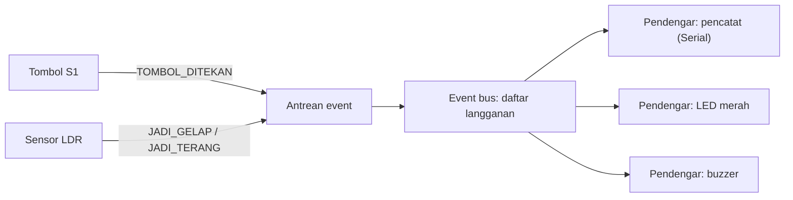
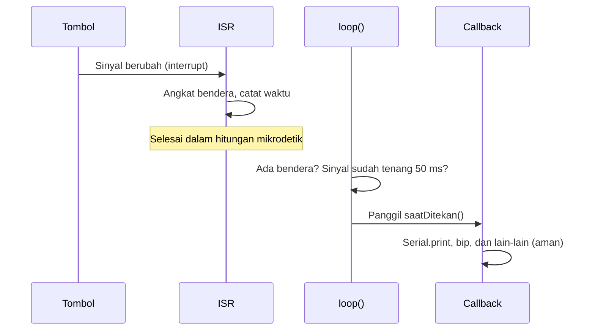

# BAB 18: Callback & Event-Driven Programming

> ✅ **Prasyarat:** Selesaikan **BAB 17 (State Machine)** — kamu sudah terbiasa menulis program *non-blocking* dengan `millis()` dan memakai `struct` yang berisi fungsi ([BAB 16](../BAB-16/README.md)). *Debounce* tombol dari **BAB 9 (Digital Input — Push Button)** dan aturan ISR dari **BAB 10 (Interrupt & ISR)** juga dipakai lagi di sini.

Selama ini `loop()` mengerjakan semuanya sendiri: memeriksa tombol, membaca sensor, **sekaligus** memutuskan apa yang harus dilakukan. Makin banyak fitur, makin kusut kodenya. Di BAB ini kamu belajar memisahkan dua hal itu: **kejadian** (*event*, misalnya "tombol ditekan") dan **reaksi** terhadap kejadian itu (*callback*). Caranya mirip alat getar (*pager*) di *food court*: kamu tidak perlu bolak-balik bertanya ke kasir, cukup menunggu alat itu bergetar saat pesananmu siap. Pola ini dipakai di hampir semua *library* IoT yang akan kamu temui nanti — WiFi, *web server*, MQTT, sampai ESP-NOW.

## 📌 Tujuan Pembelajaran

Setelah mempelajari BAB ini, kamu bisa:

- Menjelaskan arti *event*, *callback*, dan pemrograman *event-driven* dengan analogi sehari-hari.
- Membuat *function pointer*, memberi nama tipenya dengan `typedef` atau `using`, dan memanggilnya dengan aman (memeriksa `nullptr` dulu).
- Membuat komponen yang bisa dipakai ulang — tombol dan pemantau sensor — yang memanggil *callback* saat terjadi *event*, termasuk *callback* yang menerima data.
- Menulis *lambda*, memahami arti *capture* `[ ]`, dan menyimpannya di `std::function`.
- Menerapkan pola *event bus* dengan antrean *event*: satu *event* bisa didengar oleh banyak fungsi.
- Menggabungkan *interrupt* dan *callback* dengan aman: ISR hanya mencatat, *callback* dijalankan di `loop()`.
- Memilih antara *polling*, *interrupt*, dan *event-driven* sesuai kebutuhan program.

## 🧰 Yang Perlu Disiapkan

| Kebutuhan | Keterangan |
|---|---|
| *Hardware* | Kit Bluino ESP32 IoT Starter Shield (ESP32 DEVKIT V1 sudah terpasang di kit) + kabel USB **data** |
| Kabel *jumper* | 6 kabel *female-female*: tombol S1 dan S2, LED merah, *buzzer*, potensiometer, dan LDR — sudah ada di kit (Program 1 tidak memakai kabel sama sekali) |
| Komponen tambahan | Tidak ada |
| *Software* | Arduino IDE 2.x + *board package* **esp32** versi 3.3.x (lihat [BAB 5](../BAB-05/README.md)) |
| *Library* | Tidak perlu *library* tambahan — `std::function` sudah tersedia di *compiler* C++ bawaan *board package* esp32 |
| Alat uji | **Serial Monitor** Arduino IDE (baud 115200) |
| Jaringan | Tidak perlu WiFi |

## 📑 Daftar Isi

- [18.1 Apa Itu Event dan Callback?](#181-apa-itu-event-dan-callback)
- [18.2 Function Pointer: Variabel yang Menyimpan Fungsi](#182-function-pointer-variabel-yang-menyimpan-fungsi)
- [18.3 Program 1: Mengenal Function Pointer](#183-program-1-mengenal-function-pointer)
- [18.4 Program 2: Tombol Pintar dengan Callback](#184-program-2-tombol-pintar-dengan-callback)
- [18.5 Program 3: Callback dengan Data — Pemantau Potensiometer](#185-program-3-callback-dengan-data--pemantau-potensiometer)
- [18.6 Lambda dan std::function](#186-lambda-dan-stdfunction)
- [18.7 Program 4: Lambda untuk Dua Tombol](#187-program-4-lambda-untuk-dua-tombol)
- [18.8 Pola Event Bus: Satu Event, Banyak Pendengar](#188-pola-event-bus-satu-event-banyak-pendengar)
- [18.9 Program 5: Event Bus dengan Antrean Event](#189-program-5-event-bus-dengan-antrean-event)
- [18.10 Callback dan Interrupt: Pola yang Aman](#1810-callback-dan-interrupt-pola-yang-aman)
- [18.11 Program 6: Interrupt dan Callback yang Aman](#1811-program-6-interrupt-dan-callback-yang-aman)
- [18.12 Polling, Interrupt, atau Event-Driven?](#1812-polling-interrupt-atau-event-driven)
- [18.13 Troubleshooting](#1813-troubleshooting)
- [📝 Rangkuman](#-rangkuman)
- [💪 Latihan](#-latihan)
- [📚 Referensi](#-referensi)

---

## 18.1 Apa Itu Event dan Callback?

Dua istilah utama di BAB ini:

- ***Event*** (kejadian) adalah sesuatu yang terjadi dan perlu ditanggapi program: tombol ditekan, nilai sensor berubah, data WiFi masuk, atau waktu tunggu habis.
- ***Callback*** (fungsi "panggil balik") adalah fungsi yang kamu **serahkan** (daftarkan) ke bagian program lain supaya **dipanggil nanti**, saat *event* terjadi. Kamu yang menulis isinya, tetapi bagian program lain yang menentukan **kapan** fungsi itu dipanggil.

Bayangkan kamu memesan makanan di *food court*:

1. Kasir memberimu alat getar (*pager*). Dengan menerima alat itu, kamu "mendaftarkan" cara untuk menghubungimu.
2. Kamu duduk dan mengobrol. Kamu tidak perlu bolak-balik bertanya "sudah siap belum?" ke kasir.
3. Saat makanan siap (*event*), kasir menekan tombol dan *pager*-mu bergetar (*callback* dipanggil). Kamu pun berdiri mengambil makanan — itulah isi *callback*-nya.

Program yang disusun dengan pola "kalau *event* X terjadi, jalankan fungsi Y" disebut program ***event-driven*** (digerakkan oleh kejadian). Bandingkan tiga cara menunggu pesanan berikut:

| Cara menunggu pesanan | Istilah pemrograman | Contoh di ESP32 |
|---|---|---|
| Bolak-balik bertanya ke kasir: "sudah siap?" | *Polling* — program terus-menerus memeriksa sendiri | `if (digitalRead(TOMBOL) == HIGH)` di `loop()` ([BAB 9](../BAB-09/README.md)) |
| Kasir langsung menepuk bahumu, apa pun yang sedang kamu kerjakan | *Interrupt* — *hardware* menyela program yang sedang berjalan | `attachInterrupt()` ([BAB 10](../BAB-10/README.md)) |
| Kamu memegang *pager* dan sudah tahu harus berbuat apa saat alat itu bergetar | *Event-driven* — pendeteksi *event* dipisah dari reaksinya (*callback*) | `tombolS1.saatDitekan = toggleLed;` (BAB ini) |

### 18.1.1 Callback yang Sudah Pernah Kamu Pakai

Tanpa sadar, kamu sudah memakai *callback* di BAB-BAB sebelumnya. Contoh potongan kode:

```cpp
// BAB 10: fungsiISR adalah callback — dipanggil saat IO15 berubah dari LOW ke HIGH
attachInterrupt(digitalPinToInterrupt(15), fungsiISR, RISING);

// BAB 14: saatPadBerubah adalah callback — dipanggil saat touch pad IO33 (T8) disentuh dan saat dilepas
touchAttachInterrupt(T8, saatPadBerubah, ambang);

// BAB 15: saatWaktuHabis adalah callback — dipanggil setiap kali timer hardware mencapai alarm
timerAttachInterrupt(timer, saatWaktuHabis);
```

Perhatikan: nama fungsi ditulis **tanpa** tanda kurung. `fungsiISR` artinya "ini fungsinya, panggil nanti", sedangkan `fungsiISR()` artinya "jalankan sekarang juga". Inilah inti *callback*: fungsi diserahkan, bukan dijalankan.

### 18.1.2 Kenapa Callback Berguna?

Bandingkan dua cara menulis aksi untuk tombol (potongan kode):

```cpp
// Tanpa callback: kode tombol dan aksinya bercampur jadi satu
if (tombolBaruDitekan) {
  ledNyala = !ledNyala;  // aksi ditulis langsung di dalam kode tombol
  digitalWrite(LED_MERAH, ledNyala ? HIGH : LOW);
}

// Dengan callback: kode tombol hanya "mengumumkan" event,
// aksinya didaftarkan dari luar
tombolS1.saatDitekan = toggleLed;
tombolS2.saatDitekan = bunyikanBip;  // kode tombol yang sama, aksi berbeda
```

Dengan *callback*, kode tombol (lengkap dengan *debounce*-nya) cukup ditulis **sekali** lalu dipakai untuk tombol mana pun dan aksi apa pun. Mirip stopkontak di rumah: stopkontaknya sama, alat yang dicolokkan bisa apa saja. Kode yang bagian-bagiannya tidak saling bergantung erat seperti ini disebut *loosely coupled* (longgar keterikatannya): mengganti aksi tidak perlu membongkar kode tombol.

---

## 18.2 Function Pointer: Variabel yang Menyimpan Fungsi

Bagaimana sebuah fungsi bisa "diserahkan" ke bagian program lain? Kode program juga tersimpan di memori ESP32, jadi setiap fungsi punya **alamat** (letaknya di memori). Variabel yang menyimpan alamat sebuah fungsi disebut ***function pointer*** (penunjuk fungsi).

Analoginya kontak di HP: kontak "Ibu" menyimpan nomor telepon, bukan orangnya. Saat kontak itu ditekan, HP menelepon nomor yang tersimpan. Isi kontak bisa diganti ke nomor lain tanpa mengubah cara kamu menekannya.

### 18.2.1 Cara Menulis Function Pointer

Contoh potongan kode:

```cpp
void (*aksi)(int);  // variabel bernama "aksi" yang menunjuk ke fungsi berbentuk: void namaFungsi(int)

void cetakAngka(int x) {
  Serial.println(x);
}

// di dalam setup() atau fungsi lain:
aksi = cetakAngka;  // isi variabel dengan fungsi (tanpa tanda kurung!)
aksi(5);            // panggil fungsi yang ditunjuk → mencetak 5
```

Cara membaca baris pertama:

| Bagian | Artinya |
|---|---|
| `void` | Fungsi yang ditunjuk tidak mengembalikan nilai |
| `(*aksi)` | `aksi` adalah *pointer* (penunjuk). Tanda kurungnya wajib — tanpa tanda kurung, artinya berubah total |
| `(int)` | Fungsi yang ditunjuk menerima satu parameter bertipe `int` |

Tiga aturan penting:

1. **Bentuknya harus cocok.** Tipe nilai kembali dan tipe parameternya harus sama persis. `aksi` hanya bisa diisi fungsi `void ...(int)`. Fungsi `int hitung(int)` atau `void cetak(float)` ditolak *compiler* dengan pesan *error* `invalid conversion`.
2. **Mengisi tanpa tanda kurung, memanggil dengan tanda kurung.** `aksi = cetakAngka;` menyimpan fungsinya, `aksi(5);` menjalankannya.
3. **Periksa dulu sebelum memanggil.** *Pointer* yang belum menunjuk ke mana pun bernilai `nullptr` (kosong). Memanggil *pointer* kosong membuat ESP32 *crash* dengan pesan `Guru Meditation Error` lalu *restart*. Biasakan menulis `if (aksi != nullptr) aksi(5);`.

### 18.2.2 Memberi Nama Tipe dengan typedef dan using

Tulisan `void (*aksi)(int)` sulit dibaca, apalagi kalau dipakai berkali-kali sebagai parameter. Solusinya: beri nama untuk tipe tersebut. Ada dua cara yang artinya sama persis:

```cpp
typedef void (*AksiAngka)(int);   // cara lama (gaya bahasa C), banyak dipakai di library Arduino
using AksiAngka = void (*)(int);  // cara C++ modern — pilih salah satu saja

AksiAngka aksi;                       // sekarang semudah menulis "int x;"
void ulangi(int n, AksiAngka aksi);   // parameter berupa fungsi pun jadi mudah dibaca
```

Di BAB ini, `typedef` dipakai untuk *function pointer* (seperti kebanyakan *library* Arduino), sedangkan `using` dipakai nanti untuk `std::function` di [18.6](#186-lambda-dan-stdfunction).

---

## 18.3 Program 1: Mengenal Function Pointer

**Tujuan:** Mencoba *function pointer* secara langsung: satu variabel diisi fungsi yang berbeda-beda, sebuah fungsi menerima fungsi lain sebagai parameter (*callback*), dan *array* berisi fungsi. Hasilnya cukup dilihat di Serial Monitor.

**Rangkaian:** *Tidak perlu merangkai — program ini hanya memakai Serial Monitor.*

**Cara Menjalankan:**

1. Sambungkan ESP32 ke laptop dengan kabel USB. Kabel *jumper* tidak diperlukan.
2. Buka Arduino IDE → **File → New Sketch**, hapus isinya, lalu salin kode di bawah. Kode yang sama juga tersedia di *file* [`p1_function_pointer.ino`](p1_function_pointer/p1_function_pointer.ino).
3. Pastikan **Tools → Board** = **ESP32 Dev Module** dan **Tools → Port** = *port* ESP32 kamu (misalnya `COM5` di Windows atau `/dev/ttyUSB0` di Linux).
4. Klik tombol **Upload** (ikon panah →) dan tunggu sampai muncul tulisan **Done uploading**.
5. Buka **Serial Monitor** (**Tools → Serial Monitor**) lalu pilih baud **115200**.
6. Semua tulisan dicetak sekali di `setup()`. Kalau terlewat, tekan tombol **EN** di *board* ESP32 untuk menjalankan ulang program.

**Kode Program:**

<!-- sketch: p1_function_pointer -->
```cpp
/*
 * BAB 18 - Program 1: Mengenal Function Pointer
 * Satu variabel bisa menyimpan fungsi yang berbeda-beda,
 * dan sebuah fungsi bisa menerima fungsi lain sebagai parameter (callback).
 *
 * Rangkaian: tidak perlu (hanya Serial Monitor)
 */

// Nama tipe untuk "fungsi yang menerima satu int dan tidak mengembalikan nilai"
typedef void (*AksiAngka)(int);

void cetakAngka(int x) {
  Serial.print("cetakAngka: ");
  Serial.println(x);
}

void cetakDobel(int x) {
  Serial.print("cetakDobel: ");
  Serial.println(x * 2);
}

void cetakKuadrat(int x) {
  Serial.print("cetakKuadrat: ");
  Serial.println(x * x);
}

// Fungsi ini MENERIMA fungsi lain sebagai parameter.
// "aksi" adalah callback: dipanggil untuk setiap angka 1 sampai n.
void ulangiUntukSetiapAngka(int n, AksiAngka aksi) {
  for (int i = 1; i <= n; i++) {
    aksi(i);  // panggil balik (call back) fungsi yang diserahkan
  }
}

void setup() {
  Serial.begin(115200);
  delay(500);  // beri waktu sebentar supaya Serial Monitor siap
  Serial.println("BAB 18 - Program 1: Mengenal Function Pointer");

  // 1) Satu variabel, isinya bisa diganti-ganti
  AksiAngka aksi = cetakAngka;  // tanpa tanda kurung: menyimpan fungsinya
  aksi(5);                      // dengan tanda kurung: memanggilnya
  aksi = cetakDobel;            // ganti isinya ke fungsi lain
  aksi(5);

  // 2) Fungsi sebagai parameter — inilah callback
  Serial.println("-- ulangiUntukSetiapAngka(3, cetakKuadrat) --");
  ulangiUntukSetiapAngka(3, cetakKuadrat);

  // 3) Array berisi function pointer: daftar aksi
  AksiAngka daftarAksi[] = {cetakAngka, cetakDobel, cetakKuadrat};
  Serial.println("-- semua aksi untuk angka 4 --");
  for (int i = 0; i < 3; i++) {
    daftarAksi[i](4);
  }

  // 4) Pointer kosong (nullptr) harus diperiksa sebelum dipanggil
  AksiAngka kosong = nullptr;
  if (kosong != nullptr) {
    kosong(1);
  } else {
    Serial.println("Pointer kosong: tidak dipanggil (aman)");
  }
}

void loop() {
  // Tidak ada yang diulang. Tekan tombol EN untuk menjalankan ulang program.
}
```

**Penjelasan Kode:**

- `typedef void (*AksiAngka)(int);` membuat nama tipe `AksiAngka`. Setelah itu, `AksiAngka aksi` berarti "variabel `aksi` yang bisa menyimpan fungsi berbentuk `void ...(int)`". Ketiga fungsi `cetakAngka`, `cetakDobel`, dan `cetakKuadrat` punya bentuk yang sama, jadi semuanya bisa disimpan di variabel itu.
- Bagian 1: `aksi(5)` yang sama menghasilkan cetakan berbeda, tergantung fungsi apa yang sedang disimpan di `aksi`.
- Bagian 2: `ulangiUntukSetiapAngka()` tidak tahu apa yang akan dilakukan pada setiap angka — ia hanya memanggil fungsi yang diserahkan kepadanya. Fungsi yang diserahkan sebagai parameter seperti ini adalah *callback*.
- Bagian 3: `daftarAksi[]` adalah *array* berisi *function pointer*. `daftarAksi[i](4)` artinya "ambil fungsi ke-`i`, lalu panggil dengan angka 4". Pola ini sering dipakai untuk membuat menu: indeks menu menentukan fungsi yang dijalankan.
- Bagian 4: `nullptr` berarti "belum menunjuk ke fungsi apa pun". Pemeriksaan `if (kosong != nullptr)` mencegah ESP32 *crash*.
- `delay(500)` di awal `setup()` memberi jeda singkat supaya baris-baris pertama tidak terlewat saat Serial Monitor baru tersambung.

**Contoh Output:**

```text
BAB 18 - Program 1: Mengenal Function Pointer
cetakAngka: 5
cetakDobel: 10
-- ulangiUntukSetiapAngka(3, cetakKuadrat) --
cetakKuadrat: 1
cetakKuadrat: 4
cetakKuadrat: 9
-- semua aksi untuk angka 4 --
cetakAngka: 4
cetakDobel: 8
cetakKuadrat: 16
Pointer kosong: tidak dipanggil (aman)
```

Di kit: tidak ada komponen yang menyala — program ini hanya menulis ke Serial Monitor. Sebelum baris judul mungkin muncul beberapa baris log *boot* bawaan ESP32 (misalnya `rst:0x1 (POWERON_RESET),boot:0x13 ...`); itu normal.

> 🧪 **Coba Sendiri:** Tambahkan fungsi `void cetakNegatif(int x)` yang mencetak `-x`, lalu masukkan ke `daftarAksi[]` dan ubah batas perulangan menjadi 4. Setelah itu, coba isi `aksi` dengan fungsi `int kaliTiga(int x) { return x * 3; }` — pesan *error* apa yang muncul saat *compile*, dan kenapa?

**Kalau Belum Berhasil:**

- **Serial Monitor kosong** → tulisan dicetak hanya sekali di `setup()`. Pastikan baud **115200**, lalu tekan tombol **EN** di *board* ESP32.
- ***Error* `invalid conversion from 'int (*)(int)' to 'AksiAngka'`** → bentuk fungsi tidak cocok dengan tipe `AksiAngka`. Fungsi yang disimpan harus `void` dan menerima tepat satu `int`.
- ***Error* `'AksiAngka' was not declared in this scope`** → baris `typedef` terhapus atau ditulis di bawah pemakaiannya. Letakkan `typedef` di bagian paling atas kode.

---

## 18.4 Program 2: Tombol Pintar dengan Callback

**Tujuan:** Membuat `struct TombolPintar` yang mengurus *debounce* tombol dan memanggil *callback* saat tombol **ditekan** dan saat **dilepas**. Aksinya — LED merah *toggle* dan *buzzer* berbunyi "bip" — ditentukan dari luar `struct`, sehingga kode tombolnya bisa dipakai ulang untuk aksi apa pun.

**Rangkaian:**

| Pin **Custom** di kit | Sambungkan ke pin ESP32 |
|---|---|
| Tombol S1 (SW1, pin kuning ke-3) | IO15 (label `15`, deretan bawah) |
| LED1 (LED merah) | IO4 (label `4`, deretan bawah) |
| BUZZ (*buzzer* aktif) | IO13 (label `13`, deretan atas) |

**Cara Menjalankan:**

1. Cabut kabel USB, lalu sambungkan kabel *jumper* sesuai tabel **Rangkaian** di atas (cara memasang kabel tombol ada di [BAB 9](../BAB-09/README.md), LED dan *buzzer* di [BAB 8](../BAB-08/README.md)). Sambungkan kembali kabel USB.
2. Buka Arduino IDE → **File → New Sketch**, hapus isinya, lalu salin kode di bawah. Kode yang sama juga tersedia di *file* [`p2_tombol_callback.ino`](p2_tombol_callback/p2_tombol_callback.ino).
3. Pastikan **Tools → Board** = **ESP32 Dev Module** dan **Tools → Port** = *port* ESP32 kamu.
4. Klik tombol **Upload** dan tunggu sampai muncul tulisan **Done uploading**.
5. Buka **Serial Monitor** (**Tools → Serial Monitor**) lalu pilih baud **115200**.
6. Tekan S1, tahan sebentar, lalu lepaskan. Ulangi beberapa kali.

**Kode Program:**

<!-- sketch: p2_tombol_callback -->
```cpp
/*
 * BAB 18 - Program 2: Tombol Pintar dengan Callback
 * TombolPintar mengurus debounce dan memanggil callback saat tombol
 * ditekan dan saat dilepas. Aksinya ditentukan dari luar struct.
 *
 * Rangkaian:
 *   Tombol S1 (SW1, pin kuning ke-3) → IO15
 *   LED1 (merah)                     → IO4
 *   BUZZ (buzzer aktif)              → IO13
 */

#define TOMBOL_S1  15
#define LED_MERAH  4
#define BUZZER_PIN 13

// Tipe callback: fungsi tanpa parameter dan tanpa nilai kembali
typedef void (*CallbackTombol)();

// ============================================================
// TombolPintar: debounce (seperti BAB 9) + memanggil callback.
// Kode di dalam struct ini TIDAK tahu apa yang akan terjadi saat
// tombol ditekan — itu urusan fungsi yang didaftarkan dari luar.
// ============================================================
struct TombolPintar {
  int pin = -1;
  CallbackTombol saatDitekan = nullptr;  // callback: tombol baru ditekan
  CallbackTombol saatDilepas = nullptr;  // callback: tombol baru dilepas

  // Data internal untuk debounce
  int bacaanSebelumnya = LOW;
  int statusStabil = LOW;
  unsigned long waktuBerubah = 0;

  void begin(int nomorPin) {
    pin = nomorPin;
    pinMode(pin, INPUT);  // tombol kit: pull-down 10 kΩ di PCB, ditekan = HIGH
  }

  // Panggil sesering mungkin di loop()
  void update() {
    int bacaan = digitalRead(pin);
    if (bacaan != bacaanSebelumnya) {  // bacaan mentah berubah: ulang "stopwatch"
      waktuBerubah = millis();
      bacaanSebelumnya = bacaan;
    }
    if (millis() - waktuBerubah > 50 && bacaan != statusStabil) {
      statusStabil = bacaan;  // perubahan sudah stabil 50 ms: anggap sungguhan
      if (statusStabil == HIGH) {
        if (saatDitekan != nullptr) saatDitekan();  // event: tombol ditekan
      } else {
        if (saatDilepas != nullptr) saatDilepas();  // event: tombol dilepas
      }
    }
  }
};

// ============================================================
// Bip non-blocking: callback hanya MEMULAI bunyi,
// loop() yang mematikannya setelah LAMA_BIP.
// ============================================================
const unsigned long LAMA_BIP = 50;  // ms
bool bipAktif = false;
unsigned long waktuMulaiBip = 0;

void mulaiBip() {
  digitalWrite(BUZZER_PIN, HIGH);
  bipAktif = true;
  waktuMulaiBip = millis();
}

void urusBip() {
  if (bipAktif && millis() - waktuMulaiBip >= LAMA_BIP) {
    digitalWrite(BUZZER_PIN, LOW);
    bipAktif = false;
  }
}

// ============================================================
// Fungsi-fungsi callback (aksi)
// ============================================================
bool ledNyala = false;
int jumlahTekan = 0;

void toggleLed() {
  ledNyala = !ledNyala;
  digitalWrite(LED_MERAH, ledNyala ? HIGH : LOW);
  jumlahTekan++;
  Serial.print("Ditekan (ke-");
  Serial.print(jumlahTekan);
  Serial.print(") -> LED merah ");
  Serial.println(ledNyala ? "NYALA" : "MATI");
}

void bipSaatDilepas() {
  mulaiBip();
  Serial.println("Dilepas -> bip!");
}

TombolPintar tombolS1;

void setup() {
  Serial.begin(115200);
  pinMode(LED_MERAH, OUTPUT);
  pinMode(BUZZER_PIN, OUTPUT);
  digitalWrite(LED_MERAH, LOW);
  digitalWrite(BUZZER_PIN, LOW);

  tombolS1.begin(TOMBOL_S1);
  tombolS1.saatDitekan = toggleLed;       // daftarkan callback (tanpa tanda kurung)
  tombolS1.saatDilepas = bipSaatDilepas;  // daftarkan callback kedua

  Serial.println("BAB 18 - Program 2: Tombol Pintar dengan Callback");
  Serial.println("Tekan S1: LED merah toggle | Lepas S1: bip");
}

void loop() {
  tombolS1.update();  // memeriksa tombol; memanggil callback kalau ada event
  urusBip();          // mematikan buzzer kalau waktu bip sudah habis
}
```

**Penjelasan Kode:**

- `struct TombolPintar` mengumpulkan data dan fungsi milik satu tombol, seperti `struct Timer` di [BAB 16](../BAB-16/README.md). Nilai setelah tanda `=` di dalam `struct` (misalnya `int pin = -1;`) adalah nilai awal setiap anggota.
- `saatDitekan` dan `saatDilepas` adalah dua *function pointer* bertipe `CallbackTombol`. Awalnya `nullptr` (kosong), lalu diisi di `setup()`. Di dalam `update()`, keduanya selalu diperiksa dulu sebelum dipanggil.
- Logika `update()` sama dengan *debounce* Program 3 di [BAB 9](../BAB-09/README.md). Bedanya, setelah status stabil berubah, `update()` tidak melakukan aksi apa pun sendiri — ia hanya **memanggil *callback*** yang terdaftar.
- *Callback* sebaiknya **singkat**, karena selama *callback* berjalan, `loop()` menunggu dan tombol tidak diperiksa. Karena itu `bipSaatDilepas()` tidak memakai `delay(50)`, melainkan hanya **memulai** bunyi lewat `mulaiBip()`. `urusBip()` di `loop()` mematikan *buzzer* setelah 50 ms — teknik *non-blocking* dari [BAB 16](../BAB-16/README.md).
- Untuk tombol lain, cukup buat objek baru, misalnya `TombolPintar tombolS2;`, lalu daftarkan *callback* yang berbeda. Isi `struct TombolPintar` tidak perlu diubah sama sekali.

**Contoh Output:**

```text
BAB 18 - Program 2: Tombol Pintar dengan Callback
Tekan S1: LED merah toggle | Lepas S1: bip
Ditekan (ke-1) -> LED merah NYALA
Dilepas -> bip!
Ditekan (ke-2) -> LED merah MATI
Dilepas -> bip!
```

Di kit: setiap S1 ditekan, LED merah berganti nyala/mati. Saat S1 dilepas, *buzzer* berbunyi "bip" singkat. Selama kabel S1 terpasang di IO15, log *boot* bawaan ESP32 tidak muncul saat *board* di-*reset* — itu normal (IO15 adalah pin *strapping*, lihat [BAB 9](../BAB-09/README.md)).

> 🧪 **Coba Sendiri:** Tukar isi kedua *callback* di `setup()`: `tombolS1.saatDitekan = bipSaatDilepas;` dan `tombolS1.saatDilepas = toggleLed;`. Sekarang LED berubah saat tombol **dilepas** — padahal kamu tidak menyentuh isi `struct TombolPintar` sedikit pun.

**Kalau Belum Berhasil:**

- **Tidak ada tulisan saat S1 ditekan** → cek kabel S1: pin kuning ke-3 → pin berlabel `15` di deretan **bawah**.
- **Tulisan muncul, tetapi LED tidak berubah** → cek kabel LED1 → `4`. Kalau tidak ada bunyi, cek kabel BUZZ → `13` (bukan pin RELAY di sebelahnya).
- **Satu tekanan terhitung dua kali** → tombolmu memantul lebih lama. Ganti angka `50` di `update()` menjadi `80`.
- **ESP32 *restart* dengan pesan `Guru Meditation Error`** → ada *callback* yang dipanggil padahal masih `nullptr`. Pastikan pemeriksaan `!= nullptr` tidak terhapus.

---

## 18.5 Program 3: Callback dengan Data — Pemantau Potensiometer

**Tujuan:** Membuat `struct PemantauSensor` yang membaca ADC setiap 100 ms dan memanggil *callback* **hanya** saat nilainya berubah cukup banyak. Kali ini *callback* menerima data: nilai lama dan nilai baru. Pembacaan ADC dibahas di [BAB 11](../BAB-11/README.md).

**Rangkaian:**

| Pin **Custom** di kit | Sambungkan ke pin ESP32 |
|---|---|
| Potensiometer (VR10K, pin kuning ke-5) | IO34 (label `34`, deretan atas) |

**Cara Menjalankan:**

1. Cabut kabel USB, lalu pasang kabel *jumper* dari pin kuning ke-5 (VR10K) ke pin berlabel **34** di deretan pin ESP32 atas. Kabel dari Program 2 boleh tetap terpasang. Sambungkan kembali kabel USB.
2. Buka Arduino IDE → **File → New Sketch**, hapus isinya, lalu salin kode di bawah. Kode yang sama juga tersedia di *file* [`p3_pemantau_potensiometer.ino`](p3_pemantau_potensiometer/p3_pemantau_potensiometer.ino).
3. Pastikan **Tools → Board** = **ESP32 Dev Module** dan **Tools → Port** = *port* ESP32 kamu.
4. Klik tombol **Upload** dan tunggu sampai muncul tulisan **Done uploading**.
5. Buka **Serial Monitor** (**Tools → Serial Monitor**) lalu pilih baud **115200**.
6. Putar kenop potensiometer pelan-pelan, lalu diamkan.

**Kode Program:**

<!-- sketch: p3_pemantau_potensiometer -->
```cpp
/*
 * BAB 18 - Program 3: Callback dengan Data — Pemantau Potensiometer
 * PemantauSensor membaca ADC setiap 100 ms dan memanggil callback
 * hanya saat nilainya berubah minimal sebesar "ambang".
 *
 * Rangkaian: Potensiometer (VR10K, pin kuning ke-5) → IO34
 */

#define POT_PIN 34

// Tipe callback yang menerima dua data: nilai lama dan nilai baru
typedef void (*CallbackSensor)(int nilaiLama, int nilaiBaru);

struct PemantauSensor {
  int pin = -1;
  int ambang = 50;               // perubahan minimum agar dianggap "berubah"
  unsigned long interval = 100;  // jeda antarpembacaan (ms)
  CallbackSensor saatBerubah = nullptr;

  int nilaiTerakhir = 0;         // nilai saat callback terakhir dipanggil
  unsigned long waktuBaca = 0;

  void begin(int nomorPin, int ambangPerubahan, unsigned long intervalMs) {
    pin = nomorPin;
    ambang = ambangPerubahan;
    interval = intervalMs;
    nilaiTerakhir = analogRead(pin);  // nilai awal sebagai pembanding
    waktuBaca = millis();
  }

  // Panggil sesering mungkin di loop()
  void update() {
    if (millis() - waktuBaca < interval) return;  // belum waktunya membaca
    waktuBaca = millis();

    int nilai = analogRead(pin);  // 0–4095
    if (abs(nilai - nilaiTerakhir) >= ambang) {
      int lama = nilaiTerakhir;
      nilaiTerakhir = nilai;      // simpan dulu, baru beri tahu
      if (saatBerubah != nullptr) saatBerubah(lama, nilai);  // kirim data ke callback
    }
  }
};

// Callback: menerima data dari PemantauSensor lewat parameternya
void tampilkanPerubahan(int lama, int baru) {
  int persen = map(baru, 0, 4095, 0, 100);
  Serial.print("Potensiometer berubah: ");
  Serial.print(lama);
  Serial.print(" -> ");
  Serial.print(baru);
  Serial.print(" (");
  Serial.print(persen);
  Serial.println("%)");
}

PemantauSensor pemantauPot;

void setup() {
  Serial.begin(115200);

  pemantauPot.begin(POT_PIN, 50, 100);  // ambang 50, baca setiap 100 ms
  pemantauPot.saatBerubah = tampilkanPerubahan;

  Serial.println("BAB 18 - Program 3: Pemantau Potensiometer dengan Callback");
  Serial.println("Putar potensiometer pelan-pelan...");
}

void loop() {
  pemantauPot.update();
}
```

**Penjelasan Kode:**

- `CallbackSensor` adalah tipe *callback* yang menerima dua `int`. Dengan begitu, `PemantauSensor` bisa **mengirim data** ke *callback*: nilai sebelum dan sesudah berubah. Fungsi yang didaftarkan (`tampilkanPerubahan`) harus punya bentuk yang sama, yaitu `void ...(int, int)`.
- `update()` hanya membaca ADC setiap `interval` milidetik (pola `millis()` dari [BAB 16](../BAB-16/README.md)), sehingga `loop()` tetap bebas mengerjakan hal lain.
- **Ambang** (*threshold*) 50 mencegah *callback* dipanggil terus-menerus. Nilai ADC ESP32 selalu bergoyang beberapa angka walaupun kenop diam (*noise*), jadi tanpa ambang Serial Monitor akan kebanjiran tulisan.
- `abs()` menghasilkan nilai mutlak (selalu positif), jadi perubahan naik maupun turun sama-sama terdeteksi.
- `map(baru, 0, 4095, 0, 100)` mengubah rentang 0–4095 menjadi 0–100 (persen). Hasilnya bilangan bulat; angka di belakang koma dibuang.

**Contoh Output:**

```text
BAB 18 - Program 3: Pemantau Potensiometer dengan Callback
Putar potensiometer pelan-pelan...
Potensiometer berubah: 1520 -> 1610 (39%)
Potensiometer berubah: 1610 -> 1795 (43%)
Potensiometer berubah: 1795 -> 2210 (53%)
```

Angka di kit kamu pasti berbeda, tergantung posisi kenop. Selama kenop tidak diputar, tidak ada tulisan baru sama sekali — *callback* hanya dipanggil saat ada *event* "nilai berubah". Saat kenop diputar mentok ke salah satu ujung, nilainya mendekati 0 atau 4095.

> 🧪 **Coba Sendiri:** Ubah ambang menjadi `5` (`pemantauPot.begin(POT_PIN, 5, 100);`) dan *upload* ulang. Apakah tulisan muncul terus walaupun kenop diam? Itulah *noise* ADC. Lalu coba ambang `300` — sekarang perubahan kecil tidak dilaporkan.

**Kalau Belum Berhasil:**

- **Tidak ada tulisan walaupun kenop diputar** → cek kabel pin kuning ke-5 (VR10K) → pin berlabel `34` di deretan **atas**. Pastikan kenop benar-benar diputar cukup jauh (lebih dari ambang).
- **Nilai selalu 0 atau selalu 4095** → kabel terpasang di pin yang salah, atau kenop sudah mentok di ujung. Putar kenop ke posisi tengah.
- **Tulisan muncul terus walaupun kenop diam** → ambang terlalu kecil. Pakai ambang 50 atau lebih.

---

## 18.6 Lambda dan std::function

Sampai sekarang setiap *callback* ditulis sebagai fungsi bernama yang terpisah (`toggleLed`, `bipSaatDilepas`). Untuk aksi pendek yang hanya dipakai sekali, C++ menyediakan cara yang lebih ringkas: ***lambda***.

### 18.6.1 Lambda: Fungsi Tanpa Nama

*Lambda* adalah fungsi tanpa nama yang ditulis langsung di tempat ia dibutuhkan — seperti menulis pesan di kertas tempel lalu langsung menempelkannya, tanpa membuat dokumen baru. Contoh potongan kode:

```cpp
// Cara biasa: fungsi bernama, ditulis terpisah, lalu didaftarkan
void sapa() {
  Serial.println("Halo!");
}
tombolS1.saatDitekan = sapa;

// Dengan lambda: isinya sama, ditulis langsung di tempat pendaftaran
tombolS1.saatDitekan = []() {
  Serial.println("Halo!");
};
```

Bagian-bagian *lambda*:

| Bagian | Contoh | Artinya |
|---|---|---|
| `[ ]` | `[]` | Daftar *capture*: variabel lokal yang "dibawa" masuk ke *lambda* (dijelaskan di bawah) |
| `( )` | `()` atau `(int x)` | Parameter, sama seperti fungsi biasa |
| `{ }` | `{ Serial.println("Halo!"); }` | Isi fungsi |
| `;` | `};` | Titik koma setelah `}`, karena seluruh *lambda* adalah bagian dari satu pernyataan `... = ...;` |

*Lambda* dengan `[]` kosong (tanpa *capture*) bisa langsung disimpan di *function pointer* biasa. Jadi `TombolPintar` dari Program 2 pun bisa diisi *lambda* tanpa perubahan apa pun.

### 18.6.2 Capture: Membawa Variabel ke Dalam Lambda

Isi *lambda* boleh langsung memakai variabel global dan variabel `static`. Namun, untuk memakai **variabel lokal** (variabel yang dibuat di dalam sebuah fungsi, termasuk parameternya), variabel itu harus disebut di dalam `[ ]`. Ini disebut ***capture*** (menangkap):

| Tulisan | Artinya | Analogi |
|---|---|---|
| `[]` | Tidak membawa variabel lokal apa pun | Pergi dengan tangan kosong |
| `[n]` | Membawa **salinan** nilai `n` (*capture by value*) | Membawa fotokopi dokumen |
| `[&n]` | Memakai variabel `n` **yang asli** (*capture by reference*) | Meminjam dokumen aslinya |
| `[=]` | Membawa salinan semua variabel lokal yang dipakai di dalam *lambda* | Memfotokopi semua yang diperlukan |
| `[&]` | Memakai semua variabel lokal yang asli | Meminjam semua aslinya |

Contoh potongan kode — sebuah fungsi "pabrik" yang membuat aksi bip:

```cpp
// Membuat lambda yang membawa salinan nilai "kali"
std::function<void()> buatAksiBip(int kali) {
  return [kali]() {  // nilai kali disalin ke dalam lambda
    mulaiBip(kali);
  };
}
```

`kali` adalah parameter, jadi variabel itu **hilang** begitu `buatAksiBip()` selesai. *Lambda* yang dikembalikan tetap bisa dipanggil kapan pun nanti, karena ia menyimpan salinannya sendiri. Kalau ditulis `[&kali]`, *lambda* akan "meminjam" variabel yang sudah tidak ada — hasilnya angka acak atau ESP32 *crash*.

> ⚠️ **Perhatian:** Untuk *callback* yang baru dipanggil **nanti** (setelah fungsi yang membuatnya selesai), bawa variabel lokal dengan *capture by value* `[n]`. Pakai `[&n]` atau `[&]` hanya kalau kamu yakin variabel aslinya masih ada saat *lambda* dipanggil.

### 18.6.3 std::function: Wadah untuk Fungsi Apa Pun

*Lambda* yang membawa *capture* **tidak bisa** disimpan di *function pointer* biasa, karena ia bukan sekadar alamat fungsi — ia juga membawa data. *Compiler* akan menolaknya dengan pesan *error* `cannot convert ... in assignment`. Solusinya adalah `std::function`, bagian dari *library* standar C++ (cukup tulis `#include <functional>`, tidak perlu menginstal apa pun):

```cpp
#include <functional>

using Callback = std::function<void()>;  // wadah untuk fungsi apa pun berbentuk void()

Callback aksi;                 // awalnya kosong
aksi = sapa;                   // boleh diisi fungsi biasa
aksi = []() { /* ... */ };     // boleh diisi lambda tanpa capture
aksi = buatAksiBip(3);         // boleh juga diisi lambda dengan capture
if (aksi) aksi();              // periksa dulu: bernilai true kalau sudah berisi
```

Isi `< >` pada `std::function<void()>` menyatakan bentuk fungsinya: `void()` artinya tidak menerima parameter dan tidak mengembalikan nilai. Untuk *callback* sensor di Program 3, bentuknya menjadi `std::function<void(int, int)>`.

> 📌 **Catatan:** Di ESP32, `Arduino.h` sebenarnya sudah ikut menyertakan `<functional>`, jadi program tetap ter-*compile* walaupun baris `#include <functional>` lupa ditulis. Tetap tuliskan baris itu supaya jelas dari mana `std::function` berasal.

| | *Function pointer* | `std::function` |
|---|---|---|
| Menyimpan fungsi biasa | ✅ | ✅ |
| Menyimpan *lambda* tanpa *capture* | ✅ | ✅ |
| Menyimpan *lambda* dengan *capture* | ❌ | ✅ |
| Memori yang dipakai | 4 byte (satu alamat) | Lebih besar; *capture* yang besar bisa memakai memori *heap* (lihat [BAB 20](../BAB-20/README.md)) |
| Kalau kosong lalu dipanggil | ESP32 *crash* (`Guru Meditation Error`) lalu *restart* | Program dihentikan (`abort() was called`) lalu ESP32 *restart* |
| Dipakai sebagai ISR | Ya — fungsi ISR memang disimpan sebagai *function pointer* | Hindari |

Banyak *library* ESP32 memakai `std::function` untuk *callback*-nya, misalnya `server.on()` pada *web server* dan `setCallback()` pada MQTT. Jadi bentuk ini akan sering kamu temui.

---

## 18.7 Program 4: Lambda untuk Dua Tombol

**Tujuan:** Memakai satu `struct Tombol` untuk dua tombol sekaligus. *Callback*-nya disimpan di `std::function` dan ditulis sebagai *lambda*: S1 memakai *lambda* tanpa *capture* untuk *toggle* LED merah, sedangkan S2 memakai *lambda* buatan fungsi "pabrik" yang membawa datanya sendiri untuk membunyikan *buzzer* 3 kali.

**Rangkaian:**

| Pin **Custom** di kit | Sambungkan ke pin ESP32 |
|---|---|
| Tombol S1 (SW1, pin kuning ke-3) | IO15 (label `15`, deretan bawah) |
| Tombol S2 (SW2, pin kuning ke-4) | IO25 (label `25`, deretan atas) |
| LED1 (LED merah) | IO4 (label `4`, deretan bawah) |
| BUZZ (*buzzer* aktif) | IO13 (label `13`, deretan atas) |

**Cara Menjalankan:**

1. Cabut kabel USB. Tambahkan kabel *jumper* dari pin kuning ke-4 (SW2) ke pin berlabel **25** di deretan pin ESP32 atas; kabel S1, LED merah, dan BUZZ dari Program 2 tetap terpasang. Sambungkan kembali kabel USB.
2. Buka Arduino IDE → **File → New Sketch**, hapus isinya, lalu salin kode di bawah. Kode yang sama juga tersedia di *file* [`p4_lambda_dua_tombol.ino`](p4_lambda_dua_tombol/p4_lambda_dua_tombol.ino).
3. Pastikan **Tools → Board** = **ESP32 Dev Module** dan **Tools → Port** = *port* ESP32 kamu.
4. Klik tombol **Upload** dan tunggu sampai muncul tulisan **Done uploading**.
5. Buka **Serial Monitor** (**Tools → Serial Monitor**) lalu pilih baud **115200**.
6. Tekan S1 beberapa kali, lalu S2.

**Kode Program:**

<!-- sketch: p4_lambda_dua_tombol -->
```cpp
/*
 * BAB 18 - Program 4: Lambda untuk Dua Tombol
 * Struct Tombol yang sama dipakai untuk S1 dan S2. Callback-nya disimpan
 * di std::function dan ditulis sebagai lambda; satu lambda membawa data (capture).
 *
 * Rangkaian:
 *   Tombol S1 (SW1, pin kuning ke-3) → IO15
 *   Tombol S2 (SW2, pin kuning ke-4) → IO25
 *   LED1 (merah)                     → IO4
 *   BUZZ (buzzer aktif)              → IO13
 */

#include <functional>  // std::function

#define TOMBOL_S1  15
#define TOMBOL_S2  25
#define LED_MERAH  4
#define BUZZER_PIN 13

using Callback = std::function<void()>;  // wadah untuk fungsi apa pun berbentuk void()

// ============================================================
// Tombol: sama dengan TombolPintar di Program 2, tetapi callback-nya
// disimpan di std::function sehingga bisa diisi lambda ber-capture.
// ============================================================
struct Tombol {
  int pin = -1;
  Callback saatDitekan;  // kosong sampai diisi

  int bacaanSebelumnya = LOW;
  int statusStabil = LOW;
  unsigned long waktuBerubah = 0;

  void begin(int nomorPin) {
    pin = nomorPin;
    pinMode(pin, INPUT);  // tombol kit: ditekan = HIGH
  }

  void update() {
    int bacaan = digitalRead(pin);
    if (bacaan != bacaanSebelumnya) {
      waktuBerubah = millis();
      bacaanSebelumnya = bacaan;
    }
    if (millis() - waktuBerubah > 50 && bacaan != statusStabil) {
      statusStabil = bacaan;
      if (statusStabil == HIGH && saatDitekan) {  // std::function bernilai true kalau sudah diisi
        saatDitekan();
      }
    }
  }
};

// ============================================================
// Bip non-blocking: bunyi beberapa kali, setiap bunyi dan jeda 80 ms
// ============================================================
const unsigned long LAMA_BUNYI = 80;  // ms
int sisaBip = 0;                      // sisa bunyi yang belum selesai
bool buzzerBunyi = false;
unsigned long waktuBuzzer = 0;

void mulaiBip(int kali) {
  sisaBip = kali;
  buzzerBunyi = true;
  digitalWrite(BUZZER_PIN, HIGH);  // bunyi pertama langsung dimulai
  waktuBuzzer = millis();
}

void urusBuzzer() {  // dipanggil di setiap putaran loop()
  if (sisaBip == 0) return;
  if (millis() - waktuBuzzer < LAMA_BUNYI) return;
  waktuBuzzer = millis();
  if (buzzerBunyi) {  // satu bunyi selesai → diam
    digitalWrite(BUZZER_PIN, LOW);
    buzzerBunyi = false;
    sisaBip--;
  } else {            // jeda selesai → bunyi lagi
    digitalWrite(BUZZER_PIN, HIGH);
    buzzerBunyi = true;
  }
}

// ============================================================
// "Pabrik" callback: membuat lambda yang membawa salinan nama dan kali
// ============================================================
Callback buatAksiBip(const char *nama, int kali) {
  return [nama, kali]() {  // capture by value: lambda menyimpan salinannya sendiri
    Serial.print("[");
    Serial.print(nama);
    Serial.print("] Bip ");
    Serial.print(kali);
    Serial.println(" kali");
    mulaiBip(kali);
  };
}

bool ledNyala = false;
Tombol tombolS1;
Tombol tombolS2;

void setup() {
  Serial.begin(115200);
  pinMode(LED_MERAH, OUTPUT);
  pinMode(BUZZER_PIN, OUTPUT);
  digitalWrite(LED_MERAH, LOW);
  digitalWrite(BUZZER_PIN, LOW);

  tombolS1.begin(TOMBOL_S1);
  tombolS2.begin(TOMBOL_S2);

  // S1: lambda tanpa capture, ditulis langsung di tempat
  tombolS1.saatDitekan = []() {
    ledNyala = !ledNyala;  // variabel global: boleh dipakai tanpa capture
    digitalWrite(LED_MERAH, ledNyala ? HIGH : LOW);
    Serial.print("[S1] LED merah ");
    Serial.println(ledNyala ? "NYALA" : "MATI");
  };

  // S2: lambda buatan "pabrik" yang membawa datanya sendiri
  tombolS2.saatDitekan = buatAksiBip("S2", 3);

  Serial.println("BAB 18 - Program 4: Lambda untuk Dua Tombol");
  Serial.println("S1 = toggle LED merah, S2 = bip 3 kali");
}

void loop() {
  tombolS1.update();
  tombolS2.update();
  urusBuzzer();
}
```

**Penjelasan Kode:**

- `using Callback = std::function<void()>;` memberi nama pendek untuk tipe `std::function`. Anggota `saatDitekan` di `struct Tombol` bertipe `Callback`, jadi bisa diisi fungsi biasa maupun *lambda* (dengan atau tanpa *capture*).
- `if (... && saatDitekan)` memeriksa apakah `std::function` sudah berisi. Ini pengganti pemeriksaan `!= nullptr` pada *function pointer*.
- *Callback* S1 adalah *lambda* tanpa *capture*. Ia memakai variabel global `ledNyala` secara langsung, karena variabel global tidak perlu di-*capture*.
- *Callback* S2 dibuat oleh `buatAksiBip("S2", 3)`. *Lambda* di dalamnya menyalin `nama` dan `kali` lewat `[nama, kali]`. Setelah `buatAksiBip()` selesai, parameter aslinya hilang, tetapi salinannya tetap tersimpan di dalam `tombolS2.saatDitekan`.
- `mulaiBip()` dan `urusBuzzer()` membunyikan *buzzer* beberapa kali tanpa `delay()`: setiap 80 ms *buzzer* berganti antara bunyi dan diam, sampai `sisaBip` menjadi 0. Karena tidak ada `delay()`, kedua tombol tetap dibaca selama *buzzer* berbunyi.

**Contoh Output:**

```text
BAB 18 - Program 4: Lambda untuk Dua Tombol
S1 = toggle LED merah, S2 = bip 3 kali
[S1] LED merah NYALA
[S1] LED merah MATI
[S2] Bip 3 kali
[S1] LED merah NYALA
```

Di kit: S1 menyalakan dan mematikan LED merah secara bergantian. S2 membuat *buzzer* berbunyi "bip-bip-bip". Coba tekan S1 saat *buzzer* masih berbunyi — LED tetap langsung merespons karena tidak ada `delay()`.

> 🧪 **Coba Sendiri:** Daftarkan `tombolS1.saatDitekan = buatAksiBip("S1", 1);` di bawah *lambda* S1, lalu *upload* ulang. Sekarang S1 hanya berbunyi sekali dan LED tidak lagi berubah, karena isi `saatDitekan` yang lama **tertimpa**: satu tombol hanya punya satu tempat *callback*. Bagaimana kalau satu *event* perlu ditanggapi banyak fungsi? Jawabannya ada di subbab berikutnya.

**Kalau Belum Berhasil:**

- **S1 bekerja, tetapi S2 tidak** → cek kabel S2: pin kuning ke-4 → pin berlabel `25` di deretan **atas**. Pastikan konektor HC-SR04 tidak sedang dipakai, karena IO25 juga dipakai pin Trig HC-SR04.
- ***Error* `cannot convert '...<lambda()>' to ...`** → kamu menyimpan *lambda* yang membawa *capture* ke variabel *function pointer* (`typedef void (*...)()`). Pakai tipe `std::function` seperti `Callback` di program ini.
- **ESP32 *restart* dengan pesan `abort() was called`** → ada `std::function` kosong yang dipanggil. Pastikan pemeriksaan `&& saatDitekan` tidak terhapus.

---

## 18.8 Pola Event Bus: Satu Event, Banyak Pendengar

Di Program 2–4, setiap tombol hanya punya **satu** tempat *callback* untuk setiap *event*. Pada proyek yang lebih besar, satu *event* sering perlu ditanggapi oleh **banyak** bagian program sekaligus. Contohnya *event* "ruangan menjadi gelap": LED perlu menyala, *buzzer* perlu berbunyi, dan catatan perlu ditulis ke Serial Monitor.

Solusinya adalah pola ***event bus*** — semacam papan pengumuman di tengah program:

- **Sumber *event*** (tombol, sensor) hanya **mengirim** *event* ke papan, misalnya "JADI_GELAP". Sumber tidak tahu siapa yang akan menanggapi.
- **Pendengar** (*listener*) adalah fungsi *callback* yang **mendaftar** ke papan untuk *event* tertentu. Pendengar tidak perlu tahu dari mana *event* berasal.
- **Papan *event*** mencatat daftar langganan, lalu membagikan setiap *event* ke semua pendengar yang mendaftar untuk *event* itu.

Analoginya grup WhatsApp: pengirim cukup mengirim satu pesan, dan semua anggota grup menerimanya. Anggota baru bisa bergabung tanpa pengirim perlu mengubah apa pun. Pola ini juga dikenal sebagai *publish–subscribe* (terbit–berlangganan) atau *observer*.



*Gambar 18.1 — Alur event bus pada Program 5: sumber event mengirim event ke antrean, lalu event bus membagikannya ke pendengar yang berlangganan. Sumber: dibuat untuk materi ini.*

### 18.8.1 Antrean Event (FIFO)

Pada Program 5, sumber tidak langsung memanggil pendengar. *Event* dimasukkan dulu ke **antrean** (*queue*), lalu `loop()` mengambilnya satu per satu dan membagikannya ke pendengar. Cara kerjanya seperti nomor antrean di bank: siapa yang datang duluan dilayani duluan. Aturan ini disebut **FIFO** (*First In, First Out* — pertama masuk, pertama keluar).

Kenapa perlu antrean?

- **Sumber selesai dengan cepat.** Mengirim *event* hanya berarti menaruh data di *array*, jadi sumber tidak perlu menunggu semua pendengar selesai bekerja.
- **Urutan terjaga.** *Event* diproses persis sesuai urutan terjadinya.
- **Tidak ada pemanggilan bertumpuk.** Kalau sebuah pendengar mengirim *event* baru, *event* itu hanya ditaruh di antrean dan diproses nanti, bukan langsung di tengah pemrosesan *event* sebelumnya.

Antrean di Program 5 berupa *array* berukuran tetap yang dipakai melingkar (*ring buffer*): setelah indeks terakhir, posisi kembali ke 0. Operator `%` (sisa bagi) melakukan "putaran" itu: `(7 + 1) % 8` hasilnya `0`.

---

## 18.9 Program 5: Event Bus dengan Antrean Event

**Tujuan:** Membuat *event bus* sederhana. Dua sumber *event* — tombol S1 dan LDR — mengirim *event* ke antrean. Tiga pendengar — pencatat Serial, LED merah, dan *buzzer* — mendaftar untuk *event* yang mereka perlukan. Satu *event* (misalnya tombol ditekan) ditanggapi oleh beberapa pendengar sekaligus.

**Rangkaian:**

| Pin **Custom** di kit | Sambungkan ke pin ESP32 |
|---|---|
| Tombol S1 (SW1, pin kuning ke-3) | IO15 (label `15`, deretan bawah) |
| LDR (pin kuning ke-1) | IO35 (label `35`, deretan atas) |
| LED1 (LED merah) | IO4 (label `4`, deretan bawah) |
| BUZZ (*buzzer* aktif) | IO13 (label `13`, deretan atas) |

**Cara Menjalankan:**

1. Cabut kabel USB. Tambahkan kabel *jumper* dari pin kuning ke-1 (LDR) ke pin berlabel **35** di deretan pin ESP32 atas. Kabel S1, LED merah, dan BUZZ tetap terpasang; kabel S2 dan potensiometer boleh tetap terpasang walaupun tidak dipakai. Sambungkan kembali kabel USB.
2. Buka Arduino IDE → **File → New Sketch**, hapus isinya, lalu salin kode di bawah. Kode yang sama juga tersedia di *file* [`p5_event_bus.ino`](p5_event_bus/p5_event_bus.ino).
3. Pastikan **Tools → Board** = **ESP32 Dev Module** dan **Tools → Port** = *port* ESP32 kamu.
4. Klik tombol **Upload** dan tunggu sampai muncul tulisan **Done uploading**.
5. Buka **Serial Monitor** (**Tools → Serial Monitor**) lalu pilih baud **115200**.
6. Tekan S1 beberapa kali. Lalu tutup LDR rapat-rapat dengan telapak tangan selama 1–2 detik, dan buka lagi.

**Kode Program:**

<!-- sketch: p5_event_bus -->
```cpp
/*
 * BAB 18 - Program 5: Event Bus dengan Antrean Event
 * Sumber event (tombol S1 dan LDR) hanya MENGIRIM event ke antrean.
 * Event bus membagikan setiap event ke semua pendengar yang
 * mendaftar untuk jenis event tersebut.
 *
 * Rangkaian:
 *   Tombol S1 (SW1, pin kuning ke-3) → IO15
 *   LDR (pin kuning ke-1)            → IO35
 *   LED1 (merah)                     → IO4
 *   BUZZ (buzzer aktif)              → IO13
 */

#include <functional>

#define TOMBOL_S1  15
#define LDR_PIN    35
#define LED_MERAH  4
#define BUZZER_PIN 13

// LDR di kit: makin gelap, nilai ADC makin besar. Sesuaikan dengan ruanganmu.
const int AMBANG_GELAP = 3000;   // di atas nilai ini dianggap gelap
const int AMBANG_TERANG = 2500;  // di bawah nilai ini dianggap terang lagi

// ============================================================
// 1. TIPE DATA: jenis event, data event, dan bentuk pendengar
//    (semua tipe ditulis SEBELUM fungsi pertama — lihat catatan)
// ============================================================
enum JenisEvent {
  EVENT_TOMBOL_DITEKAN,
  EVENT_JADI_GELAP,
  EVENT_JADI_TERANG
};

struct Event {
  JenisEvent jenis;
  int nilai;  // data tambahan: jumlah tekan, atau nilai ADC LDR
};

// Pendengar = fungsi apa pun yang menerima sebuah Event
using Pendengar = std::function<void(const Event &)>;

struct Langganan {
  JenisEvent jenis;  // jenis event yang didengarkan
  Pendengar fungsi;  // fungsi yang dipanggil saat event itu terjadi
};

const char *namaEvent(JenisEvent jenis) {
  switch (jenis) {
    case EVENT_TOMBOL_DITEKAN: return "TOMBOL_DITEKAN";
    case EVENT_JADI_GELAP:     return "JADI_GELAP";
    case EVENT_JADI_TERANG:    return "JADI_TERANG";
  }
  return "?";
}

// ============================================================
// 2. ANTREAN EVENT (FIFO, ring buffer)
// ============================================================
const int UKURAN_ANTREAN = 8;
Event antrean[UKURAN_ANTREAN];
int posisiAmbil = 0;  // indeks event yang akan diproses berikutnya
int posisiTaruh = 0;  // indeks tempat event baru akan ditaruh
int jumlahAntre = 0;  // banyaknya event yang sedang menunggu

// Dipanggil oleh SUMBER event: hanya menaruh event di antrean, jadi cepat
void kirimEvent(JenisEvent jenis, int nilai) {
  if (jumlahAntre == UKURAN_ANTREAN) {
    Serial.println("[BUS] Antrean penuh, event dibuang!");
    return;
  }
  antrean[posisiTaruh] = {jenis, nilai};
  posisiTaruh = (posisiTaruh + 1) % UKURAN_ANTREAN;  // setelah indeks 7 kembali ke 0
  jumlahAntre++;
}

// ============================================================
// 3. EVENT BUS: daftar langganan (jenis event → fungsi pendengar)
// ============================================================
const int MAKS_LANGGANAN = 10;
Langganan daftarLangganan[MAKS_LANGGANAN];
int jumlahLangganan = 0;

// Mendaftarkan sebuah pendengar untuk satu jenis event
void dengarkan(JenisEvent jenis, Pendengar fungsi) {
  if (jumlahLangganan == MAKS_LANGGANAN) {
    Serial.println("[BUS] Daftar langganan penuh!");
    return;
  }
  daftarLangganan[jumlahLangganan] = {jenis, fungsi};
  jumlahLangganan++;
}

// Dipanggil di loop(): ambil SATU event, bagikan ke semua pendengarnya
void prosesEvent() {
  if (jumlahAntre == 0) return;
  Event e = antrean[posisiAmbil];
  posisiAmbil = (posisiAmbil + 1) % UKURAN_ANTREAN;
  jumlahAntre--;

  for (int i = 0; i < jumlahLangganan; i++) {
    if (daftarLangganan[i].jenis == e.jenis && daftarLangganan[i].fungsi) {
      daftarLangganan[i].fungsi(e);
    }
  }
}

// ============================================================
// 4. SUMBER EVENT — tidak tahu siapa yang mendengarkan
// ============================================================
// 4a. Tombol S1 (debounce seperti BAB 9)
int bacaanSebelumnya = LOW;
int statusStabil = LOW;
unsigned long waktuBerubah = 0;
int jumlahTekan = 0;

void periksaTombol() {
  int bacaan = digitalRead(TOMBOL_S1);
  if (bacaan != bacaanSebelumnya) {
    waktuBerubah = millis();
    bacaanSebelumnya = bacaan;
  }
  if (millis() - waktuBerubah > 50 && bacaan != statusStabil) {
    statusStabil = bacaan;
    if (statusStabil == HIGH) {
      jumlahTekan++;
      kirimEvent(EVENT_TOMBOL_DITEKAN, jumlahTekan);
    }
  }
}

// 4b. LDR: kirim event hanya saat keadaan berganti (terang <-> gelap)
bool sedangGelap = false;
unsigned long waktuBacaLdr = 0;

void periksaCahaya() {
  if (millis() - waktuBacaLdr < 200) return;  // baca setiap 200 ms
  waktuBacaLdr = millis();

  int nilai = analogRead(LDR_PIN);
  if (!sedangGelap && nilai > AMBANG_GELAP) {
    sedangGelap = true;
    kirimEvent(EVENT_JADI_GELAP, nilai);
  } else if (sedangGelap && nilai < AMBANG_TERANG) {
    sedangGelap = false;
    kirimEvent(EVENT_JADI_TERANG, nilai);
  }
}

// ============================================================
// 5. ALAT BANTU UNTUK PENDENGAR: LED dan buzzer non-blocking
// ============================================================
bool ledNyala = false;

void aturLed(bool nyala) {
  ledNyala = nyala;
  digitalWrite(LED_MERAH, ledNyala ? HIGH : LOW);
}

const unsigned long LAMA_BUNYI = 80;  // ms
int sisaBip = 0;
bool buzzerBunyi = false;
unsigned long waktuBuzzer = 0;

void mulaiBip(int kali) {
  sisaBip = kali;
  buzzerBunyi = true;
  digitalWrite(BUZZER_PIN, HIGH);
  waktuBuzzer = millis();
}

void urusBuzzer() {
  if (sisaBip == 0) return;
  if (millis() - waktuBuzzer < LAMA_BUNYI) return;
  waktuBuzzer = millis();
  if (buzzerBunyi) {
    digitalWrite(BUZZER_PIN, LOW);
    buzzerBunyi = false;
    sisaBip--;
  } else {
    digitalWrite(BUZZER_PIN, HIGH);
    buzzerBunyi = true;
  }
}

// Pendengar yang ditulis sebagai fungsi biasa
void pencatat(const Event &e) {
  Serial.print("[LOG] ");
  Serial.print(namaEvent(e.jenis));
  Serial.print(" (nilai: ");
  Serial.print(e.nilai);
  Serial.println(")");
}

void setup() {
  Serial.begin(115200);
  pinMode(TOMBOL_S1, INPUT);
  pinMode(LED_MERAH, OUTPUT);
  pinMode(BUZZER_PIN, OUTPUT);
  aturLed(false);
  digitalWrite(BUZZER_PIN, LOW);

  // ---- Daftarkan pendengar (urutan daftar = urutan dipanggil) ----
  // Pencatat mendengarkan SEMUA jenis event
  dengarkan(EVENT_TOMBOL_DITEKAN, pencatat);
  dengarkan(EVENT_JADI_GELAP, pencatat);
  dengarkan(EVENT_JADI_TERANG, pencatat);

  // LED merah: toggle saat tombol ditekan, nyala saat gelap, mati saat terang
  dengarkan(EVENT_TOMBOL_DITEKAN, [](const Event &e) {
    aturLed(!ledNyala);
    Serial.println(ledNyala ? "[LED] toggle -> NYALA" : "[LED] toggle -> MATI");
  });
  dengarkan(EVENT_JADI_GELAP, [](const Event &e) {
    aturLed(true);
    Serial.println("[LED] gelap -> NYALA");
  });
  dengarkan(EVENT_JADI_TERANG, [](const Event &e) {
    aturLed(false);
    Serial.println("[LED] terang -> MATI");
  });

  // Buzzer: 1 bip saat tombol ditekan, 2 bip saat menjadi gelap
  dengarkan(EVENT_TOMBOL_DITEKAN, [](const Event &e) {
    mulaiBip(1);
    Serial.println("[BUZZER] bip 1 kali");
  });
  dengarkan(EVENT_JADI_GELAP, [](const Event &e) {
    mulaiBip(2);
    Serial.println("[BUZZER] bip 2 kali");
  });

  Serial.println("BAB 18 - Program 5: Event Bus dengan Antrean Event");
  Serial.println("Tekan S1, atau tutup LDR dengan telapak tangan.");

  // Kirim keadaan cahaya awal supaya LED langsung sesuai kondisi ruangan
  int nilaiAwal = analogRead(LDR_PIN);
  sedangGelap = nilaiAwal > AMBANG_GELAP;
  kirimEvent(sedangGelap ? EVENT_JADI_GELAP : EVENT_JADI_TERANG, nilaiAwal);
}

void loop() {
  periksaTombol();  // sumber event 1
  periksaCahaya();  // sumber event 2
  prosesEvent();    // bagikan satu event (kalau ada) ke pendengarnya
  urusBuzzer();     // jadwal bunyi buzzer tanpa delay()
}
```

**Penjelasan Kode:**

Program ini dibagi menjadi lima bagian bernomor, sesuai komentar di dalam kode:

1. **Tipe data.** `enum JenisEvent` memberi nama untuk setiap jenis *event* (seperti `enum` *state* di [BAB 17](../BAB-17/README.md)). `struct Event` membawa jenis *event* sekaligus satu data tambahan, `nilai`: nomor tekanan untuk tombol, atau nilai ADC untuk LDR. Tipe `Pendengar` adalah `std::function` yang menerima `const Event &`: tanda `&` berarti *event* dikirim tanpa disalin, dan `const` berarti pendengar tidak boleh mengubahnya. `struct Langganan` menyimpan satu pasangan "jenis *event* → pendengar".
2. **Antrean.** `kirimEvent()` menaruh *event* di `antrean[posisiTaruh]`, lalu memajukan `posisiTaruh`. `prosesEvent()` mengambil dari `antrean[posisiAmbil]`. `jumlahAntre` mencegah antrean diisi melebihi 8 *event* atau diambil saat kosong.
3. ***Event bus*.** `dengarkan(jenis, fungsi)` menyimpan langganan baru di `daftarLangganan[]`. `prosesEvent()` memanggil **semua** pendengar yang jenisnya cocok, sesuai urutan pendaftaran.
4. **Sumber *event*.** `periksaTombol()` dan `periksaCahaya()` hanya memanggil `kirimEvent()`. Keduanya sama sekali tidak menyebut LED, *buzzer*, atau Serial. LDR memakai dua ambang berbeda (3000 untuk menjadi gelap, 2500 untuk kembali terang) supaya *event* tidak berganti-ganti terus saat nilai ADC berada di sekitar satu batas. Teknik ini disebut **histeresis**.
5. **Pendengar.** `pencatat()` ditulis sebagai fungsi biasa dan didaftarkan untuk ketiga jenis *event*. Pendengar LED dan *buzzer* ditulis sebagai *lambda* langsung di `setup()`.

Di akhir `setup()`, program membaca LDR sekali dan mengirim *event* keadaan awal, sehingga LED langsung sesuai dengan kondisi ruangan.

> 📌 **Catatan:** Semua tipe buatan sendiri (`enum`, `struct`, dan `using`) sengaja ditulis paling atas, sebelum fungsi pertama (`namaEvent()`). Saat *compile*, Arduino IDE otomatis membuat deklarasi (*prototype*) untuk setiap fungsi di *file* `.ino` dan menaruhnya tepat di atas fungsi pertama. Kalau `using Pendengar = ...` dipindah ke bawah `namaEvent()`, *prototype* `dengarkan()` sudah memakai `Pendengar` sebelum tipe itu dikenal, dan muncul *error* `'Pendengar' has not been declared`. Aturan ini dibahas lebih lengkap di [BAB 19](../BAB-19/README.md).

**Contoh Output:**

```text
BAB 18 - Program 5: Event Bus dengan Antrean Event
Tekan S1, atau tutup LDR dengan telapak tangan.
[LOG] JADI_TERANG (nilai: 1650)
[LED] terang -> MATI
[LOG] TOMBOL_DITEKAN (nilai: 1)
[LED] toggle -> NYALA
[BUZZER] bip 1 kali
[LOG] JADI_GELAP (nilai: 3412)
[LED] gelap -> NYALA
[BUZZER] bip 2 kali
[LOG] JADI_TERANG (nilai: 1712)
[LED] terang -> MATI
```

Nilai ADC LDR di kit kamu akan berbeda, tergantung terang ruangan. Di kit: S1 membuat LED merah *toggle* dan *buzzer* berbunyi sekali. Saat LDR ditutup telapak tangan, LED merah menyala dan *buzzer* berbunyi dua kali; saat dibuka lagi, LED mati. Perhatikan bahwa satu *event* `TOMBOL_DITEKAN` ditanggapi oleh tiga pendengar, sesuai urutan pendaftarannya.

> 🧪 **Coba Sendiri:** Tambahkan pendengar keempat **tanpa mengubah** `periksaTombol()` sama sekali, misalnya pendengar yang mencetak `"[INFO] Sudah ditekan N kali"` setiap kelipatan 5 tekanan (`if (e.nilai % 5 == 0)`). Inilah keunggulan *event bus*: fitur baru cukup "berlangganan".

**Kalau Belum Berhasil:**

- **Tidak pernah muncul `JADI_GELAP` walaupun LDR ditutup** → nilai ADC saat gelap di ruanganmu belum melewati 3000. Lihat angka `nilai` di baris `[LOG]`, lalu turunkan `AMBANG_GELAP` (dan `AMBANG_TERANG` sedikit di bawahnya). Cek juga kabel pin kuning ke-1 → pin berlabel `35`.
- **`JADI_GELAP` dan `JADI_TERANG` muncul bergantian terus** → kedua ambang terlalu dekat dengan nilai ruanganmu. Beri jarak yang lebih lebar, misalnya 3200 dan 2200.
- **Tekan S1 tidak memunculkan apa-apa** → cek kabel S1 → `15` seperti di Program 2.
- **Muncul `[BUS] Daftar langganan penuh!`** → pendengar yang didaftarkan lebih dari 10. Naikkan `MAKS_LANGGANAN`.

---

## 18.10 Callback dan Interrupt: Pola yang Aman

ISR (*Interrupt Service Routine*, fungsi yang dijalankan saat *interrupt* terjadi) yang kamu daftarkan dengan `attachInterrupt()` sebenarnya juga sebuah *callback*. Bedanya, ISR dipanggil langsung oleh *hardware* dan **menyela** apa pun yang sedang dikerjakan `loop()`. Karena itu ISR punya aturan ketat, seperti yang dibahas di [BAB 10](../BAB-10/README.md):

- ISR harus **sangat singkat** — selesai dalam hitungan mikrodetik.
- Di dalam ISR jangan memakai `Serial.print()`, `delay()`, membaca sensor I2C/SPI, atau mengolah `String`.
- Variabel yang dipakai bersama oleh ISR dan `loop()` harus diberi kata kunci `volatile`, supaya *compiler* selalu membaca nilai terbarunya dari memori.
- Fungsi ISR ditandai `IRAM_ATTR` supaya kodenya disimpan di RAM internal yang selalu siap diakses.

Masalahnya, *callback* yang berguna justru biasanya melakukan hal-hal yang dilarang di ISR: mencetak ke Serial Monitor, membunyikan *buzzer* beberapa kali, atau kelak mengirim data lewat WiFi. Jadi, **jangan memanggil *callback* "berat" langsung dari ISR**. Pakai pola berikut: **ISR hanya mencatat, `loop()` yang bertindak.**



*Gambar 18.2 — Pola aman menggabungkan interrupt dan callback: ISR hanya mengangkat bendera, sedangkan callback dipanggil dari `loop()`. Sumber: dibuat untuk materi ini.*

Bentuk paling sederhananya memakai satu variabel `volatile bool` sebagai "bendera" (*flag*). Contoh potongan kode:

```cpp
volatile bool adaTekanan = false;  // bendera: diangkat ISR, diturunkan loop()

void IRAM_ATTR isrTombol() {
  adaTekanan = true;  // ISR hanya mengangkat bendera — selesai dalam sekejap
}

// di setup():
attachInterrupt(digitalPinToInterrupt(TOMBOL_S2), isrTombol, RISING);

// di loop():
if (adaTekanan) {
  adaTekanan = false;  // turunkan bendera
  saatDitekan();       // callback dijalankan di loop(): boleh Serial, bip, dan sebagainya
}
```

Ada satu masalah yang tersisa: ***bouncing*** ([BAB 9](../BAB-09/README.md)). Satu kali tekan bisa memicu beberapa *interrupt* karena kontak tombol memantul. Karena itu, Program 6 tetap melakukan *debounce* di `loop()`: tunggu sampai tidak ada *interrupt* baru selama 50 ms (sinyal sudah tenang), baru baca keadaan tombol.

### 18.10.1 Satu ISR untuk Banyak Tombol: attachInterruptArg()

*Board package* esp32 menyediakan `attachInterruptArg()`, yaitu `attachInterrupt()` yang bisa menitipkan satu **argumen** tambahan ke ISR. Argumen itu biasanya alamat data milik tombol yang bersangkutan, sehingga satu fungsi ISR bisa melayani banyak tombol. Contoh potongan kode:

```cpp
struct DataTombol {
  volatile bool adaPerubahan = false;
};
DataTombol dataS1, dataS2;

void IRAM_ATTR isrTombol(void *arg) {
  DataTombol *t = (DataTombol *)arg;  // ubah "alamat tanpa tipe" menjadi alamat DataTombol
  t->adaPerubahan = true;             // tanda -> dipakai untuk anggota yang diakses lewat alamat
}

// di setup(): ISR yang sama, data yang berbeda
attachInterruptArg(digitalPinToInterrupt(TOMBOL_S1), isrTombol, &dataS1, CHANGE);
attachInterruptArg(digitalPinToInterrupt(TOMBOL_S2), isrTombol, &dataS2, CHANGE);
```

Penjelasan singkat:

- `&dataS1` artinya "alamat variabel `dataS1`". Alamat inilah yang dititipkan dan nanti diterima ISR sebagai `arg`.
- `void *` adalah alamat **tanpa tipe** — seperti paket yang hanya berlabel alamat tanpa keterangan isinya. Karena itu ISR perlu menyebutkan isinya dulu dengan `(DataTombol *)arg`.
- `t->adaPerubahan` sama artinya dengan "anggota `adaPerubahan` milik data yang alamatnya `t`".
- Mode `CHANGE` memicu *interrupt* setiap kali sinyal berubah, baik saat ditekan maupun dilepas.

> 📌 **Catatan:** `attachInterruptArg()` adalah fitur khusus *board package* esp32. Fungsi ini tidak ada di Arduino Uno dan *board* AVR lain.

<details>
<summary><b>🔬 Pendalaman (opsional): lambda sebagai ISR dengan FunctionalInterrupt.h</b></summary>

*Board package* esp32 juga menyediakan *file* `FunctionalInterrupt.h`. Setelah di-*include*, `attachInterrupt()` bisa menerima `std::function`, sehingga *lambda* yang membawa *capture* bisa langsung dipakai sebagai ISR. Contoh potongan kode yang setara dengan `attachInterruptArg()` di atas:

```cpp
#include <FunctionalInterrupt.h>

// di setup():
DataTombol *t = &dataS2;  // variabel lokal berisi alamat data tombol S2
attachInterrupt(digitalPinToInterrupt(TOMBOL_S2), [t]() {
  t->adaPerubahan = true;  // tetap ISR: singkat, tanpa Serial dan delay()
}, CHANGE);
```

Hal yang perlu diingat:

- *Lambda* itu **tetap berjalan sebagai ISR**, jadi semua aturan ISR tetap berlaku. Isinya sebaiknya tetap hanya mengangkat bendera.
- Setelah `FunctionalInterrupt.h` di-*include*, *lambda* **tanpa** *capture* (`[]() { ... }`) justru ditolak dengan pesan *error* `call of overloaded 'attachInterrupt(...)' is ambiguous`, karena *lambda* seperti itu cocok untuk dua versi `attachInterrupt()` sekaligus. *Lambda* tanpa *capture* tidak memerlukan `FunctionalInterrupt.h` — cukup pakai `attachInterrupt()` biasa.
- Pemanggilan lewat `std::function` sedikit lebih lambat dan memakai lebih banyak memori (termasuk sedikit memori *heap* untuk setiap pin) daripada fungsi ISR biasa.
- Karena itu, untuk program pemula, `attachInterrupt()` dengan fungsi `IRAM_ATTR` biasa atau `attachInterruptArg()` tetap pilihan yang paling jelas.

</details>

---

## 18.11 Program 6: Interrupt dan Callback yang Aman

**Tujuan:** Membaca S1 dan S2 dengan *interrupt* memakai **satu** fungsi ISR untuk kedua tombol (`attachInterruptArg()`). ISR hanya mengangkat bendera dan mencatat waktu; *debounce* dan pemanggilan *callback* dikerjakan di `loop()`. Program ini juga menghitung berapa kali ISR terpanggil, supaya kamu bisa melihat sendiri efek *bouncing*.

**Rangkaian:**

| Pin **Custom** di kit | Sambungkan ke pin ESP32 |
|---|---|
| Tombol S1 (SW1, pin kuning ke-3) | IO15 (label `15`, deretan bawah) |
| Tombol S2 (SW2, pin kuning ke-4) | IO25 (label `25`, deretan atas) |
| LED1 (LED merah) | IO4 (label `4`, deretan bawah) |
| BUZZ (*buzzer* aktif) | IO13 (label `13`, deretan atas) |

**Cara Menjalankan:**

1. Pastikan kabel S1, S2, LED merah, dan BUZZ terpasang seperti pada Program 4.
2. Buka Arduino IDE → **File → New Sketch**, hapus isinya, lalu salin kode di bawah. Kode yang sama juga tersedia di *file* [`p6_interrupt_aman.ino`](p6_interrupt_aman/p6_interrupt_aman.ino).
3. Pastikan **Tools → Board** = **ESP32 Dev Module** dan **Tools → Port** = *port* ESP32 kamu.
4. Klik tombol **Upload** dan tunggu sampai muncul tulisan **Done uploading**.
5. Buka **Serial Monitor** (**Tools → Serial Monitor**) lalu pilih baud **115200**.
6. Tekan S1 dan S2 beberapa kali, dengan cara yang berbeda-beda: cepat, pelan, dan ditahan lama.

**Kode Program:**

<!-- sketch: p6_interrupt_aman -->
```cpp
/*
 * BAB 18 - Program 6: Interrupt dan Callback yang Aman
 * S1 dan S2 memakai interrupt. Satu fungsi ISR melayani kedua tombol
 * lewat attachInterruptArg(). ISR hanya mencatat; debounce dan
 * callback dijalankan di loop().
 *
 * Rangkaian:
 *   Tombol S1 (SW1, pin kuning ke-3) → IO15
 *   Tombol S2 (SW2, pin kuning ke-4) → IO25
 *   LED1 (merah)                     → IO4
 *   BUZZ (buzzer aktif)              → IO13
 */

#include <functional>

#define TOMBOL_S1  15
#define TOMBOL_S2  25
#define LED_MERAH  4
#define BUZZER_PIN 13

const unsigned long WAKTU_TENANG = 50;  // ms tanpa interrupt baru = sinyal sudah stabil

// ============================================================
// Data satu tombol. Anggota volatile diisi oleh ISR.
// ============================================================
struct TombolInterrupt {
  int pin;
  std::function<void()> saatDitekan;  // callback, dijalankan di loop()

  volatile bool adaPerubahan = false;          // bendera dari ISR
  volatile unsigned long waktuPerubahan = 0;   // kapan interrupt terakhir terjadi
  volatile unsigned long jumlahInterrupt = 0;  // berapa kali ISR dipanggil
  int statusStabil = LOW;                      // hanya dipakai di loop()
};

TombolInterrupt tombolS1 = {TOMBOL_S1};
TombolInterrupt tombolS2 = {TOMBOL_S2};

// ============================================================
// SATU fungsi ISR untuk kedua tombol.
// "arg" berisi alamat data tombol yang memicu interrupt.
// ============================================================
void IRAM_ATTR isrTombol(void *arg) {
  TombolInterrupt *t = (TombolInterrupt *)arg;
  t->adaPerubahan = true;  // cukup mencatat — singkat!
  t->waktuPerubahan = millis();
  t->jumlahInterrupt = t->jumlahInterrupt + 1;  // bukan ++ (usang untuk volatile di C++20)
}

// ============================================================
// Dipanggil di loop() untuk setiap tombol: debounce + callback
// ============================================================
void periksaTombol(TombolInterrupt &t) {
  if (!t.adaPerubahan) return;  // belum ada interrupt baru

  unsigned long waktu = t.waktuPerubahan;       // salin dulu: ISR bisa mengubahnya kapan saja
  if (millis() - waktu < WAKTU_TENANG) return;  // sinyal belum tenang selama 50 ms

  t.adaPerubahan = false;           // turunkan bendera DULU,
  int status = digitalRead(t.pin);  // baru baca keadaan tombol yang sudah stabil
  if (status == t.statusStabil) return;
  t.statusStabil = status;

  if (status == HIGH && t.saatDitekan) {
    t.saatDitekan();  // berjalan di loop(), bukan di ISR: boleh Serial, bip, dan lain-lain
  }
}

// ============================================================
// Bip non-blocking (sama seperti Program 4)
// ============================================================
const unsigned long LAMA_BUNYI = 80;  // ms
int sisaBip = 0;
bool buzzerBunyi = false;
unsigned long waktuBuzzer = 0;

void mulaiBip(int kali) {
  sisaBip = kali;
  buzzerBunyi = true;
  digitalWrite(BUZZER_PIN, HIGH);
  waktuBuzzer = millis();
}

void urusBuzzer() {
  if (sisaBip == 0) return;
  if (millis() - waktuBuzzer < LAMA_BUNYI) return;
  waktuBuzzer = millis();
  if (buzzerBunyi) {
    digitalWrite(BUZZER_PIN, LOW);
    buzzerBunyi = false;
    sisaBip--;
  } else {
    digitalWrite(BUZZER_PIN, HIGH);
    buzzerBunyi = true;
  }
}

bool ledNyala = false;

void setup() {
  Serial.begin(115200);
  pinMode(TOMBOL_S1, INPUT);  // tombol kit: pull-down 10 kΩ di PCB
  pinMode(TOMBOL_S2, INPUT);
  pinMode(LED_MERAH, OUTPUT);
  pinMode(BUZZER_PIN, OUTPUT);
  digitalWrite(LED_MERAH, LOW);
  digitalWrite(BUZZER_PIN, LOW);

  // Daftarkan callback — nanti dipanggil dari loop(), jadi boleh memakai Serial
  tombolS1.saatDitekan = []() {
    ledNyala = !ledNyala;
    digitalWrite(LED_MERAH, ledNyala ? HIGH : LOW);
    Serial.print("[S1] LED merah ");
    Serial.print(ledNyala ? "NYALA" : "MATI");
    Serial.print(" | total interrupt S1: ");
    Serial.println(tombolS1.jumlahInterrupt);
  };
  tombolS2.saatDitekan = []() {
    mulaiBip(2);
    Serial.print("[S2] bip 2 kali");
    Serial.print(" | total interrupt S2: ");
    Serial.println(tombolS2.jumlahInterrupt);
  };

  // Satu ISR untuk dua tombol: argumen ketiga = alamat data tombolnya
  attachInterruptArg(digitalPinToInterrupt(TOMBOL_S1), isrTombol, &tombolS1, CHANGE);
  attachInterruptArg(digitalPinToInterrupt(TOMBOL_S2), isrTombol, &tombolS2, CHANGE);

  Serial.println("BAB 18 - Program 6: Interrupt dan Callback yang Aman");
  Serial.println("S1 = toggle LED merah, S2 = bip 2 kali");
}

void loop() {
  periksaTombol(tombolS1);
  periksaTombol(tombolS2);
  urusBuzzer();
}
```

**Penjelasan Kode:**

- `struct TombolInterrupt` menyimpan semua data satu tombol. Tiga anggota yang diisi ISR diberi `volatile`. `statusStabil` hanya dipakai di `loop()`, jadi tidak perlu `volatile`.
- `TombolInterrupt tombolS1 = {TOMBOL_S1};` mengisi anggota pertama (`pin`); anggota lain memakai nilai awal yang tertulis di dalam `struct`.
- `isrTombol()` hanya melakukan tiga hal kecil: mengangkat bendera, mencatat waktu, dan menambah penghitung. Penghitung ditulis `x = x + 1`, bukan `x++`, karena `++` pada variabel `volatile` dianggap usang (*deprecated*) sejak C++20 dan memunculkan peringatan saat *compile*.
- `attachInterruptArg(..., isrTombol, &tombolS1, CHANGE)` mendaftarkan ISR yang sama untuk dua pin. Saat IO15 berubah, ISR menerima alamat `tombolS1`; saat IO25 berubah, ISR menerima alamat `tombolS2`.
- `periksaTombol(TombolInterrupt &t)` menerima tombol dengan tanda `&` (*reference*): fungsi bekerja langsung pada objek aslinya, bukan salinannya. Ini penting, karena ISR juga menulis ke objek asli itu.
- Urutan di `periksaTombol()` sengaja dibuat begini: (1) tunggu sampai tidak ada *interrupt* baru selama 50 ms, (2) turunkan bendera, (3) baru baca pin. Kalau *interrupt* baru datang setelah bendera diturunkan, bendera akan terangkat lagi dan diperiksa pada putaran berikutnya, jadi tidak ada perubahan yang terlewat.
- *Callback* hanya dipanggil saat status stabil berubah menjadi HIGH (tombol ditekan). Karena dipanggil dari `loop()`, *callback* boleh memakai `Serial.print()` dan memulai bunyi *buzzer*.

**Contoh Output:**

```text
BAB 18 - Program 6: Interrupt dan Callback yang Aman
S1 = toggle LED merah, S2 = bip 2 kali
[S1] LED merah NYALA | total interrupt S1: 1
[S1] LED merah MATI | total interrupt S1: 3
[S2] bip 2 kali | total interrupt S2: 1
[S1] LED merah NYALA | total interrupt S1: 9
```

Mode `CHANGE` memicu *interrupt* saat tombol ditekan **dan** saat dilepas, jadi setiap tekan-lepas menambah penghitung minimal 2. Kalau angkanya melompat lebih jauh (seperti dari 3 ke 9 di contoh), artinya kontak tombol memantul dan ISR terpanggil berkali-kali. Walaupun begitu, LED tetap berubah tepat **sekali** setiap tekanan — itulah gunanya *debounce* di `loop()`. Angka di kit kamu bisa berbeda. Di kit: S1 menyalakan/mematikan LED merah, S2 membunyikan *buzzer* dua kali.

**Kalau Belum Berhasil:**

- **Tidak ada tulisan sama sekali saat tombol ditekan** → cek kabel S1 → `15` (deretan bawah) dan S2 → `25` (deretan atas).
- **ESP32 macet atau *restart* saat tombol ditekan** → kemungkinan kamu menambahkan `Serial.print()`, `delay()`, atau pemanggilan *callback* di dalam `isrTombol()`. Kembalikan ISR seperti semula: hanya mencatat.
- **Satu tekanan kadang memicu aksi dua kali** → naikkan `WAKTU_TENANG` menjadi 80 atau 100.
- **Muncul peringatan `'++' expression of 'volatile'-qualified type is deprecated`** → kamu menulis `t->jumlahInterrupt++`. Program tetap berjalan, tetapi tulis `t->jumlahInterrupt = t->jumlahInterrupt + 1;` supaya peringatannya hilang.

---

## 18.12 Polling, Interrupt, atau Event-Driven?

Sekarang kamu sudah memakai ketiganya. Satu hal yang sering disalahpahami: ***event-driven* bukan lawan dari *polling* atau *interrupt***. *Polling* dan *interrupt* adalah cara **mendeteksi** sesuatu, sedangkan *event-driven* adalah cara **menyusun kode**. Program 2–5 tetap memakai *polling* di dalamnya (tombol dan sensor diperiksa di setiap putaran `loop()`), sedangkan Program 6 memakai *interrupt*. Yang membuat keduanya *event-driven* adalah pemisahan antara pendeteksi *event* dan *callback*-nya.

| Aspek | *Polling* | *Interrupt* | *Event-driven* (*callback*) |
|---|---|---|---|
| Apa itu | Cara mendeteksi: program memeriksa sendiri berulang-ulang | Cara mendeteksi: *hardware* memberi tahu dengan menyela program | Cara menyusun kode: pendeteksi *event* dipisah dari reaksinya |
| Kecepatan tanggap | Tergantung seberapa cepat `loop()` berputar | Sangat cepat (hitungan mikrodetik) | Mengikuti cara deteksi yang dipakai di dalamnya |
| Kerumitan | Paling sederhana | Ada aturan ISR (singkat, `volatile`, `IRAM_ATTR`) | Perlu `struct` dan *callback*, tetapi `loop()` jadi rapi |
| Risiko umum | Kejadian yang sangat singkat terlewat kalau `loop()` lambat | ISR terlalu berat, *bouncing*, data bersama yang tidak `volatile` | *Callback* kosong ikut dipanggil, *capture* variabel yang sudah hilang |
| Contoh di BAB ini | `periksaTombol()` di Program 5 | `isrTombol()` di Program 6 | `saatDitekan`, `dengarkan()` |

Panduan memilih:

| Situasi | Pilihan yang disarankan |
|---|---|
| Program kecil dengan satu-dua tombol atau sensor yang lambat | *Polling* biasa ([BAB 9](../BAB-09/README.md)) |
| Sinyal sangat singkat atau harus ditanggapi seketika, misalnya pulsa *encoder* atau penghitung putaran | *Interrupt* + bendera, lalu proses di `loop()` (Program 6) |
| Banyak tombol, sensor, dan fitur; program akan terus bertambah | *Event-driven*: komponen dengan *callback* (Program 2–4) atau *event bus* (Program 5) |

> 📌 **Catatan:** *Event-driven* tidak otomatis membuat ESP32 lebih hemat daya atau lebih cepat — `loop()` tetap berputar terus. Keuntungannya ada pada kode yang rapi, mudah dipakai ulang, dan mudah dikembangkan.

### 18.12.1 Callback yang Akan Kamu Temui Lagi

Hampir semua *library* jaringan di ESP32 bekerja dengan *callback*. Setelah BAB ini, pola berikut akan terasa akrab:

| BAB | Contoh pendaftaran *callback* | Kapan *callback* dipanggil |
|---|---|---|
| [BAB 42](../BAB-42/README.md) WiFi Station Mode | `WiFi.onEvent(fungsi)` | Saat WiFi tersambung, terputus, atau mendapat alamat IP |
| [BAB 46](../BAB-46/README.md) Web Server | `server.on("/", fungsi)` | Saat *browser* membuka alamat tertentu di ESP32 |
| [BAB 50](../BAB-50/README.md) MQTT | `client.setCallback(fungsi)` | Saat pesan MQTT baru masuk |
| [BAB 54](../BAB-54/README.md) ESP-NOW | `esp_now_register_recv_cb(fungsi)` | Saat data dari ESP32 lain diterima |

Prinsipnya sama dengan yang kamu pelajari di sini: *callback* sebaiknya singkat, dan pekerjaan yang berat atau lama dikerjakan di `loop()`.

---

## 18.13 Troubleshooting

| Masalah | Kemungkinan Penyebab | Solusi |
|---|---|---|
| ESP32 *restart* dengan pesan `Guru Meditation Error` saat *event* terjadi | *Function pointer* yang masih `nullptr` ikut dipanggil | Periksa `if (callback != nullptr)` sebelum memanggil |
| ESP32 *restart* dengan pesan `abort() was called` | `std::function` yang masih kosong ikut dipanggil | Periksa `if (callback)` sebelum memanggil |
| *Error* `invalid conversion from ...` saat *compile* | Bentuk fungsi (tipe parameter atau nilai kembali) tidak cocok dengan tipe *callback* | Samakan bentuk fungsinya, misalnya `void namaFungsi(int)` |
| *Error* `cannot convert '...<lambda()>' to ...` | *Lambda* yang membawa *capture* disimpan di *function pointer* | Pakai `std::function` ([18.6](#186-lambda-dan-stdfunction)) |
| *Error* `call of overloaded 'attachInterrupt(...)' is ambiguous` | *Lambda* tanpa *capture* dipakai bersama `#include <FunctionalInterrupt.h>` | Hapus *include* itu, atau pakai fungsi ISR biasa |
| *Error* `'NamaTipe' has not been declared`, padahal tipenya ada di kode | Tipe buatan sendiri (`struct`, `enum`, `using`) ditulis di bawah fungsi pertama, sedangkan *prototype* otomatis Arduino IDE ditaruh di atas fungsi pertama | Pindahkan semua deklarasi tipe ke bagian atas kode, sebelum fungsi pertama (lihat catatan di Program 5) |
| Nilai di dalam *lambda* aneh/acak, atau ESP32 *crash* saat *callback* dipanggil | *Capture by reference* (`[&]`) pada variabel lokal yang sudah hilang | Pakai *capture by value*, misalnya `[n]` |
| *Callback* tidak pernah dipanggil | *Callback* belum didaftarkan, `update()`/`prosesEvent()` tidak dipanggil di `loop()`, atau kabel lepas | Periksa `setup()`, `loop()`, dan kabel *jumper* |
| *Callback* lama tidak berjalan lagi setelah mendaftarkan yang baru | Satu variabel *callback* hanya bisa menyimpan satu fungsi, jadi pendaftaran kedua menimpa yang pertama | Pakai *event bus* (Program 5) untuk banyak pendengar |
| Tombol lain terlambat merespons saat *callback* berjalan | Ada `delay()` di dalam *callback* | Ganti dengan pola *non-blocking*, seperti `mulaiBip()` + `urusBuzzer()` |
| ESP32 macet atau *restart* saat tombol *interrupt* ditekan | `Serial.print()`, `delay()`, atau *callback* berat dijalankan di dalam ISR | ISR hanya mengangkat bendera; *callback* dipanggil di `loop()` (Program 6) |
| Satu tekanan memicu aksi dua kali | *Bouncing* | Pakai *debounce* 50 ms, naikkan menjadi 80–100 ms kalau perlu |
| Log *boot* (`rst:0x1 ...`) tidak muncul di Serial Monitor | IO15 (pin *strapping*) terbaca LOW saat *boot* karena *pull-down* tombol S1 | Normal dan aman (lihat [BAB 9](../BAB-09/README.md)) |
| S2 tidak bekerja | Kabel S2 di deretan yang salah, atau IO25 sedang dipakai HC-SR04 | Pasang kabel S2 ke pin berlabel `25` di deretan **atas**; lepas HC-SR04 |

---

## 📝 Rangkuman

- ***Event*** adalah kejadian yang perlu ditanggapi; ***callback*** adalah fungsi yang didaftarkan untuk dipanggil saat *event* itu terjadi. Nama fungsi **tanpa** tanda kurung berarti menyerahkan fungsinya, **dengan** tanda kurung berarti memanggilnya.
- ***Function pointer*** menyimpan alamat fungsi. Bentuk fungsinya harus cocok, tipenya bisa diberi nama dengan `typedef` atau `using`, dan nilainya harus diperiksa (`!= nullptr`) sebelum dipanggil.
- Komponen seperti `TombolPintar` dan `PemantauSensor` memisahkan **pendeteksian *event*** dari **aksinya**. *Callback* juga bisa menerima data lewat parameter, misalnya nilai lama dan nilai baru.
- ***Lambda*** adalah fungsi tanpa nama. `[ ]` menentukan variabel lokal yang dibawa: *capture by value* `[n]` aman untuk *callback* yang dipanggil nanti. ***`std::function`*** bisa menyimpan fungsi apa pun, termasuk *lambda* ber-*capture*; periksa dengan `if (callback)` sebelum memanggil.
- ***Event bus***: sumber hanya mengirim *event* ke antrean (FIFO), pendengar mendaftar untuk *event* yang mereka perlukan, dan satu *event* bisa ditanggapi banyak pendengar.
- *Callback* harus **singkat** dan *non-blocking* — jangan memakai `delay()` di dalamnya.
- ISR juga *callback*, tetapi dengan aturan ketat. Pola aman: **ISR hanya mengangkat bendera `volatile`, `loop()` melakukan *debounce* dan memanggil *callback***. `attachInterruptArg()` memungkinkan satu ISR melayani banyak tombol.
- *Event-driven* adalah cara **menyusun** kode, bukan pengganti *polling* atau *interrupt*.

Peta pin yang dipakai di BAB ini:

| Komponen | Pin Custom di kit | Pin ESP32 | Dipakai di |
|---|---|---|---|
| Tombol S1 | SW1 (pin kuning ke-3) | IO15 | Program 2, 4, 5, 6 |
| Tombol S2 | SW2 (pin kuning ke-4) | IO25 | Program 4, 6 |
| LED merah | LED1 | IO4 | Program 2, 4, 5, 6 |
| *Buzzer* aktif | BUZZ | IO13 | Program 2, 4, 5, 6 |
| Potensiometer | VR10K (pin kuning ke-5) | IO34 | Program 3 |
| LDR | Pin kuning ke-1 | IO35 | Program 5 |

---

## 💪 Latihan

### Latihan Dasar

1. **Tombol S2 untuk TombolPintar:** Tambahkan tombol S2 ke Program 2. Saat S2 ditekan, *buzzer* berbunyi; saat S2 dilepas, Serial Monitor menampilkan `S2 dilepas`. Isi `struct TombolPintar` tidak boleh diubah.
   *Petunjuk:* Buat objek `TombolPintar tombolS2;`, panggil `tombolS2.begin(25);`, daftarkan dua *callback* baru, dan jangan lupa memanggil `tombolS2.update();` di `loop()`.
2. **Menu bergilir:** Kembangkan Program 1 sehingga setiap 1 detik program memanggil satu fungsi dari `daftarAksi[]` dengan angka 10, bergiliran: `cetakAngka`, `cetakDobel`, `cetakKuadrat`, lalu kembali ke awal.
   *Petunjuk:* Simpan indeks di variabel `pilihan`. Di `loop()`, pakai pola `millis()` untuk menunggu 1 detik, panggil `daftarAksi[pilihan](10)`, lalu tulis `pilihan = (pilihan + 1) % 3;`.

### Latihan Menengah

3. **Tekan lama:** Tambahkan *callback* ketiga, `saatDitekanLama`, ke `TombolPintar`. *Callback* ini dipanggil **sekali** saat tombol sudah ditahan minimal 1 detik, misalnya untuk mematikan LED apa pun keadaannya.
   *Petunjuk:* Catat `millis()` saat status stabil berubah menjadi HIGH. Di setiap `update()`, kalau tombol masih ditahan, sudah lewat 1000 ms, dan penanda `sudahLama` masih `false`, panggil *callback* lalu ubah `sudahLama` menjadi `true`. Kembalikan penanda ke `false` saat tombol dilepas.
4. **Pemantau batas:** Ubah `PemantauSensor` di Program 3 menjadi `PemantauBatas` dengan dua *callback*: `saatTerlaluTinggi(int nilai)` saat nilai potensiometer melewati 3000, dan `saatNormal(int nilai)` saat nilainya turun lagi di bawah 2500.
   *Petunjuk:* Simpan keadaan di `bool sedangTinggi`, lalu panggil *callback* hanya saat keadaan itu berganti — sama seperti histeresis LDR di Program 5.

### Tantangan Lanjutan

5. **Perintah Serial sebagai *event*:** Tambahkan sumber *event* ketiga ke Program 5: saat kamu mengetik `led` atau `bip` di kolom pesan Serial Monitor lalu menekan Enter, program mengirim *event* `EVENT_PERINTAH_LED` atau `EVENT_PERINTAH_BIP`. Daftarkan pendengar yang sesuai.
   *Petunjuk:* Di Serial Monitor, pilih *line ending* **New Line**. Baca karakter dengan `Serial.available()` dan `Serial.read()` tanpa menunggu ([BAB 16](../BAB-16/README.md)), kumpulkan sampai menemukan `'\n'`, lalu bandingkan teksnya. Jangan lupa menambah jenis *event* baru di `enum JenisEvent` dan namanya di `namaEvent()`.
6. **Pengatur waktu berbasis *callback*:** Buat `struct TimerEvent` berisi `interval` dan `std::function<void()> saatWaktunya` yang dipanggil setiap `interval` milidetik, mirip `setInterval()` di JavaScript. Pakai tiga objek: LED merah berkedip setiap 500 ms, tulisan `tik` setiap 1 detik, dan nilai LDR setiap 2 detik.
   *Petunjuk:* Pola `sudahWaktunya()` dari `struct Timer` di [BAB 16](../BAB-16/README.md) bisa dipakai di dalam `update()`: kalau `millis() - waktuTerakhir >= interval`, perbarui `waktuTerakhir` lalu panggil *callback*-nya.

---

## 📚 Referensi

- [Pointers to functions — cppreference.com](https://en.cppreference.com/w/cpp/language/pointer#Pointers_to_functions) — sintaks dan aturan *function pointer* di C++.
- [Lambda expressions — cppreference.com](https://en.cppreference.com/w/cpp/language/lambda) — sintaks *lambda* dan aturan *capture*.
- [std::function — cppreference.com](https://en.cppreference.com/w/cpp/utility/functional/function) — wadah fungsi serbaguna, termasuk perilakunya saat dipanggil dalam keadaan kosong.
- [GPIO — Arduino-ESP32 Documentation, Espressif](https://docs.espressif.com/projects/arduino-esp32/en/latest/api/gpio.html) — `attachInterrupt()`, `attachInterruptArg()`, dan `detachInterrupt()` di esp32 core 3.x.
- [attachInterrupt() — Arduino Language Reference](https://docs.arduino.cc/language-reference/en/functions/external-interrupts/attachInterrupt/) — aturan umum ISR di Arduino.
- [Interrupt Allocation — ESP-IDF Programming Guide, Espressif](https://docs.espressif.com/projects/esp-idf/en/stable/esp32/api-reference/system/intr_alloc.html) — cara ESP32 menangani *interrupt* dan hubungannya dengan IRAM.
- [Observer — Refactoring.Guru](https://refactoring.guru/design-patterns/observer) — penjelasan pola *observer* (*publish–subscribe*) yang menjadi dasar *event bus*, lengkap dengan ilustrasi.

---

[⬅️ BAB 17: State Machine](../BAB-17/README.md) · [🏠 Daftar Isi](../README.md) · [BAB 19: Kode Terstruktur — Multi-File ➡️](../BAB-19/README.md)

---

## ☕ Dukung Proyek Ini

Bab ini disusun dengan dedikasi waktu dan keahlian yang tidak sedikit. Kalau materi ini bermanfaat untuk proses belajar, riset, atau proyekmu, bentuk apresiasi terbaik yang bisa kamu berikan adalah mentraktir penulis secangkir kopi:

[](https://trakteer.id/limitless7/tip)

**💬 Konsultasi & Kolaborasi:**
Punya kritik, saran, atau butuh pendampingan khusus ESP32 & IoT? Silakan hubungi:
- ✉️ **Email:** [antonprafanto@unmul.ac.id](mailto:antonprafanto@unmul.ac.id)
- 📞 **WhatsApp:** [0811-553-393](https://wa.me/62811553393) / [0852-5069-0673](https://wa.me/6285250690673)
