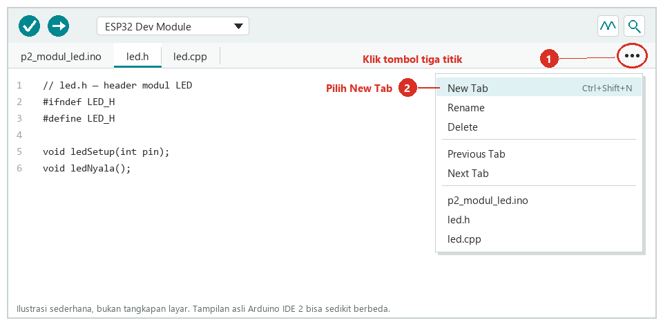
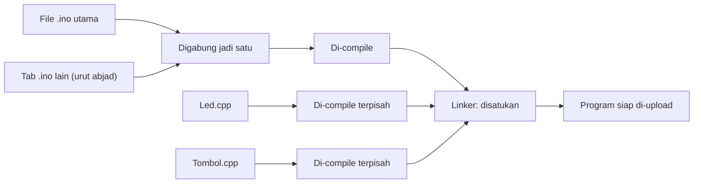
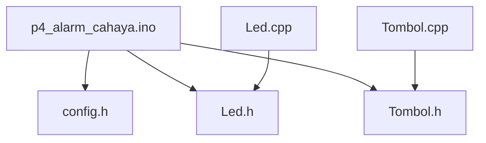

# BAB 19: Kode Terstruktur — Multi-File

> ✅ **Prasyarat:** Selesaikan **BAB 18 (Callback & Event-Driven Programming)** — kamu sudah membuat `struct` berisi fungsi, *callback*, dan `std::function`. Program di BAB ini juga memakai *debounce* ([BAB 9](../BAB-09/README.md)), pola *non-blocking* ([BAB 16](../BAB-16/README.md)), dan *state machine* ([BAB 17](../BAB-17/README.md)).

Program 5 di BAB 18 sudah lebih dari 200 baris, dan mencari satu fungsi di dalamnya mulai merepotkan. Proyek IoT sungguhan bisa mencapai ribuan baris. Solusinya adalah memecah kode menjadi beberapa *file* yang masing-masing punya satu tugas — seperti buku yang dibagi menjadi bab, atau dapur yang perabotnya disimpan di laci-laci berlabel. Di BAB ini kamu belajar membuat tab baru di Arduino IDE 2, memahami peran *file* `.ino`, `.h`, dan `.cpp`, lalu menyusun proyek alarm cahaya yang rapi dengan modul yang bisa dipakai ulang di proyek lain.

## 📌 Tujuan Pembelajaran

Setelah mempelajari BAB ini, kamu bisa:

- Menjelaskan kenapa program yang besar perlu dipecah menjadi beberapa *file*.
- Membuat, mengganti nama, dan menghapus tab (*file*) di Arduino IDE 2, serta membuka *sketch* multi-*file* yang sudah jadi.
- Membedakan peran *file* `.ino`, `.h` (*header*), dan `.cpp` (*source*), serta membedakan deklarasi dan definisi.
- Menjelaskan aturan khusus Arduino: semua tab `.ino` digabung menjadi satu dan *prototype* fungsinya dibuat otomatis.
- Memakai *include guard* atau `#pragma once` supaya sebuah *header* tidak terbaca dua kali.
- Mengatur siapa yang boleh memakai sebuah variabel atau fungsi dengan `static` dan `extern`.
- Membuat `class` sendiri — lengkap dengan `public`, `private`, dan *constructor* — dan menyimpannya di *file* `.h` dan `.cpp` terpisah.
- Menyusun proyek multi-*file* dengan `config.h` sebagai tempat semua pin dan pengaturan.

## 🧰 Yang Perlu Disiapkan

| Kebutuhan | Keterangan |
|---|---|
| *Hardware* | Kit Bluino ESP32 IoT Starter Shield (ESP32 DEVKIT V1 sudah terpasang di kit) + kabel USB **data** |
| Kabel *jumper* | 5 kabel *female-female*: LED merah, LED hijau, *buzzer*, tombol S1, dan LDR — sudah ada di kit |
| Komponen tambahan | Tidak ada |
| *Software* | Arduino IDE **2.x** (langkah membuat tab di BAB ini mengikuti tampilan Arduino IDE 2) + *board package* **esp32** versi 3.3.x (lihat [BAB 5](../BAB-05/README.md)) |
| *Library* | Tidak perlu *library* tambahan |
| Alat uji | **Serial Monitor** Arduino IDE (baud 115200) |
| Jaringan | Tidak perlu WiFi |

## 📑 Daftar Isi

- [19.1 Kenapa Kode Perlu Dipecah?](#191-kenapa-kode-perlu-dipecah)
- [19.2 Mengenal File .ino, .h, dan .cpp](#192-mengenal-file-ino-h-dan-cpp)
- [19.3 Membuat dan Membuka Tab di Arduino IDE 2](#193-membuat-dan-membuka-tab-di-arduino-ide-2)
- [19.4 Aturan Khusus Tab .ino: Digabung Jadi Satu](#194-aturan-khusus-tab-ino-digabung-jadi-satu)
- [19.5 Program 1: Dua Tab .ino](#195-program-1-dua-tab-ino)
- [19.6 Header (.h) dan Source (.cpp)](#196-header-h-dan-source-cpp)
- [19.7 Include Guard dan #pragma once](#197-include-guard-dan-pragma-once)
- [19.8 static dan extern: Siapa Boleh Memakai Variabel Ini?](#198-static-dan-extern-siapa-boleh-memakai-variabel-ini)
- [19.9 Program 2: Modul LED (.h + .cpp)](#199-program-2-modul-led-h--cpp)
- [19.10 Class: Cetakan untuk Membuat Objek](#1910-class-cetakan-untuk-membuat-objek)
- [19.11 Program 3: Class Led untuk Dua LED](#1911-program-3-class-led-untuk-dua-led)
- [19.12 Program 4: Proyek Terstruktur — Alarm Cahaya](#1912-program-4-proyek-terstruktur--alarm-cahaya)
- [19.13 Tips Menyusun Proyek Multi-File](#1913-tips-menyusun-proyek-multi-file)
- [19.14 Troubleshooting](#1914-troubleshooting)
- [📝 Rangkuman](#-rangkuman)
- [💪 Latihan](#-latihan)
- [📚 Referensi](#-referensi)

---

## 19.1 Kenapa Kode Perlu Dipecah?

Semua program sampai BAB 18 ditulis dalam satu *file*. Untuk program kecil, cara itu tidak masalah. Namun, makin banyak fitur, makin panjang *file*-nya:

| | Program kecil (misalnya di BAB 8) | Program besar (BAB 18 ke atas) |
|---|---|---|
| Panjang | ±50 baris | Ratusan baris; proyek IoT bisa ribuan baris |
| Mencari sebuah fungsi | Cukup menggulir layar sebentar | Harus menggulir jauh atau memakai fitur pencarian |
| Tugas di dalamnya | Satu, misalnya LED berkedip | Banyak: tombol, sensor, LED, *buzzer*, WiFi, ... |
| Dipakai di proyek lain | Disalin seluruhnya | Sulit memilah bagian yang dibutuhkan |

Bayangkan dapur yang semua perabotnya ditumpuk di satu meja, dibandingkan dengan dapur yang punya laci berlabel: sendok, pisau, bumbu. Memecah kode sama dengan membuat "laci" untuk setiap tugas. Sepasang *file* yang mengurus satu tugas tertentu (misalnya urusan LED saja) disebut **modul**.

| Aspek | Semua di satu *file* | Dipecah menjadi beberapa *file* |
|---|---|---|
| Mencari kode | Menggulir *file* panjang | Langsung membuka tab yang tepat, misalnya `Tombol.cpp` |
| Pakai ulang | Salin-tempel potongan kode | Salin sepasang *file* modul (`.h` + `.cpp`) ke proyek lain |
| Kerja tim | Sering bentrok di *file* yang sama | Setiap orang bisa mengerjakan *file* yang berbeda |
| Mengubah kode | Perubahan di satu bagian mudah merusak bagian lain | Perubahan cukup di satu modul |

---

## 19.2 Mengenal File .ino, .h, dan .cpp

Sebuah *sketch* Arduino sebenarnya adalah sebuah **folder**. Di dalamnya ada satu *file* `.ino` utama yang namanya **harus sama** dengan nama folder, ditambah *file*-*file* lain kalau perlu:

```text
p2_modul_led/            ← folder sketch
├── p2_modul_led.ino     ← file utama: setup() dan loop() (namanya = nama folder)
├── led.h                ← header modul LED: daftar fungsi yang tersedia
└── led.cpp              ← source modul LED: isi fungsi-fungsinya
```

Tiga jenis *file* yang paling sering dipakai:

| Ekstensi | Nama | Isinya | Analogi di restoran |
|---|---|---|---|
| `.ino` | *File sketch* | Kode Arduino seperti biasa: `setup()`, `loop()`, dan fungsi lain | Ruang pelayan yang mengatur pesanan |
| `.h` | *Header* | **Deklarasi**: daftar fungsi, `class`, konstanta, dan variabel yang disediakan sebuah modul — tanpa isi fungsinya | Buku menu: daftar apa saja yang bisa dipesan |
| `.cpp` | *Source* C++ | **Definisi**: isi lengkap fungsi-fungsi yang dijanjikan di *header* | Dapur yang benar-benar memasak menunya |

### 19.2.1 Deklarasi dan Definisi

Dua istilah ini akan sering muncul di BAB ini. Contoh potongan kode:

```cpp
// DEKLARASI (biasanya di file .h): "fungsi ini ada" —
// hanya nama, parameter, dan tipe nilai kembalinya, diakhiri titik koma
void ledNyala();

// DEFINISI (biasanya di file .cpp): isi lengkap fungsinya
void ledNyala() {
  digitalWrite(4, HIGH);
}
```

Deklarasi ibarat janji, definisi adalah pemenuhan janjinya. Sebuah fungsi boleh dideklarasikan berkali-kali (di setiap *file* yang memakainya), tetapi hanya boleh **didefinisikan satu kali** di seluruh program.

### 19.2.2 Menyambungkan File dengan #include

`#include "led.h"` artinya "salin seluruh isi *file* `led.h` ke tempat ini sebelum di-*compile*". Dengan begitu, *file* yang menulis baris itu tahu fungsi apa saja yang disediakan modul LED. Ada dua bentuk penulisan:

| Penulisan | Dicari di mana | Dipakai untuk |
|---|---|---|
| `#include "led.h"` (tanda kutip) | Folder *sketch* lebih dulu | *File* buatanmu sendiri, misalnya `led.h` dan `config.h` |
| `#include <Arduino.h>` (kurung sudut) | Folder *library* dan *board package* | *Library* bawaan atau yang diinstal, misalnya `Arduino.h`, `WiFi.h`, `functional` |

---

## 19.3 Membuat dan Membuka Tab di Arduino IDE 2

Setiap *file* di dalam folder *sketch* muncul sebagai **tab** di atas editor kode Arduino IDE. Menambah tab berarti menambah *file* baru di folder itu.

### 19.3.1 Simpan Sketch Lebih Dulu

1. Buka Arduino IDE, lalu pilih **File → New Sketch**.
2. Langsung simpan dengan **File → Save As...**. Ketik nama *sketch*, misalnya `p2_modul_led`, lalu klik **Save**. Arduino IDE membuat folder `p2_modul_led` berisi *file* `p2_modul_led.ino` di folder *sketchbook* — biasanya `Documents\Arduino` di Windows, `Documents/Arduino` di macOS, atau `~/Arduino` di Linux.

*Sketch* baru yang belum disimpan masih berada di folder sementara dengan nama otomatis (misalnya `sketch_oct23a`). Menyimpannya lebih dulu memastikan nama folder dan *file* utamanya sudah benar sebelum kamu menambah tab.

> 📌 **Catatan:** Nama *sketch* dan nama *file* harus diawali huruf, angka, atau garis bawah, lalu boleh berisi huruf, angka, garis bawah (`_`), tanda hubung (`-`), dan titik — **tanpa spasi**, maksimal 63 karakter.

### 19.3.2 Menambah Tab Baru

1. Klik tombol **⋯** (tiga titik) di ujung kanan deretan tab, tepat di atas editor kode.
2. Pilih **New Tab**. Cara cepatnya: tekan **Ctrl+Shift+N** (di macOS: **Cmd+Shift+N**).
3. Muncul kotak isian **Name for new file**. Ketik nama *file* **lengkap dengan ekstensinya**, misalnya `led.h`, lalu klik **OK**.
4. Tab `led.h` muncul di samping tab utama. Tulis atau tempel kodenya, lalu simpan dengan **Ctrl+S** (macOS: **Cmd+S**).
5. Ulangi untuk *file* berikutnya, misalnya `led.cpp`.



*Gambar 19.1 — Ilustrasi letak tombol ⋯ dan isi menu tab di Arduino IDE 2 (bukan tangkapan layar; warna dan detail tampilan aslinya bisa sedikit berbeda, tergantung versi dan tema). Sumber: dibuat untuk materi ini berdasarkan kode sumber [Arduino IDE 2](https://github.com/arduino/arduino-ide).*

> ⚠️ **Perhatian:** Kalau kamu hanya mengetik `led` tanpa ekstensi, Arduino IDE otomatis membuat `led.ino`, bukan `led.h`. Hapus tab yang salah itu, lalu buat ulang dengan nama lengkap. Ekstensi yang diterima antara lain `.ino`, `.h`, `.cpp`, dan `.c`.

Menu **⋯** yang sama juga berisi:

| Menu | Gunanya |
|---|---|
| **Rename** | Mengganti nama tab (*file*) yang sedang dibuka |
| **Delete** | Menghapus tab yang sedang dibuka beserta *file*-nya dari folder *sketch* |
| **Previous Tab** / **Next Tab** | Pindah ke tab sebelumnya/berikutnya (Ctrl+Alt+← / Ctrl+Alt+→) |
| Daftar nama *file* | Langsung membuka *file* yang dipilih |

> 💡 **Tips:** Untuk melihat *file*-*file* itu di Windows Explorer (atau Finder di macOS), pilih **Sketch → Show Sketch Folder**.

> 📌 **Catatan:** Di Arduino IDE versi lama (1.8.x), tombol menu tab berupa segitiga kecil **▼** di ujung kanan deretan tab, dengan isi menu dan *shortcut* **Ctrl+Shift+N** yang sama. Materi ini memakai Arduino IDE 2.x seperti di [BAB 5](../BAB-05/README.md).

### 19.3.3 Membuka Sketch Multi-File yang Sudah Jadi

Semua program di BAB ini juga tersedia sebagai folder siap pakai. Cara membukanya:

1. Unduh repositori ini (tombol hijau **Code → Download ZIP** di halaman GitHub), lalu **ekstrak** dulu *file* ZIP-nya. Jangan membuka *sketch* langsung dari dalam ZIP.
2. Di Arduino IDE, pilih **File → Open...**.
3. Masuk ke folder programnya, misalnya `BAB-19/p4_alarm_cahaya/`, pilih *file* `.ino` utamanya (`p4_alarm_cahaya.ino`), lalu klik **Open**.
4. Semua *file* lain di folder itu (`config.h`, `Led.h`, `Led.cpp`, dan seterusnya) otomatis muncul sebagai tab.

> 📌 **Catatan:** Kalau kamu membuka *file* `.ino` yang tidak berada di dalam folder bernama sama, Arduino IDE menawarkan untuk membuat folder itu dan memindahkan *file*-nya. Setujui saja.

### 19.3.4 Memakai Ulang File dari Sketch Lain

Modul yang sudah jadi bisa dipakai di *sketch* lain tanpa mengetik ulang: buka *sketch* tujuan, pilih **Sketch → Add File...**, lalu pilih *file*-nya (misalnya `Led.h` dari folder Program 3). Arduino IDE **menyalin** *file* itu ke folder *sketch* yang sedang dibuka, lalu menampilkannya sebagai tab baru dengan pesan "One file added to the sketch." Karena hasilnya salinan, mengubah *file* di *sketch* baru tidak mengubah *file* aslinya. Ulangi untuk pasangan `.cpp`-nya.

---

## 19.4 Aturan Khusus Tab .ino: Digabung Jadi Satu

Saat kamu mengklik **Verify** atau **Upload**, Arduino IDE tidak langsung meng-*compile* *file*-*file* `.ino`. Ada beberapa langkah persiapan lebih dulu:

1. **Semua tab `.ino` digabung menjadi satu *file*.** *File* utama (yang namanya sama dengan folder) diletakkan paling atas, lalu tab `.ino` lainnya menyusul **sesuai urutan abjad**.
2. **Baris `#include <Arduino.h>` ditambahkan** di paling atas, kalau belum ada.
3. ***Prototype* fungsi dibuat otomatis.** *Prototype* adalah deklarasi singkat sebuah fungsi, misalnya `void kedipBergantian(int kali);`. Arduino IDE membuat *prototype* untuk setiap fungsi di tab `.ino` dan menaruhnya di atas fungsi pertama. Itulah sebabnya, di *file* `.ino`, kamu boleh memanggil fungsi yang baru ditulis di bagian bawah — bahkan di tab lain.
4. **Hasil gabungan di-*compile* sebagai satu *file* C++.** *File* `.cpp` dan `.c` **tidak** ikut digabung: masing-masing di-*compile* terpisah. Terakhir, ***linker*** (program penyambung) menyatukan semua hasilnya menjadi satu program yang siap di-*upload*.



*Gambar 19.2 — Alur compile sketch multi-file: tab .ino digabung lebih dulu, file .cpp di-compile sendiri-sendiri, lalu linker menyatukan semuanya. File .h tidak di-compile sendiri, tetapi ikut dibaca lewat #include. Sumber: dibuat untuk materi ini berdasarkan dokumentasi Arduino CLI.*

Akibatnya bagi kamu:

| Aturan | Akibatnya |
|---|---|
| Tab `.ino` digabung jadi satu | Tab `.ino` tambahan tidak perlu `#include` apa pun. `#define`, variabel global, dan fungsi di *file* utama langsung dikenal di tab lain |
| Urutannya: *file* utama dulu, lalu urut abjad | Variabel global yang ditulis di tab lain **tidak** dikenal oleh fungsi di *file* utama, karena letaknya di bawah. *Error* yang muncul: `'namaVariabel' was not declared in this scope`. Simpan variabel global di *file* utama, paling atas |
| *Prototype* otomatis ditaruh di atas fungsi pertama | Tipe buatan sendiri (`struct`, `enum`, `using`) yang dipakai sebagai parameter fungsi harus ditulis **sebelum** fungsi pertama, seperti catatan di Program 5 [BAB 18](../BAB-18/README.md) |
| *File* `.cpp` di-*compile* sendiri dan tidak dibuatkan *prototype* | Setiap `.cpp` wajib menulis sendiri `#include <Arduino.h>` (langsung atau lewat *header*-nya) dan `#include` setiap *header* yang dipakainya. Fungsi di `.cpp` juga harus dideklarasikan sebelum dipanggil |

> 💡 **Tips:** Tab `.ino` tambahan praktis untuk sekadar membagi *file* yang panjang. Untuk bagian yang ingin dipakai ulang di proyek lain, pakai pasangan *header* dan *source* (`.h` + `.cpp`) yang dibahas mulai [19.6](#196-header-h-dan-source-cpp).

---

## 19.5 Program 1: Dua Tab .ino

**Tujuan:** Membagi program menjadi dua tab `.ino`: tab utama berisi pengaturan, `setup()`, dan `loop()`, sedangkan fungsi-fungsi pola LED dipindah ke tab kedua. Program ini membuktikan aturan penggabungan tab `.ino` di [19.4](#194-aturan-khusus-tab-ino-digabung-jadi-satu).

**Rangkaian:**

| Pin **Custom** di kit | Sambungkan ke pin ESP32 |
|---|---|
| LED1 (LED merah) | IO4 (label `4`, deretan bawah) |
| LED2 (LED hijau) | IO17 (label `17`, deretan bawah) |

**Cara Menjalankan:**

1. Cabut kabel USB, lalu sambungkan kabel *jumper* sesuai tabel **Rangkaian** di atas (cara memasang kabel LED ada di [BAB 8](../BAB-08/README.md)). Sambungkan kembali kabel USB.
2. Di Arduino IDE, pilih **File → New Sketch**, lalu langsung **File → Save As...** dengan nama `p1_dua_tab`.
3. Hapus isi tab `p1_dua_tab.ino`, lalu salin kode *file* utama di bawah ke tab itu.
4. Buat tab kedua: klik **⋯** di ujung kanan deretan tab → **New Tab**, ketik `pola_led.ino`, klik **OK**, lalu salin kode *file* `pola_led.ino` di bawah ke tab baru itu.
5. Simpan dengan **Ctrl+S**. Sebagai alternatif langkah 2–5, buka folder siap pakai [`p1_dua_tab/`](p1_dua_tab/p1_dua_tab.ino) dengan **File → Open...** (lihat [19.3.3](#1933-membuka-sketch-multi-file-yang-sudah-jadi)).
6. Pastikan **Tools → Board** = **ESP32 Dev Module** dan **Tools → Port** = *port* ESP32 kamu (misalnya `COM5` di Windows atau `/dev/ttyUSB0` di Linux).
7. Klik tombol **Upload** (ikon panah →) dan tunggu sampai muncul tulisan **Done uploading**.
8. Buka **Serial Monitor** (**Tools → Serial Monitor**) lalu pilih baud **115200**.

**Kode Program:**

*File* utama, `p1_dua_tab.ino`:

<!-- sketch: p1_dua_tab -->
```cpp
/*
 * BAB 19 - Program 1: Dua Tab .ino
 * File utama hanya berisi pengaturan, setup(), dan loop().
 * Fungsi-fungsi pola LED ada di tab kedua: pola_led.ino.
 *
 * File: p1_dua_tab.ino (utama), pola_led.ino
 * Rangkaian:
 *   LED1 (merah) → IO4
 *   LED2 (hijau) → IO17
 */

// Pin dan variabel global ditulis di file utama, paling atas,
// supaya dikenal juga oleh tab .ino yang lain.
#define LED_MERAH 4
#define LED_HIJAU 17

int putaran = 0;  // berapa kali loop() sudah berjalan

void setup() {
  Serial.begin(115200);
  pinMode(LED_MERAH, OUTPUT);
  pinMode(LED_HIJAU, OUTPUT);
  Serial.println("BAB 19 - Program 1: Dua Tab .ino");
}

void loop() {
  putaran++;
  kedipBergantian(3);  // fungsi ini ditulis di tab pola_led.ino
  nyalaBersama(1000);  // fungsi ini juga ada di tab pola_led.ino
}
```

Tab kedua, `pola_led.ino`:

<!-- sketch: p1_dua_tab/pola_led.ino -->
```cpp
// pola_led.ino — tab kedua: kumpulan pola nyala LED.
// Tidak perlu #include apa pun: Arduino IDE menggabungkan tab ini di bawah
// file utama, jadi LED_MERAH, LED_HIJAU, dan putaran sudah dikenal di sini.

// Mencetak nama pola beserta nomor putarannya
void cetakPola(const char *nama) {
  Serial.print("Putaran ");
  Serial.print(putaran);
  Serial.print(": ");
  Serial.println(nama);
}

// LED merah dan hijau menyala bergantian sebanyak "kali"
void kedipBergantian(int kali) {
  cetakPola("kedip bergantian");
  for (int i = 0; i < kali; i++) {
    digitalWrite(LED_MERAH, HIGH);
    digitalWrite(LED_HIJAU, LOW);
    delay(250);
    digitalWrite(LED_MERAH, LOW);
    digitalWrite(LED_HIJAU, HIGH);
    delay(250);
  }
  digitalWrite(LED_HIJAU, LOW);
}

// Kedua LED menyala bersama selama "lamaMs" milidetik, lalu mati setengah detik
void nyalaBersama(unsigned long lamaMs) {
  cetakPola("nyala bersama");
  digitalWrite(LED_MERAH, HIGH);
  digitalWrite(LED_HIJAU, HIGH);
  delay(lamaMs);
  digitalWrite(LED_MERAH, LOW);
  digitalWrite(LED_HIJAU, LOW);
  delay(500);
}
```

**Penjelasan Kode:**

- *File* utama memanggil `kedipBergantian()` dan `nyalaBersama()`, padahal keduanya ditulis di tab lain dan tidak ada `#include` sama sekali. Ini bisa terjadi karena Arduino IDE menggabungkan kedua tab menjadi satu *file*, lalu membuat *prototype* untuk semua fungsinya.
- Urutan gabungannya: isi `p1_dua_tab.ino` dulu, baru isi `pola_led.ino`. Karena itu `LED_MERAH`, `LED_HIJAU`, dan `putaran` — yang ditulis di *file* utama — sudah dikenal di tab `pola_led.ino`.
- `cetakPola()` hanya dipanggil dari tab `pola_led.ino` sendiri. Fungsi bantu seperti ini cocok disimpan di tab yang sama dengan pemakainya.
- Program ini sengaja memakai `delay()` supaya fokus pada cara kerja tab. Selama `delay()`, ESP32 tidak bisa mengerjakan hal lain; cara tanpa `delay()` dipakai di Program 2–4.

**Contoh Output:**

```text
BAB 19 - Program 1: Dua Tab .ino
Putaran 1: kedip bergantian
Putaran 1: nyala bersama
Putaran 2: kedip bergantian
Putaran 2: nyala bersama
```

Di kit: LED merah dan hijau menyala bergantian 3 kali, lalu keduanya menyala bersama selama 1 detik, mati setengah detik, dan berulang. Satu putaran = 3 × 500 ms + 1000 ms + 500 ms = 3 detik.

> 🧪 **Coba Sendiri:** Pindahkan baris `int putaran = 0;` dari *file* utama ke baris paling atas tab `pola_led.ino`, lalu klik **Verify**. Muncul *error* `'putaran' was not declared in this scope` di `loop()`, karena isi `pola_led.ino` diletakkan **di bawah** *file* utama saat digabung. Kembalikan baris itu ke tempat semula.

**Kalau Belum Berhasil:**

- ***Error* `'kedipBergantian' was not declared in this scope`** → tab kedua belum dibuat, belum disimpan, atau namanya salah (misalnya `pola_led.h`). Pastikan tab bernama persis `pola_led.ino` dan berada di folder *sketch* yang sama.
- ***Error* `redefinition of 'void setup()'`** → kode *file* utama ikut tersalin ke tab kedua. Tab `pola_led.ino` hanya berisi tiga fungsi pola, tanpa `setup()` dan `loop()`.
- **Serial Monitor menampilkan tulisan, tetapi LED tidak menyala** → cek kabel LED1 → `4` dan LED2 → `17` di deretan **bawah**.

---

## 19.6 Header (.h) dan Source (.cpp)

Tab `.ino` tambahan memang praktis, tetapi isinya bergantung pada *file* utama (misalnya `LED_MERAH` harus ada di sana), sehingga sulit dipindah ke proyek lain. Modul yang benar-benar mandiri dibuat dari sepasang *file*: *header* (`.h`) dan *source* (`.cpp`). Contoh potongan kode modul LED sederhana:

```cpp
// ===== led.h — HEADER: daftar menu (deklarasi) =====
#ifndef LED_H      // include guard, dijelaskan di 19.7
#define LED_H

#include <Arduino.h>

void ledSetup(int pin);
void ledNyala();

#endif
```

```cpp
// ===== led.cpp — SOURCE: isi menunya (definisi) =====
#include "led.h"   // source selalu meng-include header miliknya sendiri

static int pinLed = -1;  // "static": hanya dikenal di file ini (dijelaskan di 19.8)

void ledSetup(int pin) {
  pinLed = pin;
  pinMode(pinLed, OUTPUT);
}

void ledNyala() {
  digitalWrite(pinLed, HIGH);
}
```

```cpp
// ===== file .ino — pemakai modul =====
#include "led.h"   // cukup header-nya; led.cpp ikut di-compile otomatis

// di dalam setup():
ledSetup(4);
ledNyala();
```

Aturan yang perlu diingat:

1. ***Header* berisi deklarasi, *source* berisi definisi.** *Header* menjawab "apa saja yang tersedia", *source* menjawab "bagaimana cara kerjanya".
2. ***Source* selalu meng-*include* *header*-nya sendiri** di baris pertama. Dengan begitu *compiler* bisa memeriksa bahwa deklarasi dan definisinya cocok.
3. **Pemakai cukup meng-*include* *header*-nya.** Semua *file* `.cpp` di folder *sketch* otomatis ikut di-*compile*. Jangan pernah menulis `#include "led.cpp"` — isi fungsinya akan terdefinisi dua kali.
4. ***Header* yang memakai fungsi atau tipe Arduino** (`pinMode()`, `uint8_t`, `String`, dan sebagainya) menulis `#include <Arduino.h>` sendiri, karena *file* `.h` dan `.cpp` tidak mendapat tambahan otomatis seperti tab `.ino`.

> 📌 **Catatan:** Huruf besar-kecil nama *file* di `#include` harus sama persis dengan nama tabnya. Di Windows (dan biasanya juga macOS), `#include "Led.h"` untuk *file* `led.h` tetap berhasil, tetapi di Linux gagal dengan pesan `fatal error: Led.h: No such file or directory`. Biasakan menulisnya sama persis supaya kodemu bisa di-*compile* di komputer mana pun.

---

## 19.7 Include Guard dan #pragma once

Sebuah *header* bisa ter-*include* lebih dari sekali di *file* yang sama, sering kali tanpa sengaja. Misalnya *header* `alarm.h` meng-*include* `Led.h`, lalu *file* `.ino` meng-*include* `alarm.h` **dan** `Led.h` — isi `Led.h` jadi terbaca dua kali. Deklarasi fungsi yang terbaca dua kali tidak masalah, tetapi definisi `struct` atau `class` yang terbaca dua kali membuat *compile* gagal dengan pesan seperti ini (untuk *class* bunyinya `redefinition of 'class Led'`):

```text
error: redefinition of 'struct Data'
```

Ada dua cara mencegahnya. Pilih salah satu dan tulis di setiap *header*:

```cpp
// Cara 1: include guard (standar C/C++, berlaku di semua compiler)
#ifndef LED_H   // "kalau LED_H belum pernah didefinisikan..."
#define LED_H   // "...definisikan sekarang, lalu baca isi header di bawah"

// ... isi header ...

#endif          // akhir bagian yang dilindungi
```

```cpp
// Cara 2: #pragma once (lebih singkat; didukung compiler ESP32 dan hampir semua compiler modern)
#pragma once

// ... isi header ...
```

Cara kerja *include guard*: saat pertama kali dibaca, `LED_H` belum ada, jadi isi *header* diproses dan `LED_H` didefinisikan. Saat dibaca kedua kalinya di *file* yang sama, `LED_H` sudah ada, sehingga semua baris sampai `#endif` dilewati. Nama penanda biasanya diambil dari nama *file* dengan huruf kapital dan titik diganti garis bawah: `led.h` → `LED_H`, `config.h` → `CONFIG_H`.

> ⚠️ **Perhatian:** Nama penanda *include guard* harus berbeda untuk setiap *header*. Kalau kamu menyalin `led.h` menjadi `buzzer.h` tetapi lupa mengganti `LED_H`, isi `buzzer.h` akan dilewati diam-diam dan muncul *error* aneh seperti `'buzzerSetup' was not declared in this scope`.

BAB ini memakai `#ifndef` di Program 2 supaya cara kerjanya terlihat, lalu `#pragma once` yang lebih ringkas di Program 3 dan 4.

> 📌 **Catatan:** *Include guard* hanya mencegah *header* terbaca dua kali di **satu** *file* yang sedang di-*compile*. *Include guard* tidak mencegah *error* `multiple definition` yang melibatkan beberapa *file* `.cpp` — itu dibahas di subbab berikut.

---

## 19.8 static dan extern: Siapa Boleh Memakai Variabel Ini?

Variabel global yang ditulis di sebuah *file* `.cpp` bisa dipakai oleh *file* lain atau tidak, tergantung cara menulisnya. Bayangkan perbedaan antara catatan pribadi di laci mejamu dan papan pengumuman kantor:

| Cara menulis di *file* `.cpp` | Bisa dipakai *file* lain? | Analogi | Kapan dipakai |
|---|---|---|---|
| `static int hitung = 0;` | Tidak — hanya di *file* itu | Catatan pribadi di laci meja | Data internal modul. Pilihan paling aman untuk kebanyakan variabel modul |
| `int hitung = 0;` | Ya, asalkan *file* lain menulis `extern int hitung;` | Papan pengumuman kantor | Data yang memang perlu dibagi ke *file* lain |
| `static void bantu() { ... }` | Tidak | Alat kerja pribadi | Fungsi bantu yang hanya dipakai di dalam modul itu |

`extern` adalah **deklarasi** variabel: "variabel ini ada, tetapi dibuat di *file* lain" — seperti papan petunjuk "papan pengumuman ada di lantai 2". `extern` tidak membuat variabel baru. Pola yang benar (potongan kode):

```cpp
// led.h — DEKLARASI: aman di-include oleh banyak file
extern unsigned long jumlahGantiLed;

// led.cpp — DEFINISI: ditulis tepat SATU kali di seluruh program
unsigned long jumlahGantiLed = 0;
```

Dua kesalahan yang paling sering terjadi:

| Kesalahan | Pesan *error* (muncul saat tahap *linker*) | Perbaikan |
|---|---|---|
| Menulis definisi seperti `int angka = 5;` di *header* yang di-*include* oleh dua *file* atau lebih | `multiple definition of 'angka'` | Di *header* tulis `extern int angka;`, lalu definisikan di satu *file* `.cpp` saja |
| Mendeklarasikan fungsi atau variabel tetapi tidak pernah mendefinisikannya, misalnya *file* `.cpp`-nya lupa dibuat | `undefined reference to ...` | Tulis definisinya di *file* `.cpp`, dan pastikan *file* itu ada di folder *sketch* |

Pada *error* `undefined reference` untuk fungsi, namanya sering tampil "teracak", misalnya `_Z12fungsiHilangv`. Itu karena C++ menambahkan kode jenis parameter ke nama fungsi (*name mangling*). Cari nama fungsimu di dalamnya — di contoh itu `fungsiHilang`.

> 💡 **Tips:** Konstanta tidak perlu `extern`. `const int PIN_LED = 4;` dan `#define` aman ditulis di *header* walaupun di-*include* oleh banyak *file*, karena setiap *file* mendapat salinannya sendiri (konstanta `const` di luar fungsi otomatis bersifat "pribadi" per *file* di C++). Karena itu `config.h` di Program 4 boleh langsung berisi konstanta `const int`.

> 📌 **Catatan:** Kata `static` di **dalam** fungsi artinya lain lagi: variabelnya tidak hilang saat fungsi selesai, sehingga nilainya tetap tersimpan sampai fungsi itu dipanggil berikutnya. Contoh: `static int hitungan = 0;` di dalam sebuah fungsi hanya bernilai 0 saat pertama kali.

---

## 19.9 Program 2: Modul LED (.h + .cpp)

**Tujuan:** Memindahkan semua urusan LED ke sebuah modul terpisah, `led.h` dan `led.cpp`. Modul ini memakai variabel `static` untuk data internalnya dan berbagi satu variabel penghitung ke *file* utama lewat `extern`. LED merah berkedip tanpa `delay()`, dan setiap perubahannya dilaporkan ke Serial Monitor.

**Rangkaian:**

| Pin **Custom** di kit | Sambungkan ke pin ESP32 |
|---|---|
| LED1 (LED merah) | IO4 (label `4`, deretan bawah) |

**Cara Menjalankan:**

1. Pastikan kabel LED1 (merah) → **4** terpasang.
2. Buat *sketch* baru: **File → New Sketch**, lalu **File → Save As...** dengan nama `p2_modul_led`.
3. Buat dua tab baru lewat **⋯ → New Tab**: `led.h` dan `led.cpp` (ketik lengkap dengan ekstensinya).
4. Salin kode ketiga *file* di bawah ke tab yang sesuai, lalu simpan dengan **Ctrl+S**. Atau buka folder siap pakai [`p2_modul_led/`](p2_modul_led/p2_modul_led.ino) dengan **File → Open...**.
5. Pastikan **Tools → Board** = **ESP32 Dev Module** dan **Tools → Port** = *port* ESP32 kamu.
6. Klik tombol **Upload** dan tunggu sampai muncul tulisan **Done uploading**.
7. Buka **Serial Monitor** (**Tools → Serial Monitor**) lalu pilih baud **115200**.

**Kode Program:**

*Header* modul, `led.h`:

<!-- sketch: p2_modul_led/led.h -->
```cpp
// led.h — HEADER modul LED: daftar fungsi dan variabel yang boleh dipakai file lain.
// Isinya hanya DEKLARASI (janji); isi fungsinya ada di led.cpp.

#ifndef LED_H  // include guard: kalau LED_H belum didefinisikan...
#define LED_H  // ...definisikan sekarang, lalu baca isi di bawah ini

#include <Arduino.h>

void ledSetup(int pin);                 // siapkan pin LED (panggil di setup())
void ledNyala();
void ledMati();
void ledToggle();                       // balik keadaan LED
void ledKedip(unsigned long interval);  // kedip non-blocking, panggil terus di loop()
bool ledSedangNyala();

// Variabel yang dibagi ke file lain: di sini hanya DIDEKLARASIKAN (extern),
// variabelnya sendiri dibuat di led.cpp.
extern unsigned long jumlahGantiLed;

#endif  // akhir bagian yang dilindungi include guard
```

*Source* modul, `led.cpp`:

<!-- sketch: p2_modul_led/led.cpp -->
```cpp
// led.cpp — SOURCE modul LED: isi (definisi) semua fungsi yang dijanjikan di led.h.

#include "led.h"  // selalu include header milik sendiri

// Variabel "static": hanya bisa dipakai di dalam file led.cpp ini,
// jadi file lain tidak bisa mengubahnya secara tidak sengaja.
static int pinLed = -1;  // -1 artinya ledSetup() belum dipanggil
static bool nyala = false;
static unsigned long waktuKedip = 0;

// Variabel global biasa (tanpa static): DEFINISI dari "extern" di led.h.
// Hanya boleh ditulis di SATU file .cpp.
unsigned long jumlahGantiLed = 0;

// Fungsi "static": fungsi bantu yang hanya dipakai di file ini
static void aturLed(bool keadaanBaru) {
  if (pinLed < 0) return;            // belum di-setup: abaikan
  if (keadaanBaru == nyala) return;  // tidak ada perubahan
  nyala = keadaanBaru;
  digitalWrite(pinLed, nyala ? HIGH : LOW);
  jumlahGantiLed++;
}

void ledSetup(int pin) {
  pinLed = pin;
  pinMode(pinLed, OUTPUT);
  nyala = false;
  digitalWrite(pinLed, LOW);
}

void ledNyala() {
  aturLed(true);
}

void ledMati() {
  aturLed(false);
}

void ledToggle() {
  aturLed(!nyala);
}

void ledKedip(unsigned long interval) {
  if (millis() - waktuKedip >= interval) {
    waktuKedip = millis();
    ledToggle();
  }
}

bool ledSedangNyala() {
  return nyala;
}
```

*File* utama, `p2_modul_led.ino`:

<!-- sketch: p2_modul_led -->
```cpp
/*
 * BAB 19 - Program 2: Modul LED (.h + .cpp)
 * Semua urusan LED dipindahkan ke modul terpisah: led.h dan led.cpp.
 * File utama cukup #include "led.h" lalu memanggil fungsinya.
 *
 * File: p2_modul_led.ino (utama), led.h, led.cpp
 * Rangkaian: LED1 (merah) → IO4
 */

#include "led.h"  // tanda kutip: cari di folder sketch ini

#define LED_MERAH 4

bool keadaanTerakhir = false;  // untuk mendeteksi perubahan keadaan LED

void setup() {
  Serial.begin(115200);
  ledSetup(LED_MERAH);
  Serial.println("BAB 19 - Program 2: Modul LED (.h + .cpp)");
}

void loop() {
  ledKedip(500);  // dari led.cpp: LED berganti keadaan setiap 500 ms tanpa delay()

  // Laporkan setiap kali keadaan LED berubah
  if (ledSedangNyala() != keadaanTerakhir) {
    keadaanTerakhir = ledSedangNyala();
    Serial.print("LED ");
    Serial.print(keadaanTerakhir ? "NYALA" : "MATI");
    Serial.print(" | ganti ke-");
    Serial.println(jumlahGantiLed);  // milik led.cpp, dikenal lewat extern di led.h
  }
}
```

**Penjelasan Kode:**

- `led.h` hanya berisi deklarasi: enam fungsi dan satu variabel `extern`. Siapa pun yang meng-*include* `led.h` tahu apa saja yang bisa dipakai, tanpa perlu tahu cara kerjanya.
- `led.cpp` berisi definisinya. Variabel `pinLed`, `nyala`, dan `waktuKedip` diberi `static`, jadi hanya fungsi-fungsi di `led.cpp` yang bisa mengubahnya. *File* utama hanya bisa mengubah LED lewat fungsi resmi seperti `ledToggle()`.
- `aturLed()` juga `static`: fungsi bantu internal yang tidak dijanjikan di *header* dan tidak bisa dipanggil dari *file* lain.
- `jumlahGantiLed` didefinisikan (dibuat) satu kali di `led.cpp` dan dideklarasikan dengan `extern` di `led.h`. Karena itu *file* utama bisa membacanya.
- *File* utama tidak tahu-menahu soal `millis()` atau `digitalWrite()` untuk LED. Ia cukup memanggil `ledKedip(500)` di setiap putaran `loop()` dan memeriksa `ledSedangNyala()` untuk melaporkan perubahan.

**Contoh Output:**

```text
BAB 19 - Program 2: Modul LED (.h + .cpp)
LED NYALA | ganti ke-1
LED MATI | ganti ke-2
LED NYALA | ganti ke-3
LED MATI | ganti ke-4
```

Di kit: LED merah berkedip — setengah detik menyala, setengah detik mati — dan setiap perubahan memunculkan satu baris baru di Serial Monitor.

> 🧪 **Coba Sendiri:** Tambahkan baris `extern int pinLed;` di atas `setup()` di *file* utama, lalu `Serial.println(pinLed);` di dalam `setup()`, dan klik **Verify**. *Compile* gagal dengan *error* `undefined reference to` yang menyebut `pinLed`, karena `pinLed` bersifat `static` — tersembunyi di dalam `led.cpp`. Hapus lagi kedua baris itu.

**Kalau Belum Berhasil:**

- ***Error* `led.h: No such file or directory`** → tab `led.h` belum dibuat, belum disimpan, atau namanya berbeda (misalnya `Led.h` atau `led.h.ino`). Nama di tab harus sama persis dengan yang ditulis di `#include`.
- ***Error* `undefined reference to` yang menyebut nama fungsi LED (misalnya `_Z8ledSetupi`)** → tab `led.cpp` belum dibuat, kosong, atau tersimpan dengan nama lain. Pastikan tab bernama persis `led.cpp`.
- ***Error* `multiple definition of 'jumlahGantiLed'`** → baris `unsigned long jumlahGantiLed = 0;` ikut tertulis di `led.h`. Di *header* cukup `extern unsigned long jumlahGantiLed;`.
- **Tulisan muncul, tetapi LED tidak menyala** → cek kabel LED1 → `4`.

---

## 19.10 Class: Cetakan untuk Membuat Objek

Modul LED di Program 2 menyimpan pin dan keadaan LED di variabel `static`, jadi satu modul hanya bisa mengurus **satu** LED. Untuk dua LED, kamu terpaksa menyalin modulnya (`led1.cpp`, `led2.cpp`, ...) — jelas tidak praktis. Solusinya adalah ***class***.

*Class* adalah **cetakan**, sedangkan **objek** adalah benda yang dibuat dari cetakan itu. Ibaratnya cetakan kue: satu cetakan bisa menghasilkan banyak kue, dan setiap kue boleh punya hiasan sendiri. Dari satu *class* `Led` kamu bisa membuat objek `ledMerah` dan `ledHijau`, masing-masing dengan pin dan keadaannya sendiri.

Kamu sebenarnya sudah mengenal bentuk ini: `struct` berisi fungsi di [BAB 16](../BAB-16/README.md) dan [BAB 18](../BAB-18/README.md). Di C++, `class` dan `struct` hampir sama. Bedanya hanya satu: anggota `struct` bersifat `public` (boleh diakses dari luar) secara bawaan, sedangkan anggota `class` bersifat `private`. Kebiasaannya, `class` dipakai untuk objek yang datanya dilindungi dan hanya boleh diubah lewat fungsinya.

Contoh potongan kode — deklarasi *class* di *file* `.h`:

```cpp
class Led {
public:          // bagian luar: boleh dipakai dari file mana pun
  Led(int pin);  // constructor: dijalankan otomatis saat objek dibuat
  void begin();
  void toggle();

private:         // bagian dalam: hanya boleh dipakai oleh fungsi milik class Led
  int _pin;
  bool _nyala = false;
};
```

Definisi fungsinya di *file* `.cpp` diawali nama *class* dan tanda `::`:

```cpp
Led::Led(int pin) {  // "Led::" artinya fungsi ini milik class Led
  _pin = pin;
}

void Led::toggle() {
  _nyala = !_nyala;
  digitalWrite(_pin, _nyala ? HIGH : LOW);
}
```

Cara memakainya:

```cpp
Led ledMerah(4);    // objek pertama: constructor dipanggil dengan pin 4
Led ledHijau(17);   // objek kedua: datanya sendiri, pin 17

// di dalam loop() atau fungsi lain:
ledMerah.toggle();  // hanya LED merah yang berubah
```

| Istilah | Artinya |
|---|---|
| *Class* | Cetakan: rancangan data dan fungsi, misalnya `Led` |
| Objek | Benda yang dibuat dari cetakan, misalnya `ledMerah` |
| `public:` | Bagian yang boleh dipakai dari luar *class* — semacam "tombol-tombol" yang disediakan |
| `private:` | Bagian dalam; dari luar hanya bisa diubah lewat fungsi `public` |
| *Constructor* | Fungsi bernama sama dengan *class*, tanpa tipe nilai kembali; dijalankan otomatis saat objek dibuat |
| `Led::` | Penanda bahwa fungsi yang didefinisikan di `.cpp` adalah milik *class* `Led` |

Beberapa kebiasaan yang dipakai di BAB ini:

- Nama anggota `private` diawali garis bawah, misalnya `_pin`. Ini hanya kebiasaan penamaan supaya mudah dibedakan dari parameter, bukan aturan C++.
- *Constructor* hanya **menyimpan** nomor pin. `pinMode()` baru dipanggil di fungsi `begin()` dari dalam `setup()`, karena objek global dibuat **sebelum** `setup()` berjalan, saat sistem ESP32 belum sepenuhnya siap. Pola ini sama dengan `Serial.begin()` yang sudah sering kamu pakai.
- Nama *file* sama dengan nama *class*-nya: *class* `Led` disimpan di `Led.h` dan `Led.cpp`.

---

## 19.11 Program 3: Class Led untuk Dua LED

**Tujuan:** Membuat *class* `Led` di *file* `Led.h` dan `Led.cpp`, lalu memakai satu *class* itu untuk dua objek: LED merah berkedip cepat (200 ms) dan LED hijau berkedip lambat (1000 ms). Setiap perubahan LED hijau dilaporkan ke Serial Monitor.

**Rangkaian:**

| Pin **Custom** di kit | Sambungkan ke pin ESP32 |
|---|---|
| LED1 (LED merah) | IO4 (label `4`, deretan bawah) |
| LED2 (LED hijau) | IO17 (label `17`, deretan bawah) |

**Cara Menjalankan:**

1. Pastikan kabel LED1 (merah) → **4** dan LED2 (hijau) → **17** terpasang.
2. Buat *sketch* baru dengan nama `p3_kelas_led` (**File → New Sketch**, lalu **File → Save As...**).
3. Buat dua tab baru lewat **⋯ → New Tab**: `Led.h` dan `Led.cpp` — perhatikan huruf `L` kapital.
4. Salin kode ketiga *file* di bawah ke tab yang sesuai, lalu simpan dengan **Ctrl+S**. Atau buka folder siap pakai [`p3_kelas_led/`](p3_kelas_led/p3_kelas_led.ino) dengan **File → Open...**.
5. Pastikan **Tools → Board** = **ESP32 Dev Module** dan **Tools → Port** = *port* ESP32 kamu.
6. Klik tombol **Upload** dan tunggu sampai muncul tulisan **Done uploading**.
7. Buka **Serial Monitor** (**Tools → Serial Monitor**) lalu pilih baud **115200**.

**Kode Program:**

*Header* *class*, `Led.h`:

<!-- sketch: p3_kelas_led/Led.h -->
```cpp
// Led.h — deklarasi class Led: satu objek = satu LED (atau output aktif-HIGH lain)
#pragma once  // cegah header ini terbaca dua kali (lihat 19.7)

#include <Arduino.h>

class Led {
public:                                // boleh dipakai dari luar class
  Led(int pin);                        // constructor: dijalankan saat objek dibuat
  void begin();                        // siapkan pin (panggil di setup())
  void nyala();
  void mati();
  void toggle();                       // balik keadaan
  void kedip(unsigned long interval);  // kedip non-blocking, panggil terus di loop()
  bool sedangNyala();

private:                               // hanya untuk fungsi milik class Led
  int _pin;
  bool _nyala = false;
  unsigned long _waktuKedip = 0;
  void tulisKePin();                   // fungsi bantu internal
};
```

*Source* *class*, `Led.cpp`:

<!-- sketch: p3_kelas_led/Led.cpp -->
```cpp
// Led.cpp — definisi fungsi-fungsi class Led
#include "Led.h"

// "Led::" artinya fungsi ini milik class Led
Led::Led(int pin) {
  _pin = pin;  // hanya menyimpan nomor pin; pinMode() baru dipanggil di begin()
}

void Led::begin() {
  pinMode(_pin, OUTPUT);
  tulisKePin();
}

void Led::nyala() {
  _nyala = true;
  tulisKePin();
}

void Led::mati() {
  _nyala = false;
  tulisKePin();
}

void Led::toggle() {
  _nyala = !_nyala;
  tulisKePin();
}

void Led::kedip(unsigned long interval) {
  if (millis() - _waktuKedip >= interval) {
    _waktuKedip = millis();
    toggle();
  }
}

bool Led::sedangNyala() {
  return _nyala;
}

void Led::tulisKePin() {
  digitalWrite(_pin, _nyala ? HIGH : LOW);
}
```

*File* utama, `p3_kelas_led.ino`:

<!-- sketch: p3_kelas_led -->
```cpp
/*
 * BAB 19 - Program 3: Class Led untuk Dua LED
 * Satu class Led, dua objek: LED merah berkedip cepat, LED hijau lambat.
 *
 * File: p3_kelas_led.ino (utama), Led.h, Led.cpp
 * Rangkaian:
 *   LED1 (merah) → IO4
 *   LED2 (hijau) → IO17
 */

#include "Led.h"

#define LED_MERAH 4
#define LED_HIJAU 17

Led ledMerah(LED_MERAH);  // objek pertama dari class Led
Led ledHijau(LED_HIJAU);  // objek kedua: class sama, pin dan datanya sendiri

bool hijauTerakhir = false;  // untuk mendeteksi perubahan LED hijau

void setup() {
  Serial.begin(115200);
  ledMerah.begin();
  ledHijau.begin();
  Serial.println("BAB 19 - Program 3: Class Led untuk Dua LED");
  Serial.println("Merah berkedip setiap 200 ms, hijau setiap 1000 ms");
}

void loop() {
  ledMerah.kedip(200);
  ledHijau.kedip(1000);

  // Laporkan setiap kali LED hijau berubah
  if (ledHijau.sedangNyala() != hijauTerakhir) {
    hijauTerakhir = ledHijau.sedangNyala();
    Serial.println(hijauTerakhir ? "LED hijau: NYALA" : "LED hijau: MATI");
  }
}
```

**Penjelasan Kode:**

- `Led.h` mendeklarasikan *class* `Led`: tujuh fungsi `public` yang boleh dipanggil dari luar, serta data `private` (`_pin`, `_nyala`, `_waktuKedip`) dan satu fungsi bantu `private` (`tulisKePin()`).
- `Led.cpp` berisi definisi semua fungsi itu, masing-masing diawali `Led::`. Isinya mirip modul Program 2, tetapi datanya kini milik **setiap objek**, bukan variabel `static` milik *file*.
- `Led ledMerah(LED_MERAH);` membuat objek dan memanggil *constructor* dengan pin 4. `ledHijau` dibuat dengan cara yang sama, tetapi dengan pin 17. Keduanya punya `_nyala` dan `_waktuKedip` masing-masing, sehingga bisa berkedip dengan kecepatan berbeda.
- `ledMerah.kedip(200)` artinya "panggil fungsi `kedip()` milik objek `ledMerah`". Tanda titik dipakai untuk memanggil fungsi milik sebuah objek, sama seperti `Serial.println()`.

**Contoh Output:**

```text
BAB 19 - Program 3: Class Led untuk Dua LED
Merah berkedip setiap 200 ms, hijau setiap 1000 ms
LED hijau: NYALA
LED hijau: MATI
LED hijau: NYALA
```

Di kit: LED merah berkedip cepat (5 kali nyala per 2 detik), sedangkan LED hijau berganti keadaan setiap 1 detik. Satu baris baru muncul di Serial Monitor setiap kali LED hijau berubah.

> 🧪 **Coba Sendiri:** Tambahkan LED ketiga **tanpa mengubah** `Led.h` dan `Led.cpp`: pasang kabel LED3 (biru) → **2**, tulis `Led ledBiru(2);` di bawah `ledHijau`, panggil `ledBiru.begin();` di `setup()` dan `ledBiru.kedip(500);` di `loop()`. Lalu coba tulis `ledMerah._nyala = true;` di `loop()` dan klik **Verify** — *compiler* menolaknya dengan pesan `'bool Led::_nyala' is private within this context`, karena `_nyala` ada di bagian `private`.

**Kalau Belum Berhasil:**

- ***Error* `Led.h: No such file or directory`** → tab belum dibuat atau namanya berbeda, misalnya `led.h` (huruf kecil). Samakan nama tab dengan tulisan di `#include "Led.h"`.
- ***Error* `'Led' does not name a type`** → baris `#include "Led.h"` terhapus dari *file* utama, atau tab `Led.h` kosong.
- ***Error* `undefined reference to` yang menyebut `Led::`** → tab `Led.cpp` belum dibuat, kosong, atau salah nama.
- **LED hijau berkedip, tetapi LED merah tidak** → cek kabel LED1 → `4`. Kalau sebaliknya, cek LED2 → `17`.

---

## 19.12 Program 4: Proyek Terstruktur — Alarm Cahaya

**Tujuan:** Menggabungkan semua materi BAB ini menjadi satu proyek multi-*file* yang rapi. Tekan S1 untuk menyiagakan alarm (LED hijau menyala). Saat siaga, kalau cahaya ke LDR terhalang — misalnya ditutup telapak tangan atau terkena bayangan orang yang lewat — alarm berbunyi: LED merah berkedip dan *buzzer* berbunyi sampai S1 ditekan lagi.

Struktur foldernya:

```text
p4_alarm_cahaya/
├── p4_alarm_cahaya.ino   ← file utama: state machine alarm
├── config.h              ← semua pin dan pengaturan proyek
├── Led.h                 ← class Led (sama persis dengan Program 3)
├── Led.cpp
├── Tombol.h              ← class Tombol: debounce + callback (dari BAB 18)
└── Tombol.cpp
```

Hubungan antar-*file*-nya (panah berarti "meng-*include*"):



*Gambar 19.3 — Hubungan #include pada Program 4. Modul Led dan Tombol tidak meng-include config.h, sehingga bisa dipakai ulang di proyek lain tanpa perubahan. Sumber: dibuat untuk materi ini.*

**Rangkaian:**

| Pin **Custom** di kit | Sambungkan ke pin ESP32 |
|---|---|
| LED1 (LED merah) | IO4 (label `4`, deretan bawah) |
| LED2 (LED hijau) | IO17 (label `17`, deretan bawah) |
| BUZZ (*buzzer* aktif) | IO13 (label `13`, deretan atas) |
| Tombol S1 (`SW1`, pin kuning ke-3) | IO15 (label `15`, deretan bawah) |
| LDR (`LDR`, pin kuning ke-1) | IO35 (label `35`, deretan atas) |

**Cara Menjalankan:**

1. Cabut kabel USB, lalu sambungkan kelima kabel *jumper* sesuai tabel **Rangkaian** di atas. Sambungkan kembali kabel USB.
2. Cara paling mudah: buka folder siap pakai [`p4_alarm_cahaya/`](p4_alarm_cahaya/p4_alarm_cahaya.ino) dengan **File → Open...** — keenam *file* langsung muncul sebagai tab.
3. Kalau ingin menyusunnya sendiri: buat *sketch* `p4_alarm_cahaya`, lalu buat tab `config.h`, `Tombol.h`, dan `Tombol.cpp` lewat **⋯ → New Tab**. Untuk `Led.h` dan `Led.cpp`, pakai **Sketch → Add File...** dan ambil kedua *file* itu dari folder Program 3 (lihat [19.3.4](#1934-memakai-ulang-file-dari-sketch-lain)). Salin kode setiap *file* di bawah ke tab yang sesuai, lalu simpan.
4. Pastikan **Tools → Board** = **ESP32 Dev Module** dan **Tools → Port** = *port* ESP32 kamu.
5. Klik tombol **Upload** dan tunggu sampai muncul tulisan **Done uploading**.
6. Buka **Serial Monitor** (**Tools → Serial Monitor**) lalu pilih baud **115200**.
7. Tekan S1 (LED hijau menyala), lalu tutup LDR dengan telapak tangan. Tekan S1 lagi untuk mematikan alarm.

**Kode Program:**

*File* `config.h` — semua pin dan pengaturan:

<!-- sketch: p4_alarm_cahaya/config.h -->
```cpp
// config.h — semua pengaturan proyek di satu tempat.
// Mau pindah pin atau mengubah kepekaan alarm? Cukup ubah file ini.
#pragma once

// ---------- Pin (Peta Pin Standar kit Bluino) ----------
const int PIN_LED_MERAH = 4;   // LED1 (merah)
const int PIN_LED_HIJAU = 17;  // LED2 (hijau)
const int PIN_BUZZER = 13;     // BUZZ (buzzer aktif)
const int PIN_TOMBOL = 15;     // SW1 (tombol S1), ditekan = HIGH
const int PIN_LDR = 35;        // LDR: makin gelap, nilai ADC makin besar

// ---------- Pengaturan alarm ----------
const int AMBANG_GELAP = 3000;               // nilai LDR di atas ini = cahaya terhalang
const unsigned long JEDA_BACA_LDR = 100;     // ms, seberapa sering LDR dibaca
const unsigned long JEDA_KEDIP_ALARM = 150;  // ms, kecepatan kedip LED dan bunyi alarm
const unsigned long WAKTU_DEBOUNCE = 50;     // ms, debounce tombol
```

*File* `Led.h` dan `Led.cpp` — sama persis dengan Program 3:

<!-- sketch: p4_alarm_cahaya/Led.h -->
```cpp
// Led.h — deklarasi class Led: satu objek = satu LED (atau output aktif-HIGH lain)
#pragma once  // cegah header ini terbaca dua kali (lihat 19.7)

#include <Arduino.h>

class Led {
public:                                // boleh dipakai dari luar class
  Led(int pin);                        // constructor: dijalankan saat objek dibuat
  void begin();                        // siapkan pin (panggil di setup())
  void nyala();
  void mati();
  void toggle();                       // balik keadaan
  void kedip(unsigned long interval);  // kedip non-blocking, panggil terus di loop()
  bool sedangNyala();

private:                               // hanya untuk fungsi milik class Led
  int _pin;
  bool _nyala = false;
  unsigned long _waktuKedip = 0;
  void tulisKePin();                   // fungsi bantu internal
};
```

<!-- sketch: p4_alarm_cahaya/Led.cpp -->
```cpp
// Led.cpp — definisi fungsi-fungsi class Led
#include "Led.h"

// "Led::" artinya fungsi ini milik class Led
Led::Led(int pin) {
  _pin = pin;  // hanya menyimpan nomor pin; pinMode() baru dipanggil di begin()
}

void Led::begin() {
  pinMode(_pin, OUTPUT);
  tulisKePin();
}

void Led::nyala() {
  _nyala = true;
  tulisKePin();
}

void Led::mati() {
  _nyala = false;
  tulisKePin();
}

void Led::toggle() {
  _nyala = !_nyala;
  tulisKePin();
}

void Led::kedip(unsigned long interval) {
  if (millis() - _waktuKedip >= interval) {
    _waktuKedip = millis();
    toggle();
  }
}

bool Led::sedangNyala() {
  return _nyala;
}

void Led::tulisKePin() {
  digitalWrite(_pin, _nyala ? HIGH : LOW);
}
```

*File* `Tombol.h` — *class* tombol dengan *debounce* dan *callback*:

<!-- sketch: p4_alarm_cahaya/Tombol.h -->
```cpp
// Tombol.h — deklarasi class Tombol: debounce + callback saat ditekan (lihat BAB 18)
#pragma once

#include <Arduino.h>
#include <functional>

class Tombol {
public:
  using Callback = std::function<void()>;  // bentuk fungsi callback

  Tombol(int pin, unsigned long waktuDebounce);
  void begin();                       // siapkan pin (panggil di setup())
  void update();                      // panggil terus di loop()
  void saatDitekan(Callback fungsi);  // daftarkan callback

private:
  int _pin;
  unsigned long _waktuDebounce;
  Callback _callbackDitekan;          // kosong sampai didaftarkan
  int _bacaanSebelumnya = LOW;
  int _statusStabil = LOW;
  unsigned long _waktuBerubah = 0;
};
```

*File* `Tombol.cpp`:

<!-- sketch: p4_alarm_cahaya/Tombol.cpp -->
```cpp
// Tombol.cpp — definisi fungsi-fungsi class Tombol
#include "Tombol.h"

Tombol::Tombol(int pin, unsigned long waktuDebounce) {
  _pin = pin;
  _waktuDebounce = waktuDebounce;
}

void Tombol::begin() {
  pinMode(_pin, INPUT);  // tombol kit: pull-down 10 kΩ di PCB, ditekan = HIGH
}

void Tombol::saatDitekan(Callback fungsi) {
  _callbackDitekan = fungsi;
}

void Tombol::update() {
  int bacaan = digitalRead(_pin);
  if (bacaan != _bacaanSebelumnya) {  // bacaan mentah berubah: ulang "stopwatch"
    _waktuBerubah = millis();
    _bacaanSebelumnya = bacaan;
  }
  if (millis() - _waktuBerubah > _waktuDebounce && bacaan != _statusStabil) {
    _statusStabil = bacaan;  // perubahan sudah stabil: anggap sungguhan
    if (_statusStabil == HIGH && _callbackDitekan) {
      _callbackDitekan();    // panggil callback yang didaftarkan
    }
  }
}
```

*File* utama, `p4_alarm_cahaya.ino`:

<!-- sketch: p4_alarm_cahaya -->
```cpp
/*
 * BAB 19 - Program 4: Proyek Terstruktur — Alarm Cahaya
 * Tekan S1 untuk menyiagakan alarm (LED hijau menyala). Saat siaga,
 * kalau cahaya ke LDR terhalang (misalnya ditutup telapak tangan),
 * alarm berbunyi sampai S1 ditekan lagi.
 *
 * File: p4_alarm_cahaya.ino (utama), config.h, Led.h, Led.cpp, Tombol.h, Tombol.cpp
 * Rangkaian (nomor pin ada di config.h):
 *   LED1 (merah)          → IO4
 *   LED2 (hijau)          → IO17
 *   BUZZ (buzzer aktif)   → IO13
 *   Tombol S1 (SW1)       → IO15
 *   LDR                   → IO35
 */

#include "config.h"
#include "Led.h"
#include "Tombol.h"

// Keadaan alarm (state machine seperti di BAB 17)
enum KeadaanAlarm {
  ALARM_MATI,
  ALARM_SIAGA,
  ALARM_BERBUNYI
};

KeadaanAlarm keadaan = ALARM_MATI;

Led ledMerah(PIN_LED_MERAH);
Led ledHijau(PIN_LED_HIJAU);
Led buzzer(PIN_BUZZER);  // buzzer aktif dikendalikan persis seperti LED (BAB 8)
Tombol tombolS1(PIN_TOMBOL, WAKTU_DEBOUNCE);

unsigned long waktuBacaLdr = 0;

// Pindah ke keadaan baru: matikan semua output, lalu atur sesuai keadaannya
void gantiKeadaan(KeadaanAlarm baru) {
  keadaan = baru;
  ledMerah.mati();
  ledHijau.mati();
  buzzer.mati();

  switch (keadaan) {
    case ALARM_MATI:
      Serial.println("Alarm MATI");
      break;
    case ALARM_SIAGA:
      ledHijau.nyala();
      Serial.println("Alarm SIAGA - tutup LDR dengan telapak tangan untuk menguji");
      break;
    case ALARM_BERBUNYI:
      Serial.println("ALARM BERBUNYI! Tekan S1 untuk mematikan");
      break;
  }
}

// Callback tombol S1: dari MATI menjadi SIAGA, dari keadaan lain menjadi MATI
void saatS1Ditekan() {
  if (keadaan == ALARM_MATI) {
    gantiKeadaan(ALARM_SIAGA);
  } else {
    gantiKeadaan(ALARM_MATI);
  }
}

void setup() {
  Serial.begin(115200);
  ledMerah.begin();
  ledHijau.begin();
  buzzer.begin();
  tombolS1.begin();
  tombolS1.saatDitekan(saatS1Ditekan);  // daftarkan callback (BAB 18)

  Serial.println("BAB 19 - Program 4: Proyek Terstruktur - Alarm Cahaya");
  Serial.println("Tekan S1 untuk menyiagakan alarm");
  gantiKeadaan(ALARM_MATI);
}

void loop() {
  tombolS1.update();

  // Saat SIAGA: baca LDR secara berkala
  if (keadaan == ALARM_SIAGA && millis() - waktuBacaLdr >= JEDA_BACA_LDR) {
    waktuBacaLdr = millis();
    int nilaiLdr = analogRead(PIN_LDR);
    if (nilaiLdr > AMBANG_GELAP) {
      Serial.print("Cahaya terhalang! Nilai LDR = ");
      Serial.println(nilaiLdr);
      gantiKeadaan(ALARM_BERBUNYI);
    }
  }

  // Saat BERBUNYI: LED merah dan buzzer berkedip bersamaan
  if (keadaan == ALARM_BERBUNYI) {
    ledMerah.kedip(JEDA_KEDIP_ALARM);
    buzzer.kedip(JEDA_KEDIP_ALARM);
  }
}
```

**Penjelasan Kode:**

- **`config.h`** mengumpulkan semua nomor pin dan pengaturan. Konstanta `const int` aman ditulis di *header* (lihat tips di [19.8](#198-static-dan-extern-siapa-boleh-memakai-variabel-ini)). Kalau kabel LDR dipindah atau alarm terlalu peka, cukup ubah satu *file* ini.
- **`Led`** dipakai ulang dari Program 3 tanpa perubahan satu baris pun — bahkan untuk *buzzer*. *Buzzer* aktif dikendalikan persis seperti LED (HIGH = bunyi, LOW = diam), jadi objek `buzzer` cukup dibuat dari *class* `Led`.
- **`Tombol`** adalah `struct Tombol` dari BAB 18 yang dijadikan *class*: datanya `private`, dan *callback* didaftarkan lewat fungsi `saatDitekan()`. Bentuk *callback*-nya ditulis sebagai `using Callback = std::function<void()>;` di dalam *class*.
- ***File* utama** hanya berisi logika alarm: tiga keadaan (`ALARM_MATI`, `ALARM_SIAGA`, `ALARM_BERBUNYI`) seperti *state machine* di BAB 17, fungsi `gantiKeadaan()`, dan *callback* `saatS1Ditekan()`. Urusan *debounce* dan kedip tersembunyi rapi di dalam modulnya masing-masing.
- `enum KeadaanAlarm` ditulis di atas fungsi pertama (`gantiKeadaan()`), sesuai aturan *prototype* otomatis di [19.4](#194-aturan-khusus-tab-ino-digabung-jadi-satu).
- Modul `Led` dan `Tombol` sama sekali tidak meng-*include* `config.h`. Nomor pin diberikan lewat *constructor*, sehingga kedua modul bisa disalin ke proyek lain apa adanya (Gambar 19.3).

**Contoh Output:**

```text
BAB 19 - Program 4: Proyek Terstruktur - Alarm Cahaya
Tekan S1 untuk menyiagakan alarm
Alarm MATI
Alarm SIAGA - tutup LDR dengan telapak tangan untuk menguji
Cahaya terhalang! Nilai LDR = 3420
ALARM BERBUNYI! Tekan S1 untuk mematikan
Alarm MATI
```

Nilai LDR di kit kamu akan berbeda. Di kit: setelah S1 ditekan, LED hijau menyala sebagai tanda siaga. Saat LDR ditutup telapak tangan, LED hijau padam, LED merah berkedip cepat, dan *buzzer* berbunyi putus-putus. Alarm tetap berbunyi walaupun tanganmu sudah diangkat, sampai S1 ditekan lagi.

> 🧪 **Coba Sendiri:** Pindahkan alarm ke LED kuning tanpa menyentuh *file* lain: pasang kabel LED4 (kuning) → **16**, lalu di `config.h` ubah `PIN_LED_MERAH` menjadi `16`. Setelah itu, coba ubah `JEDA_KEDIP_ALARM` menjadi `500` — alarm berbunyi lebih lambat.

**Kalau Belum Berhasil:**

- **Alarm langsung berbunyi begitu disiagakan** → ruanganmu cukup gelap sehingga nilai LDR sudah di atas `AMBANG_GELAP`. Lihat angka di baris `Cahaya terhalang! Nilai LDR = ...`, lalu naikkan `AMBANG_GELAP` di `config.h` (misalnya 3500).
- **LDR sudah ditutup, tetapi alarm tidak berbunyi** → nilai LDR saat ditutup belum melewati 3000. Turunkan `AMBANG_GELAP`, dan cek kabel LDR (pin kuning ke-1) → pin berlabel `35` di deretan **atas**.
- **Tombol S1 tidak berpengaruh** → cek kabel `SW1` (pin kuning ke-3) → `15` di deretan **bawah**.
- ***Error* `config.h: No such file or directory`** → tab `config.h` belum dibuat, belum disimpan, atau namanya berbeda. Kalau *error*-nya `'PIN_LED_MERAH' was not declared in this scope`, berarti baris `#include "config.h"` terhapus dari *file* utama.
- ***Error* `undefined reference to` yang menyebut `Tombol::` atau `Led::`** → salah satu tab `.cpp` belum ada atau salah nama. Folder *sketch* harus berisi keenam *file* di atas.

---

## 19.13 Tips Menyusun Proyek Multi-File

### 19.13.1 Satu File, Satu Tugas

Beri setiap modul satu tugas yang jelas, dan beri nama sesuai tugasnya:

```text
config.h              → hanya pin dan pengaturan
Led.h / Led.cpp       → hanya urusan LED (dan output aktif-HIGH lain)
Tombol.h / Tombol.cpp → hanya urusan tombol
p4_alarm_cahaya.ino   → alur utama program
utils.h / utils.cpp   → hindari: namanya terlalu umum, lama-lama jadi "gudang" segala macam kode
```

### 19.13.2 Semua Pin di config.h

Jangan menulis nomor pin langsung di banyak tempat (potongan kode):

```cpp
// Kurang baik: angka 4 tersebar di beberapa file
// Led.cpp:    digitalWrite(4, HIGH);
// alarm.ino:  pinMode(4, OUTPUT);

// Lebih baik: nomor pin hanya ditulis sekali, di config.h
// config.h:   const int PIN_LED_MERAH = 4;
// alarm.ino:  Led ledMerah(PIN_LED_MERAH);
```

Modul yang bisa dipakai ulang (seperti `Led` dan `Tombol`) sebaiknya **tidak** meng-*include* `config.h`. Berikan pinnya lewat parameter atau *constructor*, supaya modul itu tidak terikat pada satu proyek.

### 19.13.3 Tab .ino atau Pasangan .h + .cpp?

| | Tab `.ino` tambahan | Pasangan `.h` + `.cpp` |
|---|---|---|
| Cocok untuk | Membagi kode yang panjang di **satu** proyek | Modul mandiri yang ingin dipakai ulang |
| Perlu `#include`? | Tidak | Ya, *file* pemakai meng-*include* *header*-nya |
| Perlu *include guard*? | Tidak | Ya |
| Bisa disalin ke proyek lain? | Sulit, karena bergantung pada isi *file* utama | Mudah, cukup salin sepasang *file* |

### 19.13.4 Aturan Folder yang Perlu Diingat

- Satu *sketch* = satu folder. Jangan mencampur *file* dari dua *sketch* di satu folder.
- Yang ikut di-*compile* hanya *file* di folder utama *sketch* dan di subfolder bernama `src` (beserta isinya). *File* di subfolder lain diabaikan. Arduino IDE 2 juga hanya menampilkan *file* di folder utama sebagai tab, jadi untuk sementara simpan semua *file* langsung di folder *sketch*.
- Untuk membagikan proyek ke teman, kirim **seluruh folder** (misalnya dikompres menjadi ZIP), bukan hanya *file* `.ino`-nya.

> 💡 **Tips:** Kalau sebuah *header* cukup tahu bahwa suatu *class* "ada" — misalnya hanya memakai *pointer* atau *reference* ke `Led` — tulis **deklarasi awal** (*forward declaration*) `class Led;` sebagai ganti `#include "Led.h"`. Cara ini mencegah dua *header* saling meng-*include* tanpa akhir.

<details>
<summary><b>🔬 Pendalaman (opsional): menjadikan modul sebagai library sendiri</b></summary>

Kalau sebuah modul sering kamu pakai, jadikan *library* supaya bisa di-*include* dari *sketch* mana pun dengan kurung sudut, seperti *library* lain. Cara paling sederhana:

1. Tutup Arduino IDE.
2. Buka folder *library* di dalam *sketchbook*: `Documents\Arduino\libraries` di Windows, `Documents/Arduino/libraries` di macOS, atau `~/Arduino/libraries` di Linux. Buat foldernya kalau belum ada.
3. Buat folder baru, misalnya `LedKu`, lalu salin `Led.h` dan `Led.cpp` ke dalamnya. Ganti nama keduanya menjadi `LedKu.h` dan `LedKu.cpp`, dan ubah baris `#include "Led.h"` di `LedKu.cpp` menjadi `#include "LedKu.h"`.
4. Buka lagi Arduino IDE. Di *sketch* mana pun, tulis `#include <LedKu.h>`, lalu pakai *class* `Led` seperti biasa. *Library* itu juga muncul di **Sketch → Include Library**, di bagian *library* tambahan (*contributed libraries*).

Susunan ini (semua *file* langsung di folder `LedKu`) adalah format *library* lama yang paling sederhana dan masih didukung. Format yang dianjurkan untuk *library* yang akan dibagikan memakai subfolder `src` dan *file* `library.properties` — lihat *Library specification* di bagian Referensi.

</details>

---

## 19.14 Troubleshooting

| Masalah | Kemungkinan Penyebab | Solusi |
|---|---|---|
| Tab baru malah bernama `config.ino` | Nama diketik tanpa ekstensi, sehingga Arduino IDE menambahkan `.ino` | Hapus tab itu (**⋯ → Delete**), lalu buat ulang dengan nama lengkap `config.h` |
| `fatal error: xxx.h: No such file or directory` | Tab belum dibuat atau belum disimpan, nama berbeda (termasuk huruf besar-kecil), atau *file* berada di folder lain | Samakan nama tab dengan tulisan di `#include`; simpan semua *file* di folder *sketch* yang sama |
| `'nama' was not declared in this scope` | Lupa meng-*include* *header*-nya; variabel global ditulis di tab `.ino` lain yang letaknya di bawah *file* utama; atau dua *header* memakai nama *include guard* yang sama | Tambahkan `#include`; pindahkan variabel global ke *file* utama; pastikan nama penanda *include guard* berbeda |
| `redefinition of 'class ...'` atau `redefinition of 'struct ...'` | *Header* tanpa *include guard* terbaca dua kali | Tambahkan `#pragma once` atau `#ifndef` ... `#endif` |
| `redefinition of 'void setup()'` | Dua tab `.ino` sama-sama berisi `setup()` | Hanya *file* utama yang boleh berisi `setup()` dan `loop()` |
| `multiple definition of ...` | Definisi variabel atau fungsi ditulis di *header* yang di-*include* banyak *file*, atau ada baris `#include "xxx.cpp"` | Di *header* cukup deklarasi (`extern` untuk variabel); jangan pernah meng-*include* *file* `.cpp` |
| `undefined reference to ...` (nama bisa tampil seperti `_Z8ledSetupi`) | Fungsi dideklarasikan tetapi definisinya tidak ada: *file* `.cpp` belum dibuat, kosong, salah nama, atau nama dan parameter fungsi di `.h` dan `.cpp` berbeda | Pastikan *file* `.cpp` ada, lalu samakan nama, parameter, dan tipe fungsinya dengan *header* |
| `'NamaTipe' has not been declared` di *file* `.ino` | Tipe buatan sendiri ditulis di bawah fungsi pertama (aturan *prototype* otomatis) | Pindahkan `struct`, `enum`, dan `using` ke atas fungsi pertama, atau ke *file* `.h` |
| `'bool Led::_nyala' is private within this context` | Anggota `private` diakses dari luar *class* | Pakai fungsi `public`, misalnya `sedangNyala()` atau `nyala()` |
| `'Led' does not name a type` | Baris `#include "Led.h"` belum ditulis | Tambahkan `#include` di bagian atas *file* |
| Saat membuka *file* `.ino` muncul kotak **Moving** | *File* `.ino` tidak berada di folder yang namanya sama | Klik **OK**, Arduino IDE akan membuat foldernya dan memindahkan *file* itu |
| *File* di subfolder tidak ikut di-*compile* | Hanya folder utama *sketch* (dan subfolder `src`) yang di-*compile* | Simpan semua *file* langsung di folder *sketch* |

---

## 📝 Rangkuman

- *Sketch* Arduino adalah sebuah **folder**. *File* `.ino` utamanya harus bernama sama dengan folder, dan setiap *file* di folder itu tampil sebagai **tab**.
- Membuat tab baru: **⋯ → New Tab** (Ctrl+Shift+N), lalu ketik nama **lengkap dengan ekstensi** — tanpa ekstensi, Arduino IDE membuat `.ino`. Membuka *sketch* jadi: **File → Open...** lalu pilih *file* `.ino` utamanya. Memakai ulang *file* dari *sketch* lain: **Sketch → Add File...**.
- `.ino` berisi kode Arduino, `.h` berisi **deklarasi** (daftar menu), `.cpp` berisi **definisi** (dapurnya). Deklarasi boleh ditulis berkali-kali, definisi hanya sekali.
- Semua tab `.ino` **digabung**: *file* utama dulu, lalu tab lain urut abjad; `#include <Arduino.h>` dan *prototype* fungsi ditambahkan otomatis. *File* `.cpp` di-*compile* terpisah dan harus meng-*include* sendiri semua yang dipakainya.
- Setiap *header* dilindungi *include guard* (`#ifndef` ... `#endif`) atau `#pragma once`.
- `static` di luar fungsi = hanya untuk *file* itu. `extern` = deklarasi variabel yang didefinisikan di *file* lain. Konstanta `const` dan `#define` aman ditulis di *header*.
- ***Class*** adalah cetakan dan **objek** adalah hasil cetakannya. `public` = antarmuka yang boleh dipakai, `private` = data yang dilindungi. *Constructor* menyimpan pengaturan, sedangkan `begin()` menyiapkan *hardware* dari dalam `setup()`.
- Proyek yang rapi: satu modul satu tugas, semua pin di `config.h`, dan modul yang bisa dipakai ulang tidak bergantung pada `config.h`.

Peta pin yang dipakai di BAB ini:

| Komponen | Pin Custom di kit | Pin ESP32 | Dipakai di |
|---|---|---|---|
| LED merah | LED1 | IO4 | Program 1, 2, 3, 4 |
| LED hijau | LED2 | IO17 | Program 1, 3, 4 |
| *Buzzer* aktif | BUZZ | IO13 | Program 4 |
| Tombol S1 | `SW1` (pin kuning ke-3) | IO15 | Program 4 |
| LDR | `LDR` (pin kuning ke-1) | IO35 | Program 4 |

---

## 💪 Latihan

### Latihan Dasar

1. **Tab .ino ketiga:** Tambahkan tab ketiga, `pola_tambahan.ino`, ke Program 1. Isinya fungsi `kedipCepat(int kali)` yang membuat kedua LED berkedip bersamaan setiap 100 ms. Panggil fungsi itu dari `loop()` setelah `nyalaBersama()`.
   *Petunjuk:* Tab ini tidak perlu `#include`. Isinya digabung setelah `p1_dua_tab.ino` dan `pola_led.ino` (urut abjad), jadi `LED_MERAH`, `LED_HIJAU`, dan `cetakPola()` sudah dikenal.
2. **Fungsi baru di modul LED:** Tambahkan fungsi `unsigned long ledLamaNyala()` ke modul LED Program 2. Fungsi ini mengembalikan berapa milidetik LED sudah menyala sejak terakhir dinyalakan, atau 0 kalau LED sedang mati. Cetak hasilnya di Serial Monitor.
   *Petunjuk:* Deklarasikan fungsinya di `led.h`. Di `led.cpp`, tambahkan variabel `static unsigned long waktuMulaiNyala`, isi dengan `millis()` di dalam `aturLed()` saat LED berubah menjadi nyala.

### Latihan Menengah

3. **Modul *buzzer*:** Buat modul `buzzer.h` dan `buzzer.cpp` (berisi fungsi, bukan *class*) dengan fungsi `buzzerSetup(int pin)`, `buzzerBip(int kali)`, `buzzerUpdate()`, dan `buzzerStop()`. Bunyi bip harus *non-blocking*. Pakai modul itu di *sketch* baru yang membunyikan 2 bip setiap 5 detik.
   *Petunjuk:* Pindahkan pola `mulaiBip()` dan `urusBuzzer()` dari Program 4 [BAB 18](../BAB-18/README.md) ke `buzzer.cpp`, dan jadikan semua variabelnya `static`. Jangan lupa *include guard* di `buzzer.h`.
4. **Tombol kedua di proyek alarm:** Tambahkan tombol S2 (`SW2` → IO25) ke Program 4. Saat alarm MATI, S2 membunyikan *buzzer* sekali selama 100 ms sebagai tes.
   *Petunjuk:* Tambahkan `const int PIN_TOMBOL_S2 = 25;` di `config.h`, buat objek `Tombol tombolS2(PIN_TOMBOL_S2, WAKTU_DEBOUNCE);`, panggil `begin()` dan `update()`-nya, lalu daftarkan *callback* lewat `saatDitekan()`. *File* `Tombol.h` dan `Tombol.cpp` tidak perlu diubah sama sekali. Matikan lagi *buzzer* setelah 100 ms dengan pola `millis()`.

### Tantangan Lanjutan

5. **Memecah *event bus* BAB 18:** Pecah Program 5 [BAB 18](../BAB-18/README.md) menjadi beberapa *file*: `event_bus.h` dan `event_bus.cpp` (jenis *event*, antrean, `kirimEvent()`, `dengarkan()`, `prosesEvent()`), `config.h` (pin dan ambang LDR), serta *file* utama yang berisi sumber *event* dan pendengarnya.
   *Petunjuk:* `enum JenisEvent`, `struct Event`, dan `using Pendengar` masuk ke `event_bus.h`, bersama deklarasi ketiga fungsi. Antrean dan daftar langganan dijadikan variabel `static` di `event_bus.cpp`, sehingga *file* lain hanya bisa memakai fungsi resminya.
6. ***Library* sendiri:** Jadikan *class* `Led` sebuah *library* bernama `LedKu`, lalu pakai di *sketch* baru hanya dengan `#include <LedKu.h>` — tanpa tab `Led.h` dan `Led.cpp` di folder *sketch*-nya.
   *Petunjuk:* Ikuti langkah di bagian **Pendalaman** pada [19.13](#1913-tips-menyusun-proyek-multi-file). Setelah *library* terpasang, uji dengan Program 3 yang tab `Led.h` dan `Led.cpp`-nya sudah dihapus.

---

## 📚 Referensi

- [Sketch specification — Arduino CLI Documentation](https://arduino.github.io/arduino-cli/latest/sketch-specification/) — aturan folder *sketch*, *file* utama, ekstensi yang didukung, dan subfolder `src`.
- [Sketch build process — Arduino CLI Documentation](https://arduino.github.io/arduino-cli/latest/sketch-build-process/) — cara tab `.ino` digabung, *prototype* dibuat otomatis, dan *file* `.cpp` di-*compile*.
- [Library specification — Arduino CLI Documentation](https://arduino.github.io/arduino-cli/latest/library-specification/) — struktur folder *library* Arduino, termasuk `src` dan `library.properties`.
- [Writing a Library for Arduino — Arduino Documentation](https://docs.arduino.cc/learn/contributions/arduino-creating-library-guide/) — contoh membuat *class* di *file* `.h`/`.cpp` lalu menjadikannya *library*.
- [Arduino IDE 2 — kode sumber di GitHub](https://github.com/arduino/arduino-ide) — sumber informasi menu tab (**New Tab**, **Rename**, **Delete**) dan **Sketch → Add File...** yang dijelaskan di [19.3](#193-membuat-dan-membuka-tab-di-arduino-ide-2).
- [Source file inclusion — cppreference.com](https://en.cppreference.com/w/cpp/preprocessor/include) — cara kerja `#include`, termasuk contoh *include guard*.
- [Storage class specifiers — cppreference.com](https://en.cppreference.com/w/cpp/language/storage_duration) — arti `static` dan `extern` serta *linkage* (keterlihatan nama antar-*file*).
- [Classes — cppreference.com](https://en.cppreference.com/w/cpp/language/classes) — *class*, anggota `public`/`private`, dan *constructor*.

---

[⬅️ BAB 18: Callback & Event-Driven Programming](../BAB-18/README.md) · [🏠 Daftar Isi](../README.md) · [BAB 20: Memory Management ➡️](../BAB-20/README.md)

---

## ☕ Dukung Proyek Ini

Bab ini disusun dengan dedikasi waktu dan keahlian yang tidak sedikit. Kalau materi ini bermanfaat untuk proses belajar, riset, atau proyekmu, bentuk apresiasi terbaik yang bisa kamu berikan adalah mentraktir penulis secangkir kopi:

[](https://trakteer.id/limitless7/tip)

**💬 Konsultasi & Kolaborasi:**
Punya kritik, saran, atau butuh pendampingan khusus ESP32 & IoT? Silakan hubungi:
- ✉️ **Email:** [antonprafanto@unmul.ac.id](mailto:antonprafanto@unmul.ac.id)
- 📞 **WhatsApp:** [0811-553-393](https://wa.me/62811553393) / [0852-5069-0673](https://wa.me/6285250690673)
