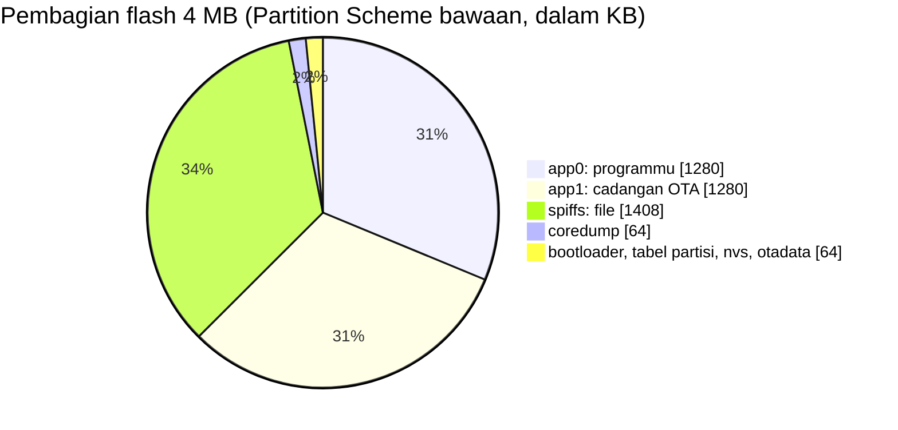

# BAB 20: Memory Management

> ✅ **Prasyarat:** Selesaikan **BAB 19 (Kode Terstruktur — Multi-File)** — kamu sudah terbiasa menulis fungsi, `struct`, serta variabel global dan `static`. BAB ini juga memakai Serial Monitor dan objek `ESP` dari [BAB 7](../BAB-07/README.md), serta pola `millis()` dari [BAB 16](../BAB-16/README.md).

Laptopmu mungkin punya RAM 8 GB, sedangkan ESP32 hanya punya sekitar 520 KB — kira-kira 16.000 kali lebih kecil. Karena itu, program ESP32 harus hemat dan rapi memakai memori. Program yang boros atau "lupa beres-beres" sering tampak baik-baik saja saat diuji sebentar, lalu tiba-tiba *restart* sendiri setelah berjalan berjam-jam. Di BAB ini kamu mengenal "denah" memori ESP32, membedakan *stack* dan *heap*, memantau sisa memori dari dalam program, lalu melihat sendiri dua musuh utama program yang berjalan lama: kebocoran memori (*memory leak*) dan fragmentasi.

## 📌 Tujuan Pembelajaran

Setelah mempelajari BAB ini, kamu bisa:

- Menjelaskan jenis-jenis memori ESP32 — *flash* 4 MB beserta partisinya, SRAM 520 KB (DRAM dan IRAM), dan memori RTC 16 KB — serta alasan ESP32-WROOM-32 tidak punya PSRAM.
- Membaca pesan ukuran program dan variabel global yang muncul setelah *compile*.
- Membedakan memori statis, *stack*, dan *heap*, serta menyebutkan di mana setiap jenis variabel disimpan.
- Memantau sisa memori dengan `ESP.getFreeHeap()`, `ESP.getMinFreeHeap()`, `ESP.getMaxAllocHeap()`, fungsi `heap_caps_...()`, dan `uxTaskGetStackHighWaterMark()`.
- Mengenali dan mencegah *stack overflow*, kebocoran memori, dan fragmentasi *heap*.
- Memilih antara `String` (dengan `reserve()`) dan `char[]` + `snprintf()` sesuai kebutuhan.
- Menyimpan data konstan di *flash* dengan `const`, dan menjelaskan kenapa `PROGMEM` dan `F()` tidak diperlukan di ESP32.
- Menyimpan nilai yang bertahan saat *deep sleep* dengan `RTC_DATA_ATTR`.

## 🧰 Yang Perlu Disiapkan

| Kebutuhan | Keterangan |
|---|---|
| *Hardware* | Kit Bluino ESP32 IoT Starter Shield (ESP32 DEVKIT V1 sudah terpasang) + kabel USB **data**. Semua program hanya memakai *board* ESP32 |
| Kabel *jumper* | Tidak perlu |
| Komponen tambahan | Tidak ada |
| *Software* | Arduino IDE 2.x + *board package* **esp32** versi 3.3.x (lihat [BAB 5](../BAB-05/README.md)) |
| *Library* | Tidak perlu *library* tambahan — semua fungsi memori sudah ada di *board package* esp32 |
| Alat uji | **Serial Monitor** Arduino IDE (baud 115200) dan panel **Output** Arduino IDE (untuk membaca ukuran program setelah *compile*) |
| Jaringan | Tidak perlu WiFi |

## 📑 Daftar Isi

- [20.1 Kenapa Memori Perlu Diperhatikan?](#201-kenapa-memori-perlu-diperhatikan)
- [20.2 Peta Memori ESP32](#202-peta-memori-esp32)
- [20.3 Membaca Pesan Ukuran Setelah Compile](#203-membaca-pesan-ukuran-setelah-compile)
- [20.4 Memori Statis, Stack, dan Heap](#204-memori-statis-stack-dan-heap)
- [20.5 Program 1: Laporan Memori ESP32](#205-program-1-laporan-memori-esp32)
- [20.6 Program 2: Mengukur Pemakaian Stack](#206-program-2-mengukur-pemakaian-stack)
- [20.7 Kebocoran Memori (Memory Leak)](#207-kebocoran-memori-memory-leak)
- [20.8 Program 3: Kebocoran Memori dan Cara Memperbaikinya](#208-program-3-kebocoran-memori-dan-cara-memperbaikinya)
- [20.9 Fragmentasi Heap](#209-fragmentasi-heap)
- [20.10 Program 4: Melihat Fragmentasi Heap](#2010-program-4-melihat-fragmentasi-heap)
- [20.11 String atau char[]?](#2011-string-atau-char)
- [20.12 Data Konstan di Flash: const, PROGMEM, dan F()](#2012-data-konstan-di-flash-const-progmem-dan-f)
- [20.13 Program 5: Variabel yang Bertahan Saat Deep Sleep](#2013-program-5-variabel-yang-bertahan-saat-deep-sleep)
- [20.14 Tips Hemat Memori](#2014-tips-hemat-memori)
- [20.15 Troubleshooting](#2015-troubleshooting)
- [📝 Rangkuman](#-rangkuman)
- [💪 Latihan](#-latihan)
- [📚 Referensi](#-referensi)

---

## 20.1 Kenapa Memori Perlu Diperhatikan?

Bayangkan memori sebagai meja belajar. Lemari buku di sebelahnya besar dan isinya awet — itulah memori *flash*. Tetapi kamu hanya bisa bekerja di atas meja yang sempit — itulah RAM. Kalau buku yang sudah selesai dibaca tidak pernah dikembalikan ke lemari, lama-lama meja penuh dan kamu tidak bisa bekerja lagi.

Masalah memori jarang muncul tepat setelah program diunggah. Biasanya program berjalan lancar beberapa menit atau beberapa jam, lalu tiba-tiba bermasalah. Gejala yang sering muncul:

| Gejala | Kemungkinan penyebab yang berhubungan dengan memori |
|---|---|
| ESP32 *restart* sendiri dan Serial Monitor menampilkan `Guru Meditation Error` | *Stack overflow*, atau program menulis ke alamat memori yang salah |
| Program normal selama beberapa jam, lalu macet atau *restart* | Kebocoran memori (*memory leak*) atau fragmentasi *heap* |
| WiFi tiba-tiba gagal tersambung, atau koneksi HTTPS gagal | Sisa *heap* terlalu sedikit untuk *buffer* jaringan |
| `malloc()` atau `new` gagal (mengembalikan `NULL`) | *Heap* habis, atau tidak ada blok kosong yang cukup besar |

Kabar baiknya, semua masalah ini bisa dipantau dari dalam program — dan itulah yang kamu pelajari di BAB ini. Cara membaca pesan *crash* seperti `Guru Meditation Error` dibahas di [BAB 21](../BAB-21/README.md).

---

## 20.2 Peta Memori ESP32

### 20.2.1 Gambaran Besar

*Board* ESP32 DEVKIT V1 di kit memakai modul **ESP32-WROOM-32**. Di dalam modul berpelindung logam itu ada chip ESP32 dan chip memori *flash* 4 MB (lihat [BAB 2](../BAB-02/README.md)). Berikut jenis memori yang perlu kamu kenal:

| Memori | Ukuran | Letak | Isinya | Saat listrik mati |
|---|---|---|---|---|
| ROM | 448 KB | Di dalam chip | Program bawaan pabrik, misalnya *bootloader* pertama yang mencetak pesan `rst:...` saat ESP32 mulai | Tetap (tidak bisa diubah) |
| *Flash* | 4 MB | Chip terpisah di dalam modul | Programmu, data konstan, *file*, dan pengaturan yang disimpan | **Tetap** |
| SRAM | 520 KB | Di dalam chip | Memori kerja: variabel, *stack*, *heap*, dan sebagian kode | Hilang |
| RTC SRAM | 16 KB (8 KB *fast* + 8 KB *slow*) | Di dalam chip, bagian RTC | Data kecil yang harus bertahan saat *deep sleep* | Hilang, tetapi **bertahan saat *deep sleep*** |
| PSRAM | Tidak ada | — | RAM tambahan; hanya ada di modul lain, misalnya ESP32-WROVER | — |

Dalam keseharian, "RAM" yang dimaksud programmer ESP32 adalah SRAM 520 KB itu. Subbab berikut membedah bagaimana *flash* dan SRAM dibagi-bagi.

### 20.2.2 Flash 4 MB dan Tabel Partisi

*Flash* tidak dipakai utuh untuk program. Isinya dibagi menjadi beberapa bagian yang disebut **partisi**, mirip *harddisk* laptop yang dibagi menjadi *drive* C: dan D:. Daftar pembagiannya disimpan di **tabel partisi** (*partition table*) dan dipilih lewat menu **Tools → Partition Scheme** di Arduino IDE. Untuk *board* **ESP32 Dev Module**, pilihan bawaannya adalah yang berawalan **Default 4MB with spiffs**, dengan isi seperti ini:

| Bagian | Alamat awal | Ukuran | Isinya |
|---|---|---|---|
| *Bootloader* | `0x1000` | Maksimal 28 KB | Program kecil yang memeriksa lalu menjalankan programmu |
| Tabel partisi | `0x8000` | 4 KB | "Daftar isi" pembagian *flash* |
| `nvs` | `0x9000` | 20 KB | Penyimpanan pengaturan, misalnya nama WiFi ([BAB 39](../BAB-39/README.md)) |
| `otadata` | `0xE000` | 8 KB | Catatan partisi program mana yang sedang aktif |
| `app0` | `0x10000` | 1280 KB | **Programmu** — tepatnya 1.310.720 *byte* |
| `app1` | `0x150000` | 1280 KB | Tempat program baru saat diperbarui lewat WiFi (OTA, *Over-The-Air*) |
| `spiffs` | `0x290000` | 1408 KB | Sistem *file* SPIFFS/LittleFS ([BAB 40](../BAB-40/README.md)) |
| `coredump` | `0x3F0000` | 64 KB | Catatan keadaan ESP32 saat terjadi *crash* ([BAB 21](../BAB-21/README.md)) |



*Gambar 20.1 — Pembagian flash 4 MB pada Partition Scheme bawaan ESP32 Dev Module, dalam KB. Sumber: dibuat untuk materi ini.*

Inilah alasan Arduino IDE menulis `Maximum is 1310720 bytes` setelah *compile*: programmu harus muat di partisi `app0` yang besarnya 1.310.720 *byte* (1280 KB), bukan di seluruh *flash* 4 MB. Kalau programmu terlalu besar — misalnya memakai WiFi dan Bluetooth sekaligus — pilih **Tools → Partition Scheme → Huge APP (3MB No OTA/1MB SPIFFS)**. Partisi program membesar menjadi 3 MB, tetapi tidak ada lagi tempat untuk OTA dan ruang *file* menyusut (sekitar 0,9 MB).

> 📌 **Catatan:** Sebagian besar kode programmu **tidak** disalin ke RAM. ESP32 membacanya langsung dari *flash* lewat *cache* (penampung sementara yang cepat), seperti membaca buku langsung di rak tanpa memfotokopinya dulu. Data konstan (`const`) juga dibaca dengan cara yang sama — manfaatnya dibahas di [20.12](#2012-data-konstan-di-flash-const-progmem-dan-f).

### 20.2.3 SRAM 520 KB: DRAM untuk Data, IRAM untuk Kode

SRAM ESP32 dibagi untuk dua keperluan:

| Bagian | Ukuran | Dipakai untuk |
|---|---|---|
| **DRAM** (*Data RAM*) | ±320 KB | Variabel global dan `static`, *heap*, dan *stack* |
| **IRAM** (*Instruction RAM*) | ±200 KB, sebagian dipakai sebagai *cache flash* | Kode yang harus selalu siap dijalankan dengan cepat, misalnya fungsi ISR bertanda `IRAM_ATTR` ([BAB 10](../BAB-10/README.md)) dan bagian inti sistem, WiFi, dan Bluetooth |

Dua hal penting dari pembagian ini:

- **Batas DRAM 320 KB** adalah angka `Maximum is 327680 bytes` (327.680 *byte* = 320 KB) yang muncul di pesan *compile* (lihat [20.3](#203-membaca-pesan-ukuran-setelah-compile)).
- **Sisa IRAM yang tidak terpakai kode ikut ditambahkan ke *heap*.** Bagian ini hanya boleh dibaca dan ditulis per 4 *byte* (32 bit) sekaligus, jadi tidak bisa dipakai untuk teks, `char[]`, atau `String`. Akibatnya, angka *heap* dari `ESP.getFreeHeap()` sedikit lebih besar daripada *heap* yang benar-benar bisa dipakai `malloc()` dan `String`. Perbedaannya kamu lihat sendiri di Program 1.

### 20.2.4 Memori RTC: Bertahan Saat Deep Sleep

Saat ***deep sleep*** (mode tidur paling hemat daya), hampir seluruh chip dimatikan, termasuk SRAM 520 KB — sehingga semua variabel biasa hilang. Yang tetap menyala hanya bagian **RTC** (*Real-Time Clock*): pewaktu yang nanti membangunkan ESP32, dan memori RTC 16 KB.

| Bagian | Ukuran | Kegunaan |
|---|---|---|
| RTC FAST | 8 KB | Dipakai sistem, misalnya untuk kode kecil yang langsung dijalankan saat ESP32 bangun |
| RTC SLOW | 8 KB | Variabel bertanda `RTC_DATA_ATTR` dan program koprosesor ULP (*Ultra Low Power*) |

Sebagian kecil RTC SLOW dicadangkan untuk sistem, jadi ruang untuk variabel `RTC_DATA_ATTR` sekitar 7,5 KB — cukup untuk penghitung atau catatan kecil, tetapi bukan untuk *array* besar. Cara memakainya ada di [Program 5](#2013-program-5-variabel-yang-bertahan-saat-deep-sleep).

### 20.2.5 PSRAM: Tidak Ada di ESP32-WROOM-32

Beberapa modul, misalnya ESP32-WROVER, punya chip RAM tambahan bernama **PSRAM** (*pseudo-static RAM*) berukuran 4–8 MB. Modul ESP32-WROOM-32 di kit **tidak** punya PSRAM, jadi:

- `ESP.getPsramSize()` selalu mengembalikan `0`.
- Biarkan **Tools → PSRAM** pada **Disabled**. Mengaktifkannya tidak menambah memori, karena chip PSRAM-nya memang tidak ada.
- Contoh program dari internet yang memakai `ps_malloc()` (meminjam memori dari PSRAM) biasanya ditujukan untuk *board* ber-PSRAM, misalnya ESP32-CAM. Di kit ini, `ps_malloc()` selalu gagal.

---

## 20.3 Membaca Pesan Ukuran Setelah Compile

Setiap kali kamu mengklik **Verify** atau **Upload**, panel **Output** di bagian bawah Arduino IDE menampilkan dua baris seperti ini (contoh dari Program 1 [BAB 7](../BAB-07/README.md); angkamu bisa berbeda):

```text
Sketch uses 269280 bytes (20%) of program storage space. Maximum is 1310720 bytes.
Global variables use 22116 bytes (6%) of dynamic memory, leaving 305564 bytes for local variables. Maximum is 327680 bytes.
```

| Bagian pesan | Arti |
|---|---|
| `Sketch uses 269280 bytes` | Ukuran programmu di *flash*: kode dan data konstan |
| `Maximum is 1310720 bytes` | Ukuran partisi `app0` dari **Partition Scheme** yang dipilih |
| `Global variables use 22116 bytes` | DRAM yang langsung terpakai sejak awal oleh variabel global dan `static` — termasuk milik *library* dan *board package* |
| `leaving 305564 bytes for local variables` | Sisa DRAM. Di ESP32, sisa ini dijadikan *heap*; *stack* untuk `loop()` pun diambil dari *heap* |
| `Maximum is 327680 bytes` | Total DRAM: 320 KB |

Angka *heap* yang terukur saat program berjalan tidak persis sama dengan angka `leaving ...`. Sistem (FreeRTOS dan *driver*) ikut meminjam *heap* sebelum `setup()` berjalan, sedangkan sisa IRAM ikut terhitung sebagai *heap* (lihat [20.2.3](#2023-sram-520-kb-dram-untuk-data-iram-untuk-kode)).

> 💡 **Tips:** Kalau persentase *program storage space* sudah di atas 90%, programmu hampir tidak muat. Hapus *library* yang tidak dipakai, atau pilih **Partition Scheme** yang lebih besar seperti **Huge APP**.

> ⚠️ **Perhatian:** Walaupun DRAM totalnya 320 KB, variabel global dan `static` hanya boleh memakai sebagian saja — di *board package* esp32 3.3.x sekitar 120 KB, dan ±22 KB di antaranya sudah dipakai sistem. Jadi, untuk variabel global milikmu tersisa sekitar 100 KB. Sisa DRAM lainnya hanya bisa dipinjam sebagai *heap* saat program berjalan. Kalau kamu membuat *array* global yang terlalu besar (misalnya `uint8_t data[110000];`), *compile* gagal dengan pesan `DRAM segment data does not fit` dan ``region `dram0_0_seg' overflowed by 7544 bytes``. Untuk data sebesar itu, pinjam memorinya dari *heap* dengan `malloc()` di `setup()` (lihat [20.4.3](#2043-heap-gudang-sewaan)), atau jadikan `const` kalau isinya tidak pernah berubah (lihat [20.12](#2012-data-konstan-di-flash-const-progmem-dan-f)).

---

## 20.4 Memori Statis, Stack, dan Heap

### 20.4.1 Tiga Tempat Menyimpan Variabel

Setiap variabel di programmu disimpan di salah satu dari tiga "wilayah" DRAM — kecuali konstanta (`const`), yang cukup tinggal di *flash*. Contoh potongan kode berikut menunjukkan tempat masing-masing:

```cpp
int hitungan = 0;              // MEMORI STATIS: variabel global, ada selama program berjalan
const int BATAS = 100;         // FLASH: konstanta, tidak memakai RAM

void ukurSuhu() {
  static int jumlahUkur = 0;   // MEMORI STATIS: variabel static, nilainya diingat antarpemanggilan
  float suhu = 27.5;           // STACK: variabel lokal, hilang saat fungsi selesai
  char pesan[40];              // STACK: array lokal 40 byte

  int *data = (int *)malloc(10 * sizeof(int));  // HEAP: dipinjam saat program berjalan
  // ... pakai data ...
  free(data);                  // HEAP: wajib dikembalikan
}
```

| Wilayah | Analogi | Kapan dibuat dan dihapus | Contoh |
|---|---|---|---|
| **Memori statis** | Loker pribadi: selalu ada, isinya tetap di sana | Disiapkan sebelum `setup()` dan ada terus sampai ESP32 mati | Variabel global, variabel `static` |
| ***Stack*** | Tumpukan nampan di kantin: yang terakhir ditaruh, pertama diambil | Otomatis dibuat saat fungsi dipanggil, otomatis dibuang saat fungsi selesai | Variabel lokal, parameter fungsi |
| ***Heap*** | Gudang sewaan: pinjam sesuai ukuran, wajib dikembalikan | Dipinjam dan dikembalikan oleh program saat berjalan | `malloc()`/`free()`, `new`/`delete`, isi `String` |

### 20.4.2 Stack: Tumpukan Nampan yang Rapi Sendiri

Setiap kali sebuah fungsi dipanggil, ESP32 menaruh "nampan" baru di atas *stack*. Nampan itu berisi variabel lokal fungsi tersebut dan catatan ke mana program harus kembali. Begitu fungsi selesai, nampannya diangkat lagi. Karena itu, *stack* sangat cepat dan selalu rapi — kamu tidak perlu membereskannya sendiri.

Masalahnya, ukuran *stack* **tetap** dan cukup kecil. Di ESP32, `setup()` dan `loop()` dijalankan oleh sebuah *task* FreeRTOS bernama `loopTask` (lihat [BAB 7](../BAB-07/README.md)). *Task* adalah "pekerja" yang dijalankan sistem operasi mini FreeRTOS, dan setiap *task* punya *stack* sendiri. *Stack* `loopTask` di *board package* esp32 3.3.x besarnya **8.192 *byte* (8 KB)**. Semua variabel lokal di `setup()`, `loop()`, dan fungsi yang mereka panggil harus muat di sana.

Kalau *stack* terisi melebihi batasnya, terjadilah ***stack overflow*** — nampan menumpuk sampai roboh. ESP32 langsung *crash* dan *restart* dengan pesan seperti ini di Serial Monitor:

```text
Guru Meditation Error: Core  1 panic'ed (Unhandled debug exception).
Debug exception reason: Stack canary watchpoint triggered (loopTask)
```

Penyebab yang paling sering:

- *Array* lokal yang besar di dalam fungsi, misalnya `char buffer[10000];` (lebih besar daripada seluruh *stack*).
- Rekursi yang terlalu dalam — fungsi yang memanggil dirinya sendiri berkali-kali, sehingga nampannya bertumpuk tinggi.

Cara mengukur sisa *stack* ada di Program 2.

### 20.4.3 Heap: Gudang Sewaan

*Heap* dipakai untuk data yang ukurannya baru diketahui saat program berjalan, atau yang harus tetap ada setelah fungsi pembuatnya selesai. Kamu meminjam ruang dengan `malloc()` (gaya C) atau `new` (gaya C++), dan **wajib** mengembalikannya dengan `free()` atau `delete`:

```cpp
// Gaya C: malloc() meminjam sejumlah byte, free() mengembalikannya
uint8_t *buffer = (uint8_t *)malloc(2000);  // pinjam 2000 byte
if (buffer == NULL) {
  Serial.println("Gagal: heap tidak cukup!");  // selalu periksa hasilnya
} else {
  // ... pakai buffer[0] sampai buffer[1999] ...
  free(buffer);    // kembalikan
  buffer = NULL;   // tandai bahwa buffer sudah tidak boleh dipakai
}

// Gaya C++: new[] dan delete[] berpasangan
int *angka = new int[100];  // pinjam tempat untuk 100 int (400 byte)
// ... pakai angka[0] sampai angka[99] ...
delete[] angka;             // kembalikan, pakai [] karena yang dipinjam berupa array
```

Aturan memakai *heap*:

| Aturan | Alasannya |
|---|---|
| Selalu periksa apakah hasil `malloc()` bernilai `NULL` | `NULL` artinya peminjaman gagal. Memakai alamat `NULL` membuat ESP32 *crash* |
| Setiap `malloc()` harus punya pasangan `free()`, setiap `new` punya `delete` | Kalau lupa, memori "bocor" — dibahas di [20.7](#207-kebocoran-memori-memory-leak) |
| Jangan memakai memori yang sudah dikembalikan | Isinya bisa sudah dipakai bagian program lain |
| Hindari meminjam-mengembalikan dengan ukuran berbeda-beda terus-menerus | Lama-lama *heap* berlubang-lubang (fragmentasi) — dibahas di [20.9](#209-fragmentasi-heap) |

> 💡 **Tips:** Untuk *buffer* yang dipakai sepanjang program, cara paling aman adalah meminjamnya **sekali** di `setup()` lalu memakainya terus, atau langsung membuatnya sebagai variabel global (kalau ukurannya masih di bawah batas memori statis).

### 20.4.4 Fungsi untuk Memantau Memori

*Board package* esp32 menyediakan fungsi-fungsi berikut. Semuanya mengembalikan angka dalam satuan *byte*.

| Fungsi | Artinya |
|---|---|
| `ESP.getHeapSize()` | Total *heap* internal (termasuk bagian IRAM) |
| `ESP.getFreeHeap()` | *Heap* yang masih bebas **saat ini** |
| `ESP.getMinFreeHeap()` | *Heap* bebas **terendah** sejak ESP32 mulai — "rekor terburuk" pemakaian memori |
| `ESP.getMaxAllocHeap()` | Blok bebas **terbesar** yang bisa dipinjam sekaligus |
| `ESP.getPsramSize()` | Ukuran PSRAM — selalu `0` di kit ini |
| `heap_caps_get_free_size(MALLOC_CAP_8BIT)` | *Heap* bebas yang bisa dipakai `malloc()`, `new`, dan `String` (tanpa bagian IRAM yang khusus 32 bit) |
| `heap_caps_get_largest_free_block(MALLOC_CAP_8BIT)` | Ukuran `malloc()` terbesar yang pasti berhasil saat ini |
| `getArduinoLoopTaskStackSize()` | Ukuran *stack* `loopTask` (bawaan 8.192 *byte*) |
| `uxTaskGetStackHighWaterMark(NULL)` | Sisa *stack* **paling sedikit** yang pernah dialami *task* yang sedang berjalan (di ESP32 satuannya *byte*) |

Fungsi `heap_caps_...()` berasal dari ESP-IDF (kerangka *software* resmi Espressif yang menjadi dasar *board package* esp32). Untuk memakainya, tambahkan `#include <esp_heap_caps.h>` di bagian atas *sketch*. `MALLOC_CAP_8BIT` artinya "memori yang bisa diakses per 1 *byte*" — jenis memori yang dipakai untuk data biasa.

> 📌 **Catatan:** Nama *high water mark* berasal dari bekas garis air banjir di dinding rumah. Walaupun air sudah surut, garis itu tetap menunjukkan seberapa tinggi air pernah naik. Begitu pula `uxTaskGetStackHighWaterMark()` dan `ESP.getMinFreeHeap()`: angkanya hanya bisa turun, tidak pernah naik lagi, karena mencatat keadaan **terburuk** yang pernah terjadi.

---

## 20.5 Program 1: Laporan Memori ESP32

**Tujuan:** Menampilkan keadaan *heap*, *stack* `loop()`, *flash*, dan PSRAM sekali saat program mulai, lalu memantau *heap* setiap 5 detik. Program ini bisa kamu pakai sebagai "alat ukur" untuk program-program lain.

**Rangkaian:**

*Tidak perlu merangkai — cukup colokkan kabel USB.*

**Cara Menjalankan:**

1. Colokkan kabel USB ke *board* ESP32 dan ke laptop.
2. Buka Arduino IDE → **File → New Sketch**, hapus isinya, lalu salin kode di bawah. Kode yang sama juga tersedia di *file* [`p1_laporan_memori.ino`](p1_laporan_memori/p1_laporan_memori.ino).
3. Pastikan **Tools → Board** = **ESP32 Dev Module** dan **Tools → Port** = *port* ESP32 kamu (misalnya `COM5` di Windows atau `/dev/ttyUSB0` di Linux).
4. Klik tombol **Upload** (ikon panah →) dan tunggu sampai muncul tulisan **Done uploading**. Sebelum menutup panel **Output**, catat dua baris ukuran program (`Sketch uses ...` dan `Global variables use ...`).
5. Buka **Serial Monitor** (**Tools → Serial Monitor**) lalu pilih baud **115200**.
6. Kalau laporan pembukanya terlewat, tekan tombol **EN** di *board* ESP32 sekali.

**Kode Program:**

<!-- sketch: p1_laporan_memori -->
```cpp
/*
 * BAB 20 - Program 1: Laporan Memori ESP32
 * Menampilkan keadaan heap, stack loop(), flash, dan PSRAM sekali saat mulai,
 * lalu memantau heap setiap 5 detik.
 *
 * Hardware : ESP32 DEVKIT V1 di kit Bluino (tidak perlu merangkai)
 * Alat uji : Serial Monitor, baud 115200
 */

#include <esp_heap_caps.h>  // fungsi heap_caps_...() dari ESP-IDF

const unsigned long INTERVAL_PANTAU = 5000;  // ms: jeda antarlaporan di loop()
unsigned long waktuPantau = 0;               // kapan laporan terakhir dicetak

void setup() {
  Serial.begin(115200);
  delay(1000);  // beri waktu Serial Monitor bersiap

  Serial.println("=== Laporan Memori ESP32 ===");
  Serial.println();

  // ----- Heap: RAM yang dipinjam-kembalikan saat program berjalan -----
  Serial.println("[Heap]");
  Serial.print("Total heap internal  : ");
  Serial.print(ESP.getHeapSize() / 1024);  // byte -> KB
  Serial.println(" KB");
  Serial.print("Heap bebas           : ");
  Serial.print(ESP.getFreeHeap() / 1024);
  Serial.println(" KB");
  Serial.print("Heap bebas terendah  : ");
  Serial.print(ESP.getMinFreeHeap() / 1024);
  Serial.println(" KB");
  Serial.print("Blok bebas terbesar  : ");
  Serial.print(ESP.getMaxAllocHeap() / 1024);
  Serial.println(" KB");
  Serial.print("Heap bebas untuk data: ");
  Serial.print(heap_caps_get_free_size(MALLOC_CAP_8BIT) / 1024);  // tanpa bagian IRAM
  Serial.println(" KB");
  Serial.println();

  // ----- Stack milik loopTask (yang menjalankan setup() dan loop()) -----
  Serial.println("[Stack loop()]");
  Serial.print("Ukuran stack         : ");
  Serial.print(getArduinoLoopTaskStackSize());
  Serial.println(" byte");
  Serial.print("Sisa stack minimum   : ");
  Serial.print(uxTaskGetStackHighWaterMark(NULL));  // NULL = task yang sedang berjalan
  Serial.println(" byte");
  Serial.println();

  // ----- Flash -----
  Serial.println("[Flash]");
  Serial.print("Ukuran chip flash    : ");
  Serial.print(ESP.getFlashChipSize() / (1024 * 1024));  // byte -> MB
  Serial.println(" MB");
  Serial.print("Ukuran program       : ");
  Serial.print(ESP.getSketchSize() / 1024);
  Serial.println(" KB");
  Serial.print("Batas ukuran program : ");
  Serial.print(ESP.getFreeSketchSpace() / 1024);  // ukuran partisi program
  Serial.println(" KB");
  Serial.println();

  // ----- PSRAM -----
  Serial.println("[PSRAM]");
  Serial.print("Ukuran PSRAM         : ");
  Serial.print(ESP.getPsramSize());
  Serial.println(" byte");
  Serial.println();

  Serial.println("=== Pemantauan heap setiap 5 detik ===");
}

void loop() {
  if (millis() - waktuPantau >= INTERVAL_PANTAU) {
    waktuPantau = millis();

    Serial.print("Detik ke-");
    Serial.print(millis() / 1000);
    Serial.print(" | bebas: ");
    Serial.print(ESP.getFreeHeap());
    Serial.print(" byte | terendah: ");
    Serial.print(ESP.getMinFreeHeap());
    Serial.print(" byte | blok terbesar: ");
    Serial.print(ESP.getMaxAllocHeap());
    Serial.println(" byte");
  }
}
```

**Penjelasan Kode:**

1. **`#include <esp_heap_caps.h>`** memasukkan fungsi `heap_caps_...()` dari ESP-IDF. Fungsi `ESP.xxx()` tidak butuh `#include` karena sudah tersedia otomatis.
2. **Bagian `[Heap]`** memakai fungsi-fungsi dari tabel [20.4.4](#2044-fungsi-untuk-memantau-memori). Hasilnya dibagi 1024 supaya tampil dalam KB (pembagian bilangan bulat membuang angka di belakang koma).
3. **`Heap bebas` vs `Heap bebas untuk data`.** Angka pertama menghitung semua *heap* internal, termasuk sisa IRAM yang hanya bisa diakses per 4 *byte*. Angka kedua (`MALLOC_CAP_8BIT`) hanya menghitung *heap* yang bisa dipakai `malloc()`, `new`, dan `String`. Selisih keduanya adalah bagian IRAM tadi.
4. **`uxTaskGetStackHighWaterMark(NULL)`** menanyakan sisa *stack* paling sedikit dari *task* yang sedang berjalan — di sini `loopTask`. Parameter `NULL` artinya "*task* saya sendiri".
5. **`ESP.getFreeSketchSpace()`** namanya agak menyesatkan: fungsi ini **tidak** menghitung "sisa ruang". Isinya adalah ukuran partisi program (tempat program baru saat OTA), yaitu 1.310.720 *byte* = 1280 KB pada **Partition Scheme** bawaan — angka yang sama dengan `Maximum is 1310720 bytes` saat *compile*.
6. **`loop()`** memakai pola `millis()` dari [BAB 16](../BAB-16/README.md): laporan dicetak setiap 5 detik tanpa `delay()`. Di sini angkanya ditampilkan dalam *byte* supaya perubahan kecil pun terlihat.

**Contoh Output:**

```text
=== Laporan Memori ESP32 ===

[Heap]
Total heap internal  : 359 KB
Heap bebas           : 330 KB
Heap bebas terendah  : 324 KB
Blok bebas terbesar  : 107 KB
Heap bebas untuk data: 276 KB

[Stack loop()]
Ukuran stack         : 8192 byte
Sisa stack minimum   : 6880 byte

[Flash]
Ukuran chip flash    : 4 MB
Ukuran program       : 264 KB
Batas ukuran program : 1280 KB

[PSRAM]
Ukuran PSRAM         : 0 byte

=== Pemantauan heap setiap 5 detik ===
Detik ke-5 | bebas: 338460 byte | terendah: 332152 byte | blok terbesar: 110580 byte
Detik ke-10 | bebas: 338460 byte | terendah: 332152 byte | blok terbesar: 110580 byte
Detik ke-15 | bebas: 338460 byte | terendah: 332152 byte | blok terbesar: 110580 byte
```

Angka *heap*, *stack*, dan ukuran program di atas hanya contoh — **angkamu bisa berbeda**, tergantung revisi chip, versi *board package*, dan isi program. Yang penting perhatikan polanya:

- **Ukuran stack** bernilai 8192, **Ukuran chip flash** 4 MB, **Batas ukuran program** 1280 KB, dan **Ukuran PSRAM** 0.
- **Heap bebas untuk data** lebih kecil daripada **Heap bebas** — selisihnya adalah sisa IRAM.
- **Blok bebas terbesar** jauh lebih kecil daripada **Heap bebas**. Ini normal: *heap* ESP32 terdiri dari beberapa wilayah RAM yang terpisah, dan wilayah terbesarnya sekitar 100-an KB. Artinya, satu kali `malloc()` di ESP32 tidak mungkin meminjam 300 KB sekaligus.
- Di bagian pemantauan, ketiga angka **tetap** dari waktu ke waktu, karena program ini tidak meminjam memori baru. Pada program yang bocor, angka `bebas` akan terus turun (lihat Program 3).

Di kit tidak ada komponen yang bereaksi; semua hasil hanya tampil di Serial Monitor.

> 🧪 **Coba Sendiri:** Tambahkan baris `ENABLE_CHIP_DEBUG_REPORT` (persis seperti itu, tanpa titik koma) di bawah baris `#include <esp_heap_caps.h>` pada Program 1, lalu *upload* ulang dan tekan tombol **EN**. Sebelum laporanmu, *board package* esp32 akan mencetak laporan bawaan berbahasa Inggris yang diawali `=========== Before Setup Start ===========`. Cari bagian `INTERNAL Memory Info` (sama dengan bagian `[Heap]` milikmu) dan `Partitions Info` (tabel partisi di [20.2.2](#2022-flash-4-mb-dan-tabel-partisi), lengkap dengan alamatnya). Hapus lagi baris itu setelah selesai.

**Kalau Belum Berhasil:**

- **Serial Monitor kosong** → laporan dicetak sebelum Serial Monitor terbuka. Tekan tombol **EN** sekali; laporan pemantauan juga akan muncul setiap 5 detik.
- **Muncul *error* `'heap_caps_get_free_size' was not declared in this scope`** → baris `#include <esp_heap_caps.h>` terhapus atau salah ketik. Tambahkan lagi di bagian paling atas.
- **Muncul *error* `'class EspClass' has no member named ...`** → *board package* esp32 masih versi lama. Perbarui ke 3.3.x lewat **Tools → Board → Boards Manager...** (lihat [BAB 5](../BAB-05/README.md)).
- **`Ukuran PSRAM` bukan 0** → *board*-mu memakai modul lain yang punya PSRAM (misalnya ESP32-WROVER). Tidak apa-apa; materi BAB ini tetap berlaku.

---

## 20.6 Program 2: Mengukur Pemakaian Stack

**Tujuan:** Membuktikan bahwa *array* lokal dan rekursi menghabiskan *stack* `loop()`, sedangkan *array* `static` tidak. Program menampilkan sisa *stack* minimum setelah setiap percobaan, lalu berhenti sendiri sebelum *stack* benar-benar habis.

**Rangkaian:**

*Tidak perlu merangkai — cukup colokkan kabel USB.*

**Cara Menjalankan:**

1. Buka Arduino IDE → **File → New Sketch**, hapus isinya, lalu salin kode di bawah. Kode yang sama juga tersedia di *file* [`p2_pemakaian_stack.ino`](p2_pemakaian_stack/p2_pemakaian_stack.ino).
2. Pastikan **Tools → Board** = **ESP32 Dev Module** dan **Tools → Port** = *port* ESP32 kamu.
3. Klik tombol **Upload** dan tunggu sampai muncul tulisan **Done uploading**.
4. Buka **Serial Monitor** (**Tools → Serial Monitor**) lalu pilih baud **115200**. Semua percobaan berjalan sekali di `setup()`; kalau hasilnya terlewat, tekan tombol **EN**.

**Kode Program:**

<!-- sketch: p2_pemakaian_stack -->
```cpp
/*
 * BAB 20 - Program 2: Mengukur Pemakaian Stack
 * Membandingkan array static dan array lokal, lalu menunjukkan bahwa
 * rekursi yang makin dalam terus menghabiskan stack loop() (8 KB).
 *
 * Hardware : ESP32 DEVKIT V1 di kit Bluino (tidak perlu merangkai)
 * Alat uji : Serial Monitor, baud 115200
 */

const unsigned int BATAS_AMAN = 2000;  // byte: berhenti kalau sisa stack di bawah ini

// Mencetak keterangan + sisa stack minimum loopTask saat ini
void cetakSisaStack(const char *keterangan) {
  Serial.print(keterangan);
  Serial.print(" -> sisa stack minimum: ");
  Serial.print(uxTaskGetStackHighWaterMark(NULL));
  Serial.println(" byte");
}

// __attribute__((noinline)): fungsi ini tidak boleh "dilebur" ke pemanggilnya,
// supaya pemakaian stack-nya benar-benar terjadi saat fungsi dipanggil.
// volatile: compiler tidak boleh membuang array yang "kelihatannya" tidak dipakai.

__attribute__((noinline)) uint8_t pakaiArrayStatic() {
  static volatile uint8_t data[1000];  // static: di memori statis, BUKAN di stack
  for (int i = 0; i < 1000; i++) {
    data[i] = i;
  }
  return data[999];  // baca kembali supaya array benar-benar terpakai
}

__attribute__((noinline)) uint8_t pakaiArrayLokal() {
  volatile uint8_t data[1000];  // lokal: 1000 byte di stack selama fungsi berjalan
  for (int i = 0; i < 1000; i++) {
    data[i] = i;
  }
  return data[999];
}

// Fungsi rekursif: memanggil dirinya sendiri sampai "sisa" bernilai 0.
// Setiap level memakai array lokal 100 byte + catatan pemanggilan fungsi.
__attribute__((noinline)) int rekursi(int sisa) {
  volatile uint8_t catatan[100];
  for (int i = 0; i < 100; i++) {
    catatan[i] = sisa;
  }
  if (sisa <= 0) {
    return 0;
  }
  return rekursi(sisa - 1) + catatan[0];
}

void setup() {
  Serial.begin(115200);
  delay(1000);

  Serial.println("BAB 20 - Program 2: Mengukur Pemakaian Stack");
  Serial.print("Ukuran stack loop(): ");
  Serial.print(getArduinoLoopTaskStackSize());
  Serial.println(" byte");
  Serial.println();

  // Percobaan 1: array static vs array lokal
  cetakSisaStack("Awal program          ");
  pakaiArrayStatic();
  cetakSisaStack("Array static 1000 byte");
  pakaiArrayLokal();
  cetakSisaStack("Array lokal 1000 byte ");
  Serial.println();

  // Percobaan 2: rekursi makin dalam, 5 level setiap langkah
  for (int level = 10; level <= 60; level += 5) {
    rekursi(level);

    Serial.print("Rekursi ");
    Serial.print(level);
    Serial.print(" level");
    cetakSisaStack("");

    if (uxTaskGetStackHighWaterMark(NULL) < BATAS_AMAN) {
      Serial.println("Berhenti: sisa stack di bawah 2000 byte. Lebih dalam lagi bisa stack overflow!");
      break;
    }
  }
}

void loop() {
  // Kosong: semua percobaan sudah dijalankan sekali di setup().
}
```

**Penjelasan Kode:**

1. **`cetakSisaStack()`** mencetak keterangan lalu hasil `uxTaskGetStackHighWaterMark(NULL)`, yaitu sisa *stack* paling sedikit yang pernah dialami `loopTask`.
2. **`static volatile uint8_t data[1000];`** — kata `static` membuat *array* ini tinggal di memori statis, jadi **tidak** memakai *stack*. Sebagai gantinya, angka `Global variables use ...` saat *compile* naik sekitar 1000 *byte* dibandingkan Program 1.
3. **`volatile uint8_t data[1000];`** tanpa `static` adalah *array* lokal: selama `pakaiArrayLokal()` berjalan, 1000 *byte* itu menempati *stack*.
4. **`rekursi(sisa)`** memanggil dirinya sendiri dengan `sisa - 1` sampai `sisa` bernilai 0. Setiap pemanggilan yang belum selesai menyimpan "nampannya" sendiri di *stack*: *array* `catatan` 100 *byte* plus catatan pemanggilan fungsi. Makin dalam rekursinya, makin tinggi tumpukannya.
5. **`__attribute__((noinline))` dan `volatile`** hanya "pesan" untuk *compiler*. Tanpa keduanya, *compiler* yang pintar bisa membuang *array* yang tidak pernah dibaca, sehingga percobaan ini tidak memperlihatkan apa-apa. Di program biasa kamu tidak perlu menulisnya.
6. **Pengaman `BATAS_AMAN`.** Setiap langkah menambah 5 level (kira-kira 700–1000 *byte*). Program berhenti begitu sisa *stack* kurang dari 2000 *byte*, sehingga langkah berikutnya — yang bisa menghabiskan *stack* — tidak pernah dijalankan.

**Contoh Output:**

```text
BAB 20 - Program 2: Mengukur Pemakaian Stack
Ukuran stack loop(): 8192 byte

Awal program           -> sisa stack minimum: 6896 byte
Array static 1000 byte -> sisa stack minimum: 6896 byte
Array lokal 1000 byte  -> sisa stack minimum: 5840 byte

Rekursi 10 level -> sisa stack minimum: 5312 byte
Rekursi 15 level -> sisa stack minimum: 4592 byte
Rekursi 20 level -> sisa stack minimum: 3872 byte
Rekursi 25 level -> sisa stack minimum: 3152 byte
Rekursi 30 level -> sisa stack minimum: 2432 byte
Rekursi 35 level -> sisa stack minimum: 1712 byte
Berhenti: sisa stack di bawah 2000 byte. Lebih dalam lagi bisa stack overflow!
```

Angka di atas hanya contoh — **angkamu bisa berbeda**. Polanya yang penting:

- *Array* `static` **tidak** mengubah sisa *stack*, sedangkan *array* lokal 1000 *byte* langsung memakan sekitar 1000 *byte*.
- Setiap tambahan 5 level rekursi mengurangi sisa *stack* dengan jumlah yang hampir sama (pada contoh: 720 *byte*, atau ±144 *byte* per level). Dengan *stack* 8 KB, rekursi ini hanya aman sampai beberapa puluh level.
- Angka sisa *stack* tidak pernah naik lagi walaupun fungsinya sudah selesai, karena yang dicatat adalah keadaan terburuk (*high water mark*).

**Kalau Belum Berhasil:**

- **Serial Monitor kosong** → semua percobaan berjalan sekali di `setup()`. Tekan tombol **EN**.
- **Baris `Array lokal` tidak berbeda dengan `Array static`** → kemungkinan kata `volatile` atau `__attribute__((noinline))` terhapus, sehingga *compiler* membuang *array*-nya. Salin ulang kodenya.
- **ESP32 *restart* terus dengan pesan `Stack canary watchpoint triggered (loopTask)`** → kamu mengubah `BATAS_AMAN` atau batas perulangan sehingga *stack* benar-benar habis. Kembalikan ke kode asli dan *upload* ulang.

### 20.6.1 Kalau Stack Memang Kurang

Kalau programmu butuh *array* lokal yang besar atau rekursi yang dalam, ada tiga pilihan:

| Cara | Contoh | Catatan |
|---|---|---|
| Jadikan `static` atau global | `static char buffer[4000];` | Paling sederhana. Memakai memori statis, jadi ukurannya ikut batas ±100 KB di [20.3](#203-membaca-pesan-ukuran-setelah-compile) |
| Pinjam dari *heap* | `char *buffer = (char *)malloc(4000);` | Jangan lupa `free()` dan pemeriksaan `NULL` |
| Perbesar *stack* `loopTask` | `SET_LOOP_TASK_STACK_SIZE(16 * 1024);` | Ditulis di luar fungsi, di bagian atas *sketch*. *Stack* yang lebih besar diambil dari *heap* |

Contoh memperbesar *stack* `loopTask` menjadi 16 KB:

```cpp
// Tulis di luar fungsi, di bagian atas sketch (sebelum setup())
SET_LOOP_TASK_STACK_SIZE(16 * 1024);  // stack loopTask menjadi 16384 byte (bawaan 8192)

// Untuk memeriksanya, cetak di dalam setup():
Serial.println(getArduinoLoopTaskStackSize());  // mencetak 16384
```

> 🧪 **Coba Sendiri:** Di Program 2, ubah `BATAS_AMAN` menjadi `0` dan batas perulangan `level <= 60` menjadi `level <= 200`, lalu *upload*. ESP32 akan mengalami *stack overflow*: Serial Monitor menampilkan `Guru Meditation Error ... Stack canary watchpoint triggered (loopTask)`, lalu ESP32 *restart* — dan terus berulang. Cara membaca pesan itu dibahas di [BAB 21](../BAB-21/README.md). Setelah selesai, *upload* lagi kode aslinya. Lalu coba tambahkan `SET_LOOP_TASK_STACK_SIZE(16 * 1024);` di atas kode asli: sekarang semua langkah sampai 60 level selesai tanpa pesan `Berhenti`, karena *stack*-nya dua kali lebih besar.

---

## 20.7 Kebocoran Memori (Memory Leak)

Bayangkan perpustakaan kecil yang anggotanya rajin meminjam buku tetapi tidak pernah mengembalikannya. Awalnya tidak terasa, tetapi lama-lama raknya kosong dan tidak ada lagi buku yang bisa dipinjam. Itulah **kebocoran memori** (*memory leak*): program meminjam memori dari *heap*, lalu kehilangan jejaknya tanpa pernah mengembalikannya.

Penyebab yang paling sering:

| Penyebab | Contoh |
|---|---|
| `malloc()`/`new` tanpa `free()`/`delete` di fungsi yang dipanggil berulang kali | Fungsi yang setiap detik meminjam *buffer* baru |
| Keluar dari fungsi lewat `return` sebelum sempat `free()` | Lihat contoh di bawah |
| Variabel penunjuk (*pointer*) ditimpa alamat baru, padahal alamat lama belum dikembalikan | `buffer = (char *)malloc(100);` dijalankan dua kali tanpa `free()` di antaranya |
| Data yang terus ditambah tanpa pernah dikosongkan | `String catatan` global yang setiap detik ditambah `catatan += bacaan;` |

Contoh kebocoran yang sulit terlihat — keluar lebih awal lewat `return`:

```cpp
void prosesData() {
  char *buffer = (char *)malloc(512);
  if (buffer == NULL) {
    return;              // aman: belum ada yang dipinjam
  }
  if (!bacaSensor(buffer)) {
    return;              // ❌ BOCOR: keluar tanpa free(buffer)
  }
  kirimData(buffer);
  free(buffer);          // hanya dijalankan kalau bacaSensor() berhasil
}
```

Perbaikannya: panggil `free(buffer);` sebelum **setiap** `return` yang terjadi setelah peminjaman berhasil.

Cara mendeteksi kebocoran: pantau `ESP.getFreeHeap()` (atau `ESP.getMinFreeHeap()`) selama program berjalan, misalnya dengan pola pemantauan di Program 1. Kalau angkanya **terus turun** dari waktu ke waktu dan tidak pernah kembali, hampir pasti ada yang bocor.

---

## 20.8 Program 3: Kebocoran Memori dan Cara Memperbaikinya

**Tujuan:** Melihat sendiri kebocoran memori. Setiap 100 ms, program meminjam 1 KB *heap* untuk "menyiapkan data". Versi bocor lupa mengembalikannya, sehingga *heap* terus berkurang sampai `malloc()` gagal. Versi benar mengembalikannya, sehingga *heap* tetap stabil.

**Rangkaian:**

*Tidak perlu merangkai — cukup colokkan kabel USB.*

**Cara Menjalankan:**

1. Buka Arduino IDE → **File → New Sketch**, hapus isinya, lalu salin kode di bawah. Kode yang sama juga tersedia di *file* [`p3_kebocoran_memori.ino`](p3_kebocoran_memori/p3_kebocoran_memori.ino).
2. Pastikan **Tools → Board** = **ESP32 Dev Module** dan **Tools → Port** = *port* ESP32 kamu.
3. Klik tombol **Upload** dan tunggu sampai muncul tulisan **Done uploading**.
4. Buka **Serial Monitor** (**Tools → Serial Monitor**) lalu pilih baud **115200**. Tekan tombol **EN** supaya kamu melihat laporan dari awal, lalu tunggu sekitar 30 detik.
5. Setelah `malloc()` gagal, ubah baris `const bool PAKAI_VERSI_BOCOR = true;` menjadi `false`, *upload* lagi, dan bandingkan hasilnya.

**Kode Program:**

<!-- sketch: p3_kebocoran_memori -->
```cpp
/*
 * BAB 20 - Program 3: Kebocoran Memori (Memory Leak)
 * Setiap 100 ms program meminjam 1 KB heap untuk "menyiapkan data".
 * Versi bocor lupa mengembalikannya, sehingga heap terus berkurang
 * sampai malloc() gagal. Ubah PAKAI_VERSI_BOCOR menjadi false untuk
 * melihat versi yang benar.
 *
 * Hardware : ESP32 DEVKIT V1 di kit Bluino (tidak perlu merangkai)
 * Alat uji : Serial Monitor, baud 115200
 */

#include <esp_heap_caps.h>

const bool PAKAI_VERSI_BOCOR = true;    // true = versi bocor, false = versi benar
const size_t UKURAN_DATA = 1024;        // byte yang dipinjam setiap pengiriman
const unsigned long JEDA_KIRIM = 100;   // ms antarpengiriman

unsigned long jumlahKirim = 0;   // berapa kali data sudah "dikirim"
unsigned long waktuKirim = 0;    // kapan pengiriman terakhir
uint8_t *alamatTerakhir = NULL;  // alamat buffer terakhir, hanya untuk ditampilkan
bool heapHabis = false;          // menjadi true setelah malloc() gagal

// Heap yang bisa dipakai malloc(), new, dan String
uint32_t heapBebasData() {
  return heap_caps_get_free_size(MALLOC_CAP_8BIT);
}

// ❌ Versi bocor: buffer dipinjam, tetapi tidak pernah dikembalikan
bool kirimDataBocor() {
  uint8_t *buffer = (uint8_t *)malloc(UKURAN_DATA);
  if (buffer == NULL) {
    return false;  // heap tidak cukup
  }
  memset(buffer, 0x55, UKURAN_DATA);  // pura-pura menyiapkan data
  // ... di program sungguhan, isi buffer dikirim lewat WiFi/Serial di sini ...
  alamatTerakhir = buffer;
  return true;  // LUPA free(buffer)! Pinjaman yang lama tidak pernah kembali
}

// ✅ Versi benar: setiap malloc() punya pasangan free()
bool kirimDataBenar() {
  uint8_t *buffer = (uint8_t *)malloc(UKURAN_DATA);
  if (buffer == NULL) {
    return false;
  }
  memset(buffer, 0x55, UKURAN_DATA);
  // ... kirim data ...
  alamatTerakhir = buffer;
  free(buffer);  // kembalikan ke heap
  return true;
}

void setup() {
  Serial.begin(115200);
  delay(1000);

  Serial.println("BAB 20 - Program 3: Kebocoran Memori");
  if (PAKAI_VERSI_BOCOR) {
    Serial.println("Mode: VERSI BOCOR (lupa free)");
  } else {
    Serial.println("Mode: VERSI BENAR (malloc + free)");
  }
  Serial.print("Heap bebas untuk data di awal: ");
  Serial.print(heapBebasData() / 1024);
  Serial.println(" KB");
}

void loop() {
  if (heapHabis) {
    return;  // berhenti mengirim, tetapi ESP32 tetap hidup
  }
  if (millis() - waktuKirim < JEDA_KIRIM) {
    return;  // belum waktunya mengirim lagi
  }
  waktuKirim = millis();

  bool berhasil = PAKAI_VERSI_BOCOR ? kirimDataBocor() : kirimDataBenar();

  if (!berhasil) {
    heapHabis = true;
    Serial.print("malloc() GAGAL pada pengiriman ke-");
    Serial.print(jumlahKirim + 1);
    Serial.println(": heap habis!");
    Serial.println("Program berhenti mengirim data. Tekan EN untuk mengulang.");
    return;
  }

  jumlahKirim = jumlahKirim + 1;
  if (jumlahKirim % 10 == 0) {  // laporan setiap 10 pengiriman (1 detik)
    Serial.print("Kirim ke-");
    Serial.print(jumlahKirim);
    Serial.print(" | buffer di 0x");
    Serial.print((uint32_t)alamatTerakhir, HEX);
    Serial.print(" | heap bebas untuk data: ");
    Serial.print(heapBebasData() / 1024);
    Serial.println(" KB");
  }
}
```

**Penjelasan Kode:**

1. **`PAKAI_VERSI_BOCOR`** memilih fungsi mana yang dipanggil di `loop()`. Tanda `? :` adalah operator *ternary* yang kamu kenal di [BAB 9](../BAB-09/README.md): kalau nilainya `true`, `kirimDataBocor()` yang dipanggil; kalau `false`, `kirimDataBenar()`.
2. **`kirimDataBocor()`** meminjam 1024 *byte*, mengisinya, lalu selesai tanpa `free()`. Begitu fungsi selesai, variabel lokal `buffer` hilang — satu-satunya catatan alamat pinjaman ikut hilang, jadi memori itu tidak akan pernah bisa dikembalikan.
3. **`kirimDataBenar()`** sama persis, tetapi diakhiri `free(buffer)`.
4. **`alamatTerakhir`** hanya dipakai untuk menampilkan alamat *buffer* (dalam heksadesimal, diawali `0x`). Dari alamat ini kamu bisa melihat apakah *heap* memberikan tempat yang sama atau tempat baru.
5. **Pemeriksaan `NULL`** membuat program tidak *crash* saat *heap* habis. Program mencetak pesan, menyalakan penanda `heapHabis`, lalu berhenti mengirim. Tanpa pemeriksaan ini, `memset()` akan menulis ke alamat `NULL` dan ESP32 *crash*.
6. **`heapBebasData()`** memakai `heap_caps_get_free_size(MALLOC_CAP_8BIT)`, bukan `ESP.getFreeHeap()`, karena `malloc()` hanya bisa meminjam dari *heap* jenis ini. Dengan begitu, saat `malloc()` gagal, angka yang tampil memang mendekati 0.
7. **`loop()`** memakai pola `millis()` dari [BAB 16](../BAB-16/README.md): mengirim setiap 100 ms dan mencetak laporan setiap 10 pengiriman.

**Contoh Output (versi bocor):**

```text
BAB 20 - Program 3: Kebocoran Memori
Mode: VERSI BOCOR (lupa free)
Heap bebas untuk data di awal: 276 KB
Kirim ke-10 | buffer di 0x3FFB4E70 | heap bebas untuk data: 266 KB
Kirim ke-20 | buffer di 0x3FFB7710 | heap bebas untuk data: 256 KB
Kirim ke-30 | buffer di 0x3FFB9FB0 | heap bebas untuk data: 246 KB
...
Kirim ke-250 | buffer di 0x3FFE0B40 | heap bebas untuk data: 22 KB
Kirim ke-260 | buffer di 0x3FFE33E0 | heap bebas untuk data: 12 KB
Kirim ke-270 | buffer di 0x3FFE5C80 | heap bebas untuk data: 2 KB
malloc() GAGAL pada pengiriman ke-272: heap habis!
Program berhenti mengirim data. Tekan EN untuk mengulang.
```

Baris `...` menandakan bagian tengah yang dipersingkat. Setiap detik, *heap* berkurang sekitar 10 KB dan alamat *buffer* selalu baru, karena pinjaman yang lama tidak pernah kembali. Setelah sekitar 27 detik, *heap* habis dan `malloc()` gagal.

**Contoh Output (versi benar, `PAKAI_VERSI_BOCOR = false`):**

```text
BAB 20 - Program 3: Kebocoran Memori
Mode: VERSI BENAR (malloc + free)
Heap bebas untuk data di awal: 276 KB
Kirim ke-10 | buffer di 0x3FFB4E70 | heap bebas untuk data: 276 KB
Kirim ke-20 | buffer di 0x3FFB4E70 | heap bebas untuk data: 276 KB
Kirim ke-30 | buffer di 0x3FFB4E70 | heap bebas untuk data: 276 KB
```

Sekarang *heap* tetap, dan alamat *buffer* biasanya selalu sama karena tempat yang baru dikembalikan langsung dipakai lagi. Angka dan alamat di kedua contoh hanya ilustrasi — **angkamu bisa berbeda**, tetapi polanya sama. Di kit tidak ada komponen yang bereaksi.

> 📌 **Catatan:** Di program sungguhan, kebocoran 1 KB per menit pun tetap berbahaya: *heap* 276 KB akan habis dalam sekitar 4–5 jam. Itulah sebabnya kebocoran sering baru ketahuan setelah perangkat berjalan semalaman.

**Kalau Belum Berhasil:**

- **Versi bocor tidak pernah gagal, *heap* tetap** → pastikan `PAKAI_VERSI_BOCOR` bernilai `true`, lalu *upload* ulang.
- **Serial Monitor hanya menampilkan baris terakhir** → laporan awal tercetak sebelum Serial Monitor terbuka. Tekan tombol **EN**.
- **ESP32 *crash* saat *heap* habis** → baris pemeriksaan `if (buffer == NULL)` terhapus. Salin ulang kodenya.

---

## 20.9 Fragmentasi Heap

Masalah kedua di *heap* lebih licik daripada kebocoran. Bayangkan tempat parkir dengan 20 petak. Mobil datang dan pergi silih berganti, sampai tersisa 10 petak kosong yang letaknya **berselang-seling**. Lalu datang bus yang butuh 4 petak berdampingan. Petak kosongnya ada 10, tetapi bus itu tetap tidak bisa parkir.

Itulah **fragmentasi *heap***: total memori bebasnya banyak, tetapi terpecah menjadi lubang-lubang kecil, sehingga peminjaman yang besar gagal.

| Angka | Arti untuk fragmentasi |
|---|---|
| *Heap* bebas (`ESP.getFreeHeap()`) | Jumlah **semua** lubang — luas parkiran yang kosong |
| Blok bebas terbesar (`ESP.getMaxAllocHeap()`) | Lubang **terbesar** — ukuran kendaraan terbesar yang masih bisa parkir |

Kalau *heap* bebas masih besar tetapi blok terbesarnya terus mengecil dari waktu ke waktu, *heap*-mu makin terfragmentasi. Penyebabnya biasanya peminjaman dan pengembalian berukuran berbeda-beda yang terjadi terus-menerus, misalnya teks `String` yang terus disambung dan dibuang di `loop()`.

Cara mencegahnya:

- Pinjam *buffer* besar **sekali** di awal (di `setup()`) lalu pakai terus, atau pakai *array* berukuran tetap.
- Kalau harus meminjam berulang kali, usahakan ukurannya selalu sama.
- Hindari menyambung `String` berulang-ulang di `loop()`, atau pakai `reserve()` (lihat [20.11](#2011-string-atau-char)).

---

## 20.10 Program 4: Melihat Fragmentasi Heap

**Tujuan:** Membuat *heap* sengaja berlubang-lubang, lalu membuktikan bahwa `malloc(4096)` gagal walaupun *heap* bebasnya masih lebih dari 100 KB. Setelah semua blok dikembalikan, peminjaman yang sama berhasil lagi.

**Rangkaian:**

*Tidak perlu merangkai — cukup colokkan kabel USB.*

**Cara Menjalankan:**

1. Buka Arduino IDE → **File → New Sketch**, hapus isinya, lalu salin kode di bawah. Kode yang sama juga tersedia di *file* [`p4_fragmentasi_heap.ino`](p4_fragmentasi_heap/p4_fragmentasi_heap.ino).
2. Pastikan **Tools → Board** = **ESP32 Dev Module** dan **Tools → Port** = *port* ESP32 kamu.
3. Klik tombol **Upload** dan tunggu sampai muncul tulisan **Done uploading**.
4. Buka **Serial Monitor** (**Tools → Serial Monitor**) lalu pilih baud **115200**. Percobaan berjalan sekali di `setup()`; kalau hasilnya terlewat, tekan tombol **EN**.

**Kode Program:**

<!-- sketch: p4_fragmentasi_heap -->
```cpp
/*
 * BAB 20 - Program 4: Melihat Fragmentasi Heap
 * 1. Mengisi heap dengan blok 1 KB sampai penuh.
 * 2. Mengembalikan blok secara selang-seling -> heap berlubang-lubang.
 * 3. Membuktikan malloc(4096) gagal walaupun heap bebas masih banyak.
 * 4. Mengembalikan semua blok -> malloc(4096) berhasil lagi.
 *
 * Hardware : ESP32 DEVKIT V1 di kit Bluino (tidak perlu merangkai)
 * Alat uji : Serial Monitor, baud 115200
 */

#include <esp_heap_caps.h>

const size_t UKURAN_BLOK = 1024;  // ukuran setiap blok kecil (1 KB)
const int MAKS_BLOK = 400;        // batas jumlah blok yang bisa dicatat

uint8_t *daftarBlok[MAKS_BLOK];   // alamat semua blok yang dipinjam
int jumlahBlok = 0;               // berapa blok yang berhasil dipinjam

// Mencetak heap bebas (untuk data) dan blok bebas terbesarnya
void cetakHeap(const char *keadaan) {
  Serial.print(keadaan);
  Serial.print(" -> heap bebas untuk data: ");
  Serial.print(heap_caps_get_free_size(MALLOC_CAP_8BIT) / 1024);
  Serial.print(" KB | blok terbesar: ");
  Serial.print(heap_caps_get_largest_free_block(MALLOC_CAP_8BIT));
  Serial.println(" byte");
}

// Mencoba meminjam sejumlah byte, melaporkan hasilnya, lalu langsung mengembalikannya
void cobaPinjam(size_t ukuran) {
  uint8_t *p = (uint8_t *)malloc(ukuran);
  Serial.print("   Coba malloc(");
  Serial.print(ukuran);
  Serial.print(") -> ");
  if (p == NULL) {
    Serial.println("GAGAL");
  } else {
    Serial.println("BERHASIL");
    free(p);
  }
}

void setup() {
  Serial.begin(115200);
  delay(1000);

  Serial.println("BAB 20 - Program 4: Melihat Fragmentasi Heap");
  Serial.println();
  cetakHeap("Awal          ");
  cobaPinjam(4096);
  Serial.println();

  // Langkah 1: pinjam blok 1 KB terus sampai malloc() gagal
  Serial.println("Langkah 1: mengisi heap dengan blok 1 KB sampai penuh...");
  while (jumlahBlok < MAKS_BLOK) {
    uint8_t *p = (uint8_t *)malloc(UKURAN_BLOK);
    if (p == NULL) {
      break;  // heap sudah penuh
    }
    daftarBlok[jumlahBlok] = p;
    jumlahBlok = jumlahBlok + 1;
  }
  Serial.print("   Berhasil meminjam ");
  Serial.print(jumlahBlok);
  Serial.println(" blok");
  cetakHeap("Heap penuh    ");
  Serial.println();

  // Langkah 2: kembalikan blok nomor 0, 2, 4, ... (selang-seling)
  Serial.println("Langkah 2: mengembalikan blok secara selang-seling...");
  for (int i = 0; i < jumlahBlok; i += 2) {
    free(daftarBlok[i]);
    daftarBlok[i] = NULL;
  }
  cetakHeap("Heap berlubang");
  cobaPinjam(4096);
  Serial.println();

  // Langkah 3: kembalikan sisa blok (nomor 1, 3, 5, ...)
  Serial.println("Langkah 3: mengembalikan semua blok yang tersisa...");
  for (int i = 1; i < jumlahBlok; i += 2) {
    free(daftarBlok[i]);
    daftarBlok[i] = NULL;
  }
  cetakHeap("Heap utuh lagi");
  cobaPinjam(4096);
}

void loop() {
  // Kosong: percobaan hanya dijalankan sekali di setup().
}
```

**Penjelasan Kode:**

1. **`daftarBlok[MAKS_BLOK]`** adalah *array* berisi 400 alamat (*pointer*). Setiap blok yang berhasil dipinjam dicatat alamatnya di sini, supaya nanti bisa dikembalikan — ini kebalikan dari Program 3, yang sengaja kehilangan alamatnya.
2. **Langkah 1** memanggil `malloc(1024)` terus-menerus sampai hasilnya `NULL`. Blok-blok itu umumnya berjajar rapat di memori, seperti mobil yang parkir berdampingan.
3. **Langkah 2** mengembalikan blok nomor 0, 2, 4, dan seterusnya (`i += 2` artinya `i` bertambah 2 setiap putaran). Setengah *heap* menjadi bebas, tetapi setiap lubang hanya selebar ±1 KB, karena diapit blok yang masih dipinjam.
4. **`cobaPinjam(4096)`** meminta 4 KB sekaligus. Di langkah 2 hasilnya gagal, karena `malloc()` hanya bisa memberi **satu blok utuh yang berdampingan**, bukan potongan-potongan kecil.
5. **Langkah 3** mengembalikan sisa blok. Lubang-lubang yang bertetangga otomatis bergabung lagi menjadi blok besar, sehingga `malloc(4096)` berhasil.
6. Program memakai `heap_caps_get_largest_free_block(MALLOC_CAP_8BIT)` karena angka inilah yang menentukan berhasil-tidaknya `malloc()`.

**Contoh Output:**

```text
BAB 20 - Program 4: Melihat Fragmentasi Heap

Awal           -> heap bebas untuk data: 276 KB | blok terbesar: 110580 byte
   Coba malloc(4096) -> BERHASIL

Langkah 1: mengisi heap dengan blok 1 KB sampai penuh...
   Berhasil meminjam 268 blok
Heap penuh     -> heap bebas untuk data: 0 KB | blok terbesar: 616 byte

Langkah 2: mengembalikan blok secara selang-seling...
Heap berlubang -> heap bebas untuk data: 136 KB | blok terbesar: 1640 byte
   Coba malloc(4096) -> GAGAL

Langkah 3: mengembalikan semua blok yang tersisa...
Heap utuh lagi -> heap bebas untuk data: 276 KB | blok terbesar: 110580 byte
   Coba malloc(4096) -> BERHASIL
```

Angka di atas hanya contoh — **angkamu bisa berbeda**. Perhatikan baris `Heap berlubang`: *heap* bebasnya masih sekitar 136 KB (lebih dari 30 kali lipat 4 KB), tetapi blok terbesarnya hanya sekitar 1–2 KB, sehingga `malloc(4096)` gagal. Itulah fragmentasi. Di kit tidak ada komponen yang bereaksi.

> 📌 **Catatan:** Program ini sengaja menghabiskan *heap* hanya beberapa saat di dalam `setup()`. Di program sungguhan, jangan biarkan *heap* sampai habis: WiFi, Bluetooth, dan *library* lain juga butuh meminjam memori, dan mereka bisa gagal atau *crash* kalau *heap* kosong.

**Kalau Belum Berhasil:**

- **Langkah 2 menampilkan `BERHASIL`** → kemungkinan `MAKS_BLOK` diubah menjadi terlalu kecil, sehingga *heap* belum benar-benar penuh di langkah 1 dan masih ada blok besar yang tersisa. Kembalikan `MAKS_BLOK` ke 400.
- **`Berhasil meminjam 400 blok`** → *board*-mu punya *heap* lebih besar (misalnya modul ber-PSRAM). Naikkan `MAKS_BLOK`, misalnya menjadi 5000, lalu coba lagi.
- **Serial Monitor kosong** → tekan tombol **EN**.

---

## 20.11 String atau char[]?

Ada dua cara menyimpan teks di program Arduino: objek **`String`** dan *array* karakter **`char[]`** (disebut juga *C-string*, deretan karakter yang diakhiri karakter nol `'\0'`). Keduanya sah dipakai — yang penting kamu tahu cara kerjanya.

### 20.11.1 Cara Kerja String

```cpp
String nama = "ESP32";                              // teks pendek: disimpan di dalam objek String
String pesan = "Suhu: " + String(27.5) + " °C";     // teks lebih panjang: tempatnya dipinjam dari heap
```

- `String` meminjam tempat dari *heap* untuk teksnya, lalu mengembalikannya **otomatis** saat objek itu tidak dipakai lagi (misalnya fungsi pembuatnya selesai). Jadi `String` biasa **tidak bocor** dengan sendirinya.
- Teks yang sangat pendek (kurang dari 14 karakter di *board package* esp32 3.3.x) disimpan langsung di dalam objek `String`, tanpa meminjam *heap* sama sekali.
- Setiap kali teks bertambah panjang melebihi kapasitasnya, `String` meminjam tempat baru yang lebih besar, menyalin isinya, lalu mengembalikan tempat lama — seperti pindah rumah setiap kali anggota keluarga bertambah.
- Menyambung beberapa bagian dalam satu baris (`"Suhu: " + String(27.5) + " °C"`) membuat beberapa salinan sementara sebelum hasil akhirnya jadi.
- Tanpa PSRAM, satu `String` maksimal berisi sekitar 65 ribu karakter.

Kalau ini terjadi ribuan kali di `loop()` dengan panjang teks yang berubah-ubah, *heap* terus-menerus dipinjam dan dikembalikan dengan ukuran berbeda — bahan utama fragmentasi pada program yang berjalan berhari-hari.

### 20.11.2 reserve(): Pesan Tempat Lebih Dulu

`reserve(n)` meminta `String` menyiapkan tempat untuk `n` karakter sekaligus. Selama teksnya tidak melebihi `n`, tidak ada lagi "pindah rumah". Contoh potongan kode:

```cpp
String laporan;          // variabel global

// Di setup(), cukup sekali:
laporan.reserve(128);    // siapkan tempat 128 karakter

// Di loop(), setiap kali membuat laporan:
laporan = "";            // kosongkan isinya; tempat 128 karakter tetap disimpan
laporan += "Suhu: ";
laporan += String(27.5, 1);   // "27.5" (1 angka di belakang titik)
laporan += " °C, Kelembapan: ";
laporan += String(65);
laporan += " %";
Serial.println(laporan);      // Suhu: 27.5 °C, Kelembapan: 65 %
```

Dengan `reserve()`, `laporan` cukup sekali meminjam tempat di `setup()`. Setelah itu, setiap putaran `loop()` hanya mengisi ulang tempat yang sama.

### 20.11.3 char[] dan snprintf()

`char[]` adalah tempat teks berukuran **tetap**. Untuk menyusun teks dari angka, pakai `snprintf()`:

```cpp
char laporan[64];  // tempat 64 karakter (termasuk '\0' di akhir)

snprintf(laporan, sizeof(laporan), "Suhu: %.1f °C, Kelembapan: %d %%", 27.5, 65);
Serial.println(laporan);  // Suhu: 27.5 °C, Kelembapan: 65 %
```

`snprintf()` mengisi `laporan` mengikuti "cetakan" (*format*) di tanda kutip. Setiap penanda `%` diganti nilai berikutnya secara berurutan:

| Penanda | Untuk tipe data | Contoh hasil |
|---|---|---|
| `%d` | `int` | `65` |
| `%lu` | `unsigned long`, misalnya hasil `millis()` | `123456` |
| `%.1f` | `float`/`double` dengan 1 angka di belakang titik | `27.5` |
| `%s` | Teks `char[]` atau `const char *` | `ESP32` |
| `%%` | Tanda persen itu sendiri | `%` |

- `sizeof(laporan)` memberi tahu `snprintf()` ukuran tempatnya. Kalau teksnya terlalu panjang, `snprintf()` **memotongnya** dengan aman, bukan menulis melewati batas *array*. Jangan memakai `sprintf()` (tanpa huruf n), karena fungsi itu tidak memeriksa ukuran.
- Karakter `°` berukuran 2 *byte*, jadi beri ukuran *array* yang longgar.
- ESP32 juga punya `Serial.printf()` yang memakai cetakan yang sama tetapi langsung mencetak ke Serial Monitor, misalnya `Serial.printf("Suhu: %.1f °C\n", suhu);` (`\n` artinya pindah baris).

### 20.11.4 Kapan Memakai yang Mana?

| Aspek | `String` | `char[]` + `snprintf()` |
|---|---|---|
| Kemudahan | Mudah: bisa `+`, `+=`, `indexOf()`, `toInt()` | Ukuran dan format diatur sendiri |
| Tempat teks | *Heap* (kecuali teks sangat pendek) | Tempat tetap: *stack* (lokal) atau memori statis (global) |
| Panjang teks | Bertambah otomatis | Tetap; teks yang kepanjangan terpotong |
| Risiko utama | Fragmentasi kalau sering disambung di `loop()` | Teks terpotong kalau *array* kekecilan |
| Cocok untuk | Teks sesekali, mengolah perintah dari Serial atau web, program pendek | Teks yang dibuat berulang-ulang di program yang berjalan lama |

Aturan praktisnya:

- **`String` boleh dipakai.** Banyak *library* (misalnya `WebServer` dan `HTTPClient`) memakai `String`. Cukup biasakan `reserve()` untuk `String` yang terus diisi ulang, jangan biarkan `String` global terus memanjang, dan kirim `String` ke fungsi sebagai `const String &teks` supaya tidak dibuat salinan baru setiap pemanggilan.
- **Pakai `char[]` + `snprintf()`** untuk teks yang disusun berulang kali di program yang harus berjalan berhari-hari, misalnya laporan sensor setiap detik.

---

## 20.12 Data Konstan di Flash: const, PROGMEM, dan F()

Di ESP32, data yang ditandai **`const`** — misalnya tabel angka, teks tetap, atau isi halaman web — otomatis tinggal di *flash* dan dibaca langsung lewat *cache*. Data itu **tidak** memakai RAM. Teks di antara tanda kutip (*string literal*), seperti `"Halo"` di `Serial.println("Halo");`, juga otomatis tinggal di *flash*.

Sebaliknya, *array* global tanpa `const` yang punya nilai awal **disalin ke RAM** saat program mulai. Hasil *compile* berikut membuktikannya (diuji dengan *board package* esp32 3.3.12; angkamu bisa sedikit berbeda):

| Kode di atas `setup()` | `Sketch uses` | `Global variables use` |
|---|---|---|
| `uint8_t tabel[10000] = {1, 2, 3};` | `278972 bytes` | `32116 bytes` |
| `const uint8_t tabel[10000] = {1, 2, 3};` | `278972 bytes` | `22116 bytes` |

Tanpa `const`, tabel 10.000 *byte* itu memakan 10.000 *byte* RAM. Ukuran program di *flash* sama saja, karena nilai awal tabel tetap harus disimpan di *flash* sebelum disalin ke RAM. Jadi, **tandai semua tabel dan teks yang isinya tidak pernah berubah dengan `const`**.

> 🧪 **Coba Sendiri:** Buat *sketch* baru berisi salah satu baris di tabel atas (di atas `setup()`), dan tulis `Serial.println(tabel[millis() % 10000]);` di dalam `loop()` supaya tabelnya benar-benar dipakai — tabel yang tidak pernah dipakai akan dibuang *compiler*. Klik **Verify**, catat baris `Global variables use ...`, lalu tambahkan atau hapus kata `const` dan klik **Verify** lagi.

### 20.12.1 PROGMEM dan F() di ESP32

Kalau kamu membaca contoh program untuk Arduino Uno, kamu akan sering bertemu `PROGMEM`, `pgm_read_byte()`, dan `F("...")`. Di Arduino Uno (chip AVR), data konstan dan teks di antara tanda kutip ikut disalin ke RAM yang hanya 2 KB, sehingga perlu ditandai khusus supaya tetap di *flash*.

Di ESP32 hal itu **tidak perlu**. *Board package* esp32 menyediakan ketiganya hanya supaya kode lama tetap bisa di-*compile*:

| Ditulis | Di ESP32 sama dengan |
|---|---|
| `PROGMEM` | Tidak ada efeknya (didefinisikan kosong) |
| `pgm_read_byte(&tabel[i])` | `tabel[i]` biasa |
| `F("teks")` | `"teks"` biasa — teksnya memang sudah di *flash* |

```cpp
// Di ESP32, kedua baris ini sama-sama TIDAK memakai RAM untuk teksnya
Serial.println("Halo dari ESP32");
Serial.println(F("Halo dari ESP32"));  // F() tidak menambah penghematan apa pun

// PROGMEM juga tidak berpengaruh: const saja sudah cukup
const uint8_t GELOMBANG[8] PROGMEM = {128, 218, 255, 218, 128, 38, 1, 38};
uint8_t nilai = pgm_read_byte(&GELOMBANG[2]);  // sama dengan GELOMBANG[2], yaitu 255
```

Jadi, kode dari internet yang memakai `PROGMEM` atau `F()` tetap berjalan normal di ESP32, tetapi untuk kode baru cukup pakai `const`.

---

## 20.13 Program 5: Variabel yang Bertahan Saat Deep Sleep

Saat ***deep sleep***, ESP32 mematikan hampir seluruh bagiannya supaya hemat daya — cocok untuk perangkat bertenaga baterai yang hanya perlu bangun sesekali. Saat bangun, ESP32 **mulai lagi dari `setup()`**, seperti baru dinyalakan; `loop()` tidak dilanjutkan dari posisi terakhir. Semua variabel biasa kembali ke nilai awalnya, kecuali variabel yang disimpan di memori RTC dengan tanda **`RTC_DATA_ATTR`**. *Deep sleep* dibahas lebih lengkap di [BAB 27](../BAB-27/README.md).

**Tujuan:** Membuktikan bahwa variabel `RTC_DATA_ATTR` bertahan saat *deep sleep*, sedangkan variabel biasa kembali ke nol. ESP32 tidur 5 detik, bangun, menampilkan kedua penghitung, lalu tidur lagi — berulang terus.

**Rangkaian:**

*Tidak perlu merangkai — cukup colokkan kabel USB.*

**Cara Menjalankan:**

1. Buka Arduino IDE → **File → New Sketch**, hapus isinya, lalu salin kode di bawah. Kode yang sama juga tersedia di *file* [`p5_rtc_deep_sleep.ino`](p5_rtc_deep_sleep/p5_rtc_deep_sleep.ino).
2. Pastikan **Tools → Board** = **ESP32 Dev Module** dan **Tools → Port** = *port* ESP32 kamu.
3. Klik tombol **Upload** dan tunggu sampai muncul tulisan **Done uploading**.
4. Buka **Serial Monitor** (**Tools → Serial Monitor**) lalu pilih baud **115200**, kemudian amati beberapa siklus tidur-bangun.
5. Tekan tombol **EN** sekali, lalu perhatikan apa yang terjadi pada `jumlahBangun`.

**Kode Program:**

<!-- sketch: p5_rtc_deep_sleep -->
```cpp
/*
 * BAB 20 - Program 5: Variabel yang Bertahan Saat Deep Sleep
 * jumlahBangun disimpan di memori RTC (RTC_DATA_ATTR), sehingga nilainya
 * bertahan saat ESP32 deep sleep. jumlahBiasa disimpan di RAM biasa,
 * sehingga selalu mulai dari 0 setiap kali ESP32 bangun.
 *
 * Hardware : ESP32 DEVKIT V1 di kit Bluino (tidak perlu merangkai)
 * Alat uji : Serial Monitor, baud 115200
 */

const uint64_t LAMA_TIDUR_US = 5ULL * 1000000ULL;  // 5 detik, dalam mikrodetik

RTC_DATA_ATTR int jumlahBangun = 0;  // memori RTC: bertahan saat deep sleep
int jumlahBiasa = 0;                 // RAM biasa: hilang saat deep sleep

void setup() {
  Serial.begin(115200);
  delay(500);  // beri waktu Serial Monitor menangkap teks setelah bangun

  jumlahBangun = jumlahBangun + 1;
  jumlahBiasa = jumlahBiasa + 1;

  Serial.println();
  Serial.println("BAB 20 - Program 5: RTC_DATA_ATTR dan Deep Sleep");
  Serial.print("Penyebab mulai : ");
  if (esp_reset_reason() == ESP_RST_DEEPSLEEP) {
    Serial.println("bangun dari deep sleep");
  } else {
    Serial.println("dinyalakan / tombol EN / upload");
  }
  Serial.print("jumlahBangun (RTC_DATA_ATTR) : ");
  Serial.println(jumlahBangun);
  Serial.print("jumlahBiasa  (RAM biasa)     : ");
  Serial.println(jumlahBiasa);

  Serial.println("Tidur 5 detik...");
  Serial.flush();  // tunggu sampai semua teks terkirim sebelum tidur

  esp_sleep_enable_timer_wakeup(LAMA_TIDUR_US);  // pasang "alarm" bangun
  esp_deep_sleep_start();                        // tidur sekarang
}

void loop() {
  // Tidak pernah dijalankan: setelah deep sleep, ESP32 selalu mulai dari setup().
}
```

**Penjelasan Kode:**

1. **`RTC_DATA_ATTR int jumlahBangun = 0;`** menaruh variabel di memori RTC SLOW. Nilai awal `0` hanya dipasang saat ESP32 dinyalakan, di-*reset*, atau selesai di-*upload* — **tidak** saat bangun dari *deep sleep*.
2. **`int jumlahBiasa = 0;`** adalah variabel global biasa di SRAM. SRAM ikut mati saat *deep sleep*, jadi nilainya selalu mulai lagi dari 0.
3. **`esp_reset_reason()`** menjawab "kenapa ESP32 mulai?". Hasil `ESP_RST_DEEPSLEEP` artinya bangun dari *deep sleep*. Daftar hasil lainnya dibahas di [BAB 21](../BAB-21/README.md).
4. **`Serial.flush()`** menunggu sampai semua teks benar-benar terkirim. Tanpa baris ini, baris terakhir bisa terpotong karena ESP32 keburu tidur.
5. **`esp_sleep_enable_timer_wakeup()`** memasang pewaktu RTC dalam satuan mikrodetik (1 detik = 1.000.000 µs). Akhiran `ULL` membuat angkanya bertipe 64 bit, supaya perkalian untuk waktu tidur yang lama — misalnya 1 jam = 3.600.000.000 µs — tidak meluap.
6. **`esp_deep_sleep_start()`** membuat ESP32 tidur. Baris setelahnya tidak pernah dijalankan.

**Contoh Output:**

```text
BAB 20 - Program 5: RTC_DATA_ATTR dan Deep Sleep
Penyebab mulai : dinyalakan / tombol EN / upload
jumlahBangun (RTC_DATA_ATTR) : 1
jumlahBiasa  (RAM biasa)     : 1
Tidur 5 detik...
ets Jul 29 2019 12:21:46

rst:0x5 (DEEPSLEEP_RESET),boot:0x13 (SPI_FAST_FLASH_BOOT)
configsip: 0, SPIWP:0xee
...
entry 0x400805b4

BAB 20 - Program 5: RTC_DATA_ATTR dan Deep Sleep
Penyebab mulai : bangun dari deep sleep
jumlahBangun (RTC_DATA_ATTR) : 2
jumlahBiasa  (RAM biasa)     : 1
Tidur 5 detik...
```

Setiap 5 detik, ESP32 bangun dan mencetak blok yang sama, dengan `jumlahBangun` bertambah 1 (2, 3, 4, ...) sementara `jumlahBiasa` selalu 1. Di antara setiap blok muncul pesan *boot* dari ROM; perhatikan alasannya sekarang `rst:0x5 (DEEPSLEEP_RESET)` (baris `...` menandakan pesan *boot* yang dipersingkat; isinya bisa sedikit berbeda di *board*-mu). Kalau kamu menekan tombol **EN**, `jumlahBangun` kembali ke 1, karena tombol **EN** me-*reset* ESP32 sepenuhnya. Di kit tidak ada komponen yang bereaksi.

> 📌 **Catatan:** Kalau kabel tombol S1 dari [BAB 9](../BAB-09/README.md) masih terpasang di IO15, pesan *boot* ROM tidak muncul — itu normal. Untuk menyimpan data yang harus bertahan walaupun listrik dicabut, pakai *flash* lewat **Preferences** ([BAB 39](../BAB-39/README.md)), bukan `RTC_DATA_ATTR`.

**Kalau Belum Berhasil:**

- **`jumlahBangun` selalu 1** → periksa apakah `RTC_DATA_ATTR` tertulis di depan `int jumlahBangun`. Ingat juga: menekan **EN**, mencabut kabel USB, dan *upload* ulang selalu mengembalikannya ke 1.
- **Teks terakhir terpotong sebelum tidur** → baris `Serial.flush();` terhapus.
- ***Upload* gagal saat ESP32 sedang tidur** → biasanya Arduino IDE bisa membangunkannya sendiri. Kalau gagal, tahan tombol **BOOT**, tekan dan lepas **EN**, lepaskan **BOOT**, lalu klik **Upload** lagi (lihat [BAB 7](../BAB-07/README.md)).

---

## 20.14 Tips Hemat Memori

| ✅ Biasakan | ❌ Hindari |
|---|---|
| Memantau `ESP.getMinFreeHeap()` dan blok terbesar saat menguji program yang berjalan lama | `malloc()`/`new` berulang kali di `loop()` tanpa alasan kuat |
| Meminjam *buffer* besar sekali di `setup()`, lalu memakainya terus | Menyambung `String` berulang-ulang di `loop()` tanpa `reserve()` |
| Memakai `char[]` + `snprintf()` untuk teks yang dibuat berulang kali | *Array* lokal berukuran ribuan *byte* di dalam fungsi |
| Menandai tabel dan teks tetap dengan `const` | Rekursi yang kedalamannya tidak dibatasi |
| Memeriksa hasil `malloc()` terhadap `NULL` | `sprintf()` dan `strcpy()` yang tidak memeriksa ukuran *array* |

Patokan kasar membaca hasil pemantauan (bukan aturan resmi):

| Yang kamu lihat | Artinya | Tindakan |
|---|---|---|
| *Heap* bebas terendah stabil setelah program berjalan lama | Sehat | Tidak perlu apa-apa |
| *Heap* bebas terus turun dari jam ke jam | Ada kebocoran | Cari `malloc()`/`new` tanpa pasangan, atau `String` global yang terus memanjang |
| Blok terbesar terus mengecil, padahal *heap* bebas masih banyak | Fragmentasi | Kurangi peminjaman berukuran acak; pakai *buffer* tetap |
| *Heap* bebas tinggal beberapa KB | Kritis | WiFi, HTTPS, dan *library* lain mulai gagal; kurangi pemakaian memori |

Ingat juga bahwa WiFi sendiri memakai puluhan KB *heap* begitu dinyalakan ([BAB 42](../BAB-42/README.md)), dan setiap koneksi HTTPS memakai puluhan KB lagi ([BAB 49](../BAB-49/README.md)). Jalankan Program 1 sebagai pembanding sebelum dan sesudah menambahkan fitur baru.

---

## 20.15 Troubleshooting

| Masalah | Kemungkinan Penyebab | Solusi |
|---|---|---|
| *Compile* gagal: ``region `dram0_0_seg' overflowed by ... bytes`` atau `DRAM segment data does not fit` | Variabel global/`static` terlalu besar (batasnya sekitar 100 KB untuk variabel milikmu) | Kecilkan *array*-nya, tambahkan `const` kalau isinya tetap, atau pinjam dari *heap* dengan `malloc()` di `setup()` ([20.3](#203-membaca-pesan-ukuran-setelah-compile)) |
| *Compile* gagal: `Sketch too big` | Program lebih besar daripada partisi program (1280 KB) | Hapus *library* yang tidak dipakai, atau pilih **Tools → Partition Scheme → Huge APP (3MB No OTA/1MB SPIFFS)** ([20.2.2](#2022-flash-4-mb-dan-tabel-partisi)) |
| `Guru Meditation Error ... Stack canary watchpoint triggered (loopTask)` lalu ESP32 *restart* | *Stack overflow* di `setup()`/`loop()`: *array* lokal terlalu besar atau rekursi terlalu dalam | Jadikan *array* `static`/global, pinjam dari *heap*, atau pakai `SET_LOOP_TASK_STACK_SIZE()` ([20.6.1](#2061-kalau-stack-memang-kurang)) |
| `***ERROR*** A stack overflow in task ... has been detected.` | *Stack overflow* di *task* lain (misalnya *task* FreeRTOS buatanmu sendiri) | Perbesar ukuran *stack* saat membuat *task* tersebut |
| Nilai `ESP.getFreeHeap()` terus turun | Kebocoran memori | Pastikan setiap `malloc()`/`new` punya `free()`/`delete`, termasuk sebelum setiap `return` ([20.7](#207-kebocoran-memori-memory-leak)) |
| `malloc()` mengembalikan `NULL` padahal *heap* bebas masih banyak | Fragmentasi, atau ukuran yang diminta melebihi blok bebas terbesar | Bandingkan dengan `heap_caps_get_largest_free_block(MALLOC_CAP_8BIT)`; pinjam *buffer* besar di awal program ([20.9](#209-fragmentasi-heap)) |
| `ESP.getPsramSize()` bernilai 0 atau `ps_malloc()` selalu gagal | ESP32-WROOM-32 memang tidak punya PSRAM | Normal. Pakai `malloc()` biasa ([20.2.5](#2025-psram-tidak-ada-di-esp32-wroom-32)) |
| Nilai `RTC_DATA_ATTR` kembali ke awal | ESP32 di-*reset* (tombol **EN**, cabut USB, *upload*, atau *crash*), bukan bangun dari *deep sleep* | Normal. Untuk data permanen, pakai **Preferences** ([BAB 39](../BAB-39/README.md)) |
| Teks terakhir terpotong sebelum *deep sleep* | Teks belum selesai terkirim saat ESP32 tidur | Panggil `Serial.flush()` sebelum `esp_deep_sleep_start()` |
| Teks hasil `snprintf()` terpotong | *Array* `char[]` kekecilan | Perbesar *array*-nya; ingat karakter seperti `°` memakai 2 *byte* |

---

## 📝 Rangkuman

| Konsep | Intinya |
|---|---|
| *Flash* 4 MB | Dibagi menjadi partisi. Pada **Partition Scheme** bawaan, program maksimal 1.310.720 *byte* (1280 KB) di partisi `app0` |
| SRAM 520 KB | ±320 KB DRAM untuk data (variabel, *heap*, *stack*) dan ±200 KB IRAM untuk kode cepat. Sisa IRAM ikut menjadi *heap*, tetapi hanya untuk akses 32 bit |
| RTC 16 KB | Tetap menyala saat *deep sleep*. Variabel `RTC_DATA_ATTR` bertahan saat *deep sleep*, tetapi kembali ke awal saat di-*reset* |
| PSRAM | Tidak ada di ESP32-WROOM-32; `ESP.getPsramSize()` = 0 |
| Pesan *compile* | `Sketch uses` = ukuran program di *flash*; `Global variables use` = memori statis. Variabel global milikmu maksimal sekitar 100 KB |
| Memori statis | Variabel global dan `static`: ada terus selama program berjalan |
| *Stack* | Variabel lokal, otomatis dibuang saat fungsi selesai. `loop()` punya *stack* 8.192 *byte*; *array* lokal besar dan rekursi dalam bisa menyebabkan *stack overflow* |
| *Heap* | Dipinjam dengan `malloc()`/`new`, wajib dikembalikan dengan `free()`/`delete`. Selalu periksa `NULL` |
| Memantau memori | `ESP.getFreeHeap()`, `ESP.getMinFreeHeap()`, `ESP.getMaxAllocHeap()`, `heap_caps_get_free_size(MALLOC_CAP_8BIT)`, `uxTaskGetStackHighWaterMark(NULL)` |
| Kebocoran memori | Pinjaman yang tidak pernah dikembalikan; *heap* bebas terus turun sampai habis |
| Fragmentasi | *Heap* bebas banyak tetapi terpecah; blok terbesar kecil sehingga peminjaman besar gagal |
| `String` vs `char[]` | `String` mudah tetapi meminjam *heap*; pakai `reserve()`. `char[]` + `snprintf()` ukurannya tetap dan cocok untuk teks yang dibuat berulang kali |
| `const` | Data konstan tetap di *flash* dan tidak memakai RAM. `PROGMEM` dan `F()` tidak diperlukan di ESP32 |

## 💪 Latihan

### Latihan Dasar

1. **Pemantau lengkap.** Ubah Program 1 agar laporan di `loop()` juga menampilkan sisa *stack* minimum dan *heap* bebas untuk data.
   *Petunjuk:* tambahkan `uxTaskGetStackHighWaterMark(NULL)` dan `heap_caps_get_free_size(MALLOC_CAP_8BIT)` dengan pola `Serial.print()` yang sama seperti baris lainnya.
2. **Bukti `const`.** Lakukan percobaan di bagian 🧪 **Coba Sendiri** [20.12](#2012-data-konstan-di-flash-const-progmem-dan-f) dengan tabel 20.000 *byte*. Berapa selisih `Global variables use` antara versi dengan dan tanpa `const`?
   *Petunjuk:* selisihnya seharusnya sama dengan ukuran tabel. Jangan lupa memakai tabelnya di `loop()`.

### Latihan Menengah

3. **`String` dengan dan tanpa `reserve()`.** Buat program yang setiap 100 ms menambahkan satu karakter ke sebuah `String` global sampai panjangnya 2.000 karakter, lalu mengosongkannya dan mengulang. Setiap 100 karakter, cetak *heap* bebas untuk data dan blok terbesar. Ulangi dengan `reserve(2000)` di `setup()`, lalu bandingkan.
   *Petunjuk:* tambah karakter dengan `teks += 'x';` dan kosongkan dengan `teks = "";`. Dengan `reserve()`, kedua angka seharusnya hampir tidak berubah.
4. ***Buffer* melingkar tanpa `malloc()`.** Sambungkan pin `VR10K` (potensiometer, pin ke-5 dari kiri di *header* kuning) ke pin ESP32 berlabel `34` (IO34) dengan kabel *jumper*. Baca potensiometer setiap 1 detik dan simpan 100 bacaan terakhir di *array* berukuran tetap. Saat kamu mengetik `r` di Serial Monitor (*line ending* **New Line**), tampilkan rata-rata, nilai minimum, dan maksimum.
   *Petunjuk:* pakai *array* global `int bacaan[100];` dan indeks yang kembali ke 0 setelah 99 (`indeks = (indeks + 1) % 100;`). Cara membaca potensiometer dengan `analogRead()` ada di [BAB 11](../BAB-11/README.md), dan pola `millis()` di [BAB 16](../BAB-16/README.md). Tidak ada `malloc()` sama sekali, jadi *heap* tidak mungkin bocor.

### Tantangan Lanjutan

5. **Alarm kebocoran.** Tambahkan "satpam memori" ke Program 3: simpan nilai *heap* bebas saat `setup()` selesai, lalu setiap detik bandingkan dengan nilai sekarang. Kalau berkurang lebih dari 20 KB, cetak `PERINGATAN: kemungkinan memory leak!` sekali saja.
   *Petunjuk:* pakai variabel `bool sudahMemperingatkan = false;` supaya peringatan tidak tercetak berulang-ulang. Uji dengan `PAKAI_VERSI_BOCOR` bernilai `true` dan `false`.
6. **Catatan bertahan tidur.** Kembangkan Program 5: setiap bangun, baca potensiometer (IO34) dan simpan hasilnya di *array* `RTC_DATA_ATTR int riwayat[10];`. Setelah 10 kali bangun, tampilkan kesepuluh nilai itu dan rata-ratanya, lalu mulai lagi dari awal.
   *Petunjuk:* *array* dan indeksnya sama-sama harus bertanda `RTC_DATA_ATTR`. Ingat, ukuran memori RTC terbatas (sekitar 7,5 KB), jadi jangan membuat *array* besar.

## 📚 Referensi

- [Memory Types (ESP32) — ESP-IDF Programming Guide, Espressif](https://docs.espressif.com/projects/esp-idf/en/stable/esp32/api-guides/memory-types.html) — pembagian DRAM, IRAM, DROM, dan memori RTC.
- [Heap Memory Allocation — ESP-IDF Programming Guide, Espressif](https://docs.espressif.com/projects/esp-idf/en/stable/esp32/api-reference/system/mem_alloc.html) — `heap_caps_...()`, `MALLOC_CAP_8BIT`, dan *stack task* yang diambil dari *heap*.
- [Heap Memory Debugging — ESP-IDF Programming Guide, Espressif](https://docs.espressif.com/projects/esp-idf/en/stable/esp32/api-reference/system/heap_debug.html) — cara melacak kebocoran dan kerusakan *heap*.
- [Partition Tables — ESP-IDF Programming Guide, Espressif](https://docs.espressif.com/projects/esp-idf/en/stable/esp32/api-guides/partition-tables.html) — cara kerja tabel partisi *flash*.
- [Sleep Modes — ESP-IDF Programming Guide, Espressif](https://docs.espressif.com/projects/esp-idf/en/stable/esp32/api-reference/system/sleep_modes.html) — *deep sleep* dan pewaktu bangun.
- [FreeRTOS (IDF) — ESP-IDF Programming Guide, Espressif](https://docs.espressif.com/projects/esp-idf/en/stable/esp32/api-reference/system/freertos_idf.html) — *task*, *stack*, dan `uxTaskGetStackHighWaterMark()`.
- [ESP32 Technical Reference Manual — Espressif](https://www.espressif.com/sites/default/files/documentation/esp32_technical_reference_manual_en.pdf) — bab *System and Memory*: ROM 448 KB, SRAM 520 KB, RTC FAST/SLOW 8 KB.
- [cores/esp32/Esp.cpp — arduino-esp32 (GitHub)](https://github.com/espressif/arduino-esp32/blob/master/cores/esp32/Esp.cpp) — isi fungsi `ESP.getFreeHeap()`, `ESP.getMaxAllocHeap()`, `ESP.getFreeSketchSpace()`, dan `ESP.getPsramSize()`.
- [cores/esp32/main.cpp — arduino-esp32 (GitHub)](https://github.com/espressif/arduino-esp32/blob/master/cores/esp32/main.cpp) — `loopTask` dan ukuran *stack* bawaan 8192 *byte*.
- [tools/partitions/default.csv — arduino-esp32 (GitHub)](https://github.com/espressif/arduino-esp32/blob/master/tools/partitions/default.csv) — tabel partisi bawaan yang dipakai di [20.2.2](#2022-flash-4-mb-dan-tabel-partisi).
- [cores/esp32/pgmspace.h — arduino-esp32 (GitHub)](https://github.com/espressif/arduino-esp32/blob/master/cores/esp32/pgmspace.h) — bukti bahwa `PROGMEM` didefinisikan kosong di ESP32.
- [String reserve() — Arduino Language Reference](https://docs.arduino.cc/language-reference/en/variables/data-types/stringObject/Functions/reserve/) — menyiapkan tempat untuk `String`.
- [The Evils of Arduino Strings — Majenko's Hardware Hacking Blog](https://hackingmajenkoblog.wordpress.com/2016/02/04/the-evils-of-arduino-strings/) — penjelasan fragmentasi akibat `String` (ditulis untuk AVR, prinsipnya tetap berlaku).

---

[⬅️ BAB 19: Kode Terstruktur — Multi-File](../BAB-19/README.md) · [🏠 Daftar Isi](../README.md) · [BAB 21: Debugging & Troubleshooting ➡️](../BAB-21/README.md)

---

## ☕ Dukung Proyek Ini

Bab ini disusun dengan dedikasi waktu dan keahlian yang tidak sedikit. Kalau materi ini bermanfaat untuk proses belajar, riset, atau proyekmu, bentuk apresiasi terbaik yang bisa kamu berikan adalah mentraktir penulis secangkir kopi:

[](https://trakteer.id/limitless7/tip)

**💬 Konsultasi & Kolaborasi:**
Punya kritik, saran, atau butuh pendampingan khusus ESP32 & IoT? Silakan hubungi:
- ✉️ **Email:** [antonprafanto@unmul.ac.id](mailto:antonprafanto@unmul.ac.id)
- 📞 **WhatsApp:** [0811-553-393](https://wa.me/62811553393) / [0852-5069-0673](https://wa.me/6285250690673)
