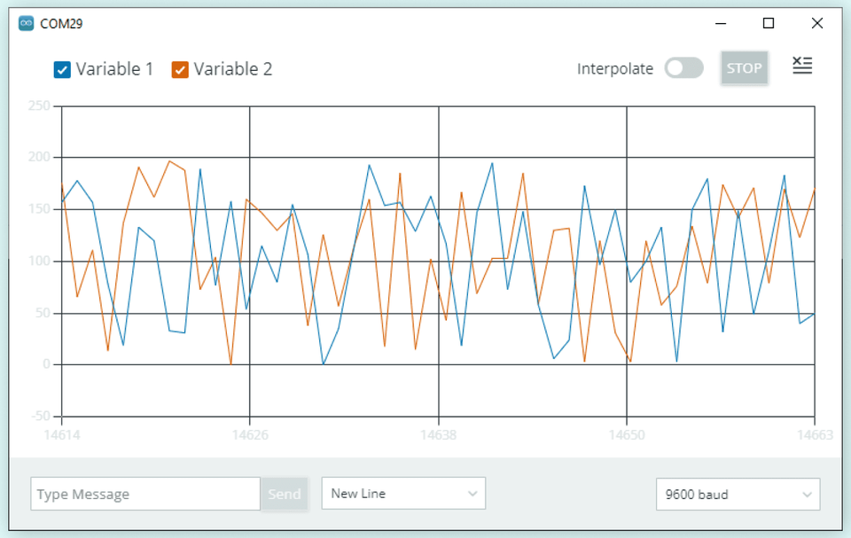
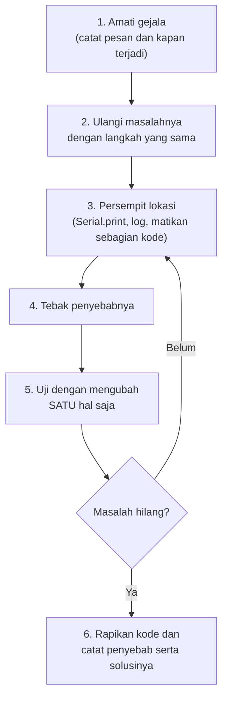

# BAB 21: Debugging & Troubleshooting

> ✅ **Prasyarat:** Selesaikan **BAB 20 (Memory Management)** — kamu sudah bisa memantau *heap* dan *stack*, serta mengenal *stack overflow* dan `RTC_DATA_ATTR`. BAB ini juga memakai pembacaan potensiometer dan LDR dari [BAB 11](../BAB-11/README.md), tombol S1 dari [BAB 9](../BAB-09/README.md), dan pola `millis()` dari [BAB 16](../BAB-16/README.md).

Program yang langsung berjalan sempurna pada percobaan pertama itu langka — bahkan bagi programmer berpengalaman. Kesalahan dalam program disebut ***bug***, dan proses mencari lalu memperbaikinya disebut ***debugging***. Masalahnya, ESP32 tidak punya layar: saat ESP32 diam saja atau *restart* sendiri, kamu harus menjadi detektif yang mengumpulkan petunjuk. Di BAB ini kamu belajar memakai alat-alat detektif itu — pesan Serial yang rapi dan bisa diatur levelnya, log bawaan ESP32, pesan *crash* `Guru Meditation Error`, *watchdog*, penyebab *reset*, dan grafik di Serial Plotter — lalu menyusunnya menjadi langkah *debugging* yang sistematis.

## 📌 Tujuan Pembelajaran

Setelah mempelajari BAB ini, kamu bisa:

- Menjelaskan arti *bug* dan *debugging*, serta mengikuti langkah *debugging* yang sistematis.
- Memakai Serial Monitor secara efektif: label, stempel waktu, `Serial.printf()`, dan teknik "jejak remah roti".
- Membuat pesan log berlevel (ERROR, WARN, INFO, DEBUG) yang bisa dikurangi atau dimatikan tanpa menghapus kode.
- Mengaktifkan log bawaan ESP32 lewat **Tools → Core Debug Level**, dan memakai `log_e()`, `log_w()`, `log_i()`, `log_d()`, serta `ESP_LOGx()`.
- Membaca pesan `Guru Meditation Error` dan menerjemahkan *backtrace* menjadi nama fungsi dan nomor baris.
- Menjelaskan *watchdog*, mengaktifkannya untuk `loop()`, dan membaca penyebab *reset* dengan `esp_reset_reason()`.
- Mengenali *brownout* dan *boot loop* beserta cara mengatasinya.
- Menampilkan data sebagai grafik dengan **Serial Plotter**.

## 🧰 Yang Perlu Disiapkan

| Kebutuhan | Keterangan |
|---|---|
| *Hardware* | Kit Bluino ESP32 IoT Starter Shield (ESP32 DEVKIT V1 sudah terpasang) + kabel USB **data** |
| Kabel *jumper* | 4 kabel *female-female*: potensiometer `VR10K` → IO34, `LDR` → IO35, `LED1` (merah) → IO4, dan tombol `SW1` → IO15. Setiap program hanya memakai sebagian (lihat tabel **Rangkaian** masing-masing) |
| Komponen tambahan | Tidak ada |
| *Software* | Arduino IDE 2.x + *board package* **esp32** versi 3.3.x (lihat [BAB 5](../BAB-05/README.md)). Opsional: ekstensi **ESP Exception Decoder** untuk Arduino IDE 2 (cara memasangnya di [21.9](#219-menerjemahkan-backtrace-menjadi-nama-fungsi)) |
| *Library* | Tidak perlu *library* tambahan |
| Alat uji | **Serial Monitor** (baud 115200; Program 3 memakai *line ending* **New Line**), **Serial Plotter**, dan (opsional) **Command Prompt**/**Terminal** untuk menerjemahkan *backtrace* |
| Jaringan | Tidak perlu WiFi. Internet hanya dibutuhkan sekali untuk mengunduh ekstensi (opsional) |

## 📑 Daftar Isi

- [21.1 Apa Itu Debugging?](#211-apa-itu-debugging)
- [21.2 Serial Monitor sebagai Alat Debugging](#212-serial-monitor-sebagai-alat-debugging)
- [21.3 Pesan Log Berlevel](#213-pesan-log-berlevel)
- [21.4 Program 1: Logger dengan Level](#214-program-1-logger-dengan-level)
- [21.5 Log Bawaan ESP32 dan Core Debug Level](#215-log-bawaan-esp32-dan-core-debug-level)
- [21.6 Program 2: Melihat Log Bawaan Core](#216-program-2-melihat-log-bawaan-core)
- [21.7 Membaca Pesan Crash: Guru Meditation Error](#217-membaca-pesan-crash-guru-meditation-error)
- [21.8 Program 3: Crash yang Disengaja](#218-program-3-crash-yang-disengaja)
- [21.9 Menerjemahkan Backtrace Menjadi Nama Fungsi](#219-menerjemahkan-backtrace-menjadi-nama-fungsi)
- [21.10 Watchdog dan Penyebab Reset](#2110-watchdog-dan-penyebab-reset)
- [21.11 Program 4: Watchdog untuk loop()](#2111-program-4-watchdog-untuk-loop)
- [21.12 Brownout: Saat Daya Tidak Cukup](#2112-brownout-saat-daya-tidak-cukup)
- [21.13 Serial Plotter: Melihat Data sebagai Grafik](#2113-serial-plotter-melihat-data-sebagai-grafik)
- [21.14 Program 5: Grafik Potensiometer dan LDR](#2114-program-5-grafik-potensiometer-dan-ldr)
- [21.15 Langkah Debugging yang Sistematis](#2115-langkah-debugging-yang-sistematis)
- [21.16 Troubleshooting](#2116-troubleshooting)
- [📝 Rangkuman](#-rangkuman)
- [💪 Latihan](#-latihan)
- [📚 Referensi](#-referensi)

---

## 21.1 Apa Itu Debugging?

Istilah *bug* (serangga) sudah dipakai insinyur sejak abad ke-19 untuk menyebut kesalahan pada mesin. Cerita yang terkenal: pada 1947, tim komputer Harvard Mark II menemukan seekor ngengat yang tersangkut di salah satu *relay*, lalu menempelkannya di buku catatan dengan keterangan "*first actual case of bug being found*" — kasus *bug* pertama yang benar-benar serangga. Kisah ini membuat istilahnya makin populer, dan kegiatan mencari lalu memperbaiki kesalahan program disebut ***debugging***.

Di program ESP32, *bug* biasanya muncul dalam salah satu bentuk berikut:

| Jenis *bug* | Contoh gejala | Alat bantu utama di BAB ini |
|---|---|---|
| Salah ketik / salah tata bahasa | *Compile* gagal, muncul pesan *error* merah | Panel **Output** Arduino IDE ([BAB 7](../BAB-07/README.md)) |
| Salah logika | Program berjalan, tetapi hasilnya salah (LED tidak menyala, angka aneh) | Serial Monitor, log berlevel, Serial Plotter |
| Salah pemakaian *hardware* | Komponen tidak merespons, pembacaan sensor kacau | Log bawaan ESP32, pemeriksaan kabel |
| *Crash* | ESP32 *restart* sendiri dengan pesan `Guru Meditation Error` | Pesan *crash*, *backtrace*, penyebab *reset* |
| Program macet | ESP32 diam, tidak merespons apa pun | *Watchdog*, teknik jejak remah roti |
| Masalah daya | *Restart* saat WiFi atau *relay* menyala, pesan `Brownout detector was triggered` | Penyebab *reset*, kabel dan catu daya |

Debugging yang efektif mirip kerja dokter: tanyakan gejalanya, periksa, tebak penyebabnya, lalu uji tebakan itu satu per satu. Langkah-langkah lengkapnya dirangkum di [21.15](#2115-langkah-debugging-yang-sistematis).

---

## 21.2 Serial Monitor sebagai Alat Debugging

Alat *debugging* pertama dan paling sering dipakai tetaplah **Serial Monitor** (**Tools → Serial Monitor**, baud 115200). Beberapa kebiasaan kecil membuatnya jauh lebih berguna.

**1. Selalu beri label.** Angka tanpa keterangan cepat membingungkan, apalagi kalau ada beberapa variabel:

```cpp
Serial.println(suhu);        // ❌ yang tampil hanya: 27.50

Serial.print("suhu = ");     // ✅ yang tampil: suhu = 27.50
Serial.println(suhu);
```

**2. Pakai `Serial.printf()` untuk baris yang berisi banyak nilai.** Fungsi ini memakai cetakan yang sama dengan `snprintf()` di [BAB 20](../BAB-20/README.md) (`%d` untuk bilangan bulat, `%.2f` untuk desimal, `%s` untuk teks, `\n` untuk pindah baris):

```cpp
Serial.printf("pot = %d, persen = %d %%, tombol = %d\n", pot, persen, tombol);
// tampil: pot = 2048, persen = 50 %, tombol = 0
```

**3. Aktifkan stempel waktu.** Klik ikon **Toggle Timestamp** (ikon jam) di kanan atas panel Serial Monitor. Setiap baris akan diawali jam laptop, misalnya `14:03:27.512 -> pot = 2048`. Ini membantu menjawab pertanyaan "berapa lama jeda antara kejadian A dan B?". Di dalam program, kamu juga bisa mencetak `millis()`.

**4. Jejak remah roti (*breadcrumb*).** Seperti Hansel dan Gretel yang menebar remah roti supaya tahu jalan pulang, tebarkan pesan penanda di sepanjang program. Kalau program macet atau *crash*, penanda **terakhir** yang muncul menunjukkan di mana masalahnya. Contoh potongan kode:

```cpp
void loop() {
  Serial.println(">> A: sebelum bacaSensor()");
  bacaSensor();
  Serial.println(">> B: sebelum prosesData()");
  prosesData();
  Serial.println(">> C: sebelum tampilkan()");   // kalau C tidak pernah muncul,
  tampilkan();                                   // masalahnya ada di prosesData()
}
```

> 💡 **Tips:** `Serial.println()` tidak menunggu sampai teksnya selesai terkirim; sebagian teks masih mengantre di dalam ESP32. Kalau ESP32 tiba-tiba mati atau *restart* (misalnya karena daya turun atau tidur), teks yang masih mengantre bisa hilang. Saat memburu masalah seperti ini, tambahkan `Serial.flush();` setelah penanda penting — perintah ini menunggu sampai semua teks benar-benar terkirim.

**5. Hindari "banjir" pesan.** Mencetak di setiap putaran `loop()` tanpa jeda membuat Serial Monitor sulit dibaca dan bisa memperlambat program: pada 115200 baud, ESP32 hanya bisa mengirim sekitar 11.500 karakter per detik. Kalau programmu mencetak lebih cepat dari itu, `Serial.print()` terpaksa menunggu antrean kosong. Cetak secara berkala dengan pola `millis()` dari [BAB 16](../BAB-16/README.md), atau hanya saat nilainya berubah.

---

## 21.3 Pesan Log Berlevel

Saat mencari *bug*, kamu ingin melihat **semua** detail. Setelah programnya beres, detail itu justru mengganggu. Menghapus semua `Serial.print()` satu per satu itu merepotkan — dan saat *bug* berikutnya muncul, kamu harus menulisnya lagi.

Solusinya adalah **pesan log berlevel**: setiap pesan diberi tingkat kepentingan, lalu kamu cukup mengatur satu angka untuk memilih tingkat mana saja yang ditampilkan. Ibarat volume radio — makin besar angkanya, makin "ramai" pesannya.

| Level | Angka | Dipakai untuk | Contoh |
|---|---|---|---|
| ERROR | 1 | Kesalahan serius; fungsi gagal | "Sensor tidak terdeteksi" |
| WARN | 2 | Peringatan; program masih jalan tetapi ada yang tidak beres | "Tangki tinggal sedikit" |
| INFO | 3 | Informasi penting tentang jalannya program | "Level tangki: 62 %" |
| DEBUG | 4 | Detail untuk mencari *bug* | "ADC mentah = 2540" |

Kalau level yang dipilih INFO (3), pesan ERROR, WARN, dan INFO tampil, sedangkan DEBUG disembunyikan. Kalau dipilih 0, semua pesan log disembunyikan.

Level seperti ini dibuat dengan **makro** — perintah `#define` yang "menyalin-tempel" kode sebelum *compile* (lihat [BAB 7](../BAB-07/README.md)). Makro bisa menerima parameter, dan tanda `...` artinya "terima berapa pun parameternya", lalu semuanya diteruskan lewat `__VA_ARGS__`. Program 1 memakai cara ini.

---

## 21.4 Program 1: Logger dengan Level

**Tujuan:** Memantau "level air tangki" yang disimulasikan dengan potensiometer, lalu mencetak pesan ERROR, WARN, INFO, dan DEBUG. Level log yang tampil diatur oleh satu baris `#define LEVEL_LOG`.

**Rangkaian:**

| Pin **Custom** di kit | Sambungkan ke pin ESP32 |
|---|---|
| Potensiometer (`VR10K`, pin ke-5 dari kiri di *header* kuning) | IO34 (label `34`) |

**Cara Menjalankan:**

1. Sambungkan kabel *jumper* sesuai tabel **Rangkaian** di atas.
2. Buka Arduino IDE → **File → New Sketch**, hapus isinya, lalu salin kode di bawah. Kode yang sama juga tersedia di *file* [`p1_logger_level.ino`](p1_logger_level/p1_logger_level.ino).
3. Pastikan **Tools → Board** = **ESP32 Dev Module** dan **Tools → Port** = *port* ESP32 kamu (misalnya `COM5` di Windows atau `/dev/ttyUSB0` di Linux).
4. Klik tombol **Upload** (ikon panah →) dan tunggu sampai muncul tulisan **Done uploading**.
5. Buka **Serial Monitor** (**Tools → Serial Monitor**) lalu pilih baud **115200**.
6. Putar potensiometer perlahan dari ujung ke ujung dan perhatikan pesan yang muncul.
7. Ubah `#define LEVEL_LOG LEVEL_INFO` menjadi `LEVEL_DEBUG`, *upload* lagi, dan bandingkan. Coba juga `LEVEL_WARN` dan `LEVEL_TIDAK_ADA`.

**Kode Program:**

<!-- sketch: p1_logger_level -->
```cpp
/*
 * BAB 21 - Program 1: Logger dengan Level
 * Memantau "level air tangki" (disimulasikan dengan potensiometer) dan
 * mencetak pesan ERROR/WARN/INFO/DEBUG. Pesan yang tampil diatur LEVEL_LOG.
 *
 * Rangkaian: VR10K (potensiometer) → IO34
 * Alat uji : Serial Monitor, baud 115200
 */

// ----- Level log: makin besar angkanya, makin banyak pesan yang tampil -----
#define LEVEL_TIDAK_ADA 0
#define LEVEL_ERROR     1
#define LEVEL_WARN      2
#define LEVEL_INFO      3
#define LEVEL_DEBUG     4

#define LEVEL_LOG LEVEL_INFO  // ← ubah di sini: LEVEL_DEBUG, LEVEL_WARN, LEVEL_TIDAK_ADA, ...

// Mencetak awalan setiap pesan log, misalnya: [2000 ms][INFO ]
void awalanLog(const char *namaLevel) {
  Serial.print("[");
  Serial.print(millis());
  Serial.print(" ms][");
  Serial.print(namaLevel);
  Serial.print("] ");
}

// Makro log. "..." menerima berapa pun parameter, lalu diteruskan ke Serial.printf().
// do { ... } while (0) membuat makro aman dipakai di dalam if-else.
#define LOG_ERROR(...) do { if (LEVEL_LOG >= LEVEL_ERROR) { awalanLog("ERROR"); Serial.printf(__VA_ARGS__); Serial.println(); } } while (0)
#define LOG_WARN(...)  do { if (LEVEL_LOG >= LEVEL_WARN)  { awalanLog("WARN "); Serial.printf(__VA_ARGS__); Serial.println(); } } while (0)
#define LOG_INFO(...)  do { if (LEVEL_LOG >= LEVEL_INFO)  { awalanLog("INFO "); Serial.printf(__VA_ARGS__); Serial.println(); } } while (0)
#define LOG_DEBUG(...) do { if (LEVEL_LOG >= LEVEL_DEBUG) { awalanLog("DEBUG"); Serial.printf(__VA_ARGS__); Serial.println(); } } while (0)

#define PIN_POT 34  // VR10K (potensiometer) → IO34

const unsigned long INTERVAL_BACA = 2000;  // ms: baca "tangki" setiap 2 detik
unsigned long waktuBaca = 0;

void setup() {
  Serial.begin(115200);
  delay(1000);

  Serial.println("BAB 21 - Program 1: Logger dengan Level");  // selalu tampil
  LOG_INFO("Level log aktif: %d (1=ERROR, 2=WARN, 3=INFO, 4=DEBUG)", LEVEL_LOG);
  LOG_DEBUG("Potensiometer dibaca dari IO%d", PIN_POT);
}

void loop() {
  if (millis() - waktuBaca < INTERVAL_BACA) {
    return;  // belum waktunya membaca
  }
  waktuBaca = millis();

  int mentah = analogRead(PIN_POT);           // 0 sampai 4095
  int persen = map(mentah, 0, 4095, 0, 100);  // ubah ke 0 sampai 100 %

  LOG_DEBUG("ADC mentah = %d, tegangan = %d mV", mentah, (int)analogReadMilliVolts(PIN_POT));
  LOG_INFO("Level tangki: %d %%", persen);

  if (persen < 10) {
    LOG_ERROR("Tangki hampir kosong (%d %%)! Segera isi ulang.", persen);
  } else if (persen < 25) {
    LOG_WARN("Tangki tinggal sedikit (%d %%)", persen);
  }
}
```

**Penjelasan Kode:**

1. **`#define LEVEL_LOG LEVEL_INFO`** adalah "tombol volume" pesan log. Hanya baris ini yang perlu diubah untuk menambah atau mengurangi pesan.
2. **`awalanLog()`** mencetak awalan seragam: waktu sejak ESP32 mulai (dalam ms) dan nama levelnya. Nama `"WARN "` dan `"INFO "` sengaja diberi spasi supaya lebarnya sama dengan `"ERROR"` dan `"DEBUG"`, sehingga baris-baris log rata.
3. **Makro `LOG_INFO(...)`** dan kawan-kawannya memeriksa `LEVEL_LOG`. Kalau levelnya cukup, makro mencetak awalan, lalu meneruskan isi pesan ke `Serial.printf()`, lalu pindah baris. Penanda `%d` diganti angka, dan `%%` mencetak tanda persen.
4. **`do { ... } while (0)`** terlihat aneh, tetapi ini trik standar supaya makro yang berisi beberapa perintah tetap aman ditulis di dalam `if-else`, misalnya `if (x) LOG_INFO("..."); else ...`.
5. Karena `LEVEL_LOG` adalah angka tetap, *compiler* langsung membuang pesan yang levelnya tidak aktif. Pesan yang dimatikan tidak memperlambat program.
6. **`map(mentah, 0, 4095, 0, 100)`** mengubah nilai ADC 0–4095 menjadi persen 0–100 (lihat [BAB 11](../BAB-11/README.md)). `analogReadMilliVolts()` membaca tegangan pin dalam milivolt; hasilnya diubah ke `int` dengan `(int)` supaya cocok dengan penanda `%d`.

**Contoh Output** (`LEVEL_LOG` = `LEVEL_INFO`, potensiometer diputar ke arah nol):

```text
BAB 21 - Program 1: Logger dengan Level
[1001 ms][INFO ] Level log aktif: 3 (1=ERROR, 2=WARN, 3=INFO, 4=DEBUG)
[2000 ms][INFO ] Level tangki: 62 %
[4000 ms][INFO ] Level tangki: 23 %
[4000 ms][WARN ] Tangki tinggal sedikit (23 %)
[6000 ms][INFO ] Level tangki: 6 %
[6000 ms][ERROR] Tangki hampir kosong (6 %)! Segera isi ulang.
```

**Contoh Output** (`LEVEL_LOG` = `LEVEL_DEBUG`):

```text
BAB 21 - Program 1: Logger dengan Level
[1001 ms][INFO ] Level log aktif: 4 (1=ERROR, 2=WARN, 3=INFO, 4=DEBUG)
[1001 ms][DEBUG] Potensiometer dibaca dari IO34
[2000 ms][DEBUG] ADC mentah = 2540, tegangan = 2051 mV
[2000 ms][INFO ] Level tangki: 62 %
```

Angka di atas hanya contoh — **angkamu bisa berbeda**, tergantung posisi potensiometer. Dengan `LEVEL_WARN`, hanya pesan WARN dan ERROR yang tampil; dengan `LEVEL_TIDAK_ADA`, hanya judul program yang tampil. Di kit tidak ada komponen yang bereaksi — potensiometer hanya dibaca.

**Kalau Belum Berhasil:**

- **Level tangki selalu 0 % atau 100 %** → kabel `VR10K` → IO34 belum terpasang atau salah pin. Pastikan ujungnya di pin berlabel `34` pada deretan pin ESP32 atas.
- **Level tangki melompat-lompat tanpa diputar** → IO34 mengambang karena kabel lepas. Pasang ulang kabelnya.
- **Pesan DEBUG tidak muncul** → `LEVEL_LOG` masih `LEVEL_INFO`. Ubah ke `LEVEL_DEBUG`, lalu *upload* ulang.
- **Muncul *error* `'LOG_INFO' was not declared in this scope`** → baris `#define LOG_INFO(...)` terhapus atau salah ketik. Salin ulang bagian makro.

---

## 21.5 Log Bawaan ESP32 dan Core Debug Level

*Board package* esp32 sendiri sudah berisi ribuan pesan log — misalnya saat sebuah pin dipakai dengan salah atau sebuah fungsi gagal. Secara bawaan semuanya **disembunyikan**. Untuk menampilkannya, buka menu **Tools → Core Debug Level** di Arduino IDE, pilih levelnya, lalu *upload* ulang programmu:

| Pilihan **Core Debug Level** | Log yang tampil |
|---|---|
| **None** (bawaan) | Tidak ada |
| **Error** | `log_e()` |
| **Warn** | `log_e()`, `log_w()` |
| **Info** | `log_e()`, `log_w()`, `log_i()` |
| **Debug** | Semua di atas + `log_d()`, ditambah laporan chip sebelum dan sesudah `setup()` |
| **Verbose** | Semua log, termasuk `log_v()` — paling ramai, misalnya setiap kejadian WiFi |

Kamu juga bisa memakai mekanisme yang sama di programmu sendiri. Cara menulisnya sama seperti `Serial.printf()`:

```cpp
log_e("Sensor gagal dibaca, kode = %d", kode);  // E = Error
log_w("Baterai lemah: %.2f V", tegangan);       // W = Warning
log_i("Terhubung ke WiFi");                      // I = Info
log_d("Nilai mentah = %d", mentah);              // D = Debug
log_v("Masuk fungsi bacaSensor()");              // V = Verbose
```

Hasilnya otomatis diberi keterangan lengkap. Contoh satu baris log:

```text
[  1012][E][p2_log_bawaan.ino:21] setup(): Contoh pesan ERROR, kode = 12
```

| Bagian | Artinya |
|---|---|
| `[  1012]` | Waktu sejak ESP32 mulai, dalam milidetik |
| `[E]` | Level: `E`, `W`, `I`, `D`, atau `V` |
| `p2_log_bawaan.ino:21` | Nama *file* dan **nomor baris** tempat log ditulis |
| `setup()` | Nama fungsi tempat log ditulis |
| Sisanya | Isi pesan |

Contoh kode berbagai *library* ESP-IDF memakai gaya `ESP_LOGE(TAG, ...)`, `ESP_LOGW(TAG, ...)`, `ESP_LOGI(TAG, ...)`, dan seterusnya. `TAG` adalah teks label bebas, misalnya nama modul. Di *board package* esp32, perintah-perintah ini diarahkan ke `log_x()`, jadi ikut diatur oleh **Core Debug Level** yang sama. Label `TAG` tampil dalam kurung siku di awal pesan.

Dibandingkan *logger* buatan sendiri di Program 1, log bawaan punya dua kelebihan: nama *file*, nomor baris, dan nama fungsinya tercatat otomatis, dan kamu ikut melihat pesan kesalahan dari dalam *board package* — kesalahan yang tanpa log ini terjadi diam-diam.

> 📌 **Catatan:** **Core Debug Level** hanya mengatur `log_x()` dan `ESP_LOGx()`. `Serial.print()` biasa selalu tampil apa pun levelnya. Setelah selesai mencari *bug*, kembalikan ke **None**: log yang menyala memperbesar program dan sedikit memperlambatnya.

---

## 21.6 Program 2: Melihat Log Bawaan Core

**Tujuan:** Mencoba kelima level `log_x()` dan gaya `ESP_LOGx()`, lalu melihat bagaimana log bawaan mengungkap kesalahan klasik pemula: memanggil `digitalWrite()` tanpa `pinMode()`. Tanpa log, LED hanya diam tanpa penjelasan apa pun.

**Rangkaian:**

| Pin **Custom** di kit | Sambungkan ke pin ESP32 |
|---|---|
| `LED1` (LED merah) | IO4 (label `4`) |

**Cara Menjalankan:**

1. Sambungkan kabel *jumper* sesuai tabel **Rangkaian** di atas.
2. Buka Arduino IDE → **File → New Sketch**, hapus isinya, lalu salin kode di bawah. Kode yang sama juga tersedia di *file* [`p2_log_bawaan.ino`](p2_log_bawaan/p2_log_bawaan.ino).
3. Pastikan **Tools → Board** = **ESP32 Dev Module** dan **Tools → Port** = *port* ESP32 kamu.
4. **Penting:** pilih **Tools → Core Debug Level → Info**.
5. Klik tombol **Upload** dan tunggu sampai muncul tulisan **Done uploading**.
6. Buka **Serial Monitor** (**Tools → Serial Monitor**) lalu pilih baud **115200**. Tekan tombol **EN** supaya kamu melihat semua pesan dari awal.
7. Setelah selesai, coba ulangi dengan **Core Debug Level** = **None**, lalu = **Debug**, dan bandingkan hasilnya.

**Kode Program:**

<!-- sketch: p2_log_bawaan fqbn=esp32:esp32:esp32:DebugLevel=info -->
```cpp
/*
 * BAB 21 - Program 2: Log Bawaan dan Core Debug Level
 * Mencoba log_e() ... log_v() dan ESP_LOGx(), lalu memperlihatkan pesan
 * kesalahan dari core saat digitalWrite() dipanggil tanpa pinMode().
 *
 * PENTING  : pilih Tools → Core Debug Level → Info sebelum upload
 * Rangkaian: LED1 (merah) → IO4
 * Alat uji : Serial Monitor, baud 115200
 */

#define LED_MERAH 4  // LED1 (merah) → IO4

static const char *TAG = "TANGKI";  // label bebas untuk ESP_LOGx()

void setup() {
  Serial.begin(115200);
  delay(1000);
  Serial.println("BAB 21 - Program 2: Log Bawaan dan Core Debug Level");

  // 1. Lima tingkat log bawaan core (tampil sesuai Core Debug Level)
  log_e("Contoh pesan ERROR, kode = %d", 12);
  log_w("Contoh pesan WARNING");
  log_i("Contoh pesan INFO");
  log_d("Contoh pesan DEBUG");
  log_v("Contoh pesan VERBOSE");

  // 2. Gaya ESP-IDF: ESP_LOGx(TAG, ...) ikut diatur Core Debug Level
  ESP_LOGI(TAG, "Level air %d %%", 75);
  ESP_LOGW(TAG, "Sensor belum dikalibrasi");

  // 3. Kesalahan klasik: digitalWrite() tanpa pinMode()
  Serial.println("Menyalakan LED merah TANPA pinMode()...");
  digitalWrite(LED_MERAH, HIGH);  // gagal: IO4 belum diatur sebagai output
  delay(2000);

  Serial.println("Menyalakan LED merah DENGAN pinMode()...");
  pinMode(LED_MERAH, OUTPUT);
  digitalWrite(LED_MERAH, HIGH);  // berhasil: LED merah menyala
}

void loop() {
  static unsigned long waktuLog = 0;
  if (millis() - waktuLog >= 5000) {
    waktuLog = millis();
    log_i("Heap bebas: %lu byte", (unsigned long)ESP.getFreeHeap());
    log_d("millis() = %lu", millis());
  }
}
```

**Penjelasan Kode:**

1. **`log_e()` sampai `log_v()`** dipakai seperti `Serial.printf()`, tetapi tanpa `\n` — pindah baris ditambahkan otomatis. Pesan yang tidak termasuk pilihan **Core Debug Level** dibuang saat *compile*.
2. **`static const char *TAG = "TANGKI";`** adalah label untuk `ESP_LOGI()` dan `ESP_LOGW()`. Di program besar, setiap modul biasanya punya `TAG` sendiri (misalnya `"WIFI"`, `"SENSOR"`), sehingga mudah melihat pesan itu datang dari bagian mana.
3. **`digitalWrite(LED_MERAH, HIGH)` sebelum `pinMode()`.** Di *board package* esp32 3.x, pin harus diatur dulu dengan `pinMode()`. Kalau belum, `digitalWrite()` menolak bekerja dan LED tidak menyala. Kesalahan ini hanya dilaporkan lewat `log_e()` di dalam *board package* — jadi tanpa **Core Debug Level** minimal **Error**, kamu tidak mendapat petunjuk apa pun.
4. **`static unsigned long waktuLog`** di dalam `loop()` adalah variabel `static` lokal (lihat [BAB 19](../BAB-19/README.md)): nilainya tetap diingat antarputaran `loop()`. Setiap 5 detik, program mencatat sisa *heap* dengan `log_i()` dan nilai `millis()` dengan `log_d()`.

**Contoh Output** (**Core Debug Level** = **Info**):

```text
BAB 21 - Program 2: Log Bawaan dan Core Debug Level
[  1012][E][p2_log_bawaan.ino:21] setup(): Contoh pesan ERROR, kode = 12
[  1012][W][p2_log_bawaan.ino:22] setup(): Contoh pesan WARNING
[  1013][I][p2_log_bawaan.ino:23] setup(): Contoh pesan INFO
[  1013][I][p2_log_bawaan.ino:28] setup(): [TANGKI] Level air 75 %
[  1014][W][p2_log_bawaan.ino:29] setup(): [TANGKI] Sensor belum dikalibrasi
Menyalakan LED merah TANPA pinMode()...
[  1015][E][esp32-hal-gpio.c:185] __digitalWrite(): IO 4 is not set as GPIO. Execute digitalMode(4, OUTPUT) first.
Menyalakan LED merah DENGAN pinMode()...
[  5000][I][p2_log_bawaan.ino:45] loop(): Heap bebas: 331788 byte
[ 10000][I][p2_log_bawaan.ino:45] loop(): Heap bebas: 331788 byte
```

Waktu dan angka *heap* di atas hanya contoh — **angkamu bisa berbeda**. Perhatikan:

- Pesan DEBUG (baris 24 dan 46) dan VERBOSE (baris 25) tidak tampil karena lebih rinci daripada level **Info**.
- Baris `esp32-hal-gpio.c:185 __digitalWrite()` berasal dari dalam *board package*, bukan dari programmu. Pesannya kira-kira berarti "IO 4 belum diatur sebagai GPIO, jalankan dulu `pinMode(4, OUTPUT)`" (di pesan aslinya tertulis `digitalMode`, maksudnya `pinMode`).
- Di kit: LED merah **tidak** menyala selama 2 detik pertama, lalu menyala setelah `pinMode()` dipanggil.
- Kadang ada satu-dua baris log dari *board package* sebelum judul program, misalnya tentang PSRAM. Itu normal dan boleh diabaikan.

Dengan **Core Debug Level** = **None**, Serial Monitor hanya menampilkan tiga baris `Serial.println()`, tanpa petunjuk kenapa LED tidak menyala di awal. Dengan **Debug**, baris DEBUG ikut tampil. Selain itu, sebelum judul program muncul laporan panjang berbahasa Inggris yang diawali `=========== Before Setup Start ===========` (mirip laporan `ENABLE_CHIP_DEBUG_REPORT` di [BAB 20](../BAB-20/README.md)), dan setelah `setup()` selesai muncul laporan kedua yang diawali `=========== After Setup Start ============`.

**Kalau Belum Berhasil:**

- **Tidak ada satu pun baris berawalan `[`** → **Core Debug Level** masih **None**, atau kamu mengubahnya tanpa *upload* ulang. Pilih **Info**, lalu klik **Upload** lagi.
- **Baris log menyambung di tengah teks lain** → `log_x()` dipanggil saat baris `Serial.print()` sebelumnya belum diakhiri. Selesaikan dulu barisnya dengan `Serial.println()`.
- **LED merah tidak menyala sama sekali, bahkan setelah `pinMode()`** → kabel `LED1` → IO4 belum terpasang atau salah pin.

---

## 21.7 Membaca Pesan Crash: Guru Meditation Error

Kalau program melakukan sesuatu yang terlarang — misalnya membaca memori di alamat yang tidak ada — prosesor langsung berhenti. Sistem lalu mencetak laporan *crash* (disebut *panic*) ke Serial Monitor, kemudian me-*restart* ESP32. Laporan itu diawali kalimat unik: **`Guru Meditation Error`**. Bentuknya kira-kira seperti ini (dipersingkat):

```text
Guru Meditation Error: Core  1 panic'ed (LoadProhibited). Exception was unhandled.

Core  1 register dump:
PC      : 0x400d16ae  PS      : 0x00060730  A0      : 0x800d1804  A1      : 0x3ffb2230
...
EXCVADDR: 0x00000000  LBEG    : 0x400014fd  LEND    : 0x4000150d  LCOUNT  : 0xffffffff


Backtrace: 0x400d16ae:0x3ffb2230 0x400d1801:0x3ffb2250 0x400d4004:0x3ffb2270 0x400880ed:0x3ffb2290

ELF file SHA256: 3f6b2a1c9

Rebooting...
```

Jangan panik melihat deretan angka itu. Cukup perhatikan empat bagian berikut:

| Bagian | Contoh | Artinya |
|---|---|---|
| Jenis *crash* | `(LoadProhibited)` | Apa yang dilanggar program — lihat tabel di bawah |
| `Core  1` | `Core  1` | Inti prosesor yang *crash*. `loop()` berjalan di core 1 (lihat [BAB 7](../BAB-07/README.md)) |
| `PC` dan `EXCVADDR` | `PC: 0x400d16ae`, `EXCVADDR: 0x00000000` | `PC` (*Program Counter*) adalah alamat instruksi yang sedang dijalankan saat *crash*. `EXCVADDR` adalah alamat memori yang gagal dibaca/ditulis. `EXCVADDR` bernilai `0x00000000` hampir pasti berarti *pointer* `NULL` |
| `Backtrace` | `0x400d16ae:0x3ffb2230 0x400d1801:...` | "Jejak langkah" pemanggilan fungsi. Pasangan paling kiri adalah tempat *crash*; pasangan berikutnya adalah fungsi yang memanggilnya, dan seterusnya. Angka sebelum titik dua adalah alamat kode — angka inilah yang diterjemahkan di [21.9](#219-menerjemahkan-backtrace-menjadi-nama-fungsi) |

Jenis *crash* yang paling sering ditemui:

| Jenis (di dalam kurung) | Artinya | Penyebab yang sering |
|---|---|---|
| `LoadProhibited` | Membaca dari alamat terlarang | Memakai *pointer* `NULL` atau *pointer* yang belum diisi, indeks *array* yang jauh melewati batas |
| `StoreProhibited` | Menulis ke alamat terlarang | Sama seperti di atas, tetapi saat menulis |
| `IntegerDivideByZero` | Pembagian bilangan bulat dengan nol | `a / b` atau `a % b` dengan `b` bernilai 0 |
| `InstrFetchProhibited` | Melompat ke alamat yang bukan kode | Memanggil *callback*/*pointer* fungsi yang masih `NULL` (`PC` bernilai `0x00000000`) |
| `IllegalInstruction` | Menjalankan instruksi yang tidak sah | Fungsi yang seharusnya mengembalikan nilai tetapi lupa `return`, atau isi memori program rusak |
| `Unhandled debug exception` + `Stack canary watchpoint triggered (loopTask)` | *Stack overflow* | *Array* lokal terlalu besar atau rekursi terlalu dalam ([BAB 20](../BAB-20/README.md)) |
| `abort() was called at PC 0x... on core 1` | Program sengaja dihentikan oleh `abort()` | Pemeriksaan `assert()` gagal, `new` gagal karena memori habis, atau kesalahan fatal di dalam *library* |
| `Interrupt wdt timeout on CPU0` (atau `CPU1`) | *Interrupt watchdog* | ISR yang terlalu lama, atau interupsi dimatikan terlalu lama ([BAB 10](../BAB-10/README.md)) |
| `Cache error` | Kode di *flash* diakses saat *flash* sedang sibuk | ISR tanpa `IRAM_ATTR` berjalan saat *flash* sedang ditulis ([BAB 10](../BAB-10/README.md)) |

Setelah `Rebooting...`, ESP32 mulai lagi dari awal, dan pesan *boot* ROM menulis alasan `rst:0xc (SW_CPU_RESET)`. Kalau *crash*-nya terjadi di `setup()`, siklus *crash* → *restart* → *crash* berulang terus tanpa henti. Keadaan ini disebut ***boot loop*** — cara mengatasinya ada di [21.16](#2116-troubleshooting).

> 📌 **Catatan:** Setelah baris `ELF file SHA256`, kadang muncul satu sampai tiga baris berawalan `E (...) esp_core_dump_...`. Baris itu hanya memberi tahu bahwa catatan *crash* gagal disimpan ke partisi `coredump` di *flash*. Abaikan saja — penyebab *crash* yang sebenarnya tetap baris `Guru Meditation Error` di atasnya.

---

## 21.8 Program 3: Crash yang Disengaja

**Tujuan:** Memicu lima jenis *crash* yang paling sering ditemui — sengaja dan dengan aman — supaya kamu terbiasa membaca pesannya. Pilih jenis *crash* dengan mengetik angka 1–5 di Serial Monitor.

> 📌 **Catatan:** *Crash* yang disengaja seperti ini tidak merusak ESP32. Setelah *crash*, ESP32 *restart* sendiri dan program kembali ke menu awal.

**Rangkaian:**

*Tidak perlu merangkai — cukup colokkan kabel USB.*

**Cara Menjalankan:**

1. Buka Arduino IDE → **File → New Sketch**, hapus isinya, lalu salin kode di bawah. Kode yang sama juga tersedia di *file* [`p3_crash_sengaja.ino`](p3_crash_sengaja/p3_crash_sengaja.ino).
2. Simpan *sketch* dengan nama `p3_crash_sengaja` (**File → Save As...**). Lokasi foldernya akan dipakai lagi di [21.9](#219-menerjemahkan-backtrace-menjadi-nama-fungsi).
3. Pastikan **Tools → Board** = **ESP32 Dev Module** dan **Tools → Port** = *port* ESP32 kamu. Kembalikan **Tools → Core Debug Level** ke **None**.
4. Klik tombol **Upload** dan tunggu sampai muncul tulisan **Done uploading**.
5. Buka **Serial Monitor** (**Tools → Serial Monitor**), pilih baud **115200**, dan pilih *line ending* **New Line** pada kotak pilihan di sebelah kiri pilihan baud.
6. Ketik `1` di kolom pesan (**Message**) di bagian atas Serial Monitor, lalu tekan Enter. Amati pesannya, tunggu ESP32 kembali ke menu, lalu coba angka lainnya.

**Kode Program:**

<!-- sketch: p3_crash_sengaja -->
```cpp
/*
 * BAB 21 - Program 3: Crash yang Disengaja
 * Ketik angka 1-5 di Serial Monitor untuk memicu satu jenis crash,
 * lalu pelajari pesan yang muncul sebelum ESP32 restart.
 *
 * Hardware : ESP32 DEVKIT V1 di kit Bluino (tidak perlu merangkai)
 * Alat uji : Serial Monitor, baud 115200, line ending "New Line"
 */

int *volatile alamatKosong = NULL;    // pointer yang menunjuk alamat 0 (NULL)
volatile int pembagi = 0;             // volatile: compiler tidak boleh menebak nilainya
volatile int batasRekursi = 1000000;  // jauh melebihi kemampuan stack

void tampilkanMenu() {
  Serial.println();
  Serial.println("Ketik angka lalu tekan Enter:");
  Serial.println("  1 = membaca alamat NULL     (LoadProhibited)");
  Serial.println("  2 = menulis ke alamat NULL  (StoreProhibited)");
  Serial.println("  3 = membagi dengan nol      (IntegerDivideByZero)");
  Serial.println("  4 = rekursi tanpa akhir     (stack overflow)");
  Serial.println("  5 = memanggil abort()");
}

void bacaNull() {
  int nilai = *alamatKosong;  // membaca isi alamat 0 -> crash
  Serial.println(nilai);      // tidak pernah sampai di sini
}

void tulisNull() {
  *alamatKosong = 42;  // menulis ke alamat 0 -> crash
}

void bagiNol() {
  int hasil = 100 / pembagi;  // pembagian bilangan bulat dengan 0 -> crash
  Serial.println(hasil);
}

int rekursi(int level) {
  volatile uint8_t catatan[200];  // setiap level memakai sekitar 200 byte stack
  catatan[0] = level;
  if (level >= batasRekursi) {
    return 0;
  }
  return rekursi(level + 1) + catatan[0];  // terus memanggil diri sendiri
}

void setup() {
  Serial.begin(115200);
  delay(1000);
  Serial.println("BAB 21 - Program 3: Crash yang Disengaja");
  tampilkanMenu();
}

void loop() {
  if (Serial.available() == 0) {
    return;  // belum ada ketikan
  }

  char pilihan = Serial.read();
  if (pilihan == '\n' || pilihan == '\r') {
    return;  // abaikan karakter Enter
  }

  Serial.print("Pilihan ");
  Serial.print(pilihan);
  Serial.println(": ESP32 akan crash...");
  Serial.flush();  // tunggu teks terkirim sebelum crash

  switch (pilihan) {
    case '1': bacaNull(); break;
    case '2': tulisNull(); break;
    case '3': bagiNol(); break;
    case '4': Serial.println(rekursi(0)); break;
    case '5': abort(); break;
    default:
      Serial.println("Pilihan tidak dikenal.");
      tampilkanMenu();
      break;
  }
}
```

**Penjelasan Kode:**

1. **`int *volatile alamatKosong = NULL;`** membuat *pointer* (variabel berisi alamat memori) yang menunjuk alamat 0. Alamat 0 tidak boleh dibaca atau ditulis, jadi `*alamatKosong` (membaca isi alamat itu) langsung membuat *crash*. Kata `volatile` mencegah *compiler* "mengakali" kode yang jelas-jelas salah ini.
2. **`100 / pembagi`** dengan `pembagi` bernilai 0 memicu `IntegerDivideByZero`. Pembagian **bilangan bulat** dengan nol selalu *crash*; pembagian `float` dengan nol tidak *crash*, tetapi menghasilkan `inf` atau `nan`.
3. **`rekursi()`** memanggil dirinya sendiri dengan *array* lokal 200 *byte* di setiap level. Batasnya (`batasRekursi`) sengaja dibuat sangat besar sehingga *stack* `loopTask` 8 KB habis lebih dulu.
4. **`abort()`** adalah fungsi standar untuk menghentikan program secara paksa. *Library* sering memanggilnya saat menemukan kesalahan fatal.
5. **`Serial.flush()`** memastikan tulisan `Pilihan ...` sempat terkirim sebelum *crash*.
6. **`Serial.read()`** mengambil satu karakter yang kamu ketik. Karena *line ending* **New Line** menambahkan karakter `'\n'` setelah angka, karakter itu diabaikan.

**Contoh Output** (pilihan `1`):

```text
BAB 21 - Program 3: Crash yang Disengaja

Ketik angka lalu tekan Enter:
  1 = membaca alamat NULL     (LoadProhibited)
  2 = menulis ke alamat NULL  (StoreProhibited)
  3 = membagi dengan nol      (IntegerDivideByZero)
  4 = rekursi tanpa akhir     (stack overflow)
  5 = memanggil abort()
Pilihan 1: ESP32 akan crash...
Guru Meditation Error: Core  1 panic'ed (LoadProhibited). Exception was unhandled.

Core  1 register dump:
PC      : 0x400d16ae  PS      : 0x00060730  A0      : 0x800d1804  A1      : 0x3ffb2230
A2      : 0x00000031  A3      : 0x3ffc1e60  A4      : 0x00000000  A5      : 0x00000001
A6      : 0x3ffc1dd8  A7      : 0x00000031  A8      : 0x00000000  A9      : 0x3ffb2210
A10     : 0x3ffc1dd8  A11     : 0x3ffc1dd8  A12     : 0x0000000a  A13     : 0x00000000
A14     : 0x00000000  A15     : 0x00000000  SAR     : 0x0000000a  EXCCAUSE: 0x0000001c
EXCVADDR: 0x00000000  LBEG    : 0x400014fd  LEND    : 0x4000150d  LCOUNT  : 0xffffffff


Backtrace: 0x400d16ae:0x3ffb2230 0x400d1801:0x3ffb2250 0x400d4004:0x3ffb2270 0x400880ed:0x3ffb2290


ELF file SHA256: 3f6b2a1c9

Rebooting...
ets Jul 29 2019 12:21:46

rst:0xc (SW_CPU_RESET),boot:0x13 (SPI_FAST_FLASH_BOOT)
...
BAB 21 - Program 3: Crash yang Disengaja
```

Alamat, isi register, dan kode `ELF file SHA256` di atas hanya contoh — **angkamu pasti berbeda**. Baris `...` menandakan pesan *boot* ROM yang dipersingkat. Pilihan lain menghasilkan pesan yang berbeda:

| Pilihan | Baris pertama laporan *crash* |
|---|---|
| `2` | `Guru Meditation Error: Core  1 panic'ed (StoreProhibited). Exception was unhandled.` |
| `3` | `Guru Meditation Error: Core  1 panic'ed (IntegerDivideByZero). Exception was unhandled.` |
| `4` | `Guru Meditation Error: Core  1 panic'ed (Unhandled debug exception).` lalu `Debug exception reason: Stack canary watchpoint triggered (loopTask)` |
| `5` | `abort() was called at PC 0x400d17fe on core 1` (alamatnya berbeda di *board*-mu) |

Di kit tidak ada komponen yang bereaksi; hanya LED **PWR** yang tetap menyala.

**Kalau Belum Berhasil:**

- **Mengetik angka tidak menghasilkan apa-apa** → pastikan kursor ada di kolom **Message** Serial Monitor dan kamu menekan Enter, serta *port* yang dipilih benar.
- **Muncul `Pilihan tidak dikenal.`** → kamu mengetik selain angka 1–5, misalnya spasi atau huruf. Ketik satu angka saja, lalu tekan Enter.
- **Laporan *crash* tampil sebagai karakter acak** → baud Serial Monitor bukan 115200.

---

## 21.9 Menerjemahkan Backtrace Menjadi Nama Fungsi

Alamat seperti `0x400d16ae` tidak berarti apa-apa bagi manusia. Untuk menerjemahkannya menjadi "fungsi `bacaNull()` di baris 26", dibutuhkan *file* **ELF** — hasil *compile* yang menyimpan peta alamat ke nama fungsi dan nomor baris. Arduino IDE 2 **tidak** punya penerjemah (*Exception Decoder*) bawaan seperti Arduino IDE 1.x, jadi pilih salah satu cara berikut.

> ⚠️ **Perhatian:** *File* ELF harus berasal dari *compile* yang **sama persis** dengan program yang sedang berjalan di ESP32. Kalau kodenya sudah kamu ubah sedikit saja setelah *upload*, alamatnya bergeser dan hasil terjemahannya salah.

### 21.9.1 Cara 1: Ekstensi ESP Exception Decoder (Disarankan)

**ESP Exception Decoder** adalah ekstensi buatan komunitas (dankeboy36) yang menambahkan penerjemah *backtrace* ke Arduino IDE 2. Cara memasangnya (cukup sekali):

1. Buka halaman rilis [github.com/dankeboy36/esp-exception-decoder/releases](https://github.com/dankeboy36/esp-exception-decoder/releases) di *browser*.
2. Unduh *file* berakhiran `.vsix` dari rilis **versi 1.x** terbaru, misalnya `esp-exception-decoder-1.1.1.vsix`. **Jangan** memakai versi 2.x ke atas: versi itu dibuat untuk VS Code dan tidak berjalan di Arduino IDE 2.
3. Tutup Arduino IDE.
4. Salin *file* `.vsix` tadi ke folder `plugins`:
   - **Windows:** buka **File Explorer**, ketik `%UserProfile%\.arduinoIDE` di kolom alamat, lalu tekan Enter. Buat folder baru bernama `plugins` kalau belum ada, lalu salin *file* ke dalamnya.
   - **macOS/Linux:** folder `~/.arduinoIDE/plugins` (buat kalau belum ada). Di **Terminal**: `mkdir -p ~/.arduinoIDE/plugins`, lalu salin *file*-nya ke sana.
5. Buka lagi Arduino IDE.

Cara memakainya setiap kali terjadi *crash*:

1. Buka *sketch* yang sedang berjalan di ESP32, pastikan **Tools → Board** dan **Tools → Port** sama seperti saat *upload*, lalu klik **Verify** sekali supaya hasil *compile*-nya tersedia.
2. Tekan **Ctrl+Shift+P** (macOS: **Cmd+Shift+P**) untuk membuka *Command Palette* (kotak perintah di bagian atas jendela), ketik `ESP Exception Decoder`, lalu pilih **ESP Exception Decoder: Show Decoder Terminal**.
3. Salin seluruh laporan *crash* dari Serial Monitor (blok teks dari `Guru Meditation Error` sampai `Backtrace: ...`), lalu tempel ke terminal *decoder* yang terbuka.
4. *Decoder* menampilkan daftar fungsi lengkap dengan nama *file* dan nomor barisnya.

### 21.9.2 Cara 2: Perintah addr2line dari Toolchain ESP32

*Board package* esp32 sudah membawa program kecil bernama `xtensa-esp32-elf-addr2line` yang bisa menerjemahkan alamat dari **Command Prompt** (Windows) atau **Terminal** (macOS/Linux). Langkahnya:

**Langkah 1 — Simpan *file* ELF ke folder *sketch*.** Di Arduino IDE, klik **Sketch → Export Compiled Binary**. Arduino IDE akan *compile* ulang lalu membuat folder `build/esp32.esp32.esp32/` di dalam folder *sketch*-mu. Di dalamnya ada *file* `p3_crash_sengaja.ino.elf`. Lokasi folder *sketch* bisa dibuka lewat **Sketch → Show Sketch Folder**.

**Langkah 2 — Cari folder `addr2line`.** Program ini ada di folder *toolchain* `esp-x32`. Nama subfolder versinya (misalnya `2601`) bisa berbeda di komputermu, jadi lihat dulu isinya:

| Sistem operasi | Cara membuka | Perintah untuk melihat nama folder versi |
|---|---|---|
| Windows | Tombol **Start** → ketik `cmd` → Enter (**Command Prompt**) | `dir "%LOCALAPPDATA%\Arduino15\packages\esp32\tools\esp-x32"` |
| macOS | **Launchpad** → ketik `Terminal` → Enter | `ls ~/Library/Arduino15/packages/esp32/tools/esp-x32` |
| Linux | Buka aplikasi **Terminal** | `ls ~/.arduino15/packages/esp32/tools/esp-x32` |

**Langkah 3 — Jalankan `addr2line`.** Ketik perintah berikut dalam satu baris. Ganti `2601` dengan nama folder versi dari langkah 2, sesuaikan lokasi *file* ELF, lalu tempelkan **seluruh** isi baris `Backtrace:` (tanpa kata `Backtrace:`) di akhir perintah.

Windows (**Command Prompt**):

```bat
"%LOCALAPPDATA%\Arduino15\packages\esp32\tools\esp-x32\2601\bin\xtensa-esp32-elf-addr2line.exe" -pfiaC -e "%USERPROFILE%\Documents\Arduino\p3_crash_sengaja\build\esp32.esp32.esp32\p3_crash_sengaja.ino.elf" 0x400d16ae:0x3ffb2230 0x400d1801:0x3ffb2250 0x400d4004:0x3ffb2270
```

macOS (**Terminal**; di Linux, ganti `~/Library/Arduino15` dengan `~/.arduino15`):

```bash
~/Library/Arduino15/packages/esp32/tools/esp-x32/2601/bin/xtensa-esp32-elf-addr2line -pfiaC -e ~/Documents/Arduino/p3_crash_sengaja/build/esp32.esp32.esp32/p3_crash_sengaja.ino.elf 0x400d16ae:0x3ffb2230 0x400d1801:0x3ffb2250 0x400d4004:0x3ffb2270
```

Contoh hasilnya (lokasi folder mengikuti komputermu):

```text
0x400d16ae: bacaNull() at C:\Users\kamu\Documents\Arduino\p3_crash_sengaja/p3_crash_sengaja.ino:26
0x400d1801: loop() at C:\Users\kamu\Documents\Arduino\p3_crash_sengaja/p3_crash_sengaja.ino:70
0x400d4004: loopTask(void*) at C:\Users\kamu\AppData\Local\Arduino15\packages\esp32\hardware\esp32\3.3.12\cores\esp32/main.cpp:82
```

Cara membacanya dari atas ke bawah: *crash* terjadi di fungsi `bacaNull()` (baris 26), yang dipanggil oleh `loop()` (baris 70), yang dipanggil oleh `loopTask` milik *board package*. Baris 25–26 di Program 3 memang bagian yang membaca alamat `NULL`.

> 💡 **Tips:** Nomor baris kadang meleset satu-dua baris karena *compiler* menyusun ulang urutan perintah supaya lebih cepat. Contohnya di atas: pembacaan alamat `NULL` ada di baris 25, tetapi `addr2line` menunjuk baris 26. Periksa juga baris-baris di sekitarnya.

Arti pilihan perintah `-pfiaC`: `-p` membuat hasilnya mudah dibaca, `-f` menampilkan nama fungsi, `-i` ikut menampilkan fungsi yang di-*inline*, `-a` menampilkan alamatnya, dan `-C` merapikan nama fungsi C++.

### 21.9.3 Cara 3: Penerjemah di Browser

Ada juga penerjemah berbasis web buatan komunitas, yaitu [ESP Stack Trace Decoder](https://esphome.github.io/esp-stacktrace-decoder/) (sumber terbuka, lisensi MIT). Pilih *file* `.ino.elf` dari langkah 1 di [21.9.2](#2192-cara-2-perintah-addr2line-dari-toolchain-esp32) pada kolom **.elf binary**, lalu tempelkan laporan *crash*-nya di kolom **Stack trace**. Menurut pembuatnya, semua proses berjalan di dalam *browser*, jadi *file*-mu tidak diunggah ke mana pun. Kalau hasilnya kosong atau aneh, pakai Cara 1 atau Cara 2.

---

## 21.10 Watchdog dan Penyebab Reset

### 21.10.1 Watchdog: Satpam yang Harus Disapa

***Watchdog*** (anjing penjaga) adalah *timer* pengaman. Bayangkan satpam yang meminta setiap petugas jaga melapor paling lambat setiap 5 menit. Kalau seorang petugas tidak melapor, satpam menganggapnya pingsan dan membunyikan alarm. Di ESP32, "melapor" disebut ***feed*** (memberi makan) *watchdog*, dan "alarm"-nya adalah *restart*. Dengan *watchdog*, perangkat yang macet karena *bug* bisa pulih sendiri tanpa harus dicabut-colok listriknya.

*Board package* esp32 3.3.x mengaktifkan dua *watchdog* secara bawaan:

| *Watchdog* | Yang diawasi | Batas waktu bawaan | Kalau terlewati |
|---|---|---|---|
| ***Task watchdog*** (TWDT) | *Task* yang didaftarkan. Secara bawaan hanya *task* `IDLE0`, yaitu *task* "menganggur" di core 0 | 5 detik | Mencetak pesan `task_wdt: Task watchdog got triggered...`, lalu *restart* |
| ***Interrupt watchdog*** (IWDT) | Interupsi yang macet, atau interupsi yang dimatikan terlalu lama | 300 ms | `Guru Meditation Error ... (Interrupt wdt timeout on CPU0)` atau `CPU1`, lalu *restart* |

Ada satu hal penting yang sering mengejutkan: **`loop()` tidak diawasi secara bawaan.** `loop()` berjalan di core 1, sedangkan TWDT secara bawaan hanya mengawasi *task* `IDLE0` di core 0. Jadi kalau `loop()` terjebak di `while (true) {}`, ESP32 diam saja selamanya. Untuk mengawasi `loop()`, panggil `enableLoopWDT()` di `setup()`:

| Fungsi | Kegunaan |
|---|---|
| `enableLoopWDT()` | Mendaftarkan `loopTask` ke TWDT. Setiap putaran `loop()` harus selesai dalam 5 detik |
| `feedLoopWDT()` | "Memberi makan" *watchdog* secara manual, misalnya di dalam proses panjang yang memang wajar |
| `disableLoopWDT()` | Berhenti mengawasi `loop()` |

Setelah `enableLoopWDT()`, *board package* otomatis memberi makan *watchdog* setiap kali `loop()` selesai dan akan diulang. Artinya, `delay(6000)` di dalam `loop()` pun akan dianggap macet — panggil `feedLoopWDT()` di dalam penantian yang memang panjang.

> 💡 **Tips:** Pesan `task_wdt` yang menyebut `IDLE0 (CPU 0)` artinya ada kode lain yang memonopoli core 0 lebih dari 5 detik, misalnya *task* FreeRTOS buatanmu sendiri yang berputar tanpa `delay()`. Beri jeda (`delay(1)` atau `vTaskDelay(1)`) di dalam perulangan *task* itu supaya `IDLE0` sempat berjalan.

Batas 5 detik bisa diubah dengan `esp_task_wdt_reconfigure()`. Contoh potongan kode (tulis di `setup()`):

```cpp
#include <esp_task_wdt.h>   // tulis di bagian atas sketch

// ... di dalam setup():
esp_task_wdt_config_t konfigurasi = {
  .timeout_ms = 10000,         // batas 10 detik
  .idle_core_mask = (1 << 0),  // tetap awasi task IDLE di core 0, seperti bawaan
  .trigger_panic = true,       // restart kalau batas terlewati
};
esp_task_wdt_reconfigure(&konfigurasi);
```

> ⚠️ **Perhatian:** Contoh lama dari internet sering menulis `esp_task_wdt_init(5, true);`. Itu cara *board package* esp32 versi 2.x dan akan gagal di-*compile* pada versi 3.x. Di versi 3.x, *watchdog* sudah disiapkan sebelum `setup()`, jadi pakai `esp_task_wdt_reconfigure()` seperti contoh di atas.

### 21.10.2 Mengetahui Penyebab Reset

Saat ESP32 tiba-tiba mulai dari awal, pertanyaan pertama adalah "kenapa?". Fungsi `esp_reset_reason()` menjawabnya. Hasilnya bisa dicetak di `setup()` setiap kali program mulai:

| Hasil `esp_reset_reason()` | Pesan *boot* ROM | Artinya |
|---|---|---|
| `ESP_RST_POWERON` | `rst:0x1 (POWERON_RESET)` | Baru dinyalakan, tombol **EN** ditekan, atau selesai *upload* |
| `ESP_RST_SW` | `rst:0xc (SW_CPU_RESET)` | Program memanggil `ESP.restart()` |
| `ESP_RST_PANIC` | `rst:0xc (SW_CPU_RESET)` | *Crash*: `Guru Meditation Error` atau `abort()` |
| `ESP_RST_TASK_WDT` | `rst:0xc (SW_CPU_RESET)` | *Task watchdog*: ada *task* yang macet |
| `ESP_RST_INT_WDT` | — | *Interrupt watchdog*: interupsi macet |
| `ESP_RST_DEEPSLEEP` | `rst:0x5 (DEEPSLEEP_RESET)` | Bangun dari *deep sleep* ([BAB 20](../BAB-20/README.md)) |
| `ESP_RST_BROWNOUT` | `rst:0xf (RTCWDT_BROWN_OUT_RESET)` | Tegangan catu daya turun terlalu rendah ([21.12](#2112-brownout-saat-daya-tidak-cukup)) |

Pesan *boot* ROM (lihat [BAB 7](../BAB-07/README.md)) hanya membedakan jenis *reset* secara kasar — *crash*, *watchdog*, dan `ESP.restart()` sama-sama tertulis `SW_CPU_RESET`. `esp_reset_reason()` memberi jawaban yang lebih tepat.

---

## 21.11 Program 4: Watchdog untuk loop()

**Tujuan:** Mengaktifkan *watchdog* untuk `loop()`, lalu membuat program sengaja macet saat tombol S1 ditekan. *Watchdog* me-*restart* ESP32 dalam 5 detik, dan setelah *restart* program menampilkan penyebabnya.

**Rangkaian:**

| Pin **Custom** di kit | Sambungkan ke pin ESP32 |
|---|---|
| Tombol S1 (`SW1`, pin ke-3 dari kiri di *header* kuning) | IO15 (label `15`) |

> ⚠️ **Perhatian:** Pin `15` di deretan pin ESP32 bawah bersebelahan dengan pin `G` (GND). Pastikan kabelnya tidak meleset (lihat [BAB 9](../BAB-09/README.md)).

**Cara Menjalankan:**

1. Sambungkan kabel *jumper* sesuai tabel **Rangkaian** di atas.
2. Buka Arduino IDE → **File → New Sketch**, hapus isinya, lalu salin kode di bawah. Kode yang sama juga tersedia di *file* [`p4_watchdog_loop.ino`](p4_watchdog_loop/p4_watchdog_loop.ino).
3. Pastikan **Tools → Board** = **ESP32 Dev Module**, **Tools → Port** = *port* ESP32 kamu, dan **Tools → Core Debug Level** = **None**.
4. Klik tombol **Upload** dan tunggu sampai muncul tulisan **Done uploading**.
5. Buka **Serial Monitor** (**Tools → Serial Monitor**) lalu pilih baud **115200**. Tekan tombol **EN** supaya kamu melihat pesan dari awal.
6. Tunggu beberapa detik, lalu tekan tombol S1 sekali. Hitung dalam hati sampai ESP32 *restart*.

**Kode Program:**

<!-- sketch: p4_watchdog_loop -->
```cpp
/*
 * BAB 21 - Program 4: Watchdog untuk loop() dan Penyebab Reset
 * - Saat mulai, menampilkan penyebab reset terakhir (esp_reset_reason()).
 * - Mengaktifkan task watchdog untuk loop() dengan batas 5 detik.
 * - Tekan tombol S1 untuk membuat program macet -> watchdog me-reset ESP32.
 *
 * Rangkaian: Tombol S1 (SW1) → IO15
 * Alat uji : Serial Monitor, baud 115200
 */

#define TOMBOL_S1 15  // SW1 → IO15 (pull-down 10 kΩ di kit, ditekan = HIGH)

unsigned long waktuLapor = 0;  // kapan laporan terakhir dicetak
unsigned long detik = 0;       // berapa detik program sudah berjalan normal

// Menerjemahkan hasil esp_reset_reason() menjadi teks yang mudah dibaca
const char *namaPenyebabReset(esp_reset_reason_t alasan) {
  switch (alasan) {
    case ESP_RST_POWERON:   return "POWERON (baru dinyalakan / tombol EN / upload)";
    case ESP_RST_SW:        return "SW (ESP.restart() dari program)";
    case ESP_RST_PANIC:     return "PANIC (crash: Guru Meditation / abort)";
    case ESP_RST_INT_WDT:   return "INT_WDT (interrupt watchdog)";
    case ESP_RST_TASK_WDT:  return "TASK_WDT (task watchdog: program macet)";
    case ESP_RST_WDT:       return "WDT (watchdog lain)";
    case ESP_RST_DEEPSLEEP: return "DEEPSLEEP (bangun dari deep sleep)";
    case ESP_RST_BROWNOUT:  return "BROWNOUT (tegangan catu daya turun)";
    default:                return "lainnya";
  }
}

void setup() {
  Serial.begin(115200);
  delay(1000);
  pinMode(TOMBOL_S1, INPUT);

  Serial.println("BAB 21 - Program 4: Watchdog dan Penyebab Reset");
  Serial.print("Penyebab reset terakhir: ");
  Serial.println(namaPenyebabReset(esp_reset_reason()));

  enableLoopWDT();  // mulai sekarang loop() diawasi: macet > 5 detik -> reset
  Serial.println("Watchdog loop() aktif (batas 5 detik). Tekan S1 untuk membuat program macet.");
}

void loop() {
  if (millis() - waktuLapor >= 1000) {
    waktuLapor = millis();
    detik = detik + 1;
    Serial.print("Berjalan normal, detik ke-");
    Serial.println(detik);
  }

  if (digitalRead(TOMBOL_S1) == HIGH) {
    Serial.println("S1 ditekan: program macet di while (true)...");
    while (true) {
      // Program terjebak di sini: loop() tidak pernah selesai,
      // jadi watchdog tidak pernah "diberi makan".
    }
  }
}
```

**Penjelasan Kode:**

1. **`namaPenyebabReset()`** memakai `switch` untuk mengubah kode `esp_reset_reason()` menjadi teks. Fungsi ini mengembalikan `const char *`, yaitu alamat teks yang tersimpan di *flash*.
2. **`enableLoopWDT()`** dipanggil di akhir `setup()`, sehingga hanya `loop()` yang diawasi. Sejak saat itu, setiap putaran `loop()` harus selesai dalam 5 detik.
3. **Bagian laporan** memakai pola `millis()`, jadi `loop()` selalu selesai dalam waktu sangat singkat dan *watchdog* rutin diberi makan.
4. **`while (true) { }`** adalah perulangan tanpa akhir. Begitu S1 ditekan, `loop()` tidak pernah selesai, sehingga *watchdog* tidak lagi diberi makan. Setelah 5 detik, *watchdog* mencetak pesan dan me-*restart* ESP32.
5. Setelah *restart*, `setup()` berjalan lagi dan `esp_reset_reason()` kini bernilai `ESP_RST_TASK_WDT`.

**Contoh Output:**

```text
BAB 21 - Program 4: Watchdog dan Penyebab Reset
Penyebab reset terakhir: POWERON (baru dinyalakan / tombol EN / upload)
Watchdog loop() aktif (batas 5 detik). Tekan S1 untuk membuat program macet.
Berjalan normal, detik ke-1
Berjalan normal, detik ke-2
Berjalan normal, detik ke-3
S1 ditekan: program macet di while (true)...
E (8603) task_wdt: Task watchdog got triggered. The following tasks/users did not reset the watchdog in time:
E (8603) task_wdt:  - loopTask (CPU 1)
E (8603) task_wdt: Tasks currently running:
E (8603) task_wdt: CPU 0: IDLE0
E (8603) task_wdt: CPU 1: loopTask
E (8603) task_wdt: Aborting.
E (8603) task_wdt: Print CPU 1 backtrace
...
Rebooting...
BAB 21 - Program 4: Watchdog dan Penyebab Reset
Penyebab reset terakhir: TASK_WDT (task watchdog: program macet)
Watchdog loop() aktif (batas 5 detik). Tekan S1 untuk membuat program macet.
Berjalan normal, detik ke-1
```

Angka di dalam `E (...)` adalah waktu sejak ESP32 mulai, dalam milidetik — **angkamu bisa berbeda**. Baris `...` mewakili *backtrace* dan baris `ELF file SHA256` (lihat [21.7](#217-membaca-pesan-crash-guru-meditation-error)). Perhatikan baris ` - loopTask (CPU 1)`: *watchdog* memberi tahu *task* mana yang macet. Selama macet, Serial Monitor diam sekitar 5 detik. Di kit tidak ada komponen yang bereaksi selain tombol S1.

> 📌 **Catatan:** Selama kabel S1 terpasang di IO15, pesan *boot* ROM (`rst:0xc (SW_CPU_RESET)` dan seterusnya) tidak muncul (lihat [BAB 9](../BAB-09/README.md)). Itu normal — penyebab *reset* sudah ditampilkan oleh program sendiri.

**Kalau Belum Berhasil:**

- **Menekan S1 tidak berpengaruh** → periksa kabel `SW1` → IO15. Coba Program 1 [BAB 9](../BAB-09/README.md) untuk memastikan tombolnya terbaca.
- **Program macet, tetapi ESP32 tidak pernah *restart*** → baris `enableLoopWDT();` terhapus. Tanpa itu, `loop()` tidak diawasi.
- **ESP32 *restart* terus-menerus walaupun S1 tidak ditekan** → kabel S1 kemungkinan menyentuh pin `3V`, sehingga IO15 selalu HIGH. Pasang ulang kabelnya.

---

## 21.12 Brownout: Saat Daya Tidak Cukup

ESP32 butuh tegangan 3,3 V yang stabil. Kalau tegangannya turun di bawah batas tertentu — pada pengaturan bawaan sekitar 2,43 V — rangkaian ***brownout detector*** di dalam chip langsung me-*reset* ESP32 supaya chip tidak bekerja kacau. Sebelum *reset*, Serial Monitor menampilkan:

```text
Brownout detector was triggered
```

Setelah itu ESP32 mulai lagi, dan `esp_reset_reason()` bernilai `ESP_RST_BROWNOUT`. Kalau penyebabnya tidak hilang, siklus ini berulang terus.

| Penyebab | Solusi |
|---|---|
| Kabel USB jelek, terlalu panjang, atau tipis | Ganti dengan kabel USB **data** yang pendek dan bagus |
| *Port* USB lemah atau memakai *hub* USB tanpa adaptor daya | Colokkan langsung ke *port* USB laptop, atau pakai *hub* yang punya adaptor daya sendiri |
| Lonjakan arus saat WiFi mulai mengirim data (sampai sekitar 240 mA, lihat [BAB 3](../BAB-03/README.md)) | Pastikan kabel dan *port* USB-nya bagus; masalah ini paling sering muncul tepat saat WiFi tersambung |
| Beban lain menarik arus besar dari sumber yang sama, misalnya motor servo atau *relay* | Beri daya terpisah untuk beban besar, atau pakai adaptor DC lewat colokan daya kit ([BAB 3](../BAB-03/README.md)) |
| Hubung singkat kecil, misalnya kabel *jumper* yang menyambung 3V3 ke GND | Cabut USB dan periksa semua kabel |

> 🚨 **Bahaya:** Di internet beredar "solusi" mematikan *brownout detector* lewat kode. Jangan lakukan itu. *Brownout* adalah gejala, bukan penyakitnya. Kalau detektornya dimatikan, ESP32 tetap bekerja dengan tegangan kurang — hasilnya bisa lebih buruk: program berperilaku aneh, data di *flash* rusak saat sedang ditulis, atau *board* tampak "mati" tanpa pesan apa pun.

---

## 21.13 Serial Plotter: Melihat Data sebagai Grafik

Deretan angka di Serial Monitor sulit dibaca kalau nilainya berubah cepat. **Serial Plotter** menggambar angka-angka itu menjadi grafik garis secara langsung — cocok untuk melihat sensor yang naik-turun, *noise* (gangguan kecil yang membuat nilai bergoyang), atau nilai yang tiba-tiba melonjak.

Cara membukanya: klik **Tools → Serial Plotter**, atau ikon grafik di pojok kanan atas Arduino IDE (di sebelah kiri ikon Serial Monitor). Serial Plotter terbuka di jendela terpisah dan memakai *port* yang sama dengan Serial Monitor.



*Gambar 21.1 — Jendela Serial Plotter di Arduino IDE 2. Setiap label punya garis berwarna dan kotak centang untuk menampilkan/menyembunyikannya; pilihan baud ada di kanan bawah. Contoh di gambar memakai 9600 baud; untuk materi ini pilih 115200 baud. Sumber: [Karl Söderby, Arduino Docs](https://docs.arduino.cc/software/ide-v2/tutorials/ide-v2-serial-plotter/), lisensi CC BY-SA 4.0 (dipotong dan diperkecil).*

Supaya bisa digambar, data harus dikirim dengan format berikut:

- Setiap nilai ditulis sebagai `label:nilai`, misalnya `Potensiometer:2048`. Label tidak boleh mengandung spasi — pakai garis bawah, misalnya `Batas_atas`.
- Beberapa nilai dalam satu baris dipisahkan koma (boleh juga spasi atau *tab*).
- Satu baris (diakhiri `Serial.println()`) = satu titik waktu di grafik.
- Jangan mencetak teks lain selama memakai Serial Plotter, karena teks bisa terbaca sebagai label baru dan grafiknya kacau.

> 💡 **Tips:** Serial Plotter mengatur skala sumbu tegak secara otomatis mengikuti nilai yang muncul, sehingga grafik bisa "melompat-lompat". Kirim juga dua garis tetap, misalnya `Min:0` dan `Maks:4095`, supaya skalanya stabil.

---

## 21.14 Program 5: Grafik Potensiometer dan LDR

**Tujuan:** Mengirim nilai potensiometer dan LDR 20 kali per detik dalam format Serial Plotter, lalu mengamati grafiknya saat potensiometer diputar dan LDR ditutup tangan.

**Rangkaian:**

| Pin **Custom** di kit | Sambungkan ke pin ESP32 |
|---|---|
| Potensiometer (`VR10K`, pin ke-5 dari kiri di *header* kuning) | IO34 (label `34`) |
| LDR (`LDR`, pin ke-1 dari kiri di *header* kuning) | IO35 (label `35`) |

**Cara Menjalankan:**

1. Sambungkan kedua kabel *jumper* sesuai tabel **Rangkaian** di atas.
2. Buka Arduino IDE → **File → New Sketch**, hapus isinya, lalu salin kode di bawah. Kode yang sama juga tersedia di *file* [`p5_serial_plotter.ino`](p5_serial_plotter/p5_serial_plotter.ino).
3. Pastikan **Tools → Board** = **ESP32 Dev Module** dan **Tools → Port** = *port* ESP32 kamu.
4. Klik tombol **Upload** dan tunggu sampai muncul tulisan **Done uploading**.
5. Buka **Tools → Serial Plotter**, lalu pilih **115200 baud** di kanan bawah jendelanya.
6. Putar potensiometer perlahan, lalu tutup LDR dengan telapak tangan dan buka lagi. Amati kedua garisnya.

**Kode Program:**

<!-- sketch: p5_serial_plotter -->
```cpp
/*
 * BAB 21 - Program 5: Grafik Potensiometer dan LDR di Serial Plotter
 * Mengirim nilai potensiometer dan LDR 20 kali per detik dalam format
 * "label:nilai" yang dimengerti Serial Plotter Arduino IDE 2.
 *
 * Rangkaian: VR10K (potensiometer) → IO34, LDR → IO35
 * Alat uji : Tools → Serial Plotter, baud 115200
 */

#define PIN_POT 34  // VR10K (potensiometer) → IO34
#define PIN_LDR 35  // LDR → IO35 (makin gelap, nilainya makin besar)

const unsigned long INTERVAL_KIRIM = 50;  // ms: 20 data per detik
unsigned long waktuKirim = 0;

void setup() {
  Serial.begin(115200);
}

void loop() {
  if (millis() - waktuKirim >= INTERVAL_KIRIM) {
    waktuKirim = millis();

    int nilaiPot = analogRead(PIN_POT);  // 0 sampai 4095
    int nilaiLdr = analogRead(PIN_LDR);  // 0 sampai 4095

    // Satu baris = satu titik: label:nilai dipisahkan koma, diakhiri println()
    Serial.print("Min:0,Maks:4095,Potensiometer:");
    Serial.print(nilaiPot);
    Serial.print(",LDR:");
    Serial.println(nilaiLdr);
  }
}
```

**Penjelasan Kode:**

1. **`INTERVAL_KIRIM = 50`** mengirim 20 baris per detik — cukup cepat supaya grafiknya halus, tetapi tidak membanjiri Serial.
2. **`Min:0,Maks:4095`** adalah dua garis tetap (bawah dan atas) supaya skala grafik stabil dari 0 sampai 4095, rentang hasil `analogRead()`.
3. **`Potensiometer:` dan `LDR:`** menjadi nama garis di grafik. Kamu bisa menyembunyikan garis tertentu dengan menghapus centang di sebelah namanya.
4. Program ini sengaja tidak mencetak judul di `setup()`, karena teks yang tidak berformat `label:nilai` bisa membuat Serial Plotter salah membaca.

**Contoh Output** (kalau dibuka di Serial Monitor, bukan Serial Plotter):

```text
Min:0,Maks:4095,Potensiometer:2048,LDR:1830
Min:0,Maks:4095,Potensiometer:2051,LDR:1828
Min:0,Maks:4095,Potensiometer:2390,LDR:3615
```

Di Serial Plotter, data ini tampil sebagai empat garis: dua garis datar di 0 dan 4095, garis potensiometer yang naik-turun mengikuti putaran kenop, dan garis LDR yang **naik** saat LDR ditutup tangan (makin gelap, nilainya makin besar — lihat [BAB 11](../BAB-11/README.md)). Angka di atas hanya contoh — **angkamu bisa berbeda**. Di kit tidak ada komponen yang menyala; potensiometer dan LDR hanya dibaca.

**Kalau Belum Berhasil:**

- **Serial Plotter kosong** → pilihan baud di kanan bawah jendela Serial Plotter belum 115200, atau *upload* belum selesai saat Serial Plotter dibuka. Tutup Serial Plotter, tunggu **Done uploading**, lalu buka lagi.
- **Garis LDR atau potensiometer bergoyang acak tanpa disentuh** → kabelnya lepas sehingga pin mengambang. Pasang ulang kabel ke pin berlabel `34` dan `35`.
- **Muncul garis-garis aneh dengan nama tak dikenal** → ada teks lain yang ikut terkirim (misalnya `Serial.println("judul")`). Hapus semua `Serial.print()` selain baris data.

---

## 21.15 Langkah Debugging yang Sistematis

Saat panik, kita cenderung mengubah banyak hal sekaligus secara acak — lalu tidak tahu perubahan mana yang sebenarnya berpengaruh. Ikuti siklus berikut supaya pencarian *bug* lebih cepat dan tenang:



*Gambar 21.2 — Siklus debugging: persempit lokasi, tebak penyebab, lalu uji satu perubahan setiap kali. Sumber: dibuat untuk materi ini.*

Periksa juga dari hal yang paling sederhana. Banyak "*bug* misterius" ternyata hanya kabel yang longgar:

| Urutan | Periksa | Caranya |
|---|---|---|
| 1 | Daya dan kabel USB | LED **PWR** di *board* menyala? Pakai kabel USB **data**, coba *port* USB lain |
| 2 | *Board* dan *port* | **Tools → Board** = **ESP32 Dev Module** dan **Tools → Port** benar ([BAB 7](../BAB-07/README.md)) |
| 3 | *Compile* dan *upload* | Muncul **Done uploading**? Kalau gagal, baca pesan *error* paling atas di panel **Output** |
| 4 | Serial Monitor | Baud 115200? Tekan **EN** untuk melihat pesan dari `setup()` |
| 5 | Kabel *jumper* dan pin | Cocokkan label *header* dan nomor pin dengan tabel **Rangkaian**; ganti kabel yang dicurigai putus |
| 6 | Program minimal | Uji komponennya dengan program paling sederhana, misalnya Blink ([BAB 7](../BAB-07/README.md)) atau membaca tombol ([BAB 9](../BAB-09/README.md)) |
| 7 | Pesan dan penyebab *reset* | Baca pesan `Guru Meditation`, `task_wdt`, atau `Brownout`; cetak `esp_reset_reason()` |
| 8 | Memori | Pantau *heap* dan sisa *stack* seperti di [BAB 20](../BAB-20/README.md) |
| 9 | Log bawaan | Pilih **Tools → Core Debug Level → Debug**, lalu *upload* ulang |

Teknik yang sering membantu:

- **Ubah satu hal setiap kali.** Kalau kamu mengganti kabel, pin, dan kode sekaligus, kamu tidak akan tahu mana yang memperbaiki masalah.
- **Belah dua.** Jadikan setengah bagian kode sebagai komentar (`//` atau `/* ... */`). Kalau masalahnya hilang, *bug*-nya ada di bagian yang dikomentari; kalau masih ada, *bug*-nya di bagian yang tersisa. Ulangi sampai ketemu barisnya.
- **Jejak remah roti.** Tebar `Serial.println()` penanda seperti di [21.2](#212-serial-monitor-sebagai-alat-debugging).
- **Bebek karet.** Jelaskan kodemu baris per baris dengan suara keras — kepada teman, atau bahkan kepada mainan bebek karet. Sering kali kesalahannya ketahuan saat kamu menjelaskan.
- **Catat percobaanmu.** Tulis apa yang sudah dicoba dan hasilnya, supaya tidak mengulang percobaan yang sama.

> 💡 **Tips:** Saat bertanya di forum atau grup, sertakan: (1) kode minimal yang masih memunculkan masalah, (2) pesan lengkap dari Serial Monitor atau panel **Output** dalam bentuk teks (bukan foto layar), (3) versi *board package* esp32 dan nama *board*, (4) langkah untuk mengulang masalahnya, dan (5) apa saja yang sudah kamu coba.

---

## 21.16 Troubleshooting

| Masalah | Kemungkinan Penyebab | Solusi |
|---|---|---|
| Serial Monitor kosong setelah *upload* | Pesan `setup()` terkirim sebelum Serial Monitor terbuka, atau *port*/baud salah | Tekan tombol **EN**; pastikan baud 115200 dan *port* benar |
| Muncul karakter acak seperti `⸮⸮⸮` | Baud Serial Monitor tidak sama dengan `Serial.begin()` | Pilih **115200 baud** |
| Tidak ada log berawalan `[E]`, `[W]`, `[I]` | **Core Debug Level** masih **None**, atau belum *upload* ulang setelah diubah | Pilih levelnya di **Tools → Core Debug Level**, lalu *upload* ulang ([21.5](#215-log-bawaan-esp32-dan-core-debug-level)) |
| ESP32 *restart* terus dengan `Guru Meditation Error` (*boot loop*) | *Crash* di `setup()` atau di awal `loop()` | Terjemahkan *backtrace*-nya ([21.9](#219-menerjemahkan-backtrace-menjadi-nama-fungsi)), perbaiki, lalu *upload* ulang. Kalau *upload* gagal karena ESP32 terus *restart*, tahan tombol **BOOT** saat muncul `Connecting...` |
| `LoadProhibited`/`StoreProhibited` dengan `EXCVADDR: 0x00000000` | Memakai *pointer* `NULL`, misalnya objek yang belum dibuat atau *library* yang belum `begin()` | Periksa *pointer* sebelum dipakai; pastikan urutan inisialisasi di `setup()` benar |
| `IntegerDivideByZero` | Membagi bilangan bulat dengan nol | Periksa pembaginya sebelum membagi, misalnya `if (jumlah > 0) rata = total / jumlah;` |
| `Stack canary watchpoint triggered (loopTask)` | *Stack overflow* di `loop()` | Kecilkan *array* lokal, hindari rekursi dalam, atau perbesar *stack* ([BAB 20](../BAB-20/README.md)) |
| `task_wdt: ... - IDLE0 (CPU 0)` | Kode di core 0 memonopoli prosesor lebih dari 5 detik | Beri `delay(1)` atau `vTaskDelay(1)` di dalam perulangan *task* yang berjalan di core 0 |
| `task_wdt: ... - loopTask (CPU 1)` | Setelah `enableLoopWDT()`, satu putaran `loop()` berjalan lebih dari 5 detik | Cari perulangan tanpa akhir atau penantian panjang; panggil `feedLoopWDT()` di dalam proses yang memang lama |
| Program diam total, tanpa pesan apa pun | `loop()` macet, tetapi tidak diawasi *watchdog* | Tebar penanda Serial (jejak remah roti); aktifkan `enableLoopWDT()` |
| `Interrupt wdt timeout on CPU0`/`CPU1` | ISR terlalu lama atau memanggil fungsi terlarang (misalnya `Serial.print()` di ISR) | Buat ISR sesingkat mungkin ([BAB 10](../BAB-10/README.md)) |
| `Brownout detector was triggered` | Tegangan catu daya turun | Ganti kabel/*port* USB, pisahkan daya beban besar ([21.12](#2112-brownout-saat-daya-tidak-cukup)) |
| *Compile* gagal di `esp_task_wdt_init(5, true)` | Kode untuk *board package* 2.x | Pakai `enableLoopWDT()` atau `esp_task_wdt_reconfigure()` ([21.10](#2110-watchdog-dan-penyebab-reset)) |
| Hasil terjemahan *backtrace* berisi `??` atau fungsi yang tidak masuk akal | *File* ELF tidak cocok dengan program di ESP32 | *Upload* ulang, lalu langsung **Sketch → Export Compiled Binary** tanpa mengubah kode |
| Perintah **ESP Exception Decoder** tidak ada di *Command Palette* | Versi ekstensi 2.x, *file* `.vsix` di folder yang salah, atau Arduino IDE belum dibuka ulang | Pakai versi 1.x, simpan di folder `.arduinoIDE/plugins`, lalu buka ulang Arduino IDE |
| Muncul `E (...) quad_psram: PSRAM ID read error ...` saat ESP32 mulai | ESP32-WROOM-32 memang tidak punya PSRAM | Tidak berbahaya; biarkan **Tools → PSRAM** = **Disabled** |

---

## 📝 Rangkuman

| Konsep | Intinya |
|---|---|
| *Debugging* | Mencari dan memperbaiki *bug* secara sistematis: amati, ulangi, persempit, tebak, uji satu perubahan |
| Serial Monitor | Beri label, pakai `Serial.printf()`, aktifkan **Toggle Timestamp**, tebar penanda (jejak remah roti), dan jangan membanjiri Serial |
| Log berlevel | ERROR < WARN < INFO < DEBUG. Satu `#define` mengatur pesan mana yang tampil; pesan yang dimatikan dibuang *compiler* |
| Log bawaan | `log_e/w/i/d/v()` dan `ESP_LOGx()` diatur oleh **Tools → Core Debug Level**. Keterangan *file*, baris, dan fungsi tercatat otomatis, dan kesalahan dari dalam *board package* ikut terlihat |
| `Guru Meditation Error` | Laporan *crash*: jenis *crash*, register (`PC`, `EXCVADDR`), dan *backtrace*. `EXCVADDR` = 0 berarti *pointer* `NULL` |
| *Backtrace* | Diterjemahkan dengan *file* ELF (**Sketch → Export Compiled Binary**) memakai ekstensi **ESP Exception Decoder** 1.x atau `xtensa-esp32-elf-addr2line` |
| *Watchdog* | TWDT (5 detik) dan IWDT (300 ms). `loop()` baru diawasi setelah `enableLoopWDT()` |
| Penyebab *reset* | `esp_reset_reason()`: `POWERON`, `SW`, `PANIC`, `TASK_WDT`, `INT_WDT`, `DEEPSLEEP`, `BROWNOUT` |
| *Brownout* | Tegangan turun di bawah ±2,43 V. Perbaiki sumber dayanya, jangan matikan detektornya |
| Serial Plotter | Kirim `label:nilai` dipisahkan koma, satu baris per titik; tambahkan garis tetap supaya skalanya stabil |

## 💪 Latihan

### Latihan Dasar

1. **Log untuk penghitung tombol.** Tambahkan *logger* dari Program 1 ke Program 3 [BAB 9](../BAB-09/README.md) (sakelar *toggle*). Tampilkan setiap tekanan dengan `LOG_INFO` dan setiap perubahan bacaan mentah dengan `LOG_DEBUG`.
   *Petunjuk:* salin bagian `#define LEVEL_...`, fungsi `awalanLog()`, dan keempat makro `LOG_...` ke bagian atas *sketch*. Coba bandingkan hasilnya dengan `LEVEL_INFO` dan `LEVEL_DEBUG`.
2. **Kesalahan yang diam-diam.** Di Program 2, tambahkan baris `analogRead(5);` di akhir `setup()`. IO5 bukan pin ADC. Pesan apa yang muncul dengan **Core Debug Level** = **Error**? Apa yang terjadi dengan **None**?
   *Petunjuk:* perhatikan baris yang berasal dari `esp32-hal-adc.c`. Dengan **None**, `analogRead(5)` hanya mengembalikan 0 tanpa penjelasan.

### Latihan Menengah

3. **Detektif backtrace.** Jalankan pilihan `2` dan `3` di Program 3, lalu terjemahkan *backtrace*-nya dengan salah satu cara di [21.9](#219-menerjemahkan-backtrace-menjadi-nama-fungsi). Fungsi dan baris mana yang ditunjuk?
   *Petunjuk:* simpan *sketch*-nya dulu, lalu jalankan **Sketch → Export Compiled Binary** sebelum menerjemahkan.
4. **Grafik rata-rata.** Kembangkan Program 5 agar juga menggambar garis `Rata_rata`, yaitu rata-rata 10 bacaan potensiometer terakhir. Bandingkan garis mentah dan garis rata-ratanya saat kenop diputar cepat.
   *Petunjuk:* simpan 10 bacaan terakhir di *array* `int riwayat[10];` dengan indeks yang berputar (`indeks = (indeks + 1) % 10;`), lalu jumlahkan dan bagi 10 setiap kali mengirim data.

### Tantangan Lanjutan

5. **Penghitung crash.** Buat program yang menghitung berapa kali ESP32 *restart* karena *crash* (`ESP_RST_PANIC`) atau *watchdog* (`ESP_RST_TASK_WDT`) sejak terakhir dinyalakan, lalu menampilkannya di `setup()`.
   *Petunjuk:* `RTC_DATA_ATTR` dari [BAB 20](../BAB-20/README.md) kembali ke nilai awal setelah *crash*, jadi pakai `RTC_NOINIT_ATTR` — variabel ini tidak diisi ulang saat *software reset*, tetapi isinya acak setelah listrik dinyalakan. Tambahkan variabel "penanda" (misalnya `RTC_NOINIT_ATTR uint32_t penanda;`): kalau `esp_reset_reason()` bernilai `ESP_RST_POWERON` atau `penanda != 0xC0FFEE`, isi `penanda = 0xC0FFEE` dan nolkan penghitungnya.
6. **Proses panjang yang aman.** Dengan `enableLoopWDT()` aktif, buat `loop()` yang menjalankan "proses" 8 langkah, masing-masing 1 detik (`delay(1000)`). Tanpa tambahan apa pun, *watchdog* akan me-*restart* ESP32. Perbaiki tanpa mematikan *watchdog*.
   *Petunjuk:* panggil `feedLoopWDT()` setelah setiap langkah. Buktikan dengan Program 4 bahwa penyebab *reset* tidak lagi `TASK_WDT`.

## 📚 Referensi

- [Fatal Errors — ESP-IDF Programming Guide, Espressif](https://docs.espressif.com/projects/esp-idf/en/stable/esp32/api-guides/fatal-errors.html) — format `Guru Meditation Error`, register, *backtrace*, jenis *exception*, dan *brownout*.
- [Watchdogs — ESP-IDF Programming Guide, Espressif](https://docs.espressif.com/projects/esp-idf/en/stable/esp32/api-reference/system/wdts.html) — *task watchdog* dan *interrupt watchdog*, termasuk `esp_task_wdt_reconfigure()`.
- [Miscellaneous System APIs — ESP-IDF Programming Guide, Espressif](https://docs.espressif.com/projects/esp-idf/en/stable/esp32/api-reference/system/misc_system_api.html) — `esp_reset_reason()` dan daftar penyebab *reset*.
- [Logging Library — ESP-IDF Programming Guide, Espressif](https://docs.espressif.com/projects/esp-idf/en/stable/esp32/api-reference/system/log.html) — `ESP_LOGE()` sampai `ESP_LOGV()` dan level log.
- [Overview: Common Panic & Exception Introduction — ESP Techpedia, Espressif](https://docs.espressif.com/projects/esp-techpedia/en/latest/esp-friends/advanced-development/debugging/panic-exception.html) — contoh pesan *panic* dan cara membacanya.
- [Troubleshooting — Arduino-ESP32 Documentation, Espressif](https://docs.espressif.com/projects/arduino-esp32/en/latest/troubleshooting.html) — masalah umum ESP32 di Arduino IDE.
- [cores/esp32/esp32-hal-log.h — arduino-esp32 (GitHub)](https://github.com/espressif/arduino-esp32/blob/master/cores/esp32/esp32-hal-log.h) — definisi `log_e()` sampai `log_v()` dan pengalihan `ESP_LOGx()`.
- [cores/esp32/esp32-hal-misc.c — arduino-esp32 (GitHub)](https://github.com/espressif/arduino-esp32/blob/master/cores/esp32/esp32-hal-misc.c) — `enableLoopWDT()`, `feedLoopWDT()`, dan `disableLoopWDT()`.
- [Using the Serial Plotter Tool — Arduino Docs](https://docs.arduino.cc/software/ide-v2/tutorials/ide-v2-serial-plotter/) — format data Serial Plotter; sumber Gambar 21.1.
- [ESP Exception Decoder — dankeboy36 (GitHub)](https://github.com/dankeboy36/esp-exception-decoder) — ekstensi penerjemah *backtrace* untuk Arduino IDE 2 (pakai rilis 1.x).
- [ESP Stack Trace Decoder — GitHub](https://github.com/maximeborges/esp-stacktrace-decoder) — penerjemah *backtrace* berbasis web dan baris perintah (lisensi MIT).
- [addr2line — GNU Binutils Documentation](https://sourceware.org/binutils/docs/binutils/addr2line.html) — arti pilihan `-p`, `-f`, `-i`, `-a`, dan `-C`.
- [The Bug in the Computer Bug Story — JSTOR Daily](https://daily.jstor.org/the-bug-in-the-computer-bug-story/) — kisah ngengat di Harvard Mark II dan asal-usul istilah *bug*.

---

[⬅️ BAB 20: Memory Management](../BAB-20/README.md) · [🏠 Daftar Isi](../README.md) · [BAB 22: UART / Serial Communication ➡️](../BAB-22/README.md)

---

## ☕ Dukung Proyek Ini

Bab ini disusun dengan dedikasi waktu dan keahlian yang tidak sedikit. Kalau materi ini bermanfaat untuk proses belajar, riset, atau proyekmu, bentuk apresiasi terbaik yang bisa kamu berikan adalah mentraktir penulis secangkir kopi:

[](https://trakteer.id/limitless7/tip)

**💬 Konsultasi & Kolaborasi:**
Punya kritik, saran, atau butuh pendampingan khusus ESP32 & IoT? Silakan hubungi:
- ✉️ **Email:** [antonprafanto@unmul.ac.id](mailto:antonprafanto@unmul.ac.id)
- 📞 **WhatsApp:** [0811-553-393](https://wa.me/62811553393) / [0852-5069-0673](https://wa.me/6285250690673)
