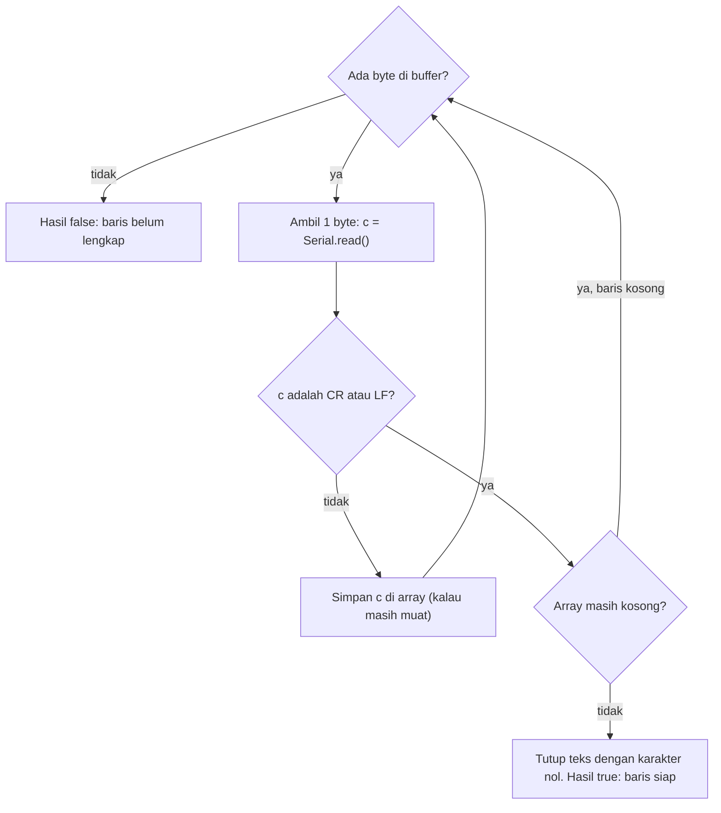
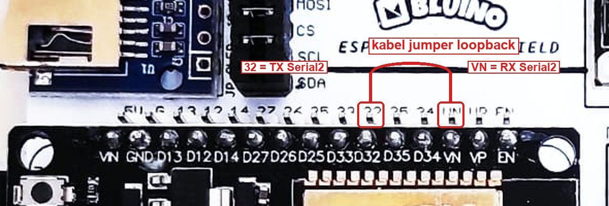
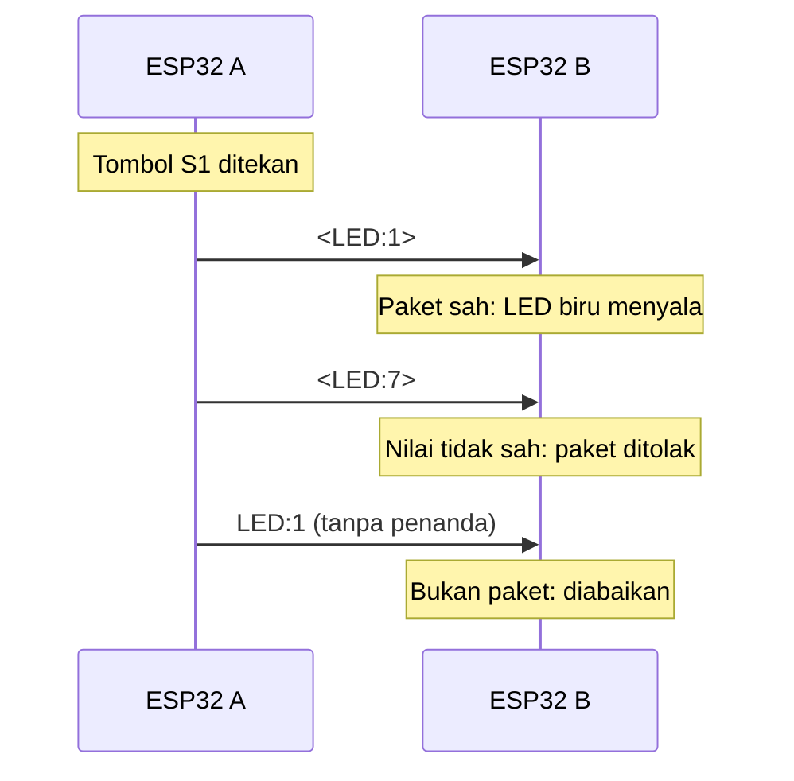

# BAB 22: UART / Serial Communication

> ✅ **Prasyarat:** Selesaikan **BAB 16 (Non-Blocking Programming)** — kamu sudah bisa membaca perintah dari Serial Monitor tanpa membuat program menunggu. Kamu juga sudah bisa memakai Serial Monitor ([BAB 7](../BAB-07/README.md)) serta menyambung LED, *buzzer*, dan tombol kit sesuai Peta Pin Standar ([BAB 6](../BAB-06/README.md), [BAB 8](../BAB-08/README.md), [BAB 9](../BAB-09/README.md)).

Setiap kali membuka Serial Monitor, sebenarnya kamu sudah memakai **UART** — jalur komunikasi serial tertua dan paling sederhana yang sampai sekarang masih dipakai di mana-mana: modul GPS, modul GSM, pembaca RFID, sampai obrolan antar-mikrokontroler. Di BAB ini kamu akan membongkar cara kerjanya (bit, *frame*, *baud rate*), melihat karakter "tak terlihat" yang ikut dikirim Serial Monitor, membuat pengurai perintah teks, lalu memakai UART kedua milik ESP32 (`Serial2`) untuk mengirim data lewat kabel — ke dirinya sendiri dan, kalau kamu punya, ke ESP32 kedua. Bayangkan dua orang yang saling mendiktekan angka tanpa aba-aba: supaya tidak salah dengar, keduanya harus sepakat dulu soal tempo bicara.

## 📌 Tujuan Pembelajaran

Setelah mempelajari BAB ini, kamu bisa:

- Menjelaskan cara kerja UART: jalur TX, RX, dan GND yang disilangkan, *frame* 8N1, serta *baud rate*.
- Menjelaskan hubungan `Serial` (UART0) dengan Serial Monitor lewat chip USB-to-UART di *board* ESP32.
- Memahami pengaruh pilihan *line ending* di Serial Monitor terhadap data yang diterima program.
- Memakai `available()`, `read()`, dan `readStringUntil()`, serta memahami *buffer* penerima.
- Membuat pengurai (*parser*) perintah teks dan data CSV yang memeriksa kesalahan masukan.
- Memakai `Serial2` dengan pin yang ditentukan sendiri, mengujinya dengan kabel *loopback*, dan (opsional) menghubungkan dua ESP32.
- Merancang protokol sederhana dengan penanda awal dan akhir paket.
- Menghindari kesalahan yang merusak: menyambung sinyal UART 5 V langsung ke pin ESP32.

## 🧰 Yang Perlu Disiapkan

| Kebutuhan | Keterangan |
|---|---|
| *Hardware* | Kit Bluino ESP32 IoT Starter Shield + kabel USB **data** |
| Kabel *jumper* | 8 kabel *female-female* bawaan kit: 4 untuk LED, 1 untuk *buzzer*, 2 untuk tombol S1 dan S2, 1 untuk kabel *loopback* UART. Varian dua *board* di Program 5 butuh 3 kabel penghubung (opsional) |
| Komponen tambahan | Tidak ada. Opsional untuk Program 5 varian dua *board*: ESP32 DEVKIT V1 kedua (boleh tanpa kit) + kabel USB data kedua |
| *Software* | Arduino IDE 2.x + *board package* **esp32** versi 3.3.x (lihat [BAB 5](../BAB-05/README.md)) |
| *Library* | Tidak perlu *library* tambahan — `Serial`, `Serial1`, dan `Serial2` sudah tersedia di *board package* esp32 |
| Alat uji | **Serial Monitor** Arduino IDE (baud 115200, *line ending* **New Line**) |
| Jaringan | Tidak perlu WiFi |

## 📑 Daftar Isi

- [22.1 Apa Itu UART?](#221-apa-itu-uart)
- [22.2 Frame UART dan Format 8N1](#222-frame-uart-dan-format-8n1)
- [22.3 Baud Rate](#223-baud-rate)
- [22.4 UART di ESP32: Serial, Serial1, dan Serial2](#224-uart-di-esp32-serial-serial1-dan-serial2)
- [22.5 Line Ending di Serial Monitor](#225-line-ending-di-serial-monitor)
- [22.6 Program 1: Mengintip Byte dari Serial Monitor](#226-program-1-mengintip-byte-dari-serial-monitor)
- [22.7 Buffer dan Fungsi-Fungsi Serial](#227-buffer-dan-fungsi-fungsi-serial)
- [22.8 Program 2: Perintah Teks untuk LED dan Buzzer](#228-program-2-perintah-teks-untuk-led-dan-buzzer)
- [22.9 Membaca Baris Tanpa Menunggu dan Memecah Data](#229-membaca-baris-tanpa-menunggu-dan-memecah-data)
- [22.10 Program 3: Membaca Data CSV](#2210-program-3-membaca-data-csv)
- [22.11 Program 4: Uji Loopback Serial2](#2211-program-4-uji-loopback-serial2)
- [22.12 Protokol Sederhana dengan Penanda Paket](#2212-protokol-sederhana-dengan-penanda-paket)
- [22.13 Program 5: Tombol Jarak Jauh lewat UART](#2213-program-5-tombol-jarak-jauh-lewat-uart)
- [22.14 Topik Lanjutan (Opsional)](#2214-topik-lanjutan-opsional)
- [22.15 Troubleshooting](#2215-troubleshooting)
- [📝 Rangkuman](#-rangkuman)
- [💪 Latihan](#-latihan)
- [📚 Referensi](#-referensi)

---

## 22.1 Apa Itu UART?

**UART** (*Universal Asynchronous Receiver-Transmitter*, pengirim-penerima asinkron universal) adalah rangkaian di dalam chip yang mengubah data menjadi deretan bit yang dikirim satu per satu lewat sebuah kabel, lalu menyusunnya kembali di sisi penerima. Sehari-hari kita cukup menyebutnya "komunikasi serial".

### 22.1.1 Serial vs Paralel

Mikrokontroler menyimpan data per ***byte***. Satu *byte* terdiri atas 8 **bit**, dan setiap bit hanya bernilai 0 atau 1, sehingga satu *byte* bisa menyimpan angka 0–255. Ada dua cara mengirim satu *byte* ke perangkat lain:

| | Paralel | Serial |
|---|---|---|
| Cara kirim | 8 bit dikirim bersamaan lewat 8 kabel | Bit dikirim bergiliran lewat 1 kabel |
| Jumlah kabel data | 8, ditambah kabel pengendali | 1 untuk setiap arah |
| Kelebihan | Cepat untuk jarak yang sangat pendek | Hemat pin dan kabel |
| Contoh | *Port* printer lama (LPT), jalur memori di dalam komputer | UART, I2C, SPI, USB |

Ibarat menyeberangkan 8 orang: cara paralel menyeberangkan mereka berjajar sekaligus di jalan yang lebar, sedangkan cara serial menyeberangkan mereka satu per satu lewat jembatan sempit. Karena jumlah pin ESP32 terbatas, cara serial jauh lebih praktis.

### 22.1.2 Asinkron: Tanpa Sinyal Clock

Kata *asynchronous* (asinkron) berarti UART **tidak punya kabel *clock*** — sinyal detak yang memberi tahu penerima "sekarang saatnya membaca bit". I2C dan SPI ([BAB 23](../BAB-23/README.md) dan [BAB 24](../BAB-24/README.md)) punya jalur *clock* seperti itu. Karena tidak ada detak bersama, pengirim dan penerima harus **sepakat lebih dulu** soal dua hal:

1. **Kecepatan** (*baud rate*), misalnya 115200 bit per detik — dibahas di [22.3](#223-baud-rate).
2. **Format *frame***, misalnya 8N1 — dibahas di [22.2](#222-frame-uart-dan-format-8n1).

Penerima lalu memakai pewaktu di dalam dirinya sendiri untuk menentukan kapan setiap bit dibaca. Selama kecepatan kedua pihak cukup sama, data terbaca dengan benar.

### 22.1.3 TX, RX, dan GND — Kabelnya Disilangkan

Setiap perangkat UART punya dua pin sinyal:

| Pin | Kepanjangan | Arah data |
|---|---|---|
| **TX** | *Transmit* (kirim) | **Keluar** dari perangkat |
| **RX** | *Receive* (terima) | **Masuk** ke perangkat |

Aturan menyambung dua perangkat: **TX ke RX, RX ke TX, dan GND ke GND**. Bayangkan dua orang bercakap: mulut (TX) yang satu harus mengarah ke telinga (RX) yang lain. Menyambung TX ke TX sama saja dengan dua mulut yang saling berhadapan — tidak ada yang mendengar.

```text
 Perangkat A                       Perangkat B
 (misalnya ESP32)                  (misalnya modul GPS)
┌──────────────┐                  ┌──────────────┐
│           TX ├─────────────────>│ RX           │
│           RX │<─────────────────┤ TX           │
│          GND ├──────────────────┤ GND          │
└──────────────┘                  └──────────────┘
```

*Gambar 22.1 — Dua perangkat UART: TX setiap perangkat disambung ke RX lawannya (tanda panah = arah data), dan GND keduanya disatukan. Sumber: dibuat untuk materi ini.*

Tiga hal penting dari gambar di atas:

- **GND wajib disatukan.** Tegangan sinyal selalu diukur terhadap GND. Tanpa GND bersama, kedua perangkat tidak punya patokan "0 V" yang sama, sehingga data kacau atau tidak terbaca sama sekali.
- Karena jalur kirim dan jalur terima terpisah, kedua perangkat bisa mengirim **bersamaan** (disebut *full duplex*), seperti bertelepon — bukan bergantian seperti memakai *walkie-talkie*.
- Satu jalur UART menghubungkan **dua perangkat saja** (satu lawan satu). Untuk banyak perangkat di jalur yang sama, dipakai I2C ([BAB 23](../BAB-23/README.md)).

---

## 22.2 Frame UART dan Format 8N1

Saat tidak ada data, jalur TX dijaga **HIGH** (3,3 V di ESP32). Kondisi diam ini disebut *idle*. Setiap *byte* dikirim dalam satu bungkusan yang disebut ***frame***:

| Bagian *frame* | Panjang | Nilai | Gunanya |
|---|---|---|---|
| *Start bit* | 1 bit | Selalu LOW | Tanda "data dimulai!". Perubahan dari HIGH ke LOW membangunkan penerima |
| Bit data | 5–8 bit, umumnya **8** | Isi *byte*, dikirim mulai dari bit terkecil (LSB) | Data yang sebenarnya |
| Bit paritas | 0 atau 1 bit, umumnya **tidak ada** | Bergantung pada isi data | Pemeriksaan kesalahan sederhana (opsional) |
| *Stop bit* | 1 atau 2 bit, umumnya **1** | Selalu HIGH | Tanda "*frame* selesai", sekaligus jeda sebelum *frame* berikutnya |

LSB (*Least Significant Bit*) adalah bit dengan nilai paling kecil, yaitu bit ke-0.

Contoh: huruf `A` disimpan sebagai angka **65** menurut tabel **ASCII** (*American Standard Code for Information Interchange*, daftar kode angka untuk setiap huruf, angka, dan simbol). Dalam bilangan biner, 65 = `01000001`. Karena dikirim mulai dari LSB, bit data `b0` sampai `b7` keluar dengan urutan 1, 0, 0, 0, 0, 0, 1, 0:

```text
Bagian  idle  start b0    b1    b2    b3    b4    b5    b6    b7    stop  idle
Nilai   1     0     1     0     0     0     0     0     1     0     1     1

HIGH    ──────┐     ┌─────┐                             ┌─────┐     ┌───────────
              │     │     │                             │     │     │
LOW           └─────┘     └─────────────────────────────┘     └─────┘
```

*Gambar 22.2 — Bentuk sinyal di pin TX saat huruf `A` (65) dikirim dengan format 8N1. Setiap kolom adalah satu bit. Sumber: dibuat untuk materi ini.*

Format *frame* biasanya ditulis dengan kode tiga karakter. Yang paling umum adalah **8N1**:

| Karakter | Arti | Pada 8N1 |
|---|---|---|
| **8** | Jumlah bit data | 8 bit |
| **N** | Paritas: *None* (tidak ada), *Even* (genap), atau *Odd* (ganjil) | Tidak ada |
| **1** | Jumlah *stop bit* | 1 bit |

Jadi, satu *byte* dengan format 8N1 menempati **10 bit** di kabel: 1 *start bit* + 8 bit data + 1 *stop bit*. Angka 10 ini dipakai untuk menghitung kecepatan nyata di [22.3](#223-baud-rate).

Di kode Arduino, format ini ditulis sebagai konstanta `SERIAL_8N1`, dan itulah format bawaan kalau kamu tidak menuliskannya. Format lain, misalnya `SERIAL_8E1` (8 bit data, paritas genap, 1 *stop bit*), hanya dipakai kalau perangkat lawan memintanya — misalnya sebagian perangkat industri. Aturannya sama dengan kecepatan: **kedua pihak wajib memakai format yang sama**.

> 📌 **Catatan:** Bit paritas hanya bisa mendeteksi sebagian kesalahan (kalau jumlah bit yang terbalik ganjil) dan tidak bisa memperbaikinya. Karena itu, kebanyakan perangkat memakai 8N1 dan memeriksa kesalahan dengan cara lain, misalnya *checksum* (lihat [22.14](#2214-topik-lanjutan-opsional)).

---

## 22.3 Baud Rate

Di [BAB 7](../BAB-07/README.md) kamu sudah mengenal ***baud rate*** sebagai "tempo" komunikasi. Lebih tepatnya, *baud rate* adalah jumlah simbol yang dikirim per detik. Pada UART, satu simbol = satu bit, jadi *baud rate* sama dengan **bit per detik** (bps). Lama satu bit = 1 ÷ *baud rate*.

| *Baud rate* | Lama 1 bit | Maksimum *byte* per detik (8N1) | Contoh pemakaian |
|---|---|---|---|
| 9600 | ±104 µs | 960 | Kecepatan bawaan banyak modul, misalnya GPS dan Bluetooth HC-05 |
| 38400 | ±26 µs | 3.840 | Mode perintah AT modul Bluetooth HC-05 |
| 115200 | ±8,7 µs | 11.520 | Serial Monitor di seluruh materi ini, juga pesan *boot* ESP32 |
| 921600 | ±1,1 µs | 92.160 | Kecepatan *upload* bawaan **ESP32 Dev Module** (**Tools → Upload Speed**) |

Kolom "maksimum *byte* per detik" didapat dari *baud rate* dibagi 10, karena setiap *byte* 8N1 butuh 10 bit. Angka itu adalah batas atas; jeda antar-*frame* membuat kecepatan nyata sedikit lebih rendah.

**Kalau *baud rate* berbeda**, penerima membaca setiap bit pada saat yang salah, sehingga yang muncul karakter acak seperti `⸮⸮⸮` — persis seperti saat Serial Monitor diatur ke baud yang salah di BAB 7. Penerima menyetel ulang hitungannya di setiap *start bit*, sehingga selisih yang sangat kecil (sekitar 2 % atau kurang) masih bisa ditoleransi. Selisih yang lebih besar membuat bit-bit terakhir dalam *frame* terbaca keliru.

Cara memilih *baud rate*:

- **Ikuti perangkat lawan.** Kecepatan modul biasanya tertulis di *datasheet*-nya (misalnya modul GPS umumnya 9600).
- **Antar-ESP32 dengan kabel *jumper* pendek**, 115200 sudah aman. Kalau kabelnya panjang (beberapa meter) atau data sering rusak, turunkan *baud rate*. Untuk jarak puluhan sampai ratusan meter dipakai standar lain, misalnya RS-485.
- **Setiap UART punya *baud rate* sendiri.** Di BAB ini `Serial` (Serial Monitor) memakai 115200, sedangkan `Serial2` memakai 9600.

---

## 22.4 UART di ESP32: Serial, Serial1, dan Serial2

ESP32 punya **tiga** UART *hardware*: UART0, UART1, dan UART2. Di Arduino, masing-masing muncul sebagai sebuah objek:

| Objek di kode | UART | Pin | Keterangan |
|---|---|---|---|
| `Serial` (nama lainnya `Serial0`) | UART0 | TX = IO1, RX = IO3 | Tersambung ke chip USB-to-UART: dipakai Serial Monitor dan *upload* |
| `Serial1` | UART1 | Kamu tentukan sendiri di `begin()` | Tidak dipakai di BAB ini |
| `Serial2` | UART2 | Kamu tentukan sendiri di `begin()` | Di BAB ini: RX = IO39 (`VN`), TX = IO32 |

### 22.4.1 Serial (UART0): Jalur USB ke Serial Monitor

ESP32 tidak bisa berbicara USB secara langsung. Di dekat konektor USB *board* ESP32 DEVKIT V1 ada chip **USB-to-UART** (misalnya CP2102 atau CH340, lihat [BAB 5](../BAB-05/README.md)) yang menerjemahkan sinyal USB dari laptop menjadi sinyal UART untuk ESP32, dan sebaliknya:


*Gambar 22.3 — Jalur data antara Serial Monitor dan ESP32. Chip USB-to-UART di board ESP32 menjadi "penerjemah" antara USB dan UART0. Sumber: dibuat untuk materi ini.*

- Saat kamu mengetik di Serial Monitor, data mengalir dari laptop → kabel USB → chip USB-to-UART → pin **IO3 (RX0)** ESP32 → *buffer* `Serial`, lalu dibaca programmu dengan `Serial.read()`.
- Saat program memanggil `Serial.println()`, data mengalir sebaliknya: pin **IO1 (TX0)** → chip USB-to-UART → kabel USB → Serial Monitor.
- Jalur yang sama dipakai untuk meng-*upload* program dan untuk pesan *boot* ESP32 yang kamu lihat di BAB 7.

> ⚠️ **Perhatian:** Jangan menyambung apa pun ke pin IO1 dan IO3 (label `1` dan `3` di deretan pin bawah kit, atau TX0 dan RX0 di *board*). Kedua pin itu sudah tersambung ke chip USB-to-UART. Perangkat lain di pin tersebut akan "bertabrakan" dengan chip itu: tampilan Serial Monitor kacau dan *upload* bisa gagal.

### 22.4.2 Serial1 dan Serial2: Selalu Tulis Pinnya

Sinyal UART1 dan UART2 bisa diarahkan ke hampir semua GPIO melalui GPIO *matrix* — semacam papan sambung di dalam chip ESP32. Pinnya kamu tentukan sendiri saat memanggil `begin()`:

```cpp
// Serial2.begin(baud, format, pinRX, pinTX);
Serial2.begin(9600, SERIAL_8N1, 39, 32);   // 9600 baud, 8N1, RX = IO39, TX = IO32
```

> ⚠️ **Perhatian:** Urutannya **pin RX dulu, baru pin TX**. Kalau tertukar, ESP32 mengirim lewat pin yang seharusnya menerima, dan tidak ada data yang sampai.

Kenapa pin wajib ditulis? Kalau kamu hanya menulis `Serial2.begin(9600);`, esp32 core 3.3.x memakai pin bawaan berikut — dan semuanya bentrok dengan komponen kit:

| Objek | Pin bawaan di core 3.3.x | Bentrok dengan (Peta Pin Standar) |
|---|---|---|
| `Serial1` | RX = IO26, TX = IO27 | *Relay* (IO26) dan DHT11 (IO27) |
| `Serial2` | RX = IO4, TX = IO25 | LED merah (IO4) dan tombol S2 (IO25) |

> 📌 **Catatan:** Banyak tutorial lama (untuk core 2.x) menyebut `Serial2` memakai IO16/IO17 dan `Serial1` memakai IO9/IO10. Di kit, IO16/IO17 adalah LED kuning dan LED hijau, sedangkan IO9/IO10 dipakai memori *flash* — ESP32 bisa *crash* kalau pin itu diambil alih. Label **RX2**/**TX2** yang tercetak di dekat IO16/IO17 pada sebagian *board* hanya menunjukkan pin "asli" UART2 di dalam chip; lewat GPIO *matrix*, UART2 tetap bisa dipindah ke pin lain. Jadi biasakan: **selalu tulis pin RX dan TX secara jelas** di `begin()`.

### 22.4.3 Pin Serial2 yang Dipakai di BAB Ini

Peta Pin Standar hampir tidak menyisakan pin bebas (lihat [6.10](../BAB-06/README.md#610-memilih-pin-untuk-komponen-tambahan)), jadi pin `Serial2` dipilih dengan cermat. Urutan pin di tabel berikut dihitung dari kiri, dengan konektor USB ESP32 di sebelah kiri (seperti di BAB 6):

| Fungsi | Pin | Label di kit | Alasan |
|---|---|---|---|
| RX `Serial2` | **IO39** | `VN` (deretan atas, urutan ke-13 dari kiri) | Satu-satunya pin yang **bebas** di Peta Pin Standar. IO39 hanya bisa menjadi *input* — tidak masalah, karena RX memang hanya menerima |
| TX `Serial2` | **IO32** | `32` (deretan atas, urutan ke-10 dari kiri) | Milik konektor servo (`SRV`). Servo tidak termasuk kit dan baru dipakai di [BAB 38](../BAB-38/README.md), jadi pinnya bisa dipinjam. TX butuh pin yang bisa menjadi *output* |


*Gambar 22.4 — ESP32 DEVKIT V1 dan dua deretan header di kit. IO1 dan IO3 (UART0) dipakai jalur USB; IO32 dan VN (IO39) dipakai `Serial2` di BAB ini. Sumber: skematik ESP32 Starter Shield 3.2, [Bluino](http://www.bluino.com).*

Sebelum memakai `Serial2`, cabut kabel *jumper* dari pin `SRV` (header hijau) ke label `32` kalau kebetulan terpasang. Pin `VN` tidak dipakai komponen kit mana pun, jadi tidak ada yang perlu dicabut.

> 📌 **Catatan:** IO39 tidak punya resistor *pull-up* internal. Kalau kabel ke RX dicabut saat program berjalan, pin itu "mengambang" dan kadang terbaca sebagai karakter acak — itu normal. Selain itu, menurut *errata* (daftar cacat resmi chip) ESP32, IO36 dan IO39 sesaat tertarik ke LOW (±80 ns) setiap kali ADC dinyalakan. Program di BAB ini tidak memakai ADC, jadi aman. Kalau kelak kamu menggabungkan UART dengan `analogRead()` atau WiFi (*driver* WiFi juga memakai ADC2), pindahkan RX ke pin lain, misalnya IO26 setelah kabel *relay* dicabut.

### 22.4.4 Tegangan Sinyal: Maksimal 3,3 V

Sinyal UART ESP32 bekerja pada **3,3 V**: HIGH ≈ 3,3 V dan LOW ≈ 0 V. Pin ESP32 **tidak tahan 5 V** — menurut *datasheet*, tegangan pin tidak boleh melebihi ±3,6 V. Sebelum menyambung perangkat UART apa pun, periksa tegangan sinyalnya:

| Perangkat lawan | TX perangkat → RX ESP32 | TX ESP32 → RX perangkat |
|---|---|---|
| Sinyal 3,3 V (ESP32 lain, banyak modul GPS dan Bluetooth) | Sambung langsung | Sambung langsung |
| Sinyal 5 V (misalnya Arduino Uno) | **Wajib** lewat pembagi tegangan atau modul *level shifter* | Biasanya terbaca (3,3 V masih dianggap HIGH oleh Uno), tetapi batasnya tipis — *level shifter* lebih aman |
| RS-232 (*port* serial DB9 di komputer lama, sekitar ±12 V) | **Jangan pernah** langsung — pakai modul MAX3232 | Pakai modul MAX3232 |

Pembagi tegangan sederhana untuk jalur 5 V → 3,3 V: pasang resistor 1 kΩ dari TX perangkat ke RX ESP32, lalu resistor 2 kΩ dari RX ESP32 ke GND. Tegangan di RX ESP32 = 5 V × 2 kΩ ÷ (1 kΩ + 2 kΩ) ≈ 3,3 V. Cara kerja pembagi tegangan dibahas di [3.5](../BAB-03/README.md#35-pembagi-tegangan).

> ⚠️ **Perhatian:** Sinyal TX 5 V yang masuk langsung ke pin RX ESP32 bisa merusak pin itu secara permanen, walaupun kadang "kelihatannya berfungsi" untuk sementara. Jangan lupa juga: **GND kedua perangkat harus disatukan**.

---

## 22.5 Line Ending di Serial Monitor

Saat kamu mengetik `ok` di kolom pesan Serial Monitor lalu menekan Enter, yang dikirim ke ESP32 belum tentu hanya huruf `o` dan `k`. Serial Monitor bisa menambahkan karakter "tak terlihat" sebagai penanda akhir baris, sesuai pilihan ***line ending*** di kanan panel:

| Pilihan *line ending* | Karakter yang ditambahkan | Ditulis di kode | Kode ASCII | Yang diterima ESP32 saat kamu mengirim `ok` |
|---|---|---|---|---|
| **No Line Ending** | Tidak ada | — | — | `o` `k` (2 *byte*) |
| **New Line** | LF (*Line Feed*) | `'\n'` | 10 | `o` `k` `\n` (3 *byte*) |
| **Carriage Return** | CR (*Carriage Return*) | `'\r'` | 13 | `o` `k` `\r` (3 *byte*) |
| **Both NL & CR** | CR lalu LF | `"\r\n"` | 13 dan 10 | `o` `k` `\r` `\n` (4 *byte*) |

Istilah CR dan LF berasal dari mesin ketik: *carriage return* menggeser kertas kembali ke kiri, dan *line feed* menggulung kertas satu baris ke atas.

Hal yang perlu diingat:

- Arduino IDE 2 memakai **New Line** sebagai pilihan bawaan, tetapi Serial Monitor **mengingat pilihan terakhirmu**. Kalau dulu kamu pernah mengubahnya, periksa lagi.
- Program di BAB ini membaca perintah per baris dan menganggap `'\n'` maupun `'\r'` sebagai akhir baris. Pilih **New Line** (disarankan) atau **Both NL & CR**. Dengan **No Line Ending**, program tidak pernah tahu kapan perintahmu selesai.
- Sebaliknya, `println()` di ESP32 selalu menambahkan **`\r\n`** (CR lalu LF) di akhir teks. Ini penting saat ESP32 mengirim data ke perangkat lain lewat `Serial2` (Program 4).

Cara mengirim teks dari Serial Monitor:

1. Buka **Serial Monitor** (**Tools → Serial Monitor** atau Ctrl+Shift+M).
2. Di kanan panel, pilih *line ending* (misalnya **New Line**) dan baud **115200**.
3. Klik kolom pesan di bagian atas panel (bertuliskan *Message (Enter to send message to 'ESP32 Dev Module' on 'COM5')* — nama *port*-nya bisa berbeda), ketik teks, lalu tekan **Enter**.

---

## 22.6 Program 1: Mengintip Byte dari Serial Monitor

**Tujuan:** Menampilkan setiap *byte* yang diterima ESP32 dari Serial Monitor beserta kode angkanya, termasuk karakter akhir baris yang biasanya tak terlihat. Dengan program ini kamu bisa membuktikan sendiri isi tabel di [22.5](#225-line-ending-di-serial-monitor).

**Rangkaian:** *Tidak perlu merangkai — cukup kabel USB.*

**Cara Menjalankan:**

1. Sambungkan *board* ESP32 ke laptop dengan kabel USB **data**.
2. Buka Arduino IDE → **File → New Sketch**, hapus isinya, lalu salin kode di bawah. Kode yang sama juga tersedia di *file* [`p1_intip_byte.ino`](p1_intip_byte/p1_intip_byte.ino).
3. Pastikan **Tools → Board** = **ESP32 Dev Module** dan **Tools → Port** = *port* ESP32 kamu (misalnya `COM5` di Windows atau `/dev/ttyUSB0` di Linux).
4. Klik tombol **Upload** (ikon panah →) dan tunggu sampai muncul tulisan **Done uploading**.
5. Buka **Serial Monitor** (**Tools → Serial Monitor**), pilih baud **115200** dan *line ending* **New Line**.
6. Klik kolom pesan, ketik `ok`, lalu tekan **Enter**. Ulangi dengan pilihan *line ending* yang lain (**Both NL & CR**, **No Line Ending**, **Carriage Return**) dan bandingkan hasilnya.

**Kode Program:**

<!-- sketch: p1_intip_byte -->
```cpp
/*
 * BAB 22 - Program 1: Mengintip Byte dari Serial Monitor
 * Setiap byte yang tiba di ESP32 ditampilkan beserta kodenya, sehingga
 * terlihat karakter apa saja yang dikirim Serial Monitor, termasuk
 * karakter akhir baris (line ending) yang biasanya tak terlihat.
 *
 * Rangkaian: tidak ada, cukup kabel USB.
 * Alat uji : Serial Monitor, baud 115200. Coba keempat pilihan line ending.
 */

const unsigned long JEDA_AKHIR_PESAN = 200;  // ms tanpa byte baru = pesan selesai

int jumlahByte = 0;                    // banyak byte dalam pesan yang sedang diterima
unsigned long waktuByteTerakhir = 0;   // kapan byte terakhir tiba

void setup() {
  Serial.begin(115200);
  Serial.println("BAB 22 - Program 1: Mengintip Byte dari Serial Monitor");
  Serial.println("Ketik teks pendek, misalnya ok, lalu tekan Enter.");
}

void loop() {
  // Ambil hanya byte yang SUDAH tiba, tanpa menunggu (non-blocking)
  while (Serial.available() > 0) {
    int b = Serial.read();             // satu byte, nilainya 0-255
    jumlahByte++;
    waktuByteTerakhir = millis();

    // Siapkan nama yang mudah dibaca untuk byte ini
    char nama[12];
    if (b == '\r') {
      strcpy(nama, "CR \\r");          // tercetak: CR \r
    } else if (b == '\n') {
      strcpy(nama, "LF \\n");          // tercetak: LF \n
    } else if (b >= 32 && b <= 126) {  // huruf, angka, tanda baca, spasi
      snprintf(nama, sizeof(nama), "'%c'", b);
    } else if (b >= 128) {             // bagian dari huruf di luar ASCII, misalnya é
      strcpy(nama, "non-ASCII");
    } else {
      strcpy(nama, "kontrol");         // karakter kendali lain, misalnya Tab
    }

    Serial.printf("Byte ke-%d: %-9s kode %3d (0x%02X)\n", jumlahByte, nama, b, b);
  }

  // Tidak ada byte baru selama 200 ms → anggap satu pesan sudah selesai
  if (jumlahByte > 0 && millis() - waktuByteTerakhir >= JEDA_AKHIR_PESAN) {
    Serial.printf("--- total %d byte ---\n", jumlahByte);
    Serial.println();
    jumlahByte = 0;
  }
}
```

**Penjelasan Kode:**

- `while (Serial.available() > 0)` mengambil semua *byte* yang **sudah** tiba, lalu langsung selesai — pola *non-blocking* yang sama dengan [BAB 16](../BAB-16/README.md#1612-membaca-input-serial-tanpa-menunggu).
- `Serial.read()` menghasilkan satu *byte* sebagai angka 0–255. Angka itu disimpan di variabel `int b` supaya bisa dicetak sebagai kode, dan sekaligus dibandingkan dengan karakter seperti `'\r'` (13) dan `'\n'` (10). Di C++, karakter di antara tanda petik tunggal sebenarnya adalah angka ASCII-nya.
- Rangkaian `if`–`else if` memberi "nama" yang mudah dibaca: CR dan LF ditulis sebagai `CR \r` dan `LF \n` (di dalam teks C++, `\\` berarti satu garis miring terbalik), karakter yang bisa dicetak ditampilkan di antara tanda petik, dan sisanya diberi label `non-ASCII` atau `kontrol`.
- **UART tidak mengenal "pesan"** — ia hanya mengalirkan *byte* satu per satu. Programlah yang memutuskan kapan sebuah pesan berakhir. Di sini aturannya: kalau 200 ms tidak ada *byte* baru, pesan dianggap selesai dan jumlah *byte*-nya dicetak. Program berikutnya memakai cara yang lebih umum, yaitu karakter akhir baris.

Program ini memakai `Serial.printf()` untuk mencetak teks dan angka dalam satu baris yang rapi. Teks pertama berisi "lubang" berawalan `%` yang diisi nilai-nilai sesudahnya, berurutan:

| Kode format | Diisi dengan | Contoh hasil |
|---|---|---|
| `%d` | Bilangan bulat (`int`) | `3` |
| `%3d` | Bilangan bulat, lebar minimal 3 karakter (rata kanan, kekurangannya diisi spasi di depan) | `10` didahului 1 spasi |
| `%lu` | Bilangan bulat `unsigned long` | `4000000000` |
| `%.1f` | Bilangan desimal dengan 1 angka di belakang titik | `27.5` |
| `%s` | Teks C (`char[]`, atau `String` yang diubah dengan `.c_str()`) | `ok` |
| `%-9s` | Teks, lebar minimal 9 karakter (rata kiri, kekurangannya diisi spasi di belakang) | `'o'` diikuti 6 spasi |
| `%c` | Satu karakter | `o` |
| `%02X` | Bilangan heksadesimal (basis 16) 2 digit, huruf besar | `0A` |
| `%%` | Tanda persen itu sendiri | `%` |
| `\n` | Pindah baris (LF) | — |

`snprintf()` bekerja sama persis, tetapi hasilnya **ditulis ke *array* `char`** (di sini `nama`), bukan dikirim. Parameter `sizeof(nama)` mencegah tulisan melebihi ukuran *array*.

**Contoh Output:**

Saat `ok` dikirim dengan *line ending* **New Line**, lalu dengan **Both NL & CR**:

```text
BAB 22 - Program 1: Mengintip Byte dari Serial Monitor
Ketik teks pendek, misalnya ok, lalu tekan Enter.
Byte ke-1: 'o'       kode 111 (0x6F)
Byte ke-2: 'k'       kode 107 (0x6B)
Byte ke-3: LF \n     kode  10 (0x0A)
--- total 3 byte ---

Byte ke-1: 'o'       kode 111 (0x6F)
Byte ke-2: 'k'       kode 107 (0x6B)
Byte ke-3: CR \r     kode  13 (0x0D)
Byte ke-4: LF \n     kode  10 (0x0A)
--- total 4 byte ---

```

Dengan **No Line Ending** hanya muncul dua baris (`'o'` dan `'k'`, total 2 *byte*), sedangkan dengan **Carriage Return** muncul `'o'`, `'k'`, dan `CR \r` (total 3 *byte*). Tidak ada perubahan apa pun di kit — semua terjadi di Serial Monitor.

> 🧪 **Coba Sendiri:**
>
> - Kirim `A` lalu `a`. Kodenya 65 dan 97 — huruf besar dan huruf kecil adalah *byte* yang berbeda. Itulah sebabnya Program 2 mengubah semua perintah menjadi huruf kecil dulu.
> - Kirim huruf `é` (salin dari halaman ini lalu tempel di kolom pesan). Hasilnya dua *byte* `non-ASCII` (195 dan 169), karena Serial Monitor mengirim teks dalam pengodean UTF-8 dan huruf di luar ASCII memakai lebih dari satu *byte*.
> - Ubah baud Serial Monitor menjadi **9600**, lalu tekan tombol **EN** di *board*. Judul program tampil sebagai karakter acak, karena ESP32 mengirim dengan 115200 baud sedangkan Serial Monitor membaca dengan 9600 baud. Kembalikan ke **115200** setelah selesai.

**Kalau Belum Berhasil:**

- **Tidak ada balasan saat teks dikirim** → pastikan kamu menekan **Enter** setelah mengetik di kolom pesan, dan *port* yang dipilih di **Tools → Port** adalah *port* ESP32.
- **Muncul karakter acak** → baud Serial Monitor bukan **115200**.
- **Baris judul tidak terlihat** → judul hanya dicetak sekali saat program mulai. Tekan tombol **EN** di *board* untuk memulai ulang program.

---

## 22.7 Buffer dan Fungsi-Fungsi Serial

### 22.7.1 Buffer Penerima

*Byte* yang tiba di pin RX tidak langsung "masuk" ke programmu. Ia ditampung dulu, mirip kotak surat: tukang pos (*hardware* UART) memasukkan surat kapan saja, dan kamu (program) mengambilnya saat sempat. Di ESP32 ada dua tingkat penampungan:

1. **FIFO *hardware*** berukuran 128 *byte* di dalam UART itu sendiri. FIFO (*First In, First Out*) artinya yang pertama masuk, pertama pula keluar — seperti antrean.
2. ***Buffer* RX** di RAM, berukuran **256 *byte*** (bawaan esp32 core 3.x). *Driver* UART memindahkan isi FIFO ke *buffer* ini secara otomatis di latar belakang.

```text
pin RX --> [ FIFO hardware, 128 byte ] --> [ buffer RX, 256 byte: o k \n ] --> Serial.read()
```

`available()` memberi tahu berapa *byte* yang sedang menunggu di *buffer*, dan `read()` mengambil satu *byte* yang paling depan.

Kalau *buffer* penuh karena program terlalu lama tidak mengambil isinya (misalnya karena `delay()` panjang), *byte* yang datang berikutnya **hilang**. Hitungan kasarnya: pada 115200 baud, data bisa datang hingga ±11.520 *byte* per detik, sehingga *buffer* 256 *byte* penuh dalam ±22 ms kalau data mengalir terus. Pada 9600 baud, *buffer* yang sama baru penuh setelah ±270 ms.

Kalau perlu *buffer* yang lebih besar, panggil `setRxBufferSize()` **sebelum** `begin()`. Kalau dipanggil sesudahnya, permintaan itu ditolak (hasilnya 0):

```cpp
Serial2.setRxBufferSize(1024);                       // harus SEBELUM begin()
Serial2.begin(9600, SERIAL_8N1, RX2_PIN, TX2_PIN);
```

### 22.7.2 Fungsi untuk Membaca Data

Fungsi-fungsi berikut berlaku untuk `Serial`, `Serial1`, maupun `Serial2`. Sebagian sudah kamu kenal di [BAB 16](../BAB-16/README.md#1612-membaca-input-serial-tanpa-menunggu):

| Fungsi | Menunggu? | Hasilnya |
|---|---|---|
| `available()` | Tidak | Jumlah *byte* yang menunggu di *buffer* |
| `read()` | Tidak | Satu *byte* (0–255), atau -1 kalau *buffer* kosong |
| `peek()` | Tidak | Seperti `read()`, tetapi *byte*-nya tidak diambil dari *buffer* |
| `readStringUntil('\n')` | Ya, sampai *timeout* | `String` berisi karakter sebelum `'\n'`; karakter `'\n'`-nya sendiri dibuang |
| `readString()` | Ya, **selalu** sampai *timeout* | Semua karakter yang tiba sampai tidak ada data baru selama *timeout* |
| `readBytes(buf, n)` | Ya, sampai *timeout* | Mengisi *array* `buf` dengan paling banyak `n` *byte* |
| `parseInt()`, `parseFloat()` | Ya, sampai *timeout* | Angka pertama yang ditemukan |

*Timeout* (batas waktu tunggu) bawaannya 1000 ms dan bisa diubah, misalnya `Serial.setTimeout(100);`. Selama fungsi itu menunggu, `loop()` tertahan.

Fungsi `readStringUntil('\n')` dipakai di Program 2, jadi perhatikan sifatnya:

- Begitu menemukan `'\n'`, fungsi langsung selesai. Dengan *line ending* **New Line**, satu baris yang kamu ketik tiba hampir sekaligus, sehingga fungsi ini praktis tidak menunggu.
- Kalau `'\n'` tidak pernah datang (*line ending* **No Line Ending** atau **Carriage Return**), fungsi menyerah setelah *timeout* 1 detik dan mengembalikan apa yang sudah terkumpul. Perintahmu tetap terbaca, tetapi terlambat 1 detik.
- Dengan **Both NL & CR** atau **Carriage Return**, hasilnya masih membawa `'\r'` di ujung (misalnya `"ok\r"`), sehingga perbandingan dengan `"ok"` gagal. Solusinya: panggil `trim()`, yang membuang spasi serta karakter `\r` dan `\n` di awal dan akhir teks.

Jadi, kapan memakai yang mana?

- **`readStringUntil()`** — paling mudah. Cocok untuk perintah yang diketik di Serial Monitor.
- **Membaca per karakter dengan `available()` + `read()`** — sedikit lebih panjang, tetapi tidak pernah menunggu. Cocok untuk data dari perangkat lain yang datang sedikit demi sedikit (pada 9600 baud, satu baris berisi 20 karakter butuh ±21 ms untuk tiba), dan untuk program yang juga harus mengurus tombol, LED, atau sensor. Cara ini dipakai di Program 3, 4, dan 5.

### 22.7.3 Fungsi untuk Mengirim Data

| Fungsi | Contoh | Yang dikirim |
|---|---|---|
| `print(x)` | `Serial2.print(25);` | Teks `25`, yaitu karakter `'2'` dan `'5'` (2 *byte*) |
| `println(x)` | `Serial2.println("OK");` | Teks `OK` ditambah `\r\n` (4 *byte*) |
| `printf(format, ...)` | `Serial2.printf("T=%.1f\n", 25.4);` | Teks berformat `T=25.4` ditambah `\n` |
| `write(b)` | `Serial2.write(65);` | Satu *byte* mentah bernilai 65 (terbaca sebagai huruf `A`) |
| `flush()` | `Serial2.flush();` | Tidak mengirim apa pun — menunggu sampai semua data benar-benar keluar dari pin TX |

Perhatikan bedanya `print(65)` dan `write(65)`: `print(65)` mengirim dua karakter `'6'` dan `'5'`, sedangkan `write(65)` mengirim satu *byte* bernilai 65.

Pengiriman juga memakai antrean: data yang kamu kirim ditaruh di FIFO TX (128 *byte*), lalu dikeluarkan *hardware* di latar belakang. Kalau FIFO penuh, `print()` menunggu sampai ada tempat kosong. Pada *baud rate* rendah, mengirim teks yang sangat panjang bisa membuat program tertahan sebentar.

---

## 22.8 Program 2: Perintah Teks untuk LED dan Buzzer

**Tujuan:** Mengendalikan keempat LED dan *buzzer* dengan perintah teks yang punya argumen, misalnya `nyala merah` atau `bip 3`. Program ini memperkenalkan cara membuat **pengurai perintah** (*command parser*): memisahkan kata perintah dari argumennya, lalu memeriksa apakah argumennya sah.

**Rangkaian:**

| Pin **Custom** di kit | Sambungkan ke pin ESP32 |
|---|---|
| LED1 (LED merah) | IO4 |
| LED2 (LED hijau) | IO17 |
| LED3 (LED biru) | IO2 |
| LED4 (LED kuning) | IO16 |
| BUZZ | IO13 |

**Cara Menjalankan:**

1. Sambungkan kelima kabel *jumper* sesuai tabel **Rangkaian** di atas (sama seperti [BAB 8](../BAB-08/README.md)). Pin label `4`, `17`, `2`, dan `16` ada di deretan bawah, sedangkan `13` di deretan atas.
2. Buka Arduino IDE → **File → New Sketch**, hapus isinya, lalu salin kode di bawah. Kode yang sama juga tersedia di *file* [`p2_perintah_led.ino`](p2_perintah_led/p2_perintah_led.ino).
3. Pastikan **Tools → Board** = **ESP32 Dev Module** dan **Tools → Port** = *port* ESP32 kamu.
4. Klik tombol **Upload** dan tunggu sampai muncul tulisan **Done uploading**.
5. Buka **Serial Monitor** (**Tools → Serial Monitor**), pilih baud **115200** dan *line ending* **New Line**.
6. Ketik perintah di kolom pesan lalu tekan **Enter**, misalnya `nyala merah`, `nyala semua`, `mati hijau`, `status`, `bip 3`, dan `bantuan`.

**Kode Program:**

<!-- sketch: p2_perintah_led -->
```cpp
/*
 * BAB 22 - Program 2: Perintah Teks untuk LED dan Buzzer
 * Ketik perintah di Serial Monitor (line ending: New Line):
 *   nyala <warna>  → menyalakan LED (warna: merah, hijau, biru, kuning, semua)
 *   mati <warna>   → mematikan LED
 *   bip <jumlah>   → buzzer berbunyi 1-10 kali
 *   status         → menampilkan keadaan semua LED
 *   bantuan        → menampilkan daftar perintah
 *
 * Rangkaian (header kit → pin ESP32):
 *   LED1 (merah) → IO4    LED2 (hijau)  → IO17
 *   LED3 (biru)  → IO2    LED4 (kuning) → IO16
 *   BUZZ         → IO13
 */

#define LED_MERAH  4
#define LED_HIJAU  17
#define LED_BIRU   2
#define LED_KUNING 16
#define BUZZER_PIN 13

const int JUMLAH_LED = 4;
const int PIN_LED[JUMLAH_LED] = {LED_MERAH, LED_HIJAU, LED_BIRU, LED_KUNING};
const char *NAMA_LED[JUMLAH_LED] = {"merah", "hijau", "biru", "kuning"};

void tampilkanBantuan() {
  Serial.println("Daftar perintah:");
  Serial.println("  nyala <warna>  warna: merah, hijau, biru, kuning, semua");
  Serial.println("  mati <warna>");
  Serial.println("  bip <jumlah>   jumlah: 1-10");
  Serial.println("  status");
  Serial.println("  bantuan");
}

// Menyalakan/mematikan LED sesuai nama warnanya.
// Hasilnya false kalau nama warna tidak dikenal.
bool aturLed(String warna, bool nyala) {
  bool dikenal = false;
  for (int i = 0; i < JUMLAH_LED; i++) {
    if (warna == "semua" || warna == NAMA_LED[i]) {
      digitalWrite(PIN_LED[i], nyala ? HIGH : LOW);
      dikenal = true;
    }
  }
  return dikenal;
}

// Buzzer berbunyi pendek sebanyak 'jumlah' kali (paling lama 2 detik)
void bip(int jumlah) {
  for (int i = 0; i < jumlah; i++) {
    digitalWrite(BUZZER_PIN, HIGH);
    delay(100);
    digitalWrite(BUZZER_PIN, LOW);
    delay(100);
  }
}

void prosesPerintah(String baris) {
  baris.trim();          // buang spasi serta \r dan \n di awal dan akhir
  baris.toLowerCase();   // "NYALA Merah" dianggap sama dengan "nyala merah"
  if (baris.length() == 0) return;   // baris kosong: abaikan

  Serial.print("> ");
  Serial.println(baris);

  // Pisahkan kata pertama (perintah) dari sisanya (argumen)
  String perintah = baris;
  String argumen = "";
  int posisiSpasi = baris.indexOf(' ');
  if (posisiSpasi >= 0) {
    perintah = baris.substring(0, posisiSpasi);
    argumen = baris.substring(posisiSpasi + 1);
    argumen.trim();      // "nyala    merah" tetap terbaca
  }

  if (perintah == "nyala" || perintah == "mati") {
    bool nyala = (perintah == "nyala");
    if (aturLed(argumen, nyala)) {
      Serial.printf("OK: LED %s %s\n", argumen.c_str(), nyala ? "NYALA" : "MATI");
    } else {
      Serial.println("Warna tidak dikenal. Pilihan: merah, hijau, biru, kuning, semua");
    }
  } else if (perintah == "bip") {
    int jumlah = argumen.toInt();   // "3" → 3; teks yang bukan angka → 0
    if (jumlah < 1 || jumlah > 10) {
      Serial.println("Jumlah bip harus 1-10, contoh: bip 3");
    } else {
      bip(jumlah);
      Serial.printf("OK: bip %d kali\n", jumlah);
    }
  } else if (perintah == "status") {
    for (int i = 0; i < JUMLAH_LED; i++) {
      Serial.printf("  LED %-6s: %s\n", NAMA_LED[i], digitalRead(PIN_LED[i]) ? "NYALA" : "MATI");
    }
  } else if (perintah == "bantuan") {
    tampilkanBantuan();
  } else {
    Serial.println("Perintah tidak dikenal. Ketik: bantuan");
  }
}

void setup() {
  Serial.begin(115200);
  for (int i = 0; i < JUMLAH_LED; i++) {
    pinMode(PIN_LED[i], OUTPUT);
    digitalWrite(PIN_LED[i], LOW);
  }
  pinMode(BUZZER_PIN, OUTPUT);
  digitalWrite(BUZZER_PIN, LOW);

  Serial.println("BAB 22 - Program 2: Perintah Teks untuk LED dan Buzzer");
  tampilkanBantuan();
}

void loop() {
  if (Serial.available() > 0) {
    String baris = Serial.readStringUntil('\n');  // baca sampai karakter '\n'
    prosesPerintah(baris);
  }
}
```

**Penjelasan Kode:**

- `loop()` hanya memanggil `readStringUntil('\n')` kalau sudah ada data (`available() > 0`). Hasilnya satu baris teks tanpa karakter `'\n'`, lalu diserahkan ke `prosesPerintah()`.
- `trim()` membuang spasi dan karakter `\r`/`\n` di kedua ujung, jadi program tetap benar dengan *line ending* **Both NL & CR**. `toLowerCase()` mengubah semua huruf menjadi huruf kecil, sehingga `NYALA Merah` dianggap sama dengan `nyala merah` (ingat, di Program 1 `A` dan `a` adalah *byte* yang berbeda).
- Perintah dipecah di spasi pertama: `indexOf(' ')` mencari posisi spasi, `substring(0, posisiSpasi)` mengambil kata sebelum spasi (perintah), dan `substring(posisiSpasi + 1)` mengambil sisanya (argumen). Untuk `bip 3`, perintahnya `bip` dan argumennya `3`.
- Setiap argumen **diperiksa** sebelum dipakai: warna harus salah satu nama di `NAMA_LED[]` atau `semua`, dan jumlah bip harus 1–10. `toInt()` menghasilkan 0 kalau teksnya bukan angka, dan 0 sudah otomatis ditolak oleh pemeriksaan jangkauan. Pesan kesalahan yang jelas membuat pengguna tahu harus memperbaiki apa.
- Perintah `status` membaca keadaan pin LED dengan `digitalRead()`. Pada esp32 core, pin yang diatur `OUTPUT` tetap bisa dibaca keadaannya.
- `Serial.printf()` dengan `%s` butuh teks C, jadi `String` diubah dulu dengan `argumen.c_str()`.
- Fungsi `bip()` memakai `delay()` dan menahan program paling lama 2 detik. Selama itu, perintah baru yang kamu ketik **tidak hilang**: ia menunggu di *buffer* RX dan diproses begitu `bip()` selesai.

**Contoh Output:**

```text
BAB 22 - Program 2: Perintah Teks untuk LED dan Buzzer
Daftar perintah:
  nyala <warna>  warna: merah, hijau, biru, kuning, semua
  mati <warna>
  bip <jumlah>   jumlah: 1-10
  status
  bantuan
> nyala merah
OK: LED merah NYALA
> nyala semua
OK: LED semua NYALA
> mati hijau
OK: LED hijau MATI
> status
  LED merah : NYALA
  LED hijau : MATI
  LED biru  : NYALA
  LED kuning: NYALA
> bip 3
OK: bip 3 kali
> bip 20
Jumlah bip harus 1-10, contoh: bip 3
> nyala ungu
Warna tidak dikenal. Pilihan: merah, hijau, biru, kuning, semua
> halo
Perintah tidak dikenal. Ketik: bantuan
```

Di kit: LED menyala dan mati sesuai perintah, dan *buzzer* berbunyi "bip" sebanyak angka yang kamu minta. LED biru kecil di *board* ikut menyala bersama LED biru kit karena keduanya di IO2.

> 🧪 **Coba Sendiri:**
>
> - Ketik `bip 10`, tekan Enter, lalu **segera** ketik `nyala biru` dan tekan Enter lagi (kamu punya waktu sekitar 2 detik selama *buzzer* berbunyi). LED biru baru menyala setelah 10 bunyi selesai — perintah keduamu menunggu di *buffer* RX, tidak hilang.
> - Ganti *line ending* menjadi **No Line Ending**, lalu kirim `status`. Hasilnya tetap muncul, tetapi terlambat sekitar 1 detik karena `readStringUntil()` menunggu sampai *timeout*.

**Kalau Belum Berhasil:**

- **Setiap perintah baru dijalankan sekitar 1 detik kemudian** → *line ending* masih **No Line Ending** atau **Carriage Return**. Pilih **New Line**.
- **Selalu muncul `Perintah tidak dikenal`** → periksa ejaannya (`bantuan`, bukan `help`) dan pastikan ada spasi di antara perintah dan argumen (`bip 3`, bukan `bip3`).
- **Muncul `OK: LED merah NYALA`, tetapi LED tidak menyala** → cek kabel LED1 → label `4` di deretan bawah.
- ***Buzzer* diam, tetapi *relay* berbunyi "klik"** → kabel terpasang di pin **RELAY**, bukan **BUZZ**.

---

## 22.9 Membaca Baris Tanpa Menunggu dan Memecah Data

Program 2 memakai `String` dan `readStringUntil()` karena mudah dibaca. Untuk data dari perangkat lain, kita butuh cara yang tidak pernah menunggu dan memakai memori secara hemat. Program 3, 4, dan 5 memakai teks C dan pembaca baris *non-blocking*.

### 22.9.1 Teks C: Array char yang Diakhiri '\0'

Selain dengan `String`, teks bisa disimpan di *array* `char`:

```cpp
char baris[64];   // muat paling banyak 63 karakter + 1 karakter penutup
```

Teks seperti ini disebut **teks C** (*C string*). Akhir teksnya ditandai karakter **nol**, ditulis `'\0'` — *byte* bernilai 0, bukan karakter angka `'0'` (kode ASCII 48). Contoh: teks `OK` di dalam *array* berukuran 6:

| Indeks | 0 | 1 | 2 | 3 | 4 | 5 |
|---|---|---|---|---|---|---|
| Isi | `'O'` | `'K'` | `'\0'` | (bebas) | (bebas) | (bebas) |

Fungsi seperti `Serial.print()`, `strcmp()`, dan `printf("%s")` membaca dari indeks 0 sampai bertemu `'\0'`. Karena itu, *array* harus selalu **menyisakan satu tempat** untuk `'\0'`.

Kenapa tidak memakai `String` saja? Ukuran *array* `char` tetap sejak awal, jadi tidak ada pemesanan memori baru setiap kali karakter ditambahkan — penting untuk program yang berjalan berhari-hari (perbandingannya dibahas di [BAB 20](../BAB-20/README.md)). Kode protokol dan banyak *library* juga memakai teks C, jadi ada baiknya kamu terbiasa.

Fungsi teks C yang dipakai di BAB ini:

| Fungsi | Gunanya | Contoh |
|---|---|---|
| `strcmp(a, b)` | Membandingkan dua teks; hasilnya **0 kalau sama persis** | `strcmp(teks, "DATA") == 0` |
| `strtok(teks, ",")` | Memecah teks di setiap koma | Lihat 22.9.3 |
| `strtof(teks, &sisa)` | Mengubah teks menjadi angka desimal sekaligus menunjukkan di mana pembacaan angka berhenti | Lihat 22.9.3 |
| `atof(teks)` | Mengubah teks menjadi angka desimal, **tanpa** pemeriksaan | `atof("27.5")` → 27.5 |
| `strchr(teks, ':')` | Mencari posisi karakter `':'` di dalam teks | Dipakai di Program 5 |

### 22.9.2 Pembaca Baris Non-Blocking

Polanya sama dengan [16.12](../BAB-16/README.md#1612-membaca-input-serial-tanpa-menunggu), hanya saja karakter disimpan di *array* `char`. Setiap kali dipanggil, fungsi pembaca baris mengambil *byte* yang sudah tiba saja, lalu melapor apakah satu baris sudah lengkap:



*Gambar 22.5 — Alur fungsi pembaca baris tanpa menunggu. Fungsi ini dipanggil di setiap putaran `loop()`. Sumber: dibuat untuk materi ini.*

Dua hal penting dari alur ini:

- CR maupun LF dianggap akhir baris, dan baris kosong dilewati. Dengan *line ending* **Both NL & CR**, karakter `\r` menutup baris, lalu `\n` sesudahnya dianggap baris kosong dan diabaikan.
- Kalau *array* sudah penuh, karakter berikutnya dibuang. Teks yang sangat panjang (misalnya karena salah tempel) tidak akan merusak memori, walaupun baris itu terpotong.

### 22.9.3 Memecah Data CSV dan Memeriksa Angka

**CSV** (*Comma-Separated Values*) adalah format data yang nilainya dipisah koma, satu data per baris — format yang sama dengan hasil ekspor tabel dari Excel atau Google Sheets. Contoh: `DATA,27.5,65`. Format teks lain yang juga sering dipakai adalah pasangan kunci-nilai (misalnya `T=27.5;H=65`) dan JSON (misalnya `{"suhu":27.5}`), yang akan kamu temui di BAB-BAB WiFi dan IoT berikutnya. Prinsipnya sama: data dipecah, lalu diperiksa sebelum dipakai.

Fungsi `strtok()` memecah teks seperti ini. Panggilan pertama diberi *array* teksnya, panggilan berikutnya diberi `NULL` (artinya "lanjutkan teks yang tadi"):

| Panggilan | Hasil |
|---|---|
| `strtok(teks, ",")` | `"DATA"` |
| `strtok(NULL, ",")` | `"27.5"` |
| `strtok(NULL, ",")` | `"65"` |
| `strtok(NULL, ",")` | `NULL` — sudah habis |

> ⚠️ **Perhatian:** `strtok()` **mengubah** *array* aslinya: setiap koma diganti `'\0'`. Kalau isi aslinya masih dibutuhkan (misalnya untuk dicetak), cetak dulu sebelum memanggil `strtok()`.

Setelah dipecah, teks angka diubah menjadi `float`. Hati-hati: `atof("abc")` tidak melapor kesalahan — hasilnya diam-diam 0. Jadi data rusak `DATA,abc,65` akan terbaca sebagai suhu 0 °C. Untuk memeriksanya, pakai `strtof()` yang juga memberi tahu di mana pembacaan angka berhenti:

```cpp
char *sisa;                           // akan menunjuk ke karakter pertama yang BUKAN angka
float a = strtof("27.5", &sisa);      // a = 27.5, sisa menunjuk ke '\0' (akhir teks) → angka utuh
float b = strtof("2x", &sisa);        // b = 2.0,  sisa menunjuk ke 'x' → bukan angka utuh
float c = strtof("abc", &sisa);       // c = 0.0,  sisa tetap di awal teks → bukan angka sama sekali
```

Tanda `&` pada `&sisa` memberikan **alamat** variabel `sisa` kepada `strtof()`, supaya fungsi itu bisa mengisinya. Aturannya: teks adalah angka yang sah kalau `sisa` sudah bergeser dari awal teks **dan** berhenti tepat di `'\0'`.

> 📌 **Catatan:** Di dalam data dan kode, angka desimal selalu memakai **titik** (`27.5`), bukan koma seperti penulisan bahasa Indonesia. Apalagi di CSV, koma sudah dipakai sebagai pemisah: `DATA,27,5,65` akan terbaca sebagai empat bagian.

---

## 22.10 Program 3: Membaca Data CSV

**Tujuan:** Menerima baris data berformat `DATA,<suhu>,<kelembapan>` dari Serial Monitor, memeriksa format dan angkanya, lalu menyalakan LED peringatan. Pola ini sama dengan yang dipakai saat ESP32 menerima data dari sensor serial, modul lain, atau program di laptop.

**Rangkaian:**

| Pin **Custom** di kit | Sambungkan ke pin ESP32 |
|---|---|
| LED1 (LED merah) | IO4 |
| LED4 (LED kuning) | IO16 |

**Cara Menjalankan:**

1. Pastikan kabel LED1 (merah) → label `4` dan LED4 (kuning) → label `16` terpasang. Kabel lain dari Program 2 boleh tetap terpasang.
2. Buka Arduino IDE → **File → New Sketch**, hapus isinya, lalu salin kode di bawah. Kode yang sama juga tersedia di *file* [`p3_parser_csv.ino`](p3_parser_csv/p3_parser_csv.ino).
3. Pastikan **Tools → Board** = **ESP32 Dev Module** dan **Tools → Port** = *port* ESP32 kamu.
4. Klik tombol **Upload** dan tunggu sampai muncul tulisan **Done uploading**.
5. Buka **Serial Monitor** (**Tools → Serial Monitor**), pilih baud **115200** dan *line ending* **New Line**.
6. Kirim beberapa baris berikut satu per satu: `DATA,27.5,65`, `DATA,36.2,85`, `DATA,abc,65`, dan `DATA,27,5,65`.

**Kode Program:**

<!-- sketch: p3_parser_csv -->
```cpp
/*
 * BAB 22 - Program 3: Membaca Data CSV
 * Menerima baris data berformat CSV dari Serial Monitor:
 *   DATA,<suhu>,<kelembapan>      contoh: DATA,27.5,65
 * lalu memeriksa formatnya, menampilkan nilainya, dan
 * menyalakan LED peringatan.
 *
 * Rangkaian (header kit → pin ESP32):
 *   LED1 (merah)  → IO4    menyala kalau suhu > 35 °C
 *   LED4 (kuning) → IO16   menyala kalau kelembapan > 80 %
 * Alat uji: Serial Monitor, baud 115200, line ending New Line
 */

#define LED_MERAH  4
#define LED_KUNING 16

const int PANJANG_MAKS = 64;   // ukuran array baris, termasuk 1 tempat untuk '\0'

char baris[PANJANG_MAKS];      // teks C: array char yang diakhiri '\0'
int panjang = 0;               // jumlah karakter yang sudah terkumpul

// Mengumpulkan karakter yang SUDAH tiba, tanpa menunggu.
// Hasilnya true kalau satu baris lengkap sudah siap di array 'baris'.
bool bacaBaris() {
  while (Serial.available() > 0) {
    char c = Serial.read();
    if (c == '\r' || c == '\n') {      // karakter akhir baris
      if (panjang == 0) continue;       // baris kosong (misalnya \n sesudah \r): lewati
      baris[panjang] = '\0';            // tutup teks dengan karakter nol
      panjang = 0;                      // siap untuk baris berikutnya
      return true;
    }
    if (panjang < PANJANG_MAKS - 1) {   // sisakan 1 tempat untuk '\0'
      baris[panjang] = c;
      panjang++;
    }                                   // kalau sudah penuh, karakter dibuang
  }
  return false;                         // baris belum lengkap
}

// Hasilnya true kalau SELURUH teks adalah angka yang sah, misalnya "27.5" atau "-3"
bool apakahAngka(const char *teks) {
  char *sisa;
  strtof(teks, &sisa);                  // sisa = posisi pertama yang bukan bagian angka
  return sisa != teks && *sisa == '\0';
}

void prosesBaris(char *teks) {
  Serial.printf("Diterima: \"%s\"\n", teks);   // cetak dulu, sebelum diubah strtok()

  // Pecah teks di setiap koma. strtok() mengganti setiap koma dengan '\0'.
  char *bagian[4] = {NULL, NULL, NULL, NULL};
  int jumlahBagian = 0;
  char *potongan = strtok(teks, ",");
  while (potongan != NULL && jumlahBagian < 4) {
    bagian[jumlahBagian] = potongan;
    jumlahBagian++;
    potongan = strtok(NULL, ",");
  }

  // Pemeriksaan 1: tepat 3 bagian, dan bagian pertama "DATA"
  if (jumlahBagian != 3 || strcmp(bagian[0], "DATA") != 0) {
    Serial.println("  Format salah. Contoh yang benar: DATA,27.5,65");
    return;
  }
  // Pemeriksaan 2: bagian kedua dan ketiga harus angka
  if (!apakahAngka(bagian[1]) || !apakahAngka(bagian[2])) {
    Serial.println("  Suhu dan kelembapan harus angka (desimal pakai titik).");
    return;
  }
  float suhu = atof(bagian[1]);
  float kelembapan = atof(bagian[2]);

  // Pemeriksaan 3: nilainya masuk akal
  bool suhuWajar = (suhu >= -40 && suhu <= 80);
  bool kelembapanWajar = (kelembapan >= 0 && kelembapan <= 100);
  if (!suhuWajar || !kelembapanWajar) {
    Serial.println("  Nilai di luar jangkauan (suhu -40..80, kelembapan 0..100).");
    return;
  }

  Serial.printf("  Suhu       : %.1f °C\n", suhu);
  Serial.printf("  Kelembapan : %.1f %%\n", kelembapan);

  bool panas = (suhu > 35);
  bool lembap = (kelembapan > 80);
  digitalWrite(LED_MERAH, panas ? HIGH : LOW);
  digitalWrite(LED_KUNING, lembap ? HIGH : LOW);

  if (panas) Serial.println("  Peringatan: suhu tinggi! (LED merah menyala)");
  if (lembap) Serial.println("  Peringatan: udara sangat lembap! (LED kuning menyala)");
  if (!panas && !lembap) Serial.println("  Kondisi normal.");
}

void setup() {
  Serial.begin(115200);
  pinMode(LED_MERAH, OUTPUT);
  pinMode(LED_KUNING, OUTPUT);
  digitalWrite(LED_MERAH, LOW);
  digitalWrite(LED_KUNING, LOW);

  Serial.println("BAB 22 - Program 3: Membaca Data CSV");
  Serial.println("Format: DATA,<suhu>,<kelembapan>   contoh: DATA,27.5,65");
}

void loop() {
  if (bacaBaris()) {          // tidak pernah menunggu
    prosesBaris(baris);
  }
  // Di sini program bebas mengerjakan tugas lain, misalnya membaca tombol
}
```

**Penjelasan Kode:**

- `bacaBaris()` adalah pembaca baris *non-blocking* dari [22.9.2](#2292-pembaca-baris-non-blocking). Fungsi ini dipanggil di setiap putaran `loop()` dan hanya mengembalikan `true` saat satu baris lengkap sudah tersimpan di `baris`. Begitu satu baris selesai, fungsi langsung kembali; *byte* sisanya tetap menunggu di *buffer* untuk putaran berikutnya.
- `prosesBaris()` mencetak teks yang diterima **sebelum** memanggil `strtok()`, karena `strtok()` akan mengganti koma dengan `'\0'`.
- Hasil `strtok()` disimpan di *array* `bagian[]` (paling banyak 4). Baris yang benar punya tepat 3 bagian, jadi data dengan bagian terlalu sedikit atau terlalu banyak langsung ditolak.
- Ada tiga lapis pemeriksaan: format (3 bagian, diawali `DATA`), angka (`apakahAngka()`), dan jangkauan nilai (suhu −40 sampai 80, kelembapan 0 sampai 100). Program yang menerima data dari luar sebaiknya **tidak pernah percaya begitu saja** pada data yang datang — data bisa rusak di jalan, terpotong, atau salah ketik.
- `strcmp()` membedakan huruf besar dan kecil, jadi `data,27.5,65` ditolak. Ini wajar untuk data antar-mesin, yang formatnya harus persis.
- LED merah dan kuning diatur ulang setiap kali data sah tiba, sehingga LED selalu menunjukkan keadaan data terakhir.

**Contoh Output:**

```text
BAB 22 - Program 3: Membaca Data CSV
Format: DATA,<suhu>,<kelembapan>   contoh: DATA,27.5,65
Diterima: "DATA,27.5,65"
  Suhu       : 27.5 °C
  Kelembapan : 65.0 %
  Kondisi normal.
Diterima: "DATA,36.2,85"
  Suhu       : 36.2 °C
  Kelembapan : 85.0 %
  Peringatan: suhu tinggi! (LED merah menyala)
  Peringatan: udara sangat lembap! (LED kuning menyala)
Diterima: "DATA,abc,65"
  Suhu dan kelembapan harus angka (desimal pakai titik).
Diterima: "DATA,27,5,65"
  Format salah. Contoh yang benar: DATA,27.5,65
```

Di kit: setelah `DATA,36.2,85`, LED merah dan LED kuning menyala. Keduanya padam lagi setelah kamu mengirim data yang normal, misalnya `DATA,27.5,65`. Data yang ditolak tidak mengubah LED.

**Kalau Belum Berhasil:**

- **Tidak ada tanggapan sama sekali** → *line ending* masih **No Line Ending**, sehingga baris tidak pernah dianggap selesai. Pilih **New Line**.
- **Selalu muncul `Format salah`** → pastikan diawali `DATA` dengan huruf besar, tidak ada spasi sebelum koma, dan desimal memakai titik.
- **Data benar, tetapi LED tidak menyala** → LED hanya menyala kalau suhu > 35 atau kelembapan > 80. Kalau sudah begitu dan LED tetap mati, cek kabel LED1 → `4` dan LED4 → `16`.

---

## 22.11 Program 4: Uji Loopback Serial2

**Tujuan:** Menguji `Serial2` dengan satu kabel *jumper*. ***Loopback*** artinya pin TX disambung ke pin RX milik UART yang sama, sehingga semua yang dikirim langsung diterima kembali — mirip mengetes mikrofon dengan berkata "tes, tes" sambil mendengarkan *speaker*-nya sendiri. Setiap 1 detik program mengirim `PING <nomor>` lewat TX `Serial2`, lalu memeriksa apakah teks yang kembali di RX `Serial2` sama persis.

**Rangkaian:**

| Dari pin ESP32 | Ke pin ESP32 | Keterangan |
|---|---|---|
| `32` (IO32, deretan atas) | `VN` (IO39, deretan atas) | TX `Serial2` → RX `Serial2` |



*Gambar 22.6 — Kabel loopback dipasang dari pin header berlabel `32` ke pin header berlabel `VN` di deretan atas (di bawahnya terlihat tulisan D32 dan VN pada board ESP32). Sumber: foto produk ESP32 Starter Shield, [Bluino](http://www.bluino.com), dipotong dan diberi penanda untuk materi ini.*

**Cara Menjalankan:**

1. Cabut kabel USB. Kalau ada kabel *jumper* dari pin `SRV` (header hijau) ke label `32`, cabut dulu.
2. Pasang satu kabel *jumper* *female-female* dari pin label `32` ke pin label `VN`, keduanya di deretan pin ESP32 atas (lihat Gambar 22.6). Kabel LED dan *buzzer* dari program sebelumnya boleh tetap terpasang. Sambungkan lagi kabel USB.
3. Buka Arduino IDE → **File → New Sketch**, hapus isinya, lalu salin kode di bawah. Kode yang sama juga tersedia di *file* [`p4_uji_loopback.ino`](p4_uji_loopback/p4_uji_loopback.ino).
4. Pastikan **Tools → Board** = **ESP32 Dev Module** dan **Tools → Port** = *port* ESP32 kamu.
5. Klik tombol **Upload** dan tunggu sampai muncul tulisan **Done uploading**.
6. Buka **Serial Monitor** (**Tools → Serial Monitor**) lalu pilih baud **115200**. Program ini tidak membaca ketikanmu, jadi *line ending* bebas.

**Kode Program:**

<!-- sketch: p4_uji_loopback -->
```cpp
/*
 * BAB 22 - Program 4: Uji Loopback Serial2
 * Setiap 1 detik ESP32 mengirim "PING <nomor>" lewat TX Serial2 (IO32).
 * Satu kabel jumper membawa sinyal itu kembali ke RX Serial2 (IO39/VN),
 * lalu program membandingkan teks yang diterima dengan yang dikirim.
 *
 * Rangkaian: 1 kabel jumper dari label 32 ke label VN (deretan atas).
 *            Cabut dulu kabel SRV → 32 kalau ada.
 * Alat uji : Serial Monitor, baud 115200
 */

#define RX2_PIN 39       // RX Serial2 → IO39 (label VN), pin input saja
#define TX2_PIN 32       // TX Serial2 → IO32 (label 32)
#define BAUD2   9600     // baud rate Serial2 (boleh berbeda dari Serial)

const unsigned long INTERVAL_KIRIM = 1000;   // ms

unsigned long waktuKirimLalu = 0;
unsigned long nomorPesan = 0;
bool menungguBalasan = false;   // sudah mengirim, tetapi balasannya belum datang

char pesanTerakhir[16];         // pesan terakhir yang dikirim, untuk dibandingkan
char balasan[32];               // tempat mengumpulkan baris yang diterima
int panjangBalasan = 0;

void setup() {
  Serial.begin(115200);
  Serial2.begin(BAUD2, SERIAL_8N1, RX2_PIN, TX2_PIN);   // urutan: baud, format, RX, TX

  Serial.println("BAB 22 - Program 4: Uji Loopback Serial2");
  Serial.printf("Serial2: %d baud, RX = IO%d, TX = IO%d\n", BAUD2, RX2_PIN, TX2_PIN);
}

void loop() {
  unsigned long sekarang = millis();

  // Tugas 1: setiap 1 detik, kirim satu pesan lewat Serial2
  if (sekarang - waktuKirimLalu >= INTERVAL_KIRIM) {
    waktuKirimLalu = sekarang;
    if (menungguBalasan) {
      Serial.println("  -> Tidak ada balasan! Periksa kabel 32 -> VN.");
    }
    nomorPesan++;
    snprintf(pesanTerakhir, sizeof(pesanTerakhir), "PING %lu", nomorPesan);
    Serial2.println(pesanTerakhir);           // terkirim: teks + \r\n
    Serial.printf("Kirim  : %s\n", pesanTerakhir);
    menungguBalasan = true;
  }

  // Tugas 2: kumpulkan byte yang tiba di RX Serial2, baris demi baris
  while (Serial2.available() > 0) {
    char c = Serial2.read();
    if (c == '\r') continue;                  // abaikan CR dari println()
    if (c == '\n') {                          // satu baris lengkap
      balasan[panjangBalasan] = '\0';
      panjangBalasan = 0;
      if (strcmp(balasan, pesanTerakhir) == 0) {
        Serial.printf("Terima : %s  -> OK, sama persis\n", balasan);
        menungguBalasan = false;
      } else {
        Serial.printf("Terima : %s  -> BEDA dengan yang dikirim!\n", balasan);
      }
    } else if (panjangBalasan < (int)sizeof(balasan) - 1) {
      balasan[panjangBalasan] = c;
      panjangBalasan++;
    }
  }
}
```

**Penjelasan Kode:**

- `Serial2.begin(BAUD2, SERIAL_8N1, RX2_PIN, TX2_PIN)` menyalakan UART2 dengan 9600 baud di pin pilihan kita. Ingat urutannya: **RX dulu, baru TX**. `Serial` tetap 115200 baud — setiap UART punya *baud rate* sendiri.
- Tugas 1 memakai pola `millis()` dari [BAB 16](../BAB-16/README.md) untuk mengirim pesan setiap 1 detik tanpa `delay()`. `snprintf()` menyusun teks `PING 1`, `PING 2`, dan seterusnya ke dalam `pesanTerakhir`, supaya nanti bisa dibandingkan dengan balasannya. `%lu` dipakai karena `nomorPesan` bertipe `unsigned long`.
- `Serial2.println()` mengirim teks ditambah `\r\n`. Di sisi penerima, `\r` diabaikan dan `\n` menandai akhir baris — pola pembaca baris yang sama dengan Program 3.
- `strcmp(balasan, pesanTerakhir) == 0` berarti teks yang kembali sama persis dengan yang dikirim. Variabel `menungguBalasan` mencatat apakah pesan terakhir sudah dibalas; kalau sampai pesan berikutnya dikirim belum juga ada balasan, program memberi peringatan.
- Pada 9600 baud, `PING 1` + `\r\n` (8 *byte* = 80 bit) butuh sekitar 8 ms untuk berjalan dari TX ke RX, jadi balasannya muncul hampir bersamaan dengan baris `Kirim`.

**Contoh Output:**

```text
BAB 22 - Program 4: Uji Loopback Serial2
Serial2: 9600 baud, RX = IO39, TX = IO32
Kirim  : PING 1
Terima : PING 1  -> OK, sama persis
Kirim  : PING 2
Terima : PING 2  -> OK, sama persis
Kirim  : PING 3
Terima : PING 3  -> OK, sama persis
```

Kalau kabel *loopback* dicabut saat program berjalan:

```text
Kirim  : PING 4
  -> Tidak ada balasan! Periksa kabel 32 -> VN.
Kirim  : PING 5
```

Tidak ada perubahan di LED kit; semua hasil uji tampil di Serial Monitor.

> 🧪 **Coba Sendiri:**
>
> - Cabut kabel *loopback* selama beberapa detik, lalu pasang lagi. Selama kabel lepas, muncul peringatan `Tidak ada balasan!` (dan mungkin satu-dua baris `Terima` berisi karakter acak, karena IO39 mengambang). Setelah kabel terpasang, baris pertama mungkin `BEDA` karena tercampur sisa karakter acak tadi, lalu kembali `OK`.
> - Pindahkan ujung kabel dari `VN` ke `VP` (pin di sebelahnya). Balasan berhenti, karena program mendengarkan IO39, bukan IO36. Inilah sebabnya pin di kode harus sama dengan pin yang dipasangi kabel.
> - Ubah `BAUD2` menjadi `115200`, lalu *upload* ulang. Uji tetap `OK`, karena pada *loopback* pengirim dan penerimanya adalah UART yang sama. Pada dua perangkat yang berbeda, *baud rate* keduanya wajib sama.

**Kalau Belum Berhasil:**

- **Selalu `Tidak ada balasan!`** → kabel belum terpasang di label `32` dan `VN`, atau bergeser satu pin (misalnya ke `35` atau `VP`). Cek juga baris `Serial2.begin()`: urutannya RX (39) dulu, baru TX (32).
- **Selalu `BEDA`, berisi karakter acak** → kabel longgar. Tekan kedua ujungnya sampai tertancap penuh.
- ***Relay*, *buzzer*, atau komponen lain ikut bereaksi** → masih ada kabel komponen lain di label `32`. Pin `32` sekarang dipakai sebagai TX `Serial2`, jadi cabut kabel komponen dari pin itu.

---

## 22.12 Protokol Sederhana dengan Penanda Paket

Di Program 3 dan 4, satu baris = satu pesan. Cara ini cukup untuk banyak keperluan, tetapi saat dua perangkat saling berkirim perintah, ada beberapa masalah:

- Penerima bisa mulai mendengarkan **di tengah** pesan, misalnya karena baru selesai *reset*, sehingga potongan pertama yang diterimanya tidak lengkap.
- Gangguan listrik bisa menyisipkan atau merusak karakter.
- Penerima harus tahu persis perintah apa saja yang ada dan nilai berapa yang sah.

**Protokol** adalah aturan bersama tentang bentuk pesan dan cara menanggapinya — seperti aturan menulis alamat di amplop supaya surat sampai ke tujuan. Program 5 memakai protokol sederhana berbentuk `<JENIS:NILAI>`:

| Bagian | Contoh | Arti |
|---|---|---|
| Penanda awal | `<` | "Paket dimulai" — penerima mengosongkan penampung dan mulai mencatat |
| Jenis | `LED` | Apa yang diminta |
| Pemisah | `:` | Batas antara jenis dan nilai |
| Nilai | `1` | Data untuk permintaan itu |
| Penanda akhir | `>` | "Paket selesai" — penerima memeriksa lalu menjalankan isinya |

Paket yang dikenal di Program 5:

| Paket | Arti | Nilai yang sah |
|---|---|---|
| `<LED:1>` dan `<LED:0>` | Nyalakan atau matikan LED biru di pihak penerima | `0` atau `1` |
| `<BIP:n>` | Bunyikan *buzzer* di pihak penerima sebanyak `n` kali | `1` sampai `5` |

Aturan di sisi penerima:

1. Semua karakter di luar `<` … `>` **diabaikan**, termasuk `\r\n`, potongan pesan, dan gangguan.
2. Setiap `<` **memulai paket baru**. Paket sebelumnya yang belum selesai dibuang. Dengan cara ini, penerima bisa "menyelaraskan diri" lagi setelah gangguan.
3. Paket yang **terlalu panjang** dibuang.
4. Isi paket **diperiksa**: jenisnya harus dikenal dan nilainya harus sah. Paket yang tidak sah ditolak dan dilaporkan.



*Gambar 22.7 — Contoh pertukaran paket antara dua ESP32. Hanya paket yang lengkap dan sah yang dijalankan. Sumber: dibuat untuk materi ini.*

> 📌 **Catatan:** Protokol di dunia nyata biasanya juga punya **balasan** (misalnya `<OK>`) supaya pengirim tahu paketnya sampai, dan ***checksum*** untuk mendeteksi karakter yang rusak di jalan. Contoh *checksum* ada di [22.14](#2214-topik-lanjutan-opsional).

---

## 22.13 Program 5: Tombol Jarak Jauh lewat UART

**Tujuan:** Menekan tombol S1 mengirim paket `<LED:1>` atau `<LED:0>` (bergantian) lewat `Serial2`, dan menekan tombol S2 mengirim `<BIP:2>`. Paket yang **diterima** lewat `Serial2` dijalankan: LED biru menyala/mati atau *buzzer* berbunyi. Teks yang kamu ketik di Serial Monitor juga diteruskan apa adanya ke `Serial2`, sehingga kamu bisa mengirim paket buatanmu sendiri. Program ini bisa dicoba dengan **satu *board*** (kabel *loopback*) atau **dua *board*** (opsional).

**Rangkaian:**

Di kit (untuk kedua varian):

| Pin **Custom** di kit | Sambungkan ke pin ESP32 |
|---|---|
| LED3 (LED biru) | IO2 |
| BUZZ | IO13 |
| SW1 (tombol S1, header kuning) | IO15 |
| SW2 (tombol S2, header kuning) | IO25 |

Varian A — **satu *board***: biarkan kabel *loopback* dari Program 4 (label `32` → label `VN`). Paket yang kamu kirim kembali ke *board*-mu sendiri.

Varian B — **dua *board*** (opsional): cabut kabel *loopback*, lalu sambungkan kedua *board* dengan 3 kabel. TX dan RX disilangkan seperti Gambar 22.1:

| Dari | Ke | Fungsi |
|---|---|---|
| *Board* A: label `32` (TX) | *Board* B: label `VN` (RX) | Data dari A ke B |
| *Board* B: label `32` (TX) | *Board* A: label `VN` (RX) | Data dari B ke A |
| *Board* A: label `G` (GND) | *Board* B: label `G` (GND) | GND bersama |

*Board* kedua boleh berupa ESP32 DEVKIT V1 tanpa kit: pakai pin bertuliskan `D32`, `VN`, dan `GND` di *board*-nya. LED biru bawaan *board* (IO2) sudah cukup untuk melihat hasilnya, dan program memakai *pull-down* internal sehingga pin tombol yang tidak tersambung tidak "menekan sendiri".

> 📌 **Catatan:** Nyalakan kedua *board* bersamaan (keduanya tercolok ke USB). Jangan biarkan satu *board* menyala sementara *board* lainnya mati tetapi kabel penghubungnya masih terpasang: sinyal TX dari *board* yang menyala akan masuk ke pin RX *board* yang mati dan "menyalakan" sebagian rangkaiannya lewat jalur pelindung di dalam pin. Cabut dulu kabel penghubungnya kalau salah satu *board* mau dimatikan.

> ⚠️ **Perhatian:** Label `15` (SW1) bersebelahan dengan `G` di deretan bawah. Pastikan kabel SW1 tidak meleset ke `G`.

**Cara Menjalankan:**

1. Cabut kabel USB, lalu sambungkan kabel sesuai tabel kit di atas dan varian yang kamu pilih. Pastikan kabel `SRV` → `32` (kalau ada) sudah dicabut.
2. Buka Arduino IDE → **File → New Sketch**, hapus isinya, lalu salin kode di bawah. Kode yang sama juga tersedia di *file* [`p5_tombol_jarak_jauh.ino`](p5_tombol_jarak_jauh/p5_tombol_jarak_jauh.ino).
3. Pastikan **Tools → Board** = **ESP32 Dev Module** dan **Tools → Port** = *port* ESP32 kamu. Klik **Upload** dan tunggu sampai muncul tulisan **Done uploading**.
4. Buka **Serial Monitor** (**Tools → Serial Monitor**), pilih baud **115200** dan *line ending* **New Line**.
5. **Varian B saja:** colokkan *board* kedua ke laptop yang sama. Buka jendela Arduino IDE kedua (**File → New Sketch**), tempelkan kode yang sama, pilih **Tools → Port** = *port* *board* kedua (*port* yang baru muncul), lalu **Upload**. Buka Serial Monitor di jendela kedua ini juga — setiap jendela Arduino IDE punya Serial Monitor sendiri.
6. Tekan tombol S1 beberapa kali, lalu tombol S2. Coba juga ketik `<LED:1>`, `<BIP:3>`, `<LED:7>`, dan `LED:1` (tanpa penanda) di kolom pesan Serial Monitor, masing-masing diikuti **Enter**.

**Kode Program:**

<!-- sketch: p5_tombol_jarak_jauh -->
```cpp
/*
 * BAB 22 - Program 5: Tombol Jarak Jauh lewat UART
 * Paket berformat <JENIS:NILAI> dikirim lewat Serial2:
 *   Tombol S1 ditekan → kirim <LED:1> atau <LED:0> (bergantian)
 *   Tombol S2 ditekan → kirim <BIP:2>
 * Paket yang DITERIMA lewat Serial2 dijalankan:
 *   <LED:1> / <LED:0> → LED biru menyala / mati
 *   <BIP:n>           → buzzer berbunyi n kali (n = 1-5)
 * Teks yang diketik di Serial Monitor diteruskan apa adanya ke Serial2.
 *
 * Varian A (1 board): kabel jumper 32 → VN (loopback)
 * Varian B (2 board): 32 board A → VN board B, 32 board B → VN board A, G ↔ G
 *
 * Rangkaian kit (header → pin ESP32):
 *   LED3 (biru) → IO2,  BUZZ → IO13,  SW1 → IO15,  SW2 → IO25
 */

#define RX2_PIN    39   // RX Serial2 → IO39 (label VN)
#define TX2_PIN    32   // TX Serial2 → IO32 (label 32)
#define BAUD2      9600

#define LED_BIRU   2
#define BUZZER_PIN 13
#define TOMBOL_S1  15
#define TOMBOL_S2  25

const unsigned long JEDA_DEBOUNCE = 50;   // ms
const unsigned long JEDA_BIP = 100;       // ms, lama bunyi dan lama diam

// Tombol: deteksi saat baru ditekan, dengan debounce sederhana
const int PIN_TOMBOL[2] = {TOMBOL_S1, TOMBOL_S2};
int keadaanTombolLalu[2] = {LOW, LOW};
unsigned long waktuTombolBerubah[2] = {0, 0};

// Penerima paket
char paket[16];            // isi paket di antara '<' dan '>'
int panjangPaket = 0;
bool dalamPaket = false;   // true setelah '<' diterima

// Keadaan lain
bool ledLawanNyala = false;       // perintah LED terakhir yang KITA kirim
int sisaBip = 0;                  // sisa bunyi yang harus dibunyikan buzzer
unsigned long waktuBipLalu = 0;

// Hasilnya true SEKALI setiap kali tombol ke-i baru saja ditekan
bool baruDitekan(int i) {
  int keadaan = digitalRead(PIN_TOMBOL[i]);
  if (keadaan != keadaanTombolLalu[i] && millis() - waktuTombolBerubah[i] >= JEDA_DEBOUNCE) {
    keadaanTombolLalu[i] = keadaan;
    waktuTombolBerubah[i] = millis();
    return keadaan == HIGH;            // kit: ditekan = HIGH
  }
  return false;
}

void kirimPaket(const char *jenis, int nilai) {
  Serial2.printf("<%s:%d>\n", jenis, nilai);
  Serial.printf("Kirim paket : <%s:%d>\n", jenis, nilai);
}

void jalankanPaket(char *isi) {
  // Pisahkan JENIS dan NILAI di tanda ':'
  char *titikDua = strchr(isi, ':');
  if (titikDua == NULL) {
    Serial.printf("Paket ditolak: <%s> (tidak ada tanda ':')\n", isi);
    return;
  }
  *titikDua = '\0';                    // sekarang 'isi' hanya berisi JENIS
  char *nilai = titikDua + 1;          // teks sesudah ':'

  if (strcmp(isi, "LED") == 0 && (strcmp(nilai, "0") == 0 || strcmp(nilai, "1") == 0)) {
    bool nyala = (nilai[0] == '1');
    digitalWrite(LED_BIRU, nyala ? HIGH : LOW);
    Serial.printf("Terima paket: <LED:%s> -> LED biru %s\n", nilai, nyala ? "NYALA" : "MATI");
  } else if (strcmp(isi, "BIP") == 0 && strlen(nilai) == 1 && nilai[0] >= '1' && nilai[0] <= '5') {
    sisaBip = nilai[0] - '0';          // karakter '3' → angka 3
    Serial.printf("Terima paket: <BIP:%s> -> buzzer bip %d kali\n", nilai, sisaBip);
  } else {
    Serial.printf("Paket ditolak: <%s:%s> (jenis atau nilai tidak dikenal)\n", isi, nilai);
  }
}

// Mengumpulkan karakter di antara '<' dan '>' tanpa menunggu
void terimaPaket() {
  while (Serial2.available() > 0) {
    char c = Serial2.read();
    if (c == '<') {                        // awal paket: mulai dari nol
      dalamPaket = true;
      panjangPaket = 0;
    } else if (c == '>' && dalamPaket) {   // akhir paket: jalankan isinya
      paket[panjangPaket] = '\0';
      dalamPaket = false;
      jalankanPaket(paket);
    } else if (dalamPaket) {
      if (panjangPaket < (int)sizeof(paket) - 1) {
        paket[panjangPaket] = c;
        panjangPaket++;
      } else {                             // terlalu panjang: buang, tunggu '<' berikutnya
        dalamPaket = false;
        Serial.println("Paket ditolak: terlalu panjang");
      }
    }
    // karakter di luar <...> (misalnya \r, \n, atau gangguan) diabaikan
  }
}

// Membunyikan buzzer sebanyak sisaBip tanpa menunggu (pola BAB 16)
void urusBuzzer() {
  if (sisaBip == 0) return;
  if (millis() - waktuBipLalu < JEDA_BIP) return;
  waktuBipLalu = millis();
  if (digitalRead(BUZZER_PIN) == HIGH) {   // sedang berbunyi → diamkan
    digitalWrite(BUZZER_PIN, LOW);
    sisaBip--;                             // satu bip selesai
  } else {
    digitalWrite(BUZZER_PIN, HIGH);
  }
}

void setup() {
  Serial.begin(115200);
  Serial2.begin(BAUD2, SERIAL_8N1, RX2_PIN, TX2_PIN);   // urutan: baud, format, RX, TX

  pinMode(LED_BIRU, OUTPUT);
  pinMode(BUZZER_PIN, OUTPUT);
  digitalWrite(LED_BIRU, LOW);
  digitalWrite(BUZZER_PIN, LOW);
  // Kit sudah punya pull-down 10 kΩ. INPUT_PULLDOWN menjaga pin tetap LOW
  // kalau program ini dipakai di board kedua yang tidak memakai kit.
  pinMode(TOMBOL_S1, INPUT_PULLDOWN);
  pinMode(TOMBOL_S2, INPUT_PULLDOWN);

  Serial.println("BAB 22 - Program 5: Tombol Jarak Jauh lewat UART");
  Serial.println("S1: LED biru lawan nyala/mati, S2: buzzer lawan bip 2x");
  Serial.println("Bisa juga ketik paket, misalnya <LED:1>, lalu tekan Enter.");
}

void loop() {
  // Tugas 1: tombol ditekan → kirim paket
  if (baruDitekan(0)) {
    ledLawanNyala = !ledLawanNyala;
    kirimPaket("LED", ledLawanNyala ? 1 : 0);
  }
  if (baruDitekan(1)) {
    kirimPaket("BIP", 2);
  }

  // Tugas 2: teks dari Serial Monitor → diteruskan apa adanya ke Serial2
  while (Serial.available() > 0) {
    Serial2.write(Serial.read());
  }

  // Tugas 3: paket dari Serial2 → periksa dan jalankan
  terimaPaket();

  // Tugas 4: bunyikan buzzer kalau masih ada sisa bip
  urusBuzzer();
}
```

**Penjelasan Kode:**

- `loop()` berisi empat tugas pendek yang tidak pernah menunggu, sama seperti pola multitugas di [BAB 16](../BAB-16/README.md). Karena itu tombol tetap responsif walaupun *buzzer* sedang berbunyi atau paket sedang datang.
- `baruDitekan(i)` mendeteksi saat tombol **berubah** dari lepas ke ditekan (seperti di [BAB 9](../BAB-09/README.md)). Perubahan baru diterima kalau sudah lewat 50 ms dari perubahan sebelumnya, sehingga pantulan kontak tombol (*bouncing*) tidak terhitung sebagai tekanan tambahan.
- `kirimPaket()` menyusun paket dengan `Serial2.printf("<%s:%d>\n", ...)`. Karakter `\n` di akhir tidak wajib, tetapi membuat paket mudah dibaca kalau jalurnya diintip. Penerima mengabaikannya karena berada di luar `<` … `>`.
- `terimaPaket()` menerapkan aturan protokol di [22.12](#2212-protokol-sederhana-dengan-penanda-paket): `<` memulai paket baru, `>` mengakhiri paket, karakter di luar paket diabaikan, dan paket yang terlalu panjang dibuang.
- `jalankanPaket()` mencari tanda `:` dengan `strchr()`, lalu menggantinya dengan `'\0'`. Hasilnya, teks `LED:1` terbelah menjadi dua teks C: `isi` = `LED` dan `nilai` = `1`. Setelah itu jenis dan nilainya diperiksa satu per satu. Pada `BIP`, `nilai[0] - '0'` mengubah karakter angka menjadi bilangan: kode ASCII `'3'` (51) dikurangi kode `'0'` (48) = 3.
- `urusBuzzer()` membunyikan *buzzer* sebanyak `sisaBip` kali dengan pola *non-blocking*: setiap 100 ms keadaan *buzzer* dibalik, dan `sisaBip` berkurang satu setiap kali bunyi berhenti.
- Tugas 2 meneruskan setiap *byte* dari Serial Monitor ke `Serial2` dengan `write()`, tanpa diubah. Pada varian A, teks itu kembali lewat kabel *loopback* dan diperiksa oleh `terimaPaket()`; pada varian B, teks itu sampai ke *board* lawan.
- Kedua tombol cukup **dibaca** (*polling*) di `loop()`, tanpa *interrupt*. Untuk alasan memilih *polling* atau *interrupt*, lihat [BAB 10](../BAB-10/README.md).

**Contoh Output:**

Varian A (satu *board* dengan kabel *loopback*): tekan S1, tekan S2, tekan S1 lagi, lalu kirim `<LED:7>` dan `LED:1` dari Serial Monitor:

```text
BAB 22 - Program 5: Tombol Jarak Jauh lewat UART
S1: LED biru lawan nyala/mati, S2: buzzer lawan bip 2x
Bisa juga ketik paket, misalnya <LED:1>, lalu tekan Enter.
Kirim paket : <LED:1>
Terima paket: <LED:1> -> LED biru NYALA
Kirim paket : <BIP:2>
Terima paket: <BIP:2> -> buzzer bip 2 kali
Kirim paket : <LED:0>
Terima paket: <LED:0> -> LED biru MATI
Paket ditolak: <LED:7> (jenis atau nilai tidak dikenal)
```

Teks `LED:1` tanpa penanda tidak menghasilkan apa-apa, karena bukan paket. Di kit: LED biru (dan LED kecil di *board*) menyala atau mati setiap kali S1 ditekan, dan *buzzer* berbunyi dua kali setiap kali S2 ditekan. Di varian A, "lawan" itu adalah *board*-mu sendiri.

Varian B: baris `Kirim paket` muncul di Serial Monitor *board* yang tombolnya ditekan, sedangkan baris `Terima paket` dan reaksi LED/*buzzer* muncul di *board* lawan. Contoh saat S1 di *board* A ditekan:

```text
Serial Monitor board A:
Kirim paket : <LED:1>

Serial Monitor board B:
Terima paket: <LED:1> -> LED biru NYALA
```

**Kalau Belum Berhasil:**

- **`Kirim paket` muncul, tetapi tidak ada `Terima paket`** → varian A: kabel `32` → `VN` belum terpasang. Varian B: TX dan RX belum disilangkan (harus `32` → `VN` lawan), atau kabel GND belum disambung.
- **Paket terkirim berkali-kali padahal tombol hanya ditekan sekali** → kabel tombol longgar. Kalau masih terjadi, naikkan `JEDA_DEBOUNCE` menjadi `80`.
- **Menekan tombol tidak memunculkan apa-apa** → cek kabel SW1 → `15` dan SW2 → `25` (deretan bawah dan atas). Ingat, label `15` bersebelahan dengan `G`.
- **Varian B: *upload* ke *board* kedua gagal** → pastikan jendela Arduino IDE kedua memilih *port* *board* kedua, dan Serial Monitor di jendela lain tidak sedang memakai *port* itu.

---

## 22.14 Topik Lanjutan (Opsional)

Bagian ini boleh dilewati dulu. Bacalah setelah semua program di atas berjalan.

<details>
<summary><b>🔬 Pendalaman (opsional): mengirim data biner dengan checksum</b></summary>

Selain teks, UART bisa mengirim *byte* mentah (data biner). Angka 25,4 sebagai teks `25.4` butuh 4 *byte*, sedangkan sebagai bilangan bulat 16 bit (254, yaitu suhu × 10) cukup 2 *byte*. Kekurangannya, data biner tidak bisa dibaca langsung di Serial Monitor dan butuh aturan paket yang lebih ketat.

Contoh paket biner berukuran 6 *byte*:

| *Byte* ke- | Isi | Keterangan |
|---|---|---|
| 0 | `0xAA` | *Header*: penanda awal paket |
| 1–2 | `suhu10` (`int16_t`) | Suhu × 10, misalnya 254 = 25,4 °C |
| 3–4 | `kelembapan10` (`uint16_t`) | Kelembapan × 10 |
| 5 | `checksum` | Hasil XOR *byte* ke-0 sampai ke-4 |

***Checksum*** adalah angka ringkasan yang dihitung dari isi paket. Pengirim menghitungnya dan ikut mengirimkannya; penerima menghitung ulang dari data yang diterima. Kalau hasilnya berbeda, ada *byte* yang rusak di jalan, dan paket dibuang. Operasi XOR (`^`) adalah cara paling sederhana untuk menghitung *checksum*.

Sisi pengirim:

```cpp
struct __attribute__((packed)) PaketData {   // packed: tanpa byte pengisi, total 6 byte
  uint8_t  header;          // selalu 0xAA
  int16_t  suhu10;          // suhu × 10
  uint16_t kelembapan10;    // kelembapan × 10
  uint8_t  checksum;        // XOR semua byte sebelumnya
};

uint8_t hitungChecksum(const uint8_t *data, size_t panjang) {
  uint8_t hasil = 0;
  for (size_t i = 0; i < panjang; i++) {
    hasil ^= data[i];
  }
  return hasil;
}

void kirimPaketBiner(float suhu, float kelembapan) {
  PaketData p;
  p.header = 0xAA;
  p.suhu10 = (int16_t)lroundf(suhu * 10);               // dibulatkan, bukan dipotong
  p.kelembapan10 = (uint16_t)lroundf(kelembapan * 10);
  p.checksum = hitungChecksum((const uint8_t *)&p, sizeof(p) - 1);
  Serial2.write((const uint8_t *)&p, sizeof(p));        // kirim 6 byte mentah
}
```

Sisi penerima (fungsi ini dipanggil di setiap putaran `loop()`):

```cpp
uint8_t masuk[sizeof(PaketData)];
size_t jumlahMasuk = 0;

void terimaPaketBiner() {
  while (Serial2.available() > 0) {
    uint8_t b = Serial2.read();
    if (jumlahMasuk == 0 && b != 0xAA) continue;      // tunggu header dulu
    masuk[jumlahMasuk] = b;
    jumlahMasuk++;
    if (jumlahMasuk == sizeof(PaketData)) {           // 6 byte sudah terkumpul
      jumlahMasuk = 0;
      PaketData p;
      memcpy(&p, masuk, sizeof(p));
      if (hitungChecksum(masuk, sizeof(p) - 1) == p.checksum) {
        Serial.printf("Suhu %.1f °C, kelembapan %.1f %%\n", p.suhu10 / 10.0, p.kelembapan10 / 10.0);
      } else {
        Serial.println("Checksum salah, paket dibuang");
      }
    }
  }
}
```

Beberapa hal yang perlu diperhatikan:

- `__attribute__((packed))` mencegah *compiler* menyisipkan *byte* pengisi di antara anggota `struct`, sehingga ukurannya tepat 6 *byte* di kedua sisi. Tulis definisi `struct` di bagian atas *sketch*, sebelum fungsi pertama.
- `lroundf()` membulatkan ke bilangan bulat terdekat. Tanpa pembulatan, hasil perkalian *float* seperti 25,4 × 10 bisa menjadi 253,99999 dan terpotong menjadi 253.
- Urutan *byte* pada angka 16 bit disebut *endianness*. ESP32 menyimpan *byte* yang kecil lebih dulu (*little-endian*). Kalau perangkat lawan bukan ESP32, sepakati urutannya dan susun *byte*-nya secara manual.
- Nilai `0xAA` bisa saja muncul di tengah data. *Checksum* membantu membuang paket yang "salah awal", dan penerima akan menemukan *header* yang benar pada paket berikutnya.

| | Teks | Biner |
|---|---|---|
| Dibaca manusia | Mudah, bisa langsung dilihat di Serial Monitor | Tidak bisa dibaca langsung |
| Ukuran data | Lebih besar | Lebih kecil |
| Membuat pengurai | Lebih mudah | Perlu aturan *header*, panjang paket, dan *checksum* |
| Cocok untuk | Perintah, *debugging*, komunikasi dengan laptop | Data yang banyak dan cepat antar-mikrokontroler |

</details>

<details>
<summary><b>🔬 Pendalaman (opsional): onReceive() — fungsi yang dipanggil otomatis saat data tiba</b></summary>

Di semua program BAB ini, `loop()` rajin memeriksa `available()`. Cara ini disebut *polling*. esp32 core juga menyediakan `onReceive()`: kamu mendaftarkan sebuah fungsi *callback* (lihat [BAB 18](../BAB-18/README.md)), lalu core memanggilnya otomatis saat data tiba.

```cpp
volatile bool adaDataBaru = false;

// Dipanggil otomatis oleh core saat data tiba di Serial2
void saatDataDatang() {
  adaDataBaru = true;        // cukup beri tanda; datanya diproses di loop()
}

// Di dalam setup():
Serial2.onReceive(saatDataDatang);         // daftarkan callback
Serial2.begin(9600, SERIAL_8N1, 39, 32);

// Di dalam loop():
if (adaDataBaru) {
  adaDataBaru = false;
  while (Serial2.available() > 0) {
    Serial.write(Serial2.read());
  }
}
```

Hal yang perlu diketahui:

- *Callback* ini **bukan** ISR (*Interrupt Service Routine*). Ia dijalankan oleh *task* FreeRTOS khusus milik core yang berprioritas tinggi. `Serial.print()` boleh dipakai di dalamnya, tetapi isinya tetap harus singkat, dan variabel yang dipakai bersama `loop()` diberi `volatile`.
- Secara bawaan, *callback* dipanggil saat sejumlah *byte* sudah terkumpul di FIFO atau saat jalur RX diam sebentar setelah data masuk. Dengan `Serial2.onReceive(saatDataDatang, true)`, *callback* hanya dipanggil setelah jalur diam, sehingga satu "semburan" data bisa dibaca sekaligus. Pastikan *buffer* RX cukup besar untuk semburan itu.
- `onReceive()` boleh dipanggil sebelum maupun sesudah `begin()`.
- Untuk program sederhana, *polling* di `loop()` seperti Program 3–5 sudah cukup dan lebih mudah dipahami.

</details>

---

## 22.15 Troubleshooting

| Masalah | Kemungkinan Penyebab | Solusi |
|---|---|---|
| Serial Monitor menampilkan karakter acak seperti `⸮⸮⸮` | Baud Serial Monitor tidak sama dengan `Serial.begin()` | Pilih **115200** di kanan panel Serial Monitor |
| Perintah diketik, tetapi tidak ada tanggapan | *Line ending* **No Line Ending**, atau pesan belum dikirim dengan Enter | Pilih **New Line**, lalu tekan **Enter** setelah mengetik |
| Perintah baru dijalankan sekitar 1 detik kemudian | `readStringUntil()` menunggu *timeout* karena `'\n'` tidak dikirim | Pilih *line ending* **New Line** |
| Perbandingan teks selalu gagal walaupun ejaannya benar | Ada sisa `\r` atau spasi di ujung teks, atau huruf besar-kecil berbeda | Pakai `trim()` dan `toLowerCase()` (Program 2), atau pembaca baris yang membuang `\r` (Program 3) |
| `Serial2` tidak menerima apa pun | Pin RX dan TX tertukar di `begin()`, kabel di pin yang salah, atau `begin()` ditulis tanpa pin | Tulis `begin(baud, SERIAL_8N1, RX, TX)` dengan urutan RX dulu, dan cocokkan dengan pin yang dipasangi kabel |
| Data dari perangkat lain kacau | *Baud rate* atau format berbeda, GND belum disatukan, atau kabel terlalu panjang | Samakan *baud rate* dan format, sambungkan GND, pendekkan kabel atau turunkan *baud rate* |
| Muncul karakter acak saat kabel RX dilepas | Pin RX mengambang (IO39 tidak punya *pull-up* internal) | Normal. Pasang kembali kabelnya |
| Sebagian data hilang saat dikirim beruntun | *Buffer* RX penuh karena program terlalu lama tidak membacanya, misalnya karena `delay()` panjang | Hindari `delay()` panjang, baca data lebih sering, atau besarkan *buffer* dengan `setRxBufferSize()` sebelum `begin()` |
| *Upload* gagal atau Serial Monitor kacau setelah menyambung perangkat lain | Ada perangkat di IO1/IO3 (TX0/RX0) | Cabut perangkat itu dari IO1/IO3, lalu pakai `Serial2` di pin lain |
| LED menyala sendiri atau *relay* berbunyi "klik" saat `Serial1`/`Serial2` dinyalakan | `begin()` tanpa pin memakai pin bawaan yang bentrok dengan kit | Selalu tulis pin RX dan TX di `begin()` |
| ESP32 terus-menerus *restart* setelah `Serial1.begin()` | Kode lama mengarahkan UART1 ke IO9/IO10 (pin memori *flash*) | Pakai pin lain, misalnya RX = IO39 dan TX = IO32 |
| Modul 5 V tidak terbaca, atau pin ESP32 terasa panas | Sinyal 5 V masuk langsung ke pin ESP32 | Segera cabut. Pakai pembagi tegangan atau *level shifter* (lihat [22.4.4](#2244-tegangan-sinyal-maksimal-33-v)) |

---

## 📝 Rangkuman

- **UART** mengirim data bit demi bit lewat dua jalur: **TX** (kirim) dan **RX** (terima). Sambungannya disilangkan — TX ke RX, RX ke TX — dan **GND wajib disatukan**.
- UART **asinkron**: tidak ada *clock*, jadi kedua pihak harus memakai ***baud rate*** dan **format *frame*** yang sama. Format paling umum **8N1** butuh 10 bit per *byte*, sehingga 115200 baud ≈ 11.520 *byte* per detik.
- ESP32 punya tiga UART. **`Serial` (UART0)** di IO1/IO3 tersambung ke chip USB-to-UART untuk Serial Monitor dan *upload* — jangan sambungkan apa pun ke pin itu.
- **`Serial1` dan `Serial2`** bisa dipindah ke hampir semua pin. **Selalu tulis pinnya**: `Serial2.begin(baud, SERIAL_8N1, RX, TX)` — RX dulu. Pin bawaannya bentrok dengan kit. Di BAB ini RX = IO39 (`VN`) dan TX = IO32.
- Sinyal UART ESP32 **3,3 V**. Sinyal 5 V wajib diturunkan dulu dengan pembagi tegangan atau *level shifter*.
- Pilihan ***line ending*** Serial Monitor menentukan karakter penutup yang ikut terkirim: **New Line** = `\n`, **Both NL & CR** = `\r\n`. `println()` di ESP32 selalu mengirim `\r\n`.
- *Byte* yang tiba disimpan di ***buffer* RX** (256 *byte*). `available()` dan `read()` tidak pernah menunggu; `readStringUntil()` bisa menunggu sampai *timeout* 1 detik.
- Data dari luar **wajib diperiksa**: format, angka, dan jangkauan nilai. Protokol dengan **penanda awal dan akhir** (`<` … `>`) membuat penerima bisa membuang data rusak dan menyelaraskan diri lagi.

| Fungsi | Gunanya |
|---|---|
| `Serial2.begin(9600, SERIAL_8N1, 39, 32)` | Menyalakan UART2: 9600 baud, 8N1, RX = IO39, TX = IO32 |
| `available()` / `read()` | Jumlah *byte* yang menunggu / ambil satu *byte* |
| `readStringUntil('\n')` | Membaca satu baris (bisa menunggu) |
| `print()` / `println()` / `printf()` | Mengirim teks / teks + `\r\n` / teks berformat |
| `write()` | Mengirim *byte* mentah |
| `setRxBufferSize(n)` | Memperbesar *buffer* RX (sebelum `begin()`) |
| `strtok()` / `strtof()` / `strcmp()` | Memecah teks / mengubah teks menjadi angka / membandingkan teks |

---

## 💪 Latihan

### Latihan Dasar

1. **Gema terbalik:** Buat program yang membalas setiap baris dari Serial Monitor dengan urutan huruf terbalik, misalnya `halo` dibalas `olah`.
   *Petunjuk:* Pakai `bacaBaris()` dari Program 3. Setelah satu baris lengkap, cetak isi *array* `baris` dengan perulangan `for` dari indeks `strlen(baris) - 1` mundur sampai 0.
2. **Statistik loopback:** Kembangkan Program 4 supaya setiap 10 pesan menampilkan jumlah pesan yang berhasil kembali, misalnya `Berhasil 10 dari 10 (100%)`. Cabut kabel *loopback* sebentar dan lihat angkanya turun.
   *Petunjuk:* Tambah variabel penghitung yang naik setiap kali balasan `OK`. Tepat sebelum mengirim pesan berikutnya (saat balasan pesan terakhir sudah diperiksa), cetak hasilnya kalau `nomorPesan % 10 == 0`. Pakai `printf` dengan `%%` untuk mencetak tanda persen.

### Latihan Menengah

3. **Data CSV yang lebih lengkap:** Kembangkan Program 3 untuk format `DATA,<id>,<suhu>,<kelembapan>,<tekanan>`, dengan `id` bilangan bulat 1–99 dan tekanan 300–1100 (hPa).
   *Petunjuk:* Ubah ukuran *array* `bagian[]` menjadi 6 dan periksa `jumlahBagian == 5`. Untuk memeriksa bilangan bulat, buat fungsi seperti `apakahAngka()` tetapi dengan `strtol(teks, &sisa, 10)`.
4. **Perintah `kedip` tanpa `delay()`:** Tambahkan perintah `kedip <jumlah>` (1–10) di Program 2 yang membuat LED merah berkedip, sementara perintah lain tetap bisa diproses saat LED sedang berkedip.
   *Petunjuk:* Tiru pola `urusBuzzer()` di Program 5: simpan sisa kedipan di sebuah variabel, lalu panggil fungsi pengurus LED di setiap putaran `loop()`. Ganti juga `bip()` menjadi versi tanpa `delay()`.

### Tantangan Lanjutan

5. **Paket dengan balasan:** Kembangkan Program 5 supaya penerima membalas `<OK:LED>` setiap kali paket LED yang sah diterima. Pengirim menampilkan `Terkonfirmasi` kalau balasan datang dalam 500 ms, atau `Tidak ada konfirmasi` kalau tidak.
   *Petunjuk:* Simpan waktu pengiriman dengan `millis()` dan tandai bahwa kamu sedang menunggu balasan. Paket berjenis `OK` jangan dibalas lagi, supaya tidak terjadi balas-membalas tanpa akhir. Dengan aturan itu, latihan ini juga bisa diuji dengan satu *board* (*loopback*).
6. **Paket biner:** Pakai contoh di [22.14](#2214-topik-lanjutan-opsional) untuk mengirim nilai penghitung dan `millis()` sebagai paket biner lewat kabel *loopback*, lalu tampilkan hasilnya. Uji *checksum* dengan sengaja mengubah satu *byte* paket sebelum dikirim.
   *Petunjuk:* Buat `struct` baru berisi `uint8_t header`, `uint32_t penghitung`, `uint32_t waktu`, dan `uint8_t checksum`. Jangan memakai `analogRead()` di latihan ini, karena RX ada di IO39 (lihat catatan *errata* di [22.4.3](#2243-pin-serial2-yang-dipakai-di-bab-ini)).

---

## 📚 Referensi

- [Serial (UART) — Arduino-ESP32 Documentation, Espressif](https://docs.espressif.com/projects/arduino-esp32/en/latest/api/serial.html) — API `HardwareSerial` di core 3.x: `begin()`, `setPins()`, `setRxBufferSize()`, `onReceive()`, dan ukuran *buffer* bawaan.
- [Serial — Arduino Language Reference](https://docs.arduino.cc/language-reference/en/functions/communication/serial/) — daftar fungsi Serial seperti `available()`, `read()`, `readStringUntil()`, `print()`, dan `write()`.
- [Using the Serial Monitor tool — Arduino Docs](https://docs.arduino.cc/software/ide-v2/tutorials/ide-v2-serial-monitor/) — Serial Monitor di Arduino IDE 2, termasuk memakai dua Serial Monitor di dua jendela.
- [UART — ESP-IDF Programming Guide, Espressif](https://docs.espressif.com/projects/esp-idf/en/stable/esp32/api-reference/peripherals/uart.html) — *driver* UART di balik `HardwareSerial`: FIFO, *buffer*, dan *event*.
- [ESP32 Technical Reference Manual — Espressif](https://www.espressif.com/sites/default/files/documentation/esp32_technical_reference_manual_en.pdf) — bab UART (struktur *frame* dan FIFO) serta bab IO MUX dan GPIO *matrix*.
- [ESP32 Series Datasheet — Espressif](https://www.espressif.com/sites/default/files/documentation/esp32_datasheet_en.pdf) — batas tegangan pin dan karakteristik listrik GPIO.
- [ESP32 Errata: GPIO36 and GPIO39 Inputs Pulled Down — Espressif](https://docs.espressif.com/projects/esp-chip-errata/en/latest/esp32/03-errata-description/esp32/gpio-inputs-pulled-down.html) — IO36 dan IO39 sesaat tertarik LOW saat ADC dinyalakan.
- [Determining Clock Accuracy Requirements for UART Communications — Analog Devices](https://www.analog.com/en/resources/technical-articles/determining-clock-accuracy-requirements-for-uart-communications.html) — perhitungan selisih *baud rate* yang masih bisa ditoleransi.
- [Serial Communication — SparkFun Learn](https://learn.sparkfun.com/tutorials/serial-communication) — penjelasan bergambar tentang *frame*, *baud rate*, dan sambungan TX/RX.
- [Logic Levels — SparkFun Learn](https://learn.sparkfun.com/tutorials/logic-levels) — level tegangan 3,3 V dan 5 V serta cara menyambungkannya dengan aman.
- [strtok dan strtof — cppreference.com](https://en.cppreference.com/w/c/string/byte/strtok) — cara kerja `strtok()`; lihat juga [strtof](https://en.cppreference.com/w/c/string/byte/strtof) untuk mengubah teks menjadi angka.

---

[⬅️ BAB 21: Debugging & Troubleshooting](../BAB-21/README.md) · [🏠 Daftar Isi](../README.md) · [BAB 23: I2C — Inter-Integrated Circuit ➡️](../BAB-23/README.md)

---

## ☕ Dukung Proyek Ini

Bab ini disusun dengan dedikasi waktu dan keahlian yang tidak sedikit. Kalau materi ini bermanfaat untuk proses belajar, riset, atau proyekmu, bentuk apresiasi terbaik yang bisa kamu berikan adalah mentraktir penulis secangkir kopi:

[](https://trakteer.id/limitless7/tip)

**💬 Konsultasi & Kolaborasi:**
Punya kritik, saran, atau butuh pendampingan khusus ESP32 & IoT? Silakan hubungi:
- ✉️ **Email:** [antonprafanto@unmul.ac.id](mailto:antonprafanto@unmul.ac.id)
- 📞 **WhatsApp:** [0811-553-393](https://wa.me/62811553393) / [0852-5069-0673](https://wa.me/6285250690673)
