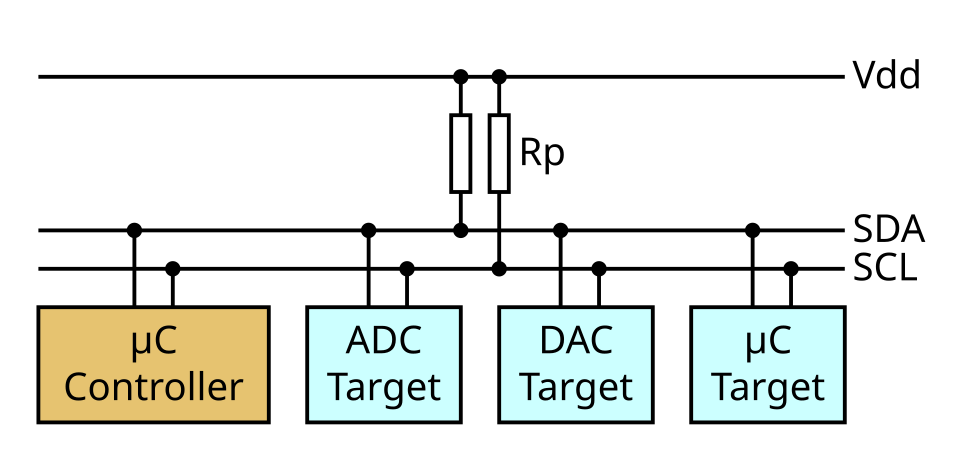
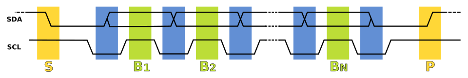
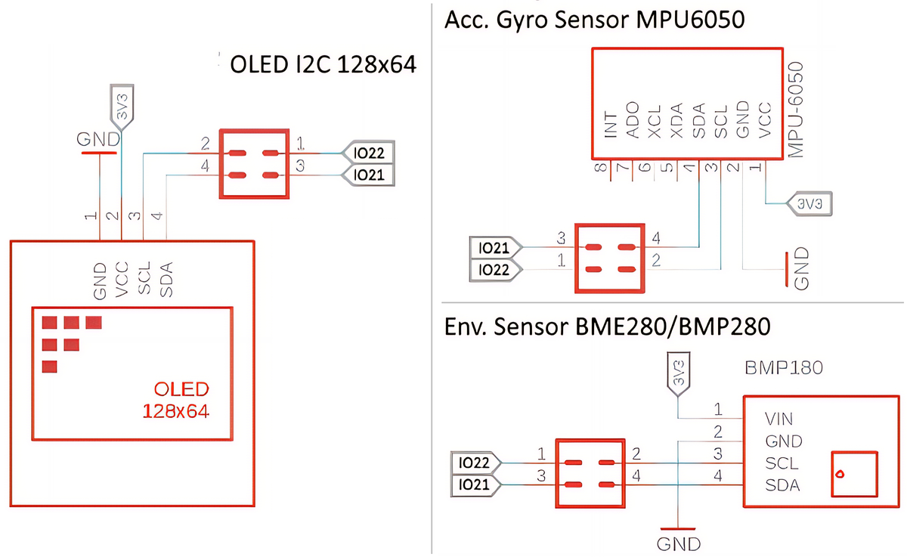
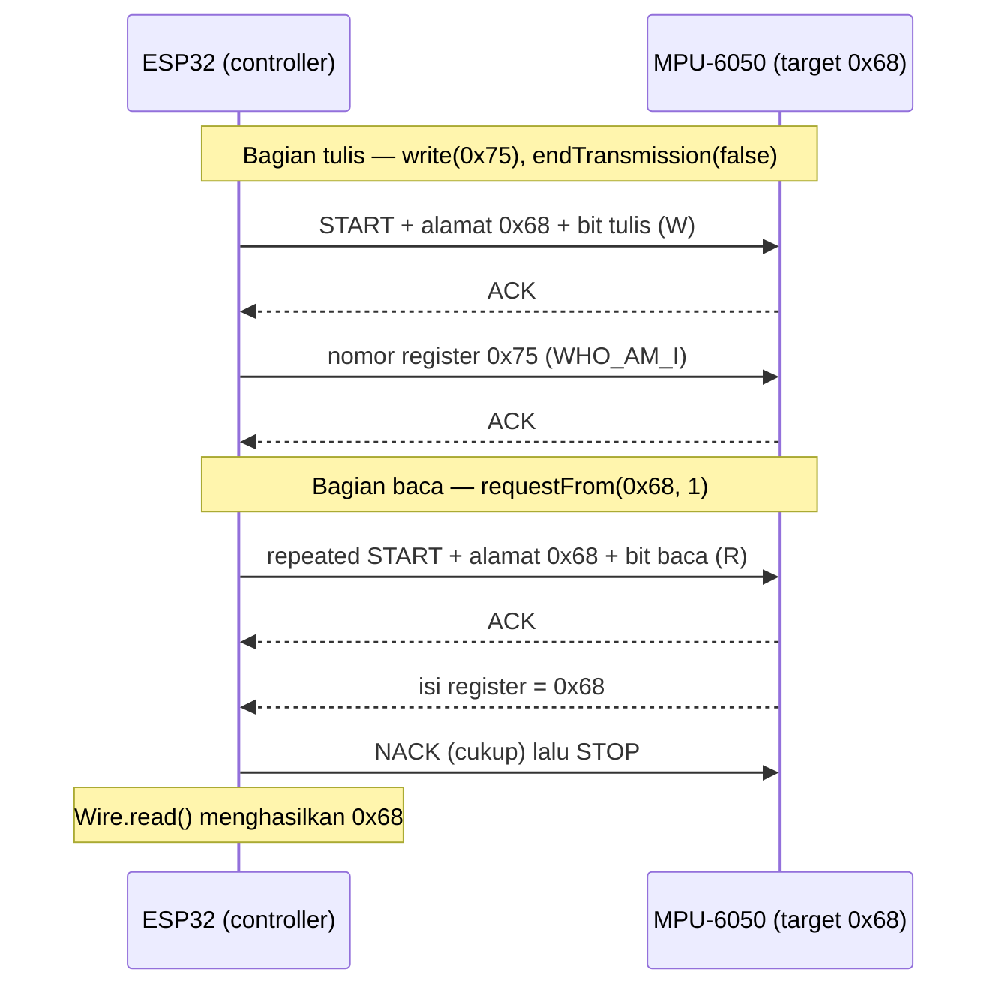

# BAB 23: I2C — Inter-Integrated Circuit

> ✅ **Prasyarat:** Selesaikan **BAB 22 (UART / Serial Communication)** — kamu sudah mengenal komunikasi serial, bit, dan *byte*. Program pemindai I2C dan *jumper cap* dari [BAB 6](../BAB-06/README.md) dipakai lagi di sini, dan pola `millis()` dari [BAB 16](../BAB-16/README.md) dipakai di Program 3 dan 4.

Kit Bluino punya tiga modul — layar OLED, sensor gerak MPU-6050, dan sensor tekanan udara BMP180 — yang semuanya "mengobrol" dengan ESP32 hanya lewat **dua jalur sinyal yang sama**. Caranya memakai **I2C**, protokol yang bekerja seperti guru yang memanggil murid berdasarkan nomor absen: semua murid mendengar panggilan, tetapi hanya yang nomornya dipanggil yang menjawab. Di BAB ini kamu akan membongkar cara kerja I2C dari dalam, bukan sekadar memakai *library* sensor, sehingga saat sebuah sensor tidak terbaca kamu tahu apa yang harus diperiksa.

## 📌 Tujuan Pembelajaran

Setelah mempelajari BAB ini, kamu bisa:

- Menjelaskan cara kerja bus I2C: jalur SDA, SCL, dan GND, peran *controller* dan *target*, serta alamat 7 bit.
- Menjelaskan urutan sinyal dalam satu transaksi: START, alamat dan bit baca/tulis, ACK/NACK, data, STOP, dan *repeated START*.
- Menjelaskan fungsi resistor *pull-up* dan memilih kecepatan bus (100 kHz atau 400 kHz).
- Memakai *library* `Wire` di esp32 core 3.x: `begin()`, `setClock()`, `beginTransmission()`, `write()`, `endTransmission()`, `requestFrom()`, dan `read()`.
- Membaca kode hasil `endTransmission()` dan jumlah *byte* hasil `requestFrom()` untuk mendeteksi masalah.
- Membaca dan menulis register: register identitas MPU-6050 (`WHO_AM_I`) dan BMP180 (*chip-id*), serta data suhu dua *byte*.
- Membaca dua sensor di satu bus, lalu mengatasi konflik alamat, *jumper cap* yang lepas, dan bus yang macet.

## 🧰 Yang Perlu Disiapkan

| Kebutuhan | Keterangan |
|---|---|
| *Hardware* | Kit Bluino ESP32 IoT Starter Shield + kabel USB **data** |
| Kabel *jumper* | Tidak perlu — OLED, MPU-6050, dan BMP180 sudah tersambung ke IO21/IO22 lewat *jumper cap* (pastikan semuanya terpasang) |
| Komponen tambahan | Tidak ada |
| *Software* | Arduino IDE 2.x + *board package* **esp32** versi 3.3.x (lihat [BAB 5](../BAB-05/README.md)) |
| *Library* | Tidak perlu *library* tambahan — `Wire` sudah termasuk paket esp32 |
| Alat uji | **Serial Monitor** Arduino IDE (baud 115200); **Serial Plotter** (**Tools → Serial Plotter**) untuk Latihan 3 |
| Jaringan | Tidak perlu WiFi |

## 📑 Daftar Isi

- [23.1 Mengenal I2C](#231-mengenal-i2c)
- [23.2 Cara Kerja Bus I2C](#232-cara-kerja-bus-i2c)
- [23.3 Bus I2C di Kit Bluino](#233-bus-i2c-di-kit-bluino)
- [23.4 Library Wire di ESP32](#234-library-wire-di-esp32)
- [23.5 Program 1: Memeriksa Perangkat dan Kode Hasil](#235-program-1-memeriksa-perangkat-dan-kode-hasil)
- [23.6 Membaca dan Menulis Register](#236-membaca-dan-menulis-register)
- [23.7 Program 2: Membaca Register Identitas](#237-program-2-membaca-register-identitas)
- [23.8 Program 3: Suhu Chip MPU-6050](#238-program-3-suhu-chip-mpu-6050)
- [23.9 Program 4: Dua Sensor di Satu Bus](#239-program-4-dua-sensor-di-satu-bus)
- [23.10 Konflik Alamat dan Bus I2C Kedua](#2310-konflik-alamat-dan-bus-i2c-kedua)
- [23.11 Troubleshooting](#2311-troubleshooting)
- [📝 Rangkuman](#-rangkuman)
- [💪 Latihan](#-latihan)
- [📚 Referensi](#-referensi)

---

## 23.1 Mengenal I2C

**I2C** (*Inter-Integrated Circuit*) adalah protokol komunikasi serial untuk menghubungkan chip-chip yang letaknya berdekatan, misalnya mikrokontroler dengan sensor dan layar di satu papan. Namanya dibaca "*I-squared-C*" atau "*I-two-C*", dan sering juga ditulis I²C atau IIC. Protokol ini dikembangkan Philips Semiconductors (sekarang NXP Semiconductors); versi pertama spesifikasinya terbit tahun 1982. Sekarang I2C dipakai di ribuan jenis chip: sensor suhu, sensor gerak, layar kecil, memori EEPROM, jam *real-time*, dan banyak lagi.

Keunggulan utamanya: **banyak perangkat cukup berbagi dua jalur sinyal yang sama**. Setiap perangkat punya **alamat** sendiri, jadi ESP32 bisa memilih dengan siapa ia sedang berbicara.

### 23.1.1 Perbandingan dengan Protokol Lain

| Protokol | Jalur sinyal | Jumlah perangkat | Kecepatan umum | Contoh di kit | Dibahas di |
|---|---|---|---|---|---|
| UART | 2 (TX, RX), tanpa jalur *clock* | 2 (satu lawan satu) | Biasanya 9600–115200 bit/s | Serial Monitor lewat USB | [BAB 22](../BAB-22/README.md) |
| **I2C** | 2 (SDA, SCL) | Banyak, dibedakan dengan **alamat** | 100 kbit/s atau 400 kbit/s | OLED, MPU-6050, BMP180 | BAB ini |
| SPI | 4 (MOSI, MISO, CLK, CS), tambah 1 CS untuk setiap perangkat berikutnya | Banyak, dipilih lewat jalur CS | Jutaan bit per detik | microSD | [BAB 24](../BAB-24/README.md) |
| 1-Wire | 1 (data) | Banyak, dibedakan dengan nomor seri 64 bit | Sekitar 15 kbit/s | DS18B20 | [BAB 25](../BAB-25/README.md) |

Semua protokol di atas juga butuh **GND bersama** sebagai titik acuan tegangan. Di kit, GND semua modul sudah tersambung ke GND ESP32 lewat jalur PCB.

Kelebihan dan keterbatasan I2C:

- ✅ **Hemat pin.** Berapa pun perangkatnya, ESP32 tetap hanya memakai dua pin (di kit: IO21 dan IO22).
- ✅ **Ada jawaban dari perangkat.** Setiap *byte* yang dikirim dibalas tanda "diterima" (ACK). Inilah yang membuat pemindai I2C bisa mengetahui perangkat mana yang ada.
- ⚠️ **Lebih lambat** daripada SPI, sehingga kurang cocok untuk data besar seperti kartu memori.
- ⚠️ **Jarak pendek.** I2C dirancang untuk jalur di dalam satu papan atau kabel pendek (puluhan sentimeter), bukan antarruangan.
- ⚠️ **Alamat tidak boleh kembar.** Dua perangkat dengan alamat sama di satu bus akan bertabrakan (solusinya di [23.10](#2310-konflik-alamat-dan-bus-i2c-kedua)).

---

## 23.2 Cara Kerja Bus I2C

### 23.2.1 Dua Jalur Sinyal: SDA dan SCL

Bus I2C hanya punya dua jalur sinyal, ditambah GND bersama:

| Jalur | Kepanjangan | Fungsi | Pin di kit |
|---|---|---|---|
| **SDA** | *Serial Data* | Jalur data. Dipakai bergantian dua arah: kadang ESP32 yang mengirim, kadang sensor yang menjawab | IO21 |
| **SCL** | *Serial Clock* | Jalur detak (*clock*), yaitu denyut yang menandai kapan satu bit siap dibaca | IO22 |
| **GND** | *Ground* | Titik acuan tegangan bersama | GND |

Jalur SCL bekerja seperti ketukan dirigen paduan suara: setiap satu ketukan, satu bit data dibaca. Karena "ketukan" ini ikut dikirim, I2C disebut protokol **sinkron**. Bandingkan dengan UART di [BAB 22](../BAB-22/README.md) yang **asinkron**: tidak ada jalur *clock*, sehingga pengirim dan penerima harus sepakat dulu soal *baud rate*.



*Gambar 23.1 — Satu pengendali (controller) dan tiga perangkat sasaran (target) berbagi jalur SDA dan SCL yang sama. Resistor Rp menarik kedua jalur ke tegangan catu Vdd. Sumber: [Tim Mathias](https://commons.wikimedia.org/wiki/File:I2C_controller-target.svg), lisensi CC BY-SA 4.0.*

### 23.2.2 Controller dan Target

Dalam bus I2C ada dua peran:

- ***Controller*** (pengendali) — perangkat yang **memulai** setiap percakapan dan membangkitkan detak di SCL. Di kit, *controller*-nya adalah ESP32.
- ***Target*** (sasaran) — perangkat yang **menjawab** saat alamatnya dipanggil. Di kit: OLED, MPU-6050, dan BMP180. *Target* tidak pernah mulai bicara sendiri; ia hanya menjawab panggilan *controller*.

> 📌 **Catatan:** Di dokumen lama dan di banyak datasheet (termasuk datasheet MPU-6050 dan BMP180) kamu akan menemukan istilah ***master*** untuk *controller* dan ***slave*** untuk *target*. Sejak versi 7 spesifikasi I2C dari NXP (2021), istilah resminya menjadi *controller* dan *target*. Keduanya merujuk ke hal yang sama. Nama-nama di ESP32 pun masih memakai istilah lama, misalnya *driver* `i2c_master` dan pesan `Bus already started in Master Mode`.

### 23.2.3 Alamat 7 Bit

Setiap *target* punya **alamat 7 bit**. Dengan 7 bit, alamat yang mungkin adalah 0 sampai 127, biasanya ditulis dalam heksadesimal `0x00` sampai `0x7F`. Awalan `0x` berarti angka heksadesimal (basis 16), misalnya `0x3C` = 3 × 16 + 12 = 60.

Tidak semua alamat boleh dipakai perangkat biasa. Spesifikasi I2C mencadangkan `0x00`–`0x07` dan `0x78`–`0x7F` untuk keperluan khusus, sehingga perangkat umumnya memakai alamat `0x08`–`0x77` (112 alamat).

Alamat perangkat di kit:

| Perangkat | Alamat (heksadesimal) | Desimal | Bisa diganti? |
|---|---|---|---|
| OLED SSD1306 128×64 | `0x3C` | 60 | Sebagian modul bisa dipindah ke `0x3D` lewat resistor/*jumper* solder di papan modul |
| MPU-6050 | `0x68` | 104 | Ya: pin AD0 LOW → `0x68`, pin AD0 HIGH → `0x69` |
| BMP180 | `0x77` | 119 | Tidak, alamatnya tetap |

> 💡 **Tips:** Datasheet kadang menulis alamat dalam bentuk **8 bit**, yaitu alamat 7 bit yang sudah digabung dengan bit baca/tulis. Contohnya, datasheet BMP180 menulis `0xEE` (tulis) dan `0xEF` (baca), dan banyak modul OLED bertuliskan `0x78` di papannya. *Library* `Wire` selalu memakai bentuk **7 bit**, yaitu angka 8 bit tadi dibagi 2: `0xEE` → `0x77`, `0x78` → `0x3C`.

### 23.2.4 Urutan Sinyal dalam Satu Transaksi

Saat bus diam, SDA dan SCL sama-sama HIGH. Satu "percakapan" (transaksi) selalu mengikuti pola yang sama:



*Gambar 23.2 — Urutan sinyal di SDA dan SCL: kondisi START (S), bit data B1 sampai BN, lalu kondisi STOP (P). SDA hanya berubah saat SCL LOW (area biru); bit dibaca saat SCL HIGH (area hijau). Sumber: [Marcin Floryan](https://commons.wikimedia.org/wiki/File:I2C_data_transfer.svg), domain publik.*

1. **START (S).** *Controller* menarik SDA ke LOW selagi SCL masih HIGH, seperti guru yang berkata "Perhatian!". Semua *target* mulai mendengarkan.
2. **Alamat + bit R/W.** *Controller* mengirim 7 bit alamat, lalu 1 bit arah: `0` = tulis (*controller* mengirim data ke *target*), `1` = baca (*target* mengirim data ke *controller*).
3. **ACK atau NACK.** Pada detak ke-9, penerima menjawab. **ACK** (*acknowledge*): penerima menarik SDA ke LOW, artinya "ya, diterima". **NACK** (*not acknowledge*): SDA dibiarkan HIGH, artinya tidak ada yang menjawab.
4. **Data.** Setelah itu data dikirim *byte* demi *byte*. Setiap *byte* berisi 8 bit (bit bernilai terbesar dulu) dan diikuti 1 bit ACK/NACK, jadi satu *byte* butuh 9 detak SCL.
5. **STOP (P).** *Controller* menaikkan SDA dari LOW ke HIGH selagi SCL HIGH. Bus kembali bebas.

Aturan emasnya: **SDA hanya boleh berubah saat SCL LOW**. Kalau SDA berubah saat SCL HIGH, itu bukan data, melainkan tanda START (SDA turun) atau STOP (SDA naik).

Contohnya, transaksi menulis dua *byte* ke sebuah *target* terlihat seperti ini:

```text
S | alamat 7 bit + W | ACK | byte 1 | ACK | byte 2 | ACK | P
```

Arti ACK dan NACK bergantung pada situasinya:

| Situasi | Siapa yang menjawab | Artinya |
|---|---|---|
| ACK setelah alamat | *Target* | "Saya ada, silakan lanjut" |
| NACK setelah alamat | Tidak ada yang menarik SDA | Tidak ada perangkat dengan alamat itu, atau perangkatnya sedang tidak bisa menjawab |
| ACK setelah *byte* yang ditulis *controller* | *Target* | *Byte* diterima |
| NACK setelah *byte* terakhir yang dibaca | *Controller* | "Cukup, saya selesai membaca" — ini **normal**, bukan *error* |

Ada satu kondisi lagi yang penting: ***repeated START*** (START berulang). *Controller* mengirim START baru **tanpa** STOP terlebih dulu. Gunanya untuk berganti arah dari tulis ke baca tanpa melepas bus, misalnya "tulis nomor register yang ingin dibaca, lalu langsung baca isinya". Pola ini dipakai di [23.6](#236-membaca-dan-menulis-register).

### 23.2.5 Open-Drain dan Resistor Pull-Up

Perangkat I2C **tidak pernah mendorong jalur ke HIGH**. Setiap perangkat hanya bisa melakukan dua hal: **menarik jalur ke LOW** atau **melepasnya**. Cara kerja ini disebut ***open-drain***. Lalu siapa yang membuat jalur menjadi HIGH? Jawabannya resistor ***pull-up*** (Rp pada Gambar 23.1) yang menyambungkan SDA dan SCL ke tegangan catu.

Bayangkan tirai gulung berpegas: pegasnya (resistor *pull-up*) selalu menarik tirai ke atas, dan siapa pun boleh menarik talinya ke bawah. Kalau dua orang menarik bersamaan, tidak ada yang rusak — tirainya tetap turun. Kalau semua melepas, pegas mengembalikannya ke atas. Karena itu:

- *Target* bisa menjawab ACK cukup dengan menarik SDA ke LOW.
- Dua perangkat yang tidak sengaja "bicara" bersamaan tidak akan saling merusak (paling-paling datanya kacau).
- Tanpa resistor *pull-up*, jalur tidak bisa kembali ke HIGH dan komunikasi gagal, biasanya berakhir dengan *timeout* (waktu tunggu habis).

Nilai resistor *pull-up* yang umum adalah 2,2–10 kΩ (datasheet BMP180 menyarankan 4,7 kΩ). Resistor yang terlalu besar membuat sinyal naik terlalu lambat untuk kecepatan tinggi; yang terlalu kecil membuat perangkat kesulitan menarik jalur ke LOW. Untuk ESP32, resistor *pull-up* harus ke **3,3 V**, bukan 5 V, karena pin ESP32 tidak tahan 5 V. Letak *pull-up* di kit dibahas di [23.3.2](#2332-di-mana-resistor-pull-up-nya).

### 23.2.6 Kecepatan Bus

Kecepatan I2C ditentukan oleh frekuensi detak di SCL, dan keputusannya ada di tangan *controller*:

| Mode | Kecepatan maksimum | Keterangan |
|---|---|---|
| *Standard-mode* | 100 kbit/s (SCL 100 kHz) | Bawaan `Wire.begin()` di esp32 core 3.x |
| *Fast-mode* | 400 kbit/s (SCL 400 kHz) | Didukung ketiga modul I2C di kit |
| *Fast-mode Plus* | 1 Mbit/s | Batas tertinggi yang diterima `Wire` di esp32 core 3.x; **tidak** didukung OLED dan MPU-6050 |
| *High-speed mode* | 3,4 Mbit/s | Butuh perangkat khusus; tidak dipakai di kit ini |

Satu bus hanya boleh secepat **perangkat paling lambat** di bus itu. OLED SSD1306 dan MPU-6050 mendukung maksimal 400 kHz (BMP180 bahkan sampai 3,4 MHz), jadi untuk kit ini pilihan amannya 100 kHz atau 400 kHz. Pada 100 kHz, satu *byte* (9 detak) butuh sekitar 90 µs — sudah lebih dari cukup untuk membaca sensor ratusan kali per detik.

---

## 23.3 Bus I2C di Kit Bluino

### 23.3.1 Tiga Modul dan Jumper Cap

Ketiga modul I2C di kit tersambung ke ESP32 **tanpa kabel *jumper***. Sebagai gantinya, setiap modul punya sepasang ***jumper cap*** (penutup *jumper* hitam) di header berlabel **JP**: satu untuk SDA dan satu untuk SCL. Sebuah *jumper cap* menghubungkan dua pin yang berdampingan, seperti jembatan kecil.



*Gambar 23.3 — Jalur I2C ketiga modul di kit. Setiap kotak merah 2×2 adalah tempat jumper cap: pin 1–2 menyambungkan IO22 ke SCL, pin 3–4 menyambungkan IO21 ke SDA. Judul "Env. Sensor BME280/BMP280" adalah tulisan asli skematik; modul yang terpasang di kit adalah BMP180. Sumber: skematik ESP32 Starter Shield 3.2, [Bluino](http://www.bluino.com), dipotong dan disusun untuk materi ini.*

Di papan, *jumper cap* I2C ada di dua blok — nomor 7 dan 8 pada [Gambar 6.2 di BAB 6](../BAB-06/README.md#621-letak-header-di-kit):

| Blok | Letak | Isi (urut sesuai label di PCB) |
|---|---|---|
| Nomor 7 | Di samping slot microSD | `MISO`, `CLK`, `MOSI`, `CS` (microSD, bus SPI), lalu `SCL`, `SDA` (OLED) |
| Nomor 8 | Di bawah MPU-6050 | `SCL`, `SDA` (MPU-6050), lalu `SCL`, `SDA` (BMP180) |

Hal-hal penting:

- Dari pabrik semua *jumper cap* sudah terpasang. **Biarkan terpasang.** Kalau sebuah *jumper cap* lepas, modul pemiliknya "hilang" dari bus, sedangkan modul lain tetap bekerja.
- Karena setiap modul punya *jumper cap* sendiri, kamu bisa melepas satu modul dari bus untuk mencari modul yang bermasalah (lihat [23.11](#2311-troubleshooting)). Selalu **cabut USB dulu** sebelum melepas atau memasang *jumper cap*.
- IO21 dan IO22 sudah dipakai bus I2C — jangan colokkan kabel *jumper* lain ke label `21` dan `22` di deretan pin ESP32.
- Ketiga modul mendapat daya 3,3 V (`3V3`) dari kit, jadi level sinyal I2C-nya 3,3 V dan aman untuk ESP32.

Di BAB ini ketiga modul diajak "mengobrol" langsung di tingkat register. Cara memakainya dengan *library* siap pakai dibahas di [BAB 28 (BMP180)](../BAB-28/README.md), [BAB 29 (MPU-6050)](../BAB-29/README.md), dan [BAB 35 (OLED)](../BAB-35/README.md).

### 23.3.2 Di Mana Resistor Pull-Up-nya?

Perhatikan Gambar 23.3: di jalur IO21 dan IO22 **tidak ada resistor *pull-up* di PCB kit**. Lalu dari mana SDA dan SCL mendapat tarikan ke HIGH? Ada dua sumber:

1. **Papan modulnya sendiri.** OLED, MPU-6050, dan BMP180 di kit berupa papan modul kecil (*breakout*) yang dipasang di atas PCB kit. Papan modul seperti ini umumnya sudah membawa resistor *pull-up* sendiri di SDA dan SCL. Karena ketiganya tersambung paralel, resistor-resistor itu bergabung menjadi tarikan yang lebih kuat. Misalnya, kalau setiap modul memakai 4,7 kΩ, gabungan ketiganya sekitar 1,6 kΩ — masih aman untuk bus 3,3 V.
2. ***Pull-up* internal ESP32.** Saat `Wire.begin()` dijalankan, esp32 core 3.x ikut menyalakan resistor *pull-up* internal di pin SDA dan SCL. Nilainya besar (sekitar 45 kΩ), sehingga tarikannya lemah: cukup sebagai cadangan, tetapi jangan diandalkan sebagai satu-satunya *pull-up*.

Jadi, untuk bus I2C kit kamu **tidak perlu menambah resistor**. Lain ceritanya kalau suatu saat kamu memasang modul I2C sendiri di pin lain (misalnya bus kedua di [23.10](#2310-konflik-alamat-dan-bus-i2c-kedua)) dan modul itu tidak punya *pull-up*: pasang resistor 4,7 kΩ dari SDA ke 3,3 V dan dari SCL ke 3,3 V.

---

## 23.4 Library Wire di ESP32

*Library* `Wire` adalah *library* I2C bawaan Arduino. Di ESP32, *library* ini sudah termasuk paket esp32, jadi cukup tulis `#include <Wire.h>` di awal program — tidak perlu menginstal apa pun. Objek `Wire` mewakili bus I2C pertama ESP32. ESP32 punya dua bus I2C *hardware*; yang kedua bernama `Wire1` dan dibahas di [23.10](#2310-konflik-alamat-dan-bus-i2c-kedua).

### 23.4.1 Memulai Bus: Wire.begin() dan Wire.setClock()

Contoh potongan kode (bagian awal program dan `setup()` saja):

```cpp
#include <Wire.h>

void setup() {
  Wire.begin(21, 22);      // mulai bus I2C: SDA = IO21, SCL = IO22, kecepatan 100 kHz
  Wire.setClock(400000);   // (opsional) naikkan kecepatan ke 400 kHz
}
```

- `Wire.begin(sda, scl)` menyalakan bus I2C di pin yang disebut, dengan ESP32 sebagai *controller*. Hasilnya `true` kalau berhasil dan `false` kalau gagal.
- Kalau ditulis `Wire.begin();` tanpa angka, esp32 core memakai pin bawaan *board*. Untuk **ESP32 Dev Module**, pin bawaannya memang IO21 (SDA) dan IO22 (SCL), jadi hasilnya sama. Di kurikulum ini pin tetap ditulis lengkap supaya jelas terbaca.
- Kecepatan bawaan adalah **100 kHz**. Kamu bisa langsung memilih kecepatan saat memulai, misalnya `Wire.begin(21, 22, 400000);`, atau mengubahnya kapan saja dengan `Wire.setClock(400000);`. Fungsi `Wire.getClock()` mengembalikan kecepatan yang sedang dipakai (dalam Hz).
- `Wire.begin()` cukup dipanggil **sekali** di `setup()`, berapa pun jumlah perangkat di bus.

> ⚠️ **Perhatian:** Urutan parameternya **SDA dulu, baru SCL**. `Wire.begin(22, 21)` (tertukar) tidak menimbulkan *error* saat di-*compile*, tetapi tidak ada perangkat yang akan menjawab.

### 23.4.2 Menulis: beginTransmission(), write(), endTransmission()

Mengirim data ke sebuah *target* selalu terdiri atas tiga langkah:

```cpp
Wire.beginTransmission(0x68);            // 1. siapkan transaksi ke alamat 0x68 (belum ada yang dikirim)
Wire.write(0x6B);                        // 2. masukkan byte ke antrean kirim
Wire.write(0x01);                        //    (boleh beberapa kali)
uint8_t kode = Wire.endTransmission();   // 3. kirim semuanya: START, alamat, data, STOP
```

| Fungsi | Yang terjadi |
|---|---|
| `Wire.beginTransmission(alamat)` | Menyiapkan antrean kirim untuk alamat itu. **Belum ada sinyal** yang keluar ke bus |
| `Wire.write(data)` | Menambahkan satu *byte* ke antrean (maksimal 128 *byte*). Hasilnya 1 kalau berhasil, 0 kalau antrean penuh |
| `Wire.endTransmission()` | **Benar-benar mengirim**: START → alamat + W → semua *byte* di antrean → STOP. Hasilnya berupa kode (lihat [23.4.3](#2343-kode-hasil-endtransmission)) |
| `Wire.endTransmission(false)` | Menyimpan antrean **tanpa** STOP, untuk digabung dengan `requestFrom()` berikutnya memakai *repeated START* (lihat [23.6](#236-membaca-dan-menulis-register)) |

Ibaratnya mengirim surat: `beginTransmission()` menulis alamat di amplop, `write()` memasukkan isi surat, dan `endTransmission()` memasukkan amplop ke kotak pos.

Kalau `beginTransmission()` langsung diikuti `endTransmission()` tanpa `write()`, ESP32 hanya mengirim alamat lalu melihat ada jawaban ACK atau tidak. Inilah cara kerja pemindai I2C di [BAB 6](../BAB-06/README.md#68-program-2-pemindai-i2c).

### 23.4.3 Kode Hasil endTransmission()

`endTransmission()` mengembalikan angka yang memberi tahu apa yang terjadi di bus. Di esp32 core 3.3.x, hanya empat nilai ini yang benar-benar muncul:

| Kode | Arti | Contoh penyebab |
|---|---|---|
| `0` | Berhasil: *target* menjawab ACK | — |
| `2` | Alamat tidak dijawab (NACK) saat "memanggil" tanpa data, seperti di pemindai | Perangkat tidak ada, alamat salah, *jumper cap* lepas |
| `4` | *Error* lain, **termasuk NACK saat ada data yang dikirim** | Alamat salah saat menulis register, modul lepas, gangguan di jalur |
| `5` | *Timeout*: transaksi tidak selesai dalam batas waktu (bawaan 50 ms) | SDA/SCL tertahan LOW (bus macet), *pull-up* tidak ada |

> 📌 **Catatan:** Dokumentasi Arduino juga menyebut kode `1` (data terlalu panjang) dan `3` (NACK saat mengirim data). Pada esp32 core 3.3.x kedua kode itu **tidak pernah dipakai**: data yang terlalu panjang sudah ditolak oleh `write()`, dan NACK saat mengirim data dilaporkan sebagai kode `4`. Jadi untuk ESP32 cukup ingat: **0 = berhasil, selain 0 = gagal**, lalu kode 2 dan 5 memberi petunjuk tambahan.

Batas waktu (bawaan 50 ms) bisa diubah dengan `Wire.setTimeOut(100);` — perhatikan huruf **O besar**. Fungsi `Wire.setTimeout()` dengan huruf o kecil adalah fungsi lain (milik `Stream`) yang **tidak** mengatur batas waktu I2C.

### 23.4.4 Membaca: requestFrom(), available(), read()

```cpp
if (Wire.requestFrom(0x68, 2) == 2) {   // minta 2 byte dari alamat 0x68, cek jumlah yang diterima
  uint8_t pertama = Wire.read();        // byte pertama
  uint8_t kedua   = Wire.read();        // byte kedua
}
```

| Fungsi | Yang terjadi |
|---|---|
| `Wire.requestFrom(alamat, n)` | **Benar-benar mengirim**: START → alamat + R → menerima `n` *byte* (ESP32 menjawab ACK untuk setiap *byte*, kecuali NACK untuk *byte* terakhir) → STOP. Hasilnya **jumlah *byte* yang diterima**; 0 berarti gagal |
| `Wire.available()` | Jumlah *byte* yang sudah diterima dan masih menunggu untuk dibaca |
| `Wire.read()` | Mengambil satu *byte* hasil penerimaan. Hasilnya −1 kalau tidak ada lagi yang bisa dibaca |

> 💡 **Tips:** Selalu periksa hasil `requestFrom()`. Kalau perangkat tidak menjawab, hasilnya 0 dan `Wire.read()` mengembalikan −1. Nilai −1 yang disimpan ke variabel `uint8_t` akan terbaca sebagai `0xFF` (255) — itulah sebabnya data dari sensor yang lepas sering muncul sebagai `0xFF`.

---

## 23.5 Program 1: Memeriksa Perangkat dan Kode Hasil

**Tujuan:** Memanggil alamat ketiga modul I2C kit satu per satu, ditambah satu alamat yang sengaja kosong (`0x50`), lalu menampilkan kode hasil `endTransmission()` beserta artinya — sekali pada 100 kHz dan sekali lagi pada 400 kHz. Program ini melengkapi pemindai I2C di [BAB 6](../BAB-06/README.md#68-program-2-pemindai-i2c): pemindai mencari **semua** alamat, sedangkan program ini memeriksa alamat yang kamu harapkan dan menjelaskan arti kodenya.

**Rangkaian:**

*Tidak perlu merangkai — OLED, MPU-6050, dan BMP180 sudah tersambung ke IO21/IO22 lewat* jumper cap *di kit. Pastikan saja semua* jumper cap *I2C (blok nomor 7 dan 8, lihat [23.3.1](#2331-tiga-modul-dan-jumper-cap)) terpasang.*

**Cara Menjalankan:**

1. Pastikan *jumper cap* I2C terpasang dan tidak ada kabel *jumper* di label `21` atau `22`. Kabel *jumper* lain dari BAB sebelumnya boleh tetap terpasang.
2. Buka Arduino IDE → **File → New Sketch**, hapus isinya, lalu salin kode di bawah. Kode yang sama juga tersedia di *file* [`p1_cek_perangkat.ino`](p1_cek_perangkat/p1_cek_perangkat.ino).
3. Pastikan **Tools → Board** = **ESP32 Dev Module** dan **Tools → Port** = *port* ESP32 kamu (misalnya `COM5` di Windows atau `/dev/ttyUSB0` di Linux).
4. Klik tombol **Upload** (ikon panah →) dan tunggu sampai muncul tulisan **Done uploading**.
5. Buka **Serial Monitor** (**Tools → Serial Monitor**) lalu pilih baud **115200**. Kalau tulisannya terlewat, tekan tombol **EN** di *board* ESP32 untuk mengulang program.

**Kode Program:**

<!-- sketch: p1_cek_perangkat -->
```cpp
/*
 * BAB 23 - Program 1: Memeriksa Perangkat dan Kode Hasil
 * Memanggil alamat OLED, MPU-6050, BMP180, dan satu alamat kosong (0x50),
 * lalu menampilkan kode hasil Wire.endTransmission() beserta artinya.
 *
 * Rangkaian: tidak perlu kabel. Modul I2C tersambung ke
 * IO21 (SDA) dan IO22 (SCL) lewat jumper cap di kit.
 */

#include <Wire.h>

#define PIN_SDA 21
#define PIN_SCL 22

// Alamat yang diperiksa dan namanya (urutan kedua array harus sama)
const uint8_t daftarAlamat[] = {0x3C, 0x68, 0x77, 0x50};
const char *daftarNama[]     = {"OLED SSD1306", "MPU-6050", "BMP180", "(alamat kosong)"};
const int JUMLAH_ALAMAT = 4;

// Menerjemahkan kode hasil endTransmission() menjadi teks
const char *artiKode(uint8_t kode) {
  switch (kode) {
    case 0:  return "ACK, perangkat menjawab";
    case 2:  return "NACK, tidak ada yang menjawab";
    case 5:  return "timeout, bus macet atau pull-up hilang";
    default: return "error lain";
  }
}

// Memanggil setiap alamat tanpa data, lalu mencetak kode hasilnya
void periksaSemua() {
  for (int i = 0; i < JUMLAH_ALAMAT; i++) {
    Wire.beginTransmission(daftarAlamat[i]);  // siapkan panggilan ke alamat ini
    uint8_t kode = Wire.endTransmission();    // kirim alamat saja, lalu tunggu ACK/NACK
    Serial.printf("  0x%02X %-16s -> kode %u: %s\n",
                  daftarAlamat[i], daftarNama[i], kode, artiKode(kode));
  }
}

void setup() {
  Serial.begin(115200);
  delay(1000);  // beri waktu Serial Monitor tersambung

  if (!Wire.begin(PIN_SDA, PIN_SCL)) {  // SDA = IO21, SCL = IO22, kecepatan bawaan 100 kHz
    Serial.println("Gagal memulai bus I2C! Periksa nomor pin.");
    while (true) {
      delay(1000);  // berhenti di sini
    }
  }

  Serial.println("BAB 23 - Program 1: Memeriksa Perangkat I2C");

  Serial.printf("Kecepatan bus: %lu Hz\n", (unsigned long)Wire.getClock());
  periksaSemua();

  Wire.setClock(400000);  // pindah ke Fast-mode (400 kHz)
  Serial.printf("Kecepatan bus: %lu Hz\n", (unsigned long)Wire.getClock());
  periksaSemua();

  Serial.println("Selesai. Tekan tombol EN untuk mengulang.");
}

void loop() {
  // Semua pemeriksaan sudah dijalankan sekali di setup().
}
```

**Penjelasan Kode:**

- Alamat yang ingin diperiksa disimpan di *array* `daftarAlamat`, dan namanya di *array* `daftarNama` dengan urutan yang sama. Alamat `0x50` (biasa dipakai memori EEPROM) sengaja dimasukkan sebagai contoh alamat yang **tidak** ada di kit.
- `Wire.begin(PIN_SDA, PIN_SCL)` mengembalikan `true` kalau bus berhasil dinyalakan. Kalau gagal, program mencetak pesan lalu berhenti di perulangan `while (true)`.
- Di `periksaSemua()`, pasangan `beginTransmission()` + `endTransmission()` tanpa `write()` hanya mengirim alamat. *Target* yang mengenali alamatnya menjawab ACK (kode 0); kalau tidak ada yang menjawab, hasilnya NACK (kode 2).
- `artiKode()` memakai `switch` untuk menerjemahkan kode menjadi teks, sesuai tabel di [23.4.3](#2343-kode-hasil-endtransmission).
- Di `Serial.printf()`, `%02X` mencetak angka heksadesimal dua digit, `%-16s` mencetak teks rata kiri selebar 16 karakter supaya kolomnya rapi, dan `%u` mencetak bilangan bulat tanpa tanda.
- `Wire.getClock()` dibungkus `(unsigned long)` supaya cocok dengan format `%lu`. Setelah `Wire.setClock(400000)`, pemeriksaan diulang: kalau ketiga modul tetap menjawab, berarti semuanya sanggup bekerja di 400 kHz.

**Contoh Output:**

```text
BAB 23 - Program 1: Memeriksa Perangkat I2C
Kecepatan bus: 100000 Hz
  0x3C OLED SSD1306     -> kode 0: ACK, perangkat menjawab
  0x68 MPU-6050         -> kode 0: ACK, perangkat menjawab
  0x77 BMP180           -> kode 0: ACK, perangkat menjawab
  0x50 (alamat kosong)  -> kode 2: NACK, tidak ada yang menjawab
Kecepatan bus: 400000 Hz
  0x3C OLED SSD1306     -> kode 0: ACK, perangkat menjawab
  0x68 MPU-6050         -> kode 0: ACK, perangkat menjawab
  0x77 BMP180           -> kode 0: ACK, perangkat menjawab
  0x50 (alamat kosong)  -> kode 2: NACK, tidak ada yang menjawab
Selesai. Tekan tombol EN untuk mengulang.
```

Tidak ada yang berubah di kit: layar OLED tetap gelap karena program ini hanya "memanggil" alamatnya, belum mengirim gambar.

> 🧪 **Coba Sendiri:** Cabut USB, lepaskan *jumper cap* `SDA` milik BMP180 (blok nomor 8), lalu sambungkan USB lagi. Baris `0x77 BMP180` sekarang berubah menjadi `kode 2: NACK, tidak ada yang menjawab`, sedangkan modul lain tetap `kode 0`. Setelah selesai, cabut USB dan pasang kembali *jumper cap*-nya.

**Kalau Belum Berhasil:**

- **Semua alamat menghasilkan `kode 2`** → *jumper cap* I2C terlepas, ada kabel *jumper* yang tertancap di label `21`/`22`, atau `PIN_SDA` dan `PIN_SCL` tertukar. Cabut USB, periksa blok nomor 7 dan 8, lalu cocokkan `#define` dengan kode di atas.
- **Hanya satu modul yang `kode 2`** → *jumper cap* modul itu longgar atau hilang, atau modulnya tidak tertancap rapat. Pasang ulang dengan USB tercabut.
- **Muncul `kode 5` (timeout)** → jalur SDA atau SCL tertahan LOW, misalnya ada kabel dari label `21`/`22` ke `G`, atau sebuah modul "macet". Cabut semua kabel di pin 21/22, lalu cabut USB beberapa detik dan sambungkan lagi (lihat juga [23.11](#2311-troubleshooting)).
- **Serial Monitor kosong** → baud belum 115200 atau Serial Monitor dibuka terlambat. Tekan tombol **EN** di *board* untuk mengulang program.

---

## 23.6 Membaca dan Menulis Register

### 23.6.1 Apa Itu Register?

Di dalam setiap sensor I2C ada sederet kotak penyimpanan kecil bernama **register**. Setiap register berukuran 1 *byte* dan punya nomor sendiri. Bayangkan sebuah lemari berlaci: **alamat I2C** memilih lemarinya (sensor yang mana), sedangkan **nomor register** memilih laci di dalam lemari itu. Ada laci yang hanya bisa dibaca (misalnya hasil pengukuran) dan ada laci yang bisa ditulis (misalnya pengaturan).

Sebagian register MPU-6050 dan BMP180 yang dipakai di BAB ini:

| Perangkat | Register | Nama | Isi |
|---|---|---|---|
| MPU-6050 (`0x68`) | `0x75` | `WHO_AM_I` | Identitas chip, selalu `0x68` |
| MPU-6050 | `0x6B` | `PWR_MGMT_1` | Pengaturan daya. Saat dinyalakan bernilai `0x40` (mode tidur) |
| MPU-6050 | `0x1C` | `ACCEL_CONFIG` | Rentang akselerometer; `0x00` = ±2 g |
| MPU-6050 | `0x3B`–`0x40` | `ACCEL_XOUT_H` … `ACCEL_ZOUT_L` | Percepatan sumbu X, Y, dan Z (masing-masing 2 *byte*) |
| MPU-6050 | `0x41`–`0x42` | `TEMP_OUT_H`, `TEMP_OUT_L` | Suhu chip (2 *byte*) |
| BMP180 (`0x77`) | `0xD0` | *Chip-id* | Identitas chip, selalu `0x55` |
| BMP180 | `0xAA`–`0xBF` | Koefisien kalibrasi | 11 angka kalibrasi pabrik (masing-masing 2 *byte*) |
| BMP180 | `0xF4` | *Control* | Perintah untuk memulai pengukuran |
| BMP180 | `0xF6`–`0xF7` | Hasil pengukuran | Hasil pengukuran mentah (2 *byte*) |

Daftar lengkapnya ada di datasheet setiap chip (lihat [📚 Referensi](#-referensi)). *Library* sensor yang akan kamu pakai di BAB-BAB berikutnya sebenarnya juga hanya membaca dan menulis register seperti ini.

### 23.6.2 Pola Menulis Register

Untuk menulis register, kirim **nomor register** lalu **nilainya** dalam satu transaksi:

```cpp
// Menulis 1 byte ke sebuah register. Hasil: true kalau target menjawab ACK.
bool tulisRegister(uint8_t alamat, uint8_t reg, uint8_t nilai) {
  Wire.beginTransmission(alamat);
  Wire.write(reg);     // byte pertama: nomor register
  Wire.write(nilai);   // byte kedua: nilai yang ditulis
  return Wire.endTransmission() == 0;
}
```

Contohnya, `tulisRegister(0x68, 0x6B, 0x01);` membangunkan MPU-6050 dari mode tidur (dipakai di Program 3).

### 23.6.3 Pola Membaca Register dengan Repeated START

Membaca register butuh dua langkah dalam satu transaksi: **tulis** dulu nomor register yang ingin dibaca, lalu **baca** isinya. Kedua langkah disambung dengan *repeated START*, jadi bus tidak dilepas di tengah jalan.

```cpp
// Membaca 1 byte dari sebuah register.
// Hasil: 0–255 kalau berhasil, -1 kalau target tidak menjawab.
int bacaRegister(uint8_t alamat, uint8_t reg) {
  Wire.beginTransmission(alamat);
  Wire.write(reg);                          // tunjuk register yang ingin dibaca
  Wire.endTransmission(false);              // false = tanpa STOP, lanjut dengan repeated START
  if (Wire.requestFrom(alamat, 1) != 1) {   // minta 1 byte
    return -1;                              // tidak ada byte yang diterima
  }
  return Wire.read();
}
```

Begini urutan sinyalnya saat ESP32 membaca register `WHO_AM_I` milik MPU-6050:



*Gambar 23.4 — Urutan sinyal saat membaca satu register MPU-6050. Sumber: dibuat untuk materi ini.*

Beberapa hal yang perlu kamu tahu:

- Datasheet MPU-6050 dan BMP180 menggambarkan urutan baca persis seperti di atas: tulis nomor register, *repeated START*, lalu baca. Sebagian sensor masih bisa dibaca walaupun di antaranya ada STOP, tetapi ada juga yang mewajibkan *repeated START*. Jadi biasakan memakai `endTransmission(false)`.
- Di esp32 core 3.x, `endTransmission(false)` **belum mengirim apa pun**. Nomor register disimpan dulu, lalu bagian tulis dan bagian baca dikirim sekaligus saat `requestFrom()` dijalankan. Akibatnya, `endTransmission(false)` selalu menghasilkan 0 walaupun perangkatnya tidak ada — yang perlu diperiksa adalah hasil **`requestFrom()`**.
- `requestFrom()` harus memakai **alamat yang sama** dengan `beginTransmission()` sebelumnya. Kalau berbeda, transaksinya dibatalkan dan hasilnya 0.

### 23.6.4 Membaca Beberapa Register Sekaligus

Data yang besarnya lebih dari 1 *byte* disimpan di beberapa register yang berurutan, misalnya suhu MPU-6050 di `0x41` (*byte* atas) dan `0x42` (*byte* bawah). Kamu tidak perlu membacanya satu per satu: setelah menunjuk register pertama, minta saja beberapa *byte* sekaligus. MPU-6050 dan BMP180 (seperti kebanyakan sensor I2C) otomatis menaikkan nomor register setelah setiap *byte* yang dikirim, sehingga yang terbaca adalah `0x41`, `0x42`, dan seterusnya. Cara ini disebut ***burst read*** (baca beruntun).

*Burst read* lebih cepat, dan untuk MPU-6050 juga lebih tepat: datasheet-nya menjamin semua *byte* dalam satu *burst read* berasal dari pengukuran yang sama. Fungsinya ada di Program 3.

---

## 23.7 Program 2: Membaca Register Identitas

**Tujuan:** Membaca register identitas MPU-6050 (`WHO_AM_I`, register `0x75`) dan BMP180 (*chip-id*, register `0xD0`) dengan pola baca register, lalu memastikan isinya sesuai datasheet (`0x68` dan `0x55`). Cara ini lebih meyakinkan daripada pemindai: bukan hanya "ada yang menjawab di alamat itu", tetapi "chip yang menjawab memang chip yang kita harapkan".

**Rangkaian:**

*Tidak perlu merangkai — sama seperti Program 1. Pastikan semua* jumper cap *I2C terpasang.*

**Cara Menjalankan:**

1. Pastikan *jumper cap* I2C terpasang.
2. Buka Arduino IDE → **File → New Sketch**, hapus isinya, lalu salin kode di bawah. Kode yang sama juga tersedia di *file* [`p2_register_identitas.ino`](p2_register_identitas/p2_register_identitas.ino).
3. Pastikan **Tools → Board** = **ESP32 Dev Module** dan **Tools → Port** = *port* ESP32 kamu.
4. Klik tombol **Upload** (ikon panah →) dan tunggu sampai muncul tulisan **Done uploading**.
5. Buka **Serial Monitor** (**Tools → Serial Monitor**) lalu pilih baud **115200**. Tekan tombol **EN** di *board* kalau ingin mengulang.

**Kode Program:**

<!-- sketch: p2_register_identitas -->
```cpp
/*
 * BAB 23 - Program 2: Membaca Register Identitas
 * Membaca register WHO_AM_I MPU-6050 (0x75) dan chip-id BMP180 (0xD0),
 * lalu membandingkannya dengan nilai di datasheet.
 *
 * Rangkaian: tidak perlu kabel. Modul I2C tersambung ke
 * IO21 (SDA) dan IO22 (SCL) lewat jumper cap di kit.
 */

#include <Wire.h>

#define PIN_SDA 21
#define PIN_SCL 22

#define MPU_ALAMAT    0x68  // alamat I2C MPU-6050
#define MPU_WHO_AM_I  0x75  // register identitas MPU-6050
#define MPU_ID        0x68  // isi WHO_AM_I menurut datasheet

#define BMP_ALAMAT    0x77  // alamat I2C BMP180
#define BMP_CHIP_ID   0xD0  // register identitas BMP180
#define BMP_ID        0x55  // isi chip-id menurut datasheet

// Membaca 1 byte dari sebuah register.
// Hasil: 0-255 kalau berhasil, -1 kalau target tidak menjawab.
int bacaRegister(uint8_t alamat, uint8_t reg) {
  Wire.beginTransmission(alamat);
  Wire.write(reg);                          // tunjuk register yang ingin dibaca
  Wire.endTransmission(false);              // tanpa STOP: lanjut dengan repeated START
  if (Wire.requestFrom(alamat, 1) != 1) {   // minta 1 byte
    return -1;                              // tidak ada byte yang diterima
  }
  return Wire.read();
}

// Membaca register identitas sebuah chip, lalu mencetak hasil pemeriksaannya
void periksaIdentitas(const char *nama, uint8_t alamat, uint8_t reg, uint8_t idBenar) {
  int id = bacaRegister(alamat, reg);

  Serial.printf("%-8s (0x%02X), register 0x%02X", nama, alamat, reg);
  if (id < 0) {
    Serial.println(" -> tidak menjawab");
  } else if (id == idBenar) {
    Serial.printf(" = 0x%02X -> cocok, chip dikenali\n", id);
  } else {
    Serial.printf(" = 0x%02X -> tidak cocok (seharusnya 0x%02X)\n", id, idBenar);
  }
}

void setup() {
  Serial.begin(115200);
  delay(1000);  // beri waktu Serial Monitor tersambung
  Wire.begin(PIN_SDA, PIN_SCL);

  Serial.println("BAB 23 - Program 2: Membaca Register Identitas");
  periksaIdentitas("MPU-6050", MPU_ALAMAT, MPU_WHO_AM_I, MPU_ID);
  periksaIdentitas("BMP180", BMP_ALAMAT, BMP_CHIP_ID, BMP_ID);
  Serial.println("Selesai. Tekan tombol EN untuk mengulang.");
}

void loop() {
  // Pemeriksaan hanya dijalankan sekali di setup().
}
```

**Penjelasan Kode:**

- `bacaRegister()` adalah pola baca register dari [23.6.3](#2363-pola-membaca-register-dengan-repeated-start). Fungsinya mengembalikan `int`, bukan `uint8_t`, supaya ada nilai khusus `-1` untuk "gagal" yang tidak mungkin tertukar dengan isi register (0–255).
- Hasil `endTransmission(false)` sengaja tidak diperiksa, karena di esp32 core 3.x nilainya selalu 0. Kegagalan terlihat dari `requestFrom()` yang tidak menghasilkan 1 *byte*.
- `periksaIdentitas()` membandingkan isi register dengan nilai di datasheet, lalu mencetak salah satu dari tiga kemungkinan: tidak menjawab, cocok, atau tidak cocok.
- Isi `WHO_AM_I` MPU-6050 selalu `0x68`, **bahkan** saat alamat I2C-nya dipindah ke `0x69` lewat pin AD0. Isi *chip-id* BMP180 juga tetap, yaitu `0x55`.
- Fungsi yang sama dipakai untuk dua chip berbeda — cukup ganti alamat dan nomor registernya. Inilah enaknya bus I2C.

**Contoh Output:**

```text
BAB 23 - Program 2: Membaca Register Identitas
MPU-6050 (0x68), register 0x75 = 0x68 -> cocok, chip dikenali
BMP180   (0x77), register 0xD0 = 0x55 -> cocok, chip dikenali
Selesai. Tekan tombol EN untuk mengulang.
```

Di kit tidak ada yang menyala atau bergerak; semua hasil hanya muncul di Serial Monitor.

**Kalau Belum Berhasil:**

- **`-> tidak menjawab`** → modul tidak terhubung ke bus. Jalankan Program 1 dulu, lalu periksa *jumper cap* modul tersebut.
- **MPU-6050 berisi nilai lain, misalnya `0x70`** → modul memakai chip lain yang mirip (misalnya MPU-6500, yang `WHO_AM_I`-nya `0x70`) atau chip tiruan. Register dasarnya umumnya sama, tetapi *library* Adafruit MPU6050 di [BAB 29](../BAB-29/README.md) hanya menerima `0x68`, sehingga bisa menolak chip seperti ini.
- **BMP180 berisi `0x58` atau `0x60`** → yang terpasang ternyata BMP280 (`0x58`) atau BME280 (`0x60`). Skematik kit memang menyebut kedua modul ini sebagai alternatif. Kedua chip ini butuh *library* yang berbeda dari BMP180, dan alamatnya bisa `0x76` atau `0x77`.
- **Kedua chip tidak menjawab, padahal Program 1 menemukan keduanya** → periksa `#define` alamat dan register; pastikan `requestFrom()` memakai alamat yang sama dengan `beginTransmission()`.

---

## 23.8 Program 3: Suhu Chip MPU-6050

**Tujuan:** Membangunkan MPU-6050 dengan menulis register `PWR_MGMT_1`, lalu setiap 1 detik membaca suhu chip-nya dari dua register (`0x41` dan `0x42`) sekaligus. Program ini melatih tiga keterampilan: menulis register, *burst read*, dan menggabungkan dua *byte* menjadi satu angka.

**Rangkaian:**

*Tidak perlu merangkai — MPU-6050 sudah tersambung ke IO21/IO22 lewat* jumper cap *(blok nomor 8).*

**Cara Menjalankan:**

1. Pastikan *jumper cap* `SCL` dan `SDA` milik MPU-6050 terpasang.
2. Buka Arduino IDE → **File → New Sketch**, hapus isinya, lalu salin kode di bawah. Kode yang sama juga tersedia di *file* [`p3_suhu_chip_mpu6050.ino`](p3_suhu_chip_mpu6050/p3_suhu_chip_mpu6050.ino).
3. Pastikan **Tools → Board** = **ESP32 Dev Module** dan **Tools → Port** = *port* ESP32 kamu.
4. Klik tombol **Upload** (ikon panah →) dan tunggu sampai muncul tulisan **Done uploading**.
5. Buka **Serial Monitor** (**Tools → Serial Monitor**) lalu pilih baud **115200**. Suhu muncul setiap 1 detik.

**Kode Program:**

<!-- sketch: p3_suhu_chip_mpu6050 -->
```cpp
/*
 * BAB 23 - Program 3: Suhu Chip MPU-6050
 * Membangunkan MPU-6050, lalu membaca suhu chip-nya setiap 1 detik.
 * Rumus dari datasheet: suhu (°C) = nilai mentah / 340 + 36.53
 *
 * Rangkaian: tidak perlu kabel. MPU-6050 tersambung ke
 * IO21 (SDA) dan IO22 (SCL) lewat jumper cap di kit.
 */

#include <Wire.h>

#define PIN_SDA 21
#define PIN_SCL 22

#define MPU_ALAMAT      0x68  // alamat I2C MPU-6050
#define MPU_PWR_MGMT_1  0x6B  // register pengaturan daya
#define MPU_TEMP_OUT_H  0x41  // byte atas suhu (byte bawahnya di 0x42)

const unsigned long JEDA_BACA = 1000;  // baca suhu setiap 1000 ms
unsigned long waktuBacaTerakhir = 0;

// Menulis 1 byte ke sebuah register. Hasil: true kalau target menjawab ACK.
bool tulisRegister(uint8_t alamat, uint8_t reg, uint8_t nilai) {
  Wire.beginTransmission(alamat);
  Wire.write(reg);     // byte pertama: nomor register
  Wire.write(nilai);   // byte kedua: nilai yang ditulis
  return Wire.endTransmission() == 0;
}

// Membaca beberapa register berurutan mulai dari regAwal (burst read).
// Hasil: true kalau semua byte diterima.
bool bacaBanyak(uint8_t alamat, uint8_t regAwal, uint8_t data[], uint8_t jumlah) {
  Wire.beginTransmission(alamat);
  Wire.write(regAwal);                               // tunjuk register pertama
  Wire.endTransmission(false);                       // tanpa STOP: repeated START
  if (Wire.requestFrom(alamat, jumlah) != jumlah) {  // minta beberapa byte sekaligus
    return false;
  }
  for (uint8_t i = 0; i < jumlah; i++) {
    data[i] = Wire.read();
  }
  return true;
}

void setup() {
  Serial.begin(115200);
  delay(1000);  // beri waktu Serial Monitor tersambung
  Wire.begin(PIN_SDA, PIN_SCL);

  Serial.println("BAB 23 - Program 3: Suhu Chip MPU-6050");

  // PWR_MGMT_1 = 0x01: bit SLEEP = 0 (bangun), sumber clock = PLL giroskop X
  if (tulisRegister(MPU_ALAMAT, MPU_PWR_MGMT_1, 0x01)) {
    Serial.println("MPU-6050 dibangunkan.");
  } else {
    Serial.println("Gagal menulis ke MPU-6050! Periksa jumper cap-nya.");
  }
}

void loop() {
  if (millis() - waktuBacaTerakhir < JEDA_BACA) {
    return;  // belum 1 detik, keluar dulu dari loop()
  }
  waktuBacaTerakhir = millis();

  uint8_t data[2];  // data[0] = TEMP_OUT_H (0x41), data[1] = TEMP_OUT_L (0x42)
  if (!bacaBanyak(MPU_ALAMAT, MPU_TEMP_OUT_H, data, 2)) {
    Serial.println("Gagal membaca MPU-6050.");
    return;
  }

  // Gabungkan byte atas dan byte bawah menjadi angka 16 bit bertanda (bisa negatif)
  int16_t mentah = (int16_t)((data[0] << 8) | data[1]);
  float suhu = mentah / 340.0 + 36.53;

  Serial.printf("Mentah: %6d  Suhu chip: %.2f °C\n", mentah, suhu);
}
```

**Penjelasan Kode:**

- **Membangunkan MPU-6050.** Saat baru dinyalakan, register `PWR_MGMT_1` bernilai `0x40`: bit SLEEP bernilai 1, artinya chip sedang tidur dan semua register datanya berisi 0. Menulis `0x01` mematikan bit SLEEP sekaligus memilih detak dari giroskop sumbu X, yang menurut datasheet lebih stabil daripada osilator internal.
- **`bacaBanyak()`** menunjuk register `0x41`, lalu meminta 2 *byte*. Karena nomor register otomatis naik, *byte* kedua berasal dari `0x42`. Ukuran *array* `data` harus minimal sebanyak `jumlah` *byte* yang diminta.
- **Menggabungkan dua *byte*.** `data[0] << 8` menggeser *byte* atas 8 bit ke kiri (sama dengan dikali 256), lalu `| data[1]` menempelkan *byte* bawah. Contoh: `0xF7` dan `0x34` menjadi `0xF734`.
- **`(int16_t)`** membuat angka 16 bit itu dibaca sebagai bilangan **bertanda**: angka di atas `0x7FFF` berarti negatif. `0xF734` = 63284, sebagai `int16_t` menjadi 63284 − 65536 = −2252. Suhunya: −2252 / 340 + 36,53 ≈ 29,91 °C.
- **`millis()`** dipakai seperti di [BAB 16](../BAB-16/README.md): `loop()` langsung keluar kalau belum 1 detik, sehingga program tidak tertahan `delay()`.

**Contoh Output:**

```text
BAB 23 - Program 3: Suhu Chip MPU-6050
MPU-6050 dibangunkan.
Mentah:  -2252  Suhu chip: 29.91 °C
Mentah:  -2240  Suhu chip: 29.94 °C
Mentah:  -2236  Suhu chip: 29.95 °C
```

Angkanya di kit-mu pasti sedikit berbeda, tergantung suhu ruangan.

> 📌 **Catatan:** Ini suhu **chip** MPU-6050, bukan suhu udara. Sensor ini disediakan untuk keperluan internal chip dan tidak dikalibrasi per chip (datasheet menyebutnya *untrimmed*), jadi hasilnya bisa selisih beberapa derajat dari termometer ruangan. Untuk suhu udara, pakai DS18B20 ([BAB 25](../BAB-25/README.md)), DHT11 ([BAB 26](../BAB-26/README.md)), atau BMP180 ([BAB 28](../BAB-28/README.md) dan Program 4 di bawah).

> 🧪 **Coba Sendiri:** Tempelkan ujung jarimu ke chip MPU-6050 (kotak hitam kecil di modulnya) selama sekitar 10 detik. Suhu chip naik perlahan, lalu turun lagi setelah jarimu dilepas.

**Kalau Belum Berhasil:**

- **Muncul `Gagal menulis ke MPU-6050!` lalu `Gagal membaca MPU-6050.` setiap detik** → MPU-6050 tidak menjawab. Jalankan Program 1 untuk memastikan alamat `0x68` ada, lalu periksa *jumper cap*-nya.
- **Suhu selalu tepat `36.53 °C` dengan nilai mentah `0`** → MPU-6050 masih tidur, sehingga register suhunya berisi 0. Pastikan `tulisRegister()` ke `0x6B` berhasil (pesan `MPU-6050 dibangunkan.` muncul).
- **Suhu tidak masuk akal, misalnya sekitar 220 °C** → hasil gabungan dua *byte* tersimpan di variabel tanpa tanda (misalnya `int` atau `uint16_t`, bukan `int16_t`), sehingga angka negatif terbaca sebagai angka positif besar. Kalau suhunya melompat-lompat aneh, periksa apakah urutan `data[0]` dan `data[1]` tertukar.

---

## 23.9 Program 4: Dua Sensor di Satu Bus

**Tujuan:** Membaca dua sensor yang berbagi bus I2C yang sama setiap 2 detik: percepatan tiga sumbu dan suhu chip dari MPU-6050, serta suhu udara dari BMP180. Program ini memperlihatkan pola I2C yang sangat umum di sensor: **kirim perintah → tunggu → baca hasil**, ditambah membaca **koefisien kalibrasi** yang tersimpan di dalam chip.

**Rangkaian:**

*Tidak perlu merangkai — MPU-6050 dan BMP180 sudah tersambung ke IO21/IO22 lewat* jumper cap *(blok nomor 8).*

**Cara Menjalankan:**

1. Pastikan keempat *jumper cap* di blok nomor 8 (`SCL`/`SDA` MPU-6050 dan `SCL`/`SDA` BMP180) terpasang.
2. Buka Arduino IDE → **File → New Sketch**, hapus isinya, lalu salin kode di bawah. Kode yang sama juga tersedia di *file* [`p4_dua_sensor_satu_bus.ino`](p4_dua_sensor_satu_bus/p4_dua_sensor_satu_bus.ino).
3. Pastikan **Tools → Board** = **ESP32 Dev Module** dan **Tools → Port** = *port* ESP32 kamu.
4. Klik tombol **Upload** (ikon panah →) dan tunggu sampai muncul tulisan **Done uploading**.
5. Buka **Serial Monitor** (**Tools → Serial Monitor**) lalu pilih baud **115200**. Letakkan kit di meja yang datar, lalu amati hasil yang muncul setiap 2 detik.

**Kode Program:**

<!-- sketch: p4_dua_sensor_satu_bus -->
```cpp
/*
 * BAB 23 - Program 4: Dua Sensor di Satu Bus
 * Membaca MPU-6050 (percepatan + suhu chip) dan BMP180 (suhu udara)
 * yang berbagi satu bus I2C, setiap 2 detik, tanpa library sensor.
 *
 * Rangkaian: tidak perlu kabel. MPU-6050 dan BMP180 tersambung ke
 * IO21 (SDA) dan IO22 (SCL) lewat jumper cap di kit.
 */

#include <Wire.h>

#define PIN_SDA 21
#define PIN_SCL 22

// ---- MPU-6050 ----
#define MPU_ALAMAT        0x68
#define MPU_WHO_AM_I      0x75
#define MPU_PWR_MGMT_1    0x6B
#define MPU_ACCEL_CONFIG  0x1C  // pengaturan rentang akselerometer
#define MPU_ACCEL_XOUT_H  0x3B  // awal 8 byte: percepatan X, Y, Z lalu suhu

// ---- BMP180 ----
#define BMP_ALAMAT        0x77
#define BMP_CHIP_ID       0xD0
#define BMP_KALIBRASI     0xAA  // awal 11 koefisien kalibrasi (22 byte)
#define BMP_KONTROL       0xF4  // register perintah
#define BMP_UKUR_SUHU     0x2E  // perintah: ukur suhu
#define BMP_HASIL         0xF6  // hasil pengukuran (2 byte)

const unsigned long JEDA_BACA = 2000;  // baca kedua sensor setiap 2000 ms
unsigned long waktuBacaTerakhir = 0;
int nomorBacaan = 0;

bool mpuSiap = false;
bool bmpSiap = false;

// Koefisien kalibrasi BMP180 yang dibutuhkan untuk menghitung suhu
uint16_t ac5, ac6;  // tanpa tanda
int16_t mc, md;     // bertanda

// ---------- Fungsi I2C dasar (sama seperti Program 2 dan 3) ----------

int bacaRegister(uint8_t alamat, uint8_t reg) {
  Wire.beginTransmission(alamat);
  Wire.write(reg);
  Wire.endTransmission(false);
  if (Wire.requestFrom(alamat, 1) != 1) {
    return -1;
  }
  return Wire.read();
}

bool tulisRegister(uint8_t alamat, uint8_t reg, uint8_t nilai) {
  Wire.beginTransmission(alamat);
  Wire.write(reg);
  Wire.write(nilai);
  return Wire.endTransmission() == 0;
}

bool bacaBanyak(uint8_t alamat, uint8_t regAwal, uint8_t data[], uint8_t jumlah) {
  Wire.beginTransmission(alamat);
  Wire.write(regAwal);
  Wire.endTransmission(false);
  if (Wire.requestFrom(alamat, jumlah) != jumlah) {
    return false;
  }
  for (uint8_t i = 0; i < jumlah; i++) {
    data[i] = Wire.read();
  }
  return true;
}

// Menggabungkan byte atas dan byte bawah menjadi angka 16 bit bertanda
int16_t gabung(uint8_t atas, uint8_t bawah) {
  return (int16_t)((atas << 8) | bawah);
}

// ---------- Persiapan sensor (dipanggil sekali di setup) ----------

bool siapkanMpu() {
  if (bacaRegister(MPU_ALAMAT, MPU_WHO_AM_I) != 0x68) {
    return false;                                     // bukan MPU-6050 atau tidak menjawab
  }
  if (!tulisRegister(MPU_ALAMAT, MPU_PWR_MGMT_1, 0x01)) {
    return false;                                     // gagal membangunkan
  }
  return tulisRegister(MPU_ALAMAT, MPU_ACCEL_CONFIG, 0x00);  // rentang ±2 g (16384 = 1 g)
}

bool siapkanBmp() {
  if (bacaRegister(BMP_ALAMAT, BMP_CHIP_ID) != 0x55) {
    return false;                                     // bukan BMP180 atau tidak menjawab
  }
  uint8_t k[22];                                      // 11 koefisien x 2 byte, mulai 0xAA
  if (!bacaBanyak(BMP_ALAMAT, BMP_KALIBRASI, k, 22)) {
    return false;
  }
  // Datasheet: tidak ada koefisien yang bernilai 0x0000 atau 0xFFFF
  for (int i = 0; i < 22; i += 2) {
    uint16_t kata = (k[i] << 8) | k[i + 1];
    if (kata == 0x0000 || kata == 0xFFFF) {
      return false;
    }
  }
  ac5 = (k[8] << 8) | k[9];     // register 0xB2-0xB3
  ac6 = (k[10] << 8) | k[11];   // register 0xB4-0xB5
  mc  = gabung(k[18], k[19]);   // register 0xBC-0xBD
  md  = gabung(k[20], k[21]);   // register 0xBE-0xBF
  return true;
}

// ---------- Pembacaan sensor ----------

void bacaMpu() {
  uint8_t d[8];  // 0x3B..0x42: ax, ay, az, suhu (masing-masing 2 byte)
  if (!bacaBanyak(MPU_ALAMAT, MPU_ACCEL_XOUT_H, d, 8)) {
    Serial.println("MPU-6050 : gagal dibaca");
    return;
  }
  float ax = gabung(d[0], d[1]) / 16384.0;  // rentang bawaan ±2 g: 16384 = 1 g
  float ay = gabung(d[2], d[3]) / 16384.0;
  float az = gabung(d[4], d[5]) / 16384.0;
  float suhuChip = gabung(d[6], d[7]) / 340.0 + 36.53;
  Serial.printf("MPU-6050 : ax=%5.2f g  ay=%5.2f g  az=%5.2f g  suhu chip=%.2f °C\n",
                ax, ay, az, suhuChip);
}

void bacaBmp() {
  // 1. Kirim perintah "ukur suhu"
  if (!tulisRegister(BMP_ALAMAT, BMP_KONTROL, BMP_UKUR_SUHU)) {
    Serial.println("BMP180   : perintah gagal dikirim");
    return;
  }
  // 2. Tunggu pengukuran selesai (datasheet: paling lama 4,5 ms)
  delay(5);
  // 3. Baca hasil mentah UT (2 byte)
  uint8_t d[2];
  if (!bacaBanyak(BMP_ALAMAT, BMP_HASIL, d, 2)) {
    Serial.println("BMP180   : gagal dibaca");
    return;
  }
  long ut = (d[0] << 8) | d[1];

  // 4. Hitung suhu sebenarnya dengan rumus datasheet BMP180
  long x1 = (ut - ac6) * ac5 / 32768;       // 32768 = 2^15
  long x2 = (long)mc * 2048 / (x1 + md);    // 2048 = 2^11
  long b5 = x1 + x2;
  long t  = (b5 + 8) / 16;                  // hasilnya dalam satuan 0,1 °C

  Serial.printf("BMP180   : UT=%ld  suhu udara=%.1f °C\n", ut, t / 10.0);
}

void setup() {
  Serial.begin(115200);
  delay(1000);  // beri waktu Serial Monitor tersambung
  Wire.begin(PIN_SDA, PIN_SCL);

  Serial.println("BAB 23 - Program 4: Dua Sensor di Satu Bus");
  mpuSiap = siapkanMpu();
  bmpSiap = siapkanBmp();
  Serial.printf("MPU-6050 (0x%02X): %s\n", MPU_ALAMAT, mpuSiap ? "siap" : "tidak ditemukan");
  Serial.printf("BMP180   (0x%02X): %s\n", BMP_ALAMAT, bmpSiap ? "siap" : "tidak ditemukan");
  if (bmpSiap) {
    Serial.printf("Kalibrasi BMP180: AC5=%u AC6=%u MC=%d MD=%d\n", ac5, ac6, mc, md);
  }
}

void loop() {
  if (millis() - waktuBacaTerakhir < JEDA_BACA) {
    return;  // belum 2 detik
  }
  waktuBacaTerakhir = millis();
  nomorBacaan++;

  Serial.printf("--- Pembacaan ke-%d ---\n", nomorBacaan);
  if (mpuSiap) {
    bacaMpu();
  } else {
    Serial.println("MPU-6050 : tidak tersedia");
  }
  if (bmpSiap) {
    bacaBmp();
  } else {
    Serial.println("BMP180   : tidak tersedia");
  }
}
```

**Penjelasan Kode:**

- **Satu bus, dua alamat.** Fungsi `bacaRegister()`, `tulisRegister()`, dan `bacaBanyak()` dipakai untuk kedua sensor; yang membedakan hanya alamatnya (`0x68` atau `0x77`). Kedua sensor bergantian memakai jalur SDA/SCL yang sama tanpa saling mengganggu.
- **Persiapan di `setup()`.** `siapkanMpu()` memeriksa `WHO_AM_I`, membangunkan MPU-6050, lalu menulis `0x00` ke `ACCEL_CONFIG` (`0x1C`) supaya rentang akselerometernya pasti ±2 g. Ini penting karena menekan **EN** hanya me-*reset* ESP32: pengaturan yang pernah ditulis program lain ke MPU-6050 tetap tersimpan sampai USB dicabut. `siapkanBmp()` memeriksa *chip-id*, lalu membaca **seluruh 22 *byte* kalibrasi** (`0xAA`–`0xBF`) dalam satu *burst read*. Setiap BMP180 punya angka kalibrasi sendiri dari pabrik; untuk suhu, yang dipakai hanya AC5, AC6, MC, dan MD. Pemeriksaan "tidak boleh `0x0000` atau `0xFFFF`" disarankan datasheet untuk memastikan komunikasinya benar.
- **MPU-6050: satu *burst read* 8 *byte*.** Register `0x3B`–`0x42` berisi percepatan X, Y, Z, lalu suhu. Pada rentang bawaan ±2 g, nilai 16384 berarti 1 g (percepatan gravitasi bumi).
- **BMP180: kirim perintah → tunggu → baca.** Menulis `0x2E` ke register `0xF4` menyuruh BMP180 mulai mengukur suhu. Setelah ditunggu 5 ms, hasil mentahnya (UT) dibaca dari `0xF6`–`0xF7`, lalu diolah dengan rumus kalibrasi dari datasheet menjadi suhu dalam satuan 0,1 °C. Perhitungan tekanan udara memakai rumus yang lebih panjang dan dibahas di [BAB 28](../BAB-28/README.md) dengan *library* siap pakai.
- **Tidak berhenti kalau satu sensor hilang.** Kalau salah satu sensor gagal disiapkan, program tetap membaca sensor yang lain dan menulis `tidak tersedia` untuk yang hilang.
- **Waktu.** Jeda 2 detik memakai `millis()`, sedangkan `delay(5)` di `bacaBmp()` hanya jeda sangat pendek yang menunggu BMP180 selesai mengukur.

**Contoh Output:**

```text
BAB 23 - Program 4: Dua Sensor di Satu Bus
MPU-6050 (0x68): siap
BMP180   (0x77): siap
Kalibrasi BMP180: AC5=32757 AC6=23153 MC=-8711 MD=2868
--- Pembacaan ke-1 ---
MPU-6050 : ax= 0.02 g  ay=-0.01 g  az= 1.01 g  suhu chip=30.12 °C
BMP180   : UT=29638  suhu udara=28.6 °C
--- Pembacaan ke-2 ---
MPU-6050 : ax= 0.02 g  ay=-0.02 g  az= 1.00 g  suhu chip=30.16 °C
BMP180   : UT=29645  suhu udara=28.6 °C
```

Angka kalibrasi, UT, dan suhu di kit-mu pasti berbeda — setiap BMP180 punya kalibrasi sendiri. Saat kit diam di meja datar, satu sumbu MPU-6050 (biasanya Z) menunjukkan sekitar 1 g atau −1 g, sedangkan dua sumbu lainnya mendekati 0. Coba miringkan kit pelan-pelan: nilai ax dan ay ikut berubah. Perhatikan juga bahwa suhu chip MPU-6050 biasanya tidak sama dengan suhu udara dari BMP180.

**Kalau Belum Berhasil:**

- **`MPU-6050 (0x68): tidak ditemukan` atau `BMP180   (0x77): tidak ditemukan`** → jalankan Program 1 dan Program 2 untuk mencari tahu: modulnya tidak menjawab (periksa *jumper cap*) atau isi register identitasnya berbeda (chip lain).
- **`MPU-6050 : gagal dibaca` atau `BMP180   : gagal dibaca` muncul setiap 2 detik** → sensor sempat terdeteksi di awal, tetapi kemudian lepas dari bus (*jumper cap* atau modulnya longgar). Cabut USB, rapikan sambungannya, lalu sambungkan lagi.
- **Suhu udara BMP180 tidak masuk akal (misalnya −40 °C atau 150 °C)** → periksa alamat register kalibrasi (`0xAA`, 22 *byte*) dan urutan *byte* AC5, AC6, MC, MD dalam kode.
- **Setelah *jumper cap* dicabut lalu dipasang lagi, sensor tetap `tidak tersedia`** → sensor hanya disiapkan sekali di `setup()`. Cabut USB, pastikan *jumper cap* terpasang, lalu sambungkan lagi supaya program mulai dari awal.

---

## 23.10 Konflik Alamat dan Bus I2C Kedua

### 23.10.1 Apa yang Terjadi Kalau Alamatnya Kembar?

Dua perangkat dengan alamat yang **sama** di satu bus akan menjawab panggilan yang sama secara bersamaan. Pemindai hanya menampilkan alamat itu sekali — ia tidak tahu ada dua perangkat. Saat dibaca, keduanya mengirim data berbarengan sehingga hasilnya kacau. Berkat sifat *open-drain*, tidak ada yang rusak, tetapi datanya tidak bisa dipercaya.

Di kit, ketiga alamat (`0x3C`, `0x68`, `0x77`) berbeda, jadi aman. Konflik biasanya muncul saat kamu menambah modul sendiri, misalnya:

- modul BMP280 atau BME280 beralamat `0x77` → bentrok dengan BMP180;
- modul jam RTC DS3231 beralamat `0x68` → bentrok dengan MPU-6050;
- OLED kedua beralamat `0x3C` → bentrok dengan OLED kit.

### 23.10.2 Tiga Cara Mengatasinya

| Cara | Kapan dipakai | Contoh |
|---|---|---|
| **Pindahkan alamat** lewat pin atau *jumper* alamat di modul | Modulnya punya pilihan alamat | MPU-6050 kedua: pin AD0 ke 3,3 V → `0x69`. OLED kedua: pindah ke `0x3D` |
| **Bus I2C kedua** (`Wire1`) di pin lain | Alamat tidak bisa diubah dan perangkatnya hanya dua | BMP180 kedua di bus lain |
| ***Multiplexer* I2C**, misalnya TCA9548A | Banyak perangkat beralamat sama | Delapan sensor kembar, masing-masing di kanal sendiri |

*Multiplexer* I2C seperti TCA9548A bekerja seperti sakelar pemilih: ESP32 menulis satu *byte* ke *multiplexer* (alamatnya bisa diatur `0x70`–`0x77`) untuk memilih kanal mana yang disambungkan ke bus. Modul ini tidak termasuk kit, jadi cukup diketahui saja. Kalau suatu saat kamu memakainya, jangan pilih alamat `0x77` karena akan bentrok dengan BMP180.

### 23.10.3 Memakai Bus Kedua: Wire1

ESP32 punya dua bus I2C *hardware*. esp32 core sudah menyediakan objek untuk keduanya: `Wire` (bus pertama) dan `Wire1` (bus kedua). Contoh potongan kode di dalam `setup()`:

```cpp
Wire.begin(21, 22);    // bus pertama (Wire): OLED, MPU-6050, BMP180 di kit
Wire1.begin(16, 17);   // bus kedua (Wire1): SDA = IO16, SCL = IO17

Wire1.beginTransmission(0x77);            // panggil BMP180 kedua di bus kedua
uint8_t kode = Wire1.endTransmission();   // 0 = ada yang menjawab
```

Hal-hal yang perlu diperhatikan:

- **Pakai `Wire1` yang sudah ada.** Jangan membuat objek `TwoWire` baru untuk bus nomor 0, karena objek itu akan berebut bus *hardware* yang sama dengan `Wire`.
- **`Wire1.begin()` wajib diberi nomor pin.** Berbeda dengan `Wire`, `Wire1` tidak punya pin bawaan di ESP32 Dev Module.
- **Pilih pin dengan hati-hati.** Di Peta Pin Standar hampir semua pin sudah punya "pemilik" (lihat [BAB 6 bagian 6.10](../BAB-06/README.md#610-memilih-pin-untuk-komponen-tambahan)). Contoh di atas meminjam IO16 dan IO17 milik LED kuning dan LED hijau, jadi kabel *jumper* `LED4` dan `LED2` harus dicabut dulu. Jangan pakai IO34–IO39 (hanya bisa *input*, padahal I2C perlu menarik jalur ke LOW), pin *strapping* (IO2, IO5, IO12, IO15), atau IO1/IO3 (TX0/RX0).
- **Siapkan *pull-up* dan GND.** Modul di bus kedua perlu resistor *pull-up* (biasanya sudah ada di papan modul; kalau tidak, pasang 4,7 kΩ ke 3,3 V) dan GND yang tersambung ke GND kit. Beri daya modul dari pin `3V` kit, dan pastikan modulnya memang bisa bekerja di 3,3 V.

---

## 23.11 Troubleshooting

| Masalah | Kemungkinan Penyebab | Solusi |
|---|---|---|
| Program 1 atau pemindai tidak menemukan perangkat apa pun (semua kode 2) | *Jumper cap* I2C terlepas, ada kabel *jumper* di label `21`/`22`, atau pin di `Wire.begin()` salah/tertukar | Cabut USB, periksa blok *jumper cap* nomor 7 dan 8, lepaskan kabel dari pin 21/22, dan pastikan kodenya `Wire.begin(21, 22)` |
| Hanya sebagian modul yang terdeteksi | *Jumper cap* modul itu lepas atau longgar, atau modulnya tidak tertancap rapat | Dengan USB tercabut, pasang ulang *jumper cap*-nya dan tekan modulnya pelan-pelan sampai rapat |
| Muncul alamat lain, misalnya `0x69`, `0x76`, atau `0x3D` | Pin alamat modul diatur berbeda, atau modulnya varian lain (misalnya BMP280 di `0x76`) | Pakai alamat yang ditemukan pemindai di programmu, lalu cek register identitasnya dengan Program 2 |
| Register identitas tidak cocok (misalnya MPU-6050 berisi `0x70`, BMP180 berisi `0x58`) | Chip yang terpasang berbeda atau tiruan (misalnya MPU-6500, BMP280) | Pakai *library* yang sesuai dengan chip-nya (lihat [23.7](#237-program-2-membaca-register-identitas)) |
| `endTransmission()` menghasilkan kode 5, atau semua pembacaan tiba-tiba gagal | Bus macet: SDA atau SCL tertahan LOW, misalnya karena ESP32 di-*reset* saat sebuah modul sedang mengirim data, *jumper cap* dicabut saat menyala, atau ada kabel yang menyambung pin 21/22 ke GND | Lepaskan kabel asing dari pin 21/22, lalu **cabut USB beberapa detik** supaya semua modul ikut mati dan mulai ulang. Menekan **EN** hanya me-*reset* ESP32, bukan modulnya |
| Data kadang benar, kadang kacau | Sambungan longgar, kabel bus terlalu panjang (pada modul tambahan), atau kecepatan terlalu tinggi | Rapikan sambungan, pendekkan kabel, dan kembali ke 100 kHz dengan `Wire.setClock(100000)` |
| Hasil bacaan selalu `0xFF` (255) | `requestFrom()` gagal, lalu `Wire.read()` mengembalikan −1 yang tersimpan sebagai `0xFF` | Selalu periksa hasil `requestFrom()` seperti di Program 2–4 |
| Data MPU-6050 selalu 0 dan suhunya tepat 36,53 °C | MPU-6050 masih tidur | Tulis `0x01` ke register `0x6B` (lihat Program 3) |
| Dua modul memberi data kacau padahal alamatnya terdeteksi | Konflik alamat: ada dua perangkat beralamat sama | Lihat [23.10](#2310-konflik-alamat-dan-bus-i2c-kedua) |
| Modul di bus kedua (`Wire1`) tidak terdeteksi | Pin di `Wire1.begin()` salah, tidak ada *pull-up*, atau GND modul tidak tersambung | Periksa pin, tambahkan *pull-up* 4,7 kΩ ke 3,3 V, dan sambungkan GND |
| Batas waktu I2C tidak berubah setelah `Wire.setTimeout()` | `setTimeout()` (o kecil) adalah fungsi `Stream`, bukan pengatur batas waktu I2C | Pakai `Wire.setTimeOut()` (huruf O besar) |

<details>
<summary><b>🔬 Pendalaman (opsional): Kenapa bus I2C bisa macet?</b></summary>

Bayangkan MPU-6050 sedang mengirim *byte* `0x00` ke ESP32. Untuk setiap bit 0, MPU-6050 menarik SDA ke LOW dan menunggu detak SCL berikutnya. Kalau tepat saat itu ESP32 di-*reset* (misalnya tombol **EN** ditekan atau program diunggah ulang), ESP32 berhenti mengirim detak. MPU-6050 tidak ikut di-*reset*, jadi ia tetap menahan SDA LOW sambil menunggu detak yang tidak pernah datang.

Saat ESP32 menyala lagi, ia melihat SDA LOW dan menganggap bus sedang dipakai, sehingga tidak bisa membuat kondisi START. Hasilnya: semua transaksi gagal dengan *timeout*.

Ada dua cara memulihkannya:

1. **Kirim beberapa detak SCL** (maksimal 9) sampai *target* menyelesaikan bitnya dan melepas SDA, lalu kirim STOP. *Driver* I2C di esp32 core 3.x sudah mencoba cara ini secara otomatis setelah terjadi *timeout*, jadi masalah sering hilang sendiri pada percobaan berikutnya.
2. **Matikan semua perangkat** dengan mencabut USB beberapa detik. Cara ini selalu berhasil karena modulnya ikut mulai dari awal.

Penyebab lain yang mirip adalah ***clock stretching***: *target* boleh menahan SCL tetap LOW sebentar untuk meminta waktu tambahan. Kalau penahanannya terlalu lama (melebihi batas waktu, bawaan 50 ms), transaksi juga berakhir dengan *timeout*.

</details>

---

## 📝 Rangkuman

- **I2C** memakai dua jalur sinyal — **SDA** (data) dan **SCL** (detak) — ditambah GND bersama. *Controller* (ESP32) selalu memulai percakapan, *target* (sensor/layar) menjawab. Istilah lama untuk keduanya adalah *master* dan *slave*.
- Setiap *target* punya **alamat 7 bit**. Di kit: OLED `0x3C`, MPU-6050 `0x68`, BMP180 `0x77`. Kalau datasheet menulis alamat 8 bit (misalnya `0xEE`), bagi dengan 2 untuk dipakai di `Wire`.
- Satu transaksi: **START → alamat + R/W → ACK/NACK → data → STOP**. Setiap *byte* butuh 9 detak (8 bit + ACK/NACK). *Repeated START* dipakai untuk berganti dari tulis ke baca tanpa melepas bus.
- Jalur I2C bersifat ***open-drain***: perangkat hanya bisa menarik jalur ke LOW, sedangkan resistor ***pull-up*** ke 3,3 V mengembalikannya ke HIGH. Di kit, *pull-up* tidak ada di PCB; tarikannya berasal dari papan modul dan *pull-up* internal ESP32 yang lemah.
- Kecepatan bawaan `Wire` adalah **100 kHz**; modul di kit sanggup sampai **400 kHz**.
- Ketiga modul tersambung ke IO21/IO22 lewat ***jumper cap*** (blok nomor 7 dan 8). Cabut USB sebelum melepas atau memasang *jumper cap*.

Fungsi `Wire` yang dipakai di BAB ini:

| Fungsi | Kegunaan | Hasil |
|---|---|---|
| `Wire.begin(21, 22)` | Memulai bus I2C (SDA, SCL), 100 kHz | `true` kalau berhasil |
| `Wire.setClock(400000)` / `Wire.getClock()` | Mengubah / membaca kecepatan bus | — / kecepatan dalam Hz |
| `Wire.beginTransmission(alamat)` | Menyiapkan antrean kirim | — |
| `Wire.write(data)` | Menambah *byte* ke antrean | 1 = masuk, 0 = antrean penuh |
| `Wire.endTransmission()` | Mengirim antrean + STOP | 0 berhasil, 2 NACK alamat, 4 *error* lain, 5 *timeout* |
| `Wire.endTransmission(false)` | Menyimpan antrean untuk *repeated START* | Selalu 0 di esp32 core 3.x |
| `Wire.requestFrom(alamat, n)` | Membaca `n` *byte* | Jumlah *byte* yang diterima (0 = gagal) |
| `Wire.read()` | Mengambil satu *byte* yang diterima | 0–255, atau −1 kalau kosong |
| `Wire.setTimeOut(ms)` | Mengatur batas waktu transaksi (bawaan 50 ms) | — |

Pola baca register yang paling sering dipakai:

```cpp
Wire.beginTransmission(alamat);
Wire.write(nomorRegister);                // tunjuk register
Wire.endTransmission(false);              // repeated START
if (Wire.requestFrom(alamat, n) == n) {   // periksa jumlah byte yang diterima
  // Wire.read() sebanyak n kali
}
```

Register penting di BAB ini: MPU-6050 `WHO_AM_I` (`0x75`) = `0x68`, `PWR_MGMT_1` (`0x6B`) ditulis `0x01` untuk membangunkan, suhu di `0x41`–`0x42` (suhu = mentah / 340 + 36,53); BMP180 *chip-id* (`0xD0`) = `0x55`, perintah `0x2E` ke `0xF4` untuk mengukur suhu, hasil di `0xF6`–`0xF7`.

---

## 💪 Latihan

### Latihan Dasar

1. **Hitung alamat.** Ubah `0x3C`, `0x68`, dan `0x77` ke bilangan desimal. Lalu tentukan *byte* pertama yang dikirim ESP32 (alamat + bit R/W) saat **menulis** ke MPU-6050 dan saat **membaca** dari BMP180.
   *Petunjuk:* *byte* pertama = alamat × 2 + bit R/W (0 = tulis, 1 = baca). Bandingkan jawabanmu dengan alamat 8 bit di datasheet BMP180.
2. **Tambah alamat yang diperiksa.** Ubah Program 1 supaya ikut memeriksa `0x3D` dan `0x69`. Kode berapa yang muncul untuk kedua alamat itu, dan apa artinya bagi kit-mu?
   *Petunjuk:* tambahkan alamat dan namanya di kedua *array*, lalu ubah `JUMLAH_ALAMAT` menjadi 6.
3. **Grafik suhu chip.** Ubah Program 3 supaya setiap detik hanya mencetak satu baris berformat `SuhuChip:29.91`, lalu buka **Serial Plotter** (**Tools → Serial Plotter**, baud 115200). Tempelkan jarimu ke chip MPU-6050 dan amati garisnya naik, lalu turun lagi setelah jarimu dilepas.
   *Petunjuk:* ganti baris `Serial.printf("Mentah: ...")` dengan `Serial.printf("SuhuChip:%.2f\n", suhu);`, lalu hapus (atau jadikan komentar) semua `Serial.println()` di `setup()` supaya tidak ada teks lain yang ikut digambar. Format `label:nilai` dijelaskan di [BAB 11](../BAB-11/README.md#119-program-3-grafik-nilai-adc-di-serial-plotter).

<details>
<summary><b>Kunci jawaban Latihan 1 dan 2</b></summary>

**Latihan 1:** `0x3C` = 60, `0x68` = 104, `0x77` = 119. Menulis ke MPU-6050: 104 × 2 + 0 = 208 = `0xD0`. Membaca dari BMP180: 119 × 2 + 1 = 239 = `0xEF` — sama dengan alamat baca 8 bit di datasheet BMP180.

**Latihan 2:** Keduanya menghasilkan kode 2 (NACK), karena di kit tidak ada perangkat di `0x3D` maupun `0x69`. `0x3D` adalah alamat alternatif OLED, sedangkan `0x69` adalah alamat MPU-6050 kalau pin AD0 HIGH.

</details>

### Latihan Menengah

4. **Pemindai dengan kode hasil.** Gabungkan pemindai di [BAB 6](../BAB-06/README.md#68-program-2-pemindai-i2c) dengan fungsi `artiKode()` dari Program 1: pindai alamat `0x08`–`0x77`, tampilkan alamat yang menjawab, dan tampilkan juga alamat yang menghasilkan kode selain 0 dan 2 sebagai "masalah bus".
   *Petunjuk:* simpan hasil `endTransmission()` di variabel, lalu pakai `if` untuk kode 0 dan `else if (kode != 2)` untuk kode lainnya.
5. **Sensor kemiringan.** Kembangkan Program 4 supaya menghitung sudut kemiringan kit terhadap sumbu X dan Y dari data akselerometer, lalu menampilkannya setiap 200 ms.
   *Petunjuk:* sudut X ≈ `atan2(ay, az) * 180.0 / PI`, sudut Y ≈ `atan2(-ax, az) * 180.0 / PI`. Fungsi `atan2()` dan konstanta `PI` sudah tersedia di Arduino. Cara yang lebih akurat dibahas di [BAB 29](../BAB-29/README.md).
6. **Pulih sendiri.** Di Program 4, sensor hanya disiapkan sekali di `setup()`. Ubah supaya kalau sebuah sensor `tidak tersedia` atau gagal dibaca 3 kali berturut-turut, program mencoba menyiapkannya ulang setiap 5 detik.
   *Petunjuk:* buat penghitung gagal untuk setiap sensor dan variabel `millis()` terpisah untuk jadwal percobaan ulang; panggil lagi `siapkanMpu()` atau `siapkanBmp()`.

### Tantangan Lanjutan

7. **BMP180 tanpa `delay()`.** Ubah `bacaBmp()` di Program 4 menjadi dua langkah: langkah pertama mengirim perintah ukur dan mencatat waktunya, langkah kedua (minimal 5 ms kemudian, di putaran `loop()` berikutnya) membaca hasil dan menghitung suhunya.
   *Petunjuk:* pakai variabel status, misalnya `bool menungguBmp`, seperti *state machine* di [BAB 17](../BAB-17/README.md).
8. **Pemindai dua bus.** Kalau kamu punya modul I2C tambahan, pasang di bus kedua `Wire1` (lihat [23.10.3](#23103-memakai-bus-kedua-wire1)), lalu buat satu fungsi pemindai yang bisa dipakai untuk kedua bus.
   *Petunjuk:* buat fungsi `void pindai(TwoWire &bus, const char *nama)`, lalu panggil `pindai(Wire, "Bus 1")` dan `pindai(Wire1, "Bus 2")`. Di dalam fungsi, pakai `bus.beginTransmission()` dan `bus.endTransmission()`.

---

## 📚 Referensi

- [I2C-bus Specification and User Manual (UM10204, Rev. 7.0) — NXP Semiconductors](https://www.nxp.com/docs/en/user-guide/UM10204.pdf) — spesifikasi resmi: START/STOP, ACK/NACK, alamat cadangan, mode kecepatan, resistor *pull-up*, dan istilah *controller/target*.
- [I2C and SMBus Subsystem: Introduction — The Linux Kernel Documentation](https://docs.kernel.org/i2c/summary.html) — ringkasan istilah I2C, termasuk pergantian istilah *master/slave* menjadi *controller/target* sejak spesifikasi versi 7.
- [I2C — Arduino-ESP32 Documentation — Espressif](https://docs.espressif.com/projects/arduino-esp32/en/latest/api/i2c.html) — `Wire.begin()`, `setClock()`, `setTimeOut()`, `requestFrom()`, dan `Wire1` di esp32 core 3.x.
- [I2C Master Interface — ESP-IDF Programming Guide — Espressif](https://docs.espressif.com/projects/esp-idf/en/stable/esp32/api-reference/peripherals/i2c.html) — *driver* `i2c_master` yang dipakai esp32 core 3.x, termasuk `i2c_master_probe()` dan *pull-up* internal.
- [Wire — Arduino Language Reference](https://docs.arduino.cc/language-reference/en/functions/communication/wire/) — referensi umum fungsi `Wire` versi Arduino (termasuk daftar kode 0–5).
- [MPU-6000/MPU-6050 Register Map and Descriptions — InvenSense (salinan SparkFun)](https://cdn.sparkfun.com/datasheets/Sensors/Accelerometers/RM-MPU-6000A.pdf) — register `WHO_AM_I`, `PWR_MGMT_1`, data percepatan, dan rumus suhu chip.
- [MPU-6000/MPU-6050 Product Specification — InvenSense (salinan SparkFun)](https://cdn.sparkfun.com/datasheets/Components/General%20IC/PS-MPU-6000A.pdf) — I2C 400 kHz, pin AD0, dan karakteristik sensor suhu.
- [BMP180 Digital Pressure Sensor Datasheet — Bosch Sensortec (salinan Adafruit)](https://cdn-shop.adafruit.com/datasheets/BST-BMP180-DS000-09.pdf) — alamat `0xEE`/`0xEF`, *chip-id* `0x55`, register kalibrasi, dan rumus suhu.
- [SSD1306 Datasheet — Solomon Systech (salinan Adafruit)](https://cdn-shop.adafruit.com/datasheets/SSD1306.pdf) — alamat `0x3C`/`0x3D` dan batas kecepatan I2C OLED.
- [I2C — SparkFun Learn](https://learn.sparkfun.com/tutorials/i2c) — penjelasan ramah pemula tentang bus I2C, *open-drain*, dan resistor *pull-up*.
- [Skematik ESP32 Starter Shield 3.2 — Bluino](../Schematic.jpg) — jalur I2C dan *jumper cap* di kit (tersimpan di repositori ini).
- [File:I2C controller-target.svg — Tim Mathias, Wikimedia Commons](https://commons.wikimedia.org/wiki/File:I2C_controller-target.svg) — sumber Gambar 23.1 (CC BY-SA 4.0).
- [File:I2C data transfer.svg — Marcin Floryan, Wikimedia Commons](https://commons.wikimedia.org/wiki/File:I2C_data_transfer.svg) — sumber Gambar 23.2 (domain publik).

---

[⬅️ BAB 22: UART / Serial Communication](../BAB-22/README.md) · [🏠 Daftar Isi](../README.md) · [BAB 24: SPI — Serial Peripheral Interface ➡️](../BAB-24/README.md)

---

## ☕ Dukung Proyek Ini

Bab ini disusun dengan dedikasi waktu dan keahlian yang tidak sedikit. Kalau materi ini bermanfaat untuk proses belajar, riset, atau proyekmu, bentuk apresiasi terbaik yang bisa kamu berikan adalah mentraktir penulis secangkir kopi:

[](https://trakteer.id/limitless7/tip)

**💬 Konsultasi & Kolaborasi:**
Punya kritik, saran, atau butuh pendampingan khusus ESP32 & IoT? Silakan hubungi:
- ✉️ **Email:** [antonprafanto@unmul.ac.id](mailto:antonprafanto@unmul.ac.id)
- 📞 **WhatsApp:** [0811-553-393](https://wa.me/62811553393) / [0852-5069-0673](https://wa.me/6285250690673)
