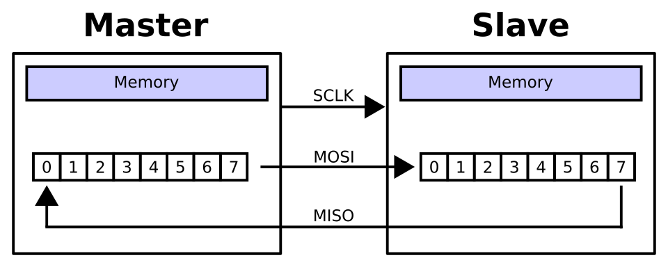
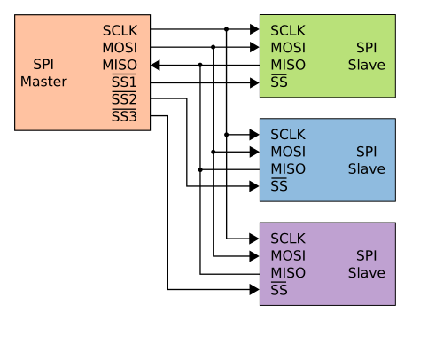
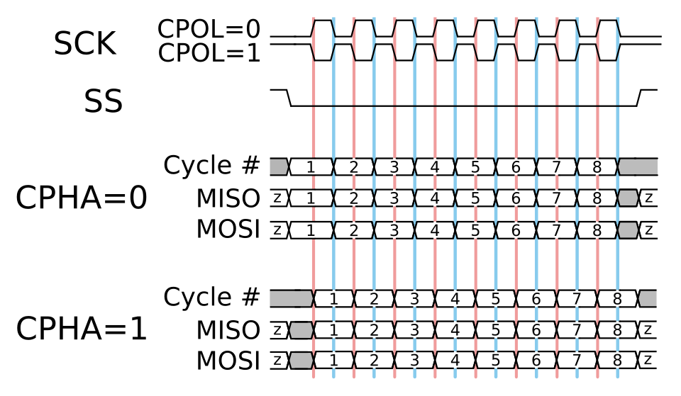
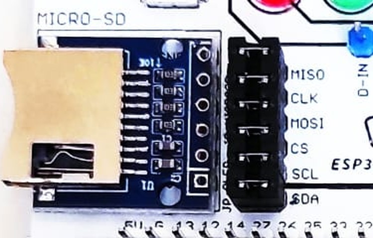
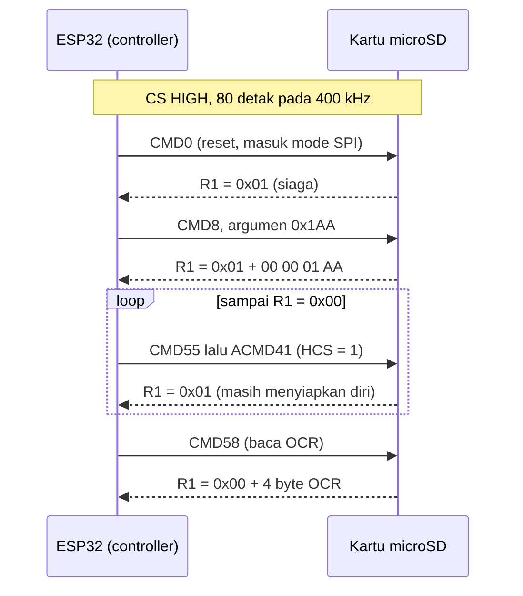

# BAB 24: SPI — Serial Peripheral Interface

> ✅ **Prasyarat:** Selesaikan **BAB 23 (I2C — Inter-Integrated Circuit)** — kamu sudah mengenal bus, jalur *clock*, *byte*, dan bilangan heksadesimal. Letak *jumper cap* microSD di kit dijelaskan di [BAB 6](../BAB-06/README.md#621-letak-header-di-kit), dan pin *strapping* di [BAB 6 bagian 6.5.2](../BAB-06/README.md#652-pin-strapping).

Di BAB 23 kamu sudah berkenalan dengan I2C: banyak perangkat berbagi dua jalur dan dipanggil lewat alamat. Sekarang giliran **SPI**, protokol yang jauh lebih cepat dan dipakai perangkat yang "lapar data", seperti kartu memori, layar TFT berwarna, dan chip memori *flash*. Cara kerjanya mirip dua orang yang duduk berhadapan dan saling menyerahkan koin secara bersamaan: setiap kali ESP32 mengirim satu bit, perangkat juga mengirim satu bit balik. Di kit Bluino, perangkat SPI-nya adalah **adaptor microSD**, jadi di BAB ini kamu akan "mengobrol" dengan kartu microSD — mulai dari memakai *library* sampai mengirim perintah mentah *byte* demi *byte*.

## 📌 Tujuan Pembelajaran

Setelah mempelajari BAB ini, kamu bisa:

- Menjelaskan empat jalur SPI — SCK, MOSI, MISO, dan CS — serta peran *controller* dan *peripheral*.
- Menjelaskan pertukaran data *full-duplex*: setiap *byte* yang dikirim sekaligus ditukar dengan satu *byte* yang diterima.
- Menjelaskan fungsi *chip select* (aktif LOW) dan cara beberapa perangkat berbagi satu bus SPI.
- Membedakan empat mode SPI (CPOL dan CPHA), memahami urutan bit (MSB dulu), dan memilih kecepatan *clock*.
- Membandingkan SPI dengan UART dan I2C.
- Memakai *library* `SPI` di esp32 core 3.x: `SPI.begin()`, `SPISettings`, `beginTransaction()`, `transfer()`, dan `endTransaction()`.
- Memakai *library* `SD` untuk memeriksa jenis, kapasitas, dan isi kartu microSD di kit.
- Mengirim perintah mentah ke kartu microSD (CMD0, CMD8, ACMD41, CMD58) lalu membaca jawabannya.
- Mengukur pengaruh kecepatan *clock* SPI terhadap kecepatan baca kartu.

## 🧰 Yang Perlu Disiapkan

| Kebutuhan | Keterangan |
|---|---|
| *Hardware* | Kit Bluino ESP32 IoT Starter Shield + kabel USB **data** |
| Kabel *jumper* | Tidak perlu — adaptor microSD sudah tersambung ke IO5, IO18, IO19, dan IO23 lewat *jumper cap* (pastikan keempatnya terpasang) |
| Komponen tambahan | **Kartu microSD** (tidak termasuk kit): disarankan microSDHC 4–32 GB berformat FAT32 (lihat [24.3.3](#2433-memilih-dan-menyiapkan-kartu-microsd)). Untuk memformat kartu di laptop, siapkan pembaca kartu (*card reader*) atau adaptor SD |
| *Software* | Arduino IDE 2.x + *board package* **esp32** versi 3.3.x (lihat [BAB 5](../BAB-05/README.md)); opsional: aplikasi **SD Card Formatter** untuk memformat kartu |
| *Library* | Tidak perlu *library* tambahan — `SPI`, `SD`, dan `FS` sudah termasuk paket esp32 |
| Alat uji | **Serial Monitor** Arduino IDE (baud 115200) |
| Jaringan | Tidak perlu WiFi |

## 📑 Daftar Isi

- [24.1 Mengenal SPI](#241-mengenal-spi)
- [24.2 Cara Kerja SPI](#242-cara-kerja-spi)
- [24.3 SPI di ESP32 dan Kit Bluino](#243-spi-di-esp32-dan-kit-bluino)
- [24.4 Program 1: Info Kartu microSD](#244-program-1-info-kartu-microsd)
- [24.5 Library SPI di ESP32](#245-library-spi-di-esp32)
- [24.6 Bahasa Perintah Kartu SD](#246-bahasa-perintah-kartu-sd)
- [24.7 Program 2: Perintah Mentah ke Kartu microSD](#247-program-2-perintah-mentah-ke-kartu-microsd)
- [24.8 Program 3: Pengaruh Kecepatan Clock SPI](#248-program-3-pengaruh-kecepatan-clock-spi)
- [24.9 Berbagi Bus dengan Perangkat SPI Lain](#249-berbagi-bus-dengan-perangkat-spi-lain)
- [24.10 Troubleshooting](#2410-troubleshooting)
- [📝 Rangkuman](#-rangkuman)
- [💪 Latihan](#-latihan)
- [📚 Referensi](#-referensi)

---

## 24.1 Mengenal SPI

**SPI** (*Serial Peripheral Interface*) adalah protokol komunikasi serial untuk menghubungkan mikrokontroler dengan perangkat di dekatnya, misalnya kartu memori, layar, chip memori *flash*, dan ADC. SPI diperkenalkan oleh Motorola pada pertengahan 1980-an dan sekarang didukung hampir semua mikrokontroler.

Seperti I2C, SPI adalah protokol **sinkron**: ada jalur detak (*clock*) yang ikut dikirim, sehingga pengirim dan penerima tidak perlu sepakat soal *baud rate* seperti pada UART. Bedanya, SPI **tidak punya dokumen standar resmi**. Setiap pembuat chip menjelaskan detail SPI-nya sendiri di *datasheet* — misalnya mode dan kecepatan maksimum. Karena itu, saat memakai perangkat SPI baru, *datasheet* tetap menjadi pegangan utama.

Keunggulan utama SPI adalah **kecepatan**. Jalurnya sederhana, tanpa alamat dan tanpa jawaban ACK di setiap *byte*, sehingga data bisa mengalir jutaan bit per detik — jauh lebih cepat daripada bus I2C di kit.

### 24.1.1 Perbandingan dengan Protokol Lain

| Protokol | Jalur sinyal | Jumlah perangkat | Kecepatan umum | Arah data | Contoh di kit | Dibahas di |
|---|---|---|---|---|---|---|
| UART | 2 (TX, RX), tanpa jalur *clock* | 2 (satu lawan satu) | Biasanya 9600–115200 bit/s | Dua arah bersamaan | Serial Monitor lewat USB | [BAB 22](../BAB-22/README.md) |
| I2C | 2 (SDA, SCL) | Banyak, dibedakan dengan **alamat** | 100 kbit/s atau 400 kbit/s | Bergantian di satu jalur data | OLED, MPU-6050, BMP180 | [BAB 23](../BAB-23/README.md) |
| **SPI** | 4 (SCK, MOSI, MISO, CS), tambah 1 CS untuk setiap perangkat berikutnya | Banyak, dipilih lewat jalur **CS** | Jutaan bit per detik (kartu SD: sampai 25 MHz) | Dua arah bersamaan | microSD | BAB ini |
| 1-Wire | 1 (data) | Banyak, dibedakan dengan nomor seri 64 bit | Sekitar 15 kbit/s | Bergantian di satu jalur data | DS18B20 | [BAB 25](../BAB-25/README.md) |

Semua protokol di atas juga butuh **GND bersama** sebagai titik acuan tegangan. Di kit, GND adaptor microSD sudah tersambung ke GND ESP32 lewat jalur PCB.

Kelebihan dan keterbatasan SPI:

- ✅ **Cepat.** Kecepatan *clock*-nya bisa mencapai puluhan MHz, dan satu detak langsung membawa satu bit data.
- ✅ **Dua arah bersamaan (*full-duplex*).** Data keluar dan data masuk punya jalur sendiri, jadi tidak perlu bergantian.
- ✅ **Sederhana di sisi perangkat.** Tidak ada alamat dan tidak ada ACK. Jalurnya juga dikendalikan langsung HIGH dan LOW oleh pengirimnya (*push-pull*), tidak seperti I2C yang mengandalkan resistor *pull-up*.
- ⚠️ **Boros pin.** Minimal empat pin, dan setiap perangkat tambahan butuh satu pin CS lagi.
- ⚠️ **Tidak ada tanda terima bawaan.** Kalau perangkatnya tidak terpasang, ESP32 tidak langsung tahu — jalur MISO hanya terbaca `0xFF` atau angka acak. Program harus memeriksa sendiri apakah jawabannya masuk akal (lihat Program 2).
- ⚠️ **Jarak pendek.** SPI dirancang untuk jalur di satu papan atau kabel pendek. Makin tinggi kecepatannya, makin pendek kabel yang aman.

---

## 24.2 Cara Kerja SPI

### 24.2.1 Empat Jalur Sinyal

| Jalur | Kepanjangan | Arah | Fungsi | Pin di kit |
|---|---|---|---|---|
| **SCK** (juga ditulis CLK atau SCLK) | *Serial Clock* | ESP32 → perangkat | Jalur detak: setiap detak menandai satu bit yang dikirim dan dibaca | IO18 (label `CLK`) |
| **MOSI** | *Master Out Slave In* | ESP32 → perangkat | Jalur data dari ESP32 ke perangkat | IO23 |
| **MISO** | *Master In Slave Out* | Perangkat → ESP32 | Jalur data dari perangkat ke ESP32 | IO19 |
| **CS** (juga ditulis SS) | *Chip Select* / *Slave Select* | ESP32 → perangkat | Memilih perangkat yang diajak bicara; **aktif LOW** | IO5 |
| GND | *Ground* | — | Titik acuan tegangan bersama | GND |

Jalur SCK bekerja seperti jalur SCL di I2C, yaitu seperti ketukan dirigen: setiap ketukan, satu bit berpindah. Bedanya, SPI punya **dua jalur data terpisah** — MOSI untuk arah keluar dan MISO untuk arah masuk — sehingga kedua arah bisa berjalan pada ketukan yang sama.

### 24.2.2 Controller dan Peripheral

Dalam bus SPI ada dua peran:

- ***Controller*** (pengendali) — perangkat yang membangkitkan detak SCK, memilih perangkat lewat CS, dan memulai setiap pertukaran data. Di kit, *controller*-nya adalah ESP32.
- ***Peripheral*** (perangkat) — perangkat yang hanya "bicara" saat CS-nya LOW dan ada detak di SCK. Di kit: kartu microSD.

> 📌 **Catatan:** Di dokumen lama, *datasheet*, dan nama pin, kamu akan menemukan istilah ***master*** untuk *controller* dan ***slave*** untuk *peripheral* — dari situlah singkatan MOSI (*Master Out Slave In*), MISO (*Master In Slave Out*), dan SS (*Slave Select*) berasal. Sejak 2020, Open Source Hardware Association (OSHWA) menganjurkan istilah *controller*/*peripheral*, nama jalur SDO/SDI (*Serial Data Out/In*) atau COPI/CIPO (*Controller Out Peripheral In* / *Controller In Peripheral Out*), serta CS untuk SS. Label di PCB kit dan konstanta di Arduino-ESP32 (`MOSI`, `MISO`, `SS`) masih memakai nama lama, jadi BAB ini memakai nama yang tercetak di PCB: MOSI, MISO, CLK/SCK, dan CS.

### 24.2.3 Pertukaran Data Full-Duplex

Di dalam *controller* dan *peripheral* SPI ada **register geser** (*shift register*): deretan 8 kotak yang masing-masing menyimpan satu bit. Kedua register itu tersambung melingkar lewat MOSI dan MISO.



*Gambar 24.1 — Register geser 8 bit di* controller *(Master) dan* peripheral *(Slave) tersambung melingkar lewat MOSI dan MISO. Setelah 8 detak SCLK, isi kedua register bertukar. Sumber: [Cburnett](https://commons.wikimedia.org/wiki/File:SPI_8-bit_circular_transfer.svg), lisensi CC BY-SA 3.0.*

Pada setiap detak SCK, ESP32 mendorong satu bit keluar lewat MOSI, dan **pada detak yang sama** kartu mendorong satu bit keluar lewat MISO. Setelah 8 detak, isi kedua register sudah bertukar seluruhnya. Bayangkan dua orang yang masing-masing memegang deretan 8 koin, lalu pada setiap ketukan saling menyerahkan satu koin secara bersamaan: setelah 8 ketukan, deretan koin mereka sudah bertukar.

Dari cara kerja ini muncul tiga aturan penting:

1. **Setiap kirim sekaligus menerima.** Di Arduino, `SPI.transfer(x)` mengirim *byte* `x` dan mengembalikan *byte* yang diterima pada saat yang sama.
2. **Untuk menerima, ESP32 tetap harus mengirim.** Hanya *controller* yang bisa membangkitkan detak. Kalau ESP32 ingin membaca data dari kartu, ia mengirim *byte* "kosong" — biasanya `0xFF` — supaya ada 8 detak yang "menarik" data keluar dari kartu.
3. **Tidak semua *byte* yang diterima berarti.** Saat ESP32 sedang mengirim perintah, kartu belum tahu harus menjawab apa, jadi *byte* yang diterima biasanya `0xFF` dan diabaikan.

### 24.2.4 Chip Select dan Banyak Perangkat

Jalur SCK, MOSI, dan MISO boleh dipakai bersama oleh beberapa perangkat. Yang membedakan adalah jalur **CS**: setiap perangkat punya jalur CS sendiri dari *controller*.



*Gambar 24.2 — Satu* controller *(SPI Master) dengan tiga* peripheral *(SPI Slave). SCLK, MOSI, dan MISO dipakai bersama; setiap perangkat punya jalur pemilih sendiri (SS1, SS2, SS3). Garis di atas tulisan SS menandakan aktif LOW. Sumber: [Cburnett](https://commons.wikimedia.org/wiki/File:SPI_three_slaves.svg), lisensi CC BY-SA 3.0.*

Aturan jalur CS:

- **CS aktif LOW.** CS HIGH berarti "tidak dipilih": perangkat mengabaikan SCK dan MOSI, lalu **melepas** jalur MISO supaya bisa dipakai perangkat lain. CS LOW berarti "dipilih": perangkat mendengarkan dan menjawab.
- **Hanya satu CS yang boleh LOW pada satu waktu.** Kalau dua perangkat dipilih bersamaan, keduanya mendorong MISO sekaligus dan data yang diterima kacau.
- **CS juga menandai awal dan akhir percakapan.** Banyak perangkat memakai turunnya CS sebagai tanda "mulai" dan naiknya CS sebagai tanda "selesai" — seperti mengangkat dan menutup gagang telepon.

Bandingkan dengan I2C: di I2C, perangkat dipilih dengan **alamat** yang dikirim lewat jalur data, sehingga berapa pun perangkatnya tetap dua jalur. Di SPI, perangkat dipilih dengan **kabel** CS, sehingga lebih cepat dan sederhana, tetapi butuh satu pin lagi untuk setiap perangkat. Di kit, bus SPI hanya berisi satu perangkat — adaptor microSD dengan CS di IO5.

### 24.2.5 Mode SPI: CPOL dan CPHA

Karena SPI tidak punya standar resmi, perangkat yang berbeda bisa membaca bit pada saat yang berbeda. Perbedaannya diatur oleh dua pengaturan:

- **CPOL** (*Clock Polarity*, polaritas *clock*) — kondisi SCK saat diam. CPOL = 0: SCK diam LOW. CPOL = 1: SCK diam HIGH.
- **CPHA** (*Clock Phase*, fase *clock*) — pada tepi detak mana bit dibaca. CPHA = 0: bit dibaca pada **tepi pertama** setiap detak, lalu diganti pada tepi kedua. CPHA = 1: bit diganti pada tepi pertama, lalu dibaca pada **tepi kedua**.

"Tepi" adalah saat SCK berubah: **tepi naik** (LOW → HIGH) atau **tepi turun** (HIGH → LOW). Kalau SCK diam LOW (CPOL = 0), tepi pertama setiap detak adalah tepi naik; kalau diam HIGH (CPOL = 1), tepi pertamanya tepi turun.



*Gambar 24.3 — Diagram waktu mode SPI. Baris SCK menunjukkan CPOL = 0 (diam LOW) dan CPOL = 1 (diam HIGH); SS (= CS) turun selama transfer. Garis merah menandai tepi pertama setiap detak, garis biru tepi kedua. Pada CPHA = 0, bit di MISO/MOSI sudah stabil saat garis merah (dibaca di tepi pertama); pada CPHA = 1, bit baru stabil saat garis biru (dibaca di tepi kedua). Huruf z berarti jalur sedang dilepas. Sumber: [Cburnett, turunan oleh Jordsan](https://commons.wikimedia.org/wiki/File:SPI_timing_diagram2.svg), lisensi CC BY-SA 3.0.*

Gabungan CPOL dan CPHA menghasilkan empat **mode SPI**:

| Mode | CPOL | CPHA | SCK saat diam | Bit dibaca pada | Contoh perangkat |
|---|---|---|---|---|---|
| **0** | 0 | 0 | LOW | Tepi naik | **Kartu SD/microSD**, banyak chip memori *flash* |
| 1 | 0 | 1 | LOW | Tepi turun | Lebih jarang; lihat *datasheet* |
| 2 | 1 | 0 | HIGH | Tepi turun | Lebih jarang; lihat *datasheet* |
| 3 | 1 | 1 | HIGH | Tepi naik | Akselerometer ADXL345; banyak chip memori *flash* menerima mode 0 maupun 3 |

Yang penting diingat: **mode di *controller* harus sama dengan mode yang diminta *datasheet* perangkat.** Kalau berbeda, bit dibaca pada saat yang salah sehingga data bergeser satu bit atau kacau sama sekali. Kartu SD memakai **mode 0**. *Library* `SD` sudah mengaturnya, jadi kamu baru perlu memikirkan mode saat memakai SPI secara langsung (Program 2) atau saat memasang perangkat SPI lain.

### 24.2.6 Urutan Bit dan Kecepatan Clock

**Urutan bit.** Dalam satu *byte*, hampir semua perangkat SPI mengirim bit bernilai terbesar lebih dulu, disebut **MSB dulu** (*Most Significant Bit first*) — sama seperti I2C. Contohnya, `0x48` = `0100 1000` dikirim berurutan 0, 1, 0, 0, 1, 0, 0, 0. Sebagian kecil perangkat memakai urutan sebaliknya, **LSB dulu** (*Least Significant Bit first*); aturannya ada di *datasheet*. Kartu SD memakai MSB dulu.

**Kecepatan *clock*** ditentukan sepenuhnya oleh *controller*. Tidak ada daftar kecepatan baku seperti 100/400 kHz di I2C; batasnya ditentukan oleh perangkat paling lambat dan kualitas jalurnya. Untuk kartu SD:

- Saat perkenalan (inisialisasi), *clock* wajib 100–400 kHz.
- Setelah itu, kartu SD biasa sanggup sampai **25 MHz** dalam mode SPI.
- *Library* `SD` di esp32 core 3.3.12 memakai **4 MHz** secara bawaan dan membatasi permintaan di atas 25 MHz menjadi 25 MHz.

Karena satu detak membawa satu bit, pada 4 MHz satu *byte* (8 detak) hanya butuh 2 µs. Bandingkan dengan I2C 100 kHz yang butuh 90 µs per *byte* (9 detak).

Kenapa tidak selalu memakai kecepatan maksimum? Makin tinggi kecepatannya, makin pendek waktu untuk setiap bit, sehingga keterlambatan kecil di kabel atau di chip bisa membuat bit salah dibaca. Di kit, jalur microSD berupa jalur PCB pendek. Kalau suatu saat kamu menyambung perangkat SPI dengan kabel *jumper* yang panjang, mulailah dari kecepatan rendah (misalnya 1 MHz), lalu naikkan pelan-pelan.

---

## 24.3 SPI di ESP32 dan Kit Bluino

### 24.3.1 Empat Pengendali SPI di ESP32

ESP32 punya empat pengendali SPI *hardware*, tetapi tidak semuanya boleh kamu pakai:

| Pengendali | Nama di Arduino-ESP32 | Kegunaan | Pin bawaan |
|---|---|---|---|
| SPI0 dan SPI1 | — | Dipakai ESP32 sendiri untuk membaca chip *flash* tempat programmu disimpan. **Jangan dipakai** | IO6–IO11 (tidak ada di header kit) |
| SPI2 | `HSPI` | Bebas dipakai | SCK IO14, MISO IO12, MOSI IO13, CS IO15 |
| SPI3 | `VSPI` | Bebas dipakai — objek `SPI` bawaan Arduino memakai bus ini | SCK IO18, MISO IO19, MOSI IO23, CS IO5 |

Hal-hal yang perlu kamu tahu:

- Di Arduino-ESP32, objek `SPI` adalah bus **VSPI**. Pin bawaannya untuk *board* **ESP32 Dev Module** tersimpan di konstanta `SCK` (IO18), `MISO` (IO19), `MOSI` (IO23), dan `SS` (IO5) — persis pin microSD di kit. Jadi *library* `SD` bisa langsung bekerja tanpa mengatur pin.
- Sinyal SPI sebenarnya bisa disalurkan ke hampir semua pin lewat "papan sambung" internal bernama ***GPIO matrix***. Arduino-ESP32 selalu memakai jalur ini, termasuk untuk pin bawaan. Menurut dokumentasi ESP-IDF, lewat GPIO matrix *clock* SPI maksimal 40 MHz, dan saat membaca data batas idealnya sekitar 26,67 MHz — lebih rendah lagi kalau perangkatnya lambat menjawab. Kecepatan bawaan *library* `SD` (4 MHz) masih jauh di bawah batas ini; di Program 3 kamu akan mencobanya sampai 20 MHz.
- Pin bawaan HSPI kurang cocok di kit: IO12 dan IO15 adalah pin *strapping* (IO12 yang HIGH saat *boot* membuat ESP32 gagal menyala), dan IO12–IO15 sudah dipakai WS2812, *buzzer*, DS18B20, dan tombol S1. Kalau suatu saat butuh bus SPI kedua, pilih pin lain (lihat [24.9](#249-berbagi-bus-dengan-perangkat-spi-lain)).

### 24.3.2 Adaptor microSD di Kit

Adaptor microSD di kit tersambung ke ESP32 lewat **empat *jumper cap*** di blok nomor 7 pada [Gambar 6.2 di BAB 6](../BAB-06/README.md#621-letak-header-di-kit) — blok yang sama dengan *jumper cap* `SCL`/`SDA` milik OLED.


*Gambar 24.4 — Rangkaian adaptor microSD di kit. Setiap pasangan pin di kotak merah adalah tempat satu jumper cap: CS ↔ IO5, MOSI ↔ IO23, CLK ↔ IO18, dan MISO ↔ IO19. Sumber: skematik ESP32 Starter Shield 3.2, [Bluino](http://www.bluino.com).*



*Gambar 24.5 — Modul microSD dan blok jumper cap di kit. Empat jumper cap teratas (`MISO`, `CLK`, `MOSI`, `CS`) menyambungkan microSD ke ESP32; dua terbawah (`SCL`, `SDA`) milik OLED. Tata letak kit v3.2 milikmu bisa sedikit berbeda. Sumber: foto produk ESP32 Starter Shield, [Bluino](http://www.bluino.com), dipotong untuk materi ini.*

| Label di blok *jumper cap* | Jalur SPI | Pin ESP32 | Arah |
|---|---|---|---|
| `MISO` | MISO (data dari kartu) | IO19 | Kartu → ESP32 |
| `CLK` | SCK (detak) | IO18 | ESP32 → kartu |
| `MOSI` | MOSI (data ke kartu) | IO23 | ESP32 → kartu |
| `CS` | CS (pemilih kartu) | IO5 | ESP32 → kartu |

Hal-hal penting:

- Dari pabrik keempat *jumper cap* sudah terpasang. **Biarkan terpasang.** Kalau salah satunya lepas, kartu tidak akan terdeteksi. Selalu **cabut USB dulu** sebelum melepas atau memasang *jumper cap*, dan juga sebelum memasukkan atau mencabut kartu.
- Adaptor mendapat daya 3,3 V (`3V3`) dan GND langsung dari jalur PCB, jadi level sinyalnya 3,3 V dan aman untuk ESP32. Kartu microSD memang bekerja di rentang 2,7–3,6 V.
- IO5, IO18, IO19, dan IO23 sudah dipakai microSD — jangan colokkan kabel *jumper* komponen lain ke label `5`, `18`, `19`, dan `23` di deretan pin ESP32 bawah. Satu-satunya pengecualian: saat kamu sengaja menambah perangkat SPI di bus yang sama (lihat [24.9](#249-berbagi-bus-dengan-perangkat-spi-lain)).
- **IO5 adalah pin *strapping*.** Levelnya dibaca sekali saat ESP32 dinyalakan untuk mengatur *timing* antarmuka SDIO, dengan level bawaan HIGH (lihat [BAB 6](../BAB-06/README.md#652-pin-strapping)). Pin CS kartu hanya *menerima* sinyal dan tidak pernah mendorong IO5, jadi microSD tidak mengganggu proses *boot*.

### 24.3.3 Memilih dan Menyiapkan Kartu microSD

Kartu microSD **tidak termasuk kit**. Menurut SD Association, kartu SD dibagi berdasarkan kapasitasnya:

| Jenis kartu | Kapasitas | Sistem *file* bawaan pabrik | Bisa dipakai di BAB ini? |
|---|---|---|---|
| microSD (SDSC) | Sampai 2 GB | FAT12/FAT16 | Bisa, tetapi kartu seperti ini sudah jarang dijual |
| **microSDHC** | Lebih dari 2 GB sampai 32 GB | FAT32 | **Paling disarankan** (misalnya 8 GB atau 16 GB) |
| microSDXC | Lebih dari 32 GB sampai 2 TB | exFAT | Tidak langsung. Kartu harus diformat ulang ke FAT32 dengan aplikasi pihak ketiga |

Kenapa harus FAT32? *Library* `SD` di esp32 core 3.3.12 memakai sistem *file* FatFs yang hanya mengenal **FAT12, FAT16, dan FAT32** — dukungan exFAT dimatikan di konfigurasi bawaannya. Kartu berformat exFAT atau NTFS akan gagal dipasang. Jadi pilihan paling mudah: **microSDHC 4–32 GB berformat FAT32.** Kartu dari merek yang jelas juga lebih aman; kartu palsu sering mengaku berkapasitas besar padahal isinya jauh lebih kecil.

Kartu microSDHC baru biasanya sudah berformat FAT32. Kalau ragu, atau kartunya pernah dipakai di HP/kamera, format ulang di laptop:

> ⚠️ **Perhatian:** Memformat **menghapus seluruh isi kartu**. Salin dulu *file* penting ke laptop.

1. Masukkan kartu ke laptop lewat pembaca kartu (*card reader*) atau adaptor SD.
2. Pilih salah satu cara:
   - **Windows:** buka **File Explorer**, klik kanan *drive* kartu → **Format…** → pada **File system** pilih **FAT32** → klik **Start**. Pilihan FAT32 hanya muncul untuk kartu sampai 32 GB.
   - **macOS:** buka **Disk Utility**, pilih kartunya → **Erase** → **Format: MS-DOS (FAT)**, **Scheme: Master Boot Record** → **Erase**. Kalau pilihan **Scheme** tidak muncul, klik **View → Show All Devices**, lalu pilih kartunya di baris paling atas (nama perangkatnya, bukan nama *drive*-nya).
   - **Aplikasi SD Card Formatter** (gratis, untuk Windows dan macOS, unduh dari situs resmi SD Association di [sdcard.org](https://www.sdcard.org/downloads/formatter/)): pilih kartunya, lalu klik **Format**. Aplikasi ini otomatis memformat kartu microSDHC sebagai FAT32.
3. Keluarkan kartu dengan aman (**Eject**), lalu cabut dari laptop.

Cara memasang kartu ke kit: **cabut USB dulu**, lalu dorong kartu ke *slot* microSD di sisi kiri atas kit (Gambar 24.5) dengan sisi berlabel menghadap ke atas, sampai masuk penuh. Setelah itu sambungkan USB lagi.

---

## 24.4 Program 1: Info Kartu microSD

**Tujuan:** Memasang kartu microSD lewat bus SPI memakai *library* `SD`, lalu menampilkan jenis kartu, kapasitas, ruang yang terpakai, dan isi *folder* utamanya. Program ini sekaligus menguji bahwa jalur SPI, *jumper cap*, kartu, dan format FAT32-nya sudah benar. Program ini hanya **membaca** kartu — tidak ada *file* yang ditulis atau dihapus.

**Rangkaian:**

*Tidak perlu merangkai — adaptor microSD sudah tersambung ke IO5, IO18, IO19, dan IO23 lewat* jumper cap *di kit. Pastikan saja keempat* jumper cap *microSD (`MISO`, `CLK`, `MOSI`, `CS`) terpasang dan kartu microSD sudah dimasukkan.*

**Cara Menjalankan:**

1. Siapkan kartu microSD berformat FAT32 (lihat [24.3.3](#2433-memilih-dan-menyiapkan-kartu-microsd)). Supaya daftar isinya tidak kosong, kamu boleh menyalin satu-dua *file* apa saja ke kartu lewat laptop.
2. Cabut USB, masukkan kartu ke *slot* microSD kit, pastikan keempat *jumper cap* microSD terpasang, lalu sambungkan USB lagi. Pastikan juga tidak ada kabel *jumper* di label `5`, `18`, `19`, dan `23`.
3. Buka Arduino IDE → **File → New Sketch**, hapus isinya, lalu salin kode di bawah. Kode yang sama juga tersedia di *file* [`p1_info_kartu.ino`](p1_info_kartu/p1_info_kartu.ino).
4. Pastikan **Tools → Board** = **ESP32 Dev Module** dan **Tools → Port** = *port* ESP32 kamu (misalnya `COM5` di Windows atau `/dev/ttyUSB0` di Linux).
5. Klik tombol **Upload** (ikon panah →) dan tunggu sampai muncul tulisan **Done uploading**.
6. Buka **Serial Monitor** (**Tools → Serial Monitor**) lalu pilih baud **115200**. Kalau tulisannya terlewat, tekan tombol **EN** di *board* ESP32 untuk mengulang program.

**Kode Program:**

<!-- sketch: p1_info_kartu -->
```cpp
/*
 * BAB 24 - Program 1: Info Kartu microSD
 * Memasang kartu microSD lewat bus SPI, lalu menampilkan jenis kartu,
 * kapasitas, ruang terpakai, dan isi folder utama kartu.
 * Program ini hanya MEMBACA kartu: tidak ada file yang ditulis atau dihapus.
 *
 * Rangkaian: tidak perlu kabel. Adaptor microSD tersambung ke
 * CS = IO5, MOSI = IO23, CLK = IO18, MISO = IO19 lewat jumper cap di kit.
 */

#include <SPI.h>
#include <SD.h>

#define PIN_SCK  18  // CLK
#define PIN_MISO 19
#define PIN_MOSI 23
#define PIN_CS   5

const uint32_t KECEPATAN_SPI = 4000000;      // 4 MHz, sama dengan bawaan library SD
const uint64_t SATU_MB = 1024ULL * 1024ULL;  // 1 MB = 1.048.576 byte

// Menerjemahkan hasil SD.cardType() menjadi teks
const char *namaJenis(sdcard_type_t jenis) {
  switch (jenis) {
    case CARD_MMC:  return "MMC";
    case CARD_SD:   return "SDSC (kapasitas standar)";
    case CARD_SDHC: return "SDHC/SDXC (kapasitas tinggi)";
    case CARD_NONE: return "tidak ada kartu";
    default:        return "tidak dikenal";
  }
}

// Menampilkan daftar file dan folder di folder utama ("/") kartu
void tampilkanFolderUtama() {
  File folder = SD.open("/");
  if (!folder) {
    Serial.println("Folder utama tidak bisa dibuka.");
    return;
  }

  Serial.println("Isi folder utama kartu:");
  int jumlah = 0;
  File item = folder.openNextFile();  // ambil isi pertama
  while (item) {
    if (item.isDirectory()) {
      Serial.printf("  [FOLDER] %s\n", item.name());
    } else {
      Serial.printf("  [FILE]   %s (%u byte)\n", item.name(), (unsigned)item.size());
    }
    jumlah = jumlah + 1;
    item.close();
    item = folder.openNextFile();     // ambil isi berikutnya
  }
  folder.close();

  if (jumlah == 0) {
    Serial.println("  (kosong)");
  }
}

void setup() {
  Serial.begin(115200);
  delay(1000);  // beri waktu Serial Monitor tersambung
  Serial.println("BAB 24 - Program 1: Info Kartu microSD");

  SPI.begin(PIN_SCK, PIN_MISO, PIN_MOSI);  // mulai bus SPI; urutan: SCK, MISO, MOSI

  // CS diatur sendiri oleh library SD, jadi pin CS diberikan di sini
  if (!SD.begin(PIN_CS, SPI, KECEPATAN_SPI)) {
    Serial.println("Kartu gagal dipasang!");
    Serial.println("Periksa kartu, format FAT32, dan jumper cap MISO/CLK/MOSI/CS.");
    return;
  }
  Serial.println("Kartu berhasil dipasang.");

  Serial.printf("Jenis kartu     : %s\n", namaJenis(SD.cardType()));
  Serial.printf("Jumlah sektor   : %u x %u byte\n",
                (unsigned)SD.numSectors(), (unsigned)SD.sectorSize());
  Serial.printf("Kapasitas kartu : %llu MB\n", SD.cardSize() / SATU_MB);
  Serial.printf("Ukuran partisi  : %llu MB\n", SD.totalBytes() / SATU_MB);
  Serial.printf("Terpakai        : %llu MB\n", SD.usedBytes() / SATU_MB);

  tampilkanFolderUtama();
  Serial.println("Selesai. Tekan tombol EN untuk mengulang.");
}

void loop() {
  // Semua pemeriksaan sudah dijalankan sekali di setup().
}
```

**Penjelasan Kode:**

- **Dua *library* bawaan.** `SPI.h` mengurus bus SPI, sedangkan `SD.h` mengurus kartu dan sistem *file* FAT di atasnya. Keduanya sudah termasuk paket esp32.
- **`SPI.begin(PIN_SCK, PIN_MISO, PIN_MOSI)`** menyalakan bus VSPI di pin yang disebut. Perhatikan urutannya: **SCK, MISO, MOSI** — bukan "MOSI dulu". Karena pin ini adalah pin bawaan, `SPI.begin()` tanpa angka hasilnya sama; di kurikulum ini pin tetap ditulis lengkap supaya jelas terbaca.
- **`SD.begin(PIN_CS, SPI, KECEPATAN_SPI)`** menerima tiga hal: pin CS kartu, bus SPI yang dipakai, dan kecepatan *clock* untuk membaca/menulis data. Fungsi ini melakukan dua pekerjaan:
  1. **Berkenalan dengan kartu** pada 400 kHz — mengirim perintah CMD0, CMD8, ACMD41, dan CMD58. Urutan ini akan kamu bongkar sendiri di Program 2.
  2. **Memasang (*mount*) sistem *file*** — membaca struktur FAT di kartu supaya *file*-nya bisa diakses.

  Hasilnya `true` kalau keduanya berhasil. Pin CS sengaja tidak diberikan ke `SPI.begin()`, karena *library* `SD` menaikkan dan menurunkan CS sendiri dengan `digitalWrite()`.
- **`SD.cardType()`** mengembalikan jenis kartu yang dikenali saat perkenalan: `CARD_SD` untuk SDSC, `CARD_SDHC` untuk SDHC **maupun** SDXC (keduanya "kapasitas tinggi"), atau `CARD_MMC` untuk kartu MMC lama.
- **Sektor.** Kartu SD menyimpan data dalam blok-blok berukuran 512 *byte* yang disebut **sektor**. `SD.numSectors()` adalah jumlah sektornya, dan `SD.cardSize()` = jumlah sektor × 512 *byte*.
- **`SD.totalBytes()` dan `SD.usedBytes()`** dihitung dari tabel FAT: ukuran partisi yang bisa dipakai menyimpan *file* dan bagian yang sudah terisi. Angkanya sedikit lebih kecil daripada kapasitas kartu karena sebagian sektor dipakai untuk tabel FAT dan cadangan. Pada kartu yang besar, perhitungan ini bisa butuh beberapa detik.
- **Daftar isi *folder*.** `SD.open("/")` membuka *folder* utama, lalu `openNextFile()` mengambil isinya satu per satu sampai habis. `isDirectory()` membedakan *folder* dari *file*, `name()` memberi namanya, dan `size()` ukurannya. Setiap *file* yang dibuka harus ditutup lagi dengan `close()`.
- **Satuan MB.** Program memakai 1 MB = 1.048.576 *byte*, sedangkan pabrik kartu memakai 1 GB = 1.000.000.000 *byte*. Akibatnya kartu berlabel "8 GB" terbaca sekitar 7400–7600 MB. Itu normal.

**Contoh Output:**

Contoh berikut dari kartu microSDHC 8 GB yang berisi dua *file*. Angka dan daftar *file* di kartumu pasti berbeda.

```text
BAB 24 - Program 1: Info Kartu microSD
Kartu berhasil dipasang.
Jenis kartu     : SDHC/SDXC (kapasitas tinggi)
Jumlah sektor   : 15523840 x 512 byte
Kapasitas kartu : 7580 MB
Ukuran partisi  : 7571 MB
Terpakai        : 2 MB
Isi folder utama kartu:
  [FOLDER] System Volume Information
  [FILE]   foto_uji.jpg (2483120 byte)
  [FILE]   catatan.txt (52 byte)
Selesai. Tekan tombol EN untuk mengulang.
```

*Folder* `System Volume Information` biasanya dibuat otomatis oleh Windows saat kartu dipasang di laptop. Biarkan saja; *folder* itu tidak mengganggu. Di kit tidak ada lampu atau bunyi apa pun — semua hasil hanya muncul di Serial Monitor.

> 📌 **Catatan:** Menulis dan membaca *file*, menyimpan data sensor ke *file* CSV, dan *data logging* dibahas lengkap di [BAB 41 (MicroSD Card — Data Logging)](../BAB-41/README.md). Di BAB ini kita fokus pada bus SPI yang menghubungkan ESP32 dengan kartu.

**Kalau Belum Berhasil:**

- **`Kartu gagal dipasang!`** → kartu belum masuk penuh, formatnya bukan FAT32 (misalnya exFAT atau NTFS), atau *jumper cap* `MISO`/`CLK`/`MOSI`/`CS` longgar. Cabut USB, periksa semuanya, lalu format ulang kartu kalau perlu (lihat [24.3.3](#2433-memilih-dan-menyiapkan-kartu-microsd)). Untuk memastikan jalur SPI-nya sendiri sudah benar, jalankan Program 2: kalau kartu menjawab `0x01` untuk CMD0, jalur SPI sudah bekerja dan masalahnya ada di format kartu.
- **Kartu baru terdeteksi setelah tombol EN ditekan** → kartu dimasukkan saat program sudah berjalan. Program ini hanya memasang kartu sekali di `setup()`, jadi tekan **EN** setelah kartu terpasang.
- **Kapasitas yang terbaca jauh lebih kecil dari label kartu** → partisi di kartu lebih kecil dari kartunya (format ulang dengan SD Card Formatter), atau kartunya palsu. Coba kartu lain dari merek yang jelas.
- **Serial Monitor kosong** → baud belum 115200 atau Serial Monitor dibuka terlambat. Tekan tombol **EN** di *board* untuk mengulang program.

---

## 24.5 Library SPI di ESP32

Di Program 1, semua urusan SPI dikerjakan *library* `SD` di balik layar. Supaya bisa "mengobrol" sendiri dengan perangkat SPI, kamu perlu mengenal *library* `SPI`. *Library* ini sudah termasuk paket esp32 — cukup tulis `#include <SPI.h>` di awal program. Objek `SPI` mewakili bus VSPI (lihat [24.3.1](#2431-empat-pengendali-spi-di-esp32)).

### 24.5.1 Memulai Bus: SPI.begin()

Contoh potongan kode (bagian awal program dan `setup()` saja):

```cpp
#include <SPI.h>

#define PIN_CS 5

void setup() {
  pinMode(PIN_CS, OUTPUT);
  digitalWrite(PIN_CS, HIGH);   // kartu belum dipilih
  SPI.begin(18, 19, 23);        // mulai bus SPI: SCK = IO18, MISO = IO19, MOSI = IO23
}
```

- `SPI.begin(sck, miso, mosi)` menyalakan bus SPI di pin yang disebut, dengan ESP32 sebagai *controller*. Hasilnya `true` kalau berhasil.
- Kalau ditulis `SPI.begin();` tanpa angka, esp32 core memakai pin bawaan: SCK IO18, MISO IO19, MOSI IO23 — hasilnya sama untuk kit ini.
- Memanggil `SPI.begin()` lagi saat bus sudah menyala tidak berbuat apa-apa. Karena itu aman kalau `SD.begin()` ikut memanggilnya.
- Setelah `SPI.begin()`, bus memakai pengaturan bawaan 1 MHz, MSB dulu, mode 0, sampai diubah oleh `beginTransaction()`.
- Pin CS diatur sendiri dengan `pinMode()` dan `digitalWrite()`. Jadikan HIGH **sebelum** komunikasi pertama supaya perangkat tidak terpilih secara tidak sengaja.

> ⚠️ **Perhatian:** Urutan parameternya **SCK, MISO, MOSI** — perhatikan MISO ditulis sebelum MOSI. `SPI.begin(18, 23, 19)` (MISO dan MOSI tertukar) tidak menimbulkan *error* saat di-*compile*, tetapi kartu tidak akan pernah menjawab.

<details>
<summary><b>🔬 Pendalaman (opsional): Parameter keempat SPI.begin() dan CS otomatis</b></summary>

`SPI.begin()` sebenarnya punya parameter keempat, `ss`, misalnya `SPI.begin(18, 19, 23, 5)`. Di esp32 core 3.3.12, pin ini **hanya dicatat**; ia baru dikendalikan otomatis oleh *hardware* SPI kalau kamu memanggil `SPI.setHwCs(true)`. Dengan cara itu, CS turun dan naik sendiri di setiap transfer.

Kebanyakan *library* perangkat, termasuk *library* `SD`, tidak memakai cara itu. Mereka mengatur CS sendiri dengan `digitalWrite()` karena satu "percakapan" sering terdiri atas banyak transfer yang harus berada dalam satu CS LOW. Jadi untuk kartu SD, jangan memanggil `SPI.setHwCs(true)`; biarkan *library* `SD` yang mengurus pin CS.

</details>

### 24.5.2 Aturan Komunikasi: SPISettings dan beginTransaction()

Setiap perangkat SPI punya "aturan main" sendiri: kecepatan, urutan bit, dan mode. Aturan itu dibungkus dalam objek `SPISettings`:

```cpp
SPISettings aturanKartu(400000, MSBFIRST, SPI_MODE0);   // 400 kHz, MSB dulu, mode 0

SPI.beginTransaction(aturanKartu);   // pinjam bus dengan aturan ini
// ... CS LOW, tukar data dengan transfer(), CS HIGH ...
SPI.endTransaction();                // kembalikan bus
```

| Parameter `SPISettings` | Contoh nilai | Arti |
|---|---|---|
| Kecepatan (Hz) | `400000`, `4000000` | Kecepatan *clock* yang diminta |
| Urutan bit | `MSBFIRST` atau `LSBFIRST` | Bit terbesar dulu atau bit terkecil dulu |
| Mode | `SPI_MODE0` sampai `SPI_MODE3` | Mode SPI (lihat [24.2.5](#2425-mode-spi-cpol-dan-cpha)) |

`SPISettings()` tanpa parameter berarti 1 MHz, `MSBFIRST`, `SPI_MODE0`.

ESP32 membuat *clock* SPI dengan membagi 80 MHz dengan bilangan bulat. Kalau kecepatan yang diminta tidak pas, esp32 core memilih kecepatan terdekat **di bawahnya**. Contohnya, 4 MHz (80 ÷ 20) dan 400 kHz (80 ÷ 200) pas, tetapi 25 MHz menjadi 20 MHz (80 ÷ 4), karena 80 ÷ 3 = 26,67 MHz sudah melebihi permintaan.

Kenapa harus ada `beginTransaction()` dan `endTransaction()`?

1. **Mengatur bus sesuai perangkat.** Kalau di satu bus ada kartu SD (mode 0) dan perangkat lain dengan mode berbeda, setiap perangkat memasang aturannya sendiri sebelum berbicara.
2. **Mengunci bus.** Di esp32 core, `beginTransaction()` sekaligus "mengunci" bus sampai `endTransaction()` dipanggil. Kalau ada bagian program lain (misalnya *task* FreeRTOS lain) yang ingin memakai bus yang sama, ia harus menunggu. Ibaratnya meminjam kunci ruang rapat: yang memegang kunci boleh memakai ruangan, yang lain menunggu sampai kuncinya dikembalikan.

Aturannya sederhana: setiap `beginTransaction()` **wajib** dipasangkan dengan satu `endTransaction()`. Perhatikan juga bahwa `beginTransaction()` **tidak** menyentuh pin CS — CS tetap kamu atur sendiri.

### 24.5.3 Bertukar Data: transfer()

| Fungsi | Yang terjadi |
|---|---|
| `SPI.transfer(b)` | Mengirim 1 *byte* `b` (8 detak) sambil menerima 1 *byte*. Hasilnya *byte* yang diterima |
| `SPI.transfer16(w)` | Sama, tetapi 2 *byte* (16 bit) sekaligus |
| `SPI.transfer(data, n)` | Mengirim `n` *byte* dari *array* `data`; *byte* yang diterima **menimpa** isi *array* yang sama |
| `SPI.transferBytes(kirim, terima, n)` | Mengirim `n` *byte* dari *array* `kirim` dan menyimpan hasil penerimaan di *array* `terima` |
| `SPI.write(b)`, `SPI.writeBytes(data, n)` | Hanya mengirim; *byte* yang diterima dibuang |

Ingat aturan *full-duplex* dari [24.2.3](#2423-pertukaran-data-full-duplex): untuk **membaca**, kirim *byte* "kosong" `0xFF`. Contohnya, membaca 4 *byte* jawaban dari kartu:

```cpp
uint8_t data[4];
for (int i = 0; i < 4; i++) {
  data[i] = SPI.transfer(0xFF);   // kirim 0xFF, simpan byte yang diterima
}
```

Kenapa `0xFF`, bukan `0x00`? `0xFF` berarti delapan bit bernilai 1, sehingga MOSI tetap HIGH selama 8 detak itu. Kartu SD memang meminta MOSI tetap HIGH saat ESP32 sedang membaca, karena setiap perintah ke kartu diawali bit 0 — bit 0 yang "nyasar" bisa disangka awal perintah baru.

### 24.5.4 Pola Satu Transaksi Lengkap

Hampir semua komunikasi SPI mengikuti lima langkah yang sama:

```cpp
SPI.beginTransaction(SPISettings(400000, MSBFIRST, SPI_MODE0));  // 1. pinjam bus + pasang aturan
digitalWrite(PIN_CS, LOW);                                       // 2. pilih perangkat
uint8_t jawaban = SPI.transfer(0xFF);                            // 3. tukar data (boleh berkali-kali)
digitalWrite(PIN_CS, HIGH);                                      // 4. lepas perangkat
SPI.endTransaction();                                            // 5. kembalikan bus
```

Ibaratnya menelepon: pinjam telepon (1), tekan nomor tujuan (2), bicara (3), tutup telepon (4), kembalikan teleponnya (5). Program 2 memakai pola ini untuk setiap perintah ke kartu.

---

## 24.6 Bahasa Perintah Kartu SD

Kartu SD sebenarnya punya "bahasa asli" sendiri (mode SD dengan 4 jalur data, dipakai kamera dan HP). Selain itu, hampir semua kartu SD dan microSD (SDSC, SDHC, dan SDXC) juga mengerti **mode SPI** yang lebih sederhana — inilah yang dipakai ESP32 di kit. Di mode SPI, ESP32 memberi **perintah** (*command*), lalu kartu menjawab.

### 24.6.1 Format Perintah 6 Byte

Setiap perintah selalu terdiri atas 6 *byte*:

| *Byte* | Isi | Contoh: CMD8 |
|---|---|---|
| 1 | Bit `01` + nomor perintah 6 bit, atau `0x40` + nomor perintah | `0x48` (0x40 + 8) |
| 2–5 | Argumen 32 bit, *byte* terbesar dulu | `0x00 0x00 0x01 0xAA` |
| 6 | CRC 7 bit + bit penutup `1` | `0x87` |

Nama perintahnya ditulis "CMD" + nomor, misalnya CMD0 dan CMD8. Ada juga perintah khusus aplikasi yang ditulis "ACMD", misalnya ACMD41. Perintah ACMD selalu didahului CMD55, seperti berkata "perhatian, perintah berikutnya perintah khusus".

**CRC** (*Cyclic Redundancy Check*) adalah angka pemeriksa yang dihitung dari 5 *byte* pertama — mirip digit terakhir nomor rekening yang dipakai untuk mendeteksi salah ketik. Di mode SPI, pemeriksaan CRC kartu SD mati secara bawaan, **kecuali** untuk **CMD0** dan **CMD8** yang selalu wajib memakai CRC yang benar: `0x95` untuk CMD0 (argumen 0) dan `0x87` untuk CMD8 (argumen `0x1AA`). Pemeriksaan CRC untuk perintah lain bisa dinyalakan dengan perintah CMD59 — dan *library* `SD` memang menyalakannya. Supaya Program 2 tetap aman dijalankan kapan pun (misalnya tepat setelah Program 1, tanpa mencabut USB), Program 2 memakai CRC yang benar untuk **setiap** perintah. Angkanya sudah dihitung lebih dulu dan ditulis langsung di kode.

### 24.6.2 Jawaban R1

Setelah menerima perintah, kartu butuh waktu sebentar — 0 sampai 8 *byte* — sebelum menjawab. Selama itu, ESP32 terus mengirim `0xFF` dan MISO terbaca `0xFF`. Jawaban pertama yang datang disebut **R1**: satu *byte* yang bit 7-nya **selalu 0**. Dari situlah ESP32 tahu bahwa jawaban sudah datang.

| Bit R1 | Arti kalau bernilai 1 |
|---|---|
| 0 | *In idle state* — kartu masih dalam tahap perkenalan (siaga) |
| 1 | *Erase reset* — proses hapus dibatalkan |
| 2 | *Illegal command* — perintah tidak dikenal kartu |
| 3 | *CRC error* — CRC perintah salah |
| 4 | *Erase sequence error* — urutan perintah hapus salah |
| 5 | *Address error* — alamat tidak sesuai |
| 6 | *Parameter error* — argumen di luar batas |
| 7 | Selalu 0 |

Nilai R1 yang paling sering kamu lihat:

| R1 | Artinya |
|---|---|
| `0x00` | Perintah diterima, kartu siap |
| `0x01` | Perintah diterima, kartu masih siaga — **normal** selama perkenalan |
| `0x05` | Siaga + perintah tidak dikenal (bit 0 dan bit 2) — misalnya kartu lama yang tidak mengenal CMD8 |
| `0x09` | Siaga + CRC salah (bit 0 dan bit 3) |
| `0xFF` | Bukan jawaban: tidak ada yang menjawab (kartu tidak ada, *jumper cap* lepas, atau CS salah) |

Beberapa perintah mengirim data tambahan setelah R1. CMD8 dan CMD58 sama-sama mengirim **4 *byte*** setelah R1.

### 24.6.3 Urutan Perkenalan dengan Kartu

Sebelum bisa dibaca, kartu harus "diperkenalkan" dengan urutan tertentu pada *clock* 100–400 kHz:

1. **Bangunkan kartu.** Dengan CS HIGH, kirim minimal 74 detak. Cara gampangnya: kirim 10 *byte* `0xFF` (80 detak).
2. **CMD0** (*GO_IDLE_STATE*) — me-*reset* kartu. Karena dikirim saat CS LOW, kartu sekaligus pindah ke **mode SPI**. Jawaban yang benar: R1 = `0x01`.
3. **CMD8** (*SEND_IF_COND*) dengan argumen `0x1AA`. Angka `0x1` berarti "tegangan 2,7–3,6 V", sedangkan `0xAA` adalah **pola uji** yang harus dipantulkan kembali. Kartu SD versi 2.00 atau lebih baru menjawab R1 = `0x01` + 4 *byte* yang diakhiri `01 AA`. Kartu lama (versi 1.x) menolak perintah ini dengan R1 = `0x05`.
4. **ACMD41** (*SD_SEND_OP_COND*), didahului CMD55. Argumen `0x40000000` menyalakan bit 30 bernama **HCS** (*Host Capacity Support*), artinya "ESP32 sanggup memakai kartu kapasitas tinggi". Kartu butuh waktu untuk menyiapkan diri, jadi perintah ini diulang sampai R1 berubah dari `0x01` menjadi `0x00`. Menurut spesifikasi, proses ini bisa sampai 1 detik.
5. **CMD58** (*READ_OCR*) — membaca register **OCR** (*Operation Conditions Register*) 32 bit. Bit 31 bernilai 1 kalau kartu sudah siap, dan bit 30 (**CCS**, *Card Capacity Status*) menunjukkan jenis kartu: 1 = SDHC/SDXC, 0 = SDSC.



*Gambar 24.6 — Urutan perkenalan ESP32 dengan kartu microSD di mode SPI. Sumber: dibuat untuk materi ini.*

`SD.begin()` di Program 1 menjalankan urutan yang sama, ditambah beberapa perintah lain, misalnya CMD59 (menyalakan pemeriksaan CRC) dan CMD9 (membaca kapasitas kartu). Hasil `SD.cardType()` di Program 1 juga berasal dari bit CCS di langkah 5.

---

## 24.7 Program 2: Perintah Mentah ke Kartu microSD

**Tujuan:** Berkenalan dengan kartu microSD **tanpa** *library* `SD`: ESP32 mengirim perintah CMD0, CMD8, ACMD41, dan CMD58 *byte* demi *byte* memakai *library* `SPI`, lalu menampilkan jawaban kartu beserta artinya. Program ini membuktikan bahwa jalur SPI bekerja dua arah, dan memperlihatkan apa yang sebenarnya dikerjakan `SD.begin()` di Program 1. Program ini hanya mengirim perintah perkenalan — isi kartu tidak diubah.

**Rangkaian:**

*Tidak perlu merangkai — sama seperti Program 1. Pastikan keempat* jumper cap *microSD terpasang dan kartu sudah dimasukkan.*

**Cara Menjalankan:**

1. Pastikan kartu microSD terpasang (masukkan saat USB tercabut) dan keempat *jumper cap* microSD terpasang. Untuk program ini kartu boleh berformat apa saja, bahkan belum diformat, karena sistem *file*-nya tidak dibaca.
2. Buka Arduino IDE → **File → New Sketch**, hapus isinya, lalu salin kode di bawah. Kode yang sama juga tersedia di *file* [`p2_perintah_mentah_sd.ino`](p2_perintah_mentah_sd/p2_perintah_mentah_sd.ino).
3. Pastikan **Tools → Board** = **ESP32 Dev Module** dan **Tools → Port** = *port* ESP32 kamu.
4. Klik tombol **Upload** (ikon panah →) dan tunggu sampai muncul tulisan **Done uploading**.
5. Buka **Serial Monitor** (**Tools → Serial Monitor**) lalu pilih baud **115200**. Tekan tombol **EN** di *board* kalau ingin mengulang.

**Kode Program:**

<!-- sketch: p2_perintah_mentah_sd -->
```cpp
/*
 * BAB 24 - Program 2: Perintah Mentah ke Kartu microSD
 * Berkenalan dengan kartu microSD tanpa library SD: mengirim CMD0, CMD8,
 * ACMD41, dan CMD58 lewat SPI, lalu menampilkan jawaban kartu.
 * Program ini hanya mengirim perintah perkenalan; isi kartu tidak diubah.
 *
 * Rangkaian: tidak perlu kabel. Adaptor microSD tersambung ke
 * CS = IO5, MOSI = IO23, CLK = IO18, MISO = IO19 lewat jumper cap di kit.
 */

#include <SPI.h>

#define PIN_SCK  18  // CLK
#define PIN_MISO 19
#define PIN_MOSI 23
#define PIN_CS   5

// Aturan komunikasi saat perkenalan dengan kartu: 400 kHz, MSB dulu, mode 0
SPISettings aturanKartu(400000, MSBFIRST, SPI_MODE0);

// Mengirim satu perintah ke kartu, lalu membaca jawabannya.
//   nomor   : nomor perintah (misalnya 8 untuk CMD8)
//   argumen : argumen 32 bit
//   crc     : byte terakhir perintah (CRC + bit penutup)
//   data    : tempat 4 byte tambahan (untuk CMD8 dan CMD58), atau nullptr
// Hasil: byte jawaban R1, atau 0xFF kalau kartu tidak menjawab.
uint8_t kirimPerintah(uint8_t nomor, uint32_t argumen, uint8_t crc, uint8_t *data) {
  SPI.beginTransaction(aturanKartu);  // 1. pinjam bus dengan aturan kartu
  digitalWrite(PIN_CS, LOW);          // 2. pilih kartu
  SPI.transfer(0xFF);                 //    8 detak jeda sebelum perintah

  // 3. Kirim perintah: selalu 6 byte
  SPI.transfer(0x40 | nomor);              // byte 1: bit 01 + nomor perintah
  SPI.transfer((uint8_t)(argumen >> 24));  // byte 2-5: argumen, byte terbesar dulu
  SPI.transfer((uint8_t)(argumen >> 16));
  SPI.transfer((uint8_t)(argumen >> 8));
  SPI.transfer((uint8_t)argumen);
  SPI.transfer(crc);                       // byte 6: CRC + bit penutup

  // Tunggu jawaban R1. Selama kartu belum menjawab, MISO terbaca 0xFF.
  uint8_t r1 = 0xFF;
  for (int i = 0; i < 10; i++) {
    r1 = SPI.transfer(0xFF);  // kirim 0xFF supaya ada detak untuk menerima
    if ((r1 & 0x80) == 0) {   // bit 7 bernilai 0 = ini jawaban R1
      break;
    }
  }

  // CMD8 dan CMD58 mengirim 4 byte tambahan setelah R1
  if (data != nullptr && r1 <= 0x01) {
    for (int i = 0; i < 4; i++) {
      data[i] = SPI.transfer(0xFF);
    }
  }

  digitalWrite(PIN_CS, HIGH);  // 4. lepas kartu
  SPI.transfer(0xFF);          //    8 detak tambahan agar kartu melepas jalur MISO
  SPI.endTransaction();        // 5. kembalikan bus
  return r1;
}

void setup() {
  Serial.begin(115200);
  delay(1000);  // beri waktu Serial Monitor tersambung
  Serial.println("BAB 24 - Program 2: Perintah Mentah ke Kartu microSD");

  pinMode(PIN_CS, OUTPUT);
  digitalWrite(PIN_CS, HIGH);              // kartu belum dipilih
  SPI.begin(PIN_SCK, PIN_MISO, PIN_MOSI);  // urutan: SCK, MISO, MOSI

  // Langkah 1: bangunkan kartu dengan 80 detak saat CS HIGH
  SPI.beginTransaction(aturanKartu);
  for (int i = 0; i < 10; i++) {
    SPI.transfer(0xFF);  // 10 byte x 8 bit = 80 detak
  }
  SPI.endTransaction();

  // Langkah 2: CMD0 - reset kartu dan masuk mode SPI (dicoba sampai 3 kali)
  uint8_t r1 = 0xFF;
  for (int coba = 0; coba < 3 && r1 != 0x01; coba++) {
    r1 = kirimPerintah(0, 0, 0x95, nullptr);
    delay(20);
  }
  Serial.printf("CMD0   (reset, masuk mode SPI)   -> R1 = 0x%02X\n", r1);
  if (r1 != 0x01) {
    Serial.println("Kartu tidak menjawab dengan benar. Periksa kartu dan jumper cap.");
    return;
  }

  // Langkah 3: CMD8 - cek tegangan dan pola uji 0xAA
  uint8_t r7[4] = {0, 0, 0, 0};
  bool kartuVersi2 = false;
  r1 = kirimPerintah(8, 0x000001AA, 0x87, r7);
  if (r1 == 0x01) {
    Serial.printf("CMD8   (cek tegangan, pola 0xAA) -> R1 = 0x%02X, data = %02X %02X %02X %02X\n",
                  r1, r7[0], r7[1], r7[2], r7[3]);
    if (r7[3] != 0xAA) {
      Serial.println("       Pola 0xAA tidak kembali utuh: jalur data bermasalah.");
      return;
    }
    Serial.println("       Pola 0xAA kembali utuh: kartu SD versi 2.00 atau lebih baru.");
    kartuVersi2 = true;
  } else if (r1 == 0x05) {
    Serial.println("CMD8   (cek tegangan, pola 0xAA) -> R1 = 0x05 (ditolak: kartu SD versi 1.x)");
  } else {
    Serial.printf("CMD8   (cek tegangan, pola 0xAA) -> R1 = 0x%02X (jawaban tidak dikenal)\n", r1);
    return;
  }

  // Langkah 4: ACMD41 - minta kartu menyiapkan diri, ulangi sampai R1 = 0x00
  uint32_t argumen = kartuVersi2 ? 0x40000000 : 0;  // bit 30 (HCS) untuk kartu versi 2
  uint8_t crcAcmd41 = kartuVersi2 ? 0x77 : 0xE5;    // CRC yang cocok untuk argumen itu
  uint32_t mulai = millis();
  do {
    kirimPerintah(55, 0, 0x65, nullptr);            // CMD55: perintah berikutnya ACMD
    r1 = kirimPerintah(41, argumen, crcAcmd41, nullptr);
  } while (r1 == 0x01 && millis() - mulai < 3000);
  uint32_t lama = millis() - mulai;
  Serial.printf("ACMD41 (mulai menyiapkan kartu)  -> R1 = 0x%02X setelah %lu ms\n",
                r1, (unsigned long)lama);
  if (r1 != 0x00) {
    Serial.println("Kartu tidak selesai menyiapkan diri. Cabut USB sebentar atau coba kartu lain.");
    return;
  }

  // Langkah 5: CMD58 - baca register OCR (4 byte)
  uint8_t ocr[4] = {0, 0, 0, 0};
  r1 = kirimPerintah(58, 0, 0xFD, ocr);
  uint32_t nilaiOcr = ((uint32_t)ocr[0] << 24) | ((uint32_t)ocr[1] << 16) |
                      ((uint32_t)ocr[2] << 8) | ocr[3];
  Serial.printf("CMD58  (baca register OCR)       -> R1 = 0x%02X, OCR = 0x%08lX\n",
                r1, (unsigned long)nilaiOcr);
  if (r1 != 0x00) {
    Serial.println("Register OCR gagal dibaca.");
    return;
  }
  if (nilaiOcr & 0x40000000) {  // bit 30 = CCS
    Serial.println("       Bit 30 (CCS) = 1: kartu kapasitas tinggi (SDHC/SDXC).");
  } else {
    Serial.println("       Bit 30 (CCS) = 0: kartu kapasitas standar (SDSC).");
  }

  Serial.println("Selesai. Tekan tombol EN untuk mengulang.");
}

void loop() {
  // Semua perintah sudah dikirim sekali di setup().
}
```

**Penjelasan Kode:**

- **Aturan komunikasi.** `SPISettings aturanKartu(400000, MSBFIRST, SPI_MODE0)` berisi tiga syarat kartu SD saat perkenalan: *clock* 400 kHz, MSB dulu, dan mode 0.
- **`kirimPerintah()` memakai pola lima langkah** dari [24.5.4](#2454-pola-satu-transaksi-lengkap): pinjam bus → CS LOW → kirim 6 *byte* perintah dan tunggu jawaban → CS HIGH → kembalikan bus. Satu *byte* `0xFF` setelah CS naik memberi 8 detak tambahan, karena kartu SD baru melepas jalur MISO setelah menerima detak itu. Langkah ini penting kalau bus dipakai bersama perangkat lain.
- **Menyusun perintah.** `0x40 | nomor` memasang bit `01` di depan nomor perintah, misalnya `0x40 | 8` = `0x48`. Argumen 32 bit dipecah menjadi 4 *byte* dengan operator geser `>>`: `argumen >> 24` menggeser argumen 24 bit ke kanan sehingga *byte* teratas pindah ke posisi terbawah, lalu `(uint8_t)` mengambil 8 bit terbawahnya saja.
- **CRC setiap perintah** ditulis langsung sebagai angka: `0x95` (CMD0), `0x87` (CMD8), `0x65` (CMD55), `0x77` atau `0xE5` (ACMD41, bergantung pada argumennya), dan `0xFD` (CMD58). Dengan begitu program tetap bekerja walaupun pemeriksaan CRC kartu sedang menyala.
- **Menunggu R1.** Perulangan mengirim `0xFF` paling banyak 10 kali sampai menerima *byte* yang bit 7-nya 0 (`(r1 & 0x80) == 0`). Kalau sampai habis tetap `0xFF`, artinya tidak ada yang menjawab.
- **CMD0 dicoba sampai 3 kali**, karena sebagian kartu baru menjawab `0x01` pada percobaan kedua. Kalau tetap gagal, program berhenti dengan `return`.
- **CMD8 menguji jalur dua arah.** ESP32 mengirim pola `0xAA` lewat MOSI, dan kartu memantulkannya lewat MISO. Kalau `AA` kembali utuh, jalur MOSI, MISO, SCK, dan CS dipastikan bekerja. *Byte* `01` sebelum `AA` berarti kartu menerima tegangan 2,7–3,6 V.
- **ACMD41 diulang** dengan `do … while` sampai R1 menjadi `0x00`, dengan batas waktu 3 detik. Setiap putaran mengirim CMD55 lalu ACMD41. Lamanya proses diukur dengan `millis()`.
- **CMD58 dan register OCR.** Empat *byte* OCR digabung menjadi satu angka 32 bit dengan geser kiri (`<<`) dan `|`. Bit 30 diperiksa dengan *mask* `0x40000000`: hasil `&` bernilai bukan nol kalau bit itu 1.

**Contoh Output:**

Contoh berikut dari kartu microSDHC. Lama ACMD41 (`setelah … ms`) di kartumu pasti berbeda; selebihnya biasanya sama untuk semua kartu microSDHC.

```text
BAB 24 - Program 2: Perintah Mentah ke Kartu microSD
CMD0   (reset, masuk mode SPI)   -> R1 = 0x01
CMD8   (cek tegangan, pola 0xAA) -> R1 = 0x01, data = 00 00 01 AA
       Pola 0xAA kembali utuh: kartu SD versi 2.00 atau lebih baru.
ACMD41 (mulai menyiapkan kartu)  -> R1 = 0x00 setelah 312 ms
CMD58  (baca register OCR)       -> R1 = 0x00, OCR = 0xC0FF8000
       Bit 30 (CCS) = 1: kartu kapasitas tinggi (SDHC/SDXC).
Selesai. Tekan tombol EN untuk mengulang.
```

Cara membaca OCR `0xC0FF8000`: bit 31 = 1 (kartu sudah siap), bit 30 = 1 (CCS, kapasitas tinggi), dan bit 15–23 semuanya 1 (bagian `FF8` di tengah), artinya kartu sanggup bekerja di 2,7–3,6 V. Kartu SDSC lama biasanya menghasilkan `0x80FF8000` (bit 30 = 0).

> 🧪 **Coba Sendiri:** Ubah CRC CMD8 dari `0x87` menjadi `0x01` (CRC sengaja salah), lalu unggah ulang. Kartu biasanya menjawab `R1 = 0x09` — bit 0 (siaga) dan bit 3 (CRC salah) menyala — dan program berhenti dengan `(jawaban tidak dikenal)`. Setelah itu, kembalikan ke `0x87`. Kalau ingin mencoba pola uji lain, ubah argumen CMD8 menjadi `0x00000155` dan CRC-nya menjadi `0x75`. Baris CMD8 sekarang menampilkan `data = 00 00 01 55`: kartu memantulkan `55`, bukan `AA`. Karena program memeriksa pola `0xAA`, program lalu berhenti dengan pesan `Pola 0xAA tidak kembali utuh` — kali ini bukan karena jalurnya rusak, melainkan bukti bahwa kartu benar-benar memantulkan apa pun yang dikirim ESP32. Jangan lupa mengembalikan argumen ke `0x000001AA` dan CRC ke `0x87`.

**Kalau Belum Berhasil:**

- **`CMD0 ... -> R1 = 0xFF`** → tidak ada yang menjawab: kartu belum masuk penuh, *jumper cap* `CS` atau `CLK` lepas, atau `PIN_CS` salah. Cabut USB, periksa kartu dan *jumper cap*, lalu coba lagi.
- **`CMD0` menghasilkan angka lain, misalnya `0x00` atau `0x7F`** → jalur MISO tidak tersambung (*jumper cap* `MISO` lepas) sehingga IO19 "mengambang", atau MISO dan MOSI tertukar di `SPI.begin()`. Periksa *jumper cap* dan urutan `SPI.begin(PIN_SCK, PIN_MISO, PIN_MOSI)`.
- **`Pola 0xAA tidak kembali utuh`** padahal kodenya belum diubah → ada gangguan di jalur data, misalnya *jumper cap* longgar. Pasang ulang keempat *jumper cap* dengan USB tercabut.
- **ACMD41 tidak pernah `0x00`** → kartu belum selesai menyiapkan diri dalam 3 detik. Cabut USB beberapa detik supaya kartu ikut mati, lalu coba lagi. Kalau tetap gagal, kartunya mungkin rusak atau berjenis MMC; coba kartu microSDHC lain.

---

## 24.8 Program 3: Pengaruh Kecepatan Clock SPI

**Tujuan:** Membaca 128 sektor pertama kartu (64 KB) pada lima kecepatan *clock* SPI — 0,4; 1; 4; 10; dan 20 MHz — lalu membandingkan lama baca dan kecepatan transfernya. Dari sini kamu akan melihat bahwa menaikkan *clock* memang mempercepat transfer, tetapi tidak sebanding lurus. Program ini hanya **membaca** sektor; tidak ada data yang ditulis ke kartu.

**Rangkaian:**

*Tidak perlu merangkai — sama seperti Program 1.*

**Cara Menjalankan:**

1. Pastikan kartu microSD berformat FAT32 sudah terpasang (Program 1 harus sudah berhasil, karena program ini juga memakai `SD.begin()`).
2. Buka Arduino IDE → **File → New Sketch**, hapus isinya, lalu salin kode di bawah. Kode yang sama juga tersedia di *file* [`p3_kecepatan_clock.ino`](p3_kecepatan_clock/p3_kecepatan_clock.ino).
3. Pastikan **Tools → Board** = **ESP32 Dev Module** dan **Tools → Port** = *port* ESP32 kamu.
4. Klik tombol **Upload** (ikon panah →) dan tunggu sampai muncul tulisan **Done uploading**.
5. Buka **Serial Monitor** (**Tools → Serial Monitor**) lalu pilih baud **115200**. Seluruh pengujian selesai dalam beberapa detik; tekan tombol **EN** untuk mengulang.

**Kode Program:**

<!-- sketch: p3_kecepatan_clock -->
```cpp
/*
 * BAB 24 - Program 3: Pengaruh Kecepatan Clock SPI
 * Membaca 128 sektor pertama kartu microSD (64 KB) pada beberapa kecepatan
 * clock SPI, lalu menampilkan lama baca dan kecepatan transfernya.
 * Program ini hanya MEMBACA sektor: tidak ada data yang ditulis ke kartu.
 *
 * Rangkaian: tidak perlu kabel. Adaptor microSD tersambung ke
 * CS = IO5, MOSI = IO23, CLK = IO18, MISO = IO19 lewat jumper cap di kit.
 */

#include <SPI.h>
#include <SD.h>

#define PIN_SCK  18  // CLK
#define PIN_MISO 19
#define PIN_MOSI 23
#define PIN_CS   5

// Kecepatan clock yang dicoba (Hz)
const uint32_t daftarKecepatan[] = {400000, 1000000, 4000000, 10000000, 20000000};
const int JUMLAH_KECEPATAN = 5;

const uint32_t JUMLAH_SEKTOR = 128;  // 128 sektor x 512 byte = 64 KB
uint8_t penampung[512];              // tempat menampung isi satu sektor

// Membaca JUMLAH_SEKTOR sektor pada satu kecepatan, lalu mencetak hasilnya
void ujiKecepatan(uint32_t kecepatan) {
  float mhz = kecepatan / 1000000.0;

  if (!SD.begin(PIN_CS, SPI, kecepatan)) {
    Serial.printf("Clock %5.1f MHz : kartu gagal dipasang\n", mhz);
    return;
  }

  uint32_t mulai = micros();
  for (uint32_t sektor = 0; sektor < JUMLAH_SEKTOR; sektor++) {
    if (!SD.readRAW(penampung, sektor)) {  // baca satu sektor mentah (512 byte)
      Serial.printf("Clock %5.1f MHz : gagal membaca sektor %lu\n", mhz, (unsigned long)sektor);
      SD.end();
      return;
    }
  }
  uint32_t lamaUs = micros() - mulai;

  float lamaMs = lamaUs / 1000.0;
  float kbPerDetik = (JUMLAH_SEKTOR * 512 / 1024.0) / (lamaUs / 1000000.0);
  Serial.printf("Clock %5.1f MHz : %7.1f ms -> %6.1f KB/s\n", mhz, lamaMs, kbPerDetik);

  SD.end();  // lepas kartu supaya bisa dipasang lagi dengan kecepatan lain
}

void setup() {
  Serial.begin(115200);
  delay(1000);  // beri waktu Serial Monitor tersambung
  Serial.println("BAB 24 - Program 3: Pengaruh Kecepatan Clock SPI");
  Serial.printf("Membaca %lu sektor (%lu KB) pada setiap kecepatan...\n",
                (unsigned long)JUMLAH_SEKTOR, (unsigned long)(JUMLAH_SEKTOR * 512 / 1024));

  SPI.begin(PIN_SCK, PIN_MISO, PIN_MOSI);  // urutan: SCK, MISO, MOSI

  for (int i = 0; i < JUMLAH_KECEPATAN; i++) {
    ujiKecepatan(daftarKecepatan[i]);
  }
  Serial.println("Selesai. Tekan tombol EN untuk mengulang.");
}

void loop() {
  // Pengujian hanya dijalankan sekali di setup().
}
```

**Penjelasan Kode:**

- **Daftar kecepatan.** Kelima kecepatan di `daftarKecepatan` bisa dibuat persis oleh ESP32: 80 MHz dibagi 200, 80, 20, 8, dan 4.
- **`SD.begin(PIN_CS, SPI, kecepatan)`** dipanggil ulang untuk setiap kecepatan. Perkenalan dengan kartu selalu berjalan di 400 kHz; angka `kecepatan` baru dipakai untuk membaca dan menulis data sesudahnya. Kalau kartu sudah terpasang, `SD.begin()` tidak berbuat apa-apa, jadi setiap pengujian diakhiri `SD.end()` untuk melepas kartu lebih dulu.
- **`SD.readRAW(penampung, sektor)`** membaca satu sektor (512 *byte*) langsung dari kartu tanpa melewati sistem *file*. Program ini hanya membaca sektor 0–127, jadi isi kartu aman.
- **Mengukur waktu.** `micros()` mencatat waktu dalam mikrodetik (sepersejuta detik), lebih teliti daripada `millis()` untuk proses yang singkat. Kecepatan transfer dihitung dari 64 KB dibagi lama baca dalam detik.

> ⚠️ **Perhatian:** Pasangan fungsi `SD.readRAW()` adalah `SD.writeRAW()`, yang **menulis** sektor mentah tanpa peduli sistem *file*. Menulis sektor yang salah (misalnya sektor 0) bisa merusak format kartu sehingga semua *file*-nya hilang. Jangan memakai `writeRAW()` di kartu yang berisi data penting.

**Contoh Output:**

Angka di bawah hanya **contoh**; hasil di kit-mu bergantung pada merek dan kecepatan kartu, jadi angkamu pasti berbeda. Yang perlu diperhatikan adalah polanya.

```text
BAB 24 - Program 3: Pengaruh Kecepatan Clock SPI
Membaca 128 sektor (64 KB) pada setiap kecepatan...
Clock   0.4 MHz :  1402.3 ms ->   45.6 KB/s
Clock   1.0 MHz :   597.6 ms ->  107.1 KB/s
Clock   4.0 MHz :   195.8 ms ->  326.9 KB/s
Clock  10.0 MHz :   112.4 ms ->  569.4 KB/s
Clock  20.0 MHz :    86.1 ms ->  743.3 KB/s
Selesai. Tekan tombol EN untuk mengulang.
```

Perhatikan polanya: dari 0,4 MHz ke 20 MHz, *clock* naik 50 kali, tetapi kecepatan transfer hanya naik sekitar 16 kali. Kenapa?

Waktu membaca satu sektor terdiri atas dua bagian:

1. **Waktu mengirim bit** — 512 *byte* data (ditambah 2 *byte* CRC) × 8 detak. Bagian ini memendek kalau *clock* dinaikkan: di 0,4 MHz butuh sekitar 10 ms, di 20 MHz hanya sekitar 0,2 ms.
2. **Waktu tetap** — mengirim perintah, menunggu kartu mengambil data dari memorinya, dan pekerjaan prosesor di antara setiap *byte*. Bagian ini hampir tidak berubah walaupun *clock* dinaikkan.

Di *clock* rendah, bagian pertama mendominasi, jadi menaikkan *clock* terasa sekali. Di *clock* tinggi, bagian kedua yang mendominasi. Mirip perjalanan lewat jalan tol: menaikkan batas kecepatan mempersingkat waktu di jalan, tetapi tidak mempersingkat antrean di gerbang tol.

Batas teoretisnya adalah kecepatan *clock* dibagi 8: pada 20 MHz, 2,5 juta *byte* per detik (sekitar 2441 KB/s). Program ini mendapat jauh lebih kecil karena setiap sektor dibaca dengan perintah tersendiri. Saat kamu membaca atau menulis *file* dalam potongan besar, *library* `SD` bisa memindahkan banyak sektor berurutan dengan satu perintah, sehingga "waktu tetap" tadi lebih sedikit. Itulah sebabnya menulis data dalam potongan besar lebih efisien daripada sedikit-sedikit — tips praktisnya ada di [BAB 41](../BAB-41/README.md).

Bagaimana kalau kamu meminta kecepatan lebih tinggi lagi?

| Diminta di `SD.begin()` | Dibatasi *library* `SD` menjadi | Dibuat ESP32 menjadi |
|---|---|---|
| 20 MHz | 20 MHz | 20 MHz (80 ÷ 4) |
| 25 MHz | 25 MHz | 20 MHz (80 ÷ 3 = 26,67 MHz sudah terlalu tinggi) |
| 40 MHz | 25 MHz | 20 MHz |

Jadi dengan *library* `SD` di esp32 core 3.3.12, kecepatan tertinggi yang benar-benar dipakai adalah 20 MHz. Untuk pemakaian sehari-hari, kecepatan bawaan 4 MHz sudah cukup dan paling aman.

**Kalau Belum Berhasil:**

- **Semua baris `kartu gagal dipasang`** → kartu belum siap dipakai *library* `SD`. Jalankan Program 1 dulu dan ikuti langkah perbaikannya.
- **Hanya kecepatan tertinggi yang `gagal membaca sektor`** → jalur sinyal tidak sanggup di kecepatan itu, misalnya karena *jumper cap* longgar atau kotor, atau kartunya lambat. Rapikan *jumper cap* dengan USB tercabut. Kalau tetap gagal, pakai kecepatan yang lebih rendah di programmu (4 MHz selalu aman).
- **Angkanya sedikit berubah setiap kali diulang** → normal. Kartu SD punya pengendali internal yang waktu kerjanya tidak selalu sama. Ulangi beberapa kali dan lihat polanya, bukan angka persisnya.

---

## 24.9 Berbagi Bus dengan Perangkat SPI Lain

Bus SPI di kit hanya berisi microSD, tetapi suatu saat kamu mungkin menambah perangkat SPI sendiri, misalnya layar TFT, modul RFID RC522, atau modul LoRa. Perangkat itu bisa ikut memakai bus yang sama dengan microSD, asalkan mengikuti aturan berikut:

1. **SCK, MOSI, dan MISO dipakai bersama.** Sambungkan jalur perangkat tambahan ke label `18` (SCK), `23` (MOSI), dan `19` (MISO) di deretan pin ESP32 bawah, ditambah `3V` dan `G`. Pastikan perangkatnya bekerja di 3,3 V.
2. **Setiap perangkat punya pin CS sendiri.** Di kit hampir semua pin sudah punya "pemilik", jadi pinjam pin komponen yang sedang tidak dipakai, misalnya IO16 milik LED kuning (cabut dulu kabel `LED4`). Jangan pakai IO34–IO39 (hanya bisa *input*) atau pin *strapping* (IO2, IO12, IO15) untuk CS. Panduan memilih pin ada di [BAB 6 bagian 6.10](../BAB-06/README.md#610-memilih-pin-untuk-komponen-tambahan).
3. **Semua CS dijadikan HIGH di awal `setup()`**, sebelum bus dipakai. Pin CS yang belum diatur bisa mengambang LOW, sehingga perangkat itu ikut "menyahut" saat ESP32 berbicara dengan kartu.
4. **Perkenalkan kartu SD lebih dulu.** Sebelum menerima CMD0, kartu SD belum berada di mode SPI dan bisa salah menanggapi detak di bus. Panggil `SD.begin()` sebelum berkomunikasi dengan perangkat lain.
5. **Setiap perangkat memakai `beginTransaction()` dengan aturannya sendiri.** Kecepatan dan modenya boleh berbeda, karena aturan dipasang ulang setiap kali bus dipinjam.
6. **Hanya satu CS yang LOW pada satu waktu.**

Contoh potongan kode untuk dua perangkat di satu bus:

```cpp
#include <SPI.h>
#include <SD.h>

#define PIN_CS_SD     5    // microSD di kit
#define PIN_CS_TAMBAH 16   // perangkat SPI tambahan (meminjam IO16, kabel LED4 dicabut)

// Contoh aturan perangkat tambahan menurut datasheet-nya: 1 MHz, MSB dulu, mode 3
SPISettings aturanTambahan(1000000, MSBFIRST, SPI_MODE3);

void setup() {
  pinMode(PIN_CS_TAMBAH, OUTPUT);
  digitalWrite(PIN_CS_TAMBAH, HIGH);   // perangkat tambahan belum dipilih
  SPI.begin(18, 19, 23);               // satu bus untuk dua perangkat
  SD.begin(PIN_CS_SD, SPI, 4000000);   // kartu SD diperkenalkan lebih dulu
}

// Mengirim satu byte perintah ke perangkat tambahan, lalu membaca satu byte jawaban
uint8_t tanyaPerangkatTambahan(uint8_t perintah) {
  SPI.beginTransaction(aturanTambahan);  // pasang aturan perangkat tambahan (mode 3)
  digitalWrite(PIN_CS_TAMBAH, LOW);      // pilih perangkat tambahan; CS kartu tetap HIGH
  SPI.transfer(perintah);
  uint8_t jawaban = SPI.transfer(0xFF);
  digitalWrite(PIN_CS_TAMBAH, HIGH);
  SPI.endTransaction();                  // bus bisa dipakai library SD lagi
  return jawaban;
}
```

*Library* `SD` memasang aturannya sendiri (mode 0, kecepatan dari `SD.begin()`) setiap kali membaca atau menulis kartu, jadi kedua perangkat tidak saling mengganggu walaupun modenya berbeda.

> ⚠️ **Perhatian:** Sebagian modul SPI murah (termasuk beberapa modul microSD yang dijual terpisah) memakai chip penyangga sinyal yang **terus mendorong MISO** walaupun CS-nya HIGH. Modul seperti ini membuat perangkat lain di bus tidak terbaca. Kalau perangkat tambahanmu tidak menjawab saat dipasang bersama microSD, uji dengan melepas *jumper cap* `MISO` microSD (USB dicabut dulu): kalau perangkat tambahan langsung terbaca, penyebabnya ada di jalur MISO.

<details>
<summary><b>🔬 Pendalaman (opsional): Memakai bus SPI kedua (HSPI)</b></summary>

Kalau sebuah perangkat butuh bus sendiri — misalnya layar yang terus-menerus mengirim gambar sehingga "memonopoli" bus — kamu bisa memakai pengendali SPI kedua, HSPI. Objek `SPI` sudah memakai VSPI, jadi buat objek baru untuk HSPI:

```cpp
SPIClass spiKedua(HSPI);   // bus SPI kedua (pengendali SPI2)

void setup() {
  spiKedua.begin(17, 39, 16);   // SCK = IO17, MISO = IO39 (VN), MOSI = IO16
}
```

Hal-hal yang perlu diperhatikan:

- **Jangan memakai pin bawaan HSPI** (IO12–IO15) di kit ini: IO12 dan IO15 adalah pin *strapping*, dan keempatnya sudah dipakai WS2812, *buzzer*, DS18B20, dan tombol S1. Berkat *GPIO matrix*, kamu bebas memilih pin lain.
- Contoh di atas meminjam IO17 dan IO16 milik LED hijau dan LED kuning (cabut kabel `LED2` dan `LED4`), serta IO39 (VN) yang masih bebas. IO39 hanya bisa menjadi *input*, tetapi itu cocok untuk MISO karena MISO adalah jalur *masuk* bagi ESP32. Pin CS-nya bisa pin *output* lain yang bebas.
- Pakai objek itu persis seperti `SPI`: `spiKedua.beginTransaction(...)`, `spiKedua.transfer(...)`, dan seterusnya. Banyak *library* menerima bus sebagai parameter, misalnya `SD.begin(pinCs, spiKedua, 4000000)`.
- Jangan membuat objek `SPIClass` baru untuk VSPI, karena objek itu akan berebut pengendali yang sama dengan `SPI`.

</details>

---

## 24.10 Troubleshooting

| Masalah | Kemungkinan Penyebab | Solusi |
|---|---|---|
| Program 1 menampilkan `Kartu gagal dipasang!` | Kartu tidak ada atau belum masuk penuh, format bukan FAT32, atau *jumper cap* microSD lepas | Cabut USB, pasang ulang kartu dan keempat *jumper cap* (`MISO`, `CLK`, `MOSI`, `CS`), lalu format kartu ke FAT32 kalau perlu (lihat [24.3.3](#2433-memilih-dan-menyiapkan-kartu-microsd)) |
| Program 2 berhasil (CMD0 menjawab `0x01`), tetapi Program 1 gagal | Jalur SPI sudah benar, tetapi sistem *file* tidak dikenali: kartu exFAT/NTFS, belum diformat, atau partisinya rusak | Format ulang kartu ke FAT32 |
| Program 2: CMD0 menjawab `0xFF` | Tidak ada yang menjawab: kartu tidak terpasang, *jumper cap* `CS`/`CLK`/`MOSI` lepas, atau pin CS di kode salah | Periksa kartu, *jumper cap*, dan `#define PIN_CS 5` |
| Program 2: CMD0 menjawab angka acak (bukan `0x01` atau `0xFF`) | *Jumper cap* `MISO` lepas sehingga IO19 mengambang, atau MISO dan MOSI tertukar di `SPI.begin()` | Pasang *jumper cap* `MISO`; pastikan urutannya `SPI.begin(SCK, MISO, MOSI)` |
| Kartu 64 GB atau lebih tidak bisa dipasang | Kartu microSDXC dari pabrik berformat exFAT, yang tidak didukung *library* `SD` | Pakai kartu microSDHC ≤ 32 GB, atau format kartu itu ke FAT32 dengan aplikasi pihak ketiga |
| Kartu baru terbaca setelah tombol **EN** ditekan, atau program gagal setelah kartu dicabut lalu dipasang lagi | Program memasang kartu sekali di `setup()`; *library* `SD` tidak tahu kalau kartu dicabut | Masukkan dan cabut kartu hanya saat USB tercabut, lalu nyalakan ulang ESP32 |
| ESP32 me-*reset* sendiri saat kartu dimasukkan dalam keadaan menyala | Saat dimasukkan, kartu bisa menarik arus besar sesaat sehingga tegangan 3,3 V turun dan ESP32 me-*reset* | Selalu cabut USB sebelum memasukkan atau mencabut kartu |
| Kartu kadang gagal dibaca di kecepatan tinggi | *Jumper cap* longgar atau kotor, atau kartu lambat | Rapikan *jumper cap* (USB dicabut) dan kembali ke 4 MHz |
| Kapasitas yang terbaca jauh lebih kecil dari label | Partisi lebih kecil dari kartu, atau kartu palsu | Format ulang dengan SD Card Formatter; kalau tetap kecil, ganti kartu dari merek yang jelas |
| Perangkat SPI tambahan tidak menjawab saat dipasang bersama microSD | CS perangkat tambahan belum dijadikan HIGH sebelum `SD.begin()`, ada modul yang tidak melepas MISO, atau mode SPI-nya salah | Ikuti aturan di [24.9](#249-berbagi-bus-dengan-perangkat-spi-lain) dan cek mode SPI di *datasheet* perangkat |
| Data dari perangkat SPI bergeser satu bit atau kacau | Mode SPI (CPOL/CPHA) atau urutan bit tidak sesuai *datasheet* | Cocokkan `SPI_MODEx` dan `MSBFIRST`/`LSBFIRST` di `SPISettings` dengan *datasheet* |
| Serial Monitor menampilkan huruf aneh atau kosong | Baud tidak 115200, atau Serial Monitor dibuka terlambat | Pilih baud **115200**, lalu tekan tombol **EN** di *board* |

---

## 📝 Rangkuman

- **SPI** adalah protokol serial sinkron dengan empat jalur — **SCK** (detak), **MOSI** (data keluar dari ESP32), **MISO** (data masuk ke ESP32), dan **CS** (pemilih perangkat) — ditambah GND bersama. *Controller* (ESP32) membangkitkan detak dan memilih perangkat; *peripheral* (kartu microSD) hanya menjawab. Istilah lama untuk keduanya adalah *master* dan *slave*.
- SPI bersifat ***full-duplex***: setiap detak memindahkan satu bit ke kedua arah, sehingga setiap `SPI.transfer()` **menukar** satu *byte*. Untuk membaca, ESP32 tetap harus mengirim — biasanya `0xFF`.
- **CS aktif LOW.** Setiap perangkat punya CS sendiri, dan hanya satu CS yang boleh LOW pada satu waktu. Perangkat yang tidak dipilih melepas jalur MISO.
- **Mode SPI** (0–3) ditentukan CPOL (kondisi SCK saat diam) dan CPHA (tepi detak tempat bit dibaca), dan harus sama dengan *datasheet* perangkat. Kartu SD memakai **mode 0** dan **MSB dulu**.
- **Kecepatan *clock*** ditentukan *controller*. Kartu SD wajib 100–400 kHz saat perkenalan, lalu sampai 25 MHz. *Library* `SD` memakai 4 MHz secara bawaan; ESP32 membagi 80 MHz dengan bilangan bulat, sehingga kecepatan tertinggi yang benar-benar dipakai *library* `SD` adalah 20 MHz. Menaikkan *clock* mempercepat transfer, tetapi tidak sebanding lurus.
- ESP32 punya empat pengendali SPI: SPI0/SPI1 untuk *flash* (jangan dipakai), **HSPI** dan **VSPI** untuk pengguna. Objek `SPI` di Arduino = VSPI dengan pin bawaan **SCK IO18, MISO IO19, MOSI IO23, SS IO5** — persis pin microSD di kit, yang tersambung lewat empat *jumper cap* di blok nomor 7. IO5 adalah pin *strapping*, tetapi aman untuk CS kartu.
- Pakai kartu **microSDHC 4–32 GB berformat FAT32**. *Library* `SD` di esp32 core 3.3.12 tidak mendukung exFAT.
- Kartu SD di mode SPI menerima **perintah 6 *byte*** (`0x40` + nomor, argumen 4 *byte*, CRC) dan menjawab dengan **R1** (bit 7 selalu 0). Urutan perkenalannya: 80 detak → CMD0 → CMD8 → ACMD41 (diulang) → CMD58.
- Menulis dan membaca *file* serta *data logging* dibahas di [BAB 41](../BAB-41/README.md).

Fungsi yang dipakai di BAB ini:

| Fungsi | Kegunaan | Hasil |
|---|---|---|
| `SPI.begin(sck, miso, mosi)` | Memulai bus SPI (urutan: SCK, MISO, MOSI) | `true` kalau berhasil |
| `SPISettings(kecepatan, urutanBit, mode)` | Menyimpan aturan komunikasi sebuah perangkat | — |
| `SPI.beginTransaction(aturan)` / `SPI.endTransaction()` | Meminjam bus dengan aturan itu / mengembalikannya | — |
| `SPI.transfer(b)` | Mengirim 1 *byte* sambil menerima 1 *byte* | *Byte* yang diterima |
| `SPI.transfer(data, n)` | Menukar `n` *byte*; hasil penerimaan menimpa *array* `data` | — |
| `SD.begin(cs, SPI, kecepatan)` | Berkenalan dengan kartu dan memasang sistem *file* | `true` kalau berhasil |
| `SD.cardType()` | Jenis kartu | `CARD_SD`, `CARD_SDHC`, `CARD_MMC`, `CARD_NONE` |
| `SD.cardSize()`, `SD.numSectors()` | Kapasitas kartu, jumlah sektor 512 *byte* | *Byte* / jumlah sektor |
| `SD.totalBytes()`, `SD.usedBytes()` | Ukuran partisi dan bagian yang terpakai | *Byte* |
| `SD.readRAW(buffer, sektor)` | Membaca satu sektor mentah | `true` kalau berhasil |
| `SD.end()` | Melepas kartu | — |

Pola satu transaksi SPI:

```cpp
SPI.beginTransaction(SPISettings(4000000, MSBFIRST, SPI_MODE0));  // pinjam bus + pasang aturan
digitalWrite(PIN_CS, LOW);                                        // pilih perangkat
uint8_t diterima = SPI.transfer(0xFF);                            // tukar data
digitalWrite(PIN_CS, HIGH);                                       // lepas perangkat
SPI.endTransaction();                                             // kembalikan bus
```

---

## 💪 Latihan

### Latihan Dasar

1. **Hitung waktu kirim.** Berapa lama waktu yang dibutuhkan hanya untuk mengirim bit dari 512 *byte* data pada *clock* 400 kHz, 4 MHz, dan 20 MHz?
   *Petunjuk:* 512 *byte* = 512 × 8 = 4.096 bit, dan satu detak membawa satu bit. Waktu = jumlah bit ÷ kecepatan *clock*.
2. **Susun perintah sendiri.** Tuliskan 6 *byte* perintah CMD58 (argumen 0) dan CMD55 (argumen 0) dalam heksadesimal.
   *Petunjuk:* *byte* pertama = `0x40` + nomor perintah dalam heksadesimal (58 = `0x3A`, 55 = `0x37`), lalu empat *byte* argumen bernilai `0x00`. *Byte* terakhir (CRC) untuk kedua perintah ini bisa kamu lihat di kode Program 2.
3. **Arti jawaban R1.** Apa arti R1 = `0x00`, `0x01`, `0x04`, dan `0x09`?
   *Petunjuk:* ubah ke biner, lalu cocokkan setiap bit yang bernilai 1 dengan tabel di [24.6.2](#2462-jawaban-r1).

<details>
<summary><b>Kunci jawaban Latihan 1–3</b></summary>

**Latihan 1:** 400 kHz → 4.096 ÷ 400.000 = 0,01024 detik = 10,24 ms. 4 MHz → 1,024 ms. 20 MHz → 0,2048 ms (sekitar 0,2 ms).

**Latihan 2:** CMD58 → `7A 00 00 00 00 FD`; CMD55 → `77 00 00 00 00 65`. Selama pemeriksaan CRC kartu mati, *byte* terakhir sebenarnya boleh diganti `0x01` (CRC kosong + bit penutup).

**Latihan 3:** `0x00` = `0000 0000` → perintah diterima, kartu siap. `0x01` = `0000 0001` → diterima, kartu masih siaga. `0x04` = `0000 0100` → perintah tidak dikenal (kartu sudah tidak siaga). `0x09` = `0000 1001` → siaga + CRC perintah salah.

</details>

### Latihan Menengah

4. **Ruang kosong.** Ubah Program 1 supaya juga menampilkan sisa ruang kosong dalam MB dan dalam persen.
   *Petunjuk:* kosong = `SD.totalBytes() - SD.usedBytes()`; persen = kosong × 100.0 ÷ `SD.totalBytes()`. Cetak persen dengan `%.1f`.
5. **Lebih banyak kecepatan.** Tambahkan 2 MHz dan 8 MHz ke daftar kecepatan Program 3, lalu ubah jumlah sektor menjadi 256 (128 KB). Apakah polanya tetap sama?
   *Petunjuk:* urutkan isi `daftarKecepatan` dari kecil ke besar, ubah `JUMLAH_KECEPATAN` menjadi 7, dan ubah `JUMLAH_SEKTOR` menjadi 256.
6. **Mengintip sektor 0.** Buat program yang memasang kartu, membaca sektor 0 dengan `SD.readRAW()`, lalu menampilkan dua *byte* terakhirnya (indeks 510 dan 511) dalam heksadesimal. Kartu yang diformat dengan benar menampilkan `55 AA` — "tanda tangan" (*signature*) yang menandai sektor itu sebagai sektor *boot* yang sah.
   *Petunjuk:* pakai potongan Program 3 untuk satu sektor saja, lalu `Serial.printf("%02X %02X\n", penampung[510], penampung[511]);`. Program ini hanya membaca, jadi aman untuk kartumu.

### Tantangan Lanjutan

7. **Membaca identitas kartu tanpa library.** Kembangkan Program 2: setelah CMD58, kirim CMD10 (*SEND_CID*, argumen 0) untuk membaca register CID 16 *byte* yang berisi kode pabrik, nama produk, dan nomor seri kartu. Tampilkan nama produknya.
   *Petunjuk:* CRC untuk CMD10 dengan argumen 0 adalah `0x1B`. Setelah R1 = `0x00`, data CID dikirim sebagai blok: kirim `0xFF` berulang sampai menerima token `0xFE`, baru baca 16 *byte* data dan 2 *byte* CRC sebelum CS dinaikkan. Nama produk berupa 5 huruf ASCII di *byte* ke-3 sampai ke-7 (indeks 3–7). Fungsi `kirimPerintah()` perlu dimodifikasi karena CS harus tetap LOW sampai seluruh blok selesai dibaca.
8. **Dua perangkat, satu bus.** Kalau kamu punya perangkat SPI tambahan (misalnya modul RFID RC522 atau layar TFT), sambungkan ke bus yang sama dengan CS di IO16 (cabut kabel `LED4`), lalu buat program yang bergantian membaca info kartu dan memakai perangkat itu.
   *Petunjuk:* ikuti enam aturan di [24.9](#249-berbagi-bus-dengan-perangkat-spi-lain): semua CS HIGH di awal `setup()`, `SD.begin()` lebih dulu, dan setiap perangkat memakai `beginTransaction()` dengan aturannya sendiri.

---

## 📚 Referensi

- [SPI — Arduino-ESP32 Documentation — Espressif](https://docs.espressif.com/projects/arduino-esp32/en/latest/api/spi.html) — bus HSPI dan VSPI, pin bawaannya, dan contoh memakai dua bus SPI.
- [SPI Master Driver — ESP-IDF Programming Guide (ESP32) — Espressif](https://docs.espressif.com/projects/esp-idf/en/stable/esp32/api-reference/peripherals/spi_master.html) — pengendali SPI2/SPI3, pin IO_MUX, serta batas *clock* lewat GPIO matrix (40 MHz; sekitar 26 MHz untuk membaca data).
- [ESP32 Technical Reference Manual — Espressif](https://www.espressif.com/sites/default/files/documentation/esp32_technical_reference_manual_en.pdf) — bab SPI: empat pengendali SPI dan pembagian *clock*.
- [ESP32 Series Datasheet — Espressif](https://www.espressif.com/sites/default/files/documentation/esp32_datasheet_en.pdf) — pin *strapping*, termasuk IO5.
- [FAT Filesystem Support — ESP-IDF Programming Guide — Espressif](https://docs.espressif.com/projects/esp-idf/en/stable/esp32/api-reference/storage/fatfs.html) — FatFs yang dipakai *library* `SD`.
- [Arduino-ESP32 SD Library (sumber kode) — Espressif, GitHub](https://github.com/espressif/arduino-esp32/tree/master/libraries/SD) — `SD.begin()`, urutan perkenalan kartu di `sd_diskio.cpp`, dan batas 25 MHz.
- [SPI — Arduino Language Reference](https://docs.arduino.cc/language-reference/en/functions/communication/SPI/) — referensi umum `SPISettings`, `beginTransaction()`, dan `transfer()`.
- [Arduino & Serial Peripheral Interface (SPI) — Arduino Documentation](https://docs.arduino.cc/learn/communication/spi/) — pengantar SPI, mode SPI, dan istilah COPI/CIPO.
- [How to Use MMC/SDC — ChaN (elm-chan.org)](http://elm-chan.org/docs/mmc/mmc_e.html) — mode SPI kartu SD: mode 0, urutan perkenalan (CMD0, CMD8, ACMD41, CMD58), jawaban R1, dan pelepasan jalur MISO.
- [SD Specifications Part 1: Physical Layer Simplified Specification — SD Association](https://www.sdcard.org/downloads/pls/) — spesifikasi resmi kartu SD, termasuk bab mode SPI.
- [Capacity (SD/SDHC/SDXC/SDUC) — SD Association](https://www.sdcard.org/developers/sd-standard-overview/capacity-sd-sdhc-sdxc-sduc/) — pembagian jenis kartu berdasarkan kapasitas dan sistem *file* bawaannya.
- [SD Memory Card Formatter — SD Association](https://www.sdcard.org/downloads/formatter/) — aplikasi resmi untuk memformat kartu SD.
- [A Resolution to Redefine SPI Signal Names — Open Source Hardware Association](https://oshwa.org/resources/a-resolution-to-redefine-spi-signal-names/) — istilah *controller*/*peripheral*, SDO/SDI, COPI/CIPO, dan CS.
- [AN-1077: ADXL345 Quick Start Guide — Analog Devices](https://www.analog.com/en/resources/app-notes/an-1077.html) — contoh perangkat bermode SPI 3 (CPOL = 1, CPHA = 1).
- [Serial Peripheral Interface (SPI) — SparkFun Learn](https://learn.sparkfun.com/tutorials/serial-peripheral-interface-spi) — penjelasan ramah pemula tentang SPI, *chip select*, dan pertukaran data.
- [Skematik ESP32 Starter Shield 3.2 — Bluino](../Schematic.jpg) — jalur microSD dan *jumper cap* di kit (tersimpan di repositori ini).
- [File:SPI 8-bit circular transfer.svg — Cburnett, Wikimedia Commons](https://commons.wikimedia.org/wiki/File:SPI_8-bit_circular_transfer.svg) — sumber Gambar 24.1 (CC BY-SA 3.0).
- [File:SPI three slaves.svg — Cburnett, Wikimedia Commons](https://commons.wikimedia.org/wiki/File:SPI_three_slaves.svg) — sumber Gambar 24.2 (CC BY-SA 3.0).
- [File:SPI timing diagram2.svg — Cburnett dan Jordsan, Wikimedia Commons](https://commons.wikimedia.org/wiki/File:SPI_timing_diagram2.svg) — sumber Gambar 24.3 (CC BY-SA 3.0).

---

[⬅️ BAB 23: I2C — Inter-Integrated Circuit](../BAB-23/README.md) · [🏠 Daftar Isi](../README.md) · [BAB 25: OneWire & Sensor Suhu DS18B20 ➡️](../BAB-25/README.md)

---

## ☕ Dukung Proyek Ini

Bab ini disusun dengan dedikasi waktu dan keahlian yang tidak sedikit. Kalau materi ini bermanfaat untuk proses belajar, riset, atau proyekmu, bentuk apresiasi terbaik yang bisa kamu berikan adalah mentraktir penulis secangkir kopi:

[](https://trakteer.id/limitless7/tip)

**💬 Konsultasi & Kolaborasi:**
Punya kritik, saran, atau butuh pendampingan khusus ESP32 & IoT? Silakan hubungi:
- ✉️ **Email:** [antonprafanto@unmul.ac.id](mailto:antonprafanto@unmul.ac.id)
- 📞 **WhatsApp:** [0811-553-393](https://wa.me/62811553393) / [0852-5069-0673](https://wa.me/6285250690673)
