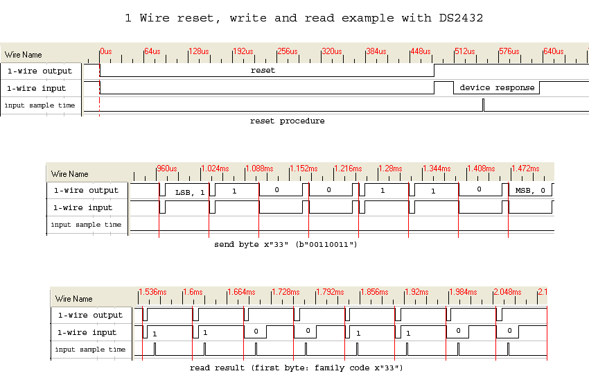
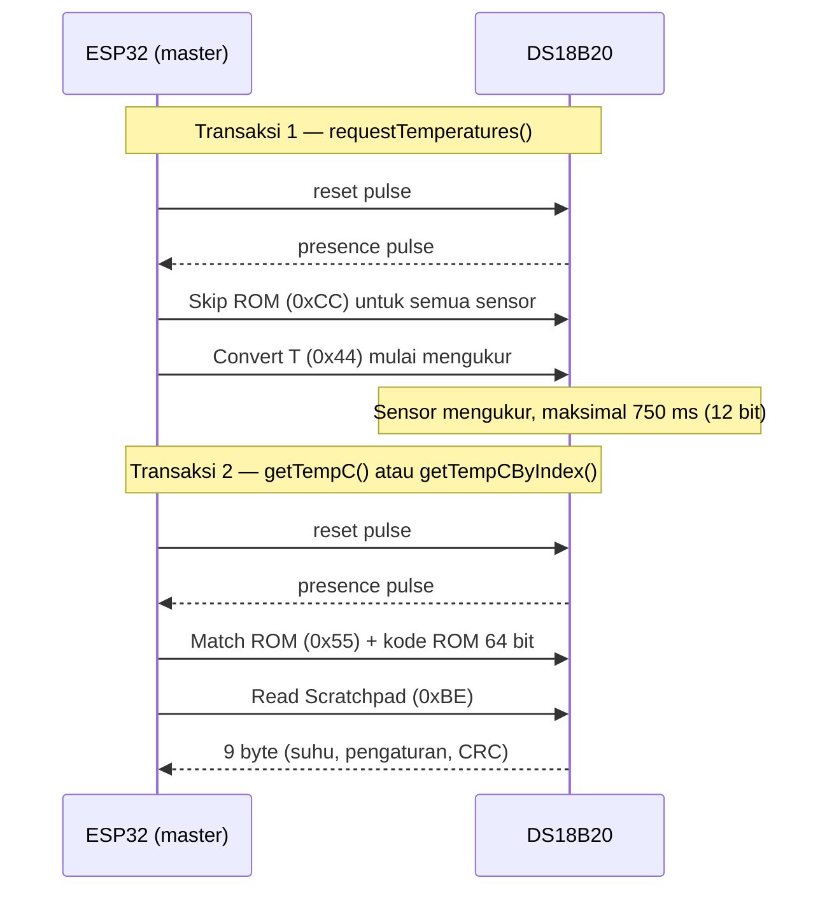
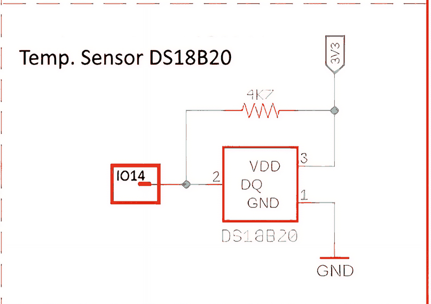
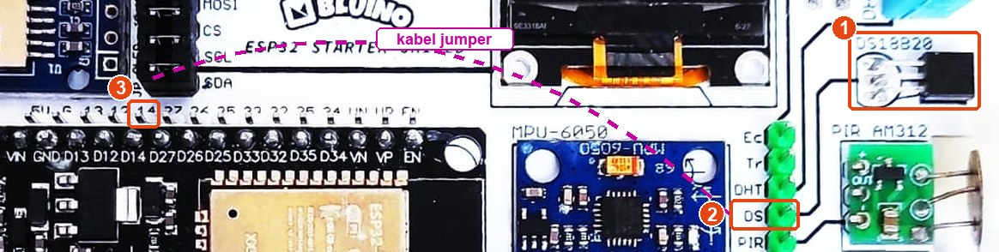

# BAB 25: OneWire & Sensor Suhu DS18B20

> ✅ **Prasyarat:** Selesaikan **BAB 24 (SPI — Serial Peripheral Interface)** — kamu sudah mengenal beberapa protokol komunikasi serial. Konsep *open-drain* dan resistor *pull-up* dari [BAB 23](../BAB-23/README.md) dipakai lagi di sini, pola `millis()` dari [BAB 16](../BAB-16/README.md) dan `enum` dari [BAB 17](../BAB-17/README.md) dipakai di Program 3 dan 4, dan cara membaca *datasheet* dari [BAB 4](../BAB-04/README.md) membantu di [25.3](#253-sensor-suhu-ds18b20).

Kit Bluino punya sensor suhu mungil berkaki tiga bernama **DS18B20**. Sensor ini berbicara dengan ESP32 hanya lewat **satu jalur data** (ditambah GND), memakai protokol bernama **1-Wire**. Setiap DS18B20 membawa nomor unik 64 bit yang ditanam pabrik — mirip NIK di KTP, tidak ada yang kembar — sehingga banyak sensor bisa berbagi satu kabel tanpa tertukar. Di BAB ini kamu akan membongkar cara kerja 1-Wire, membaca fakta penting dari *datasheet* DS18B20, lalu membaca suhu mulai dari cara paling sederhana sampai cara yang tidak menghambat pekerjaan lain di program.

## 📌 Tujuan Pembelajaran

Setelah mempelajari BAB ini, kamu bisa:

- Menjelaskan cara kerja bus 1-Wire: satu jalur data dan GND, sifat *open-drain*, resistor *pull-up*, serta peran *master* (ESP32) dan *slave* (sensor).
- Menjelaskan urutan sinyal 1-Wire: *reset pulse*, *presence pulse*, *time slot* tulis/baca, perintah ROM, dan perintah fungsi.
- Menguraikan kode ROM 64 bit (*family code* `0x28`, nomor seri 48 bit, dan CRC 8 bit) serta memeriksa keabsahannya dengan CRC.
- Membaca fakta penting dari *datasheet* DS18B20: rentang ukur, akurasi, resolusi 9–12 bit beserta waktu konversinya, dan nilai 85 °C saat sensor baru dinyalakan.
- Memasang dan memakai *library* OneWire dan DallasTemperature untuk membaca suhu.
- Membaca suhu berdasarkan **indeks** dan berdasarkan **alamat** (kode ROM), serta tahu kapan memakai masing-masing.
- Membaca suhu tanpa menghambat program lain dengan `setWaitForConversion(false)` dan `millis()`.
- Mengenali nilai khusus −127 °C dan 85 °C, lalu mencari penyebabnya.

## 🧰 Yang Perlu Disiapkan

| Kebutuhan | Keterangan |
|---|---|
| *Hardware* | Kit Bluino ESP32 IoT Starter Shield + kabel USB **data** |
| Kabel *jumper* | 1 kabel *female-female*: pin `DS` (header hijau) → label `14` (IO14) |
| Komponen tambahan | Tidak wajib. Kalau ingin mencoba dua sensor di Program 4: 1 sensor DS18B20 tambahan (misalnya versi *probe* kedap air), *breadboard* kecil, dan beberapa kabel *jumper* *male-female* (lihat [25.9](#259-indeks-atau-alamat)) |
| *Software* | Arduino IDE 2.x + *board package* **esp32** versi 3.3.x (lihat [BAB 5](../BAB-05/README.md)) |
| *Library* | **OneWire** (Paul Stoffregen dkk., diuji versi 2.3.8) dan **DallasTemperature** (Miles Burton dkk., diuji versi 4.0.6) — cara memasangnya di [25.4](#254-memasang-library-onewire-dan-dallastemperature) |
| Alat uji | **Serial Monitor** Arduino IDE (baud 115200) |
| Jaringan | Tidak perlu WiFi |

## 📑 Daftar Isi

- [25.1 Mengenal 1-Wire](#251-mengenal-1-wire)
- [25.2 Cara Kerja Bus 1-Wire](#252-cara-kerja-bus-1-wire)
- [25.3 Sensor Suhu DS18B20](#253-sensor-suhu-ds18b20)
- [25.4 Memasang Library OneWire dan DallasTemperature](#254-memasang-library-onewire-dan-dallastemperature)
- [25.5 Program 1: Membaca Suhu Pertama Kali](#255-program-1-membaca-suhu-pertama-kali)
- [25.6 Program 2: Pemindai Bus 1-Wire](#256-program-2-pemindai-bus-1-wire)
- [25.7 Membaca Suhu Tanpa Menunggu](#257-membaca-suhu-tanpa-menunggu)
- [25.8 Program 3: Suhu Tanpa Menghambat Program](#258-program-3-suhu-tanpa-menghambat-program)
- [25.9 Indeks atau Alamat?](#259-indeks-atau-alamat)
- [25.10 Program 4: Membaca Sensor Berdasarkan Alamat](#2510-program-4-membaca-sensor-berdasarkan-alamat)
- [25.11 Program 5: Membandingkan Resolusi](#2511-program-5-membandingkan-resolusi)
- [25.12 Troubleshooting](#2512-troubleshooting)
- [📝 Rangkuman](#-rangkuman)
- [💪 Latihan](#-latihan)
- [📚 Referensi](#-referensi)

---

## 25.1 Mengenal 1-Wire

**1-Wire** (dibaca "*one-wire*", artinya satu kabel) adalah protokol komunikasi serial yang dikembangkan Dallas Semiconductor. Dallas kemudian menjadi bagian dari Maxim Integrated, dan sejak 2021 Maxim menjadi bagian dari Analog Devices — itulah sebabnya *datasheet* DS18B20 sekarang terbit dengan nama Analog Devices. Nama resmi protokolnya ditulis "1-Wire", sedangkan *library* Arduino-nya bernama **OneWire**; keduanya merujuk ke hal yang sama.

Angka "1" di namanya hanya menghitung **jalur data**. Perangkat 1-Wire tetap butuh **GND bersama** sebagai titik acuan tegangan, dan biasanya juga jalur daya (VDD). Jadi DS18B20 di kit tetap memakai tiga sambungan: VDD, data (DQ), dan GND — hanya jalur datanya yang sampai ke pin ESP32.

Kelebihan dan keterbatasan 1-Wire:

- ✅ **Paling hemat pin.** Satu pin ESP32 (di kit: IO14) cukup untuk banyak sensor sekaligus.
- ✅ **Alamat unik dari pabrik.** Setiap perangkat punya kode ROM 64 bit yang tidak pernah kembar, jadi tidak ada masalah alamat kembar seperti di I2C ([BAB 23](../BAB-23/README.md#2310-konflik-alamat-dan-bus-i2c-kedua)).
- ✅ **Bisa ditarik jauh.** Jalur 1-Wire bisa dibentangkan sampai puluhan meter dengan kabel dan *pull-up* yang tepat, sedangkan I2C hanya untuk jarak dekat. Panduan kabel panjang dibahas di [BAB 27](../BAB-27/README.md).
- ⚠️ **Lambat.** Kecepatannya hanya sekitar 15 kbit/s — cukup untuk sensor suhu, tetapi tidak cocok untuk data besar.
- ⚠️ **Bergantung pada ketepatan waktu.** Bit dibedakan dari **lamanya** pulsa dalam hitungan mikrodetik, jadi ESP32 harus mengatur waktu dengan sangat teliti. Untungnya *library* OneWire sudah mengurus semua itu.

### 25.1.1 Perbandingan dengan Protokol Lain

| Protokol | Jalur sinyal | Jumlah perangkat | Kecepatan umum | Contoh di kit | Dibahas di |
|---|---|---|---|---|---|
| UART | 2 (TX, RX), tanpa jalur *clock* | 2 (satu lawan satu) | Biasanya 9600–115200 bit/s | Serial Monitor lewat USB | [BAB 22](../BAB-22/README.md) |
| I2C | 2 (SDA, SCL) | Banyak, dibedakan dengan alamat 7 bit | 100 kbit/s atau 400 kbit/s | OLED, MPU-6050, BMP180 | [BAB 23](../BAB-23/README.md) |
| SPI | 4 (MOSI, MISO, CLK, CS), tambah 1 CS untuk setiap perangkat berikutnya | Banyak, dipilih lewat jalur CS | Jutaan bit per detik | microSD | [BAB 24](../BAB-24/README.md) |
| **1-Wire** | **1 (data)** | Banyak, dibedakan dengan **kode ROM 64 bit** | Sekitar 15 kbit/s | DS18B20 | BAB ini |

Semua protokol di atas juga butuh GND bersama. Di kit, GND DS18B20 sudah tersambung ke GND ESP32 lewat jalur PCB.

> 📌 **Catatan:** DHT11 di kit juga memakai satu jalur data, tetapi protokolnya **bukan** 1-Wire: DHT11 tidak punya kode ROM dan hanya bisa satu sensor per pin. Karena itu DHT11 memakai *library* lain yang dibahas di [BAB 26](../BAB-26/README.md).

---

## 25.2 Cara Kerja Bus 1-Wire

### 25.2.1 Satu Jalur Data, Pull-Up, dan Master–Slave

Di bus 1-Wire ada dua peran:

- ***Master*** (pengendali) — perangkat yang **memulai** setiap percakapan dan mengatur waktunya. Di kit, *master*-nya adalah ESP32. Satu bus hanya punya satu *master*.
- ***Slave*** (perangkat sasaran) — perangkat yang hanya **menjawab** saat diajak bicara. Di kit: DS18B20. Satu bus boleh berisi banyak *slave*.

> 📌 **Catatan:** *Datasheet* DS18B20 memakai istilah *bus master* dan *slave*. Artinya sama dengan *controller* dan *target* yang dipakai untuk I2C di [BAB 23](../BAB-23/README.md#2322-controller-dan-target).

Sama seperti I2C, jalur data 1-Wire bersifat ***open-drain***: ESP32 maupun sensor hanya bisa **menarik jalur ke LOW** atau **melepasnya**. Yang mengembalikan jalur ke HIGH adalah resistor ***pull-up*** ke 3,3 V — ingat analogi tirai gulung berpegas di [BAB 23](../BAB-23/README.md#2325-open-drain-dan-resistor-pull-up). Saat tidak ada komunikasi, jalur diam di HIGH.

*Datasheet* DS18B20 menyebut *pull-up* sekitar 5 kΩ; nilai yang umum dipakai adalah **4,7 kΩ**, dan resistor 4,7 kΩ inilah yang sudah terpasang di PCB kit (lihat [25.3.1](#2531-ds18b20-di-kit-bluino)). Jadi untuk sensor di kit, kamu **tidak perlu** menambah resistor.

### 25.2.2 Bit Dibedakan dari Lamanya Pulsa

1-Wire tidak punya jalur *clock* seperti I2C. Sebagai gantinya, setiap bit dikirim dalam sebuah "jendela waktu" bernama ***time slot*** yang lamanya 60–120 µs (mikrodetik; 1 µs = sepersejuta detik). Isi bit ditentukan oleh **berapa lama** jalur ditarik ke LOW di awal *time slot*. Mirip kode Morse: titik dan garis dibedakan dari panjang bunyinya.

Sinyal-sinyal 1-Wire beserta waktunya menurut *datasheet* DS18B20 (bagian *AC Electrical Characteristics*):

| Sinyal | Siapa yang menarik jalur ke LOW | Lamanya | Artinya |
|---|---|---|---|
| ***Reset pulse*** | ESP32 | Minimal 480 µs | "Semua perhatian, percakapan baru dimulai!" |
| ***Presence pulse*** | Sensor, 15–60 µs setelah ESP32 melepas jalur | 60–240 µs | "Saya ada di sini!" |
| Tulis bit 1 | ESP32 | 1–15 µs, lalu dilepas | Saat sensor memeriksa jalur, jalur sudah HIGH lagi → bit 1 |
| Tulis bit 0 | ESP32 | 60–120 µs | Saat sensor memeriksa jalur, jalur masih LOW → bit 0 |
| Baca 1 bit | ESP32 memulai (minimal 1 µs), lalu sensor menjawab | — | Sensor membiarkan jalur HIGH (bit 1) atau menahannya LOW (bit 0). ESP32 harus membaca jalur sebelum 15 µs sejak awal *time slot* |

Di antara dua *time slot* ada jeda pemulihan minimal 1 µs. Setiap *byte* dikirim mulai dari **bit terkecil** (*LSB first*) — kebalikan dari I2C yang mulai dari bit terbesar.



*Gambar 25.1 — Rekaman sinyal 1-Wire asli dengan logic analyzer (contoh ini memakai chip DS2432; protokolnya sama dengan DS18B20). Atas: master menarik jalur LOW sekitar 480 µs (reset), lalu perangkat menjawab (device response = presence pulse). Tengah: master mengirim byte `0x33` (perintah Read ROM) mulai dari bit terkecil (1, 1, 0, 0, 1, 1, 0, 0) — pulsa LOW pendek berarti bit 1, pulsa LOW panjang berarti bit 0. Bawah: master membaca byte pertama kode ROM yang dikirim balik oleh chip (family code DS2432 kebetulan juga `0x33`). Sumber: [FrankBuss](https://commons.wikimedia.org/wiki/File:1-Wire-Protocol.png), domain publik.*

> 💡 **Tips:** Kamu tidak perlu menghafal angka-angka di atas, karena *library* OneWire sudah mengatur semua waktunya. Yang perlu diingat: 1-Wire sangat bergantung pada **ketepatan waktu**, sehingga sambungan yang longgar atau kabel yang terlalu panjang bisa membuat bit salah terbaca.

### 25.2.3 Urutan Satu Transaksi

Setiap percakapan 1-Wire selalu mengikuti tiga langkah:

1. **Inisialisasi.** ESP32 mengirim *reset pulse*, lalu setiap sensor yang ada menjawab dengan *presence pulse*. Kalau tidak ada jawaban, berarti tidak ada sensor di bus — atau kabelnya lepas.
2. **Perintah ROM.** Perintah ini memilih sensor mana yang diajak bicara:

   | Perintah | Kode | Kegunaan |
   |---|---|---|
   | *Skip ROM* | `0xCC` | Bicara ke **semua** sensor sekaligus tanpa menyebut alamat. Cocok untuk menyuruh semua sensor mengukur bersamaan |
   | *Match ROM* | `0x55` | Diikuti kode ROM 64 bit; hanya sensor yang kode ROM-nya cocok yang menanggapi |
   | *Search ROM* | `0xF0` | Mencari kode ROM semua sensor di bus, satu per satu (lihat [25.2.5](#2525-mencari-semua-sensor-search-rom)) |
   | *Read ROM* | `0x33` | Membaca kode ROM — hanya boleh dipakai kalau di bus cuma ada **satu** sensor |

3. **Perintah fungsi.** Ini perintah khusus DS18B20, misalnya ***Convert T*** (`0x44`, "mulai mengukur suhu") dan ***Read Scratchpad*** (`0xBE`, "kirimkan isi memorimu"). ***Scratchpad*** adalah memori kecil 9 *byte* di dalam DS18B20 yang berisi hasil pengukuran suhu (2 *byte*), pengaturan, dan CRC.

Membaca suhu ternyata butuh **dua** transaksi, dan di antara keduanya ada waktu tunggu yang cukup lama:



*Gambar 25.2 — Dua transaksi untuk membaca suhu sebuah sensor, seperti yang dilakukan library DallasTemperature. Sumber: dibuat untuk materi ini.*

Waktu tunggu di tengah itulah yang akan kita manfaatkan di [25.7](#257-membaca-suhu-tanpa-menunggu): selama sensor sibuk mengukur, ESP32 sebenarnya bebas mengerjakan hal lain.

### 25.2.4 Kode ROM: "NIK" 64 Bit Setiap Sensor

Setiap perangkat 1-Wire punya **kode ROM** (*ROM code*) sepanjang 64 bit (8 *byte*) yang ditulis permanen dengan laser di pabrik. Kode ROM juga disebut **alamat** sensor. Isinya tiga bagian:

| Urutan *byte* | Isi | Ukuran | Keterangan |
|---|---|---|---|
| *Byte* 0 | ***Family code*** | 8 bit | Jenis chip. DS18B20 selalu `0x28` |
| *Byte* 1–6 | Nomor seri | 48 bit | Berbeda untuk setiap chip |
| *Byte* 7 | CRC | 8 bit | Angka pemeriksa yang dihitung dari 7 *byte* sebelumnya |

Contoh kode ROM, ditulis per *byte* dalam heksadesimal mulai dari *byte* 0: `28:61:64:12:3C:7C:2F:27`. Angka `28` adalah *family code* DS18B20, enam *byte* berikutnya nomor seri, dan `27` adalah CRC-nya. Dengan nomor seri 48 bit, ada lebih dari 281 triliun kemungkinan nomor — itulah sebabnya kode ROM bisa dianggap unik, seperti NIK di KTP.

*Family code* chip 1-Wire lain yang mungkin kamu temui: `0x10` (DS18S20/DS1820), `0x22` (DS1822), dan `0x3B` (DS1825/MAX31850).

**Apa itu CRC?** CRC (*Cyclic Redundancy Check*) adalah angka pemeriksa yang dihitung dari sekumpulan data dengan rumus tertentu. Penerima menghitung ulang angka itu dari data yang diterimanya, lalu membandingkannya. Kalau cocok, datanya hampir pasti utuh; kalau tidak cocok, ada bit yang rusak di perjalanan, misalnya karena kabel longgar. Idenya mirip digit terakhir nomor ISBN di buku, yang gunanya mendeteksi salah ketik.

DS18B20 memakai CRC 8 bit (rumus polinomialnya x⁸ + x⁵ + x⁴ + 1) di dua tempat:

- *Byte* terakhir kode ROM — memeriksa 7 *byte* pertama kode ROM.
- *Byte* ke-9 *scratchpad* — memeriksa 8 *byte* *scratchpad* sebelumnya, termasuk hasil suhu.

Di program, CRC cukup dihitung dengan fungsi `OneWire::crc8()` (dipakai di Program 2). *Library* DallasTemperature juga memeriksa CRC *scratchpad* setiap kali membaca suhu; kalau tidak cocok, hasilnya dilaporkan sebagai −127 °C (lihat [25.3.4](#2534-nilai-khusus-yang-perlu-dikenali)).

### 25.2.5 Mencari Semua Sensor: Search ROM

Kalau ESP32 belum tahu kode ROM sensor-sensor di bus, ia memakai perintah ***Search ROM***. Caranya mirip permainan tebak-tebakan "ya atau tidak": kode ROM ditelusuri bit demi bit, dan di setiap bit ESP32 bertanya, "Siapa yang bit ini-nya 0? Siapa yang 1?" Kalau jawabannya campur, ESP32 memilih satu cabang dulu dan menyuruh sensor di cabang lain diam sementara. Setelah 64 bit, satu kode ROM lengkap ditemukan. Proses diulang sampai semua cabang habis ditelusuri.

Satu putaran pencarian butuh waktu sekitar 13 ms per sensor. *Library* DallasTemperature menjalankan pencarian ini di dalam `begin()` (untuk menghitung jumlah sensor) dan `getAddress()`; di Program 2 kamu akan memanggilnya langsung dengan `search()` dari *library* OneWire.

<details>
<summary><b>🔬 Pendalaman (opsional): Bagaimana Search ROM memilah sensor?</b></summary>

Untuk setiap bit kode ROM, ESP32 melakukan tiga langkah:

1. **Baca bit.** Semua sensor yang masih ikut mengirim bit miliknya secara bersamaan. Karena jalurnya *open-drain*, satu sensor saja yang mengirim 0 sudah cukup untuk menarik jalur ke LOW.
2. **Baca kebalikannya.** Semua sensor mengirim kebalikan (komplemen) bit tadi.
3. **Tulis bit pilihan.** ESP32 mengirim bit yang dipilihnya. Sensor yang bitnya berbeda berhenti ikut sampai *reset* berikutnya.

Dari dua bacaan di langkah 1 dan 2, ESP32 bisa menyimpulkan:

| Bacaan bit | Bacaan kebalikan | Kesimpulan |
|---|---|---|
| 0 | 1 | Semua sensor yang masih ikut punya bit 0 |
| 1 | 0 | Semua sensor yang masih ikut punya bit 1 |
| 0 | 0 | Ada yang bit 0 dan ada yang bit 1 — terjadi **percabangan** |
| 1 | 1 | Tidak ada sensor yang menjawab |

Di setiap percabangan, ESP32 memilih satu cabang dan mencatat posisinya. Pada putaran berikutnya ia mengambil cabang yang lain. Dengan cara ini, *n* sensor ditemukan dalam *n* putaran — mirip menelusuri silsilah keluarga: setiap kali ada dua anak, telusuri anak pertama sampai habis, lalu kembali ke anak kedua.

</details>

---

## 25.3 Sensor Suhu DS18B20

### 25.3.1 DS18B20 di Kit Bluino

DS18B20 di kit bentuknya seperti transistor kecil berkaki tiga (kemasan **TO-92**) dan terletak di dekat DHT11, dengan tulisan `DS18B20` di PCB. Begini rangkaiannya di skematik kit:



*Gambar 25.3 — Blok DS18B20 pada kit: jalur DQ berujung di pin header (kotak IO14) dan diberi resistor pull-up 4K7 ke 3V3. Sumber: skematik ESP32 Starter Shield 3.2, [Bluino](http://www.bluino.com).*

| Pin DS18B20 | Nama | Tersambung ke |
|---|---|---|
| 1 | GND | GND kit |
| 2 | DQ (data) | Pin header `DS` (kotak **IO14** di skematik) dan resistor *pull-up* 4,7 kΩ ke 3V3 |
| 3 | VDD (daya) | 3V3 kit |

Kotak bertuliskan **IO14** di skematik adalah **pin header**, bukan sambungan langsung ke ESP32 (lihat [BAB 4](../BAB-04/README.md#445-dht11-dan-ds18b20-jalur-data-dengan-pull-up)). Tulisan IO14 hanya pin yang disarankan perancang kit. Di PCB, pin ini berlabel `DS` di header hijau, dan kamu harus menyambungkannya sendiri ke ESP32 dengan **satu kabel *jumper***:

| Pin **Custom** di kit | Sambungkan ke pin ESP32 |
|---|---|
| `DS` (header hijau) | IO14 (label `14` di deretan pin ESP32 atas) |



*Gambar 25.4 — (1) Sensor DS18B20, (2) pin `DS` di header hijau, (3) label `14` di deretan pin ESP32 atas. Garis putus-putus menggambarkan kabel jumper yang kamu pasang. Tata letak kit v3.2 milikmu bisa sedikit berbeda. Sumber: foto produk ESP32 Starter Shield, [Bluino](http://www.bluino.com), dipotong dan diberi penanda untuk materi ini.*

Langkah memasangnya (sama seperti di [BAB 6](../BAB-06/README.md#623-langkah-memasang-kabel-jumper)):

1. **Cabut kabel USB dulu.**
2. Colokkan satu ujung kabel *jumper* ke pin `DS` di header hijau. Urutan header hijau dari atas: `Ec`, `Tr`, `DHT`, **`DS`**, `PIR`, `SRV` — hati-hati, `DS` diapit `DHT` dan `PIR`.
3. Colokkan ujung lainnya ke label `14` di deretan pin ESP32 atas. Urutan dari kiri: `5V`, `G`, `13`, `12`, **`14`**, `27`, …
4. Sambungkan kembali kabel USB.

Hal penting tentang DS18B20 di kit:

- Sensor mendapat daya dari pin **VDD** (3,3 V) — cara ini disebut mode **daya eksternal**. DS18B20 juga bisa bekerja tanpa kabel VDD dengan "menumpang" daya dari jalur data (mode ***parasitic power***), tetapi cara itu dibahas di [BAB 27](../BAB-27/README.md).
- Sinyal datanya bertegangan 3,3 V, jadi aman untuk ESP32.
- *Pull-up* 4,7 kΩ sudah ada di PCB. Kalau kelak kamu memasang DS18B20 sendiri di pin ESP32 yang lain, kamu wajib menambahkan resistor 4,7 kΩ dari jalur data ke 3,3 V.

### 25.3.2 Membaca Datasheet DS18B20

Kamu sudah belajar membaca *datasheet* di [BAB 4](../BAB-04/README.md#45-apa-itu-datasheet). Unduh *datasheet* DS18B20 dari situs Analog Devices (tautannya ada di [📚 Referensi](#-referensi)), lalu cocokkan dengan ringkasan berikut:

| Parameter | Nilai di *datasheet* | Artinya bagi kita |
|---|---|---|
| Tegangan catu (VDD) | 3,0–5,5 V | Kit memberi 3,3 V — aman |
| Rentang ukur | −55 °C sampai +125 °C | Cukup untuk suhu ruangan, isi kulkas, sampai air mendidih (100 °C) |
| Akurasi | ±0,5 °C pada −10 °C sampai +85 °C; ±2 °C pada seluruh rentang | Pada suhu ruangan, hasilnya paling jauh selisih sekitar 0,5 °C dari suhu sebenarnya |
| Resolusi | 9, 10, 11, atau 12 bit; bawaan pabrik 12 bit | Langkah terkecil 0,5 °C sampai 0,0625 °C (lihat [25.3.3](#2533-resolusi-dan-waktu-konversi)) |
| Waktu konversi | Maksimal 750 ms pada 12 bit | Setiap pengukuran butuh waktu — hasilnya tidak bisa langsung dibaca |
| Isi register suhu saat dinyalakan | +85 °C | Angka 85 °C bisa berarti "belum pernah mengukur" (lihat [25.3.4](#2534-nilai-khusus-yang-perlu-dikenali)) |
| *Pull-up* jalur data | Sekitar 5 kΩ | Kit memakai 4,7 kΩ |
| EEPROM (memori pengaturan yang tidak hilang saat listrik mati) | Minimal 50.000 kali tulis | Jangan menyimpan pengaturan berulang-ulang di `loop()` |

> 📌 **Catatan:** DS18B20 mengukur **suhu badannya sendiri**. Sensor di kit terpasang di PCB, dekat komponen lain yang bisa ikut hangat, jadi hasilnya bisa sedikit lebih tinggi daripada suhu udara ruangan. Kalau sensornya kamu pegang, suhu yang terbaca ikut naik — cara ini praktis untuk menguji sensor.

> ⚠️ **Perhatian:** DS18B20 di kit **tidak kedap air**. Jangan mencelupkan kit ke air atau minuman. Untuk mengukur suhu cairan, pakai DS18B20 versi *probe* kedap air (sensor di dalam selongsong logam dengan kabel panjang).

### 25.3.3 Resolusi dan Waktu Konversi

**Resolusi** adalah langkah perubahan terkecil yang bisa ditampilkan sensor. DS18B20 bisa diatur ke 9, 10, 11, atau 12 bit. Makin tinggi resolusinya, makin halus langkahnya, tetapi makin lama **waktu konversinya** — yaitu waktu yang dibutuhkan sensor untuk mengubah suhu menjadi angka digital:

| Resolusi | Langkah terkecil | Waktu konversi maks. (*datasheet*) | Nilai `millisToWaitForConversion()` |
|---|---|---|---|
| 9 bit | 0,5 °C | 93,75 ms | 94 ms |
| 10 bit | 0,25 °C | 187,5 ms | 188 ms |
| 11 bit | 0,125 °C | 375 ms | 375 ms |
| 12 bit (bawaan) | 0,0625 °C | 750 ms | 750 ms |

Setiap resolusi naik 1 bit, waktu konversinya naik dua kali lipat. Fungsi `millisToWaitForConversion()` dari *library* DallasTemperature memberikan waktu tunggu maksimum itu dalam milidetik (dibulatkan ke atas), dan dipakai di Program 3–5.

> ⚠️ **Perhatian:** **Resolusi tidak sama dengan akurasi.** Pada 12 bit, angka suhu berubah per 0,0625 °C, tetapi kebenarannya tetap ±0,5 °C. Ibaratnya penggaris bergaris milimeter yang tercetak sedikit bergeser: kamu bisa membaca sampai milimeter (resolusi), tetapi hasilnya tetap bisa meleset dari panjang sebenarnya (akurasi). Jadi menampilkan suhu dengan empat angka di belakang koma tidak membuatnya lebih akurat.

Di dalam *scratchpad*, suhu disimpan sebagai angka 16 bit bertanda. Pada 12 bit, setiap kenaikan 1 angka berarti 0,0625 °C (1/16 °C). Contoh dari *datasheet*: angka `0x0191` = 401, jadi suhunya 401 × 0,0625 = +25,0625 °C. *Library* DallasTemperature menghitung ini untukmu.

### 25.3.4 Nilai Khusus yang Perlu Dikenali

Dua angka berikut sering membingungkan pemula:

| Nilai | Asalnya | Arti | Penyebab umum |
|---|---|---|---|
| **−127 °C** | Konstanta `DEVICE_DISCONNECTED_C` dari *library* DallasTemperature — **bukan** suhu sungguhan (DS18B20 hanya sampai −55 °C) | Pembacaan gagal | Kabel `DS` → `14` belum terpasang atau longgar, sensor tidak ditemukan saat `begin()`, data rusak (CRC tidak cocok), atau sensor belum pernah selesai mengukur (lihat di bawah) |
| **85 °C** | Isi register suhu DS18B20 saat baru dinyalakan (*power-on reset*) | Sensor belum menyelesaikan satu pun pengukuran | Suhu dibaca sebelum konversi selesai, atau daya sensor terganggu saat mengukur |

*Library* DallasTemperature versi baru (misalnya 4.0.6 yang dipakai di sini) berusaha mengenali kondisi "belum pernah mengukur" dari isi *scratchpad*, lalu melaporkannya sebagai −127 °C, bukan 85 °C. Namun pada sebagian sensor (terutama chip tiruan), angka 85 °C tetap bisa lolos. Jadi pegang dua aturan ini:

1. **Selalu periksa hasil** dengan `if (suhu == DEVICE_DISCONNECTED_C)` sebelum memakainya.
2. **Curigai angka tepat `85.00`**, kecuali sensornya memang sedang berada di tempat yang sangat panas.

---

## 25.4 Memasang Library OneWire dan DallasTemperature

Dua *library* bekerja bertingkat:

| *Library* | Tugas | Contoh fungsi |
|---|---|---|
| **OneWire** | Tingkat bawah: membuat sinyal 1-Wire (reset, tulis/baca bit dan *byte*, *Search ROM*, CRC) | `reset()`, `search()`, `crc8()` |
| **DallasTemperature** | Tingkat atas: urusan sensor suhu (perintah ukur, membaca *scratchpad*, mengubah angka mentah menjadi °C) | `requestTemperatures()`, `getTempCByIndex()`, `setResolution()` |

Ibaratnya, OneWire adalah kurir yang tahu cara mengantar surat lewat satu kabel, sedangkan DallasTemperature adalah sekretaris yang tahu surat apa yang harus dikirim ke sensor suhu. DallasTemperature selalu memakai OneWire, jadi **keduanya wajib terpasang**.

**Cara memasang** (lihat juga [BAB 5](../BAB-05/README.md#58-dasar-library-manager)):

1. Di Arduino IDE, buka **Sketch → Include Library → Manage Libraries…** (Ctrl+Shift+I), atau klik ikon **Library Manager** (bergambar buku) di panel kiri.
2. Ketik `OneWire` di kolom pencarian. Pilih kartu berjudul **OneWire** yang daftar pembuatnya diawali *by Jim Studt, Tom Pollard, …* (daftarnya panjang; Paul Stoffregen termasuk di dalamnya). Klik **INSTALL**.
3. Ketik `DallasTemperature`. Pilih kartu **DallasTemperature** *by Miles Burton, …*, lalu klik **INSTALL**. Kalau muncul jendela yang menawarkan *library* pendukung, klik **Install All**.
4. Pastikan kedua kartu menampilkan tulisan **installed**. Materi ini diuji dengan OneWire **2.3.8** dan DallasTemperature **4.0.6**.

> ⚠️ **Perhatian:** Pasang **OneWire lebih dulu**. DallasTemperature versi terbaru (diuji 4.0.6) tidak mendaftarkan OneWire sebagai *library* pendukung, jadi Library Manager tidak otomatis menawarkannya. Kalau hanya DallasTemperature yang terpasang, proses *compile* gagal dengan pesan `OneWire.h: No such file or directory`. Jangan pula memilih *library* lain yang namanya mirip (misalnya OneWireNg); kode di BAB ini ditulis untuk dua *library* di atas.

Setiap program di BAB ini diawali pola yang sama (contoh potongan kode bagian atas program):

```cpp
#include <OneWire.h>
#include <DallasTemperature.h>

#define PIN_ONEWIRE 14                // jalur data DS18B20 (pin DS -> IO14)

OneWire oneWire(PIN_ONEWIRE);         // bus 1-Wire di IO14
DallasTemperature sensor(&oneWire);   // pengurus sensor suhu yang memakai bus tadi
```

Tanda `&` di `&oneWire` berarti "alamat memori objek `oneWire`". Jadi objek `sensor` memakai bus 1-Wire yang sama persis, bukan salinannya.

Fungsi DallasTemperature yang dipakai di BAB ini:

| Fungsi | Kegunaan | Hasil |
|---|---|---|
| `sensor.begin()` | Mencari semua perangkat di bus (*Search ROM*) dan mencatat jumlahnya. Cukup dipanggil sekali di `setup()` | — |
| `sensor.getDeviceCount()` | Jumlah perangkat 1-Wire yang ditemukan saat `begin()` | Angka 0–255 |
| `sensor.requestTemperatures()` | Menyuruh **semua** sensor mengukur (*Skip ROM* + *Convert T*). Bawaannya **menunggu** sampai pengukuran selesai | — |
| `sensor.getTempCByIndex(i)` | Membaca suhu sensor urutan ke-`i` (mulai dari 0) | Suhu dalam °C (`float`), atau −127 kalau gagal |
| `sensor.getAddress(alamat, i)` | Menyalin kode ROM sensor urutan ke-`i` ke variabel `alamat` | `true` kalau berhasil |
| `sensor.getTempC(alamat)` | Membaca suhu sensor dengan kode ROM tertentu | Suhu dalam °C, atau −127 kalau gagal |
| `sensor.isConnected(alamat)` | Memeriksa apakah sensor dengan kode ROM itu menjawab | `true` atau `false` |
| `sensor.setResolution(bit)` | Mengatur resolusi semua sensor (9–12 bit). Bawaannya pengaturan ini juga disimpan ke EEPROM sensor | — |
| `sensor.setAutoSaveScratchPad(false)` | Pengaturan berikutnya hanya diubah di *scratchpad* (hilang saat listrik dicabut), tidak disimpan ke EEPROM | — |
| `sensor.setWaitForConversion(false)` | Membuat `requestTemperatures()` langsung kembali tanpa menunggu | — |
| `sensor.millisToWaitForConversion(bit)` | Waktu tunggu maksimum untuk resolusi tertentu | 94, 188, 375, atau 750 (ms) |
| `sensor.toFahrenheit(c)` | Mengubah °C menjadi °F | Suhu dalam °F |

`DeviceAddress` adalah tipe data dari DallasTemperature untuk menyimpan satu kode ROM, yaitu *array* berisi 8 *byte* (`uint8_t[8]`).

---

## 25.5 Program 1: Membaca Suhu Pertama Kali

**Tujuan:** Membaca suhu DS18B20 setiap 2 detik dengan cara paling sederhana, lalu menampilkannya di Serial Monitor. Program ini juga mengukur berapa lama `requestTemperatures()` menunggu sensor selesai mengukur, supaya kamu melihat sendiri "harga" dari cara sederhana ini.

**Rangkaian:**

| Pin **Custom** di kit | Sambungkan ke pin ESP32 |
|---|---|
| `DS` (header hijau) | IO14 |

**Cara Menjalankan:**

1. Cabut USB, sambungkan kabel *jumper* sesuai tabel **Rangkaian** di atas (lihat Gambar 25.4), lalu sambungkan USB lagi.
2. Pastikan *library* **OneWire** dan **DallasTemperature** sudah terpasang (lihat [25.4](#254-memasang-library-onewire-dan-dallastemperature)).
3. Buka Arduino IDE → **File → New Sketch**, hapus isinya, lalu salin kode di bawah. Kode yang sama juga tersedia di *file* [`p1_baca_suhu.ino`](p1_baca_suhu/p1_baca_suhu.ino).
4. Pastikan **Tools → Board** = **ESP32 Dev Module** dan **Tools → Port** = *port* ESP32 kamu (misalnya `COM5` di Windows atau `/dev/ttyUSB0` di Linux).
5. Klik tombol **Upload** (ikon panah →) dan tunggu sampai muncul tulisan **Done uploading**.
6. Buka **Serial Monitor** (**Tools → Serial Monitor**) lalu pilih baud **115200**. Kalau tulisan awalnya terlewat, tekan tombol **EN** di *board* ESP32 untuk mengulang program.

**Kode Program:**

<!-- sketch: p1_baca_suhu -->
```cpp
/*
 * BAB 25 - Program 1: Membaca Suhu Pertama Kali
 * Membaca suhu DS18B20 setiap 2 detik dengan cara sederhana (menunggu
 * sampai sensor selesai mengukur), lalu menampilkan suhu dan lama menunggunya.
 *
 * Rangkaian: kabel jumper dari pin DS (header hijau) ke IO14.
 * Resistor pull-up 4,7 kOhm sudah ada di PCB kit.
 * Library: OneWire (Paul Stoffregen dkk.) dan DallasTemperature (Miles Burton dkk.)
 */

#include <OneWire.h>
#include <DallasTemperature.h>

#define PIN_ONEWIRE 14   // jalur data DS18B20 (pin DS -> IO14)

OneWire oneWire(PIN_ONEWIRE);         // bus 1-Wire di IO14
DallasTemperature sensor(&oneWire);   // pengurus sensor suhu yang memakai bus tadi

void setup() {
  Serial.begin(115200);
  delay(1000);  // beri waktu Serial Monitor tersambung

  Serial.println("BAB 25 - Program 1: Membaca Suhu Pertama Kali");

  sensor.begin();  // cari semua perangkat di bus 1-Wire
  Serial.printf("Perangkat 1-Wire ditemukan: %u\n", sensor.getDeviceCount());

  if (sensor.getDeviceCount() == 0) {
    Serial.println("Sensor tidak ditemukan! Cabut USB, periksa kabel DS -> 14,");
    Serial.println("lalu sambungkan USB lagi.");
  }
}

void loop() {
  unsigned long mulai = millis();
  sensor.requestTemperatures();               // suruh sensor mengukur, lalu TUNGGU sampai selesai
  unsigned long lamaTunggu = millis() - mulai;

  float suhu = sensor.getTempCByIndex(0);     // ambil hasil sensor pertama (indeks 0)

  if (suhu == DEVICE_DISCONNECTED_C) {        // -127 berarti pembacaan gagal
    Serial.println("Gagal membaca sensor (-127). Periksa kabel DS -> 14.");
  } else {
    Serial.printf("Suhu: %.2f °C  (menunggu %lu ms)\n", suhu, lamaTunggu);
  }

  delay(2000);  // jeda 2 detik sebelum mengukur lagi
}
```

**Penjelasan Kode:**

- **Dua objek.** `OneWire oneWire(PIN_ONEWIRE)` menyiapkan bus 1-Wire di IO14, lalu `DallasTemperature sensor(&oneWire)` membuat "pengurus" sensor suhu yang memakai bus itu (lihat [25.4](#254-memasang-library-onewire-dan-dallastemperature)).
- **`sensor.begin()`** menjalankan *Search ROM* untuk mencari semua perangkat di bus, dan `getDeviceCount()` mengembalikan jumlahnya. Kalau hasilnya 0, program mencetak petunjuk memeriksa kabel. Pencarian ini hanya dilakukan sekali di `setup()`, jadi sensor yang baru tersambung setelah ESP32 menyala tidak akan terhitung sampai ESP32 di-*reset*.
- **`sensor.requestTemperatures()`** mengirim *Skip ROM* + *Convert T* ke semua sensor, lalu **menunggu** sampai sensor selesai mengukur. Selama menunggu, *library* terus "bertanya" ke sensor apakah pengukurannya sudah selesai (batas maksimalnya 750 ms). Selisih `millis()` sebelum dan sesudahnya disimpan di `lamaTunggu`.
- **`sensor.getTempCByIndex(0)`** membaca hasil sensor urutan pertama (indeks dimulai dari 0): mencari kode ROM sensor itu, membaca *scratchpad*-nya, memeriksa CRC, lalu mengubah angka mentah menjadi °C.
- **`DEVICE_DISCONNECTED_C`** bernilai −127. Hasil selalu dibandingkan dengan konstanta ini sebelum dipakai (lihat [25.3.4](#2534-nilai-khusus-yang-perlu-dikenali)).
- **`%.2f`** mencetak angka pecahan dengan 2 angka di belakang titik, dan **`%lu`** mencetak `unsigned long`.
- **`delay(2000)`** membuat satu putaran `loop()` sebenarnya sekitar 2,6 detik: ±0,6 detik menunggu sensor ditambah 2 detik jeda. Selama itu ESP32 tidak bisa mengerjakan hal lain — kelemahan inilah yang diatasi di [25.7](#257-membaca-suhu-tanpa-menunggu).

**Contoh Output:**

```text
BAB 25 - Program 1: Membaca Suhu Pertama Kali
Perangkat 1-Wire ditemukan: 1
Suhu: 28.31 °C  (menunggu 601 ms)
Suhu: 28.31 °C  (menunggu 601 ms)
Suhu: 28.44 °C  (menunggu 602 ms)
```

Angka suhu dan lama menunggu di kit-mu pasti berbeda. Pada resolusi 12 bit, lama menunggu biasanya beberapa ratus milidetik dan tidak lebih dari sekitar 750 ms. Di kit tidak ada lampu yang menyala; semua hasil hanya muncul di Serial Monitor.

> 🧪 **Coba Sendiri:** Pegang badan sensor DS18B20 dengan ujung jari selama sekitar 20 detik. Suhunya naik perlahan, lalu turun lagi setelah jarimu dilepas. Kalau angkanya tidak berubah sama sekali, mungkin yang kamu pegang sensor DHT11 di sebelahnya — perhatikan tulisan `DS18B20` di PCB.

**Kalau Belum Berhasil:**

- **`Perangkat 1-Wire ditemukan: 0` lalu muncul `Gagal membaca sensor (-127)` terus-menerus** → kabel *jumper* belum terpasang, longgar, atau salah pin (misalnya tertancap di `DHT`/`PIR` atau di label `12`/`27`). Cabut USB, betulkan kabel sesuai Gambar 25.4, lalu sambungkan USB lagi.
- **Gagal *compile* dengan pesan `OneWire.h: No such file or directory` atau `DallasTemperature.h: No such file or directory`** → *library*-nya belum terpasang. Pasang keduanya lewat Library Manager (lihat [25.4](#254-memasang-library-onewire-dan-dallastemperature)).
- **Suhu selalu tepat `85.00 °C`** → sensor belum sempat menyelesaikan pengukuran, biasanya karena daya atau sambungannya terganggu. Periksa kabel, lalu cabut USB beberapa detik dan sambungkan lagi (lihat [25.12](#2512-troubleshooting)).
- **Serial Monitor kosong atau berisi huruf acak** → baud belum 115200. Pilih **115200**, lalu tekan tombol **EN**.

---

## 25.6 Program 2: Pemindai Bus 1-Wire

**Tujuan:** Memakai *library* OneWire secara langsung untuk "mengintip" bus 1-Wire: mengirim *reset pulse* dan memeriksa *presence pulse*, mencari kode ROM setiap perangkat dengan *Search ROM*, lalu memeriksa CRC-nya. Program ini mirip pemindai I2C di [BAB 6](../BAB-06/README.md#68-program-2-pemindai-i2c). Kode ROM yang ditemukannya akan kamu pakai di Program 4.

**Rangkaian:**

| Pin **Custom** di kit | Sambungkan ke pin ESP32 |
|---|---|
| `DS` (header hijau) | IO14 |

**Cara Menjalankan:**

1. Pastikan kabel `DS` → `14` masih terpasang dari Program 1.
2. Buka Arduino IDE → **File → New Sketch**, hapus isinya, lalu salin kode di bawah. Kode yang sama juga tersedia di *file* [`p2_pemindai_onewire.ino`](p2_pemindai_onewire/p2_pemindai_onewire.ino).
3. Pastikan **Tools → Board** = **ESP32 Dev Module** dan **Tools → Port** = *port* ESP32 kamu.
4. Klik tombol **Upload** (ikon panah →) dan tunggu sampai muncul tulisan **Done uploading**.
5. Buka **Serial Monitor** (**Tools → Serial Monitor**) lalu pilih baud **115200**. Hasil pemindaian hanya dicetak sekali; tekan tombol **EN** di *board* untuk memindai ulang.

**Kode Program:**

<!-- sketch: p2_pemindai_onewire -->
```cpp
/*
 * BAB 25 - Program 2: Pemindai Bus 1-Wire
 * Mengirim reset pulse dan memeriksa presence pulse, mencari kode ROM
 * semua perangkat di bus dengan Search ROM, lalu memeriksa CRC-nya.
 * Program ini hanya memakai library OneWire (tingkat bawah).
 *
 * Rangkaian: kabel jumper dari pin DS (header hijau) ke IO14.
 */

#include <OneWire.h>

#define PIN_ONEWIRE 14   // jalur data DS18B20 (pin DS -> IO14)

OneWire oneWire(PIN_ONEWIRE);

// Menerjemahkan family code (byte 0 kode ROM) menjadi nama chip
const char *namaChip(uint8_t familyCode) {
  switch (familyCode) {
    case 0x28: return "DS18B20";
    case 0x10: return "DS18S20/DS1820";
    case 0x22: return "DS1822";
    case 0x3B: return "DS1825/MAX31850";
    default:   return "perangkat 1-Wire lain";
  }
}

// Mencetak 8 byte kode ROM dalam heksadesimal, misalnya 28:61:64:12:3C:7C:2F:27
void cetakKodeRom(const uint8_t rom[8]) {
  for (int i = 0; i < 8; i++) {
    Serial.printf("%02X", rom[i]);
    if (i < 7) {
      Serial.print(":");
    }
  }
}

// Mencetak kode ROM dalam bentuk baris kode yang siap disalin ke Program 4
void cetakBarisProgram4(const uint8_t rom[8], int nomor) {
  Serial.print("    { {");
  for (int i = 0; i < 8; i++) {
    Serial.printf("0x%02X", rom[i]);
    if (i < 7) {
      Serial.print(", ");
    }
  }
  Serial.printf("}, \"Sensor %d\" },\n", nomor);
}

void pindaiBus() {
  // Langkah 1: kirim reset pulse, lalu dengarkan presence pulse
  if (oneWire.reset() == 0) {
    Serial.println("Tidak ada presence pulse: tidak ada perangkat yang menjawab.");
    Serial.println("Periksa kabel DS -> 14.");
    return;
  }
  Serial.println("Presence pulse diterima: ada perangkat di bus.");

  // Langkah 2: Search ROM berulang-ulang sampai semua perangkat ditemukan
  uint8_t rom[8];
  int jumlah = 0;
  oneWire.reset_search();          // mulai pencarian dari awal
  while (oneWire.search(rom)) {    // true = satu kode ROM lagi ditemukan
    jumlah++;
    Serial.printf("Perangkat %d\n", jumlah);
    Serial.print("  Kode ROM    : ");
    cetakKodeRom(rom);
    Serial.println();
    Serial.printf("  Family code : 0x%02X (%s)\n", rom[0], namaChip(rom[0]));

    // Langkah 3: hitung ulang CRC dari 7 byte pertama, bandingkan dengan byte ke-8
    uint8_t crcHitung = OneWire::crc8(rom, 7);
    if (crcHitung == rom[7]) {
      Serial.printf("  CRC         : 0x%02X cocok, kode ROM utuh\n", rom[7]);
    } else {
      Serial.printf("  CRC         : 0x%02X, seharusnya 0x%02X -> data rusak!\n", rom[7], crcHitung);
    }

    Serial.println("  Baris untuk Program 4:");
    cetakBarisProgram4(rom, jumlah);
  }

  Serial.printf("Selesai: %d perangkat ditemukan.\n", jumlah);
  if (jumlah == 0) {
    Serial.println("Tidak ada kode ROM yang terbaca. Periksa kabel DS -> 14.");
  }
}

void setup() {
  Serial.begin(115200);
  delay(1000);  // beri waktu Serial Monitor tersambung

  Serial.println("BAB 25 - Program 2: Pemindai Bus 1-Wire");
  pindaiBus();
  Serial.println("Tekan tombol EN untuk memindai ulang.");
}

void loop() {
  // Pemindaian hanya dijalankan sekali di setup().
}
```

**Penjelasan Kode:**

- **Langkah 1 — inisialisasi.** `oneWire.reset()` mengirim *reset pulse* dan mendengarkan *presence pulse*. Hasilnya 1 kalau ada perangkat yang menjawab dan 0 kalau tidak ada.
- **Langkah 2 — *Search ROM*.** `oneWire.reset_search()` menyiapkan pencarian dari awal. Setiap kali `oneWire.search(rom)` dipanggil, satu kode ROM lagi ditemukan dan disalin ke *array* `rom` (8 *byte*). Kalau semua perangkat sudah ditemukan, hasilnya `false` dan perulangan `while` berhenti.
- **`namaChip()`** membaca *family code* (*byte* 0) dan menerjemahkannya menjadi nama chip dengan `switch`, seperti `artiKode()` di [BAB 23](../BAB-23/README.md#235-program-1-memeriksa-perangkat-dan-kode-hasil).
- **Langkah 3 — CRC.** `OneWire::crc8(rom, 7)` menghitung CRC dari 7 *byte* pertama. Hasilnya harus sama dengan *byte* ke-8 (`rom[7]`). *Search ROM* sendiri tidak memeriksa CRC, jadi pemeriksaan ini penting: CRC yang tidak cocok berarti ada bit yang salah terbaca di perjalanan.
- **`cetakBarisProgram4()`** mencetak kode ROM dalam bentuk baris kode C++ (misalnya `{ {0x28, 0x61, …}, "Sensor 1" },`) yang tinggal kamu salin ke Program 4.
- Di `Serial.printf()`, `%02X` mencetak angka heksadesimal dua digit dengan huruf besar, dan `\"` mencetak tanda kutip ganda.

**Contoh Output:**

```text
BAB 25 - Program 2: Pemindai Bus 1-Wire
Presence pulse diterima: ada perangkat di bus.
Perangkat 1
  Kode ROM    : 28:61:64:12:3C:7C:2F:27
  Family code : 0x28 (DS18B20)
  CRC         : 0x27 cocok, kode ROM utuh
  Baris untuk Program 4:
    { {0x28, 0x61, 0x64, 0x12, 0x3C, 0x7C, 0x2F, 0x27}, "Sensor 1" },
Selesai: 1 perangkat ditemukan.
Tekan tombol EN untuk memindai ulang.
```

Kode ROM sensormu **pasti berbeda** — justru itulah gunanya kode ROM. *Family code*-nya tetap `0x28`. Kalau ada dua sensor di bus, akan muncul `Perangkat 1` dan `Perangkat 2`, masing-masing dengan kode ROM sendiri.

> 💡 **Tips:** Kode ROM dicetak urut dari *byte* 0 (*family code*) sampai *byte* 7 (CRC). Urutan ini sama dengan urutan *array* `DeviceAddress` di *library* DallasTemperature. Sebagian penjual atau aplikasi menulis kode ROM dengan urutan terbalik (CRC di depan), jadi selalu pakai hasil cetakan program ini.

**Kalau Belum Berhasil:**

- **`Tidak ada presence pulse`** → tidak ada perangkat yang menjawab. Periksa kabel `DS` → `14`; cabut USB sebelum membetulkannya.
- **`Presence pulse diterima` tetapi `Selesai: 0 perangkat ditemukan.`** → biasanya kabel *jumper* tidak terpasang. Tanpa kabel itu, IO14 tidak tersambung ke resistor *pull-up* di kit sehingga jalurnya "mengambang" dan bisa terbaca seolah-olah ada jawaban. Pasang kabelnya, lalu tekan **EN**.
- **`CRC ... -> data rusak!`** → ada bit yang salah terbaca. Tancapkan ulang kabel *jumper* dengan rapat (jangan menyentuh pin saat program berjalan), lalu ulangi pemindaian.
- ***Family code* bukan `0x28`** → chip-nya bukan DS18B20 (misalnya `0x10` untuk DS18S20). Program-program berikutnya tetap bisa membacanya, tetapi resolusi dan waktu konversinya bisa berbeda.

---

## 25.7 Membaca Suhu Tanpa Menunggu

Di Program 1, `requestTemperatures()` membuat program **diam menunggu** sampai sensor selesai mengukur — sekitar 0,6 detik, paling lama 0,75 detik pada 12 bit. Kode seperti ini disebut ***blocking*** (menghambat), seperti yang sudah kamu pelajari di [BAB 16](../BAB-16/README.md). Selama menunggu, tombol yang ditekan bisa terlewat, LED berhenti berkedip, dan halaman web dari ESP32 tidak dijawab.

Padahal, menurut Gambar 25.2, selama sensor mengukur ESP32 sebenarnya tidak perlu melakukan apa-apa di bus. Jadi pekerjaan membaca suhu bisa dipecah menjadi **dua langkah** dengan jeda `millis()` di antaranya — mirip memasak nasi dengan *rice cooker*: tekan tombol masak, kerjakan hal lain, lalu kembali saat nasinya matang.

- **Persiapan (sekali di `setup()`):** panggil `sensor.setWaitForConversion(false)`. Setelah itu `requestTemperatures()` hanya mengirim perintah ukur (sekitar 2–3 ms), lalu langsung kembali.
- **Langkah 1:** kirim perintah ukur dengan `requestTemperatures()` dan catat waktunya.
- **Langkah 2:** setelah waktu konversi berlalu (`millisToWaitForConversion()`, 750 ms untuk 12 bit), ambil hasilnya dengan `getTempCByIndex()` atau `getTempC()`.

Contoh potongan kode (bukan program lengkap):

```cpp
// Di setup():
sensor.setWaitForConversion(false);   // requestTemperatures() tidak lagi menunggu

// Di loop(), langkah 1 — saat jadwal mengukur tiba:
sensor.requestTemperatures();         // kirim perintah ukur, langsung kembali
waktuUkurTerakhir = millis();

// Di loop(), langkah 2 — setelah waktu konversi berlalu:
if (millis() - waktuUkurTerakhir >= lamaKonversi) {
  float suhu = sensor.getTempCByIndex(0);
}
```

Supaya program tahu sedang berada di langkah mana, dipakai `enum` dengan dua keadaan (*state*), seperti *state machine* di [BAB 17](../BAB-17/README.md): `DIAM` (menunggu jadwal mengukur berikutnya) dan `MENGUKUR` (perintah sudah dikirim, menunggu hasil). Dengan jadwal setiap 2 detik dan resolusi 12 bit, urutan kejadiannya:

| Waktu | Keadaan | Yang dilakukan program |
|---|---|---|
| 0 ms | `DIAM` → `MENGUKUR` | `requestTemperatures()`: kirim perintah ukur, langsung lanjut |
| 0–750 ms | `MENGUKUR` | `loop()` terus berputar dan mengerjakan tugas lain; sensor sibuk mengukur |
| 750 ms | `MENGUKUR` → `DIAM` | `getTempCByIndex(0)`: ambil hasil, lalu cetak |
| 2000 ms | `DIAM` → `MENGUKUR` | Perintah ukur berikutnya, dan seterusnya |

> ⚠️ **Perhatian:** Jangan mengambil hasil sebelum waktu konversi habis. Yang terbaca adalah hasil pengukuran **sebelumnya**, atau nilai saat dinyalakan (85 °C, yang oleh *library* biasanya dilaporkan sebagai −127 °C) kalau belum pernah ada pengukuran yang selesai.

> 📌 **Catatan:** Komunikasi di bus tetap butuh waktu singkat. `getTempCByIndex()` kira-kira 25 ms karena harus menjalankan *Search ROM* dulu, sedangkan `getTempC(alamat)` kira-kira 12 ms. Angka ini jauh lebih kecil daripada 750 ms, jadi untuk kebanyakan program sudah cukup "tidak menghambat".

---

## 25.8 Program 3: Suhu Tanpa Menghambat Program

**Tujuan:** Membaca suhu setiap 2 detik dengan pola dua langkah dari [25.7](#257-membaca-suhu-tanpa-menunggu). Sebagai bukti bahwa `loop()` tidak pernah tertahan, LED biru bawaan *board* ESP32 berkedip rapi setiap 250 ms selama sensor mengukur.

**Rangkaian:**

| Pin **Custom** di kit | Sambungkan ke pin ESP32 |
|---|---|
| `DS` (header hijau) | IO14 |

LED biru yang dipakai adalah LED kecil bawaan *board* ESP32 DEVKIT V1 (IO2), jadi tidak perlu kabel tambahan. Kalau kabel `LED3` → `2` dari BAB sebelumnya masih terpasang, LED biru di kit ikut berkedip.

**Cara Menjalankan:**

1. Pastikan kabel `DS` → `14` terpasang.
2. Buka Arduino IDE → **File → New Sketch**, hapus isinya, lalu salin kode di bawah. Kode yang sama juga tersedia di *file* [`p3_suhu_non_blocking.ino`](p3_suhu_non_blocking/p3_suhu_non_blocking.ino).
3. Pastikan **Tools → Board** = **ESP32 Dev Module** dan **Tools → Port** = *port* ESP32 kamu.
4. Klik tombol **Upload** (ikon panah →) dan tunggu sampai muncul tulisan **Done uploading**.
5. Buka **Serial Monitor** (**Tools → Serial Monitor**) lalu pilih baud **115200**. Perhatikan juga LED biru kecil di *board* ESP32.

**Kode Program:**

<!-- sketch: p3_suhu_non_blocking -->
```cpp
/*
 * BAB 25 - Program 3: Suhu Tanpa Menghambat Program
 * Membaca DS18B20 setiap 2 detik dalam dua langkah: kirim perintah ukur,
 * lalu ambil hasilnya setelah waktu konversi habis (memakai millis()).
 * Sementara itu LED biru bawaan board berkedip tanpa tersendat,
 * sebagai bukti bahwa loop() tidak pernah tertahan.
 *
 * Rangkaian: kabel jumper dari pin DS (header hijau) ke IO14.
 * LED biru bawaan board ESP32 (IO2) tidak perlu kabel.
 */

#include <OneWire.h>
#include <DallasTemperature.h>

#define PIN_ONEWIRE 14   // jalur data DS18B20 (pin DS -> IO14)
#define LED_BIRU     2   // LED biru bawaan board ESP32
#define RESOLUSI    12   // resolusi sensor: 9, 10, 11, atau 12 bit

const unsigned long JEDA_UKUR  = 2000;  // mulai pengukuran baru setiap 2000 ms
const unsigned long JEDA_KEDIP = 250;   // LED biru berganti nyala/padam setiap 250 ms

OneWire oneWire(PIN_ONEWIRE);
DallasTemperature sensor(&oneWire);

// Dua keadaan pembacaan sensor
enum StatusSensor { DIAM, MENGUKUR };
StatusSensor status = DIAM;

unsigned long lamaKonversi = 750;       // diisi ulang di setup() sesuai RESOLUSI
unsigned long waktuUkurTerakhir = 0;    // kapan perintah ukur terakhir dikirim
unsigned long waktuKedipTerakhir = 0;
bool ledNyala = false;
float suhuTerakhir = NAN;               // suhu valid terakhir (NAN = belum ada), siap dipakai tugas lain

void setup() {
  Serial.begin(115200);
  delay(1000);  // beri waktu Serial Monitor tersambung
  pinMode(LED_BIRU, OUTPUT);

  Serial.println("BAB 25 - Program 3: Suhu Tanpa Menghambat Program");

  sensor.begin();
  sensor.setResolution(RESOLUSI);       // atur resolusi semua sensor di bus
  sensor.setWaitForConversion(false);   // requestTemperatures() tidak lagi menunggu
  lamaKonversi = sensor.millisToWaitForConversion(RESOLUSI);

  Serial.printf("Perangkat 1-Wire: %u, resolusi %d bit, waktu konversi %lu ms\n",
                sensor.getDeviceCount(), RESOLUSI, lamaKonversi);
  if (sensor.getDeviceCount() == 0) {
    Serial.println("Sensor tidak ditemukan! Periksa kabel DS -> 14, lalu tekan EN.");
  }
}

void loop() {
  unsigned long sekarang = millis();

  // Tugas 1: LED biru berkedip. Kalau loop() sempat tertahan, kedipannya tersendat.
  if (sekarang - waktuKedipTerakhir >= JEDA_KEDIP) {
    waktuKedipTerakhir = sekarang;
    ledNyala = !ledNyala;
    digitalWrite(LED_BIRU, ledNyala);
  }

  // Tugas 2: membaca DS18B20 dalam dua langkah
  switch (status) {
    case DIAM:
      if (sekarang - waktuUkurTerakhir >= JEDA_UKUR) {
        waktuUkurTerakhir = sekarang;
        sensor.requestTemperatures();          // langkah 1: kirim perintah ukur, langsung kembali
        status = MENGUKUR;
      }
      break;

    case MENGUKUR:
      if (sekarang - waktuUkurTerakhir >= lamaKonversi) {
        float suhu = sensor.getTempCByIndex(0);  // langkah 2: ambil hasilnya
        if (suhu == DEVICE_DISCONNECTED_C) {
          Serial.printf("[%6lu ms] Gagal membaca sensor (-127)\n", sekarang);
        } else {
          suhuTerakhir = suhu;
          Serial.printf("[%6lu ms] Suhu: %.2f °C\n", sekarang, suhu);
        }
        status = DIAM;
      }
      break;
  }
}
```

**Penjelasan Kode:**

- **`setWaitForConversion(false)`** di `setup()` adalah kuncinya. Tanpa baris ini, `requestTemperatures()` kembali menunggu seperti di Program 1.
- **`setResolution(RESOLUSI)`** memastikan semua sensor bekerja pada 12 bit, dan **`millisToWaitForConversion(RESOLUSI)`** memberikan waktu tunggu yang sesuai (750 ms). Pengaturan resolusi disimpan sensor ke EEPROM-nya, tetapi hanya kalau nilainya berubah. DS18B20 baru sudah 12 bit dari pabrik, jadi biasanya tidak ada yang ditulis.
- **Tugas 1 — LED biru** memakai pola `millis()` dari [BAB 16](../BAB-16/README.md): setiap 250 ms, keadaan LED dibalik.
- **Tugas 2 — DS18B20** memakai `switch` dengan dua keadaan. Di `DIAM`, program menunggu sampai 2000 ms sejak pengukuran terakhir, lalu mengirim perintah ukur dan pindah ke `MENGUKUR`. Di `MENGUKUR`, program menunggu sampai `lamaKonversi` berlalu sejak perintah dikirim, lalu mengambil hasilnya dan kembali ke `DIAM`. Satu variabel `waktuUkurTerakhir` cukup untuk kedua jadwal karena keduanya dihitung dari saat perintah ukur dikirim.
- **`suhuTerakhir`** menyimpan suhu valid terakhir. Bagian program lain — misalnya layar OLED atau halaman web di BAB-BAB berikutnya — cukup membaca variabel ini kapan saja tanpa harus menunggu sensor. Nilai awalnya `NAN` (*Not a Number*), tanda bahwa belum ada data.
- **`%6lu`** mencetak `unsigned long` dengan lebar 6 karakter supaya kolom waktunya rapi.

**Contoh Output:**

```text
BAB 25 - Program 3: Suhu Tanpa Menghambat Program
Perangkat 1-Wire: 1, resolusi 12 bit, waktu konversi 750 ms
[  2750 ms] Suhu: 28.31 °C
[  4750 ms] Suhu: 28.31 °C
[  6750 ms] Suhu: 28.44 °C
```

Suhu dan waktunya di kit-mu bisa sedikit berbeda. Di kit, LED biru kecil di *board* ESP32 berkedip dengan irama tetap (250 ms menyala, 250 ms padam) tanpa pernah tersendat, walaupun setiap 2 detik sensor sibuk mengukur selama 750 ms.

> 🧪 **Coba Sendiri:** Ubah `sensor.setWaitForConversion(false);` menjadi `sensor.setWaitForConversion(true);`, lalu *upload* ulang. Sekarang setiap 2 detik LED biru "macet" sekitar setengah detik, karena `requestTemperatures()` kembali menunggu sensor. Setelah selesai mencoba, kembalikan menjadi `false`.

**Kalau Belum Berhasil:**

- **Muncul `Gagal membaca sensor (-127)` setiap 2 detik** → kabel `DS` → `14` lepas atau salah pin. Cabut USB, betulkan kabelnya, sambungkan lagi.
- **LED biru di *board* tidak berkedip, tetapi suhu muncul** → periksa `#define LED_BIRU 2`. Sebagian *board* ESP32 tiruan tidak punya LED di IO2; pasang kabel `LED3` → `2` untuk memakai LED biru di kit.
- **Suhu yang muncul selalu sama persis walaupun sensor dipegang** → kemungkinan hasil diambil sebelum konversi selesai. Pastikan `lamaKonversi` diisi dari `millisToWaitForConversion(RESOLUSI)` dan pemeriksaan `sekarang - waktuUkurTerakhir >= lamaKonversi` tidak diubah.

---

## 25.9 Indeks atau Alamat?

DallasTemperature menyediakan dua cara memilih sensor yang dibaca:

| | Berdasarkan indeks: `getTempCByIndex(i)` | Berdasarkan alamat: `getTempC(alamat)` |
|---|---|---|
| Yang perlu kamu tahu | Hanya nomor urut sensor (0, 1, 2, …) | Kode ROM setiap sensor (dari Program 2) |
| Cara kerjanya | Setiap kali dipanggil, *library* menjalankan *Search ROM* untuk mencari sensor urutan ke-`i`, baru membaca *scratchpad*-nya | Langsung memanggil sensor itu dengan *Match ROM* |
| Kecepatan | Lebih lambat (kira-kira 25 ms per sensor) | Lebih cepat (kira-kira 12 ms per sensor) |
| Urutan sensor | Ditentukan oleh nilai kode ROM, **bukan** urutan pemasangan atau posisi kabel. Menambah atau mencabut satu sensor bisa menggeser nomor urut sensor lain | Tidak pernah berubah, karena kode ROM melekat pada sensornya |
| Cocok untuk | Satu sensor saja, atau uji coba cepat | Dua sensor atau lebih yang harus jelas mana yang mana |

Contoh masalah dengan indeks: kamu punya sensor "dalam ruangan" di indeks 0. Lalu kamu menambah sensor "luar ruangan". Bisa jadi sensor baru itu yang sekarang menempati indeks 0 — dan tanpa sadar programmu menampilkan suhu luar sebagai suhu dalam ruangan. Dengan alamat, masalah ini tidak terjadi.

> 💡 **Tips:** Untuk satu sensor (seperti di kit), `getTempCByIndex(0)` sudah cukup. Begitu ada dua sensor atau lebih, pakai `getTempC(alamat)` dengan kode ROM yang dicatat dari Program 2.

### 25.9.1 Memasang Sensor DS18B20 Kedua (Opsional)

Bagian ini hanya untuk kamu yang punya DS18B20 tambahan, misalnya versi *probe* kedap air yang berkabel tiga. Semua sensor di bus 1-Wire disambung **paralel**: VDD ke VDD, GND ke GND, dan data ke data.

Karena label `14` hanya satu dan sudah dipakai kabel dari `DS`, percabangannya dibuat di *breadboard*:

1. Cabut kabel USB, lalu lepas kabel `DS` → `14` yang lama.
2. Tancapkan ketiga kabel *probe* ke tiga lajur *breadboard* yang berbeda.
3. Sambungkan setiap lajur ke kit dengan kabel *jumper* *male-female* (ujung *male* ke *breadboard*, ujung *female* ke pin kit):

   | Lajur *breadboard* yang berisi kabel *probe* … | Sambungkan ke pin kit |
   |---|---|
   | Merah (VDD) | Label `3V` di deretan pin ESP32 bawah |
   | Hitam (GND) | Label `G` (GND) |
   | Kuning atau putih (DQ, data) | Dua kabel: satu ke pin `DS` (header hijau) dan satu ke label `14` |

4. Periksa sekali lagi, sambungkan USB, lalu jalankan Program 2. Sekarang harus muncul dua perangkat.

Dengan cara ini jalur data sensor kit (`DS`), jalur data *probe*, dan IO14 tersambung menjadi satu bus.

> ⚠️ **Perhatian:** Warna kabel *probe* bisa berbeda antarpenjual — cocokkan dengan keterangan produknya. Sambungkan VDD ke `3V`, **bukan** `5V`. Kamu tidak perlu menambah resistor: *pull-up* 4,7 kΩ di kit sudah cukup untuk beberapa sensor dengan kabel pendek. Untuk kabel yang panjang, ikuti panduan di [BAB 27](../BAB-27/README.md).

---

## 25.10 Program 4: Membaca Sensor Berdasarkan Alamat

**Tujuan:** Membaca suhu setiap sensor berdasarkan kode ROM-nya (alamat), lalu menampilkannya dengan nama yang mudah dimengerti. Program ini bekerja dengan satu sensor (sensor kit) maupun beberapa sensor (kalau kamu memasang sensor tambahan seperti di [25.9.1](#2591-memasang-sensor-ds18b20-kedua-opsional)). Pola pembacaannya sama dengan Program 3.

**Rangkaian:**

| Pin **Custom** di kit | Sambungkan ke pin ESP32 |
|---|---|
| `DS` (header hijau) | IO14 |

Sensor tambahan (opsional) disambung paralel lewat *breadboard*, seperti di [25.9.1](#2591-memasang-sensor-ds18b20-kedua-opsional).

**Cara Menjalankan:**

1. Jalankan **Program 2** dan biarkan hasilnya tetap tampil di Serial Monitor. Jangan meng-*upload* program lain dulu.
2. Buka Arduino IDE → **File → New Sketch** (terbuka di jendela baru), hapus isinya, lalu salin kode di bawah. Kode yang sama juga tersedia di *file* [`p4_baca_per_alamat.ino`](p4_baca_per_alamat/p4_baca_per_alamat.ino).
3. Kembali ke jendela Program 2. Di Serial Monitor, blok baris di bawah tulisan `Baris untuk Program 4:` dengan *mouse*, lalu tekan Ctrl+C.
4. Di jendela Program 4, blok baris contoh `{ {0x28, 0x61, …}, "Sensor kit" },` di dalam `daftarSensor[]`, lalu tekan Ctrl+V untuk menggantinya. Ganti juga tulisan `"Sensor 1"` dengan nama yang kamu suka, misalnya `"Sensor kit"`. Kalau punya sensor kedua, tempel barisnya tepat di bawah baris pertama.
5. Pastikan **Tools → Board** = **ESP32 Dev Module** dan **Tools → Port** = *port* ESP32 kamu.
6. Klik tombol **Upload** (ikon panah →) dan tunggu sampai muncul tulisan **Done uploading**.
7. Buka **Serial Monitor** (**Tools → Serial Monitor**) lalu pilih baud **115200**.

**Kode Program:**

<!-- sketch: p4_baca_per_alamat -->
```cpp
/*
 * BAB 25 - Program 4: Membaca Sensor Berdasarkan Alamat
 * Membaca suhu setiap sensor di daftarSensor[] berdasarkan kode ROM-nya
 * (alamat), sehingga setiap nama selalu menempel pada sensor yang sama.
 * Pola pembacaannya sama dengan Program 3 (tanpa menunggu, memakai millis()).
 *
 * Persiapan: jalankan Program 2, lalu ganti isi daftarSensor[] dengan
 * baris "Baris untuk Program 4" yang dicetaknya.
 * Rangkaian: kabel jumper dari pin DS (header hijau) ke IO14.
 */

#include <OneWire.h>
#include <DallasTemperature.h>

#define PIN_ONEWIRE 14   // jalur data DS18B20 (pin DS -> IO14)
#define RESOLUSI    12   // resolusi sensor: 9, 10, 11, atau 12 bit

const unsigned long JEDA_UKUR = 2000;   // mulai pengukuran baru setiap 2000 ms

// Satu sensor = satu kode ROM (alamat) + satu nama
struct SensorSuhu {
  DeviceAddress alamat;
  const char *nama;
};

// Ganti baris contoh di bawah dengan hasil Program 2 (alamat sensormu pasti berbeda).
// Untuk sensor kedua, tambahkan barisnya tepat di bawah baris pertama.
SensorSuhu daftarSensor[] = {
  { {0x28, 0x61, 0x64, 0x12, 0x3C, 0x7C, 0x2F, 0x27}, "Sensor kit" },
};
const int JUMLAH_SENSOR = sizeof(daftarSensor) / sizeof(daftarSensor[0]);

OneWire oneWire(PIN_ONEWIRE);
DallasTemperature sensor(&oneWire);

enum StatusSensor { DIAM, MENGUKUR };
StatusSensor status = DIAM;

unsigned long lamaKonversi = 750;       // diisi ulang di setup() sesuai RESOLUSI
unsigned long waktuUkurTerakhir = 0;    // kapan perintah ukur terakhir dikirim

// Mencetak 8 byte kode ROM dalam heksadesimal, misalnya 28:61:64:12:3C:7C:2F:27
void cetakKodeRom(const uint8_t rom[8]) {
  for (int i = 0; i < 8; i++) {
    Serial.printf("%02X", rom[i]);
    if (i < 7) {
      Serial.print(":");
    }
  }
}

// Mencetak kode ROM dalam bentuk baris kode yang siap disalin ke daftarSensor[]
void cetakBarisKode(const uint8_t rom[8], int nomor) {
  Serial.print("    { {");
  for (int i = 0; i < 8; i++) {
    Serial.printf("0x%02X", rom[i]);
    if (i < 7) {
      Serial.print(", ");
    }
  }
  Serial.printf("}, \"Sensor %d\" },\n", nomor);
}

// Menampilkan kode ROM semua perangkat yang benar-benar ada di bus
void tampilkanIsiBus() {
  Serial.println("Kode ROM yang ada di bus (salin ke daftarSensor[]):");
  DeviceAddress alamat;
  for (int i = 0; i < sensor.getDeviceCount(); i++) {
    if (sensor.getAddress(alamat, i)) {
      cetakBarisKode(alamat, i + 1);
    }
  }
}

void setup() {
  Serial.begin(115200);
  delay(1000);  // beri waktu Serial Monitor tersambung

  Serial.println("BAB 25 - Program 4: Membaca Sensor Berdasarkan Alamat");

  sensor.begin();
  sensor.setResolution(RESOLUSI);
  sensor.setWaitForConversion(false);
  lamaKonversi = sensor.millisToWaitForConversion(RESOLUSI);
  Serial.printf("Perangkat 1-Wire di bus: %u\n", sensor.getDeviceCount());

  // Periksa setiap sensor di daftar: apakah kode ROM-nya menjawab?
  bool semuaDitemukan = true;
  for (int i = 0; i < JUMLAH_SENSOR; i++) {
    Serial.printf("%-12s ", daftarSensor[i].nama);
    cetakKodeRom(daftarSensor[i].alamat);
    if (sensor.isConnected(daftarSensor[i].alamat)) {
      Serial.println(" -> terhubung");
    } else {
      Serial.println(" -> TIDAK DITEMUKAN");
      semuaDitemukan = false;
    }
  }
  if (!semuaDitemukan) {
    tampilkanIsiBus();
  }
}

void loop() {
  unsigned long sekarang = millis();

  switch (status) {
    case DIAM:
      if (sekarang - waktuUkurTerakhir >= JEDA_UKUR) {
        waktuUkurTerakhir = sekarang;
        sensor.requestTemperatures();   // semua sensor mulai mengukur bersamaan
        status = MENGUKUR;
      }
      break;

    case MENGUKUR:
      if (sekarang - waktuUkurTerakhir >= lamaKonversi) {
        for (int i = 0; i < JUMLAH_SENSOR; i++) {
          float suhu = sensor.getTempC(daftarSensor[i].alamat);   // baca berdasarkan alamat
          if (suhu == DEVICE_DISCONNECTED_C) {
            Serial.printf("[%6lu ms] %-12s: gagal dibaca\n", sekarang, daftarSensor[i].nama);
          } else {
            Serial.printf("[%6lu ms] %-12s: %.2f °C\n", sekarang, daftarSensor[i].nama, suhu);
          }
        }
        status = DIAM;
      }
      break;
  }
}
```

**Penjelasan Kode:**

- **`struct SensorSuhu`** menggabungkan kode ROM (`DeviceAddress`, 8 *byte*) dan nama sensor dalam satu paket, seperti `struct Timer` di [BAB 16](../BAB-16/README.md#1681-mengenal-struct). `struct` sengaja ditulis di bagian atas program, sebelum fungsi pertama, supaya Arduino IDE tidak menampilkan *error* "*has not been declared*".
- **`daftarSensor[]`** berisi satu baris untuk setiap sensor. Kurung kurawal di dalam (`{0x28, …}`) adalah 8 *byte* kode ROM, diikuti namanya. `JUMLAH_SENSOR` dihitung otomatis dengan `sizeof`, jadi kamu cukup menambah atau menghapus baris di daftar.
- **Pemeriksaan di `setup()`.** `isConnected(alamat)` membaca *scratchpad* sensor dengan alamat itu dan memeriksa CRC-nya. Kalau ada sensor yang `TIDAK DITEMUKAN`, `tampilkanIsiBus()` mencetak kode ROM yang benar-benar ada di bus dalam bentuk baris siap salin — berguna kalau kamu lupa mengganti baris contoh.
- **`requestTemperatures()`** memakai *Skip ROM*, jadi **semua** sensor mengukur bersamaan. Setelah 750 ms, setiap sensor dibaca satu per satu dengan **`getTempC(alamat)`** (*Match ROM*), tanpa *Search ROM* lagi.
- **`%-12s`** mencetak nama rata kiri selebar 12 karakter supaya titik dua dan angkanya sejajar.

**Contoh Output** (setelah baris contoh diganti dengan kode ROM sensormu):

```text
BAB 25 - Program 4: Membaca Sensor Berdasarkan Alamat
Perangkat 1-Wire di bus: 1
Sensor kit   28:61:64:12:3C:7C:2F:27 -> terhubung
[  2750 ms] Sensor kit  : 28.31 °C
[  4750 ms] Sensor kit  : 28.31 °C
[  6750 ms] Sensor kit  : 28.44 °C
```

Kalau kamu memasang sensor kedua dan menambahkan barisnya dengan nama `"Probe luar"`, setiap pengukuran menghasilkan dua baris:

```text
BAB 25 - Program 4: Membaca Sensor Berdasarkan Alamat
Perangkat 1-Wire di bus: 2
Sensor kit   28:61:64:12:3C:7C:2F:27 -> terhubung
Probe luar   28:FF:4C:9A:61:16:04:53 -> terhubung
[  2750 ms] Sensor kit  : 28.31 °C
[  2750 ms] Probe luar  : 25.44 °C
```

Kalau baris contoh **belum** diganti, alamat contoh tidak akan ditemukan dan program menunjukkan kode ROM yang sebenarnya:

```text
BAB 25 - Program 4: Membaca Sensor Berdasarkan Alamat
Perangkat 1-Wire di bus: 1
Sensor kit   28:61:64:12:3C:7C:2F:27 -> TIDAK DITEMUKAN
Kode ROM yang ada di bus (salin ke daftarSensor[]):
    { {0x28, 0x9A, 0x3B, 0x57, 0x04, 0x00, 0x00, 0x54}, "Sensor 1" },
[  2750 ms] Sensor kit  : gagal dibaca
```

Semua kode ROM dan suhu di atas hanyalah contoh. Di kit tidak ada lampu yang menyala; hasilnya hanya muncul di Serial Monitor.

> 🧪 **Coba Sendiri:** Kalau kamu punya dua sensor, genggam salah satunya. Hanya baris dengan nama sensor itu yang suhunya naik — inilah bukti bahwa setiap nama menempel pada sensor fisik yang benar.

**Kalau Belum Berhasil:**

- **`TIDAK DITEMUKAN` lalu `gagal dibaca` setiap 2 detik** → kode ROM di `daftarSensor[]` belum diganti atau salah ketik. Salin baris yang dicetak di bawah `Kode ROM yang ada di bus`, tempel ke `daftarSensor[]`, lalu *upload* ulang.
- **Gagal *compile* dengan pesan *too many initializers* atau *expected '}'*** → baris yang ditempel tidak lengkap. Setiap baris harus berbentuk `{ {8 angka heksadesimal}, "Nama" },`, dengan tepat 8 angka.
- **`Perangkat 1-Wire di bus: 0`** → kabel `DS` → `14` lepas, atau percabangan di *breadboard* belum tersambung ke label `14`.
- **Sensor kedua tidak muncul, tetapi sensor kit terbaca** → periksa kabel VDD, GND, dan data *probe* di *breadboard*, lalu jalankan Program 2 untuk memastikan ada dua perangkat.

---

## 25.11 Program 5: Membandingkan Resolusi

**Tujuan:** Mengukur suhu yang sama pada resolusi 9, 10, 11, dan 12 bit, lalu menampilkan hasilnya, langkah terkecilnya, dan **lama konversi yang benar-benar terjadi** dibandingkan dengan waktu maksimum dari *datasheet*. Dengan program ini kamu menguji sendiri tabel di [25.3.3](#2533-resolusi-dan-waktu-konversi).

**Rangkaian:**

| Pin **Custom** di kit | Sambungkan ke pin ESP32 |
|---|---|
| `DS` (header hijau) | IO14 |

**Cara Menjalankan:**

1. Pastikan kabel `DS` → `14` terpasang.
2. Buka Arduino IDE → **File → New Sketch**, hapus isinya, lalu salin kode di bawah. Kode yang sama juga tersedia di *file* [`p5_bandingkan_resolusi.ino`](p5_bandingkan_resolusi/p5_bandingkan_resolusi.ino).
3. Pastikan **Tools → Board** = **ESP32 Dev Module** dan **Tools → Port** = *port* ESP32 kamu.
4. Klik tombol **Upload** (ikon panah →) dan tunggu sampai muncul tulisan **Done uploading**.
5. Buka **Serial Monitor** (**Tools → Serial Monitor**) lalu pilih baud **115200**. Perbandingan hanya dijalankan sekali; tekan tombol **EN** untuk mengulang.

**Kode Program:**

<!-- sketch: p5_bandingkan_resolusi -->
```cpp
/*
 * BAB 25 - Program 5: Membandingkan Resolusi
 * Mengukur suhu pada resolusi 9, 10, 11, dan 12 bit, lalu menampilkan
 * hasilnya, langkah terkecilnya, dan lama konversi yang benar-benar terjadi
 * dibandingkan dengan waktu maksimum dari datasheet.
 *
 * Rangkaian: kabel jumper dari pin DS (header hijau) ke IO14.
 */

#include <OneWire.h>
#include <DallasTemperature.h>

#define PIN_ONEWIRE 14   // jalur data DS18B20 (pin DS -> IO14)

OneWire oneWire(PIN_ONEWIRE);
DallasTemperature sensor(&oneWire);

void ukurPadaResolusi(int resolusi) {
  sensor.setResolution(resolusi);               // ubah resolusi semua sensor

  unsigned long mulai = millis();
  sensor.requestTemperatures();                 // menunggu sampai sensor selesai mengukur
  unsigned long lamaNyata = millis() - mulai;

  float suhu = sensor.getTempCByIndex(0);
  float langkah = 0.5 / (1 << (resolusi - 9));  // 9 bit: 0.5; 10 bit: 0.25; dst.

  if (suhu == DEVICE_DISCONNECTED_C) {
    Serial.printf("%2d bit: gagal membaca sensor (-127)\n", resolusi);
  } else {
    Serial.printf("%2d bit: suhu %.4f °C, langkah %.4f °C, konversi %lu ms (maks. %u ms)\n",
                  resolusi, suhu, langkah, lamaNyata,
                  sensor.millisToWaitForConversion(resolusi));
  }
}

void setup() {
  Serial.begin(115200);
  delay(1000);  // beri waktu Serial Monitor tersambung

  Serial.println("BAB 25 - Program 5: Membandingkan Resolusi");

  sensor.begin();
  if (sensor.getDeviceCount() == 0) {
    Serial.println("Sensor tidak ditemukan! Periksa kabel DS -> 14, lalu tekan EN.");
    return;
  }

  // Resolusi cukup diubah di scratchpad (sementara), tidak disimpan ke EEPROM
  // sensor, supaya EEPROM tidak cepat aus kalau program ini sering diulang.
  sensor.setAutoSaveScratchPad(false);

  for (int resolusi = 9; resolusi <= 12; resolusi++) {
    ukurPadaResolusi(resolusi);
  }
  Serial.println("Selesai. Tekan tombol EN untuk mengulang.");
}

void loop() {
  // Perbandingan hanya dijalankan sekali di setup().
}
```

**Penjelasan Kode:**

- **`setAutoSaveScratchPad(false)`.** Bawaannya, setiap kali resolusi diubah, DallasTemperature juga menyalin pengaturan itu ke EEPROM sensor (perintah *Copy Scratchpad*). EEPROM DS18B20 hanya dijamin tahan minimal 50.000 kali tulis, jadi program yang mengganti resolusi berulang-ulang sebaiknya cukup mengubah *scratchpad* saja. Pengaturan di *scratchpad* hilang saat listrik dicabut, lalu sensor kembali ke resolusi yang tersimpan di EEPROM (bawaan pabrik: 12 bit).
- **`ukurPadaResolusi()`** mengatur resolusi, lalu mengukur dengan cara **menunggu** seperti Program 1. Karena DS18B20 di kit mendapat daya dari VDD, *library* bisa terus bertanya ke sensor "sudah selesai?", sehingga `lamaNyata` adalah lama konversi yang sebenarnya — biasanya lebih singkat daripada batas maksimum *datasheet*.
- **`0.5 / (1 << (resolusi - 9))`** menghitung langkah terkecil. `1 << n` berarti 2 pangkat n, jadi 9 bit → 0,5 / 1 = 0,5 °C, 10 bit → 0,5 / 2 = 0,25 °C, dan seterusnya.
- **`millisToWaitForConversion(resolusi)`** memberikan batas maksimum dari *datasheet* (dibulatkan) sebagai pembanding.
- **`%.4f`** mencetak 4 angka di belakang titik supaya langkah 0,0625 °C terlihat.

**Contoh Output:**

```text
BAB 25 - Program 5: Membandingkan Resolusi
 9 bit: suhu 28.5000 °C, langkah 0.5000 °C, konversi 77 ms (maks. 94 ms)
10 bit: suhu 28.2500 °C, langkah 0.2500 °C, konversi 151 ms (maks. 188 ms)
11 bit: suhu 28.3750 °C, langkah 0.1250 °C, konversi 299 ms (maks. 375 ms)
12 bit: suhu 28.3125 °C, langkah 0.0625 °C, konversi 597 ms (maks. 750 ms)
Selesai. Tekan tombol EN untuk mengulang.
```

Angka di atas hanyalah contoh; hasil di kit-mu bisa berbeda. Perhatikan polanya: lama konversi kira-kira berlipat dua setiap resolusi naik 1 bit, dan semuanya di bawah batas maksimum *datasheet*. Angka suhu pada 9 bit umumnya berupa kelipatan 0,5, sedangkan pada 12 bit kelipatan 0,0625.

> 📌 **Catatan:** Kalau lama konversi di semua resolusi sangat singkat dan hampir sama (misalnya hanya belasan sampai puluhan milidetik), kemungkinan DS18B20-mu adalah chip tiruan (*clone*). Chip seperti ini biasanya tetap bisa dipakai, tetapi akurasi dan perilakunya belum tentu sama dengan *datasheet*.

**Kalau Belum Berhasil:**

- **Semua baris berisi `gagal membaca sensor (-127)`** → periksa kabel `DS` → `14`, lalu tekan **EN**.
- **Lama konversi hampir sama persis dengan angka maksimum (94, 188, 375, 750 ms)** → *library* tidak bisa bertanya ke sensor dan memilih menunggu waktu maksimum. Ini terjadi kalau sensor terdeteksi dalam mode *parasitic power* (dibahas di [BAB 27](../BAB-27/README.md)); pastikan VDD sensor tersambung ke 3,3 V.
- **Suhu di setiap resolusi berbeda jauh (lebih dari 1 °C)** → sensor sedang dipegang atau terkena hembusan angin saat diukur. Biarkan sensor diam beberapa saat, lalu tekan **EN**.

---

## 25.12 Troubleshooting

| Masalah | Kemungkinan Penyebab | Solusi |
|---|---|---|
| `Perangkat 1-Wire ditemukan: 0` | Kabel `DS` → `14` belum terpasang, longgar, atau tertancap di pin lain (misalnya `DHT`, `PIR`, label `12`, atau `27`) | Cabut USB, pasang kabel sesuai Gambar 25.4, lalu sambungkan USB lagi |
| Gagal *compile*: `OneWire.h: No such file or directory` | *Library* OneWire belum terpasang (DallasTemperature versi terbaru tidak memasangnya otomatis) | Pasang **OneWire** lewat Library Manager (lihat [25.4](#254-memasang-library-onewire-dan-dallastemperature)) |
| Gagal *compile*: `DallasTemperature.h: No such file or directory` | *Library* DallasTemperature belum terpasang | Pasang **DallasTemperature** *by* Miles Burton |
| Suhu selalu −127 °C | Sensor tidak ditemukan saat `begin()`, kabel lepas, CRC tidak cocok, atau hasil diambil sebelum pengukuran pertama selesai | Periksa kabel dan jalankan Program 2. Pada pola tanpa menunggu, ambil hasil setelah `millisToWaitForConversion()` berlalu |
| Kadang −127 °C, kadang normal | Sambungan longgar, kabel *jumper* rusak, atau pin tersentuh tangan saat program berjalan | Tancapkan ulang atau ganti kabel *jumper* |
| Suhu tepat 85,00 °C | Register suhu masih berisi nilai saat dinyalakan: hasil diambil sebelum konversi selesai, atau daya sensor terganggu saat mengukur | Tunggu waktu konversi penuh sebelum membaca, periksa sambungan, lalu cabut USB beberapa detik dan sambungkan lagi |
| Sensor baru tidak terbaca walaupun kabelnya sudah benar | `begin()` hanya mencari sensor sekali, saat `setup()` | Tekan tombol **EN**, atau panggil `sensor.begin()` lagi di program |
| Program 2: *presence pulse* diterima, tetapi 0 perangkat ditemukan | Kabel tidak terpasang, sehingga IO14 tidak mendapat *pull-up* dan jalurnya mengambang | Pasang kabel `DS` → `14`, lalu tekan **EN** |
| Suhu beberapa derajat lebih tinggi daripada termometer ruangan | DS18B20 mengukur suhu badannya sendiri; sensor di PCB bisa ikut hangat oleh komponen di dekatnya atau oleh tanganmu | Biarkan kit diam beberapa menit. Untuk suhu udara yang lebih tepat, pakai sensor *probe* yang dijauhkan dari kit, atau lakukan kalibrasi (Latihan 5) |
| Suhu hanya berubah per 0,5 °C | Resolusi sensor 9 bit, misalnya diubah oleh program lain dan tersimpan di EEPROM sensor | Panggil `sensor.setResolution(12)` di `setup()` |
| Nama sensor tertukar setelah menambah sensor | Sensor dibaca berdasarkan indeks, padahal urutan indeks ditentukan nilai kode ROM | Baca berdasarkan alamat seperti Program 4 |
| Program tersendat setiap kali membaca suhu | `requestTemperatures()` menunggu sampai sensor selesai (hingga 750 ms) | Pakai `setWaitForConversion(false)` + `millis()` seperti Program 3 |
| Sensor tambahan berkabel panjang sering gagal dibaca | Kabel terlalu panjang atau *pull-up* kurang kuat untuk kabel itu | Ikuti panduan kabel panjang di [BAB 27](../BAB-27/README.md) |

<details>
<summary><b>🔬 Pendalaman (opsional): Kenapa sentuhan tangan pada pin bisa merusak data?</b></summary>

Jalur 1-Wire hanya ditarik ke HIGH oleh resistor *pull-up* 4,7 kΩ, dan bit dibedakan dari lamanya pulsa dalam hitungan mikrodetik. Saat ESP32 melepas jalur, jalur butuh sedikit waktu untuk naik kembali ke HIGH. Makin besar **kapasitansi** jalur (kemampuan jalur "menyimpan" muatan, misalnya karena kabel panjang atau jari yang menyentuh pin), makin lambat jalur itu naik. Kalau terlalu lambat, jalur yang seharusnya sudah HIGH masih terbaca LOW, sehingga bit 1 terbaca sebagai bit 0. Gangguan listrik dari tangan atau kabel panjang juga bisa membuat pulsa palsu.

Akibatnya, *byte* yang diterima ESP32 menjadi salah, lalu CRC-nya tidak cocok. *Library* DallasTemperature menolak data seperti ini dan melaporkannya sebagai −127 °C — jauh lebih aman daripada menampilkan suhu yang salah. Itulah sebabnya pemeriksaan CRC dan `DEVICE_DISCONNECTED_C` penting.

</details>

---

## 📝 Rangkuman

- **1-Wire** memakai **satu jalur data** ditambah GND bersama. Jalurnya *open-drain* dan ditarik ke HIGH oleh resistor *pull-up* (di kit: 4,7 kΩ di PCB). ESP32 menjadi *master*, DS18B20 menjadi *slave*. Kecepatannya sekitar 15 kbit/s.
- Bit dibedakan dari **lamanya** pulsa LOW: *reset pulse* minimal 480 µs dijawab *presence pulse* 60–240 µs; tulis 1 = LOW pendek (1–15 µs), tulis 0 = LOW panjang (60–120 µs). Setiap *byte* dikirim mulai dari bit terkecil.
- Satu transaksi: **reset/presence → perintah ROM** (*Skip ROM* `0xCC`, *Match ROM* `0x55`, *Search ROM* `0xF0`, *Read ROM* `0x33`) **→ perintah fungsi** (*Convert T* `0x44`, *Read Scratchpad* `0xBE`).
- **Kode ROM** 64 bit = *family code* (DS18B20: `0x28`) + nomor seri 48 bit + CRC 8 bit. CRC juga melindungi 9 *byte* *scratchpad*.
- **DS18B20:** catu 3,0–5,5 V, rentang −55 °C sampai +125 °C, akurasi ±0,5 °C (−10 °C sampai +85 °C), resolusi 9–12 bit (0,5–0,0625 °C), waktu konversi maksimal 93,75–750 ms, nilai 85 °C saat dinyalakan.
- **Di kit:** kabel *jumper* dari pin `DS` (header hijau) ke IO14. Sensor memakai daya eksternal (VDD 3,3 V). Mode *parasitic power* dan *deep sleep* dibahas di [BAB 27](../BAB-27/README.md).
- **−127 °C** = pembacaan gagal (`DEVICE_DISCONNECTED_C`); **85 °C** = sensor belum selesai mengukur. Selalu periksa hasil sebelum dipakai.
- Satu sensor: `getTempCByIndex(0)` sudah cukup. Banyak sensor: pakai **alamat** dengan `getTempC(alamat)`.
- Supaya program tidak tertahan: `setWaitForConversion(false)`, kirim `requestTemperatures()`, lalu ambil hasil setelah `millisToWaitForConversion()` berlalu (pola `millis()` dari [BAB 16](../BAB-16/README.md)).

Fungsi yang dipakai di BAB ini:

| Fungsi | Kegunaan |
|---|---|
| `sensor.begin()` / `sensor.getDeviceCount()` | Mencari perangkat di bus / jumlah perangkat yang ditemukan |
| `sensor.requestTemperatures()` | Menyuruh semua sensor mengukur |
| `sensor.getTempCByIndex(i)` / `sensor.getTempC(alamat)` | Membaca suhu berdasarkan indeks / alamat (−127 kalau gagal) |
| `sensor.getAddress(alamat, i)` / `sensor.isConnected(alamat)` | Menyalin kode ROM sensor ke-`i` / memeriksa apakah sensor menjawab |
| `sensor.setResolution(bit)` / `sensor.millisToWaitForConversion(bit)` | Mengatur resolusi / waktu tunggu konversinya |
| `sensor.setWaitForConversion(false)` | `requestTemperatures()` tidak menunggu |
| `sensor.setAutoSaveScratchPad(false)` | Pengaturan tidak disimpan ke EEPROM sensor |
| `oneWire.reset()`, `oneWire.search(rom)`, `OneWire::crc8(data, n)` | Reset + *presence*, *Search ROM*, dan menghitung CRC (tingkat bawah) |

Pola membaca suhu tanpa menunggu:

```cpp
sensor.setWaitForConversion(false);                  // sekali di setup()

sensor.requestTemperatures();                        // langkah 1: kirim perintah ukur
waktuUkurTerakhir = millis();
// ... loop() bebas mengerjakan hal lain ...
if (millis() - waktuUkurTerakhir >= lamaKonversi) {  // langkah 2: setelah waktunya
  float suhu = sensor.getTempCByIndex(0);
  if (suhu != DEVICE_DISCONNECTED_C) {
    // pakai nilai suhu
  }
}
```

---

## 💪 Latihan

### Latihan Dasar

1. **Celsius dan Fahrenheit.** Ubah Program 1 supaya mencetak suhu dalam °C sekaligus °F, misalnya `Suhu: 28.31 °C = 82.96 °F`.
   *Petunjuk:* pakai `sensor.toFahrenheit(suhu)`, atau hitung sendiri dengan rumus °F = °C × 1,8 + 32.
2. **Membaca isi *scratchpad* dengan tangan.** Pada resolusi 12 bit, berapa suhu (°C) kalau register suhu berisi `0x01A2`? Bagaimana kalau berisi `0xFF5E`?
   *Petunjuk:* ubah ke desimal, lalu kalikan 0,0625. Angka di atas `0x7FFF` adalah bilangan negatif: kurangi dulu dengan 65536.
3. **Grafik suhu.** Ubah Program 3 supaya setiap pengukuran hanya mencetak satu baris berformat `Suhu:28.31`, lalu buka **Serial Plotter** (**Tools → Serial Plotter**, baud 115200). Genggam sensor dan amati garisnya naik, lalu turun lagi setelah dilepas.
   *Petunjuk:* ganti baris `Serial.printf("[%6lu ms] Suhu: ...")` dengan `Serial.printf("Suhu:%.2f\n", suhu);`, lalu hapus (atau jadikan komentar) baris `Serial.println()`/`Serial.printf()` di `setup()`. Format `label:nilai` dijelaskan di [BAB 11](../BAB-11/README.md#119-program-3-grafik-nilai-adc-di-serial-plotter).

<details>
<summary><b>Kunci jawaban Latihan 2</b></summary>

`0x01A2` = 418, jadi suhunya 418 × 0,0625 = **26,125 °C**. `0xFF5E` = 65374; karena lebih dari `0x7FFF`, nilainya 65374 − 65536 = −162, jadi suhunya −162 × 0,0625 = **−10,125 °C** (cocok dengan contoh di tabel *datasheet*).

</details>

### Latihan Menengah

4. **Alarm suhu dengan histeresis.** Kembangkan Program 3 supaya *buzzer* berbunyi putus-putus (0,2 detik bunyi, 0,2 detik diam) saat suhu mencapai 31 °C atau lebih, dan baru berhenti setelah suhu turun di bawah 30 °C. Semua tanpa `delay()`.
   *Petunjuk:* pasang kabel `BUZZ` → `13` (lihat [BAB 8](../BAB-08/README.md)). Simpan keadaan di `bool alarmAktif`: menyala kalau suhu ≥ 31, mati kalau suhu < 30. Jarak 1 °C ini (**histeresis**) mencegah *buzzer* hidup-mati terus saat suhu berada tepat di sekitar batas. Uji dengan menggenggam sensor.
5. **Kalibrasi lewat Serial Monitor.** Bandingkan DS18B20 dengan termometer lain. Buat program yang menerima nilai koreksi (*offset*) dari Serial Monitor, misalnya `0.5` atau `-0.3`, lalu menambahkannya ke setiap hasil pembacaan.
   *Petunjuk:* di Serial Monitor pilih *line ending* **New Line**, ketik angkanya di kolom pesan, lalu tekan Enter. Pakai pola membaca perintah Serial tanpa menunggu dari [BAB 16](../BAB-16/README.md#1613-program-6-perintah-serial-tanpa-menunggu), lalu ubah teksnya menjadi angka dengan `toFloat()`.
6. **Statistik suhu.** Kembangkan Program 3 supaya mencatat suhu terendah, tertinggi, dan rata-rata sejak ESP32 menyala, lalu mencetaknya setiap 10 pengukuran.
   *Petunjuk:* simpan `suhuMin`, `suhuMaks`, `jumlahSuhu`, dan `banyakData`. Abaikan pembacaan −127 supaya statistiknya tidak rusak.

### Tantangan Lanjutan

7. **Pulih sendiri.** Kalau pembacaan gagal 3 kali berturut-turut, nyalakan LED merah (`LED1` → `4`) dan coba `sensor.begin()` lagi setiap 5 detik sampai sensor kembali terbaca. Setelah pulih, matikan LED merah.
   *Petunjuk:* buat penghitung gagal dan *timer* `millis()` terpisah untuk jadwal percobaan ulang. Uji dengan mencabut ujung kabel di label `14` saat program berjalan (hanya untuk uji ini), lalu memasangnya kembali. Hati-hati, jangan sampai ujung kabel menyentuh pin lain.
8. **Membaca DS18B20 tanpa DallasTemperature.** Dengan *library* OneWire saja, baca suhu sensor kit: reset → *Skip ROM* (`0xCC`) → *Convert T* (`0x44`) → tunggu 750 ms → reset → *Skip ROM* → *Read Scratchpad* (`0xBE`) → baca 9 *byte* → periksa CRC → hitung suhunya.
   *Petunjuk:* pakai `oneWire.reset()`, `oneWire.skip()`, `oneWire.write()`, dan `oneWire.read()`. CRC benar kalau `OneWire::crc8(data, 8) == data[8]`. Suhu = `(int16_t)((data[1] << 8) | data[0]) * 0.0625`. Cara ini hanya boleh dipakai kalau di bus cuma ada satu sensor. Contoh lengkapnya ada di **File → Examples → OneWire → DS18x20_Temperature**.
9. **Termometer OLED.** Gabungkan Program 3 dengan layar OLED dari [BAB 35](../BAB-35/README.md): tampilkan suhu dengan huruf besar di tengah layar, diperbarui setiap pengukuran.
   *Petunjuk:* gambar ulang layar hanya saat ada suhu baru (di keadaan `MENGUKUR` → `DIAM`), bukan di setiap putaran `loop()`.
10. **Pencatat suhu ke microSD.** Catat `waktu_ms,suhu_C` ke *file* `/suhu.csv` di kartu microSD setiap 30 detik.
    *Petunjuk:* pakai *library* `SD` dari [BAB 24](../BAB-24/README.md) (pembahasan lengkapnya di [BAB 41](../BAB-41/README.md)). Buka *file* dengan mode tambah (`FILE_APPEND`), tulis satu baris, lalu tutup lagi.

---

## 📚 Referensi

- [DS18B20 Programmable Resolution 1-Wire Digital Thermometer — Analog Devices (Maxim Integrated)](https://www.analog.com/media/en/technical-documentation/data-sheets/DS18B20.pdf) — *datasheet* resmi: rentang ukur, akurasi, resolusi dan waktu konversi, waktu sinyal 1-Wire, kode ROM, CRC, *scratchpad*, dan nilai 85 °C saat dinyalakan.
- [1-Wire Communication Through Software (Application Note 126) — Analog Devices](https://www.analog.com/en/resources/technical-articles/1wire-communication-through-software.html) — waktu *reset*, tulis bit, dan baca bit pada kecepatan standar.
- [1-Wire Search Algorithm (Application Note 187) — Analog Devices](https://www.analog.com/en/resources/app-notes/1wire-search-algorithm.html) — cara kerja *Search ROM* secara lengkap.
- [Understanding and Using Cyclic Redundancy Checks with Maxim 1-Wire and iButton Products (Application Note 27) — Analog Devices](https://www.analog.com/en/resources/technical-articles/understanding-and-using-cyclic-redundancy-checks-with-maxim-1wire-and-ibutton-products.html) — perhitungan CRC 8 bit pada kode ROM dan *scratchpad*.
- [Guidelines for Reliable Long Line 1-Wire Networks (Tutorial 148) — Analog Devices](https://www.analog.com/en/resources/technical-articles/guidelines-for-reliable-long-line-1wire-networks.html) — pedoman jaringan 1-Wire berkabel panjang.
- [OneWire Library — PJRC](https://www.pjrc.com/teensy/td_libs_OneWire.html) — dokumentasi *library* OneWire (Paul Stoffregen); kode sumbernya di [GitHub PaulStoffregen/OneWire](https://github.com/PaulStoffregen/OneWire).
- [Arduino Temperature Control Library (DallasTemperature) — GitHub milesburton](https://github.com/milesburton/Arduino-Temperature-Control-Library) — kode sumber dan contoh *library* DallasTemperature, termasuk `setWaitForConversion()` dan `setAutoSaveScratchPad()`.
- [Counterfeit DS18B20 — Chris Petrich (GitHub)](https://github.com/cpetrich/counterfeit_DS18B20) — penelitian tentang DS18B20 asli dan tiruan: lama konversi dan isi *scratchpad* saat dinyalakan.
- [1-Wire — Wikipedia](https://en.wikipedia.org/wiki/1-Wire) — sejarah singkat dan gambaran umum protokol 1-Wire.
- [Skematik ESP32 Starter Shield 3.2 — Bluino](../Schematic.jpg) — rangkaian DS18B20 di kit (tersimpan di repositori ini).
- [File:1-Wire-Protocol.png — FrankBuss, Wikimedia Commons](https://commons.wikimedia.org/wiki/File:1-Wire-Protocol.png) — sumber Gambar 25.1 (domain publik).

---

[⬅️ BAB 24: SPI — Serial Peripheral Interface](../BAB-24/README.md) · [🏠 Daftar Isi](../README.md) · [BAB 26: DHT11 — Suhu & Kelembapan ➡️](../BAB-26/README.md)

---

## ☕ Dukung Proyek Ini

Bab ini disusun dengan dedikasi waktu dan keahlian yang tidak sedikit. Kalau materi ini bermanfaat untuk proses belajar, riset, atau proyekmu, bentuk apresiasi terbaik yang bisa kamu berikan adalah mentraktir penulis secangkir kopi:

[](https://trakteer.id/limitless7/tip)

**💬 Konsultasi & Kolaborasi:**
Punya kritik, saran, atau butuh pendampingan khusus ESP32 & IoT? Silakan hubungi:
- ✉️ **Email:** [antonprafanto@unmul.ac.id](mailto:antonprafanto@unmul.ac.id)
- 📞 **WhatsApp:** [0811-553-393](https://wa.me/62811553393) / [0852-5069-0673](https://wa.me/6285250690673)
