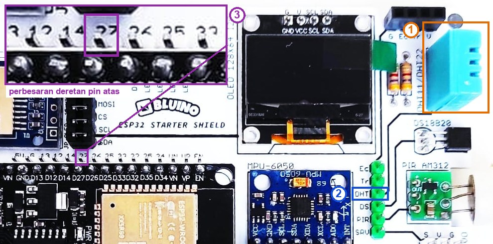
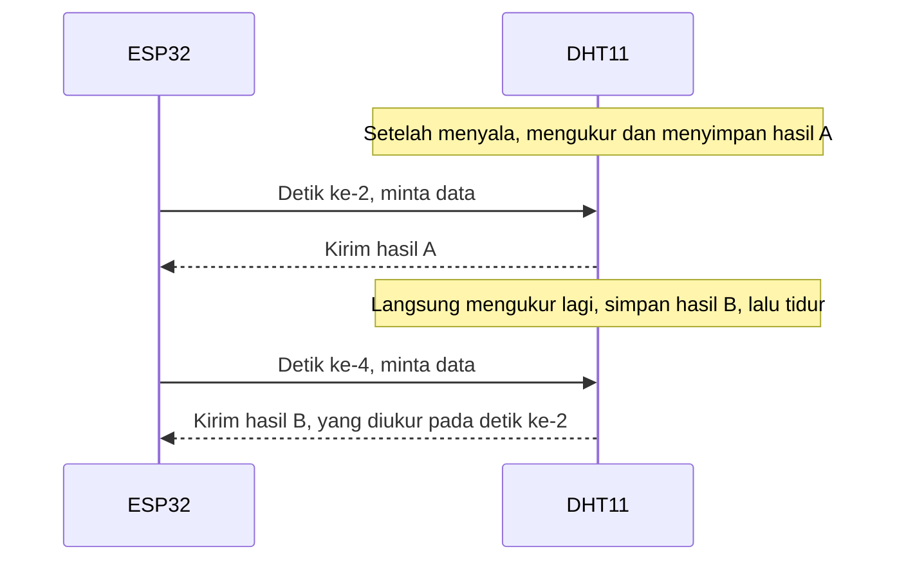

# BAB 26: DHT11 — Suhu & Kelembapan

> ✅ **Prasyarat:** Selesaikan **BAB 16 (Non-Blocking Programming)** — Program 4 di BAB ini memakai pola `struct Timer` dan `sudahWaktunya()` dari sana. Cara membaca *datasheet* DHT11 sudah dibahas di **BAB 4 (Membaca Skematik & *Datasheet*)**, jadi di sini cukup dirangkum.

Pernah merasa gerah di siang yang mendung, padahal suhunya tidak terlalu tinggi? Penyebabnya **kelembapan**: makin banyak uap air di udara, makin sulit keringat menguap, sehingga tubuh lebih sulit mendingin. Di BAB ini kamu memakai sensor **DHT11** di kit untuk mengukur suhu udara sekaligus kelembapannya, menghitung "suhu yang terasa" (*heat index*), dan membaca sensor tanpa membuat program tersendat. Pasangan suhu dan kelembapan seperti ini dipakai di pemantau ruang server, kumbung jamur, gudang gabah, sampai inkubator telur.

## 📌 Tujuan Pembelajaran

Setelah mempelajari BAB ini, kamu bisa:

- Menjelaskan arti kelembapan relatif (%RH) dan hubungannya dengan suhu.
- Menjelaskan cara kerja DHT11, spesifikasinya, dan batasannya: akurasi, jeda baca minimal 2 detik, serta bacaan yang selalu sedikit tertinggal.
- Menyambungkan DHT11 di kit ke IO27 dengan kabel *jumper*.
- Memasang *library* **DHT sensor library** dan **Adafruit Unified Sensor**, lalu membaca suhu dan kelembapan.
- Mendeteksi pembacaan gagal (`NaN`) dengan `isnan()` dan menanganinya dengan benar.
- Menampilkan grafik suhu dan kelembapan di **Serial Plotter**.
- Menghitung *heat index* (suhu yang terasa) dan menggolongkannya menurut tabel badan cuaca Amerika Serikat (NWS).
- Membaca DHT11 tanpa `delay()` sehingga program tetap responsif.

## 🧰 Yang Perlu Disiapkan

| Kebutuhan | Keterangan |
|---|---|
| *Hardware* | Kit Bluino ESP32 IoT Starter Shield (DHT11 sudah terpasang di kit) + kabel USB **data** |
| Kabel *jumper* | 1 kabel *female-female* (`DHT` → IO27) — sudah ada di kit |
| Komponen tambahan | Tidak ada — resistor *pull-up* 4,7 kΩ untuk DHT11 sudah terpasang di PCB |
| *Software* | Arduino IDE 2.x + *board package* **esp32** versi 3.3.x (lihat [BAB 5](../BAB-05/README.md)) |
| *Library* | **DHT sensor library** by Adafruit (diuji dengan versi 1.4.7) dan **Adafruit Unified Sensor** by Adafruit — cara memasangnya di [26.5](#265-memasang-library-dht) |
| Alat uji | **Serial Monitor** (baud 115200) dan **Serial Plotter** (**Tools → Serial Plotter**, baud 115200) di Arduino IDE |
| Jaringan | Tidak perlu WiFi |

## 📑 Daftar Isi

- [26.1 Kelembapan Relatif](#261-kelembapan-relatif)
- [26.2 Mengenal Sensor DHT11](#262-mengenal-sensor-dht11)
- [26.3 Cara DHT11 Mengirim Data](#263-cara-dht11-mengirim-data)
- [26.4 Rangkaian DHT11 di Kit](#264-rangkaian-dht11-di-kit)
- [26.5 Memasang Library DHT](#265-memasang-library-dht)
- [26.6 Program 1: Membaca Suhu dan Kelembapan](#266-program-1-membaca-suhu-dan-kelembapan)
- [26.7 Menangani Pembacaan Gagal (NaN)](#267-menangani-pembacaan-gagal-nan)
- [26.8 Kenapa Bacaan DHT11 Tertinggal?](#268-kenapa-bacaan-dht11-tertinggal)
- [26.9 Program 2: Grafik Suhu dan Kelembapan di Serial Plotter](#269-program-2-grafik-suhu-dan-kelembapan-di-serial-plotter)
- [26.10 Heat Index: Suhu yang Terasa](#2610-heat-index-suhu-yang-terasa)
- [26.11 Program 3: Kalkulator Heat Index](#2611-program-3-kalkulator-heat-index)
- [26.12 Program 4: Membaca DHT11 Tanpa delay()](#2612-program-4-membaca-dht11-tanpa-delay)
- [26.13 Troubleshooting](#2613-troubleshooting)
- [📝 Rangkuman](#-rangkuman)
- [💪 Latihan](#-latihan)
- [📚 Referensi](#-referensi)

---

## 26.1 Kelembapan Relatif

Udara di sekitar kita selalu mengandung uap air. **Kelembapan relatif** (*relative humidity*, disingkat RH) menyatakan seberapa "penuh" udara oleh uap air, dibandingkan dengan jumlah paling banyak yang bisa ditampung udara pada suhu saat itu. Satuannya persen, ditulis **%RH**:

- **0 %RH** — udara benar-benar kering (hampir tidak pernah terjadi di alam).
- **100 %RH** — udara jenuh, tidak sanggup menampung uap air lagi, sehingga uap air mengembun menjadi titik-titik air, embun, atau kabut.

Bayangkan udara sebagai spons. Udara hangat ibarat spons besar yang mampu menampung lebih banyak air daripada udara dingin. Karena itu, dengan jumlah uap air yang sama, **%RH turun saat udara memanas dan naik saat udara mendingin**. Contohnya gelas berisi es yang "berkeringat": udara di dekat gelas ikut mendingin sampai mencapai 100 %RH, lalu uap airnya mengembun di dinding luar gelas.

Kenapa kelembapan perlu dipantau?

- **Kenyamanan.** Udara yang sangat lembap terasa gerah karena keringat sulit menguap (dibahas di [26.10](#2610-heat-index-suhu-yang-terasa)).
- **Jamur dan kerusakan barang.** Badan lingkungan hidup Amerika Serikat (EPA) menyarankan kelembapan dalam rumah di bawah 60 %RH, idealnya 30–50 %RH, supaya jamur tidak mudah tumbuh. Udara di Indonesia umumnya lebih lembap dari itu, sehingga lemari, lensa kamera, dan dinding mudah berjamur.
- **Pertanian dan penyimpanan.** Kumbung jamur, *greenhouse*, gudang gabah, dan inkubator telur membutuhkan kelembapan pada rentang tertentu.

> 📌 **Catatan:** Kelembapan **relatif** selalu bergantung pada suhu. Jadi saat membandingkan dua alat ukur kelembapan, pastikan keduanya berada di tempat dan suhu yang sama.

---

## 26.2 Mengenal Sensor DHT11

### 26.2.1 Isi di Dalam DHT11

DHT11 adalah sensor suhu dan kelembapan murah buatan **Aosong** (merek ASAIR) dari Tiongkok. Di kit, sensornya berupa kotak biru berlubang-lubang di pojok kanan atas. Menurut *DHT11 Product Manual*, di dalamnya ada tiga bagian:

1. **Elemen pengukur kelembapan** — bahan yang menyerap uap air dari udara sehingga sifat listriknya berubah sesuai kelembapan.
2. **Termistor NTC** (*Negative Temperature Coefficient*) — resistor yang hambatannya turun saat suhunya naik, dipakai untuk mengukur suhu.
3. **Mikrokontroler 8-bit kecil** — mengolah kedua pengukuran itu menjadi angka digital yang sudah dikalibrasi pabrik, lalu mengirimkannya lewat **satu kabel data**.

Karena semua pengolahan dikerjakan di dalam sensor, ESP32 tidak memakai ADC untuk membaca DHT11. ESP32 cukup "bertanya" lewat pin digital dan menerima jawabannya berupa angka.

> 💡 **Tips:** Lubang-lubang pada cangkang DHT11 adalah jalan masuk udara ke elemen sensor. Jangan menutupnya dengan selotip, lem, atau jari.

### 26.2.2 Spesifikasi DHT11: Kenapa Angkanya Berbeda-beda?

Kalau mencari spesifikasi DHT11 di internet, kamu akan menemukan angka yang berbeda-beda. Penyebabnya, DHT11 dan manualnya sudah direvisi beberapa kali. Berikut dua versi yang paling sering dijumpai:

| Parameter | Manual lama (versi terjemahan bahasa Inggris, banyak dikutip toko dan tutorial) | Manual baru Aosong (Desember 2022) |
|---|---|---|
| Tegangan catu | 3–5,5 V | 3,3–5,5 V |
| Rentang kelembapan | 20–90 %RH | 5–95 %RH (rentang normal 8–85 %RH) |
| Akurasi kelembapan | ±5 %RH | ±5 %RH |
| Rentang suhu | 0–50 °C | −20 sampai 60 °C |
| Akurasi suhu | ±2 °C | ±2 °C |
| Jeda minimal antarbacaan | 1 detik | 2 detik |
| Waktu respons (63 %) | Kelembapan 6–15 detik, suhu 6–30 detik | Kelembapan < 6 detik, suhu 5–30 detik |

*Datasheet* Aosong yang dipakai di [BAB 4](../BAB-04/README.md#46-contoh-terpandu-1-datasheet-dht11) adalah versi lain lagi: catu 3,5–5,5 V dan jeda antarbacaan lebih dari 2 detik. Dari luar, kamu tidak bisa memastikan versi DHT11 mana yang terpasang di kit. Jadi pegang pedoman yang aman:

- **Akurasinya sama di semua versi: ±2 °C dan ±5 %RH.** Artinya, kalau suhu sebenarnya 28 °C, DHT11 boleh menunjukkan angka berapa pun antara 26 °C dan 30 °C dan tetap dianggap sesuai spesifikasi. DHT11 cocok untuk pemantauan kasar, bukan pengukuran presisi.
- **Pakai rentang yang lebih sempit**, yaitu 0–50 °C dan 20–90 %RH, kecuali kamu yakin sensormu versi baru.
- **Baca paling cepat sekali setiap 2 detik.** *Library* yang kita pakai juga memakai jeda 2 detik.

DHT11 versi lama hanya mengirim bilangan bulat (misalnya 28 °C dan 65 %RH), sehingga hasil bacaannya selalu berakhiran `.0`. Versi yang lebih baru bisa mengirim satu angka di belakang koma, terutama untuk suhu. Keduanya normal.

### 26.2.3 DHT11, DHT22, dan DS18B20

Skematik kit bertuliskan "DHT11/DHT22" karena kedua sensor ini punya susunan kaki yang sama. Kit kamu memakai DHT11 (cangkang biru). Kit juga punya DS18B20 yang dibahas di [BAB 25](../BAB-25/README.md). Perbandingannya:

| | DHT11 (di kit) | DHT22 / AM2302 (cangkang putih) | DS18B20 (di kit) |
|---|---|---|---|
| Mengukur | Suhu dan kelembapan | Suhu dan kelembapan | Suhu saja |
| Akurasi suhu | ±2 °C | ±0,5 °C | ±0,5 °C (pada −10 sampai 85 °C) |
| Rentang suhu | 0–50 °C (manual lama) | −40 sampai 80 °C | −55 sampai 125 °C |
| Kelembapan | 20–90 %RH, ±5 %RH | 0–100 %RH, ±2–5 %RH | — |
| Jeda baca minimal | 2 detik | 2 detik | Sekitar 0,75 detik (waktu konversi pada resolusi 12 bit) |
| Cara berkomunikasi | Satu kabel, protokol khusus Aosong | Satu kabel, protokol khusus Aosong | 1-Wire (Dallas/Maxim) |
| Harga | Paling murah | Lebih mahal | Murah |

Kesimpulannya: pakai DHT11 kalau butuh kelembapan dan cukup dengan akurasi kasar; pakai DS18B20 kalau butuh suhu yang lebih akurat. Kalau suatu saat kamu memakai DHT22, cukup ganti `DHT11` menjadi `DHT22` di kode.

---

## 26.3 Cara DHT11 Mengirim Data

DHT11 berkomunikasi lewat **satu kabel data** yang dipakai bergantian: ESP32 "bertanya", lalu DHT11 "menjawab". Aosong menyebut cara ini *single-bus*. Walaupun sama-sama memakai satu kabel, protokolnya **berbeda** dengan 1-Wire milik DS18B20 di [BAB 25](../BAB-25/README.md). DHT11 tidak punya alamat (ROM *code*), jadi **satu pin ESP32 hanya untuk satu DHT11**, dan DHT11 tidak bisa digabung dengan DS18B20 di kabel yang sama.

Ringkasan satu kali pembacaan (rincian dan diagram waktunya ada di [BAB 4, bagian 4.6](../BAB-04/README.md#46-contoh-terpandu-1-datasheet-dht11)):

1. ESP32 menarik jalur data ke LOW minimal 18 ms — artinya "bangun, kirim datamu!" *Library* memakai 20 ms.
2. DHT11 menjawab dengan LOW sekitar 80 µs, lalu HIGH sekitar 80 µs.
3. DHT11 mengirim **40 bit** (5 *byte*): kelembapan bagian bulat, kelembapan bagian desimal, suhu bagian bulat, suhu bagian desimal, dan *checksum*. Bit "0" dan "1" dibedakan dari lamanya sinyal HIGH: sekitar 26–28 µs untuk "0" dan sekitar 70 µs untuk "1".
4. ESP32 menjumlahkan 4 *byte* pertama. Kalau 8 bit terakhir hasil penjumlahannya tidak sama dengan *checksum*, data dianggap rusak dan dibuang.

Kamu tidak perlu menulis kode pewaktu ini sendiri — *library* yang mengerjakannya. Yang perlu kamu ingat adalah akibatnya bagi program:

| Fakta tentang DHT11 dan *library*-nya | Akibatnya bagi program |
|---|---|
| Satu kali baca memakan waktu sekitar **25 ms**: ±1 ms persiapan, 20 ms sinyal mulai, dan ±4–5 ms pengiriman 40 bit | Perintah baca sedikit *blocking* (menahan program sebentar). Untuk sebagian besar program, 25 ms setiap 2 detik tidak terasa |
| Jeda antarbacaan minimal **2 detik** | Kalau dibaca lagi kurang dari 2 detik sejak bacaan terakhir, *library* tidak menghubungi sensor dan langsung mengembalikan **hasil lama** |
| Setelah diberi daya, DHT11 perlu sekitar 1–2 detik untuk stabil | Jangan membaca tepat setelah ESP32 menyala |
| Sensor tidak menjawab atau *checksum* salah | *Library* mengembalikan `NaN` (*Not a Number*) yang wajib diperiksa dengan `isnan()` — dibahas di [26.7](#267-menangani-pembacaan-gagal-nan) |
| Angka yang dikirim adalah hasil pengukuran **sebelumnya** | Bacaan selalu sedikit tertinggal dari keadaan sebenarnya — dibahas di [26.8](#268-kenapa-bacaan-dht11-tertinggal) |

> 📌 **Catatan:** Selama ±4–5 ms saat menerima 40 bit, *library* mematikan *interrupt* sementara di inti prosesor yang menjalankan `loop()`. Tujuannya supaya pengukuran lebar pulsa yang hanya puluhan mikrodetik tidak terganggu. Sesekali pembacaan tetap bisa gagal, misalnya karena gangguan listrik; itulah sebabnya pemeriksaan `NaN` selalu diperlukan.

---

## 26.4 Rangkaian DHT11 di Kit

Berikut blok DHT11 di skematik kit:


*Gambar 26.1 — Blok DHT11 pada kit: pin DAT ke kotak IO27 dengan resistor pull-up 4K7 ke 3V3. Sumber: skematik ESP32 Starter Shield 3.2, [Bluino](http://www.bluino.com).*

Cara membacanya:

- **Pin 1 (VDD)** ke 3V3 dan **pin 4 (GND)** ke GND — DHT11 mendapat daya 3,3 V dari *board* ESP32.
- **Pin 2 (DAT)** adalah jalur data. Jalur ini diberi resistor ***pull-up*** **4K7** (4,7 kΩ) ke 3V3, yaitu resistor yang "menarik" jalur ke HIGH saat tidak ada yang mengirim sinyal. Tanpa *pull-up*, jalur tidak bisa kembali HIGH dan komunikasi gagal (lihat [BAB 3](../BAB-03/README.md#372-pull-up-pada-dht11-dan-ds18b20)). Resistor ini **sudah terpasang** di PCB.
- **Pin 3 (N.C.)** artinya *not connected* — memang tidak disambung ke mana pun.
- Kotak **IO27** adalah pin header berlabel `DHT` di PCB. Tulisan IO27 hanya **saran** perancang kit: jalur ini **belum tersambung** ke ESP32 sampai kamu memasang kabel *jumper*.

IO27 dipilih karena merupakan GPIO biasa: bukan pin *strapping* (pin yang dibaca saat *boot*) dan bukan pin khusus input. IO27 memang termasuk kelompok ADC2 yang tidak bisa membaca analog saat WiFi aktif, tetapi itu tidak masalah karena DHT11 dibaca secara digital.

Letak pin yang perlu disambung:



*Gambar 26.2 — Sensor DHT11 (1), pin `DHT` di header hijau (2), dan pin `27` di deretan pin ESP32 atas (3) pada kit v3.x; tata letak kit v3.2 milikmu bisa sedikit berbeda. Sumber: foto produk ESP32 Starter Shield, [Bluino](http://www.bluino.com), dipotong dan diberi penanda untuk materi ini.*

| No. | Bagian | Cara menemukannya |
|---|---|---|
| 1 | Sensor DHT11 | Kotak biru berlubang di pojok kanan atas, di samping tulisan DHT11/DHT22 |
| 2 | Pin `DHT` | Header hijau di kanan MPU-6050, pin ke-3 dari atas (`Ec`, `Tr`, **`DHT`**, `DS`, `PIR`, `SRV`) |
| 3 | Pin `27` | Deretan pin ESP32 atas, pin ke-6 dari kiri (`5V`, `G`, `13`, `12`, `14`, **`27`**, …), tepat di atas tulisan `D27` pada *board* ESP32 |

**Rangkaian untuk semua program di BAB ini:**

| Pin **Custom** di kit | Sambungkan ke pin ESP32 |
|---|---|
| `DHT` — DHT11 (header hijau, pin ke-3 dari atas) | IO27 |

Langkah memasang kabel:

1. Cabut kabel USB dulu supaya aman saat merangkai.
2. Colokkan satu ujung kabel *jumper* ke pin **`DHT`** di header hijau.
3. Colokkan ujung lainnya ke pin berlabel **`27`** di deretan pin ESP32 atas.
4. Periksa sekali lagi bahwa kabel tidak bergeser ke pin tetangga: di header hijau, `DHT` diapit `Tr` dan `DS`; di deretan atas, `27` diapit `14` dan `26`.
5. Sambungkan kembali kabel USB.

> 💡 **Tips:** Kabel DHT11 yang meleset satu pin tidak merusak apa pun — sensornya hanya tidak terbaca, dan program akan melaporkan "Gagal membaca". Kalau itu terjadi, periksa kabel ini lebih dulu.

---

## 26.5 Memasang Library DHT

Kita memakai *library* **DHT sensor library** buatan Adafruit untuk mengurus semua pewaktuan sinyal DHT11. *Library* ini membutuhkan *library* pendukung **Adafruit Unified Sensor**. Cara memasang keduanya (pola lengkapnya ada di [BAB 5](../BAB-05/README.md)):

1. Buka **Sketch → Include Library → Manage Libraries…** (Ctrl+Shift+I), atau klik ikon **Library Manager** (bergambar buku) di panel kiri Arduino IDE.
2. Ketik `DHT sensor library` di kolom pencarian.
3. Pilih yang pembuatnya **Adafruit** (tertulis "DHT sensor library by Adafruit"). Hati-hati, ada *library* lain dengan nama mirip, misalnya **DHT sensor library for ESPx** (by beegee_tokyo). Cara pakainya berbeda, jadi kode di BAB ini tidak akan jalan dengan *library* itu.
4. Klik **INSTALL**. Saat muncul jendela **Install library dependencies**, klik **Install All** supaya **Adafruit Unified Sensor** ikut terpasang.
5. Instalasi selesai kalau kartu *library* menampilkan tulisan **installed** beserta nomor versinya, misalnya `1.4.7 installed`.

> ⚠️ **Perhatian:** Kalau kamu telanjur mengklik **Install without dependencies**, cari `Adafruit Unified Sensor` di Library Manager dan instal juga (pembuatnya Adafruit). Tanpa *library* ini, proses *compile* gagal dengan pesan `fatal error: Adafruit_Sensor.h: No such file or directory`.

Fungsi-fungsi yang dipakai di BAB ini:

| Kode | Gunanya | Hasil |
|---|---|---|
| `#include <DHT.h>` | Memakai *library* DHT (ditulis di baris paling atas) | — |
| `DHT dht(27, DHT11);` | Membuat objek sensor bernama `dht` di pin 27 dengan jenis DHT11 | — |
| `dht.begin();` | Menyiapkan pin data; cukup sekali di `setup()` | — |
| `dht.readHumidity()` | Membaca kelembapan relatif | `float` dalam %RH, atau `NaN` kalau gagal |
| `dht.readTemperature()` | Membaca suhu | `float` dalam °C, atau `NaN` kalau gagal |
| `dht.readTemperature(true)` | Membaca suhu dalam Fahrenheit | `float` dalam °F, atau `NaN` kalau gagal |
| `dht.computeHeatIndex(suhu, kelembapan, false)` | Menghitung *heat index*; `false` berarti suhu dalam °C | `float` dalam °C |
| `dht.read(true)` | Memaksa *library* membaca sensor saat itu juga (dipakai di Program 4) | `true` kalau berhasil |

`readHumidity()` dan `readTemperature()` tidak membaca sensor dua kali. Fungsi yang dipanggil pertama benar-benar menghubungi DHT11 (±25 ms) dan menyimpan ke-40 bit hasilnya. Fungsi berikutnya, kalau dipanggil kurang dari 2 detik kemudian, cukup mengambil angka dari data yang sudah tersimpan itu. Jadi suhu dan kelembapan yang kamu dapat selalu berasal dari satu pengukuran yang sama.

---

## 26.6 Program 1: Membaca Suhu dan Kelembapan

**Tujuan:** Membaca suhu dan kelembapan dari DHT11 setiap 2 detik, lalu menampilkannya di Serial Monitor. Kalau pembacaan gagal, program menampilkan pesan kesalahan alih-alih angka yang salah.

**Rangkaian:**

| Pin **Custom** di kit | Sambungkan ke pin ESP32 |
|---|---|
| `DHT` — DHT11 (header hijau, pin ke-3 dari atas) | IO27 |

**Cara Menjalankan:**

1. Sambungkan kabel *jumper* sesuai tabel **Rangkaian** di atas (lihat [26.4](#264-rangkaian-dht11-di-kit)).
2. Pastikan **DHT sensor library** dan **Adafruit Unified Sensor** sudah terpasang (lihat [26.5](#265-memasang-library-dht)).
3. Buka Arduino IDE → **File → New Sketch**, hapus isinya, lalu salin kode di bawah. Kode yang sama juga tersedia di *file* [`p1_baca_dht11.ino`](p1_baca_dht11/p1_baca_dht11.ino).
4. Pastikan **Tools → Board** = **ESP32 Dev Module** dan **Tools → Port** = *port* ESP32 kamu (misalnya `COM5` di Windows atau `/dev/ttyUSB0` di Linux).
5. Klik tombol **Upload** (ikon panah →) dan tunggu sampai muncul tulisan **Done uploading**.
6. Buka **Serial Monitor** (**Tools → Serial Monitor**) lalu pilih baud **115200**.

**Kode Program:**

<!-- sketch: p1_baca_dht11 -->
```cpp
/*
 * BAB 26 - Program 1: Membaca Suhu dan Kelembapan
 * Membaca DHT11 setiap 2 detik, lalu menampilkan suhu dan kelembapan
 * di Serial Monitor.
 *
 * Rangkaian: pin DHT (header hijau) → IO27
 *            (resistor pull-up 4,7 kΩ sudah ada di PCB)
 * Library  : DHT sensor library by Adafruit (+ Adafruit Unified Sensor)
 */

#include <DHT.h>

#define DHT_PIN  27     // pin DHT di header hijau → IO27
#define DHT_TYPE DHT11  // jenis sensor (ganti DHT22 kalau memakai DHT22)

DHT dht(DHT_PIN, DHT_TYPE);  // objek sensor bernama "dht"

void setup() {
  Serial.begin(115200);
  dht.begin();  // siapkan pin data DHT11

  Serial.println("BAB 26 - Program 1: Membaca Suhu dan Kelembapan");
  Serial.println("Pembacaan pertama muncul 2 detik lagi...");
}

void loop() {
  // DHT11 paling cepat dibaca sekali setiap 2 detik. Jeda di awal loop()
  // sekaligus memberi DHT11 waktu stabil setelah dinyalakan.
  delay(2000);

  float kelembapan = dht.readHumidity();     // %RH (menghubungi sensor, ±25 ms)
  float suhu       = dht.readTemperature();  // °C (memakai data bacaan yang sama)

  // Kalau gagal, library mengembalikan NaN (Not a Number)
  if (isnan(kelembapan) || isnan(suhu)) {
    Serial.println("Gagal membaca DHT11! Periksa kabel DHT -> IO27.");
    return;  // lewati sisa loop(), coba lagi di putaran berikutnya
  }

  Serial.print("Suhu: ");
  Serial.print(suhu, 1);  // tampilkan 1 angka di belakang koma
  Serial.print(" °C | Kelembapan: ");
  Serial.print(kelembapan, 1);
  Serial.println(" %RH");
}
```

**Penjelasan Kode:**

- `#include <DHT.h>` memakai *library* DHT. Baris `#define` memberi nama untuk pin (`DHT_PIN` = 27) dan jenis sensor (`DHT_TYPE` = `DHT11`).
- Jenis sensor wajib benar. DHT11 dan DHT22 memakai sinyal mulai dengan lama berbeda (20 ms untuk DHT11, ±1 ms untuk DHT22) dan susunan data yang berbeda. Jenis yang salah membuat pembacaan gagal atau angkanya kacau.
- `DHT dht(DHT_PIN, DHT_TYPE);` membuat **objek** bernama `dht` — semacam "remote" untuk satu sensor tertentu. Semua perintah ke sensor ditulis dengan awalan `dht.`, misalnya `dht.readTemperature()`.
- `dht.begin()` menyiapkan pin data. *Library* mengizinkan pembacaan pertama langsung dilakukan, jadi `delay(2000)` di awal `loop()`-lah yang memberi DHT11 waktu stabil setelah ESP32 menyala, sekaligus menjaga jeda 2 detik antarbacaan.
- Hasil bacaan disimpan di variabel `float` (bilangan pecahan), karena nilainya bisa punya angka di belakang koma.
- `isnan(nilai)` bernilai `true` kalau `nilai` adalah NaN, yaitu tanda bahwa pembacaan gagal. Tanda `||` berarti "atau": cukup salah satu yang NaN, pesan *error* dicetak. `return;` mengakhiri putaran `loop()` saat itu juga, sehingga angka yang salah tidak pernah tercetak. Topik ini dibahas lebih dalam di [26.7](#267-menangani-pembacaan-gagal-nan).
- `Serial.print(suhu, 1)` mencetak bilangan dengan **1** angka di belakang koma. Serial Monitor memakai titik sebagai tanda desimal, misalnya `28.6`.
- Selama `delay(2000)`, ESP32 tidak bisa mengerjakan hal lain. Untuk program ini tidak masalah; cara membaca DHT11 tanpa `delay()` ada di Program 4.

**Contoh Output:**

```text
BAB 26 - Program 1: Membaca Suhu dan Kelembapan
Pembacaan pertama muncul 2 detik lagi...
Suhu: 28.6 °C | Kelembapan: 71.0 %RH
Suhu: 28.6 °C | Kelembapan: 71.0 %RH
Suhu: 28.7 °C | Kelembapan: 70.0 %RH
Suhu: 28.7 °C | Kelembapan: 70.0 %RH
```

Angka di atas hanya contoh — angkamu bergantung pada ruangan dan sensormu. Satu baris baru muncul setiap 2 detik. Kalau DHT11-mu versi lama, angka suhunya juga selalu berakhiran `.0`, misalnya `Suhu: 29.0 °C`. Di ruangan yang tenang, angkanya memang jarang berubah.

> 💡 **Tips:** Kalau Serial Monitor baru dibuka setelah program berjalan, dua baris judul sudah terlewat. Tekan tombol **EN** di *board* ESP32 untuk memulai ulang program. Beberapa baris log *boot* bawaan ESP32 (misalnya `rst:0x1 (POWERON_RESET),boot:0x13 ...`) mungkin muncul sebelum judul; itu normal.

**Kalau Belum Berhasil:**

- **Selalu muncul `Gagal membaca DHT11!`** → kabel *jumper* belum terpasang, terpasang di deretan yang salah (pin `27` ada di deretan **atas**), atau bergeser ke pin tetangga (`Tr`/`DS` di header hijau, `14`/`26` di deretan atas). Periksa juga bahwa `DHT_PIN` = 27 dan `DHT_TYPE` = `DHT11`.
- ***Compile* gagal dengan pesan `Adafruit_Sensor.h: No such file or directory`** → *library* **Adafruit Unified Sensor** belum terpasang (lihat [26.5](#265-memasang-library-dht)).
- ***Compile* gagal dengan pesan `DHT.h: No such file or directory` atau `'DHT' does not name a type`** → **DHT sensor library** by Adafruit belum terpasang, atau yang terpasang *library* lain yang namanya mirip.
- **Serial Monitor kosong atau berisi karakter aneh** → pilih baud **115200**, lalu tekan tombol **EN**.

---

## 26.7 Menangani Pembacaan Gagal (NaN)

Tipe data `float` punya nilai khusus bernama **NaN** (*Not a Number*, "bukan angka"). *Library* DHT memakai NaN sebagai tanda "pembacaan gagal", misalnya karena sensor tidak menjawab atau *checksum*-nya salah. Kalau dicetak, NaN tampil sebagai `nan`.

NaN berbahaya karena dua sifatnya: **menular** ke setiap perhitungan, dan membuat **setiap perbandingan bernilai salah** (*false*). Perhatikan potongan kode berikut (bukan program lengkap):

```cpp
float suhu = NAN;                   // anggap pembacaan barusan gagal

float rataRata = (suhu + 30.0) / 2; // hasilnya ikut NaN ("menular")

if (suhu > 35.0) {                  // false untuk NaN...
  // nyalakan kipas                 // ...jadi kipas tidak pernah menyala
}
if (suhu <= 35.0) {                 // ini pun false!
  // matikan kipas
}
```

Program yang tidak memeriksa NaN tidak akan *error* — ia diam-diam mengambil keputusan yang salah, menampilkan `nan` di layar, atau mengirim data kosong ke server. Karena itu, periksa setiap hasil bacaan dengan `isnan()`:

```cpp
if (suhu == NAN) { }   // SALAH: NaN tidak sama dengan apa pun, bahkan dengan NaN
if (isnan(suhu)) { }   // BENAR: true kalau suhu bernilai NaN
```

Setelah ketahuan gagal, apa yang dilakukan? Pilih sesuai kebutuhan:

| Strategi | Cocok untuk | Dipakai di |
|---|---|---|
| Lewati, lalu coba lagi pada giliran berikutnya | Program sederhana yang hanya menampilkan data | Program 1–3 |
| Simpan nilai valid terakhir beserta waktunya, lalu tetap pakai nilai itu | Data yang terus ditampilkan atau dikirim (OLED, halaman web, MQTT) | Program 4 |
| Hitung kegagalan beruntun; setelah beberapa kali, tampilkan peringatan "sensor bermasalah" | Alat yang berjalan lama tanpa diawasi | Latihan 6 |

> 📌 **Catatan:** Satu-dua kali gagal di antara ratusan pembacaan masih wajar, misalnya karena gangguan listrik sesaat. Kalau gagal terus-menerus, hampir pasti ada masalah kabel, pin, atau jenis sensor di kode.

---

## 26.8 Kenapa Bacaan DHT11 Tertinggal?

Saat suhu atau kelembapan berubah, angka DHT11 tidak langsung ikut berubah. Ada tiga penyebab.

**1. Angka yang dikirim adalah hasil pengukuran sebelumnya.** Menurut manual Aosong, DHT11 mengukur suhu dan kelembapan **sesudah** selesai mengirim data, lalu menyimpan hasilnya sampai ESP32 meminta lagi:



*Gambar 26.3 — DHT11 selalu mengirim hasil pengukuran sebelumnya. Sumber: dibuat untuk materi ini, berdasarkan DHT11 Product Manual (Aosong).*

Jadi, kalau kamu membaca setiap 2 detik, data yang kamu terima sudah berumur sekitar 2 detik. Kalau kamu jarang membaca — misalnya setiap 10 menit — data yang diterima sudah berumur 10 menit! Untuk kasus seperti itu, manual menyarankan membaca **dua kali** dengan jeda 2 detik dan memakai hasil yang kedua.

**2. Sensor butuh waktu menyesuaikan diri.** Baris "waktu respons (63 %)" di tabel [26.2.2](#2622-spesifikasi-dht11-kenapa-angkanya-berbeda-beda) adalah waktu yang dibutuhkan sensor untuk menempuh 63 % dari sebuah perubahan, diukur dengan aliran udara 1 m/s. Untuk menempuh hampir seluruh perubahan (±95 %), dibutuhkan sekitar tiga kali waktu itu. Contoh: suhu ruangan tiba-tiba naik 3 °C dan waktu respons suhunya 30 detik. Setelah 30 detik, DHT11 baru menunjukkan kenaikan sekitar 2 °C; angkanya baru mendekati 3 °C setelah sekitar 1,5 menit. Di udara yang diam (tanpa kipas), responsnya lebih lambat lagi. Mirip termometer demam yang harus dijepit beberapa menit sebelum angkanya bisa dipercaya.

**3. Panas di sekitar sensor.** Tangan, napas, sinar matahari, dan komponen yang menghangat di PCB (misalnya *board* ESP32 dan regulator) ikut memanaskan sensor. Karena %RH bergantung pada suhu, sensor yang sedikit lebih hangat daripada udara sekitarnya menunjukkan suhu **lebih tinggi** sekaligus kelembapan **lebih rendah** daripada keadaan ruangan sebenarnya. Manual Aosong pun menyarankan agar sensor dipasang jauh dari sumber panas.

Pedoman praktisnya:

- Setelah kit dipindahkan ke ruangan lain, tunggu 1–2 menit sebelum mempercayai angkanya.
- Saat mengukur, jangan menggenggam atau meniup sensor (kecuali sedang bereksperimen seperti di Program 2).
- Untuk memantau ruangan, membaca setiap 5–60 detik sudah lebih dari cukup. Membaca lebih sering tidak membuat angkanya lebih cepat mengikuti perubahan.

---

## 26.9 Program 2: Grafik Suhu dan Kelembapan di Serial Plotter

**Tujuan:** Menggambar suhu dan kelembapan sebagai grafik garis di **Serial Plotter**, lalu bereksperimen meniup dan menggenggam sensor untuk melihat sendiri seberapa cepat (atau lambat) DHT11 merespons perubahan.

**Rangkaian:**

| Pin **Custom** di kit | Sambungkan ke pin ESP32 |
|---|---|
| `DHT` — DHT11 (header hijau, pin ke-3 dari atas) | IO27 |

**Cara Menjalankan:**

1. Pastikan kabel `DHT` → **27** masih terpasang.
2. Buka Arduino IDE → **File → New Sketch**, hapus isinya, lalu salin kode di bawah. Kode yang sama juga tersedia di *file* [`p2_grafik_dht11.ino`](p2_grafik_dht11/p2_grafik_dht11.ino).
3. Pastikan **Tools → Board** = **ESP32 Dev Module** dan **Tools → Port** = *port* ESP32 kamu.
4. Klik tombol **Upload** dan tunggu sampai muncul tulisan **Done uploading**.
5. Buka **Serial Plotter** lewat **Tools → Serial Plotter**, atau klik ikon grafik di pojok kanan atas Arduino IDE (di sebelah ikon Serial Monitor). Serial Plotter terbuka di jendela tersendiri; pilih baud **115200**.
6. Biarkan grafik berjalan sekitar 20 detik sampai garisnya mendatar.
7. **Eksperimen 1 — napas:** embuskan napas ke arah DHT11 dari jarak ±5 cm selama 2–3 detik, lalu jauhkan wajahmu. Amati garis kelembapan.
8. **Eksperimen 2 — jari:** jepit cangkang biru DHT11 dengan dua jari selama ±30 detik (jangan menyentuh kaki sensor atau jalur PCB), lalu lepaskan. Amati garis suhu.

**Kode Program:**

<!-- sketch: p2_grafik_dht11 -->
```cpp
/*
 * BAB 26 - Program 2: Grafik Suhu dan Kelembapan di Serial Plotter
 * Mengirim suhu dan kelembapan setiap 2 detik dalam format Serial Plotter.
 * Buka Tools → Serial Plotter, lalu pilih baud 115200.
 *
 * Rangkaian: pin DHT (header hijau) → IO27
 */

#include <DHT.h>

#define DHT_PIN  27
#define DHT_TYPE DHT11

DHT dht(DHT_PIN, DHT_TYPE);

void setup() {
  Serial.begin(115200);
  dht.begin();
  // Sengaja tidak mencetak judul: Serial Plotter menganggap setiap baris sebagai data grafik.
}

void loop() {
  delay(2000);  // DHT11 paling cepat dibaca sekali setiap 2 detik

  float kelembapan = dht.readHumidity();
  float suhu = dht.readTemperature();

  if (isnan(kelembapan) || isnan(suhu)) {
    return;  // lewati titik ini; jangan kirim teks lain ke Serial Plotter
  }

  // Format Serial Plotter: label:nilai, dipisah koma, satu baris = satu titik
  Serial.print("Suhu_C:");
  Serial.print(suhu, 1);
  Serial.print(",Kelembapan_RH:");
  Serial.println(kelembapan, 1);
}
```

**Penjelasan Kode:**

- Isi `loop()` sama dengan Program 1; yang berbeda hanya cara mencetaknya.
- Serial Plotter membaca teks dari Serial **baris demi baris**, dan setiap baris menjadi satu titik di setiap garis grafik (formatnya sudah kamu kenal di [BAB 11](../BAB-11/README.md)). Format `label:nilai` memberi nama pada garis. Label tidak boleh mengandung spasi, karena itu ditulis `Suhu_C` dan `Kelembapan_RH`.
- Program ini sengaja tidak mencetak judul atau pesan *error*. Baris teks biasa bisa ikut dianggap data dan memunculkan garis aneh. Kalau pembacaan gagal, titik itu dilewati saja.
- Suhu (±25–35) dan kelembapan (±40–90) digambar pada sumbu yang sama, jadi keduanya terlihat jelas tanpa perlu diubah skalanya.

**Contoh Output:**

Di Serial Plotter muncul dua garis berwarna dengan keterangan **Suhu_C** dan **Kelembapan_RH**, bergerak satu titik setiap 2 detik. Saat kamu meniup sensor, garis kelembapan melonjak dalam beberapa detik, lalu turun **perlahan** — butuh puluhan detik untuk kembali ke angka semula. Saat cangkang dijepit jari, garis suhu naik sangat pelan, dan juga lambat turun setelah dilepas.

Kalau kamu membuka **Serial Monitor** (di Arduino IDE 2, Serial Monitor dan Serial Plotter boleh terbuka bersamaan), teksnya terlihat seperti ini (contoh saat sensor ditiup; angkamu bisa berbeda):

```text
Suhu_C:28.6,Kelembapan_RH:71.0
Suhu_C:28.6,Kelembapan_RH:71.0
Suhu_C:28.7,Kelembapan_RH:84.0
Suhu_C:28.8,Kelembapan_RH:90.0
Suhu_C:28.8,Kelembapan_RH:86.0
Suhu_C:28.8,Kelembapan_RH:81.0
Suhu_C:28.7,Kelembapan_RH:78.0
```

> 🧪 **Coba Sendiri:** Setelah meniup sensor, hitung berapa titik (1 titik = 2 detik) yang dibutuhkan garis kelembapan untuk kembali ke angka semula. Bandingkan dengan waktu respons di tabel [26.2.2](#2622-spesifikasi-dht11-kenapa-angkanya-berbeda-beda). Lakukan hal yang sama untuk suhu setelah jarimu dilepas — mana yang lebih lambat?

**Kalau Belum Berhasil:**

- **Serial Plotter kosong atau tidak bergerak** → baud di jendela Serial Plotter belum **115200**, *port* salah, atau semua pembacaan gagal. Buka Serial Monitor: kalau tidak ada baris data sama sekali, jalankan lagi Program 1 untuk melihat pesan *error*-nya.
- **Garis tidak bereaksi saat sensor ditiup** → tunggu beberapa titik (ingat, DHT11 lambat), dan pastikan napasmu benar-benar mengarah ke lubang-lubang cangkang biru.
- **Muncul garis tambahan bernama aneh, misalnya "value 1"** → ada teks lain yang tercetak. Untuk Serial Plotter, cetak hanya baris data.

---

## 26.10 Heat Index: Suhu yang Terasa

Tubuh kita mendinginkan diri dengan berkeringat: saat keringat **menguap**, ia membawa panas dari kulit. Kalau udara sudah lembap, penguapan melambat, sehingga panas tertahan di tubuh dan kita merasa lebih gerah daripada angka di termometer.

***Heat index*** (indeks panas) adalah perkiraan suhu yang **dirasakan** tubuh, dihitung dari suhu udara dan kelembapan relatif. Rumus yang dipakai berasal dari National Weather Service (NWS), badan cuaca Amerika Serikat: mula-mula rumus sederhana berdasarkan model Steadman, lalu persamaan regresi Rothfusz kalau hasilnya sekitar 27 °C (80 °F) ke atas. Fungsi `dht.computeHeatIndex()` sudah berisi rumus itu, jadi kamu tinggal memanggilnya.

Beberapa contoh hasil hitungan fungsi tersebut:

| Suhu udara | Kelembapan | *Heat index* (suhu terasa) |
|---|---|---|
| 28 °C | 65 %RH | ±30,0 °C |
| 30 °C | 75 %RH | ±36,3 °C |
| 31 °C | 85 %RH | ±42,7 °C |
| 33 °C | 70 %RH | ±43,5 °C |

NWS menggolongkan *heat index* seperti berikut. Batas aslinya dalam Fahrenheit (80, 90, 103, dan 125 °F); di sini dibulatkan ke Celsius:

| *Heat index* | Kategori NWS | Kemungkinan dampak bila lama terpapar atau beraktivitas berat |
|---|---|---|
| di bawah 27 °C | — | Belum masuk kategori peringatan |
| 27–32 °C | *Caution* (waspada) | Mudah lelah |
| 32–39 °C | *Extreme caution* (sangat waspada) | Kram panas, kelelahan panas, bahkan *heat stroke* (sengatan panas) mungkin terjadi |
| 39–51 °C | *Danger* (bahaya) | Kram dan kelelahan panas besar kemungkinannya, *heat stroke* mungkin terjadi |
| 51 °C ke atas | *Extreme danger* (bahaya ekstrem) | *Heat stroke* sangat mungkin terjadi |

Hal-hal yang perlu diingat:

- *Heat index* berlaku untuk tempat **teduh** dengan angin sepoi-sepoi. Di bawah terik matahari langsung, NWS menyebut nilainya bisa bertambah sampai 8 °C (15 °F).
- *Heat index* bukan suhu udara sebenarnya. Untuk mengatur kipas atau AC, tetap pakai suhu dan kelembapan aslinya.
- Ketidakpastian DHT11 (±2 °C dan ±5 %RH) ikut terbawa. Contoh: bacaan 30 °C dan 75 %RH menghasilkan 36,3 °C, tetapi kalau suhu sebenarnya 28 °C dan kelembapan 70 %RH, *heat index*-nya hanya ±30,7 °C; kalau ternyata 32 °C dan 80 %RH, *heat index*-nya ±44,4 °C. Anggap angka *heat index* dari DHT11 sebagai **perkiraan kasar**, bukan alat keselamatan.

---

## 26.11 Program 3: Kalkulator Heat Index

**Tujuan:** Membaca suhu dan kelembapan setiap 2 detik, menghitung *heat index*-nya, lalu menampilkan kategorinya menurut tabel NWS di [26.10](#2610-heat-index-suhu-yang-terasa).

**Rangkaian:**

| Pin **Custom** di kit | Sambungkan ke pin ESP32 |
|---|---|
| `DHT` — DHT11 (header hijau, pin ke-3 dari atas) | IO27 |

**Cara Menjalankan:**

1. Pastikan kabel `DHT` → **27** masih terpasang.
2. Buka Arduino IDE → **File → New Sketch**, hapus isinya, lalu salin kode di bawah. Kode yang sama juga tersedia di *file* [`p3_heat_index.ino`](p3_heat_index/p3_heat_index.ino).
3. Pastikan **Tools → Board** = **ESP32 Dev Module** dan **Tools → Port** = *port* ESP32 kamu.
4. Klik tombol **Upload** dan tunggu sampai muncul tulisan **Done uploading**.
5. Buka **Serial Monitor** (**Tools → Serial Monitor**) lalu pilih baud **115200**. Kalau jendela Serial Plotter dari Program 2 masih terbuka, tutup dulu supaya tidak membingungkan.

**Kode Program:**

<!-- sketch: p3_heat_index -->
```cpp
/*
 * BAB 26 - Program 3: Kalkulator Heat Index
 * Menghitung suhu yang terasa (heat index) dari suhu dan kelembapan,
 * lalu menggolongkannya menurut tabel National Weather Service (NWS).
 *
 * Rangkaian: pin DHT (header hijau) → IO27
 */

#include <DHT.h>

#define DHT_PIN  27
#define DHT_TYPE DHT11

DHT dht(DHT_PIN, DHT_TYPE);

// Kategori heat index (°C). Batas dibulatkan dari tabel NWS (80, 90, 103, 125 °F).
const char *kategoriHeatIndex(float heatIndex) {
  if (heatIndex < 27.0) return "di bawah batas waspada";
  if (heatIndex < 32.0) return "Waspada";
  if (heatIndex < 39.0) return "Sangat waspada";
  if (heatIndex < 51.0) return "Bahaya";
  return "Bahaya ekstrem";
}

void setup() {
  Serial.begin(115200);
  dht.begin();
  Serial.println("BAB 26 - Program 3: Kalkulator Heat Index");
}

void loop() {
  delay(2000);  // DHT11 paling cepat dibaca sekali setiap 2 detik

  float kelembapan = dht.readHumidity();
  float suhu = dht.readTemperature();

  if (isnan(kelembapan) || isnan(suhu)) {
    Serial.println("Gagal membaca DHT11! Periksa kabel DHT -> IO27.");
    return;
  }

  // Parameter ketiga false = suhu yang dimasukkan dalam °C, hasilnya juga °C
  float heatIndex = dht.computeHeatIndex(suhu, kelembapan, false);

  Serial.printf("Suhu       : %.1f °C\n", suhu);
  Serial.printf("Kelembapan : %.1f %%RH\n", kelembapan);
  Serial.printf("Heat index : %.1f °C (%s)\n", heatIndex, kategoriHeatIndex(heatIndex));
  Serial.println("----------------------------------------");
}
```

**Penjelasan Kode:**

- `dht.computeHeatIndex(suhu, kelembapan, false)` menghitung *heat index*. Parameter ketiga **wajib** `false` kalau suhunya dalam Celsius. Kalau parameter ketiga tidak ditulis, *library* menganggap suhunya dalam Fahrenheit, sehingga 29 °C dibaca sebagai 29 °F (di bawah titik beku!) dan hasilnya kacau.
- `kategoriHeatIndex()` adalah fungsi buatan sendiri yang **mengembalikan teks**. Tulisan `const char *` di depannya berarti "hasilnya berupa teks tetap" — sama seperti *array* nama LED di [BAB 8](../BAB-08/README.md). Pemeriksaan dilakukan dari batas terkecil: begitu satu syarat terpenuhi, `return` langsung mengakhiri fungsi, jadi syarat di bawahnya tidak diperiksa lagi.
- `Serial.printf()` mencetak teks dengan format. `%.1f` berarti "bilangan pecahan dengan 1 angka di belakang koma", `%s` berarti "sisipkan teks", dan `\n` berarti "pindah baris". Untuk mencetak tanda persen, tulis `%%`, karena `%` sendirian dianggap awal sebuah format.
- *Heat index* hanya dihitung **setelah** pemeriksaan `isnan()` lolos. Kalau suhu atau kelembapannya NaN, hasil `computeHeatIndex()` juga NaN.

**Contoh Output:**

```text
BAB 26 - Program 3: Kalkulator Heat Index
Suhu       : 29.4 °C
Kelembapan : 72.0 %RH
Heat index : 34.0 °C (Sangat waspada)
----------------------------------------
Suhu       : 29.5 °C
Kelembapan : 72.0 %RH
Heat index : 34.3 °C (Sangat waspada)
----------------------------------------
```

Angka di atas contoh untuk ruangan tanpa AC di siang hari; angkamu bisa berbeda. Satu blok baru muncul setiap 2 detik. Di ruangan ber-AC (misalnya 24 °C dan 60 %RH), kategorinya menjadi `di bawah batas waspada`.

> 🧪 **Coba Sendiri:** Embuskan napas ke sensor seperti di Program 2. Kelembapan naik, dan *heat index* ikut naik walaupun suhunya hampir tidak berubah. Itulah inti *heat index*: kelembapan membuat udara terasa lebih panas.

**Kalau Belum Berhasil:**

- ***Heat index* malah lebih rendah daripada suhunya** (misalnya suhu `29.4 °C`, tetapi *heat index* `25.4 °C`) → parameter ketiga `computeHeatIndex()` lupa ditulis `false`, sehingga suhu dianggap Fahrenheit.
- **Muncul `nan` pada baris *heat index*** → pemeriksaan `isnan()` terhapus atau dipindah ke bawah perhitungan. Pastikan urutannya: baca → periksa `isnan()` → hitung.
- **Tanda `%` tidak muncul atau angkanya kacau** → di dalam `Serial.printf()`, tanda persen harus ditulis `%%`.

---

## 26.12 Program 4: Membaca DHT11 Tanpa delay()

**Tujuan:** Membaca DHT11 setiap 2 detik **tanpa** `delay()`, memakai pola *timer* dari [BAB 16](../BAB-16/README.md). Sementara itu, LED biru bawaan *board* terus berkedip setiap 250 ms sebagai bukti bahwa program tidak pernah tertahan lama. Bacaan valid terakhir disimpan dalam sebuah `struct`, sehingga bagian program lain (OLED, halaman web, MQTT) bisa memakainya kapan saja. Program ini juga mengukur sendiri lamanya satu kali pembacaan.

**Rangkaian:**

| Pin **Custom** di kit | Sambungkan ke pin ESP32 |
|---|---|
| `DHT` — DHT11 (header hijau, pin ke-3 dari atas) | IO27 |

LED biru kecil bawaan *board* ESP32 sudah tersambung ke IO2, jadi tidak perlu kabel tambahan. Kalau kabel `LED3` (biru) → IO2 dari [BAB 8](../BAB-08/README.md) masih terpasang, LED biru kit ikut berkedip.

**Cara Menjalankan:**

1. Pastikan kabel `DHT` → **27** masih terpasang.
2. Buka Arduino IDE → **File → New Sketch**, hapus isinya, lalu salin kode di bawah. Kode yang sama juga tersedia di *file* [`p4_dht11_non_blocking.ino`](p4_dht11_non_blocking/p4_dht11_non_blocking.ino).
3. Pastikan **Tools → Board** = **ESP32 Dev Module** dan **Tools → Port** = *port* ESP32 kamu.
4. Klik tombol **Upload** dan tunggu sampai muncul tulisan **Done uploading**.
5. Buka **Serial Monitor** (**Tools → Serial Monitor**) lalu pilih baud **115200**.
6. Setelah beberapa baris muncul, cabut kabel `DHT` sebentar (cukup ujung di pin `27`), lalu pasang lagi. Amati pesan yang muncul dan perhatikan bahwa LED tetap berkedip.

**Kode Program:**

<!-- sketch: p4_dht11_non_blocking -->
```cpp
/*
 * BAB 26 - Program 4: Membaca DHT11 Tanpa delay()
 * DHT11 dibaca setiap 2 detik memakai millis(), sementara LED biru
 * bawaan board terus berkedip setiap 250 ms tanpa tersendat.
 * Bacaan valid terakhir disimpan dalam struct supaya bisa dipakai
 * bagian program lain (misalnya OLED atau halaman web).
 *
 * Rangkaian: pin DHT (header hijau) → IO27
 *            LED biru bawaan board ESP32 sudah tersambung ke IO2
 */

#include <DHT.h>

#define DHT_PIN  27
#define DHT_TYPE DHT11
#define LED_BIRU 2  // LED biru bawaan board (juga LED3 kit kalau disambung ke IO2)

DHT dht(DHT_PIN, DHT_TYPE);

// Timer serbaguna dari BAB 16
struct Timer {
  unsigned long interval;   // ms
  unsigned long waktuLalu;  // hasil millis() saat terakhir dijalankan

  // Mengembalikan true kalau sudah waktunya, lalu mencatat waktunya
  bool sudahWaktunya(unsigned long sekarang) {
    if (sekarang - waktuLalu >= interval) {
      waktuLalu = sekarang;
      return true;
    }
    return false;
  }
};

// Paket data: hasil bacaan valid terakhir
struct DataDHT {
  float suhu;               // °C
  float kelembapan;         // %RH
  float heatIndex;          // °C
  unsigned long waktuBaca;  // millis() saat data ini didapat
  bool adaData;             // sudah pernah berhasil membaca?
};

Timer timerDHT = {2000, 0};  // baca DHT11 setiap 2 detik (jangan kurang dari 2000)
Timer timerLed = {250, 0};   // balik keadaan LED setiap 250 ms

DataDHT dataTerakhir = {NAN, NAN, NAN, 0, false};
int gagalBeruntun = 0;       // berapa kali gagal berturut-turut
bool ledNyala = false;

void bacaDHT(unsigned long sekarang) {
  unsigned long mulai = micros();
  dht.read(true);  // paksa membaca sensor sekarang (±25 ms)
  unsigned long lamaBacaMs = (micros() - mulai) / 1000;

  // Ambil angka dari bacaan barusan (tidak menghubungi sensor lagi)
  float kelembapan = dht.readHumidity();
  float suhu = dht.readTemperature();

  if (isnan(kelembapan) || isnan(suhu)) {
    gagalBeruntun = gagalBeruntun + 1;
    Serial.printf("[%6lu ms] Gagal membaca (%d kali berturut-turut).", sekarang, gagalBeruntun);
    if (dataTerakhir.adaData) {
      Serial.printf(" Data terakhir: %.1f °C, %.1f %%RH, %lu detik lalu\n",
                    dataTerakhir.suhu, dataTerakhir.kelembapan,
                    (sekarang - dataTerakhir.waktuBaca) / 1000);
    } else {
      Serial.println(" Belum ada data valid.");
    }
    return;  // dataTerakhir sengaja tidak diubah
  }

  gagalBeruntun = 0;
  dataTerakhir.suhu = suhu;
  dataTerakhir.kelembapan = kelembapan;
  dataTerakhir.heatIndex = dht.computeHeatIndex(suhu, kelembapan, false);
  dataTerakhir.waktuBaca = sekarang;
  dataTerakhir.adaData = true;

  Serial.printf("[%6lu ms] Suhu %.1f °C | Kelembapan %.1f %%RH | Heat index %.1f °C | lama baca %lu ms\n",
                sekarang, suhu, kelembapan, dataTerakhir.heatIndex, lamaBacaMs);
}

void setup() {
  Serial.begin(115200);
  pinMode(LED_BIRU, OUTPUT);
  dht.begin();
  Serial.println("BAB 26 - Program 4: Membaca DHT11 Tanpa delay()");
}

void loop() {
  unsigned long sekarang = millis();

  // Tugas 1: kedipkan LED
  if (timerLed.sudahWaktunya(sekarang)) {
    ledNyala = !ledNyala;
    digitalWrite(LED_BIRU, ledNyala ? HIGH : LOW);
  }

  // Tugas 2: baca DHT11 setiap 2 detik
  if (timerDHT.sudahWaktunya(sekarang)) {
    bacaDHT(sekarang);
  }

  // Tugas lain bisa ditambahkan di sini dan memakai dataTerakhir kapan saja,
  // misalnya menampilkan dataTerakhir.suhu di OLED (BAB 35).
}
```

**Penjelasan Kode:**

- `struct Timer` dan `sudahWaktunya()` sama persis dengan [BAB 16](../BAB-16/README.md#1682-fungsi-di-dalam-struct). Ada dua *timer*: `timerDHT` (2000 ms) dan `timerLed` (250 ms). Karena tidak ada `delay()`, `loop()` berputar ribuan kali per detik dan setiap tugas mendapat giliran tepat waktu.
- `timerDHT` dimulai dengan `waktuLalu = 0`, jadi pembacaan pertama baru terjadi saat `millis()` mencapai 2000. Dengan begitu DHT11 otomatis mendapat waktu stabil sekitar 2 detik setelah ESP32 menyala — tanpa `delay()`.
- `struct DataDHT` adalah "paket" berisi bacaan valid terakhir: suhu, kelembapan, *heat index*, waktu didapat (`waktuBaca`), dan penanda `adaData`. Saat pembacaan gagal, paket ini **sengaja tidak diubah**, sehingga tampilan atau data yang dikirim tidak tiba-tiba kosong. Umur datanya tetap bisa dihitung dengan `sekarang - dataTerakhir.waktuBaca`.
- **Kenapa `dht.read(true)`?** *Library* DHT punya pengaman sendiri: kalau jarak dari pembacaan sebelumnya kurang dari 2000 ms, *library* tidak menghubungi sensor dan mengembalikan hasil lama. *Timer* kita mencatat waktu di awal `loop()`, sedangkan *library* mencatat waktunya sendiri beberapa mikrodetik kemudian. Sesekali selisih kecil itu melewati pergantian milidetik, sehingga pada giliran berikutnya *library* menghitung jaraknya 1999 ms dan menolak membaca. Karena *timer* kita sudah menjamin jeda 2 detik, kita memaksa *library* membaca dengan `read(true)` (*true* = paksa). Akibatnya, **kamu** yang bertanggung jawab menjaga `timerDHT` tidak kurang dari 2000 ms.
- Setelah `read(true)`, `readHumidity()` dan `readTemperature()` hanya mengambil angka dari data yang baru diterima, tanpa menghubungi sensor lagi.
- `micros()` sebelum dan sesudah `read(true)` mengukur lamanya pembacaan (cara mengukur dengan `micros()` ada di [BAB 16](../BAB-16/README.md)). Hasilnya dibagi 1000 supaya tampil dalam milidetik.
- Selama ±25 ms pembacaan itu, `loop()` memang tertahan. Kedipan LED bisa terlambat sedikit, tetapi 25 ms tidak terlihat oleh mata. Bandingkan dengan `delay(2000)` di Program 1–3 yang menahan program 2 detik penuh.

**Contoh Output:**

```text
BAB 26 - Program 4: Membaca DHT11 Tanpa delay()
[  2000 ms] Suhu 28.6 °C | Kelembapan 70.0 %RH | Heat index 31.9 °C | lama baca 25 ms
[  4000 ms] Suhu 28.6 °C | Kelembapan 70.0 %RH | Heat index 31.9 °C | lama baca 25 ms
[  6000 ms] Gagal membaca (1 kali berturut-turut). Data terakhir: 28.6 °C, 70.0 %RH, 2 detik lalu
[  8000 ms] Gagal membaca (2 kali berturut-turut). Data terakhir: 28.6 °C, 70.0 %RH, 4 detik lalu
[ 10000 ms] Suhu 28.7 °C | Kelembapan 70.0 %RH | Heat index 32.1 °C | lama baca 25 ms
```

Contoh di atas memperlihatkan keadaan saat kabel `DHT` dicabut sebentar setelah detik ke-4 (langkah 6), lalu dipasang lagi. Angka suhu, kelembapan, dan lama baca hanyalah contoh — lama baca biasanya 24–26 ms. Angka di dalam kurung siku adalah waktu sejak ESP32 menyala, jadi bisa berbeda kalau Serial Monitor baru kamu buka belakangan. Di kit, LED biru kecil di *board* berkedip rata (250 ms menyala, 250 ms mati) dan tidak ikut berhenti saat kabel dicabut.

> 📌 **Catatan:** Saat kabel dicabut, satu kali pembacaan memakan waktu sekitar 100 ms, karena *library* menunggu jawaban sensor sampai batas waktunya habis. Itu wajar. Ada satu kasus langka: kalau kabel tercabut **tepat** saat 40 bit sedang dikirim (jendelanya hanya ±5 ms setiap 2 detik), *library* versi ini bisa menunggu terlalu lama dengan *interrupt* mati, sehingga *watchdog* (pengawas otomatis) me-*restart* ESP32 dengan pesan `Guru Meditation Error: Core 1 panic'ed (Interrupt wdt timeout on CPU1)`. Itu tidak merusak apa pun — program langsung berjalan lagi dari awal. Sambungan kabel yang kokoh mencegah masalah ini.

**Kalau Belum Berhasil:**

- **LED berkedip, tetapi tidak ada baris data sama sekali** → baud Serial Monitor belum **115200**, atau baris judul sudah lewat. Tekan tombol **EN**.
- **Selalu `Gagal membaca ... Belum ada data valid.`** → kabel `DHT` → `27` belum benar. Cek dengan Program 1.
- **LED tidak berkedip** → LED biru bawaan *board* sebagian ESP32 tersambung ke pin lain atau tidak ada. Sambungkan `LED3` (biru) → IO2 di kit sebagai gantinya.
- **`lama baca 0 ms` dan angkanya tidak pernah berubah** → `dht.read(true)` terganti `dht.read()`, atau `timerDHT` diubah di bawah 2000 sehingga *library* mengembalikan hasil lama. Kembalikan seperti kode di atas.

---

## 26.13 Troubleshooting

| Masalah | Kemungkinan Penyebab | Solusi |
|---|---|---|
| Selalu muncul "Gagal membaca DHT11!" atau `nan` | Kabel `DHT` → `27` belum terpasang atau bergeser satu pin | Cocokkan dengan [Gambar 26.2](#264-rangkaian-dht11-di-kit): `DHT` diapit `Tr` dan `DS`; `27` diapit `14` dan `26` |
| Selalu gagal walaupun kabel sudah benar | `DHT_PIN` bukan 27, atau `DHT_TYPE` bukan `DHT11` | Perbaiki baris `#define` di bagian atas kode |
| Sesekali gagal, lalu normal lagi | Gangguan listrik sesaat atau *checksum* salah | Wajar kalau jarang. Pakai strategi di [26.7](#267-menangani-pembacaan-gagal-nan), misalnya simpan nilai valid terakhir |
| *Compile* gagal: `Adafruit_Sensor.h: No such file or directory` | **Adafruit Unified Sensor** belum terpasang | Instal lewat Library Manager (lihat [26.5](#265-memasang-library-dht)) |
| *Compile* gagal: `DHT.h: No such file or directory` atau `'DHT' does not name a type` | **DHT sensor library** by Adafruit belum terpasang, atau yang terpasang *library* lain | Instal *library* yang pembuatnya Adafruit |
| Angka tidak langsung berubah saat keadaan berubah | DHT11 memang lambat dan mengirim hasil pengukuran sebelumnya | Normal, lihat [26.8](#268-kenapa-bacaan-dht11-tertinggal); tunggu 1–2 menit |
| Angka sama terus walaupun sensor ditiup | Program membaca lebih cepat dari 2 detik, sehingga *library* terus mengembalikan hasil lama | Beri jeda minimal 2 detik di antara pembacaan |
| Angka di belakang koma selalu `.0` | DHT11 versi lama hanya mengirim bilangan bulat | Normal |
| Suhu lebih tinggi (atau kelembapan lebih rendah) daripada alat ukur lain | Akurasi DHT11 ±2 °C dan ±5 %RH; sensor terkena panas tangan, matahari, atau komponen di PCB | Jauhkan dari sumber panas, tunggu 1–2 menit, dan ingat batas akurasinya |
| *Heat index* lebih rendah daripada suhu | Parameter ketiga `computeHeatIndex()` tidak diisi `false` | Tulis `dht.computeHeatIndex(suhu, kelembapan, false)` |
| ESP32 *restart* dengan pesan `Interrupt wdt timeout on CPU1` | Kabel `DHT` tercabut atau goyah tepat saat data sedang dikirim; *library* menunggu terlalu lama dengan *interrupt* mati | Pasang kabel dengan kokoh. Kalau sering terjadi walaupun kabel diam, ganti kabel *jumper*-nya |
| *Upload* gagal (`Failed to connect to ESP32`) | *Port* salah, kabel USB hanya untuk mengisi daya, atau *driver* belum terpasang | Lihat [BAB 5](../BAB-05/README.md); tahan tombol **BOOT** saat muncul tulisan `Connecting...` |
| Serial Monitor kosong atau berisi karakter aneh | Baud Serial Monitor tidak sama dengan kode | Pilih **115200**, lalu tekan tombol **EN** |

---

## 📝 Rangkuman

- **Kelembapan relatif (%RH)** menyatakan seberapa penuh udara oleh uap air dibandingkan kapasitasnya pada suhu itu. Dengan uap air yang sama, %RH turun saat udara memanas.
- **DHT11** mengukur suhu dan kelembapan, lalu mengirim hasilnya lewat satu kabel data dengan protokol khusus Aosong (bukan 1-Wire). Akurasinya **±2 °C dan ±5 %RH** di semua versi manual; rentang amannya 0–50 °C dan 20–90 %RH.
- Di kit, pin `DHT` (header hijau) disambung ke **IO27** dengan kabel *jumper*. Resistor *pull-up* 4,7 kΩ sudah ada di PCB.
- *Library*: **DHT sensor library** + **Adafruit Unified Sensor** (keduanya buatan Adafruit). Pola dasarnya `DHT dht(27, DHT11);`, `dht.begin();`, lalu `dht.readHumidity()` dan `dht.readTemperature()`.
- Satu kali baca memakan waktu sekitar **25 ms**. Baca paling cepat sekali setiap **2 detik**; kalau lebih cepat, *library* hanya mengembalikan hasil lama.
- Pembacaan gagal menghasilkan **NaN**. Periksa dengan `isnan()` (bukan `== NAN`), karena NaN menular ke setiap perhitungan dan membuat setiap perbandingan bernilai salah.
- Bacaan DHT11 selalu **tertinggal**: angka yang dikirim adalah hasil pengukuran sebelumnya, sensornya butuh waktu menyesuaikan diri, dan panas di sekitarnya ikut memengaruhi.
- ***Heat index*** = suhu yang terasa, dihitung dengan `dht.computeHeatIndex(suhu, kelembapan, false)`. Kategorinya mengikuti tabel NWS; dengan DHT11, anggap hasilnya perkiraan kasar.
- Untuk program yang harus responsif, baca DHT11 dengan `struct Timer` (tanpa `delay()`), lalu simpan bacaan valid terakhir beserta waktunya.

| Program | Isi | Pola waktu |
|---|---|---|
| 1 | Membaca suhu dan kelembapan + pemeriksaan NaN | `delay(2000)` |
| 2 | Grafik di Serial Plotter + eksperimen respons sensor | `delay(2000)` |
| 3 | *Heat index* dan kategorinya | `delay(2000)` |
| 4 | Pembacaan tanpa `delay()` + data valid terakhir + lama baca | `struct Timer` |

---

## 💪 Latihan

### Latihan Dasar

1. **Suhu dalam Fahrenheit.** Ubah Program 1 supaya juga mencetak suhu dalam °F, lalu cocokkan dengan rumus °F = °C × 1,8 + 32.
   *Petunjuk:* `dht.readTemperature(true)` mengembalikan suhu dalam Fahrenheit. Periksa hasilnya dengan `isnan()` juga.
2. **Indikator ruangan lembap.** Nyalakan LED kuning saat kelembapan di atas 60 %RH (batas saran EPA di [26.1](#261-kelembapan-relatif)) dan LED hijau saat 60 %RH atau kurang. Matikan keduanya kalau pembacaan gagal.
   *Petunjuk:* Sambungkan `LED4` (kuning) → IO16 dan `LED2` (hijau) → IO17 seperti di [BAB 8](../BAB-08/README.md). Tiup sensor untuk menguji LED kuning.

### Latihan Menengah

3. **Catatan terendah dan tertinggi.** Tampilkan suhu dan kelembapan terendah serta tertinggi sejak ESP32 menyala. Kalau kamu mengetik `reset` di Serial Monitor, catatannya dikosongkan.
   *Petunjuk:* Mulai dengan `minSuhu = 1000` dan `maksSuhu = -1000`, lalu perbarui hanya dengan bacaan yang lolos `isnan()`. Cara membaca perintah Serial tanpa menunggu ada di [BAB 16](../BAB-16/README.md); pilih *line ending* **New Line** di Serial Monitor.
4. **Titik embun.** Hitung titik embun (*dew point*), yaitu suhu ketika uap air di udara mulai mengembun, dengan rumus Magnus: γ = ln(RH/100) + (17,62 × T) / (243,12 + T), lalu T<sub>d</sub> = (243,12 × γ) / (17,62 − γ), dengan T dalam °C. Cetak hasilnya bersama suhu dan kelembapan.
   *Petunjuk:* Di C++, ln ditulis `log()`. Untuk 30 °C dan 70 %RH hasilnya sekitar 23,9 °C. Gelas es yang suhunya di bawah titik embun akan "berkeringat" seperti contoh di [26.1](#261-kelembapan-relatif).

### Tantangan Lanjutan

5. **Alarm gerah tanpa `delay()`.** Kembangkan Program 4: kalau *heat index* mencapai 39 °C (kategori *Danger*), LED merah berkedip dan *buzzer* berbunyi "bip" setiap detik, sampai tombol S1 ditekan atau *heat index* turun lagi di bawah 39 °C.
   *Petunjuk:* Sambungkan `LED1` (merah) → IO4, `BUZZ` → IO13, dan `SW1` → IO15 (ditekan = HIGH, pakai `pinMode(15, INPUT)`). Tambahkan `Timer` terpisah untuk bunyi "bip". Meniup sensor biasanya hanya menaikkan *heat index* sampai ±37 °C, jadi untuk menguji, turunkan sementara batasnya ke 35 °C.
6. **Peringatan sensor bermasalah.** Kembangkan Program 4: kalau pembacaan gagal 5 kali berturut-turut (±10 detik), cetak `SENSOR DHT11 BERMASALAH` dan nyalakan LED merah. Begitu pembacaan berhasil lagi, matikan LED dan cetak `Sensor normal kembali`.
   *Petunjuk:* Variabel `gagalBeruntun` sudah tersedia. Pastikan pesan peringatan hanya dicetak sekali, tepat saat `gagalBeruntun` mencapai 5. Uji dengan mencabut kabel `DHT`, lalu memasangnya kembali.
7. **Tampilan OLED.** Tampilkan suhu, kelembapan, *heat index*, dan umur data (misalnya `data 4 s lalu`) di layar OLED. Sebelum ada data valid, tampilkan `Menunggu sensor...`.
   *Petunjuk:* Pakai `struct DataDHT` dari Program 4, dan pelajari cara memakai OLED di [BAB 35](../BAB-35/README.md). Perbarui layar setiap 1 detik dengan `Timer` tersendiri — jangan menunggu giliran pembacaan DHT11.

---

## 📚 Referensi

- [DHT sensor library — Adafruit (GitHub)](https://github.com/adafruit/DHT-sensor-library) — kode sumber *library*: jeda minimal 2 detik (`MIN_INTERVAL`), sinyal mulai 20 ms, mode paksa `read(true)`, dan rumus *heat index*.
- [Adafruit Unified Sensor — Adafruit (GitHub)](https://github.com/adafruit/Adafruit_Sensor) — *library* pendukung yang wajib ikut terpasang.
- [DHT11, DHT22 and AM2302 Sensors — Adafruit Learn](https://learn.adafruit.com/dht) — perbandingan DHT11 dan DHT22 serta contoh rangkaian.
- [DHT11 Product Manual — Aosong (salinan CUNY City Tech)](https://openlab.citytech.cuny.edu/cet4711/files/2018/05/DHT11.pdf) — manual yang dibahas di BAB 4: *pinout*, *timing*, dan catatan bahwa data yang dibaca adalah hasil pengukuran sebelumnya.
- [DHT11 Humidity & Temperature Sensor, versi terjemahan (salinan USC)](https://ece-classes.usc.edu/ee459/library/datasheets/DHT11.pdf) — manual lama: rentang 20–90 %RH dan 0–50 °C, waktu respons, dan jeda baca 1 detik.
- [DHT11 说明书 (manual DHT11 Aosong/ASAIR, Desember 2022, bahasa Mandarin) — LCSC](https://www.lcsc.com/datasheet/C117051.pdf) — manual baru: catu 3,3–5,5 V, rentang 5–95 %RH dan −20 sampai 60 °C, jeda minimal 2 detik, waktu respons.
- [The Heat Index Equation — NWS Weather Prediction Center](https://www.wpc.ncep.noaa.gov/html/heatindex_equation.shtml) — rumus Steadman dan regresi Rothfusz yang dipakai `computeHeatIndex()`.
- [Heat Index — National Weather Service](https://www.weather.gov/ama/heatindex) — tabel kategori *Caution* sampai *Extreme Danger* dan pengaruh sinar matahari langsung.
- [A Brief Guide to Mold, Moisture and Your Home — US EPA](https://www.epa.gov/mold/brief-guide-mold-moisture-and-your-home) — saran kelembapan dalam rumah di bawah 60 %RH (idealnya 30–50 %RH).
- [std::isnan — cppreference.com](https://en.cppreference.com/w/cpp/numeric/math/isnan) — fungsi pemeriksa NaN dan sifat NaN pada perbandingan.

---

[⬅️ BAB 25: OneWire & Sensor Suhu DS18B20](../BAB-25/README.md) · [🏠 Daftar Isi](../README.md) · [BAB 27: DS18B20 Lanjutan — Deep Sleep, Parasitic Power & Data Filter ➡️](../BAB-27/README.md)

---

## ☕ Dukung Proyek Ini

Bab ini disusun dengan dedikasi waktu dan keahlian yang tidak sedikit. Kalau materi ini bermanfaat untuk proses belajar, riset, atau proyekmu, bentuk apresiasi terbaik yang bisa kamu berikan adalah mentraktir penulis secangkir kopi:

[](https://trakteer.id/limitless7/tip)

**💬 Konsultasi & Kolaborasi:**
Punya kritik, saran, atau butuh pendampingan khusus ESP32 & IoT? Silakan hubungi:
- ✉️ **Email:** [antonprafanto@unmul.ac.id](mailto:antonprafanto@unmul.ac.id)
- 📞 **WhatsApp:** [0811-553-393](https://wa.me/62811553393) / [0852-5069-0673](https://wa.me/6285250690673)
