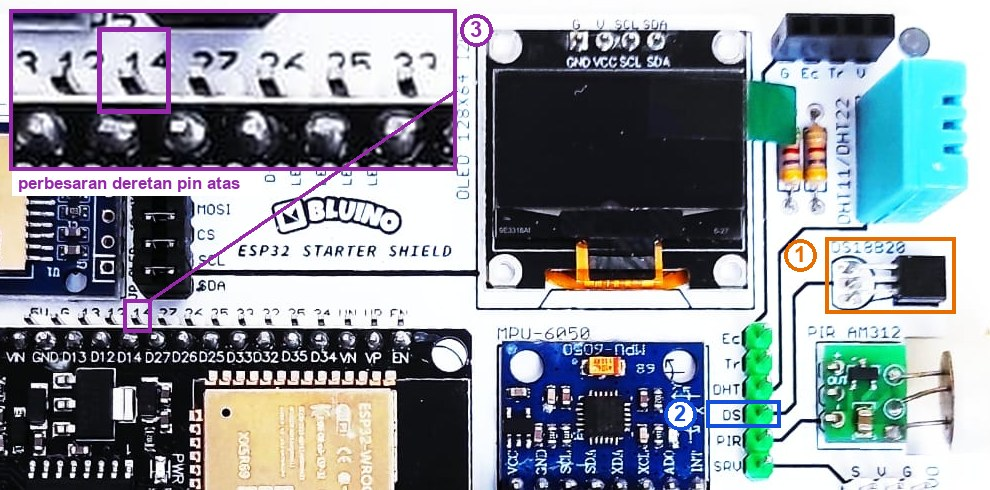
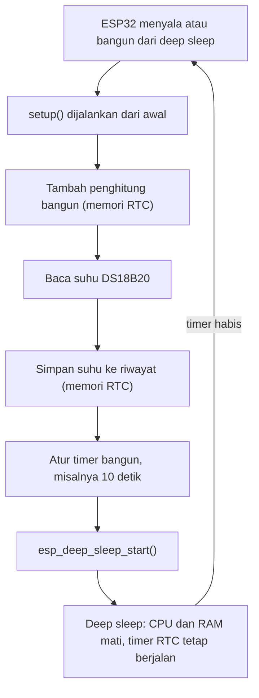

# BAB 27: DS18B20 Lanjutan — Deep Sleep, Parasitic Power & Data Filter

> ✅ **Prasyarat:** Selesaikan **BAB 25 (OneWire & Sensor Suhu DS18B20)** — kamu sudah bisa membaca DS18B20 dengan *library* OneWire dan DallasTemperature, termasuk cara membaca tanpa menunggu. Pola `millis()` dari **BAB 16 (Non-Blocking Programming)** dan **Serial Plotter** dari **BAB 11 (Analog Input & ADC)** juga dipakai lagi.

Bayangkan termometer kecil di kandang ayam atau kolam ikan yang harus bertahan berbulan-bulan hanya dengan baterai. Rahasianya, alat itu hampir selalu **tidur** dan hanya bangun sebentar untuk mengukur — seperti satpam yang berkeliling setiap 15 menit, bukan berjaga di depan pintu sepanjang malam. Di BAB ini kamu membuat ESP32 tidur nyenyak (*deep sleep*) di antara pengukuran DS18B20 tanpa kehilangan data, mengenal mode daya parasit (*parasitic power*) DS18B20, menghaluskan data suhu dengan rata-rata bergerak, dan mempelajari aturan memasang sensor berkabel panjang.

## 📌 Tujuan Pembelajaran

Setelah mempelajari BAB ini, kamu bisa:

- Menjelaskan mode tidur ESP32 dan bagian chip yang mati serta yang tetap hidup saat *deep sleep*.
- Membuat siklus bangun–ukur–tidur dengan `esp_sleep_enable_timer_wakeup()` dan `esp_deep_sleep_start()`.
- Menyimpan data antarsiklus tidur dengan `RTC_DATA_ATTR` dan mengenali penyebab ESP32 menyala dengan `esp_sleep_get_wakeup_cause()`.
- Melihat output Serial Monitor setelah ESP32 bangun, dan meng-*upload* program baru saat ESP32 sedang tidur.
- Memperkirakan umur baterai dan menjelaskan kenapa *board* DevKit tidak sehemat chip ESP32-nya.
- Menjelaskan cara kerja dan batasan mode daya parasit DS18B20, lalu memeriksa mode daya sensor lewat program.
- Menghaluskan data suhu dengan *moving average* (rata-rata bergerak).
- Menerapkan pedoman dasar kabel panjang untuk DS18B20.

## 🧰 Yang Perlu Disiapkan

| Kebutuhan | Keterangan |
|---|---|
| *Hardware* | Kit Bluino ESP32 IoT Starter Shield (DS18B20 sudah terpasang di kit) + kabel USB **data** |
| Kabel *jumper* | 1 kabel *female-female*: pin `DS` (header hijau) → label `14` (IO14) — sudah ada di kit |
| Komponen tambahan | Tidak wajib. Hanya untuk eksperimen mode parasit yang **opsional** di [27.8](#278-program-2-memeriksa-mode-daya-ds18b20): 1 sensor DS18B20 tambahan (misalnya versi *probe* kedap air), *breadboard* kecil, dan 3 kabel *jumper* *male-female* |
| *Software* | Arduino IDE 2.x + *board package* **esp32** versi 3.3.x (lihat [BAB 5](../BAB-05/README.md)) |
| *Library* | **OneWire** (Paul Stoffregen dkk., diuji versi 2.3.8) dan **DallasTemperature** (Miles Burton dkk., diuji versi 4.0.6) — cara memasangnya ada di [BAB 25](../BAB-25/README.md#254-memasang-library-onewire-dan-dallastemperature). Pasang OneWire **lebih dulu**, karena DallasTemperature tidak memasangnya otomatis |
| Alat uji | **Serial Monitor** (baud 115200) dan **Serial Plotter** (**Tools → Serial Plotter**, baud 115200) di Arduino IDE |
| Jaringan | Tidak perlu WiFi |

## 📑 Daftar Isi

- [27.1 Rekap DS18B20 di Kit](#271-rekap-ds18b20-di-kit)
- [27.2 Mode Tidur ESP32](#272-mode-tidur-esp32)
- [27.3 Perintah-Perintah Deep Sleep](#273-perintah-perintah-deep-sleep)
- [27.4 Program 1: Termometer Deep Sleep](#274-program-1-termometer-deep-sleep)
- [27.5 Melihat Output Setelah ESP32 Bangun](#275-melihat-output-setelah-esp32-bangun)
- [27.6 Berapa Lama Baterai Bertahan?](#276-berapa-lama-baterai-bertahan)
- [27.7 Mode Daya Parasit DS18B20](#277-mode-daya-parasit-ds18b20)
- [27.8 Program 2: Memeriksa Mode Daya DS18B20](#278-program-2-memeriksa-mode-daya-ds18b20)
- [27.9 Menghaluskan Data dengan Moving Average](#279-menghaluskan-data-dengan-moving-average)
- [27.10 Program 3: Moving Average di Serial Plotter](#2710-program-3-moving-average-di-serial-plotter)
- [27.11 Pedoman Kabel Panjang](#2711-pedoman-kabel-panjang)
- [27.12 Troubleshooting](#2712-troubleshooting)
- [📝 Rangkuman](#-rangkuman)
- [💪 Latihan](#-latihan)
- [📚 Referensi](#-referensi)

---

## 27.1 Rekap DS18B20 di Kit

Sebelum masuk ke teknik lanjutan, ingat lagi hal-hal penting dari [BAB 25](../BAB-25/README.md):

| Hal | Ringkasan |
|---|---|
| Sambungan | Kabel *jumper* dari pin `DS` (header hijau) ke label `14` (IO14). *Pull-up* 4,7 kΩ sudah ada di PCB |
| Daya sensor | Kaki VDD DS18B20 di kit tersambung ke 3V3 — inilah mode **daya eksternal** |
| *Library* | **OneWire** (mengurus sinyal 1-Wire) dan **DallasTemperature** (mengurus sensor suhu) |
| Resolusi dan waktu konversi | 9 bit (0,5 °C, maks. 94 ms) sampai 12 bit (0,0625 °C, maks. 750 ms); bawaan pabrik 12 bit |
| Membaca suhu | `sensor.requestTemperatures()` (perintah ukur), lalu `sensor.getTempCByIndex(0)` |
| Tanpa menunggu | `sensor.setWaitForConversion(false)`, lalu ambil hasil setelah `millisToWaitForConversion()` berlalu |
| −127 °C | `DEVICE_DISCONNECTED_C`: pembacaan gagal. *Library* 4.0.6 juga memakai −127 untuk sensor yang belum sempat menyelesaikan pengukuran |
| 85 °C | Isi register suhu saat sensor baru menyala. Pada DS18B20 asli biasanya sudah diubah *library* menjadi −127, tetapi pada sebagian sensor tiruan angka 85 °C tetap lolos — curigai angka tepat `85.00` |



*Gambar 27.1 — Sensor DS18B20 (1), pin `DS` di header hijau (2), dan pin `14` di deretan pin ESP32 atas (3) pada kit v3.x; tata letak kit v3.2 milikmu bisa sedikit berbeda. Sumber: foto produk ESP32 Starter Shield, [Bluino](http://www.bluino.com), dipotong dan diberi penanda untuk materi ini.*

**Rangkaian untuk Program 1–3:**

| Pin **Custom** di kit | Sambungkan ke pin ESP32 |
|---|---|
| `DS` — DS18B20 (header hijau, pin ke-4 dari atas) | IO14 (label `14` di deretan pin ESP32 atas, pin ke-5 dari kiri) |

> ⚠️ **Perhatian:** Hati-hati dengan tetangga label `14`: di kirinya ada `12`. IO12 adalah pin *strapping* — pin yang dibaca ESP32 sesaat setelah menyala untuk menentukan tegangan memori *flash* (lihat [BAB 6](../BAB-06/README.md#652-pin-strapping)). Jalur `DS` punya *pull-up* 4,7 kΩ ke 3,3 V, jadi kalau kabelnya meleset ke `12`, IO12 menjadi HIGH saat menyala dan ESP32 **gagal *boot*** (Serial Monitor menampilkan pesan *error* berulang, dan *upload* pun bisa gagal). ESP32 tidak rusak: cabut USB, pindahkan kabel ke `14`, lalu sambungkan lagi.

---

## 27.2 Mode Tidur ESP32

Saat menjalankan program biasa, ESP32 berada di mode **aktif**: kedua inti prosesor bekerja, semua memori menyala, dan arusnya puluhan miliampere. Kalau WiFi menyala, arusnya bisa melonjak sampai ratusan miliampere. Untuk alat bertenaga baterai yang hanya perlu mengukur sesekali, itu pemborosan besar.

ESP32 punya beberapa **mode tidur**. Angka berikut berasal dari *ESP32 Series Datasheet* v5.3 (Espressif) dan hanya berlaku untuk **chip ESP32-nya saja**, bukan *board* lengkap:

| Mode | Yang masih bekerja | Arus chip (tipikal) | Setelah bangun |
|---|---|---|---|
| Aktif, WiFi mengirim data | Semua | Hingga ±240 mA (saat memancar) | — |
| Aktif tanpa WiFi (CPU 240 MHz) | CPU dan memori | ±30–68 mA | — |
| *Light sleep* | Isi RAM tetap tersimpan, CPU berhenti sementara | ±0,8 mA | Program melanjutkan dari baris berikutnya |
| ***Deep sleep*** (*timer* RTC + memori RTC) | Hanya bagian RTC: *timer* untuk membangunkan dan memori RTC 8 KB | ±10 µA | Program mulai lagi dari **awal** (`setup()`) |

**RTC** (*Real-Time Clock*) adalah bagian kecil di dalam ESP32 yang tetap mendapat daya selama *deep sleep*: berisi *timer* untuk membangunkan chip dan memori kecil (8 KB RTC *SLOW memory* + 8 KB RTC *FAST memory*). Selebihnya — kedua inti CPU, RAM utama 520 KB, WiFi, dan Bluetooth — dimatikan.

Perbedaannya mencolok: dari ±50 mA saat aktif menjadi ±0,01 mA saat *deep sleep* — **sekitar 5.000 kali lebih kecil**. Mirip lampu rumah yang dimatikan semua saat penghuninya tidur, kecuali jam beker di samping tempat tidur.

Ada dua akibat penting yang wajib kamu ingat:

1. **Bangun dari *deep sleep* = mulai dari awal.** Isi RAM utama hilang, jadi ESP32 menjalankan proses *boot* lagi, lalu `setup()` dari baris pertama. Fungsi `loop()` biasanya tidak pernah sempat dijalankan.
2. **Variabel biasa hilang saat tidur.** Kalau ada data yang harus diingat antarsiklus — misalnya berapa kali sudah bangun — simpan di memori RTC.



*Gambar 27.2 — Siklus bangun–ukur–tidur pada program deep sleep. Sumber: dibuat untuk materi ini.*

---

## 27.3 Perintah-Perintah Deep Sleep

Perintah *deep sleep* berasal dari ESP-IDF (kerangka kerja resmi Espressif yang menjadi dasar Arduino-ESP32), dan bisa langsung dipakai di Arduino IDE tanpa `#include` tambahan.

| Kode | Gunanya |
|---|---|
| `esp_sleep_enable_timer_wakeup(waktu)` | Mengatur *timer* RTC untuk membangunkan ESP32 setelah `waktu` **mikrodetik** (1 detik = 1.000.000 µs) |
| `esp_deep_sleep_start()` | Masuk *deep sleep* **sekarang juga**. Fungsi ini tidak pernah kembali — baris sesudahnya tidak dijalankan |
| `RTC_DATA_ATTR` | Ditulis di depan variabel global supaya variabel itu disimpan di memori RTC dan tidak hilang selama *deep sleep* |
| `esp_sleep_get_wakeup_cause()` | Menanyakan penyebab ESP32 menyala: `ESP_SLEEP_WAKEUP_TIMER` kalau dibangunkan *timer*, `ESP_SLEEP_WAKEUP_UNDEFINED` kalau baru dinyalakan atau di-*reset* |
| `Serial.flush()` | Menunggu sampai semua teks di Serial benar-benar terkirim. Panggil sebelum tidur supaya baris terakhir tidak terpotong |

Contoh potongan kode (bukan program lengkap):

```cpp
RTC_DATA_ATTR int jumlahBangun = 0;   // tetap ada selama deep sleep

void setup() {
  jumlahBangun = jumlahBangun + 1;    // bertambah setiap kali bangun
  // ... baca sensor, kirim data ...
  esp_sleep_enable_timer_wakeup(10ULL * 1000000ULL);  // bangun lagi 10 detik kemudian
  esp_deep_sleep_start();             // tidur; program berhenti di sini
}
```

Beberapa hal penting tentang `RTC_DATA_ATTR`:

- Nilai awalnya (`= 0` di contoh) hanya dipakai saat ESP32 **benar-benar baru menyala** atau di-*reset* (tombol **EN** ditekan, USB dicabut-pasang, atau program baru di-*upload*). Menurut dokumentasi ESP-IDF, isi memori RTC diisi ulang setiap kali chip mulai dari awal, **kecuali** saat bangun dari *deep sleep*.
- Memori RTC hanya 8 KB. Cukup untuk penghitung, beberapa angka, atau *array* kecil — bukan untuk ribuan data.
- Kalau daya ESP32 benar-benar terputus (baterai dicabut), isinya hilang. Untuk data yang harus tahan mati listrik, pakai NVS ([BAB 39](../BAB-39/README.md)) atau kartu microSD ([BAB 41](../BAB-41/README.md)).

> 📌 **Catatan:** Kenapa ditulis `10ULL * 1000000ULL`, bukan `10 * 1000000`? Akhiran `ULL` membuat perhitungan memakai bilangan bulat 64 bit. Tanpa itu, angka besar bisa meluap (*overflow*): 1 jam = 3.600 × 1.000.000 = 3.600.000.000 µs, melewati batas `int` 32 bit (±2,1 miliar), sehingga ESP32 bisa bangun pada waktu yang salah.

---

## 27.4 Program 1: Termometer Deep Sleep

**Tujuan:** Membuat termometer hemat daya. ESP32 bangun setiap 10 detik, membaca DS18B20, menyimpan suhu ke memori RTC, menampilkan penghitung bangun dan 5 suhu terakhir, lalu tidur lagi. Program ini juga menampilkan berapa lama ESP32 terjaga di setiap siklus.

**Rangkaian:**

| Pin **Custom** di kit | Sambungkan ke pin ESP32 |
|---|---|
| `DS` — DS18B20 (header hijau) | IO14 |

**Cara Menjalankan:**

1. Pastikan kabel `DS` → **14** terpasang (lihat [27.1](#271-rekap-ds18b20-di-kit)).
2. Buka Arduino IDE → **File → New Sketch**, hapus isinya, lalu salin kode di bawah. Kode yang sama juga tersedia di *file* [`p1_deep_sleep_suhu.ino`](p1_deep_sleep_suhu/p1_deep_sleep_suhu.ino).
3. Pastikan **Tools → Board** = **ESP32 Dev Module** dan **Tools → Port** = *port* ESP32 kamu (misalnya `COM5` di Windows atau `/dev/ttyUSB0` di Linux).
4. Klik tombol **Upload** (ikon panah →) dan tunggu sampai muncul tulisan **Done uploading**.
5. Buka **Serial Monitor** (**Tools → Serial Monitor**) lalu pilih baud **115200**.
6. Amati Serial Monitor: setiap 10 detik muncul satu blok tulisan baru. Blok pertama (`Bangun ke-1`) mungkin terlewat karena dicetak sesaat setelah *upload*, sebelum Serial Monitor tersambung — tidak apa-apa, tunggu saja blok berikutnya.

**Kode Program:**

<!-- sketch: p1_deep_sleep_suhu -->
```cpp
/*
 * BAB 27 - Program 1: Termometer Deep Sleep
 * Siklus: bangun → baca DS18B20 → simpan ke memori RTC → tidur 10 detik → ulangi.
 * Penghitung bangun dan 5 suhu terakhir disimpan di memori RTC (RTC_DATA_ATTR),
 * jadi tidak hilang selama deep sleep.
 *
 * Rangkaian: pin DS (header hijau) → IO14 (pull-up 4,7 kΩ sudah ada di PCB)
 */

#include <OneWire.h>
#include <DallasTemperature.h>

#define PIN_ONEWIRE      14  // jalur data DS18B20 (pin DS -> IO14)
#define RESOLUSI         12  // 9 bit = bangun lebih singkat; 12 bit = langkah 0,0625 °C
#define LAMA_TIDUR_DETIK 10  // untuk belajar; pemakaian nyata misalnya 900 (15 menit)
#define JUMLAH_RIWAYAT    5  // banyaknya suhu terakhir yang diingat

// ---- Disimpan di memori RTC: tetap ada selama deep sleep ----
RTC_DATA_ATTR int jumlahBangun = 0;
RTC_DATA_ATTR float riwayatSuhu[JUMLAH_RIWAYAT];
RTC_DATA_ATTR int jumlahData = 0;   // berapa suhu yang sudah tersimpan (maks. JUMLAH_RIWAYAT)
RTC_DATA_ATTR int posisiTulis = 0;  // tempat suhu berikutnya akan ditulis

OneWire oneWire(PIN_ONEWIRE);
DallasTemperature sensor(&oneWire);

// true kalau angka dari DS18B20 masuk akal
bool suhuValid(float suhu) {
  if (suhu == DEVICE_DISCONNECTED_C) return false;  // -127: gagal atau belum sempat mengukur
  if (suhu < -55.0 || suhu > 125.0) return false;   // di luar rentang DS18B20 (kode error lain)
  if (suhu == 85.0) return false;                   // nilai awal sensor (pada sebagian sensor tiruan)
  return true;
}

void setup() {
  Serial.begin(115200);
  jumlahBangun = jumlahBangun + 1;

  Serial.println();
  Serial.printf("=== Bangun ke-%d ===\n", jumlahBangun);
  if (esp_sleep_get_wakeup_cause() == ESP_SLEEP_WAKEUP_TIMER) {
    Serial.println("Penyebab: timer deep sleep");
  } else {
    Serial.println("Penyebab: baru dinyalakan atau di-reset (memori RTC kembali ke nilai awal)");
  }

  // Baca DS18B20 dengan cara menunggu: selama bangun tidak ada pekerjaan lain
  sensor.begin();
  sensor.setAutoSaveScratchPad(false);  // resolusi tidak disimpan permanen ke EEPROM sensor
  sensor.setResolution(RESOLUSI);
  sensor.requestTemperatures();         // tunggu sampai pengukuran selesai
  float suhu = sensor.getTempCByIndex(0);

  if (suhuValid(suhu)) {
    riwayatSuhu[posisiTulis] = suhu;                   // simpan di posisi berikutnya
    posisiTulis = (posisiTulis + 1) % JUMLAH_RIWAYAT;  // buffer melingkar
    if (jumlahData < JUMLAH_RIWAYAT) {
      jumlahData = jumlahData + 1;
    }
    Serial.printf("Suhu sekarang: %.2f °C\n", suhu);
  } else {
    Serial.printf("Gagal membaca sensor (%.2f). Periksa kabel DS -> 14.\n", suhu);
  }

  // Tampilkan riwayat dari yang paling lama ke yang paling baru
  Serial.printf("Riwayat %d suhu terakhir (lama -> baru):", jumlahData);
  for (int i = 0; i < jumlahData; i++) {
    int indeks = (posisiTulis - jumlahData + i + JUMLAH_RIWAYAT) % JUMLAH_RIWAYAT;
    Serial.printf(" %.2f", riwayatSuhu[indeks]);
  }
  Serial.println();

  Serial.printf("Lama bangun: %lu ms. Tidur %d detik...\n", millis(), LAMA_TIDUR_DETIK);
  Serial.flush();  // tunggu semua teks terkirim sebelum tidur

  esp_sleep_enable_timer_wakeup((uint64_t)LAMA_TIDUR_DETIK * 1000000ULL);  // dalam mikrodetik
  esp_deep_sleep_start();  // tidur sekarang; baris di bawah ini tidak pernah dijalankan
}

void loop() {
  // Tidak pernah dijalankan: setiap kali bangun, ESP32 mulai lagi dari setup().
}
```

**Penjelasan Kode:**

- **Empat variabel `RTC_DATA_ATTR`** disimpan di memori RTC, jadi isinya tetap ada selama *deep sleep*: `jumlahBangun`, *array* `riwayatSuhu`, `jumlahData`, dan `posisiTulis`. Variabel lain, misalnya `suhu`, dibuat ulang setiap kali bangun.
- **`jumlahBangun = jumlahBangun + 1`** menjadi bukti bahwa memori RTC bekerja. Kalau atribut `RTC_DATA_ATTR` dihapus, angkanya selalu 1 karena variabelnya diisi ulang dari nol setiap bangun.
- **`esp_sleep_get_wakeup_cause()`** membedakan "bangun karena *timer*" dari "baru dinyalakan atau di-*reset*". Saat di-*reset*, memori RTC kembali ke nilai awalnya, sehingga hitungan mulai dari 1 lagi.
- **Membaca sensor** memakai cara menunggu dari [BAB 25](../BAB-25/README.md): `requestTemperatures()` baru kembali setelah pengukuran selesai. Di program *deep sleep*, cara ini justru paling cocok — tidak ada tugas lain yang perlu dikerjakan selama bangun.
- **`setAutoSaveScratchPad(false)`** membuat `setResolution()` hanya mengubah pengaturan sementara di sensor, tanpa menyimpannya ke EEPROM (memori permanen sensor yang hanya tahan sekitar 50.000 kali tulis). Pengaturan sementara itu tetap bertahan selama sensor mendapat daya, termasuk selama ESP32 tidur.
- **`suhuValid()`** menolak −127, angka di luar rentang DS18B20 (−55 sampai 125 °C, tempat *library* menaruh kode *error* lain), dan angka tepat 85 °C. Untuk termometer ruangan, kandang, atau kolam, suhu 85 °C memang mustahil.
- **Buffer melingkar** (*circular buffer*): suhu baru ditulis di `posisiTulis`, lalu posisinya maju satu. Operator `%` (sisa bagi) membuat posisi kembali ke 0 setelah mencapai 5, seperti jarum jam yang kembali ke angka 12. Saat menampilkan riwayat, rumus `(posisiTulis - jumlahData + i + JUMLAH_RIWAYAT) % JUMLAH_RIWAYAT` mencari data yang paling lama dulu.
- **`millis()`** di akhir menunjukkan berapa milidetik program sudah berjalan sejak bangun (belum termasuk proses *boot* sebelum `setup()`). Waktu inilah yang paling banyak menghabiskan baterai.
- **`Serial.flush()`** menunggu sampai teks terakhir terkirim. Lalu `esp_sleep_enable_timer_wakeup()` mengatur *timer* (10 × 1.000.000 µs = 10 detik), dan `esp_deep_sleep_start()` menidurkan ESP32. `loop()` dibiarkan kosong karena tidak pernah sempat dijalankan.

**Contoh Output:**

```text
=== Bangun ke-1 ===
Penyebab: baru dinyalakan atau di-reset (memori RTC kembali ke nilai awal)
Suhu sekarang: 28.31 °C
Riwayat 1 suhu terakhir (lama -> baru): 28.31
Lama bangun: 784 ms. Tidur 10 detik...

=== Bangun ke-2 ===
Penyebab: timer deep sleep
Suhu sekarang: 28.38 °C
Riwayat 2 suhu terakhir (lama -> baru): 28.31 28.38
Lama bangun: 771 ms. Tidur 10 detik...
```

Setelah bangun ke-6, riwayatnya selalu berisi 5 suhu terakhir — suhu tertua dibuang (contoh):

```text
=== Bangun ke-6 ===
Penyebab: timer deep sleep
Suhu sekarang: 28.44 °C
Riwayat 5 suhu terakhir (lama -> baru): 28.38 28.38 28.44 28.50 28.44
Lama bangun: 772 ms. Tidur 10 detik...
```

Suhu dan lama bangun di atas hanyalah contoh; angkamu bisa berbeda. Di antara blok-blok itu, Serial Monitor juga menampilkan beberapa baris log *boot* bawaan ESP32 — penjelasannya di [27.5](#275-melihat-output-setelah-esp32-bangun). Di kit tidak ada LED yang berubah, karena program ini hanya memakai Serial Monitor.

> 🧪 **Coba Sendiri:** Ubah `#define RESOLUSI 12` menjadi `9`, lalu *upload* ulang. Angka "Lama bangun" turun drastis, karena konversi 9 bit paling lama hanya 94 ms, bukan 750 ms. Bayarannya, suhu hanya berubah per 0,5 °C. Setelah selesai mencoba, kembalikan ke `12`. (Karena pengaturan tidak disimpan ke EEPROM, setelah kit dilepas dari USB beberapa detik sensor juga kembali ke resolusi yang tersimpan di EEPROM-nya — bawaan pabriknya 12 bit.)

**Kalau Belum Berhasil:**

- **Serial Monitor kosong** → pastikan baud **115200**. Kalau Serial Monitor baru dibuka setelah *upload*, tunggu sampai ESP32 bangun berikutnya (paling lama 10 detik).
- **`Bangun ke-1` terus, tidak pernah bertambah** → ESP32 tidak bangun dari *deep sleep*, tetapi di-*reset*. Periksa apakah atribut `RTC_DATA_ATTR` ikut tersalin. Kalau penyebabnya tertulis `baru dinyalakan atau di-reset`, mungkin tombol **EN** tersentuh atau daya USB tidak stabil (coba *port* USB atau kabel lain).
- **`Gagal membaca sensor (-127.00)`** → kabel `DS` → `14` lepas atau tertancap di pin lain. Cabut USB, betulkan kabelnya, sambungkan lagi.
- ***Upload* gagal (`Failed to connect to ESP32`)** → lihat [27.5](#275-melihat-output-setelah-esp32-bangun) bagian meng-*upload* saat ESP32 tidur.

---

## 27.5 Melihat Output Setelah ESP32 Bangun

ESP32 DEVKIT V1 di kit tidak tersambung langsung ke USB. Di antaranya ada **chip USB-serial** terpisah (misalnya CP2102 atau CH340, chip kecil di dekat konektor USB) yang mengubah sinyal USB menjadi Serial. Chip ini mendapat daya dari kabel USB, jadi **tetap menyala** walaupun ESP32 sedang tidur. Akibatnya:

- *Port* (misalnya `COM5`) tidak hilang selama ESP32 tidur, dan Serial Monitor tetap tersambung. Setiap kali ESP32 bangun, tulisan baru muncul dengan sendirinya — kamu tidak perlu melakukan apa-apa.
- Sebelum tulisan dari programmu, ESP32 mencetak beberapa baris log *boot* bawaan. Baris yang penting adalah baris `rst:` (contoh; baris lainnya bisa berbeda di *board*-mu):

  ```text
  rst:0x5 (DEEPSLEEP_RESET),boot:0x13 (SPI_FAST_FLASH_BOOT)
  ```

  `DEEPSLEEP_RESET` artinya ESP32 baru bangun dari *deep sleep*. Kalau tertulis `rst:0x1 (POWERON_RESET)`, artinya ESP32 baru dinyalakan atau tombol **EN** ditekan — dan isi memori RTC kembali ke nilai awal.
- Kalau Serial Monitor baru kamu buka di tengah jalan, tidak masalah: tunggu saja sampai ESP32 bangun berikutnya. Jangan menekan **EN** kalau tidak ingin hitungan bangun kembali ke 1.

**Meng-*upload* program baru saat ESP32 tidur.** Arduino IDE me-*reset* ESP32 lewat chip USB-serial tadi sebelum meng-*upload*, dan *reset* ini tetap bekerja walaupun ESP32 sedang tidur. Jadi biasanya *upload* berjalan normal. Kalau tetap muncul `Failed to connect to ESP32`, tahan tombol **BOOT** di *board* ESP32, klik **Upload**, lalu lepaskan tombol **BOOT** setelah muncul tulisan `Connecting...`.

> 📌 **Catatan:** Lain ceritanya dengan *board* yang memakai USB bawaan chip (misalnya ESP32-S3, ESP32-C3, atau ESP32-C6 tanpa chip USB-serial terpisah). Menurut dokumentasi Espressif, sambungan USB-nya ikut mati saat chip masuk *deep sleep*: *port*-nya hilang dari komputer dan baru muncul lagi setelah chip bangun — kadang perlu dipilih ulang di **Tools → Port**, atau kabelnya dicabut-pasang. Tulisan yang dicetak tepat setelah bangun juga bisa hilang sebelum komputer tersambung lagi, sehingga saat belajar biasanya ditambahkan `delay()` 1–2 detik setelah `Serial.begin()`. Untuk meng-*upload*, masuk ke mode *upload* secara manual: tahan **BOOT**, tekan **RESET**, lalu lepaskan **BOOT**.

---

## 27.6 Berapa Lama Baterai Bertahan?

Umur baterai ditentukan oleh **arus rata-rata**. Untuk alat yang bergantian bangun dan tidur:

**Arus rata-rata = (arus bangun × lama bangun + arus tidur × lama tidur) ÷ (lama bangun + lama tidur)**

**Umur baterai (jam) ≈ kapasitas baterai (mAh) ÷ arus rata-rata (mA)**

Contoh: baterai 2000 mAh, bangun setiap 15 menit (900 detik), setiap bangun 1 detik dengan arus ±50 mA. Hasil hitungannya:

| Skenario | Arus saat tidur | Arus rata-rata | Perkiraan umur baterai |
|---|---|---|---|
| Tanpa tidur sama sekali (aktif terus ±50 mA) | — | 50 mA | ±40 jam (belum 2 hari) |
| *Board* DevKit, tidur 15 menit, tanpa WiFi | ±6 mA (perkiraan, lihat di bawah) | ±6,05 mA | ±330 jam (±2 minggu) |
| Chip ESP32 saja, tidur 15 menit, tanpa WiFi | ±0,01 mA | ±0,066 mA | ±30.500 jam (±3,5 tahun)\* |
| Chip ESP32 saja, tidur 15 menit, WiFi menyala 3 detik (±120 mA) setiap bangun | ±0,01 mA | ±0,41 mA | ±4.900 jam (±6,7 bulan) |

\*Hanya batas teoretis. Baterai juga kehilangan isinya sedikit demi sedikit walaupun tidak dipakai (*self-discharge*), jadi umur sebenarnya lebih pendek.

Perhatikan baris *board* DevKit. Chip ESP32-nya memang hanya memakai ±10 µA saat *deep sleep*, tetapi komponen lain di *board* tetap menyala:

- **Regulator 3,3 V** (pada kebanyakan DevKit memakai AMS1117). Menurut *datasheet*-nya, regulator ini sendiri memakan arus diam (*quiescent current*) sekitar 5 mA — kira-kira 500 kali arus ESP32 yang sedang tidur.
- **LED indikator daya** di *board* yang selalu menyala.
- **Chip USB-serial**, ditambah modul-modul lain di kit yang ikut mendapat 3,3 V (OLED, MPU-6050, BMP180, DHT11, dan lain-lain).

Jadi jangan heran kalau kit yang sedang tidur masih memakai beberapa miliampere. Angka ±6 mA di tabel hanyalah perkiraan; angka sebenarnya bisa diukur dengan multimeter yang dipasang seri pada jalur baterai (cara memakai multimeter ada di [BAB 3](../BAB-03/README.md#312-mengukur-dengan-multimeter-opsional)). Selain itu, satu sel baterai Li-ion (3,7 V) yang disambung ke pin `5V`/`VIN` DevKit pun kurang cocok: regulator AMS1117 butuh tegangan masuk sekitar 1 V lebih tinggi daripada 3,3 V. Alat baterai sungguhan biasanya memakai modul ESP32 tanpa komponen tambahan, atau *board* yang memang dirancang hemat daya dengan regulator berarus diam beberapa mikroampere.

Cara menghemat baterai dari sisi program — berlaku di *board* apa pun:

- **Persingkat waktu bangun.** Pakai resolusi serendah yang masih cukup (9 bit: konversi maks. 94 ms), hindari `delay()` yang tidak perlu, dan nyalakan WiFi sesingkat mungkin.
- **Perpanjang waktu tidur.** Suhu ruangan atau air kolam jarang berubah cepat; bangun setiap 5–15 menit biasanya sudah cukup.
- **Kirim data sekaligus.** Kumpulkan beberapa pengukuran di memori RTC, lalu nyalakan WiFi sekali untuk mengirim semuanya.

---

## 27.7 Mode Daya Parasit DS18B20

DS18B20 bisa diberi daya dengan dua cara. Kit memakai cara pertama; cara kedua dibahas di sini supaya kamu paham saat menjumpainya di lapangan.

> 📌 **Catatan:** Di kit, kaki VDD DS18B20 tersolder ke 3V3, jadi sensor kit **selalu** memakai daya eksternal dan tidak bisa diubah ke mode parasit tanpa mengubah PCB (jangan lakukan). Mode parasit hanya bisa dicoba dengan sensor DS18B20 **tambahan** di luar kit, dan itu sifatnya opsional ([27.8](#278-program-2-memeriksa-mode-daya-ds18b20)).

### 27.7.1 Daya Eksternal dan Daya Parasit

**Daya eksternal** (dipakai kit) — tiga kabel ke sensor: DQ, VDD, dan GND. Kaki VDD mendapat 3,3 V:

```text
3V3 ----+----------------------+
        |                      |
      [4K7]                    |
        |                      |
IO14 ---+------ DQ  (kaki 2)   |
                VDD (kaki 3) --+
GND ----------- GND (kaki 1)
```

**Daya parasit** (*parasite power*) — hanya dua kabel: DQ dan GND. Kaki VDD **wajib** disambung ke GND, dan sensor "menumpang" daya dari jalur data:

```text
3V3 ----+
        |
      [4K7]
        |
IO14 ---+------ DQ  (kaki 2)
                VDD (kaki 3) --+
GND ----------- GND (kaki 1) --+
```

*Gambar 27.3 — Dua cara memberi daya DS18B20 (kaki 1 = GND, kaki 2 = DQ, kaki 3 = VDD pada kemasan TO-92). Sumber: dibuat untuk materi ini, berdasarkan datasheet DS18B20.*

Dalam mode parasit, setiap kali jalur DQ HIGH, sensor mengisi **kapasitor kecil** di dalam chip-nya — mirip tandon air yang diisi saat aliran PDAM lancar. Saat jalur DQ LOW (ketika bit-bit dikirim), sensor memakai cadangan di "tandon" itu. Untuk komunikasi biasa cara ini cukup. Masalahnya muncul saat **mengukur suhu**.

### 27.7.2 Kenapa Butuh *Strong Pull-Up*?

Saat mengukur suhu, DS18B20 memakai arus hingga 1,5 mA (*datasheet*). Kalau arus itu harus lewat resistor *pull-up* 4,7 kΩ, tegangan yang "hilang" di resistor menurut Hukum Ohm adalah 1,5 mA × 4,7 kΩ ≈ 7 V — jauh lebih besar daripada 3,3 V yang tersedia. Artinya, resistor saja tidak sanggup memberi daya; tegangan di sensor akan anjlok dan pengukurannya gagal.

Jalan keluarnya, selama konversi jalur DQ harus disambung **langsung** ke catu daya. Ini disebut ***strong pull-up***. *Datasheet* menunjukkan cara memakai transistor MOSFET, dan harus diaktifkan paling lambat 10 µs setelah perintah ukur dikirim. Selama *strong pull-up* aktif:

- Tidak boleh ada komunikasi lain di jalur itu.
- ESP32 **tidak bisa bertanya** "sudah selesai?" ke sensor, karena untuk bertanya jalur harus dilepas — dan sensor akan kehilangan dayanya. Jadi ESP32 harus menunggu waktu konversi penuh (750 ms pada 12 bit).

| | Daya eksternal (kit) | Daya parasit |
|---|---|---|
| Kabel ke sensor | 3: DQ, VDD, GND | 2: DQ dan GND (VDD ke GND) |
| Daya saat mengukur | Dari kaki VDD | Dari jalur DQ yang dibuat HIGH kuat (*strong pull-up*) |
| Bertanya "sudah selesai?" | Bisa — pembacaan selesai lebih cepat | Tidak bisa — harus menunggu waktu penuh |
| Komunikasi lain selama mengukur | Boleh | Tidak boleh |
| Suhu di atas 100 °C | Aman | Tidak disarankan *datasheet* (arus bocor chip naik) |
| Kabel panjang | Lebih andal | Mudah gagal karena sensor kekurangan daya |
| Cocok untuk | Hampir semua kasus | Pemasangan yang hanya punya kabel dua inti |

### 27.7.3 Apa yang Dikerjakan Library?

Kabar baiknya, *library* OneWire dan DallasTemperature sudah menangani mode parasit — kamu tidak perlu menulis kode khusus:

1. **`sensor.begin()`** menanyai setiap sensor dengan perintah *Read Power Supply* (`0xB4`). Sensor parasit menjawab "0", sensor berdaya eksternal menjawab "1". Hasilnya bisa dilihat dengan `sensor.isParasitePowerMode()`.
2. **`sensor.requestTemperatures()`**: kalau ada sensor parasit, setelah mengirim perintah ukur *library* membiarkan IO14 sebagai **output HIGH**. Pin ESP32 itulah yang menjadi *strong pull-up* — pin GPIO sanggup memberi arus belasan miliampere, jauh lebih besar daripada kebutuhan beberapa DS18B20.
3. Dalam cara menunggu (bawaan), *library* lalu menunggu waktu penuh `millisToWaitForConversion()` tanpa bertanya ke sensor. Perintah berikutnya di bus (misalnya saat membaca hasil) otomatis mengakhiri *strong pull-up*.

Kalau kamu memakai cara tanpa menunggu (`setWaitForConversion(false)`) dengan sensor parasit, patuhi dua aturan: jangan memanggil `sensor.isConversionComplete()`, dan jangan ada komunikasi apa pun di bus sampai `millisToWaitForConversion()` berlalu.

> ⚠️ **Perhatian:** Banyak DS18B20 tiruan (klon) yang beredar di pasaran **tidak bekerja dengan benar** dalam mode parasit, atau salah melaporkan mode dayanya. Ini salah satu alasan memakai tiga kabel kapan pun memungkinkan.

---

## 27.8 Program 2: Memeriksa Mode Daya DS18B20

**Tujuan:** Mencari semua DS18B20 di bus, menanyakan mode daya setiap sensor, lalu mengukur suhu setiap 5 detik sambil mencatat lama pengukurannya. Dengan kit saja, program ini membuktikan bahwa sensor kit memakai daya eksternal. Kalau kamu punya DS18B20 tambahan, program yang sama bisa dipakai untuk eksperimen mode parasit (opsional, di akhir bagian ini).

**Rangkaian:**

| Pin **Custom** di kit | Sambungkan ke pin ESP32 |
|---|---|
| `DS` — DS18B20 (header hijau) | IO14 |

**Cara Menjalankan:**

1. Pastikan kabel `DS` → **14** terpasang.
2. Buka Arduino IDE → **File → New Sketch**, hapus isinya, lalu salin kode di bawah. Kode yang sama juga tersedia di *file* [`p2_cek_mode_daya.ino`](p2_cek_mode_daya/p2_cek_mode_daya.ino).
3. Pastikan **Tools → Board** = **ESP32 Dev Module** dan **Tools → Port** = *port* ESP32 kamu.
4. Klik tombol **Upload** dan tunggu sampai muncul tulisan **Done uploading**.
5. Buka **Serial Monitor** (**Tools → Serial Monitor**) lalu pilih baud **115200**. Kalau baris judul terlewat, tekan tombol **EN**.

**Kode Program:**

<!-- sketch: p2_cek_mode_daya -->
```cpp
/*
 * BAB 27 - Program 2: Memeriksa Mode Daya DS18B20
 * Mencari semua DS18B20 di bus, menanyakan mode daya setiap sensor
 * (perintah Read Power Supply, 0xB4), lalu mengukur suhu setiap 5 detik
 * sambil mencatat lama pengukurannya.
 *
 * Dengan kit saja: 1 sensor, daya eksternal (VDD).
 * Eksperimen opsional: tambahkan DS18B20 kedua dalam mode parasit.
 *
 * Rangkaian: pin DS (header hijau) → IO14
 */

#include <OneWire.h>
#include <DallasTemperature.h>

#define PIN_ONEWIRE 14  // jalur data DS18B20 (pin DS -> IO14)

OneWire oneWire(PIN_ONEWIRE);
DallasTemperature sensor(&oneWire);

int jumlahSensor = 0;

// Mencetak kode ROM 8 byte, misalnya 28:61:64:12:3C:7C:2F:27
void cetakAlamat(const uint8_t *alamat) {
  for (int i = 0; i < 8; i++) {
    Serial.printf("%02X", alamat[i]);
    if (i < 7) {
      Serial.print(":");
    }
  }
}

void setup() {
  Serial.begin(115200);
  delay(1000);  // beri waktu Serial Monitor tersambung
  Serial.println("BAB 27 - Program 2: Memeriksa Mode Daya DS18B20");

  sensor.begin();  // mencari sensor sekaligus menanyakan mode dayanya
  jumlahSensor = sensor.getDeviceCount();
  Serial.printf("Sensor ditemukan: %d\n", jumlahSensor);

  for (int i = 0; i < jumlahSensor; i++) {
    DeviceAddress alamat;
    if (!sensor.getAddress(alamat, i)) {
      continue;
    }
    bool parasit = sensor.readPowerSupply(alamat);  // true = sensor ini memakai daya parasit
    Serial.printf("  Sensor %d (", i);
    cetakAlamat(alamat);
    Serial.printf("): %s\n", parasit ? "daya PARASIT" : "daya eksternal (VDD)");
  }

  if (sensor.isParasitePowerMode()) {
    Serial.println("Ada sensor parasit: saat mengukur, IO14 dibuat HIGH kuat dan library menunggu waktu penuh.");
  } else {
    Serial.println("Semua sensor memakai VDD: library boleh bertanya 'sudah selesai?' ke sensor.");
  }
}

void loop() {
  if (jumlahSensor == 0) {
    Serial.println("Tidak ada sensor! Periksa kabel DS -> 14, lalu tekan EN.");
    delay(5000);
    return;
  }

  unsigned long mulai = millis();
  sensor.requestTemperatures();  // tunggu sampai semua sensor selesai mengukur
  unsigned long lamaUkur = millis() - mulai;

  Serial.printf("Lama mengukur: %lu ms", lamaUkur);
  for (int i = 0; i < jumlahSensor; i++) {
    float suhu = sensor.getTempCByIndex(i);
    if (suhu == DEVICE_DISCONNECTED_C) {
      Serial.printf(" | Sensor %d: gagal", i);
    } else {
      Serial.printf(" | Sensor %d: %.2f °C", i, suhu);
    }
  }
  Serial.println();

  delay(5000);  // program pemeriksa ini tidak perlu responsif, jadi delay() cukup
}
```

**Penjelasan Kode:**

- **`sensor.begin()`** mencari semua sensor (*Search ROM*), lalu menanyai mode dayanya. `getDeviceCount()` memberi jumlah sensor yang ditemukan.
- **`sensor.getAddress(alamat, i)`** menyalin kode ROM sensor ke-`i` ke variabel `alamat` (tipe `DeviceAddress`, *array* 8 *byte*). `cetakAlamat()` mencetaknya dalam heksadesimal; `%02X` berarti "heksadesimal huruf besar, 2 digit, diawali 0 bila perlu".
- **`sensor.readPowerSupply(alamat)`** mengirim perintah *Read Power Supply* (`0xB4`) ke satu sensor tertentu dan bernilai `true` kalau sensor itu memakai daya parasit. `isParasitePowerMode()` bernilai `true` kalau **minimal satu** sensor di bus memakai daya parasit.
- **"Lama mengukur"** diukur dengan `millis()` sebelum dan sesudah `requestTemperatures()`. Dengan daya eksternal, *library* terus bertanya ke sensor dan langsung lanjut begitu pengukurannya selesai. Kalau ada sensor parasit, *library* selalu menunggu waktu penuh 750 ms.
- **`delay(5000)`** dipakai demi kesederhanaan. Program ini hanya alat pemeriksa, jadi tidak masalah kalau ESP32 menunggu.

**Contoh Output (kit saja):**

```text
BAB 27 - Program 2: Memeriksa Mode Daya DS18B20
Sensor ditemukan: 1
  Sensor 0 (28:61:64:12:3C:7C:2F:27): daya eksternal (VDD)
Semua sensor memakai VDD: library boleh bertanya 'sudah selesai?' ke sensor.
Lama mengukur: 626 ms | Sensor 0: 28.31 °C
Lama mengukur: 625 ms | Sensor 0: 28.38 °C
```

Kode ROM sensormu **pasti berbeda**, dan lama mengukurnya bisa sedikit berbeda (pada DS18B20 asli biasanya sekitar 0,6 detik). Satu baris baru muncul kira-kira setiap 5,7 detik (5 detik `delay()` ditambah lama mengukur).

**Kalau Belum Berhasil:**

- **`Sensor ditemukan: 0`** → kabel `DS` → `14` lepas atau salah pin. Cabut USB, betulkan kabelnya, sambungkan lagi, lalu tekan **EN**.
- **Sensor kit dilaporkan `daya PARASIT`** → kemungkinan besar sensornya tiruan yang salah menjawab perintah `0xB4`. Sensor tetap bisa dipakai; *library* hanya akan selalu menunggu waktu penuh 750 ms.
- **`Sensor 0: gagal`** → sambungan longgar. Tancapkan ulang atau ganti kabel *jumper*.

<details>
<summary><b>🔬 Pendalaman (opsional): eksperimen DS18B20 tambahan dalam mode parasit</b></summary>

Eksperimen ini butuh komponen di luar kit: 1 DS18B20 tambahan (misalnya versi *probe* kedap air berkabel tiga), *breadboard* kecil, dan 3 kabel *jumper* *male-female*. Sensor tambahan disambung **paralel** dengan sensor kit, sama seperti di [BAB 25](../BAB-25/README.md#2591-memasang-sensor-ds18b20-kedua-opsional), bedanya kaki VDD sensor tambahan disambung ke GND:

1. Cabut kabel USB, lalu lepas kabel `DS` → `14` yang lama.
2. Tancapkan kabel merah (VDD) **dan** kabel hitam (GND) *probe* ke lajur *breadboard* yang **sama**. Tancapkan kabel kuning atau putih (DQ) ke lajur lain.
3. Sambungkan kedua lajur ke kit dengan kabel *jumper* *male-female*:

   | Lajur *breadboard* yang berisi … | Sambungkan ke pin kit |
   |---|---|
   | Kabel merah + hitam *probe* (VDD dan GND) | Label `G` (GND) |
   | Kabel kuning/putih *probe* (DQ) | Dua kabel: satu ke pin `DS` (header hijau) dan satu ke label `14` |

4. Periksa sekali lagi, sambungkan USB, lalu tekan **EN** supaya Program 2 mencari ulang sensor.

Kalau memakai DS18B20 kemasan TO-92, sambungkan kaki 1 (GND) dan kaki 3 (VDD) bersama-sama ke `G`, dan kaki 2 (DQ) ke `DS` serta `14`. Warna kabel *probe* bisa berbeda antarpenjual — cocokkan dengan keterangan produknya.

Contoh hasilnya (angkamu bisa berbeda):

```text
BAB 27 - Program 2: Memeriksa Mode Daya DS18B20
Sensor ditemukan: 2
  Sensor 0 (28:61:64:12:3C:7C:2F:27): daya eksternal (VDD)
  Sensor 1 (28:3F:9A:57:04:00:00:1D): daya PARASIT
Ada sensor parasit: saat mengukur, IO14 dibuat HIGH kuat dan library menunggu waktu penuh.
Lama mengukur: 753 ms | Sensor 0: 28.31 °C | Sensor 1: 28.06 °C
```

Perhatikan dua perbedaannya: sensor tambahan dilaporkan `daya PARASIT`, dan lama mengukur naik menjadi sekitar 750 ms karena *library* tidak bisa lagi bertanya "sudah selesai?". Kalau sensor parasit itu terus `gagal` atau menunjukkan 85 °C, kemungkinan besar sensornya tiruan yang tidak mendukung mode parasit. Pindahkan kabel merah (VDD) ke lajur lain yang disambung ke label `3V` (mode daya eksternal); biasanya sensor itu lalu terbaca normal.

</details>

---

## 27.9 Menghaluskan Data dengan Moving Average

Hasil DS18B20 sudah digital dan diperiksa CRC, jadi angka "liar" akibat gangguan listrik jarang lolos (data rusak dilaporkan sebagai −127). Yang biasanya terlihat adalah naik-turun kecil satu langkah resolusi (0,0625 °C pada 12 bit) dan perubahan sesaat yang nyata, misalnya sensor tersentuh jari atau terkena embusan angin. Kalau angka-angka seperti itu dipakai untuk menyalakan kipas atau alarm, keputusan programmu bisa ikut "bergetar". Solusinya: **haluskan** datanya.

Cara paling sederhana adalah ***moving average*** (rata-rata bergerak): rata-rata dari N bacaan **terakhir**. Setiap ada bacaan baru, bacaan paling lama dibuang — mirip nilai rata-rata 4 ulangan terakhir seorang siswa, yang terus diperbarui setiap ada ulangan baru. Contoh hitungan dengan N = 4, kalau bacaan ke-4 tiba-tiba melonjak 1 °C:

| Bacaan ke- | Suhu mentah | 4 bacaan terakhir | Rata-rata bergerak |
|---|---|---|---|
| 1 | 28,00 °C | 28,00 | 28,00 °C |
| 2 | 28,06 °C | 28,00 · 28,06 | 28,03 °C |
| 3 | 28,00 °C | 28,00 · 28,06 · 28,00 | 28,02 °C |
| 4 | **29,00 °C** (melonjak) | 28,00 · 28,06 · 28,00 · **29,00** | 28,27 °C |
| 5 | 28,06 °C | 28,06 · 28,00 · **29,00** · 28,06 | 28,28 °C |
| 8 | 28,00 °C | 28,06 · 28,00 · 28,06 · 28,00 | 28,03 °C |

Lonjakan 1 °C hanya menaikkan rata-rata sekitar 0,25 °C (1 °C ÷ 4), lalu hilang setelah 4 bacaan. Ada harganya:

- **Makin besar N, makin halus, tetapi makin lambat.** Rata-rata bergerak selalu tertinggal dari perubahan nyata. Dengan N = 8 dan satu bacaan per detik, rata-rata baru mengikuti perubahan sepenuhnya setelah 8 detik.
- **Lonjakan hanya dikecilkan, tidak dibuang.** Untuk membuang lonjakan sama sekali dipakai *median filter*; untuk menghemat memori dipakai EMA (*exponential moving average*). Keduanya, beserta pemeriksaan batas wajar dan kalibrasi, dibahas lengkap di [BAB 34 (Pemrosesan Data Sensor)](../BAB-34/README.md).

---

## 27.10 Program 3: Moving Average di Serial Plotter

**Tujuan:** Membaca DS18B20 setiap 1 detik tanpa menghambat program (pola dua langkah dari [BAB 25](../BAB-25/README.md#257-membaca-suhu-tanpa-menunggu)), menghitung rata-rata bergerak dari 8 bacaan terakhir, lalu menggambar suhu mentah dan suhu yang sudah dihaluskan di **Serial Plotter**.

**Rangkaian:**

| Pin **Custom** di kit | Sambungkan ke pin ESP32 |
|---|---|
| `DS` — DS18B20 (header hijau) | IO14 |

**Cara Menjalankan:**

1. Pastikan kabel `DS` → **14** terpasang. Kalau kamu mencoba eksperimen opsional di 27.8, kembalikan dulu ke sambungan semula.
2. Buka Arduino IDE → **File → New Sketch**, hapus isinya, lalu salin kode di bawah. Kode yang sama juga tersedia di *file* [`p3_moving_average.ino`](p3_moving_average/p3_moving_average.ino).
3. Pastikan **Tools → Board** = **ESP32 Dev Module** dan **Tools → Port** = *port* ESP32 kamu.
4. Klik tombol **Upload** dan tunggu sampai muncul tulisan **Done uploading**.
5. Buka **Serial Plotter** lewat **Tools → Serial Plotter**, lalu pilih baud **115200**.
6. Setelah garisnya mendatar, pegang badan DS18B20 dengan dua jari selama ±5 detik (jangan menyentuh kaki atau jalur PCB), lalu lepaskan. Amati kedua garis.

**Kode Program:**

<!-- sketch: p3_moving_average -->
```cpp
/*
 * BAB 27 - Program 3: Moving Average di Serial Plotter
 * Membaca DS18B20 setiap 1 detik tanpa menghambat program (dua langkah:
 * kirim perintah ukur, lalu ambil hasil setelah waktu konversi habis),
 * menghitung rata-rata bergerak 8 bacaan terakhir, lalu mengirim
 * suhu mentah dan suhu halus ke Serial Plotter.
 * Buka Tools → Serial Plotter, lalu pilih baud 115200.
 *
 * Rangkaian: pin DS (header hijau) → IO14
 */

#include <OneWire.h>
#include <DallasTemperature.h>

#define PIN_ONEWIRE   14  // jalur data DS18B20 (pin DS -> IO14)
#define RESOLUSI      12  // langkah 0,0625 °C, konversi maks. 750 ms
#define UKURAN_FILTER  8  // banyaknya bacaan terakhir yang dirata-rata

const unsigned long JEDA_UKUR = 1000;  // mulai pengukuran baru setiap 1000 ms

OneWire oneWire(PIN_ONEWIRE);
DallasTemperature sensor(&oneWire);

// Dua keadaan pembacaan sensor (seperti BAB 25)
enum StatusSensor { DIAM, MENGUKUR };
StatusSensor status = DIAM;

unsigned long lamaKonversi = 750;     // diisi ulang di setup() sesuai RESOLUSI
unsigned long waktuUkurTerakhir = 0;  // kapan perintah ukur terakhir dikirim

// Penyimpan bacaan untuk moving average (buffer melingkar)
float bufferSuhu[UKURAN_FILTER];
int posisi = 0;  // tempat bacaan berikutnya ditulis
int terisi = 0;  // berapa bacaan yang sudah tersimpan (maks. UKURAN_FILTER)

// Masukkan satu bacaan baru, lalu kembalikan rata-rata bacaan yang tersimpan
float tambahDanRataRata(float bacaanBaru) {
  bufferSuhu[posisi] = bacaanBaru;        // timpa bacaan paling lama
  posisi = (posisi + 1) % UKURAN_FILTER;  // maju satu, kembali ke 0 setelah ujung
  if (terisi < UKURAN_FILTER) {
    terisi = terisi + 1;
  }

  float jumlah = 0;
  for (int i = 0; i < terisi; i++) {
    jumlah = jumlah + bufferSuhu[i];
  }
  return jumlah / terisi;
}

// true kalau angka dari DS18B20 masuk akal (sama seperti Program 1)
bool suhuValid(float suhu) {
  if (suhu == DEVICE_DISCONNECTED_C) return false;
  if (suhu < -55.0 || suhu > 125.0) return false;
  if (suhu == 85.0) return false;
  return true;
}

void setup() {
  Serial.begin(115200);
  sensor.begin();
  sensor.setResolution(RESOLUSI);
  sensor.setWaitForConversion(false);  // requestTemperatures() tidak menunggu
  lamaKonversi = sensor.millisToWaitForConversion(RESOLUSI);
  // Sengaja tidak mencetak judul: Serial Plotter menganggap setiap baris sebagai data grafik.
}

void loop() {
  unsigned long sekarang = millis();

  switch (status) {
    case DIAM:
      if (sekarang - waktuUkurTerakhir >= JEDA_UKUR) {
        waktuUkurTerakhir = sekarang;
        sensor.requestTemperatures();  // langkah 1: kirim perintah ukur
        status = MENGUKUR;
      }
      break;

    case MENGUKUR:
      if (sekarang - waktuUkurTerakhir >= lamaKonversi) {
        float suhu = sensor.getTempCByIndex(0);  // langkah 2: ambil hasilnya
        if (suhuValid(suhu)) {
          float suhuHalus = tambahDanRataRata(suhu);
          Serial.printf("Mentah:%.2f,RataRata:%.2f\n", suhu, suhuHalus);
        }
        status = DIAM;
      }
      break;
  }

  // Tugas lain bisa ditambahkan di sini; loop() tidak pernah tertahan lama.
}
```

**Penjelasan Kode:**

- **Pola dua langkah** (`DIAM` → `MENGUKUR` → `DIAM`) sama dengan Program 3 di [BAB 25](../BAB-25/README.md#258-program-3-suhu-tanpa-menghambat-program): kirim perintah ukur, lalu ambil hasilnya setelah `lamaKonversi` (750 ms) berlalu. Selama menunggu, `loop()` bebas mengerjakan tugas lain.
- **`tambahDanRataRata()`** menyimpan bacaan baru di `bufferSuhu[posisi]`, memajukan `posisi` dengan operator `%` (buffer melingkar, seperti riwayat di Program 1), lalu menjumlahkan semua bacaan yang tersimpan dan membaginya dengan `terisi`. Selama buffer belum penuh, rata-ratanya dihitung dari bacaan yang sudah ada saja — jadi bacaan pertama tidak ikut dirata-rata dengan angka nol.
- **`suhuValid()`** memastikan −127 atau 85 °C tidak pernah masuk ke buffer. Satu angka −127 saja bisa menyeret rata-rata 8 bacaan turun lebih dari 19 °C!
- **Format `label:nilai`** untuk Serial Plotter sama dengan di [BAB 11](../BAB-11/README.md#119-program-3-grafik-nilai-adc-di-serial-plotter). Program ini sengaja tidak mencetak judul.

**Contoh Output:**

Di Serial Plotter muncul dua garis: **Mentah** dan **RataRata**. Saat suhu stabil, garis **Mentah** sesekali naik-turun satu langkah kecil, sedangkan **RataRata** lebih rata. Saat sensor kamu pegang, garis **Mentah** naik lebih dulu dan **RataRata** menyusul dengan lebih lambat; setelah dilepas, keduanya turun perlahan.

Kalau kamu membuka **Serial Monitor**, teksnya terlihat seperti ini (contoh saat sensor mulai dipegang; angkamu bisa berbeda):

```text
Mentah:28.31,RataRata:28.31
Mentah:28.38,RataRata:28.34
Mentah:28.31,RataRata:28.33
Mentah:28.31,RataRata:28.33
Mentah:28.94,RataRata:28.45
Mentah:29.44,RataRata:28.61
Mentah:29.81,RataRata:28.79
Mentah:30.06,RataRata:28.95
Mentah:30.19,RataRata:29.18
```

> 🧪 **Coba Sendiri:** Ubah `UKURAN_FILTER` menjadi `4`, lalu `16`, dan *upload* ulang. Ulangi percobaan memegang sensor. Ukuran mana yang garisnya paling halus? Mana yang paling cepat mengikuti perubahan?

**Kalau Belum Berhasil:**

- **Serial Plotter kosong** → baud belum **115200**, *port* salah, atau sensor tidak terbaca (program tidak mencetak apa pun saat pembacaan gagal). Jalankan Program 2 untuk memeriksa sensor.
- **Kedua garis datar dan saling menimpa** → normal kalau suhu benar-benar stabil. Pegang sensor untuk melihat perbedaannya.
- **Muncul garis tambahan bernama aneh** → ada baris teks lain yang tercetak. Untuk Serial Plotter, cetak hanya baris data.

---

## 27.11 Pedoman Kabel Panjang

DS18B20 sering dipasang jauh dari mikrokontroler, misalnya *probe* kedap air di dasar kolam atau di dalam tangki. Makin panjang kabelnya, makin besar **kapasitansi** kabel (kemampuan kabel "menyimpan" muatan listrik). Jalur 1-Wire hanya ditarik ke HIGH oleh resistor *pull-up*, sehingga kabel panjang membuat jalur lambat naik kembali ke HIGH, sinyal juga bisa memantul di ujung kabel, dan bit akhirnya salah terbaca (hasilnya −127 karena CRC tidak cocok).

Pedoman berikut dirangkum dari *application note* Analog Devices *Guidelines for Reliable Long Line 1-Wire Networks* (AN148) dan dokumentasi *library* OneWire (PJRC):

| Hal | Pedoman |
|---|---|
| Resistor *pull-up* | 4,7 kΩ (seperti di kit) cukup untuk kabel pendek. Untuk kabel panjang, atau DS18B20 tiruan pada 3,3 V, dokumentasi OneWire menyarankan nilai lebih kecil, yaitu 1–2,7 kΩ |
| Batas bawah *pull-up* | Jangan memakai *pull-up* di bawah ±1 kΩ. Menurut *datasheet*, DS18B20 hanya dijamin mampu menarik jalur ke LOW dengan arus 4 mA; resistor yang terlalu kecil membuat sensor tidak sanggup "mengalahkannya" |
| Jenis kabel | Kabel *twisted pair* (kabel berpilin), misalnya UTP CAT5: satu pasang untuk DQ dan GND, satu kabel lain untuk VDD |
| Bentuk jaringan (topologi) | Linear: satu jalur dari ESP32 ke sensor terjauh, sensor lain menempel di sepanjang jalur itu. Hindari bentuk bintang (banyak cabang dari satu titik), karena pantulan sinyal antarcabang bisa merusak data |
| Catu daya | Pakai daya eksternal (VDD), bukan mode parasit |
| Kapasitor | Kapasitor 100 nF antara VDD dan GND di dekat sensor membantu menstabilkan tegangan catu sensor |
| Batas ukuran jaringan | Menurut AN148, *master* dengan *pull-up* resistor biasa mampu menangani total panjang kabel (bobot jaringan) sekitar 200 m — itu pun diuji dengan bus 5 V. ESP32 bekerja pada 3,3 V, jadi anggap batas praktisnya jauh lebih pendek. Jaringan yang lebih besar butuh *master* khusus dengan *active pull-up*, misalnya chip DS2482 |
| Uji di lokasi | Setelah kabel terpasang, jalankan Program 2 beberapa menit dan pastikan semua sensor selalu terbaca, tanpa `gagal` |

> 💡 **Tips:** Resistor 4,7 kΩ di kit tersolder di PCB. Untuk memperkecil nilai *pull-up*, pasang resistor tambahan dari jalur data ke 3,3 V sehingga keduanya **paralel**. Misalnya 4,7 kΩ paralel 4,7 kΩ = (4,7 × 4,7) ÷ (4,7 + 4,7) ≈ 2,35 kΩ.

---

## 27.12 Troubleshooting

| Masalah | Kemungkinan Penyebab | Solusi |
|---|---|---|
| `Bangun ke-1` terus, tidak pernah bertambah | Variabel tidak diberi `RTC_DATA_ATTR`, atau ESP32 di-*reset* (bukan bangun dari *deep sleep*) | Pastikan `RTC_DATA_ATTR` ada; jangan menekan **EN**; coba kabel atau *port* USB lain kalau dayanya tidak stabil |
| ESP32 tidur dan tidak pernah bangun lagi | `esp_sleep_enable_timer_wakeup()` tidak dipanggil sebelum `esp_deep_sleep_start()` | Tekan **EN**, perbaiki kode, lalu *upload* ulang |
| ESP32 bangun jauh lebih cepat atau lebih lambat dari seharusnya | Waktu ditulis dalam milidetik (padahal satuannya mikrodetik), atau perhitungannya meluap karena tidak memakai `ULL`/`uint64_t` | Tulis `(uint64_t)detik * 1000000ULL` |
| Baris terakhir sebelum tidur terpotong | Teks belum selesai terkirim saat ESP32 tidur | Panggil `Serial.flush()` sebelum `esp_deep_sleep_start()` |
| *Upload* gagal (`Failed to connect to ESP32`) saat ESP32 tidur | *Reset* otomatis tidak berhasil | Tahan **BOOT**, klik **Upload**, lepaskan setelah muncul `Connecting...` (lihat [27.5](#275-melihat-output-setelah-esp32-bangun)) |
| ESP32 gagal *boot*, Serial Monitor menampilkan pesan *error* berulang | Kabel `DS` meleset ke label `12` (pin *strapping*) | Cabut USB, pindahkan kabel ke `14`, sambungkan lagi |
| Suhu −127 °C atau `Sensor ditemukan: 0` | Kabel `DS` → `14` lepas, longgar, atau salah pin | Periksa kabel sesuai [Gambar 27.1](#271-rekap-ds18b20-di-kit) |
| Suhu tepat 85,00 °C | Sensor (biasanya tiruan) belum menyelesaikan pengukuran, atau dayanya terganggu saat mengukur | Pastikan hasil dibaca setelah konversi selesai; periksa sambungan; tolak angka ini seperti di `suhuValid()` |
| Sensor parasit tambahan selalu `gagal` atau 85 °C | Kaki VDD tidak disambung ke GND, atau sensor tiruan yang tidak mendukung mode parasit | Periksa sambungan; kalau tetap gagal, pakai sensor itu dalam mode daya eksternal (VDD ke `3V`) |
| Sensor berkabel panjang kadang −127 | Kabel terlalu panjang, *pull-up* kurang kuat, atau topologi bintang | Ikuti [27.11](#2711-pedoman-kabel-panjang) |
| Garis **RataRata** tidak pernah sama dengan **Mentah** | Memang sifat rata-rata bergerak yang selalu tertinggal | Normal; perkecil `UKURAN_FILTER` kalau terlalu lambat |
| Baterai cepat habis walaupun memakai *deep sleep* | Regulator, LED daya, dan chip USB-serial di *board* DevKit tetap memakai arus | Lihat [27.6](#276-berapa-lama-baterai-bertahan); untuk alat baterai sungguhan pakai *board* atau modul yang dirancang hemat daya |

---

## 📝 Rangkuman

- ***Deep sleep*** mematikan CPU, RAM utama, WiFi, dan Bluetooth; yang tetap hidup hanya bagian RTC (*timer* dan memori RTC 8 KB). Arus chip ESP32 turun dari puluhan miliampere menjadi sekitar 10 µA.
- Bangun dari *deep sleep* = mulai lagi dari `setup()`. `loop()` tidak pernah dijalankan dalam program *deep sleep* murni.
- `esp_sleep_enable_timer_wakeup(µs)` mengatur *timer* bangun (satuan **mikrodetik**, pakai `ULL`), `esp_deep_sleep_start()` menidurkan ESP32, dan `Serial.flush()` dipanggil sebelumnya.
- Variabel `RTC_DATA_ATTR` bertahan selama *deep sleep*, tetapi kembali ke nilai awal saat ESP32 dinyalakan atau di-*reset*. `esp_sleep_get_wakeup_cause()` membedakan keduanya.
- Di kit (chip USB-serial terpisah), Serial Monitor tetap tersambung selama ESP32 tidur; baris `rst:0x5 (DEEPSLEEP_RESET)` menandai ESP32 baru bangun.
- Umur baterai = kapasitas ÷ arus rata-rata. *Board* DevKit memakai beberapa miliampere saat tidur (regulator, LED daya, chip USB-serial), jauh di atas 10 µA milik chip ESP32.
- **Daya parasit**: DS18B20 hanya memakai DQ dan GND (VDD ke GND). Saat mengukur, butuh *strong pull-up* dan waktu tunggu penuh; tidak disarankan di atas 100 °C, kurang andal di kabel panjang, dan sering gagal pada sensor tiruan. DS18B20 di kit selalu memakai daya eksternal.
- ***Moving average*** menghaluskan data dengan merata-rata N bacaan terakhir; makin besar N makin halus tetapi makin lambat. Filter lain ada di [BAB 34](../BAB-34/README.md).
- Kabel panjang: *twisted pair*, topologi linear, daya eksternal, *pull-up* 1–2,7 kΩ bila perlu (jangan di bawah ±1 kΩ), dan selalu uji di lokasi.

| Fungsi / atribut | Kegunaan |
|---|---|
| `esp_sleep_enable_timer_wakeup(µs)` | Mengatur *timer* bangun |
| `esp_deep_sleep_start()` | Masuk *deep sleep* (tidak pernah kembali) |
| `RTC_DATA_ATTR` | Menyimpan variabel di memori RTC |
| `esp_sleep_get_wakeup_cause()` | Penyebab ESP32 menyala (`ESP_SLEEP_WAKEUP_TIMER` atau lainnya) |
| `sensor.readPowerSupply(alamat)` | `true` kalau sensor itu memakai daya parasit |
| `sensor.isParasitePowerMode()` | `true` kalau minimal satu sensor di bus memakai daya parasit |
| `sensor.setAutoSaveScratchPad(false)` | Pengaturan sensor tidak disimpan ke EEPROM |

---

## 💪 Latihan

### Latihan Dasar

1. **Tidur lebih lama.** Ubah Program 1 supaya ESP32 tidur 60 detik. Berapa kali ESP32 bangun dalam 10 menit? Cocokkan dengan penghitung di Serial Monitor.
   *Petunjuk:* cukup ubah `LAMA_TIDUR_DETIK`. Ingat, satuan `esp_sleep_enable_timer_wakeup()` adalah mikrodetik.
2. **Resolusi dan lama bangun.** Jalankan Program 1 dengan `RESOLUSI` 9, 10, 11, dan 12. Catat angka "Lama bangun" masing-masing, lalu hitung perkiraan umur baterai 2000 mAh dengan rumus di [27.6](#276-berapa-lama-baterai-bertahan) (anggap arus bangun 50 mA, arus tidur 0,01 mA, dan tidur 15 menit).
   *Petunjuk:* ubah lama bangun dari milidetik ke detik dulu sebelum dimasukkan ke rumus.

### Latihan Menengah

3. **Statistik di memori RTC.** Kembangkan Program 1 supaya mencatat suhu terendah, tertinggi, dan rata-rata dari **semua** siklus sejak ESP32 dinyalakan, lalu menampilkannya setiap bangun.
   *Petunjuk:* simpan `suhuMin`, `suhuMaks`, `jumlahSuhu`, dan `banyakData` dengan `RTC_DATA_ATTR`. Beri `suhuMin` nilai awal 1000 dan `suhuMaks` −1000, dan hanya pakai bacaan yang lolos `suhuValid()`.
4. **Bangun lebih sering saat panas.** Kalau suhu 31 °C atau lebih, ESP32 menyalakan LED merah selama 1 detik, lalu tidur hanya 5 detik. Kalau tidak, LED tetap mati dan ESP32 tidur 10 detik.
   *Petunjuk:* sambungkan `LED1` (merah) → IO4 (lihat [BAB 8](../BAB-08/README.md)). Pilih lama tidur dengan `if` sebelum memanggil `esp_sleep_enable_timer_wakeup()`. LED akan padam saat ESP32 tidur, karena pin GPIO tidak lagi dikendalikan program (kecuali memakai fitur *GPIO hold* yang belum dibahas di sini). Uji dengan memegang sensor.
5. **Membandingkan ukuran filter.** Ubah Program 3 supaya menggambar tiga garis sekaligus: rata-rata 4, 8, dan 16 bacaan terakhir, beserta suhu mentahnya.
   *Petunjuk:* buat tiga buffer dengan ukuran berbeda, atau satu buffer 16 bacaan yang dirata-rata dengan tiga jumlah data berbeda. Cetak dengan format `Mentah:…,RataRata4:…,RataRata8:…,RataRata16:…`.

### Tantangan Lanjutan

6. **Pencatat suhu *deep sleep* ke microSD.** Setiap kali bangun, tulis satu baris `nomor_bangun,suhu_C` ke *file* `/suhu.csv` di kartu microSD, lalu tidur lagi.
   *Petunjuk:* pakai *library* `SD` dari [BAB 41](../BAB-41/README.md). Buka *file* dengan `FILE_APPEND`, tulis satu baris, lalu **tutup *file*-nya sebelum tidur**. Data yang belum ditulis ke kartu masih tersimpan di RAM, dan RAM ikut padam saat *deep sleep* — *file* yang tidak ditutup bisa kehilangan data atau rusak.
7. **Kirim suhu lewat MQTT, lalu tidur.** Setiap bangun, sambungkan ESP32 ke WiFi, kirim suhu ke *broker* MQTT, lalu tidur 60 detik. Tampilkan juga lama bangun di Serial Monitor dan bandingkan dengan Program 1.
   *Petunjuk:* pelajari WiFi di [BAB 42](../BAB-42/README.md) dan MQTT di [BAB 50](../BAB-50/README.md). ESP32 hanya mendukung WiFi **2,4 GHz**, dan nama serta kata sandi WiFi peka huruf besar-kecil — tulis sebagai `"NamaWiFiKamu"` dan `"PasswordWiFiKamu"` dengan komentar `// ← ganti dengan WiFi kamu`. Batasi waktu menunggu WiFi (misalnya 10 detik); kalau gagal, langsung tidur lagi supaya baterai tidak habis.
8. **Penanda sensor bermasalah.** Kalau pembacaan gagal 3 kali bangun berturut-turut, cetak peringatan dan perpanjang lama tidur menjadi 60 detik untuk menghemat baterai. Begitu sensor terbaca lagi, kembali ke 10 detik.
   *Petunjuk:* simpan penghitung gagal beruntun dengan `RTC_DATA_ATTR`. Uji dengan mencabut kabel `DS` selama beberapa siklus.

---

## 📚 Referensi

- [DS18B20 Programmable Resolution 1-Wire Digital Thermometer — Analog Devices (Maxim Integrated)](https://www.analog.com/media/en/technical-documentation/data-sheets/DS18B20.pdf) — *datasheet* resmi: mode daya parasit, *strong pull-up*, perintah *Read Power Supply* (`0xB4`), batas 100 °C untuk mode parasit, arus konversi, dan arus *sink* 4 mA.
- [Sleep Modes (ESP32) — ESP-IDF Programming Guide, Espressif](https://docs.espressif.com/projects/esp-idf/en/stable/esp32/api-reference/system/sleep_modes.html) — bagian chip yang mati dan tetap hidup saat *deep sleep*, *timer wakeup*, dan penanganan UART sebelum tidur.
- [Deep-sleep Wake Stubs (ESP32) — ESP-IDF Programming Guide, Espressif](https://docs.espressif.com/projects/esp-idf/en/stable/esp32/api-guides/deep-sleep-stub.html) — `RTC_DATA_ATTR` dan kapan isi memori RTC diisi ulang.
- [ESP32 Series Datasheet — Espressif](https://www.espressif.com/sites/default/files/documentation/esp32_datasheet_en.pdf) — tabel konsumsi daya per mode (v5.3: *deep sleep* 10 µA, *light sleep* 0,8 mA) dan ukuran memori RTC 8 KB.
- [USB Serial/JTAG Controller Console (ESP32-S3) — ESP-IDF Programming Guide, Espressif](https://docs.espressif.com/projects/esp-idf/en/stable/esp32s3/api-guides/usb-serial-jtag-console.html) — sambungan USB bawaan chip yang ikut terputus saat *deep sleep*.
- [AMS1117 1A Low Dropout Voltage Regulator — Advanced Monolithic Systems](http://www.advanced-monolithic.com/pdf/ds1117.pdf) — *datasheet* regulator yang umum dipakai di DevKit: arus diam ±5 mA.
- [Guidelines for Reliable Long Line 1-Wire Networks (Tutorial 148) — Analog Devices](https://www.analog.com/en/resources/technical-articles/guidelines-for-reliable-long-line-1wire-networks.html) — kabel CAT5, topologi linear vs bintang, batas bobot jaringan ±200 m untuk *pull-up* resistor, dan masalah daya parasit di kabel panjang.
- [OneWire Library — PJRC](https://www.pjrc.com/teensy/td_libs_OneWire.html) — *pull-up* 4,7 kΩ dan saran 1–2,7 kΩ untuk kabel panjang; parameter `power` pada `write()` untuk mode parasit.
- [Arduino Temperature Control Library (DallasTemperature) — GitHub milesburton](https://github.com/milesburton/Arduino-Temperature-Control-Library) — kode sumber `readPowerSupply()`, `isParasitePowerMode()`, dan cara *library* menunggu konversi.
- [Counterfeit DS18B20 — Chris Petrich (GitHub)](https://github.com/cpetrich/counterfeit_DS18B20) — DS18B20 tiruan yang gagal atau salah melapor dalam mode parasit, dan nilai 85 °C saat dinyalakan.

---

[⬅️ BAB 26: DHT11 — Suhu & Kelembapan](../BAB-26/README.md) · [🏠 Daftar Isi](../README.md) · [BAB 28: BMP180 — Tekanan Udara & Ketinggian ➡️](../BAB-28/README.md)

---

## ☕ Dukung Proyek Ini

Bab ini disusun dengan dedikasi waktu dan keahlian yang tidak sedikit. Kalau materi ini bermanfaat untuk proses belajar, riset, atau proyekmu, bentuk apresiasi terbaik yang bisa kamu berikan adalah mentraktir penulis secangkir kopi:

[](https://trakteer.id/limitless7/tip)

**💬 Konsultasi & Kolaborasi:**
Punya kritik, saran, atau butuh pendampingan khusus ESP32 & IoT? Silakan hubungi:
- ✉️ **Email:** [antonprafanto@unmul.ac.id](mailto:antonprafanto@unmul.ac.id)
- 📞 **WhatsApp:** [0811-553-393](https://wa.me/62811553393) / [0852-5069-0673](https://wa.me/6285250690673)
