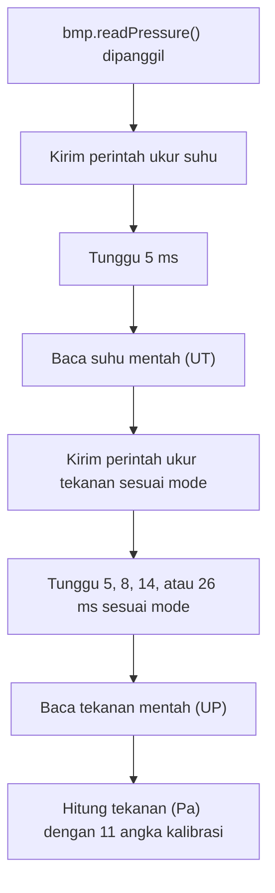

# BAB 28: BMP180 — Tekanan Udara & Ketinggian

> ✅ **Prasyarat:** Selesaikan **BAB 23 (I2C — Inter-Integrated Circuit)** — kamu sudah mengenal alamat I2C, *jumper cap*, dan register identitas (*chip-id*) BMP180. Pola `millis()` dari **BAB 16 (Non-Blocking Programming)** juga dipakai di sebagian besar program BAB ini.

Pernahkah telingamu terasa "pengang" saat pesawat lepas landas atau saat melewati jalan menanjak ke pegunungan? Penyebabnya adalah **tekanan udara** yang berubah: makin tinggi tempatmu, makin rendah tekanan udaranya. Di BAB ini kamu memakai sensor **BMP180** di kit untuk mengukur tekanan udara dan suhu, lalu mengubah tekanan menjadi perkiraan **ketinggian**. Prinsip yang sama dipakai jam tangan pendaki, HP, dan *drone* untuk mengetahui seberapa jauh mereka naik atau turun.

## 📌 Tujuan Pembelajaran

Setelah mempelajari BAB ini, kamu bisa:

- Menjelaskan apa itu tekanan udara, satuannya (Pa, hPa, mbar), dan kenapa tekanan turun saat kita naik.
- Menginstal dan memakai *library* **Adafruit BMP085 Library** untuk membaca suhu dan tekanan dari BMP180 di kit.
- Memilih mode *oversampling* BMP180 sesuai kebutuhan: lebih cepat atau lebih halus.
- Menghitung ketinggian dengan rumus barometrik dan menjelaskan kenapa rumus itu butuh tekanan permukaan laut setempat (QNH).
- Mencari QNH hari ini dari situs BMKG, dan sebaliknya menghitung tekanan permukaan laut dari ketinggian yang sudah diketahui.
- Membuat altimeter relatif yang mengukur perubahan tinggi, misalnya saat kit diangkat atau dibawa naik satu lantai.
- Mengenali modul BMP280/BME280 yang tidak bisa dibaca *library* BMP085, lalu tahu cara mengatasinya.

## 🧰 Yang Perlu Disiapkan

| Kebutuhan | Keterangan |
|---|---|
| *Hardware* | Kit Bluino ESP32 IoT Starter Shield + kabel USB **data** |
| Kabel *jumper* | Tidak perlu — BMP180 sudah tersambung ke IO21/IO22 lewat *jumper cap* (pastikan terpasang) |
| Komponen tambahan | Tidak ada |
| *Software* | Arduino IDE 2.x + *board package* **esp32** versi 3.3.x (lihat [BAB 5](../BAB-05/README.md)) |
| *Library* | **Adafruit BMP085 Library** by Adafruit, beserta **Adafruit BusIO** dan **Adafruit Unified Sensor** yang ikut terpasang (cara instal di [28.3.1](#2831-menginstal-library)) |
| Alat uji | **Serial Monitor** Arduino IDE (baud 115200); **Serial Plotter** (**Tools → Serial Plotter**) untuk Latihan 6 |
| Jaringan | ESP32 tidak perlu WiFi. Untuk mencari tekanan permukaan laut hari ini ([28.7.3](#2873-tekanan-permukaan-laut-qnh-dan-cara-mendapatkannya)), kamu butuh *browser* di laptop/HP yang tersambung ke internet |

## 📑 Daftar Isi

- [28.1 Mengenal Tekanan Udara dan BMP180](#281-mengenal-tekanan-udara-dan-bmp180)
- [28.2 BMP180 di Kit Bluino](#282-bmp180-di-kit-bluino)
- [28.3 Library Adafruit BMP085](#283-library-adafruit-bmp085)
- [28.4 Program 1: Membaca Suhu dan Tekanan Udara](#284-program-1-membaca-suhu-dan-tekanan-udara)
- [28.5 Mode Oversampling: Cepat atau Halus?](#285-mode-oversampling-cepat-atau-halus)
- [28.6 Program 2: Membandingkan Mode Oversampling](#286-program-2-membandingkan-mode-oversampling)
- [28.7 Dari Tekanan ke Ketinggian](#287-dari-tekanan-ke-ketinggian)
- [28.8 Program 3: Menghitung Ketinggian](#288-program-3-menghitung-ketinggian)
- [28.9 Program 4: Menghitung Tekanan Permukaan Laut](#289-program-4-menghitung-tekanan-permukaan-laut)
- [28.10 Program 5: Altimeter Relatif](#2810-program-5-altimeter-relatif)
- [28.11 BMP180, BMP280, atau BME280?](#2811-bmp180-bmp280-atau-bme280)
- [28.12 Troubleshooting](#2812-troubleshooting)
- [📝 Rangkuman](#-rangkuman)
- [💪 Latihan](#-latihan)
- [📚 Referensi](#-referensi)

---

## 28.1 Mengenal Tekanan Udara dan BMP180

### 28.1.1 Apa Itu Tekanan Udara?

Udara memang tidak terlihat, tetapi punya berat. Di atas kepalamu ada "tumpukan" udara setinggi puluhan kilometer, dan berat tumpukan itu menekan semua benda di bawahnya. Tekanan inilah yang disebut **tekanan udara** atau **tekanan atmosfer**.

Bayangkan kamu berbaring di bawah tumpukan kasur. Makin bawah posisimu, makin banyak kasur yang menindihmu. Kalau kamu pindah ke tengah tumpukan, kasur di atasmu berkurang sehingga tekanannya juga berkurang. Udara bekerja dengan cara yang sama: **di tempat yang tinggi, udara di atas kita lebih sedikit, jadi tekanannya lebih rendah.**

Satuan tekanan yang akan kamu temui di BAB ini:

| Satuan | Arti | Hubungan |
|---|---|---|
| Pa (*pascal*) | Satuan SI (Sistem Satuan Internasional): gaya 1 newton pada luas 1 m² | — |
| hPa (hektopascal) | 100 pascal; dipakai BMKG (Badan Meteorologi, Klimatologi, dan Geofisika) dan prakiraan cuaca | 1 hPa = 100 Pa |
| mbar (milibar) | Satuan lama; besarnya sama dengan hPa | 1 mbar = 1 hPa |
| atm (atmosfer standar) | Tekanan rata-rata di permukaan laut menurut atmosfer standar internasional | 1 atm = 1013,25 hPa = 101.325 Pa |

Di dekat permukaan laut di Indonesia, tekanan udara biasanya sekitar 1010 hPa. Angka itu setara dengan beban kira-kira 10 ton di setiap meter persegi! Kita tidak merasa tertindih karena tekanan itu datang dari segala arah, dan udara serta cairan di dalam tubuh menekan balik sama kuatnya.

> 📌 **Catatan:** *Library* BMP180 memberi hasil tekanan dalam **pascal**, sedangkan BMKG dan aplikasi cuaca memakai **hPa**. Jadi angka 101.325 Pa dari sensor sama dengan 1013,25 hPa. Membagi dengan 100 adalah langkah yang akan sering kamu lakukan di BAB ini.

### 28.1.2 Sensor BMP180

**BMP180** adalah sensor tekanan udara digital buatan Bosch Sensortec. Chip-nya hanya berukuran 3,6 × 3,8 mm, dan di kit chip itu sudah terpasang pada papan modul kecil. Di dalam chip ada beberapa bagian:

- **Elemen *piezoresistive*** — selaput silikon yang sangat tipis dan sedikit melengkung saat ditekan udara, seperti kulit gendang. Lengkungan itu mengubah hambatan listrik bahan di dalamnya, dan perubahan hambatan inilah yang diukur.
- **Sensor suhu** — dibutuhkan karena hasil elemen tekanan ikut terpengaruh suhu. Bonusnya, kamu juga bisa membaca suhu.
- **ADC** (*Analog-to-Digital Converter*, pengubah sinyal analog menjadi angka) — mengubah hasil pengukuran menjadi angka mentah: **UT** untuk suhu dan **UP** untuk tekanan.
- **EEPROM berisi 11 angka kalibrasi** — EEPROM adalah memori kecil yang isinya tidak hilang walaupun listrik dimatikan. Pabrik mengukur setiap chip dan menyimpan angka kalibrasinya di sini, jadi setiap BMP180 punya angka sendiri. ESP32 memakai angka-angka ini untuk mengubah UT dan UP menjadi suhu (°C) dan tekanan (Pa) yang sebenarnya.
- **Antarmuka I2C** — jalur komunikasi dengan ESP32.

Di [Program 4 BAB 23](../BAB-23/README.md#239-program-4-dua-sensor-di-satu-bus) kamu sudah menghitung suhu BMP180 sendiri dari register mentah dan angka kalibrasinya. Rumus tekanannya jauh lebih panjang, jadi di BAB ini semua hitungan itu diserahkan ke *library*.

> 📌 **Catatan:** BMP180 adalah penerus BMP085 dengan cara kerja dan register yang sama (*datasheet* menyebutnya *function compatible successor*). Itulah sebabnya *library*-nya bernama **Adafruit BMP085 Library** walaupun sensornya BMP180.

### 28.1.3 Spesifikasi Penting dari Datasheet

Angka-angka berikut diambil dari *datasheet* BMP180 (Bosch Sensortec, revisi 2.5). Cara membaca *datasheet* ini sudah kamu latih di [BAB 4](../BAB-04/README.md#47-contoh-terpandu-2-datasheet-bmp180).

| Parameter | Nilai | Artinya bagi kita |
|---|---|---|
| Rentang tekanan | 300–1100 hPa | Setara ketinggian sekitar −500 m sampai +9000 m dari permukaan laut |
| Resolusi data | Tekanan 0,01 hPa (1 Pa); suhu 0,1 °C | Perubahan terkecil yang bisa ditampilkan |
| Akurasi relatif tekanan | ±0,12 hPa (setara ±1 m), pada 950–1050 hPa dan 25 °C | Ketelitian saat **membandingkan** dua pengukuran, misalnya sebelum dan sesudah naik tangga |
| Akurasi absolut tekanan | −4,0 sampai +2,0 hPa (umumnya sekitar −1 hPa), pada 0–65 °C | Selisih angka sensor dari tekanan sebenarnya. Selisih 1 hPa saja sudah setara dengan sekitar 8 m ketinggian |
| Akurasi suhu | Umumnya ±0,5 °C pada 25 °C (maks. ±1,5 °C); maks. ±2 °C pada 0–65 °C | Cukup untuk suhu ruangan |
| Tegangan kerja | 1,8–3,6 V (modul di kit dicatu 3,3 V) | Batas mutlaknya 4,25 V — lihat [BAB 4](../BAB-04/README.md#472-langkah-2--kondisi-kerja) |
| Arus | Rata-rata 3–12 µA (1 pengukuran per detik, tergantung mode); 0,1 µA saat diam | Sangat hemat, cocok untuk perangkat bertenaga baterai |
| Waktu ukur | Suhu maks. 4,5 ms; tekanan maks. 4,5–25,5 ms (tergantung mode) | Dibahas di [28.5](#285-mode-oversampling-cepat-atau-halus) |
| Antarmuka | I2C, alamat `0x77` (tidak bisa diubah), sampai 3,4 MHz | Cara kerja I2C ada di [BAB 23](../BAB-23/README.md) |
| Stabilitas jangka panjang | ±1,0 hPa per 12 bulan | Angka sensor bisa bergeser pelan-pelan seiring umur |

Beda akurasi relatif dan absolut mirip timbangan badan yang jarumnya tidak pas di nol. Kalau jarumnya sudah menunjuk 1 kg sebelum kamu naik, berat badanmu selalu terbaca 1 kg terlalu berat — itu kesalahan **absolut**. Tetapi kalau kamu menimbang sebelum dan sesudah makan, **selisih** kedua hasil itu tetap benar — itu akurasi **relatif**. Karena itu BMP180 sangat baik untuk mengukur **perubahan** tinggi, sedangkan angka ketinggian **mutlak**-nya perlu dikalibrasi (dibahas di [28.7](#287-dari-tekanan-ke-ketinggian)).

---

## 28.2 BMP180 di Kit Bluino

### 28.2.1 Sambungan lewat Jumper Cap

BMP180 di kit berbagi bus I2C dengan OLED dan MPU-6050: SDA ke IO21 dan SCL ke IO22. Kamu **tidak perlu memasang kabel *jumper***, karena jalurnya sudah disambungkan oleh dua *jumper cap* (penutup *jumper* hitam).


*Gambar 28.1 — Blok BMP180 di skematik kit: VIN ke 3V3, GND ke GND, serta SCL dan SDA yang melewati header jumper 2 × 2 sebelum sampai ke IO22 dan IO21. Judul "Env. Sensor BME280/BMP280" adalah tulisan asli skematik, sedangkan modul yang tergambar dan terpasang di kit adalah BMP180. Sumber: skematik ESP32 Starter Shield 3.2, [Bluino](http://www.bluino.com).*


*Gambar 28.2 — Header jumper I2C di bawah MPU-6050. Dua jumper cap di sebelah kanan (SCL dan SDA di samping tulisan BMP180) menyambungkan BMP180 ke IO22 dan IO21. Sumber: foto produk [Bluino](http://www.bluino.com).*

Hal-hal yang perlu diperhatikan:

- Pastikan kedua *jumper cap* BMP180 terpasang. Letaknya di blok nomor 8 pada [Gambar 6.2 di BAB 6](../BAB-06/README.md#621-letak-header-di-kit). Kalau salah satunya lepas, BMP180 "hilang" dari bus, sedangkan OLED dan MPU-6050 tetap bekerja.
- Selalu **cabut USB** sebelum melepas atau memasang *jumper cap*.
- Jangan tancapkan kabel *jumper* lain ke pin berlabel `21` dan `22` di deretan pin ESP32 — kedua pin itu sudah dipakai bus I2C.
- Di PCB kit tidak ada resistor *pull-up* untuk jalur I2C. Tarikan ke HIGH berasal dari papan modul dan *pull-up* internal ESP32 (penjelasannya ada di [BAB 23](../BAB-23/README.md#2332-di-mana-resistor-pull-up-nya)), jadi kamu tidak perlu menambah apa pun.

### 28.2.2 Alamat I2C dan Chip-ID

| Hal | Nilai BMP180 | Keterangan |
|---|---|---|
| Alamat I2C (7 bit) | `0x77` | Tetap, tidak bisa diubah. *Datasheet* menulisnya dalam bentuk 8 bit: `0xEE` (tulis) dan `0xEF` (baca) |
| Register identitas (*chip-id*) | Register `0xD0` berisi `0x55` | Dipakai *library* untuk memastikan chip yang menjawab memang BMP180 |
| Tetangga di bus | OLED `0x3C`, MPU-6050 `0x68` | Alamatnya berbeda semua, jadi tidak bentrok |

Kalau ingin memastikan BMP180 terdeteksi sebelum mulai, jalankan [pemindai I2C di BAB 6](../BAB-06/README.md#68-program-2-pemindai-i2c) (seharusnya muncul `0x77 (BMP180)`) atau [Program 2 BAB 23](../BAB-23/README.md#237-program-2-membaca-register-identitas) yang membaca *chip-id*.

> ⚠️ **Perhatian:** Judul blok di skematik kit menyebut "BME280/BMP280". Kit yang dibahas di materi ini memakai BMP180, tetapi bisa saja sebagian kit dikirim dengan modul BMP280 atau BME280. Kedua chip itu **tidak bisa** dibaca *library* BMP085. Kalau Program 1 nanti melaporkan BMP280 atau BME280, baca [28.11](#2811-bmp180-bmp280-atau-bme280).

---

## 28.3 Library Adafruit BMP085

### 28.3.1 Menginstal Library

1. Buka Arduino IDE, lalu buka **Sketch → Include Library → Manage Libraries…** (Ctrl+Shift+I), atau klik ikon **Library Manager** (bergambar buku) di panel kiri.
2. Ketik `Adafruit BMP085` di kolom pencarian.
3. Pilih kartu **Adafruit BMP085 Library** dengan tulisan **by Adafruit**. Jangan tertukar dengan **Adafruit BMP085 Unified** — itu *library* lain dengan cara pemakaian yang berbeda.
4. Klik **INSTALL**. Saat muncul jendela **Install library dependencies**, klik **Install All** supaya **Adafruit BusIO** dan **Adafruit Unified Sensor** ikut terpasang. Tanpa **Adafruit BusIO**, program akan gagal di-*compile* dengan pesan `Adafruit_I2CDevice.h: No such file or directory`.
5. Instalasi selesai kalau kartu *library* menampilkan tulisan **installed** beserta nomor versinya. Materi ini diuji dengan versi 1.2.4.

Cara menginstal *library* secara umum dibahas di [BAB 5](../BAB-05/README.md#58-dasar-library-manager).

### 28.3.2 Fungsi-Fungsi yang Dipakai

| Fungsi | Kegunaan | Hasil |
|---|---|---|
| `Adafruit_BMP085 bmp;` | Membuat objek sensor bernama `bmp` | — |
| `bmp.begin()` | Memulai sensor dengan mode bawaan *ultra high resolution* | `true` kalau BMP180 ditemukan |
| `bmp.begin(mode)` | Memulai sensor dengan mode tertentu, misalnya `BMP085_STANDARD` (lihat [28.5](#285-mode-oversampling-cepat-atau-halus)) | `true` atau `false` |
| `bmp.readTemperature()` | Mengukur suhu | `float`, dalam °C (resolusi 0,1 °C) |
| `bmp.readPressure()` | Mengukur tekanan | `int32_t`, dalam **pascal** (bagi 100 untuk hPa) |
| `bmp.readAltitude(p0)` | Mengukur tekanan, lalu menghitung ketinggian | `float`, dalam meter. `p0` = tekanan permukaan laut dalam **pascal** (bawaan `101325`) |
| `bmp.readSealevelPressure(h)` | Mengukur tekanan, lalu menghitung tekanan permukaan laut | `int32_t`, dalam pascal. `h` = ketinggian lokasi dalam meter |

Yang dilakukan `bmp.begin()` di balik layar:

1. Menyalakan bus I2C dengan `Wire.begin()`. Kalau programmu sudah memanggil `Wire.begin(21, 22)`, panggilan kedua ini tidak mengubah apa pun.
2. Memanggil alamat `0x77`. Kalau tidak ada yang menjawab, hasilnya `false`.
3. Membaca register `0xD0`. Kalau isinya bukan `0x55`, hasilnya juga `false` — inilah yang terjadi kalau modulnya ternyata BMP280 atau BME280.
4. Membaca 11 angka kalibrasi dari EEPROM sensor.

Setiap fungsi `read...()` melakukan **pengukuran baru**. Jadi kalau kamu memanggil `bmp.readPressure()` lalu `bmp.readAltitude()`, sensor mengukur dua kali dan angkanya bisa sedikit berbeda. Di program-program BAB ini tekanan dibaca sekali, lalu ketinggian dihitung sendiri dari angka yang sama supaya hasil yang ditampilkan saling cocok.

> ⚠️ **Perhatian:** Satuan di *library* ini mudah tertukar. `readPressure()` menghasilkan **pascal**, bukan hPa, dan parameter `readAltitude()` juga harus dalam **pascal** (`101325`, bukan `1013.25`). Kalau kamu menulis `bmp.readAltitude(1013.25)`, hasilnya sekitar −62.000 m — jelas tidak masuk akal.

---

## 28.4 Program 1: Membaca Suhu dan Tekanan Udara

**Tujuan:** Membaca suhu (°C) dan tekanan udara (Pa dan hPa) dari BMP180 setiap 2 detik, lalu menampilkannya di Serial Monitor. Kalau BMP180 tidak ditemukan, program memeriksa alamat `0x77` dan `0x76`, lalu memberi tahu chip apa yang menjawab di sana — termasuk kalau yang terpasang ternyata BMP280 atau BME280.

**Rangkaian:**

*Tidak perlu merangkai — BMP180 sudah tersambung ke IO21 (SDA) dan IO22 (SCL) lewat* jumper cap *di kit. Pastikan saja kedua* jumper cap *BMP180 terpasang (lihat [28.2.1](#2821-sambungan-lewat-jumper-cap)).*

**Cara Menjalankan:**

1. Pastikan *jumper cap* BMP180 terpasang dan tidak ada kabel *jumper* di label `21`/`22`. Kabel *jumper* lain dari BAB sebelumnya boleh tetap terpasang.
2. Instal *library* **Adafruit BMP085 Library** kalau belum (lihat [28.3.1](#2831-menginstal-library)).
3. Buka Arduino IDE → **File → New Sketch**, hapus isinya, lalu salin kode di bawah. Kode yang sama juga tersedia di *file* [`p1_suhu_tekanan.ino`](p1_suhu_tekanan/p1_suhu_tekanan.ino).
4. Pastikan **Tools → Board** = **ESP32 Dev Module** dan **Tools → Port** = *port* ESP32 kamu (misalnya `COM5` di Windows atau `/dev/ttyUSB0` di Linux).
5. Klik tombol **Upload** (ikon panah →) dan tunggu sampai muncul tulisan **Done uploading**.
6. Buka **Serial Monitor** (**Tools → Serial Monitor**) lalu pilih baud **115200**. Kalau tulisan awalnya terlewat, tekan tombol **EN** di *board* ESP32.

**Kode Program:**

<!-- sketch: p1_suhu_tekanan -->
```cpp
/*
 * BAB 28 - Program 1: Membaca Suhu dan Tekanan Udara
 * Membaca suhu (°C) dan tekanan udara (Pa dan hPa) dari BMP180 setiap 2 detik.
 * Kalau BMP180 tidak ditemukan, program memeriksa alamat 0x77 dan 0x76,
 * lalu menampilkan chip apa yang menjawab di sana.
 *
 * Rangkaian: tidak perlu kabel. BMP180 tersambung ke
 * IO21 (SDA) dan IO22 (SCL) lewat jumper cap di kit.
 * Library: Adafruit BMP085 Library (by Adafruit)
 */

#include <Wire.h>
#include <Adafruit_BMP085.h>

#define PIN_SDA 21
#define PIN_SCL 22

const unsigned long JEDA_BACA = 2000;  // baca sensor setiap 2000 ms
unsigned long waktuBacaTerakhir = 0;

Adafruit_BMP085 bmp;  // objek sensor BMP180

// Membaca 1 byte dari sebuah register (pola dari BAB 23).
// Hasil: 0-255 kalau berhasil, -1 kalau perangkat tidak menjawab.
int bacaRegister(uint8_t alamat, uint8_t reg) {
  Wire.beginTransmission(alamat);
  Wire.write(reg);
  Wire.endTransmission(false);
  if (Wire.requestFrom(alamat, 1) != 1) {
    return -1;
  }
  return Wire.read();
}

// Dipanggil kalau bmp.begin() gagal: periksa apa yang ada di 0x77 dan 0x76
void periksaSensorTekanan() {
  const uint8_t daftarAlamat[] = {0x77, 0x76};
  bool adaYangMenjawab = false;

  for (int i = 0; i < 2; i++) {
    uint8_t alamat = daftarAlamat[i];
    Wire.beginTransmission(alamat);
    if (Wire.endTransmission() != 0) {
      continue;  // tidak ada perangkat di alamat ini, lanjut ke alamat berikutnya
    }
    adaYangMenjawab = true;

    int id = bacaRegister(alamat, 0xD0);  // register chip-id
    Serial.printf("  Ada perangkat di 0x%02X, chip-id ", alamat);
    if (id == 0x55) {
      Serial.println("0x55 = BMP180. Cabut USB beberapa detik, lalu coba lagi.");
    } else if (id == 0x58) {
      Serial.println("0x58 = BMP280. Library BMP085 tidak bisa membacanya (lihat 28.11).");
    } else if (id == 0x60) {
      Serial.println("0x60 = BME280. Library BMP085 tidak bisa membacanya (lihat 28.11).");
    } else if (id < 0) {
      Serial.println("tidak terbaca.");
    } else {
      Serial.printf("0x%02X = chip lain yang tidak dikenal.\n", id);
    }
  }

  if (!adaYangMenjawab) {
    Serial.println("  Tidak ada perangkat di 0x77 maupun 0x76.");
    Serial.println("  Cabut USB, lalu periksa jumper cap SCL/SDA milik BMP180.");
  }
}

void setup() {
  Serial.begin(115200);
  delay(1000);                   // beri waktu Serial Monitor tersambung
  Wire.begin(PIN_SDA, PIN_SCL);  // bus I2C kit: SDA = IO21, SCL = IO22

  Serial.println("BAB 28 - Program 1: Membaca Suhu dan Tekanan Udara");

  if (!bmp.begin()) {  // mode bawaan: ultra high resolution
    Serial.println("BMP180 tidak ditemukan! Hasil pemeriksaan:");
    periksaSensorTekanan();
    Serial.println("Program berhenti. Perbaiki dulu, lalu tekan tombol EN.");
    while (true) {
      delay(1000);  // berhenti di sini
    }
  }
  Serial.println("BMP180 siap.");
}

void loop() {
  if (millis() - waktuBacaTerakhir < JEDA_BACA) {
    return;  // belum 2 detik, keluar dulu dari loop()
  }
  waktuBacaTerakhir = millis();

  float suhu = bmp.readTemperature();      // °C
  int32_t tekananPa = bmp.readPressure();  // pascal (Pa)
  float tekananHPa = tekananPa / 100.0;    // 1 hPa = 100 Pa

  Serial.printf("Suhu: %.1f °C | Tekanan: %ld Pa = %.2f hPa\n",
                suhu, (long)tekananPa, tekananHPa);
}
```

**Penjelasan Kode:**

- **Library dan objek.** `#include <Adafruit_BMP085.h>` memuat *library*, lalu `Adafruit_BMP085 bmp;` membuat objek bernama `bmp`. Semua perintah ke sensor ditulis dalam bentuk `bmp.namaFungsi()`.
- **Bus I2C.** `Wire.begin(PIN_SDA, PIN_SCL)` menyalakan bus I2C di IO21 dan IO22. Sebenarnya `bmp.begin()` juga memanggil `Wire.begin()`, tetapi menulis pin secara lengkap membuat program lebih mudah dibaca, sama seperti di BAB 23.
- **`bmp.begin()`** memanggil alamat `0x77`, memeriksa *chip-id* `0x55`, lalu membaca angka kalibrasi. Tanpa parameter, sensor memakai mode *ultra high resolution*, mode yang paling halus (dibahas di [28.5](#285-mode-oversampling-cepat-atau-halus)).
- **Kalau gagal**, `periksaSensorTekanan()` memakai dua cara dari BAB sebelumnya: "memanggil" alamat tanpa data seperti pemindai I2C di BAB 6, lalu membaca register `0xD0` dengan `bacaRegister()` dari BAB 23. Alamat `0x76` ikut diperiksa karena BMP280 dan BME280 sering memakai alamat itu. Setelah itu program berhenti di perulangan `while (true)`.
- **Jadwal 2 detik** memakai `millis()` seperti di BAB 16: `loop()` langsung keluar kalau belum waktunya membaca.
- **Satuan.** `readTemperature()` menghasilkan `float` dalam °C. `readPressure()` menghasilkan `int32_t` (bilangan bulat 32 bit) dalam pascal. Pembaginya ditulis `100.0`, bukan `100`, karena pembagian dua bilangan bulat membuang angka di belakang koma: `100880 / 100` hasilnya `1008`, sedangkan `100880 / 100.0` hasilnya `1008.8`.
- **Mencetak `int32_t`.** Format `%ld` dipakai untuk bilangan bertipe `long`, jadi `tekananPa` diubah dulu dengan `(long)` supaya tipenya pasti cocok.

**Contoh Output:**

```text
BAB 28 - Program 1: Membaca Suhu dan Tekanan Udara
BMP180 siap.
Suhu: 29.4 °C | Tekanan: 100880 Pa = 1008.80 hPa
Suhu: 29.4 °C | Tekanan: 100883 Pa = 1008.83 hPa
Suhu: 29.5 °C | Tekanan: 100878 Pa = 1008.78 hPa
```

Angka di atas hanya contoh dari lokasi dekat permukaan laut; angkamu pasti berbeda. Di dataran tinggi tekanannya lebih kecil, misalnya sekitar 920 hPa di ketinggian 800 m. Angka tekanan juga naik-turun beberapa pascal walaupun kit diam — itu derau (*noise*) sensor yang wajar dan dibahas di [28.5](#285-mode-oversampling-cepat-atau-halus).

Kalau modul yang terpasang ternyata BMP280, hasilnya kira-kira seperti ini:

```text
BAB 28 - Program 1: Membaca Suhu dan Tekanan Udara
BMP180 tidak ditemukan! Hasil pemeriksaan:
  Ada perangkat di 0x76, chip-id 0x58 = BMP280. Library BMP085 tidak bisa membacanya (lihat 28.11).
Program berhenti. Perbaiki dulu, lalu tekan tombol EN.
```

Tidak ada yang menyala di kit; semua hasil muncul di Serial Monitor.

> 🧪 **Coba Sendiri:** Sentuhkan ujung jarimu ke papan modul BMP180 (jangan menekan chip-nya) selama sekitar 10 detik. Suhunya naik pelan-pelan, lalu turun lagi setelah jarimu dilepas. Coba juga turunkan kit dari meja ke lantai sejauh yang dimungkinkan kabel USB, lalu tahan diam beberapa detik: dekat permukaan laut, turun 1 m membuat tekanan naik sekitar 12 Pa. Perubahan sekecil ini mudah tertutup derau; [Program 5](#2810-program-5-altimeter-relatif) menampilkannya jauh lebih jelas.

**Kalau Belum Berhasil:**

- ***Error* `Adafruit_BMP085.h: No such file or directory` saat *compile*** → *library* belum terinstal. Ikuti [28.3.1](#2831-menginstal-library).
- ***Error* `Adafruit_I2CDevice.h: No such file or directory` saat *compile*** → **Adafruit BusIO** belum terpasang karena tombol **Install All** terlewat. Cari `Adafruit BusIO` di Library Manager, lalu instal.
- **Muncul `Tidak ada perangkat di 0x77 maupun 0x76.`** → *jumper cap* BMP180 lepas atau miring, atau ada kabel *jumper* yang tertancap di label `21`/`22`. Cabut USB, rapikan, lalu sambungkan lagi. [Pemindai I2C di BAB 6](../BAB-06/README.md#68-program-2-pemindai-i2c) membantu memastikan perangkat mana saja yang terdeteksi.
- **Chip-id `0x58` atau `0x60`** → modulmu BMP280 atau BME280. Baca [28.11](#2811-bmp180-bmp280-atau-bme280).
- **Serial Monitor kosong** → baud belum 115200 atau Serial Monitor dibuka terlambat. Tekan tombol **EN** di *board* untuk mengulang program.

---

## 28.5 Mode Oversampling: Cepat atau Halus?

### 28.5.1 Apa yang Terjadi Saat readPressure() Dipanggil?

Pola "kirim perintah → tunggu → baca hasil" yang kamu lihat di [Program 4 BAB 23](../BAB-23/README.md#239-program-4-dua-sensor-di-satu-bus) juga berlaku di sini. Setiap kali kamu memanggil `bmp.readPressure()`, *library* menjalankan langkah-langkah berikut:



*Gambar 28.3 — Langkah-langkah di dalam `bmp.readPressure()`. Selama menunggu, ESP32 tertahan di `delay()` milik library. Sumber: dibuat untuk materi ini berdasarkan alur pengukuran di datasheet BMP180 dan kode Adafruit BMP085 Library.*

Dua hal penting dari gambar di atas:

- **Suhu selalu ikut diukur**, karena rumus tekanan membutuhkan suhu terbaru. Jadi satu panggilan `readPressure()` berisi dua pengukuran.
- **Selama menunggu, *library* memakai `delay()`.** Satu panggilan `readPressure()` menahan program sekitar 10–31 ms, tergantung mode, sedangkan `readTemperature()` sekitar 5 ms. Untuk program yang membaca sensor setiap beberapa detik, ini tidak masalah. Tetapi selama itu `loop()` tidak bisa mengerjakan hal lain — ingat masalah kode *blocking* di [BAB 16](../BAB-16/README.md#161-kode-blocking-dan-masalah-delay).

### 28.5.2 Empat Mode Oversampling

***Oversampling*** artinya sensor mengukur tekanan beberapa kali di dalam chip, lalu merata-ratakannya menjadi satu hasil. Hasilnya lebih **halus**: **derau** (*noise*), yaitu naik-turun kecil angka walaupun tekanan sebenarnya tidak berubah, menjadi lebih kecil. Harganya, pengukuran butuh waktu lebih lama dan arus lebih besar. Mirip bertanya jam kepada delapan orang lalu merata-ratakan jawabannya: hasilnya lebih bisa dipercaya daripada bertanya ke satu orang, tetapi butuh waktu lebih lama.

BMP180 punya empat mode *oversampling* (Tabel 3 di *datasheet*):

| Mode (konstanta di *library*) | Jumlah sampel | Waktu ukur tekanan maks. (*datasheet*) | Waktu tunggu di *library* | Derau tipikal (RMS) | Arus rata-rata (1 pengukuran/detik) |
|---|---|---|---|---|---|
| *Ultra low power* (`BMP085_ULTRALOWPOWER`) | 1 | 4,5 ms | 5 ms | 0,06 hPa ≈ 0,5 m | 3 µA |
| *Standard* (`BMP085_STANDARD`) | 2 | 7,5 ms | 8 ms | 0,05 hPa ≈ 0,4 m | 5 µA |
| *High resolution* (`BMP085_HIGHRES`) | 4 | 13,5 ms | 14 ms | 0,04 hPa ≈ 0,3 m | 7 µA |
| *Ultra high resolution* (`BMP085_ULTRAHIGHRES`) — **bawaan** | 8 | 25,5 ms | 26 ms | 0,03 hPa ≈ 0,25 m | 12 µA |

Waktu tunggu di *library* adalah waktu maksimum dari *datasheet* yang dibulatkan ke atas. Ditambah pengukuran suhu (5 ms) dan waktu komunikasi I2C, satu panggilan `readPressure()` butuh sekitar 10 ms (*ultra low power*) sampai 31 ms (*ultra high resolution*).

**RMS** (*root mean square*) di kolom derau adalah ukuran "rata-rata besarnya" naik-turun angka. Selisih antara angka terbesar dan terkecil dari beberapa bacaan biasanya beberapa kali lebih besar daripada angka RMS ini, seperti yang akan kamu lihat di Program 2.

Cara memilih mode:

- **`bmp.begin()`** sama dengan `bmp.begin(BMP085_ULTRAHIGHRES)`: paling halus. Cocok untuk stasiun cuaca dan altimeter yang membaca sensor beberapa kali per detik atau lebih jarang.
- **`bmp.begin(BMP085_ULTRALOWPOWER)`**: paling cepat, tetapi deraunya dua kali lipat. Cocok kalau program harus membaca tekanan sesering mungkin.
- **`BMP085_STANDARD`** dan **`BMP085_HIGHRES`** adalah jalan tengah di antara keduanya.

> 💡 **Tips:** Derau juga bisa diredam dengan merata-ratakan beberapa bacaan di program, seperti di [Program 5](#2810-program-5-altimeter-relatif). *Datasheet* menyebut cara ini mode *advanced resolution*: beberapa bacaan mode *ultra high resolution* dirata-rata sehingga deraunya turun menjadi 0,02 hPa (≈ 0,17 m).

---

## 28.6 Program 2: Membandingkan Mode Oversampling

**Tujuan:** Menguji keempat mode satu per satu. Untuk setiap mode, program mengambil 20 bacaan tekanan, mengukur waktu satu bacaan dengan `micros()`, lalu menampilkan rata-rata tekanan dan rentang naik-turunnya. Dengan begitu kamu melihat sendiri tawar-menawar antara kecepatan dan kehalusan.

**Rangkaian:**

*Tidak perlu merangkai — sama seperti Program 1.*

**Cara Menjalankan:**

1. Letakkan kit di meja dan biarkan diam selama pengujian (sekitar 2 detik). Jauhkan dari kipas angin dan hembusan AC.
2. Buka Arduino IDE → **File → New Sketch**, hapus isinya, lalu salin kode di bawah. Kode yang sama juga tersedia di *file* [`p2_mode_oversampling.ino`](p2_mode_oversampling/p2_mode_oversampling.ino).
3. Pastikan **Tools → Board** = **ESP32 Dev Module** dan **Tools → Port** = *port* ESP32 kamu.
4. Klik tombol **Upload** (ikon panah →) dan tunggu sampai muncul tulisan **Done uploading**.
5. Buka **Serial Monitor** (**Tools → Serial Monitor**) lalu pilih baud **115200**. Pengujian hanya berjalan sekali; tekan tombol **EN** di *board* untuk mengulanginya.

**Kode Program:**

<!-- sketch: p2_mode_oversampling -->
```cpp
/*
 * BAB 28 - Program 2: Membandingkan Mode Oversampling
 * Untuk setiap mode, program mengambil 20 bacaan tekanan, lalu menampilkan
 * waktu satu bacaan, rata-rata tekanan, dan rentang naik-turunnya.
 *
 * Rangkaian: tidak perlu kabel. BMP180 tersambung ke
 * IO21 (SDA) dan IO22 (SCL) lewat jumper cap di kit.
 * Library: Adafruit BMP085 Library (by Adafruit)
 */

#include <Wire.h>
#include <Adafruit_BMP085.h>

#define PIN_SDA 21
#define PIN_SCL 22

const int JUMLAH_BACAAN = 20;  // jumlah bacaan untuk setiap mode
const int JUMLAH_MODE = 4;

// Keempat mode dan namanya (urutan kedua array harus sama)
const uint8_t daftarMode[JUMLAH_MODE] = {BMP085_ULTRALOWPOWER, BMP085_STANDARD,
                                         BMP085_HIGHRES, BMP085_ULTRAHIGHRES};
const char *namaMode[JUMLAH_MODE] = {"Ultra low power", "Standard",
                                     "High resolution", "Ultra high res."};

Adafruit_BMP085 bmp;

// Menguji satu mode, lalu mencetak satu baris hasil
void ujiMode(int i) {
  if (!bmp.begin(daftarMode[i])) {  // mulai ulang sensor dengan mode ini
    Serial.printf("%-16s | BMP180 tidak ditemukan\n", namaMode[i]);
    return;
  }

  int32_t terkecil = 200000;     // lebih besar dari tekanan mana pun
  int32_t terbesar = 0;
  long jumlah = 0;               // jumlah semua bacaan (Pa)
  unsigned long totalWaktu = 0;  // dalam mikrodetik

  for (int n = 0; n < JUMLAH_BACAAN; n++) {
    unsigned long mulai = micros();
    int32_t p = bmp.readPressure();  // Pa
    totalWaktu += micros() - mulai;

    jumlah += p;
    if (p < terkecil) {
      terkecil = p;
    }
    if (p > terbesar) {
      terbesar = p;
    }
  }

  float waktuMs = totalWaktu / 1000.0 / JUMLAH_BACAAN;  // waktu rata-rata satu bacaan
  float rataHPa = jumlah / 100.0 / JUMLAH_BACAAN;       // rata-rata tekanan (hPa)
  long rentangPa = terbesar - terkecil;                 // selisih terbesar dan terkecil
  float rentangM = rentangPa * 0.083;                   // dekat permukaan laut: 1 Pa ≈ 0,083 m

  Serial.printf("%-16s | %5.1f ms | %7.2f hPa | %3ld Pa (~%.1f m)\n",
                namaMode[i], waktuMs, rataHPa, rentangPa, rentangM);
}

void setup() {
  Serial.begin(115200);
  delay(1000);  // beri waktu Serial Monitor tersambung
  Wire.begin(PIN_SDA, PIN_SCL);

  Serial.println("BAB 28 - Program 2: Membandingkan Mode Oversampling");
  Serial.printf("Setiap mode dibaca %d kali. Biarkan kit diam di meja.\n", JUMLAH_BACAAN);
  Serial.printf("%-16s | %-8s | %-11s | %s\n", "Mode", "Waktu", "Rata-rata", "Naik-turun");

  for (int i = 0; i < JUMLAH_MODE; i++) {
    ujiMode(i);
  }
  Serial.println("Selesai. Tekan tombol EN untuk mengulang.");
}

void loop() {
  // Semua pengujian sudah dijalankan sekali di setup().
}
```

**Penjelasan Kode:**

- **Dua *array* sejajar.** `daftarMode` berisi konstanta mode dari *library*, sedangkan `namaMode` berisi namanya dengan urutan yang sama, seperti pola alamat dan nama di [Program 1 BAB 23](../BAB-23/README.md#235-program-1-memeriksa-perangkat-dan-kode-hasil).
- **Ganti mode dengan `begin()`.** `bmp.begin(daftarMode[i])` dipanggil ulang untuk setiap mode. Setiap kali dipanggil, *library* memeriksa *chip-id*, membaca kalibrasi, dan menyimpan mode yang baru.
- **Mengukur waktu.** `micros()` (dibahas di [BAB 16](../BAB-16/README.md#1614-mengukur-waktu-singkat-dengan-micros)) dicatat sebelum dan sesudah `readPressure()`. Selisihnya dijumlahkan, lalu dibagi 20 untuk mendapat waktu rata-rata satu bacaan dalam milidetik.
- **Rata-rata dan rentang.** Semua bacaan dijumlahkan untuk dicari rata-ratanya, sedangkan `terkecil` dan `terbesar` mencatat angka paling kecil dan paling besar. `terkecil` sengaja diberi nilai awal 200000 Pa — lebih besar dari tekanan mana pun — supaya bacaan pertama pasti menggantikannya.
- **Dari pascal ke meter.** Dekat permukaan laut, beda 1 hPa setara dengan beda ketinggian sekitar 8,3 m, jadi 1 Pa ≈ 0,083 m. Angka ini menunjukkan seberapa besar derau kalau nanti tekanan diubah menjadi ketinggian.
- **Format kolom.** `%-16s` mencetak teks rata kiri selebar 16 karakter, `%5.1f` mencetak angka desimal selebar 5 karakter dengan 1 angka di belakang titik, dan `%3ld` mencetak bilangan `long` selebar 3 karakter. Hasilnya berupa tabel yang rapi.

**Contoh Output:**

```text
BAB 28 - Program 2: Membandingkan Mode Oversampling
Setiap mode dibaca 20 kali. Biarkan kit diam di meja.
Mode             | Waktu    | Rata-rata   | Naik-turun
Ultra low power  |  10.1 ms | 1008.81 hPa |  23 Pa (~1.9 m)
Standard         |  13.1 ms | 1008.79 hPa |  17 Pa (~1.4 m)
High resolution  |  19.1 ms | 1008.80 hPa |  14 Pa (~1.2 m)
Ultra high res.  |  31.1 ms | 1008.78 hPa |  10 Pa (~0.8 m)
Selesai. Tekan tombol EN untuk mengulang.
```

Angka di atas hanya contoh. Waktunya biasanya hampir sama di setiap kit, sedangkan rentang naik-turunnya bisa berbeda setiap kali program dijalankan. Polanya yang penting: mode *ultra low power* sekitar tiga kali lebih cepat daripada mode *ultra high resolution*, tetapi angkanya naik-turun kira-kira dua kali lebih lebar.

**Kalau Belum Berhasil:**

- **Rentang naik-turun sangat besar (puluhan sampai ratusan Pa)** → kit bergerak, tertiup kipas atau AC, atau ada pintu yang dibuka-tutup. Ulangi dengan kit diam di tempat yang tenang.
- **Semua baris berisi `BMP180 tidak ditemukan`** → jalankan Program 1 untuk mencari penyebabnya.
- **Angka rentang berubah setiap kali program diulang, bahkan kadang mode *standard* lebih halus daripada *high resolution*** → itu wajar, karena derau bersifat acak dan 20 bacaan masih sedikit. Ubah `JUMLAH_BACAAN` menjadi 100 supaya polanya lebih jelas (pengujian jadi sekitar 7 detik).

---

## 28.7 Dari Tekanan ke Ketinggian

### 28.7.1 Kenapa Tekanan Turun Saat Kita Naik?

Ingat lagi analogi tumpukan kasur di [28.1.1](#2811-apa-itu-tekanan-udara). Ada satu hal tambahan: udara bisa dimampatkan. Udara di lapisan bawah tertekan oleh udara di atasnya sehingga lebih padat. Akibatnya, di dekat permukaan laut tekanan turun cukup cepat (sekitar 12 Pa setiap naik 1 m), sedangkan di tempat yang tinggi turunnya makin lambat. Jadi hubungan tekanan dan ketinggian **tidak** berupa garis lurus.

| Ketinggian | Tekanan menurut atmosfer standar | Penurunan tekanan setiap naik 1 m |
|---|---|---|
| 0 m (permukaan laut) | 1013,25 hPa | 12,0 Pa |
| 100 m | 1001,3 hPa | 11,9 Pa |
| 500 m | 954,6 hPa | 11,4 Pa |
| 1.000 m | 898,8 hPa | 10,9 Pa |
| 2.000 m | 795,0 hPa | 9,9 Pa |
| 3.000 m | 701,1 hPa | 8,9 Pa |
| 5.000 m | 540,2 hPa | 7,2 Pa |
| 9.000 m | 307,5 hPa | 4,6 Pa |

Tabel di atas dihitung dengan rumus di [28.7.2](#2872-rumus-barometrik). **Atmosfer standar internasional** (ISA, *International Standard Atmosphere*) adalah model udara "rata-rata" yang disepakati bersama: di permukaan laut tekanannya 1013,25 hPa dan suhunya 15 °C, lalu suhunya turun 6,5 °C setiap naik 1 km. Udara sungguhan hampir tidak pernah persis seperti model ini, jadi tekanan di tempatmu bisa berbeda beberapa hPa dari tabel.

### 28.7.2 Rumus Barometrik

*Datasheet* BMP180 (bagian 3.6) memberi rumus barometrik internasional untuk menghitung ketinggian dari tekanan:

```text
ketinggian = 44330 × (1 − (p ÷ p0) ^ 0,1903)
```

- **ketinggian** — dalam meter di atas permukaan laut (m dpl).
- **p** — tekanan yang diukur sensor.
- **p0** — tekanan di permukaan laut **saat ini** di daerahmu. Satuannya harus sama dengan p (sama-sama Pa atau sama-sama hPa).
- **44330** dan **0,1903** — konstanta dari model atmosfer standar. Angka 0,1903 sama dengan 1 ÷ 5,255; *datasheet* menuliskannya sebagai pangkat 1/5,255.
- **^** artinya "pangkat". Di kode C++, a pangkat b ditulis `pow(a, b)`.

Contoh hitungan dengan kalkulator ilmiah (misalnya aplikasi kalkulator di HP dalam mode *scientific*): sensor membaca p = 900 hPa, dan p0 = 1013,25 hPa.

1. p ÷ p0 = 900 ÷ 1013,25 = 0,88823
2. 0,88823 pangkat 0,1903 = 0,97770
3. 1 − 0,97770 = 0,02230
4. 44330 × 0,02230 ≈ 989

Jadi tempat itu kira-kira 989 m di atas permukaan laut. Untuk perkiraan cepat, ingat patokan ini: **dekat permukaan laut, beda 1 hPa setara dengan beda ketinggian sekitar 8,3 m**, atau naik 1 m membuat tekanan turun sekitar 0,12 hPa (12 Pa).

<details>
<summary><b>🔬 Pendalaman (opsional): Dari mana angka 44330 dan 5,255?</b></summary>

Dalam atmosfer standar, suhu di permukaan laut T0 = 288,15 K (15 °C), dan suhu itu turun L = 0,0065 K setiap naik 1 m. Dengan anggapan tersebut, hukum gas ideal dan keseimbangan gaya pada lapisan-lapisan udara menghasilkan rumus tekanan berikut:

```text
p = p0 × (1 − L × h ÷ T0) ^ (g × M ÷ (R × L))
```

- T0 ÷ L = 288,15 ÷ 0,0065 ≈ 44330 m
- g × M ÷ (R × L) = 9,80665 × 0,0289644 ÷ (8,31446 × 0,0065) ≈ 5,255, dengan g = percepatan gravitasi (m/s²), M = massa molar udara (kg/mol), dan R = konstanta gas (J/(mol·K)).

Kalau rumus itu dibalik untuk mencari h, hasilnya adalah rumus barometrik di atas. Bentuk aslinya juga dipakai untuk menghitung tekanan permukaan laut dari ketinggian yang diketahui, seperti di [Program 4](#289-program-4-menghitung-tekanan-permukaan-laut):

```text
p0 = p ÷ (1 − h ÷ 44330) ^ 5,255
```

</details>

### 28.7.3 Tekanan Permukaan Laut (QNH) dan Cara Mendapatkannya

Rumus barometrik membutuhkan p0, padahal tekanan di permukaan laut **tidak tetap**: nilainya berubah mengikuti cuaca dan waktu. Angka 1013,25 hPa hanyalah rata-rata dalam atmosfer standar. Di Indonesia, tekanan permukaan laut biasanya sekitar 1010 hPa dan sedikit naik-turun setiap hari.

Kalau p0 yang kamu pakai meleset, hasil ketinggian ikut meleset. Misalnya tekanan permukaan laut hari ini 1010 hPa, tetapi program memakai 1013,25 hPa. Selisihnya 3,25 hPa × 8,3 m ≈ **27 m** — kit yang sebenarnya berada 10 m di atas permukaan laut bisa dilaporkan berada di ketinggian 37 m (lihat contoh di Program 3)!

Untungnya, bandara melaporkan nilai yang tepat untuk keperluan ini, yaitu **QNH**: tekanan udara bandara yang "diturunkan" ke permukaan laut dengan rumus atmosfer standar. Pilot memasukkan QNH ke altimeter pesawat supaya altimeternya menunjukkan ketinggian di atas permukaan laut. QNH adalah p0 yang dibutuhkan rumus kita.

QNH dimuat di **METAR**, yaitu laporan cuaca bandara dalam format singkat yang diterbitkan setiap 30 menit atau 1 jam. Setiap bandara punya **kode ICAO**, yaitu kode 4 huruf dari Organisasi Penerbangan Sipil Internasional (*International Civil Aviation Organization*); bandara di Indonesia diawali huruf W. Cara melihat METAR di situs cuaca penerbangan BMKG:

1. Buka *browser* di laptop atau HP, lalu kunjungi [web-aviation.bmkg.go.id](https://web-aviation.bmkg.go.id).
2. Pilih menu **Pengamatan → Metar / Speci**.
3. Di kolom stasiun, ketik kode ICAO bandara terdekat, misalnya `WIII` (Soekarno-Hatta, Jakarta), `WARR` (Juanda, Surabaya), `WAHI` (Yogyakarta International Airport), atau `WADD` (I Gusti Ngurah Rai, Bali). Kolom tanggal sudah terisi otomatis dengan rentang 12 jam terakhir, jadi langsung klik **Cari**.
4. Laporan terbaru ada di baris paling atas. Cari kelompok huruf **Q** yang diikuti 4 angka.

Contoh laporan METAR dari Bandara Soekarno-Hatta:

```text
METAR WIII 231330Z 16005KT 120V200 7000 SCT020 29/24 Q1010 NOSIG
```

| Bagian | Arti |
|---|---|
| `WIII` | Kode ICAO bandara (Soekarno-Hatta, Jakarta) |
| `231330Z` | Tanggal 23, pukul 13.30 UTC atau waktu universal (WIB = UTC + 7 jam, jadi pukul 20.30 WIB) |
| `29/24` | Suhu udara 29 °C, titik embun 24 °C |
| `Q1010` | **QNH = 1010 hPa** — angka inilah yang kamu pakai sebagai p0 |

Kode ICAO bandara lain bisa dicari di internet dengan kata kunci `kode ICAO bandara` diikuti nama kotamu. Laporan yang sama juga bisa dibuka di situs NOAA (badan cuaca dan kelautan Amerika Serikat): ketik alamat `https://aviationweather.gov/api/data/metar?ids=WIII&format=raw` di *browser*, dengan `WIII` diganti kode bandaramu. Hasilnya berupa satu baris teks METAR terbaru. Aplikasi cuaca di HP yang menampilkan "tekanan" atau "*pressure*" dalam hPa (atau mbar) biasanya juga memakai tekanan permukaan laut, tetapi sumber dan ketelitiannya tidak selalu jelas.

> 📌 **Catatan:** QNH berlaku untuk daerah di sekitar bandara dan bisa berubah setiap jam. Makin jauh lokasimu dari bandara dan makin lama sejak laporan dibuat, hasilnya makin kurang tepat. Selain itu, akurasi absolut BMP180 (−4 sampai +2 hPa) tetap bisa menggeser ketinggian beberapa puluh meter. Hasil yang paling tepat didapat dengan kalibrasi memakai ketinggian yang diketahui, seperti di [Program 4](#289-program-4-menghitung-tekanan-permukaan-laut).

### 28.7.4 Kenapa Angka Ketinggian Berubah-ubah Walaupun Kit Diam?

Kalau kamu menjalankan program ketinggian berjam-jam, angkanya akan bergeser walaupun kit tidak dipindahkan. Penyebabnya:

| Penyebab | Besarnya kira-kira | Keterangan |
|---|---|---|
| Derau sensor | 0,03–0,06 hPa (RMS) ≈ 0,25–0,5 m | Tergantung mode ([28.5](#285-mode-oversampling-cepat-atau-halus)); bisa diredam dengan merata-ratakan beberapa bacaan |
| Pasang surut atmosfer harian | Sekitar ±1 hPa ≈ ±8 m | Di daerah tropis, tekanan udara naik-turun dua kali sehari: tertinggi sekitar pukul 10 dan 22, terendah sekitar pukul 4 dan 16 waktu setempat |
| Perubahan cuaca | Beberapa hPa ≈ puluhan meter | Misalnya saat ada daerah tekanan rendah atau badai |
| Angin, AC, pintu dibanting | Sesaat | Aliran udara dan pintu yang ditutup keras mengubah tekanan di ruangan sebentar |
| Perubahan suhu sensor | Kecil | Kompensasi suhu di dalam chip tidak sempurna; jauhkan sensor dari sumber panas |

Kesimpulannya, barometer sangat bagus untuk mengukur **perubahan** tinggi dalam waktu singkat — misalnya naik tangga dalam satu menit — tetapi kurang bisa diandalkan untuk ketinggian **mutlak** dalam jangka panjang, kecuali p0 terus diperbarui. Itulah sebabnya pilot selalu meminta QNH terbaru sebelum mendarat. [Program 5](#2810-program-5-altimeter-relatif) memanfaatkan kelebihan ini untuk mengukur perubahan tinggi.

---

## 28.8 Program 3: Menghitung Ketinggian

**Tujuan:** Membaca tekanan setiap 2 detik, lalu menghitung ketinggian di atas permukaan laut dengan rumus barometrik. Nilai p0 kamu isi sendiri, sehingga kamu bisa melihat langsung pengaruh QNH yang tepat terhadap hasilnya.

**Rangkaian:**

*Tidak perlu merangkai — sama seperti Program 1.*

**Cara Menjalankan:**

1. Cari QNH bandara terdekat seperti di [28.7.3](#2873-tekanan-permukaan-laut-qnh-dan-cara-mendapatkannya), misalnya `Q1010` (artinya 1010 hPa).
2. Buka Arduino IDE → **File → New Sketch**, hapus isinya, lalu salin kode di bawah. Kode yang sama juga tersedia di *file* [`p3_ketinggian.ino`](p3_ketinggian/p3_ketinggian.ino).
3. Pastikan **Tools → Board** = **ESP32 Dev Module** dan **Tools → Port** = *port* ESP32 kamu.
4. Klik tombol **Upload** (ikon panah →) dan tunggu sampai muncul tulisan **Done uploading**.
5. Buka **Serial Monitor** (**Tools → Serial Monitor**) lalu pilih baud **115200**. Catat ketinggian yang muncul — saat ini program masih memakai p0 = 1013,25 hPa.
6. Ganti angka `1013.25` di baris `const float TEKANAN_LAUT_HPA` dengan QNH yang kamu temukan, misalnya `1010.0`. *Upload* lagi, lalu bandingkan hasilnya dengan catatanmu.

**Kode Program:**

<!-- sketch: p3_ketinggian -->
```cpp
/*
 * BAB 28 - Program 3: Menghitung Ketinggian
 * Membaca tekanan udara setiap 2 detik, lalu menghitung ketinggian
 * di atas permukaan laut dengan rumus barometrik dari datasheet BMP180.
 *
 * Rangkaian: tidak perlu kabel. BMP180 tersambung ke
 * IO21 (SDA) dan IO22 (SCL) lewat jumper cap di kit.
 * Library: Adafruit BMP085 Library (by Adafruit)
 */

#include <Wire.h>
#include <Adafruit_BMP085.h>

#define PIN_SDA 21
#define PIN_SCL 22

// Tekanan permukaan laut (p0) dalam hPa. 1013.25 = atmosfer standar.
// Ganti dengan QNH bandara terdekat hari ini, misalnya 1010.0 untuk Q1010.
const float TEKANAN_LAUT_HPA = 1013.25;

const unsigned long JEDA_BACA = 2000;  // baca sensor setiap 2000 ms
unsigned long waktuBacaTerakhir = 0;

Adafruit_BMP085 bmp;

// Rumus barometrik: ketinggian (meter) dari tekanan p dan tekanan permukaan laut p0.
// p dan p0 harus bersatuan sama (di program ini keduanya dalam pascal).
float hitungKetinggian(float p, float p0) {
  return 44330.0 * (1.0 - pow(p / p0, 0.1903));
}

void setup() {
  Serial.begin(115200);
  delay(1000);  // beri waktu Serial Monitor tersambung
  Wire.begin(PIN_SDA, PIN_SCL);

  Serial.println("BAB 28 - Program 3: Menghitung Ketinggian");
  if (!bmp.begin()) {
    Serial.println("BMP180 tidak ditemukan! Jalankan Program 1 untuk memeriksa.");
    while (true) {
      delay(1000);  // berhenti di sini
    }
  }
  Serial.printf("Tekanan permukaan laut (p0): %.2f hPa\n", TEKANAN_LAUT_HPA);
}

void loop() {
  if (millis() - waktuBacaTerakhir < JEDA_BACA) {
    return;  // belum 2 detik
  }
  waktuBacaTerakhir = millis();

  int32_t tekananPa = bmp.readPressure();  // tekanan dibaca sekali saja (Pa)
  float ketinggian = hitungKetinggian(tekananPa, TEKANAN_LAUT_HPA * 100.0);  // p0: hPa -> Pa

  Serial.printf("Tekanan: %.2f hPa | Ketinggian: %.1f m dpl\n",
                tekananPa / 100.0, ketinggian);
}
```

**Penjelasan Kode:**

- **`TEKANAN_LAUT_HPA`** ditulis dalam hPa karena QNH dari bandara juga dalam hPa. Karena tekanan dari sensor dalam pascal, p0 dikalikan 100 dulu sebelum dimasukkan ke rumus, sehingga keduanya sama-sama pascal. Di dalam kode, angka desimal memakai titik (`1010.0`), bukan koma.
- **`hitungKetinggian()`** adalah rumus barometrik dari [28.7.2](#2872-rumus-barometrik). Fungsi `pow(a, b)` (a pangkat b) sudah tersedia di Arduino tanpa perlu `#include` tambahan.
- **Tekanan dibaca sekali**, lalu angka yang sama dipakai untuk menghitung ketinggian. *Library* sebenarnya punya fungsi siap pakai `bmp.readAltitude(TEKANAN_LAUT_HPA * 100.0)` dengan rumus yang sama, tetapi fungsi itu melakukan pengukuran baru, sehingga tekanan yang dicetak dan ketinggiannya berasal dari dua bacaan yang berbeda.
- **`m dpl`** artinya meter di atas permukaan laut. Hasil dicetak dengan 1 angka desimal (`%.1f`), tetapi ingat bahwa derau sensor saja sudah sekitar ±0,25 m.

**Contoh Output:**

Dengan p0 = 1013,25 hPa (angka bawaan):

```text
BAB 28 - Program 3: Menghitung Ketinggian
Tekanan permukaan laut (p0): 1013.25 hPa
Tekanan: 1008.80 hPa | Ketinggian: 37.1 m dpl
Tekanan: 1008.82 hPa | Ketinggian: 36.9 m dpl
Tekanan: 1008.79 hPa | Ketinggian: 37.2 m dpl
```

Di tempat yang sama, setelah p0 diganti dengan QNH hari itu (1010 hPa):

```text
BAB 28 - Program 3: Menghitung Ketinggian
Tekanan permukaan laut (p0): 1010.00 hPa
Tekanan: 1008.80 hPa | Ketinggian: 10.0 m dpl
Tekanan: 1008.82 hPa | Ketinggian: 9.9 m dpl
Tekanan: 1008.79 hPa | Ketinggian: 10.1 m dpl
```

Angka di atas adalah contoh dari tempat yang tingginya sekitar 10 m di atas permukaan laut. Tekanan yang diukur sama persis, tetapi hasil ketinggiannya berbeda 27 m hanya karena p0-nya berbeda. Angkamu tentu berbeda, tergantung lokasi dan cuaca hari itu.

**Kalau Belum Berhasil:**

- **Ketinggian meleset puluhan meter dari ketinggian yang kamu tahu** → p0 belum diganti dengan QNH terbaru, bandaranya jauh, atau sensornya punya selisih absolut (−4 sampai +2 hPa). Kalibrasi dengan [Program 4](#289-program-4-menghitung-tekanan-permukaan-laut).
- **Ketinggian bernilai negatif di dekat pantai** → bisa terjadi karena hal yang sama. Satu hPa saja setara dengan sekitar 8 m.
- **Ketinggian sekitar −62.000 m atau angka aneh lainnya** → satuan p dan p0 tidak sama, misalnya p0 lupa dikalikan 100 sehingga hPa bertemu pascal.
- **Ketinggian pelan-pelan bergeser walaupun kit diam** → itu normal; lihat [28.7.4](#2874-kenapa-angka-ketinggian-berubah-ubah-walaupun-kit-diam).

---

## 28.9 Program 4: Menghitung Tekanan Permukaan Laut

**Tujuan:** Kebalikan dari Program 3. Kalau ketinggian lokasimu sudah diketahui, program ini menghitung tekanan permukaan laut (p0) dari tekanan yang terukur. Hasilnya bisa dibandingkan dengan QNH dari BMKG, atau dipakai sebagai `TEKANAN_LAUT_HPA` di Program 3 supaya ketinggian yang ditampilkan tepat untuk lokasimu.

Perhitungan ini juga dipakai stasiun cuaca. Bayangkan dua stasiun cuaca, satu di kota pesisir dan satu di kota pegunungan. Stasiun di pegunungan **selalu** mencatat tekanan yang jauh lebih rendah — bukan karena cuacanya buruk, tetapi karena letaknya tinggi. Supaya keduanya bisa dibandingkan, tekanan setiap stasiun "diturunkan" dulu ke permukaan laut.

**Cara mengetahui ketinggian lokasimu:**

- **Google Earth Pro** (aplikasi desktop gratis dari Google): arahkan kursor ke lokasimu, lalu baca angka ketinggian tanah (*elev*) di bilah status bagian bawah jendela. Kalau bilah statusnya tidak tampak, nyalakan lewat **View → Status Bar**. Pastikan satuannya meter: buka **Tools → Options**, tab **3D View**, lalu di bagian **Units of Measurement** pilih **Meters, Kilometers**.
- Tambahkan tinggi posisi kit di atas tanah, misalnya sekitar 3–4 m untuk setiap lantai di atas lantai dasar, ditambah tinggi meja.
- GPS di HP juga bisa menampilkan ketinggian, tetapi ketelitiannya sering hanya sampai belasan meter.

**Rangkaian:**

*Tidak perlu merangkai — sama seperti Program 1.*

**Cara Menjalankan:**

1. Cari ketinggian lokasimu dengan salah satu cara di atas.
2. Buka Arduino IDE → **File → New Sketch**, hapus isinya, lalu salin kode di bawah. Kode yang sama juga tersedia di *file* [`p4_tekanan_permukaan_laut.ino`](p4_tekanan_permukaan_laut/p4_tekanan_permukaan_laut.ino).
3. Ganti angka `10.0` di baris `const float KETINGGIAN_LOKASI_M` dengan ketinggian lokasimu dalam meter.
4. Pastikan **Tools → Board** = **ESP32 Dev Module** dan **Tools → Port** = *port* ESP32 kamu.
5. Klik tombol **Upload** (ikon panah →) dan tunggu sampai muncul tulisan **Done uploading**.
6. Buka **Serial Monitor** (**Tools → Serial Monitor**) lalu pilih baud **115200**. Bandingkan hasilnya dengan QNH bandara terdekat (lihat [28.7.3](#2873-tekanan-permukaan-laut-qnh-dan-cara-mendapatkannya)).

**Kode Program:**

<!-- sketch: p4_tekanan_permukaan_laut -->
```cpp
/*
 * BAB 28 - Program 4: Menghitung Tekanan Permukaan Laut
 * Kalau ketinggian lokasi sudah diketahui, program ini menghitung tekanan
 * permukaan laut (p0) dari tekanan yang terukur, setiap 2 detik.
 * Hasilnya bisa dibandingkan dengan QNH dari BMKG atau dipakai di Program 3.
 *
 * Rangkaian: tidak perlu kabel. BMP180 tersambung ke
 * IO21 (SDA) dan IO22 (SCL) lewat jumper cap di kit.
 * Library: Adafruit BMP085 Library (by Adafruit)
 */

#include <Wire.h>
#include <Adafruit_BMP085.h>

#define PIN_SDA 21
#define PIN_SCL 22

// Ketinggian tempat kit berada, dalam meter di atas permukaan laut.
// Ganti dengan ketinggian lokasimu.
const float KETINGGIAN_LOKASI_M = 10.0;

const unsigned long JEDA_BACA = 2000;  // baca sensor setiap 2000 ms
unsigned long waktuBacaTerakhir = 0;

Adafruit_BMP085 bmp;

// Kebalikan rumus barometrik: tekanan permukaan laut dari tekanan p yang
// terukur di ketinggian tertentu (meter). Satuan hasilnya sama dengan satuan p.
float hitungTekananLaut(float p, float ketinggian) {
  return p / pow(1.0 - ketinggian / 44330.0, 5.255);
}

void setup() {
  Serial.begin(115200);
  delay(1000);  // beri waktu Serial Monitor tersambung
  Wire.begin(PIN_SDA, PIN_SCL);

  Serial.println("BAB 28 - Program 4: Menghitung Tekanan Permukaan Laut");
  if (!bmp.begin()) {
    Serial.println("BMP180 tidak ditemukan! Jalankan Program 1 untuk memeriksa.");
    while (true) {
      delay(1000);  // berhenti di sini
    }
  }
  Serial.printf("Ketinggian lokasi: %.1f m dpl\n", KETINGGIAN_LOKASI_M);
}

void loop() {
  if (millis() - waktuBacaTerakhir < JEDA_BACA) {
    return;  // belum 2 detik
  }
  waktuBacaTerakhir = millis();

  int32_t tekananPa = bmp.readPressure();  // tekanan di lokasi ini (Pa)
  float tekananLautPa = hitungTekananLaut(tekananPa, KETINGGIAN_LOKASI_M);

  Serial.printf("Tekanan terukur: %.2f hPa | Tekanan permukaan laut: %.2f hPa\n",
                tekananPa / 100.0, tekananLautPa / 100.0);
}
```

**Penjelasan Kode:**

- **`hitungTekananLaut()`** memakai rumus kebalikan dari *datasheet* (bagian 3.7): p0 = p ÷ (1 − h ÷ 44330) pangkat 5,255. Pembaginya selalu sedikit lebih kecil dari 1 (sekitar 0,9988 untuk ketinggian 10 m), sehingga hasilnya selalu lebih besar daripada tekanan terukur. Makin tinggi lokasinya, makin besar koreksinya.
- **Satuan hasil sama dengan satuan masukan.** Karena `tekananPa` dalam pascal, hasilnya juga pascal, lalu dibagi 100 saat dicetak supaya menjadi hPa seperti QNH.
- ***Library* juga punya fungsi siap pakai** `bmp.readSealevelPressure(KETINGGIAN_LOKASI_M)` dengan rumus yang sama. Hasilnya dalam pascal (`int32_t`), dan fungsi itu melakukan pengukuran baru.

**Contoh Output:**

```text
BAB 28 - Program 4: Menghitung Tekanan Permukaan Laut
Ketinggian lokasi: 10.0 m dpl
Tekanan terukur: 1008.72 hPa | Tekanan permukaan laut: 1009.92 hPa
Tekanan terukur: 1008.74 hPa | Tekanan permukaan laut: 1009.94 hPa
Tekanan terukur: 1008.71 hPa | Tekanan permukaan laut: 1009.91 hPa
```

Angka di atas hanya contoh. Pada contoh ini, laporan METAR bandara terdekat berisi `Q1010`, jadi selisihnya hanya sekitar 0,1 hPa. Selisih sampai 1–2 hPa masih wajar karena akurasi absolut sensor, jarak ke bandara, beda waktu laporan, dan ketinggian lokasi yang kurang tepat (salah 10 m saja sudah setara dengan sekitar 1,2 hPa).

> 💡 **Tips:** Inilah cara mengalibrasi Program 3. Salin angka tekanan permukaan laut dari program ini ke `TEKANAN_LAUT_HPA` di Program 3. Selisih sensor dan pengaruh cuaca saat itu ikut "terkoreksi", sehingga Program 3 menunjukkan ketinggian lokasimu dengan tepat — setidaknya sampai cuaca berubah dan kalibrasinya perlu diulang.

**Kalau Belum Berhasil:**

- **Hasil berbeda lebih dari 5 hPa dari QNH** → periksa angka ketinggian lokasi. Kesalahan yang sering terjadi: Google Earth Pro masih memakai satuan kaki (*feet*), atau tinggi lantai belum ditambahkan.
- **Program 3 yang sudah dikalibrasi kembali meleset keesokan harinya** → tekanan permukaan laut berubah mengikuti cuaca dan waktu. Jalankan lagi program ini untuk mendapat angka kalibrasi yang baru.
- **Angka ikut naik-turun sekitar 0,1 hPa** → itu derau sensor yang wajar. Ambil rata-rata beberapa baris sebelum membandingkannya dengan QNH.

---

## 28.10 Program 5: Altimeter Relatif

**Tujuan:** Membuat altimeter yang mengukur **perubahan** tinggi. Saat program mulai, tekanan di tempat itu dicatat sebagai "titik nol". Setelah itu, setiap 0,5 detik program menampilkan seberapa tinggi atau rendah posisi kit dibandingkan titik nol. Program ini tidak butuh QNH, karena yang diukur hanya selisihnya.

Program ini menggabungkan tiga teknik:

- **Rata-rata bergerak** (*moving average*): program menyimpan 8 bacaan terakhir dan memakai rata-ratanya. Setiap bacaan baru menggantikan bacaan paling lama, seperti antrean 8 orang yang selalu diperbarui. Hasilnya, derau berkurang tanpa harus menunggu lama.
- **Dua tugas dengan `millis()`**: satu tugas membaca sensor setiap 100 ms, tugas lain menampilkan hasil setiap 500 ms, seperti di [BAB 16](../BAB-16/README.md#166-menjalankan-beberapa-tugas-sekaligus).
- **Pemeriksaan bacaan**: sebelum membaca, program memastikan BMP180 masih menjawab di bus I2C, lalu menolak hasil di luar rentang 300–1100 hPa. Ini penting karena *library* tidak memeriksa apakah komunikasi I2C-nya berhasil — kalau sensor tiba-tiba lepas, ia tetap menghitung dari data acak.

**Rangkaian:**

*Tidak perlu merangkai — sama seperti Program 1.*

**Cara Menjalankan:**

1. Letakkan kit di meja dan biarkan diam.
2. Buka Arduino IDE → **File → New Sketch**, hapus isinya, lalu salin kode di bawah. Kode yang sama juga tersedia di *file* [`p5_altimeter_relatif.ino`](p5_altimeter_relatif/p5_altimeter_relatif.ino).
3. Pastikan **Tools → Board** = **ESP32 Dev Module** dan **Tools → Port** = *port* ESP32 kamu.
4. Klik tombol **Upload** (ikon panah →) dan tunggu sampai muncul tulisan **Done uploading**.
5. Buka **Serial Monitor** (**Tools → Serial Monitor**) lalu pilih baud **115200**. Tunggu sampai muncul tulisan `Titik nol: ...`.
6. Turunkan kit dari meja ke lantai sejauh yang dimungkinkan kabel USB, tahan diam beberapa detik, lalu kembalikan ke meja. Kalau ingin perubahan yang lebih besar, bawa laptop dan kit naik satu lantai.
7. Tekan tombol **EN** di *board* kapan saja untuk menentukan titik nol yang baru.

**Kode Program:**

<!-- sketch: p5_altimeter_relatif -->
```cpp
/*
 * BAB 28 - Program 5: Altimeter Relatif
 * Saat program mulai, tekanan di tempat itu dicatat sebagai "titik nol".
 * Setelah itu, setiap 0,5 detik program menampilkan perubahan tinggi (meter)
 * terhadap titik nol. Tekan tombol EN untuk menentukan titik nol yang baru.
 *
 * Rangkaian: tidak perlu kabel. BMP180 tersambung ke
 * IO21 (SDA) dan IO22 (SCL) lewat jumper cap di kit.
 * Library: Adafruit BMP085 Library (by Adafruit)
 */

#include <Wire.h>
#include <Adafruit_BMP085.h>

#define PIN_SDA 21
#define PIN_SCL 22
#define ALAMAT_BMP180 0x77

const int JUMLAH_RATA = 8;              // banyaknya bacaan terakhir yang dirata-rata
const unsigned long JEDA_BACA = 100;    // ambil satu bacaan setiap 100 ms
const unsigned long JEDA_TAMPIL = 500;  // tampilkan hasil setiap 500 ms

Adafruit_BMP085 bmp;

float daftarBacaan[JUMLAH_RATA];  // bacaan-bacaan terakhir (Pa)
int posisi = 0;                   // tempat menyimpan bacaan berikutnya
float tekananNol = 0;             // tekanan di titik nol (Pa)
bool sensorBermasalah = false;    // true kalau bacaan terakhir gagal

unsigned long waktuBacaTerakhir = 0;
unsigned long waktuTampilTerakhir = 0;

// Rumus barometrik (sama seperti Program 3)
float hitungKetinggian(float p, float p0) {
  return 44330.0 * (1.0 - pow(p / p0, 0.1903));
}

// Membaca tekanan dengan pemeriksaan. Hasil: true kalau bacaan bisa dipercaya.
bool bacaTekanan(float &hasilPa) {
  Wire.beginTransmission(ALAMAT_BMP180);  // apakah BMP180 masih menjawab?
  if (Wire.endTransmission() != 0) {
    return false;
  }
  int32_t p = bmp.readPressure();
  if (p < 30000 || p > 110000) {  // di luar rentang BMP180 (300-1100 hPa)
    return false;
  }
  hasilPa = p;
  return true;
}

// Rata-rata semua bacaan yang tersimpan di daftarBacaan
float rataRataBacaan() {
  float jumlah = 0;
  for (int i = 0; i < JUMLAH_RATA; i++) {
    jumlah += daftarBacaan[i];
  }
  return jumlah / JUMLAH_RATA;
}

void setup() {
  Serial.begin(115200);
  delay(1000);  // beri waktu Serial Monitor tersambung
  Wire.begin(PIN_SDA, PIN_SCL);

  Serial.println("BAB 28 - Program 5: Altimeter Relatif");
  if (!bmp.begin(BMP085_ULTRAHIGHRES)) {  // mode paling halus
    Serial.println("BMP180 tidak ditemukan! Jalankan Program 1 untuk memeriksa.");
    while (true) {
      delay(1000);  // berhenti di sini
    }
  }

  // Titik nol = rata-rata 20 bacaan (sekitar 0,6 detik)
  Serial.println("Menentukan titik nol... jangan gerakkan kit.");
  float jumlah = 0;
  for (int i = 0; i < 20; i++) {
    jumlah += bmp.readPressure();
  }
  tekananNol = jumlah / 20;

  for (int i = 0; i < JUMLAH_RATA; i++) {
    daftarBacaan[i] = tekananNol;  // isi awal supaya rata-ratanya langsung masuk akal
  }
  Serial.printf("Titik nol: %.2f hPa. Sekarang coba naikkan atau turunkan kit.\n",
                tekananNol / 100.0);
}

void loop() {
  unsigned long sekarang = millis();

  // Tugas 1: ambil satu bacaan tekanan setiap JEDA_BACA ms
  if (sekarang - waktuBacaTerakhir >= JEDA_BACA) {
    waktuBacaTerakhir = sekarang;
    float p;
    if (bacaTekanan(p)) {
      daftarBacaan[posisi] = p;             // ganti bacaan yang paling lama
      posisi = (posisi + 1) % JUMLAH_RATA;  // 0, 1, ..., 7, lalu kembali ke 0
      sensorBermasalah = false;
    } else {
      sensorBermasalah = true;
    }
  }

  // Tugas 2: tampilkan hasil setiap JEDA_TAMPIL ms
  if (sekarang - waktuTampilTerakhir >= JEDA_TAMPIL) {
    waktuTampilTerakhir = sekarang;
    if (sensorBermasalah) {
      Serial.println("BMP180 tidak terbaca! Periksa jumper cap-nya.");
      return;
    }
    float tekananRata = rataRataBacaan();
    float tinggi = hitungKetinggian(tekananRata, tekananNol);  // p0 = tekanan titik nol
    Serial.printf("Tekanan rata-rata: %.2f hPa | Tinggi relatif: %+.2f m\n",
                  tekananRata / 100.0, tinggi);
  }
}
```

**Penjelasan Kode:**

- **Titik nol.** Di `setup()`, program mengambil 20 bacaan lalu merata-ratakannya menjadi `tekananNol`. Kit harus diam saat itu, karena semua tinggi berikutnya diukur terhadap titik ini.
- **Trik p0 = titik nol.** Rumus barometrik biasanya memakai tekanan permukaan laut sebagai p0. Kalau p0 diganti dengan `tekananNol`, rumus yang sama langsung menghasilkan tinggi **terhadap titik nol**, jadi QNH tidak dibutuhkan. Di dataran rendah hasilnya praktis sama; di ketinggian 1000 m selisihnya hanya sekitar 2%.
- **Rata-rata bergerak.** `daftarBacaan` menyimpan 8 bacaan terakhir. `posisi` menunjuk tempat bacaan berikutnya, dan `(posisi + 1) % JUMLAH_RATA` membuatnya kembali ke 0 setelah elemen terakhir — operator `%` menghasilkan sisa pembagian. Sebelum dipakai, semua elemen diisi `tekananNol` supaya rata-rata pertama tidak tercampur angka 0.
- **`bacaTekanan()`** memeriksa dulu apakah BMP180 menjawab di alamat `0x77` (cara pemindai I2C), lalu membuang bacaan di luar rentang 30.000–110.000 Pa. Parameter `float &hasilPa` memakai tanda `&` (*reference*), artinya fungsi ini boleh mengisi variabel `p` milik pemanggilnya.
- **Dua tugas.** Tugas 1 (setiap 100 ms) dan tugas 2 (setiap 500 ms) punya pencatat waktu masing-masing. Satu bacaan mode *ultra high resolution* memakan sekitar 31 ms, jadi masih ada banyak waktu luang di antara bacaan.
- **`%+.2f`** mencetak angka dengan 2 angka desimal dan selalu menampilkan tandanya (`+` atau `-`), sehingga naik dan turun mudah dibedakan.

**Contoh Output:**

```text
BAB 28 - Program 5: Altimeter Relatif
Menentukan titik nol... jangan gerakkan kit.
Titik nol: 1008.72 hPa. Sekarang coba naikkan atau turunkan kit.
Tekanan rata-rata: 1008.72 hPa | Tinggi relatif: +0.02 m
Tekanan rata-rata: 1008.73 hPa | Tinggi relatif: -0.01 m
Tekanan rata-rata: 1008.72 hPa | Tinggi relatif: +0.01 m
Tekanan rata-rata: 1008.76 hPa | Tinggi relatif: -0.29 m
Tekanan rata-rata: 1008.81 hPa | Tinggi relatif: -0.69 m
Tekanan rata-rata: 1008.81 hPa | Tinggi relatif: -0.74 m
Tekanan rata-rata: 1008.81 hPa | Tinggi relatif: -0.71 m
Tekanan rata-rata: 1008.75 hPa | Tinggi relatif: -0.26 m
Tekanan rata-rata: 1008.72 hPa | Tinggi relatif: +0.01 m
Tekanan rata-rata: 1008.72 hPa | Tinggi relatif: +0.03 m
```

Pada contoh di atas (angkamu pasti berbeda), kit diturunkan dari meja ke lantai sekitar 75 cm, ditahan sebentar, lalu dikembalikan ke meja. Perhatikan bahwa tekanannya **naik** saat kit turun, sehingga tinggi relatifnya bernilai negatif. Angka di dua angka desimal terakhir tetap bergoyang beberapa sentimeter karena derau. Kalau kamu membawa kit naik satu lantai, tinggi relatifnya naik sekitar 3–4 m.

**Kalau Belum Berhasil:**

- **Angka melompat-lompat lebih dari ±0,3 m walaupun kit diam** → ada hembusan kipas atau AC, atau seseorang membuka dan menutup pintu. Lindungi sensor dari aliran udara, atau perbesar `JUMLAH_RATA` (misalnya 16) — hasilnya lebih halus, tetapi lebih lambat mengikuti gerakan.
- **Tinggi relatif pelan-pelan bergeser dalam hitungan menit atau jam** → tekanan udara memang berubah karena cuaca dan pasang surut atmosfer (lihat [28.7.4](#2874-kenapa-angka-ketinggian-berubah-ubah-walaupun-kit-diam)). Tekan **EN** untuk menentukan titik nol yang baru.
- **Muncul `BMP180 tidak terbaca! Periksa jumper cap-nya.`** → BMP180 tidak menjawab atau bacaannya di luar rentang. Cabut USB, periksa *jumper cap* BMP180, lalu sambungkan lagi.
- **Tinggi relatif sudah jauh dari nol sejak awal** → kit bergerak saat titik nol sedang ditentukan. Letakkan kit diam, lalu tekan **EN**.

---

## 28.11 BMP180, BMP280, atau BME280?

Judul blok sensor tekanan di skematik kit berbunyi "Env. Sensor BME280/BMP280" (Gambar 28.1), padahal komponen yang tergambar dan terpasang adalah BMP180. Ketiga chip ini sama-sama buatan Bosch, modulnya mirip, dan alamat I2C-nya bisa sama-sama `0x77` — tetapi isi registernya sangat berbeda. Jadi kalau ada kit yang dikirim dengan BMP280 atau BME280, program di BAB ini tidak akan bisa membacanya.

### 28.11.1 Cara Mengenali Chip-nya

| Chip | Alamat I2C | Isi register `0xD0` (*chip-id*) | Yang diukur | *Library* di Library Manager |
|---|---|---|---|---|
| BMP180 | `0x77` (tetap) | `0x55` | Tekanan, suhu | **Adafruit BMP085 Library** |
| BMP280 | `0x76` atau `0x77` (diatur pin SDO di modul) | `0x58` | Tekanan, suhu | **Adafruit BMP280 Library** |
| BME280 | `0x76` atau `0x77` (diatur pin SDO di modul) | `0x60` | Tekanan, suhu, kelembapan | **Adafruit BME280 Library** |

Cara memastikannya, dari yang paling mudah:

1. **Jalankan Program 1.** Kalau `bmp.begin()` gagal, program otomatis memeriksa alamat `0x77` dan `0x76` lalu menampilkan *chip-id* yang ditemukan.
2. **Jalankan [pemindai I2C di BAB 6](../BAB-06/README.md#68-program-2-pemindai-i2c).** BMP180 selalu muncul di `0x77`. Kalau yang muncul `0x76`, sensornya pasti bukan BMP180.
3. **Jalankan [Program 2 BAB 23](../BAB-23/README.md#237-program-2-membaca-register-identitas)**, yang membaca *chip-id* di alamat `0x77`. Kalau sensormu ada di `0x76`, ubah dulu baris `#define BMP_ALAMAT 0x77` di program itu menjadi `0x76`.
4. **Baca tulisan di papan modul**, misalnya "GY-68" (modul BMP180) atau "GY-BMP280". Cara ini membantu, tetapi tulisan di modul bisa saja keliru. *Chip-id* adalah bukti yang paling pasti.

### 28.11.2 Kalau Modulmu BMP280 atau BME280

- **Jangan memaksakan *library* BMP085.** `begin()`-nya selalu gagal karena *chip-id*-nya bukan `0x55`, dan register serta rumus kalibrasi BMP280/BME280 memang berbeda total.
- **Instal *library* yang sesuai** lewat Library Manager (pilih **Install All** saat ditanya dependensi): **Adafruit BMP280 Library** by Adafruit untuk BMP280, atau **Adafruit BME280 Library** by Adafruit untuk BME280.
- **Mulai dari contoh bawaan *library*-nya:** **File → Examples → Adafruit BMP280 Library → bmp280test** atau **File → Examples → Adafruit BME280 Library → bme280test**. Kedua contoh itu memakai alamat `0x77`. Kalau Program 1 menemukan sensormu di `0x76`, ubah baris `status = bmp.begin();` menjadi `status = bmp.begin(0x76);` (untuk BME280: `status = bme.begin(0x76);`).
- **Konsep di BAB ini tetap berlaku**: rumus barometrik, QNH, rata-rata bergerak, dan altimeter relatif. Perbedaan utamanya ada di nama *library* dan satuan:

| Bagian | BMP180 (*library* BMP085) | BMP280 (*library* BMP280) |
|---|---|---|
| *Header* | `#include <Adafruit_BMP085.h>` | `#include <Adafruit_BMP280.h>` |
| Objek | `Adafruit_BMP085 bmp;` | `Adafruit_BMP280 bmp;` |
| Memulai | `bmp.begin()` (alamat selalu `0x77`) | `bmp.begin(0x76)` atau `bmp.begin(0x77)` |
| Suhu | `bmp.readTemperature()` → `float`, °C | Sama |
| Tekanan | `bmp.readPressure()` → `int32_t`, Pa | `bmp.readPressure()` → `float`, Pa |
| Ketinggian | `bmp.readAltitude(101325)` → p0 dalam **pascal** | `bmp.readAltitude(1013.25)` → p0 dalam **hPa** |

*Library* BME280 dipakai dengan cara yang hampir sama (`Adafruit_BME280 bme;`, `bme.begin(0x76)`, `bme.readAltitude(1013.25)` dengan p0 dalam hPa), ditambah `bme.readHumidity()` untuk kelembapan dalam %.

> 📌 **Catatan:** Kode untuk BMP280 dan BME280 tidak diuji di materi ini karena kit acuannya memakai BMP180. Kalau kamu mengubah Program 3–5 untuk BMP280, ganti bagian `#include`, objek, dan `begin()` sesuai tabel di atas. Di Program 5, ubah juga `ALAMAT_BMP180` sesuai alamat sensormu.

---

## 28.12 Troubleshooting

| Masalah | Kemungkinan Penyebab | Solusi |
|---|---|---|
| *Error* `Adafruit_BMP085.h: No such file or directory` saat *compile* | *Library* belum terinstal | Instal **Adafruit BMP085 Library** by Adafruit (lihat [28.3.1](#2831-menginstal-library)) |
| *Error* `Adafruit_I2CDevice.h: No such file or directory` saat *compile* | **Adafruit BusIO** belum terpasang karena tombol **Install All** terlewat | Instal **Adafruit BusIO** by Adafruit lewat Library Manager |
| `BMP180 tidak ditemukan!` dan tidak ada perangkat di `0x77` maupun `0x76` | *Jumper cap* BMP180 lepas atau miring, ada kabel *jumper* di pin `21`/`22`, atau modulnya longgar | Cabut USB, pasang ulang *jumper cap* (blok nomor 8), lepaskan kabel dari pin 21/22, lalu cek dengan [pemindai I2C BAB 6](../BAB-06/README.md#68-program-2-pemindai-i2c) |
| Program 1 menemukan *chip-id* `0x58` atau `0x60` | Modulnya BMP280 atau BME280 | Pakai *library* yang sesuai (lihat [28.11](#2811-bmp180-bmp280-atau-bme280)) |
| OLED, MPU-6050, dan BMP180 tiba-tiba sama-sama tidak terbaca | Bus I2C macet, misalnya karena *jumper cap* dicabut saat kit menyala | Cabut USB beberapa detik, lalu sambungkan lagi. Penjelasannya ada di [Troubleshooting BAB 23](../BAB-23/README.md#2311-troubleshooting) |
| Ketinggian meleset puluhan meter | p0 masih 1013,25 hPa, QNH sudah lama, atau ada selisih absolut sensor | Pakai QNH terbaru (lihat [28.7.3](#2873-tekanan-permukaan-laut-qnh-dan-cara-mendapatkannya)) atau kalibrasi dengan Program 4 |
| Ketinggian sekitar −62.000 m | Satuan p dan p0 berbeda, misalnya `bmp.readAltitude(1013.25)` | `readAltitude()` di *library* ini butuh p0 dalam pascal: `bmp.readAltitude(101325)` |
| Ketinggian pelan-pelan bergeser walaupun kit diam | Pasang surut atmosfer, perubahan cuaca, atau perubahan suhu | Itu normal (lihat [28.7.4](#2874-kenapa-angka-ketinggian-berubah-ubah-walaupun-kit-diam)). Perbarui p0, atau tekan **EN** di Program 5 untuk titik nol baru |
| Angka tekanan atau ketinggian melompat-lompat | Derau sensor, hembusan kipas atau AC, pintu dibuka-tutup | Pakai mode *ultra high resolution*, rata-ratakan beberapa bacaan seperti di Program 5, dan lindungi sensor dari aliran udara |
| Suhu BMP180 lebih tinggi daripada termometer ruangan | Panas dari ESP32, regulator, atau tanganmu ikut menghangatkan modul; akurasi suhu BMP180 sendiri ±1–2 °C | Biarkan kit menyala beberapa menit tanpa disentuh. Untuk suhu udara yang lebih tepat, pakai DS18B20 ([BAB 25](../BAB-25/README.md)) atau DHT11 ([BAB 26](../BAB-26/README.md)) |
| Program lain di `loop()` terasa tersendat | Setiap `readPressure()` menahan program 10–31 ms karena `delay()` di dalam *library* | Baca sensor lebih jarang, pilih mode yang lebih cepat (lihat [28.5](#285-mode-oversampling-cepat-atau-halus)), atau kerjakan Latihan 8 |
| Tekanan terbaca 0, negatif, atau sangat besar | Sensor lepas saat program berjalan, sedangkan *library* tidak memeriksa kegagalan I2C | Periksa *jumper cap*, lalu pakai pemeriksaan seperti `bacaTekanan()` di Program 5 |

---

## 📝 Rangkuman

- **Tekanan udara** adalah berat kolom udara di atas kita. Satuannya pascal (Pa) atau hektopascal (hPa = mbar); 1 hPa = 100 Pa, dan atmosfer standar di permukaan laut = 1013,25 hPa. Di Indonesia, tekanan di dekat permukaan laut biasanya sekitar 1010 hPa.
- **BMP180** adalah sensor tekanan dan suhu buatan Bosch: rentang 300–1100 hPa, resolusi 1 Pa dan 0,1 °C, akurasi relatif ±0,12 hPa (≈ ±1 m), akurasi absolut −4 sampai +2 hPa. Di kit, sensor ini tersambung ke IO21 (SDA) dan IO22 (SCL) lewat *jumper cap* blok nomor 8, dengan alamat I2C `0x77` dan *chip-id* `0x55`.
- *Library* **Adafruit BMP085 Library** (beserta **Adafruit BusIO** dan **Adafruit Unified Sensor**) mengurus semua perhitungan kalibrasi. `bmp.begin()` gagal kalau tidak ada yang menjawab di `0x77` atau *chip-id*-nya bukan `0x55`.
- **Mode *oversampling*** menentukan tawar-menawar antara kecepatan dan derau: dari *ultra low power* (sekitar 10 ms per `readPressure()`, derau 0,06 hPa) sampai *ultra high resolution* (sekitar 31 ms, derau 0,03 hPa, mode bawaan). Selama menunggu, *library* memakai `delay()`.
- **Rumus barometrik:** ketinggian = 44330 × (1 − (p ÷ p0) pangkat 0,1903). Kebalikannya: p0 = p ÷ (1 − h ÷ 44330) pangkat 5,255. Dekat permukaan laut, 1 hPa ≈ 8,3 m.
- **p0 harus tekanan permukaan laut saat ini**, yaitu **QNH** dari laporan METAR bandara terdekat (situs **web-aviation.bmkg.go.id**, menu **Pengamatan → Metar / Speci**; `Q1010` = 1010 hPa). Memakai 1013,25 hPa bisa membuat hasil meleset puluhan meter.
- Ketinggian dari barometer bergeser karena cuaca dan pasang surut atmosfer (sekitar ±1 hPa ≈ ±8 m per hari di daerah tropis). Barometer paling bagus untuk mengukur **perubahan** tinggi dalam waktu singkat, seperti altimeter relatif di Program 5.
- Kalau modulnya ternyata **BMP280** (*chip-id* `0x58`) atau **BME280** (`0x60`), pakai *library* Adafruit BMP280 atau BME280. Alamatnya bisa `0x76` atau `0x77`.

Fungsi *library* yang dipakai di BAB ini:

| Fungsi | Hasil | Catatan |
|---|---|---|
| `bmp.begin()` / `bmp.begin(mode)` | `true` kalau BMP180 ditemukan | Mode bawaan `BMP085_ULTRAHIGHRES` |
| `bmp.readTemperature()` | `float`, °C | Mengukur ulang setiap dipanggil (sekitar 5 ms) |
| `bmp.readPressure()` | `int32_t`, Pa | Bagi 100 untuk hPa; sekitar 10–31 ms |
| `bmp.readAltitude(p0)` | `float`, meter | p0 dalam **pascal** (bawaan `101325`) |
| `bmp.readSealevelPressure(h)` | `int32_t`, Pa | h dalam meter |

---

## 💪 Latihan

### Latihan Dasar

1. **Satuan lain.** Ubah Program 1 supaya juga menampilkan tekanan dalam atm dan dalam mmHg (milimeter air raksa, satuan yang dipakai alat pengukur tekanan darah).
   *Petunjuk:* 1 atm = 101.325 Pa dan 1 mmHg ≈ 133,322 Pa. Hitung `tekananPa / 101325.0` dan `tekananPa / 133.322`, lalu tambahkan keduanya ke `Serial.printf()`.
2. **Hitung dengan kalkulator.** Dengan rumus di [28.7.2](#2872-rumus-barometrik), hitung ketinggian sebuah tempat yang tekanannya 950 hPa kalau p0 = 1010 hPa. Lalu periksa jawabanmu dengan Program 3.
   *Petunjuk:* di Program 3, ganti sementara `bmp.readPressure()` dengan angka `95000` dan `TEKANAN_LAUT_HPA` dengan `1010.0`. Jangan lupa mengembalikannya setelah selesai.
3. **Pengaruh p0.** Jalankan Program 3 tiga kali dengan p0 = 1005, 1010, dan 1015 hPa tanpa memindahkan kit. Catat ketinggiannya, lalu hitung selisih ketinggian untuk setiap 1 hPa.
   *Petunjuk:* bandingkan hasilmu dengan patokan "1 hPa ≈ 8,3 m" di [28.7.2](#2872-rumus-barometrik).

<details>
<summary><b>Kunci jawaban Latihan 1–3</b></summary>

**Latihan 1:** Untuk tekanan 100.880 Pa: 100880 ÷ 101325 ≈ 0,9956 atm, dan 100880 ÷ 133,322 ≈ 756,7 mmHg.

**Latihan 2:** 950 ÷ 1010 = 0,94059; 0,94059 pangkat 0,1903 = 0,98841; 1 − 0,98841 = 0,01159; 44330 × 0,01159 ≈ 514 m. Program 3 menampilkan `Tekanan: 950.00 hPa | Ketinggian: 513.7 m dpl`.

**Latihan 3:** Contoh untuk tekanan terukur 1008,80 hPa: p0 = 1005 hPa → sekitar −31,8 m; p0 = 1010 hPa → sekitar 10,0 m; p0 = 1015 hPa → sekitar 51,7 m. Setiap 1 hPa menggeser hasil sekitar 8,3–8,4 m. Ketinggian negatif muncul karena p0 = 1005 hPa lebih kecil daripada tekanan terukur — rumusnya "mengira" kit berada di bawah permukaan laut.

</details>

### Latihan Menengah

4. **Ukur tinggi satu lantai.** Pakai Program 5 untuk mengukur tinggi satu lantai di gedungmu: tentukan titik nol di lantai bawah, bawa laptop dan kit naik tangga ke lantai atas, lalu catat tinggi relatifnya. Ulangi tiga kali dan hitung rata-ratanya.
   *Petunjuk:* lakukan dengan cepat (kurang dari 5 menit per percobaan) supaya perubahan cuaca tidak ikut terukur. Bandingkan hasilmu dengan jumlah anak tangga × tinggi satu anak tangga yang diukur dengan meteran.
5. **Tombol titik nol.** Tambahkan tombol S1 ke Program 5: setiap kali S1 ditekan, titik nol diperbarui tanpa perlu menekan **EN**.
   *Petunjuk:* pasang kabel *jumper* dari `SW1` (header kuning) ke IO15 dan pakai `pinMode(15, INPUT)` — tombol kit bernilai HIGH saat ditekan karena sudah ada *pull-down* di PCB. Saat tombol ditekan, isi `tekananNol = rataRataBacaan();`. Cara mendeteksi saat tombol ditekan dan cara mengatasi pantulan tombol (*debounce*) ada di [BAB 9](../BAB-09/README.md).
6. **Grafik di Serial Plotter.** Ubah Program 5 supaya setiap 500 ms hanya mencetak satu baris berformat `TinggiRelatif:-0.74`, lalu buka **Serial Plotter** (**Tools → Serial Plotter**, baud 115200). Naik-turunkan kit dan amati grafiknya.
   *Petunjuk:* ganti `Serial.printf()` di tugas 2 dengan `Serial.printf("TinggiRelatif:%.2f\n", tinggi);`, lalu hapus (atau jadikan komentar) semua `Serial.println()` dan `Serial.printf()` di `setup()` supaya tidak ada teks lain yang ikut digambar. Format `label:nilai` dijelaskan di [BAB 11](../BAB-11/README.md#119-program-3-grafik-nilai-adc-di-serial-plotter).

### Tantangan Lanjutan

7. **Mengamati pasang surut atmosfer.** Ubah Program 4 supaya mencetak satu baris setiap 30 menit berisi menit ke berapa sejak program mulai dan tekanan permukaan laut rata-rata selama 30 menit itu. Biarkan berjalan minimal 12 jam, salin hasilnya ke lembar kerja (*spreadsheet*) seperti Excel atau Google Sheets, lalu buat grafiknya. Apakah tekanan tertinggi muncul sekitar pukul 10 dan 22?
   *Petunjuk:* catat jam saat program mulai. Pakai dua *timer* `millis()`: satu untuk membaca sensor setiap 2 detik (jumlahkan hasilnya), satu lagi setiap 1.800.000 ms (30 menit) untuk mencetak rata-rata lalu mengosongkan jumlahnya. Pastikan laptop tidak masuk mode tidur (*sleep*).
8. **Membaca BMP180 tanpa `delay()`.** Tulis pembaca tekanan BMP180 sendiri yang tidak *blocking*: kirim perintah ukur, catat waktunya, lalu baca hasilnya di putaran `loop()` berikutnya setelah waktunya cukup.
   *Petunjuk:* pakai *state machine* ([BAB 17](../BAB-17/README.md)) dengan urutan "ukur suhu → tunggu 5 ms → baca UT → ukur tekanan → tunggu sesuai mode → baca UP → hitung". Perintah ukur suhu `0x2E` dan perintah ukur tekanan `0x34 + (oss << 6)` ditulis ke register `0xF4`; hasilnya ada di `0xF6`–`0xF8` (lihat BAB 23 dan Tabel 8 *datasheet*). Rumus tekanannya bisa kamu salin dari fungsi `readPressure()` di *file* `Adafruit_BMP085.cpp` (folder `Documents/Arduino/libraries/Adafruit_BMP085_Library`). Menurut *datasheet*, kalau tekanan dibaca sering, suhu cukup diukur sekali per detik.
9. **Stasiun cuaca mini di OLED** (kerjakan setelah [BAB 35](../BAB-35/README.md)). Tampilkan suhu, tekanan, dan ketinggian di layar OLED 128×64 kit. OLED dan BMP180 berbagi bus I2C yang sama, jadi tidak perlu kabel tambahan. Kalau mau, tambahkan kelembapan dari DHT11 ([BAB 26](../BAB-26/README.md); pasang kabel *jumper* `DHT` → IO27).
   *Petunjuk:* panggil `Wire.begin(21, 22)` sekali di awal `setup()`, lalu mulai OLED dan BMP180. Perbarui layar setiap 1 detik dengan `millis()`.

---

## 📚 Referensi

- [BMP180 Digital Pressure Sensor Data Sheet, BST-BMP180-DS000-09 — Bosch Sensortec (salinan Adafruit)](https://cdn-shop.adafruit.com/datasheets/BST-BMP180-DS000-09.pdf) — spesifikasi (Tabel 1), mode *oversampling* (Tabel 3), perintah ukur (Tabel 8), rumus ketinggian (bagian 3.6), rumus tekanan permukaan laut (bagian 3.7), dan *chip-id* `0x55`.
- [Adafruit BMP085 Library — Adafruit (GitHub)](https://github.com/adafruit/Adafruit-BMP085-Library) — kode *library* yang dipakai di BAB ini (versi 1.2.4): `begin()`, `readPressure()`, `readAltitude()`, dan waktu tunggu setiap mode.
- [BMP280 Data Sheet — Bosch Sensortec](https://www.bosch-sensortec.com/media/boschsensortec/downloads/datasheets/bst-bmp280-ds001.pdf) — *chip-id* `0x58` dan alamat `0x76`/`0x77` yang dipilih lewat pin SDO.
- [BME280 Data Sheet — Bosch Sensortec](https://www.bosch-sensortec.com/media/boschsensortec/downloads/datasheets/bst-bme280-ds002.pdf) — *chip-id* `0x60`.
- [Adafruit BMP280 Library — Adafruit (GitHub)](https://github.com/adafruit/Adafruit_BMP280_Library) dan [Adafruit BME280 Library — Adafruit (GitHub)](https://github.com/adafruit/Adafruit_BME280_Library) — *library* untuk BMP280 dan BME280, termasuk satuan p0 (hPa) di `readAltitude()`.
- [METAR/SPECI — Cuaca Penerbangan BMKG](https://web-aviation.bmkg.go.id/web/metar_speci.php) — laporan METAR bandara di Indonesia, sumber QNH.
- [Data API — NOAA Aviation Weather Center](https://aviationweather.gov/data/api/) — cara lain mengambil laporan METAR (alamat `api/data/metar`).
- [METAR — Wikipedia](https://en.wikipedia.org/wiki/METAR) — format laporan METAR, termasuk kelompok Q untuk QNH.
- [Altimeter setting — Wikipedia](https://en.wikipedia.org/wiki/Altimeter_setting) — penjelasan QNH dan pemakaiannya pada altimeter pesawat.
- [International Standard Atmosphere — Wikipedia](https://en.wikipedia.org/wiki/International_Standard_Atmosphere) — model atmosfer standar: 1013,25 hPa, 15 °C, dan penurunan suhu 6,5 °C per km.
- [Barometric formula — Wikipedia](https://en.wikipedia.org/wiki/Barometric_formula) — asal-usul rumus barometrik.
- [Tekanan udara — Wikipedia bahasa Indonesia](https://id.wikipedia.org/wiki/Tekanan_udara) — pengantar tekanan udara dalam bahasa Indonesia.
- [Dai, A. & Wang, J. (1999). Diurnal and Semidiurnal Tides in Global Surface Pressure Fields. Journal of the Atmospheric Sciences, 56(22) — UCAR](https://impacts.ucar.edu/en/publications/diurnal-and-semidiurnal-tides-in-global-surface-pressure-fields/) — pasang surut tekanan udara sekitar 1,0–1,3 hPa di daerah tropis dengan puncak sekitar pukul 10 dan 22.
- [Google Earth Pro — Google](https://www.google.com/earth/about/versions/) — aplikasi desktop untuk melihat ketinggian tanah suatu lokasi.
- [Skematik ESP32 Starter Shield 3.2 — Bluino](../Schematic.jpg) — blok BMP180 dan *jumper cap* I2C di kit (tersimpan di repositori ini).

---

[⬅️ BAB 27: DS18B20 Lanjutan — Deep Sleep, Parasitic Power & Data Filter](../BAB-27/README.md) · [🏠 Daftar Isi](../README.md) · [BAB 29: MPU-6050 — Akselerometer, Giroskop & Filter Orientasi ➡️](../BAB-29/README.md)

---

## ☕ Dukung Proyek Ini

Bab ini disusun dengan dedikasi waktu dan keahlian yang tidak sedikit. Kalau materi ini bermanfaat untuk proses belajar, riset, atau proyekmu, bentuk apresiasi terbaik yang bisa kamu berikan adalah mentraktir penulis secangkir kopi:

[](https://trakteer.id/limitless7/tip)

**💬 Konsultasi & Kolaborasi:**
Punya kritik, saran, atau butuh pendampingan khusus ESP32 & IoT? Silakan hubungi:
- ✉️ **Email:** [antonprafanto@unmul.ac.id](mailto:antonprafanto@unmul.ac.id)
- 📞 **WhatsApp:** [0811-553-393](https://wa.me/62811553393) / [0852-5069-0673](https://wa.me/6285250690673)
