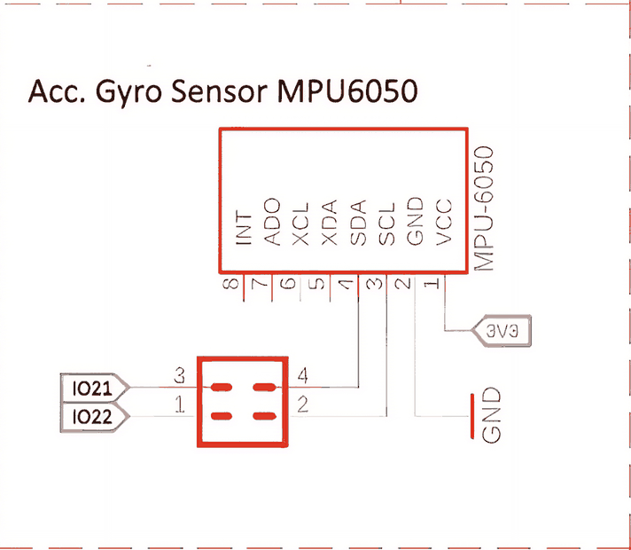
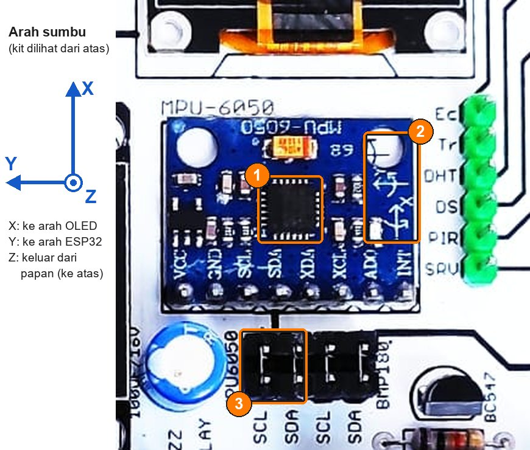
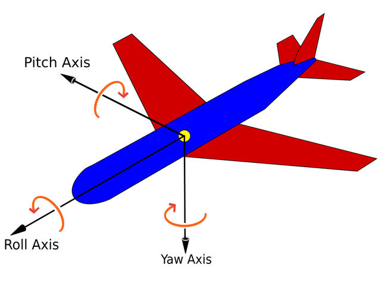
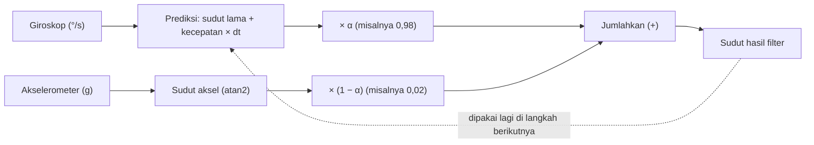

# BAB 29: MPU-6050 — Akselerometer, Giroskop & Filter Orientasi

> ✅ **Prasyarat:** Selesaikan **BAB 23 (I2C — Inter-Integrated Circuit)** — kamu sudah mengenal alamat I2C, *jumper cap*, register `WHO_AM_I`, dan *burst read* pada MPU-6050. Pola `millis()` dan `micros()` dari **BAB 16 (Non-Blocking Programming)** dipakai di hampir semua program, dan `struct Timer`-nya dipakai lagi di Program 7. Cara memasang *library* Adafruit dengan tombol **Install All** sama seperti di **BAB 28 (BMP180 — Tekanan Udara & Ketinggian)**.

Layar HP yang ikut berputar saat HP dimiringkan, jam pintar yang menghitung langkah, dan *drone* yang tetap datar walau diterpa angin — semuanya memakai sensor gerak. Kit Bluino punya sensor gerak **MPU-6050** yang berisi dua sensor sekaligus: **akselerometer** (pengukur percepatan, termasuk tarikan gravitasi) dan **giroskop** (pengukur kecepatan putar). Di BAB ini kamu belajar membaca keduanya, mengenali kelemahan masing-masing (*noise*, *offset*, dan *drift*), menghitung sudut kemiringan, lalu menggabungkan keduanya dengan ***complementary filter*** supaya sudutnya stabil sekaligus responsif.

## 📌 Tujuan Pembelajaran

Setelah mempelajari BAB ini, kamu bisa:

- Menjelaskan apa yang diukur akselerometer (percepatan, dalam g atau m/s²) dan giroskop (kecepatan putar, dalam °/s), termasuk kenapa akselerometer yang diam membaca 1 g.
- Menunjukkan arah sumbu X, Y, dan Z MPU-6050 di kit, lalu membuktikannya dengan program.
- Menginstal dan memakai *library* **Adafruit MPU6050**: memulai sensor, memilih rentang (±2 sampai ±16 g, ±250 sampai ±2000 °/s) dan filter DLPF, lalu membaca datanya.
- Mengenali modul yang ternyata berisi chip lain (misalnya MPU-6500 atau MPU-9250) lewat register `WHO_AM_I`, lalu membacanya tanpa *library*.
- Membedakan *noise*, *offset*, dan *drift*, lalu mengalibrasi *offset* giroskop.
- Menghitung sudut *roll* dan *pitch* dari akselerometer, serta sudut dari giroskop dengan cara integrasi.
- Menggabungkan akselerometer dan giroskop dengan *complementary filter*, memilih faktor bobotnya (α), dan menghitung selang waktu `dt` dengan `micros()`.
- Menampilkan data sensor sebagai grafik di **Serial Plotter** dan membuat alarm kemiringan yang berjalan tanpa `delay()`.

## 🧰 Yang Perlu Disiapkan

| Kebutuhan | Keterangan |
|---|---|
| *Hardware* | Kit Bluino ESP32 IoT Starter Shield + kabel USB **data** |
| Kabel *jumper* | Program 1–6: tidak perlu — MPU-6050 sudah tersambung ke IO21/IO22 lewat *jumper cap* (pastikan terpasang). Program 7: 3 kabel *female-female* untuk LED merah, LED hijau, dan *buzzer* |
| Komponen tambahan | Tidak ada |
| *Software* | Arduino IDE 2.x + *board package* **esp32** versi 3.3.x (lihat [BAB 5](../BAB-05/README.md)) |
| *Library* | **Adafruit MPU6050** by Adafruit, beserta *library* pendukung (antara lain **Adafruit BusIO** dan **Adafruit Unified Sensor**) yang ikut terpasang lewat tombol **Install All** (cara instal di [29.5.1](#2951-menginstal-library)). Program 2 tidak butuh *library* tambahan |
| Alat uji | **Serial Monitor** Arduino IDE (baud 115200) dan **Serial Plotter** (**Tools → Serial Plotter**, baud 115200) |
| Jaringan | Tidak perlu WiFi |

## 📑 Daftar Isi

- [29.1 Mengenal MPU-6050](#291-mengenal-mpu-6050)
- [29.2 MPU-6050 di Kit Bluino](#292-mpu-6050-di-kit-bluino)
- [29.3 Akselerometer: Mengukur Percepatan dan Gravitasi](#293-akselerometer-mengukur-percepatan-dan-gravitasi)
- [29.4 Giroskop: Mengukur Kecepatan Putar](#294-giroskop-mengukur-kecepatan-putar)
- [29.5 Library Adafruit MPU6050](#295-library-adafruit-mpu6050)
- [29.6 Program 1: Membaca Akselerometer, Giroskop, dan Suhu Chip](#296-program-1-membaca-akselerometer-giroskop-dan-suhu-chip)
- [29.7 Kalau Chip-nya Bukan MPU-6050](#297-kalau-chip-nya-bukan-mpu-6050)
- [29.8 Program 2: Membaca Sensor Tanpa Library](#298-program-2-membaca-sensor-tanpa-library)
- [29.9 Noise, Offset, dan Drift](#299-noise-offset-dan-drift)
- [29.10 Program 3: Grafik Giroskop dan Kalibrasi Offset](#2910-program-3-grafik-giroskop-dan-kalibrasi-offset)
- [29.11 Sudut Kemiringan dari Akselerometer](#2911-sudut-kemiringan-dari-akselerometer)
- [29.12 Program 4: Roll dan Pitch dari Akselerometer](#2912-program-4-roll-dan-pitch-dari-akselerometer)
- [29.13 Sudut dari Giroskop: Integrasi](#2913-sudut-dari-giroskop-integrasi)
- [29.14 Program 5: Sudut dari Giroskop dan Drift](#2914-program-5-sudut-dari-giroskop-dan-drift)
- [29.15 Complementary Filter](#2915-complementary-filter)
- [29.16 Program 6: Menggabungkan Akselerometer dan Giroskop](#2916-program-6-menggabungkan-akselerometer-dan-giroskop)
- [29.17 Program 7: Alarm Kemiringan Non-Blocking](#2917-program-7-alarm-kemiringan-non-blocking)
- [29.18 Troubleshooting](#2918-troubleshooting)
- [📝 Rangkuman](#-rangkuman)
- [💪 Latihan](#-latihan)
- [📚 Referensi](#-referensi)

---

## 29.1 Mengenal MPU-6050

### 29.1.1 Sensor Gerak dan IMU

**MPU-6050** adalah chip sensor gerak buatan InvenSense (sekarang bagian dari TDK). Ukurannya hanya 4 × 4 mm, tetapi isinya lengkap:

- **Akselerometer 3 sumbu** — mengukur percepatan sepanjang sumbu X, Y, dan Z, termasuk tarikan gravitasi bumi.
- **Giroskop 3 sumbu** — mengukur kecepatan putar mengelilingi sumbu X, Y, dan Z.
- **Sensor suhu** — mengukur suhu chip itu sendiri. Kamu sudah membacanya langsung dari register di [BAB 23](../BAB-23/README.md#238-program-3-suhu-chip-mpu-6050).
- **DMP** (*Digital Motion Processor*) — prosesor kecil di dalam chip yang bisa mengolah data gerak sendiri. DMP tidak dipakai di BAB ini; semua pengolahan dikerjakan ESP32 supaya kamu bisa melihat cara kerjanya.

Gabungan akselerometer dan giroskop disebut **IMU** (*Inertial Measurement Unit*, unit pengukur gerak inersia). Karena punya 3 sumbu akselerometer dan 3 sumbu giroskop, MPU-6050 sering disebut sensor **6 sumbu** atau **6-DoF** (*six degrees of freedom*). Sensor seperti ini ada di banyak benda di sekitarmu:

| Perangkat | Yang dimanfaatkan |
|---|---|
| HP dan tablet | Akselerometer tahu arah gravitasi, jadi layar ikut berputar saat HP dimiringkan |
| Jam pintar dan gelang kebugaran | Pola guncangan akselerometer dihitung sebagai langkah kaki |
| Stik *game* dan kacamata VR | Giroskop menangkap putaran tangan atau kepala dengan cepat |
| *Drone* dan robot penyeimbang | Gabungan keduanya dipakai untuk menjaga badan tetap datar atau tegak |

### 29.1.2 Mesin Mikro di Dalam Chip (MEMS)

Kedua sensor gerak di MPU-6050 adalah **MEMS** (*Micro-Electro-Mechanical Systems*): bagian mekanis berukuran mikrometer yang dibuat langsung di atas silikon, bersebelahan dengan rangkaian elektroniknya.

- **Akselerometer** memakai **massa uji** (*proof mass*) yang digantung "pegas" silikon, satu untuk setiap sumbu. Saat ada percepatan, massa itu bergeser sedikit, dan pergeserannya diukur sebagai perubahan kapasitansi.
- **Giroskop** memakai massa yang terus **bergetar**. Saat chip diputar, efek Coriolis — gaya semu yang dialami benda bergerak di dalam benda yang berputar — mendorong getaran itu ke samping. Besar dorongan itu sebanding dengan kecepatan putar.

Hasil setiap sumbu diubah menjadi angka oleh **ADC** (*Analog-to-Digital Converter*) 16 bit, jadi angka mentahnya berkisar −32768 sampai 32767. Angka mentah itulah yang dibaca ESP32 lewat I2C, lalu diubah menjadi satuan yang kita pahami.

### 29.1.3 Spesifikasi Penting dari Datasheet

Angka-angka berikut diambil dari *datasheet* MPU-6000/MPU-6050 (*Product Specification* revisi 3.1 dan *Register Map* revisi 4.0) dari InvenSense. Istilah **LSB** (*least significant bit*) di sini berarti "satu langkah angka mentah". Misalnya, kepekaan 16384 LSB/g artinya percepatan 1 g terbaca sebagai angka mentah 16384.

| Parameter | Nilai | Artinya bagi kita |
|---|---|---|
| Rentang akselerometer | ±2, ±4, ±8, atau ±16 g (dipilih lewat program) | Dibahas di [29.3.3](#2933-rentang-dan-kepekaan-akselerometer) |
| Kepekaan akselerometer | 16384, 8192, 4096, atau 2048 LSB/g (sesuai rentang) | Makin kecil rentangnya, makin halus langkah angkanya |
| Rentang giroskop | ±250, ±500, ±1000, atau ±2000 °/s | Dibahas di [29.4.2](#2942-rentang-dan-kepekaan-giroskop) |
| Kepekaan giroskop | 131; 65,5; 32,8; atau 16,4 LSB per °/s (sesuai rentang) | — |
| ADC | 16 bit untuk setiap sumbu | Angka mentah −32768 sampai 32767 |
| *Offset* awal giroskop (ZRO, *zero-rate output*) | Toleransi ±20 °/s pada 25 °C | Saat diam pun giroskop jarang membaca tepat 0. Inilah alasan kalibrasi di [29.9](#299-noise-offset-dan-drift) |
| *Offset* nol akselerometer | Toleransi ±50 mg (X dan Y) dan ±80 mg (Z) | 1 mg = seperseribu g. Selisih 50 mg setara kemiringan palsu sekitar 3° |
| Tegangan kerja chip | 2,375–3,46 V | Modul di kit dicatu dari jalur 3,3 V |
| Arus | Sekitar 3,9 mA (semua sensor dan DMP aktif) | Jauh lebih kecil daripada arus ESP32 |
| Antarmuka | I2C sampai 400 kHz, alamat `0x68` atau `0x69` | Cara kerja I2C ada di [BAB 23](../BAB-23/README.md) |
| Sensor suhu | −40 sampai +85 °C, 340 LSB/°C, tidak dikalibrasi per chip | Yang terukur suhu chip, bukan suhu udara |
| Ketahanan guncangan | 10.000 g | Chip-nya tahan benturan keras, tetapi tetap jangan sengaja menjatuhkan kit |

---

## 29.2 MPU-6050 di Kit Bluino

### 29.2.1 Sambungan lewat Jumper Cap

MPU-6050 di kit berupa papan modul kecil berwarna biru (jenis yang umum dijual dengan nama **GY-521**). Modul ini berbagi bus I2C dengan OLED dan BMP180: SDA ke IO21 dan SCL ke IO22. Kamu **tidak perlu memasang kabel *jumper***, karena jalurnya sudah disambungkan oleh dua *jumper cap* (penutup *jumper* hitam).



*Gambar 29.1 — Blok MPU-6050 di skematik kit. Pin 1–2 header jumper menyambungkan IO22 ke SCL, pin 3–4 menyambungkan IO21 ke SDA. Sumber: skematik ESP32 Starter Shield 3.2, [Bluino](http://www.bluino.com).*

Cara membaca skematiknya:

| Pin modul | Tersambung ke | Keterangan |
|---|---|---|
| VCC | 3V3 | Catu daya modul dari jalur 3,3 V kit |
| GND | GND | — |
| SCL | IO22, lewat *jumper cap* | Jalur detak I2C |
| SDA | IO21, lewat *jumper cap* | Jalur data I2C |
| XDA, XCL | Tidak tersambung | Bus I2C tambahan milik MPU-6050 untuk sensor lain, misalnya kompas digital. Tidak dipakai di kit |
| AD0 (tertulis `ADO`) | Tidak tersambung di PCB kit | Pemilih alamat I2C. Papan modul sudah menarik AD0 ke GND lewat resistor, jadi alamatnya `0x68` |
| INT | Tidak tersambung | Pin *interrupt* "data baru siap". Karena tidak tersambung, semua program di BAB ini membaca sensor secara berkala (*polling*) |

Hal-hal yang perlu diperhatikan:

- Pastikan kedua *jumper cap* MPU-6050 terpasang. Letaknya di blok nomor 8 pada [Gambar 6.2 di BAB 6](../BAB-06/README.md#621-letak-header-di-kit), tepat di bawah modul MPU-6050: dua *jumper cap* sebelah kiri, di samping tulisan `MPU6050`. Kalau salah satunya lepas, MPU-6050 "hilang" dari bus, sedangkan OLED dan BMP180 tetap bekerja.
- Selalu **cabut USB** sebelum melepas atau memasang *jumper cap*.
- Jangan tancapkan kabel *jumper* lain ke pin berlabel `21` dan `22` di deretan pin ESP32 — kedua pin itu sudah dipakai bus I2C.
- Di PCB kit tidak ada resistor *pull-up* untuk jalur I2C. Tarikan ke HIGH berasal dari papan modul dan *pull-up* internal ESP32 (penjelasannya ada di [BAB 23](../BAB-23/README.md#2332-di-mana-resistor-pull-up-nya)), jadi kamu tidak perlu menambah apa pun.

### 29.2.2 Alamat I2C dan Register Identitas

| Hal | Nilai MPU-6050 | Keterangan |
|---|---|---|
| Alamat I2C (7 bit) | `0x68` | Kalau pin AD0 HIGH, alamatnya menjadi `0x69`. Di kit, AD0 LOW |
| Register `WHO_AM_I` (`0x75`) | Berisi `0x68` | Isinya tetap `0x68` walaupun alamatnya dipindah ke `0x69`. *Library* memakai register ini untuk memastikan chip-nya benar |
| Register `PWR_MGMT_1` (`0x6B`) | Berisi `0x40` saat baru dinyalakan | Chip mulai dalam mode tidur. *Library* membangunkannya secara otomatis |
| Tetangga di bus | OLED `0x3C`, BMP180 `0x77` | Alamatnya berbeda semua, jadi tidak bentrok |

Kalau ingin memastikan MPU-6050 terdeteksi sebelum mulai, jalankan [pemindai I2C di BAB 6](../BAB-06/README.md#68-program-2-pemindai-i2c) (seharusnya muncul `0x68 (MPU-6050)`) atau [Program 2 BAB 23](../BAB-23/README.md#237-program-2-membaca-register-identitas) yang membaca `WHO_AM_I`.

> ⚠️ **Perhatian:** Tidak semua modul yang dijual sebagai "MPU-6050" atau "GY-521" benar-benar berisi MPU-6050. Sebagian berisi chip lain yang mirip, misalnya MPU-6500 (`WHO_AM_I` = `0x70`) atau MPU-9250 (`0x71`). *Library* Adafruit MPU6050 menolak chip seperti ini. Program 1 akan memberitahumu kalau hal ini terjadi, dan solusinya ada di [29.7](#297-kalau-chip-nya-bukan-mpu-6050).

### 29.2.3 Arah Sumbu X, Y, dan Z

Akselerometer dan giroskop sama-sama bekerja pada tiga sumbu yang saling tegak lurus. Arah sumbu X dan Y tercetak sebagai gambar panah di pojok papan modul (penanda 2 pada Gambar 29.2), sedangkan sumbu Z tegak lurus permukaan papan.



*Gambar 29.2 — Modul MPU-6050 di kit: (1) chip MPU-6050, (2) gambar panah sumbu X dan Y, (3) dua jumper cap SCL dan SDA milik MPU-6050. Diagram di pojok kiri menunjukkan arah sumbunya: X ke arah OLED, Y ke arah ESP32, dan Z keluar dari papan. Tata letak kit v3.2 milikmu bisa sedikit berbeda. Sumber: foto produk ESP32 Starter Shield, [Bluino](http://www.bluino.com), dipotong dan diberi penanda untuk materi ini.*

Kalau kit diletakkan datar di meja dengan tombol SW1/SW2 paling dekat denganmu:

| Sumbu | Arah positif (+) | Penanda di kit |
|---|---|---|
| X | Menjauhimu, ke arah OLED dan deretan LED | Panah bertuliskan X di modul |
| Y | Ke kirimu, ke arah ESP32 | Panah bertuliskan Y di modul |
| Z | Ke atas, keluar dari permukaan papan | Tidak tercetak, karena tegak lurus papan |

Arah putar positif mengikuti **aturan tangan kanan**: acungkan jempol tangan kananmu searah panah sumbu, maka arah lengkungan jari-jarimu adalah arah putar positif. Panah melengkung yang tercetak di modul menunjukkan hal yang sama. Contohnya, putaran positif mengelilingi sumbu Z adalah putaran berlawanan arah jarum jam kalau kit dilihat dari atas.

Putaran mengelilingi setiap sumbu punya nama sendiri yang dipinjam dari dunia penerbangan:



*Gambar 29.3 — Tiga gerakan putar pesawat: roll, pitch, dan yaw. Arah panah di gambar ini mengikuti kebiasaan dunia penerbangan; arah sumbu MPU-6050 di kit mengikuti tabel di atas. Sumber: [Auawise dan Jrvz](https://commons.wikimedia.org/wiki/File:Yaw_Axis_Corrected.svg), lisensi CC BY-SA 3.0.*

| Nama | Putaran mengelilingi | Gerakan pada kit | Pada pesawat |
|---|---|---|---|
| ***Roll*** (berguling) | Sumbu X | Sisi kiri atau sisi kanan kit diangkat | Pesawat memiringkan sayapnya |
| ***Pitch*** (mengangguk) | Sumbu Y | Sisi OLED atau sisi tombol diangkat | Hidung pesawat naik atau turun |
| ***Yaw*** (berbelok) | Sumbu Z | Kit diputar di atas meja tanpa diangkat | Hidung pesawat berbelok ke kiri atau ke kanan |

> 🧪 **Coba Sendiri:** Tidak perlu menghafal tabel di atas. Di Program 1 kamu akan memiringkan kit ke berbagai arah dan melihat sendiri sumbu mana yang berubah. Kalau ternyata gambar panah di modulmu berbeda dari foto, ikuti panah di modulmu.

---

## 29.3 Akselerometer: Mengukur Percepatan dan Gravitasi

### 29.3.1 Bola di Dalam Kotak Berpegas

Bayangkan sebuah bola di tengah kotak, ditahan pegas dari keenam sisinya. Setiap pegas punya meteran yang mengukur seberapa dalam ia tertekan.

- **Kotak didorong ke depan dengan cepat.** Bola "tertinggal" dan menekan pegas belakang. Makin kuat dorongannya, makin dalam pegas tertekan. Itulah yang diukur sebagai **percepatan**.
- **Kotak diam di meja.** Gravitasi menarik bola ke bawah sehingga pegas bawah tertekan. Dari dalam kotak, keadaan ini tidak bisa dibedakan dari kotak yang dipercepat **ke atas** sebesar 1 g. Karena itu akselerometer yang diam membaca **+1 g ke arah atas**, bukan 0.
- **Kotak jatuh bebas.** Bola dan kotak jatuh bersama, jadi tidak ada pegas yang tertekan. Akselerometer membaca **0 g di ketiga sumbu**.

Massa uji di dalam MPU-6050 bekerja seperti bola itu. *Datasheet*-nya menulis: saat chip diletakkan di permukaan datar, sumbu X dan Y membaca 0 g, sedangkan sumbu Z membaca +1 g.

Inilah kunci yang dipakai di BAB ini: **saat kit diam, akselerometer hanya merasakan gravitasi.** Dari cara gravitasi "terbagi" ke sumbu X, Y, dan Z, kita bisa menghitung seberapa miring kit itu ([29.11](#2911-sudut-kemiringan-dari-akselerometer)). Masalahnya, saat kit **bergerak**, percepatan geraknya ikut terbaca dan tercampur dengan gravitasi.

### 29.3.2 Satuan: g dan m/s²

| Satuan | Arti | Hubungan |
|---|---|---|
| m/s² | Satuan SI untuk percepatan: perubahan kecepatan (m/s) setiap detik | — |
| g | Percepatan gravitasi standar | 1 g = 9,80665 m/s² |
| mg | Seperseribu g | 1000 mg = 1 g |

*Library* Adafruit memberi hasil akselerometer dalam **m/s²**. Di program-program BAB ini, angka itu dibagi 9,80665 supaya menjadi **g**, karena dalam g angkanya langsung bermakna: diam di meja = 1 g. Sebagai pembanding, mobil yang melaju dari 0 sampai 100 km/jam dalam 10 detik mengalami percepatan rata-rata sekitar 2,8 m/s² atau 0,28 g.

### 29.3.3 Rentang dan Kepekaan Akselerometer

**Rentang** (*full-scale range*) adalah percepatan terbesar yang masih bisa diukur. Makin kecil rentangnya, makin halus langkah angkanya. Mirip timbangan dapur yang teliti sampai 1 gram tetapi hanya kuat menimbang 5 kg, dibandingkan timbangan truk yang kuat menimbang berton-ton tetapi tidak bisa menimbang sebutir telur.

| Rentang | Kepekaan | Satu langkah angka mentah | Cocok untuk | Konstanta di *library* |
|---|---|---|---|---|
| ±2 g | 16384 LSB/g | 0,061 mg | Mengukur kemiringan (dipakai di BAB ini) | `MPU6050_RANGE_2_G` |
| ±4 g | 8192 LSB/g | 0,122 mg | Gerakan tangan | `MPU6050_RANGE_4_G` |
| ±8 g | 4096 LSB/g | 0,244 mg | Lompatan dan benturan | `MPU6050_RANGE_8_G` |
| ±16 g | 2048 LSB/g | 0,488 mg | Benturan sangat keras, misalnya deteksi jatuh | `MPU6050_RANGE_16_G` |

Kalau percepatan melebihi rentang, angkanya "mentok" di batas — misalnya tetap sekitar 2 g walaupun benturan sebenarnya jauh lebih besar. Untuk menghitung kemiringan, ±2 g sudah cukup karena gravitasi hanya 1 g.

---

## 29.4 Giroskop: Mengukur Kecepatan Putar

### 29.4.1 Satuan °/s

Giroskop bisa diibaratkan **spidometer putaran**: ia mengukur seberapa **cepat** sesuatu berputar, dalam **derajat per detik** (°/s). Satu putaran penuh = 360°.

| Gerakan | Kecepatan putar (kira-kira) |
|---|---|
| Jarum detik jam dinding | 6 °/s (360° dalam 60 detik) |
| Kit diputar perlahan seperempat putaran dalam 1 detik | 90 °/s |
| Kursi kantor yang berputar satu kali setiap 2 detik | 180 °/s |
| Pergelangan tangan diputar dengan cepat | Bisa lebih dari 250 °/s |

Ingat bedanya: giroskop **tidak** mengukur sudut. Kit yang dimiringkan 45° lalu ditahan diam membuat giroskop kembali membaca sekitar 0 °/s, karena kit sudah tidak berputar lagi. Untuk mendapatkan sudut dari giroskop, kecepatan putarnya harus "dijumlahkan" sepanjang waktu ([29.4.3](#2943-dari-kecepatan-putar-ke-sudut)).

*Library* Adafruit memberi hasil giroskop dalam **rad/s** (radian per detik). Karena 1 radian = 180°/π ≈ 57,3°, angka dalam rad/s cukup dikalikan 57,3 supaya menjadi °/s. Arduino sudah menyediakan konstanta `RAD_TO_DEG` (nilainya ≈ 57,2958) untuk keperluan ini.

### 29.4.2 Rentang dan Kepekaan Giroskop

| Rentang | Kepekaan | Konstanta di *library* |
|---|---|---|
| ±250 °/s | 131 LSB per °/s | `MPU6050_RANGE_250_DEG` |
| ±500 °/s | 65,5 LSB per °/s | `MPU6050_RANGE_500_DEG` |
| ±1000 °/s | 32,8 LSB per °/s | `MPU6050_RANGE_1000_DEG` |
| ±2000 °/s | 16,4 LSB per °/s | `MPU6050_RANGE_2000_DEG` |

Program-program di BAB ini memakai **±500 °/s**. Rentang ±250 °/s memang paling halus, tetapi putaran tangan yang cepat bisa melewatinya. Kalau kecepatan putar melebihi rentang, angkanya mentok di batas dan sudut yang dihitung dari giroskop menjadi salah. Langkah angka pada rentang ±500 °/s (sekitar 0,015 °/s) sudah lebih dari cukup halus.

### 29.4.3 Dari Kecepatan Putar ke Sudut

Bayangkan spidometer dan odometer mobil. Spidometer menunjukkan kecepatan, sedangkan odometer menjumlahkan jarak: jarak = kecepatan × waktu. Giroskop dan sudut berhubungan dengan cara yang sama:

```text
sudut yang ditempuh = kecepatan putar × lama berputar
contoh: 90 °/s selama 0,5 detik = 45°
```

Karena kecepatan putar bisa berubah-ubah, waktunya dipotong-potong menjadi selang kecil bernama **dt** (misalnya 10 ms), lalu hasilnya dijumlahkan terus-menerus:

```text
sudut = sudut + kecepatan_putar × dt
```

Penjumlahan terus-menerus seperti ini disebut **integrasi**. Detailnya, termasuk masalah yang muncul, dibahas di [29.13](#2913-sudut-dari-giroskop-integrasi).

Ringkasan perbedaan kedua sensor:

| | Akselerometer | Giroskop |
|---|---|---|
| Yang diukur | Percepatan, termasuk gravitasi | Kecepatan putar |
| Satuan | g atau m/s² | °/s atau rad/s |
| Saat kit diam | Sekitar 1 g ke arah atas | Sekitar 0 °/s (ditambah *offset* kecil) |
| Bisa memberi sudut kemiringan? | Ya, langsung — tetapi hanya akurat saat kit diam | Tidak langsung, harus diintegrasikan |
| Kelemahan utama | Terganggu getaran dan percepatan gerak | *Offset* kecil membuat sudut hasil integrasi pelan-pelan melenceng (*drift*) |

---

## 29.5 Library Adafruit MPU6050

### 29.5.1 Menginstal Library

1. Buka Arduino IDE, lalu buka **Sketch → Include Library → Manage Libraries…** (Ctrl+Shift+I), atau klik ikon **Library Manager** (bergambar buku) di panel kiri.
2. Ketik `Adafruit MPU6050` di kolom pencarian.
3. Pilih kartu **Adafruit MPU6050** dengan tulisan **by Adafruit**. Jangan tertukar dengan *library* lain yang namanya mirip, misalnya **MPU6050** by Electronic Cats — itu *library* berbeda dengan cara pemakaian yang berbeda.
4. Klik **INSTALL**. Saat muncul jendela **Install library dependencies**, klik **Install All**. Jendela itu mendaftar beberapa *library* pendukung: **Adafruit BusIO** dan **Adafruit Unified Sensor** wajib untuk BAB ini, sedangkan **Adafruit GFX Library** dan **Adafruit SSD1306** ikut terpasang karena dipakai salah satu contoh bawaan *library* ini (keduanya nanti juga dipakai untuk OLED di [BAB 35](../BAB-35/README.md)).
5. Instalasi selesai kalau kartu *library* menampilkan tulisan **installed** beserta nomor versinya. Materi ini diuji dengan versi 2.2.9.

Cara menginstal *library* secara umum dibahas di [BAB 5](../BAB-05/README.md#58-dasar-library-manager).

### 29.5.2 Fungsi-Fungsi yang Dipakai

| Fungsi | Kegunaan | Hasil |
|---|---|---|
| `Adafruit_MPU6050 mpu;` | Membuat objek sensor bernama `mpu` | — |
| `mpu.begin(0x68)` | Memulai sensor di alamat tertentu. Kalau ditulis `mpu.begin()` saja, alamatnya `0x68` | `true` kalau MPU-6050 ditemukan |
| `mpu.setAccelerometerRange(...)` | Memilih rentang akselerometer, misalnya `MPU6050_RANGE_2_G` | — |
| `mpu.setGyroRange(...)` | Memilih rentang giroskop, misalnya `MPU6050_RANGE_500_DEG` | — |
| `mpu.setFilterBandwidth(...)` | Memilih filter DLPF, misalnya `MPU6050_BAND_21_HZ` (dibahas di [29.9.4](#2994-filter-dlpf-bawaan-chip)) | — |
| `mpu.getEvent(&aksel, &giro, &suhu)` | Membaca semua data sekaligus ke tiga variabel bertipe `sensors_event_t` | Selalu `true` (lihat penjelasan di bawah) |
| `aksel.acceleration.x` (juga `.y` dan `.z`) | Percepatan | `float`, dalam **m/s²** |
| `giro.gyro.x` (juga `.y` dan `.z`) | Kecepatan putar | `float`, dalam **rad/s** |
| `suhu.temperature` | Suhu chip | `float`, dalam °C |

`sensors_event_t` adalah "amplop data" standar dari *library* **Adafruit Unified Sensor**. Satu amplop bisa menampung data sensor apa saja; bagian yang terisi tergantung jenis sensornya. Untuk MPU-6050 kamu menyiapkan tiga amplop — akselerometer, giroskop, dan suhu — lalu `getEvent()` mengisi ketiganya dari **satu** pembacaan yang sama. Tanda `&` di depan nama variabel berarti "ini alamat variabelnya", supaya `getEvent()` bisa langsung mengisi variabel milikmu.

### 29.5.3 Yang Dilakukan begin() di Balik Layar

1. Menyalakan bus I2C dengan `Wire.begin()`. Kalau programmu sudah memanggil `Wire.begin(21, 22)`, panggilan kedua ini tidak mengubah apa pun.
2. Memanggil alamat MPU-6050 (bawaan `0x68`), sampai 5 kali percobaan. Kalau tidak ada yang menjawab, hasilnya `false`.
3. Membaca register `WHO_AM_I` (`0x75`). **Kalau isinya bukan `0x68`, hasilnya juga `false`.** Inilah yang terjadi pada modul berisi MPU-6500, MPU-9250, atau chip sejenis, walaupun chip itu sebenarnya menjawab di alamat `0x68`.
4. Me-*reset* seluruh chip, membangunkannya dari mode tidur, lalu memasang pengaturan bawaan *library*: rentang ±2 g, rentang giroskop ±500 °/s, dan filter DLPF 260 Hz. Semua ini memakan waktu sekitar 0,3 detik.

Ada dua akibat penting:

- **Atur rentang dan filter setelah `begin()`.** Karena `begin()` mengembalikan semua pengaturan ke nilai bawaan *library*, panggilan `set...()` yang ditulis sebelum `begin()` tidak berpengaruh apa-apa.
- **`getEvent()` tidak bisa melaporkan sensor yang hilang.** Fungsi ini selalu menghasilkan `true`, bahkan saat MPU-6050 tiba-tiba tidak menjawab (misalnya karena *jumper cap* longgar) — angka yang keluar menjadi ngawur. Karena itu, mulai Program 3, sensor "dipanggil" dulu dengan `Wire.beginTransmission()` dan `Wire.endTransmission()` seperti pada pemindai I2C, sebelum datanya dibaca.

---

## 29.6 Program 1: Membaca Akselerometer, Giroskop, dan Suhu Chip

**Tujuan:** Membaca MPU-6050 dengan *library* Adafruit setiap 0,5 detik, lalu menampilkan percepatan (dalam m/s² dan g), kecepatan putar (dalam °/s), dan suhu chip di Serial Monitor. Kalau `begin()` gagal, program memeriksa alamat `0x68` dan `0x69` serta isi register `WHO_AM_I`, lalu memberi tahu penyebabnya — termasuk kalau modulmu ternyata berisi chip lain.

**Rangkaian:**

*Tidak perlu merangkai — MPU-6050 sudah tersambung ke IO21 (SDA) dan IO22 (SCL) lewat* jumper cap *di kit. Pastikan saja kedua* jumper cap *MPU-6050 terpasang (lihat [29.2.1](#2921-sambungan-lewat-jumper-cap)).*

**Cara Menjalankan:**

1. Pastikan *jumper cap* MPU-6050 terpasang dan tidak ada kabel *jumper* di label `21`/`22`. Kabel *jumper* lain dari BAB sebelumnya boleh tetap terpasang.
2. Instal *library* **Adafruit MPU6050** kalau belum (lihat [29.5.1](#2951-menginstal-library)).
3. Buka Arduino IDE → **File → New Sketch**, hapus isinya, lalu salin kode di bawah. Kode yang sama juga tersedia di *file* [`p1_baca_mpu6050.ino`](p1_baca_mpu6050/p1_baca_mpu6050.ino).
4. Pastikan **Tools → Board** = **ESP32 Dev Module** dan **Tools → Port** = *port* ESP32 kamu (misalnya `COM5` di Windows atau `/dev/ttyUSB0` di Linux).
5. Klik tombol **Upload** (ikon panah →) dan tunggu sampai muncul tulisan **Done uploading**.
6. Buka **Serial Monitor** (**Tools → Serial Monitor**) lalu pilih baud **115200**. Kalau tulisan awalnya terlewat, tekan tombol **EN** di *board* ESP32.
7. Letakkan kit datar di meja dan amati angkanya, lalu coba miringkan dan putar kit pelan-pelan (lihat 🧪 **Coba Sendiri** di bawah).

**Kode Program:**

<!-- sketch: p1_baca_mpu6050 -->
```cpp
/*
 * BAB 29 - Program 1: Membaca Akselerometer, Giroskop, dan Suhu Chip
 * Membaca MPU-6050 dengan library Adafruit setiap 500 ms, lalu menampilkan
 * percepatan (m/s² dan g), kecepatan putar (°/s), dan suhu chip.
 * Kalau begin() gagal, program memeriksa alamat 0x68 dan 0x69 serta
 * register WHO_AM_I untuk mencari tahu penyebabnya.
 *
 * Rangkaian: tidak perlu kabel. MPU-6050 tersambung ke
 * IO21 (SDA) dan IO22 (SCL) lewat jumper cap di kit.
 * Library: Adafruit MPU6050 (by Adafruit)
 */

#include <Wire.h>
#include <Adafruit_MPU6050.h>
#include <Adafruit_Sensor.h>

#define PIN_SDA 21
#define PIN_SCL 22

const uint8_t MPU_ALAMAT = 0x68;      // alamat I2C MPU-6050 di kit (AD0 = LOW)
const unsigned long JEDA_BACA = 500;  // baca sensor setiap 500 ms
unsigned long waktuBacaTerakhir = 0;

Adafruit_MPU6050 mpu;  // objek sensor MPU-6050

// Membaca 1 byte dari sebuah register (pola dari BAB 23).
// Hasil: 0-255 kalau berhasil, -1 kalau perangkat tidak menjawab.
int bacaRegister(uint8_t alamat, uint8_t reg) {
  Wire.beginTransmission(alamat);
  Wire.write(reg);
  Wire.endTransmission(false);
  if (Wire.requestFrom(alamat, 1) != 1) {
    return -1;
  }
  return Wire.read();
}

// Menerjemahkan isi register WHO_AM_I menjadi nama chip
const char *namaChip(int id) {
  switch (id) {
    case 0x68: return "MPU-6050";
    case 0x70: return "MPU-6500";
    case 0x71: return "MPU-9250";
    case 0x73: return "MPU-9255";
    case 0x98: return "ICM-20689";
    default:   return "chip tidak dikenal";
  }
}

// Dipanggil kalau mpu.begin() gagal: periksa apa yang ada di 0x68 dan 0x69
void periksaChipImu() {
  const uint8_t daftarAlamat[] = {0x68, 0x69};
  bool adaYangMenjawab = false;

  for (int i = 0; i < 2; i++) {
    uint8_t alamat = daftarAlamat[i];
    Wire.beginTransmission(alamat);
    if (Wire.endTransmission() != 0) {
      continue;  // tidak ada perangkat di alamat ini, lanjut ke alamat berikutnya
    }
    adaYangMenjawab = true;

    int id = bacaRegister(alamat, 0x75);  // register WHO_AM_I
    if (id < 0) {
      Serial.printf("  Ada perangkat di 0x%02X, tetapi WHO_AM_I tidak terbaca.\n", alamat);
    } else if (id != 0x68) {
      Serial.printf("  Ada perangkat di 0x%02X, WHO_AM_I = 0x%02X (%s).\n", alamat, id, namaChip(id));
      Serial.println("  Bukan MPU-6050, jadi library Adafruit menolaknya. Baca 29.7.");
    } else if (alamat != MPU_ALAMAT) {
      Serial.printf("  MPU-6050 ada di 0x%02X. Ganti MPU_ALAMAT di kode menjadi 0x%02X.\n", alamat, alamat);
    } else {
      Serial.println("  MPU-6050 menjawab. Cabut USB beberapa detik, lalu coba lagi.");
    }
  }

  if (!adaYangMenjawab) {
    Serial.println("  Tidak ada perangkat di 0x68 maupun 0x69.");
    Serial.println("  Cabut USB, lalu periksa jumper cap SCL/SDA milik MPU-6050.");
  }
}

void setup() {
  Serial.begin(115200);
  delay(1000);                   // beri waktu Serial Monitor tersambung
  Wire.begin(PIN_SDA, PIN_SCL);  // bus I2C kit: SDA = IO21, SCL = IO22

  Serial.println("BAB 29 - Program 1: Membaca Akselerometer, Giroskop, dan Suhu Chip");

  if (!mpu.begin(MPU_ALAMAT)) {
    Serial.println("MPU-6050 tidak ditemukan! Hasil pemeriksaan:");
    periksaChipImu();
    Serial.println("Program berhenti. Perbaiki dulu, lalu tekan tombol EN.");
    while (true) {
      delay(1000);  // berhenti di sini
    }
  }

  // Atur rentang dan filter SETELAH begin(), karena begin() mengembalikan semuanya ke bawaan
  mpu.setAccelerometerRange(MPU6050_RANGE_2_G);  // akselerometer ±2 g
  mpu.setGyroRange(MPU6050_RANGE_500_DEG);       // giroskop ±500 °/s
  mpu.setFilterBandwidth(MPU6050_BAND_21_HZ);    // filter DLPF 21 Hz

  Serial.println("MPU-6050 siap: akselerometer ±2 g, giroskop ±500 °/s, filter 21 Hz.");
}

void loop() {
  if (millis() - waktuBacaTerakhir < JEDA_BACA) {
    return;  // belum 500 ms, keluar dulu dari loop()
  }
  waktuBacaTerakhir = millis();

  sensors_event_t aksel, giro, suhu;   // tiga "amplop" data
  mpu.getEvent(&aksel, &giro, &suhu);  // isi ketiganya dari satu pembacaan

  // Percepatan dari library dalam m/s², dibagi 9.80665 supaya menjadi g
  float axMs2 = aksel.acceleration.x;
  float ayMs2 = aksel.acceleration.y;
  float azMs2 = aksel.acceleration.z;
  float axG = axMs2 / SENSORS_GRAVITY_STANDARD;  // SENSORS_GRAVITY_STANDARD = 9.80665
  float ayG = ayMs2 / SENSORS_GRAVITY_STANDARD;
  float azG = azMs2 / SENSORS_GRAVITY_STANDARD;

  // Kecepatan putar dari library dalam rad/s, dikali RAD_TO_DEG (57.2958) supaya menjadi °/s
  float gxDps = giro.gyro.x * RAD_TO_DEG;
  float gyDps = giro.gyro.y * RAD_TO_DEG;
  float gzDps = giro.gyro.z * RAD_TO_DEG;

  Serial.printf("Aksel (m/s²): X=%6.2f  Y=%6.2f  Z=%6.2f\n", axMs2, ayMs2, azMs2);
  Serial.printf("Aksel (g)   : X=%6.2f  Y=%6.2f  Z=%6.2f\n", axG, ayG, azG);
  Serial.printf("Giro (°/s)  : X=%6.2f  Y=%6.2f  Z=%6.2f\n", gxDps, gyDps, gzDps);
  Serial.printf("Suhu chip   : %.2f °C\n", suhu.temperature);
  Serial.println("---");
}
```

**Penjelasan Kode:**

- ***Library* dan objek.** `#include <Adafruit_MPU6050.h>` dan `#include <Adafruit_Sensor.h>` memuat *library*, lalu `Adafruit_MPU6050 mpu;` membuat objek bernama `mpu`. Semua perintah ke sensor ditulis dalam bentuk `mpu.namaFungsi()`.
- **Bus I2C.** `Wire.begin(PIN_SDA, PIN_SCL)` menyalakan bus I2C di IO21 dan IO22, sama seperti di BAB 23. `mpu.begin()` sebenarnya juga memanggil `Wire.begin()`, tetapi menulis pin secara lengkap membuat program lebih mudah dibaca.
- **`mpu.begin(MPU_ALAMAT)`** memanggil alamat `0x68`, memeriksa `WHO_AM_I`, me-*reset* chip, lalu memasang pengaturan bawaan (lihat [29.5.3](#2953-yang-dilakukan-begin-di-balik-layar)). Setelah itu barulah rentang dan filter diatur dengan tiga fungsi `set...()`.
- **Kalau gagal**, `periksaChipImu()` memakai dua cara dari BAB sebelumnya: "memanggil" alamat tanpa data seperti pemindai I2C di BAB 6, lalu membaca register `0x75` dengan `bacaRegister()` dari BAB 23. Alamat `0x69` ikut diperiksa untuk berjaga-jaga kalau pin AD0 modulmu HIGH. `namaChip()` menerjemahkan isi `WHO_AM_I` menjadi nama chip memakai `switch`. Setelah itu program berhenti di perulangan `while (true)`.
- **Membaca data.** `mpu.getEvent(&aksel, &giro, &suhu)` mengisi tiga "amplop" sekaligus. Percepatan dibagi `SENSORS_GRAVITY_STANDARD` (konstanta dari *library* Adafruit Unified Sensor, nilainya 9,80665) supaya menjadi g. Kecepatan putar dikali `RAD_TO_DEG` (konstanta bawaan Arduino, ≈ 57,2958) supaya menjadi °/s.
- **Jadwal 500 ms** memakai `millis()` seperti di BAB 16: `loop()` langsung keluar kalau belum waktunya membaca.
- **Format `%6.2f`** mencetak angka desimal selebar 6 karakter dengan 2 angka di belakang titik, sehingga kolom X, Y, dan Z tetap lurus walaupun ada tanda minus.

**Contoh Output:**

Saat kit diletakkan datar dan diam di meja:

```text
BAB 29 - Program 1: Membaca Akselerometer, Giroskop, dan Suhu Chip
MPU-6050 siap: akselerometer ±2 g, giroskop ±500 °/s, filter 21 Hz.
Aksel (m/s²): X=  0.31  Y= -0.18  Z=  9.84
Aksel (g)   : X=  0.03  Y= -0.02  Z=  1.00
Giro (°/s)  : X= -1.24  Y=  0.47  Z=  0.85
Suhu chip   : 30.12 °C
---
Aksel (m/s²): X=  0.30  Y= -0.19  Z=  9.85
Aksel (g)   : X=  0.03  Y= -0.02  Z=  1.00
Giro (°/s)  : X= -1.31  Y=  0.44  Z=  0.82
Suhu chip   : 30.15 °C
---
```

Angka di atas hanya contoh; angkamu pasti berbeda. Yang penting polanya:

- **Akselerometer Z sekitar 9,8 m/s² atau 1 g**, sedangkan X dan Y mendekati 0. Itulah gravitasi yang "dirasakan" sumbu Z yang menghadap ke atas. X dan Y jarang tepat 0, karena meja tidak benar-benar datar dan sensor punya *offset* kecil.
- **Giroskop tidak tepat 0**, padahal kit diam. Setiap sumbu punya *offset* sendiri yang hampir tetap (di contoh, X sekitar −1,3 °/s), ditambah angka di belakang koma yang terus bergoyang (*noise*). Keduanya dibahas di [29.9](#299-noise-offset-dan-drift).
- **Suhu chip** biasanya tidak sama dengan suhu ruangan, karena yang diukur adalah suhu chip itu sendiri.

Kalau modulmu ternyata berisi chip lain, hasilnya kira-kira seperti ini:

```text
BAB 29 - Program 1: Membaca Akselerometer, Giroskop, dan Suhu Chip
MPU-6050 tidak ditemukan! Hasil pemeriksaan:
  Ada perangkat di 0x68, WHO_AM_I = 0x70 (MPU-6500).
  Bukan MPU-6050, jadi library Adafruit menolaknya. Baca 29.7.
Program berhenti. Perbaiki dulu, lalu tekan tombol EN.
```

Tidak ada yang menyala di kit; semua hasil muncul di Serial Monitor.

> 🧪 **Coba Sendiri:** Pegang kit dan ubah posisinya pelan-pelan, lalu tahan diam beberapa detik di setiap posisi supaya kamu sempat membaca angkanya. Cocokkan dengan tabel berikut — inilah cara membuktikan arah sumbu di [29.2.3](#2923-arah-sumbu-x-y-dan-z).
>
> | Gerakan | Yang seharusnya terlihat |
> |---|---|
> | Kit datar dan diam | Aksel Z ≈ 1 g; X dan Y ≈ 0 |
> | Sisi OLED (arah panah X) diangkat sampai kit hampir tegak | Aksel X mendekati +1 g; Z mendekati 0 |
> | Sisi kiri (ESP32) diangkat sampai kit hampir tegak | Aksel Y mendekati +1 g; Z mendekati 0 |
> | Kit diputar di atas meja, berlawanan arah jarum jam (dilihat dari atas) | Giro Z bernilai positif selama berputar, lalu kembali ≈ 0 saat berhenti |
> | Meja diketuk keras di dekat kit | Angka akselerometer melonjak sesaat |
>
> Aturan mudahnya: **sumbu yang menghadap ke atas membaca sekitar +1 g, sumbu yang menghadap ke bawah sekitar −1 g, dan sumbu yang mendatar sekitar 0.**

**Kalau Belum Berhasil:**

- ***Error* `Adafruit_MPU6050.h: No such file or directory` saat *compile*** → *library* belum terinstal. Ikuti [29.5.1](#2951-menginstal-library).
- ***Error* `Adafruit_I2CDevice.h` atau `Adafruit_Sensor.h: No such file or directory`** → *library* pendukung belum terpasang karena tombol **Install All** terlewat. Cari **Adafruit BusIO** dan **Adafruit Unified Sensor** di Library Manager, lalu instal keduanya.
- **Muncul `Tidak ada perangkat di 0x68 maupun 0x69.`** → *jumper cap* MPU-6050 lepas atau miring, atau ada kabel *jumper* yang tertancap di label `21`/`22`. Cabut USB, rapikan, lalu sambungkan lagi. [Pemindai I2C di BAB 6](../BAB-06/README.md#68-program-2-pemindai-i2c) membantu memastikan perangkat mana saja yang terdeteksi.
- **Muncul `WHO_AM_I = 0x70`, `0x71`, atau nilai lain selain `0x68`** → modulmu berisi chip pengganti. Baca [29.7](#297-kalau-chip-nya-bukan-mpu-6050) dan pakai [Program 2](#298-program-2-membaca-sensor-tanpa-library).
- **Angka tiba-tiba membeku atau kacau, padahal awalnya normal** → MPU-6050 lepas dari bus setelah `begin()` berhasil, biasanya karena *jumper cap* longgar. Program ini tidak bisa mendeteksinya karena `getEvent()` selalu "berhasil" ([29.5.3](#2953-yang-dilakukan-begin-di-balik-layar)). Cabut USB, rapikan *jumper cap*, lalu sambungkan lagi.
- **Serial Monitor kosong** → baud belum 115200 atau Serial Monitor dibuka terlambat. Tekan tombol **EN** di *board* untuk mengulang program.

---

## 29.7 Kalau Chip-nya Bukan MPU-6050

Modul sensor gerak yang murah (termasuk yang bertuliskan GY-521) kadang tidak berisi MPU-6050, melainkan chip lain yang mirip: penerusnya (MPU-6500), versi 9 sumbu (MPU-9250, yaitu MPU-6500 plus kompas digital), atau chip tiruan. Chip-chip itu menjawab di alamat yang sama (`0x68` atau `0x69`) dan sebagian besar registernya sama, tetapi isi register `WHO_AM_I`-nya berbeda.

| Isi `WHO_AM_I` | Chip | Keterangan |
|---|---|---|
| `0x68` | MPU-6050 (juga MPU-6000 dan MPU-9150) | Bisa dibaca *library* Adafruit MPU6050 |
| `0x70` | MPU-6500 | Register data sama. Rumus suhu dan filter akselerometernya sedikit berbeda |
| `0x71` | MPU-9250 | Berisi MPU-6500 dan kompas digital (magnetometer) dalam satu kemasan |
| `0x73` | MPU-9255 | Kerabat dekat MPU-9250 |
| `0x98` | ICM-20689 | Generasi lebih baru dari TDK InvenSense; nilai ini juga dilaporkan pada sebagian modul tiruan |
| Nilai lain | Chip lain atau tiruan | Coba Program 2. Kalau angkanya tidak masuk akal, ganti modul |

Ingat langkah 3 di [29.5.3](#2953-yang-dilakukan-begin-di-balik-layar): `begin()` milik *library* Adafruit langsung menolak semua nilai selain `0x68`. Cara mengenali kasus ini:

- Program 1 menampilkan pesan `Bukan MPU-6050, jadi library Adafruit menolaknya.` beserta nama chip-nya.
- [Program 2 BAB 23](../BAB-23/README.md#237-program-2-membaca-register-identitas) menampilkan `tidak cocok (seharusnya 0x68)`.

Pilihan jalan keluarnya:

1. **Membaca sensor tanpa *library*** — paling disarankan. Program 2 di bawah membaca register langsung dengan `Wire`, persis seperti yang kamu pelajari di BAB 23, dan bekerja untuk MPU-6050 maupun keluarga MPU-6500. Program ini juga sudah disiapkan supaya bisa dipasang ke Program 3–7 (caranya di akhir [29.8](#298-program-2-membaca-sensor-tanpa-library)).
2. **Memakai *library* lain** yang memang mendukung chip-mu. Di Library Manager ada beberapa *library* untuk MPU-6500/MPU-9250, tetapi cara pemakaiannya berbeda dari BAB ini.
3. **Mengedit *library* Adafruit** supaya tidak memeriksa `WHO_AM_I` — **tidak disarankan**. Perubahan itu hilang setiap kali *library* diperbarui, dan *library* tetap memakai rumus suhu MPU-6050.

---

## 29.8 Program 2: Membaca Sensor Tanpa Library

**Tujuan:** Membaca akselerometer dan giroskop langsung dari register dengan *library* `Wire`, tanpa *library* Adafruit, lalu menampilkannya setiap 0,5 detik. Program ini menjadi jalan keluar kalau modulmu berisi MPU-6500, MPU-9250, atau chip sejenis, tetapi juga berjalan di MPU-6050 asli. Bonusnya, kamu bisa melihat apa yang sebenarnya dikerjakan *library* di balik layar.

**Rangkaian:**

*Tidak perlu merangkai — sama seperti Program 1.*

**Cara Menjalankan:**

1. Pastikan *jumper cap* MPU-6050 terpasang.
2. Buka Arduino IDE → **File → New Sketch**, hapus isinya, lalu salin kode di bawah. Kode yang sama juga tersedia di *file* [`p2_tanpa_library.ino`](p2_tanpa_library/p2_tanpa_library.ino). Program ini tidak butuh *library* tambahan.
3. Pastikan **Tools → Board** = **ESP32 Dev Module** dan **Tools → Port** = *port* ESP32 kamu.
4. Klik tombol **Upload** (ikon panah →) dan tunggu sampai muncul tulisan **Done uploading**.
5. Buka **Serial Monitor** (**Tools → Serial Monitor**) lalu pilih baud **115200**. Tekan tombol **EN** di *board* kalau tulisan awalnya terlewat.

**Kode Program:**

<!-- sketch: p2_tanpa_library -->
```cpp
/*
 * BAB 29 - Program 2: Membaca Sensor Tanpa Library
 * Membaca akselerometer dan giroskop MPU-6050 (atau chip pengganti seperti
 * MPU-6500/MPU-9250) langsung dari register dengan library Wire,
 * lalu menampilkannya setiap 500 ms.
 *
 * Rangkaian: tidak perlu kabel. MPU-6050 tersambung ke
 * IO21 (SDA) dan IO22 (SCL) lewat jumper cap di kit.
 * Library: tidak perlu library tambahan (Wire sudah termasuk paket esp32)
 */

#include <Wire.h>

#define PIN_SDA 21
#define PIN_SCL 22

const uint8_t MPU_ALAMAT = 0x68;  // ganti 0x69 kalau pin AD0 modulmu HIGH

// Nomor register (sama untuk MPU-6050 dan keluarga MPU-6500)
#define REG_CONFIG        0x1A  // filter DLPF giroskop (di MPU-6050 juga akselerometer)
#define REG_GYRO_CONFIG   0x1B  // rentang giroskop
#define REG_ACCEL_CONFIG  0x1C  // rentang akselerometer
#define REG_ACCEL_CONFIG2 0x1D  // filter akselerometer, hanya ada di keluarga MPU-6500
#define REG_ACCEL_XOUT_H  0x3B  // awal 14 byte data: aksel X, Y, Z, suhu, giro X, Y, Z
#define REG_PWR_MGMT_1    0x6B  // pengaturan daya
#define REG_WHO_AM_I      0x75  // identitas chip

const unsigned long JEDA_BACA = 500;  // baca sensor setiap 500 ms
unsigned long waktuBacaTerakhir = 0;
int idChip = -1;                      // isi WHO_AM_I yang terbaca

float ax, ay, az;  // percepatan (g)
float gx, gy, gz;  // kecepatan putar (°/s)

// ---------- Fungsi I2C dasar (sama seperti BAB 23) ----------

int bacaRegister(uint8_t alamat, uint8_t reg) {
  Wire.beginTransmission(alamat);
  Wire.write(reg);
  Wire.endTransmission(false);
  if (Wire.requestFrom(alamat, 1) != 1) {
    return -1;
  }
  return Wire.read();
}

bool tulisRegister(uint8_t alamat, uint8_t reg, uint8_t nilai) {
  Wire.beginTransmission(alamat);
  Wire.write(reg);
  Wire.write(nilai);
  return Wire.endTransmission() == 0;
}

bool bacaBanyak(uint8_t alamat, uint8_t regAwal, uint8_t data[], uint8_t jumlah) {
  Wire.beginTransmission(alamat);
  Wire.write(regAwal);
  Wire.endTransmission(false);
  if (Wire.requestFrom(alamat, jumlah) != jumlah) {
    return false;
  }
  for (uint8_t i = 0; i < jumlah; i++) {
    data[i] = Wire.read();
  }
  return true;
}

// Menggabungkan byte atas dan byte bawah menjadi angka 16 bit bertanda
int16_t gabung(uint8_t atas, uint8_t bawah) {
  return (int16_t)((atas << 8) | bawah);
}

// Menerjemahkan isi register WHO_AM_I menjadi nama chip
const char *namaChip(int id) {
  switch (id) {
    case 0x68: return "MPU-6050";
    case 0x70: return "MPU-6500";
    case 0x71: return "MPU-9250";
    case 0x73: return "MPU-9255";
    case 0x98: return "ICM-20689";
    default:   return "chip tidak dikenal";
  }
}

// ---------- Fungsi sensor (bisa dipindah ke Program 3-7) ----------

// Memilih filter DLPF: 0 = paling lebar (sekitar 260 Hz) sampai 6 = paling sempit (5 Hz)
void aturFilter(uint8_t pilihan) {
  tulisRegister(MPU_ALAMAT, REG_CONFIG, pilihan);
  if (idChip != 0x68) {
    tulisRegister(MPU_ALAMAT, REG_ACCEL_CONFIG2, pilihan);  // keluarga MPU-6500
  }
}

// Menyiapkan sensor: ±2 g, ±500 °/s, filter sekitar 20 Hz. Hasil: true kalau berhasil.
bool siapkanImu() {
  idChip = bacaRegister(MPU_ALAMAT, REG_WHO_AM_I);
  if (idChip < 0) {
    return false;                                     // tidak ada yang menjawab
  }
  tulisRegister(MPU_ALAMAT, REG_PWR_MGMT_1, 0x80);    // reset semua register chip
  delay(100);                                         // tunggu reset selesai
  if (!tulisRegister(MPU_ALAMAT, REG_PWR_MGMT_1, 0x01)) {
    return false;                                     // gagal membangunkan chip
  }
  tulisRegister(MPU_ALAMAT, REG_GYRO_CONFIG, 0x08);   // giroskop ±500 °/s (65.5 = 1 °/s)
  tulisRegister(MPU_ALAMAT, REG_ACCEL_CONFIG, 0x00);  // akselerometer ±2 g (16384 = 1 g)
  aturFilter(4);                                      // filter sekitar 20 Hz
  delay(50);                                          // beri waktu giroskop stabil
  return true;
}

// Membaca sensor ke variabel ax..az (g) dan gx..gz (°/s). Hasil: true kalau berhasil.
bool bacaImu() {
  uint8_t d[14];  // isi register 0x3B sampai 0x48
  if (!bacaBanyak(MPU_ALAMAT, REG_ACCEL_XOUT_H, d, 14)) {
    return false;
  }
  ax = gabung(d[0], d[1]) / 16384.0;  // ±2 g: 16384 = 1 g
  ay = gabung(d[2], d[3]) / 16384.0;
  az = gabung(d[4], d[5]) / 16384.0;
  // d[6] dan d[7] berisi suhu chip; tidak dipakai karena rumusnya berbeda antar-chip
  gx = gabung(d[8], d[9]) / 65.5;     // ±500 °/s: 65.5 = 1 °/s
  gy = gabung(d[10], d[11]) / 65.5;
  gz = gabung(d[12], d[13]) / 65.5;
  return true;
}

void setup() {
  Serial.begin(115200);
  delay(1000);                   // beri waktu Serial Monitor tersambung
  Wire.begin(PIN_SDA, PIN_SCL);  // bus I2C kit: SDA = IO21, SCL = IO22

  Serial.println("BAB 29 - Program 2: Membaca Sensor Tanpa Library");

  if (!siapkanImu()) {
    Serial.printf("Tidak ada yang menjawab di 0x%02X. Periksa jumper cap MPU-6050.\n", MPU_ALAMAT);
    Serial.println("Program berhenti. Perbaiki dulu, lalu tekan tombol EN.");
    while (true) {
      delay(1000);  // berhenti di sini
    }
  }
  Serial.printf("WHO_AM_I = 0x%02X (%s). Sensor siap: ±2 g, ±500 °/s.\n", idChip, namaChip(idChip));
}

void loop() {
  if (millis() - waktuBacaTerakhir < JEDA_BACA) {
    return;  // belum 500 ms
  }
  waktuBacaTerakhir = millis();

  if (!bacaImu()) {
    Serial.println("Gagal membaca sensor. Periksa jumper cap MPU-6050.");
    return;
  }
  Serial.printf("Aksel (g)  : X=%6.2f  Y=%6.2f  Z=%6.2f\n", ax, ay, az);
  Serial.printf("Giro (°/s) : X=%6.2f  Y=%6.2f  Z=%6.2f\n", gx, gy, gz);
  Serial.println("---");
}
```

**Penjelasan Kode:**

- **Fungsi I2C dasar.** `bacaRegister()`, `tulisRegister()`, `bacaBanyak()`, dan `gabung()` sama persis dengan [Program 4 BAB 23](../BAB-23/README.md#239-program-4-dua-sensor-di-satu-bus).
- **`siapkanImu()`** bekerja dalam lima langkah:
  1. Membaca `WHO_AM_I` sekaligus memastikan ada chip yang menjawab. Berbeda dengan *library* Adafruit, nilai selain `0x68` **tidak** ditolak — nilainya hanya disimpan di `idChip`.
  2. Menulis `0x80` ke `PWR_MGMT_1` untuk me-*reset* semua register chip. Langkah ini penting karena menekan **EN** atau mengunggah program baru hanya me-*reset* ESP32, bukan MPU-6050, sehingga pengaturan dari program sebelumnya bisa masih tersimpan.
  3. Menulis `0x01` ke `PWR_MGMT_1`: bit SLEEP = 0 (bangun) dan sumber detak dari giroskop, sama seperti di BAB 23.
  4. Mengatur rentang. Pilihan rentang disimpan di bit 4–3 register, jadi nilai registernya adalah nomor pilihan dikali 8 (lihat tabel di bawah). Program ini menulis `0x08` ke `GYRO_CONFIG` (±500 °/s) dan `0x00` ke `ACCEL_CONFIG` (±2 g).
  5. Memilih filter lewat `aturFilter(4)` (sekitar 20 Hz, dibahas di [29.9.4](#2994-filter-dlpf-bawaan-chip)). Di MPU-6050, satu register `CONFIG` mengatur filter kedua sensor. Keluarga MPU-6500 punya register filter akselerometer tersendiri (`0x1D`), jadi register itu hanya ditulis kalau chip-nya bukan MPU-6050.
  | Nilai register | `GYRO_CONFIG` (`0x1B`) | `ACCEL_CONFIG` (`0x1C`) |
  |---|---|---|
  | `0x00` | ±250 °/s | ±2 g |
  | `0x08` | ±500 °/s | ±4 g |
  | `0x10` | ±1000 °/s | ±8 g |
  | `0x18` | ±2000 °/s | ±16 g |

- **`bacaImu()`** membaca 14 *byte* sekaligus mulai register `0x3B` (*burst read*), sehingga ketujuh angka berasal dari satu saat pengukuran yang sama. Urutannya: percepatan X, Y, Z, suhu, lalu kecepatan putar X, Y, Z — masing-masing 2 *byte*. Angka mentah dibagi kepekaannya: 16384 untuk ±2 g dan 65,5 untuk ±500 °/s.
- **Suhu tidak ditampilkan**, karena rumusnya berbeda antar-chip: MPU-6050 memakai mentah / 340 + 36,53, sedangkan MPU-6500 dan MPU-9250 memakai mentah / 333,87 + 21.
- **Hasil `bacaImu()` bisa dipercaya.** Kalau sensor tidak menjawab, `bacaBanyak()` menghasilkan `false` dan program menampilkan pesan gagal — lebih jujur daripada `getEvent()` milik *library* Adafruit.

**Contoh Output:**

Dengan MPU-6050 asli, kit datar dan diam:

```text
BAB 29 - Program 2: Membaca Sensor Tanpa Library
WHO_AM_I = 0x68 (MPU-6050). Sensor siap: ±2 g, ±500 °/s.
Aksel (g)  : X=  0.03  Y= -0.02  Z=  1.00
Giro (°/s) : X= -1.27  Y=  0.46  Z=  0.84
---
Aksel (g)  : X=  0.03  Y= -0.02  Z=  1.00
Giro (°/s) : X= -1.24  Y=  0.44  Z=  0.86
---
```

Dengan modul berisi MPU-6500, baris kedua berubah menjadi `WHO_AM_I = 0x70 (MPU-6500). Sensor siap: ±2 g, ±500 °/s.`, sedangkan baris-baris data tetap berpola sama. Angkamu pasti sedikit berbeda dari contoh.

> 💡 **Tips:** Bandingkan hasil Program 2 dengan Program 1 di MPU-6050 asli. Angkanya seharusnya mirip, karena kedua program membaca register yang sama dengan rentang dan filter yang sama — bedanya hanya siapa yang menghitung.

**Memakai Program 3–7 dengan chip pengganti.** Program 3 sampai 7 memakai *library* Adafruit, tetapi bagian yang menyentuh sensor sengaja dikumpulkan di dua fungsi bernama sama dengan di Program 2: `siapkanImu()` dan `bacaImu()`, dengan variabel dan satuan yang sama (`ax`, `ay`, `az` dalam g; `gx`, `gy`, `gz` dalam °/s). Kalau modulmu bukan MPU-6050:

1. Hapus baris `#include <Adafruit_MPU6050.h>`, `#include <Adafruit_Sensor.h>`, dan `Adafruit_MPU6050 mpu;`.
2. Hapus fungsi `siapkanImu()` dan `bacaImu()` versi *library* (di Program 3 juga `aturFilter()`).
3. Sebagai gantinya, salin dari Program 2: semua baris `#define REG_...`, variabel `idChip`, serta fungsi `bacaRegister()`, `tulisRegister()`, `bacaBanyak()`, `gabung()`, `aturFilter()`, `siapkanImu()`, dan `bacaImu()`. Tempelkan di atas fungsi `setup()`.

Bagian lain program tidak perlu diubah.

**Kalau Belum Berhasil:**

- **Muncul `Tidak ada yang menjawab di 0x68.`** → *jumper cap* MPU-6050 lepas, atau modulmu memakai alamat `0x69`. Jalankan Program 1 untuk memeriksa kedua alamat, lalu sesuaikan `MPU_ALAMAT`.
- **Semua angka tepat 0** → chip masih tidur karena penulisan `0x01` ke `PWR_MGMT_1` gagal. Cabut USB beberapa detik, sambungkan lagi, lalu tekan **EN**.
- **Saat kit datar, sumbu Z jauh dari 1 g (misalnya 0,5 g atau 2 g)** → chip-mu tidak memakai pengaturan rentang yang sama. Kalau `WHO_AM_I` juga menunjukkan `chip tidak dikenal`, kemungkinan besar modul itu tidak cocok untuk materi ini; ganti dengan modul MPU-6050 lain.
- **`Gagal membaca sensor.` muncul berulang** → sensor sempat terdeteksi, lalu lepas dari bus. Cabut USB, rapikan *jumper cap*, lalu sambungkan lagi.

---

## 29.9 Noise, Offset, dan Drift

Di Program 1 kamu melihat giroskop tidak pernah tepat 0 walaupun kit diam, dan angka di belakang komanya terus bergoyang. Sebelum menghitung sudut, kenali dulu tiga "penyakit" sensor berikut, karena obatnya berbeda-beda.

### 29.9.1 Noise: Angka yang Bergoyang

***Noise*** (derau) adalah goyangan acak di sekitar nilai yang sebenarnya — naik-turun dengan cepat, tetapi rata-ratanya tetap. Bayangkan jarum timbangan yang terus bergetar sedikit saat kamu berdiri diam di atasnya. *Noise* berasal dari getaran listrik di dalam sensor itu sendiri, ditambah getaran dari luar seperti meja yang tersenggol atau kipas angin.

*Datasheet* MPU-6050 menyebut goyangan giroskop sekitar 0,05 °/s (diukur dengan filter sekitar 100 Hz). Angka sekecil itu tidak berbahaya kalau hanya dibaca sekali-sekali. Cara mengurangi *noise*: merata-ratakan beberapa bacaan atau memakai filter, misalnya filter DLPF bawaan chip ([29.9.4](#2994-filter-dlpf-bawaan-chip)).

### 29.9.2 Offset: Titik Nol yang Bergeser

***Offset*** (bias) adalah kesalahan yang **tetap**: semua bacaan bergeser ke satu arah dengan besar yang hampir sama. Seperti timbangan badan yang sudah menunjuk 1 kg sebelum kamu naik — berat badanmu selalu terbaca 1 kg lebih berat.

*Offset* giroskop berbeda untuk setiap sumbu dan setiap chip. *Datasheet* mengizinkan sampai ±20 °/s, tetapi di praktik biasanya hanya beberapa °/s. Besarnya juga sedikit berubah saat suhu chip berubah.

Obatnya adalah **kalibrasi**:

1. Letakkan kit **diam** — jangan disentuh dan jangan menggoyang meja.
2. Ambil banyak bacaan, misalnya 200 bacaan selama 2 detik, lalu hitung rata-ratanya. Karena kit diam, kecepatan putar yang sebenarnya adalah 0, jadi rata-rata itulah *offset*-nya.
3. Kurangi setiap bacaan berikutnya dengan *offset* tersebut.

> ⚠️ **Perhatian:** Kalau kit bergerak selama kalibrasi, gerakan itu ikut terhitung sebagai *offset*, sehingga hasilnya justru salah. Ulangi kalibrasi kalau kamu tidak sengaja menyenggol kit.

Akselerometer juga punya *offset*: *datasheet* menyebut ±50 mg untuk sumbu X dan Y, setara kemiringan palsu sekitar 3°. Kalibrasinya lebih repot, karena gravitasi selalu ikut terbaca. Kit harus diletakkan benar-benar datar (dicek dengan *waterpass*), lalu *offset* X dan Y adalah rata-rata bacaan X dan Y, sedangkan *offset* Z adalah rata-rata Z dikurangi 1 g. Di BAB ini cukup giroskop yang dikalibrasi; kalibrasi akselerometer menjadi bahan [💪 Latihan](#-latihan).

### 29.9.3 Drift: Kesalahan yang Menumpuk

***Drift*** (hanyut) adalah kesalahan yang **terus bertambah** seiring waktu. *Drift* muncul saat kecepatan putar giroskop dijumlahkan menjadi sudut ([29.4.3](#2943-dari-kecepatan-putar-ke-sudut)): *offset* yang kecil ikut dijumlahkan setiap saat. Contohnya, *offset* 1 °/s yang tidak dikalibrasi membuat sudut melenceng 10° setelah 10 detik, dan 60° setelah 1 menit — padahal kit tidak bergerak sama sekali.

Kalibrasi memperlambat *drift*, tetapi tidak bisa menghapusnya sama sekali, karena selalu ada sisa *offset* yang sangat kecil dan *offset* ikut berubah bersama suhu. Mirip jam dinding yang terlambat 1 detik setiap jam: sehari tidak terasa, tetapi sebulan kemudian selisihnya sudah 12 menit. Solusinya adalah mengoreksi sudut giroskop dengan sensor lain yang tidak hanyut, yaitu akselerometer ([29.15](#2915-complementary-filter)).

| "Penyakit" | Ciri | Analogi | Obat |
|---|---|---|---|
| *Noise* | Goyangan acak dan cepat; rata-ratanya tetap | Jarum timbangan yang bergetar | Filter atau rata-rata |
| *Offset* | Bacaan bergeser tetap ke satu arah | Timbangan yang menunjuk 1 kg saat kosong | Kalibrasi, lalu kurangi *offset*-nya |
| *Drift* | Kesalahan sudut yang terus bertambah | Jam yang makin lama makin terlambat | Kalibrasi, ditambah koreksi dari akselerometer |

### 29.9.4 Filter DLPF Bawaan Chip

**DLPF** (*Digital Low-Pass Filter*, filter lolos-bawah digital) di dalam MPU-6050 meredam getaran cepat sebelum datanya sampai ke ESP32. "Lolos-bawah" artinya perubahan yang lambat (frekuensi rendah), misalnya kit yang dimiringkan, dibiarkan lewat, sedangkan getaran cepat (frekuensi tinggi), misalnya dengung kipas atau ketukan di meja, diredam. Mirip peredam kejut sepeda motor: jalan yang bergelombang pelan tetap terasa, tetapi getaran kerikil kecil diredam. Harga yang harus dibayar: datanya datang sedikit terlambat.

Pilihan filter MPU-6050 menurut *register map* (register `CONFIG`, `0x1A`):

| Pilihan | Konstanta di *library* | Lebar pita aksel / giro | Keterlambatan aksel / giro |
|---|---|---|---|
| 0 | `MPU6050_BAND_260_HZ` | 260 / 256 Hz | 0 / 1,0 ms |
| 1 | `MPU6050_BAND_184_HZ` | 184 / 188 Hz | 2,0 / 1,9 ms |
| 2 | `MPU6050_BAND_94_HZ` | 94 / 98 Hz | 3,0 / 2,8 ms |
| 3 | `MPU6050_BAND_44_HZ` | 44 / 42 Hz | 4,9 / 4,8 ms |
| 4 | `MPU6050_BAND_21_HZ` | 21 / 20 Hz | 8,5 / 8,3 ms |
| 5 | `MPU6050_BAND_10_HZ` | 10 / 10 Hz | 13,8 / 13,4 ms |
| 6 | `MPU6050_BAND_5_HZ` | 5 / 5 Hz | 19,0 / 18,6 ms |

**Lebar pita** (*bandwidth*) kira-kira adalah batas kecepatan getaran yang masih dibiarkan lewat: makin kecil angkanya, makin halus datanya, tetapi makin terlambat. *Library* Adafruit memakai pilihan 0 setelah `begin()`, sedangkan semua program di BAB ini memakai pilihan 4 (21 Hz). Gerakan tangan dan kemiringan kit jauh lebih lambat dari 21 kali per detik, sementara getaran mesin dan dengung kipas biasanya lebih cepat. Selain itu, program-program berikutnya membaca sensor 100 kali per detik — lebih dari dua kali batas filternya — supaya getaran cepat tidak "menyamar" menjadi gerakan lambat yang palsu.

---

## 29.10 Program 3: Grafik Giroskop dan Kalibrasi Offset

**Tujuan:** Menggambar kecepatan putar ketiga sumbu giroskop di **Serial Plotter**, supaya kamu bisa melihat sendiri *noise* dan *offset*. Lewat kolom pesan, kamu bisa memerintahkan kalibrasi *offset* (huruf `k`), menghapus hasil kalibrasi (`r`), atau mengganti filter DLPF (angka `0` sampai `6`) sambil melihat grafiknya berubah.

**Rangkaian:**

*Tidak perlu merangkai — MPU-6050 sudah tersambung lewat* jumper cap *di kit. Program ini juga memakai LED biru kecil bawaan* board *ESP32 (IO2) sebagai lampu tanda kalibrasi. Kalau kabel LED3 (biru) → IO2 dari BAB sebelumnya masih terpasang, LED biru kit ikut menyala — itu normal.*

**Cara Menjalankan:**

1. Pastikan *jumper cap* MPU-6050 terpasang, lalu letakkan kit di meja yang tidak bergoyang.
2. Buka Arduino IDE → **File → New Sketch**, hapus isinya, lalu salin kode di bawah. Kode yang sama juga tersedia di *file* [`p3_grafik_giroskop.ino`](p3_grafik_giroskop/p3_grafik_giroskop.ino).
3. Pastikan **Tools → Board** = **ESP32 Dev Module** dan **Tools → Port** = *port* ESP32 kamu.
4. Klik tombol **Upload** (ikon panah →) dan tunggu sampai muncul tulisan **Done uploading**.
5. Buka **Serial Plotter** lewat **Tools → Serial Plotter**, atau klik ikon grafik di pojok kanan atas Arduino IDE. Di jendela Serial Plotter, pilih baud **115200**. Cara membaca Serial Plotter sudah dibahas di [BAB 11](../BAB-11/README.md#119-program-3-grafik-nilai-adc-di-serial-plotter).
6. Amati tiga garis **GiroX**, **GiroY**, dan **GiroZ** selama beberapa detik tanpa menyentuh kit.
7. Klik kolom pesan di bagian bawah jendela Serial Plotter (bertuliskan *Type Message*), ketik `k`, lalu tekan Enter. Jangan sentuh kit sampai LED biru di *board* padam (sekitar 2 detik). Pilihan *line ending* di sebelah kolom pesan boleh apa saja, karena program mengabaikan karakter Enter.
8. Coba kirim angka `0` (filter paling lebar), lalu `6` (filter paling sempit), dan bandingkan goyangan garisnya. Kirim `4` untuk kembali ke 21 Hz, dan `r` untuk menghapus hasil kalibrasi.

**Kode Program:**

<!-- sketch: p3_grafik_giroskop -->
```cpp
/*
 * BAB 29 - Program 3: Grafik Giroskop dan Kalibrasi Offset
 * Menggambar kecepatan putar X, Y, Z (°/s) di Serial Plotter setiap 50 ms.
 * Perintah lewat kolom pesan Serial Plotter atau Serial Monitor:
 *   k     = kalibrasi offset (kit harus diam sekitar 2 detik)
 *   r     = hapus hasil kalibrasi (kembali ke nilai mentah)
 *   0..6  = pilih filter DLPF (0 = 260 Hz ... 4 = 21 Hz ... 6 = 5 Hz)
 *
 * Rangkaian: tidak perlu kabel. MPU-6050 tersambung ke
 * IO21 (SDA) dan IO22 (SCL) lewat jumper cap di kit.
 * LED biru bawaan board ESP32 (IO2) menyala selama kalibrasi.
 * Library: Adafruit MPU6050 (by Adafruit)
 */

#include <Wire.h>
#include <Adafruit_MPU6050.h>
#include <Adafruit_Sensor.h>

#define PIN_SDA   21
#define PIN_SCL   22
#define LED_BOARD 2  // LED biru bawaan board ESP32

const uint8_t MPU_ALAMAT = 0x68;
const unsigned long JEDA_CETAK = 50;  // satu titik grafik setiap 50 ms
const int SAMPEL_KALIBRASI = 200;     // 200 bacaan x 10 ms = 2 detik
unsigned long waktuCetakTerakhir = 0;

Adafruit_MPU6050 mpu;

float ax, ay, az;                                // percepatan (g)
float gx, gy, gz;                                // kecepatan putar mentah (°/s)
float offsetGx = 0, offsetGy = 0, offsetGz = 0;  // hasil kalibrasi (°/s)

// ---------- Fungsi sensor (versi library Adafruit) ----------

// Memulai MPU-6050: ±2 g, ±500 °/s, filter 21 Hz. Hasil: true kalau berhasil.
bool siapkanImu() {
  if (!mpu.begin(MPU_ALAMAT)) {
    return false;
  }
  mpu.setAccelerometerRange(MPU6050_RANGE_2_G);
  mpu.setGyroRange(MPU6050_RANGE_500_DEG);
  mpu.setFilterBandwidth(MPU6050_BAND_21_HZ);
  return true;
}

// Memilih filter DLPF: 0 = paling lebar (260 Hz) sampai 6 = paling sempit (5 Hz)
void aturFilter(uint8_t pilihan) {
  mpu.setFilterBandwidth((mpu6050_bandwidth_t)pilihan);
}

// Membaca sensor ke variabel ax..az (g) dan gx..gz (°/s). Hasil: true kalau sensor menjawab.
bool bacaImu() {
  // getEvent() tidak melaporkan kegagalan, jadi pastikan dulu sensornya menjawab
  Wire.beginTransmission(MPU_ALAMAT);
  if (Wire.endTransmission() != 0) {
    return false;
  }
  sensors_event_t aksel, giro, suhu;
  mpu.getEvent(&aksel, &giro, &suhu);
  ax = aksel.acceleration.x / SENSORS_GRAVITY_STANDARD;  // m/s² → g
  ay = aksel.acceleration.y / SENSORS_GRAVITY_STANDARD;
  az = aksel.acceleration.z / SENSORS_GRAVITY_STANDARD;
  gx = giro.gyro.x * RAD_TO_DEG;                          // rad/s → °/s
  gy = giro.gyro.y * RAD_TO_DEG;
  gz = giro.gyro.z * RAD_TO_DEG;
  return true;
}

// ---------- Kalibrasi ----------

// Rata-rata bacaan giroskop saat kit diam = offset
void kalibrasiGiro() {
  digitalWrite(LED_BOARD, HIGH);  // LED menyala: jangan sentuh kit
  float totalX = 0, totalY = 0, totalZ = 0;
  int jumlah = 0;
  for (int i = 0; i < SAMPEL_KALIBRASI; i++) {
    if (bacaImu()) {
      totalX += gx;
      totalY += gy;
      totalZ += gz;
      jumlah++;
    }
    delay(10);
  }
  if (jumlah > 0) {
    offsetGx = totalX / jumlah;
    offsetGy = totalY / jumlah;
    offsetGz = totalZ / jumlah;
  }
  digitalWrite(LED_BOARD, LOW);   // selesai
}

void setup() {
  Serial.begin(115200);
  pinMode(LED_BOARD, OUTPUT);
  Wire.begin(PIN_SDA, PIN_SCL);  // bus I2C kit: SDA = IO21, SCL = IO22

  if (!siapkanImu()) {
    Serial.println("MPU-6050 tidak ditemukan. Jalankan Program 1 untuk mencari penyebabnya.");
    bool nyala = false;
    while (true) {               // LED berkedip cepat = sensor tidak ditemukan
      nyala = !nyala;
      digitalWrite(LED_BOARD, nyala ? HIGH : LOW);
      delay(100);
    }
  }
  // Sengaja tidak mencetak judul: Serial Plotter menganggap setiap baris sebagai data
}

void loop() {
  // 1. Layani perintah dari kolom pesan
  if (Serial.available() > 0) {
    char c = Serial.read();
    if (c == 'k' || c == 'K') {
      kalibrasiGiro();
    } else if (c == 'r' || c == 'R') {
      offsetGx = 0;
      offsetGy = 0;
      offsetGz = 0;
    } else if (c >= '0' && c <= '6') {
      aturFilter(c - '0');
    }
    // karakter lain, misalnya Enter, diabaikan
  }

  // 2. Kirim satu titik grafik setiap 50 ms
  if (millis() - waktuCetakTerakhir < JEDA_CETAK) {
    return;
  }
  waktuCetakTerakhir = millis();

  if (bacaImu()) {
    Serial.printf("GiroX:%.2f,GiroY:%.2f,GiroZ:%.2f\n",
                  gx - offsetGx, gy - offsetGy, gz - offsetGz);
  }
}
```

**Penjelasan Kode:**

- **Dua fungsi sensor.** `siapkanImu()` memulai sensor dan mengatur rentang serta filter; `bacaImu()` mengisi variabel global `ax`, `ay`, `az` (g) dan `gx`, `gy`, `gz` (°/s). Program 4–7 memakai kedua fungsi yang sama, jadi isi programnya bisa fokus ke perhitungan. Kalau chip-mu bukan MPU-6050, kedua fungsi ini (dan `aturFilter()`) bisa diganti versi Program 2 ([29.8](#298-program-2-membaca-sensor-tanpa-library)).
- **Memeriksa sensor sebelum membaca.** Sebelum `getEvent()`, `bacaImu()` "memanggil" alamat `0x68` seperti pemindai I2C. Kalau tidak ada jawaban, fungsi menghasilkan `false` dan data lama tidak ditimpa angka ngawur.
- **`kalibrasiGiro()`** membaca giroskop 200 kali dengan jeda 10 ms, menjumlahkan bacaan setiap sumbu, lalu membaginya dengan jumlah bacaan yang berhasil. Hasilnya disimpan sebagai `offsetGx`, `offsetGy`, dan `offsetGz`. Selama kalibrasi, program memang sengaja "diam" sekitar 2 detik, dan LED biru menyala sebagai tanda.
- **Mengurangi *offset*.** Yang dikirim ke Serial Plotter adalah `gx - offsetGx` dan seterusnya. Sebelum kalibrasi semua *offset* bernilai 0, jadi yang tergambar adalah nilai mentah.
- **Membaca perintah tanpa menunggu.** `Serial.available()` memeriksa apakah ada karakter masuk, seperti di [BAB 16](../BAB-16/README.md#1612-membaca-input-serial-tanpa-menunggu). `c - '0'` mengubah karakter angka menjadi bilangan: `'4' - '0'` = 4. Karakter lain, termasuk Enter, diabaikan.
- **Format Serial Plotter.** Setiap baris berisi `label:nilai` yang dipisah koma; setiap baris menjadi satu titik di setiap garis. Program tidak mencetak judul, karena baris teks biasa bisa ikut dianggap data.

**Contoh Output:**

Di Serial Plotter muncul tiga garis berwarna berlabel **GiroX**, **GiroY**, dan **GiroZ**. Kalau Serial Monitor juga dibuka (di Arduino IDE 2 keduanya boleh terbuka bersamaan), teksnya seperti ini — sebelum kalibrasi:

```text
GiroX:-1.27,GiroY:0.45,GiroZ:0.86
GiroX:-1.22,GiroY:0.47,GiroZ:0.83
GiroX:-1.30,GiroY:0.44,GiroZ:0.85
```

dan setelah perintah `k`:

```text
GiroX:0.02,GiroY:-0.01,GiroZ:0.01
GiroX:-0.03,GiroY:0.02,GiroZ:-0.02
GiroX:0.01,GiroY:0.00,GiroZ:0.02
```

Angka di atas hanya contoh; *offset* setiap chip berbeda. Yang perlu kamu perhatikan di grafik:

- **Sebelum kalibrasi**, ketiga garis berada di ketinggian berbeda dan tidak di 0. Jarak garis dari 0 itulah *offset*. Goyangan kecil di setiap garis adalah *noise*.
- **Setelah `k`**, ketiga garis melompat ke sekitar 0. *Offset* hilang, *noise* tetap ada.
- **Filter `0`** membuat goyangan garis lebih besar; **filter `6`** membuatnya jauh lebih halus, tetapi garis bereaksi lebih lambat saat kit diputar.
- **Saat kit diputar**, garis sumbu yang bersangkutan melonjak, lalu kembali ke sekitar 0 begitu kit berhenti berputar.

> 📌 **Catatan:** Serial Plotter Arduino IDE 2 hanya menampilkan 50 titik terakhir (di program ini sekitar 2,5 detik), dan sumbu tegaknya menyesuaikan skala secara otomatis. Setelah kalibrasi, grafik "memperbesar" daerah di sekitar 0, sehingga *noise* sekecil 0,05 °/s pun tampak seperti gerigi besar. Perhatikan angka di sumbu tegak supaya tidak salah menilai.

> 🧪 **Coba Sendiri:** Kirim `k`, lalu putar kit perlahan **selama** LED biru menyala. Setelah LED padam, ketiga garis tidak lagi berada di sekitar 0, karena gerakanmu ikut terhitung sebagai *offset*. Kirim `k` sekali lagi dengan kit diam untuk memperbaikinya.

**Kalau Belum Berhasil:**

- **LED biru di *board* berkedip cepat terus-menerus** → MPU-6050 tidak ditemukan. Jalankan Program 1 untuk mengetahui penyebabnya.
- **Serial Plotter kosong atau tidak bergerak** → baud di jendela Serial Plotter belum **115200**, atau *port*-nya salah. Tutup Serial Plotter, periksa **Tools → Port**, lalu buka lagi.
- **Perintah `k` atau angka tidak berpengaruh** → pastikan kamu menekan Enter setelah mengetik. Kalau kolom pesan Serial Plotter tidak bisa diisi, kirim perintah lewat kolom pesan Serial Monitor.
- **Setelah kalibrasi, garis tidak berada di sekitar 0** → kit bergerak atau meja tergoyang saat kalibrasi. Ulangi `k` dengan kit benar-benar diam.

---

## 29.11 Sudut Kemiringan dari Akselerometer

### 29.11.1 Gravitasi yang Terbagi ke Tiga Sumbu

Saat kit datar, seluruh gravitasi (1 g) jatuh ke sumbu Z. Begitu kit dimiringkan, gravitasi itu "terbagi" ke sumbu-sumbu lain. Bayangkan sebatang pensil sepanjang 1 yang dimiringkan di bawah lampu: bayangannya di lantai adalah bagian mendatar, tingginya adalah bagian tegak. Makin miring pensilnya, makin panjang bayangan dan makin pendek tingginya.

Contohnya, kalau sisi kiri kit diangkat 30°:

```text
ay = sin 30° × 1 g = 0,50 g     (bagian yang jatuh ke sumbu Y)
az = cos 30° × 1 g = 0,87 g     (bagian yang tersisa di sumbu Z)
ay / az = tan 30°   →   sudut = arctan(0,50 / 0,87) = 30°
```

Jadi dari perbandingan dua sumbu, sudut kemiringan bisa dihitung balik. Rumus yang dipakai di BAB ini:

```text
roll  = atan2(ay, az)                 × 180/π
pitch = atan2(−ax, √(ay² + az²))      × 180/π
```

- **`atan2(y, x)`** adalah versi "pintar" dari arctan. Fungsi ini memperhitungkan tanda kedua angka sehingga tahu kuadran sudutnya, dan tidak gagal saat angka pembaginya 0 (misalnya saat kit tegak dan az = 0). Fungsi ini sudah tersedia di Arduino.
- **× 180/π** mengubah radian menjadi derajat, karena `atan2()` menghasilkan radian. Di kode, cukup kalikan dengan `RAD_TO_DEG`.
- **Pitch memakai √(ay² + az²), bukan az saja**, supaya pitch tetap benar walaupun kit sedang miring ke samping (ada roll). Contohnya, saat kit berdiri di sisi kirinya, az ≈ 0 tetapi √(ay² + az²) tetap sekitar 1 g.
- **Satuannya bebas**: rumus ini hanya memakai perbandingan, jadi hasilnya sama walaupun ax, ay, az dalam g maupun m/s².

Tanda plus dan minusnya mengikuti aturan tangan kanan di [29.2.3](#2923-arah-sumbu-x-y-dan-z), sama seperti giroskop. Kesamaan ini penting, karena di [29.15](#2915-complementary-filter) keduanya akan digabung.

| Gerakan kit | Yang berubah | Roll | Pitch |
|---|---|---|---|
| Sisi kiri (ESP32) diangkat | ay positif | Positif | ≈ 0 |
| Sisi kanan diangkat | ay negatif | Negatif | ≈ 0 |
| Sisi tombol (dekat kamu) diangkat | ax negatif | ≈ 0 | Positif |
| Sisi OLED (jauh darimu) diangkat | ax positif | ≈ 0 | Negatif |

> 📌 **Catatan:** Kenapa mengangkat sisi OLED justru menghasilkan pitch negatif? Coba aturan tangan kanan pada sumbu Y (jempol menunjuk ke kiri, ke arah ESP32): lengkungan jari bergerak dari atas ke arah OLED, artinya putaran positif menurunkan sisi OLED. Jadi mengangkat sisi OLED adalah putaran negatif. Kalau kamu lebih suka sebaliknya, cukup balik tandanya saat menampilkan — tetapi jangan di dalam perhitungan filter.

### 29.11.2 Batas Rumus Ini

- **Hanya akurat saat kit diam atau bergerak pelan.** Kalau kit digeser maju-mundur tanpa dimiringkan sekalipun, percepatan geraknya ikut terbaca dan sudut hasil hitungan melompat-lompat. Akselerometer tidak bisa membedakan "miring" dari "didorong".
- **Yaw tidak bisa dihitung.** Saat kit diputar di atas meja, arah gravitasi terhadap sensor tidak berubah sama sekali, jadi akselerometer tidak melihat putaran itu. Untuk yaw dibutuhkan giroskop ([29.13](#2913-sudut-dari-giroskop-integrasi)) atau kompas digital (magnetometer).
- **Rentangnya terbatas.** Roll mencakup −180° sampai +180°, sedangkan pitch hanya −90° sampai +90°. Saat pitch mendekati ±90° (kit berdiri di sisi OLED atau sisi tombol), ay dan az sama-sama mendekati 0, sehingga roll menjadi tidak stabil. Penjelasannya ada di bagian pendalaman [29.18](#2918-troubleshooting).

---

## 29.12 Program 4: Roll dan Pitch dari Akselerometer

**Tujuan:** Menghitung sudut roll dan pitch dari arah gravitasi setiap 100 ms, lalu menampilkannya sebagai grafik di Serial Plotter. Dengan program ini kamu bisa melihat kelebihan akselerometer (sudutnya benar saat kit diam) sekaligus kelemahannya (sudutnya melompat saat kit diguncang).

**Rangkaian:**

*Tidak perlu merangkai — MPU-6050 sudah tersambung lewat* jumper cap *di kit.*

**Cara Menjalankan:**

1. Pastikan *jumper cap* MPU-6050 terpasang.
2. Buka Arduino IDE → **File → New Sketch**, hapus isinya, lalu salin kode di bawah. Kode yang sama juga tersedia di *file* [`p4_sudut_akselerometer.ino`](p4_sudut_akselerometer/p4_sudut_akselerometer.ino).
3. Pastikan **Tools → Board** = **ESP32 Dev Module** dan **Tools → Port** = *port* ESP32 kamu.
4. Klik tombol **Upload** (ikon panah →) dan tunggu sampai muncul tulisan **Done uploading**.
5. Buka **Serial Plotter** (**Tools → Serial Plotter**) lalu pilih baud **115200**. Kalau lebih suka melihat angka, buka **Serial Monitor** dengan baud yang sama.
6. Miringkan kit ke kiri, ke kanan, ke depan, dan ke belakang, lalu coba percobaan di 🧪 **Coba Sendiri** di bawah.

**Kode Program:**

<!-- sketch: p4_sudut_akselerometer -->
```cpp
/*
 * BAB 29 - Program 4: Roll dan Pitch dari Akselerometer
 * Menghitung sudut roll dan pitch dari arah gravitasi setiap 100 ms,
 * lalu mengirimnya ke Serial Plotter (bisa juga dibaca di Serial Monitor).
 *
 * Rangkaian: tidak perlu kabel. MPU-6050 tersambung ke
 * IO21 (SDA) dan IO22 (SCL) lewat jumper cap di kit.
 * Library: Adafruit MPU6050 (by Adafruit)
 */

#include <Wire.h>
#include <Adafruit_MPU6050.h>
#include <Adafruit_Sensor.h>

#define PIN_SDA 21
#define PIN_SCL 22

const uint8_t MPU_ALAMAT = 0x68;
const unsigned long JEDA_CETAK = 100;  // satu titik grafik setiap 100 ms
unsigned long waktuCetakTerakhir = 0;

Adafruit_MPU6050 mpu;

float ax, ay, az;  // percepatan (g)
float gx, gy, gz;  // kecepatan putar (°/s), tidak dipakai di program ini

// ---------- Fungsi sensor (versi library Adafruit, sama seperti Program 3) ----------

bool siapkanImu() {
  if (!mpu.begin(MPU_ALAMAT)) {
    return false;
  }
  mpu.setAccelerometerRange(MPU6050_RANGE_2_G);  // ±2 g
  mpu.setGyroRange(MPU6050_RANGE_500_DEG);       // ±500 °/s
  mpu.setFilterBandwidth(MPU6050_BAND_21_HZ);    // DLPF 21 Hz
  return true;
}

bool bacaImu() {
  Wire.beginTransmission(MPU_ALAMAT);  // pastikan dulu sensornya menjawab
  if (Wire.endTransmission() != 0) {
    return false;
  }
  sensors_event_t aksel, giro, suhu;
  mpu.getEvent(&aksel, &giro, &suhu);
  ax = aksel.acceleration.x / SENSORS_GRAVITY_STANDARD;  // m/s² → g
  ay = aksel.acceleration.y / SENSORS_GRAVITY_STANDARD;
  az = aksel.acceleration.z / SENSORS_GRAVITY_STANDARD;
  gx = giro.gyro.x * RAD_TO_DEG;                          // rad/s → °/s
  gy = giro.gyro.y * RAD_TO_DEG;
  gz = giro.gyro.z * RAD_TO_DEG;
  return true;
}

void setup() {
  Serial.begin(115200);
  Wire.begin(PIN_SDA, PIN_SCL);  // bus I2C kit: SDA = IO21, SCL = IO22

  if (!siapkanImu()) {
    Serial.println("MPU-6050 tidak ditemukan. Jalankan Program 1 untuk mencari penyebabnya.");
    while (true) {
      delay(1000);  // berhenti di sini
    }
  }
  // Sengaja tidak mencetak judul: Serial Plotter menganggap setiap baris sebagai data
}

void loop() {
  if (millis() - waktuCetakTerakhir < JEDA_CETAK) {
    return;  // belum 100 ms
  }
  waktuCetakTerakhir = millis();

  if (!bacaImu()) {
    return;  // sensor tidak menjawab, coba lagi 100 ms kemudian
  }

  // Sudut dari arah gravitasi (hasil atan2 dalam radian, dikali RAD_TO_DEG menjadi derajat)
  float roll  = atan2(ay, az) * RAD_TO_DEG;
  float pitch = atan2(-ax, sqrt(ay * ay + az * az)) * RAD_TO_DEG;

  Serial.printf("Roll:%.1f,Pitch:%.1f\n", roll, pitch);
}
```

**Penjelasan Kode:**

- **`siapkanImu()` dan `bacaImu()`** sama dengan Program 3. Variabel `gx`, `gy`, dan `gz` ikut diisi walaupun belum dipakai, supaya kedua fungsi ini tetap sama di semua program.
- **Rumus sudut** persis seperti di [29.11.1](#29111-gravitasi-yang-terbagi-ke-tiga-sumbu). `sqrt()` menghitung akar kuadrat, dan `ay * ay` adalah ay².
- **Satu titik setiap 100 ms.** Serial Plotter Arduino IDE 2 hanya menampilkan 50 titik terakhir, jadi layar grafiknya mencakup sekitar 5 detik terakhir.

**Contoh Output:**

Di Serial Plotter muncul dua garis, **Roll** dan **Pitch**. Teks yang sama di Serial Monitor, mulai dari kit datar lalu sisi kiri kit diangkat kira-kira 30°:

```text
Roll:-1.1,Pitch:-1.7
Roll:-1.2,Pitch:-1.7
Roll:12.6,Pitch:-1.6
Roll:29.4,Pitch:-1.5
Roll:29.6,Pitch:-1.5
```

Angkamu pasti berbeda. Perhatikan bahwa kit yang "datar" pun jarang terbaca tepat 0°: mejanya mungkin tidak benar-benar datar, dan akselerometer punya *offset* kecil (setara sampai sekitar 3°, lihat [29.9.2](#2992-offset-titik-nol-yang-bergeser)). Tidak ada yang menyala di kit.

> 🧪 **Coba Sendiri:**
> 1. **Uji guncangan.** Letakkan kit datar, lalu geser maju-mundur dengan cepat di atas meja tanpa memiringkannya. Garis Roll atau Pitch melonjak-lonjak, padahal kit tetap datar. Ketuk meja di dekat kit, dan garisnya juga bergerigi sesaat. Inilah kelemahan akselerometer.
> 2. **Uji putar.** Putar kit di atas meja tanpa mengangkatnya. Roll dan Pitch hampir tidak berubah — akselerometer tidak bisa melihat yaw.
> 3. **Uji tegak.** Berdirikan kit di sisi OLED-nya (pitch mendekati −90°), lalu perhatikan garis Roll yang menjadi tidak menentu.

**Kalau Belum Berhasil:**

- **Garis Roll melompat antara sekitar +180° dan −180°** → kit sedang terbalik atau hampir terbalik (komponen menghadap ke bawah). Rumus roll memang berpindah dari +180° ke −180° di posisi itu; kembalikan kit menghadap ke atas.
- **Roll berubah saat kamu mengangkat sisi OLED (bukan sisi kiri)** → arah sumbu di modulmu berbeda dari foto. Ikuti panah di modulmu dan tabel di [29.11.1](#29111-gravitasi-yang-terbagi-ke-tiga-sumbu) akan bergeser sesuai.
- **Serial Plotter kosong** → baud belum **115200** atau MPU-6050 tidak ditemukan (pesannya terlihat di Serial Monitor). Jalankan Program 1 untuk memeriksa.

---

## 29.13 Sudut dari Giroskop: Integrasi

### 29.13.1 Menjumlahkan Kecepatan Putar

Seperti dibahas di [29.4.3](#2943-dari-kecepatan-putar-ke-sudut), sudut didapat dengan menjumlahkan kecepatan putar dikali selang waktu yang sangat pendek:

```text
sudut = sudut + (kecepatan_putar − offset) × dt
```

Contoh dengan dt = 10 ms (0,01 detik) saat kit diputar 50 °/s:

| Langkah | Kecepatan putar | Tambahan sudut (× 0,01 s) | Sudut |
|---|---|---|---|
| Awal | — | — | 0,0° |
| 1 | 50 °/s | 0,5° | 0,5° |
| 2 | 50 °/s | 0,5° | 1,0° |
| … | … | … | … |
| 100 (setelah 1 detik) | 50 °/s | 0,5° | 50,0° |

Giroskop hanya tahu **perubahan**, bukan posisi awal. Karena itu sudut awal roll dan pitch diambil dari akselerometer saat program mulai (kit sedang diam), sedangkan yaw awal dianggap 0°.

### 29.13.2 Mengukur dt dengan micros()

Hasil integrasi hanya benar kalau `dt` benar. Kalau program "menganggap" dt = 10 ms padahal kenyataannya 10,3 ms (karena membaca sensor lewat I2C dan mencetak ke Serial juga butuh waktu), setiap sudut akan meleset sekitar 3 %. Jadi `dt` **diukur**, bukan ditebak:

```cpp
unsigned long sekarang = micros();                   // waktu sekarang (µs)
float dt = (sekarang - waktuSampelLalu) / 1000000.0;  // selisih dalam detik
waktuSampelLalu = sekarang;
```

Kenapa `micros()` dan bukan `millis()`? Pada selang 10 ms, `millis()` yang bertambah per 1 ms bisa meleset sampai 10 %, sedangkan `micros()` bertambah per 1 µs. Rumus selisih `sekarang - waktuSampelLalu` tetap benar walaupun `micros()` kembali ke 0 setiap sekitar 71,6 menit (lihat [BAB 16](../BAB-16/README.md#1616-rollover-kenapa-rumus-selisih-selalu-benar)).

Supaya `dt` hampir selalu sama, perhitungan sudut dijadwalkan setiap 10 ms memakai pola *non-blocking* dari BAB 16, misalnya `if (micros() - waktuSampelLalu >= 10000)`. Hasilnya: sensor dibaca 100 kali per detik.

### 29.13.3 Yaw: Hanya Giroskop yang Tahu

Yaw dihitung dengan cara yang sama dari sumbu Z (`gz`). Bedanya, roll dan pitch masih bisa "dicek" oleh akselerometer, sedangkan yaw tidak punya pembanding sama sekali. Artinya, *drift* pada yaw **tidak bisa dikoreksi** dengan MPU-6050 saja. Untuk yaw yang tidak hanyut dibutuhkan kompas digital (magnetometer) — misalnya yang ada di dalam MPU-9250 — yang mengukur arah medan magnet bumi, walaupun kompas pun mudah terganggu benda besi dan magnet di dekatnya.

---

## 29.14 Program 5: Sudut dari Giroskop dan Drift

**Tujuan:** Menghitung sudut roll dan yaw dengan mengintegrasikan giroskop 100 kali per detik, lalu menggambarnya di Serial Plotter bersama roll dari akselerometer sebagai pembanding. Kamu akan melihat bahwa giroskop mengikuti putaran dengan halus, tetapi pelan-pelan hanyut (*drift*) — dan jauh lebih cepat hanyut kalau tidak dikalibrasi.

**Rangkaian:**

*Tidak perlu merangkai. LED biru bawaan* board *ESP32 (IO2) menyala selama kalibrasi di awal program.*

**Cara Menjalankan:**

1. Letakkan kit datar di meja yang tidak bergoyang.
2. Buka Arduino IDE → **File → New Sketch**, hapus isinya, lalu salin kode di bawah. Kode yang sama juga tersedia di *file* [`p5_sudut_giroskop.ino`](p5_sudut_giroskop/p5_sudut_giroskop.ino).
3. Pastikan **Tools → Board** = **ESP32 Dev Module** dan **Tools → Port** = *port* ESP32 kamu.
4. Klik tombol **Upload** (ikon panah →) dan tunggu sampai muncul tulisan **Done uploading**. **Jangan sentuh kit** sampai LED biru di *board* padam (sekitar 2 detik setelah program mulai).
5. Buka **Serial Plotter** (**Tools → Serial Plotter**) lalu pilih baud **115200**.
6. Lakukan percobaan berikut sambil mengamati grafik: angkat sisi kiri kit sekitar 30° dan tahan, letakkan datar lagi, lalu putar kit di atas meja kira-kira seperempat putaran. Setelah itu, biarkan kit diam 1–2 menit.

Kalau ingin mengulang kalibrasi, letakkan kit diam lalu tekan tombol **EN** di *board*.

**Kode Program:**

<!-- sketch: p5_sudut_giroskop -->
```cpp
/*
 * BAB 29 - Program 5: Sudut dari Giroskop dan Drift
 * Mengintegrasikan giroskop setiap 10 ms (dt diukur dengan micros())
 * untuk mendapatkan sudut roll dan yaw, lalu menggambarnya di Serial Plotter
 * setiap 200 ms bersama roll dari akselerometer sebagai pembanding.
 *
 * Rangkaian: tidak perlu kabel. MPU-6050 tersambung ke
 * IO21 (SDA) dan IO22 (SCL) lewat jumper cap di kit.
 * LED biru bawaan board ESP32 (IO2) menyala selama kalibrasi.
 * Library: Adafruit MPU6050 (by Adafruit)
 */

#include <Wire.h>
#include <Adafruit_MPU6050.h>
#include <Adafruit_Sensor.h>

#define PIN_SDA   21
#define PIN_SCL   22
#define LED_BOARD 2  // LED biru bawaan board ESP32

const uint8_t MPU_ALAMAT = 0x68;
const bool PAKAI_KALIBRASI = true;       // ubah ke false untuk melihat drift tanpa kalibrasi
const unsigned long PERIODE_US = 10000;  // hitung sudut setiap 10000 µs (10 ms)
const unsigned long JEDA_CETAK = 200;    // satu titik grafik setiap 200 ms
const int SAMPEL_KALIBRASI = 200;        // 200 bacaan x 10 ms = 2 detik

unsigned long waktuSampelLalu = 0;     // micros() saat sudut terakhir dihitung
unsigned long waktuCetakTerakhir = 0;  // millis() saat titik grafik terakhir dikirim

Adafruit_MPU6050 mpu;

float ax, ay, az;                                // percepatan (g)
float gx, gy, gz;                                // kecepatan putar mentah (°/s)
float offsetGx = 0, offsetGy = 0, offsetGz = 0;  // hasil kalibrasi (°/s)

float rollGiro = 0;  // sudut roll hasil integrasi giroskop (°)
float yawGiro = 0;   // sudut yaw hasil integrasi giroskop (°)

// ---------- Fungsi sensor (versi library Adafruit, sama seperti Program 3) ----------

bool siapkanImu() {
  if (!mpu.begin(MPU_ALAMAT)) {
    return false;
  }
  mpu.setAccelerometerRange(MPU6050_RANGE_2_G);  // ±2 g
  mpu.setGyroRange(MPU6050_RANGE_500_DEG);       // ±500 °/s
  mpu.setFilterBandwidth(MPU6050_BAND_21_HZ);    // DLPF 21 Hz
  return true;
}

bool bacaImu() {
  Wire.beginTransmission(MPU_ALAMAT);  // pastikan dulu sensornya menjawab
  if (Wire.endTransmission() != 0) {
    return false;
  }
  sensors_event_t aksel, giro, suhu;
  mpu.getEvent(&aksel, &giro, &suhu);
  ax = aksel.acceleration.x / SENSORS_GRAVITY_STANDARD;  // m/s² → g
  ay = aksel.acceleration.y / SENSORS_GRAVITY_STANDARD;
  az = aksel.acceleration.z / SENSORS_GRAVITY_STANDARD;
  gx = giro.gyro.x * RAD_TO_DEG;                          // rad/s → °/s
  gy = giro.gyro.y * RAD_TO_DEG;
  gz = giro.gyro.z * RAD_TO_DEG;
  return true;
}

// Rata-rata bacaan giroskop saat kit diam = offset (sama seperti Program 3)
void kalibrasiGiro() {
  digitalWrite(LED_BOARD, HIGH);  // LED menyala: jangan sentuh kit
  float totalX = 0, totalY = 0, totalZ = 0;
  int jumlah = 0;
  for (int i = 0; i < SAMPEL_KALIBRASI; i++) {
    if (bacaImu()) {
      totalX += gx;
      totalY += gy;
      totalZ += gz;
      jumlah++;
    }
    delay(10);
  }
  if (jumlah > 0) {
    offsetGx = totalX / jumlah;
    offsetGy = totalY / jumlah;
    offsetGz = totalZ / jumlah;
  }
  digitalWrite(LED_BOARD, LOW);   // selesai
}

void setup() {
  Serial.begin(115200);
  pinMode(LED_BOARD, OUTPUT);
  Wire.begin(PIN_SDA, PIN_SCL);  // bus I2C kit: SDA = IO21, SCL = IO22

  if (!siapkanImu()) {
    Serial.println("MPU-6050 tidak ditemukan. Jalankan Program 1 untuk mencari penyebabnya.");
    bool nyala = false;
    while (true) {               // LED berkedip cepat = sensor tidak ditemukan
      nyala = !nyala;
      digitalWrite(LED_BOARD, nyala ? HIGH : LOW);
      delay(100);
    }
  }

  if (PAKAI_KALIBRASI) {
    kalibrasiGiro();
  }

  // Giroskop hanya tahu perubahan: sudut awal roll diambil dari akselerometer,
  // sedangkan yaw awal dianggap 0
  if (bacaImu()) {
    rollGiro = atan2(ay, az) * RAD_TO_DEG;
  }
  waktuSampelLalu = micros();
}

void loop() {
  // 1. Setiap 10 ms: baca giroskop lalu tambahkan ke sudut (integrasi)
  unsigned long sekarang = micros();
  if (sekarang - waktuSampelLalu >= PERIODE_US) {
    float dt = (sekarang - waktuSampelLalu) / 1000000.0;  // selang waktu nyata (detik)
    waktuSampelLalu = sekarang;

    if (bacaImu()) {
      rollGiro += (gx - offsetGx) * dt;  // °/s × detik = derajat
      yawGiro  += (gz - offsetGz) * dt;
    }
  }

  // 2. Setiap 200 ms: kirim satu titik grafik
  if (millis() - waktuCetakTerakhir >= JEDA_CETAK) {
    waktuCetakTerakhir = millis();
    float rollAksel = atan2(ay, az) * RAD_TO_DEG;  // pembanding dari akselerometer
    Serial.printf("RollAksel:%.1f,RollGiro:%.1f,YawGiro:%.1f\n", rollAksel, rollGiro, yawGiro);
  }
}
```

**Penjelasan Kode:**

- **Dua jadwal di `loop()`.** Bagian pertama berjalan setiap 10 ms (dijadwalkan dengan `micros()`), bagian kedua setiap 200 ms (dijadwalkan dengan `millis()`). Keduanya tidak saling menunggu, persis seperti beberapa tugas sekaligus di [BAB 16](../BAB-16/README.md#167-program-3-beberapa-tugas-sekaligus).
- **`dt` diukur.** `dt` dihitung dari selisih `micros()` yang sebenarnya, jadi kalau suatu saat `loop()` sedikit terlambat, perhitungan sudut tetap benar. Pembaginya `1000000.0` (pakai titik) supaya hasilnya bilangan desimal, bukan bilangan bulat.
- **Integrasi.** `rollGiro += (gx - offsetGx) * dt;` artinya "tambahkan sudut yang ditempuh selama `dt` ke sudut sebelumnya". `+=` adalah singkatan dari `rollGiro = rollGiro + ...`.
- **Sudut awal.** Setelah kalibrasi, `rollGiro` diisi dengan roll dari akselerometer, karena giroskop tidak tahu posisi awal kit.
- **`PAKAI_KALIBRASI`** menentukan apakah `kalibrasiGiro()` dijalankan. Kalau `false`, semua *offset* tetap 0, sehingga *offset* sensor ikut terintegrasi.
- **Pitch** sengaja tidak digambar supaya grafiknya tidak terlalu ramai. Cara menghitungnya sama, memakai `gy`.

**Contoh Output:**

Di Serial Plotter muncul tiga garis: **RollAksel**, **RollGiro**, dan **YawGiro**. Contoh teksnya di Serial Monitor, mulai dari kit datar, lalu sisi kiri diangkat sekitar 30°, lalu kit diletakkan datar dan diputar seperempat putaran:

```text
RollAksel:-1.1,RollGiro:-1.1,YawGiro:0.0
RollAksel:-1.2,RollGiro:-1.1,YawGiro:0.0
RollAksel:29.5,RollGiro:30.3,YawGiro:0.4
RollAksel:-1.1,RollGiro:-0.2,YawGiro:0.6
RollAksel:-1.2,RollGiro:-0.2,YawGiro:88.7
```

Angka di atas hanya contoh. Pola yang seharusnya kamu lihat:

- **Saat kit dimiringkan**, RollGiro dan RollAksel bergerak bersama. Garis RollGiro halus, sedangkan RollAksel sedikit bergerigi.
- **Setelah kit kembali datar**, RollGiro sering tidak tepat kembali ke angka semula (di contoh selisihnya sekitar 1°). Setiap gerakan meninggalkan sedikit kesalahan.
- **Saat kit diputar di atas meja**, hanya YawGiro yang berubah (sekitar 90° untuk seperempat putaran). RollAksel tidak melihat putaran ini.
- **Setelah 1–2 menit diam**, RollGiro dan YawGiro pelan-pelan menjauh dari nilai awalnya, sedangkan RollAksel tetap. Itulah *drift*.

> 🧪 **Coba Sendiri:** Ubah `PAKAI_KALIBRASI` menjadi `false`, *upload* ulang, lalu biarkan kit diam. RollGiro dan YawGiro langsung "berjalan" menjauh dengan kecepatan sebesar *offset*-nya — misalnya *offset* −1,3 °/s membuat RollGiro turun sekitar 13° setiap 10 detik. Kembalikan ke `true` setelah selesai.

**Kalau Belum Berhasil:**

- **RollGiro dan YawGiro langsung hanyut cepat walaupun `PAKAI_KALIBRASI` = `true`** → kit tersentuh atau meja bergoyang selama LED biru menyala. Letakkan kit diam, lalu tekan **EN** untuk mengulang kalibrasi.
- **RollGiro bergerak berlawanan arah dengan RollAksel** → ada tanda yang tertukar di kode. Pastikan rumusnya `atan2(ay, az)` dan integrasinya memakai `gx` (bukan `gy` atau `-gx`).
- **Putaran seperempat terbaca jauh dari 90°, misalnya hanya 60°** → putaranmu terlalu cepat sehingga melewati rentang ±500 °/s, atau ada sambungan yang membuat pembacaan gagal sesaat. Putar lebih pelan dan rapikan *jumper cap*.
- **LED biru berkedip cepat** → MPU-6050 tidak ditemukan. Jalankan Program 1.

---

## 29.15 Complementary Filter

### 29.15.1 Ide Dasar: Saling Menambal Kelemahan

Program 4 dan 5 menunjukkan bahwa kedua sensor punya sifat yang berlawanan:

| | Akselerometer | Giroskop (diintegrasikan) |
|---|---|---|
| Jangka pendek (sepersekian detik) | Bergerigi dan mudah tertipu guncangan | Halus dan cepat mengikuti gerakan |
| Jangka panjang (menit) | Tetap benar, tidak hanyut | Pelan-pelan hanyut (*drift*) |

***Complementary filter*** (filter pelengkap) mengambil yang terbaik dari keduanya: **giroskop dipercaya untuk perubahan cepat, akselerometer dipakai untuk pelan-pelan menarik sudut kembali ke nilai yang benar.** Bayangkan kamu berjalan di ruangan gelap sambil menghitung langkah (giroskop): cara ini lancar, tetapi makin lama makin melenceng. Supaya tidak tersesat, sesekali kamu melirik lampu di ujung ruangan (akselerometer) dan membetulkan arahmu sedikit demi sedikit.

Rumusnya hanya satu baris, dijalankan setiap kali sensor dibaca:

```text
sudut = α × (sudut + kecepatan_putar × dt)  +  (1 − α) × sudut_aksel
         └──── prediksi dari giroskop ────┘     └── koreksi akselerometer ──┘
```

- **`sudut + kecepatan_putar × dt`** adalah prediksi giroskop: sudut sebelumnya ditambah putaran selama `dt` (persis seperti integrasi di Program 5).
- **`sudut_aksel`** adalah sudut dari akselerometer (rumus di Program 4).
- **α** (dibaca "alfa") adalah **faktor bobot**, angka antara 0 dan 1. Dengan α = 0,98, setiap langkah hasilnya 98 % dari prediksi giroskop dan 2 % dari akselerometer. Kedua bobot selalu berjumlah 1, karena itulah namanya "pelengkap".

Karena hanya 2 % yang diambil dari akselerometer di setiap langkah, guncangan sesaat hampir tidak terasa. Tetapi karena koreksi 2 % itu terjadi 100 kali per detik, *drift* giroskop tidak sempat menumpuk.



*Gambar 29.4 — Alur complementary filter: prediksi giroskop dan sudut akselerometer dicampur dengan bobot α dan 1 − α, lalu hasilnya menjadi "sudut lama" di langkah berikutnya. Sumber: dibuat untuk materi ini.*

### 29.15.2 Memilih α dan dt

Arti α sebenarnya bergantung pada `dt`. Keduanya bisa diterjemahkan menjadi satu angka yang lebih mudah dibayangkan, yaitu **konstanta waktu** τ (dibaca "tau"):

```text
τ = α × dt / (1 − α)
contoh: α = 0,98 dan dt = 0,01 s  →  τ = 0,98 × 0,01 / 0,02 ≈ 0,5 detik
```

Kira-kira artinya: kesalahan akselerometer yang lebih singkat dari τ (guncangan, ketukan) sebagian besar diabaikan, sedangkan *drift* giroskop yang lebih lambat dari τ dikoreksi.

| α (dengan dt = 10 ms) | τ | Sifat |
|---|---|---|
| 0,90 | ±0,09 detik | Cepat terkoreksi, tetapi guncangan masih banyak terlihat |
| 0,98 | ±0,5 detik | Seimbang — dipakai di BAB ini |
| 0,995 | ±2 detik | Sangat halus, tetapi koreksi *drift*-nya lambat |

Dua hal yang perlu dijaga:

- **Jadwal yang tetap.** Kalau `dt` berubah dari 10 ms menjadi 20 ms, τ ikut menjadi dua kali lipat walaupun α tidak diubah. Karena itu program-program berikutnya membaca sensor dengan jadwal tetap setiap 10 ms memakai `micros()`, sambil tetap memakai `dt` hasil pengukuran untuk integrasi. Kalau suatu saat kamu ingin mengganti periode, hitung ulang α dengan rumus α = τ / (τ + dt).
- **Sudut awal.** Seperti di Program 5, sudut filter diisi dulu dengan sudut akselerometer saat program mulai. Kalau dimulai dari 0 padahal kit sedang miring, filter butuh beberapa kali τ untuk "menyusul".

> ⚠️ **Perhatian:** *Complementary filter* hanya bisa mengoreksi sudut yang punya pembanding dari akselerometer, yaitu **roll** dan **pitch**. **Yaw tetap hanyut**, karena akselerometer tidak melihat putaran di bidang datar. Untuk yaw yang stabil dibutuhkan magnetometer.

---

## 29.16 Program 6: Menggabungkan Akselerometer dan Giroskop

**Tujuan:** Menghitung sudut roll dengan *complementary filter* 100 kali per detik, lalu menggambar tiga versi roll di Serial Plotter: dari akselerometer saja, dari giroskop saja, dan hasil filter. Dengan tiga garis ini kamu bisa membandingkan langsung ketahanan masing-masing terhadap guncangan dan *drift*.

**Rangkaian:**

*Tidak perlu merangkai. LED biru bawaan* board *ESP32 (IO2) menyala selama kalibrasi di awal program.*

**Cara Menjalankan:**

1. Letakkan kit datar di meja yang tidak bergoyang.
2. Buka Arduino IDE → **File → New Sketch**, hapus isinya, lalu salin kode di bawah. Kode yang sama juga tersedia di *file* [`p6_complementary_filter.ino`](p6_complementary_filter/p6_complementary_filter.ino).
3. Pastikan **Tools → Board** = **ESP32 Dev Module** dan **Tools → Port** = *port* ESP32 kamu.
4. Klik tombol **Upload** (ikon panah →) dan tunggu sampai muncul tulisan **Done uploading**. **Jangan sentuh kit** sampai LED biru di *board* padam.
5. Buka **Serial Plotter** (**Tools → Serial Plotter**) lalu pilih baud **115200**.
6. Lakukan percobaan di 🧪 **Coba Sendiri** di bawah sambil mengamati ketiga garis.

**Kode Program:**

<!-- sketch: p6_complementary_filter -->
```cpp
/*
 * BAB 29 - Program 6: Menggabungkan Akselerometer dan Giroskop
 * Complementary filter: sudut roll dihitung 100 kali per detik dari
 * 98% prediksi giroskop + 2% sudut akselerometer.
 * Serial Plotter menampilkan tiga garis setiap 50 ms:
 *   RollAksel  = dari akselerometer saja
 *   RollGiro   = dari giroskop saja (integrasi)
 *   RollFilter = hasil complementary filter
 *
 * Rangkaian: tidak perlu kabel. MPU-6050 tersambung ke
 * IO21 (SDA) dan IO22 (SCL) lewat jumper cap di kit.
 * LED biru bawaan board ESP32 (IO2) menyala selama kalibrasi.
 * Library: Adafruit MPU6050 (by Adafruit)
 */

#include <Wire.h>
#include <Adafruit_MPU6050.h>
#include <Adafruit_Sensor.h>

#define PIN_SDA   21
#define PIN_SCL   22
#define LED_BOARD 2  // LED biru bawaan board ESP32

const uint8_t MPU_ALAMAT = 0x68;
const float ALPHA = 0.98;                // bobot giroskop (0..1)
const unsigned long PERIODE_US = 10000;  // hitung sudut setiap 10000 µs (10 ms)
const unsigned long JEDA_CETAK = 50;     // satu titik grafik setiap 50 ms
const int SAMPEL_KALIBRASI = 200;        // 200 bacaan x 10 ms = 2 detik

unsigned long waktuSampelLalu = 0;     // micros() saat sudut terakhir dihitung
unsigned long waktuCetakTerakhir = 0;  // millis() saat titik grafik terakhir dikirim

Adafruit_MPU6050 mpu;

float ax, ay, az;                                // percepatan (g)
float gx, gy, gz;                                // kecepatan putar mentah (°/s)
float offsetGx = 0, offsetGy = 0, offsetGz = 0;  // hasil kalibrasi (°/s)

float rollAksel = 0;   // roll dari akselerometer saja (°)
float rollGiro = 0;    // roll dari giroskop saja (°)
float rollFilter = 0;  // roll hasil complementary filter (°)

// ---------- Fungsi sensor (versi library Adafruit, sama seperti Program 3) ----------

bool siapkanImu() {
  if (!mpu.begin(MPU_ALAMAT)) {
    return false;
  }
  mpu.setAccelerometerRange(MPU6050_RANGE_2_G);  // ±2 g
  mpu.setGyroRange(MPU6050_RANGE_500_DEG);       // ±500 °/s
  mpu.setFilterBandwidth(MPU6050_BAND_21_HZ);    // DLPF 21 Hz
  return true;
}

bool bacaImu() {
  Wire.beginTransmission(MPU_ALAMAT);  // pastikan dulu sensornya menjawab
  if (Wire.endTransmission() != 0) {
    return false;
  }
  sensors_event_t aksel, giro, suhu;
  mpu.getEvent(&aksel, &giro, &suhu);
  ax = aksel.acceleration.x / SENSORS_GRAVITY_STANDARD;  // m/s² → g
  ay = aksel.acceleration.y / SENSORS_GRAVITY_STANDARD;
  az = aksel.acceleration.z / SENSORS_GRAVITY_STANDARD;
  gx = giro.gyro.x * RAD_TO_DEG;                          // rad/s → °/s
  gy = giro.gyro.y * RAD_TO_DEG;
  gz = giro.gyro.z * RAD_TO_DEG;
  return true;
}

// Rata-rata bacaan giroskop saat kit diam = offset (sama seperti Program 3)
void kalibrasiGiro() {
  digitalWrite(LED_BOARD, HIGH);  // LED menyala: jangan sentuh kit
  float totalX = 0, totalY = 0, totalZ = 0;
  int jumlah = 0;
  for (int i = 0; i < SAMPEL_KALIBRASI; i++) {
    if (bacaImu()) {
      totalX += gx;
      totalY += gy;
      totalZ += gz;
      jumlah++;
    }
    delay(10);
  }
  if (jumlah > 0) {
    offsetGx = totalX / jumlah;
    offsetGy = totalY / jumlah;
    offsetGz = totalZ / jumlah;
  }
  digitalWrite(LED_BOARD, LOW);   // selesai
}

void setup() {
  Serial.begin(115200);
  pinMode(LED_BOARD, OUTPUT);
  Wire.begin(PIN_SDA, PIN_SCL);  // bus I2C kit: SDA = IO21, SCL = IO22

  if (!siapkanImu()) {
    Serial.println("MPU-6050 tidak ditemukan. Jalankan Program 1 untuk mencari penyebabnya.");
    bool nyala = false;
    while (true) {               // LED berkedip cepat = sensor tidak ditemukan
      nyala = !nyala;
      digitalWrite(LED_BOARD, nyala ? HIGH : LOW);
      delay(100);
    }
  }

  kalibrasiGiro();

  // Ketiga sudut dimulai dari sudut akselerometer (kit sedang diam)
  if (bacaImu()) {
    rollAksel = atan2(ay, az) * RAD_TO_DEG;
  }
  rollGiro = rollAksel;
  rollFilter = rollAksel;
  waktuSampelLalu = micros();
}

void loop() {
  // 1. Setiap 10 ms: baca sensor lalu perbarui ketiga sudut
  unsigned long sekarang = micros();
  if (sekarang - waktuSampelLalu >= PERIODE_US) {
    float dt = (sekarang - waktuSampelLalu) / 1000000.0;  // selang waktu nyata (detik)
    waktuSampelLalu = sekarang;

    if (bacaImu()) {
      float lajuRoll = gx - offsetGx;           // kecepatan putar roll (°/s)
      rollAksel = atan2(ay, az) * RAD_TO_DEG;  // akselerometer saja
      rollGiro += lajuRoll * dt;               // giroskop saja

      // Complementary filter: 98% prediksi giroskop + 2% akselerometer
      rollFilter = ALPHA * (rollFilter + lajuRoll * dt) + (1.0 - ALPHA) * rollAksel;
    }
  }

  // 2. Setiap 50 ms: kirim satu titik grafik
  if (millis() - waktuCetakTerakhir >= JEDA_CETAK) {
    waktuCetakTerakhir = millis();
    Serial.printf("RollAksel:%.1f,RollGiro:%.1f,RollFilter:%.1f\n", rollAksel, rollGiro, rollFilter);
  }
}
```

**Penjelasan Kode:**

- **Kerangka yang sama dengan Program 5**: kalibrasi di `setup()`, perhitungan setiap 10 ms dengan `micros()`, dan pengiriman grafik terpisah setiap 50 ms.
- **`lajuRoll`** adalah kecepatan putar sumbu X yang sudah dikurangi *offset*. Nilai ini dipakai dua kali: untuk `rollGiro` (giroskop saja) dan di dalam rumus filter.
- **Baris *complementary filter*** adalah terjemahan langsung rumus di [29.15.1](#29151-ide-dasar-saling-menambal-kelemahan). `rollFilter` di sebelah kanan tanda `=` adalah sudut lama; hasilnya menjadi sudut baru.
- **Ketiga sudut dimulai dari nilai yang sama**, yaitu roll dari akselerometer saat kit diam, supaya perbedaannya di grafik benar-benar berasal dari sifat masing-masing cara.
- **Pitch** dihitung dengan cara yang persis sama, memakai `gy` dan rumus pitch dari Program 4. Program 7 menghitung roll dan pitch sekaligus.

**Contoh Output:**

Di Serial Plotter muncul tiga garis: **RollAksel**, **RollGiro**, dan **RollFilter**. Contoh teksnya di Serial Monitor saat kit datar lalu meja diketuk keras:

```text
RollAksel:-1.1,RollGiro:-1.1,RollFilter:-1.1
RollAksel:6.8,RollGiro:-1.0,RollFilter:-0.9
RollAksel:-9.4,RollGiro:-1.1,RollFilter:-1.2
RollAksel:-1.2,RollGiro:-1.1,RollFilter:-1.1
```

Angka di atas hanya contoh. RollAksel melonjak hampir 10° walaupun kit tidak dimiringkan, sedangkan RollFilter hanya bergeser sepersekian derajat.

> 🧪 **Coba Sendiri:**
> 1. **Miringkan dan tahan.** Angkat sisi kiri kit sekitar 30° lalu tahan. Ketiga garis naik bersama; RollAksel sedikit bergerigi, RollGiro dan RollFilter halus.
> 2. **Guncang.** Letakkan kit datar, lalu geser maju-mundur dengan cepat atau ketuk meja. RollAksel melonjak-lonjak, RollFilter hampir diam.
> 3. **Tunggu.** Biarkan kit diam 2–3 menit. RollGiro pelan-pelan menjauh, sedangkan RollFilter tetap menempel di RollAksel.
> 4. **Ubah α.** Ganti `ALPHA` menjadi `0.90`, lalu `0.995`, dan ulangi percobaan 2 dan 3. Dengan 0,90 guncangan lebih terlihat; dengan 0,995 guncangan hilang, tetapi kalau RollFilter sempat melenceng, ia butuh beberapa detik untuk kembali.

**Kalau Belum Berhasil:**

- **RollFilter pelan-pelan menjauh dari RollAksel dan tidak pernah kembali** → periksa baris filter: bobotnya harus `ALPHA` dan `(1.0 - ALPHA)`, dan yang dicampur harus `rollAksel` (bukan `rollGiro`).
- **RollFilter bergerak berlawanan arah saat kit dimiringkan, lalu pelan-pelan berbalik** → tanda giroskop dan akselerometer tidak sepakat, misalnya memakai `gy` untuk roll. Roll harus berpasangan dengan `gx` dan `atan2(ay, az)`.
- **Garis RollGiro sudah hanyut cepat sejak awal** → kit tersentuh saat LED biru menyala. Letakkan kit diam, lalu tekan **EN**.
- **LED biru berkedip cepat** → MPU-6050 tidak ditemukan. Jalankan Program 1.

---

## 29.17 Program 7: Alarm Kemiringan Non-Blocking

**Tujuan:** Membuat alarm kemiringan yang bisa langsung dipakai di proyek: roll dan pitch dihitung terus dengan *complementary filter* 100 kali per detik, LED hijau menyala selama kit aman, dan kalau kit miring lebih dari 30°, LED merah menyala dan *buzzer* berbunyi putus-putus. Alarm baru padam setelah kemiringan kembali di bawah 25°. Semua tugas berjalan tanpa `delay()` memakai `struct Timer` dari [BAB 16](../BAB-16/README.md#168-timer-di-dalam-struct-dan-array), dan akselerometer diabaikan sementara saat kit terguncang.

**Rangkaian:**

| Pin **Custom** di kit | Sambungkan ke pin ESP32 |
|---|---|
| LED1 (LED merah) di header LED | IO4 (label `4`, deretan bawah) |
| LED2 (LED hijau) di header LED | IO17 (label `17`, deretan bawah) |
| `BUZZ` (*buzzer* aktif) | IO13 (label `13`, deretan atas) |

MPU-6050 tetap tersambung lewat *jumper cap*, tanpa kabel.

**Cara Menjalankan:**

1. Cabut USB, lalu sambungkan ketiga kabel *jumper* sesuai tabel **Rangkaian** di atas. Sambungkan USB lagi.
2. Buka Arduino IDE → **File → New Sketch**, hapus isinya, lalu salin kode di bawah. Kode yang sama juga tersedia di *file* [`p7_alarm_kemiringan.ino`](p7_alarm_kemiringan/p7_alarm_kemiringan.ino).
3. Pastikan **Tools → Board** = **ESP32 Dev Module** dan **Tools → Port** = *port* ESP32 kamu.
4. Letakkan kit datar, klik tombol **Upload** (ikon panah →), dan tunggu sampai muncul tulisan **Done uploading**.
5. Buka **Serial Monitor** (**Tools → Serial Monitor**) lalu pilih baud **115200**. Selama LED merah dan hijau menyala bersamaan (sekitar 2 detik), program sedang kalibrasi — jangan sentuh kit. Kalau tulisan awalnya terlewat, letakkan kit diam lalu tekan **EN**.
6. Miringkan kit pelan-pelan ke segala arah dan amati LED, *buzzer*, serta laporan di Serial Monitor.

**Kode Program:**

<!-- sketch: p7_alarm_kemiringan -->
```cpp
/*
 * BAB 29 - Program 7: Alarm Kemiringan Non-Blocking
 * Roll dan pitch dihitung terus dengan complementary filter (100 kali per detik).
 * Kalau kit miring lebih dari 30°, LED merah menyala dan buzzer berbunyi
 * putus-putus. Alarm baru padam setelah kemiringan kembali di bawah 25°
 * (histeresis). Semua tugas berjalan tanpa delay() memakai struct Timer dari BAB 16.
 *
 * Rangkaian:
 *   LED1 (merah) → IO4, LED2 (hijau) → IO17, BUZZ → IO13
 *   MPU-6050 tersambung ke IO21 (SDA) dan IO22 (SCL) lewat jumper cap di kit.
 * Library: Adafruit MPU6050 (by Adafruit)
 */

#include <Wire.h>
#include <Adafruit_MPU6050.h>
#include <Adafruit_Sensor.h>

#define PIN_SDA   21
#define PIN_SCL   22
#define LED_MERAH 4   // LED1 (merah)
#define LED_HIJAU 17  // LED2 (hijau)
#define BUZZER    13  // buzzer aktif

const uint8_t MPU_ALAMAT   = 0x68;
const float ALPHA          = 0.98;  // bobot giroskop pada complementary filter
const float BATAS_MIRING   = 30.0;  // derajat: lebih dari ini, alarm menyala
const float BATAS_AMAN     = 25.0;  // derajat: kurang dari ini, alarm padam lagi
const float TOLERANSI_G    = 0.2;   // akselerometer dipakai hanya kalau |a| = 1 g ± 0.2 g
const int SAMPEL_KALIBRASI = 200;   // 200 bacaan x 10 ms = 2 detik

// Tipe data ditulis di bagian atas supaya dikenali semua fungsi di bawahnya
enum StatusKemiringan { AMAN, MIRING };

struct Timer {
  unsigned long interval;   // jalankan setiap sekian ms
  unsigned long waktuLalu;  // kapan terakhir dijalankan

  // Mengembalikan true kalau sudah waktunya, lalu mencatat waktunya
  bool sudahWaktunya(unsigned long sekarang) {
    if (sekarang - waktuLalu >= interval) {
      waktuLalu = sekarang;
      return true;
    }
    return false;
  }
};

Timer timerImu     = {10, 0};   // hitung sudut setiap 10 ms
Timer timerBuzzer  = {250, 0};  // buzzer berganti bunyi/diam setiap 250 ms
Timer timerLaporan = {500, 0};  // laporan ke Serial Monitor setiap 500 ms

Adafruit_MPU6050 mpu;

float ax, ay, az;                                // percepatan (g)
float gx, gy, gz;                                // kecepatan putar mentah (°/s)
float offsetGx = 0, offsetGy = 0, offsetGz = 0;  // hasil kalibrasi (°/s)

float roll = 0, pitch = 0;          // hasil complementary filter (°)
unsigned long waktuSampelLalu = 0;  // micros() saat sudut terakhir dihitung
bool imuTersambung = true;
int sampelDiabaikan = 0;            // berapa kali akselerometer diabaikan sejak laporan terakhir
StatusKemiringan status = AMAN;
bool buzzerBunyi = false;

// ---------- Fungsi sensor (versi library Adafruit, sama seperti Program 3) ----------

bool siapkanImu() {
  if (!mpu.begin(MPU_ALAMAT)) {
    return false;
  }
  mpu.setAccelerometerRange(MPU6050_RANGE_2_G);  // ±2 g
  mpu.setGyroRange(MPU6050_RANGE_500_DEG);       // ±500 °/s
  mpu.setFilterBandwidth(MPU6050_BAND_21_HZ);    // DLPF 21 Hz
  return true;
}

bool bacaImu() {
  Wire.beginTransmission(MPU_ALAMAT);  // pastikan dulu sensornya menjawab
  if (Wire.endTransmission() != 0) {
    return false;
  }
  sensors_event_t aksel, giro, suhu;
  mpu.getEvent(&aksel, &giro, &suhu);
  ax = aksel.acceleration.x / SENSORS_GRAVITY_STANDARD;  // m/s² → g
  ay = aksel.acceleration.y / SENSORS_GRAVITY_STANDARD;
  az = aksel.acceleration.z / SENSORS_GRAVITY_STANDARD;
  gx = giro.gyro.x * RAD_TO_DEG;                          // rad/s → °/s
  gy = giro.gyro.y * RAD_TO_DEG;
  gz = giro.gyro.z * RAD_TO_DEG;
  return true;
}

// Rata-rata bacaan giroskop saat kit diam = offset
void kalibrasiGiro() {
  float totalX = 0, totalY = 0, totalZ = 0;
  int jumlah = 0;
  for (int i = 0; i < SAMPEL_KALIBRASI; i++) {
    if (bacaImu()) {
      totalX += gx;
      totalY += gy;
      totalZ += gz;
      jumlah++;
    }
    delay(10);  // hanya di setup(), sebelum tugas-tugas lain berjalan
  }
  if (jumlah > 0) {
    offsetGx = totalX / jumlah;
    offsetGy = totalY / jumlah;
    offsetGz = totalZ / jumlah;
  }
}

// ---------- Tugas-tugas ----------

// Hitung roll dan pitch dengan complementary filter
void perbaruiSudut() {
  unsigned long sekarang = micros();
  float dt = (sekarang - waktuSampelLalu) / 1000000.0;  // selang waktu nyata (detik)
  waktuSampelLalu = sekarang;
  if (dt > 0.1) {
    dt = 0.1;  // jaga-jaga kalau loop() sempat tertahan lama
  }

  if (!bacaImu()) {
    imuTersambung = false;
    return;
  }
  imuTersambung = true;

  float rollAksel  = atan2(ay, az) * RAD_TO_DEG;
  float pitchAksel = atan2(-ax, sqrt(ay * ay + az * az)) * RAD_TO_DEG;

  // "Satpam" akselerometer: saat terguncang, besar percepatan jauh dari 1 g,
  // jadi sudut dari akselerometer tidak dipercaya dulu
  float totalG = sqrt(ax * ax + ay * ay + az * az);
  float alpha = ALPHA;
  if (fabs(totalG - 1.0) > TOLERANSI_G) {
    alpha = 1.0;  // pakai giroskop saja
    sampelDiabaikan++;
  }

  roll  = alpha * (roll  + (gx - offsetGx) * dt) + (1.0 - alpha) * rollAksel;
  pitch = alpha * (pitch + (gy - offsetGy) * dt) + (1.0 - alpha) * pitchAksel;
}

// State machine alarm dengan histeresis
void perbaruiAlarm() {
  float kemiringan = fabs(roll);
  if (fabs(pitch) > kemiringan) {
    kemiringan = fabs(pitch);  // ambil kemiringan yang paling besar
  }

  if (status == AMAN && kemiringan > BATAS_MIRING) {
    status = MIRING;
  } else if (status == MIRING && kemiringan < BATAS_AMAN) {
    status = AMAN;
    buzzerBunyi = false;
    digitalWrite(BUZZER, LOW);  // pastikan buzzer diam
  }

  digitalWrite(LED_MERAH, status == MIRING ? HIGH : LOW);
  digitalWrite(LED_HIJAU, status == AMAN ? HIGH : LOW);
}

// Sensor hilang: matikan semua output supaya tidak memberi tanda yang salah
void matikanSemua() {
  status = AMAN;
  buzzerBunyi = false;
  digitalWrite(BUZZER, LOW);
  digitalWrite(LED_MERAH, LOW);
  digitalWrite(LED_HIJAU, LOW);
}

void setup() {
  Serial.begin(115200);
  delay(1000);  // beri waktu Serial Monitor tersambung
  pinMode(LED_MERAH, OUTPUT);
  pinMode(LED_HIJAU, OUTPUT);
  pinMode(BUZZER, OUTPUT);
  digitalWrite(BUZZER, LOW);
  Wire.begin(PIN_SDA, PIN_SCL);  // bus I2C kit: SDA = IO21, SCL = IO22

  Serial.println("BAB 29 - Program 7: Alarm Kemiringan Non-Blocking");

  if (!siapkanImu()) {
    Serial.println("MPU-6050 tidak ditemukan! Jalankan Program 1 untuk mencari penyebabnya.");
    while (true) {
      delay(1000);  // berhenti di sini
    }
  }

  Serial.println("Kalibrasi giroskop: jangan sentuh kit selama sekitar 2 detik...");
  digitalWrite(LED_MERAH, HIGH);  // kedua LED menyala = sedang kalibrasi
  digitalWrite(LED_HIJAU, HIGH);
  kalibrasiGiro();
  digitalWrite(LED_MERAH, LOW);
  digitalWrite(LED_HIJAU, LOW);
  Serial.printf("Offset giroskop (°/s): X=%.2f  Y=%.2f  Z=%.2f\n", offsetGx, offsetGy, offsetGz);

  // Sudut awal diambil dari akselerometer (kit sedang diam)
  if (bacaImu()) {
    roll  = atan2(ay, az) * RAD_TO_DEG;
    pitch = atan2(-ax, sqrt(ay * ay + az * az)) * RAD_TO_DEG;
  }
  waktuSampelLalu = micros();
  Serial.println("Siap. Miringkan kit lebih dari 30° untuk menyalakan alarm.");
}

void loop() {
  unsigned long sekarang = millis();

  // Tugas 1: hitung sudut dan perbarui alarm setiap 10 ms
  if (timerImu.sudahWaktunya(sekarang)) {
    perbaruiSudut();
    if (imuTersambung) {
      perbaruiAlarm();
    } else {
      matikanSemua();
    }
  }

  // Tugas 2: buzzer berbunyi putus-putus selama kit miring
  if (status == MIRING && timerBuzzer.sudahWaktunya(sekarang)) {
    buzzerBunyi = !buzzerBunyi;
    digitalWrite(BUZZER, buzzerBunyi ? HIGH : LOW);
  }

  // Tugas 3: laporan ke Serial Monitor setiap 500 ms
  if (timerLaporan.sudahWaktunya(sekarang)) {
    if (imuTersambung) {
      Serial.printf("Roll: %6.1f° | Pitch: %6.1f° | Status: %-6s | Aksel diabaikan: %d\n",
                    roll, pitch, status == MIRING ? "MIRING" : "AMAN", sampelDiabaikan);
    } else {
      Serial.println("MPU-6050 tidak menjawab! Periksa jumper cap-nya.");
    }
    sampelDiabaikan = 0;
  }

  // Tugas lain (tombol, WiFi, OLED) bisa ditambahkan di sini tanpa mengganggu sensor
}
```

**Penjelasan Kode:**

- **Tiga tugas, tiga *timer*.** `struct Timer` dan fungsi `sudahWaktunya()` sama persis dengan [BAB 16](../BAB-16/README.md#1682-fungsi-di-dalam-struct). `loop()` hanya bertanya pada setiap *timer* "sudah waktunya belum?", jadi tidak ada tugas yang menunggu tugas lain. `delay()` hanya dipakai di `setup()` selama kalibrasi, sebelum tugas-tugas mulai berjalan.
- **Jadwal dengan `millis()`, `dt` dengan `micros()`.** `timerImu` menjadwalkan perhitungan setiap 10 ms, sedangkan `perbaruiSudut()` mengukur selang waktu yang sebenarnya dengan `micros()` supaya lebih teliti. Kalau `dt` tiba-tiba lebih dari 0,1 detik (misalnya karena kamu menambahkan kode yang lambat), nilainya dibatasi supaya sudut tidak melompat jauh.
- **"Satpam" akselerometer.** Saat kit diam atau digerakkan pelan, besar percepatan total √(ax² + ay² + az²) sekitar 1 g. Kalau besarnya jauh dari 1 g (di luar 0,8–1,2 g), berarti kit sedang terguncang, sehingga α dibuat 1 dan sudut sementara hanya mengikuti giroskop. `sampelDiabaikan` menghitung berapa kali hal ini terjadi sejak laporan terakhir.
- **Histeresis.** Alarm menyala di atas 30°, tetapi baru padam di bawah 25°. Tanpa jarak 5° ini, kit yang miring tepat di sekitar 30° akan membuat alarm berkedip menyala-padam terus karena *noise*. Logika dua keadaan (`AMAN` dan `MIRING`) ini adalah *state machine* sederhana seperti di [BAB 17](../BAB-17/README.md).
- **`kemiringan`** adalah nilai terbesar dari |roll| dan |pitch|. `fabs()` menghasilkan nilai mutlak (tanpa tanda minus) untuk bilangan desimal.
- **Sensor hilang.** Kalau `bacaImu()` gagal, `matikanSemua()` mematikan LED dan *buzzer*, lalu laporan menampilkan pesan peringatan. Begitu sensor menjawab lagi, perhitungan berlanjut.
- **`enum` di bagian atas.** `enum StatusKemiringan` ditulis sebelum fungsi apa pun, supaya Arduino IDE tidak menampilkan *error* "*has not been declared*" saat menyusun program.

**Contoh Output:**

```text
BAB 29 - Program 7: Alarm Kemiringan Non-Blocking
Kalibrasi giroskop: jangan sentuh kit selama sekitar 2 detik...
Offset giroskop (°/s): X=-1.25  Y=0.46  Z=0.84
Siap. Miringkan kit lebih dari 30° untuk menyalakan alarm.
Roll:   -1.1° | Pitch:   -1.7° | Status: AMAN   | Aksel diabaikan: 0
Roll:   17.8° | Pitch:   -1.6° | Status: AMAN   | Aksel diabaikan: 0
Roll:   33.4° | Pitch:   -1.4° | Status: MIRING | Aksel diabaikan: 0
Roll:   27.2° | Pitch:   -1.5° | Status: MIRING | Aksel diabaikan: 0
Roll:   21.9° | Pitch:   -1.5° | Status: AMAN   | Aksel diabaikan: 0
Roll:   -0.9° | Pitch:   -1.8° | Status: AMAN   | Aksel diabaikan: 7
```

Angka di atas hanya contoh. Di kit:

- Selama kalibrasi, LED merah dan LED hijau menyala bersamaan, lalu keduanya padam.
- Saat kit aman, LED hijau menyala.
- Begitu kemiringan melewati 30°, LED hijau padam, LED merah menyala, dan *buzzer* berbunyi "bip-bip" (250 ms bunyi, 250 ms diam).
- Perhatikan baris `27.2°` yang masih `MIRING`: alarm baru padam setelah kemiringan turun di bawah 25°. Itulah histeresis.
- Baris terakhir menunjukkan `Aksel diabaikan: 7` setelah meja diketuk: selama guncangan, filter sementara hanya memakai giroskop.

> 🧪 **Coba Sendiri:** Ubah `BATAS_AMAN` menjadi `30.0` (sama dengan `BATAS_MIRING`), *upload* ulang, lalu tahan kit miring sekitar 30°. Alarm akan menyala-padam berulang-ulang karena *noise*. Kembalikan ke `25.0` dan bandingkan.

**Kalau Belum Berhasil:**

- **LED atau *buzzer* tidak menyala sama sekali, tetapi laporan Serial berubah normal** → periksa kabel: LED1 → `4`, LED2 → `17` (keduanya di deretan bawah), `BUZZ` → `13` (deretan atas). Jangan tertukar dengan `RELAY` yang bersebelahan dengan `BUZZ`.
- **LED hijau dan merah padam bersamaan dan muncul `MPU-6050 tidak menjawab!`** → *jumper cap* MPU-6050 longgar. Cabut USB, rapikan, lalu sambungkan lagi.
- **Alarm menyala padahal kit datar** → kit tersentuh selama kalibrasi sehingga sudutnya hanyut, atau mejanya memang miring. Letakkan kit diam di permukaan datar, lalu tekan **EN**.
- **Setelah kit diputar sangat cepat, sudutnya meleset beberapa derajat lalu pelan-pelan kembali** → putarannya melewati rentang giroskop ±500 °/s sehingga angkanya mentok; akselerometer kemudian menarik sudut kembali dalam sekitar setengah detik. Kalau kit memang akan diputar secepat itu, ganti rentangnya menjadi `MPU6050_RANGE_1000_DEG`.

---

## 29.18 Troubleshooting

| Masalah | Kemungkinan Penyebab | Solusi |
|---|---|---|
| *Error* `Adafruit_MPU6050.h: No such file or directory` saat *compile* | *Library* belum terinstal | Instal **Adafruit MPU6050** by Adafruit lewat Library Manager ([29.5.1](#2951-menginstal-library)) |
| *Error* `Adafruit_I2CDevice.h` atau `Adafruit_Sensor.h: No such file or directory` | Tombol **Install All** terlewat, jadi *library* pendukung belum ada | Instal **Adafruit BusIO** dan **Adafruit Unified Sensor** lewat Library Manager |
| Program 1: `Tidak ada perangkat di 0x68 maupun 0x69.` | *Jumper cap* MPU-6050 lepas atau miring, atau ada kabel *jumper* di label `21`/`22` | Cabut USB, rapikan *jumper cap* di bawah modul MPU-6050, lepaskan kabel dari pin 21/22. Cek dengan [pemindai I2C BAB 6](../BAB-06/README.md#68-program-2-pemindai-i2c) |
| `begin()` gagal, padahal ada perangkat di `0x68` dengan `WHO_AM_I` `0x70`, `0x71`, atau nilai lain | Modul berisi chip pengganti (MPU-6500, MPU-9250, dan sejenisnya); *library* Adafruit hanya menerima `0x68` | Pakai Program 2 dan cara penggantian fungsi di [29.8](#298-program-2-membaca-sensor-tanpa-library) |
| MPU-6050 ditemukan di `0x69` | Pin AD0 modulmu HIGH | Ganti `MPU_ALAMAT` menjadi `0x69` |
| Angka membeku atau ngawur setelah sempat normal (Program 1) | *Jumper cap* longgar; `getEvent()` tidak bisa melaporkan sensor yang hilang | Rapikan *jumper cap* dengan USB tercabut. Program 3–7 sudah memeriksa sensor sebelum membaca |
| Pengaturan rentang atau filter tidak berpengaruh | Fungsi `set...()` dipanggil sebelum `begin()`, padahal `begin()` mengembalikan semua pengaturan ke bawaan | Panggil `setAccelerometerRange()`, `setGyroRange()`, dan `setFilterBandwidth()` **setelah** `begin()` berhasil |
| Semua angka tepat 0 (Program 2 atau kode buatanmu sendiri) | MPU-6050 masih tidur (`PWR_MGMT_1` = `0x40`) | Tulis `0x01` ke register `0x6B` (lihat Program 2) |
| Giroskop tidak 0 walaupun kit diam | *Offset* — normal untuk setiap sensor MEMS | Kalibrasi dengan kit diam (Program 3), lalu kurangi *offset*-nya |
| Kit datar, tetapi roll/pitch terbaca beberapa derajat | Meja tidak benar-benar datar, atau *offset* akselerometer (sampai sekitar 3°) | Wajar. Kalau perlu lebih teliti, kalibrasi akselerometer (Latihan 4) |
| Sudut dari akselerometer melompat-lompat saat kit digerakkan | Akselerometer ikut membaca percepatan gerak dan getaran | Pakai *complementary filter* (Program 6/7) atau filter DLPF yang lebih sempit |
| Sudut dari giroskop pelan-pelan hanyut | *Drift*: sisa *offset* ikut terintegrasi; atau kit tersentuh saat kalibrasi | Kalibrasi ulang dengan kit benar-benar diam; gabungkan dengan akselerometer |
| Yaw terus bertambah atau berkurang sendiri | Yaw hanya dari giroskop dan tidak punya pembanding | Wajar untuk MPU-6050. Yaw yang stabil butuh magnetometer |
| Roll tidak stabil saat kit berdiri tegak di sisi OLED atau sisi tombol | Pitch mendekati ±90°: ay dan az sama-sama hampir 0 | Hindari posisi itu, atau baca pendalaman di bawah tabel ini |
| Tanda plus/minus berlawanan dengan tabel di BAB ini | Arah sumbu di modulmu berbeda dari foto | Ikuti panah di modulmu; buktikan dengan tabel 🧪 di Program 1 |
| Serial Plotter menampilkan garis atau label aneh | Ada teks lain yang tercetak, misalnya pesan *error* | Untuk Serial Plotter, cetak hanya baris data `label:nilai`; baca pesannya di Serial Monitor |

<details>
<summary><b>🔬 Pendalaman (opsional): Gimbal lock, quaternion, dan filter yang lebih canggih</b></summary>

**Gimbal lock.** Roll, pitch, dan yaw (disebut **sudut Euler**) menggambarkan orientasi sebagai tiga putaran berturut-turut. Cara ini mudah dibayangkan, tetapi punya titik lemah: saat pitch tepat ±90°, sumbu putar roll dan yaw menjadi segaris, sehingga satu derajat kebebasan seolah hilang. Pada rumus akselerometer, gejalanya terlihat jelas: ay dan az sama-sama hampir 0, sehingga `atan2(ay, az)` hanya membagi *noise* dengan *noise* dan hasilnya acak. Catatan aplikasi NXP AN3461 (lihat Referensi) membahas masalah ini dan cara menstabilkannya.

**Quaternion.** *Drone*, kacamata VR, dan HP biasanya menyimpan orientasi sebagai **quaternion**, yaitu empat angka yang menggambarkan putaran tanpa titik lemah seperti di atas. Hitungannya lebih rumit, tetapi tidak pernah "terkunci" di sudut mana pun.

**DMP.** MPU-6050 punya DMP yang bisa menghitung quaternion di dalam chip. *Library* Adafruit MPU6050 tidak memakai fitur ini; *library* lain seperti **MPU6050** by Electronic Cats (turunan dari I2Cdevlib) menyediakan contoh pemakaian DMP.

**Filter lain.** *Complementary filter* di BAB ini sederhana dan sering sudah cukup. Untuk kebutuhan yang lebih berat ada filter Mahony, filter Madgwick (bisa ikut memakai magnetometer untuk yaw), dan *Kalman filter* yang memperhitungkan seberapa besar ketidakpastian setiap sensor.

**Batas pendekatan BAB ini.** Program 6 dan 7 menambahkan `gx` langsung ke roll dan `gy` langsung ke pitch. Cara ini tepat kalau sudut lainnya kecil. Kalau kit miring besar ke dua arah sekaligus, hubungan antara kecepatan putar sensor dan perubahan roll/pitch menjadi lebih rumit, dan koreksi dari akselerometer-lah yang menjaga hasilnya tetap mendekati benar.

</details>

---

## 📝 Rangkuman

- **MPU-6050** adalah IMU 6 sumbu: **akselerometer** 3 sumbu (percepatan, termasuk gravitasi) dan **giroskop** 3 sumbu (kecepatan putar), ditambah sensor suhu chip. Di kit, modulnya tersambung ke IO21 (SDA) dan IO22 (SCL) lewat dua *jumper cap*, di alamat I2C `0x68`.
- Saat kit **diam**, akselerometer membaca **sekitar 1 g ke arah atas** (1 g = 9,80665 m/s²) dan giroskop membaca **sekitar 0 °/s** ditambah *offset*. Sumbu X menunjuk ke arah OLED, Y ke arah ESP32, dan Z ke atas; arah putar positif mengikuti aturan tangan kanan.
- **Rentang** adalah batas terbesar yang bisa diukur: ±2/±4/±8/±16 g dan ±250/±500/±1000/±2000 °/s. Makin kecil rentangnya, makin halus langkah angkanya. BAB ini memakai ±2 g dan ±500 °/s, dengan filter DLPF 21 Hz.
- *Library* **Adafruit MPU6050** memberi percepatan dalam **m/s²** dan kecepatan putar dalam **rad/s**. Atur rentang dan filter **setelah** `begin()`. `begin()` menolak chip yang `WHO_AM_I`-nya bukan `0x68` (misalnya MPU-6500 `0x70`, MPU-9250 `0x71`) — untuk chip seperti itu, baca register langsung dengan `Wire` (Program 2).
- ***Noise*** = goyangan acak (obat: filter/rata-rata). ***Offset*** = pergeseran tetap (obat: kalibrasi saat diam). ***Drift*** = kesalahan sudut giroskop yang menumpuk saat diintegrasikan.
- ***Complementary filter*** menggabungkan giroskop (halus, tetapi hanyut) dan akselerometer (tidak hanyut, tetapi mudah tertipu guncangan). α = 0,98 dengan dt = 10 ms berarti konstanta waktu sekitar 0,5 detik. Yaw tidak bisa dikoreksi tanpa magnetometer.

Rumus penting:

| Kebutuhan | Rumus / kode |
|---|---|
| m/s² → g | `a / SENSORS_GRAVITY_STANDARD` (dibagi 9,80665) |
| rad/s → °/s | `g * RAD_TO_DEG` (dikali ≈ 57,2958) |
| Roll dari akselerometer | `atan2(ay, az) * RAD_TO_DEG` |
| Pitch dari akselerometer | `atan2(-ax, sqrt(ay * ay + az * az)) * RAD_TO_DEG` |
| Sudut dari giroskop | `sudut += (gx - offsetGx) * dt;` dengan `dt` diukur memakai `micros()` |
| *Complementary filter* | `sudut = ALPHA * (sudut + laju * dt) + (1 - ALPHA) * sudutAksel;` |
| Konstanta waktu filter | τ = α × dt / (1 − α) |

---

## 💪 Latihan

### Latihan Dasar

1. **Rentang lain.** Ubah Program 1 supaya memakai rentang ±8 g dan ±2000 °/s. Apakah angka saat kit diam ikut berubah? Apa yang berubah?
   *Petunjuk:* ganti konstantanya menjadi `MPU6050_RANGE_8_G` dan `MPU6050_RANGE_2000_DEG`. Satuan yang ditampilkan (g dan °/s) tetap sama, karena *library* sudah memperhitungkan rentangnya; yang berubah adalah kehalusan langkah angkanya ([29.3.3](#2933-rentang-dan-kepekaan-akselerometer)).
2. **Deteksi posisi seperti layar HP.** Buat program yang setiap 0,5 detik menampilkan posisi kit: `DATAR`, `TERBALIK`, `SISI KIRI DI ATAS`, `SISI KANAN DI ATAS`, `SISI OLED DI ATAS`, atau `SISI TOMBOL DI ATAS`.
   *Petunjuk:* cari sumbu yang nilai mutlaknya paling besar di antara ax, ay, dan az, lalu lihat tandanya. Misalnya az > 0,8 berarti `DATAR`, ay > 0,8 berarti sisi kiri di atas.
3. **Grafik pitch.** Ubah Program 6 supaya menggambar `PitchAksel`, `PitchGiro`, dan `PitchFilter`.
   *Petunjuk:* pakai `gy - offsetGy` sebagai laju putar dan rumus pitch dari Program 4. Jangan lupa mengisi sudut awal pitch dari akselerometer di `setup()`.

### Latihan Menengah

4. **Kalibrasi akselerometer.** Tambahkan perintah `a` di Program 3 untuk mengalibrasi akselerometer: letakkan kit di permukaan yang benar-benar datar (cek dengan *waterpass*), rata-ratakan 200 bacaan, lalu simpan *offset* X, Y, dan Z − 1 g. Bandingkan roll dan pitch kit yang datar sebelum dan sesudah kalibrasi.
   *Petunjuk:* *offset* Z = rata-rata az − 1,0. Kurangi setiap bacaan ax, ay, az dengan *offset*-nya sebelum menghitung sudut.
5. **Penghitung ketukan.** Buat program yang menghitung berapa kali meja diketuk di dekat kit, lalu menampilkan jumlahnya di Serial Monitor dan menyalakan LED merah (IO4) sebentar setiap ada ketukan.
   *Petunjuk:* hitung `totalG = sqrt(ax*ax + ay*ay + az*az)` setiap 10 ms. Ketukan terdeteksi kalau `fabs(totalG - 1.0)` melewati batas (coba 0,3 g dulu). Abaikan ketukan baru selama 200 ms setelah ketukan terakhir memakai `millis()`, seperti *debounce* tombol di [BAB 9](../BAB-09/README.md).
6. **Waterpass digital.** Tampilkan roll dari Program 6 sebagai "gelembung" di Serial Monitor: satu baris berisi 41 karakter `-` dengan huruf `O` di posisi yang bergeser sesuai roll, misalnya `--------------------O--------------------` saat datar.
   *Petunjuk:* posisi = 20 + roll / 3, lalu batasi antara 0 dan 40 dengan `constrain()`. Cetak 5 kali per detik saja supaya mudah dibaca.

### Tantangan Lanjutan

7. **Tampilan OLED.** Gabungkan Program 7 dengan OLED ([BAB 35](../BAB-35/README.md)) dan BMP180 ([BAB 28](../BAB-28/README.md)): baris pertama menampilkan roll dan pitch, baris kedua tekanan udara, baris ketiga status `AMAN`/`MIRING`. Ketiga perangkat berbagi bus I2C yang sama.
   *Petunjuk:* buat *timer* terpisah untuk setiap tugas, misalnya sudut setiap 10 ms, BMP180 setiap 1 detik, dan OLED setiap 200 ms. Jangan memanggil `Wire.begin()` lebih dari sekali dengan pin yang berbeda.
8. **Penghitung putaran.** Dengan integrasi yaw dari Program 5, cetak `Putaran ke-1`, `Putaran ke-2`, dan seterusnya setiap kali kit diputar penuh 360° di atas meja. Setelah 10 putaran, bandingkan angka yaw dengan 3600°: berapa derajat kesalahannya?
   *Petunjuk:* simpan jumlah putaran yang sudah dicetak, lalu bandingkan dengan `(int)(fabs(yawGiro) / 360.0)`. Kesalahan yang terkumpul adalah gabungan *drift* dan ketelitian kepekaan giroskop (sekitar ±3 % menurut *datasheet*).
9. **α dari τ.** Ubah Program 6 supaya α dihitung setiap langkah dari konstanta waktu τ = 0,5 detik dan `dt` yang terukur. Lalu ganti `PERIODE_US` menjadi `20000` (20 ms). Apakah sifat filternya tetap sama?
   *Petunjuk:* `float alpha = TAU / (TAU + dt);` di dalam blok 10 ms, lalu pakai `alpha` sebagai pengganti `ALPHA`.

<details>
<summary><b>Kunci jawaban Latihan 1</b></summary>

Saat kit diam, angkanya tetap sekitar 1 g di sumbu Z dan beberapa °/s *offset* di giroskop, karena *library* Adafruit membaca rentang yang sedang aktif lalu membagi angka mentah dengan kepekaan yang sesuai. Yang berubah adalah kehalusannya: pada ±8 g satu langkah angka mentah bernilai 0,244 mg (empat kali lebih kasar daripada ±2 g), dan pada ±2000 °/s satu langkah bernilai sekitar 0,061 °/s. Keuntungannya, benturan dan putaran yang sangat cepat tidak lagi mentok.

</details>

---

## 📚 Referensi

- [MPU-6000/MPU-6050 Product Specification — InvenSense (salinan SparkFun)](https://cdn.sparkfun.com/datasheets/Components/General%20IC/PS-MPU-6000A.pdf) — revisi 3.1: rentang dan kepekaan sensor, *offset* awal (ZRO ±20 °/s, *zero-g* ±50/±80 mg), *noise*, tegangan kerja, alamat I2C, dan prinsip kerja MEMS.
- [MPU-6000/MPU-6050 Register Map and Descriptions — InvenSense (salinan SparkFun)](https://cdn.sparkfun.com/datasheets/Sensors/Accelerometers/RM-MPU-6000A.pdf) — revisi 4.0: register `CONFIG` (tabel DLPF), `GYRO_CONFIG`, `ACCEL_CONFIG`, data `0x3B`–`0x48`, `PWR_MGMT_1`, dan `WHO_AM_I`.
- [MPU-9250 Register Map and Descriptions — InvenSense (salinan SparkFun)](https://cdn.sparkfun.com/assets/learn_tutorials/5/5/0/MPU-9250-Register-Map.pdf) — `WHO_AM_I` = `0x71`, register `ACCEL_CONFIG 2` (`0x1D`), dan rumus suhu keluarga MPU-6500.
- [MPU-6500 Product Specification — InvenSense (salinan arsip kuliah)](https://ocw.cs.pub.ro/courses/_media/pm/prj2017/amocanu/mpu_6500_rev1.0_1_.pdf) — kepekaan sensor suhu MPU-6500 (333,87 LSB/°C).
- [inv_mpu_iio.h — Linux kernel (driver inv_mpu6050)](https://github.com/torvalds/linux/blob/master/drivers/iio/imu/inv_mpu6050/inv_mpu_iio.h) — daftar nilai `WHO_AM_I` keluarga InvenSense: MPU-6050 `0x68`, MPU-6500 `0x70`, MPU-9250 `0x71`, MPU-9255 `0x73`, ICM-20689 `0x98`, dan lainnya.
- [Adafruit MPU6050 — kode sumber di GitHub](https://github.com/adafruit/Adafruit_MPU6050) — isi `begin()` (pemeriksaan `WHO_AM_I`, pengaturan bawaan) dan `getEvent()` (satuan m/s² dan rad/s).
- [MPU6050 6-DoF Accelerometer and Gyro — Adafruit Learning System](https://learn.adafruit.com/mpu6050-6-dof-accelerometer-and-gyro) — panduan modul dan *library* dari Adafruit.
- [AN3461: Tilt Sensing Using a Three-Axis Accelerometer — NXP (Freescale)](https://www.nxp.com/docs/en/application-note/AN3461.pdf) — rumus roll dan pitch dengan `atan2` serta ketidakstabilan roll saat sensor tegak.
- [Using the Serial Plotter Tool — Arduino Documentation](https://docs.arduino.cc/software/ide-v2/tutorials/ide-v2-serial-plotter/) — cara memakai Serial Plotter di Arduino IDE 2.
- [Skematik ESP32 Starter Shield 3.2 — Bluino](../Schematic.jpg) — blok MPU-6050 dan *jumper cap* I2C di kit (tersimpan di repositori ini).
- [File:Yaw Axis Corrected.svg — Auawise dan Jrvz, Wikimedia Commons](https://commons.wikimedia.org/wiki/File:Yaw_Axis_Corrected.svg) — sumber Gambar 29.3 (CC BY-SA 3.0).

---

[⬅️ BAB 28: BMP180 — Tekanan Udara & Ketinggian](../BAB-28/README.md) · [🏠 Daftar Isi](../README.md) · [BAB 30: HC-SR04 — Sensor Jarak Ultrasonik & Deteksi Objek ➡️](../BAB-30/README.md)

---

## ☕ Dukung Proyek Ini

Bab ini disusun dengan dedikasi waktu dan keahlian yang tidak sedikit. Kalau materi ini bermanfaat untuk proses belajar, riset, atau proyekmu, bentuk apresiasi terbaik yang bisa kamu berikan adalah mentraktir penulis secangkir kopi:

[](https://trakteer.id/limitless7/tip)

**💬 Konsultasi & Kolaborasi:**
Punya kritik, saran, atau butuh pendampingan khusus ESP32 & IoT? Silakan hubungi:
- ✉️ **Email:** [antonprafanto@unmul.ac.id](mailto:antonprafanto@unmul.ac.id)
- 📞 **WhatsApp:** [0811-553-393](https://wa.me/62811553393) / [0852-5069-0673](https://wa.me/6285250690673)
