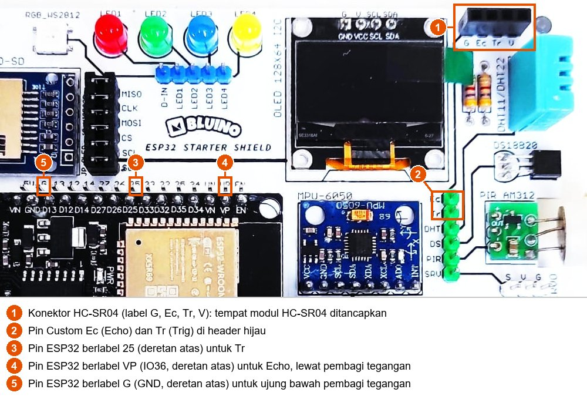
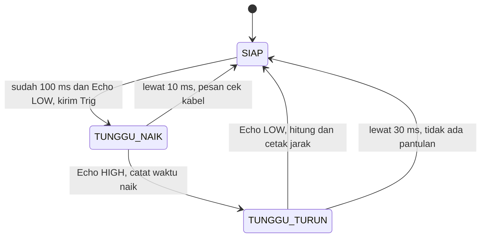

# BAB 30: HC-SR04 — Sensor Jarak Ultrasonik & Deteksi Objek

> ✅ **Prasyarat:** Selesaikan **BAB 16 (Non-Blocking Programming)** dan **BAB 17 (State Machine)** — kamu sudah terbiasa dengan `millis()`, `micros()`, `struct Timer`, dan `enum`. BAB ini juga memakai pembagi tegangan dari **BAB 3 (Dasar Elektronika untuk Mikrokontroler)** dan sensor DHT11 dari **BAB 26 (DHT11 — Suhu & Kelembapan)**.

Pernah berteriak di depan tebing lalu mendengar gemanya? Makin jauh tebingnya, makin lama gema itu kembali. Sensor **HC-SR04** bekerja dengan cara yang sama: ia "berteriak" memakai suara ultrasonik yang tidak terdengar telinga, lalu mengukur berapa lama pantulannya kembali. Dari waktu itu, ESP32 bisa menghitung jarak ke benda di depannya tanpa menyentuhnya — prinsip yang juga dipakai kelelawar saat terbang dalam gelap dan sensor parkir di bemper mobil.

## 📌 Tujuan Pembelajaran

Setelah mempelajari BAB ini, kamu bisa:

- Menjelaskan cara kerja HC-SR04: pulsa Trig, gelombang ultrasonik 40 kHz, dan lebar pulsa Echo.
- Menghitung jarak dari lebar pulsa Echo dan menjelaskan kenapa hasilnya dibagi dua.
- Menyambungkan HC-SR04 ke kit dengan aman: Trig ke IO25, Echo ke IO36 **lewat pembagi tegangan**.
- Memakai `pulseIn()` dengan batas waktu dan memperkirakan berapa lama program tertahan olehnya.
- Mengoreksi kecepatan suara memakai suhu udara dari DHT11.
- Membuat sensor parkir tiga zona dengan LED dan *buzzer* tanpa `delay()`.
- Mengukur lebar pulsa Echo tanpa menunggu memakai `micros()` dan *state machine*.

## 🧰 Yang Perlu Disiapkan

| Kebutuhan | Keterangan |
|---|---|
| *Hardware* | Kit Bluino ESP32 IoT Starter Shield + kabel USB **data** |
| Kabel *jumper* | *Female-female* (sudah ada di kit): 1 untuk `Tr` → IO25, 1 untuk `DHT` → IO27 (Program 2), 4 untuk LED dan *buzzer* (Program 3). *Male-female*: 3 kabel untuk *breadboard* (tidak termasuk kit) |
| Komponen tambahan | **Tidak termasuk kit:** modul sensor ultrasonik **HC-SR04**, resistor **1 kΩ** dan **2 kΩ** (atau tiga resistor 1 kΩ), dan *breadboard* kecil (misalnya 170 lubang) |
| *Software* | Arduino IDE 2.x + *board package* **esp32** versi 3.3.x (lihat [BAB 5](../BAB-05/README.md)) |
| *Library* | Program 1, 3, dan 4: tidak perlu *library* tambahan. Program 2: **DHT sensor library** dan **Adafruit Unified Sensor** (keduanya buatan Adafruit; cara memasang di [BAB 26](../BAB-26/README.md#265-memasang-library-dht)) |
| Alat uji | **Serial Monitor** Arduino IDE (baud 115200), penggaris atau meteran, dan benda datar (buku atau kotak kardus) sebagai sasaran |
| Jaringan | Tidak perlu WiFi |

> 📌 **Catatan:** Kit hanya menyediakan **konektor** untuk HC-SR04, bukan sensornya. Modul HC-SR04, resistor, *breadboard*, dan kabel *male-female* mudah dibeli di toko elektronik atau toko daring dengan harga terjangkau. Kalau toko menjual resistor dalam bentuk paket campuran, pastikan ada nilai 1 kΩ dan 2 kΩ (atau 1 kΩ saja, karena dua resistor 1 kΩ yang diseri sama dengan 2 kΩ).

## 📑 Daftar Isi

- [30.1 Mengenal Sensor Ultrasonik HC-SR04](#301-mengenal-sensor-ultrasonik-hc-sr04)
- [30.2 Cara HC-SR04 Mengukur Jarak](#302-cara-hc-sr04-mengukur-jarak)
- [30.3 Menyambungkan HC-SR04 ke Kit](#303-menyambungkan-hc-sr04-ke-kit)
- [30.4 Program 1: Mengukur Jarak Dasar](#304-program-1-mengukur-jarak-dasar)
- [30.5 Hal yang Memengaruhi Hasil Pengukuran](#305-hal-yang-memengaruhi-hasil-pengukuran)
- [30.6 Kecepatan Suara Bergantung pada Suhu](#306-kecepatan-suara-bergantung-pada-suhu)
- [30.7 Program 2: Jarak dengan Koreksi Suhu](#307-program-2-jarak-dengan-koreksi-suhu)
- [30.8 Berapa Lama pulseIn() Menahan Program?](#308-berapa-lama-pulsein-menahan-program)
- [30.9 Program 3: Sensor Parkir Tiga Zona](#309-program-3-sensor-parkir-tiga-zona)
- [30.10 Program 4: Mengukur Jarak Tanpa Menunggu](#3010-program-4-mengukur-jarak-tanpa-menunggu)
- [30.11 Troubleshooting](#3011-troubleshooting)
- [📝 Rangkuman](#-rangkuman)
- [💪 Latihan](#-latihan)
- [📚 Referensi](#-referensi)

---

## 30.1 Mengenal Sensor Ultrasonik HC-SR04

**Ultrasonik** artinya suara dengan frekuensi di atas batas pendengaran manusia. Telinga kita hanya bisa mendengar suara sekitar 20 Hz sampai 20 kHz (20.000 getaran per detik), sedangkan HC-SR04 memakai suara **40 kHz**. Jadi sensor ini bisa terus "berteriak" tanpa terdengar olehmu.

### 30.1.1 Bagian-Bagian Modul HC-SR04


*Gambar 30.1 — Modul HC-SR04 tampak depan. Tabung kiri (T) memancarkan suara, tabung kanan (R) menangkap pantulannya. Warna PCB (papan sirkuit) modulmu bisa berbeda; yang paling umum biru. Sumber: [SparkFun Electronics](https://commons.wikimedia.org/wiki/File:SparkFun_HC-SR04_Ultrasonic-Sensor_13959-01a.jpg), lisensi CC BY 2.0.*

| Bagian | Fungsi |
|---|---|
| Tabung **T** (*transmitter*, pemancar) | "Mulut" sensor: *speaker* kecil yang memancarkan suara 40 kHz |
| Tabung **R** (*receiver*, penerima) | "Telinga" sensor: mikrofon kecil yang menangkap pantulan |
| Rangkaian di balik PCB | Membangkitkan getaran, menguatkan sinyal pantulan, dan mengatur pin Echo |
| Pin `VCC` | Catu daya 5 V |
| Pin `Trig` (*trigger*, pemicu) | Input: pulsa HIGH minimal 10 µs dari ESP32 berarti "mulai mengukur" |
| Pin `Echo` (gema) | Output: HIGH selama suara menempuh perjalanan pergi-pulang |
| Pin `GND` | *Ground* (0 V) |

### 30.1.2 Spesifikasi Penting

| Parameter | Nilai menurut *datasheet* | Artinya untuk kamu |
|---|---|---|
| Tegangan kerja | 5 V DC | Konektor HC-SR04 di kit sudah memberi 5 V |
| Arus kerja | ±15 mA | Kecil, aman diambil dari jalur 5 V kit |
| Frekuensi suara | 40 kHz | Tidak terdengar telinga manusia |
| Jangkauan | 2 cm – 400 cm | Di bawah 2 cm atau di atas ±4 m, hasilnya tidak bisa dipercaya |
| Resolusi | 0,3 cm (akurasi terbaik ±3 mm) | Itu angka kondisi ideal. Dalam praktik, selisih sekitar 1 cm masih wajar |
| Sudut ukur | 15° | Paling baik untuk benda di dalam kerucut ±15° dari arah lurus ke depan |
| Pulsa Trig | Minimal 10 µs, level TTL | ESP32 mengirim HIGH 3,3 V selama 10 µs |
| Pulsa Echo | Level 5 V; lebarnya ±150 µs sampai ±25 ms, sebanding dengan jarak; ±38 ms kalau tidak ada pantulan | **Wajib** diturunkan ke sekitar 3,3 V sebelum masuk ESP32 |
| Jeda antarpengukuran | Minimal 60 ms | Jangan memicu lebih sering dari ±16 kali per detik |

*Datasheet* HC-SR04 ditulis oleh beberapa penjual (misalnya ElecFreaks dan ITead Studio), jadi angkanya sedikit berbeda-beda. Tabel di atas mengambil angka yang paling aman. Kedua *datasheet* ada di [📚 Referensi](#-referensi).

> 📌 **Catatan:** Ada banyak versi HC-SR04 di pasaran: PCB biru, merah, atau hijau, serta versi baru seperti HC-SR04P yang juga bisa bekerja pada 3,3 V. Cara pakainya sama. Namun, konektor kit memberi modul tegangan **5 V**, sehingga pin Echo versi mana pun akan mengeluarkan sekitar 5 V. Pembagi tegangan tetap wajib.

---

## 30.2 Cara HC-SR04 Mengukur Jarak

### 30.2.1 Urutan Sinyal Trig dan Echo

Bayangkan pin `Echo` sebagai *stopwatch* yang dinyalakan dan dimatikan oleh modul:

1. ESP32 membuat pin `Trig` HIGH selama minimal 10 µs (mikrodetik, sepersejuta detik), lalu LOW lagi. Artinya: "Ukur sekarang!"
2. Modul memancarkan 8 getaran suara 40 kHz dari tabung T. Lamanya hanya ±0,2 ms.
3. Begitu suara terkirim, modul membuat pin `Echo` HIGH — *stopwatch* mulai berjalan.
4. Suara memantul dari benda dan kembali ke tabung R. Saat pantulan tertangkap, `Echo` kembali LOW — *stopwatch* berhenti.
5. Kalau tidak ada pantulan sama sekali, `Echo` tetap HIGH sekitar 38 ms, lalu turun sendiri ("menyerah").

```text
             minimal 10 µs
             +----+
Trig    -----+    +--------------------------------------------------
                    8 getaran 40 kHz (±0,2 ms)
Suara   ------------||||||||-------------------------------------------
                              +--------------------------+
Echo    ----------------------+                          +---------
                              |<--- lebar pulsa Echo --->|
                              = waktu suara pergi + pulang
```

Jadi tugas ESP32 hanya dua: mengirim pulsa pendek ke `Trig`, lalu mengukur **berapa lama** pin `Echo` bernilai HIGH. Lama itu disebut **lebar pulsa Echo**.

### 30.2.2 Menghitung Jarak dari Lebar Pulsa Echo

```text
jarak = lebar pulsa Echo × kecepatan suara ÷ 2
```

Kenapa dibagi 2? Selama `Echo` HIGH, suara menempuh jarak **dua kali**: pergi ke benda, lalu pulang ke sensor. Mirip melempar bola ke tembok lalu menangkapnya lagi — bola menempuh dua kali jarak kamu ke tembok.

Di udara bersuhu 20 °C, suara merambat sekitar 343 m/s. Supaya cocok dengan satuan mikrodetik dan sentimeter, ubah dulu satuannya:

```text
kecepatan suara (20 °C) = 343 m/s
                        = 34.300 cm/s
                        = 0,0343 cm/µs      (1 detik = 1.000.000 µs)

jarak (cm) = lebar pulsa (µs) × 0,0343 ÷ 2
           = lebar pulsa (µs) ÷ 58,3
```

Contoh: kalau `Echo` HIGH selama 1166 µs, jaraknya 1166 × 0,0343 ÷ 2 ≈ 20,0 cm.

| Jarak benda | Lebar pulsa Echo (suhu 20 °C) |
|---|---|
| 2 cm (batas terdekat) | ±117 µs |
| 10 cm | ±583 µs |
| 50 cm | ±2,9 ms |
| 1 m | ±5,8 ms |
| 4 m (batas terjauh) | ±23,3 ms |

> 💡 **Tips:** Banyak tutorial di internet menulis `jarak = durasi / 58`. Itu versi singkat rumus di atas dan hanya tepat untuk suhu sekitar 20 °C. Di ruangan bersuhu 30 °C, pembaginya sekitar 57,2. Pengaruh suhu ini dibahas di [30.6](#306-kecepatan-suara-bergantung-pada-suhu).

---

## 30.3 Menyambungkan HC-SR04 ke Kit

Bagian ini paling penting di seluruh BAB. Salah sambung di sini bisa merusak pin ESP32, jadi ikuti pelan-pelan.

### 30.3.1 Konektor HC-SR04 di Kit

Di pojok kanan atas kit ada soket hitam 4 lubang dengan label `G`, `Ec`, `Tr`, `V`. Di situlah modul HC-SR04 ditancapkan. Jalur `Ec` (Echo) dan `Tr` (Trig) dari soket itu dibawa oleh jalur PCB ke dua pin Custom paling atas di header hijau.



*Gambar 30.2 — Letak konektor HC-SR04 (1), pin Custom `Ec` dan `Tr` (2), serta pin ESP32 yang dipakai di BAB ini (3–5) pada kit v3.x; tata letak kit v3.2 milikmu bisa sedikit berbeda. Sumber: foto produk ESP32 Starter Shield, [Bluino](http://www.bluino.com), dipotong dan diberi penanda untuk materi ini.*

Rangkaian konektor itu di skematik kit:


*Gambar 30.3 — Konektor HC-SR04 pada kit: pin 1 = GND, pin 2 = Echo, pin 3 = Trig, pin 4 = VCC 5 V. Sumber: skematik ESP32 Starter Shield 3.2, [Bluino](http://www.bluino.com).*

| Pin konektor | Label di PCB | Tersambung ke | Perlu kabel *jumper*? |
|---|---|---|---|
| 1 | `G` | GND | Tidak — sudah lewat PCB |
| 2 | `Ec` | Pin Custom `Ec` (header hijau, paling atas) | **Ya**, lewat pembagi tegangan ke IO36 |
| 3 | `Tr` | Pin Custom `Tr` (header hijau, kedua dari atas) | **Ya**, langsung ke IO25 |
| 4 | `V` | Jalur 5 V kit (tanda panah di skematik) | Tidak — sudah lewat PCB |

Perhatikan: di antara pin 2 dan kotak Custom **tidak ada resistor**. Artinya pin `Ec` di header hijau membawa sinyal Echo **5 V** apa adanya.

**Cara menancapkan modul:** cabut kabel USB dulu. Tancapkan modul dengan tabung T dan R **menghadap ke luar papan** (menjauhi layar OLED). Dengan arah ini, tulisan di modul cocok dengan label di kit: `GND` → `G`, `Echo` → `Ec`, `Trig` → `Tr`, `VCC` → `V`. Tetap baca tulisan kecil di modulmu dan cocokkan satu per satu.

> ⚠️ **Perhatian:** Kalau modul terbalik (tabung menghadap ke dalam, ke arah layar OLED), `VCC` dan `GND` tertukar dan modul bisa rusak. *Datasheet* ElecFreaks juga menyarankan agar modul tidak dipasang saat ada tegangan — kalau terpaksa, GND harus tersambung lebih dulu. Jadi biasakan memasang dan melepas modul saat kabel USB dicabut.

### 30.3.2 Echo Wajib Lewat Pembagi Tegangan

> 🚨 **Bahaya:** Jangan pernah menyambung pin `Ec` langsung ke pin ESP32 mana pun. Saat Echo HIGH, tegangannya ±5 V, padahal pin ESP32 hanya tahan sampai 3,6 V. Pin bisa rusak seketika atau perlahan-lahan menjadi tidak stabil (lihat [BAB 3](../BAB-03/README.md#36-logika-digital-33-v-esp32-tidak-tahan-5-v)).

Solusinya adalah **pembagi tegangan** yang sudah kamu kenal di [BAB 3](../BAB-03/README.md#353-menurunkan-sinyal-echo-hc-sr04-dari-5-v-ke-sekitar-33-v): dua resistor yang diseri antara sinyal Echo dan GND. Titik tengahnya menghasilkan tegangan yang lebih kecil:

```text
 Ec (header hijau) ── sinyal Echo, 5 V saat HIGH
     │
    ┌┴┐
    │ │ R1 = 1 kΩ  (resistor atas)
    └┬┘
     ├──────────────── ke VP (IO36), ±3,3 V saat HIGH
    ┌┴┐
    │ │ R2 = 2 kΩ  (resistor bawah)
    └┬┘
     │
 G (GND) ── 0 V

Vout = 5 V × R2 ÷ (R1 + R2) = 5 V × 2 kΩ ÷ 3 kΩ ≈ 3,33 V
```

Tegangan ±3,33 V aman (di bawah 3,6 V) dan tetap terbaca HIGH, karena ESP32 membaca HIGH mulai sekitar 2,5 V. Kalau tidak punya resistor 2 kΩ, seri dua resistor 1 kΩ. Pasangan lain juga boleh, asalkan hasilnya berada di antara ±2,8 V dan 3,6 V:

| R1 (atas) | R2 (bawah) | Tegangan ke IO36 saat Echo 5 V | Boleh? |
|---|---|---|---|
| 1 kΩ | 2 kΩ (atau 2 × 1 kΩ diseri) | ±3,33 V | ✅ Pilihan di BAB ini |
| 2,2 kΩ | 3,3 kΩ | ±3,0 V | ✅ Aman |
| 10 kΩ | 20 kΩ | ±3,33 V | ✅ Aman |
| 1 kΩ | 2,2 kΩ | ±3,44 V | ⚠️ Masih di bawah 3,6 V, tetapi mepet |
| 1 kΩ | 1 kΩ | ±2,5 V | ❌ Terlalu rendah — bisa tidak terbaca HIGH |
| 1 kΩ | 4,7 kΩ | ±4,1 V | ❌ Terlalu tinggi — berbahaya |

> 💡 **Tips:** R2 sekaligus berfungsi sebagai resistor *pull-down*. IO36 tidak punya *pull-up/pull-down* internal, jadi tanpa R2 pin ini akan "mengambang" saat modul dicabut. Dengan R2, IO36 tetap LOW.

> 📌 **Catatan:** `Tr` **tidak** perlu pembagi tegangan karena arah sinyalnya dari ESP32 (3,3 V) ke modul. *Datasheet* menyebut Trig menerima pulsa level TTL, yang menganggap HIGH mulai sekitar 2 V. Jadi HIGH 3,3 V dari ESP32 sudah cukup untuk memicu modul.

### 30.3.3 Kenapa Trig ke IO25 dan Echo ke IO36?

Kedua pin ini mengikuti **Peta Pin Standar** di seluruh materi ([BAB 6](../BAB-06/README.md)), supaya kamu tidak perlu bongkar-pasang kabel setiap ganti BAB.

**IO25 (`Tr`) dipakai bergantian dengan tombol S2.** Pin `25` di kit hanya muat satu kabel, jadi cabut dulu kabel `SW2` → `25` dari [BAB 9](../BAB-09/README.md) kalau masih terpasang, lalu pasang kabel `Tr` di tempatnya. Jangan mencoba menyambung keduanya sekaligus (misalnya lewat *breadboard*): menekan S2 akan menyambung 3,3 V langsung ke IO25 yang sedang menjadi output, dan saat IO25 LOW itu sama dengan hubung singkat yang bisa merusak pin. Setelah selesai BAB ini, kembalikan kabel `SW2` → `25`.

**IO36 (`VP`) cocok untuk Echo**, dengan beberapa catatan:

- IO36 termasuk pin IO34–IO39 yang **hanya bisa menjadi input**. Tidak masalah, karena Echo memang sinyal masuk.
- IO36 tidak punya *pull-up/pull-down* internal. Tugas ini sudah diambil alih oleh R2 pada pembagi tegangan.
- **Jangan memakai interupsi di IO36.** Menurut *errata* (daftar cacat resmi) ESP32 nomor GPIO-3.11, IO36 dan IO39 sesaat ditarik ke LOW (±80 nanodetik) setiap kali ADC dinyalakan, sehingga interupsi bisa terpicu palsu. Penjelasannya ada di [BAB 10](../BAB-10/README.md#1033-pin-yang-bisa-dipakai). Karena itu, BAB ini mengukur Echo dengan `pulseIn()` (Program 1–3) dan dengan memeriksa pin berulang-ulang atau *polling* (Program 4). Kedua cara itu hanya membaca keadaan pin, tanpa interupsi.

### 30.3.4 Langkah Merangkai

Pembagi tegangan dirangkai di ***breadboard*** (papan rangkai), yaitu papan berlubang untuk merangkai komponen tanpa solder. Di dalamnya ada lempeng logam yang menyambung lubang-lubang tertentu: pada *breadboard* kecil, **lima lubang dalam satu kolom bernomor sama (baris a–e) saling tersambung**. Jadi dua kaki komponen yang ditancapkan di kolom yang sama otomatis tersambung.


*Gambar 30.4 — Rangkaian HC-SR04 di kit: skema (kiri) dan contoh susunan di breadboard (kanan). Sumber: dibuat untuk materi ini.*

Langkah-langkahnya:

1. **Cabut kabel USB** dari laptop.
2. Kalau kabel `SW2` → `25` masih terpasang, lepas dulu.
3. Tancapkan modul HC-SR04 ke konektor `G` `Ec` `Tr` `V` dengan tabung menghadap ke luar papan (lihat [30.3.1](#3031-konektor-hc-sr04-di-kit)).
4. Tancapkan **R1 (1 kΩ)** di *breadboard*: satu kaki di kolom 3, kaki lainnya di kolom 7. Gelang warna resistor 1 kΩ: cokelat–hitam–merah (cara membaca gelang warna ada di [BAB 3](../BAB-03/README.md#331-membaca-gelang-warna)).
5. Tancapkan **R2 (2 kΩ)**: satu kaki di kolom 7, kaki lainnya di kolom 11. Gelang warnanya merah–hitam–merah. Kolom 7 sekarang menjadi **titik tengah** pembagi tegangan. Kalau memakai dua resistor 1 kΩ sebagai R2, pasang dari kolom 7 ke kolom 9, lalu dari kolom 9 ke kolom 11.
6. Kabel *male-female* dari kolom 3 ke pin **`Ec`** (header hijau, paling atas).
7. Kabel *male-female* dari kolom 7 ke pin **`VP`** (deretan pin ESP32 atas, kedua dari kanan).
8. Kabel *male-female* dari kolom 11 ke pin **`G`** (deretan pin ESP32 atas, kedua dari kiri).
9. Kabel *female-female* dari pin **`Tr`** (header hijau, kedua dari atas) ke pin **`25`** (deretan pin ESP32 atas).
10. Periksa sekali lagi: kabel ke `VP` harus berasal dari **kolom 7** (titik tengah), **bukan** dari kolom 3. Setelah yakin, baru sambungkan kabel USB.

Ringkasan sambungan yang dipakai oleh semua program di BAB ini:

| Dari | Ke | Jenis sambungan |
|---|---|---|
| Modul HC-SR04 | Konektor `G` `Ec` `Tr` `V` di kit | Ditancapkan langsung |
| `Tr` (header hijau, kedua dari atas) | `25` (IO25, deretan atas) | Kabel *female-female* |
| `Ec` (header hijau, paling atas) | *Breadboard* kolom 3 (ujung R1) | Kabel *male-female* |
| *Breadboard* kolom 7 (titik tengah R1–R2) | `VP` (IO36, deretan atas) | Kabel *male-female* |
| *Breadboard* kolom 11 (ujung R2) | `G` (GND, deretan atas) | Kabel *male-female* |

> 💡 **Tips:** Tidak punya *breadboard*? Kedua resistor bisa disolder menjadi satu "kabel pembagi": ujung bebas R1 ke kabel menuju `Ec`, sambungan R1–R2 ke kabel menuju `VP`, dan ujung bebas R2 ke kabel menuju `G`. Tutup setiap sambungan dengan selotip listrik atau selongsong bakar (*heat shrink*) supaya tidak saling bersentuhan. Kalau ragu nilai resistornya, ukur dulu dengan multimeter ([BAB 3](../BAB-03/README.md#312-mengukur-dengan-multimeter-opsional)).

---

## 30.4 Program 1: Mengukur Jarak Dasar

**Tujuan:** Mengukur jarak ke benda di depan sensor lima kali per detik, lalu menampilkan lebar pulsa Echo dan jaraknya di Serial Monitor. Program ini memakai rumus untuk suhu 20 °C dari [30.2.2](#3022-menghitung-jarak-dari-lebar-pulsa-echo).

**Rangkaian:**

| Pin **Custom** di kit | Sambungkan ke pin ESP32 |
|---|---|
| `Tr` (header hijau, kedua dari atas) | IO25 (label `25`) |
| `Ec` (header hijau, paling atas) | IO36 (label `VP`) **lewat pembagi tegangan** 1 kΩ + 2 kΩ — lihat [30.3.4](#3034-langkah-merangkai) |

Modul HC-SR04 ditancapkan di konektor `G` `Ec` `Tr` `V`, dan kabel `SW2` → `25` sudah dilepas.

**Cara Menjalankan:**

1. Rangkai sesuai [30.3.4](#3034-langkah-merangkai). Pastikan kabel ke `VP` berasal dari titik tengah pembagi tegangan.
2. Buka Arduino IDE → **File → New Sketch**, hapus isinya, lalu salin kode di bawah. Kode yang sama juga tersedia di *file* [`p1_jarak_dasar.ino`](p1_jarak_dasar/p1_jarak_dasar.ino).
3. Pastikan **Tools → Board** = **ESP32 Dev Module** dan **Tools → Port** = *port* ESP32 kamu (misalnya `COM5` di Windows atau `/dev/ttyUSB0` di Linux).
4. Klik tombol **Upload** (ikon panah →) dan tunggu sampai muncul tulisan **Done uploading**.
5. Buka **Serial Monitor** (**Tools → Serial Monitor**) lalu pilih baud **115200**.
6. Pegang buku tegak lurus di depan sensor, lalu gerakkan perlahan mendekat dan menjauh.

**Kode Program:**

<!-- sketch: p1_jarak_dasar -->
```cpp
/*
 * BAB 30 - Program 1: Mengukur Jarak Dasar
 * Mengirim pulsa Trig 10 µs, mengukur lebar pulsa Echo dengan pulseIn(),
 * lalu menghitung jarak dengan kecepatan suara pada suhu 20 °C.
 *
 * Rangkaian:
 *   Modul HC-SR04 di konektor kit (G, Ec, Tr, V)
 *   Tr (header hijau) → IO25   (lepas dulu kabel SW2 → 25)
 *   Ec (header hijau) → pembagi tegangan 1 kΩ + 2 kΩ → IO36 (VP)
 */

#define PIN_TRIG 25  // Tr → IO25
#define PIN_ECHO 36  // Ec → pembagi tegangan → IO36 (label VP)

const unsigned long BATAS_TUNGGU_US = 30000;  // 30 ms, cukup untuk pantulan terjauh (±4 m ≈ 23 ms)
const float KECEPATAN_SUARA = 0.0343;         // cm per mikrodetik (343 m/s, suhu 20 °C)

// Memicu satu pengukuran, lalu mengembalikan lebar pulsa Echo dalam µs.
// Hasil 0 berarti pulsa Echo tidak selesai sebelum batas waktu habis.
unsigned long ukurEchoUs() {
  digitalWrite(PIN_TRIG, LOW);
  delayMicroseconds(2);
  digitalWrite(PIN_TRIG, HIGH);
  delayMicroseconds(10);        // pulsa Trig minimal 10 µs
  digitalWrite(PIN_TRIG, LOW);
  return pulseIn(PIN_ECHO, HIGH, BATAS_TUNGGU_US);
}

void setup() {
  Serial.begin(115200);
  pinMode(PIN_TRIG, OUTPUT);
  digitalWrite(PIN_TRIG, LOW);
  pinMode(PIN_ECHO, INPUT);     // IO36 hanya bisa menjadi input
  Serial.println("BAB 30 - Program 1: Mengukur Jarak Dasar");
}

void loop() {
  unsigned long durasi = ukurEchoUs();

  if (durasi == 0) {
    Serial.println("Tidak ada pantulan (benda terlalu jauh/miring, atau cek kabel)");
  } else {
    float jarakCm = durasi * KECEPATAN_SUARA / 2;
    Serial.printf("Echo: %5lu us | Jarak: %5.1f cm\n", durasi, jarakCm);
  }

  delay(200);  // ukur 5 kali per detik (jeda minimal 60 ms)
}
```

**Penjelasan Kode:**

- `#define PIN_ECHO 36` memakai nomor GPIO. Ingat, pin berlabel `VP` di kit adalah IO36, jadi di program ditulis `36`.
- Fungsi `ukurEchoUs()` membuat pulsa Trig: LOW sebentar (2 µs) supaya awalnya bersih, HIGH selama 10 µs, lalu LOW lagi. `delayMicroseconds()` menunggu dalam satuan mikrodetik.
- `pulseIn(PIN_ECHO, HIGH, BATAS_TUNGGU_US)` menunggu sampai Echo menjadi HIGH, mengukur berapa lama Echo tetap HIGH, lalu mengembalikan lamanya dalam µs. Argumen ketiga adalah **batas waktu** dalam µs. Di esp32 core, batas ini dihitung sejak `pulseIn()` dipanggil — mencakup menunggu Echo naik dan lamanya pulsa. Kalau waktunya habis, hasilnya 0.
- Jangan menghapus argumen ketiga. Tanpa itu, batas waktunya 1 detik, dan pulsa ±38 ms saat tidak ada pantulan akan terbaca sebagai jarak palsu sekitar 650 cm.
- `durasi * KECEPATAN_SUARA / 2` adalah rumus dari [30.2.2](#3022-menghitung-jarak-dari-lebar-pulsa-echo). Hasilnya disimpan di `float` karena mengandung angka desimal.
- `Serial.printf()` mencetak dengan format: `%5lu` untuk bilangan `unsigned long` selebar 5 karakter, `%5.1f` untuk `float` dengan 1 angka di belakang titik. Tulisan `us` di layar artinya µs — huruf µ sengaja diganti `u`.
- `delay(200)` membuat program mengukur 5 kali per detik, jauh di atas jeda minimal 60 ms. `delay()` tidak masalah di sini karena program hanya mengerjakan satu hal (lihat [BAB 16](../BAB-16/README.md#1618-kapan-delay-masih-boleh-dipakai)).

**Contoh Output:**

```text
BAB 30 - Program 1: Mengukur Jarak Dasar
Echo:  1166 us | Jarak:  20.0 cm
Echo:  1172 us | Jarak:  20.1 cm
Echo:  1749 us | Jarak:  30.0 cm
Echo:  2920 us | Jarak:  50.1 cm
Tidak ada pantulan (benda terlalu jauh/miring, atau cek kabel)
```

Angka di atas hanya contoh — angkamu bergantung pada jarak benda. Satu baris baru muncul setiap 0,2 detik. Baris `Tidak ada pantulan` muncul saat sensor diarahkan ke ruang kosong yang jauh, ke benda lunak, atau ke permukaan yang miring. Di kit tidak ada LED yang menyala; semua hasil hanya terlihat di Serial Monitor.

> 🧪 **Coba Sendiri:** Uji ketelitian sensormu dengan penggaris. Letakkan buku tegak lurus di depan sensor pada jarak 10, 20, 30, dan 50 cm, dihitung dari **muka depan tabung** (bukan dari tepi PCB). Catat hasil di Serial Monitor dan hitung selisihnya. Selisih sekitar 1 cm masih wajar.

**Kalau Belum Berhasil:**

- **Selalu muncul `Tidak ada pantulan`, walaupun ada buku di depan sensor** → sinyal Echo tidak sampai ke IO36. Periksa urutan sambungan `Ec` → kolom 3 → R1 → kolom 7 → `VP`, kabel `Tr` → `25`, dan arah modul di konektor. Pastikan juga kabel di pin `25` berasal dari `Tr`, bukan dari `SW2`.
- **Angkanya melompat-lompat** → sasaran terlalu kecil, lunak, atau miring. Coba dinding atau kotak kardus yang dihadapkan tegak lurus (lihat [30.5](#305-hal-yang-memengaruhi-hasil-pengukuran)).
- **Selalu terbaca beberapa sentimeter, padahal tidak ada apa-apa di depan sensor** → ada benda lain di dalam kerucut ukur, misalnya kabel *jumper* yang terjuntai di depan tabung atau barang di atas meja. Rapikan area di depan sensor.
- **Serial Monitor kosong atau berisi karakter aneh** → pilih baud **115200**, lalu tekan tombol **EN** di *board* ESP32.

---

## 30.5 Hal yang Memengaruhi Hasil Pengukuran

HC-SR04 tidak "melihat" seperti kamera. Ia hanya mendengar pantulan **pertama** yang cukup kuat. Karena itu, bentuk, bahan, dan letak benda sangat menentukan hasilnya:

| Situasi | Apa yang terjadi | Saran |
|---|---|---|
| Benda lebih dekat dari ±2 cm | Pantulan datang saat modul masih memancarkan suara, sehingga tidak terukur atau angkanya acak | Jaga jarak minimal 2–3 cm |
| Benda jauh (mendekati 4 m), kecil, atau tipis (tiang, kabel, jari) | Pantulannya terlalu lemah untuk ditangkap | *Datasheet* memakai sasaran datar minimal 0,5 m² untuk jangkauan penuh |
| Permukaan lunak (kain, busa, bantal, bulu) | Suara diserap, bukan dipantulkan | Pakai sasaran keras: dinding, kayu, kardus |
| Permukaan miring | Suara memantul ke arah lain, seperti bola yang dilempar miring ke tembok | Hadapkan sasaran tegak lurus ke sensor |
| Ada benda lain di samping | Sensor mendengar di dalam kerucut ±15°, jadi benda di samping bisa ikut terukur | Kosongkan area di depan sensor |
| Pengukuran terlalu rapat | Gema dari pengukuran sebelumnya ikut tertangkap | Beri jeda minimal 60 ms |
| Dua HC-SR04 aktif bersamaan | Suara dari sensor A ditangkap sensor B | Picu bergantian, satu per satu |
| Suhu udara jauh dari 20 °C | Kecepatan suara berubah, hasil bergeser beberapa persen | Koreksi dengan suhu ([30.6](#306-kecepatan-suara-bergantung-pada-suhu)) |

> 💡 **Tips:** Untuk benda yang sangat dekat atau sangat kecil, sensor jarak laser seperti VL53L0X (komunikasi I2C, tidak termasuk kit) biasanya lebih cocok. Sebaliknya, HC-SR04 unggul untuk benda besar seperti dinding, pintu, atau permukaan air, dan tidak terpengaruh warna maupun cahaya.

---

## 30.6 Kecepatan Suara Bergantung pada Suhu

Suara merambat lebih cepat di udara yang lebih hangat. Rumus pendekatan yang cukup teliti untuk suhu sehari-hari adalah:

```text
v ≈ 331,3 + 0,606 × T        (v dalam m/s, T = suhu udara dalam °C)
```

| Suhu udara | Kecepatan suara | Dalam cm/µs | Pembagi µs → cm |
|---|---|---|---|
| 20 °C | 343,4 m/s | 0,03434 | 58,2 |
| 25 °C | 346,5 m/s | 0,03465 | 57,7 |
| 30 °C | 349,5 m/s | 0,03495 | 57,2 |
| 35 °C | 352,5 m/s | 0,03525 | 56,7 |

Program 1 memakai 0,0343 cm/µs, yaitu angka 20 °C yang dibulatkan. Bagaimana kalau ruanganmu bersuhu 30 °C, seperti kebanyakan ruangan tanpa AC di Indonesia? Untuk benda yang sebenarnya berjarak 100 cm, Program 1 akan menampilkan sekitar 98 cm — kurang hampir 2 cm (±1,8 %). Selisih ini sebanding dengan jarak: sekitar 1 cm pada 50 cm, dan sekitar 3,7 cm pada 2 m.

Kelembapan udara juga sedikit berpengaruh (sekitar 0,1–0,6 %), tetapi jauh lebih kecil daripada suhu, jadi di BAB ini diabaikan.

Kit Bluino punya sensor suhu DHT11 (dibahas di [BAB 26](../BAB-26/README.md)). DHT11 tidak terlalu teliti, kira-kira ±1–2 °C, tetapi itu tidak masalah: salah 2 °C hanya mengubah kecepatan suara ±0,35 %, jauh lebih kecil daripada salah 10 °C karena mengabaikan suhu. Program berikut memakai suhu dari DHT11 untuk memperbaiki hasil pengukuran.

---

## 30.7 Program 2: Jarak dengan Koreksi Suhu

**Tujuan:** Membaca suhu udara dari DHT11 setiap 2 detik, menghitung kecepatan suara dari suhu itu, lalu menampilkan jarak terkoreksi berdampingan dengan jarak tanpa koreksi (anggapan 20 °C). Kedua tugas dijadwalkan dengan `struct Timer` dari [BAB 16](../BAB-16/README.md#1682-fungsi-di-dalam-struct), tanpa `delay()`.

**Rangkaian:**

| Pin **Custom** di kit | Sambungkan ke pin ESP32 |
|---|---|
| `Tr` (header hijau, kedua dari atas) | IO25 (label `25`) |
| `Ec` (header hijau, paling atas) | IO36 (label `VP`) **lewat pembagi tegangan** — lihat [30.3.4](#3034-langkah-merangkai) |
| `DHT` (header hijau, ketiga dari atas) | IO27 (label `27`, deretan atas) |

**Cara Menjalankan:**

1. Biarkan rangkaian HC-SR04 dari Program 1, lalu tambahkan kabel *female-female* dari `DHT` ke pin **27**.
2. Pastikan *library* **DHT sensor library** dan **Adafruit Unified Sensor** (keduanya buatan Adafruit) sudah terpasang. Kalau belum: buka **Sketch → Include Library → Manage Libraries…**, ketik `DHT sensor library`, pilih yang pembuatnya **Adafruit**, klik **Install**, lalu pilih **Install All** supaya Adafruit Unified Sensor ikut terpasang. Langkah lengkapnya ada di [BAB 26](../BAB-26/README.md#265-memasang-library-dht).
3. Buka Arduino IDE → **File → New Sketch**, hapus isinya, lalu salin kode di bawah. Kode yang sama juga tersedia di *file* [`p2_koreksi_suhu.ino`](p2_koreksi_suhu/p2_koreksi_suhu.ino).
4. Pastikan **Tools → Board** = **ESP32 Dev Module** dan **Tools → Port** = *port* ESP32 kamu.
5. Klik tombol **Upload** dan tunggu sampai muncul tulisan **Done uploading**.
6. Buka **Serial Monitor** (**Tools → Serial Monitor**) lalu pilih baud **115200**.
7. Letakkan buku tegak lurus di depan sensor, misalnya pada jarak 50 cm, dan biarkan diam.

**Kode Program:**

<!-- sketch: p2_koreksi_suhu -->
```cpp
/*
 * BAB 30 - Program 2: Jarak dengan Koreksi Suhu
 * Suhu udara dari DHT11 dipakai untuk menghitung kecepatan suara,
 * lalu jarak terkoreksi dibandingkan dengan jarak tanpa koreksi (20 °C).
 *
 * Rangkaian:
 *   Tr  (header hijau) → IO25   (lepas dulu kabel SW2 → 25)
 *   Ec  (header hijau) → pembagi tegangan 1 kΩ + 2 kΩ → IO36 (VP)
 *   DHT (header hijau) → IO27
 *
 * Library: DHT sensor library by Adafruit (+ Adafruit Unified Sensor)
 */

#include <DHT.h>

#define PIN_TRIG 25
#define PIN_ECHO 36
#define DHT_PIN  27
#define DHT_TYPE DHT11

const unsigned long BATAS_TUNGGU_US = 30000;  // 30 ms

DHT dht(DHT_PIN, DHT_TYPE);

// Timer serbaguna dari BAB 16
struct Timer {
  unsigned long interval;   // ms
  unsigned long waktuLalu;  // hasil millis() saat terakhir dijalankan

  // Mengembalikan true kalau sudah waktunya, lalu mencatat waktunya
  bool sudahWaktunya(unsigned long sekarang) {
    if (sekarang - waktuLalu >= interval) {
      waktuLalu = sekarang;
      return true;
    }
    return false;
  }
};

Timer timerSuhu  = {2000, 0};  // baca DHT11 setiap 2 detik (jangan kurang dari 2000)
Timer timerJarak = {500, 0};   // ukur jarak setiap 500 ms

float suhuUdara = 20.0;        // °C; dipakai 20 °C sampai DHT11 berhasil dibaca
bool suhuDariSensor = false;   // true setelah DHT11 pernah berhasil dibaca

// Kecepatan suara (m/s) pada suhu tertentu (°C), rumus pendekatan
float kecepatanSuara(float suhuC) {
  return 331.3 + 0.606 * suhuC;
}

unsigned long ukurEchoUs() {
  digitalWrite(PIN_TRIG, LOW);
  delayMicroseconds(2);
  digitalWrite(PIN_TRIG, HIGH);
  delayMicroseconds(10);
  digitalWrite(PIN_TRIG, LOW);
  return pulseIn(PIN_ECHO, HIGH, BATAS_TUNGGU_US);
}

void bacaSuhu() {
  dht.read(true);                   // paksa membaca sensor sekarang (±25 ms)
  float t = dht.readTemperature();  // ambil suhu dari bacaan barusan
  if (isnan(t)) {
    Serial.println("Gagal membaca DHT11, suhu sebelumnya tetap dipakai");
    return;
  }
  suhuUdara = t;
  suhuDariSensor = true;
}

void ukurJarak() {
  unsigned long durasi = ukurEchoUs();
  if (durasi == 0) {
    Serial.println("Tidak ada pantulan");
    return;
  }

  // m/s → cm/µs: kali 100 (m → cm), bagi 1.000.000 (s → µs) = bagi 10.000
  float v = kecepatanSuara(suhuUdara);
  float jarakKoreksi = durasi * (v / 10000.0) / 2;
  float jarak20C = durasi * (kecepatanSuara(20.0) / 10000.0) / 2;

  Serial.printf("Suhu %.1f °C%s | v = %.1f m/s | Jarak %.1f cm (tanpa koreksi %.1f cm)\n",
                suhuUdara, suhuDariSensor ? "" : " (anggapan)", v, jarakKoreksi, jarak20C);
}

void setup() {
  Serial.begin(115200);
  pinMode(PIN_TRIG, OUTPUT);
  digitalWrite(PIN_TRIG, LOW);
  pinMode(PIN_ECHO, INPUT);
  dht.begin();
  Serial.println("BAB 30 - Program 2: Jarak dengan Koreksi Suhu");
}

void loop() {
  unsigned long sekarang = millis();

  // Tugas 1: perbarui suhu udara setiap 2 detik
  if (timerSuhu.sudahWaktunya(sekarang)) {
    bacaSuhu();
  }

  // Tugas 2: ukur jarak setiap 500 ms
  if (timerJarak.sudahWaktunya(sekarang)) {
    ukurJarak();
  }
}
```

**Penjelasan Kode:**

- `kecepatanSuara()` adalah rumus dari [30.6](#306-kecepatan-suara-bergantung-pada-suhu): 331,3 + 0,606 × suhu, hasilnya dalam m/s.
- Untuk mengubah m/s menjadi cm/µs, kalikan 100 (meter → sentimeter) lalu bagi 1.000.000 (detik → mikrodetik). Hasilnya sama dengan membagi 10.000, itulah `v / 10000.0`.
- `jarak20C` dihitung dengan rumus yang sama pada suhu 20 °C, sebagai pembanding "tanpa koreksi".
- `suhuUdara` dimulai dari 20 °C dan diberi tanda `(anggapan)` di layar, karena DHT11 baru dibaca pertama kali saat `millis()` mencapai 2000. Kalau pembacaan DHT11 gagal, suhu terakhir yang berhasil tetap dipakai.
- `dht.read(true)` memaksa *library* membaca sensor sekarang juga, lalu `readTemperature()` mengambil suhu dari bacaan itu. Alasannya sama dengan [BAB 26 Program 4](../BAB-26/README.md#2612-program-4-membaca-dht11-tanpa-delay): *timer* kita sudah menjamin jeda 2 detik, jadi pengaman 2 detik milik *library* tidak perlu ikut memeriksa.
- Ada dua *timer*: `timerSuhu` (2000 ms) dan `timerJarak` (500 ms). Saat keduanya jatuh tempo bersamaan (misalnya di detik ke-2), suhu diperbarui lebih dulu karena ditulis lebih dulu di `loop()`.

**Contoh Output:**

```text
BAB 30 - Program 2: Jarak dengan Koreksi Suhu
Suhu 20.0 °C (anggapan) | v = 343.4 m/s | Jarak 50.1 cm (tanpa koreksi 50.1 cm)
Suhu 20.0 °C (anggapan) | v = 343.4 m/s | Jarak 50.1 cm (tanpa koreksi 50.1 cm)
Suhu 20.0 °C (anggapan) | v = 343.4 m/s | Jarak 50.1 cm (tanpa koreksi 50.1 cm)
Suhu 30.0 °C | v = 349.5 m/s | Jarak 51.0 cm (tanpa koreksi 50.1 cm)
Suhu 30.0 °C | v = 349.5 m/s | Jarak 51.0 cm (tanpa koreksi 50.1 cm)
```

Contoh di atas diambil di ruangan bersuhu 30 °C dengan buku yang diam; angkamu bisa berbeda. Tiga baris pertama muncul setiap 0,5 detik sebelum DHT11 dibaca, jadi kedua jaraknya sama. Mulai detik ke-2, jarak terkoreksi menjadi ±0,9 cm lebih jauh daripada jarak tanpa koreksi — dan angka terkoreksi inilah yang lebih dekat dengan hasil penggaris. Kalau ruanganmu ber-AC (misalnya 24 °C), selisihnya lebih kecil.

> 🧪 **Coba Sendiri:** Jepit badan DHT11 dengan dua jari selama ±30 detik. Suhunya naik perlahan, dan "Jarak" ikut bertambah sedikit walaupun buku tidak bergerak. Ini bukti koreksinya bekerja — sekaligus pengingat bahwa yang perlu diukur adalah suhu **udara** yang dilewati suara, bukan suhu jarimu.

**Kalau Belum Berhasil:**

- ***Compile* gagal dengan pesan `DHT.h: No such file or directory`** → **DHT sensor library** by Adafruit belum terpasang. Kalau pesannya `Adafruit_Sensor.h: No such file or directory`, pasang juga **Adafruit Unified Sensor**.
- **Muncul `Gagal membaca DHT11, suhu sebelumnya tetap dipakai` dan tanda `(anggapan)` tidak pernah hilang** → kabel `DHT` → `27` belum terpasang atau bergeser. Periksa dengan Program 1 di [BAB 26](../BAB-26/README.md).
- **Selalu `Tidak ada pantulan`** → masalah ada di rangkaian HC-SR04; lihat bagian **Kalau Belum Berhasil** di Program 1.

---

## 30.8 Berapa Lama pulseIn() Menahan Program?

`pulseIn()` adalah fungsi *blocking* (menahan): selama menunggu dan mengukur pulsa Echo, `loop()` tidak bisa mengerjakan hal lain — persis seperti `delay()` yang kamu pelajari di [BAB 16](../BAB-16/README.md). Lamanya kira-kira:

```text
lama tertahan ≈ jeda singkat sebelum Echo naik + lebar pulsa Echo
```

Jeda sebelum Echo naik singkat saja — modul hanya perlu memancarkan 8 getaran dulu (±0,2 ms) — jadi bagian terbesarnya adalah lebar pulsa Echo:

| Keadaan | Program tertahan sekitar |
|---|---|
| Benda pada 10 cm | ±0,6 ms + jeda awal |
| Benda pada 50 cm | ±2,9 ms + jeda awal |
| Benda pada 1 m | ±5,8 ms + jeda awal |
| Benda pada 2 m | ±11,7 ms + jeda awal |
| Tidak ada pantulan (Echo HIGH ±38 ms) | Sampai batas waktu habis: **30 ms** di Program 1 dan 2 |
| Batas waktu tidak ditulis | Bisa sampai **1 detik** — jangan lakukan ini |

Untuk program yang hanya mengukur jarak, tertahan beberapa milidetik tidak terasa. Tapi kalau programmu juga harus membunyikan *buzzer* dengan irama rapi, membaca tombol, atau melayani halaman web, ikuti empat kebiasaan ini:

1. **Ukur seperlunya.** Jadwalkan pengukuran dengan `Timer` dari BAB 16, misalnya 10 kali per detik. Jangan memanggil `pulseIn()` di setiap putaran `loop()`.
2. **Sesuaikan batas waktu dengan jarak terjauh yang kamu perlukan.** Rumus kasarnya:

   ```text
   batas waktu (µs) ≈ jarak terjauh yang dibutuhkan (cm) × 58 + 1000
   ```

   Sensor parkir cukup peduli pada benda dalam 2 m, jadi Program 3 memakai 15000 µs (15 ms), cukup untuk benda sampai sekitar 2,4 m. Waktu tertahan terlama pun turun dari 30 ms menjadi 15 ms.
3. **Kerjakan tugas lain dengan pola `millis()`.** LED dan *buzzer* yang dijadwalkan dengan `millis()` hanya bergeser beberapa milidetik saat `pulseIn()` berjalan — tidak terlihat mata dan tidak terdengar telinga. Menariknya, saat benda dekat (justru saat alarm parkir paling penting), pulsa Echo pendek sehingga program hanya tertahan beberapa milidetik.
4. **Kalau sama sekali tidak boleh tertahan,** ukur pulsa Echo tanpa `pulseIn()`, seperti di Program 4 ([30.10](#3010-program-4-mengukur-jarak-tanpa-menunggu)).

> 📌 **Catatan:** WiFi dan Bluetooth ESP32 diurus oleh bagian sistem yang berjalan di latar belakang, jadi koneksinya tidak putus hanya karena `loop()` tertahan 30 ms. Yang tertunda adalah pekerjaan di `loop()`-mu sendiri, misalnya membalas permintaan dari *browser*.

---

## 30.9 Program 3: Sensor Parkir Tiga Zona

**Tujuan:** Meniru sensor parkir mobil. Jarak diukur 10 kali per detik, lalu dikelompokkan menjadi tiga zona: **AMAN** (LED hijau, *buzzer* diam), **WASPADA** (LED kuning, bip pelan), dan **BAHAYA** (LED merah, bip cepat). Pengukuran, LED, *buzzer*, dan laporan Serial berjalan bersamaan dengan pola `millis()`, tanpa `delay()`.

**Rangkaian:**

| Pin **Custom** di kit | Sambungkan ke pin ESP32 |
|---|---|
| `Tr` (header hijau, kedua dari atas) | IO25 (label `25`) |
| `Ec` (header hijau, paling atas) | IO36 (label `VP`) **lewat pembagi tegangan** — lihat [30.3.4](#3034-langkah-merangkai) |
| `BUZZ` | IO13 (label `13`, deretan atas) |
| `LED1` (merah) | IO4 (label `4`, deretan bawah) |
| `LED4` (kuning) | IO16 (label `16`, deretan bawah) |
| `LED2` (hijau) | IO17 (label `17`, deretan bawah) |

Kabel `DHT` → `27` dari Program 2 boleh tetap terpasang; program ini tidak memakainya.

**Cara Menjalankan:**

1. Biarkan rangkaian HC-SR04, lalu tambahkan empat kabel *female-female* untuk *buzzer* dan tiga LED sesuai tabel di atas. Ingat, pin `BUZZ` bersebelahan dengan `RELAY` — jangan tertukar.
2. Buka Arduino IDE → **File → New Sketch**, hapus isinya, lalu salin kode di bawah. Kode yang sama juga tersedia di *file* [`p3_sensor_parkir.ino`](p3_sensor_parkir/p3_sensor_parkir.ino).
3. Pastikan **Tools → Board** = **ESP32 Dev Module** dan **Tools → Port** = *port* ESP32 kamu.
4. Klik tombol **Upload** dan tunggu sampai muncul tulisan **Done uploading**.
5. Buka **Serial Monitor** (**Tools → Serial Monitor**) lalu pilih baud **115200**.
6. Gerakkan buku perlahan dari jarak ±1 m mendekati sensor, sampai sekitar 10 cm.

**Kode Program:**

<!-- sketch: p3_sensor_parkir -->
```cpp
/*
 * BAB 30 - Program 3: Sensor Parkir Tiga Zona
 * Jarak diukur 10 kali per detik. LED dan buzzer menunjukkan zonanya:
 *   AMAN    (lebih dari 50 cm, atau tidak ada benda) : LED hijau, buzzer diam
 *   WASPADA (20 sampai 50 cm)                        : LED kuning, bip pelan
 *   BAHAYA  (kurang dari 20 cm)                      : LED merah, bip cepat
 * Tidak ada delay() di loop(), jadi irama bip tetap rapi.
 *
 * Rangkaian:
 *   Tr   (header hijau) → IO25   (lepas dulu kabel SW2 → 25)
 *   Ec   (header hijau) → pembagi tegangan 1 kΩ + 2 kΩ → IO36 (VP)
 *   BUZZ                → IO13
 *   LED1 (merah)        → IO4
 *   LED4 (kuning)       → IO16
 *   LED2 (hijau)        → IO17
 */

#define PIN_TRIG   25
#define PIN_ECHO   36
#define BUZZER_PIN 13
#define LED_MERAH  4
#define LED_KUNING 16
#define LED_HIJAU  17

const unsigned long BATAS_TUNGGU_US = 15000;  // 15 ms: cukup untuk benda sampai ±2,4 m
const float BATAS_BAHAYA_CM  = 20.0;
const float BATAS_WASPADA_CM = 50.0;
const unsigned long LAMA_BIP_MS = 100;        // lama buzzer berbunyi pada setiap bip

enum Zona { AMAN, WASPADA, BAHAYA };

// Timer serbaguna dari BAB 16
struct Timer {
  unsigned long interval;   // ms
  unsigned long waktuLalu;  // hasil millis() saat terakhir dijalankan

  // Mengembalikan true kalau sudah waktunya, lalu mencatat waktunya
  bool sudahWaktunya(unsigned long sekarang) {
    if (sekarang - waktuLalu >= interval) {
      waktuLalu = sekarang;
      return true;
    }
    return false;
  }
};

Timer timerUkur    = {100, 0};  // ukur jarak setiap 100 ms (minimal 60 ms)
Timer timerLaporan = {500, 0};  // laporan ke Serial Monitor setiap 500 ms

float jarakCm = -1;             // -1 artinya tidak ada benda dalam jangkauan
Zona zona = AMAN;
bool buzzerNyala = false;
unsigned long waktuBuzzerLalu = 0;

unsigned long ukurEchoUs() {
  digitalWrite(PIN_TRIG, LOW);
  delayMicroseconds(2);
  digitalWrite(PIN_TRIG, HIGH);
  delayMicroseconds(10);
  digitalWrite(PIN_TRIG, LOW);
  return pulseIn(PIN_ECHO, HIGH, BATAS_TUNGGU_US);
}

Zona tentukanZona(float jarak) {
  if (jarak < 0) return AMAN;                   // tidak ada pantulan
  if (jarak < BATAS_BAHAYA_CM) return BAHAYA;
  if (jarak < BATAS_WASPADA_CM) return WASPADA;
  return AMAN;
}

const char *namaZona(Zona z) {
  if (z == BAHAYA) return "BAHAYA";
  if (z == WASPADA) return "WASPADA";
  return "AMAN";
}

// Hanya LED milik zona saat ini yang menyala
void tampilkanLed(Zona z) {
  digitalWrite(LED_HIJAU,  z == AMAN    ? HIGH : LOW);
  digitalWrite(LED_KUNING, z == WASPADA ? HIGH : LOW);
  digitalWrite(LED_MERAH,  z == BAHAYA  ? HIGH : LOW);
}

// Bip tanpa delay(): bunyi 100 ms, lalu diam 400 ms (WASPADA) atau 100 ms (BAHAYA)
void aturBuzzer(Zona z, unsigned long sekarang) {
  if (z == AMAN) {
    buzzerNyala = false;
    digitalWrite(BUZZER_PIN, LOW);
    return;
  }
  unsigned long lamaDiam = (z == BAHAYA) ? 100 : 400;
  unsigned long lamaKeadaanIni = buzzerNyala ? LAMA_BIP_MS : lamaDiam;
  if (sekarang - waktuBuzzerLalu >= lamaKeadaanIni) {
    waktuBuzzerLalu = sekarang;
    buzzerNyala = !buzzerNyala;
    digitalWrite(BUZZER_PIN, buzzerNyala ? HIGH : LOW);
  }
}

void setup() {
  Serial.begin(115200);
  pinMode(PIN_TRIG, OUTPUT);
  digitalWrite(PIN_TRIG, LOW);
  pinMode(PIN_ECHO, INPUT);
  pinMode(BUZZER_PIN, OUTPUT);
  digitalWrite(BUZZER_PIN, LOW);
  pinMode(LED_MERAH, OUTPUT);
  pinMode(LED_KUNING, OUTPUT);
  pinMode(LED_HIJAU, OUTPUT);
  tampilkanLed(AMAN);
  Serial.println("BAB 30 - Program 3: Sensor Parkir Tiga Zona");
}

void loop() {
  unsigned long sekarang = millis();

  // Tugas 1: ukur jarak 10 kali per detik, lalu tentukan zonanya
  if (timerUkur.sudahWaktunya(sekarang)) {
    unsigned long durasi = ukurEchoUs();
    jarakCm = (durasi == 0) ? -1.0 : durasi * 0.0343 / 2;
    zona = tentukanZona(jarakCm);
    tampilkanLed(zona);
  }

  // Tugas 2: bunyikan buzzer sesuai zona
  aturBuzzer(zona, sekarang);

  // Tugas 3: laporan ke Serial Monitor
  if (timerLaporan.sudahWaktunya(sekarang)) {
    if (jarakCm < 0) {
      Serial.println("Zona AMAN    | tidak ada benda dalam jangkauan");
    } else {
      Serial.printf("Zona %-7s | jarak %5.1f cm\n", namaZona(zona), jarakCm);
    }
  }
}
```

**Penjelasan Kode:**

- `enum Zona { AMAN, WASPADA, BAHAYA };` memberi nama untuk tiga keadaan, seperti di [BAB 17](../BAB-17/README.md). Jenis data ini ditulis di bagian atas supaya sudah dikenal sebelum dipakai fungsi-fungsi di bawahnya.
- `tentukanZona()` memeriksa dari zona paling dekat dulu. Urutan ini penting: jarak 15 cm memang kurang dari 50 cm, tetapi harus masuk BAHAYA, bukan WASPADA. Jarak −1 (tidak ada pantulan) dianggap AMAN.
- `tampilkanLed()` menyalakan satu LED saja. Ekspresi `z == AMAN ? HIGH : LOW` berarti "kalau zonanya AMAN, tulis HIGH; kalau bukan, tulis LOW".
- `aturBuzzer()` dipanggil di **setiap** putaran `loop()`. Fungsi ini hanya membalik keadaan *buzzer* kalau waktunya sudah tiba: bunyi 100 ms, lalu diam 400 ms di zona WASPADA (2 bip per detik) atau 100 ms di zona BAHAYA (5 bip per detik). Ini pola "lama nyala dan lama mati berbeda" dari [BAB 16](../BAB-16/README.md).
- `BATAS_TUNGGU_US = 15000` mengikuti hitungan di [30.8](#308-berapa-lama-pulsein-menahan-program): `pulseIn()` paling lama menahan program 15 ms, dan benda yang lebih jauh dari ±2,4 m dianggap tidak ada (AMAN).
- Selama `pulseIn()` berjalan, irama bip paling banyak bergeser sepanjang pulsa Echo. Untuk benda di zona WASPADA dan BAHAYA, itu hanya beberapa milidetik — tidak terdengar.

**Contoh Output:**

```text
BAB 30 - Program 3: Sensor Parkir Tiga Zona
Zona AMAN    | tidak ada benda dalam jangkauan
Zona AMAN    | jarak  78.3 cm
Zona WASPADA | jarak  45.7 cm
Zona WASPADA | jarak  32.4 cm
Zona BAHAYA  | jarak  17.8 cm
Zona BAHAYA  | jarak  14.1 cm
```

Angka di atas contoh saat buku digerakkan mendekat; angkamu bisa berbeda. Satu baris muncul setiap 0,5 detik, sedangkan LED dan *buzzer* diperbarui 10 kali per detik. Di kit: LED hijau menyala saat tidak ada benda dalam 50 cm. Di zona WASPADA, LED kuning menyala dan *buzzer* berbunyi "bip … bip …" 2 kali per detik. Di zona BAHAYA, LED merah menyala dan bipnya menjadi cepat, 5 kali per detik.

> ⚠️ **Perhatian:** Benda yang hampir menempel ke sensor (kurang dari ±2 cm) bisa terbaca "tidak ada pantulan", sehingga program menganggapnya AMAN. Sensor parkir sungguhan mengatasinya dengan mengingat zona sebelumnya; kamu akan mencobanya di [💪 Latihan](#-latihan).

**Kalau Belum Berhasil:**

- **Serial Monitor menampilkan zona yang benar, tetapi LED tidak menyala** → periksa kabel LED. Yang menentukan adalah warnanya: merah (`LED1`) → `4`, kuning (`LED4`) → `16`, hijau (`LED2`) → `17`.
- ***Buzzer* diam, tetapi terdengar "klik-klik" dari *relay*** → kabel terpasang di pin `RELAY`. Pindahkan ke pin `BUZZ`.
- **Zona berganti-ganti terus saat benda diam di sekitar 20 cm atau 50 cm** → bacaan sensor sedikit bergetar di sekitar batas zona. Itu wajar; cara mengatasinya ada di [💪 Latihan](#-latihan) (histeresis).
- **Selalu `tidak ada benda dalam jangkauan`** → periksa rangkaian HC-SR04 dengan Program 1 dulu.

---

## 30.10 Program 4: Mengukur Jarak Tanpa Menunggu

**Tujuan:** Mengukur lebar pulsa Echo **tanpa** `pulseIn()`. Pin Echo diperiksa sekilas di setiap putaran `loop()`, dan waktunya dicatat dengan `micros()`. Dengan cara ini `loop()` tidak pernah tertahan menunggu pantulan. Sebagai bukti, program mencetak **jeda terlama antarputaran `loop()`** dan mengedipkan LED biru bawaan *board*.

Program ini memakai *state machine* ([BAB 17](../BAB-17/README.md)) dengan tiga tahap:



*Gambar 30.5 — Tiga tahap pengukuran di Program 4. Setiap panah diperiksa sekilas di setiap putaran `loop()`. Sumber: dibuat untuk materi ini.*

**Rangkaian:**

| Pin **Custom** di kit | Sambungkan ke pin ESP32 |
|---|---|
| `Tr` (header hijau, kedua dari atas) | IO25 (label `25`) |
| `Ec` (header hijau, paling atas) | IO36 (label `VP`) **lewat pembagi tegangan** — lihat [30.3.4](#3034-langkah-merangkai) |

LED biru kecil bawaan *board* ESP32 sudah tersambung ke IO2, jadi tidak perlu kabel tambahan. Kabel LED dan *buzzer* dari Program 3 boleh tetap terpasang.

**Cara Menjalankan:**

1. Pakai rangkaian HC-SR04 yang sama seperti Program 1.
2. Buka Arduino IDE → **File → New Sketch**, hapus isinya, lalu salin kode di bawah. Kode yang sama juga tersedia di *file* [`p4_ukur_tanpa_menunggu.ino`](p4_ukur_tanpa_menunggu/p4_ukur_tanpa_menunggu.ino).
3. Pastikan **Tools → Board** = **ESP32 Dev Module** dan **Tools → Port** = *port* ESP32 kamu.
4. Klik tombol **Upload** dan tunggu sampai muncul tulisan **Done uploading**.
5. Buka **Serial Monitor** (**Tools → Serial Monitor**) lalu pilih baud **115200**.
6. Arahkan sensor ke buku, lalu ke ruang kosong yang jauh. Perhatikan angka "jeda loop() terlama".

**Kode Program:**

<!-- sketch: p4_ukur_tanpa_menunggu -->
```cpp
/*
 * BAB 30 - Program 4: Mengukur Jarak Tanpa Menunggu
 * Tanpa pulseIn(): pin Echo diperiksa di setiap putaran loop() memakai
 * micros() dan state machine tiga tahap. loop() tidak pernah menunggu
 * pantulan, jadi tugas lain (di sini LED biru berkedip) tetap lancar.
 * Program juga mencatat jeda terlama antarputaran loop() sebagai bukti.
 *
 * Rangkaian:
 *   Tr (header hijau) → IO25   (lepas dulu kabel SW2 → 25)
 *   Ec (header hijau) → pembagi tegangan 1 kΩ + 2 kΩ → IO36 (VP)
 *   LED biru bawaan board sudah tersambung ke IO2
 */

#define PIN_TRIG 25
#define PIN_ECHO 36
#define LED_BIRU 2   // LED biru bawaan board (juga LED3 kit kalau disambung ke IO2)

// Tahap pengukuran (state machine, lihat BAB 17)
enum Tahap { SIAP, TUNGGU_NAIK, TUNGGU_TURUN };

const unsigned long JEDA_UKUR_MS   = 100;    // satu pengukuran setiap 100 ms (minimal 60 ms)
const unsigned long BATAS_NAIK_US  = 10000;  // Echo harus sudah HIGH dalam 10 ms setelah Trig
const unsigned long BATAS_TURUN_US = 30000;  // Echo HIGH lebih dari 30 ms = tidak ada pantulan
const unsigned long KEDIP_MS       = 250;    // LED biru berganti keadaan setiap 250 ms

Tahap tahap = SIAP;
unsigned long waktuTrigMs = 0;  // millis() saat Trig terakhir dikirim
unsigned long waktuTrigUs = 0;  // micros() saat Trig terakhir dikirim
unsigned long waktuNaikUs = 0;  // micros() saat Echo mulai HIGH

unsigned long waktuLedMs = 0;
bool ledNyala = false;

unsigned long awalPutaranLaluUs = 0;  // micros() di awal putaran loop() sebelumnya
unsigned long jedaTerlamaUs = 0;      // jeda terlama antarputaran sejak laporan terakhir

void kirimTrig() {
  digitalWrite(PIN_TRIG, HIGH);
  delayMicroseconds(10);  // satu-satunya "menunggu" di program ini: 10 µs
  digitalWrite(PIN_TRIG, LOW);
}

// Mencetak hasil satu pengukuran; jarakCm < 0 artinya tidak ada pantulan
void laporkan(float jarakCm) {
  if (jarakCm < 0) {
    Serial.printf("Tidak ada pantulan | jeda loop() terlama: %lu us\n", jedaTerlamaUs);
  } else {
    Serial.printf("Jarak: %5.1f cm | jeda loop() terlama: %lu us\n", jarakCm, jedaTerlamaUs);
  }
  jedaTerlamaUs = 0;  // mulai mencatat lagi dari nol
}

void prosesSensor() {
  switch (tahap) {
    case SIAP:
      // Kirim Trig kalau sudah waktunya DAN Echo sedang LOW (modul tidak sibuk)
      if (millis() - waktuTrigMs >= JEDA_UKUR_MS && digitalRead(PIN_ECHO) == LOW) {
        waktuTrigMs = millis();
        kirimTrig();
        waktuTrigUs = micros();
        tahap = TUNGGU_NAIK;
      }
      break;

    case TUNGGU_NAIK:
      if (digitalRead(PIN_ECHO) == HIGH) {
        waktuNaikUs = micros();  // "stopwatch" mulai
        tahap = TUNGGU_TURUN;
      } else if (micros() - waktuTrigUs > BATAS_NAIK_US) {
        Serial.println("Echo tidak pernah HIGH: periksa kabel Ec, pembagi tegangan, dan Tr");
        tahap = SIAP;
      }
      break;

    case TUNGGU_TURUN:
      if (digitalRead(PIN_ECHO) == LOW) {
        unsigned long durasi = micros() - waktuNaikUs;  // "stopwatch" berhenti
        laporkan(durasi * 0.0343 / 2);
        tahap = SIAP;
      } else if (micros() - waktuNaikUs > BATAS_TURUN_US) {
        laporkan(-1);  // pulsa terlalu panjang: tidak ada pantulan
        tahap = SIAP;
      }
      break;
  }
}

void setup() {
  Serial.begin(115200);
  pinMode(PIN_TRIG, OUTPUT);
  digitalWrite(PIN_TRIG, LOW);
  pinMode(PIN_ECHO, INPUT);
  pinMode(LED_BIRU, OUTPUT);
  Serial.println("BAB 30 - Program 4: Mengukur Jarak Tanpa Menunggu");
  awalPutaranLaluUs = micros();
}

void loop() {
  // Catat jeda sejak awal putaran loop() sebelumnya
  unsigned long awalUs = micros();
  unsigned long jeda = awalUs - awalPutaranLaluUs;
  if (jeda > jedaTerlamaUs) {
    jedaTerlamaUs = jeda;
  }
  awalPutaranLaluUs = awalUs;

  // Tugas 1: sensor jarak (tidak pernah menunggu pantulan)
  prosesSensor();

  // Tugas 2: LED biru berkedip setiap 250 ms
  if (millis() - waktuLedMs >= KEDIP_MS) {
    waktuLedMs = millis();
    ledNyala = !ledNyala;
    digitalWrite(LED_BIRU, ledNyala ? HIGH : LOW);
  }
}
```

**Penjelasan Kode:**

- Variabel `tahap` menyimpan posisi pengukuran saat ini. `prosesSensor()` dipanggil di setiap putaran `loop()`, tetapi hanya memeriksa **satu** hal sesuai tahapnya, lalu langsung kembali. Tidak ada perintah yang menunggu, kecuali pulsa Trig 10 µs.
- **SIAP:** kalau sudah 100 ms sejak pengukuran terakhir **dan** Echo sedang LOW, kirim Trig. Syarat "Echo LOW" mencegah program memicu modul yang masih sibuk, misalnya saat pulsa "menyerah" ±38 ms belum selesai.
- **TUNGGU_NAIK:** begitu Echo HIGH, catat `micros()` sebagai waktu mulai. Kalau 10 ms berlalu tanpa Echo HIGH, hampir pasti ada kabel yang salah, jadi program mencetak pesan dan kembali ke SIAP.
- **TUNGGU_TURUN:** begitu Echo LOW, `micros() - waktuNaikUs` adalah lebar pulsanya, lalu jarak dihitung dan dicetak. Kalau Echo HIGH lebih dari 30 ms, artinya tidak ada pantulan.
- Rumus `micros() - waktu...` tetap benar walaupun `micros()` kembali ke 0 setelah ±71,6 menit (lihat [BAB 16](../BAB-16/README.md#1616-rollover-kenapa-rumus-selisih-selalu-benar)).
- Di awal setiap putaran, `loop()` menghitung jarak waktu sejak awal putaran sebelumnya dan menyimpan yang terlama di `jedaTerlamaUs`. Angka ini dicetak bersama setiap hasil pengukuran, lalu dihitung lagi dari nol.
- **Kunci ketelitian cara ini:** tepi naik dan tepi turun Echo baru "terlihat" saat `loop()` memeriksanya. Jadi semua tugas lain di `loop()` harus singkat dan tanpa `delay()`. Program mencetak hasil hanya setelah pulsa Echo selesai, sehingga waktu untuk mencetak tidak mengganggu pengukuran.

**Contoh Output:**

```text
BAB 30 - Program 4: Mengukur Jarak Tanpa Menunggu
Jarak:  23.4 cm | jeda loop() terlama: 41 us
Jarak:  23.5 cm | jeda loop() terlama: 38 us
Jarak:  23.4 cm | jeda loop() terlama: 40 us
Tidak ada pantulan | jeda loop() terlama: 39 us
```

Angka di atas hanya contoh; angkamu bisa berbeda. Satu baris muncul setiap ±0,1 detik. Yang penting, jeda terlama antarputaran `loop()` hanya **puluhan mikrodetik**, bahkan saat tidak ada pantulan. Bandingkan dengan Program 3, yang bisa tertahan sampai 15 ms di dalam `pulseIn()` — kalau ditulis dengan satuan yang dicetak program ini, itu `15000 us`. Di kit, LED biru kecil di *board* berkedip rata (250 ms menyala, 250 ms mati).

> 🧪 **Coba Sendiri:** Tambahkan `delay(5);` sebagai baris terakhir di dalam `loop()`, lalu *upload* ulang. Angka "jeda terlama" melonjak menjadi sekitar 5000 us, dan jaraknya mulai melompat-lompat puluhan sentimeter walaupun buku diam. Penyebabnya: tepi Echo baru diperiksa setiap 5 ms, sehingga waktu naik dan turunnya tercatat terlambat. Inilah alasan cara *polling* menuntut `loop()` yang selalu cepat. Hapus lagi baris `delay(5);` itu.

**Kalau Belum Berhasil:**

- **Muncul `Echo tidak pernah HIGH...` berulang-ulang** → sinyal Echo tidak sampai ke IO36, atau Trig tidak sampai ke modul. Periksa rangkaian seperti pada Program 1.
- **Hanya judul yang muncul, lalu tidak ada baris apa pun** → IO36 terus HIGH, sehingga program tidak pernah mengirim Trig. Periksa apakah ujung R2 (kolom 11) benar-benar tersambung ke `G`, dan apakah kabel ke `VP` berasal dari kolom 7.
- **Jarak melompat-lompat, dan angka "jeda terlama" ribuan us** → ada tugas lambat di `loop()`, misalnya `delay()` atau pencetakan panjang. Pindahkan tugas itu ke pola `millis()` dan buat sesingkat mungkin.

Kapan memakai `pulseIn()`, kapan memakai cara ini?

| | `pulseIn()` + `Timer` (Program 1–3) | *Polling* dengan `micros()` (Program 4) |
|---|---|---|
| Panjang kode | Pendek dan mudah dibaca | Lebih panjang (*state machine*) |
| `loop()` tertahan | Selama pulsa Echo, paling lama sampai batas waktu | Tidak pernah (hanya 10 µs saat Trig) |
| Ketelitian | Tetap teliti, karena `pulseIn()` fokus mengukur | Teliti hanya kalau semua tugas lain di `loop()` singkat |
| Cocok untuk | Sebagian besar program, termasuk sensor parkir | Program yang tugas lainnya harus selalu segera dilayani |

<details>
<summary><b>🔬 Pendalaman (opsional): Cara lain mengukur pulsa tanpa menahan program</b></summary>

ESP32 punya periferal (bagian *hardware* di dalam chip) yang bisa mengukur lebar pulsa sendiri tanpa diawasi CPU:

- **RMT** (*Remote Control Transceiver*), yang biasa dipakai untuk sinyal *remote* inframerah, bisa merekam lamanya setiap HIGH dan LOW pada sebuah pin.
- **MCPWM** punya fitur *capture* yang mencatat waktu setiap tepi sinyal secara *hardware*.

Keduanya jauh lebih teliti daripada *polling* walaupun `loop()` sedang sibuk, tetapi pemakaiannya lebih rumit dan di luar cakupan BAB ini.

Cara ketiga adalah interupsi `CHANGE` seperti di [BAB 10](../BAB-10/README.md): ISR mencatat `micros()` saat Echo naik dan saat Echo turun. Cara ini **tidak** dipakai di BAB ini karena Echo tersambung ke IO36, yang tidak boleh dipakai untuk interupsi (*errata* GPIO-3.11). Kalau suatu saat kamu memindahkan Echo ke pin lain di luar Peta Pin Standar, ingat juga *errata* GPIO-3.14: interupsi tepi tidak bisa diandalkan kalau ada interupsi lain di kelompok pin yang sama (IO0–IO31 atau IO32–IO39).

</details>

---

## 30.11 Troubleshooting

| Masalah | Kemungkinan Penyebab | Solusi |
|---|---|---|
| Selalu `Tidak ada pantulan` (atau `Echo tidak pernah HIGH` di Program 4) | Kabel ke `VP` tidak berasal dari titik tengah, kabel `Tr` → `25` lepas, atau modul belum tertancap penuh | Cocokkan lagi dengan [30.3.4](#3034-langkah-merangkai): `Ec` → kolom 3, kolom 7 → `VP`, kolom 11 → `G`, `Tr` → `25` |
| Modul terasa panas atau tidak bekerja sama sekali | Modul terpasang terbalik sehingga `VCC` dan `GND` tertukar | Cabut USB segera, lalu pasang dengan tabung menghadap ke luar papan dan label yang cocok ([30.3.1](#3031-konektor-hc-sr04-di-kit)) |
| Angka jarak melompat-lompat | Sasaran kecil, lunak, atau miring; ada benda lain di dalam kerucut ukur; pengukuran terlalu rapat | Pakai sasaran datar dan keras yang tegak lurus, kosongkan area depan sensor, beri jeda minimal 60 ms ([30.5](#305-hal-yang-memengaruhi-hasil-pengukuran)) |
| Benda sangat dekat terbaca acak atau "tidak ada pantulan" | Benda berada di zona buta (kurang dari ±2 cm) | Jaga jarak minimal 2–3 cm |
| Hasil selalu sedikit lebih kecil daripada penggaris (±1–2 %) | Suhu ruangan di atas 20 °C, padahal program memakai angka 20 °C | Pakai koreksi suhu seperti Program 2 ([30.6](#306-kecepatan-suara-bergantung-pada-suhu)) |
| Program 3 tidak pernah menampilkan jarak lebih dari ±2,4 m | `BATAS_TUNGGU_US` sengaja dibuat 15000 µs | Wajar untuk sensor parkir. Naikkan menjadi 25000 kalau butuh sampai 4 m |
| Jarak terbaca sekitar 650 cm padahal tidak ada benda | Argumen batas waktu di `pulseIn()` terhapus, sehingga pulsa "menyerah" ±38 ms ikut diukur | Kembalikan argumen ketiga, misalnya `pulseIn(PIN_ECHO, HIGH, 30000)` |
| Program 4 hanya menampilkan judul, lalu diam | IO36 terus HIGH, sehingga program tidak pernah mengirim Trig | Periksa sambungan R2 (kolom 11) ke `G` dan kabel `VP` dari kolom 7 |
| Bacaan kacau saat *servo* atau *relay* ikut bekerja | Beban besar membuat tegangan 5 V turun sesaat | Jangan menyalakan beban besar bersamaan saat menguji; untuk proyek permanen, pakai catu daya yang cukup kuat |
| *Compile* gagal: `DHT.h: No such file or directory` (Program 2) | **DHT sensor library** belum terpasang | Pasang lewat Library Manager ([BAB 26](../BAB-26/README.md#265-memasang-library-dht)) |
| Tombol S2 tidak berfungsi di BAB lain setelah BAB ini | Kabel `Tr` masih terpasang di IO25 | Setelah selesai BAB ini, lepas kabel `Tr` dan pasang kembali `SW2` → `25` |
| Serial Monitor kosong atau berisi karakter aneh | Baud tidak sama dengan program | Pilih **115200**, lalu tekan tombol **EN** |

---

## 📝 Rangkuman

- HC-SR04 memancarkan 8 getaran suara 40 kHz setelah menerima pulsa `Trig` minimal 10 µs. Pin `Echo` HIGH selama suara menempuh perjalanan pergi-pulang; kalau tidak ada pantulan, Echo HIGH ±38 ms lalu turun sendiri.
- **jarak = lebar pulsa Echo × kecepatan suara ÷ 2**. Pada 20 °C: jarak (cm) ≈ lebar pulsa (µs) ÷ 58,3.
- Jangkauan 2 cm sampai ±4 m, sudut ukur ±15°, dan jeda antarpengukuran minimal 60 ms. Sasaran terbaik: datar, keras, besar, dan tegak lurus terhadap sensor.
- Kit hanya menyediakan **konektor** `G` `Ec` `Tr` `V` (catu 5 V). Echo keluar 5 V, jadi **wajib** lewat pembagi tegangan 1 kΩ + 2 kΩ (±3,33 V) sebelum masuk IO36. Trig boleh langsung disambung.
- Kecepatan suara ≈ 331,3 + 0,606 × suhu (m/s). Mengabaikan suhu ruangan 30 °C membuat hasil kurang hampir 2 %; DHT11 cukup teliti untuk mengoreksinya.
- `pulseIn()` menahan program selama pulsa Echo, paling lama sampai batas waktu. Selalu tulis argumen batas waktu, sesuaikan dengan jarak terjauh yang dibutuhkan, dan jadwalkan pengukuran dengan `Timer`.
- Untuk `loop()` yang sama sekali tidak boleh tertahan, ukur Echo dengan *polling* `micros()` dan *state machine*, asalkan semua tugas lain di `loop()` singkat. Interupsi tidak dipakai karena IO36 terkena *errata* GPIO-3.11.

Peta pin yang dipakai di BAB ini:

| Komponen | Label di kit | Pin ESP32 |
|---|---|---|
| HC-SR04 Trig | `Tr` (header hijau) | IO25 (bergantian dengan tombol S2) |
| HC-SR04 Echo | `Ec` (header hijau) | IO36 (`VP`), **lewat pembagi tegangan** |
| DHT11 (Program 2) | `DHT` (header hijau) | IO27 |
| *Buzzer* aktif (Program 3) | `BUZZ` | IO13 |
| LED merah / kuning / hijau (Program 3) | `LED1` / `LED4` / `LED2` | IO4 / IO16 / IO17 |
| LED biru bawaan *board* (Program 4) | — | IO2 |

---

## 💪 Latihan

### Latihan Dasar

1. **Grafik jarak di Serial Plotter:** Ubah Program 1 supaya hanya mencetak satu angka per baris dengan format `Jarak:23.4`, lalu buka **Tools → Serial Plotter**. Gerakkan tanganmu maju-mundur di depan sensor dan amati grafiknya.
   *Petunjuk:* Ganti baris `Serial.printf()` menjadi `Serial.printf("Jarak:%.1f\n", jarakCm);` dan hapus pesan teks lain (termasuk judul), karena Serial Plotter menganggap teks lain sebagai data. Saat tidak ada pantulan, cetak `Jarak:0`.
2. **Tiga satuan sekaligus:** Tampilkan jarak dalam sentimeter, meter, dan inci, misalnya `20.0 cm = 0.200 m = 7.9 in`.
   *Petunjuk:* 1 m = 100 cm dan 1 inci = 2,54 cm. Pakai `%.3f` untuk meter dan `%.1f` untuk inci.

### Latihan Menengah

3. **Filter median:** Kumpulkan 5 hasil pengukuran berturut-turut, urutkan, lalu tampilkan nilai tengahnya. Bandingkan dengan hasil mentah saat sasaran digoyang pelan.
   *Petunjuk:* Simpan hasil di *array* `float hasil[5]`, salin ke *array* lain, lalu urutkan dengan dua perulangan `for` (*bubble sort*). Nilai tengah ada di indeks 2. Median tidak terpengaruh satu-dua bacaan nyasar, misalnya satu kali "tidak ada pantulan".
4. **Pengukur ketinggian isi wadah:** Pasang sensor menghadap ke bawah di atas wadah (misalnya ember atau kotak), lalu hitung tinggi isinya: `tinggi = jarakKosong - jarakTerukur`. Tampilkan juga persentasenya terhadap tinggi wadah.
   *Petunjuk:* Ukur `jarakKosong` dulu saat wadah kosong. Kalau isinya air, jaga agar sensor dan kit tetap kering — HC-SR04 tidak tahan air.
5. **Histeresis zona parkir:** Di Program 3, buat zona tidak berganti-ganti saat benda diam tepat di sekitar batas. Misalnya, masuk WASPADA saat jarak < 50 cm, tetapi baru kembali ke AMAN saat jarak > 55 cm.
   *Petunjuk:* Ubah `tentukanZona()` supaya menerima zona saat ini sebagai parameter kedua. Batas untuk "keluar" dari sebuah zona dibuat sedikit lebih jauh daripada batas untuk "masuk".

### Tantangan Lanjutan

6. **Sensor parkir dengan layar OLED:** Tampilkan jarak dan sebuah batang (*bar*) yang makin panjang saat benda makin dekat di layar OLED kit.
   *Petunjuk:* Cara memakai OLED ada di [BAB 35](../BAB-35/README.md); OLED sudah tersambung lewat *jumper cap* sehingga tidak perlu kabel. Perbarui layar setiap 200 ms dengan `Timer` tersendiri, dan jangan memperbarui layar di dalam blok pengukuran.
7. **Jangan lengah saat terlalu dekat:** Di Program 3, kalau zona sebelumnya BAHAYA lalu tiba-tiba "tidak ada pantulan", anggap benda mungkin menempel ke sensor. Tetap di zona BAHAYA selama 1 detik sebelum boleh kembali ke AMAN.
   *Petunjuk:* Simpan `millis()` terakhir saat zona BAHAYA terdeteksi. Saat bacaan "tidak ada pantulan" muncul, periksa apakah selisihnya dengan `millis()` sekarang masih kurang dari 1000.
8. **Penghitung orang lewat:** Pasang sensor menghadap lorong atau pintu, lalu hitung berapa kali ada benda yang lewat (jarak tiba-tiba lebih kecil dari jarak ke dinding seberang).
   *Petunjuk:* Pakai *state machine* dua keadaan, `KOSONG` dan `ADA_BENDA`. Tambah hitungan hanya saat berpindah dari `ADA_BENDA` kembali ke `KOSONG`, supaya satu orang tidak terhitung berkali-kali.

---

## 📚 Referensi

- [Ultrasonic Ranging Module HC-SR04 — ElecFreaks (salinan di SparkFun)](https://cdn.sparkfun.com/datasheets/Sensors/Proximity/HCSR04.pdf) — catu 5 V, arus 15 mA, jangkauan 2 cm – 4 m, sudut 15°, pulsa Trig minimal 10 µs, 8 getaran 40 kHz, rumus µs ÷ 58, siklus ukur di atas 60 ms, sasaran minimal 0,5 m², dan saran menyambung GND lebih dulu.
- [Ultrasonic Ranging Module HC-SR04 — ITead Studio (salinan PDF)](https://iarduino.ru/lib/HC-SR04.pdf) — resolusi 0,3 cm, sudut efektif kurang dari 15°, lebar pulsa Echo ±150 µs – 25 ms, pulsa 38 ms saat tidak ada pantulan, dan siklus minimal 50 ms.
- [pulseIn() — Arduino Language Reference](https://docs.arduino.cc/language-reference/en/functions/advanced-io/pulseIn/) — cara kerja `pulseIn()` dan argumen batas waktunya.
- [wiring_pulse.c — kode sumber arduino-esp32 (GitHub, Espressif)](https://github.com/espressif/arduino-esp32/blob/master/cores/esp32/wiring_pulse.c) — implementasi `pulseIn()` di esp32 core: batas waktu dihitung sejak fungsi dipanggil dan nilai bawaannya 1 detik.
- [GPIO & RTC GPIO — ESP-IDF Programming Guide, Espressif](https://docs.espressif.com/projects/esp-idf/en/stable/esp32/api-reference/peripherals/gpio.html) — IO34–IO39 hanya input tanpa *pull-up/pull-down* internal.
- [ESP32 Series SoC Errata — Espressif](https://docs.espressif.com/projects/esp-chip-errata/en/latest/esp32/03-errata-description/index.html) — GPIO-3.11 (IO36/IO39 sesaat ditarik ke LOW saat ADC dinyalakan) dan GPIO-3.14 (interupsi tepi dalam satu kelompok pin).
- [Speed of sound — Wikipedia](https://en.wikipedia.org/wiki/Speed_of_sound) — rumus kecepatan suara di udara terhadap suhu (331,3 + 0,606 × T m/s) dan pengaruh kecil kelembapan.
- [DHT sensor library — Adafruit (GitHub)](https://github.com/adafruit/DHT-sensor-library) — *library* DHT11 yang dipakai di Program 2, termasuk `read(true)`.
- [ESP32 with HC-SR04 Ultrasonic Sensor with Arduino IDE — Random Nerd Tutorials](https://randomnerdtutorials.com/esp32-hc-sr04-ultrasonic-arduino/) — contoh tambahan HC-SR04 dengan ESP32 dan `pulseIn()`.

---

[⬅️ BAB 29: MPU-6050 — Akselerometer, Giroskop & Filter Orientasi](../BAB-29/README.md) · [🏠 Daftar Isi](../README.md) · [BAB 31: PIR AM312 — Deteksi Gerakan Inframerah ➡️](../BAB-31/README.md)

---

## ☕ Dukung Proyek Ini

Bab ini disusun dengan dedikasi waktu dan keahlian yang tidak sedikit. Kalau materi ini bermanfaat untuk proses belajar, riset, atau proyekmu, bentuk apresiasi terbaik yang bisa kamu berikan adalah mentraktir penulis secangkir kopi:

[](https://trakteer.id/limitless7/tip)

**💬 Konsultasi & Kolaborasi:**
Punya kritik, saran, atau butuh pendampingan khusus ESP32 & IoT? Silakan hubungi:
- ✉️ **Email:** [antonprafanto@unmul.ac.id](mailto:antonprafanto@unmul.ac.id)
- 📞 **WhatsApp:** [0811-553-393](https://wa.me/62811553393) / [0852-5069-0673](https://wa.me/6285250690673)
