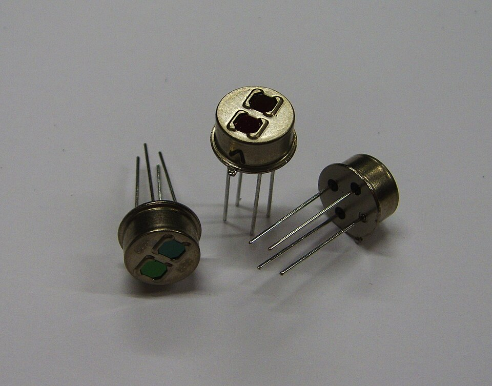
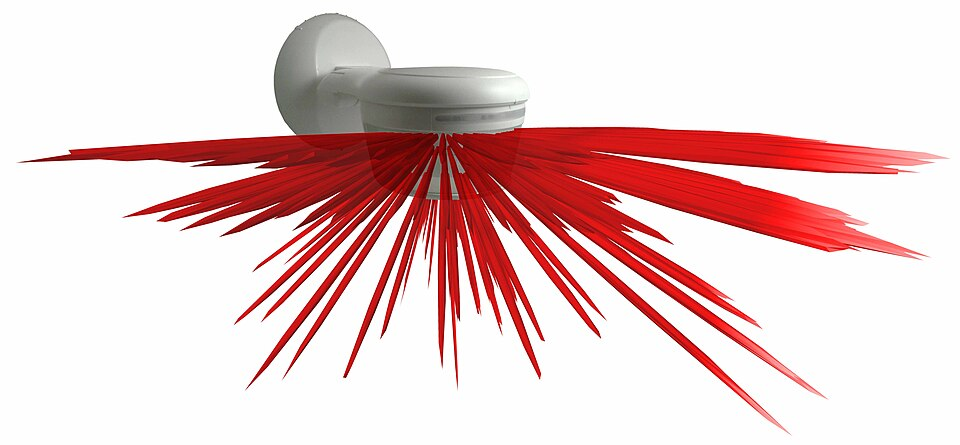
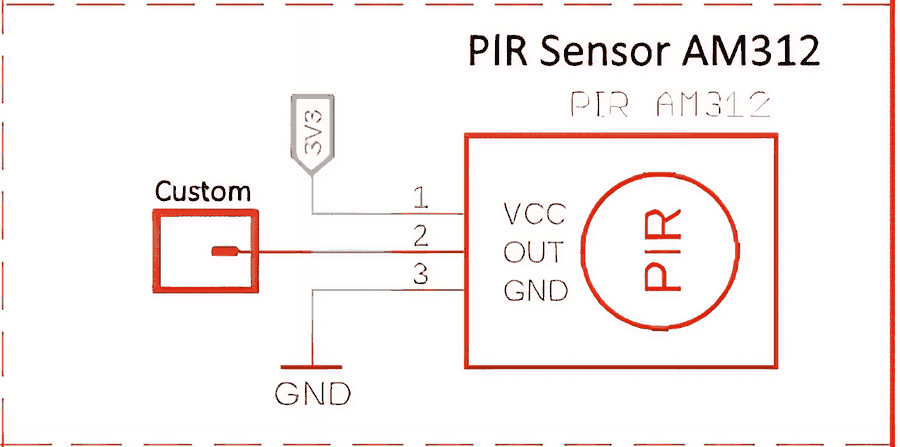
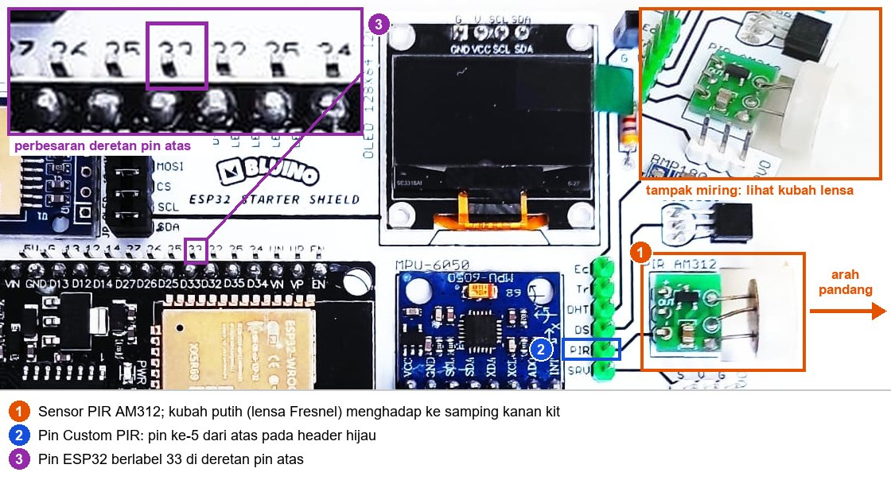
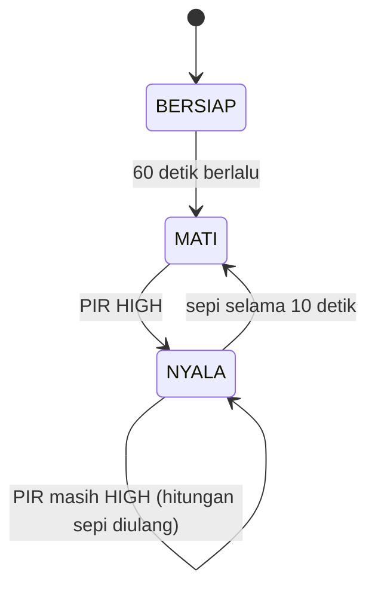
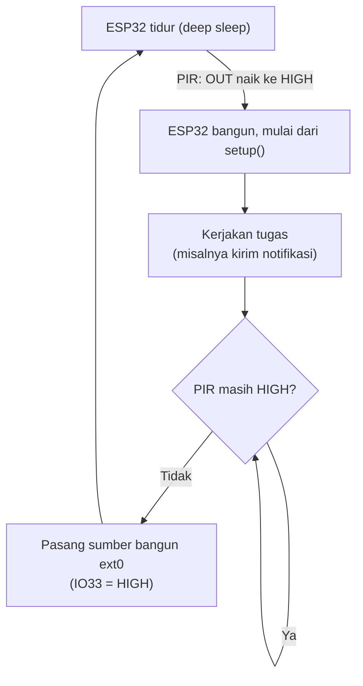

# BAB 31: PIR AM312 — Deteksi Gerakan

> ✅ **Prasyarat:** Selesaikan **BAB 16 (Non-Blocking Programming)** — sebagian besar program di BAB ini mengatur waktu dengan `millis()` tanpa `delay()`. Program 4 memakai interupsi dari **BAB 10 (Interrupt & ISR)**, dan Program 5 memakai *deep sleep* yang sudah kamu kenal di **BAB 20 (Memory Management)**. Cara memasang kabel LED kit ada di **BAB 8 (Digital Output — LED & Buzzer)**.

Pernah masuk toilet umum atau lorong hotel, lalu lampunya menyala sendiri? Di balik lampu itu biasanya ada **sensor PIR** (*Passive Infrared*, inframerah pasif) yang "merasakan" panas tubuhmu saat kamu bergerak. Kit Bluino sudah dilengkapi sensor PIR mini **AM312**. Di BAB ini kamu mempelajari cara kerja sensor PIR beserta batasannya, memahami perilaku sinyal AM312, lalu memakainya untuk membuat lampu otomatis, penghitung gerakan dengan interupsi, dan perangkat hemat daya yang baru "bangun" saat ada orang lewat.

## 📌 Tujuan Pembelajaran

Setelah mempelajari BAB ini, kamu bisa:

- Menjelaskan cara kerja sensor PIR: pancaran inframerah dari tubuh, elemen piroelektrik, dan lensa Fresnel.
- Menyebutkan spesifikasi penting AM312 dan perilaku keluarannya: HIGH selama ada gerakan, kembali LOW sekitar 2 detik setelah gerakan terakhir, dan butuh waktu stabil setelah dinyalakan.
- Menjelaskan apa yang tidak bisa dideteksi PIR (orang yang diam, gerakan di balik kaca) dan apa saja penyebab deteksi palsu.
- Menyambungkan pin `PIR` di kit ke IO33 dan membaca sensornya dengan `digitalRead()`.
- Mendeteksi awal dan akhir gerakan (*edge detection*) serta mengukur lamanya sinyal gerakan.
- Membuat lampu otomatis yang menyala saat ada gerakan dan mati sendiri setelah ruangan sepi, tanpa `delay()`.
- Menghitung gerakan dengan interupsi sambil memperhatikan aturan kelompok pin dari *errata* ESP32.
- Membangunkan ESP32 dari *deep sleep* dengan sinyal dari sensor PIR.

## 🧰 Yang Perlu Disiapkan

| Kebutuhan | Keterangan |
|---|---|
| *Hardware* | Kit Bluino ESP32 IoT Starter Shield (ESP32 DEVKIT V1 dan sensor PIR AM312 sudah terpasang di kit) + kabel USB **data** |
| Kabel *jumper* | 2 kabel *female-female*: `PIR` → IO33 (semua program) dan `LED4` (kuning) → IO16 (Program 3) — sudah ada di kit |
| Komponen tambahan | Tidak ada |
| *Software* | Arduino IDE 2.x + *board package* **esp32** versi 3.3.x (lihat [BAB 5](../BAB-05/README.md)) |
| *Library* | Tidak perlu *library* tambahan — `digitalRead()`, `attachInterrupt()`, dan fungsi *deep sleep* sudah tersedia di *board package* esp32 |
| Alat uji | **Serial Monitor** Arduino IDE (baud 115200) |
| Jaringan | Tidak perlu WiFi |

## 📑 Daftar Isi

- [31.1 Mengenal Sensor PIR](#311-mengenal-sensor-pir)
- [31.2 Cara Kerja Sensor PIR](#312-cara-kerja-sensor-pir)
- [31.3 Modul AM312 dan Perilaku Sinyalnya](#313-modul-am312-dan-perilaku-sinyalnya)
- [31.4 Batasan PIR dan Penyebab Deteksi Palsu](#314-batasan-pir-dan-penyebab-deteksi-palsu)
- [31.5 Rangkaian PIR di Kit](#315-rangkaian-pir-di-kit)
- [31.6 Program 1: Membaca Sensor PIR](#316-program-1-membaca-sensor-pir)
- [31.7 Program 2: Mengukur Lama Sinyal Gerakan](#317-program-2-mengukur-lama-sinyal-gerakan)
- [31.8 Program 3: Lampu Otomatis](#318-program-3-lampu-otomatis)
- [31.9 Program 4: Penghitung Gerakan dengan Interupsi](#319-program-4-penghitung-gerakan-dengan-interupsi)
- [31.10 Program 5: Bangun dari Deep Sleep saat Ada Gerakan](#3110-program-5-bangun-dari-deep-sleep-saat-ada-gerakan)
- [31.11 PIR dalam Proyek yang Lebih Besar](#3111-pir-dalam-proyek-yang-lebih-besar)
- [31.12 Troubleshooting](#3112-troubleshooting)
- [📝 Rangkuman](#-rangkuman)
- [💪 Latihan](#-latihan)
- [📚 Referensi](#-referensi)

---

## 31.1 Mengenal Sensor PIR

Semua benda yang hangat — tubuh manusia, hewan, setrika, mesin motor — memancarkan **sinar inframerah**. Sinar ini tidak terlihat oleh mata, tetapi bisa kamu rasakan sebagai hawa hangat, misalnya saat mendekatkan telapak tangan ke setrika panas tanpa menyentuhnya. Makin hangat sebuah benda, makin kuat pancaran inframerahnya. Kulit manusia (sekitar 30–35 °C) memancarkan inframerah paling kuat pada panjang gelombang sekitar 9–10 µm (mikrometer, sepersejuta meter). Pancaran inilah yang "dilihat" oleh kamera termal.

**Sensor PIR** (*Passive Infrared*, inframerah pasif) menangkap pancaran tersebut. Disebut **pasif** karena sensor ini tidak memancarkan apa pun; ia hanya menerima. Bandingkan dengan sensor ultrasonik HC-SR04 di [BAB 30](../BAB-30/README.md) yang **aktif**: ia "berteriak" dengan gelombang suara lalu mendengarkan pantulannya, seperti kelelawar. PIR lebih mirip orang yang duduk diam dan merasakan hawa hangat dari orang yang lewat di dekatnya.

Satu hal yang paling penting diingat sejak awal: **PIR mendeteksi perubahan, bukan keberadaan.** PIR menjawab pertanyaan "apakah ada benda hangat yang **bergerak** di depanku?", bukan "apakah ada orang di ruangan?", apalagi "berapa orang?" atau "seberapa jauh?". Orang yang duduk diam membaca buku bisa "menghilang" dari pandangan PIR.

Contoh pemakaian sensor PIR di sekitarmu:

- lampu otomatis di toilet umum, lorong, atau tangga;
- alarm maling yang berbunyi saat ada penyusup;
- kamera jebakan satwa (*camera trap*) yang memotret saat ada hewan lewat;
- perangkat hemat energi yang mematikan lampu atau AC setelah ruangan lama tidak ada gerakan.

---

## 31.2 Cara Kerja Sensor PIR

### 31.2.1 Elemen Piroelektrik: Hanya Peka terhadap Perubahan

Jantung sensor PIR adalah **elemen piroelektrik** (*pyro* berarti api atau panas), yaitu keping kristal tipis yang menghasilkan muatan listrik sangat kecil ketika **suhunya berubah**. Kalau suhunya tetap — sehangat apa pun — muatan itu perlahan hilang dan sinyalnya kembali nol.

Kulitmu bekerja mirip seperti itu. Saat masuk ruangan ber-AC, kamu langsung merasa dingin, tetapi beberapa menit kemudian rasa dingin itu "hilang" walaupun suhu ruangannya tidak berubah. Kulit peka terhadap **perubahan**, bukan terhadap keadaan yang tetap. Bedanya, elemen piroelektrik sudah "terbiasa" dalam hitungan detik.

Supaya tidak tertipu oleh perubahan yang mengenai seluruh ruangan (misalnya ruangan yang perlahan menghangat), sensor PIR berisi **dua elemen** yang dipasang bersebelahan dan saling berlawanan:



*Gambar 31.1 — Sensor piroelektrik ganda dalam kemasan logam. Dua jendela kecil berlapis filter inframerah di bagian depan menutupi dua elemen penangkap inframerah. Sensor AM312 di kit juga berupa kaleng logam kecil seperti ini, tetapi tertutup kubah lensa putih. Sumber: [Zakon](https://commons.wikimedia.org/wiki/File:Pyroelectric_double_sensor.jpg), domain publik.*

Cara kedua elemen itu bekerja sama:

| Keadaan | Elemen A | Elemen B | Sinyal gabungan (A − B) |
|---|---|---|---|
| Ruangan sepi | Menerima inframerah dari latar belakang | Sama dengan A | Nol — tidak ada gerakan |
| Seluruh ruangan perlahan menghangat | Ikut berubah | Berubah sama besar | Tetap nol — perubahannya saling meniadakan |
| Orang masuk ke "pandangan" elemen A | Berubah lebih dulu | Belum berubah | **Positif** |
| Orang pindah ke "pandangan" elemen B | Kembali seperti semula | Berubah | **Negatif** |

```text
 sinyal (A - B)
      ^
  +   |      ___
      |     /   \
  0   |____/     \       ____________
      |           \     /
  -   |            \___/
      +-------------------------------> waktu
             ^         ^
       orang dilihat  orang dilihat
         elemen A       elemen B
```

Rangkaian di dalam sensor mengenali pola "naik lalu turun" ini sebagai **gerakan**. Ibaratnya dua penjaga yang mengawasi dua jendela bersebelahan. Kalau keduanya melihat hal yang sama (misalnya langit yang makin gelap), tidak ada yang perlu dilaporkan. Tetapi kalau penjaga kiri melihat seseorang, lalu sesaat kemudian penjaga kanan melihat orang yang sama, berarti ada yang sedang **berjalan melintas**.

<details>
<summary><b>🔬 Pendalaman (opsional): Penyaring dan ambang di dalam sensor AM312</b></summary>

Menurut *datasheet* AM312, sinyal dari kedua elemen tidak langsung dibandingkan, tetapi lebih dulu disaring. Penyaringnya hanya meloloskan perubahan yang berlangsung kira-kira 0,44–7 kali per detik (0,44–7 Hz). Perubahan yang sangat lambat, misalnya ruangan yang menghangat selama berjam-jam, dan kedipan yang sangat cepat diabaikan. Sinyal yang lolos kemudian diolah secara digital dan dibandingkan dengan ambang sekitar 120 µV — tegangan yang sangat kecil. Ambang ini sudah ditetapkan pabrik dan tidak bisa diatur.

</details>

### 31.2.2 Lensa Fresnel: Membagi Ruangan Menjadi Banyak Zona

Kubah putih di depan sensor adalah **lensa Fresnel** (dibaca "fre-nel"), yang biasanya terbuat dari plastik polietilena tipis. Bagi mata, plastik ini tampak putih susu dan buram, tetapi bagi inframerah dari tubuh ia cukup tembus. Kalau diperhatikan dari dekat, permukaannya terdiri atas banyak segi kecil. Setiap segi adalah satu lensa kecil.

Lensa ini punya dua tugas:

1. **Mengumpulkan** inframerah dari area yang luas ke elemen yang kecil, sehingga sensor bisa mendeteksi gerakan sampai beberapa meter.
2. **Membagi** area pandang menjadi banyak **zona peka** yang berselang-seling dengan celah "buta". Setiap lensa kecil mengarahkan satu zona ke elemen A atau elemen B.



*Gambar 31.2 — Pola zona deteksi sebuah detektor gerak PIR: setiap "jari" merah adalah satu zona peka yang dibentuk oleh lensa Fresnel, dan di antaranya ada celah yang tidak peka. Bentuk pola AM312 berbeda, tetapi prinsipnya sama. Sumber: [AndreasCT](https://commons.wikimedia.org/wiki/File:Motion_Detector_with_Beam_Pattern.jpg), lisensi CC BY-SA 4.0.*

Saat seseorang berjalan melintasi zona-zona itu, tubuhnya "muncul–hilang–muncul" di mata sensor, sehingga sinyalnya naik-turun berulang kali dan mudah dikenali. Mirip orang yang lewat di balik pagar kayu yang berjarak: terlihat, tertutup tiang, lalu terlihat lagi — kamu langsung tahu ada yang lewat.

Akibatnya:

- Gerakan **melintang** (memotong zona, misalnya berjalan dari kiri ke kanan di depan sensor) paling mudah terdeteksi.
- Gerakan **lurus mendekati** sensor lebih sulit terdeteksi, karena tubuh tetap berada di zona yang sama dan hanya "membesar" sedikit demi sedikit.
- Lensa yang kotor, tergores, atau penyok menurunkan kepekaan. Jangan menekan kubah lensa AM312 dengan jari.

---

## 31.3 Modul AM312 dan Perilaku Sinyalnya

### 31.3.1 Bagian-Bagian Modul AM312

Sensor PIR di kit berupa papan hijau kecil bertuliskan **PIR AM312** di sebelah kanan *header* hijau (fotonya ada di [31.5](#315-rangkaian-pir-di-kit)). Modul ini terdiri atas dua bagian:

1. **Sensor AM312** buatan Nanyang Senba — kaleng logam kecil bertutup kubah lensa Fresnel putih. Di dalam kaleng sudah ada elemen piroelektrik ganda **sekaligus** seluruh rangkaian pengolahnya: penguat, penyaring, pengolah sinyal digital, dan pewaktu. Hasilnya langsung berupa sinyal digital **HIGH** (ada gerakan) atau **LOW** (tidak ada gerakan) di pin OUT. Jadi kamu tidak perlu *library* atau rumus apa pun — cukup `digitalRead()`.
2. **Papan modul** — papan kecil dengan tiga pin (VCC, OUT, GND), regulator tegangan mungil, dan kapasitor. Regulator inilah yang membuat modul boleh diberi tegangan lebih tinggi daripada batas sensornya sendiri.

Pada foto kit v3.x, kaki sensor ditekuk sehingga kubah lensanya **menghadap ke samping kanan kit**, bukan ke atas. Jadi saat mencoba program di BAB ini, gerakkan tanganmu di depan kubah putih itu (di sisi kanan kit), bukan di atas papan.

### 31.3.2 Spesifikasi AM312

| Parameter | Nilai | Keterangan |
|---|---|---|
| Tegangan kerja sensor | 2,7–3,3 V (batas mutlak 3,6 V) | Dari *datasheet* sensor AM312 |
| Tegangan kerja modul | 2,7–12 V | Menurut penjual modul, berkat regulator di papan modul. Di kit, modul diberi 3,3 V |
| Arus kerja | ±15 µA (sensor saja); kurang dari 0,1 mA (modul) | Sangat hemat — cocok untuk perangkat bertenaga baterai |
| Keluaran (pin OUT) | Digital: HIGH ≈ tegangan catu sensor (±3,3 V di kit), LOW ≈ 0 V | Aman langsung masuk ke pin ESP32 |
| Lama HIGH setelah gerakan terakhir (*delay time*) | ±2,3 detik, tetap | Penjual modul biasanya menulis "2 detik" |
| Masa istirahat setelah kembali LOW (*blockade time*) | ±2,3 detik, tetap | Selama masa ini gerakan baru diabaikan |
| Mode picu | Dapat dipicu ulang (*repeatable trigger*) | Selama gerakan berlanjut, OUT tetap HIGH |
| Jangkauan | ±3–5 m | Bergantung pada lensa, suhu ruangan, dan arah gerakan |
| Sudut pandang | Sampai ±100° | Berbentuk kerucut di depan kubah lensa |
| Waktu stabil setelah diberi daya | ±1 menit | Lihat [31.3.4](#3134-waktu-stabil-setelah-dinyalakan) |
| Suhu kerja | −20 °C sampai +60 °C | Menurut penjual modul |

Angka tegangan sensor, arus, keluaran, dan waktu berasal dari *Sensor Manual* AM312 (Nanyang Senba). Angka jangkauan, sudut, tegangan modul, dan suhu kerja berasal dari penjual modul. Semuanya nilai khas, jadi sensor milikmu bisa sedikit berbeda. Untuk memprogram AM312, dua angka yang paling penting adalah **±2 detik** (lama HIGH dan masa istirahat) dan **±1 menit** (waktu stabil).

### 31.3.3 Perilaku Sinyal: Tetap HIGH Selama Masih Ada Gerakan

Begitu sensor mendeteksi gerakan, pin OUT menjadi HIGH dan pewaktu di dalam sensor mulai menghitung ±2,3 detik. Kalau sebelum hitungan itu habis sensor kembali mendeteksi gerakan, hitungannya **diulang dari awal**. Akibatnya, selama gerakan masih berlanjut, OUT **tetap HIGH**, dan baru kembali LOW sekitar 2,3 detik setelah gerakan **terakhir**. Perilaku ini disebut *repeatable trigger* (dapat dipicu ulang).

Bayangkan lampu tangga yang memakai pewaktu. Setiap kali ada orang lewat, hitung mundurnya diulang dari awal, sehingga lampu tidak padam selama orang masih naik-turun tangga. Lampu baru padam setelah tangga sepi beberapa saat.

Contoh: tangan dilambaikan sekitar 4 detik, lalu sekali lagi dengan singkat beberapa detik kemudian.

```text
Detik ke-      0    1    2    3    4    5    6    7    8    9    10   11   12
               |    |    |    |    |    |    |    |    |    |    |    |    |
Gerakan          ####################                         ##
Pin OUT  HIGH    +-------------------------------+            +----------+
         LOW   --+                               +------------+          +-------
                 ^                   ^<-±2,3 s-->^<-±2,3 s->^
                 A                   B           C          D
```

- **A** — gerakan pertama: OUT langsung naik ke HIGH.
- **B** — gerakan terakhir dari lambaian tangan. Selama tangan masih bergerak (A sampai B), OUT tetap HIGH.
- **C** — ±2,3 detik setelah gerakan terakhir, OUT kembali LOW.
- **D** — masa istirahat ±2,3 detik selesai. Sejak titik ini, gerakan baru (lambaian singkat di detik ke-9,4) bisa membuat OUT HIGH lagi.

Apa artinya untuk program kita?

- **HIGH berarti "ada gerakan dalam ±2 detik terakhir"**, bukan "ada orang". Orang yang masuk lalu duduk diam membuat OUT kembali LOW.
- **Satu kali HIGH bisa berisi banyak gerakan.** Kalau kamu menghitung berapa kali OUT naik ke HIGH, yang terhitung adalah "rangkaian gerakan", bukan jumlah orang.
- **Ada masa "buta" ±2 detik** setelah OUT kembali LOW. Gerakan pada masa itu tidak memicu sensor.
- **Sinyalnya bersih.** OUT dihasilkan oleh rangkaian elektronik, bukan oleh kontak logam seperti tombol, jadi tidak ada pantulan (*bouncing*) dan tidak perlu *debounce* seperti di [BAB 9](../BAB-09/README.md).
- Ada dua cara membaca sensor: membaca **keadaan** (sedang HIGH atau LOW?) seperti di Program 1, atau mendeteksi **peristiwa** (baru saja naik? baru saja turun?) seperti di Program 2.

### 31.3.4 Waktu Stabil Setelah Dinyalakan

Setelah baru diberi daya, sensor PIR butuh waktu untuk "menyesuaikan diri" dengan suhu ruangan. Selama masa ini, OUT bisa menjadi HIGH sendiri walaupun tidak ada yang bergerak. *Datasheet* AM312 menyebutkan bahwa karakteristik sensor diukur pabrik setelah sensor stabil selama **satu menit**, dan panduan PIR dari Adafruit menyarankan menunggu 30–60 detik. Pegangan praktisnya: **tunggu sekitar 1 menit** setelah kit dicolokkan sebelum mempercayai bacaan PIR, dan selama itu jangan bergerak di depan sensor.

> 📌 **Catatan:** Masa stabil ini terjadi saat **sensor baru mendapat daya**, yaitu saat kabel USB dicolokkan. Saat kamu meng-*upload* program baru atau menekan tombol **EN**, yang di-*reset* hanya chip ESP32; jalur 3,3 V tetap menyala, sehingga sensor PIR tetap stabil. Jadi kamu tidak perlu menunggu 1 menit setiap kali meng-*upload* — cukup setelah kit baru dicolokkan. Program tidak bisa membedakan kedua keadaan itu, karena itulah perangkat sungguhan biasanya selalu menunggu setelah menyala (contohnya di Program 3).

<details>
<summary><b>🔬 Pendalaman (opsional): AM312 dibandingkan HC-SR501</b></summary>

Di toko elektronik kamu juga akan sering menemukan modul PIR **HC-SR501** yang lebih besar, dengan kubah lensa berdiameter sekitar 2 cm. Perbedaan utamanya:

| | AM312 (di kit) | HC-SR501 |
|---|---|---|
| Ukuran | Mini, lensa kecil | Lebih besar, lensa ±2 cm |
| Tegangan catu | 2,7–12 V, jadi bisa langsung 3,3 V | Umumnya 5–12 V; tidak dirancang untuk catu 3,3 V |
| Keluaran HIGH | ±3,3 V | ±3,3 V |
| Lama HIGH | Tetap ±2 detik | Bisa diatur dengan potensiometer, dari beberapa detik sampai beberapa menit |
| Jangkauan | ±3–5 m, tidak bisa diatur | Sampai ±6 m, kepekaannya bisa diatur dengan potensiometer |
| Mode picu | Selalu dapat dipicu ulang | Bisa dipilih dengan *jumper*: dapat dipicu ulang atau tidak |

Keduanya dibaca dengan cara yang sama: satu pin digital, HIGH saat ada gerakan. Jadi program di BAB ini juga bisa dipakai untuk HC-SR501, asalkan modulnya diberi catu 5 V (pin `5V` kit), GND-nya disambung ke GND kit, dan keluarannya disambung ke IO33. Angka HC-SR501 berbeda-beda antarpenjual; tabel di atas memakai angka dari panduan PIR Adafruit.

</details>

---

## 31.4 Batasan PIR dan Penyebab Deteksi Palsu

### 31.4.1 Yang Tidak Bisa atau Sulit Dideteksi PIR

| Situasi | Kenapa |
|---|---|
| Orang yang diam (duduk membaca, tidur) | PIR hanya peka terhadap **perubahan**. Tubuh yang diam tidak mengubah pancaran inframerah, jadi OUT kembali LOW ±2 detik setelah gerakan terakhir |
| Gerakan di balik kaca jendela atau akrilik | Kaca biasa hampir tidak tembus inframerah dengan panjang gelombang ±10 µm dari tubuh. Sensor di dalam rumah tidak bisa "melihat" orang di luar jendela, walaupun mata kita bisa |
| Gerakan lurus mendekati sensor | Tubuh tetap berada di zona peka yang sama (lihat [31.2.2](#3122-lensa-fresnel-membagi-ruangan-menjadi-banyak-zona)) |
| Gerakan yang sangat lambat atau sangat cepat | Perubahannya berada di luar rentang yang diloloskan penyaring di dalam sensor |
| Suhu ruangan mendekati suhu kulit (siang yang sangat panas) | Selisih suhu tubuh dengan latar belakang kecil, sehingga sinyalnya lemah dan jangkauannya berkurang |
| Jumlah orang dan jaraknya | Keluaran PIR hanya HIGH atau LOW. Untuk mengukur jarak, pakai sensor seperti HC-SR04 ([BAB 30](../BAB-30/README.md)) |

### 31.4.2 Penyebab Deteksi Palsu

Deteksi palsu artinya OUT menjadi HIGH padahal tidak ada orang yang bergerak. Penyebab yang paling sering:

| Penyebab | Contoh | Cara mengurangi |
|---|---|---|
| Sensor belum stabil | Satu menit pertama setelah kit dicolokkan | Tunggu ±1 menit ([31.3.4](#3134-waktu-stabil-setelah-dinyalakan)) |
| Sumber panas yang berubah cepat | Sinar matahari langsung yang tertutup-terbuka oleh awan atau tirai, lampu pijar yang baru dinyalakan, sorot lampu mobil | Jangan arahkan sensor ke jendela atau lampu |
| Embusan udara panas atau dingin | Lubang AC, kipas pemanas, pengering rambut, uap pelembap udara | Jauhkan sensor dari aliran udara itu |
| Benda hangat lain yang bergerak | Kucing atau anjing; tirai atau daun yang tertiup angin setelah terkena sinar matahari | Atur arah dan ketinggian sensor |
| Gangguan listrik dan gelombang radio | Catu daya yang tidak stabil; HP, radio, atau pemancar di dekat sensor. Ada juga laporan pengguna tentang deteksi palsu saat *board* ESP sedang mengirim data lewat WiFi | Pakai kabel dan *port* USB yang baik; jauhkan sensor dari antena; uji ulang dengan WiFi dimatikan |
| Sinyal acak dari elemen piroelektrik | Sangat jarang, bawaan sifat elemennya | Kalau aplikasimu tidak boleh salah, anggap gerakan sah hanya kalau terdeteksi dua kali dalam waktu berdekatan (Latihan 6) |
| Kabel *jumper* lepas | IO33 tidak tersambung ke apa pun sehingga nilainya acak (mengambang) | Pasang ulang kabel `PIR` → `33` |

> 💡 **Tips:** Program di BAB ini tidak memakai WiFi. Kalau nanti kamu menggabungkan PIR dengan WiFi (mulai [BAB 42](../BAB-42/README.md)) lalu muncul deteksi palsu yang tidak terjadi tanpa WiFi, curigai gangguan catu daya dan gelombang radio lebih dulu.

---

## 31.5 Rangkaian PIR di Kit

Berikut blok sensor PIR di skematik kit:



*Gambar 31.3 — Blok sensor PIR AM312 pada kit: VCC ke 3V3, OUT ke pin Custom, dan GND ke GND. Sumber: skematik ESP32 Starter Shield 3.2, [Bluino](http://www.bluino.com).*

Cara membacanya:

- **Pin 1 (VCC)** ke 3V3 dan **pin 3 (GND)** ke GND — modul PIR **sudah mendapat daya** dari kit. Kamu tidak perlu menyambungkan kabel daya apa pun.
- **Pin 2 (OUT)** adalah keluaran sensor. Jalurnya berakhir di kotak **Custom**, yaitu pin header berlabel `PIR`. Jalur ini **belum tersambung** ke ESP32 sampai kamu memasang kabel *jumper*.
- Di jalur OUT tidak ada resistor *pull-up* atau *pull-down*, dan memang tidak perlu: AM312 sendiri yang aktif mendorong OUT ke HIGH atau menariknya ke LOW. Karena itu di program cukup ditulis `pinMode(PIN_PIR, INPUT);`.

Letak pin yang perlu disambung:



*Gambar 31.4 — Sensor PIR AM312 (1), pin `PIR` di header hijau (2), dan pin `33` di deretan pin ESP32 atas (3) pada kit v3.x. Kotak kanan atas diambil dari foto lain yang memperlihatkan kubah lensa dari samping. Tata letak kit v3.2 milikmu bisa sedikit berbeda. Sumber: foto produk ESP32 Starter Shield, [Bluino](http://www.bluino.com), dipotong dan diberi penanda untuk materi ini.*

| No. | Bagian | Cara menemukannya |
|---|---|---|
| 1 | Sensor PIR AM312 | Papan hijau kecil bertuliskan PIR AM312 di kanan *header* hijau, di bawah DS18B20. Kubah lensanya menghadap ke samping kanan kit |
| 2 | Pin `PIR` | *Header* hijau di kanan MPU-6050, pin ke-5 dari atas (`Ec`, `Tr`, `DHT`, `DS`, **`PIR`**, `SRV`) |
| 3 | Pin `33` | Deretan pin ESP32 atas, pin ke-9 dari kiri (`5V`, `G`, `13`, `12`, `14`, `27`, `26`, `25`, **`33`**, …), tepat di atas tulisan `D33` pada *board* ESP32 |

**Rangkaian untuk semua program di BAB ini:**

| Pin **Custom** di kit | Sambungkan ke pin ESP32 |
|---|---|
| `PIR` — sensor PIR AM312 (header hijau, pin ke-5 dari atas) | IO33 |

Program 3 menambah satu kabel lagi untuk LED kuning; tabelnya ada di program itu.

Langkah memasang kabel:

1. Cabut kabel USB dulu supaya aman saat merangkai.
2. Kalau masih ada kabel dari pin `TOUCH` (*header* kuning) ke pin `33` dari [BAB 14](../BAB-14/README.md), lepas dulu. Menurut Peta Pin Standar, *touch pad* dan PIR sama-sama memakai IO33, jadi **pasang salah satu saja**.
3. Colokkan satu ujung kabel *jumper* ke pin **`PIR`** di *header* hijau.
4. Colokkan ujung lainnya ke pin berlabel **`33`** di deretan pin ESP32 atas.
5. Periksa sekali lagi bahwa kabel tidak bergeser ke pin tetangga: di *header* hijau, `PIR` diapit `DS` dan `SRV`; di deretan atas, `33` diapit `25` dan `32`.
6. Sambungkan kembali kabel USB, lalu tunggu sekitar 1 menit supaya sensor PIR stabil.

Kenapa IO33?

- IO33 adalah GPIO biasa: bisa membaca input digital, bukan pin *strapping* (pin yang dibaca ESP32 saat *boot*), dan bukan pin khusus input.
- IO33 bisa memicu interupsi (dipakai di Program 4). Pin ini termasuk kelompok IO32–IO39, yang penting untuk aturan interupsi di Program 4.
- IO33 termasuk pin RTC, yaitu pin yang tetap bisa diawasi saat ESP32 sedang *deep sleep*. Karena itu IO33 bisa membangunkan ESP32 (Program 5).

> 📌 **Catatan:** Contoh di internet sering memakai pin lain untuk PIR, misalnya IO34 atau IO13. Secara teknis banyak pin yang bisa dipakai, tetapi di kurikulum ini IO34 dipakai potensiometer dan IO13 dipakai *buzzer*. Supaya kabel tidak perlu dibongkar-pasang setiap ganti BAB, ikuti Peta Pin Standar: **PIR → IO33**.

> 💡 **Tips:** Kabel PIR yang meleset satu pin tidak merusak apa pun — sensornya hanya tidak terbaca. Kalau program tidak pernah melaporkan gerakan, periksa kabel ini lebih dulu.

---

## 31.6 Program 1: Membaca Sensor PIR

**Tujuan:** Membaca keadaan sensor PIR dengan `digitalRead()` dan menampilkannya di Serial Monitor setiap 0,5 detik. LED biru kecil bawaan *board* ESP32 (IO2) ikut menyala selama sensor mengeluarkan HIGH, sehingga kamu bisa melihat langsung berapa lama sinyal gerakan bertahan.

**Rangkaian:**

| Pin **Custom** di kit | Sambungkan ke pin ESP32 |
|---|---|
| `PIR` — sensor PIR AM312 (header hijau, pin ke-5 dari atas) | IO33 |

LED biru bawaan *board* ESP32 sudah tersambung ke IO2 tanpa kabel (kamu memakainya di [BAB 7](../BAB-07/README.md)).

**Cara Menjalankan:**

1. Sambungkan kabel *jumper* sesuai tabel **Rangkaian** di atas (langkah lengkapnya di [31.5](#315-rangkaian-pir-di-kit)).
2. Buka Arduino IDE → **File → New Sketch**, hapus isinya, lalu salin kode di bawah. Kode yang sama juga tersedia di *file* [`p1_baca_pir.ino`](p1_baca_pir/p1_baca_pir.ino).
3. Pastikan **Tools → Board** = **ESP32 Dev Module** dan **Tools → Port** = *port* ESP32 kamu (misalnya `COM5` di Windows atau `/dev/ttyUSB0` di Linux).
4. Klik tombol **Upload** (ikon panah →) dan tunggu sampai muncul tulisan **Done uploading**.
5. Buka **Serial Monitor** (**Tools → Serial Monitor**) lalu pilih baud **115200**.
6. Kalau kit baru dicolokkan, diamlah sekitar 1 menit sambil memperhatikan Serial Monitor. Sesekali mungkin muncul `PIR = 1` walaupun tidak ada yang bergerak — itulah masa stabil.
7. Setelah itu, lambaikan tangan **satu kali** dengan cepat di depan kubah lensa PIR (di sisi kanan kit), lalu jauhkan tangan dan diam. Hitung berapa baris `PIR = 1` yang muncul.

**Kode Program:**

<!-- sketch: p1_baca_pir -->
```cpp
/*
 * BAB 31 - Program 1: Membaca Sensor PIR
 * Membaca keadaan sensor PIR AM312 dan menampilkannya di Serial Monitor
 * setiap 0,5 detik. LED biru bawaan board (IO2) mengikuti keluaran PIR.
 *
 * Rangkaian: PIR (header hijau, pin ke-5 dari atas) → IO33
 */

#define PIN_PIR  33  // keluaran sensor PIR AM312
#define LED_BIRU 2   // LED biru bawaan board ESP32 (tanpa kabel)

const unsigned long INTERVAL_CETAK = 500;  // ms: cetak status setiap 0,5 detik
unsigned long waktuCetakLalu = 0;

void setup() {
  Serial.begin(115200);
  pinMode(PIN_PIR, INPUT);  // INPUT biasa: AM312 sendiri yang mendorong HIGH/LOW
  pinMode(LED_BIRU, OUTPUT);

  Serial.println("BAB 31 - Program 1: Membaca Sensor PIR");
  Serial.println("Kit baru dicolokkan? Diam dulu sekitar 1 menit supaya PIR stabil.");
}

void loop() {
  int statusPir = digitalRead(PIN_PIR);  // HIGH = ada gerakan
  digitalWrite(LED_BIRU, statusPir);     // LED langsung mengikuti sensor

  // Cetak status setiap 0,5 detik (pola millis() dari BAB 16)
  unsigned long sekarang = millis();
  if (sekarang - waktuCetakLalu >= INTERVAL_CETAK) {
    waktuCetakLalu = sekarang;

    Serial.print("Detik ke-");
    Serial.print(sekarang / 1000.0, 1);  // waktu sejak ESP32 mulai, 1 angka desimal
    if (statusPir == HIGH) {
      Serial.println(" | PIR = 1 | ADA GERAKAN");
    } else {
      Serial.println(" | PIR = 0 | tidak ada gerakan");
    }
  }
}
```

**Penjelasan Kode:**

- `pinMode(PIN_PIR, INPUT)` menjadikan IO33 sebagai input biasa, tanpa *pull-up* atau *pull-down* internal. Keluaran AM312 sudah aktif mendorong pin ke HIGH atau LOW, jadi pin tidak akan mengambang selama kabelnya terpasang.
- `digitalRead(PIN_PIR)` menghasilkan `HIGH` (1) saat sensor mendeteksi gerakan dan `LOW` (0) saat tidak ada gerakan. Nilai itu langsung dipakai `digitalWrite(LED_BIRU, statusPir)`, sehingga LED biru menyala tepat selama OUT bernilai HIGH.
- Pembacaan sensor dan LED dikerjakan di **setiap** putaran `loop()`, tetapi pencetakan hanya setiap 500 ms memakai pola selisih `millis()` dari [BAB 16](../BAB-16/README.md). Tanpa pembatas ini, Serial Monitor akan kebanjiran ribuan baris per detik.
- `sekarang / 1000.0` mengubah milidetik menjadi detik dengan angka desimal (tanda `.0` membuat pembagiannya memakai bilangan pecahan), lalu `Serial.print(..., 1)` mencetaknya dengan satu angka di belakang titik.

**Contoh Output:**

```text
BAB 31 - Program 1: Membaca Sensor PIR
Kit baru dicolokkan? Diam dulu sekitar 1 menit supaya PIR stabil.
Detik ke-0.5 | PIR = 0 | tidak ada gerakan
Detik ke-1.0 | PIR = 0 | tidak ada gerakan
...
Detik ke-74.5 | PIR = 0 | tidak ada gerakan
Detik ke-75.0 | PIR = 1 | ADA GERAKAN
Detik ke-75.5 | PIR = 1 | ADA GERAKAN
Detik ke-76.0 | PIR = 1 | ADA GERAKAN
Detik ke-76.5 | PIR = 1 | ADA GERAKAN
Detik ke-77.0 | PIR = 1 | ADA GERAKAN
Detik ke-77.5 | PIR = 0 | tidak ada gerakan
```

Baris `...` menandakan baris yang dipersingkat. Angka detiknya hanya contoh — angkamu bisa berbeda. Setelah satu lambaian cepat, biasanya muncul 4–5 baris `PIR = 1` berturut-turut (±2,3 detik), lalu kembali `PIR = 0`. Di kit, LED biru kecil di *board* ESP32 menyala selama itu. Kalau kamu terus melambaikan tangan, baris `PIR = 1` juga terus muncul dan LED tetap menyala — inilah perilaku *repeatable trigger* dari [31.3.3](#3133-perilaku-sinyal-tetap-high-selama-masih-ada-gerakan).

> 💡 **Tips:** Sebelum judul program mungkin muncul beberapa baris log *boot* bawaan ESP32, misalnya `rst:0x1 (POWERON_RESET)...`; itu normal dan boleh diabaikan. Kalau Serial Monitor baru dibuka setelah program berjalan sehingga judulnya terlewat, tekan tombol **EN** di *board* ESP32 untuk memulai ulang program. Menekan **EN** tidak mengulang masa stabil PIR.

> 🧪 **Coba Sendiri:** Bandingkan gerakan melintang (tangan bergerak dari kiri ke kanan di depan kubah lensa) dengan gerakan lurus pelan-pelan mendekati kubah. Lalu coba duduk diam di depan kit selama 10 detik: apakah PIR masih "melihat" kamu?

**Kalau Belum Berhasil:**

- **Selalu `PIR = 0` walaupun tangan dilambaikan** → kabel tidak terpasang di pin `PIR` (pin hijau ke-5 dari atas) atau tidak di pin berlabel `33`. Pastikan juga tanganmu bergerak di depan kubah lensa yang menghadap ke samping kanan kit, bukan di atas papan.
- **`PIR = 1` muncul sendiri terus-menerus** → sensor belum stabil (tunggu ±1 menit setelah kit dicolokkan), ada orang atau sumber panas yang bergerak di depan sensor, atau kabel lepas sehingga IO33 mengambang (lihat [31.4.2](#3142-penyebab-deteksi-palsu)).
- **Serial Monitor menampilkan huruf acak** → baud Serial Monitor belum diatur ke **115200**.

---

## 31.7 Program 2: Mengukur Lama Sinyal Gerakan

Program 1 membaca **keadaan** sensor. Program 2 mendeteksi **peristiwa**: kapan OUT naik dari LOW ke HIGH (gerakan mulai) dan kapan turun dari HIGH ke LOW (sinyal gerakan berakhir). Teknik ini disebut ***edge detection*** (deteksi tepi), sama seperti mendeteksi tombol yang baru ditekan di [BAB 9](../BAB-09/README.md): bandingkan bacaan sekarang dengan bacaan sebelumnya.

| Bacaan sebelumnya | Bacaan sekarang | Artinya |
|---|---|---|
| LOW | HIGH | **Tepi naik** — gerakan mulai terdeteksi |
| HIGH | LOW | **Tepi turun** — sinyal gerakan berakhir (±2,3 detik setelah gerakan terakhir) |
| sama | sama | Tidak ada peristiwa baru |

**Tujuan:** Mencetak satu baris setiap kali gerakan mulai dan setiap kali sinyal gerakan berakhir, lengkap dengan lamanya OUT bernilai HIGH dan lamanya OUT bernilai LOW sebelumnya. Dengan program ini kamu bisa mengukur sendiri angka-angka di [31.3](#313-modul-am312-dan-perilaku-sinyalnya).

**Rangkaian:**

| Pin **Custom** di kit | Sambungkan ke pin ESP32 |
|---|---|
| `PIR` — sensor PIR AM312 (header hijau, pin ke-5 dari atas) | IO33 |

**Cara Menjalankan:**

1. Pastikan kabel `PIR` → `33` masih terpasang seperti di Program 1.
2. Buka Arduino IDE → **File → New Sketch**, hapus isinya, lalu salin kode di bawah. Kode yang sama juga tersedia di *file* [`p2_lama_sinyal.ino`](p2_lama_sinyal/p2_lama_sinyal.ino).
3. Pastikan **Tools → Board** = **ESP32 Dev Module** dan **Tools → Port** = *port* ESP32 kamu.
4. Klik tombol **Upload** dan tunggu sampai muncul tulisan **Done uploading**.
5. Buka **Serial Monitor** (**Tools → Serial Monitor**) lalu pilih baud **115200**. Kalau kit baru dicolokkan, tunggu ±1 menit tanpa bergerak di depan sensor.
6. Lakukan tiga percobaan berikut sambil memperhatikan Serial Monitor:

| Percobaan | Yang dilakukan | Yang seharusnya terlihat |
|---|---|---|
| A | Lambaikan tangan **sekali** dengan cepat, lalu diam | OUT HIGH selama ±2,3 detik |
| B | Lambaikan tangan **terus-menerus** selama ±8 detik, lalu diam | OUT HIGH selama ±10 detik (8 + 2,3) |
| C | Begitu muncul tulisan `SELESAI`, **langsung** lambaikan tangan berkali-kali | Gerakan berikutnya baru tercatat setelah LOW ±2,3 detik (masa istirahat) |

**Kode Program:**

<!-- sketch: p2_lama_sinyal -->
```cpp
/*
 * BAB 31 - Program 2: Mengukur Lama Sinyal Gerakan
 * Mendeteksi tepi naik (gerakan mulai) dan tepi turun (sinyal gerakan
 * berakhir) dari sensor PIR AM312, lalu mencetak lamanya OUT bernilai
 * HIGH dan lamanya OUT bernilai LOW sebelum gerakan berikutnya.
 *
 * Rangkaian: PIR (header hijau, pin ke-5 dari atas) → IO33
 */

#define PIN_PIR 33

int statusSebelumnya = LOW;     // bacaan PIR pada putaran loop() sebelumnya
int jumlahGerakan = 0;          // berapa kali OUT naik ke HIGH
unsigned long waktuNaik = 0;    // kapan OUT terakhir naik ke HIGH (ms)
unsigned long waktuTurun = 0;   // kapan OUT terakhir turun ke LOW (ms)

void setup() {
  Serial.begin(115200);
  pinMode(PIN_PIR, INPUT);

  Serial.println("BAB 31 - Program 2: Mengukur Lama Sinyal Gerakan");
  Serial.println("Lambaikan tangan di depan kubah lensa PIR, lalu diam.");
}

void loop() {
  int statusSekarang = digitalRead(PIN_PIR);
  unsigned long sekarang = millis();

  // Tepi naik: LOW → HIGH = gerakan mulai terdeteksi
  if (statusSebelumnya == LOW && statusSekarang == HIGH) {
    jumlahGerakan = jumlahGerakan + 1;
    waktuNaik = sekarang;

    Serial.print("Gerakan ke-");
    Serial.print(jumlahGerakan);
    Serial.print(" MULAI pada detik ke-");
    Serial.print(sekarang / 1000.0, 1);
    if (jumlahGerakan > 1) {
      // Lama OUT bernilai LOW sejak sinyal gerakan sebelumnya berakhir
      Serial.print(" (sebelumnya LOW selama ");
      Serial.print((sekarang - waktuTurun) / 1000.0, 1);
      Serial.print(" detik)");
    }
    Serial.println();
  }

  // Tepi turun: HIGH → LOW = sinyal gerakan berakhir
  if (statusSebelumnya == HIGH && statusSekarang == LOW) {
    waktuTurun = sekarang;

    Serial.print("Gerakan ke-");
    Serial.print(jumlahGerakan);
    Serial.print(" SELESAI: OUT HIGH selama ");
    Serial.print((sekarang - waktuNaik) / 1000.0, 1);
    Serial.println(" detik");
  }

  statusSebelumnya = statusSekarang;  // simpan untuk putaran berikutnya
}
```

**Penjelasan Kode:**

- `statusSebelumnya` menyimpan bacaan dari putaran `loop()` sebelumnya. Peristiwa hanya terjadi saat bacaan sekarang **berbeda** dari bacaan sebelumnya, jadi setiap gerakan hanya dicetak satu kali walaupun OUT bernilai HIGH selama beberapa detik.
- Saat tepi naik, program mencatat `waktuNaik`. Saat tepi turun, lamanya HIGH dihitung dengan `sekarang - waktuNaik` — rumus selisih `millis()` yang tetap benar walaupun `millis()` kembali ke nol (*rollover*, [BAB 16](../BAB-16/README.md)).
- Lamanya LOW di antara dua gerakan dihitung dari `waktuTurun` milik gerakan sebelumnya. Untuk gerakan pertama belum ada pembandingnya, karena itu ada syarat `if (jumlahGerakan > 1)`.
- `statusSebelumnya` bernilai awal `LOW`. Kalau PIR kebetulan sudah HIGH saat program mulai, putaran pertama langsung dianggap tepi naik, sehingga setiap `SELESAI` selalu punya pasangan `MULAI`.
- Tidak ada `delay()` dan tidak ada *debounce*: `loop()` berputar ribuan kali per detik, dan keluaran PIR bersih tanpa pantulan.

**Contoh Output:**

```text
BAB 31 - Program 2: Mengukur Lama Sinyal Gerakan
Lambaikan tangan di depan kubah lensa PIR, lalu diam.
Gerakan ke-1 MULAI pada detik ke-8.2
Gerakan ke-1 SELESAI: OUT HIGH selama 2.4 detik
Gerakan ke-2 MULAI pada detik ke-15.7 (sebelumnya LOW selama 5.1 detik)
Gerakan ke-2 SELESAI: OUT HIGH selama 10.6 detik
Gerakan ke-3 MULAI pada detik ke-28.9 (sebelumnya LOW selama 2.6 detik)
Gerakan ke-3 SELESAI: OUT HIGH selama 2.3 detik
```

Angka-angka di atas hanya contoh — angkamu bisa berbeda. Gerakan ke-1 adalah percobaan A (satu lambaian, HIGH ±2,3 detik), gerakan ke-2 adalah percobaan B (lambaian ±8 detik, HIGH jauh lebih lama), dan gerakan ke-3 adalah percobaan C: walaupun tangan dilambaikan begitu sinyal sebelumnya berakhir, OUT baru naik lagi setelah LOW ±2,3 detik. Coba ulangi percobaan C beberapa kali — angka "LOW selama" hampir tidak pernah lebih kecil dari ±2,3 detik. Di kit tidak ada komponen yang bereaksi; semua hasil terlihat di Serial Monitor.

**Kalau Belum Berhasil:**

- **Tidak ada baris `MULAI` sama sekali** → cek kabel `PIR` → `33` dan pastikan tanganmu bergerak di depan kubah lensa.
- **`MULAI` dan `SELESAI` muncul sendiri walaupun tidak ada yang bergerak** → sensor belum stabil, atau ada sumber panas yang bergerak di depan sensor ([31.4.2](#3142-penyebab-deteksi-palsu)).
- **Lama HIGH pada percobaan B tidak bertambah panjang** → gerakanmu terlalu pelan atau tangan berada terlalu jauh, sehingga sebagian gerakan tidak terdeteksi. Lambaikan tangan melintang sekitar 30–100 cm di depan kubah lensa.

---

## 31.8 Program 3: Lampu Otomatis

Lampu otomatis adalah pemakaian sensor PIR yang paling umum. Aturannya sederhana: lampu menyala begitu ada gerakan, lalu padam sendiri setelah ruangan **sepi** selama waktu tertentu. Kuncinya ada di kata "sepi": setiap kali masih ada gerakan, hitungan waktu sepi diulang dari nol — persis seperti *repeatable trigger* di dalam AM312, tetapi dengan waktu yang bisa kamu atur sendiri.

Program ini juga menunjukkan cara perangkat sungguhan menangani **masa stabil**: selama 1 menit pertama setelah ESP32 menyala, sensor PIR diabaikan dan lampu berkedip pelan sebagai tanda "sedang bersiap".



*Gambar 31.5 — Alur lampu otomatis. Selama BERSIAP, sensor PIR diabaikan. Sumber: dibuat untuk materi ini.*

**Tujuan:** Membuat lampu otomatis dengan LED kuning sebagai "lampu". Lampu menyala saat sensor PIR mendeteksi gerakan dan padam setelah tidak ada gerakan selama 10 detik, tanpa `delay()` sama sekali.

**Rangkaian:**

| Pin **Custom** di kit | Sambungkan ke pin ESP32 |
|---|---|
| `PIR` — sensor PIR AM312 (header hijau, pin ke-5 dari atas) | IO33 |
| `LED4` — LED kuning (header LED) | IO16 |

**Cara Menjalankan:**

1. Pertahankan kabel `PIR` → `33`. Tambahkan kabel *jumper* dari pin **`LED4`** (pin paling kanan pada *header* LED di bawah keempat LED) ke pin berlabel **`16`** di deretan pin ESP32 bawah. Ingat, nomor LED tidak urut dengan nomor pin ESP32-nya: **LED4 (kuning) → IO16** (letaknya dibahas di [BAB 8](../BAB-08/README.md)).
2. Buka Arduino IDE → **File → New Sketch**, hapus isinya, lalu salin kode di bawah. Kode yang sama juga tersedia di *file* [`p3_lampu_otomatis.ino`](p3_lampu_otomatis/p3_lampu_otomatis.ino).
3. Pastikan **Tools → Board** = **ESP32 Dev Module** dan **Tools → Port** = *port* ESP32 kamu.
4. Klik tombol **Upload** dan tunggu sampai muncul tulisan **Done uploading**.
5. Buka **Serial Monitor** (**Tools → Serial Monitor**) lalu pilih baud **115200**.
6. Selama hitung mundur 60 detik, LED kuning berkedip pelan. Jauhkan tangan dari sensor.
7. Setelah muncul tulisan `Lampu otomatis AKTIF`, lambaikan tangan di depan kubah lensa PIR, lalu diam. Coba juga melambaikan tangan lagi saat lampu masih menyala.

**Kode Program:**

<!-- sketch: p3_lampu_otomatis -->
```cpp
/*
 * BAB 31 - Program 3: Lampu Otomatis
 * LED kuning menyala saat sensor PIR mendeteksi gerakan dan padam
 * setelah tidak ada gerakan selama LAMA_NYALA. Selama MASA_STABIL
 * setelah ESP32 menyala, sensor diabaikan dan LED berkedip pelan.
 *
 * Rangkaian:
 *   PIR (header hijau, pin ke-5 dari atas) → IO33
 *   LED4 (kuning, header LED)              → IO16
 */

#define PIN_PIR 33
#define LAMPU   16  // LED kuning sebagai "lampu"

const unsigned long MASA_STABIL = 60000;  // ms: abaikan PIR selama 1 menit pertama
const unsigned long LAMA_NYALA  = 10000;  // ms: lampu padam setelah sepi selama ini

bool sudahStabil = false;
bool lampuNyala = false;
int statusSebelumnya = LOW;
unsigned long waktuGerakanTerakhir = 0;  // kapan PIR terakhir terbaca HIGH
int sisaDetikTercetak = -1;              // angka hitung mundur terakhir yang dicetak

// Mencetak waktu sejak ESP32 mulai, misalnya "[detik 75.3] "
void cetakWaktu(unsigned long ms) {
  Serial.print("[detik ");
  Serial.print(ms / 1000.0, 1);
  Serial.print("] ");
}

void setup() {
  Serial.begin(115200);
  pinMode(PIN_PIR, INPUT);
  pinMode(LAMPU, OUTPUT);
  digitalWrite(LAMPU, LOW);

  Serial.println("BAB 31 - Program 3: Lampu Otomatis");
  Serial.println("Menunggu sensor PIR stabil. Jangan bergerak di depan sensor.");
}

void loop() {
  unsigned long sekarang = millis();

  // ---- Tahap 1: masa stabil (millis() mulai dari 0 saat ESP32 menyala) ----
  if (!sudahStabil) {
    if (sekarang >= MASA_STABIL) {
      sudahStabil = true;
      digitalWrite(LAMPU, LOW);
      Serial.println("Lampu otomatis AKTIF.");
    } else {
      digitalWrite(LAMPU, (sekarang / 500) % 2 == 0 ? HIGH : LOW);  // berkedip pelan
      int sisaDetik = (MASA_STABIL - sekarang + 999) / 1000;      // dibulatkan ke atas
      if (sisaDetik != sisaDetikTercetak && sisaDetik % 10 == 0) {
        sisaDetikTercetak = sisaDetik;
        Serial.print("  Siap dalam ");
        Serial.print(sisaDetik);
        Serial.println(" detik");
      }
    }
    return;  // selama masa stabil, bagian di bawah dilewati
  }

  // ---- Tahap 2: lampu otomatis ----
  int statusPir = digitalRead(PIN_PIR);
  bool gerakanBaru = (statusSebelumnya == LOW && statusPir == HIGH);  // tepi naik
  statusSebelumnya = statusPir;

  if (statusPir == HIGH) {
    waktuGerakanTerakhir = sekarang;  // masih ada gerakan: hitungan sepi diulang

    if (!lampuNyala) {
      lampuNyala = true;
      digitalWrite(LAMPU, HIGH);
      cetakWaktu(sekarang);
      Serial.println("Ada gerakan -> lampu NYALA");
    } else if (gerakanBaru) {
      cetakWaktu(sekarang);
      Serial.println("Ada gerakan lagi -> waktu nyala diperpanjang");
    }
  }

  if (lampuNyala && (sekarang - waktuGerakanTerakhir >= LAMA_NYALA)) {
    lampuNyala = false;
    digitalWrite(LAMPU, LOW);
    cetakWaktu(sekarang);
    Serial.println("Sepi selama 10 detik -> lampu MATI");
  }
}
```

**Penjelasan Kode:**

- **Tahap 1 (masa stabil).** `millis()` mulai dari 0 setiap kali ESP32 menyala, jadi `sekarang >= MASA_STABIL` berarti "sudah 60 detik sejak menyala". Selama belum, LED berkedip dengan rumus `(sekarang / 500) % 2` (menyala 0,5 detik, padam 0,5 detik), hitung mundur dicetak setiap 10 detik, lalu `return` membuat `loop()` langsung selesai tanpa membaca PIR. Rumus `+ 999` membulatkan sisa detik ke atas, sama seperti hitung mundur di [BAB 17](../BAB-17/README.md).
- **Variabel `waktuGerakanTerakhir`** adalah inti lampu otomatis. Selama PIR terbaca HIGH, nilainya terus diperbarui menjadi waktu sekarang. Begitu PIR LOW, nilainya berhenti diperbarui, dan `sekarang - waktuGerakanTerakhir` mulai bertambah. Lampu padam setelah selisih itu mencapai `LAMA_NYALA`.
- **Lampu menyala sekitar 12,3 detik setelah gerakan terakhir**, bukan tepat 10 detik: AM312 sendiri masih menahan HIGH ±2,3 detik setelah gerakan terakhir, baru setelah itu hitungan 10 detik di program dimulai.
- **`gerakanBaru`** memakai *edge detection* dari Program 2. Pesan "waktu nyala diperpanjang" hanya dicetak saat PIR baru naik ke HIGH ketika lampu masih menyala, bukan di setiap putaran `loop()`.
- **Kenapa tidak memakai `delay(10000)`?** Selama `delay()`, program tidak membaca sensor, jadi gerakan baru tidak bisa memperpanjang waktu nyala dan lampu bisa padam padahal masih ada orang. Polanya sama dengan [BAB 16](../BAB-16/README.md).

**Contoh Output:**

```text
BAB 31 - Program 3: Lampu Otomatis
Menunggu sensor PIR stabil. Jangan bergerak di depan sensor.
  Siap dalam 60 detik
  Siap dalam 50 detik
  Siap dalam 40 detik
  Siap dalam 30 detik
  Siap dalam 20 detik
  Siap dalam 10 detik
Lampu otomatis AKTIF.
[detik 72.4] Ada gerakan -> lampu NYALA
[detik 77.9] Ada gerakan lagi -> waktu nyala diperpanjang
[detik 90.6] Sepi selama 10 detik -> lampu MATI
```

Angka detiknya hanya contoh — angkamu bisa berbeda. Di kit: selama 60 detik pertama LED kuning berkedip pelan. Setelah aktif, LED kuning menyala begitu tanganmu bergerak di depan sensor, tetap menyala selama kamu masih bergerak, lalu padam sekitar 12 detik setelah gerakan terakhir.

> 🧪 **Coba Sendiri:** Ubah `LAMA_NYALA` menjadi `30000` (30 detik), lalu *upload* ulang. Tunggu masa stabil selesai, nyalakan lampu dengan lambaian tangan, kemudian lambaikan tangan lagi setiap 20 detik. Lampu tidak pernah padam selama kamu "rajin" bergerak.

> 🚨 **Bahaya:** Untuk menyalakan lampu sungguhan (220 V), kamu bisa mengganti LED dengan *relay* kit: pindahkan kabel dari `LED4` ke pin `RELAY`, sambungkan ke pin berlabel `26`, lalu ubah kodenya menjadi `#define LAMPU 26`. Namun **jangan** menyambungkan listrik PLN 220 V sebelum mempelajari aturan keselamatannya di [BAB 37](../BAB-37/README.md). Untuk latihan, cukup dengarkan bunyi "klik" *relay*-nya.

**Kalau Belum Berhasil:**

- **LED kuning tidak pernah menyala, termasuk saat hitung mundur** → kabel tidak terpasang di `LED4` atau tidak di pin berlabel `16` (deretan bawah). Pastikan bukan `LED3` yang tersambung.
- **Hitung mundur berjalan, tetapi setelah AKTIF lampu tidak bereaksi pada gerakan** → cek kabel `PIR` → `33` dan pastikan gerakanmu berada di depan kubah lensa.
- **Lampu menyala sendiri tanpa ada orang** → lihat penyebab deteksi palsu di [31.4.2](#3142-penyebab-deteksi-palsu). Pastikan tidak ada orang lain, embusan AC, atau sinar matahari yang berubah-ubah di depan sensor.
- **Lampu tidak pernah padam** → masih ada sesuatu yang bergerak di depan sensor (termasuk dirimu). Menjauhlah, atau tutup sementara kubah lensa dengan kertas tebal.

---

## 31.9 Program 4: Penghitung Gerakan dengan Interupsi

Program 1–3 memakai *polling*: `loop()` membaca sensor berulang-ulang. Cara ini aman selama `loop()` berputar cepat. Masalahnya muncul kalau `loop()` sesekali harus mengerjakan tugas yang lama, misalnya mengirim data lewat WiFi yang bisa makan waktu beberapa detik. Sinyal PIR memang bertahan ±2,3 detik, tetapi kalau gerakan mulai **dan** berakhir saat `loop()` sedang sibuk, *polling* sama sekali tidak melihatnya:

```text
Detik ke-       10        11        12        13        14        15
                |         |         |         |         |         |
loop()          [lapor]<----- sibuk mengirim data ----->[cek]
PIR OUT  HIGH               +----------------------+
         LOW    ------------+                      +--------------------
                            ^                      ^
                            A                      B
```

- **A** — gerakan mulai saat `loop()` sedang sibuk mengirim data.
- **B** — sinyal gerakan sudah berakhir sebelum `loop()` sempat memeriksa lagi. Dengan *polling*, gerakan ini terlewat seluruhnya.

**Interupsi** dari [BAB 10](../BAB-10/README.md) menyelesaikan masalah ini: *hardware* ESP32 langsung menjalankan ISR (*Interrupt Service Routine*) begitu OUT naik ke HIGH di titik A, walaupun `loop()` sedang sibuk. ISR cukup mencatat ("ada gerakan, pada detik sekian"), lalu `loop()` mengolah catatannya saat sempat.

Hal yang perlu diperhatikan saat memasang interupsi pada PIR:

- **Mode `RISING` tanpa *debounce*.** Keluaran AM312 bersih tanpa pantulan, jadi satu tepi naik = satu rangkaian gerakan.
- **Aturan kelompok pin (*errata* GPIO-3.14).** IO33 termasuk kelompok **IO32–IO39**. Menurut daftar cacat resmi ESP32, kalau satu pin dalam sebuah kelompok memakai interupsi tepi (`RISING`, `FALLING`, atau `CHANGE`), pin lain di kelompok yang sama sebaiknya tidak memakai interupsi, karena sebuah tepi bisa gagal terdeteksi. Di program ini, IO33 adalah satu-satunya pin berinterupsi di kelompoknya, jadi aman. Kalau nanti kamu menambah sumber interupsi lain, letakkan di kelompok IO0–IO31 (misalnya tombol S1 di IO15), bukan di IO32, IO34, atau IO35. Penjelasan lengkapnya ada di bagian Pendalaman [BAB 10](../BAB-10/README.md#1011-polling-atau-interupsi). Hindari juga interupsi di IO36 dan IO39 (*errata* GPIO-3.11).
- **Aturan ISR dari BAB 10 tetap berlaku:** tandai dengan `IRAM_ATTR`, variabel bersama diberi `volatile`, tanpa `Serial` dan `delay()` di dalam ISR, dan langkah "baca lalu kosongkan" dilindungi bagian kritis (`portMUX_TYPE`).

**Tujuan:** Menghitung gerakan dengan interupsi dan membuat laporan setiap 10 detik. Setiap kali melapor, `loop()` pura-pura mengirim data selama 4 detik (sibuk total, memakai `delay()`), tetapi gerakan yang terjadi selama itu tetap terhitung oleh ISR.

**Rangkaian:**

| Pin **Custom** di kit | Sambungkan ke pin ESP32 |
|---|---|
| `PIR` — sensor PIR AM312 (header hijau, pin ke-5 dari atas) | IO33 |

LED biru bawaan *board* (IO2) dipakai sebagai tanda "sedang mengirim" tanpa kabel tambahan. Kabel LED kuning dari Program 3 boleh dibiarkan atau dilepas.

**Cara Menjalankan:**

1. Pastikan kabel `PIR` → `33` masih terpasang.
2. Buka Arduino IDE → **File → New Sketch**, hapus isinya, lalu salin kode di bawah. Kode yang sama juga tersedia di *file* [`p4_hitung_interupsi.ino`](p4_hitung_interupsi/p4_hitung_interupsi.ino).
3. Pastikan **Tools → Board** = **ESP32 Dev Module** dan **Tools → Port** = *port* ESP32 kamu.
4. Klik tombol **Upload** dan tunggu sampai muncul tulisan **Done uploading**.
5. Buka **Serial Monitor** (**Tools → Serial Monitor**) lalu pilih baud **115200**. Kalau kit baru dicolokkan, tunggu ±1 menit tanpa bergerak di depan sensor.
6. Tunggu sampai LED biru di *board* ESP32 menyala (tanda `loop()` sedang sibuk mengirim). Saat itu juga, lambaikan tangan **sekali** dengan cepat di depan kubah lensa, lalu diam.
7. Perhatikan laporan berikutnya: gerakan tadi tetap terhitung.

**Kode Program:**

<!-- sketch: p4_hitung_interupsi -->
```cpp
/*
 * BAB 31 - Program 4: Penghitung Gerakan dengan Interupsi
 * ISR menghitung setiap tepi naik keluaran PIR (gerakan mulai) dan mencatat
 * waktunya. Setiap 10 detik loop() membuat laporan, lalu pura-pura mengirim
 * data selama 4 detik. Gerakan selama loop() sibuk tetap terhitung.
 *
 * Rangkaian: PIR (header hijau, pin ke-5 dari atas) → IO33
 * Catatan  : IO33 satu-satunya pin berinterupsi di kelompok IO32–IO39
 *            (errata ESP32 GPIO-3.14, lihat BAB 10).
 */

#define PIN_PIR  33
#define LED_BIRU 2  // LED biru bawaan board: menyala saat "mengirim"

const unsigned long INTERVAL_LAPORAN = 10000;  // ms: buat laporan setiap 10 detik
const unsigned long LAMA_KIRIM       = 4000;   // ms: pura-pura mengirim data (lambat)

// Variabel bersama ISR <-> loop(): wajib volatile
volatile unsigned long jumlahGerakan = 0;         // gerakan sejak laporan terakhir
volatile unsigned long waktuGerakanTerakhir = 0;  // kapan gerakan terakhir mulai (ms)

// Kunci bagian kritis untuk kedua variabel di atas
portMUX_TYPE kunciPir = portMUX_INITIALIZER_UNLOCKED;

// Variabel yang hanya dipakai loop()
unsigned long totalGerakan = 0;
unsigned long nomorLaporan = 0;
unsigned long waktuLaporanLalu = 0;

// ISR: dipanggil hardware setiap keluaran PIR naik dari LOW ke HIGH
void IRAM_ATTR isrPir() {
  portENTER_CRITICAL_ISR(&kunciPir);
  jumlahGerakan = jumlahGerakan + 1;
  waktuGerakanTerakhir = millis();
  portEXIT_CRITICAL_ISR(&kunciPir);
}

// Tugas lambat: loop() tidak memeriksa PIR sama sekali selama ini
void kirimLaporan() {
  Serial.println("  Mengirim laporan... (loop() sibuk 4 detik)");
  digitalWrite(LED_BIRU, HIGH);
  delay(LAMA_KIRIM);
  digitalWrite(LED_BIRU, LOW);
  Serial.println("  Selesai mengirim.");
}

void setup() {
  Serial.begin(115200);
  pinMode(PIN_PIR, INPUT);
  pinMode(LED_BIRU, OUTPUT);

  // RISING: ISR dipanggil saat gerakan mulai terdeteksi
  attachInterrupt(digitalPinToInterrupt(PIN_PIR), isrPir, RISING);

  Serial.println("BAB 31 - Program 4: Penghitung Gerakan dengan Interupsi");
  Serial.println("Laporan setiap 10 detik. Saat LED biru menyala, loop() sedang sibuk.");
}

void loop() {
  unsigned long sekarang = millis();
  if (sekarang - waktuLaporanLalu < INTERVAL_LAPORAN) {
    return;  // belum waktunya melapor
  }
  waktuLaporanLalu = sekarang;

  // Ambil catatan ISR lalu kosongkan, tanpa bisa disela ISR di tengah-tengahnya
  portENTER_CRITICAL(&kunciPir);
  unsigned long jumlah = jumlahGerakan;
  unsigned long waktuTerakhir = waktuGerakanTerakhir;
  jumlahGerakan = 0;
  portEXIT_CRITICAL(&kunciPir);

  totalGerakan = totalGerakan + jumlah;
  nomorLaporan = nomorLaporan + 1;

  Serial.print("Laporan #");
  Serial.print(nomorLaporan);
  Serial.print(" (detik ke-");
  Serial.print(sekarang / 1000.0, 1);
  Serial.print("): ");
  Serial.print(jumlah);
  Serial.print(" gerakan baru, total ");
  Serial.println(totalGerakan);
  if (jumlah > 0) {
    Serial.print("  Gerakan terakhir mulai pada detik ke-");
    Serial.println(waktuTerakhir / 1000.0, 1);
  }

  kirimLaporan();
}
```

**Penjelasan Kode:**

- **`isrPir()`** hanya menambah penghitung dan mencatat waktu dengan `millis()` — dua hal kecil yang boleh dilakukan di ISR. Keduanya dibungkus `portENTER_CRITICAL_ISR()`/`portEXIT_CRITICAL_ISR()` karena merupakan satu paket data. Penambahannya ditulis `jumlahGerakan = jumlahGerakan + 1;` (bukan `++`) supaya kompiler esp32 core 3.x tidak memberi peringatan untuk variabel `volatile`.
- **`attachInterrupt(..., RISING)`** dipasang sekali di `setup()`. Mulai saat itu, setiap tepi naik di IO33 menjalankan `isrPir()`, termasuk ketika `loop()` sedang terjebak di `delay(LAMA_KIRIM)`.
- **Di `loop()`**, pola "ambil lalu kosongkan" dari [BAB 10](../BAB-10/README.md#107-variabel-bersama-dan-bagian-kritis) dikerjakan di dalam `portENTER_CRITICAL()`/`portEXIT_CRITICAL()`. Tanpa perlindungan ini, gerakan yang tercatat ISR tepat di antara `jumlah = jumlahGerakan;` dan `jumlahGerakan = 0;` akan hilang. `Serial.print()` dijalankan **di luar** bagian kritis.
- **`waktuTerakhir`** dicatat ISR saat gerakan benar-benar terjadi, bukan saat `loop()` sempat memprosesnya. Karena itu waktunya tetap tepat walaupun laporan baru dicetak beberapa detik kemudian.
- **`kirimLaporan()`** sengaja memakai `delay()` untuk meniru tugas lambat. Di program sungguhan, tugas seperti ini misalnya mengirim data ke *server* lewat WiFi.
- `return` di awal `loop()` membuat sisa kode hanya dijalankan setiap 10 detik, memakai pola selisih `millis()` dari [BAB 16](../BAB-16/README.md).

**Contoh Output:**

```text
BAB 31 - Program 4: Penghitung Gerakan dengan Interupsi
Laporan setiap 10 detik. Saat LED biru menyala, loop() sedang sibuk.
Laporan #1 (detik ke-10.0): 0 gerakan baru, total 0
  Mengirim laporan... (loop() sibuk 4 detik)
  Selesai mengirim.
Laporan #2 (detik ke-20.0): 1 gerakan baru, total 1
  Gerakan terakhir mulai pada detik ke-11.2
  Mengirim laporan... (loop() sibuk 4 detik)
  Selesai mengirim.
Laporan #3 (detik ke-30.0): 3 gerakan baru, total 4
  Gerakan terakhir mulai pada detik ke-27.5
  Mengirim laporan... (loop() sibuk 4 detik)
  Selesai mengirim.
```

Angka-angka di atas hanya contoh — angkamu bisa berbeda. Pada laporan #2, gerakan terjadi di detik ke-11,2, yaitu saat `loop()` sedang sibuk mengirim laporan #1 (detik ke-10 sampai 14), tetapi tetap terhitung. Di kit, LED biru di *board* ESP32 menyala selama 4 detik setiap kali laporan dikirim.

> 📌 **Catatan:** Yang dihitung adalah **rangkaian gerakan** (berapa kali OUT naik ke HIGH), bukan jumlah orang. Satu orang yang terus bergerak di depan sensor hanya terhitung sekali, sedangkan satu orang yang lewat, berhenti 5 detik, lalu bergerak lagi terhitung dua kali.

> 🧪 **Coba Sendiri:** Tulis versi *polling* dari program ini: hapus `attachInterrupt()`, lalu hitung tepi naik di `loop()` seperti Program 2. Lakukan langkah 6 lagi. Apakah gerakan saat LED biru menyala masih terhitung?

**Kalau Belum Berhasil:**

- **Laporan selalu `0 gerakan baru`** → cek kabel `PIR` → `33` dan pastikan gerakanmu di depan kubah lensa. Coba juga Program 1 untuk memastikan sensornya bekerja.
- **Jumlah gerakan naik sendiri walaupun tidak ada yang bergerak** → sensor belum stabil atau ada sumber deteksi palsu ([31.4.2](#3142-penyebab-deteksi-palsu)). Kalau kabel lepas, IO33 mengambang dan bisa memicu banyak interupsi palsu.
- **ESP32 *restart* dengan pesan `Guru Meditation Error`** → kamu menambahkan `Serial.print()` atau `delay()` di dalam `isrPir()`. Pindahkan ke `loop()`.
- ***Error* `'portMUX_TYPE' does not name a type` saat *compile*** → *board* yang dipilih bukan ESP32. Pilih **Tools → Board → esp32 → ESP32 Dev Module**.

---

## 31.10 Program 5: Bangun dari Deep Sleep saat Ada Gerakan

Sensor AM312 hanya butuh arus belasan mikroampere, sedangkan ESP32 yang menyala dengan WiFi bisa membutuhkan lebih dari 100 mA, ribuan kali lipat lebih banyak. Untuk perangkat bertenaga baterai — misalnya pengirim notifikasi "ada orang di depan pintu" — pasangan terbaiknya adalah: ESP32 **tidur nyenyak** (*deep sleep*) hampir sepanjang waktu, dan sensor PIR yang **membangunkannya** saat ada gerakan.

Kamu sudah mengenal *deep sleep* di [BAB 20](../BAB-20/README.md): ESP32 mematikan hampir seluruh bagiannya, lalu saat bangun **mulai lagi dari `setup()`**. Variabel biasa kembali ke nilai awal, kecuali yang ditandai `RTC_DATA_ATTR`. Di BAB 20, ESP32 dibangunkan oleh pewaktu. Di sini, ESP32 dibangunkan oleh pin IO33 dengan fungsi **`esp_sleep_enable_ext0_wakeup()`** (*ext0* = sumber bangun eksternal nomor 0). Fungsi ini hanya bisa memakai pin RTC — pada ESP32: IO0, IO2, IO4, IO12–IO15, IO25–IO27, dan IO32–IO39 — dan IO33 termasuk di dalamnya.



*Gambar 31.6 — Siklus tidur dan bangun Program 5. Sumber: dibuat untuk materi ini.*

Langkah "tunggu sampai PIR LOW" penting. Sumber bangun ext0 bereaksi pada **level**, bukan tepi: ESP32 bangun selama IO33 bernilai HIGH. Kalau ESP32 tidur saat sinyal PIR masih HIGH, ia akan langsung bangun lagi.

**Tujuan:** ESP32 tidur dan baru bangun saat sensor PIR mendeteksi gerakan. Setelah bangun, ESP32 mencetak berapa kali ia sudah dibangunkan gerakan, pura-pura mengirim notifikasi, menunggu PIR kembali LOW, lalu tidur lagi.

**Rangkaian:**

| Pin **Custom** di kit | Sambungkan ke pin ESP32 |
|---|---|
| `PIR` — sensor PIR AM312 (header hijau, pin ke-5 dari atas) | IO33 |

LED biru bawaan *board* (IO2) menyala selama ESP32 bangun dan padam saat ESP32 tidur.

**Cara Menjalankan:**

1. Pastikan kabel `PIR` → `33` masih terpasang.
2. Buka Arduino IDE → **File → New Sketch**, hapus isinya, lalu salin kode di bawah. Kode yang sama juga tersedia di *file* [`p5_bangun_oleh_pir.ino`](p5_bangun_oleh_pir/p5_bangun_oleh_pir.ino).
3. Pastikan **Tools → Board** = **ESP32 Dev Module** dan **Tools → Port** = *port* ESP32 kamu.
4. Klik tombol **Upload** dan tunggu sampai muncul tulisan **Done uploading**. *Upload* tetap bisa dilakukan walaupun ESP32 sedang tidur, karena proses *upload* me-*reset* ESP32 lebih dulu.
5. Buka **Serial Monitor** (**Tools → Serial Monitor**) lalu pilih baud **115200**. Kalau kit baru dicolokkan, tunggu ±1 menit; selama masa stabil ESP32 mungkin terbangun sendiri beberapa kali.
6. Setelah muncul tulisan `Tidur...`, jauhkan tangan dan perhatikan LED biru padam. Lalu lambaikan tangan di depan kubah lensa PIR.

**Kode Program:**

<!-- sketch: p5_bangun_oleh_pir -->
```cpp
/*
 * BAB 31 - Program 5: Bangun dari Deep Sleep saat Ada Gerakan
 * ESP32 tidur (deep sleep) dan baru bangun saat keluaran PIR HIGH.
 * Setelah bangun: cetak jumlah bangun, pura-pura kirim notifikasi,
 * tunggu PIR kembali LOW, lalu tidur lagi.
 * LED biru bawaan board menyala selama ESP32 bangun.
 *
 * Rangkaian: PIR (header hijau, pin ke-5 dari atas) → IO33
 */

#define PIN_PIR  33  // IO33 termasuk pin RTC: bisa membangunkan ESP32
#define LED_BIRU 2

RTC_DATA_ATTR int jumlahBangunGerakan = 0;  // memori RTC: bertahan saat deep sleep

void setup() {
  Serial.begin(115200);
  delay(500);  // beri waktu Serial Monitor menangkap teks setelah bangun

  pinMode(PIN_PIR, INPUT);  // juga mengembalikan IO33 menjadi GPIO biasa setelah bangun
  pinMode(LED_BIRU, OUTPUT);
  digitalWrite(LED_BIRU, HIGH);  // LED menyala = ESP32 sedang bangun

  Serial.println();
  Serial.println("BAB 31 - Program 5: Bangun dari Deep Sleep saat Ada Gerakan");

  if (esp_sleep_get_wakeup_cause() == ESP_SLEEP_WAKEUP_EXT0) {
    jumlahBangunGerakan = jumlahBangunGerakan + 1;
    Serial.print("Bangun karena ada gerakan! Ini yang ke-");
    Serial.println(jumlahBangunGerakan);

    // Di proyek sungguhan, di sinilah ESP32 mengirim notifikasi lewat WiFi.
    Serial.println("Pura-pura mengirim notifikasi... (2 detik)");
    delay(2000);
  } else {
    Serial.println("Mulai karena dinyalakan / tombol EN / upload.");
  }

  // ext0 bereaksi pada LEVEL: kalau PIR masih HIGH saat tidur,
  // ESP32 langsung bangun lagi. Jadi tunggu dulu sampai PIR LOW.
  Serial.println("Menunggu sinyal PIR kembali LOW...");
  while (digitalRead(PIN_PIR) == HIGH) {
    delay(10);
  }

  esp_sleep_enable_ext0_wakeup((gpio_num_t)PIN_PIR, 1);  // bangun saat IO33 = HIGH (1)
  Serial.println("Tidur... ESP32 bangun lagi saat PIR mendeteksi gerakan.");
  Serial.flush();  // tunggu sampai semua teks terkirim sebelum tidur
  digitalWrite(LED_BIRU, LOW);
  esp_deep_sleep_start();  // tidur sekarang; baris setelahnya tidak dijalankan
}

void loop() {
  // Tidak pernah dijalankan: setelah deep sleep, ESP32 selalu mulai dari setup().
}
```

**Penjelasan Kode:**

1. **`RTC_DATA_ATTR int jumlahBangunGerakan`** disimpan di memori RTC, sehingga hitungannya bertahan selama *deep sleep* (seperti di [BAB 20](../BAB-20/README.md)). Nilainya kembali ke 0 kalau kabel USB dicabut, tombol **EN** ditekan, atau program di-*upload* ulang.
2. **`esp_sleep_get_wakeup_cause()`** menjawab "kenapa ESP32 bangun?". Hasil `ESP_SLEEP_WAKEUP_EXT0` artinya dibangunkan oleh pin ext0, yaitu sensor PIR. Setelah dinyalakan atau di-*reset*, hasilnya lain, sehingga program masuk ke bagian `else`.
3. **`pinMode(PIN_PIR, INPUT)`** dipanggil setelah bangun. Selain menjadikan IO33 input, baris ini juga mengembalikan pin itu dari mode RTC (dipakai selama tidur) menjadi GPIO biasa, supaya `digitalRead()` bekerja.
4. **Perulangan `while (digitalRead(PIN_PIR) == HIGH)`** menunggu sinyal PIR kembali LOW. Selama masih ada gerakan, ESP32 tetap bangun.
5. **`esp_sleep_enable_ext0_wakeup((gpio_num_t)PIN_PIR, 1)`** memasang IO33 sebagai sumber bangun: angka `1` berarti "bangun saat pin HIGH". Fungsi ini meminta nomor pin bertipe `gpio_num_t`, karena itu `PIN_PIR` ditulis dengan `(gpio_num_t)` di depannya.
6. **`Serial.flush()`** memastikan teks terakhir benar-benar terkirim sebelum ESP32 tidur, lalu **`esp_deep_sleep_start()`** menidurkannya.
7. Program ini sengaja memakai `delay()`: semua pekerjaannya ada di `setup()`, tidak ada tugas lain yang perlu dilayani bersamaan, dan setelah itu ESP32 langsung tidur.

**Contoh Output:**

```text
BAB 31 - Program 5: Bangun dari Deep Sleep saat Ada Gerakan
Mulai karena dinyalakan / tombol EN / upload.
Menunggu sinyal PIR kembali LOW...
Tidur... ESP32 bangun lagi saat PIR mendeteksi gerakan.
ets Jul 29 2019 12:21:46

rst:0x5 (DEEPSLEEP_RESET),boot:0x13 (SPI_FAST_FLASH_BOOT)
...

BAB 31 - Program 5: Bangun dari Deep Sleep saat Ada Gerakan
Bangun karena ada gerakan! Ini yang ke-1
Pura-pura mengirim notifikasi... (2 detik)
Menunggu sinyal PIR kembali LOW...
Tidur... ESP32 bangun lagi saat PIR mendeteksi gerakan.
```

Baris `ets ...` sampai `...` adalah pesan *boot* bawaan ESP32 yang muncul setiap kali bangun (dipersingkat; isinya bisa sedikit berbeda di *board*-mu). Selama tidak ada gerakan, Serial Monitor diam dan LED biru padam. Begitu tanganmu bergerak di depan sensor, LED biru menyala, blok teks baru muncul dengan angka "yang ke-" bertambah 1, lalu ESP32 kembali tidur sekitar 2–5 detik kemudian.

> 📌 **Catatan:** Di kit ini, *board* ESP32 DEVKIT V1 tetap menyalakan beberapa komponen saat ESP32 tidur, misalnya *chip* USB-ke-serial, regulator tegangan, dan LED daya. Jadi penghematan arus kit secara keseluruhan tidak sebesar angka *deep sleep* di *datasheet* ESP32. Untuk perangkat baterai sungguhan, biasanya dipakai modul ESP32 tanpa komponen tambahan tersebut.

**Kalau Belum Berhasil:**

- **ESP32 tidak pernah bangun walaupun ada gerakan** → cek kabel `PIR` → `33`. Pastikan juga baris `esp_sleep_enable_ext0_wakeup()` memakai pin 33 dan level `1`.
- **ESP32 bangun-tidur terus-menerus tanpa ada gerakan** → sensor belum stabil (tunggu ±1 menit setelah kit dicolokkan), ada sumber deteksi palsu di depan sensor, atau kabel PIR lepas sehingga IO33 mengambang.
- **Teks terakhir terpotong sebelum tidur** → baris `Serial.flush();` terhapus.
- **Program berhenti di `Menunggu sinyal PIR kembali LOW...`** → masih ada gerakan di depan sensor. Menjauhlah dari kit.

---

## 31.11 PIR dalam Proyek yang Lebih Besar

Sensor PIR jarang bekerja sendirian. Beberapa contoh pengembangan yang dibahas di BAB lain:

| Proyek | Yang ditambahkan | Bahas di |
|---|---|---|
| Alarm gerakan yang dihentikan dengan tombol | Interupsi untuk PIR dan tombol S2 | [BAB 10](../BAB-10/README.md), Program 3 |
| Sistem keamanan rumah lengkap: hitung mundur keluar ruangan, waktu tenggang, alarm | *State machine* dengan PIR sebagai salah satu *event* | [BAB 17](../BAB-17/README.md), Program 3 |
| Lampu otomatis yang hanya menyala saat gelap | Sensor cahaya LDR | [BAB 32](../BAB-32/README.md) |
| Status ruangan di layar | OLED 128×64 | [BAB 35](../BAB-35/README.md) |
| Menyalakan lampu 220 V sungguhan | *Relay* (dengan aturan keselamatan) | [BAB 37](../BAB-37/README.md) |
| Notifikasi ke HP atau *dashboard* saat ada gerakan | WiFi dan MQTT | [BAB 42](../BAB-42/README.md) dan [BAB 50](../BAB-50/README.md) |

> 💡 **Tips:** Alih-alih menulis ulang sistem alarm di sini, pelajari Program 3 di [BAB 17](../BAB-17/README.md). Rangkaiannya memakai pin PIR yang sama (IO33), jadi kamu bisa langsung mencobanya dengan pengetahuan dari BAB ini, misalnya kenapa sistem perlu menunggu sensor stabil sebelum SIAGA.

---

## 31.12 Troubleshooting

| Masalah | Kemungkinan Penyebab | Solusi |
|---|---|---|
| Sensor tidak pernah mendeteksi gerakan (selalu `0`/LOW) | Kabel tidak di pin `PIR` atau tidak di pin `33`; tangan bergerak di atas papan, bukan di depan kubah lensa; nomor pin di kode bukan 33 | Periksa kabel ([31.5](#315-rangkaian-pir-di-kit)); gerakkan tangan di depan kubah lensa di sisi kanan kit; pastikan `#define PIN_PIR 33`. Uji juga sensornya tanpa program (lihat di bawah tabel) |
| Muncul deteksi sendiri pada menit pertama | Sensor belum stabil setelah diberi daya | Normal; tunggu ±1 menit setelah kit dicolokkan ([31.3.4](#3134-waktu-stabil-setelah-dinyalakan)) |
| Deteksi palsu terus-menerus walaupun sudah stabil | Ada orang, hewan, embusan AC, sinar matahari, atau tirai yang bergerak di depan sensor; kabel lepas sehingga IO33 mengambang | Lihat [31.4.2](#3142-penyebab-deteksi-palsu); arahkan sensor ke area yang tenang; pasang ulang kabel |
| Deteksi palsu hanya muncul saat program memakai WiFi | Gangguan catu daya atau gelombang radio saat WiFi memancar | Pakai kabel dan *port* USB yang baik; jauhkan sensor dari antena ESP32; anggap gerakan sah hanya bila terdeteksi dua kali berdekatan (Latihan 6) |
| Deteksi palsu saat kit dipegang atau mejanya bergoyang | Sensor ikut bergerak sehingga "pemandangan" latar belakangnya berubah | Letakkan kit di permukaan yang stabil |
| Jangkauan terasa sangat pendek | Gerakan lurus menuju sensor, terlalu pelan, ruangan sangat panas, atau lensa kotor/tertekan | Uji dengan gerakan melintang; bersihkan lensa dengan lembut dan jangan menekannya |
| OUT tidak pernah kembali LOW | Masih ada gerakan di depan sensor (termasuk dirimu atau orang lain) | Normal untuk *repeatable trigger*; menjauhlah atau tutup sementara kubah lensa dengan kertas tebal |
| Sinyal HIGH tidak bisa lebih pendek dari ±2 detik | *Delay time* AM312 tetap dan tidak bisa diatur | Atur lamanya reaksi di program (seperti `LAMA_NYALA` di Program 3); pakai HC-SR501 kalau perlu pengaturan di *hardware* |
| Gerakan sesaat setelah sinyal berakhir tidak terdeteksi | Masa istirahat (*blockade time*) ±2,3 detik | Normal; rancang program yang tidak bergantung pada deteksi secepat itu |
| Hitungan gerakan lebih kecil dari jumlah orang yang lewat | Satu sinyal HIGH bisa berisi beberapa orang atau gerakan | Normal; PIR tidak bisa menghitung orang ([31.4.1](#3141-yang-tidak-bisa-atau-sulit-dideteksi-pir)) |
| Hewan peliharaan memicu lampu atau alarm | Hewan juga benda hangat yang bergerak | Pasang sensor lebih tinggi (misalnya ±2 m) dengan arah pandang mendatar, atau tutup bagian bawah kubah lensa dengan selotip hitam supaya zona dekat lantai tidak terlihat |
| *Touch pad* ([BAB 14](../BAB-14/README.md)) kacau atau PIR tidak terbaca | Pin `TOUCH` dan `PIR` sama-sama disambung ke IO33 | Pasang salah satu saja |
| ESP32 *restart* dengan pesan `Guru Meditation Error` di Program 4 | `Serial.print()` atau `delay()` di dalam ISR | Pindahkan ke `loop()`; ISR hanya mencatat |
| ESP32 bangun-tidur terus-menerus di Program 5 | Sensor belum stabil, ada gerakan di depan sensor, atau IO33 mengambang | Tunggu ±1 menit, menjauh dari sensor, dan periksa kabel `PIR` → `33` |

**Uji sensor tanpa program.** Kalau kamu ragu apakah sensornya rusak atau programnya yang salah, uji keluaran PIR langsung dengan LED kit:

1. Cabut kabel USB, lalu lepas kabel dari pin `33`.
2. Pindahkan ujung kabel itu ke pin **`LED1`** (LED merah) di *header* LED. Sekarang keluaran PIR langsung menyalakan LED merah lewat resistor 330 Ω di PCB, tanpa melewati ESP32. Arusnya hanya beberapa miliampere, masih jauh di bawah batas 10 mA keluaran AM312.
3. Colokkan kabel USB (ESP32 hanya dipakai sebagai sumber daya), tunggu ±1 menit, lalu lambaikan tangan di depan kubah lensa.
4. Kalau LED merah menyala sekitar 2 detik, sensornya sehat — masalahnya ada di kabel ke IO33 atau di program. Kalau LED tidak pernah menyala, periksa kabel ke `LED1` dan ulangi; kalau tetap tidak menyala, sensornya mungkin rusak.
5. Setelah selesai, kembalikan kabel ke pin `33`.

---

## 📝 Rangkuman

- **PIR** (*Passive Infrared*) tidak memancarkan apa pun; ia menangkap **perubahan** pancaran inframerah dari benda hangat yang bergerak. PIR tidak mendeteksi orang yang diam, tidak bisa melihat menembus kaca, dan tidak bisa menghitung orang atau mengukur jarak.
- Di dalam sensor ada **dua elemen piroelektrik** yang dipasang berlawanan, sehingga perubahan yang mengenai seluruh ruangan saling meniadakan. **Lensa Fresnel** membagi area pandang menjadi banyak zona peka, sehingga gerakan **melintang** paling mudah terdeteksi.
- **AM312** sudah berisi seluruh rangkaian pengolah. Keluarannya digital: **HIGH ±3,3 V** saat ada gerakan, LOW saat tidak — cukup dibaca dengan `digitalRead()`, tanpa *library*.
- OUT **tetap HIGH selama gerakan berlanjut** (*repeatable trigger*), kembali LOW **±2,3 detik** setelah gerakan terakhir, lalu "beristirahat" **±2,3 detik**. Kedua waktu ini tetap dan tidak bisa diatur.
- Sensor butuh **±1 menit** untuk stabil setelah **diberi daya** (kabel USB dicolokkan); *upload* ulang atau tombol **EN** tidak mengulang masa stabil ini.
- Deteksi palsu bisa berasal dari masa stabil, sumber panas yang berubah cepat, embusan udara, hewan, gangguan listrik atau gelombang radio, dan kabel yang lepas.
- Membaca **keadaan** (Program 1) cocok untuk tampilan langsung; mendeteksi **peristiwa** dengan *edge detection* (Program 2) cocok untuk mencatat dan mengukur.
- Lampu otomatis: perbarui `waktuGerakanTerakhir` selama PIR HIGH, lalu matikan lampu setelah `millis() - waktuGerakanTerakhir` mencapai batas — tanpa `delay()`.
- Interupsi `RISING` menangkap gerakan walaupun `loop()` sedang sibuk, tanpa *debounce*. IO33 ada di kelompok IO32–IO39: jangan memasang interupsi lain di kelompok ini (*errata* GPIO-3.14).
- IO33 adalah pin RTC, jadi bisa membangunkan ESP32 dari *deep sleep* dengan `esp_sleep_enable_ext0_wakeup()`. Karena bereaksi pada level, tunggu PIR LOW sebelum tidur.

Peta pin yang dipakai di BAB ini:

| Komponen | Label header di kit | Pin ESP32 | Dipakai di |
|---|---|---|---|
| Sensor PIR AM312 | `PIR` (header hijau, pin ke-5 dari atas) | IO33 | Semua program |
| LED kuning | `LED4` (header LED) | IO16 | Program 3 |
| LED biru bawaan *board* | — (sudah tersambung) | IO2 | Program 1, 4, dan 5 |

---

## 💪 Latihan

### Latihan Dasar

1. **Status di LED merah:** Ubah Program 1 supaya status PIR ditampilkan di LED merah kit, bukan di LED biru bawaan *board*.
   *Petunjuk:* Pasang kabel `LED1` → **4**, lalu ubah `#define LED_BIRU 2` menjadi `#define LED_MERAH 4` (jangan lupa ganti juga nama di `pinMode()` dan `digitalWrite()`).
2. **Bip saat gerakan mulai:** Tambahkan *buzzer* ke Program 2 yang berbunyi "bip" 100 ms setiap kali gerakan mulai terdeteksi, tanpa `delay()`.
   *Petunjuk:* Pasang kabel `BUZZ` → **13**. Saat tepi naik, nyalakan *buzzer* dan catat `waktuBip = millis();`. Di setiap putaran `loop()`, matikan *buzzer* kalau `millis() - waktuBip >= 100`.

### Latihan Menengah

3. **Lampu otomatis hanya saat gelap:** Kembangkan Program 3 supaya lampu hanya menyala karena gerakan kalau ruangan gelap.
   *Petunjuk:* Pasang kabel `LDR` → **35** dan baca dengan `analogRead(35)` seperti di [BAB 11](../BAB-11/README.md). Pada kit, **makin gelap, nilai ADC makin besar**. Cetak nilainya dulu di kamar terang dan gelap untuk menentukan ambang, lalu tambahkan syarat itu saat menyalakan lampu (LDR dibahas lengkap di [BAB 32](../BAB-32/README.md)).
4. **Persentase ruangan aktif:** Kembangkan Program 2 supaya setiap 60 detik mencetak berapa detik OUT bernilai HIGH selama menit terakhir dan persentasenya, misalnya `Aktif 18.4 dari 60 detik (31%)`.
   *Petunjuk:* Setiap tepi turun, tambahkan `sekarang - waktuNaik` ke sebuah penjumlah. Kalau saat laporan OUT masih HIGH, tambahkan juga bagian yang sedang berjalan, lalu mulai hitungan baru dari waktu laporan itu.
5. **Tombol pengosong hitungan:** Tambahkan tombol S1 ke Program 4 untuk mengosongkan `totalGerakan`, dan tekanan S1 tidak boleh terlewat walaupun `loop()` sedang sibuk mengirim.
   *Petunjuk:* Pasang kabel `SW1` → **15** dan pakai interupsi `RISING` dengan ISR yang hanya mengangkat bendera. IO15 ada di kelompok IO0–IO31, berbeda dengan IO33, jadi aman menurut *errata* GPIO-3.14. Pantulan tombol tidak masalah, karena mengosongkan hitungan berkali-kali hasilnya sama saja (lihat Program 3 di [BAB 10](../BAB-10/README.md)).

### Tantangan Lanjutan

6. **Penyaring deteksi palsu:** Buat alarm (LED merah + *buzzer*) yang hanya berbunyi kalau gerakan mulai terdeteksi **dua kali** dalam rentang 20 detik. Satu deteksi tunggal dianggap mungkin palsu dan hanya dicetak di Serial Monitor.
   *Petunjuk:* Simpan waktu tepi naik sebelumnya. Saat tepi naik baru terjadi, bandingkan `sekarang - waktuNaikSebelumnya <= 20000`. Teknik "hitung pulsa" seperti ini juga disarankan produsen sensor PIR untuk aplikasi yang tidak boleh salah.
7. **Bangun karena gerakan atau karena jadwal:** Kembangkan Program 5 supaya ESP32 juga bangun sendiri setiap 60 detik untuk mencetak laporan "masih hidup" berisi jumlah gerakan sejauh ini, walaupun tidak ada gerakan.
   *Petunjuk:* Pasang dua sumber bangun sebelum tidur: `esp_sleep_enable_ext0_wakeup()` dan `esp_sleep_enable_timer_wakeup(60ULL * 1000000ULL)` (lihat [BAB 20](../BAB-20/README.md)). Bedakan penyebabnya dengan `esp_sleep_get_wakeup_cause()`: `ESP_SLEEP_WAKEUP_EXT0` untuk PIR dan `ESP_SLEEP_WAKEUP_TIMER` untuk jadwal.
8. **PIR + HC-SR04 (kalau punya sensornya):** Buat alarm yang hanya berbunyi kalau PIR mendeteksi gerakan **dan** HC-SR04 mengukur ada benda lebih dekat dari 150 cm. Gabungan dua sensor seperti ini mengurangi deteksi palsu.
   *Petunjuk:* HC-SR04 tidak termasuk kit. Ikuti rangkaian dan pembagi tegangan pin Echo di [BAB 30](../BAB-30/README.md) (Trig → IO25, Echo → IO36). Ukur jarak hanya saat PIR HIGH, dan jangan memasang interupsi di IO36 (*errata* GPIO-3.11).

---

## 📚 Referensi

- [AM312 Sensor Manual — Nanyang Senba Optical and Electronic Co.](https://ocw.cs.pub.ro/courses/_media/pm/prj2023/ncaroi/pir_am312_datasheet.pdf) — *datasheet* sensor AM312: tegangan 2,7–3,3 V, arus ±15 µA, keluaran HIGH > VDD − 1 V, *delay time* dan *blockade time* 2,3 detik, penyaring 0,44–7 Hz, dan waktu stabil satu menit (salinan di situs mata kuliah Universitas Politehnica Bukares).
- [PIR Motion Sensor "PaPIRs" VZ Series — Reference Specification, Panasonic](https://www.tti.com/content/dam/tti-commons/supplier/panasonic/ecom/panasonic-ekmc261011-datasheet.pdf) — penyebab deteksi palsu yang berlaku umum untuk sensor PIR (sinar matahari, lampu, embusan AC, hewan), kaca dan akrilik yang menghalangi inframerah, gangguan catu daya dan gelombang radio, serta waktu stabil setelah dinyalakan.
- [PIR Motion Sensor — Adafruit Learning System](https://learn.adafruit.com/pir-passive-infrared-proximity-motion-sensor) — cara kerja dua elemen dan lensa Fresnel, spesifikasi modul PIR besar seperti HC-SR501, mode *retrigger*, dan saran menunggu 30–60 detik setelah dinyalakan.
- [Passive infrared sensor — Wikipedia](https://en.wikipedia.org/wiki/Passive_infrared_sensor) — ringkasan prinsip kerja dan pemakaian sensor PIR.
- [Sleep Modes — ESP-IDF Programming Guide, Espressif](https://docs.espressif.com/projects/esp-idf/en/stable/esp32/api-reference/system/sleep_modes.html) — *deep sleep* dan sumber bangun ext0 (hanya pin RTC, bereaksi pada level).
- [ExternalWakeUp.ino — contoh resmi Arduino-ESP32](https://github.com/espressif/arduino-esp32/blob/master/libraries/ESP32/examples/DeepSleep/ExternalWakeUp/ExternalWakeUp.ino) — contoh `esp_sleep_enable_ext0_wakeup()` pada GPIO 33; juga tersedia di Arduino IDE lewat **File → Examples → ESP32 → DeepSleep → ExternalWakeUp**.
- [GPIO — Arduino-ESP32 Documentation, Espressif](https://docs.espressif.com/projects/arduino-esp32/en/latest/api/gpio.html) — `pinMode()`, `digitalRead()`, dan `attachInterrupt()` di esp32 core 3.x.
- [ESP32 Series SoC Errata — Espressif](https://docs.espressif.com/projects/esp-chip-errata/en/latest/esp32/03-errata-description/index.html) — GPIO-3.14 (interupsi tepi dalam satu kelompok pin) dan GPIO-3.11 (IO36/IO39).
- [Ikea Molgan Hack with Wemos D1 mini or NodeMCU — MySensors Forum](https://forum.mysensors.org/post/90520) — laporan pengguna tentang deteksi palsu AM312 dan HC-SR501 saat *board* ESP8266 mengirim data lewat WiFi (pengalaman pengguna, bukan pengujian resmi).

---

[⬅️ BAB 30: HC-SR04 — Sensor Jarak Ultrasonik & Deteksi Objek](../BAB-30/README.md) · [🏠 Daftar Isi](../README.md) · [BAB 32: LDR — Sensor Cahaya ➡️](../BAB-32/README.md)

---

## ☕ Dukung Proyek Ini

Bab ini disusun dengan dedikasi waktu dan keahlian yang tidak sedikit. Kalau materi ini bermanfaat untuk proses belajar, riset, atau proyekmu, bentuk apresiasi terbaik yang bisa kamu berikan adalah mentraktir penulis secangkir kopi:

[](https://trakteer.id/limitless7/tip)

**💬 Konsultasi & Kolaborasi:**
Punya kritik, saran, atau butuh pendampingan khusus ESP32 & IoT? Silakan hubungi:
- ✉️ **Email:** [antonprafanto@unmul.ac.id](mailto:antonprafanto@unmul.ac.id)
- 📞 **WhatsApp:** [0811-553-393](https://wa.me/62811553393) / [0852-5069-0673](https://wa.me/6285250690673)
