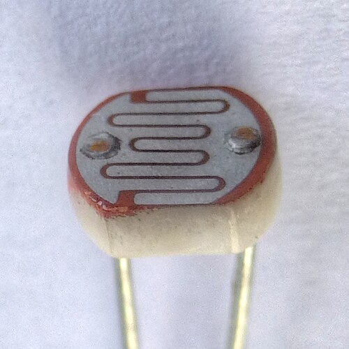
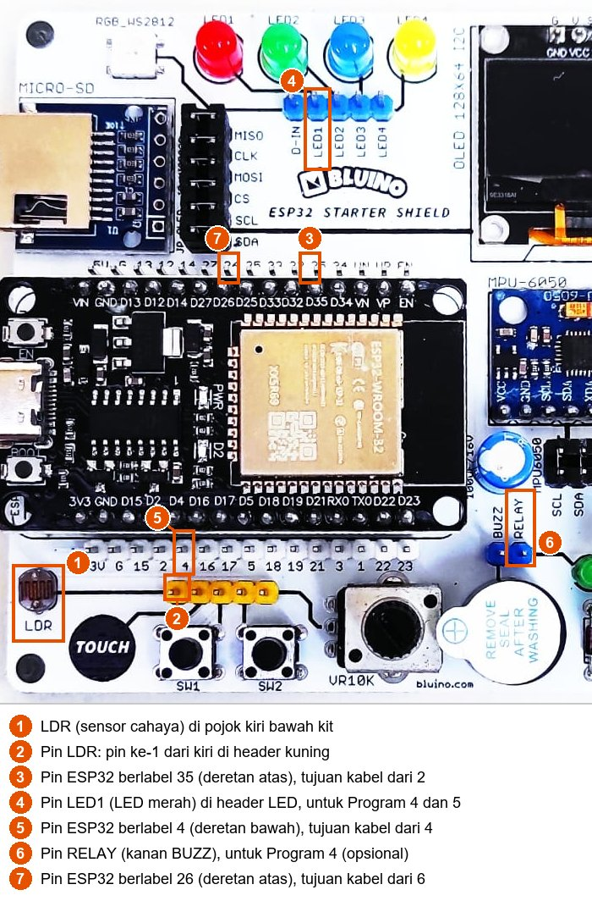
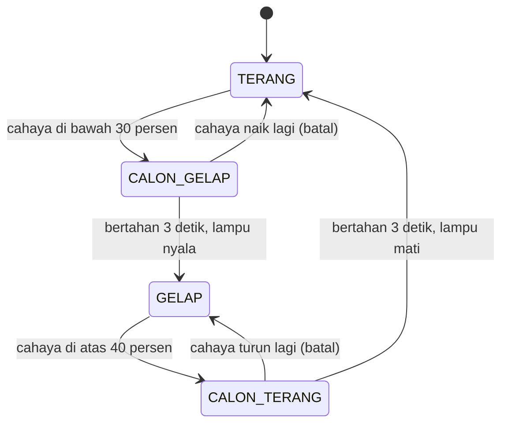

# BAB 32: LDR — Sensor Cahaya

> ✅ **Prasyarat:** Selesaikan **BAB 11 (Analog Input & ADC)** — kamu sudah membaca LDR kit dengan `analogRead()` dan `analogReadMilliVolts()` serta memakai Serial Plotter — dan **BAB 16 (Non-Blocking Programming)**, karena semua program di BAB ini mengatur waktu dengan `millis()` tanpa `delay()`. Program 4 memakai pola *state machine* dari **BAB 17 (State Machine)**, dan Program 5 memakai PWM dari **BAB 12 (PWM dengan LEDC)**.

Pernahkah kamu melihat lampu teras atau lampu taman yang menyala sendiri saat hari mulai gelap, lalu padam sendiri saat pagi? Di dalamnya ada sensor cahaya yang terus "mengintip" keadaan sekitar. Kit Bluino punya sensor cahaya yang paling sederhana dan murah: **LDR**. Di BAB 11 kamu sudah membacanya sebagai angka ADC. Di BAB ini kamu mendalaminya: cara kerja LDR, cara menghitung hambatannya, kenapa angka lux dari LDR hanya perkiraan, cara mengalibrasinya untuk ruanganmu, sampai membuat lampu otomatis yang tidak berkedip-kedip saat cahaya berada di perbatasan antara terang dan gelap.

## 📌 Tujuan Pembelajaran

Setelah mempelajari BAB ini, kamu bisa:

- Menjelaskan cara kerja LDR berbahan CdS beserta sifat pentingnya: tidak linear, agak lambat, dan berbeda-beda antar-LDR.
- Menghitung hambatan LDR dari tegangan yang dibaca dengan `analogReadMilliVolts()`, termasuk batas ketelitiannya.
- Menjelaskan kenapa LDR hanya bisa memberi **perkiraan** lux, dan melakukan kalibrasi dua titik kalau kamu punya *luxmeter*.
- Menyimpan titik gelap dan titik terang ruanganmu dalam variabel, lalu mengubah nilai ADC menjadi persentase cahaya.
- Meredam derau dengan rata-rata bergerak (*moving average*) tanpa `delay()`.
- Membuat lampu otomatis dengan LED atau *relay* yang memakai histeresis dan durasi minimum supaya tidak berkedip saat senja.
- Mengatur kecerahan LED secara bertingkat mengikuti cahaya sekitar.

## 🧰 Yang Perlu Disiapkan

| Kebutuhan | Keterangan |
|---|---|
| *Hardware* | Kit Bluino ESP32 IoT Starter Shield (ESP32 DEVKIT V1 sudah terpasang di kit) + kabel USB **data** |
| Kabel *jumper* | 3 kabel *female-female* (sudah ada di kit): `LDR` → IO35 untuk semua program, `LED1` (merah) → IO4 untuk Program 4 dan 5, serta `RELAY` → IO26 untuk Program 4 (opsional) |
| Komponen tambahan | Tidak ada — LDR beserta resistor 10 kΩ-nya, LED, dan *relay* sudah terpasang di kit. Senter HP berguna untuk menyinari LDR. Opsional untuk [32.5](#325-bisakah-ldr-mengukur-lux): *luxmeter* (alat ukur kuat cahaya) atau aplikasi *luxmeter* di HP sebagai pembanding kasar |
| *Software* | Arduino IDE 2.x + *board package* **esp32** versi 3.3.x (lihat [BAB 5](../BAB-05/README.md)) |
| *Library* | Tidak perlu *library* tambahan |
| Alat uji | **Serial Monitor** Arduino IDE (baud 115200). Program 3 juga memakai kolom pesan Serial Monitor dengan *line ending* **New Line**. **Serial Plotter** (**Tools → Serial Plotter**) dipakai di beberapa latihan |
| Jaringan | Tidak perlu WiFi |

## 📑 Daftar Isi

- [32.1 Mengenal LDR](#321-mengenal-ldr)
- [32.2 LDR di Kit Bluino](#322-ldr-di-kit-bluino)
- [32.3 Menghitung Hambatan LDR dari Tegangan](#323-menghitung-hambatan-ldr-dari-tegangan)
- [32.4 Program 1: Membaca Tegangan dan Hambatan LDR](#324-program-1-membaca-tegangan-dan-hambatan-ldr)
- [32.5 Bisakah LDR Mengukur Lux?](#325-bisakah-ldr-mengukur-lux)
- [32.6 Program 2: Perkiraan Lux dengan Kalibrasi Dua Titik](#326-program-2-perkiraan-lux-dengan-kalibrasi-dua-titik)
- [32.7 Meredam Derau dengan Rata-Rata Bergerak](#327-meredam-derau-dengan-rata-rata-bergerak)
- [32.8 Kalibrasi Titik Gelap dan Titik Terang](#328-kalibrasi-titik-gelap-dan-titik-terang)
- [32.9 Program 3: Kalibrasi lewat Serial Monitor](#329-program-3-kalibrasi-lewat-serial-monitor)
- [32.10 Lampu Otomatis yang Tidak Berkedip saat Senja](#3210-lampu-otomatis-yang-tidak-berkedip-saat-senja)
- [32.11 Program 4: Lampu Otomatis dengan Histeresis dan Durasi Minimum](#3211-program-4-lampu-otomatis-dengan-histeresis-dan-durasi-minimum)
- [32.12 Program 5: Lampu Malam Bertingkat](#3212-program-5-lampu-malam-bertingkat)
- [32.13 Troubleshooting](#3213-troubleshooting)
- [📝 Rangkuman](#-rangkuman)
- [💪 Latihan](#-latihan)
- [📚 Referensi](#-referensi)

---

## 32.1 Mengenal LDR

### 32.1.1 Apa Itu LDR?

**LDR** (*Light Dependent Resistor*, resistor yang bergantung pada cahaya), disebut juga **fotoresistor** atau **sel CdS**, adalah resistor yang hambatannya berubah menurut kuat cahaya yang mengenainya: **makin terang cahayanya, makin kecil hambatannya**. Bentuknya mudah dikenali: keping bulat kecil dengan garis berkelok-kelok di permukaannya.



*Gambar 32.1 — LDR berbahan CdS. Garis berkelok berwarna cokelat-oranye adalah lapisan CdS yang peka cahaya. Bidang abu-abu di kiri dan kanannya adalah dua elektrode logam yang tersambung ke kedua kaki LDR. Sumber: [Nevit Dilmen, Wikimedia Commons](https://commons.wikimedia.org/wiki/File:LDR_1480405_6_7_HDR_Enhancer_1.jpg), lisensi CC BY-SA 3.0.*

Bahan peka cahaya di LDR adalah **kadmium sulfida** (CdS), sejenis semikonduktor. Cara kerjanya:

1. Dalam gelap, hampir semua elektron di CdS "terikat" pada atomnya. Hanya sedikit elektron yang bebas bergerak membawa arus, jadi hambatannya **besar** — ratusan kΩ sampai beberapa MΩ.
2. Cahaya terdiri atas paket-paket energi kecil bernama **foton**. Foton yang diserap CdS memberi energi kepada elektron sehingga elektron itu terlepas dan bebas bergerak.
3. Makin terang cahayanya, makin banyak foton yang datang, makin banyak elektron yang bebas, dan hambatannya makin **kecil** — di bawah cahaya yang sangat terang bisa tinggal beberapa ratus ohm.

Analoginya seperti gerbang tol. Saat petugasnya sedikit (gelap), hanya satu loket yang buka sehingga kendaraan (arus listrik) tersendat. Makin banyak petugas datang (makin terang), makin banyak loket dibuka, dan kendaraan melaju makin lancar.

> 📌 **Catatan:** Kadmium adalah logam berat beracun. Karena itu, pemakaian LDR berbahan CdS sangat dibatasi di Eropa oleh aturan RoHS (aturan pembatasan bahan berbahaya pada barang elektronik). LDR di kit tetap aman dipakai seperti biasa karena lapisan CdS-nya terbungkus. Jangan memecahkan atau membakarnya, dan kalau suatu saat rusak, buang bersama sampah elektronik.

### 32.1.2 Sifat-Sifat Penting LDR

Tipe LDR di kit tidak disebutkan di skematik maupun di badan LDR-nya. LDR berdiameter 5 mm yang banyak dijual untuk belajar elektronika umumnya berasal dari keluarga **GL55xx**, misalnya GL5528. Angka berikut diambil dari *datasheet* GL5528 sebagai **contoh**:

| Sifat | Contoh nilai (GL5528) | Artinya bagi kita |
|---|---|---|
| Hambatan pada cahaya 10 lux (remang-remang; satuan lux dibahas di [32.5](#325-bisakah-ldr-mengukur-lux)) | 10–20 kΩ | Dua LDR bertipe sama pun bisa berbeda sampai 2 kali lipat |
| Hambatan gelap | Minimal 1 MΩ, diukur 10 detik setelah cahaya dipadamkan | Dalam gelap, hambatannya puluhan sampai ratusan kali lebih besar |
| Nilai gamma (γ) | 0,6 | Cahaya 10 kali lebih terang hanya membuat hambatan turun sekitar 4 kali |
| Waktu respons | Sekitar 20 ms saat disinari dan 30 ms saat cahaya dipadamkan | Cukup cepat untuk mendeteksi tangan yang lewat, tetapi terlalu lambat untuk sinyal cepat seperti sinyal *remote* TV |
| Puncak kepekaan | Cahaya hijau-kuning, panjang gelombang 540 nm | Mirip mata manusia, yang paling peka pada sekitar 555 nm |
| Batas maksimum | 150 V dan 100 mW | Jauh di atas yang dialami LDR di kit (3,3 V dan kurang dari 1 mW) |

Untuk tipe lain di keluarga yang sama, angkanya bisa jauh berbeda. Misalnya GL5516 berhambatan 5–10 kΩ pada 10 lux, sedangkan GL5549 berhambatan 100–200 kΩ. Dari tabel itu ada empat sifat LDR yang akan terus muncul di BAB ini:

1. **Tidak linear.** Hambatan tidak turun sebanding dengan cahaya. LDR sangat peka di cahaya redup, tetapi makin "malas" berubah di cahaya terang.
2. **Berbeda-beda.** Hambatan dua LDR bertipe sama bisa berbeda jauh, apalagi kalau tipenya berbeda. Karena itu setiap LDR perlu dikalibrasi sendiri.
3. **Agak lambat, terutama menuju gelap.** Saat cahaya padam, hambatan LDR naik pelan-pelan; untuk mencapai hambatan gelap penuh bisa butuh sekitar satu detik atau lebih. Itulah sebabnya *datasheet* mengukur hambatan gelap 10 detik setelah cahaya dipadamkan.
4. **Dipengaruhi suhu dan "riwayat cahaya".** Hambatan LDR sedikit berubah menurut suhu dan menurut cahaya yang mengenainya beberapa saat sebelumnya. Pabrik bahkan menyinari LDR dengan cahaya 400–600 lux selama 2 jam sebelum mengukur hambatan terangnya.

### 32.1.3 LDR dan Sensor Cahaya Lain

| Sensor | Prinsip kerja | Keluaran | Kelebihan | Kekurangan |
|---|---|---|---|---|
| **LDR** (ada di kit) | Hambatan CdS berubah menurut cahaya | Tegangan analog lewat pembagi tegangan, dibaca ADC | Sangat murah, sederhana, peka di cahaya ruangan | Tidak linear, agak lambat, berbeda antar-LDR, lux hanya perkiraan |
| **Fototransistor**, misalnya TEMT6000 | Arus berubah hampir sebanding dengan cahaya | Tegangan analog, dibaca ADC | Cepat dan hampir linear | Tetap perlu kalibrasi untuk mendapat lux |
| **Sensor cahaya digital**, misalnya BH1750 | Fotodioda, ADC, dan pengolah di dalam satu chip | Angka lux lewat I2C ([BAB 23](../BAB-23/README.md)) | Langsung memberi lux; kepekaannya dibuat mirip mata manusia | Lebih mahal; tidak ada di kit |

Untuk tugas seperti "nyalakan lampu saat gelap", LDR sudah sangat cukup. Untuk mengukur lux dengan teliti, misalnya untuk laporan penelitian, pakailah sensor cahaya digital yang sudah dikalibrasi pabrik.

---

## 32.2 LDR di Kit Bluino

### 32.2.1 Rangkaian Pembagi Tegangan

ESP32 tidak bisa mengukur hambatan secara langsung — ADC hanya bisa mengukur **tegangan**. Karena itu, LDR di kit dirangkai sebagai **pembagi tegangan** bersama resistor tetap 10 kΩ:


*Gambar 32.2 — Rangkaian LDR pada kit: 3V3 → resistor 10 kΩ → titik tengah (pin Custom `LDR`) → LDR → GND. Sumber: skematik ESP32 Starter Shield 3.2, [Bluino](http://www.bluino.com).*

Tegangan di titik tengah, yang nanti dibaca IO35, mengikuti rumus pembagi tegangan dari [BAB 3](../BAB-03/README.md#352-ldr-pembagi-tegangan-yang-peka-cahaya):

```text
V_LDR = 3,3 V × R_LDR ÷ (10 kΩ + R_LDR)
```

Cara membacanya:

- LDR berada di sisi **GND** (bawah). Saat gelap, R_LDR besar sehingga V_LDR mendekati 3,3 V, dan nilai ADC-nya **besar**.
- Saat terang, R_LDR kecil sehingga V_LDR mendekati 0 V, dan nilai ADC-nya **kecil**.
- Saat R_LDR tepat 10 kΩ (sama dengan resistor di atasnya), V_LDR tepat setengahnya: 1,65 V.

Jadi di kit ini berlaku aturan yang sudah kamu kenal dari BAB 11: **makin gelap, makin besar nilai ADC-nya**. Semua program di BAB ini memperhitungkan aturan ini.

### 32.2.2 Menyambungkan Kabel Jumper



*Gambar 32.3 — Letak LDR (1) dan pin-pin yang dipakai di BAB ini pada kit v3.x: pin `LDR` di header kuning (2) ke pin ESP32 berlabel 35 (3), pin `LED1` (4) ke pin 4 (5), dan pin `RELAY` (6) ke pin 26 (7). Tata letak kit v3.2 milikmu bisa sedikit berbeda. Sumber: foto produk ESP32 Starter Shield, [Bluino](http://www.bluino.com), dipotong dan diberi penanda untuk materi ini.*

| Komponen | Pin Custom di kit | Sambungkan ke pin ESP32 | Dipakai di |
|---|---|---|---|
| LDR | `LDR` — header kuning, pin ke-1 dari kiri | IO35 (label `35`, deretan atas) | Semua program |
| LED merah | `LED1` — header LED | IO4 (label `4`, deretan bawah) | Program 4 dan 5 |
| *Relay* | `RELAY` — header biru, di sebelah kanan `BUZZ` | IO26 (label `26`, deretan atas) | Program 4 (opsional) |

Langkah memasang kabel:

1. Cabut kabel USB dulu supaya aman saat merangkai.
2. Pasang kabel *jumper* dari pin ke-1 header kuning (`LDR`) ke pin berlabel **35** di deretan pin ESP32 atas. Cukup satu kabel: jalur 3V3 dan GND rangkaian LDR sudah tersambung di PCB.
3. Kabel `LED1` → **4** dan `RELAY` → **26** baru diperlukan di Program 4. Kamu boleh memasangnya sekarang sekaligus.
4. Periksa sekali lagi, lalu sambungkan kembali kabel USB.

> ⚠️ **Perhatian:** Di deretan pin ESP32 atas, label **35 berada di kiri 34**, dan pin 34 dipakai potensiometer. Pin `RELAY` juga bersebelahan dengan `BUZZ`. Kalau kabelnya tertukar, Program 4 akan membunyikan *buzzer*, bukan menggerakkan *relay*.

Kenapa IO35? Pin ini dipilih di Peta Pin Standar karena tiga alasan:

- IO35 termasuk **ADC1** (kanal ADC1_CH7), jadi tetap bisa dibaca saat WiFi aktif. Pin ADC2 tidak bisa membaca analog selama WiFi menyala (lihat [BAB 11](../BAB-11/README.md#113-adc1-dan-adc2-pin-mana-yang-boleh-dipakai)).
- IO35 hanya bisa menjadi input. Untuk membaca sensor, hal itu sama sekali tidak masalah.
- IO35 bukan pin *strapping*, jadi tegangan dari LDR tidak memengaruhi proses *boot* ESP32 (lihat [BAB 6](../BAB-06/README.md#652-pin-strapping)).

---

## 32.3 Menghitung Hambatan LDR dari Tegangan

Angka ADC hanya bermakna untuk rangkaian di kit ini. Kalau kamu ingin membandingkan LDR-mu dengan *datasheet* atau menghitung perkiraan lux, kamu butuh **hambatan** LDR-nya. Caranya: ukur tegangannya, lalu "balik" rumus pembagi tegangan.

### 32.3.1 Rumusnya

Resistor 10 kΩ dan LDR tersambung seri, jadi arus yang melewati keduanya sama. Tegangan pada resistor 10 kΩ adalah 3,3 V − V_LDR, sedangkan tegangan pada LDR adalah V_LDR. Dengan hukum Ohm dari [BAB 3](../BAB-03/README.md#32-hukum-ohm):

```text
Arus  = (3,3 V − V_LDR) ÷ 10 kΩ = V_LDR ÷ R_LDR

Jadi:
R_LDR = 10 kΩ × V_LDR ÷ (3,3 V − V_LDR)
```

Contoh hitungan (tegangan ditulis dalam milivolt supaya mudah):

| Tegangan terukur | Hitungan | Hambatan LDR | Keadaan |
|---|---|---|---|
| 300 mV | 10 kΩ × 300 ÷ (3300 − 300) | 1 kΩ | Terang |
| 1650 mV | 10 kΩ × 1650 ÷ (3300 − 1650) | 10 kΩ | Remang |
| 2500 mV | 10 kΩ × 2500 ÷ (3300 − 2500) | ±31 kΩ | Agak gelap |
| 3000 mV | 10 kΩ × 3000 ÷ (3300 − 3000) | 100 kΩ | Gelap |

Tegangannya diambil dari `analogReadMilliVolts()`, **bukan** dihitung dari `analogRead()`. Di [BAB 11](../BAB-11/README.md#1182-berbeda-di-setiap-chip) kamu sudah melihat bahwa rumus "nilai × 3300 ÷ 4095" bisa meleset lebih dari 100 mV, sedangkan `analogReadMilliVolts()` memakai data kalibrasi pabrik di chip.

### 32.3.2 Batas Ketelitian

Hambatan hasil hitungan hanya seteliti tegangan yang diukur. Ada tiga hal yang membatasinya:

1. **Terlalu gelap.** Pada pengaturan bawaan (atenuasi 11 dB), ADC ESP32 mentok di 4095 mulai sekitar 3,1 V (lihat [BAB 11](../BAB-11/README.md#1181-tidak-linear-di-ujung-ujungnya)). Tegangan 3,1 V berarti R_LDR = 10 kΩ × 3100 ÷ 200 = 155 kΩ. Jadi, begitu ADC mentok, programmu hanya tahu bahwa hambatannya **lebih dari sekitar 150 kΩ**. Hambatan gelap yang sebenarnya (bisa beberapa MΩ) tidak bisa diukur dengan rangkaian ini.
2. **Terlalu terang.** Di bawah sekitar 150 mV, ADC tidak teliti lagi. Tegangan 150 mV berarti R_LDR ≈ 10 kΩ × 150 ÷ 3150 ≈ 0,48 kΩ. LDR yang disinari senter dari dekat atau matahari langsung bisa berhambatan lebih kecil dari itu.
3. **Mendekati 3,3 V, hasilnya makin peka galat.** Penyebut (3,3 V − V_LDR) menjadi sangat kecil, sehingga selisih beberapa puluh milivolt saja sudah mengubah hasil banyak. Contohnya, 3000 mV memberi 100 kΩ, tetapi 3060 mV memberi 127,5 kΩ. Selain itu, tegangan 3V3 di kit dan resistor 10 kΩ juga tidak persis 3,3 V dan 10 kΩ — resistor punya toleransi, umumnya ±1% atau ±5%.

Kesimpulannya: ADC ESP32 paling akurat pada sekitar 150–2450 mV, yang di kit ini setara dengan hambatan LDR sekitar **0,5–30 kΩ**. Di luar rentang itu, anggap hasilnya kasar.

> 💡 **Tips:** Kalau kamu punya multimeter, ukur tegangan antara pin `3V` dan `G` di deretan pin ESP32 bawah (cara memakai multimeter ada di [BAB 3](../BAB-03/README.md#312-mengukur-dengan-multimeter-opsional)), lalu masukkan hasilnya ke konstanta `TEGANGAN_3V3_MV` di Program 1 dan Program 2. Hasil hitungan hambatannya jadi sedikit lebih teliti.

---

## 32.4 Program 1: Membaca Tegangan dan Hambatan LDR

**Tujuan:** Setiap 500 ms menampilkan nilai ADC mentah, tegangan terkalibrasi dalam milivolt, dan hambatan LDR hasil hitungan rumus di [32.3](#323-menghitung-hambatan-ldr-dari-tegangan). Program juga memberi tahu kalau hasilnya berada di luar rentang yang teliti. Waktunya diatur dengan `millis()`, tanpa `delay()`.

**Rangkaian:**

| Pin **Custom** di kit | Sambungkan ke pin ESP32 |
|---|---|
| `LDR` — sensor cahaya (header kuning, pin ke-1 dari kiri) | IO35 |

**Cara Menjalankan:**

1. Pastikan kabel `LDR` → **35** terpasang (lihat [32.2.2](#3222-menyambungkan-kabel-jumper)).
2. Buka Arduino IDE → **File → New Sketch**, hapus isinya, lalu salin kode di bawah. Kode yang sama juga tersedia di *file* [`p1_hambatan_ldr.ino`](p1_hambatan_ldr/p1_hambatan_ldr.ino).
3. Pastikan **Tools → Board** = **ESP32 Dev Module** dan **Tools → Port** = *port* ESP32 kamu (misalnya `COM5` di Windows atau `/dev/ttyUSB0` di Linux).
4. Klik tombol **Upload** (ikon panah →) dan tunggu sampai muncul tulisan **Done uploading**.
5. Buka **Serial Monitor** (**Tools → Serial Monitor**) lalu pilih baud **115200**.
6. Amati angkanya di bawah cahaya ruangan. Lalu tutup LDR rapat-rapat dengan jari, kemudian sinari dengan senter HP.

**Kode Program:**

<!-- sketch: p1_hambatan_ldr -->
```cpp
/*
 * BAB 32 - Program 1: Membaca Tegangan dan Hambatan LDR
 * Setiap 500 ms menampilkan nilai ADC mentah, tegangan terkalibrasi (mV),
 * dan hambatan LDR hasil hitungan rumus pembagi tegangan. Tanpa delay().
 *
 * Rangkaian: LDR (header kuning, pin ke-1) → IO35
 * Rangkaian di kit: 3V3 → 10 kΩ → titik tengah (IO35) → LDR → GND
 */

#define LDR_PIN 35  // LDR → IO35 (ADC1_CH7, aman dipakai bersama WiFi)

const float R_TETAP_KOHM = 10.0;        // resistor tetap di kit: 10 kΩ
const float TEGANGAN_3V3_MV = 3300.0;   // tegangan 3V3 kit; ganti dengan hasil ukur multimeter kalau ada
const int BATAS_TELITI_MV = 150;        // di bawah ini, ADC kurang teliti
const int ADC_MENTOK = 4095;            // nilai terbesar ADC 12 bit

// Timer serbaguna dari BAB 16
struct Timer {
  unsigned long interval;   // ms
  unsigned long waktuLalu;  // hasil millis() saat terakhir dijalankan

  // Mengembalikan true kalau sudah waktunya, lalu mencatat waktunya
  bool sudahWaktunya(unsigned long sekarang) {
    if (sekarang - waktuLalu >= interval) {
      waktuLalu = sekarang;
      return true;
    }
    return false;
  }
};

Timer timerLaporan = {500, 0};  // laporan setiap 500 ms

// Menghitung hambatan LDR (kΩ) dari tegangan titik tengah (mV).
// Hasil -1 berarti tidak bisa dihitung.
float hitungHambatanKohm(int milivolt) {
  if (milivolt >= TEGANGAN_3V3_MV) {
    return -1.0;  // penyebut nol atau negatif
  }
  return R_TETAP_KOHM * milivolt / (TEGANGAN_3V3_MV - milivolt);
}

void setup() {
  Serial.begin(115200);
  Serial.println("BAB 32 - Program 1: Tegangan dan Hambatan LDR");
  Serial.println("Tutup LDR dengan jari, lalu sinari dengan senter HP...");
}

void loop() {
  unsigned long sekarang = millis();

  if (timerLaporan.sudahWaktunya(sekarang)) {
    int nilaiAdc = analogRead(LDR_PIN);            // 0-4095, makin gelap makin besar
    int milivolt = analogReadMilliVolts(LDR_PIN);  // tegangan terkalibrasi (mV)
    float hambatan = hitungHambatanKohm(milivolt);

    Serial.printf("ADC: %4d | Tegangan: %4d mV | Hambatan LDR: ", nilaiAdc, milivolt);

    if (hambatan < 0) {
      Serial.println("tidak bisa dihitung");
    } else if (nilaiAdc >= ADC_MENTOK) {
      // ADC mentok: hambatan sebenarnya lebih besar daripada hasil hitungan
      Serial.printf("lebih dari %.0f kOhm (terlalu gelap, ADC mentok)\n", hambatan);
    } else if (milivolt < BATAS_TELITI_MV) {
      Serial.printf("%.2f kOhm (terlalu terang, kurang teliti)\n", hambatan);
    } else {
      Serial.printf("%.2f kOhm\n", hambatan);
    }
  }

  // Di sini loop() bebas mengerjakan tugas lain, karena tidak ada delay().
}
```

**Penjelasan Kode:**

- `struct Timer` dan `sudahWaktunya()` adalah pola *timer* dari [BAB 16](../BAB-16/README.md#1682-fungsi-di-dalam-struct). Laporan dicetak setiap 500 ms tanpa `delay()`, jadi `loop()` tetap berputar dan bisa mengerjakan tugas lain di sela-selanya.
- `analogRead()` memberi angka mentah 0–4095, sedangkan `analogReadMilliVolts()` memberi tegangan terkalibrasi dalam milivolt. Hasil `analogReadMilliVolts()` sebenarnya bertipe `uint32_t`; di sini disimpan dalam `int` supaya mudah dihitung dan dicetak. Nilainya paling besar sekitar 3300, jadi aman.
- `hitungHambatanKohm()` adalah rumus di [32.3.1](#3231-rumusnya). Karena `R_TETAP_KOHM` dan `TEGANGAN_3V3_MV` bertipe `float`, seluruh hitungannya memakai bilangan pecahan, sehingga angka di belakang koma tidak hilang. Hasil `-1.0` dipakai sebagai "tanda" bahwa hambatannya tidak bisa dihitung, karena hambatan asli tidak mungkin negatif.
- Tiga cabang `if ... else if` memberi keterangan sesuai batas ketelitian di [32.3.2](#3232-batas-ketelitian): ADC mentok (terlalu gelap), tegangan di bawah 150 mV (terlalu terang), atau normal.
- `%4d` mencetak bilangan bulat dengan lebar 4 karakter supaya kolomnya rapi, sedangkan `%.2f` mencetak bilangan pecahan dengan 2 angka di belakang titik desimal. `kOhm` adalah cara menulis kΩ dengan huruf biasa.

**Contoh Output:**

```text
BAB 32 - Program 1: Tegangan dan Hambatan LDR
Tutup LDR dengan jari, lalu sinari dengan senter HP...
ADC: 1312 | Tegangan: 1189 mV | Hambatan LDR: 5.63 kOhm
ADC: 1309 | Tegangan: 1187 mV | Hambatan LDR: 5.62 kOhm
ADC: 3378 | Tegangan: 2741 mV | Hambatan LDR: 49.03 kOhm
ADC: 4095 | Tegangan: 3139 mV | Hambatan LDR: lebih dari 195 kOhm (terlalu gelap, ADC mentok)
ADC:    8 | Tegangan:  148 mV | Hambatan LDR: 0.47 kOhm (terlalu terang, kurang teliti)
```

Angka di atas hanya contoh — angkamu pasti berbeda, karena bergantung pada terang ruangan, LDR, dan chip ESP32-mu. Dua baris pertama diambil di bawah lampu ruangan, baris ketiga saat LDR mulai ditutupi tangan, baris keempat saat LDR ditutup rapat dengan jari, dan baris terakhir saat LDR disinari senter HP dari dekat. Perhatikan juga dua baris pertama: walaupun cahayanya sama, angkanya sedikit berbeda. Itu derau ADC yang wajar; cara meredamnya ada di [32.7](#327-meredam-derau-dengan-rata-rata-bergerak).

> 🧪 **Coba Sendiri:** Pegang LDR di bawah lampu meja, lalu jauhkan perlahan. Pada jarak berapa hambatannya sekitar 10–20 kΩ? Menurut *datasheet* GL5528, hambatan sebesar itu setara dengan cahaya sekitar 10 lux — kalau LDR di kitmu memang bertipe GL5528.

**Kalau Belum Berhasil:**

- **Angka tidak berubah saat LDR ditutup** → kabel tidak terpasang di pin `LDR` (pin ke-1 header kuning) atau tidak di pin berlabel `35`.
- **Angka berubah saat kenop potensiometer diputar** → kabel tertukar dengan `VR10K` atau label `34`. Ingat: di deretan atas, 35 berada di kiri 34.
- **Selalu "lebih dari ... kOhm (terlalu gelap, ADC mentok)" walaupun ruangan terang** → kabel menyentuh pin yang selalu bertegangan tinggi, misalnya `3V`. Periksa ulang kedua ujung kabel.
- **Angka acak dan berubah-ubah sendiri** → kabel lepas sehingga IO35 "mengambang" (tidak tersambung ke mana pun). Pasang ulang kabelnya.

---

## 32.5 Bisakah LDR Mengukur Lux?

Jawaban singkatnya: **bisa, tetapi hanya perkiraan kasar**. Bagian ini menjelaskan apa itu lux, rumus yang biasa dipakai, kenapa hasilnya tidak bisa teliti, dan cara membuatnya sedikit lebih baik dengan kalibrasi dua titik.

### 32.5.1 Apa Itu Lux?

**Lux** (lambang: lx) adalah satuan kuat penerangan, yaitu banyaknya cahaya yang jatuh pada setiap meter persegi permukaan. Satu lux sama dengan satu *lumen* (satuan jumlah cahaya yang dipancarkan sumber cahaya) per meter persegi. Analoginya seperti hujan: *lumen* adalah banyaknya air yang dicurahkan awan, sedangkan lux adalah banyaknya air yang jatuh di setiap meter persegi halaman rumahmu.

| Keadaan | Kuat cahaya |
|---|---|
| Malam cerah dengan bulan purnama | 0,05–0,3 lux |
| Akhir senja saat langit cerah | ±3,4 lux |
| Tempat umum dengan sekitar yang gelap | 20–50 lux |
| Lampu ruang keluarga | ±50 lux |
| Siang yang sangat mendung | ±100 lux |
| Penerangan kantor | 320–500 lux |
| Matahari terbit atau terbenam saat cerah | ±400 lux |
| Siang mendung | ±1.000 lux |
| Siang cerah, tetapi bukan sinar matahari langsung | 10.000–25.000 lux |
| Sinar matahari langsung | 32.000–100.000 lux |

Sumber angka: artikel *Lux* di Wikipedia (lihat [Referensi](#-referensi)). Perhatikan betapa lebarnya rentang ini: dari kurang dari 1 lux sampai 100.000 lux. Mata kita bisa menyesuaikan diri dengan rentang selebar itu, sehingga ruangan 300 lux dan halaman 30.000 lux sama-sama terasa "terang".

### 32.5.2 Rumus Gamma

*Datasheet* LDR menggambarkan hubungan hambatan dan cahaya sebagai garis lurus pada grafik berskala logaritmik. Dalam bentuk rumus:

```text
R = R10 × (E ÷ 10) pangkat (−γ)

R   = hambatan LDR
E   = kuat cahaya (lux)
R10 = hambatan LDR pada 10 lux
γ   = gamma, menurut datasheet GL55xx: γ = log(R10 ÷ R100)
```

Artinya, setiap kali cahaya menjadi 10 kali lebih terang, hambatan LDR terbagi 10 pangkat γ. Untuk GL5528 (γ = 0,6), hambatannya terbagi 10 pangkat 0,6 ≈ 4 kali — inilah yang dimaksud "tidak linear" di [32.1.2](#3212-sifat-sifat-penting-ldr).

Tabel berikut adalah hasil rumus untuk LDR GL5528 dengan nilai tengah R10 = 15 kΩ dan γ = 0,6, dipasang di rangkaian kit:

| Kuat cahaya | Hambatan LDR (rumus) | Tegangan di IO35 | Keterangan |
|---|---|---|---|
| 0,1 lux | ±238 kΩ | ±3,17 V | ADC mentok di 4095 — terlalu gelap untuk diukur |
| 1 lux | ±60 kΩ | ±2,83 V | Masih terbaca, tetapi kurang teliti |
| 10 lux | 15 kΩ | ±1,98 V | Daerah yang baik |
| 100 lux | ±3,8 kΩ | ±0,90 V | Daerah yang baik |
| 1.000 lux | ±0,95 kΩ | ±0,29 V | Daerah yang baik |
| 10.000 lux | ±0,24 kΩ | ±0,08 V | Di bawah 150 mV — terlalu terang untuk diukur teliti |

Jadi rangkaian LDR di kit paling berguna untuk cahaya sekitar **1 sampai beberapa ribu lux**: dari remang-remang sampai siang mendung. Rangkaian ini tidak bisa membedakan siang cerah dari sinar matahari langsung, karena keduanya sama-sama memberi tegangan hampir 0 V.

Untuk memperkirakan lux dari hambatan, rumusnya dibalik:

```text
E = 10 × (R10 ÷ R) pangkat (1 ÷ γ)
```

### 32.5.3 Kenapa Hasilnya Hanya Perkiraan?

Rumus di atas terlihat meyakinkan, tetapi hasilnya bisa meleset jauh karena beberapa hal:

1. **Tipe LDR-nya tidak diketahui.** Kalau kita mengira R10 = 15 kΩ padahal LDR-mu 10 kΩ, perkiraan lux-nya sudah meleset hampir 2 kali lipat. Padahal *datasheet* GL5528 sendiri mengizinkan R10 berapa pun antara 10 dan 20 kΩ.
2. **Rumusnya hanya pendekatan.** Grafik hambatan-cahaya LDR asli tidak benar-benar lurus, terutama di cahaya yang sangat redup atau sangat terang.
3. **Warna cahaya berpengaruh.** LDR paling peka pada cahaya hijau-kuning, sedangkan *datasheet* mengukurnya dengan lampu pijar standar (suhu warna 2856 K). LED putih, lampu TL, dan matahari punya campuran warna yang berbeda, sehingga hambatan LDR bisa berbeda walaupun angka lux-nya sama.
4. **Lambat, peka suhu, dan punya "riwayat cahaya"** (lihat [32.1.2](#3212-sifat-sifat-penting-ldr)).
5. **Batas ADC.** Di cahaya yang sangat gelap atau sangat terang, tegangannya sudah keluar dari rentang teliti ADC (lihat [32.3.2](#3232-batas-ketelitian)).

Karena itu, anggap angka lux dari LDR sebagai **perkiraan kasar**. Angka itu cukup untuk membedakan "remang" (puluhan lux) dari "terang ruangan" (ratusan lux), tetapi bukan pengganti alat ukur cahaya.

### 32.5.4 Kalibrasi Dua Titik

Kalau kamu punya *luxmeter* — atau setidaknya aplikasi *luxmeter* di HP sebagai pembanding kasar — kamu bisa mengganti angka *datasheet* dengan angka milik LDR-mu sendiri. Caranya:

1. Jalankan Program 1 dan letakkan sensor *luxmeter* tepat di samping LDR, menghadap ke arah yang sama.
2. **Titik 1:** buat cahaya yang agak redup, misalnya lampu meja yang dijauhkan. Tunggu beberapa detik sampai angkanya stabil, lalu catat lux dari *luxmeter* (E1) dan hambatan dari Program 1 (R1).
3. **Titik 2:** buat cahaya yang jauh lebih terang, idealnya minimal 10 kali lipat titik 1, lalu catat E2 dan R2.
4. Pakai jenis lampu yang sama dengan tempat sensor nanti dipakai.

Dari dua titik itu, gamma dan rumus lux-nya menjadi:

```text
γ = log(R1 ÷ R2) ÷ log(E2 ÷ E1)
E = E1 × (R1 ÷ R) pangkat (1 ÷ γ)
```

Contoh: titik 1 = 20 lux pada 9,5 kΩ, dan titik 2 = 300 lux pada 1,9 kΩ. Maka γ = log(5) ÷ log(15) ≈ 0,59. Saat Program 1 menunjukkan 4,0 kΩ, perkiraan cahayanya E = 20 × (9,5 ÷ 4,0) pangkat (1 ÷ 0,59) ≈ 86 lux. Kamu tidak perlu menghitungnya sendiri — Program 2 melakukannya untukmu.

> 📌 **Catatan:** Aplikasi *luxmeter* di HP membaca sensor cahaya HP yang biasanya terletak di dekat kamera depan. Ketelitiannya berbeda-beda di setiap HP, jadi hasil kalibrasimu tidak akan lebih teliti daripada HP-mu sendiri. Kalibrasi dua titik juga hanya membuat rumusnya cocok dengan LDR-mu di sekitar kedua titik itu, jadi hasilnya tetap perkiraan.

---

## 32.6 Program 2: Perkiraan Lux dengan Kalibrasi Dua Titik

**Tujuan:** Memperkirakan kuat cahaya dalam lux dari hambatan LDR, memakai rumus gamma dengan dua titik kalibrasi yang disimpan dalam konstanta. Nilai bawaannya adalah angka khas *datasheet* GL5528 (10 lux pada 15 kΩ dan 100 lux pada 3,77 kΩ), jadi tanpa kalibrasi hasilnya sangat kasar.

**Rangkaian:**

| Pin **Custom** di kit | Sambungkan ke pin ESP32 |
|---|---|
| `LDR` — sensor cahaya (header kuning, pin ke-1 dari kiri) | IO35 |

**Cara Menjalankan:**

1. Pastikan kabel `LDR` → **35** masih terpasang.
2. Buka Arduino IDE → **File → New Sketch**, hapus isinya, lalu salin kode di bawah. Kode yang sama juga tersedia di *file* [`p2_perkiraan_lux.ino`](p2_perkiraan_lux/p2_perkiraan_lux.ino).
3. Kalau kamu sudah melakukan kalibrasi dua titik (lihat [32.5.4](#3254-kalibrasi-dua-titik)), ganti keempat angka `TITIK1_LUX`, `TITIK1_KOHM`, `TITIK2_LUX`, dan `TITIK2_KOHM` dengan hasil ukurmu. Kalau belum, biarkan saja.
4. Pastikan **Tools → Board** = **ESP32 Dev Module** dan **Tools → Port** = *port* ESP32 kamu.
5. Klik tombol **Upload** dan tunggu sampai muncul tulisan **Done uploading**.
6. Buka **Serial Monitor** (**Tools → Serial Monitor**) lalu pilih baud **115200**.
7. Bandingkan angkanya di beberapa tempat: dekat jendela, di tengah ruangan, dan di bawah meja.

**Kode Program:**

<!-- sketch: p2_perkiraan_lux -->
```cpp
/*
 * BAB 32 - Program 2: Perkiraan Lux dengan Kalibrasi Dua Titik
 * Menghitung hambatan LDR, lalu memperkirakan kuat cahaya (lux)
 * dengan rumus gamma dari dua titik kalibrasi:
 *   gamma = log(R1 / R2) / log(E2 / E1)
 *   lux   = E1 * (R1 / R) pangkat (1 / gamma)
 * Angka lux ini PERKIRAAN, bukan hasil alat ukur yang teliti.
 *
 * Rangkaian: LDR (header kuning, pin ke-1) → IO35
 */

#define LDR_PIN 35  // LDR → IO35 (ADC1_CH7)

const float R_TETAP_KOHM = 10.0;       // resistor tetap di kit: 10 kΩ
const float TEGANGAN_3V3_MV = 3300.0;  // tegangan 3V3 kit
const int BATAS_TELITI_MV = 150;       // di bawah ini, ADC kurang teliti
const int ADC_MENTOK = 4095;           // nilai terbesar ADC 12 bit

// Dua titik kalibrasi: ganti dengan hasil ukurmu (lihat 32.5.4).
// Nilai bawaan = angka khas datasheet GL5528, jadi hasilnya sangat kasar.
const float TITIK1_LUX = 10.0;    // titik 1: kuat cahaya (lux)
const float TITIK1_KOHM = 15.0;   // titik 1: hambatan LDR (kΩ)
const float TITIK2_LUX = 100.0;   // titik 2: kuat cahaya (lux)
const float TITIK2_KOHM = 3.77;   // titik 2: hambatan LDR (kΩ)

// Timer serbaguna dari BAB 16
struct Timer {
  unsigned long interval;   // ms
  unsigned long waktuLalu;  // hasil millis() saat terakhir dijalankan

  bool sudahWaktunya(unsigned long sekarang) {
    if (sekarang - waktuLalu >= interval) {
      waktuLalu = sekarang;
      return true;
    }
    return false;
  }
};

Timer timerLaporan = {1000, 0};  // laporan setiap 1 detik
float nilaiGamma = 0.6;          // dihitung ulang di setup()

// Hambatan LDR (kΩ) dari tegangan titik tengah (mV); -1 = tidak bisa dihitung
float hitungHambatanKohm(int milivolt) {
  if (milivolt >= TEGANGAN_3V3_MV) {
    return -1.0;
  }
  return R_TETAP_KOHM * milivolt / (TEGANGAN_3V3_MV - milivolt);
}

// Perkiraan lux dari hambatan LDR (rumus gamma, titik 1 sebagai acuan)
float perkiraanLux(float hambatanKohm) {
  return TITIK1_LUX * pow(TITIK1_KOHM / hambatanKohm, 1.0 / nilaiGamma);
}

void setup() {
  Serial.begin(115200);
  Serial.println("BAB 32 - Program 2: Perkiraan Lux dengan Kalibrasi Dua Titik");

  // Gamma dihitung sekali dari dua titik kalibrasi
  nilaiGamma = log10(TITIK1_KOHM / TITIK2_KOHM) / log10(TITIK2_LUX / TITIK1_LUX);
  if (!(nilaiGamma > 0)) {  // juga menangkap hasil tak terdefinisi (NaN)
    Serial.println("PERINGATAN: titik kalibrasi tidak masuk akal, gamma diganti 0.6.");
    Serial.println("Titik yang lebih terang harus punya hambatan yang lebih kecil.");
    nilaiGamma = 0.6;
  }

  Serial.printf("Titik 1: %.1f lux = %.2f kOhm | Titik 2: %.1f lux = %.2f kOhm | Gamma: %.2f\n",
                TITIK1_LUX, TITIK1_KOHM, TITIK2_LUX, TITIK2_KOHM, nilaiGamma);
  Serial.println("Ingat: angka lux di bawah ini hanya PERKIRAAN.");
}

void loop() {
  unsigned long sekarang = millis();

  if (timerLaporan.sudahWaktunya(sekarang)) {
    int nilaiAdc = analogRead(LDR_PIN);
    int milivolt = analogReadMilliVolts(LDR_PIN);
    float hambatan = hitungHambatanKohm(milivolt);

    if (nilaiAdc >= ADC_MENTOK || hambatan < 0) {
      Serial.printf("Tegangan: %4d mV | terlalu gelap untuk diperkirakan (ADC mentok)\n", milivolt);
    } else if (hambatan == 0) {
      Serial.printf("Tegangan: %4d mV | terlalu terang untuk diperkirakan\n", milivolt);
    } else {
      float lux = perkiraanLux(hambatan);
      Serial.printf("Tegangan: %4d mV | Hambatan: %6.2f kOhm | Cahaya: sekitar ", milivolt, hambatan);
      if (lux < 10) {
        Serial.printf("%.1f lux", lux);  // di bawah 10 lux: tampilkan 1 desimal
      } else {
        Serial.printf("%.0f lux", lux);  // selebihnya cukup bilangan bulat
      }
      if (milivolt < BATAS_TELITI_MV) {
        Serial.print(" (terlalu terang, kurang teliti)");
      }
      Serial.println();
    }
  }
}
```

**Penjelasan Kode:**

- Empat konstanta `TITIK1_...` dan `TITIK2_...` adalah hasil kalibrasi dua titik. Karena disimpan di bagian atas program, kamu cukup mengganti empat angka itu tanpa menyentuh rumus.
- Di `setup()`, gamma dihitung **sekali** dengan `log10()` (logaritma basis 10). Pemeriksaan `!(nilaiGamma > 0)` menangkap kalibrasi yang salah, misalnya kedua titik sama atau titik yang lebih terang justru berhambatan lebih besar. Pemeriksaan ini sengaja ditulis begitu supaya hasil "bukan angka" (NaN, *Not a Number*) juga ikut tertangkap. Variabelnya dinamai `nilaiGamma`, bukan `gamma`, karena `gamma` sudah dipakai sebagai nama fungsi matematika bawaan.
- `perkiraanLux()` adalah rumus E = E1 × (R1 ÷ R) pangkat (1 ÷ γ). `pow(a, b)` menghitung a pangkat b.
- Hambatan dihitung dengan fungsi yang sama seperti di Program 1. Kalau ADC mentok, program tidak menebak angka lux, karena hambatan sebenarnya tidak diketahui.
- Lux di bawah 10 dicetak dengan 1 angka di belakang titik desimal, selebihnya sebagai bilangan bulat. Angka seperti `321.8 lux` akan memberi kesan teliti yang palsu, padahal perkiraan ini bisa meleset sampai 2 kali lipat.

**Contoh Output:**

```text
BAB 32 - Program 2: Perkiraan Lux dengan Kalibrasi Dua Titik
Titik 1: 10.0 lux = 15.00 kOhm | Titik 2: 100.0 lux = 3.77 kOhm | Gamma: 0.60
Ingat: angka lux di bawah ini hanya PERKIRAAN.
Tegangan: 1189 mV | Hambatan:   5.63 kOhm | Cahaya: sekitar 51 lux
Tegangan: 1187 mV | Hambatan:   5.62 kOhm | Cahaya: sekitar 51 lux
Tegangan:  520 mV | Hambatan:   1.87 kOhm | Cahaya: sekitar 322 lux
Tegangan: 2741 mV | Hambatan:  49.03 kOhm | Cahaya: sekitar 1.4 lux
Tegangan: 3139 mV | terlalu gelap untuk diperkirakan (ADC mentok)
Tegangan:  148 mV | Hambatan:   0.47 kOhm | Cahaya: sekitar 3224 lux (terlalu terang, kurang teliti)
```

Angka di atas hanya contoh. Dua baris pertama diambil di tengah ruangan, baris ketiga di dekat jendela, baris keempat di bawah meja, baris kelima saat LDR ditutup jari, dan baris terakhir saat LDR disinari senter HP dari dekat.

> 🧪 **Coba Sendiri:** Ganti `TITIK1_KOHM` dari `15.0` menjadi `10.0` (batas bawah *datasheet* GL5528) dan `TITIK2_KOHM` menjadi `2.51` (supaya gamma tetap sekitar 0,6), lalu *upload* ulang tanpa memindahkan kit. Berapa kali lipat perubahan angka lux-nya? Itulah besarnya ketidakpastian kalau tipe dan nilai LDR-mu tidak diketahui.

**Kalau Belum Berhasil:**

- **Muncul `PERINGATAN: titik kalibrasi tidak masuk akal`** → periksa keempat konstanta. Titik dengan lux lebih besar harus punya hambatan lebih kecil, dan kedua titik tidak boleh sama.
- **Angka lux jauh berbeda dari *luxmeter*** → wajar kalau kamu belum mengalibrasi. Lakukan kalibrasi dua titik di [32.5.4](#3254-kalibrasi-dua-titik), dengan sensor *luxmeter* tepat di samping LDR.
- **Selalu `terlalu gelap untuk diperkirakan`** → periksa kabel `LDR` → `35`, seperti di Program 1.

---

## 32.7 Meredam Derau dengan Rata-Rata Bergerak

Di Program 1 kamu melihat angka ADC sedikit naik-turun walaupun cahayanya tidak berubah. Untuk ditampilkan, derau (*noise*) sekecil itu tidak masalah. Tetapi untuk program yang **mengambil keputusan** — misalnya menyalakan lampu kalau cahaya di bawah batas tertentu — derau bisa membuat keputusannya ikut naik-turun. Karena itu, mulai Program 3 nilai LDR selalu dirata-rata dulu.

### 32.7.1 Dari Rata-Rata Biasa ke Rata-Rata Bergerak

Di [BAB 11](../BAB-11/README.md#1183-derau-noise) kamu memakai `bacaRataRata()`: membaca pin beberapa kali berturut-turut, lalu merata-ratakannya. Cara itu bagus, tetapi semua bacaannya diambil dalam waktu kurang dari 1 milidetik. Akibatnya, gangguan yang lebih lambat tidak ikut terhapus. Salah satu gangguan seperti itu adalah **kedipan lampu**: banyak lampu yang dicatu listrik PLN 50 Hz, misalnya lampu TL dengan *ballast* model lama dan sebagian lampu LED murah, sebenarnya berkedip 100 kali per detik. Kedipan itu terlalu cepat untuk mata, tetapi sebagian bisa tertangkap LDR dan ADC.

Solusinya adalah **rata-rata bergerak** (*moving average*): ESP32 mengambil satu sampel setiap beberapa milidetik, menyimpan sejumlah sampel terakhir, lalu merata-ratakannya. Setiap ada sampel baru, sampel yang paling lama dibuang. Mirip nilai rata-rata 20 kuis terakhir di kelas: setiap ada kuis baru, nilai kuis yang paling lama dicoret, jadi rata-ratanya selalu mengikuti perkembangan terbaru.

Di BAB ini dipakai **20 sampel, satu setiap 5 ms**, sehingga rata-ratanya mencakup 100 ms terakhir:

- Derau acak berkurang sekitar √20 ≈ 4,5 kali.
- Jendela 100 ms berisi tepat 10 kedipan lampu (100 kali per detik), sehingga naik-turun akibat kedipan saling menutupi.
- Rata-ratanya tetap cepat mengikuti perubahan cahaya — 100 ms masih jauh lebih cepat daripada kebutuhan lampu otomatis.

### 32.7.2 Cara Menyimpan Sampel: Kotak Melingkar

Sampel disimpan di *array* berisi 20 "kotak". Penanda `posisi` menunjuk kotak yang akan ditimpa berikutnya. Setelah kotak terakhir, penanda kembali ke kotak pertama — seperti jarum jam yang kembali ke angka 12. Susunan ini disebut *circular buffer* (penyangga melingkar). Supaya tidak perlu menjumlahkan 20 angka setiap saat, program menyimpan **jumlah** semua kotak dan cukup memperbaruinya: kurangi sampel lama, tambahkan sampel baru.

Potongan kode berikut dipakai di Program 3, 4, dan 5. Bentuknya `struct` berisi data dan fungsi, sama seperti `struct Timer` di [BAB 16](../BAB-16/README.md#1682-fungsi-di-dalam-struct):

```cpp
const int JUMLAH_SAMPEL = 20;  // 20 sampel × 5 ms = rata-rata 100 ms terakhir

struct RataRataBergerak {
  int sampel[JUMLAH_SAMPEL];  // kotak-kotak penyimpan sampel terakhir
  int posisi;                 // kotak yang akan ditimpa berikutnya
  long jumlah;                // jumlah isi semua kotak

  // Mengisi semua kotak dengan nilai yang sama (dipanggil sekali di setup())
  void mulai(int nilaiAwal) {
    for (int i = 0; i < JUMLAH_SAMPEL; i++) {
      sampel[i] = nilaiAwal;
    }
    jumlah = (long)nilaiAwal * JUMLAH_SAMPEL;
    posisi = 0;
  }

  // Memasukkan sampel baru menggantikan sampel yang paling lama
  void tambah(int nilaiBaru) {
    jumlah = jumlah - sampel[posisi] + nilaiBaru;
    sampel[posisi] = nilaiBaru;
    posisi = (posisi + 1) % JUMLAH_SAMPEL;  // setelah kotak terakhir, kembali ke 0
  }

  // Rata-rata semua sampel di dalam kotak
  int nilai() {
    return jumlah / JUMLAH_SAMPEL;
  }
};

// Pemakaian:
// RataRataBergerak filterLdr;            // di luar fungsi
// filterLdr.mulai(analogRead(LDR_PIN));  // di setup()
// filterLdr.tambah(analogRead(LDR_PIN)); // di loop(), setiap 5 ms
// int nilaiHalus = filterLdr.nilai();    // kapan saja
```

Beberapa hal penting:

- `mulai()` mengisi semua kotak dengan bacaan pertama. Tanpa langkah ini, kotak-kotaknya masih berisi 0 sehingga rata-rata di awal program terlalu kecil. Di rangkaian kit, nilai kecil berarti "sangat terang", dan lampu otomatis bisa salah mengambil keputusan di detik pertama.
- `jumlah` bertipe `long` supaya aman menampung jumlah 20 angka ADC (paling besar 20 × 4095 = 81.900).
- Operator `%` (sisa bagi) membuat `posisi` berputar: 18, 19, lalu kembali 0, 1, 2, dan seterusnya.
- Rata-rata bergerak hanyalah filter paling dasar. Filter lain seperti median dan EMA (*Exponential Moving Average*) dibahas di [BAB 34 (Pemrosesan Data Sensor)](../BAB-34/README.md).

---

## 32.8 Kalibrasi Titik Gelap dan Titik Terang

Untuk lampu otomatis, kamu tidak butuh angka lux. Pertanyaan yang sebenarnya adalah: "Seberapa gelap tempat ini **dibandingkan biasanya**?" Karena setiap LDR dan setiap ruangan berbeda, jawabannya diperoleh dari **kalibrasi**: simpan dua nilai ADC sebagai patokan, lalu nyatakan nilai sekarang sebagai posisi di antara keduanya.

| Patokan | Cara mengambilnya | Contoh nilai ADC |
|---|---|---|
| **Titik gelap** | Keadaan yang kamu anggap "gelap penuh", misalnya ruangan di malam hari dengan lampu dimatikan. Untuk uji cepat, tutup LDR dengan jari | 3900 |
| **Titik terang** | Keadaan yang kamu anggap "terang penuh", misalnya ruangan dengan lampu menyala atau siang hari | 900 |

Lalu nilai sekarang diubah menjadi **persentase cahaya**: 0 % di titik gelap, 100 % di titik terang:

```text
persen = (titik gelap − nilai) × 100 ÷ (titik gelap − titik terang)
```

Contoh: dengan titik gelap 3900 dan titik terang 900, nilai ADC 2400 memberi (3900 − 2400) × 100 ÷ 3000 = 50 %. Rumus ini sama dengan `map(nilai, titikGelap, titikTerang, 0, 100)` dari [BAB 11](../BAB-11/README.md#116-program-2-sensor-cahaya-ldr). Karena di kit nilai ADC **besar saat gelap**, pengurangannya dimulai dari titik gelap. Hasilnya bisa di bawah 0 % atau di atas 100 % kalau cahaya lebih gelap atau lebih terang daripada patokan, jadi program membatasinya ke 0–100 %.

> ⚠️ **Perhatian:** Persentase ini **bukan** persen lux. Cahaya 50 % tidak berarti "setengah terang" secara fisik; artinya hanya "nilai ADC berada di tengah-tengah antara titik gelap dan titik terang yang kamu simpan". Untuk mengambil keputusan nyala-mati, itu sudah cukup.

Tips mengambil titik kalibrasi:

- Lakukan di **tempat sensor akan dipakai**. Bayangan dinding, pantulan cahaya, dan arah jendela membuat nilai di sudut ruangan yang berbeda bisa jauh berbeda.
- Tunggu beberapa detik setelah cahaya berubah sebelum menyimpan, terutama saat menuju gelap, karena LDR lambat mencapai nilai akhirnya.
- Jarak antara titik gelap dan titik terang sebaiknya lebar, minimal beberapa ratus angka ADC. Program 3 menolak selisih di bawah 300.

---

## 32.9 Program 3: Kalibrasi lewat Serial Monitor

**Tujuan:** Membaca LDR dengan rata-rata bergerak (20 sampel, satu setiap 5 ms), lalu menampilkan persentase cahayanya. Titik gelap dan titik terang bisa disimpan kapan saja dengan mengetik satu huruf di Serial Monitor, dan program mencetak baris siap salin untuk Program 4.

**Rangkaian:**

| Pin **Custom** di kit | Sambungkan ke pin ESP32 |
|---|---|
| `LDR` — sensor cahaya (header kuning, pin ke-1 dari kiri) | IO35 |

**Cara Menjalankan:**

1. Pastikan kabel `LDR` → **35** masih terpasang.
2. Buka Arduino IDE → **File → New Sketch**, hapus isinya, lalu salin kode di bawah. Kode yang sama juga tersedia di *file* [`p3_kalibrasi_gelap_terang.ino`](p3_kalibrasi_gelap_terang/p3_kalibrasi_gelap_terang.ino).
3. Pastikan **Tools → Board** = **ESP32 Dev Module** dan **Tools → Port** = *port* ESP32 kamu.
4. Klik tombol **Upload** dan tunggu sampai muncul tulisan **Done uploading**.
5. Buka **Serial Monitor** (**Tools → Serial Monitor**). Di bagian kanan panel Serial Monitor, pilih **New Line** untuk *line ending* dan **115200 baud** untuk kecepatan.
6. Buat keadaan gelap: matikan lampu atau tutup LDR rapat-rapat dengan jari. Tunggu 2–3 detik sampai angka **ADC rata-rata** stabil. Klik kolom pesan di bagian atas panel Serial Monitor, ketik `g`, lalu tekan **Enter**.
7. Buat keadaan terang: nyalakan lampu atau lepaskan jarimu. Tunggu sampai angkanya stabil, lalu ketik `t` dan tekan **Enter**.
8. Catat baris `Salin ke Program 4: ...` yang terakhir muncul. Kamu akan memakainya di Program 4.

**Kode Program:**

<!-- sketch: p3_kalibrasi_gelap_terang -->
```cpp
/*
 * BAB 32 - Program 3: Kalibrasi Titik Gelap dan Titik Terang
 * Nilai LDR dirata-rata tanpa delay() (20 sampel, satu setiap 5 ms),
 * lalu diubah menjadi persentase cahaya 0-100 % berdasarkan dua titik kalibrasi.
 * Ketik di Serial Monitor (line ending: New Line), lalu tekan Enter:
 *   g → simpan titik GELAP (matikan lampu atau tutup LDR dulu)
 *   t → simpan titik TERANG (nyalakan lampu atau buka LDR dulu)
 *   r → kembali ke nilai bawaan
 *
 * Rangkaian: LDR (header kuning, pin ke-1) → IO35
 */

#define LDR_PIN 35  // LDR → IO35 (ADC1_CH7)

const int GELAP_BAWAAN = 3800;         // titik gelap bawaan (ADC besar = gelap)
const int TERANG_BAWAAN = 1000;        // titik terang bawaan
const int SELISIH_MINIMUM = 300;       // titik gelap harus lebih besar dari titik terang minimal sebesar ini
const int JUMLAH_SAMPEL = 20;          // 20 sampel × 5 ms = rata-rata 100 ms terakhir
const unsigned int PANJANG_MAKS = 20;  // batas panjang satu perintah

// Timer serbaguna dari BAB 16
struct Timer {
  unsigned long interval;   // ms
  unsigned long waktuLalu;  // hasil millis() saat terakhir dijalankan

  bool sudahWaktunya(unsigned long sekarang) {
    if (sekarang - waktuLalu >= interval) {
      waktuLalu = sekarang;
      return true;
    }
    return false;
  }
};

// Rata-rata bergerak dengan kotak melingkar (lihat 32.7.2)
struct RataRataBergerak {
  int sampel[JUMLAH_SAMPEL];
  int posisi;
  long jumlah;

  void mulai(int nilaiAwal) {
    for (int i = 0; i < JUMLAH_SAMPEL; i++) {
      sampel[i] = nilaiAwal;
    }
    jumlah = (long)nilaiAwal * JUMLAH_SAMPEL;
    posisi = 0;
  }

  void tambah(int nilaiBaru) {
    jumlah = jumlah - sampel[posisi] + nilaiBaru;
    sampel[posisi] = nilaiBaru;
    posisi = (posisi + 1) % JUMLAH_SAMPEL;
  }

  int nilai() {
    return jumlah / JUMLAH_SAMPEL;
  }
};

Timer timerSampel = {5, 0};     // ambil sampel setiap 5 ms
Timer timerLaporan = {500, 0};  // laporan setiap 500 ms
RataRataBergerak filterLdr;

int titikGelap = GELAP_BAWAAN;    // hasil kalibrasi disimpan di variabel (hilang saat reset)
int titikTerang = TERANG_BAWAAN;
String penampung = "";            // karakter perintah yang sudah tiba

// Persentase cahaya: 0 % = titik gelap, 100 % = titik terang.
// Hasil -1 berarti kalibrasinya belum masuk akal.
int hitungPersen(int nilai) {
  if (titikGelap - titikTerang < SELISIH_MINIMUM) {
    return -1;
  }
  long persen = (long)(titikGelap - nilai) * 100 / (titikGelap - titikTerang);
  if (persen < 0) persen = 0;      // lebih gelap daripada titik gelap
  if (persen > 100) persen = 100;  // lebih terang daripada titik terang
  return persen;
}

void prosesPerintah(String perintah) {
  perintah.trim();         // buang spasi dan karakter akhir baris
  perintah.toLowerCase();  // "G" dianggap sama dengan "g"
  if (perintah.length() == 0) return;

  char huruf = perintah.charAt(0);  // cukup huruf pertamanya
  int nilaiSaatIni = filterLdr.nilai();

  if (huruf == 'g') {
    titikGelap = nilaiSaatIni;
    Serial.printf(">>> Titik GELAP disimpan: %d\n", titikGelap);
  } else if (huruf == 't') {
    titikTerang = nilaiSaatIni;
    Serial.printf(">>> Titik TERANG disimpan: %d\n", titikTerang);
  } else if (huruf == 'r') {
    titikGelap = GELAP_BAWAAN;
    titikTerang = TERANG_BAWAAN;
    Serial.println(">>> Kembali ke nilai bawaan");
  } else {
    Serial.println(">>> Perintah tidak dikenal. Pilihan: g, t, r");
    return;
  }

  if (titikGelap - titikTerang < SELISIH_MINIMUM) {
    Serial.println(">>> PERINGATAN: titik gelap harus lebih besar dari titik terang minimal 300.");
    Serial.println(">>> Ulangi: simpan g saat gelap, lalu t saat terang.");
  }
  Serial.printf("Salin ke Program 4: const int NILAI_GELAP = %d; const int NILAI_TERANG = %d;\n",
                titikGelap, titikTerang);
}

void setup() {
  Serial.begin(115200);
  penampung.reserve(PANJANG_MAKS);
  filterLdr.mulai(analogRead(LDR_PIN));  // isi semua kotak dengan bacaan pertama

  Serial.println("BAB 32 - Program 3: Kalibrasi Titik Gelap dan Titik Terang");
  Serial.println("Ketik g (simpan gelap), t (simpan terang), atau r (nilai bawaan), lalu Enter");
}

void loop() {
  unsigned long sekarang = millis();

  // Tugas 1: ambil satu sampel LDR setiap 5 ms
  if (timerSampel.sudahWaktunya(sekarang)) {
    filterLdr.tambah(analogRead(LDR_PIN));
  }

  // Tugas 2: ambil karakter perintah yang SUDAH tiba, tanpa menunggu
  while (Serial.available() > 0) {
    char c = Serial.read();
    if (c == '\n' || c == '\r') {  // akhir baris → perintah lengkap
      prosesPerintah(penampung);
      penampung = "";
    } else if (penampung.length() < PANJANG_MAKS) {
      penampung += c;
    }
  }

  // Tugas 3: laporan setiap 500 ms
  if (timerLaporan.sudahWaktunya(sekarang)) {
    int nilai = filterLdr.nilai();
    int persen = hitungPersen(nilai);
    Serial.printf("ADC rata-rata: %4d | ", nilai);
    if (persen < 0) {
      Serial.println("Cahaya: ? (kalibrasi belum benar)");
    } else {
      Serial.printf("Cahaya: %3d %% | Gelap: %d | Terang: %d\n", persen, titikGelap, titikTerang);
    }
  }
}
```

**Penjelasan Kode:**

- Ada tiga tugas di `loop()` yang berjalan bergantian tanpa saling menunggu: mengambil sampel setiap 5 ms, membaca perintah Serial, dan mencetak laporan setiap 500 ms. Polanya sama dengan Program 3 dan Program 6 di [BAB 16](../BAB-16/README.md#1613-program-6-perintah-serial-tanpa-menunggu).
- `struct RataRataBergerak` adalah potongan kode dari [32.7.2](#3272-cara-menyimpan-sampel-kotak-melingkar). Semua keputusan dan laporan memakai `filterLdr.nilai()`, bukan bacaan tunggal.
- `hitungPersen()` adalah rumus di [32.8](#328-kalibrasi-titik-gelap-dan-titik-terang). Perkaliannya memakai `long` supaya aman, lalu hasilnya dibatasi ke 0–100. Kalau titik gelap tidak lebih besar daripada titik terang minimal 300, fungsi ini mengembalikan -1, dan laporan menampilkan `Cahaya: ?`. Tanpa pemeriksaan ini, selisih 0 akan menyebabkan pembagian dengan nol.
- Perintah dibaca dengan cara *non-blocking* dari BAB 16: karakter dikumpulkan sampai karakter akhir baris tiba. `prosesPerintah()` hanya melihat **huruf pertama**, jadi `g`, `G`, dan `gelap` sama-sama berarti simpan titik gelap.
- `%%` di dalam `Serial.printf()` mencetak satu tanda `%`.
- Hasil kalibrasi disimpan di variabel biasa (di RAM), jadi **hilang** saat ESP32 di-*reset* atau dimatikan. Karena itu program mencetak baris `Salin ke Program 4: ...`. Cara menyimpannya secara permanen ada di Latihan 4.

**Contoh Output:**

```text
BAB 32 - Program 3: Kalibrasi Titik Gelap dan Titik Terang
Ketik g (simpan gelap), t (simpan terang), atau r (nilai bawaan), lalu Enter
ADC rata-rata: 1187 | Cahaya:  93 % | Gelap: 3800 | Terang: 1000
ADC rata-rata: 3915 | Cahaya:   0 % | Gelap: 3800 | Terang: 1000
>>> Titik GELAP disimpan: 3921
Salin ke Program 4: const int NILAI_GELAP = 3921; const int NILAI_TERANG = 1000;
ADC rata-rata: 3923 | Cahaya:   0 % | Gelap: 3921 | Terang: 1000
ADC rata-rata: 1192 | Cahaya:  93 % | Gelap: 3921 | Terang: 1000
>>> Titik TERANG disimpan: 1190
Salin ke Program 4: const int NILAI_GELAP = 3921; const int NILAI_TERANG = 1190;
ADC rata-rata: 1189 | Cahaya: 100 % | Gelap: 3921 | Terang: 1190
ADC rata-rata: 2560 | Cahaya:  49 % | Gelap: 3921 | Terang: 1190
```

Angka di atas hanya contoh. Pada baris kedua LDR ditutup jari, lalu `g` diketik; pada baris keempat jari dilepas, lalu `t` diketik. Baris terakhir diambil saat LDR setengah tertutup bayangan tangan. Perhatikan bahwa angka **ADC rata-rata** jauh lebih stabil daripada angka ADC di Program 1.

> 🧪 **Coba Sendiri:** Setelah kalibrasi, gerakkan tanganmu perlahan di atas LDR dari jauh ke dekat. Pada persentase berapa ruanganmu terasa "mulai remang" bagimu? Angka itu calon `BATAS_NYALA` di Program 4.

**Kalau Belum Berhasil:**

- **Perintah diketik, tetapi tidak ada tanggapan sama sekali** → *line ending* masih **No Line Ending**. Ganti menjadi **New Line**, lalu kirim ulang perintahnya.
- **Muncul `PERINGATAN: titik gelap harus lebih besar ...`** → kamu menyimpan `g` dan `t` dalam keadaan cahaya yang hampir sama, atau tertukar. Ketik `r`, lalu ulangi: `g` saat benar-benar gelap, `t` saat terang.
- **Persentase selalu 0 % atau 100 %** → patokannya tidak cocok dengan keadaan sekarang, misalnya titik terang diambil di bawah senter. Ulangi kalibrasi dalam keadaan yang biasa terjadi di tempat itu.

---

## 32.10 Lampu Otomatis yang Tidak Berkedip saat Senja

### 32.10.1 Masalahnya: Satu Batas Saja Tidak Cukup

Cara paling sederhana membuat lampu otomatis adalah memakai satu batas: "nyalakan lampu kalau cahaya di bawah 30 %, matikan kalau tidak". Masalahnya, saat senja cahaya turun **sangat pelan**, mungkin setengah jam untuk melewati daerah 25–35 %. Selama itu, derau kecil, awan yang lewat, atau daun yang bergoyang membuat nilainya naik-turun di sekitar batas:

| Bacaan cahaya | 31 % | 29 % | 30 % | 28 % | 31 % | 29 % |
|---|---|---|---|---|---|---|
| Lampu (satu batas 30 %) | mati | **nyala** | mati | **nyala** | mati | **nyala** |

Lampu berkedip-kedip setiap kali bacaan melewati 30 %. Selain mengganggu, hal ini merusak: setiap kali *relay* menyambung beban, terjadi percikan kecil yang mengikis kontaknya, sehingga umur *relay* jauh lebih pendek. Ada dua teknik yang saling melengkapi untuk mengatasinya.

### 32.10.2 Teknik 1: Histeresis (Dua Batas)

**Histeresis** berarti memakai **dua batas yang berbeda** untuk menyalakan dan mematikan. Contohnya, lampu baru **menyala** kalau cahaya turun di bawah **30 %**, tetapi baru **mati** kalau cahaya naik di atas **40 %**. Di antara 30 % dan 40 %, lampu mempertahankan keadaannya yang terakhir. Cara kerja ini mirip AC: kompresornya menyala saat ruangan mencapai 26 °C, lalu baru berhenti saat suhu turun ke 24 °C, bukan menyala-mati terus di 25 °C.

| Bacaan cahaya | 31 % | 29 % | 30 % | 28 % | 31 % | 29 % |
|---|---|---|---|---|---|---|
| Lampu (histeresis 30–40 %) | mati | **nyala** | nyala | nyala | nyala | nyala |

Lampu menyala sekali saja, lalu tetap menyala sampai cahaya benar-benar naik di atas 40 % keesokan paginya. Syaratnya: jarak antara dua batas harus **lebih besar daripada naik-turunnya bacaan**. Kalau derau setelah dirata-rata masih ±3 %, jarak 10 % sudah cukup aman.

### 32.10.3 Teknik 2: Durasi Minimum (Tunggu Konfirmasi)

Histeresis belum bisa menolak perubahan yang **besar tetapi singkat**: bayangan orang atau burung yang lewat di atas sensor, sorot lampu mobil di malam hari, atau kilat. Untuk itu, keadaan baru harus **bertahan selama beberapa waktu** sebelum lampu benar-benar berubah. Kalau cahaya kembali normal sebelum waktunya habis, perubahannya dibatalkan.

Lampu jalan dan lampu taman otomatis biasanya menunggu beberapa detik sampai beberapa puluh detik. Di Program 4 dipakai **3 detik** supaya kamu bisa mengujinya dengan cepat memakai tangan.

### 32.10.4 Rancangan State Machine

Kedua teknik digabung dalam *state machine* ([BAB 17](../BAB-17/README.md)) dengan empat *state*:

| *State* | Lampu | Artinya |
|---|---|---|
| `TERANG` | Mati | Cahaya cukup |
| `CALON_GELAP` | Mati | Cahaya sudah di bawah batas nyala, sedang menunggu konfirmasi |
| `GELAP` | Nyala | Gelap sudah dikonfirmasi |
| `CALON_TERANG` | Nyala | Cahaya sudah di atas batas mati, sedang menunggu konfirmasi |



*Gambar 32.4 — Diagram state lampu otomatis dengan histeresis (batas 30 % dan 40 %) dan durasi minimum 3 detik. Sumber: dibuat untuk materi ini.*

Tabel transisinya:

| *State* sekarang | *Event* | *State* berikutnya | Aksi |
|---|---|---|---|
| `TERANG` | Cahaya < 30 % | `CALON_GELAP` | Mulai menghitung waktu |
| `CALON_GELAP` | Cahaya ≥ 30 % lagi | `TERANG` | Batal (misalnya bayangan lewat) |
| `CALON_GELAP` | Sudah 3 detik di *state* ini | `GELAP` | **Lampu menyala** |
| `GELAP` | Cahaya > 40 % | `CALON_TERANG` | Mulai menghitung waktu |
| `CALON_TERANG` | Cahaya ≤ 40 % lagi | `GELAP` | Batal (misalnya sorot lampu mobil) |
| `CALON_TERANG` | Sudah 3 detik di *state* ini | `TERANG` | **Lampu mati** |

Saat program baru mulai, *state* awalnya langsung dipilih dari cahaya saat itu: `GELAP` kalau cahaya di bawah 30 %, selain itu `TERANG`. Dengan begitu, lampu tidak perlu menunggu konfirmasi setiap kali ESP32 dinyalakan.

> ⚠️ **Perhatian:** Lampu otomatis tidak boleh **menyinari sensornya sendiri**. Kalau cahaya lampu mengenai LDR, saat lampu menyala LDR "mengira" hari sudah terang, lampu mati, lalu gelap lagi, dan seterusnya — lampu berkedip lambat tanpa henti. Di kit, LED merah cukup jauh dari LDR, tetapi di ruangan yang sangat gelap cahayanya tetap bisa sampai. Pada pemasangan sungguhan, arahkan LDR menjauhi lampu, atau pastikan jarak antara batas nyala dan batas mati lebih besar daripada kenaikan cahaya akibat lampu itu sendiri.

---

## 32.11 Program 4: Lampu Otomatis dengan Histeresis dan Durasi Minimum

**Tujuan:** Menyalakan LED merah (dan *relay*, kalau dipasang) saat gelap dan mematikannya saat terang, memakai rata-rata bergerak, histeresis (nyala di bawah 30 %, mati di atas 40 %), dan durasi minimum 3 detik sesuai rancangan di [32.10.4](#32104-rancangan-state-machine). Setiap perpindahan *state* dicatat di Serial Monitor.

**Rangkaian:**

| Pin **Custom** di kit | Sambungkan ke pin ESP32 |
|---|---|
| `LDR` — sensor cahaya (header kuning, pin ke-1 dari kiri) | IO35 |
| `LED1` — LED merah (header LED) | IO4 |
| `RELAY` — *relay* (header biru, di sebelah kanan `BUZZ`) — opsional | IO26 |

**Cara Menjalankan:**

1. Pasang kabel `LDR` → **35**, `LED1` → **4**, dan (opsional) `RELAY` → **26** (lihat [Gambar 32.3](#3222-menyambungkan-kabel-jumper)).
2. Buka Arduino IDE → **File → New Sketch**, hapus isinya, lalu salin kode di bawah. Kode yang sama juga tersedia di *file* [`p4_lampu_otomatis.ino`](p4_lampu_otomatis/p4_lampu_otomatis.ino).
3. Ganti angka `NILAI_GELAP` dan `NILAI_TERANG` dengan baris `Salin ke Program 4: ...` dari Program 3. Kalau belum melakukan kalibrasi, biarkan angka bawaannya.
4. Pastikan **Tools → Board** = **ESP32 Dev Module** dan **Tools → Port** = *port* ESP32 kamu.
5. Klik tombol **Upload** dan tunggu sampai muncul tulisan **Done uploading**.
6. Buka **Serial Monitor** (**Tools → Serial Monitor**) lalu pilih baud **115200**.
7. Uji tiga keadaan: (a) lambaikan tangan sebentar di atas LDR (kurang dari 3 detik), (b) tutup LDR dengan jari dan tahan lebih dari 3 detik, lalu (c) lepaskan jarimu dan tunggu lebih dari 3 detik.

**Kode Program:**

<!-- sketch: p4_lampu_otomatis -->
```cpp
/*
 * BAB 32 - Program 4: Lampu Otomatis dengan Histeresis dan Durasi Minimum
 * LED merah (dan relay, opsional) menyala saat gelap dan mati saat terang.
 *   - Histeresis     : nyala kalau cahaya di bawah 30 %, baru mati di atas 40 %
 *   - Durasi minimum : keadaan baru harus bertahan 3 detik sebelum lampu berubah
 *   - Rata-rata bergerak 20 sampel × 5 ms; semuanya tanpa delay()
 *
 * Rangkaian:
 *   LDR (header kuning, pin ke-1)   → IO35
 *   LED1 (merah, header LED)        → IO4
 *   RELAY (header biru, kanan BUZZ) → IO26 (opsional)
 */

#define LDR_PIN   35  // LDR → IO35 (ADC1_CH7)
#define LED_MERAH 4   // LED1 merah → IO4 (aktif HIGH)
#define RELAY_PIN 26  // RELAY → IO26 (aktif HIGH, lewat transistor BC547)

// Hasil kalibrasi dari Program 3 — ganti dengan angkamu
const int NILAI_GELAP = 3800;
const int NILAI_TERANG = 1000;

const int BATAS_NYALA = 30;                  // % cahaya: di bawah ini dianggap gelap
const int BATAS_MATI = 40;                   // % cahaya: di atas ini dianggap terang
const unsigned long LAMA_KONFIRMASI = 3000;  // ms: keadaan baru harus bertahan selama ini
const int JUMLAH_SAMPEL = 20;                // 20 sampel × 5 ms = rata-rata 100 ms terakhir

// Pemeriksaan saat compile: kalau angka di atas tidak masuk akal, compile gagal dengan pesan ini
static_assert(NILAI_GELAP - NILAI_TERANG >= 300, "NILAI_GELAP harus lebih besar dari NILAI_TERANG minimal 300");
static_assert(BATAS_NYALA < BATAS_MATI, "BATAS_NYALA harus lebih kecil dari BATAS_MATI");

enum StateLampu { TERANG, CALON_GELAP, GELAP, CALON_TERANG };

// Timer serbaguna dari BAB 16
struct Timer {
  unsigned long interval;   // ms
  unsigned long waktuLalu;  // hasil millis() saat terakhir dijalankan

  bool sudahWaktunya(unsigned long sekarang) {
    if (sekarang - waktuLalu >= interval) {
      waktuLalu = sekarang;
      return true;
    }
    return false;
  }
};

// Rata-rata bergerak dengan kotak melingkar (lihat 32.7.2)
struct RataRataBergerak {
  int sampel[JUMLAH_SAMPEL];
  int posisi;
  long jumlah;

  void mulai(int nilaiAwal) {
    for (int i = 0; i < JUMLAH_SAMPEL; i++) {
      sampel[i] = nilaiAwal;
    }
    jumlah = (long)nilaiAwal * JUMLAH_SAMPEL;
    posisi = 0;
  }

  void tambah(int nilaiBaru) {
    jumlah = jumlah - sampel[posisi] + nilaiBaru;
    sampel[posisi] = nilaiBaru;
    posisi = (posisi + 1) % JUMLAH_SAMPEL;
  }

  int nilai() {
    return jumlah / JUMLAH_SAMPEL;
  }
};

Timer timerSampel = {5, 0};      // ambil sampel setiap 5 ms
Timer timerLaporan = {1000, 0};  // laporan setiap 1 detik
RataRataBergerak filterLdr;

StateLampu state = TERANG;
unsigned long waktuMasukState = 0;  // kapan state sekarang dimulai

const char *namaState(StateLampu s) {
  switch (s) {
    case TERANG:       return "TERANG";
    case CALON_GELAP:  return "CALON_GELAP";
    case GELAP:        return "GELAP";
    case CALON_TERANG: return "CALON_TERANG";
  }
  return "?";
}

// Persentase cahaya: 0 % = titik gelap, 100 % = titik terang
int hitungPersen(int nilai) {
  long persen = (long)(NILAI_GELAP - nilai) * 100 / (NILAI_GELAP - NILAI_TERANG);
  if (persen < 0) persen = 0;
  if (persen > 100) persen = 100;
  return persen;
}

void aturLampu(bool nyala) {
  digitalWrite(LED_MERAH, nyala ? HIGH : LOW);
  digitalWrite(RELAY_PIN, nyala ? HIGH : LOW);
}

// Lampu menyala di state GELAP dan selama menunggu konfirmasi terang
bool lampuNyala() {
  return state == GELAP || state == CALON_TERANG;
}

void pindahState(StateLampu stateBaru, int persen, const char *alasan) {
  Serial.printf("[%6.1f s] %s -> %s (cahaya %d %%: %s)\n",
                millis() / 1000.0, namaState(state), namaState(stateBaru), persen, alasan);
  state = stateBaru;
  waktuMasukState = millis();

  // Aksi masuk: lampu hanya berubah saat masuk GELAP atau TERANG
  if (state == GELAP) aturLampu(true);
  if (state == TERANG) aturLampu(false);
}

void setup() {
  Serial.begin(115200);
  pinMode(LED_MERAH, OUTPUT);
  pinMode(RELAY_PIN, OUTPUT);

  filterLdr.mulai(analogRead(LDR_PIN));  // isi semua kotak dengan bacaan pertama
  int persen = hitungPersen(filterLdr.nilai());

  Serial.println("BAB 32 - Program 4: Lampu Otomatis dengan Histeresis dan Durasi Minimum");
  Serial.printf("Nyala di bawah %d %% | Mati di atas %d %% | Konfirmasi %.1f detik\n",
                BATAS_NYALA, BATAS_MATI, LAMA_KONFIRMASI / 1000.0);

  // State awal langsung mengikuti cahaya saat ini, tanpa menunggu konfirmasi
  state = (persen < BATAS_NYALA) ? GELAP : TERANG;
  waktuMasukState = millis();
  aturLampu(lampuNyala());
  Serial.printf("[Mulai] Cahaya %d %% -> state %s, lampu %s\n",
                persen, namaState(state), lampuNyala() ? "NYALA" : "MATI");
}

void loop() {
  unsigned long sekarang = millis();

  // Tugas 1: ambil satu sampel LDR setiap 5 ms
  if (timerSampel.sudahWaktunya(sekarang)) {
    filterLdr.tambah(analogRead(LDR_PIN));
  }

  // Tugas 2: state machine
  int persen = hitungPersen(filterLdr.nilai());
  unsigned long lamaDiState = sekarang - waktuMasukState;

  switch (state) {
    case TERANG:  // lampu mati
      if (persen < BATAS_NYALA) {
        pindahState(CALON_GELAP, persen, "mulai gelap, tunggu konfirmasi");
      }
      break;

    case CALON_GELAP:  // lampu masih mati, menunggu konfirmasi
      if (persen >= BATAS_NYALA) {
        pindahState(TERANG, persen, "batal, sudah terang lagi");
      } else if (lamaDiState >= LAMA_KONFIRMASI) {
        pindahState(GELAP, persen, "gelap bertahan, lampu NYALA");
      }
      break;

    case GELAP:  // lampu nyala
      if (persen > BATAS_MATI) {
        pindahState(CALON_TERANG, persen, "mulai terang, tunggu konfirmasi");
      }
      break;

    case CALON_TERANG:  // lampu masih nyala, menunggu konfirmasi
      if (persen <= BATAS_MATI) {
        pindahState(GELAP, persen, "batal, sudah gelap lagi");
      } else if (lamaDiState >= LAMA_KONFIRMASI) {
        pindahState(TERANG, persen, "terang bertahan, lampu MATI");
      }
      break;
  }

  // Tugas 3: laporan setiap 1 detik
  if (timerLaporan.sudahWaktunya(sekarang)) {
    Serial.printf("Cahaya: %3d %% | State: %-12s | Lampu: %s\n",
                  persen, namaState(state), lampuNyala() ? "NYALA" : "MATI");
  }
}
```

**Penjelasan Kode:**

- `NILAI_GELAP` dan `NILAI_TERANG` adalah hasil kalibrasi dari Program 3, sedangkan `BATAS_NYALA` dan `BATAS_MATI` adalah dua batas histeresis dalam persen cahaya. Semua angka yang boleh kamu ubah dikumpulkan di bagian atas program.
- `static_assert(syarat, "pesan")` memeriksa syarat **saat *compile***, bukan saat program berjalan. Kalau kamu tidak sengaja menulis `NILAI_GELAP` lebih kecil daripada `NILAI_TERANG`, atau `BATAS_NYALA` tidak lebih kecil daripada `BATAS_MATI` (artinya tidak ada histeresis), Arduino IDE menolak meng-*compile* dan menampilkan pesan tersebut.
- Pola *state machine*-nya sama dengan [BAB 17](../BAB-17/README.md#1733-pola-lengkap-pindahstate-dan-lama-di-state): `pindahState()` mencatat waktu masuk *state* dan menjalankan aksi masuk, sedangkan `lamaDiState` dihitung dengan `millis()`. Setiap `if` di dalam `switch` sama dengan satu baris tabel transisi di [32.10.4](#32104-rancangan-state-machine).
- Lampu hanya berubah saat masuk `GELAP` atau `TERANG`. Di `CALON_GELAP` lampu masih mati, dan di `CALON_TERANG` lampu masih menyala — itulah sebabnya fungsi `lampuNyala()` menganggap `GELAP` dan `CALON_TERANG` sebagai "nyala".
- `aturLampu()` mengendalikan LED merah dan *relay* sekaligus. Kalau kabel `RELAY` tidak dipasang, perintah ke IO26 tidak berpengaruh apa-apa.
- `%6.1f` mencetak detik sejak program mulai dengan lebar 6 karakter dan 1 desimal, sedangkan `%-12s` mencetak nama *state* rata kiri selebar 12 karakter supaya kolom laporan rapi.

**Contoh Output:**

```text
BAB 32 - Program 4: Lampu Otomatis dengan Histeresis dan Durasi Minimum
Nyala di bawah 30 % | Mati di atas 40 % | Konfirmasi 3.0 detik
[Mulai] Cahaya 92 % -> state TERANG, lampu MATI
Cahaya:  92 % | State: TERANG       | Lampu: MATI
[   1.7 s] TERANG -> CALON_GELAP (cahaya 29 %: mulai gelap, tunggu konfirmasi)
Cahaya:   9 % | State: CALON_GELAP  | Lampu: MATI
[   2.4 s] CALON_GELAP -> TERANG (cahaya 30 %: batal, sudah terang lagi)
Cahaya:  92 % | State: TERANG       | Lampu: MATI
Cahaya:  92 % | State: TERANG       | Lampu: MATI
[   4.2 s] TERANG -> CALON_GELAP (cahaya 29 %: mulai gelap, tunggu konfirmasi)
Cahaya:   3 % | State: CALON_GELAP  | Lampu: MATI
Cahaya:   0 % | State: CALON_GELAP  | Lampu: MATI
Cahaya:   0 % | State: CALON_GELAP  | Lampu: MATI
[   7.2 s] CALON_GELAP -> GELAP (cahaya 0 %: gelap bertahan, lampu NYALA)
Cahaya:   0 % | State: GELAP        | Lampu: NYALA
Cahaya:   0 % | State: GELAP        | Lampu: NYALA
[   9.5 s] GELAP -> CALON_TERANG (cahaya 41 %: mulai terang, tunggu konfirmasi)
Cahaya:  90 % | State: CALON_TERANG | Lampu: NYALA
Cahaya:  91 % | State: CALON_TERANG | Lampu: NYALA
Cahaya:  92 % | State: CALON_TERANG | Lampu: NYALA
[  12.5 s] CALON_TERANG -> TERANG (cahaya 92 %: terang bertahan, lampu MATI)
Cahaya:  92 % | State: TERANG       | Lampu: MATI
```

Angka dan waktunya hanya contoh. Pada detik ke-1,7 tangan dilambaikan sebentar di atas LDR: *state* sempat menjadi `CALON_GELAP`, tetapi dibatalkan karena cahaya kembali sebelum 3 detik — lampu tidak berkedip. Pada detik ke-4,2 LDR ditutup jari dan ditahan, sehingga 3 detik kemudian (detik ke-7,2) LED merah menyala. Kalau kabel `RELAY` dipasang, *relay* ikut berbunyi "klik" dan lampu indikatornya menyala. Pada detik ke-9,5 jari dilepas, dan 3 detik kemudian LED serta *relay* mati.

> 🧪 **Coba Sendiri:** Tutupi LDR **perlahan-lahan** dengan tangan sampai cahaya berada di sekitar 30–40 %, lalu tahan tanganmu di situ. Lampu tidak berkedip, bukan? Sekarang ubah `BATAS_MATI` menjadi `31` dan `LAMA_KONFIRMASI` menjadi `0`, *upload* ulang, lalu ulangi. Kamu akan melihat sendiri kenapa kedua teknik itu diperlukan.

> 🚨 **Bahaya:** Kontak *relay* kit secara teknis mampu memutus listrik PLN 220 V, tetapi kit ini adalah papan belajar. **Jangan menyambung lampu atau peralatan listrik PLN ke *relay* kit** tanpa pendampingan orang yang benar-benar ahli. Cukup dengarkan bunyi "klik" dan lihat lampu indikatornya. *Relay* dibahas lengkap di [BAB 37](../BAB-37/README.md).

**Kalau Belum Berhasil:**

- **Serial Monitor menunjukkan `lampu NYALA`, tetapi LED merah tidak menyala** → kabel `LED1` → `4` belum terpasang atau bergeser satu pin.
- ***Buzzer* berbunyi saat lampu menyala** → kabel terpasang di `BUZZ`, bukan `RELAY`. Pindahkan ke pin `RELAY` di sebelah kanannya.
- **Lampu menyala dan mati berulang-ulang dengan jeda beberapa detik di ruangan gelap** → cahaya LED merah ikut mengenai LDR. Tutupi LED dengan selotip hitam saat menguji, atau perbesar jarak `BATAS_NYALA` dan `BATAS_MATI`.
- ***Error* `static assertion failed: NILAI_GELAP harus lebih besar ...` saat *compile*** → angka kalibrasi tertukar atau terlalu berdekatan. Ulangi kalibrasi dengan Program 3.

---

## 32.12 Program 5: Lampu Malam Bertingkat

Lampu otomatis di Program 4 hanya punya dua keadaan: nyala atau mati. Banyak alat sehari-hari bekerja lebih halus, misalnya layar HP yang makin redup di ruangan gelap, atau lampu tidur yang makin terang saat malam makin pekat. Program ini membagi cahaya menjadi **lima tingkat**, dan setiap tingkat punya kecerahan LED sendiri:

| Tingkat | Nama | Cahaya (sesudah kalibrasi) | Kecerahan LED (PWM 0–255) |
|---|---|---|---|
| 0 | terang | 80 % ke atas | 0 (mati) |
| 1 | agak redup | 60–80 % | 8 |
| 2 | redup | 40–60 % | 32 |
| 3 | gelap | 20–40 % | 96 |
| 4 | sangat gelap | di bawah 20 % | 255 (paling terang) |

Kecerahan LED dibuat naik berlipat (8, 32, 96, 255), bukan dengan selisih yang sama, karena mata manusia lebih peka terhadap perubahan cahaya redup daripada cahaya terang (lihat [BAB 11](../BAB-11/README.md#1110-program-4-potensiometer-mengatur-kecerahan-led)).

Histeresis juga dipakai di **setiap** batas tingkat. Tingkat baru berubah kalau cahaya sudah melewati batas sejauh `MARGIN` (3 %). Contohnya, dari tingkat 0 ke tingkat 1 cahaya harus turun di bawah 80 − 3 = 77 %, tetapi untuk kembali ke tingkat 0 cahaya harus naik sampai 80 + 3 = 83 %. Tanpa margin ini, LED akan bolak-balik antara dua kecerahan setiap kali cahaya berada di sekitar batas.

**Tujuan:** Mengatur kecerahan LED merah dalam lima tingkat mengikuti gelapnya ruangan, dengan histeresis di setiap batas tingkat. Setiap perubahan tingkat dicatat beserta lamanya berada di tingkat sebelumnya.

**Rangkaian:**

| Pin **Custom** di kit | Sambungkan ke pin ESP32 |
|---|---|
| `LDR` — sensor cahaya (header kuning, pin ke-1 dari kiri) | IO35 |
| `LED1` — LED merah (header LED) | IO4 |

**Cara Menjalankan:**

1. Pastikan kabel `LDR` → **35** dan `LED1` → **4** terpasang. Kabel `RELAY` boleh tetap terpasang; program ini tidak memakainya.
2. Buka Arduino IDE → **File → New Sketch**, hapus isinya, lalu salin kode di bawah. Kode yang sama juga tersedia di *file* [`p5_lampu_bertingkat.ino`](p5_lampu_bertingkat/p5_lampu_bertingkat.ino).
3. Ganti angka `NILAI_GELAP` dan `NILAI_TERANG` dengan hasil kalibrasi Program 3 (kalau ada).
4. Pastikan **Tools → Board** = **ESP32 Dev Module** dan **Tools → Port** = *port* ESP32 kamu.
5. Klik tombol **Upload** dan tunggu sampai muncul tulisan **Done uploading**.
6. Buka **Serial Monitor** (**Tools → Serial Monitor**) lalu pilih baud **115200**.
7. Tutupi LDR **perlahan-lahan** dengan tanganmu dari jauh ke dekat, lalu angkat tanganmu. Perhatikan kecerahan LED merah.

**Kode Program:**

<!-- sketch: p5_lampu_bertingkat -->
```cpp
/*
 * BAB 32 - Program 5: Lampu Malam Bertingkat
 * Kecerahan LED merah naik bertahap (5 tingkat) saat cahaya sekitar makin gelap.
 * Setiap batas tingkat diberi histeresis (MARGIN) supaya LED tidak
 * bolak-balik di antara dua tingkat. Tanpa delay().
 *
 * Rangkaian:
 *   LDR (header kuning, pin ke-1) → IO35
 *   LED1 (merah, header LED)      → IO4 (PWM)
 */

#define LDR_PIN   35  // LDR → IO35 (ADC1_CH7)
#define LED_MERAH 4   // LED1 merah → IO4

// Hasil kalibrasi dari Program 3 — ganti dengan angkamu
const int NILAI_GELAP = 3800;
const int NILAI_TERANG = 1000;
static_assert(NILAI_GELAP - NILAI_TERANG >= 300, "NILAI_GELAP harus lebih besar dari NILAI_TERANG minimal 300");

const int JUMLAH_TINGKAT = 5;
// Batas cahaya (%) antartingkat: tingkat 0 = cahaya >= 80 %, ..., tingkat 4 = cahaya < 20 %
const int BATAS_CAHAYA[JUMLAH_TINGKAT - 1] = {80, 60, 40, 20};
const int MARGIN = 3;  // histeresis: batas harus terlewati sejauh 3 % supaya tingkat berubah
const int KECERAHAN[JUMLAH_TINGKAT] = {0, 8, 32, 96, 255};  // nilai PWM untuk setiap tingkat
const char *NAMA_TINGKAT[JUMLAH_TINGKAT] = {"terang", "agak redup", "redup", "gelap", "sangat gelap"};

const int FREKUENSI_PWM = 5000;  // Hz
const int RESOLUSI_PWM = 8;      // 8 bit → nilai PWM 0-255
const int JUMLAH_SAMPEL = 20;    // 20 sampel × 5 ms = rata-rata 100 ms terakhir

// Timer serbaguna dari BAB 16
struct Timer {
  unsigned long interval;   // ms
  unsigned long waktuLalu;  // hasil millis() saat terakhir dijalankan

  bool sudahWaktunya(unsigned long sekarang) {
    if (sekarang - waktuLalu >= interval) {
      waktuLalu = sekarang;
      return true;
    }
    return false;
  }
};

// Rata-rata bergerak dengan kotak melingkar (lihat 32.7.2)
struct RataRataBergerak {
  int sampel[JUMLAH_SAMPEL];
  int posisi;
  long jumlah;

  void mulai(int nilaiAwal) {
    for (int i = 0; i < JUMLAH_SAMPEL; i++) {
      sampel[i] = nilaiAwal;
    }
    jumlah = (long)nilaiAwal * JUMLAH_SAMPEL;
    posisi = 0;
  }

  void tambah(int nilaiBaru) {
    jumlah = jumlah - sampel[posisi] + nilaiBaru;
    sampel[posisi] = nilaiBaru;
    posisi = (posisi + 1) % JUMLAH_SAMPEL;
  }

  int nilai() {
    return jumlah / JUMLAH_SAMPEL;
  }
};

Timer timerSampel = {5, 0};      // ambil sampel setiap 5 ms
Timer timerLaporan = {2000, 0};  // laporan setiap 2 detik
RataRataBergerak filterLdr;

int tingkat = 0;                      // tingkat yang sedang aktif
unsigned long waktuMasukTingkat = 0;  // kapan tingkat ini dimulai

// Persentase cahaya: 0 % = titik gelap, 100 % = titik terang
int hitungPersen(int nilai) {
  long persen = (long)(NILAI_GELAP - nilai) * 100 / (NILAI_GELAP - NILAI_TERANG);
  if (persen < 0) persen = 0;
  if (persen > 100) persen = 100;
  return persen;
}

// Tingkat tanpa histeresis (dipakai sekali saat program mulai)
int tingkatAwal(int persen) {
  int t = 0;
  while (t < JUMLAH_TINGKAT - 1 && persen < BATAS_CAHAYA[t]) {
    t = t + 1;
  }
  return t;
}

// Tingkat baru dengan histeresis, dihitung dari tingkat sekarang (t)
int tingkatBaru(int persen, int t) {
  // Makin gelap: pindah kalau cahaya di bawah batas bawah tingkat ini dikurangi MARGIN
  while (t < JUMLAH_TINGKAT - 1 && persen < BATAS_CAHAYA[t] - MARGIN) {
    t = t + 1;
  }
  // Makin terang: pindah kalau cahaya di atas batas atas tingkat ini ditambah MARGIN
  while (t > 0 && persen >= BATAS_CAHAYA[t - 1] + MARGIN) {
    t = t - 1;
  }
  return t;
}

void setup() {
  Serial.begin(115200);
  ledcAttach(LED_MERAH, FREKUENSI_PWM, RESOLUSI_PWM);  // siapkan PWM di IO4 (BAB 12)

  filterLdr.mulai(analogRead(LDR_PIN));  // isi semua kotak dengan bacaan pertama
  int persen = hitungPersen(filterLdr.nilai());
  tingkat = tingkatAwal(persen);
  waktuMasukTingkat = millis();
  ledcWrite(LED_MERAH, KECERAHAN[tingkat]);

  Serial.println("BAB 32 - Program 5: Lampu Malam Bertingkat");
  Serial.printf("[Mulai] Cahaya %d %% -> tingkat %d (%s), PWM %d\n",
                persen, tingkat, NAMA_TINGKAT[tingkat], KECERAHAN[tingkat]);
}

void loop() {
  unsigned long sekarang = millis();

  // Tugas 1: ambil satu sampel LDR setiap 5 ms
  if (timerSampel.sudahWaktunya(sekarang)) {
    filterLdr.tambah(analogRead(LDR_PIN));
  }

  // Tugas 2: periksa apakah tingkat cahaya berubah
  int persen = hitungPersen(filterLdr.nilai());
  int t = tingkatBaru(persen, tingkat);
  if (t != tingkat) {
    float lamaDetik = (sekarang - waktuMasukTingkat) / 1000.0;
    ledcWrite(LED_MERAH, KECERAHAN[t]);
    Serial.printf("[%6.1f s] Tingkat %d -> %d (%s) | cahaya %d %% | PWM %d | %.1f s di tingkat %d\n",
                  sekarang / 1000.0, tingkat, t, NAMA_TINGKAT[t], persen, KECERAHAN[t],
                  lamaDetik, tingkat);
    tingkat = t;
    waktuMasukTingkat = sekarang;
  }

  // Tugas 3: laporan setiap 2 detik
  if (timerLaporan.sudahWaktunya(sekarang)) {
    Serial.printf("Cahaya: %3d %% | Tingkat: %d (%s) | PWM LED: %d\n",
                  persen, tingkat, NAMA_TINGKAT[tingkat], KECERAHAN[tingkat]);
  }
}
```

**Penjelasan Kode:**

- Semua angka tingkat disimpan dalam *array*: `BATAS_CAHAYA` (empat batas di antara lima tingkat), `KECERAHAN` (nilai PWM setiap tingkat), dan `NAMA_TINGKAT`. Untuk mengubah jumlah atau batas tingkat, cukup ubah *array*-nya tanpa menyentuh logika program.
- `tingkatAwal()` dipakai sekali di `setup()`: mulai dari tingkat 0, lalu turun satu tingkat selama cahaya masih di bawah batasnya.
- `tingkatBaru()` adalah histeresis untuk banyak tingkat. Perulangan `while` pertama memindahkan tingkat ke arah gelap kalau cahaya sudah di bawah `batas − MARGIN`; perulangan kedua memindahkannya ke arah terang kalau cahaya sudah di atas `batas + MARGIN`. Karena memakai `while`, tingkat bisa melompat beberapa langkah sekaligus, misalnya dari 4 langsung ke 0 saat tanganmu diangkat.
- `ledcAttach()` dan `ledcWrite()` adalah fungsi PWM dari [BAB 12](../BAB-12/README.md): `ledcWrite(LED_MERAH, 96)` menyalakan LED dengan kecerahan 96 dari 255.
- Saat tingkat berubah, program mencetak lamanya berada di tingkat sebelumnya. Catatan seperti ini berguna untuk melihat pola cahaya, misalnya berapa lama sebuah ruangan berada dalam keadaan redup.

**Contoh Output:**

```text
BAB 32 - Program 5: Lampu Malam Bertingkat
[Mulai] Cahaya 92 % -> tingkat 0 (terang), PWM 0
Cahaya:  92 % | Tingkat: 0 (terang) | PWM LED: 0
[   3.1 s] Tingkat 0 -> 1 (agak redup) | cahaya 76 % | PWM 8 | 3.1 s di tingkat 0
[   3.9 s] Tingkat 1 -> 2 (redup) | cahaya 56 % | PWM 32 | 0.8 s di tingkat 1
Cahaya:  51 % | Tingkat: 2 (redup) | PWM LED: 32
[   5.2 s] Tingkat 2 -> 3 (gelap) | cahaya 36 % | PWM 96 | 1.3 s di tingkat 2
[   5.8 s] Tingkat 3 -> 4 (sangat gelap) | cahaya 16 % | PWM 255 | 0.6 s di tingkat 3
Cahaya:   2 % | Tingkat: 4 (sangat gelap) | PWM LED: 255
Cahaya:   0 % | Tingkat: 4 (sangat gelap) | PWM LED: 255
[   9.4 s] Tingkat 4 -> 0 (terang) | cahaya 90 % | PWM 0 | 3.6 s di tingkat 4
Cahaya:  92 % | Tingkat: 0 (terang) | PWM LED: 0
```

Angka dan waktunya hanya contoh. Di kit: saat tanganmu makin dekat ke LDR, LED merah menyala redup, lalu makin terang setiap kali tingkatnya naik. Saat tangan diangkat, LED langsung padam karena tingkatnya melompat dari 4 ke 0. Perhatikan bahwa tingkat 0 → 1 baru terjadi pada cahaya 76 % (di bawah 77 %), bukan tepat di 80 % — itulah efek `MARGIN`.

> 🧪 **Coba Sendiri:** Ubah `MARGIN` menjadi `0`, *upload* ulang, lalu tahan tanganmu di ketinggian yang membuat cahaya berada tepat di sekitar salah satu batas. Apakah LED mulai berganti-ganti kecerahan? Kembalikan `MARGIN` ke `3` setelah selesai.

**Kalau Belum Berhasil:**

- **LED tidak pernah menyala, padahal tingkatnya berubah** → kabel `LED1` → `4` belum terpasang atau bergeser satu pin.
- **LED berganti-ganti antara dua kecerahan di ruangan gelap** → cahaya LED merah ikut mengenai LDR, sehingga setiap kali LED makin terang, LDR "mengira" ruangan makin terang. Perbesar `MARGIN` (misalnya `8`), atau halangi cahaya LED ke arah LDR saat menguji.
- ***Error* `'ledcAttach' was not declared in this scope` saat *compile*** → *board package* esp32 yang terpasang masih versi 2.x. Perbarui ke versi 3.3.x lewat **Tools → Board → Boards Manager** (lihat [BAB 5](../BAB-05/README.md)).

---

## 32.13 Troubleshooting

| Masalah | Kemungkinan Penyebab | Solusi |
|---|---|---|
| Angka tidak berubah saat LDR ditutup | Kabel tidak terpasang di pin `LDR` (pin ke-1 header kuning) atau tidak di pin berlabel `35` | Periksa kabel sesuai [32.2.2](#3222-menyambungkan-kabel-jumper) |
| Angka berubah saat kenop potensiometer diputar | Kabel tertukar dengan `VR10K` atau label `34` | `LDR` → **35**. Di deretan pin atas, 35 berada di kiri 34 |
| Angka acak dan berubah-ubah sendiri | Kabel lepas sehingga IO35 mengambang | Pasang ulang kabelnya dengan kuat |
| Rasanya "terbalik": gelap malah angkanya besar | Memang begitu rangkaian kit, karena LDR berada di sisi GND | Normal (lihat [32.2.1](#3221-rangkaian-pembagi-tegangan)). Program 3–5 mengubahnya menjadi persentase cahaya |
| Selalu "ADC mentok" walaupun ruangan terang | Kabel menyentuh pin yang selalu bertegangan tinggi, misalnya `3V`; atau atenuasi ADC diubah ke nilai kecil di program lain | Periksa kedua ujung kabel. Biarkan atenuasi bawaan 11 dB (lihat [BAB 11](../BAB-11/README.md#117-atenuasi-dan-resolusi-adc)) |
| Hambatan hasil hitungan jauh berbeda dari *datasheet* | Tegangan di luar rentang teliti ADC, tipe LDR berbeda, atau 3V3 tidak tepat 3,3 V | Lihat [32.3.2](#3232-batas-ketelitian). Ukur pin `3V` dengan multimeter dan masukkan ke `TEGANGAN_3V3_MV` |
| Angka lux jauh berbeda dari *luxmeter* atau aplikasi HP | Tipe dan nilai LDR tidak diketahui, warna cahaya berbeda, rumus gamma hanya pendekatan | Lakukan kalibrasi dua titik ([32.5.4](#3254-kalibrasi-dua-titik)). Hasilnya tetap perkiraan |
| Angka naik-turun pelan di bawah lampu TL atau LED | Kedipan lampu 100 kali per detik ikut tertangkap LDR | Pakai rata-rata bergerak 100 ms ([32.7](#327-meredam-derau-dengan-rata-rata-bergerak)) |
| Setelah LDR ditutup, angkanya terus naik pelan-pelan | Sifat LDR: lambat mencapai nilai gelap penuh | Tunggu beberapa detik sebelum menyimpan titik gelap |
| Perintah di Serial Monitor tidak ditanggapi | *Line ending* masih **No Line Ending** | Pilih **New Line**, lalu kirim ulang |
| Laporan menampilkan `Cahaya: ? (kalibrasi belum benar)` | Titik gelap tidak lebih besar daripada titik terang minimal 300 | Ketik `r`, lalu ulangi: `g` saat gelap, `t` saat terang |
| Lampu otomatis berkedip saat cahaya di sekitar batas | Hanya satu batas, jarak dua batas terlalu kecil, atau `LAMA_KONFIRMASI` terlalu pendek | Pakai histeresis dan durasi minimum ([32.10](#3210-lampu-otomatis-yang-tidak-berkedip-saat-senja)) |
| Lampu menyala dan mati berulang dengan jeda beberapa detik di ruangan gelap | Cahaya lampu sendiri mengenai LDR | Halangi cahaya lampu ke arah LDR, atau perbesar jarak `BATAS_NYALA` dan `BATAS_MATI` (atau `MARGIN` di Program 5) |
| *Buzzer* berbunyi, bukan *relay* | Kabel terpasang di `BUZZ` | Pindahkan ke `RELAY` di sebelah kanannya |
| *Error* `static assertion failed` saat *compile* | `NILAI_GELAP` tidak lebih besar daripada `NILAI_TERANG` minimal 300, atau `BATAS_NYALA` tidak lebih kecil daripada `BATAS_MATI` | Ulangi kalibrasi dengan Program 3, lalu salin angkanya dengan teliti |
| *Error* `'ledcAttach' was not declared in this scope` | *Board package* esp32 masih versi 2.x | Perbarui ke versi 3.3.x ([BAB 5](../BAB-05/README.md)) |
| Di proyek lain, bacaan LDR menjadi 0 setelah WiFi dinyalakan | LDR dipindah ke pin ADC2 | Tetap pakai IO35 (ADC1), lihat [BAB 11](../BAB-11/README.md#113-adc1-dan-adc2-pin-mana-yang-boleh-dipakai) |

---

## 📝 Rangkuman

- **LDR** adalah resistor berbahan kadmium sulfida (CdS) yang hambatannya **turun saat cahaya makin terang**, karena foton membebaskan elektron di dalam bahannya. Contoh angka *datasheet* GL5528: 10–20 kΩ pada 10 lux, minimal 1 MΩ dalam gelap, gamma 0,6, respons sekitar 20–30 ms, dan paling peka pada cahaya hijau-kuning (540 nm).
- Sifat penting LDR: **tidak linear**, **berbeda-beda** antar-LDR, **lambat menuju gelap**, serta dipengaruhi suhu dan riwayat cahaya. Karena mengandung kadmium, jangan dipecahkan atau dibakar.
- Di kit, LDR dirangkai sebagai pembagi tegangan: 3V3 → 10 kΩ → titik tengah (`LDR` → **IO35**) → LDR → GND. **Makin gelap, makin besar nilai ADC-nya.** IO35 termasuk ADC1, jadi aman dipakai bersama WiFi.
- Hambatan LDR dihitung dari tegangan terkalibrasi `analogReadMilliVolts()`: **R_LDR = 10 kΩ × V ÷ (3,3 V − V)**. Hasilnya paling teliti untuk sekitar 0,5–30 kΩ; kalau ADC mentok, hambatannya hanya diketahui lebih dari sekitar 150 kΩ.
- **Lux** adalah satuan kuat penerangan. Rumus gamma E = 10 × (R10 ÷ R) pangkat (1 ÷ γ) hanya memberi **perkiraan**, yang bisa meleset sampai sekitar 2 kali lipat kalau tipe LDR tidak diketahui. Kalibrasi dua titik dengan *luxmeter* membuatnya lebih dekat, tetapi tetap perkiraan.
- **Rata-rata bergerak** 20 sampel × 5 ms (100 ms terakhir) meredam derau dan kedipan lampu tanpa `delay()`. Isi semua kotaknya dengan bacaan pertama saat program mulai.
- Untuk otomasi, **kalibrasi titik gelap dan titik terang** di tempat sensor dipakai, lalu ubah nilai ADC menjadi persentase cahaya 0–100 %. Persentase ini bukan persen lux.
- Lampu otomatis yang baik memakai **histeresis** (dua batas, misalnya nyala di bawah 30 % dan mati di atas 40 %) dan **durasi minimum** (keadaan baru harus bertahan beberapa detik). Keduanya disusun sebagai *state machine* empat *state*. Lampu juga tidak boleh menyinari LDR-nya sendiri.
- Histeresis juga bisa dipakai untuk banyak tingkat dengan **margin** di setiap batas, seperti lampu malam bertingkat di Program 5.

Program di BAB ini:

| Program | Isi | Pin yang dipakai |
|---|---|---|
| 1 | Tegangan dan hambatan LDR | IO35 |
| 2 | Perkiraan lux dengan kalibrasi dua titik | IO35 |
| 3 | Rata-rata bergerak + kalibrasi titik gelap dan terang lewat Serial Monitor | IO35 |
| 4 | Lampu otomatis dengan histeresis dan durasi minimum | IO35, IO4 (LED merah), IO26 (*relay*, opsional) |
| 5 | Lampu malam lima tingkat dengan PWM | IO35, IO4 (LED merah) |

---

## 💪 Latihan

### Latihan Dasar

1. **Kategori cahaya dari lux.** Tambahkan keterangan pada setiap baris Program 2: `gelap` (di bawah 10 lux), `remang` (10–100 lux), `terang ruangan` (100–1.000 lux), atau `sangat terang` (1.000 lux ke atas).
   *Petunjuk:* Pakai rantai `if ... else if` seperti Program 2 di [BAB 11](../BAB-11/README.md#116-program-2-sensor-cahaya-ldr), setelah variabel `lux` dihitung. Ingat, kategorinya tetap berdasarkan perkiraan.
2. **Melihat derau di Serial Plotter.** Buat program yang setiap 20 ms mencetak dua nilai: bacaan tunggal terakhir dan rata-rata bergeraknya. Lalu buka **Tools → Serial Plotter** dengan baud 115200 dan bandingkan kedua garisnya.
   *Petunjuk:* Pakai `struct Timer` dan `struct RataRataBergerak` dari Program 3. Simpan bacaan terakhir di variabel `mentah` setiap kali mengambil sampel, lalu setiap 20 ms cetak `Serial.printf("Mentah:%d,RataRata:%d\n", mentah, filterLdr.nilai());`. Jangan mencetak teks lain, termasuk judul di `setup()` (format `label:nilai` dijelaskan di [BAB 11](../BAB-11/README.md#119-program-3-grafik-nilai-adc-di-serial-plotter)).
3. **Menghitung kedipan.** Tambahkan penghitung `jumlahGanti` ke Program 4 yang bertambah setiap kali lampu benar-benar berubah, lalu tampilkan di laporan. Tahan bayangan tanganmu di sekitar batas selama 30 detik, sekali dengan pengaturan asli dan sekali dengan `BATAS_MATI = 31` serta `LAMA_KONFIRMASI = 0`. Bandingkan angkanya.
   *Petunjuk:* Lampu benar-benar berubah hanya saat masuk *state* `GELAP` dari `CALON_GELAP`, atau masuk `TERANG` dari `CALON_TERANG`. Tambahkan `jumlahGanti = jumlahGanti + 1;` di dua cabang itu.

### Latihan Menengah

4. **Kalibrasi yang tidak hilang.** Ubah Program 3 supaya titik gelap dan titik terang tetap tersimpan walaupun ESP32 di-*reset* atau dicabut dari USB.
   *Petunjuk:* Pakai *library* bawaan `Preferences` (NVS, dibahas di [BAB 39](../BAB-39/README.md)): `prefs.begin("ldr", false);` di `setup()`, baca dengan `titikGelap = prefs.getInt("gelap", GELAP_BAWAAN);`, dan simpan dengan `prefs.putInt("gelap", titikGelap);` setiap kali perintah `g` diterima. Lakukan hal yang sama untuk titik terang.
5. **Peredup otomatis yang halus.** Buat LED merah yang kecerahannya mengikuti gelapnya ruangan secara halus (0–255), bukan bertingkat seperti Program 5.
   *Petunjuk:* Hitung `int kecerahan = map(persen, 0, 100, 255, 0);`. Supaya LED tidak bergetar karena derau, panggil `ledcWrite()` hanya kalau selisih `kecerahan` dengan nilai sebelumnya minimal 3. Bandingkan hasilnya dengan Program 5: mana yang lebih nyaman dilihat?
6. **Lampu otomatis dengan sensor gerak.** Gabungkan Program 4 dengan sensor PIR ([BAB 31](../BAB-31/README.md)): lampu hanya menyala kalau keadaan **gelap** dan **ada gerakan**, lalu tetap menyala 30 detik setelah gerakan terakhir.
   *Petunjuk:* Pasang kabel `PIR` (header hijau) → IO33 dan baca dengan `digitalRead()` — hasilnya HIGH saat ada gerakan. Catat `waktuGerakTerakhir = millis();` setiap kali PIR HIGH. Nyalakan lampu kalau *state* `GELAP` atau `CALON_TERANG` **dan** `millis() - waktuGerakTerakhir < 30000`.

### Tantangan Lanjutan

7. **Detektor bayangan.** Deteksi benda yang lewat di atas LDR: kalau cahaya turun lebih dari 40 poin persen dalam waktu kurang dari 300 ms, cetak `Ada yang lewat!` dan bunyikan *buzzer* (`BUZZ` → IO13) selama 200 ms tanpa `delay()`.
   *Petunjuk:* Setiap 50 ms simpan persentase cahaya ke *array* kecil berisi 6 nilai (300 ms terakhir), lalu bandingkan nilai terbaru dengan nilai terlama. Untuk bunyi 200 ms, catat waktu mulai lalu matikan *buzzer* setelah 200 ms berlalu, seperti di [BAB 16](../BAB-16/README.md). Beri jeda minimal 1 detik sebelum mendeteksi lagi supaya satu bayangan tidak terhitung berkali-kali.
8. **Kalibrasi lux lewat Serial Monitor.** Gabungkan Program 2 dan Program 3: perintah `1 20` berarti "cahaya sekarang 20 lux menurut *luxmeter*, simpan sebagai titik 1", dan perintah `2 300` menyimpan titik 2. Gamma dihitung ulang setiap kali sebuah titik disimpan.
   *Petunjuk:* Ubah keempat konstanta `TITIK...` menjadi variabel biasa. Setelah satu baris perintah lengkap diterima, ambil angka di belakang spasi dengan `perintah.substring(2).toFloat()`, lalu simpan hambatan LDR saat itu (dari tegangan rata-rata) sebagai `titik1Kohm` atau `titik2Kohm`.
9. **Tampilan di OLED** (kerjakan setelah [BAB 35](../BAB-35/README.md)). Tampilkan persentase cahaya sebagai angka besar dan batang (*bar*), tingkat cahaya dari Program 5, serta keadaan lampu dari Program 4 di layar OLED 128×64 kit.
   *Petunjuk:* OLED sudah tersambung ke IO21/IO22 lewat *jumper cap*, jadi tidak perlu kabel tambahan. Perbarui layar setiap 250–500 ms memakai `struct Timer`, bukan di setiap putaran `loop()`.

---

## 📚 Referensi

- [GL5528 Light Dependent Photoresistor — Rapid Electronics (*datasheet*)](https://static.rapidonline.com/pdf/58-0134_v1.pdf) — hambatan 10–20 kΩ pada 10 lux, hambatan gelap 1 MΩ (diukur 10 detik setelah cahaya dipadamkan), gamma 0,6, respons 20/30 ms, puncak kepekaan 540 nm, dan kondisi uji (lampu standar A 2856 K).
- [GL55 Series CdS Photoresistor Manual (salinan di situs Universitas Brescia)](https://alessandra-flammini.unibs.it/EG_FED/EG_AA2324/SED/Datasheet%20componenti/Photoresistor%20sensor%20GL5537.pdf) — tabel seluruh keluarga GL55xx, dari GL5516 (5–10 kΩ) sampai GL5549 (100–200 kΩ), serta definisi gamma.
- [Photoresistor — Wikipedia](https://en.wikipedia.org/wiki/Photoresistor) — cara kerja fotoresistor, respons yang lebih lambat saat menuju gelap, dan pembatasan CdS oleh aturan RoHS di Eropa.
- [Restriction of Hazardous Substances Directive — Wikipedia](https://en.wikipedia.org/wiki/Restriction_of_Hazardous_Substances_Directive) — aturan RoHS yang membatasi kadmium dan bahan berbahaya lain di barang elektronik.
- [Lux — Wikipedia](https://en.wikipedia.org/wiki/Lux) — definisi lux dan tabel contoh kuat penerangan yang dipakai di [32.5.1](#3251-apa-itu-lux).
- [ADC — Arduino-ESP32 Documentation, Espressif](https://docs.espressif.com/projects/arduino-esp32/en/latest/api/adc.html) — `analogRead()`, `analogReadMilliVolts()`, dan pengaturan atenuasi.
- [ESP32 Series Datasheet — Espressif](https://www.espressif.com/sites/default/files/documentation/esp32_datasheet_en.pdf) — karakteristik ADC dan galat setelah kalibrasi (bagian *Analog-to-Digital Converter*).
- [Photocells — Adafruit Learning System](https://learn.adafruit.com/photocells) — pengantar LDR untuk pemula, termasuk grafik hambatan terhadap cahaya dan cara membacanya dengan pembagi tegangan.
- [Photocell Hookup Guide — SparkFun Learn](https://learn.sparkfun.com/tutorials/photocell-hookup-guide) — contoh lain merangkai dan membaca LDR.
- [TEMT6000 Ambient Light Sensor — Vishay (*datasheet*)](https://www.vishay.com/docs/81579/temt6000.pdf) — contoh sensor cahaya berupa fototransistor.
- [BH1750FVI Ambient Light Sensor IC — ROHM (*datasheet*, salinan Mouser)](https://www.mouser.com/datasheet/2/348/bh1750fvi-e-186247.pdf) — contoh sensor cahaya digital I2C yang langsung memberi angka lux (1–65535 lx).
- [Fluorescent lamp — Wikipedia](https://en.wikipedia.org/wiki/Fluorescent_lamp) — bagian *Flicker*: lampu TL dengan *ballast* magnetik berkedip 100 atau 120 kali per detik.
- [Hysteresis — Wikipedia](https://en.wikipedia.org/wiki/Hysteresis) — konsep histeresis, termasuk pemakaiannya pada sistem kendali.
- [Moving average — Wikipedia](https://en.wikipedia.org/wiki/Moving_average) — rata-rata bergerak sederhana dan variasinya.
- [Skematik ESP32 Starter Shield 3.2 — Bluino](../Schematic.jpg) — rangkaian LDR, LED, dan *relay* di kit (tersimpan di repositori ini).

---

[⬅️ BAB 31: PIR AM312 — Deteksi Gerakan](../BAB-31/README.md) · [🏠 Daftar Isi](../README.md) · [BAB 33: Sensor Internal ESP32 ➡️](../BAB-33/README.md)

---

## ☕ Dukung Proyek Ini

Bab ini disusun dengan dedikasi waktu dan keahlian yang tidak sedikit. Kalau materi ini bermanfaat untuk proses belajar, riset, atau proyekmu, bentuk apresiasi terbaik yang bisa kamu berikan adalah mentraktir penulis secangkir kopi:

[](https://trakteer.id/limitless7/tip)

**💬 Konsultasi & Kolaborasi:**
Punya kritik, saran, atau butuh pendampingan khusus ESP32 & IoT? Silakan hubungi:
- ✉️ **Email:** [antonprafanto@unmul.ac.id](mailto:antonprafanto@unmul.ac.id)
- 📞 **WhatsApp:** [0811-553-393](https://wa.me/62811553393) / [0852-5069-0673](https://wa.me/6285250690673)
