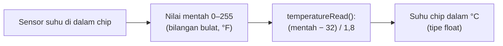
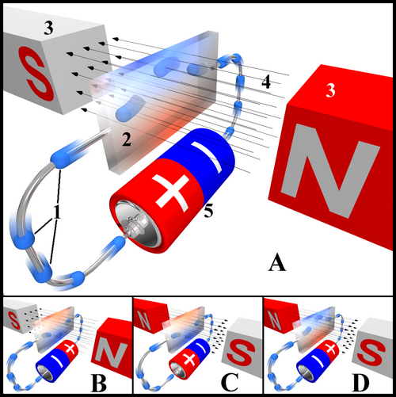

# BAB 33: Sensor Internal ESP32

> ✅ **Prasyarat:** Selesaikan **BAB 16 (Non-Blocking Programming)** — kamu sudah bisa menjadwalkan beberapa tugas dengan `millis()` tanpa `delay()`. Program 3 juga memakai sedikit materi **BAB 20 (Memory Management)** dan **BAB 21 (Debugging & Troubleshooting)**; tautannya diberikan saat dibutuhkan.

Selain sensor-sensor di PCB kit, chip ESP32 sendiri membawa beberapa "indra" kecil di dalam silikonnya — mirip dasbor mobil yang memantau suhu mesin dan tegangan aki, bukan cuaca di luar. Di BAB ini kamu mengenal sensor internal ESP32 klasik: mana yang resmi dan masih bisa dipakai, mana yang tersembunyi dan tidak akurat, dan mana yang sudah dihapus. Kamu akan membaca suhu chip dengan jujur (termasuk mengenali angka yang tidak valid), menelusuri kenapa sensor Hall hilang di *core* 3.x, lalu menggabungkan semuanya menjadi pemantau kesehatan ESP32.

## 📌 Tujuan Pembelajaran

Setelah mempelajari BAB ini, kamu bisa:

- Menyebutkan sensor dan pemantau yang ada di dalam chip ESP32 klasik beserta statusnya di *core* 3.3.x.
- Membaca suhu chip dengan `temperatureRead()` dan menjelaskan kenapa angkanya **bukan** suhu ruangan.
- Mengenali pembacaan tidak valid (53,33 °C) dan menguji apakah sensor suhu di chip-mu memberi data.
- Mengamati pengaruh beban CPU dan radio WiFi terhadap suhu chip.
- Menjelaskan riwayat sensor Hall ESP32, kenapa `hallRead()` tidak bisa dipakai lagi, dan apa penggantinya.
- Membuat pemantau kesehatan ESP32 yang *non-blocking*: penyebab *reset*, kenaikan suhu chip, sisa memori, dan lama menyala.

## 🧰 Yang Perlu Disiapkan

| Kebutuhan | Keterangan |
|---|---|
| *Hardware* | Kit Bluino ESP32 IoT Starter Shield + kabel USB **data**. Program 1 dan 2 tidak memakai komponen kit — sensornya ada di dalam chip ESP32 |
| Kabel *jumper* | 1 kabel *female-female* untuk Program 3: `LED1` (merah) → IO4 |
| Komponen tambahan | Tidak ada |
| *Software* | Arduino IDE 2.x + *board package* **esp32** versi 3.3.x (lihat [BAB 5](../BAB-05/README.md)) |
| *Library* | Tidak perlu *library* tambahan — `temperatureRead()`, `WiFi`, dan `esp_reset_reason()` sudah ada di *board package* esp32 |
| Alat uji | **Serial Monitor** Arduino IDE (baud 115200); **Serial Plotter** untuk salah satu latihan |
| Jaringan | Tidak perlu WiFi. Program 2 hanya menyalakan radio WiFi untuk memindai jaringan di sekitar — tidak perlu nama dan kata sandi WiFi |

## 📑 Daftar Isi

- [33.1 Sensor di Dalam Chip ESP32](#331-sensor-di-dalam-chip-esp32)
- [33.2 Sensor Suhu Chip: Cara Kerja dan Keterbatasan](#332-sensor-suhu-chip-cara-kerja-dan-keterbatasan)
- [33.3 Program 1: Menguji Sensor Suhu Chip](#333-program-1-menguji-sensor-suhu-chip)
- [33.4 Program 2: Suhu Chip Saat Diam, Sibuk, dan WiFi Menyala](#334-program-2-suhu-chip-saat-diam-sibuk-dan-wifi-menyala)
- [33.5 Sensor Hall: Riwayat dan Penggantinya](#335-sensor-hall-riwayat-dan-penggantinya)
- [33.6 Pemantau Internal Lain: Tegangan, Reset, dan Memori](#336-pemantau-internal-lain-tegangan-reset-dan-memori)
- [33.7 Program 3: Pemantau Kesehatan ESP32](#337-program-3-pemantau-kesehatan-esp32)
- [33.8 Troubleshooting](#338-troubleshooting)
- [📝 Rangkuman](#-rangkuman)
- [💪 Latihan](#-latihan)
- [📚 Referensi](#-referensi)

---

## 33.1 Sensor di Dalam Chip ESP32

**Sensor internal** adalah sensor atau rangkaian pemantau yang sudah tertanam di dalam chip ESP32 itu sendiri, bukan modul terpisah di PCB kit. Kamu tidak perlu menyambung kabel apa pun — cukup memanggil fungsinya di program.

Chip di *board* ESP32 DEVKIT V1 adalah **ESP32 klasik** (seri pertama, misalnya ESP32-D0WD-V3), yang tersembunyi di bawah tutup logam modul ESP32-WROOM-32. Keluarga ESP32 yang lebih baru (ESP32-S2, S3, C3, C6, H2, dan lain-lain) punya isi yang sedikit berbeda — perbedaannya dibahas di [BAB 2](../BAB-02/README.md). Untuk ESP32 klasik, inilah daftarnya:

| Sensor/pemantau di dalam chip | Mengukur apa | Status di *core* 3.3.x | Dibahas di |
|---|---|---|---|
| Sensor sentuh kapasitif (10 pin, T0–T9) | Perubahan kapasitansi saat pad disentuh jari | ✅ Resmi dan terdokumentasi | [BAB 14](../BAB-14/README.md) |
| Sensor suhu chip | Suhu **di dalam chip**, bukan suhu ruangan | ⚠️ Masih bisa dibaca dengan `temperatureRead()`, tetapi tidak terdokumentasi dan tidak dikalibrasi | [33.2](#332-sensor-suhu-chip-cara-kerja-dan-keterbatasan)–[33.4](#334-program-2-suhu-chip-saat-diam-sibuk-dan-wifi-menyala) |
| Sensor Hall | Medan magnet di dekat chip | ❌ Dihapus — `hallRead()` sudah tidak ada | [33.5](#335-sensor-hall-riwayat-dan-penggantinya) |
| *Brownout detector* | Tegangan catu daya yang turun terlalu rendah | ✅ Aktif otomatis dan me-*reset* chip | [BAB 21](../BAB-21/README.md#2112-brownout-saat-daya-tidak-cukup) dan [33.6](#336-pemantau-internal-lain-tegangan-reset-dan-memori) |

Selain sensor, chip juga bisa "melaporkan keadaannya sendiri": model dan revisi chip ([BAB 7](../BAB-07/README.md#710-program-4-informasi-chip-esp32)), penyebab *reset* terakhir ([BAB 21](../BAB-21/README.md#21102-mengetahui-penyebab-reset)), dan sisa memori ([BAB 20](../BAB-20/README.md#2044-fungsi-untuk-memantau-memori)). Informasi ini bukan sensor, tetapi sangat berguna untuk memantau kesehatan perangkat, jadi ikut dipakai di [Program 3](#337-program-3-pemantau-kesehatan-esp32).

> 📌 **Catatan:** Banyak tutorial lama menyebut ESP32 punya "sensor suhu dan sensor Hall bawaan" seolah-olah keduanya siap dipakai. Kenyataannya, Espressif sudah menghapus keduanya dari *datasheet* ESP32 (lihat juga catatan di [BAB 2](../BAB-02/README.md)). BAB ini menjelaskan apa yang masih tersisa dan bagaimana memakainya dengan jujur.

---

## 33.2 Sensor Suhu Chip: Cara Kerja dan Keterbatasan

### 33.2.1 Suhu Chip Bukan Suhu Ruangan

Bayangkan mesin sepeda motor. Mesin yang sedang menyala selalu lebih panas daripada udara di sekitarnya, dan makin keras mesin bekerja, makin panas pula. Chip ESP32 mirip seperti itu: CPU dan radio WiFi/Bluetooth menghasilkan panas saat bekerja, sehingga **suhu di dalam chip selalu lebih tinggi daripada suhu ruangan**.

Berapa selisihnya? Tidak tetap. Selisih itu bergantung pada beban CPU, kecepatan CPU, aktif-tidaknya WiFi, ada-tidaknya kotak (*casing*) yang menutup *board*, dan aliran udara di sekitarnya. Karena itu, suhu ruangan **tidak bisa** didapat dengan sekadar mengurangi suhu chip dengan angka tertentu. Untuk mengukur suhu ruangan, pakai sensor di kit: DHT11 ([BAB 26](../BAB-26/README.md)), DS18B20 ([BAB 25](../BAB-25/README.md)), atau BMP180 ([BAB 28](../BAB-28/README.md)).

> 🧪 **Coba Sendiri:** Setelah menjalankan Program 1 nanti, tempelkan ujung jari ke tutup logam modul ESP32 selama ±30 detik. Angkanya mungkin hanya bergeser sedikit dan lambat — atau sama sekali tidak berubah kalau sensormu termasuk yang tidak memberi data (lihat [33.2.3](#3323-memakai-temperatureread)). Ini bukan sensor suhu sentuh atau suhu udara.

### 33.2.2 Sensor yang Tidak Lagi Didokumentasikan

*Datasheet* ESP32 generasi awal mencantumkan sebuah sensor suhu di dalam chip. Sejak *datasheet* versi 2.2 (Mei 2018), Espressif **menghapus** bagian sensor suhu itu, dan ESP-IDF (*framework* resmi Espressif) tidak menyediakan *driver* sensor suhu untuk ESP32 klasik. *Driver* sensor suhu resmi hanya ada untuk chip yang lebih baru, misalnya ESP32-S2, ESP32-S3, ESP32-C3, ESP32-C6, dan ESP32-H2.

Meski begitu, *board package* esp32 masih menyediakan fungsi `temperatureRead()`. Di kode sumber *core* 3.3.12, fungsi ini untuk ESP32 klasik memanggil sebuah fungsi tersembunyi milik pustaka tertutup Espressif bernama `temprature_sens_read()` (salah ketik "temprature" itu memang nama aslinya). Komentar di kode sumbernya pun berbunyi *"Undocumented!!!"* — tidak terdokumentasi. Fungsi tersembunyi itu memberi **nilai mentah** berupa bilangan bulat 0–255 dalam derajat Fahrenheit, lalu `temperatureRead()` mengubahnya menjadi Celsius:



*Gambar 33.1 — Jalur pembacaan suhu chip pada ESP32 klasik (board package esp32 3.3.12). Sumber: dibuat untuk materi ini.*

Dari jalur di atas, ada empat hal yang perlu kamu ingat:

1. **Langkahnya kasar.** Karena nilai mentahnya bilangan bulat Fahrenheit, hasil `temperatureRead()` selalu melompat per 1 °F ≈ 0,56 °C, misalnya 47,22 → 47,78 → 48,33. Angka di belakang koma itu bukan tanda ketelitian.
2. **Tidak dikalibrasi.** Setiap chip punya pergeseran (*offset*) sendiri. Dua ESP32 yang diletakkan berdampingan bisa menunjukkan angka yang berbeda beberapa derajat — atau lebih.
3. **Bisa tidak memberi data sama sekali.** Pada banyak chip, nilai mentahnya macet di **128**, sehingga `temperatureRead()` selalu menghasilkan (128 − 32) / 1,8 = **53,33 °C** apa pun keadaannya. Angka 53,33 °C adalah tanda bahwa sensor tidak memberi data yang valid, bukan suhu sungguhan.
4. **Yang berguna adalah perubahannya.** Kalau sensormu memberi data, pakai untuk melihat *tren* — misalnya "suhu chip naik 10 °C sejak dinyalakan" — bukan untuk angka mutlak.

> 📌 **Catatan:** Batas suhu resmi ESP32 tidak ada hubungannya dengan sensor ini. *Datasheet* ESP32 mencantumkan suhu kerja chip −40 sampai 125 °C (untuk chip tanpa *flash* di dalam kemasannya), sedangkan modul seperti ESP32-WROOM-32 punya batas suhu lingkungan sendiri yang lebih rendah (lihat *datasheet* modulnya). *Datasheet* ESP32 juga tidak menyebutkan fitur pengaman yang mematikan chip saat terlalu panas. Jadi jangan memakai angka `temperatureRead()` yang belum dikalibrasi untuk mengambil keputusan keselamatan.

### 33.2.3 Memakai temperatureRead()

Cara memanggilnya sangat sederhana dan tidak butuh `#include` apa pun:

```cpp
float suhuChip = temperatureRead();   // suhu di dalam chip, dalam °C
```

Cara membaca hasilnya:

| Hasil `temperatureRead()` | Artinya | Yang sebaiknya dilakukan |
|---|---|---|
| Selalu tepat **53.33**, tidak pernah berubah | Nilai mentah macet di 128 — sensor tidak memberi data | Jangan dipakai. Untuk suhu, pakai sensor eksternal |
| Kadang 53.33, kadang angka lain | Sebagian bacaan tidak valid | Buang setiap nilai 53.33 sebelum diolah |
| Angka lain yang berubah bertahap (lompatan ±0,56 °C) | Sensor memberi data, tetapi tidak dikalibrasi | Pakai untuk melihat kenaikan/penurunan, bukan angka mutlak |

Program 1 di bawah memeriksa hal ini secara otomatis untuk chip-mu.

<details>
<summary><b>🔬 Pendalaman (opsional): sensor suhu resmi di ESP32 seri lain</b></summary>

Chip yang lebih baru — misalnya ESP32-S2, ESP32-S3, ESP32-C3, ESP32-C6, dan ESP32-H2 — punya sensor suhu resmi yang didukung *driver* ESP-IDF `driver/temperature_sensor.h`. Di chip-chip itu, `temperatureRead()` pada *core* 3.x otomatis memakai *driver* resmi tersebut, jadi kode Arduino-mu tetap sama. Kalau sensornya gagal disiapkan, hasilnya `NAN` (*not a number*), sehingga kamu bisa mengeceknya dengan `isnan(suhu)`. Dokumentasi Espressif untuk chip-chip itu juga menegaskan bahwa sensornya mengukur suhu di dalam silikon dan tidak disarankan untuk mengukur suhu lingkungan.

Contoh di internet yang langsung memakai *driver* itu biasanya terlihat seperti ini:

```cpp
// HANYA untuk ESP32-S2/S3/C3/C6/H2 dan sejenisnya.
// TIDAK bisa di-compile untuk board "ESP32 Dev Module" (ESP32 klasik di kit ini).
#include "driver/temperature_sensor.h"

temperature_sensor_handle_t sensorSuhu = NULL;

void siapkanSensorSuhu() {          // dipanggil sekali di setup()
  temperature_sensor_config_t konfigurasi = TEMPERATURE_SENSOR_CONFIG_DEFAULT(10, 50);
  temperature_sensor_install(&konfigurasi, &sensorSuhu);
  temperature_sensor_enable(sensorSuhu);
}

float bacaSuhuChip() {
  float suhu = NAN;
  temperature_sensor_get_celsius(sensorSuhu, &suhu);
  return suhu;
}
```

Kalau kode seperti itu kamu *compile* dengan *board* **ESP32 Dev Module**, hasilnya *error* seperti ini, karena ESP32 klasik tidak punya *driver* sensor suhu resmi:

```text
error: 'TEMPERATURE_SENSOR_CLK_SRC_DEFAULT' was not declared in this scope; did you mean 'TEMPERATURE_SENSOR_CONFIG_DEFAULT'?
```

Untuk kit ini, cukup pakai `temperatureRead()`.

</details>

---

## 33.3 Program 1: Menguji Sensor Suhu Chip

**Tujuan:** Membaca suhu chip setiap 1 detik, menampilkan nilai mentahnya (°F), dan menandai bacaan tidak valid (nilai mentah 128 = 53,33 °C). Setiap 30 bacaan, program mencetak ringkasan dan kesimpulan: apakah sensor suhu di chip-mu memberi data atau tidak.

**Rangkaian:** *Tidak perlu merangkai — sensornya ada di dalam chip ESP32.*

**Cara Menjalankan:**

1. Sambungkan ESP32 ke laptop dengan kabel USB **data**.
2. Buka Arduino IDE → **File → New Sketch**, hapus isinya, lalu salin kode di bawah. Kode yang sama juga tersedia di *file* [`p1_uji_suhu_chip.ino`](p1_uji_suhu_chip/p1_uji_suhu_chip.ino).
3. Pastikan **Tools → Board** = **ESP32 Dev Module** dan **Tools → Port** = *port* ESP32 kamu (misalnya `COM5` di Windows atau `/dev/ttyUSB0` di Linux).
4. Klik tombol **Upload** (ikon panah →) dan tunggu sampai muncul tulisan **Done uploading**.
5. Buka **Serial Monitor** (**Tools → Serial Monitor**) lalu pilih baud **115200**. Biarkan berjalan minimal 30 detik sampai ringkasan pertama muncul.

**Kode Program:**

<!-- sketch: p1_uji_suhu_chip -->
```cpp
/*
 * BAB 33 - Program 1: Menguji Sensor Suhu Chip
 *
 * Membaca suhu chip ESP32 dengan temperatureRead() setiap 1 detik,
 * menampilkan nilai mentahnya (°F), dan menandai bacaan tidak valid
 * (nilai mentah 128 = 53.33 °C). Setiap 30 bacaan, program mencetak
 * ringkasan dan kesimpulan tentang sensor suhu di chip-mu.
 *
 * Rangkaian: tidak perlu - sensornya ada di dalam chip ESP32.
 */

const long MENTAH_TIDAK_VALID = 128;   // nilai mentah yang berarti "tidak ada data"
const int  BACAAN_PER_RINGKASAN = 30;  // ringkasan setiap 30 bacaan

int   nomorBacaan      = 0;
int   jumlahValid      = 0;
int   jumlahTidakValid = 0;
float suhuTerendah     = 0.0;
float suhuTertinggi    = 0.0;

// Menghitung balik nilai mentah (°F, bilangan bulat) dari hasil temperatureRead()
long hitungMentah(float suhuC) {
  return lroundf(suhuC * 1.8f + 32.0f);
}

void cetakRingkasan() {
  Serial.println();
  Serial.println("--- Ringkasan 30 bacaan terakhir ---");
  Serial.printf("Valid       : %d\n", jumlahValid);
  Serial.printf("Tidak valid : %d\n", jumlahTidakValid);

  if (jumlahValid == 0) {
    Serial.println("Rentang     : -");
    Serial.println("Kesimpulan  : sensor suhu chip ini tidak memberi data (selalu 53.33 °C).");
  } else {
    Serial.printf("Rentang     : %.2f °C sampai %.2f °C\n", suhuTerendah, suhuTertinggi);
    if (jumlahTidakValid > 0) {
      Serial.println("Kesimpulan  : sebagian bacaan tidak valid. Buang nilai 53.33 sebelum dipakai.");
    } else {
      Serial.println("Kesimpulan  : sensor memberi data. Ingat: ini suhu chip, belum dikalibrasi.");
    }
  }
  Serial.println("------------------------------------");
  Serial.println();

  // Mulai menghitung lagi untuk ringkasan berikutnya
  jumlahValid = 0;
  jumlahTidakValid = 0;
}

void setup() {
  Serial.begin(115200);
  delay(1000);  // beri waktu Serial Monitor tersambung
  Serial.println();
  Serial.println("BAB 33 - Program 1: Menguji Sensor Suhu Chip");
  Serial.println("Bacaan | Mentah (°F) | Suhu chip (°C) | Keterangan");
}

void loop() {
  float suhu = temperatureRead();  // suhu di dalam chip, dalam °C
  long mentah = hitungMentah(suhu);
  nomorBacaan = nomorBacaan + 1;

  if (mentah == MENTAH_TIDAK_VALID) {
    jumlahTidakValid = jumlahTidakValid + 1;
    Serial.printf("%6d | %11ld | %14.2f | tidak valid\n", nomorBacaan, mentah, suhu);
  } else {
    // Catat suhu terendah dan tertinggi dari bacaan yang valid saja
    if (jumlahValid == 0) {
      suhuTerendah = suhu;
      suhuTertinggi = suhu;
    }
    if (suhu < suhuTerendah) suhuTerendah = suhu;
    if (suhu > suhuTertinggi) suhuTertinggi = suhu;
    jumlahValid = jumlahValid + 1;
    Serial.printf("%6d | %11ld | %14.2f | OK\n", nomorBacaan, mentah, suhu);
  }

  if (nomorBacaan % BACAAN_PER_RINGKASAN == 0) {
    cetakRingkasan();
  }

  delay(1000);  // cukup untuk alat uji sederhana; program berikutnya non-blocking
}
```

**Penjelasan Kode:**

1. **`temperatureRead()`** mengembalikan suhu chip dalam °C bertipe `float`. Fungsi ini bawaan *board package* esp32, jadi tidak perlu `#include` dan tidak perlu *library*.
2. **`hitungMentah()`** membalik rumus di [33.2.2](#3322-sensor-yang-tidak-lagi-didokumentasikan): mentah = suhu × 1,8 + 32. `lroundf()` membulatkan ke bilangan bulat terdekat, sehingga kamu bisa melihat nilai mentah yang sebenarnya dibaca chip.
3. **Pemeriksaan validitas** cukup satu baris: `mentah == MENTAH_TIDAK_VALID`. Membandingkan bilangan bulat (128) lebih aman daripada membandingkan `float` dengan 53.33, karena angka desimal di komputer hampir tidak pernah tepat sama. Akibatnya, kalau sensormu bekerja dan suhu chip kebetulan tepat 53,33 °C, bacaan itu ikut dibuang — harga kecil supaya angka palsu tidak ikut terolah.
4. **Terendah/tertinggi** hanya dihitung dari bacaan yang valid. Bacaan valid pertama dipakai sebagai nilai awal keduanya.
5. **`nomorBacaan % BACAAN_PER_RINGKASAN == 0`** bernilai benar setiap kelipatan 30 (bacaan ke-30, 60, 90, …). Operator `%` (modulo) memberi sisa pembagian.
6. **`Serial.printf()`** mencetak teks berformat: `%6d` = bilangan bulat selebar 6 karakter, `%11ld` = bilangan `long` selebar 11 karakter, `%14.2f` = desimal 2 angka di belakang titik selebar 14 karakter. Lebar ini membuat kolom tabel rata.
7. **`delay(1000)`** dipakai demi kesederhanaan, karena program ini hanya alat uji. Program 2 dan 3 memakai `millis()` seperti di [BAB 16](../BAB-16/README.md).

**Contoh Output:**

Kalau sensor di chip-mu memberi data (angka hanya contoh — angkamu bisa berbeda, karena setiap chip punya *offset* sendiri):

```text
BAB 33 - Program 1: Menguji Sensor Suhu Chip
Bacaan | Mentah (°F) | Suhu chip (°C) | Keterangan
     1 |         116 |          46.67 | OK
     2 |         117 |          47.22 | OK
     3 |         117 |          47.22 | OK
...
    30 |         118 |          47.78 | OK

--- Ringkasan 30 bacaan terakhir ---
Valid       : 30
Tidak valid : 0
Rentang     : 46.67 °C sampai 47.78 °C
Kesimpulan  : sensor memberi data. Ingat: ini suhu chip, belum dikalibrasi.
------------------------------------

```

Kalau sensor di chip-mu tidak memberi data:

```text
BAB 33 - Program 1: Menguji Sensor Suhu Chip
Bacaan | Mentah (°F) | Suhu chip (°C) | Keterangan
     1 |         128 |          53.33 | tidak valid
     2 |         128 |          53.33 | tidak valid
...
    30 |         128 |          53.33 | tidak valid

--- Ringkasan 30 bacaan terakhir ---
Valid       : 0
Tidak valid : 30
Rentang     : -
Kesimpulan  : sensor suhu chip ini tidak memberi data (selalu 53.33 °C).
------------------------------------

```

Perhatikan kolom suhu: angkanya selalu melompat per ±0,56 °C (46.67 → 47.22 → 47.78), karena nilai mentahnya bilangan bulat Fahrenheit. Di kit tidak ada komponen yang bereaksi — semua hasil hanya tampil di Serial Monitor.

> 📌 **Catatan:** Kalau hasilnya "tidak memberi data", itu **bukan** kesalahanmu dan *board*-mu tidak rusak — chip-mu termasuk yang sensor suhunya tidak bisa dibaca dengan cara ini. Kamu tetap bisa mengikuti BAB ini sampai selesai: Program 2 dan 3 akan menuliskan "tidak valid" atau "tidak tersedia" di bagian suhu, sedangkan bagian lainnya tetap berjalan.

**Kalau Belum Berhasil:**

- **Serial Monitor kosong atau berisi karakter acak** → pastikan baud **115200**, lalu tekan tombol **EN** di *board* untuk menjalankan ulang program.
- **Tanda ° tampil sebagai `°` atau kotak** → aplikasi terminal yang kamu pakai tidak membaca UTF-8. Pakai Serial Monitor Arduino IDE 2.
- ***Error* `'temperatureRead' was not declared in this scope`** → *board* yang dipilih bukan ESP32. Pilih **Tools → Board → esp32 → ESP32 Dev Module**.
- **Angkanya sangat berbeda dengan ESP32 milik temanmu** → wajar; sensor ini tidak dikalibrasi dan *offset* setiap chip berbeda.

---

## 33.4 Program 2: Suhu Chip Saat Diam, Sibuk, dan WiFi Menyala

**Tujuan:** Membuktikan bahwa suhu chip bergantung pada pekerjaan chip itu sendiri. Program berganti fase setiap 60 detik — **DIAM** (CPU beristirahat), **CPU SIBUK** (CPU menghitung terus-menerus), dan **WIFI** (radio WiFi menyala dan terus memindai jaringan) — lalu setiap 5 detik melaporkan suhu chip dan perubahannya sejak awal fase.

**Rangkaian:** *Tidak perlu merangkai — sensornya ada di dalam chip ESP32.*

**Cara Menjalankan:**

1. Sambungkan ESP32 ke laptop dengan kabel USB **data**.
2. Buka Arduino IDE → **File → New Sketch**, hapus isinya, lalu salin kode di bawah. Kode yang sama juga tersedia di *file* [`p2_suhu_dan_beban.ino`](p2_suhu_dan_beban/p2_suhu_dan_beban.ino).
3. Pastikan **Tools → Board** = **ESP32 Dev Module** dan **Tools → Port** = *port* ESP32 kamu.
4. Klik tombol **Upload** dan tunggu sampai muncul tulisan **Done uploading**.
5. Buka **Serial Monitor** (**Tools → Serial Monitor**) lalu pilih baud **115200**. Satu putaran tiga fase butuh 3 menit; amati minimal satu putaran penuh.

> 📌 **Catatan:** Fase WIFI hanya **memindai** jaringan di sekitar (seperti HP yang mencari daftar WiFi), tidak tersambung ke mana pun. Jadi tidak perlu nama dan kata sandi WiFi.

**Kode Program:**

<!-- sketch: p2_suhu_dan_beban -->
```cpp
/*
 * BAB 33 - Program 2: Suhu Chip Saat Diam, Sibuk, dan WiFi Menyala
 *
 * Program berganti fase setiap 60 detik:
 *   1. DIAM      : CPU beristirahat
 *   2. CPU SIBUK : CPU menghitung terus-menerus
 *   3. WIFI      : radio WiFi menyala dan terus memindai jaringan
 * Setiap 5 detik, suhu chip dicetak beserta perubahannya sejak awal fase.
 *
 * Rangkaian: tidak perlu. Tidak perlu nama/kata sandi WiFi.
 */
#include <WiFi.h>

// Tipe data ditulis di bagian atas supaya dikenali di seluruh sketch
enum Fase { FASE_DIAM, FASE_SIBUK, FASE_WIFI };
const char *NAMA_FASE[] = { "DIAM", "CPU SIBUK", "WIFI" };

struct Timer {
  unsigned long interval;   // jalankan setiap sekian ms
  unsigned long waktuLalu;  // kapan terakhir dijalankan

  // Mengembalikan true kalau sudah waktunya, lalu mencatat waktunya
  bool sudahWaktunya(unsigned long sekarang) {
    if (sekarang - waktuLalu >= interval) {
      waktuLalu = sekarang;
      return true;
    }
    return false;
  }
};

const unsigned long LAMA_FASE_MS = 60000;   // setiap fase 60 detik
const long MENTAH_TIDAK_VALID = 128;        // 53.33 °C = sensor tidak memberi data

Timer timerLaporan = { 5000, 0 };   // laporan setiap 5 detik

Fase fase = FASE_DIAM;
unsigned long waktuMulaiFase = 0;
float suhuAwalFase = 0.0;
bool  adaSuhuAwal = false;          // sudah punya suhu awal fase yang valid?
int   jumlahJaringan = 0;           // hasil pindaian WiFi terakhir

volatile float hasilHitung = 1.0;   // volatile: hitungan "kerja berat" tidak dibuang compiler

bool suhuValid(float suhu) {
  return lroundf(suhu * 1.8f + 32.0f) != MENTAH_TIDAK_VALID;
}

// Pekerjaan hitung tanpa arti, hanya untuk membuat CPU sibuk beberapa milidetik
void kerjaBerat() {
  float x = hasilHitung;
  for (int i = 0; i < 100000; i++) {
    x = x * 1.0001f + 0.0001f;
    if (x > 1000.0f) x = 1.0f;
  }
  hasilHitung = x;
}

void mulaiFase(Fase baru) {
  // Matikan WiFi kalau fase sebelumnya WIFI
  if (fase == FASE_WIFI && baru != FASE_WIFI) {
    WiFi.scanDelete();
    WiFi.mode(WIFI_OFF);
  }

  fase = baru;
  waktuMulaiFase = millis();
  timerLaporan.waktuLalu = waktuMulaiFase;   // laporan pertama 5 detik lagi

  float suhu = temperatureRead();
  adaSuhuAwal = suhuValid(suhu);
  suhuAwalFase = suhu;

  if (fase == FASE_WIFI) {
    jumlahJaringan = 0;
    WiFi.mode(WIFI_STA);        // nyalakan radio WiFi (mode stasiun)
    WiFi.scanNetworks(true);    // true = memindai di latar belakang
  }

  Serial.println();
  Serial.printf("=== Fase %s dimulai (%lu detik) ===\n", NAMA_FASE[fase], LAMA_FASE_MS / 1000);
}

void setup() {
  Serial.begin(115200);
  delay(1000);  // beri waktu Serial Monitor tersambung
  Serial.println();
  Serial.println("BAB 33 - Program 2: Suhu Chip Saat Diam, Sibuk, dan WiFi Menyala");
  WiFi.mode(WIFI_OFF);          // pastikan radio WiFi mati di awal
  fase = FASE_DIAM;
  mulaiFase(FASE_DIAM);
}

void loop() {
  unsigned long sekarang = millis();

  // 1. Ganti fase setiap 60 detik: DIAM -> CPU SIBUK -> WIFI -> DIAM ...
  if (sekarang - waktuMulaiFase >= LAMA_FASE_MS) {
    if (fase == FASE_DIAM)       mulaiFase(FASE_SIBUK);
    else if (fase == FASE_SIBUK) mulaiFase(FASE_WIFI);
    else                         mulaiFase(FASE_DIAM);
  }

  // 2. Laporan setiap 5 detik
  if (timerLaporan.sudahWaktunya(sekarang)) {
    unsigned long detikFase = (sekarang - waktuMulaiFase) / 1000;
    float suhu = temperatureRead();

    Serial.printf("[%-9s %2lu s] ", NAMA_FASE[fase], detikFase);
    if (!suhuValid(suhu)) {
      Serial.print("suhu chip tidak valid (53.33 °C)");
    } else {
      if (!adaSuhuAwal) {           // suhu awal fase belum ada: pakai bacaan ini
        suhuAwalFase = suhu;
        adaSuhuAwal = true;
      }
      Serial.printf("suhu chip %.2f °C | perubahan sejak awal fase %+.2f °C",
                    suhu, suhu - suhuAwalFase);
    }
    if (fase == FASE_WIFI) {
      Serial.printf(" | jaringan terdeteksi: %d", jumlahJaringan);
    }
    Serial.println();
  }

  // 3. Pekerjaan sesuai fase
  if (fase == FASE_SIBUK) {
    kerjaBerat();                   // CPU terus menghitung, tanpa istirahat
  } else {
    if (fase == FASE_WIFI) {
      int16_t hasil = WiFi.scanComplete();
      if (hasil >= 0) {             // pindaian selesai: simpan jumlahnya, mulai lagi
        jumlahJaringan = hasil;
        WiFi.scanDelete();
        WiFi.scanNetworks(true);
      } else if (hasil == WIFI_SCAN_FAILED) {
        WiFi.scanNetworks(true);    // pindaian gagal/belum jalan: coba lagi
      }
    }
    delay(10);                      // DIAM dan WIFI: beri CPU waktu beristirahat
  }
}
```

**Penjelasan Kode:**

1. **`enum Fase`** memberi nama untuk tiga fase. `NAMA_FASE[fase]` mengambil teks nama fase yang sedang berjalan. `enum` dan `struct Timer` ditulis di bagian atas supaya dikenali oleh seluruh *sketch*.
2. **`struct Timer` dan `sudahWaktunya()`** sama persis dengan pola di [BAB 16](../BAB-16/README.md): laporan dicetak setiap 5 detik tanpa menghentikan pekerjaan lain.
3. **`mulaiFase()`** dipanggil setiap ganti fase. Fungsi ini mematikan WiFi bila fase sebelumnya WIFI, mencatat waktu mulai, dan menyimpan suhu awal fase. Kalau bacaan pertama tidak valid, suhu awal diambil dari bacaan valid berikutnya.
4. **`kerjaBerat()`** menghitung perkalian desimal sebanyak 100.000 kali — tidak ada artinya, hanya membuat CPU sibuk. Variabel `hasilHitung` bertanda `volatile` supaya *compiler* tidak menganggap hitungan itu sia-sia lalu membuangnya.
5. **`delay(10)` di fase DIAM dan WIFI** sengaja dipakai. `loop()` yang kosong tanpa jeda justru membuat CPU berputar terus-menerus (tetap sibuk!). Dengan `delay(10)`, CPU benar-benar beristirahat hampir sepanjang waktu, sementara laporan tetap tepat waktu karena jedanya hanya 10 ms.
6. **`WiFi.scanNetworks(true)`** memulai pemindaian jaringan di latar belakang. `WiFi.scanComplete()` bernilai `WIFI_SCAN_RUNNING` (−1) selama memindai, `WIFI_SCAN_FAILED` (−2) kalau gagal atau belum dimulai, dan jumlah jaringan (0 atau lebih) kalau sudah selesai. Begitu selesai, hasilnya dihapus dengan `WiFi.scanDelete()` dan pemindaian baru dimulai, sehingga radio menyala terus selama fase WIFI.
7. **`%+.2f`** mencetak desimal 2 angka **beserta tandanya** (`+0.56` atau `-0.56`), sehingga naik-turunnya suhu mudah dibaca.

**Contoh Output:**

Angka di bawah hanya contoh — besar kenaikan di *board*-mu bisa berbeda, bergantung pada chip, suhu ruangan, dan aliran udara:

```text
BAB 33 - Program 2: Suhu Chip Saat Diam, Sibuk, dan WiFi Menyala

=== Fase DIAM dimulai (60 detik) ===
[DIAM       5 s] suhu chip 46.11 °C | perubahan sejak awal fase +0.00 °C
[DIAM      10 s] suhu chip 46.11 °C | perubahan sejak awal fase +0.00 °C
...
[DIAM      55 s] suhu chip 46.67 °C | perubahan sejak awal fase +0.56 °C

=== Fase CPU SIBUK dimulai (60 detik) ===
[CPU SIBUK  5 s] suhu chip 47.22 °C | perubahan sejak awal fase +0.56 °C
[CPU SIBUK 10 s] suhu chip 47.78 °C | perubahan sejak awal fase +1.11 °C
...
[CPU SIBUK 55 s] suhu chip 49.44 °C | perubahan sejak awal fase +2.78 °C

=== Fase WIFI dimulai (60 detik) ===
[WIFI       5 s] suhu chip 51.11 °C | perubahan sejak awal fase +1.67 °C | jaringan terdeteksi: 6
[WIFI      10 s] suhu chip 52.22 °C | perubahan sejak awal fase +2.78 °C | jaringan terdeteksi: 7
...
[WIFI      55 s] suhu chip 55.56 °C | perubahan sejak awal fase +6.11 °C | jaringan terdeteksi: 7
```

Kalau sensor di chip-mu tidak memberi data (hasil Program 1), setiap baris berisi `suhu chip tidak valid (53.33 °C)`. Fase dan jumlah jaringan tetap tampil, jadi program tetap berjalan normal — hanya suhunya yang tidak bisa diamati.

Yang perlu kamu perhatikan dari hasil pengamatan:

- Suhu chip berubah **perlahan**. Perlu puluhan detik sampai chip mencapai suhu barunya, karena panas harus menyebar ke chip, modul, dan PCB.
- Pada banyak *board*, radio WiFi menaikkan suhu chip lebih banyak daripada CPU yang sibuk. Saat kembali ke fase DIAM, suhu turun lagi secara perlahan.
- Angkanya tetap **suhu chip**. Kalau kamu menaruh DHT11 di sebelahnya, suhu ruangan tidak ikut naik-turun mengikuti fase.

**Kalau Belum Berhasil:**

- **Suhu tidak berubah sama sekali di semua fase** → periksa hasil Program 1. Kalau semua bacaan valid tetapi angkanya tetap, perpanjang `LAMA_FASE_MS` (misalnya `180000` = 3 menit) supaya chip punya waktu memanas.
- **`jaringan terdeteksi: 0` terus** → tidak ada WiFi 2,4 GHz di sekitarmu, atau antena *board* tertutup benda logam. Radio tetap menyala dan memindai, jadi percobaan tetap berlaku.
- **ESP32 *restart* dengan pesan `Brownout detector was triggered` saat fase WIFI** → arus saat radio menyala tidak tercukupi oleh kabel/*port* USB. Ganti kabel atau colokkan langsung ke laptop (lihat [BAB 21](../BAB-21/README.md#2112-brownout-saat-daya-tidak-cukup)).

---

## 33.5 Sensor Hall: Riwayat dan Penggantinya

### 33.5.1 Apa Itu Efek Hall?

Bayangkan orang-orang berjalan lurus di sebuah lorong, lalu angin kencang bertiup dari samping. Orang-orang itu terdorong dan berkumpul di salah satu sisi lorong. Hal serupa terjadi pada listrik: saat arus mengalir melewati sekeping bahan dan sebuah **medan magnet** menembusnya tegak lurus, elektron-elektron yang bergerak terdorong ke satu sisi keping. Akibatnya, muncul tegangan kecil di antara kedua sisi keping itu. Peristiwa ini disebut **efek Hall** (ditemukan Edwin Hall pada 1879), dan tegangannya disebut tegangan Hall.



*Gambar 33.2 — Efek Hall. Angka di gambar: 1 = elektron, 2 = keping sensor Hall, 3 = magnet, 4 = medan magnet, 5 = sumber listrik (baterai). Panel A: elektron terdorong ke tepi atas keping (biru = muatan negatif, merah = positif). Panel B dan C: arah arus atau arah medan dibalik, muatan ikut berbalik. Panel D: keduanya dibalik, hasilnya sama dengan A. Sumber: [Peo / Wikimedia Commons](https://commons.wikimedia.org/wiki/File:Hall_effect.png), lisensi CC BY-SA 3.0.*

Dua hal penting dari gambar itu:

- **Makin kuat medan magnet, makin besar tegangan Hall.** Jadi sensor Hall bisa mengukur kekuatan magnet.
- **Kutub magnet dibalik, tanda tegangannya ikut berbalik.** Jadi sensor Hall bisa membedakan kutub utara dan selatan.

Sensor Hall ada di banyak benda sehari-hari: pendeteksi tutup laptop yang ditutup, penghitung putaran roda pada spidometer, sensor arus listrik, dan kompas di HP (*magnetometer*).

Kekuatan medan magnet diukur dalam **tesla** (T) atau **gauss** (G), dengan 1 T = 10.000 G. Sebagai gambaran (nilai kira-kira, diukur di permukaan benda):

| Sumber medan magnet | Kekuatan kira-kira |
|---|---|
| Medan magnet bumi di khatulistiwa (termasuk Indonesia) | ±31 µT (0,31 G) |
| Magnet kulkas | 1–10 mT (10–100 G) |
| Magnet neodimium sebesar koin | ±150 mT (1.500 G) |

### 33.5.2 Riwayat Sensor Hall di ESP32

ESP32 klasik dulu memang punya sensor Hall di dalam chipnya. Sensor itu dibaca lewat ADC1 memakai pin **IO36** (SENSOR_VP) dan **IO39** (SENSOR_VN), sehingga kedua pin itu tidak boleh dipakai untuk hal lain saat sensor Hall dibaca. Di Arduino, fungsinya bernama `hallRead()`. Perjalanannya kemudian seperti ini:

| Waktu | Yang terjadi |
|---|---|
| *Board package* esp32 versi 1.x dan 2.x | `hallRead()` tersedia |
| ESP-IDF 5.0 (akhir 2022) | Fungsi `hall_sensor_read()` dihapus. Catatan migrasinya: *"Hall sensor is no longer supported on ESP32"* |
| *Datasheet* ESP32 v4.2 (Januari 2023) | Bagian sensor Hall dihapus dari *datasheet*, mengacu pada pemberitahuan perubahan produk (PCN) Espressif nomor 20221202 |
| *Board package* esp32 versi 3.x (2024) | Dibangun di atas ESP-IDF 5, sehingga `hallRead()` ikut **dihapus** |

Espressif tidak menjelaskan alasan rincinya di dokumentasi publik. Dari pengalaman banyak pengguna, sensor ini memang kurang peka: magnet harus kuat dan didekatkan sekali ke chip, sedangkan angkanya mudah bergoyang. Bagi kita yang memakai *core* 3.3.x, kesimpulannya sederhana: **sensor Hall internal tidak bisa dipakai lagi**. Kode lama yang memanggil `hallRead()` akan gagal di-*compile* dengan pesan seperti:

```text
error: 'hallRead' was not declared in this scope
```

> ⚠️ **Perhatian:** Jangan menurunkan versi *board package* ke 2.x hanya demi `hallRead()`. Semua program di materi ini memakai API *core* 3.x (misalnya `ledcAttach()` dan `timerBegin(frekuensi)`), sehingga program BAB lain justru akan *error* di versi 2.x.

### 33.5.3 Kalau Kamu Butuh Mendeteksi Magnet

Kit Bluino tidak punya sensor magnet. MPU-6050 di kit hanya berisi akselerometer dan giroskop (lihat [BAB 29](../BAB-29/README.md)), tanpa *magnetometer*. Kalau suatu saat proyekmu perlu mendeteksi magnet — misalnya pintu terbuka/tertutup atau putaran roda — pakai komponen tambahan berikut (**tidak termasuk kit** dan tidak dibahas lebih lanjut di materi ini):

| Pilihan | Keluaran | Cara membacanya di ESP32 | Catatan |
|---|---|---|---|
| *Reed switch* (sakelar buluh) | Tersambung/terputus saat magnet mendekat | Seperti tombol, dengan `digitalRead()` ([BAB 9](../BAB-09/README.md)) | Paling sederhana dan tidak butuh daya |
| Sensor Hall digital | HIGH/LOW saat magnet mendekat | `digitalRead()` | Pilih yang bekerja di 3,3 V. Banyak modul murah memakai A3144 yang butuh minimal 4,5 V — kalau diberi 5 V, keluarannya bisa ikut 5 V dan **tidak boleh** langsung masuk ke GPIO ESP32 |
| Sensor Hall linear, misalnya SS49E | Tegangan analog sebanding dengan kekuatan magnet | `analogRead()` di pin ADC1 ([BAB 11](../BAB-11/README.md)) | Saat tidak ada magnet, keluarannya sekitar setengah tegangan catu |
| *Magnetometer* I2C, misalnya QMC5883L | Kekuatan medan magnet 3 sumbu | Lewat I2C ([BAB 23](../BAB-23/README.md)) | Bisa dijadikan kompas digital |

Sebelum menyambung sensor apa pun ke ESP32, selalu cek *datasheet*-nya: tegangan kerja dan tegangan keluarannya tidak boleh melebihi 3,3 V (lihat [BAB 3](../BAB-03/README.md)).

---

## 33.6 Pemantau Internal Lain: Tegangan, Reset, dan Memori

Selain sensor suhu, ada beberapa "pemantau" internal lain yang berguna untuk mengetahui kesehatan ESP32. Semuanya sudah dibahas di BAB lain, jadi bagian ini hanya merangkum dan menunjukkan cara memakainya bersama-sama.

### 33.6.1 Tegangan Catu Daya: Brownout Detector

ESP32 klasik **tidak bisa** mengukur tegangan catu dayanya sendiri lewat ADC — tidak ada saluran ADC internal untuk itu. Yang ada adalah ***brownout detector***: rangkaian di dalam chip yang terus membandingkan tegangan catu dengan sebuah batas. Kalau tegangannya turun di bawah batas itu (sekitar 2,43 V pada pengaturan bawaan *board package* esp32 3.3.x), chip langsung di-*reset* supaya tidak bekerja kacau. Jadi detektor ini seperti sensor yang hanya bisa menjawab "tegangan cukup" atau "tegangan kurang".

Kamu bisa mengetahui bahwa *reset* terakhir disebabkan *brownout* lewat dua cara:

- Serial Monitor menampilkan pesan `Brownout detector was triggered`.
- `esp_reset_reason()` bernilai `ESP_RST_BROWNOUT` setelah ESP32 menyala lagi (lihat [33.6.2](#3362-penyebab-reset-terakhir)).

Penyebab dan cara mengatasinya ada di [BAB 21](../BAB-21/README.md#2112-brownout-saat-daya-tidak-cukup). Kalau kamu memang perlu **mengukur** tegangan (misalnya tegangan baterai), sambungkan lewat pembagi tegangan ke pin ADC1 dan baca dengan `analogReadMilliVolts()` ([BAB 11](../BAB-11/README.md)).

> 🚨 **Bahaya:** Jangan mematikan *brownout detector* lewat kode untuk "menyembunyikan" *restart*. Tegangannya tetap kurang, dan akibatnya bisa lebih buruk: program berperilaku aneh atau data di *flash* rusak saat sedang ditulis.

### 33.6.2 Penyebab Reset Terakhir

Setiap kali ESP32 mulai dari awal, chip mencatat **kenapa** ia mulai ulang. Fungsi `esp_reset_reason()` membacakan catatan itu (penjelasan lengkap di [BAB 21](../BAB-21/README.md#21102-mengetahui-penyebab-reset)). Beberapa nilai yang paling sering muncul:

| Hasil `esp_reset_reason()` | Artinya |
|---|---|
| `ESP_RST_POWERON` | Listrik baru dinyalakan, tombol **EN** ditekan, atau selesai *upload* |
| `ESP_RST_SW` | Program memanggil `ESP.restart()` |
| `ESP_RST_PANIC` | Program *crash* (`Guru Meditation Error`) |
| `ESP_RST_TASK_WDT` / `ESP_RST_INT_WDT` | *Watchdog* — program macet terlalu lama |
| `ESP_RST_BROWNOUT` | Tegangan catu daya turun terlalu rendah |

Untuk perangkat yang dibiarkan menyala berhari-hari, mencatat penyebab *reset* sangat membantu: kalau sering muncul `BROWNOUT`, periksa catu daya; kalau `PANIC` atau `TASK_WDT`, periksa program.

### 33.6.3 Identitas Chip dan Sisa Memori

Objek `ESP` (dibahas di [BAB 7](../BAB-07/README.md#710-program-4-informasi-chip-esp32)) bisa "menanyai" chip tentang dirinya sendiri, sedangkan fungsi pemantau memori dibahas di [BAB 20](../BAB-20/README.md#2044-fungsi-untuk-memantau-memori):

| Fungsi | Hasilnya | Contoh |
|---|---|---|
| `ESP.getChipModel()` | Model chip | `ESP32-D0WD-V3` |
| `ESP.getChipRevision()` | Revisi chip: angka ratusan = versi mayor, dua angka terakhir = versi minor | `301` = v3.1 |
| `ESP.getChipCores()` | Jumlah inti (*core*) CPU | `2` |
| `ESP.getCpuFreqMHz()` | Kecepatan CPU dalam MHz | `240` |
| `ESP.getFreeHeap()` | Sisa memori *heap* **saat ini**, dalam *byte* | `337920` |
| `ESP.getMinFreeHeap()` | Sisa *heap* **terendah** sejak ESP32 menyala | `331776` |

Kalau `ESP.getMinFreeHeap()` terus turun dari jam ke jam, kemungkinan ada kebocoran memori (*memory leak*) — penjelasannya di [BAB 20](../BAB-20/README.md).

---

## 33.7 Program 3: Pemantau Kesehatan ESP32

**Tujuan:** Menggabungkan semua pemantau internal menjadi satu "laporan kesehatan". Saat mulai, program menampilkan identitas chip dan penyebab *reset* terakhir. Setelah itu, setiap 5 detik program melaporkan lama menyala, suhu chip beserta kenaikannya dari suhu awal, dan sisa memori *heap*. LED merah menyala sebagai peringatan kalau suhu chip naik terlalu tinggi atau memori hampir habis.

**Rangkaian:**

| Pin **Custom** di kit | Sambungkan ke pin ESP32 |
|---|---|
| `LED1` (LED merah, di header LED) | IO4 (label `4` di deretan pin ESP32 bawah) |


*Gambar 33.3 — Rangkaian LED pada kit: LED menyala saat pin ESP32 bernilai HIGH (aktif HIGH). Sumber: skematik ESP32 Starter Shield 3.2, [Bluino](http://www.bluino.com).*

**Cara Menjalankan:**

1. Pasang satu kabel *jumper* *female-female* dari pin `LED1` (merah) ke pin `4` ESP32, sesuai tabel **Rangkaian** di atas. Cara menyambung LED kit dijelaskan di [BAB 8](../BAB-08/README.md).
2. Buka Arduino IDE → **File → New Sketch**, hapus isinya, lalu salin kode di bawah. Kode yang sama juga tersedia di *file* [`p3_pemantau_kesehatan.ino`](p3_pemantau_kesehatan/p3_pemantau_kesehatan.ino).
3. Pastikan **Tools → Board** = **ESP32 Dev Module** dan **Tools → Port** = *port* ESP32 kamu.
4. Klik tombol **Upload** dan tunggu sampai muncul tulisan **Done uploading**.
5. Buka **Serial Monitor** (**Tools → Serial Monitor**) lalu pilih baud **115200**. Kalau informasi awal terlewat, tekan tombol **EN** di *board* untuk mengulang program.

**Kode Program:**

<!-- sketch: p3_pemantau_kesehatan -->
```cpp
/*
 * BAB 33 - Program 3: Pemantau Kesehatan ESP32
 *
 * - Saat mulai : identitas chip dan penyebab reset terakhir.
 * - Setiap 1 s : membaca suhu chip (bacaan tidak valid 53.33 °C dibuang).
 * - Setiap 5 s : laporan lama menyala, suhu chip (rata-rata 10 bacaan
 *                valid terakhir) dan kenaikannya dari suhu awal, serta
 *                sisa memori heap.
 * - LED1 (merah) menyala kalau suhu chip naik >= 15 °C dari suhu awal
 *   atau sisa heap terendah < 20 KB.
 *
 * Rangkaian: LED1 (merah) -> IO4.
 */
#include "esp_system.h"   // esp_reset_reason()

#define LED_MERAH 4       // LED1 (merah) -> IO4

struct Timer {
  unsigned long interval;   // jalankan setiap sekian ms
  unsigned long waktuLalu;  // kapan terakhir dijalankan

  // Mengembalikan true kalau sudah waktunya, lalu mencatat waktunya
  bool sudahWaktunya(unsigned long sekarang) {
    if (sekarang - waktuLalu >= interval) {
      waktuLalu = sekarang;
      return true;
    }
    return false;
  }
};

const float    BATAS_KENAIKAN_SUHU = 15.0;    // °C di atas suhu awal
const uint32_t BATAS_HEAP_KECIL    = 20480;   // 20 KB (dalam byte)
const int      JUMLAH_RATA         = 10;      // rata-rata 10 bacaan valid terakhir
const long     MENTAH_TIDAK_VALID  = 128;     // 53.33 °C = sensor tidak memberi data

Timer timerSuhu    = { 1000, 0 };   // baca suhu setiap 1 detik
Timer timerLaporan = { 5000, 0 };   // laporan setiap 5 detik

float riwayatSuhu[JUMLAH_RATA];     // 10 bacaan valid terakhir
int   indeksRiwayat = 0;            // kotak berikutnya yang akan diisi
int   isiRiwayat    = 0;            // berapa kotak yang sudah terisi
float suhuAwal      = 0.0;
bool  adaSuhuAwal   = false;

// Menerjemahkan hasil esp_reset_reason() menjadi teks (sama seperti BAB 21)
const char *namaPenyebabReset(esp_reset_reason_t alasan) {
  switch (alasan) {
    case ESP_RST_POWERON:   return "POWERON (baru dinyalakan / tombol EN / upload)";
    case ESP_RST_SW:        return "SW (ESP.restart() dari program)";
    case ESP_RST_PANIC:     return "PANIC (crash: Guru Meditation / abort)";
    case ESP_RST_INT_WDT:   return "INT_WDT (interrupt watchdog)";
    case ESP_RST_TASK_WDT:  return "TASK_WDT (task watchdog: program macet)";
    case ESP_RST_WDT:       return "WDT (watchdog lain)";
    case ESP_RST_DEEPSLEEP: return "DEEPSLEEP (bangun dari deep sleep)";
    case ESP_RST_BROWNOUT:  return "BROWNOUT (tegangan catu daya turun)";
    default:                return "lainnya";
  }
}

void simpanSuhu(float suhu) {
  riwayatSuhu[indeksRiwayat] = suhu;
  indeksRiwayat = (indeksRiwayat + 1) % JUMLAH_RATA;   // setelah kotak terakhir, kembali ke 0
  if (isiRiwayat < JUMLAH_RATA) {
    isiRiwayat = isiRiwayat + 1;
  }
}

float rataRataSuhu() {
  float total = 0.0;
  for (int i = 0; i < isiRiwayat; i++) {
    total = total + riwayatSuhu[i];
  }
  return total / isiRiwayat;
}

void bacaSuhu() {
  float suhu = temperatureRead();
  if (lroundf(suhu * 1.8f + 32.0f) == MENTAH_TIDAK_VALID) {
    return;   // bacaan tidak valid dibuang
  }
  simpanSuhu(suhu);
  // Suhu awal = rata-rata 10 bacaan valid pertama
  if (!adaSuhuAwal && isiRiwayat == JUMLAH_RATA) {
    suhuAwal = rataRataSuhu();
    adaSuhuAwal = true;
  }
}

void cetakLaporan(unsigned long sekarang) {
  // Lama menyala dalam format jam:menit:detik
  unsigned long detik = sekarang / 1000;
  Serial.printf("[%02lu:%02lu:%02lu] ", detik / 3600, (detik % 3600) / 60, detik % 60);

  // Suhu chip
  bool suhuTerlaluNaik = false;
  if (isiRiwayat == 0) {
    Serial.print("Suhu chip: tidak tersedia");
  } else {
    float rata = rataRataSuhu();
    Serial.printf("Suhu chip: %.1f °C", rata);
    if (adaSuhuAwal) {
      float kenaikan = rata - suhuAwal;
      Serial.printf(" (%+.1f dari awal)", kenaikan);
      suhuTerlaluNaik = (kenaikan >= BATAS_KENAIKAN_SUHU);
    } else {
      Serial.print(" (menghitung suhu awal)");
    }
  }

  // Memori heap
  uint32_t heapBebas    = ESP.getFreeHeap();
  uint32_t heapTerendah = ESP.getMinFreeHeap();
  bool heapKritis = (heapTerendah < BATAS_HEAP_KECIL);
  Serial.printf(" | Heap bebas: %lu KB (terendah %lu KB)",
                (unsigned long)(heapBebas / 1024), (unsigned long)(heapTerendah / 1024));

  // Status dan LED merah
  if (suhuTerlaluNaik) Serial.print(" | PERINGATAN: suhu chip naik tinggi");
  if (heapKritis)      Serial.print(" | PERINGATAN: heap hampir habis");
  if (!suhuTerlaluNaik && !heapKritis) Serial.print(" | AMAN");
  Serial.println();

  digitalWrite(LED_MERAH, (suhuTerlaluNaik || heapKritis) ? HIGH : LOW);
}

void setup() {
  Serial.begin(115200);
  delay(1000);  // beri waktu Serial Monitor tersambung
  pinMode(LED_MERAH, OUTPUT);
  digitalWrite(LED_MERAH, LOW);

  int revisi = ESP.getChipRevision();   // contoh: 301 = v3.1
  esp_reset_reason_t alasan = esp_reset_reason();

  Serial.println();
  Serial.println("BAB 33 - Program 3: Pemantau Kesehatan ESP32");
  Serial.printf("Chip           : %s (revisi v%d.%d)\n", ESP.getChipModel(), revisi / 100, revisi % 100);
  Serial.printf("Jumlah inti    : %d\n", ESP.getChipCores());
  Serial.printf("Kecepatan CPU  : %lu MHz\n", (unsigned long)ESP.getCpuFreqMHz());
  Serial.printf("Penyebab reset : %s\n", namaPenyebabReset(alasan));
  if (alasan == ESP_RST_BROWNOUT) {
    Serial.println("                 -> periksa kabel USB dan catu daya (BAB 21)");
  } else if (alasan == ESP_RST_PANIC || alasan == ESP_RST_INT_WDT ||
             alasan == ESP_RST_TASK_WDT || alasan == ESP_RST_WDT) {
    Serial.println("                 -> program sebelumnya crash atau macet (BAB 21)");
  }
  Serial.println("Suhu awal      : rata-rata 10 bacaan valid pertama");
  Serial.printf("LED merah      : menyala kalau suhu chip naik >= %.1f °C atau heap terendah < %lu KB\n",
                BATAS_KENAIKAN_SUHU, (unsigned long)(BATAS_HEAP_KECIL / 1024));
  Serial.println();
}

void loop() {
  unsigned long sekarang = millis();

  if (timerSuhu.sudahWaktunya(sekarang)) {
    bacaSuhu();
  }

  if (timerLaporan.sudahWaktunya(sekarang)) {
    cetakLaporan(sekarang);
  }
}
```

**Penjelasan Kode:**

1. **Dua *timer***, `timerSuhu` (1 detik) dan `timerLaporan` (5 detik), memakai `struct Timer` dari [BAB 16](../BAB-16/README.md). Tidak ada `delay()` di `loop()`, jadi kamu mudah menambah tugas lain nanti.
2. **`namaPenyebabReset()`** sama dengan fungsi di [BAB 21](../BAB-21/README.md): `switch` mengubah kode `esp_reset_reason()` menjadi teks. Di `setup()`, program menambahkan petunjuk kalau *reset* terakhir disebabkan *brownout*, *crash*, atau *watchdog*.
3. **`ESP.getChipRevision()`** menghasilkan angka seperti `301`. `revisi / 100` memberi versi mayor (3) dan `revisi % 100` memberi versi minor (1), sehingga tercetak `v3.1`.
4. **`riwayatSuhu[]`** menyimpan 10 bacaan valid terakhir secara bergiliran: setelah kotak terakhir terisi, `% JUMLAH_RATA` membuat indeks kembali ke 0 dan bacaan paling lama ditimpa. Rata-rata dari 10 bacaan ini meredam lompatan ±0,56 °C. Teknik rata-rata bergerak (*moving average*) seperti ini dibahas tuntas di [BAB 34](../BAB-34/README.md).
5. **Suhu awal** diambil dari rata-rata 10 bacaan valid pertama. Peringatan suhu memakai **kenaikan** dari suhu awal, bukan angka mutlak, karena setiap chip punya *offset* berbeda (lihat [33.2.2](#3322-sensor-yang-tidak-lagi-didokumentasikan)). Bacaan tidak valid (nilai mentah 128) langsung dibuang di `bacaSuhu()`.
6. **`ESP.getMinFreeHeap()`** dipakai untuk peringatan memori karena mencatat titik terendah sejak menyala — kekurangan memori sesaat pun ikut tertangkap.
7. **`(unsigned long)(...)`** mengubah tipe angka supaya cocok dengan format `%lu` di `Serial.printf()`.

**Contoh Output:**

Angka di bawah hanya contoh — model chip, suhu, dan sisa *heap* di *board*-mu bisa berbeda:

```text
BAB 33 - Program 3: Pemantau Kesehatan ESP32
Chip           : ESP32-D0WD-V3 (revisi v3.1)
Jumlah inti    : 2
Kecepatan CPU  : 240 MHz
Penyebab reset : POWERON (baru dinyalakan / tombol EN / upload)
Suhu awal      : rata-rata 10 bacaan valid pertama
LED merah      : menyala kalau suhu chip naik >= 15.0 °C atau heap terendah < 20 KB

[00:00:05] Suhu chip: 46.4 °C (menghitung suhu awal) | Heap bebas: 330 KB (terendah 324 KB) | AMAN
[00:00:10] Suhu chip: 46.6 °C (+0.0 dari awal) | Heap bebas: 330 KB (terendah 324 KB) | AMAN
[00:00:15] Suhu chip: 46.8 °C (+0.2 dari awal) | Heap bebas: 330 KB (terendah 324 KB) | AMAN
```

Kalau sensor suhu di chip-mu tidak memberi data, bagian suhunya selalu berbunyi `Suhu chip: tidak tersedia`, sedangkan bagian lain tetap berjalan:

```text
[00:00:05] Suhu chip: tidak tersedia | Heap bebas: 330 KB (terendah 324 KB) | AMAN
```

Di kit, LED merah (LED1) **mati** selama status `AMAN` dan menyala saat ada `PERINGATAN`.

> 🧪 **Coba Sendiri:** Untuk menguji LED peringatan tanpa menunggu chip panas, ubah sementara `BATAS_HEAP_KECIL` menjadi `400000` (sekitar 390 KB — pasti lebih besar daripada sisa *heap*-mu), lalu *upload* ulang. Mulai laporan pertama, statusnya berubah menjadi `PERINGATAN: heap hampir habis` dan LED merah menyala. Kembalikan ke `20480` setelah selesai.

**Kalau Belum Berhasil:**

- **LED merah tidak pernah menyala** → itu normal selama status `AMAN`. Untuk menguji LED-nya, lakukan percobaan di kotak **Coba Sendiri** di atas. Kalau tetap mati, periksa kabel `LED1` → pin `4`.
- **Bagian suhu selalu `tidak tersedia`** → sensor suhu di chip-mu tidak memberi data (cek dengan Program 1). Bagian lain tetap bisa dipakai.
- **Penyebab *reset* selalu `POWERON`** → wajar setelah *upload* atau menekan **EN**. Penyebab lain baru muncul kalau ESP32 mulai ulang karena hal lain, misalnya `ESP.restart()` atau *crash* (lihat Latihan).
- **Tulisan `menghitung suhu awal` tidak pernah hilang** → baru ada kurang dari 10 bacaan valid, misalnya karena sebagian besar bacaan tidak valid. Turunkan `JUMLAH_RATA` (misalnya `5`) atau pakai saja sebagai pemantau memori dan *reset*.

---

## 33.8 Troubleshooting

| Masalah | Kemungkinan Penyebab | Solusi |
|---|---|---|
| `temperatureRead()` selalu bernilai 53.33 | Nilai mentah sensor macet di 128 — sensor di chip-mu tidak memberi data | Bukan kerusakan. Untuk suhu, pakai DHT11/DS18B20/BMP180. Program 3 tetap bisa memantau memori dan penyebab *reset* |
| Suhu chip jauh di atas suhu ruangan (misalnya 45–60 °C saat ruangan 28 °C) | Memang suhu **di dalam chip**, ditambah *offset* yang tidak dikalibrasi | Normal. Perhatikan kenaikan/penurunannya, bukan angka mutlaknya |
| Suhu chip melompat per ±0,56 °C | Nilai mentahnya bilangan bulat dalam °F | Rata-ratakan beberapa bacaan seperti di Program 3 |
| ESP32 milikmu dan milik temanmu menunjukkan suhu chip yang jauh berbeda | Setiap chip punya *offset* sendiri | Wajar. Bandingkan kenaikan suhu masing-masing, bukan angkanya |
| *Error* `'hallRead' was not declared in this scope` | `hallRead()` sudah dihapus di *board package* esp32 3.x | Hapus kode sensor Hall. Kalau perlu mendeteksi magnet, pakai sensor eksternal ([33.5.3](#3353-kalau-kamu-butuh-mendeteksi-magnet)). Jangan turunkan versi *board package* |
| *Error* `'TEMPERATURE_SENSOR_CLK_SRC_DEFAULT' was not declared in this scope` (kode memakai `driver/temperature_sensor.h`) | *Driver* itu hanya untuk ESP32-S2/S3/C3/C6/H2 dan sejenisnya, bukan ESP32 klasik | Pakai `temperatureRead()` |
| Suhu tidak berubah walaupun CPU sibuk atau WiFi menyala | Sensor tidak memberi data, atau waktu pengamatan terlalu singkat | Cek dengan Program 1. Perpanjang setiap fase di Program 2 |
| `Brownout detector was triggered` saat WiFi menyala | Arus dari kabel/*port* USB tidak cukup | Ganti kabel USB atau colokkan langsung ke laptop ([BAB 21](../BAB-21/README.md#2112-brownout-saat-daya-tidak-cukup)) |
| Tanda ° tampil sebagai `°` | Terminal tidak membaca UTF-8 | Pakai Serial Monitor Arduino IDE 2 |

---

## 📝 Rangkuman

| Topik | Inti |
|---|---|
| Sensor internal | Sensor/pemantau di dalam chip ESP32 sendiri — tanpa kabel, cukup memanggil fungsi |
| Sensor sentuh | Resmi dan andal, dibahas di [BAB 14](../BAB-14/README.md) |
| Sensor suhu chip | Mengukur suhu **di dalam chip**, bukan suhu ruangan. Pada ESP32 klasik tidak terdokumentasi dan tidak dikalibrasi |
| `temperatureRead()` | Nilai mentah (°F, bilangan bulat) → (mentah − 32) / 1,8. Hasil melompat per ±0,56 °C |
| 53,33 °C | Nilai mentah 128 = sensor tidak memberi data. Selalu buang nilai ini |
| Cara pakai yang benar | Pantau **kenaikan** suhu chip (tren), bukan angka mutlak. Untuk suhu ruangan pakai DHT11, DS18B20, atau BMP180 |
| Beban dan suhu | CPU yang sibuk dan radio WiFi menaikkan suhu chip secara perlahan |
| Sensor Hall | Sudah dihapus: `hall_sensor_read()` di ESP-IDF 5.0 dan `hallRead()` di *board package* 3.x. Pengganti: *reed switch*, sensor Hall eksternal, atau *magnetometer* |
| *Brownout detector* | Me-*reset* chip saat tegangan turun di bawah ±2,43 V. Jangan dimatikan |
| Pemantau kesehatan | `esp_reset_reason()`, `ESP.getChipModel()`, `ESP.getFreeHeap()`, `ESP.getMinFreeHeap()`, ditambah kenaikan suhu chip |

---

## 💪 Latihan

### Latihan Dasar

1. **Kenali sensor chip-mu.** Jalankan Program 1 selama 5 menit, lalu catat kesimpulannya serta suhu terendah dan tertinggi. Bandingkan dengan hasil temanmu.
   *Petunjuk:* kalau angkanya berbeda jauh, ingat bahwa setiap chip punya *offset* sendiri. Kalau sensormu tidak memberi data, catat juga — itu hasil yang sah.
2. **Fase lebih panjang.** Ubah Program 2 agar setiap fase berlangsung 2 menit, lalu catat suhu di akhir setiap fase dalam sebuah tabel.
   *Petunjuk:* ubah `LAMA_FASE_MS` menjadi `120000`. Kenaikan yang lebih besar menunjukkan chip belum mencapai suhu stabilnya dalam 60 detik.
3. **Grafik suhu chip.** Ubah Program 2 agar setiap laporan hanya mencetak satu baris berformat `Suhu_chip:47.22`, lalu buka **Tools → Serial Plotter** dan pilih **115200 baud** di kanan bawah jendelanya (cara memakainya ada di [BAB 21](../BAB-21/README.md#2113-serial-plotter-melihat-data-sebagai-grafik)).
   *Petunjuk:* Serial Plotter membaca pasangan `label:nilai`, dan teks lain bisa terbaca sebagai label baru. Jadikan baris teks lain (misalnya `=== Fase ... ===`) komentar supaya grafiknya bersih.

### Latihan Menengah

4. **Suhu chip vs suhu ruangan.** Sambungkan DHT11 (`DHT` → IO27, [BAB 26](../BAB-26/README.md)), lalu tampilkan suhu chip, suhu ruangan, dan selisihnya setiap 5 detik sambil menjalankan fase CPU SIBUK dan WIFI.
   *Petunjuk:* selisihnya ikut berubah saat beban berubah — inilah bukti bahwa suhu ruangan tidak bisa dihitung dari suhu chip dengan pengurangan angka tetap.
5. **LED yang tidak berkedip-kedip.** Saat kenaikan suhu berada tepat di sekitar batas 15 °C, LED Program 3 bisa menyala-mati bergantian. Buat LED menyala saat kenaikan ≥ 15 °C dan baru mati saat kenaikan < 12 °C.
   *Petunjuk:* simpan status peringatan di variabel `bool`, lalu pakai dua batas berbeda (histeresis), seperti di [BAB 14](../BAB-14/README.md).
6. **Uji penyebab *reset*.** Tambahkan perintah di Program 3: kalau kamu mengetik `r` di Serial Monitor, ESP32 memanggil `ESP.restart()`. Amati penyebab *reset* yang tercetak setelah ESP32 menyala lagi.
   *Petunjuk:* pakai `Serial.available()` dan `Serial.read()`, lalu pilih *line ending* **New Line** di Serial Monitor. Hasil yang diharapkan: `SW (ESP.restart() dari program)`.

### Tantangan Lanjutan

7. **Buku catatan *reset*.** Kembangkan Program 3 agar menghitung berapa kali ESP32 di-*reset* karena `BROWNOUT` dan karena `PANIC`/*watchdog*, dan hitungannya tetap tersimpan walaupun listrik dicabut.
   *Petunjuk:* simpan penghitungnya dengan **Preferences** ([BAB 39](../BAB-39/README.md)); tambahkan satu setiap kali `setup()` mendapati penyebab *reset* yang sesuai.
8. **Pemantau di layar.** Tampilkan laporan Program 3 di OLED kit (alamat `0x3C`, [BAB 35](../BAB-35/README.md)): lama menyala, kenaikan suhu chip, sisa *heap*, dan status.
   *Petunjuk:* OLED sudah tersambung lewat *jumper cap* I2C (SDA IO21, SCL IO22). Perbarui layar di dalam `cetakLaporan()`, jangan di setiap putaran `loop()`.

---

## 📚 Referensi

- [ESP32 Series Datasheet v5.3 — Espressif Systems](https://documentation.espressif.com/esp32_datasheet_en.pdf) — riwayat revisi: bagian sensor suhu dihapus di versi 2.2 (Mei 2018) dan bagian sensor Hall dihapus di versi 4.2 (Januari 2023, PCN20221202); suhu kerja chip.
- [esp32-hal-misc.c — kode sumber Arduino-ESP32, Espressif Systems (GitHub)](https://github.com/espressif/arduino-esp32/blob/master/cores/esp32/esp32-hal-misc.c) — isi `temperatureRead()`: pada ESP32 klasik memanggil `temprature_sens_read()` yang tidak terdokumentasi, lalu (mentah − 32) / 1,8.
- [Migration from 2.x to 3.0 — Arduino-ESP32 Documentation](https://docs.espressif.com/projects/arduino-esp32/en/latest/migration_guides/2.x_to_3.0.html) — bagian *Hall Sensor*: "Hall sensor is no longer supported", `hallRead` dihapus.
- [Analog to Digital Converter (ESP-IDF v4.4) — ESP-IDF Programming Guide](https://docs.espressif.com/projects/esp-idf/en/v4.4/esp32/api-reference/peripherals/adc.html) — dokumentasi lama `hall_sensor_read()`: sensor Hall dibaca lewat ADC1 kanal 0 dan 3 (GPIO36 dan GPIO39).
- [Migration from 4.4 to 5.0: Peripherals — ESP-IDF Programming Guide](https://docs.espressif.com/projects/esp-idf/en/stable/esp32/migration-guides/release-5.x/5.0/peripherals.html) — `hall_sensor_read` pada ESP32 dihapus.
- [Temperature Sensor (ESP32-S3) — ESP-IDF Programming Guide](https://docs.espressif.com/projects/esp-idf/en/stable/esp32s3/api-reference/peripherals/temp_sensor.html) — *driver* sensor suhu resmi untuk chip seri baru; sensornya mengukur suhu di dalam silikon dan tidak disarankan untuk suhu lingkungan.
- [Internal Temperature Sensor — ESPHome](https://esphome.io/components/sensor/internal_temperature/) — catatan bahwa sebagian ESP32 sering mengembalikan nilai tidak valid 53,3 °C (nilai mentah 128).
- [About temprature_sens_read(); — ESP32 Forum](https://esp32.com/viewtopic.php?p=21055) — diskusi forum Espressif tentang fungsi tersembunyi ini dan ketelitiannya.
- [Miscellaneous System APIs — ESP-IDF Programming Guide](https://docs.espressif.com/projects/esp-idf/en/stable/esp32/api-reference/system/misc_system_api.html) — `esp_reset_reason()` dan daftar penyebab *reset*.
- [Fatal Errors: Brownout — ESP-IDF Programming Guide](https://docs.espressif.com/projects/esp-idf/en/stable/esp32/api-guides/fatal-errors.html#brownout) — cara kerja *brownout detector* dan pesannya.
- [Hall effect — Wikipedia](https://en.wikipedia.org/wiki/Hall_effect) — penjelasan efek Hall dan penerapannya.
- [Orders of magnitude (magnetic field) — Wikipedia](https://en.wikipedia.org/wiki/Orders_of_magnitude_(magnetic_field)) — kekuatan medan magnet bumi, magnet kulkas, dan magnet neodimium.

---

[⬅️ BAB 32: LDR — Sensor Cahaya](../BAB-32/README.md) · [🏠 Daftar Isi](../README.md) · [BAB 34: Pemrosesan Data Sensor ➡️](../BAB-34/README.md)

---

## ☕ Dukung Proyek Ini

Bab ini disusun dengan dedikasi waktu dan keahlian yang tidak sedikit. Kalau materi ini bermanfaat untuk proses belajar, riset, atau proyekmu, bentuk apresiasi terbaik yang bisa kamu berikan adalah mentraktir penulis secangkir kopi:

[](https://trakteer.id/limitless7/tip)

**💬 Konsultasi & Kolaborasi:**
Punya kritik, saran, atau butuh pendampingan khusus ESP32 & IoT? Silakan hubungi:
- ✉️ **Email:** [antonprafanto@unmul.ac.id](mailto:antonprafanto@unmul.ac.id)
- 📞 **WhatsApp:** [0811-553-393](https://wa.me/62811553393) / [0852-5069-0673](https://wa.me/6285250690673)
