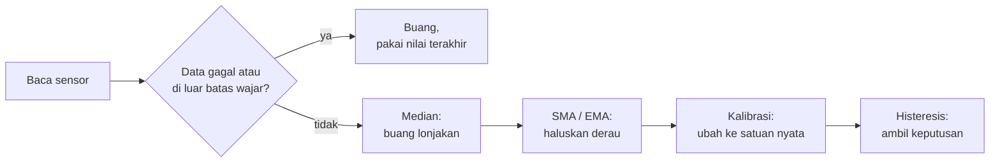
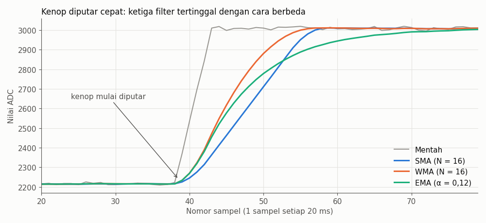
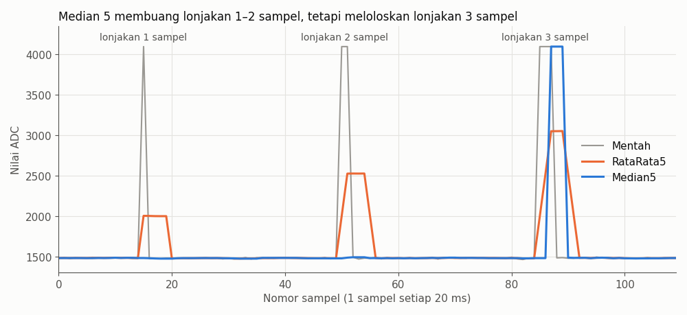

# BAB 34: Pemrosesan Data Sensor

> ✅ **Prasyarat:** Selesaikan **BAB 11 (Analog Input & ADC)**, **BAB 16 (Non-Blocking Programming)**, dan **BAB 26 (DHT11 — Suhu & Kelembapan)**. Program 5 juga memakai DS18B20 dan BMP180, jadi sebaiknya kamu sudah mencoba **BAB 25 (OneWire & Sensor Suhu DS18B20)** dan **BAB 28 (BMP180 — Tekanan Udara & Ketinggian)**. **BAB 32 (LDR — Sensor Cahaya)** membantu, tetapi tidak wajib.

Angka dari sensor jarang bisa langsung dipercaya. Bayangkan timbangan badan digital: angkanya bergoyang saat kamu bergeser sedikit, melonjak kalau ada yang ikut menginjak, dan bisa selalu kelebihan setengah kilo kalau belum diatur. Sensor di kit pun begitu: nilai potensiometer naik-turun sendiri, DHT11 sesekali gagal membaca, dan lampu otomatis bisa berkedip-kedip saat cahaya berada tepat di batas. Di BAB ini kamu belajar mengolah angka mentah menjadi data yang stabil, masuk akal, dan siap dipakai untuk mengambil keputusan — dengan menghaluskan derau, membuang lonjakan, mengalibrasi, memakai histeresis, dan menggabungkan beberapa sensor.

## 📌 Tujuan Pembelajaran

Setelah mempelajari BAB ini, kamu bisa:

- Menjelaskan jenis gangguan pada data sensor (derau, lonjakan, data gagal, *offset*, ketidaklinearan, dan keluaran yang bolak-balik di sekitar ambang) beserta teknik untuk mengatasinya.
- Mengukur besar derau sensor dengan rata-rata, rentang, dan simpangan baku.
- Membuat filter SMA, WMA, dan EMA dengan *buffer* melingkar, lalu memilih ukuran jendela atau nilai α berdasarkan kehalusan dan keterlambatannya.
- Menolak data yang tidak masuk akal dengan pemeriksaan NaN, batas wajar, laju perubahan, dan filter median.
- Mengalibrasi sensor dengan *offset*, *gain*, dan kalibrasi dua titik.
- Memakai ambang dengan histeresis supaya LED atau *relay* tidak berkedip-kedip di sekitar batas.
- Menggabungkan beberapa sensor dengan *voting* median dan rata-rata berbobot, serta mengenal *complementary filter*.
- Menampilkan dan membandingkan hasil filter di Serial Plotter, semuanya tanpa `delay()`.

## 🧰 Yang Perlu Disiapkan

| Kebutuhan | Keterangan |
|---|---|
| *Hardware* | Kit Bluino ESP32 IoT Starter Shield + kabel USB **data** |
| Kabel *jumper* | 6 kabel *female-female* (sudah ada di kit): potensiometer `VR10K`, LDR `LDR`, tombol `SW1`, LED merah `LED1`, DHT11 `DHT`, dan DS18B20 `DS` — lihat [34.2](#342-rangkaian-untuk-seluruh-bab) |
| Komponen tambahan | Tidak ada. Senter HP berguna untuk menyinari LDR |
| *Software* | Arduino IDE 2.x + *board package* **esp32** versi 3.3.x (lihat [BAB 5](../BAB-05/README.md)) |
| *Library* | Program 1–4: tidak perlu *library* tambahan. Program 5: **DHT sensor library** + **Adafruit Unified Sensor** ([BAB 26](../BAB-26/README.md)), **OneWire** + **DallasTemperature** ([BAB 25](../BAB-25/README.md)), dan **Adafruit BMP085 Library** ([BAB 28](../BAB-28/README.md)) |
| Alat uji | **Serial Monitor** dan **Serial Plotter** Arduino IDE (baud 115200) |
| Jaringan | Tidak perlu WiFi |

## 📑 Daftar Isi

- [34.1 Kenapa Data Sensor Perlu Diproses?](#341-kenapa-data-sensor-perlu-diproses)
- [34.2 Rangkaian untuk Seluruh BAB](#342-rangkaian-untuk-seluruh-bab)
- [34.3 Program 1: Mengukur Derau Sensor](#343-program-1-mengukur-derau-sensor)
- [34.4 Rata-Rata Bergerak Sederhana (SMA)](#344-rata-rata-bergerak-sederhana-sma)
- [34.5 Rata-Rata Bergerak Berbobot (WMA)](#345-rata-rata-bergerak-berbobot-wma)
- [34.6 Exponential Moving Average (EMA)](#346-exponential-moving-average-ema)
- [34.7 Program 2: Membandingkan SMA, WMA, dan EMA](#347-program-2-membandingkan-sma-wma-dan-ema)
- [34.8 Membuang Data yang Tidak Masuk Akal](#348-membuang-data-yang-tidak-masuk-akal)
- [34.9 Program 3: Filter Median Melawan Lonjakan](#349-program-3-filter-median-melawan-lonjakan)
- [34.10 Kalibrasi Sensor](#3410-kalibrasi-sensor)
- [34.11 Ambang dengan Histeresis](#3411-ambang-dengan-histeresis)
- [34.12 Program 4: Lampu Malam Otomatis](#3412-program-4-lampu-malam-otomatis)
- [34.13 Menggabungkan Beberapa Sensor (Sensor Fusion)](#3413-menggabungkan-beberapa-sensor-sensor-fusion)
- [34.14 Program 5: Tiga Sensor Suhu, Satu Angka](#3414-program-5-tiga-sensor-suhu-satu-angka)
- [34.15 Memilih Teknik yang Tepat](#3415-memilih-teknik-yang-tepat)
- [34.16 Troubleshooting](#3416-troubleshooting)
- [📝 Rangkuman](#-rangkuman)
- [💪 Latihan](#-latihan)
- [📚 Referensi](#-referensi)

---

## 34.1 Kenapa Data Sensor Perlu Diproses?

Sensor mengubah besaran fisik (cahaya, suhu, posisi kenop) menjadi angka. Di perjalanan itu selalu ada yang "menempel": derau dari catu daya, kabel *jumper* yang bertindak seperti antena, sensor yang sesekali salah baca, atau sifat sensor yang tidak persis sama dengan sensor lain. Akibatnya, angka yang diterima program (disebut **data mentah** atau *raw data*) hampir tidak pernah bisa langsung dipakai untuk mengambil keputusan.

Kembali ke timbangan badan tadi. Masalahnya ternyata bermacam-macam, dan setiap masalah punya obatnya sendiri:

| Masalah | Seperti apa di Serial Monitor | Contoh di kit | Obatnya | Dibahas di |
|---|---|---|---|---|
| **Derau** (*noise*) | Angka bergoyang sedikit walaupun tidak ada yang berubah | Nilai potensiometer dan LDR naik-turun beberapa angka | Filter penghalus: SMA, WMA, EMA | [34.4](#344-rata-rata-bergerak-sederhana-sma)–[34.7](#347-program-2-membandingkan-sma-wma-dan-ema) |
| **Lonjakan** (*spike* atau *outlier*) | Satu-dua angka tiba-tiba jauh dari yang lain | Kabel goyang, gangguan listrik sesaat | Pemeriksaan batas wajar, laju perubahan, filter median | [34.8](#348-membuang-data-yang-tidak-masuk-akal)–[34.9](#349-program-3-filter-median-melawan-lonjakan) |
| **Data gagal** | Muncul `nan` atau angka khusus seperti −127 | DHT11 tidak menjawab, kabel DS18B20 lepas | Periksa dengan `isnan()` atau nilai khusus, lalu lewati | [34.8.1](#3481-data-gagal-tolak-paling-awal) |
| **Meleset tetap** (*offset* dan *gain*) | Angka stabil, tetapi selalu lebih tinggi atau lebih rendah dari yang benar | DHT11 boleh meleset ±2 °C; nilai LDR berbeda di setiap kit | Kalibrasi | [34.10](#3410-kalibrasi-sensor) |
| **Tidak linear** | Kenaikan angka tidak sebanding dengan kenaikan besaran fisiknya | LDR | Tabel kalibrasi dan interpolasi | [34.10](#3410-kalibrasi-sensor) |
| **Bolak-balik di sekitar ambang** (*chattering*) | LED atau *relay* nyala-mati berulang kali dengan cepat | Lampu malam otomatis saat senja | Histeresis | [34.11](#3411-ambang-dengan-histeresis) |
| **Beberapa sensor tidak sepakat** | DHT11 menunjukkan 29 °C, DS18B20 28 °C | Tiga sensor suhu di kit | Penggabungan sensor (*sensor fusion*) | [34.13](#3413-menggabungkan-beberapa-sensor-sensor-fusion) |

Teknik-teknik itu biasanya dipasang berurutan, seperti saringan bertingkat pada penjernih air: saringan kasar dulu, baru saringan halus.



*Gambar 34.1 — Urutan pengolahan data sensor yang umum. Sumber: dibuat untuk materi ini.*

Urutan ini ada alasannya:

- **Data gagal dibuang paling awal.** Satu nilai NaN atau −127 yang masuk ke filter penghalus bisa merusak hasilnya untuk waktu lama (bahkan selamanya, seperti yang akan kamu lihat di [34.8.1](#3481-data-gagal-tolak-paling-awal)).
- **Median sebelum rata-rata.** Median membuang lonjakan sampai bersih, sedangkan rata-rata justru "mengoleskan" lonjakan ke beberapa sampel berikutnya.
- **Keputusan paling akhir.** Histeresis bekerja paling baik pada data yang sudah halus dan sudah dalam satuan yang kamu pahami.

Tidak setiap program butuh semua langkah. Potensiometer cukup dihaluskan; DHT11 butuh pemeriksaan data gagal; lampu otomatis butuh kalibrasi dan histeresis. Di akhir BAB, [34.15](#3415-memilih-teknik-yang-tepat) merangkum kapan memakai teknik yang mana.

> 📌 **Catatan:** Kalau kamu sudah membaca [BAB 27](../BAB-27/README.md), kamu sudah mengenal salah satu teknik ini, yaitu *moving average* (rata-rata bergerak). BAB ini membahasnya lebih dalam, lalu menambahkan teknik-teknik lainnya.

---

## 34.2 Rangkaian untuk Seluruh BAB

Semua program di BAB ini memakai pin dari Peta Pin Standar kit, jadi kabelnya boleh dipasang sekaligus dari awal dan dibiarkan sampai akhir BAB:

| Komponen | Pin **Custom** di kit | Sambungkan ke pin ESP32 | Dipakai di |
|---|---|---|---|
| Potensiometer 10 kΩ | `VR10K` (header kuning, pin ke-5 dari kiri) | IO34 (deretan atas) | Program 1, 2, 3 |
| LDR (sensor cahaya) | `LDR` (header kuning, pin ke-1 dari kiri) | IO35 (deretan atas) | Program 1, 4 |
| Tombol S1 | `SW1` (header kuning, pin ke-3 dari kiri) | IO15 (deretan bawah) | Program 3 |
| LED merah | `LED1` (header LED) | IO4 (deretan bawah) | Program 4 |
| DHT11 | `DHT` (header hijau, pin ke-3 dari atas) | IO27 (deretan atas) | Program 5 |
| DS18B20 | `DS` (header hijau, pin ke-4 dari atas) | IO14 (deretan atas) | Program 5 |
| BMP180 | Tidak perlu kabel — tersambung lewat *jumper cap* **JP** | SDA = IO21, SCL = IO22 | Program 5 |

Urutan label di deretan pin ESP32:

- **Deretan atas** (dari kiri): `5V`, `G`, `13`, `12`, `14`, `27`, `26`, `25`, `33`, `32`, `35`, `34`, `VN`, `VP`, `EN`.
- **Deretan bawah** (dari kiri): `3V`, `G`, `15`, `2`, `4`, `16`, `17`, `5`, `18`, `19`, `21`, `3`, `1`, `22`, `23`.

Foto letak setiap pin ada di BAB yang membahas komponennya: potensiometer dan LDR di [BAB 11](../BAB-11/README.md#1143-menyambungkan-kabel-jumper), tombol di [BAB 9](../BAB-09/README.md#922-menyambungkan-kabel-jumper), LED di [BAB 8](../BAB-08/README.md#822-menyambungkan-kabel-jumper), DHT11 di [BAB 26](../BAB-26/README.md#264-rangkaian-dht11-di-kit), dan *jumper cap* BMP180 di [BAB 28](../BAB-28/README.md#2821-sambungan-lewat-jumper-cap).

Langkah memasang kabel:

1. Cabut kabel USB dulu supaya aman saat merangkai.
2. Pasang keenam kabel *jumper* sesuai tabel. Kalau mau bertahap, cukup pasang kabel yang dipakai program yang sedang kamu coba (lihat kolom **Dipakai di**).
3. Pastikan *jumper cap* hitam di header **JP** untuk `SCL`/`SDA` BMP180 terpasang (biasanya sudah dari pabrik).
4. Periksa sekali lagi, lalu sambungkan kembali kabel USB.

> ⚠️ **Perhatian:** Tiga tempat yang paling sering tertukar:
>
> - Di deretan atas, label **35 berada di kiri 34**. Kalau tertukar, program "potensiometer" akan membaca LDR, dan sebaliknya.
> - Label **14** dan **27** bersebelahan. Kalau tertukar, DHT11 dan DS18B20 sama-sama gagal terbaca.
> - Label **15** bersebelahan dengan `G` (GND). Kabel `SW1` yang meleset ke `G` akan menyambung 3,3 V langsung ke GND setiap kali tombol S1 ditekan.

---

## 34.3 Program 1: Mengukur Derau Sensor

Sebelum memilih filter, ukur dulu seberapa besar derau yang mau diredam. Angka ini nanti dipakai untuk menentukan ukuran filter, batas laju perubahan, dan jarak dua ambang histeresis. Ibaratnya, dokter mengukur suhu badan dulu sebelum memilih obat.

Program ini menghitung empat ukuran derau dari 200 sampel:

| Ukuran | Artinya | Analogi lemparan anak panah |
|---|---|---|
| **Rata-rata** | Jumlah semua sampel dibagi banyaknya sampel | Titik pusat kumpulan lubang di papan |
| **Minimum** dan **maksimum** | Sampel terkecil dan terbesar | Lubang paling kiri dan paling kanan |
| **Rentang** (*peak-to-peak*) | Maksimum − minimum | Jarak antara dua lubang terjauh |
| **Simpangan baku** (*standard deviation*) | "Rata-rata jarak" sampel dari nilai rata-ratanya | Seberapa menyebar lubang-lubang di sekitar pusatnya |

Untuk derau acak, rentang dari 200 sampel biasanya sekitar 5–6 kali simpangan baku. Rentang mudah dipahami ("angkanya bergoyang sejauh ini"), sedangkan simpangan baku lebih stabil dan dipakai untuk menghitung efek filter di [34.4](#344-rata-rata-bergerak-sederhana-sma).

**Tujuan:** Membaca potensiometer dan LDR setiap 5 ms tanpa `delay()`, lalu setiap 1 detik (200 sampel) mencetak rata-rata, minimum, maksimum, rentang, dan simpangan baku keduanya.

**Rangkaian:**

| Pin **Custom** di kit | Sambungkan ke pin ESP32 |
|---|---|
| `VR10K` — potensiometer (header kuning, pin ke-5 dari kiri) | IO34 |
| `LDR` — sensor cahaya (header kuning, pin ke-1 dari kiri) | IO35 |

**Cara Menjalankan:**

1. Sambungkan kabel *jumper* sesuai tabel **Rangkaian** di atas (lihat [34.2](#342-rangkaian-untuk-seluruh-bab)).
2. Buka Arduino IDE → **File → New Sketch**, hapus isinya, lalu salin kode di bawah. Kode yang sama juga tersedia di *file* [`p1_ukur_derau.ino`](p1_ukur_derau/p1_ukur_derau.ino).
3. Pastikan **Tools → Board** = **ESP32 Dev Module** dan **Tools → Port** = *port* ESP32 kamu (misalnya `COM5` di Windows atau `/dev/ttyUSB0` di Linux).
4. Klik tombol **Upload** (ikon panah →) dan tunggu sampai muncul tulisan **Done uploading**.
5. Buka **Serial Monitor** (**Tools → Serial Monitor**) lalu pilih baud **115200**.
6. Putar kenop potensiometer kira-kira ke tengah, lalu **lepaskan tanganmu** dari kit dan biarkan beberapa detik.

**Kode Program:**

<!-- sketch: p1_ukur_derau -->
```cpp
/*
 * BAB 34 - Program 1: Mengukur Derau Sensor
 * Membaca potensiometer dan LDR setiap 5 ms tanpa delay(), lalu setiap
 * 200 sampel (1 detik) mencetak ringkasan derau: rata-rata, minimum,
 * maksimum, rentang, dan simpangan baku.
 *
 * Rangkaian: VR10K (potensiometer) → IO34, LDR → IO35
 */

#define PIN_POT 34  // potensiometer (VR10K) → IO34, ADC1
#define PIN_LDR 35  // LDR → IO35, ADC1

const int JUMLAH_SAMPEL = 200;  // 200 sampel × 5 ms = satu ringkasan per detik

// Timer serbaguna dari BAB 16
struct Timer {
  unsigned long interval;   // ms
  unsigned long waktuLalu;  // hasil millis() saat terakhir dijalankan

  // Mengembalikan true kalau sudah waktunya, lalu mencatat waktunya
  bool sudahWaktunya(unsigned long sekarang) {
    if (sekarang - waktuLalu >= interval) {
      waktuLalu = sekarang;
      return true;
    }
    return false;
  }
};

// Penampung statistik untuk satu sensor
struct Statistik {
  uint32_t jumlah;         // total nilai: paling besar 200 × 4095 = 819.000
  uint64_t jumlahKuadrat;  // total kuadrat nilai: bisa lebih dari 3 miliar
  int minimum;
  int maksimum;

  void mulaiUlang() {
    jumlah = 0;
    jumlahKuadrat = 0;
    minimum = 4095;  // sengaja diisi nilai terbesar supaya sampel pertama pasti lebih kecil
    maksimum = 0;    // sengaja diisi nilai terkecil supaya sampel pertama pasti lebih besar
  }

  void tambah(int nilai) {
    jumlah = jumlah + nilai;
    jumlahKuadrat = jumlahKuadrat + (uint64_t)nilai * nilai;
    if (nilai < minimum) minimum = nilai;
    if (nilai > maksimum) maksimum = nilai;
  }

  void cetak(const char *nama, int n) {
    double rataRata = (double)jumlah / n;
    double varian = (double)jumlahKuadrat / n - rataRata * rataRata;
    if (varian < 0) varian = 0;  // jaga-jaga galat pembulatan
    Serial.printf("%s: rata-rata %7.1f | min %4d | maks %4d | rentang %4d | simpangan baku %5.1f\n",
                  nama, rataRata, minimum, maksimum, maksimum - minimum, sqrt(varian));
  }
};

Timer timerSampel = {5, 0};  // ambil satu sampel setiap 5 ms
Statistik statPot;
Statistik statLdr;
int banyakSampel = 0;

void setup() {
  Serial.begin(115200);
  statPot.mulaiUlang();
  statLdr.mulaiUlang();
  Serial.println("BAB 34 - Program 1: Mengukur Derau Sensor");
  Serial.println("Biarkan kenop dan LDR diam. Ringkasan muncul setiap 1 detik.");
}

void loop() {
  unsigned long sekarang = millis();

  if (timerSampel.sudahWaktunya(sekarang)) {
    statPot.tambah(analogRead(PIN_POT));
    statLdr.tambah(analogRead(PIN_LDR));
    banyakSampel = banyakSampel + 1;

    if (banyakSampel == JUMLAH_SAMPEL) {
      statPot.cetak("Pot", banyakSampel);
      statLdr.cetak("LDR", banyakSampel);
      Serial.println();
      statPot.mulaiUlang();  // mulai menghitung ringkasan berikutnya dari nol
      statLdr.mulaiUlang();
      banyakSampel = 0;
    }
  }
}
```

**Penjelasan Kode:**

- **`struct Timer`** sama persis dengan [BAB 16](../BAB-16/README.md#1682-fungsi-di-dalam-struct). `timerSampel` bernilai `true` setiap 5 ms, jadi `loop()` tidak pernah tertahan oleh `delay()`. Semua program di BAB ini memakai *timer* yang sama.
- **`struct Statistik`** adalah satu paket untuk satu sensor: penjumlah, minimum, maksimum, dan fungsi-fungsinya. Karena ada dua sensor, dibuat dua paket: `statPot` dan `statLdr`.
- **Rata-rata** = `jumlah ÷ n`. **Varian** dihitung dengan rumus "rata-rata kuadrat dikurangi kuadrat rata-rata", lalu **simpangan baku** = akar dari varian (`sqrt()`). Dengan rumus ini program tidak perlu menyimpan 200 sampel; cukup dua penjumlah.
- **Kenapa `uint64_t`?** Satu sampel bisa bernilai 4095, dan kuadratnya 16.769.025. Variabel `long` (32 bit bertanda) paling besar menampung ±2,1 miliar, jadi jumlah kuadratnya sudah **meluap** (*overflow*) setelah sekitar 128 sampel bernilai tinggi — angkanya "berputar" menjadi negatif, dan simpangan bakunya ngawur tanpa pesan *error* apa pun. Tipe `uint64_t` (64 bit tanpa tanda) menampung sampai sekitar 18 miliar miliar, jauh lebih dari cukup. Untuk `jumlah` biasa, `uint32_t` sudah aman (paling besar 819.000).
- **`(uint64_t)nilai * nilai`** — tanda `(uint64_t)` mengubah `nilai` menjadi 64 bit **sebelum** dikalikan. Tanpa itu, perkaliannya dikerjakan dalam 32 bit dulu. Di sini hasilnya kebetulan masih muat, tetapi membiasakan diri menulis seperti ini mencegah *overflow* di program lain.
- **`(double)`** membuat pembagian memakai bilangan pecahan presisi tinggi. Tanpa itu, `jumlah / n` adalah pembagian bilangan bulat yang membuang angka di belakang koma.

**Contoh Output:**

```text
BAB 34 - Program 1: Mengukur Derau Sensor
Biarkan kenop dan LDR diam. Ringkasan muncul setiap 1 detik.
Pot: rata-rata  2216.4 | min 2201 | maks 2233 | rentang   32 | simpangan baku   5.8
LDR: rata-rata  1874.9 | min 1863 | maks 1889 | rentang   26 | simpangan baku   4.6

Pot: rata-rata  2216.1 | min 2199 | maks 2231 | rentang   32 | simpangan baku   6.0
LDR: rata-rata  1875.6 | min 1862 | maks 1888 | rentang   26 | simpangan baku   4.7
```

Setiap detik muncul satu pasang baris. Angka di atas hanya contoh — angkamu bisa berbeda, karena derau bergantung pada chip ESP32, kabel, catu daya USB, dan posisi kenop. Yang penting adalah polanya: walaupun tidak ada yang kamu sentuh, minimum dan maksimum berbeda belasan sampai puluhan angka. Itulah derau ADC.

**Catat rentang dan simpangan baku potensiometer dan LDR milikmu.** Angka ini dipakai lagi di [34.8.3](#3483-pemeriksaan-laju-perubahan) dan [34.11](#3411-ambang-dengan-histeresis).

> 🧪 **Coba Sendiri:**
>
> - Putar kenop sampai mentok di salah satu ujung. Simpangan bakunya menjadi 0 atau hampir 0 — bukan karena deraunya hilang, tetapi karena ADC mentok di 0 atau 4095 (lihat [BAB 11](../BAB-11/README.md#1181-tidak-linear-di-ujung-ujungnya)).
> - Putar kenop pelan-pelan selama ringkasan dihitung. Rentangnya membesar karena perubahan nyata ikut terhitung. Jadi, ukur derau selalu dalam keadaan diam.
> - Pegang kabel *jumper* `VR10K` dengan jari. Apakah simpangan bakunya berubah? Tubuhmu bisa ikut menjadi "antena" yang menangkap gangguan listrik.

**Kalau Belum Berhasil:**

- **Rentang ratusan sampai ribuan, padahal kit tidak disentuh** → kabel *jumper* tidak terpasang sehingga pin ADC "mengambang". Periksa kabel `VR10K` → **34** dan `LDR` → **35**.
- **Baris `Pot` berubah saat LDR ditutup** → kabel tertukar; ingat, label 35 berada di kiri 34.
- **Tidak ada tulisan sama sekali** → baud Serial Monitor belum **115200**, atau baris judul sudah lewat sebelum Serial Monitor dibuka. Tekan tombol **EN** di *board* ESP32 untuk memulai ulang program.

---

## 34.4 Rata-Rata Bergerak Sederhana (SMA)

**SMA** (*Simple Moving Average*, rata-rata bergerak sederhana) adalah rata-rata dari N sampel **terakhir**. Setiap ada sampel baru, sampel yang paling lama dibuang. Analoginya seperti nilai rata-rata 4 ulangan terakhir di rapor: setiap ada ulangan baru, nilai ulangan yang paling lama dicoret, jadi rata-ratanya selalu mengikuti perkembangan terbaru tanpa terlalu terpengaruh oleh satu nilai yang kebetulan jelek.

```text
SMA = (x1 + x2 + ... + xN) ÷ N
```

`x1` sampai `xN` adalah N sampel terakhir. N disebut **ukuran jendela** (*window size*): seberapa banyak sampel yang "terlihat" lewat jendela setiap saat.

### 34.4.1 Contoh Hitungan

Misalkan sebuah sensor sudah lama membaca 20, lalu muncul 12 sampel berikut. Sampel ke-4 adalah lonjakan (80), dan mulai sampel ke-8 nilainya **benar-benar** naik ke sekitar 40:

| Sampel ke- | Nilai mentah | SMA (N = 4) |
|---|---|---|
| 1 | 20 | 20,00 |
| 2 | 21 | 20,25 |
| 3 | 20 | 20,25 |
| 4 | **80** (lonjakan) | 35,25 |
| 5 | 20 | 35,25 |
| 6 | 21 | 35,25 |
| 7 | 20 | 35,25 |
| 8 | **40** (naik sungguhan) | 25,25 |
| 9 | 41 | 30,50 |
| 10 | 40 | 35,25 |
| 11 | 41 | 40,50 |
| 12 | 40 | 40,50 |

Tiga hal yang terlihat dari tabel:

- **Derau kecil diredam.** Nilai mentah yang bergoyang 20–21 menjadi 20,00–20,25.
- **Lonjakan tidak dibuang, tetapi "dioleskan".** Lonjakan setinggi 60 dibagi 4, sehingga SMA naik 15 menjadi 35,25 dan bertahan selama 4 sampel, lalu turun tiba-tiba saat lonjakan keluar dari jendela.
- **SMA tertinggal.** Nilai mentah sudah 40 di sampel ke-8, tetapi SMA baru mencapainya di sampel ke-11.

### 34.4.2 Harga yang Dibayar: Keterlambatan dan Memori

Memperbesar N membuat hasil lebih halus, tetapi ada harganya:

- **Kehalusan:** derau acak berkurang sekitar **√N** kali. Kalau Program 1 menunjukkan simpangan baku 6, SMA dengan N = 16 (√16 = 4) menyisakan sekitar 1,5.
- **Keterlambatan:** setelah perubahan mendadak, SMA baru mengikuti sepenuhnya setelah N − 1 sampel; rata-rata keterlambatannya (N − 1) ÷ 2 sampel. Kalikan dengan jeda antarsampel untuk mendapat waktunya.
- **Memori:** SMA harus menyimpan N sampel terakhir.

| N | Derau tersisa | Mengikuti perubahan sepenuhnya setelah (sampel setiap 20 ms) | Memori (`int`, 4 *byte* per sampel) |
|---|---|---|---|
| 4 | ½ | 3 sampel = 60 ms | 16 *byte* |
| 16 | ¼ | 15 sampel = 300 ms | 64 *byte* |
| 64 | ⅛ | 63 sampel = 1,26 detik | 256 *byte* |

Untuk potensiometer yang diputar tangan, jeda 300 ms masih terasa responsif. Untuk suhu ruangan yang berubah dalam hitungan menit, jendela beberapa puluh detik pun tidak masalah.

### 34.4.3 *Buffer* Melingkar dan Penjumlah Berjalan

SMA butuh tempat menyimpan N sampel terakhir. Bayangkan N kursi yang disusun melingkar seperti komidi putar. Penanda `posisi` selalu menunjuk kursi yang diduduki penumpang paling lama. Saat penumpang baru datang, penumpang paling lama turun, penumpang baru duduk di kursi itu, lalu penanda maju satu kursi. Setelah kursi terakhir, penanda kembali ke kursi pertama. Susunan ini disebut *buffer* melingkar (*circular buffer*).

Supaya tidak perlu menjumlahkan N angka setiap ada sampel baru, program menyimpan **jumlah** isi semua kursi dan cukup memperbaruinya: kurangi sampel yang turun, tambahkan sampel yang naik. Berapa pun N-nya, setiap sampel hanya butuh satu pengurangan, satu penjumlahan, dan satu pembagian.

Potongan kode berikut dipakai lagi di Program 2. Bentuknya `struct` berisi data dan fungsi, sama seperti `struct Timer` di [BAB 16](../BAB-16/README.md#1682-fungsi-di-dalam-struct):

```cpp
const int N_SMA = 16;  // ukuran jendela: rata-rata 16 sampel terakhir

struct FilterSMA {
  int  sampel[N_SMA];  // "kursi-kursi" penyimpan sampel terakhir
  int  posisi;         // kursi yang akan ditimpa berikutnya (berisi sampel paling lama)
  long jumlah;         // jumlah isi semua kursi

  // Isi semua kursi dengan nilai awal (dipanggil sekali di setup())
  void mulai(int nilaiAwal) {
    for (int i = 0; i < N_SMA; i++) {
      sampel[i] = nilaiAwal;
    }
    jumlah = (long)nilaiAwal * N_SMA;
    posisi = 0;
  }

  // Masukkan sampel baru, lalu kembalikan rata-rata terbaru
  float tambah(int nilaiBaru) {
    jumlah = jumlah - sampel[posisi] + nilaiBaru;  // buang yang paling lama, tambah yang baru
    sampel[posisi] = nilaiBaru;
    posisi = (posisi + 1) % N_SMA;                 // setelah kursi terakhir, kembali ke 0
    return (float)jumlah / N_SMA;
  }
};

// Pemakaian:
// FilterSMA filterPot;                          // di luar fungsi
// filterPot.mulai(analogRead(PIN_POT));         // sekali di setup()
// float halus = filterPot.tambah(analogRead(PIN_POT));  // setiap sampel di loop()
```

Beberapa hal penting:

- **`mulai()` mengisi semua kursi dengan bacaan pertama.** Tanpa langkah ini, kursi-kursinya masih berisi 0, sehingga rata-rata di awal program terlalu kecil selama N sampel. Untuk LDR di kit, nilai kecil berarti "sangat terang" — lampu otomatis bisa salah mengambil keputusan di detik pertama. Cara lain adalah menghitung berapa kursi yang sudah terisi dan membagi dengan jumlah itu, seperti di [BAB 27](../BAB-27/README.md#2710-program-3-moving-average-di-serial-plotter).
- **`jumlah` bertipe `long`** (32 bit, maksimum ±2,1 miliar). Jumlah 16 nilai ADC paling besar 16 × 4095 = 65.520. Di ESP32, `int` juga 32 bit, tetapi di Arduino Uno `int` hanya 16 bit (maksimum 32.767) dan jumlah ini sudah meluap. Menulis `long` membuat niatmu jelas dan kodenya aman di mana saja.
- **Operator `%`** (sisa bagi) membuat `posisi` berputar: 14, 15, lalu kembali 0, 1, 2, dan seterusnya.
- **`(float)jumlah / N_SMA`** — tanpa `(float)`, pembagian dua bilangan bulat membuang angka di belakang koma.

> 📌 **Catatan:** Penjumlah berjalan sangat cocok untuk data **bilangan bulat** seperti nilai ADC, karena penjumlahan dan pengurangan bilangan bulat selalu tepat. Untuk data `float` (misalnya suhu 28,06 °C), setiap penjumlahan dan pengurangan menyisakan galat pembulatan yang sangat kecil, dan galat itu bisa menumpuk setelah jutaan sampel. Untuk data `float`, jumlahkan ulang isi *buffer* setiap kali (cukup ringan kalau N kecil, seperti di BAB 27), atau simpan datanya sebagai bilangan bulat, misalnya suhu × 100.

---

## 34.5 Rata-Rata Bergerak Berbobot (WMA)

**WMA** (*Weighted Moving Average*, rata-rata bergerak berbobot) mirip SMA, tetapi sampel yang lebih baru diberi **bobot** lebih besar. Analoginya seperti guru yang lebih menghargai ulangan terbaru, karena ulangan itu lebih menggambarkan kemampuanmu sekarang daripada ulangan di awal semester.

Untuk N = 4, sampel paling lama diberi bobot 1, lalu 2, 3, dan sampel terbaru bobot 4:

```text
WMA = (1 × x1 + 2 × x2 + 3 × x3 + 4 × x4) ÷ (1 + 2 + 3 + 4)
```

Pembaginya adalah total bobot, yaitu N × (N + 1) ÷ 2. Untuk N = 4 hasilnya 10; untuk N = 16 hasilnya 136.

Contoh: empat sampel terakhir 20, 20, 20, lalu 40 (nilai baru saja naik).

- SMA = (20 + 20 + 20 + 40) ÷ 4 = **25**
- WMA = (1 × 20 + 2 × 20 + 3 × 20 + 4 × 40) ÷ 10 = (20 + 40 + 60 + 160) ÷ 10 = **28**

WMA lebih cepat "percaya" pada nilai terbaru. Dengan data yang sama seperti di [34.4.1](#3441-contoh-hitungan):

| Sampel ke- | Nilai mentah | SMA (N = 4) | WMA (N = 4) |
|---|---|---|---|
| 3 | 20 | 20,25 | 20,3 |
| 4 | **80** (lonjakan) | 35,25 | 44,2 |
| 5 | 20 | 35,25 | 38,1 |
| 6 | 21 | 35,25 | 32,4 |
| 7 | 20 | 35,25 | 26,3 |
| 8 | **40** (naik sungguhan) | 25,25 | 28,2 |
| 9 | 41 | 30,50 | 34,5 |
| 10 | 40 | 35,25 | 38,3 |
| 11 | 41 | 40,50 | 40,6 |

Harga yang dibayar WMA:

- **Lebih cepat:** rata-rata keterlambatannya sekitar (N − 1) ÷ 3 sampel, lebih kecil daripada SMA ((N − 1) ÷ 2).
- **Sedikit kurang halus** dan **lebih kaget oleh lonjakan**: lonjakan di sampel ke-4 langsung menaikkan WMA ke 44,2, walaupun setelah itu turun bertahap.
- **Hitungan lebih berat:** setiap sampel butuh N perkalian, karena semua bobot bergeser setiap ada sampel baru. Memorinya sama dengan SMA, yaitu N sampel.

```cpp
const int  N_WMA = 16;
const long TOTAL_BOBOT = (long)N_WMA * (N_WMA + 1) / 2;  // 1 + 2 + ... + 16 = 136

struct FilterWMA {
  int sampel[N_WMA];
  int posisi;  // kursi yang akan ditimpa berikutnya

  void mulai(int nilaiAwal) {
    for (int i = 0; i < N_WMA; i++) {
      sampel[i] = nilaiAwal;
    }
    posisi = 0;
  }

  float tambah(int nilaiBaru) {
    sampel[posisi] = nilaiBaru;
    posisi = (posisi + 1) % N_WMA;

    long jumlahBerbobot = 0;
    // Mundur dari sampel terbaru (bobot 16) ke sampel paling lama (bobot 1)
    for (int i = 0; i < N_WMA; i++) {
      int indeks = (posisi - 1 - i + N_WMA) % N_WMA;  // "+ N_WMA" mencegah indeks negatif
      int bobot = N_WMA - i;
      jumlahBerbobot = jumlahBerbobot + (long)sampel[indeks] * bobot;
    }
    return (float)jumlahBerbobot / TOTAL_BOBOT;
  }
};
```

Bagian yang paling sering salah adalah menghitung indeks mundur. Setelah `posisi` dimajukan, sampel terbaru ada di kursi `posisi - 1`, sampel sebelumnya di `posisi - 2`, dan seterusnya. Kalau `posisi` sedang 0, `posisi - 1` bernilai −1 — dan di C++, `-1 % 16` hasilnya **−1**, bukan 15. Indeks negatif membaca memori di luar *array* tanpa pesan *error* apa pun, sehingga hasilnya ngawur atau ESP32 me-*restart*. Menambahkan `N_WMA` sebelum `%` memastikan angkanya selalu positif: `(0 - 1 - 0 + 16) % 16 = 15`, kursi terakhir.

Jumlah berbobot paling besar 4095 × 136 = 556.920, jadi `long` lebih dari cukup.

> 💡 **Tips:** WMA jarang dipakai di mikrokontroler, karena EMA di subbab berikutnya memberi respons yang mirip dengan hitungan jauh lebih ringan. Tetapi WMA berguna untuk memahami ide "bobot", yang dipakai lagi di [34.13](#3413-menggabungkan-beberapa-sensor-sensor-fusion).

---

## 34.6 *Exponential Moving Average* (EMA)

**EMA** (*Exponential Moving Average*, rata-rata bergerak eksponensial) hanya butuh **satu** variabel, tanpa *array* sama sekali. Analoginya segelas teh manis yang terus diperbarui. Setiap kali sampel baru datang, kamu membuang sebagian kecil isi gelas (misalnya 10 %), lalu menuangkan teh baru sebanyak itu. Rasa teh di gelas berubah pelan-pelan mengikuti teh yang baru. Teh lama tidak pernah benar-benar habis, tetapi pengaruhnya makin kecil setiap kali — berkurang secara eksponensial, dan dari situlah nama filter ini berasal.

```text
EMA_baru = EMA_lama + α × (sampel_baru − EMA_lama)
```

Bacanya begini: setiap ada sampel baru, EMA **melangkah sebagian** dari jaraknya ke sampel baru itu. Besar langkahnya ditentukan **α** (*alpha*), angka antara 0 dan 1. Rumus yang sama sering ditulis dalam bentuk lain: `EMA_baru = α × sampel_baru + (1 − α) × EMA_lama`.

| Nilai α | Artinya | Hasilnya |
|---|---|---|
| 1 | Melangkah penuh ke sampel baru | Tidak ada penghalusan sama sekali |
| 0,5 | Melangkah setengah jalan | Agak halus, cepat mengikuti |
| 0,1 | Melangkah 10 % | Halus, tetapi lambat mengikuti |
| 0,01 | Melangkah 1 % | Sangat halus, sangat lambat |

Dengan α = 0,1, sampel terbaru menyumbang 10 % ke hasil, sampel sebelumnya 9 %, sebelumnya lagi 8,1 %, dan seterusnya, makin lama makin kecil.

### 34.6.1 Contoh Hitungan

Data yang sama seperti di [34.4.1](#3441-contoh-hitungan), dengan EMA α = 0,4:

| Sampel ke- | Nilai mentah | SMA (N = 4) | WMA (N = 4) | EMA (α = 0,4) |
|---|---|---|---|---|
| 1 | 20 | 20,00 | 20,0 | 20,0 |
| 2 | 21 | 20,25 | 20,4 | 20,4 |
| 3 | 20 | 20,25 | 20,3 | 20,2 |
| 4 | **80** (lonjakan) | 35,25 | 44,2 | 44,1 |
| 5 | 20 | 35,25 | 38,1 | 34,5 |
| 6 | 21 | 35,25 | 32,4 | 29,1 |
| 7 | 20 | 35,25 | 26,3 | 25,5 |
| 8 | **40** (naik sungguhan) | 25,25 | 28,2 | 31,3 |
| 9 | 41 | 30,50 | 34,5 | 35,2 |
| 10 | 40 | 35,25 | 38,3 | 37,1 |
| 11 | 41 | 40,50 | 40,6 | 38,7 |
| 12 | 40 | 40,50 | 40,4 | 39,2 |

Contoh langkah sampel ke-4: EMA lama 20,24 (ditampilkan 20,2), jadi EMA baru = 20,24 + 0,4 × (80 − 20,24) ≈ 44,1. Perhatikan bahwa EMA **tidak pernah tepat** mencapai 40 — ia terus mendekat sedikit demi sedikit. Lonjakan pun tidak hilang mendadak seperti pada SMA, tetapi memudar pelan-pelan.

### 34.6.2 Memilih Nilai Alpha

Ada dua cara praktis:

1. **Dari ukuran SMA yang setara.** Rumus `α = 2 ÷ (N + 1)` menghasilkan EMA yang kehalusan dan rata-rata keterlambatannya sama dengan SMA berukuran N. Contoh: N = 4 → α = 0,4 (seperti tabel di atas); N = 16 → α ≈ 0,12; N = 64 → α ≈ 0,03.
2. **Dari waktu yang diinginkan.** Tentukan **konstanta waktu** τ (*tau*), yaitu waktu yang dibutuhkan EMA untuk menempuh sekitar 63 % dari sebuah perubahan mendadak. Setelah 3τ, EMA sudah menempuh sekitar 95 %. Angka 63 % ini sama dengan "waktu respons (63 %)" DHT11 di [BAB 26](../BAB-26/README.md#2622-spesifikasi-dht11-kenapa-angkanya-berbeda-beda). Kalau jeda antarsampel Δt, maka:

```text
α ≈ Δt ÷ (τ + Δt)
```

Contoh: sampel diambil setiap 100 ms (Δt = 0,1 detik) dan kamu ingin τ = 2 detik. Maka α ≈ 0,1 ÷ (2 + 0,1) ≈ 0,048, dibulatkan menjadi 0,05.

### 34.6.3 Dua Jebakan EMA

- **Nilai awal.** Kalau EMA dimulai dari 0, hasilnya merangkak naik dari 0 menuju nilai sebenarnya. Dengan α = 0,05, butuh sekitar 59 sampel untuk mencapai 95 % nilai sebenarnya — selama itu datanya salah. Solusinya: **sampel pertama langsung dijadikan nilai EMA**.
- **NaN menular selamanya.** Kalau satu kali saja `sampel_baru` bernilai NaN (misalnya DHT11 gagal membaca), hasil `sampel_baru − EMA_lama` menjadi NaN, sehingga EMA menjadi NaN — dan karena EMA berikutnya dihitung dari EMA lama, ia tetap NaN **selamanya**. Selalu periksa data gagal **sebelum** memasukkannya ke filter (lihat [34.8.1](#3481-data-gagal-tolak-paling-awal)).

```cpp
struct FilterEMA {
  float alpha;  // 0 < alpha <= 1; kecil = halus tetapi lambat
  float nilai;  // hasil EMA saat ini
  bool  siap;   // sudah menerima sampel pertama?

  float tambah(float sampelBaru) {
    if (!siap) {
      nilai = sampelBaru;  // sampel pertama: langsung jadikan nilai awal
      siap = true;
    } else {
      nilai = nilai + alpha * (sampelBaru - nilai);
    }
    return nilai;
  }
};

// Pemakaian:
// FilterEMA filterPot = {0.12f, 0.0f, false};  // alpha, nilai, siap
// float halus = filterPot.tambah(analogRead(PIN_POT));
```

### 34.6.4 Perbandingan SMA, WMA, dan EMA

| | SMA | WMA | EMA |
|---|---|---|---|
| Memori | N sampel | N sampel | 1 variabel |
| Hitungan per sampel | 1 kurang, 1 tambah, 1 bagi | N perkalian | 1 kali, 2 tambah/kurang |
| Rata-rata keterlambatan | (N − 1) ÷ 2 sampel | ±(N − 1) ÷ 3 sampel | (1 − α) ÷ α sampel — sama dengan SMA kalau α = 2 ÷ (N + 1) |
| Reaksi terhadap lonjakan | Naik sebesar lonjakan ÷ N, bertahan N sampel, lalu hilang mendadak | Naik paling besar, lalu turun bertahap | Naik sebesar α × lonjakan, lalu memudar pelan |
| Cocok untuk | Jendela waktu yang jelas, misalnya "rata-rata 1 menit terakhir" | Ingin cepat mengikuti tetapi tetap halus | Memori terbatas, banyak sensor sekaligus, penghalusan serba guna |

> 💡 **Tips:** Kalau ragu, mulailah dengan EMA. Satu variabel per sensor, mudah disetel, dan cukup untuk sebagian besar proyek IoT. Ketiganya sama-sama **tidak** cocok untuk membuang lonjakan; untuk itu ada filter median di [34.8.4](#3484-filter-median).

---

## 34.7 Program 2: Membandingkan SMA, WMA, dan EMA

**Tujuan:** Membaca potensiometer setiap 20 ms tanpa `delay()`, lalu menggambar nilai mentah dan hasil SMA, WMA, serta EMA di **Serial Plotter**. Ketiga filter disetel "setara 16 sampel" (N = 16 dan α = 2 ÷ 17 ≈ 0,12) supaya adil dibandingkan.

**Rangkaian:**

| Pin **Custom** di kit | Sambungkan ke pin ESP32 |
|---|---|
| `VR10K` — potensiometer (header kuning, pin ke-5 dari kiri) | IO34 |

**Cara Menjalankan:**

1. Pastikan kabel `VR10K` → **34** terpasang.
2. Buka Arduino IDE → **File → New Sketch**, hapus isinya, lalu salin kode di bawah. Kode yang sama juga tersedia di *file* [`p2_bandingkan_filter.ino`](p2_bandingkan_filter/p2_bandingkan_filter.ino).
3. Pastikan **Tools → Board** = **ESP32 Dev Module** dan **Tools → Port** = *port* ESP32 kamu.
4. Klik tombol **Upload** dan tunggu sampai muncul tulisan **Done uploading**.
5. Buka **Serial Plotter** lewat **Tools → Serial Plotter** (atau ikon grafik di pojok kanan atas Arduino IDE), lalu pilih baud **115200** di jendela Serial Plotter.
6. Biarkan kenop diam beberapa detik, lalu putar dengan cepat dari satu posisi ke posisi lain dan tahan. Ulangi beberapa kali.

**Kode Program:**

<!-- sketch: p2_bandingkan_filter -->
```cpp
/*
 * BAB 34 - Program 2: Membandingkan SMA, WMA, dan EMA
 * Membaca potensiometer setiap 20 ms tanpa delay(), lalu mengirim
 * nilai mentah dan hasil tiga filter ke Serial Plotter.
 * Ketiga filter disetel "setara 16 sampel" supaya adil dibandingkan.
 * Buka Tools → Serial Plotter, lalu pilih baud 115200.
 *
 * Rangkaian: VR10K (potensiometer) → IO34
 */

#define PIN_POT 34  // potensiometer (VR10K) → IO34

const int  N_SMA = 16;  // ukuran jendela SMA
const int  N_WMA = 16;  // ukuran jendela WMA
const long TOTAL_BOBOT = (long)N_WMA * (N_WMA + 1) / 2;  // 1 + 2 + ... + 16 = 136

// Timer serbaguna dari BAB 16
struct Timer {
  unsigned long interval;   // ms
  unsigned long waktuLalu;  // hasil millis() saat terakhir dijalankan

  bool sudahWaktunya(unsigned long sekarang) {
    if (sekarang - waktuLalu >= interval) {
      waktuLalu = sekarang;
      return true;
    }
    return false;
  }
};

// SMA: rata-rata N sampel terakhir dengan buffer melingkar
struct FilterSMA {
  int  sampel[N_SMA];
  int  posisi;  // kursi yang akan ditimpa berikutnya
  long jumlah;  // jumlah isi semua kursi

  void mulai(int nilaiAwal) {
    for (int i = 0; i < N_SMA; i++) {
      sampel[i] = nilaiAwal;
    }
    jumlah = (long)nilaiAwal * N_SMA;
    posisi = 0;
  }

  float tambah(int nilaiBaru) {
    jumlah = jumlah - sampel[posisi] + nilaiBaru;
    sampel[posisi] = nilaiBaru;
    posisi = (posisi + 1) % N_SMA;
    return (float)jumlah / N_SMA;
  }
};

// WMA: sampel terbaru berbobot N, sampel paling lama berbobot 1
struct FilterWMA {
  int sampel[N_WMA];
  int posisi;

  void mulai(int nilaiAwal) {
    for (int i = 0; i < N_WMA; i++) {
      sampel[i] = nilaiAwal;
    }
    posisi = 0;
  }

  float tambah(int nilaiBaru) {
    sampel[posisi] = nilaiBaru;
    posisi = (posisi + 1) % N_WMA;

    long jumlahBerbobot = 0;
    for (int i = 0; i < N_WMA; i++) {
      int indeks = (posisi - 1 - i + N_WMA) % N_WMA;  // mundur dari sampel terbaru
      int bobot = N_WMA - i;
      jumlahBerbobot = jumlahBerbobot + (long)sampel[indeks] * bobot;
    }
    return (float)jumlahBerbobot / TOTAL_BOBOT;
  }
};

// EMA: cukup satu variabel
struct FilterEMA {
  float alpha;
  float nilai;
  bool  siap;

  float tambah(float sampelBaru) {
    if (!siap) {
      nilai = sampelBaru;  // sampel pertama langsung menjadi nilai awal
      siap = true;
    } else {
      nilai = nilai + alpha * (sampelBaru - nilai);
    }
    return nilai;
  }
};

Timer timerSampel = {20, 0};  // 50 sampel per detik
FilterSMA filterSma;
FilterWMA filterWma;
FilterEMA filterEma = {2.0f / (N_SMA + 1), 0.0f, false};  // alpha ≈ 0.12, setara SMA 16

void setup() {
  Serial.begin(115200);
  int nilaiAwal = analogRead(PIN_POT);
  filterSma.mulai(nilaiAwal);
  filterWma.mulai(nilaiAwal);
  filterEma.tambah(nilaiAwal);
  // Sengaja tidak mencetak judul: Serial Plotter menganggap setiap baris sebagai data grafik.
}

void loop() {
  unsigned long sekarang = millis();

  if (timerSampel.sudahWaktunya(sekarang)) {
    int mentah = analogRead(PIN_POT);
    float sma = filterSma.tambah(mentah);
    float wma = filterWma.tambah(mentah);
    float ema = filterEma.tambah(mentah);

    // Format Serial Plotter: label:nilai, dipisah koma, satu baris = satu titik grafik
    Serial.printf("Mentah:%d,SMA:%.1f,WMA:%.1f,EMA:%.1f\n", mentah, sma, wma, ema);
  }
}
```

**Penjelasan Kode:**

- **Tiga `struct` filter** sama dengan potongan kode di [34.4.3](#3443-buffer-melingkar-dan-penjumlah-berjalan), [34.5](#345-rata-rata-bergerak-berbobot-wma), dan [34.6.3](#3463-dua-jebakan-ema). Setiap filter adalah satu objek yang punya ingatannya sendiri, jadi kamu bisa membuat beberapa filter untuk beberapa sensor tanpa saling mengganggu.
- **`setup()`** membaca potensiometer sekali, lalu memakai nilai itu untuk mengisi semua kursi SMA dan WMA serta sebagai nilai awal EMA. Hasilnya, ketiga garis langsung mulai dari nilai yang benar.
- **`filterEma = {2.0f / (N_SMA + 1), 0.0f, false}`** mengisi kolom `alpha`, `nilai`, dan `siap` secara berurutan. Akhiran `f` membuat angkanya bertipe `float`.
- **`Serial.printf("Mentah:%d,SMA:%.1f,...")`** mencetak format `label:nilai` yang dibaca Serial Plotter, seperti di [BAB 11](../BAB-11/README.md#119-program-3-grafik-nilai-adc-di-serial-plotter). `%d` untuk bilangan bulat, `%.1f` untuk pecahan dengan satu angka di belakang titik.
- Program sengaja tidak mencetak judul, karena baris teks biasa bisa dianggap data oleh Serial Plotter.

**Contoh Output:**

Di Serial Plotter muncul empat garis: **Mentah**, **SMA**, **WMA**, dan **EMA**. Saat kenop diam, garis **Mentah** bergerigi, sedangkan tiga garis lainnya hampir rata. Saat kenop diputar cepat, garis **Mentah** langsung melompat, **WMA** menyusul paling cepat, sedangkan **SMA** dan **EMA** menyusul lebih lambat. Grafiknya kira-kira seperti Gambar 34.2.



*Gambar 34.2 — Simulasi tampilan Serial Plotter saat kenop diputar cepat: SMA, WMA, dan EMA yang setara 16 sampel tertinggal dari nilai mentah dengan cara berbeda. Sumber: dibuat untuk materi ini (simulasi dengan rumus yang sama seperti Program 2).*

Kalau kamu membuka **Serial Monitor** (di Arduino IDE 2, Serial Monitor dan Serial Plotter boleh terbuka bersamaan), teksnya seperti ini. Potongan berikut diambil tepat saat kenop mulai diputar; angkamu bisa berbeda:

```text
Mentah:2212,SMA:2215.6,WMA:2215.3,EMA:2215.0
Mentah:2209,SMA:2215.2,WMA:2214.6,EMA:2214.3
Mentah:2212,SMA:2214.9,WMA:2214.2,EMA:2214.0
Mentah:2222,SMA:2215.6,WMA:2215.0,EMA:2215.0
Mentah:2369,SMA:2225.1,WMA:2233.1,EMA:2233.1
Mentah:2534,SMA:2244.9,WMA:2269.4,EMA:2268.5
Mentah:2695,SMA:2275.1,WMA:2322.4,EMA:2318.7
Mentah:2842,SMA:2313.7,WMA:2389.1,EMA:2380.2
Mentah:3010,SMA:2363.2,WMA:2471.0,EMA:2454.3
Mentah:3018,SMA:2412.9,WMA:2548.0,EMA:2520.6
Mentah:2998,SMA:2462.1,WMA:2616.9,EMA:2576.8
Mentah:3008,SMA:2511.9,WMA:2681.1,EMA:2627.5
```

Perhatikan: saat nilai mentah sudah sekitar 3010, ketiga filter masih tertinggal ratusan angka. SMA baru mencapai nilai akhirnya 15 sampel (300 ms) kemudian; EMA mendekat makin lama makin pelan.

> 🧪 **Coba Sendiri:**
>
> - Ubah `N_SMA` dan `N_WMA` menjadi `4`, lalu *upload* ulang. Garis-garisnya lebih cepat mengikuti, tetapi lebih bergerigi saat kenop diam. Kembalikan ke `16`, lalu coba `64`.
> - Ganti `alpha` EMA dengan angka tetap, misalnya `0.5f`, lalu `0.03f`. Mana yang paling halus? Mana yang paling cepat?
> - Klik nama garis di bagian atas jendela Serial Plotter untuk menyembunyikan garis tertentu, supaya perbandingannya lebih jelas.

**Kalau Belum Berhasil:**

- **Serial Plotter kosong atau tidak bergerak** → baud di jendela Serial Plotter belum **115200**, atau *port* salah. Tutup jendela Serial Plotter, periksa **Tools → Port**, lalu buka lagi.
- **Muncul garis aneh bernama "value 1"** → ada baris teks lain yang tercetak, misalnya karena kamu menambahkan `Serial.println("...")`. Untuk Serial Plotter, cetak hanya baris data.
- **Semua garis datar di 0 atau 4095** → periksa kabel `VR10K` → `34`.
- **Garis SMA atau WMA melonjak liar ke angka acak** → kemungkinan indeks *array* keluar batas setelah kamu mengubah kode. Periksa bahwa `posisi` selalu diputar dengan `% N_SMA` dan indeks mundur WMA memakai `+ N_WMA`.

---

## 34.8 Membuang Data yang Tidak Masuk Akal

SMA, WMA, dan EMA memperlakukan setiap sampel sebagai "sama-sama benar" — mereka hanya meratakan. Kalau ada sampel yang jelas salah, sampel itu ikut dirata-rata dan merusak hasilnya. Karena itu, sebelum dihaluskan, data perlu diperiksa dulu, mirip satpam yang memeriksa tamu di gerbang sebelum mereka boleh masuk ke ruang rapat. Ada empat lapis pemeriksaan, dari yang paling sederhana.

### 34.8.1 Data Gagal: Tolak Paling Awal

Sensor digital dan *library*-nya memberi tanda khusus saat pembacaan gagal:

| Sensor | Tanda gagal | Cara memeriksa |
|---|---|---|
| DHT11 (*library* Adafruit) | `NaN` (*Not a Number*, "bukan angka") | `isnan(suhu)` — lihat [BAB 26](../BAB-26/README.md#267-menangani-pembacaan-gagal-nan) |
| DS18B20 (*library* DallasTemperature) | −127 (`DEVICE_DISCONNECTED_C`) | `suhu == DEVICE_DISCONNECTED_C` |
| DS18B20 yang baru menyala | 85 °C (isi bawaan sebelum pengukuran pertama selesai) | `suhu == 85.0` — di dalam ruangan, angka tepat 85,0 hampir pasti bukan suhu sungguhan |
| BMP180 | `bmp.begin()` mengembalikan `false` | Periksa sekali di `setup()` |

Tanda-tanda ini harus ditangkap **paling awal**, sebelum data menyentuh filter apa pun. Contohnya NaN pada EMA (potongan kode, bukan program lengkap):

```cpp
float ema = 28.0;
float suhu = dht.readTemperature();  // anggap pembacaan ini gagal: suhu = NaN

ema = ema + 0.3 * (suhu - ema);      // SALAH: ema menjadi NaN, dan tetap NaN selamanya

if (!isnan(suhu)) {                  // BENAR: periksa dulu, baru masukkan ke filter
  ema = ema + 0.3 * (suhu - ema);
}
```

Angka −127 pun sama berbahayanya: satu nilai −127 di dalam SMA 8 sampel menyeret rata-ratanya turun lebih dari 19 °C. Setelah ketahuan gagal, pilih salah satu strategi berikut (sama dengan [BAB 26](../BAB-26/README.md#267-menangani-pembacaan-gagal-nan)): lewati saja; simpan nilai valid terakhir beserta waktunya; atau hitung kegagalan beruntun dan beri peringatan kalau terlalu banyak. Program 5 memakai ketiganya.

### 34.8.2 Pemeriksaan Batas Wajar

Pemeriksaan batas wajar (*range check*) menolak angka yang **mustahil** secara fisik atau di luar rentang ukur sensor. Batasnya diambil dari *datasheet* atau dari akal sehat tentang tempat sensor dipasang:

| Sensor | Batas wajar | Sumber |
|---|---|---|
| DHT11 | Suhu 0–50 °C, kelembapan 20–90 %RH | Manual lama DHT11 ([BAB 26](../BAB-26/README.md#2622-spesifikasi-dht11-kenapa-angkanya-berbeda-beda)) |
| DS18B20 | −55 sampai 125 °C | *Datasheet* DS18B20 |
| BMP180 | −40 sampai 85 °C (rentang kerja) | *Datasheet* BMP180 |
| Sensor suhu akuarium (contoh aplikasi) | 15–40 °C | Akal sehat: air akuarium tidak mungkin di luar itu |

```cpp
// true kalau suhu berada di rentang ukur DHT11
bool suhuWajar(float suhu) {
  return suhu >= 0.0 && suhu <= 50.0;
}
```

Ada detail kecil yang menarik: setiap perbandingan dengan NaN bernilai `false`, jadi `suhuWajar(NAN)` otomatis menghasilkan `false` — NaN ikut tertolak. Tetapi kalau kamu menulisnya terbalik, misalnya `if (suhu < 0.0 || suhu > 50.0) { tolak; }`, NaN justru **lolos**, karena kedua perbandingannya `false`. Jadi tetap biasakan memeriksa `isnan()` lebih dulu.

> 📌 **Catatan:** Untuk nilai ADC mentah, pemeriksaan 0–4095 tidak ada gunanya, karena `analogRead()` memang selalu menghasilkan angka di rentang itu. Batas wajar baru berguna untuk angka yang sudah bersatuan fisik, misalnya °C, %RH, atau hPa.

### 34.8.3 Pemeriksaan Laju Perubahan

Angka bisa saja berada di dalam batas wajar, tetapi berubah terlalu cepat untuk masuk akal. Bayangkan odometer motor yang tiba-tiba melompat 500 km dalam satu menit — pasti salah baca. Suhu ruangan juga tidak mungkin naik 10 °C dalam 2 detik. Pemeriksaan laju perubahan (*rate-of-change check*) menolak bacaan yang selisihnya dari bacaan sebelumnya melebihi batas:

```text
batas perubahan per bacaan = laju paling cepat yang masuk akal × jeda antarbacaan
```

Contoh: suhu sensor yang digenggam tangan bisa naik sekitar 1 °C per detik. Dengan jeda 2 detik, batasnya kira-kira 2–3 °C per bacaan. Untuk nilai ADC, batasnya harus jauh lebih besar daripada rentang derau dari Program 1, supaya derau biasa tidak ikut tertolak.

Ada jebakan yang sering terjadi. Kalau pembanding (bacaan sebelumnya) hanya diperbarui saat bacaan diterima, perubahan **sungguhan** yang mendadak akan ditolak **selamanya**:

| Bacaan | Pembanding | Selisih | Hasil (batas 3 °C) |
|---|---|---|---|
| 28,0 °C | 28,0 °C | 0,0 | Diterima |
| 33,0 °C (sensor dipindah ke dekat jendela yang panas) | 28,0 °C | 5,0 | Ditolak |
| 33,1 °C | 28,0 °C | 5,1 | Ditolak |
| 33,0 °C | 28,0 °C | 5,0 | Ditolak... dan seterusnya, selamanya |

Program seperti ini **terkunci**: ia terus berpegang pada 28 °C yang sudah basi. Solusinya, hitung penolakan beruntun. Lonjakan sungguhan jarang terjadi berkali-kali berturut-turut, jadi kalau bacaan "aneh" muncul terus, anggap itu perubahan nyata dan terima:

```cpp
const float MAKS_PERUBAHAN = 3.0;      // °C per bacaan (bacaan setiap 2 detik)
const int   BATAS_TOLAK_BERUNTUN = 3;  // setelah 3 kali ditolak berturut-turut, terima

float pembanding = NAN;  // bacaan terakhir yang diterima (NAN = belum ada)
int tolakBeruntun = 0;

// true kalau bacaan boleh dipakai
bool lolosLaju(float bacaan) {
  if (isnan(pembanding) || fabsf(bacaan - pembanding) <= MAKS_PERUBAHAN) {
    pembanding = bacaan;  // bacaan pertama, atau perubahannya wajar
    tolakBeruntun = 0;
    return true;
  }
  tolakBeruntun = tolakBeruntun + 1;
  if (tolakBeruntun >= BATAS_TOLAK_BERUNTUN) {
    pembanding = bacaan;  // sudah berkali-kali: anggap perubahan nyata
    tolakBeruntun = 0;
    return true;
  }
  return false;  // kemungkinan lonjakan: tolak dulu
}
```

`fabsf()` menghasilkan nilai mutlak (tanpa tanda minus) sebuah `float`, jadi kenaikan maupun penurunan sama-sama diperiksa. `NAN` dipakai sebagai tanda "belum punya pembanding", dan diperiksa dengan `isnan()`.

### 34.8.4 Filter Median

**Median** adalah nilai tengah setelah sekumpulan angka diurutkan. Analoginya seperti penilaian juri di lomba: nilai tertinggi dan terendah dibuang supaya satu juri yang "aneh" tidak menentukan hasil. Contoh dengan 3 sampel:

```text
Tiga sampel terakhir : 20, 80, 21
Diurutkan            : 20, 21, 80
Median (nilai tengah): 21    ← lonjakan 80 terbuang
Rata-ratanya         : 40,3  ← lonjakan ikut terhitung
```

**Filter median** mengambil median dari N sampel terakhir setiap kali ada sampel baru. Dengan data yang sama seperti di [34.4.1](#3441-contoh-hitungan):

| Sampel ke- | Nilai mentah | SMA (N = 4) | Median (N = 3) |
|---|---|---|---|
| 3 | 20 | 20,25 | 20 |
| 4 | **80** (lonjakan) | 35,25 | 21 |
| 5 | 20 | 35,25 | 20 |
| 6 | 21 | 35,25 | 21 |
| 7 | 20 | 35,25 | 20 |
| 8 | **40** (naik sungguhan) | 25,25 | 21 |
| 9 | 41 | 30,50 | 40 |
| 10 | 40 | 35,25 | 40 |

Sifat-sifat filter median:

- **Membuang lonjakan sampai bersih**, asal lonjakannya tidak lebih panjang dari (N − 1) ÷ 2 sampel berturut-turut. Median 3 membuang lonjakan 1 sampel; median 5 membuang lonjakan sampai 2 sampel.
- **Menjaga perubahan tetap tajam.** Kenaikan dari 20 ke 40 tetap berupa "anak tangga", hanya tertunda (N − 1) ÷ 2 sampel (di tabel: 1 sampel). SMA justru mengubahnya menjadi tanjakan landai.
- **Kurang pandai menghaluskan derau** dibanding rata-rata dengan N yang sama. Karena itu keduanya sering digabung: **median dulu** untuk membuang lonjakan, **lalu EMA** untuk menghaluskan.
- **Hitungannya mengurutkan N angka** setiap sampel. Untuk N = 3–7 ini sangat ringan; memorinya N sampel.

Untuk N = 3, median bisa dihitung dengan tiga kali tukar tempat:

```cpp
// Median dari 3 angka: urutkan dengan tiga kali tukar, lalu ambil yang tengah
int median3(int a, int b, int c) {
  if (a > b) { int t = a; a = b; b = t; }  // sekarang a <= b
  if (b > c) { int t = b; b = c; c = t; }  // sekarang c yang terbesar
  if (a > b) { int t = a; a = b; b = t; }  // sekarang a <= b <= c
  return b;
}
```

Untuk N yang lebih besar, Program 3 memakai cara mengurutkan yang lebih umum.

---

## 34.9 Program 3: Filter Median Melawan Lonjakan

Lonjakan sungguhan sulit dibuat sesuka hati — biasanya muncul karena kabel goyang atau gangguan listrik yang tidak bisa ditebak. Supaya mudah diamati, program ini **membuat lonjakan buatan**: setiap kali tombol S1 ditekan, satu sampel potensiometer diganti dengan angka ekstrem, seolah-olah terjadi gangguan sesaat.

**Tujuan:** Membaca potensiometer setiap 20 ms, menyisipkan lonjakan buatan setiap kali S1 ditekan, lalu menggambar nilai mentah, rata-rata 5 sampel terakhir, dan median 5 sampel terakhir di **Serial Plotter**.

**Rangkaian:**

| Pin **Custom** di kit | Sambungkan ke pin ESP32 |
|---|---|
| `VR10K` — potensiometer (header kuning, pin ke-5 dari kiri) | IO34 |
| `SW1` — tombol S1 (header kuning, pin ke-3 dari kiri) | IO15 |

**Cara Menjalankan:**

1. Sambungkan kabel *jumper* sesuai tabel **Rangkaian** di atas. Kabel `SW1` masuk ke label **15** di deretan pin ESP32 bawah — hati-hati, tepat di sebelahnya ada `G`.
2. Buka Arduino IDE → **File → New Sketch**, hapus isinya, lalu salin kode di bawah. Kode yang sama juga tersedia di *file* [`p3_median_lonjakan.ino`](p3_median_lonjakan/p3_median_lonjakan.ino).
3. Pastikan **Tools → Board** = **ESP32 Dev Module** dan **Tools → Port** = *port* ESP32 kamu.
4. Klik tombol **Upload** dan tunggu sampai muncul tulisan **Done uploading**.
5. Buka **Serial Plotter** (**Tools → Serial Plotter**), lalu pilih baud **115200**.
6. Putar kenop kira-kira ke tengah dan biarkan diam. Tekan S1 sekali, lalu amati ketiga garis. Ulangi beberapa kali.

**Kode Program:**

<!-- sketch: p3_median_lonjakan -->
```cpp
/*
 * BAB 34 - Program 3: Filter Median Melawan Lonjakan
 * Membaca potensiometer setiap 20 ms tanpa delay(). Setiap kali tombol S1
 * ditekan, satu sampel diganti dengan "lonjakan" buatan (4095 atau 0).
 * Serial Plotter menampilkan nilai mentah, rata-rata 5 sampel terakhir,
 * dan median 5 sampel terakhir.
 * Buka Tools → Serial Plotter, lalu pilih baud 115200.
 *
 * Rangkaian: VR10K (potensiometer) → IO34, SW1 (tombol S1) → IO15
 */

#define PIN_POT 34  // potensiometer (VR10K) → IO34
#define PIN_S1  15  // tombol S1 → IO15; ditekan = HIGH (pull-down 10 kΩ di PCB)

const int N_JENDELA = 5;        // rata-rata dan median dari 5 sampel terakhir
const int JUMLAH_LONJAKAN = 1;  // berapa sampel berturut-turut yang dirusak setiap S1 ditekan

// Timer serbaguna dari BAB 16
struct Timer {
  unsigned long interval;   // ms
  unsigned long waktuLalu;  // hasil millis() saat terakhir dijalankan

  bool sudahWaktunya(unsigned long sekarang) {
    if (sekarang - waktuLalu >= interval) {
      waktuLalu = sekarang;
      return true;
    }
    return false;
  }
};

Timer timerSampel = {20, 0};  // 50 sampel per detik

int jendela[N_JENDELA];  // 5 sampel terakhir (buffer melingkar)
int posisi = 0;          // kursi yang akan ditimpa berikutnya

int sisaLonjakan = 0;           // berapa sampel lagi yang harus dirusak
bool tombolSebelumnya = false;  // keadaan S1 pada sampel sebelumnya

float hitungRataRata() {
  long jumlah = 0;
  for (int i = 0; i < N_JENDELA; i++) {
    jumlah = jumlah + jendela[i];
  }
  return (float)jumlah / N_JENDELA;
}

int hitungMedian() {
  // Salin dulu ke array lain, supaya isi buffer melingkar tidak ikut teracak
  int urut[N_JENDELA];
  for (int i = 0; i < N_JENDELA; i++) {
    urut[i] = jendela[i];
  }
  // Insertion sort: sisipkan setiap angka ke tempat yang tepat di antara angka sebelumnya
  for (int i = 1; i < N_JENDELA; i++) {
    int kunci = urut[i];
    int j = i - 1;
    while (j >= 0 && urut[j] > kunci) {
      urut[j + 1] = urut[j];  // geser angka yang lebih besar satu tempat ke kanan
      j = j - 1;
    }
    urut[j + 1] = kunci;
  }
  return urut[N_JENDELA / 2];  // nilai tengah: indeks 2 dari 0-4
}

void setup() {
  Serial.begin(115200);
  pinMode(PIN_S1, INPUT);  // INPUT biasa: pull-down sudah ada di PCB kit

  int nilaiAwal = analogRead(PIN_POT);
  for (int i = 0; i < N_JENDELA; i++) {
    jendela[i] = nilaiAwal;  // isi semua kursi supaya awal grafik tidak melonjak dari 0
  }
  // Sengaja tidak mencetak judul: Serial Plotter menganggap setiap baris sebagai data grafik.
}

void loop() {
  unsigned long sekarang = millis();

  if (timerSampel.sudahWaktunya(sekarang)) {
    // 1. Deteksi momen S1 mulai ditekan (dari LOW menjadi HIGH)
    bool tombolSekarang = (digitalRead(PIN_S1) == HIGH);
    if (tombolSekarang && !tombolSebelumnya) {
      sisaLonjakan = JUMLAH_LONJAKAN;
    }
    tombolSebelumnya = tombolSekarang;

    // 2. Baca sensor; rusak sampelnya kalau masih ada jatah lonjakan
    int mentah = analogRead(PIN_POT);
    if (sisaLonjakan > 0) {
      mentah = (mentah < 2048) ? 4095 : 0;  // lompat ke ujung yang berlawanan
      sisaLonjakan = sisaLonjakan - 1;
    }

    // 3. Simpan ke buffer melingkar, lalu hitung kedua filter
    jendela[posisi] = mentah;
    posisi = (posisi + 1) % N_JENDELA;

    Serial.printf("Mentah:%d,RataRata5:%.1f,Median5:%d\n",
                  mentah, hitungRataRata(), hitungMedian());
  }
}
```

**Penjelasan Kode:**

- **Deteksi tombol** memakai cara *edge detection* dari [BAB 9](../BAB-09/README.md#94-mendeteksi-momen-tombol-ditekan-edge-detection): lonjakan hanya disisipkan saat S1 **berubah** dari tidak ditekan menjadi ditekan. Menahan tombol lama-lama tetap menghasilkan satu lonjakan. Karena tombol hanya diperiksa setiap 20 ms, pantulan kontak tombol (*bouncing*) yang biasanya selesai dalam beberapa milidetik ikut teredam.
- **Lonjakan buatan**: `(mentah < 2048) ? 4095 : 0` artinya "kalau nilainya di bawah tengah, ganti dengan 4095; kalau tidak, ganti dengan 0". Lonjakan selalu melompat ke ujung yang berlawanan supaya terlihat jelas.
- **`hitungRataRata()`** menjumlahkan ulang 5 sampel setiap kali. Untuk N sekecil ini, cara ini cukup ringan dan sederhana.
- **`hitungMedian()`** menyalin isi *buffer* ke *array* `urut`, mengurutkannya, lalu mengambil elemen tengah. *Buffer* aslinya tidak boleh diurutkan langsung, karena urutan kursinya dipakai untuk menentukan sampel mana yang paling lama.
- ***Insertion sort*** bekerja seperti merapikan kartu di tangan: ambil satu kartu, geser kartu-kartu yang lebih besar ke kanan, lalu sisipkan kartu itu di celah yang terbuka. Untuk 5 angka, paling banyak 10 kali geser.

**Contoh Output:**

Di Serial Plotter muncul tiga garis: **Mentah**, **RataRata5**, dan **Median5**. Setiap kali S1 ditekan, garis **Mentah** melonjak sesaat ke 4095 (atau turun ke 0). Garis **RataRata5** ikut terangkat sekitar seperlima tinggi lonjakan dan bertahan selama 5 sampel (100 ms), sedangkan garis **Median5** tetap datar seolah tidak terjadi apa-apa.



*Gambar 34.3 — Simulasi lonjakan sepanjang 1, 2, dan 3 sampel. Rata-rata 5 sampel selalu terangkat; median 5 sampel membuang lonjakan 1 dan 2 sampel, tetapi meloloskan lonjakan 3 sampel. Sumber: dibuat untuk materi ini (simulasi dengan rumus yang sama seperti Program 3).*

Di **Serial Monitor**, potongan saat S1 ditekan terlihat seperti ini (angkamu bisa berbeda):

```text
Mentah:1473,RataRata5:1478.2,Median5:1477
Mentah:1480,RataRata5:1479.4,Median5:1480
Mentah:1482,RataRata5:1479.4,Median5:1480
Mentah:1485,RataRata5:1479.4,Median5:1480
Mentah:4095,RataRata5:2003.0,Median5:1482
Mentah:1474,RataRata5:2003.2,Median5:1482
Mentah:1484,RataRata5:2004.0,Median5:1484
Mentah:1482,RataRata5:2004.0,Median5:1484
Mentah:1488,RataRata5:2004.6,Median5:1484
Mentah:1485,RataRata5:1482.6,Median5:1484
Mentah:1479,RataRata5:1483.6,Median5:1484
```

Lonjakan 4095 menaikkan rata-rata lebih dari 500 angka selama 5 baris, sedangkan median tetap di sekitar 1480.

> 🧪 **Coba Sendiri:** Ubah `JUMLAH_LONJAKAN` menjadi `2`, *upload*, lalu tekan S1. Median 5 masih membuang lonjakannya. Ubah menjadi `3`: sekarang median **ikut melonjak** selama 3 sampel, karena 3 dari 5 sampel di jendelanya adalah lonjakan — mayoritas menang. Inilah batas filter median: ia hanya membuang gangguan yang lebih pendek dari setengah jendelanya. Untuk gangguan yang lebih panjang, perbesar `N_JENDELA` (misalnya 7 atau 9), dengan harga keterlambatan yang lebih besar.

**Kalau Belum Berhasil:**

- **Menekan S1 tidak memunculkan lonjakan** → kabel `SW1` belum terpasang di label **15**. Uji dulu dengan Program 1 di [BAB 9](../BAB-09/README.md#93-program-1-membaca-tombol-s1).
- **Lonjakan muncul terus-menerus tanpa menekan S1** → kabel `SW1` menyentuh pin yang selalu HIGH, atau tersambung ke pin lain. Periksa kedua ujung kabel.
- **Satu tekanan kadang menghasilkan dua lonjakan** → kontak tombol memantul cukup lama (lihat [BAB 9](../BAB-09/README.md#96-bouncing-kontak-tombol-yang-memantul)). Tidak masalah untuk percobaan ini.
- **Serial Plotter kosong** → baud belum **115200** atau *port* salah.

---

## 34.10 Kalibrasi Sensor

Filter membuat angka **stabil**, tetapi angka yang stabil belum tentu **benar**. Jam dinding yang selalu terlambat 5 menit sangat stabil, tetapi tetap salah. **Kalibrasi** adalah membandingkan sensor dengan acuan yang dipercaya, lalu membuat rumus koreksi — mirip timbangan pasar yang secara berkala "ditera" dengan anak timbangan resmi.

### 34.10.1 *Offset*: Meleset dengan Jarak Tetap

Kalau sensor selalu meleset dengan jarak yang sama, koreksinya cukup dikurangi:

```text
nilai_benar = nilai_terbaca − offset
```

Contoh di kit: DS18B20 (akurasi ±0,5 °C) jauh lebih akurat daripada DHT11 (±2 °C), jadi DS18B20 bisa menjadi acuan. Biarkan kit menyala tanpa disentuh selama sekitar 10 menit, lalu bandingkan rata-rata keduanya selama beberapa menit (pakai filter dulu supaya deraunya tidak ikut terhitung). Misalkan DHT11 rata-rata 29,6 °C dan DS18B20 28,4 °C. Maka *offset* DHT11 = 29,6 − 28,4 = 1,2 °C, dan setiap bacaan DHT11 dikurangi 1,2 °C.

> ⚠️ **Perhatian:** *Offset* hasil kalibrasi hanya berlaku di sekitar keadaan saat kamu mengukurnya. Letak sensor di PCB juga berpengaruh: sensor yang dekat dengan *board* ESP32 atau regulator bisa sedikit lebih hangat daripada udara ruangan (lihat [BAB 26](../BAB-26/README.md#268-kenapa-bacaan-dht11-tertinggal)). Kalibrasi ulang kalau kit dipindah ke tempat yang suhunya jauh berbeda.

### 34.10.2 *Gain*: Meleset Sebanding

Kalau melesetnya makin besar seiring makin besarnya nilai, koreksinya berupa pengali yang disebut *gain*:

```text
nilai_benar = nilai_terbaca × gain
```

Contoh: sebuah termometer membaca 0 saat dicelupkan ke es yang mencair (0 °C), tetapi hanya 90 di air mendidih (100 °C). Melesetnya bukan jarak tetap, melainkan kurang 10 % di semua nilai. *Gain*-nya 100 ÷ 90 ≈ 1,11, jadi bacaan 45 dikoreksi menjadi 45 × 1,11 ≈ 50 °C.

### 34.10.3 Kalibrasi Dua Titik

Kebanyakan sensor meleset dengan *offset* dan *gain* sekaligus. Keduanya bisa dikoreksi bersamaan dengan **kalibrasi dua titik**: ukur dua keadaan yang nilai benarnya kamu ketahui, lalu tarik garis lurus melewati kedua titik itu. Kalau bacaan `x1` seharusnya `y1` dan bacaan `x2` seharusnya `y2`, maka:

```text
nilai_benar = y1 + (x − x1) × (y2 − y1) ÷ (x2 − x1)
```

Contoh: termometer membaca 1,5 di es mencair (seharusnya 0 °C) dan 97,0 di air mendidih (seharusnya 100 °C). Bacaan 50 dikoreksi menjadi 0 + (50 − 1,5) × (100 − 0) ÷ (97,0 − 1,5) ≈ 50,8 °C.

Rumus ini sama dengan fungsi `map()` dari [BAB 11](../BAB-11/README.md#116-program-2-sensor-cahaya-ldr), bedanya bekerja dengan bilangan pecahan. `map()` hanya bekerja dengan bilangan bulat dan membuang angka di belakang koma.

```cpp
// Kalibrasi dua titik: bacaan x1 seharusnya y1, bacaan x2 seharusnya y2
float kalibrasiDuaTitik(float x, float x1, float y1, float x2, float y2) {
  return y1 + (x - x1) * (y2 - y1) / (x2 - x1);  // x1 dan x2 tidak boleh sama!
}
```

Kalau `x1` sama dengan `x2`, pembaginya nol. Untuk `float`, ESP32 tidak *crash*, tetapi hasilnya `inf` (tak hingga) atau `nan`, sehingga semua keputusan sesudahnya salah tanpa pesan apa pun. Untuk bilangan bulat (`int`), pembagian dengan nol bahkan membuat ESP32 *crash* dan me-*restart* (pesan `Guru Meditation Error ... IntegerDivideByZero` di Serial Monitor). Jadi, pastikan kedua titik kalibrasi berbeda jauh.

**Kalibrasi LDR di kit.** Untuk lampu otomatis, kita tidak butuh lux, cukup "seberapa terang dibandingkan keadaan gelap dan terang di ruanganmu" — sama seperti [BAB 32](../BAB-32/README.md). Dua titiknya:

| Titik | Cara mengambilnya | Contoh nilai ADC | Dianggap |
|---|---|---|---|
| **Titik gelap** | LDR ditutup rapat dengan jari | 3900 | Cahaya 0 % |
| **Titik terang** | LDR disinari senter HP dari jarak ±10 cm | 300 | Cahaya 100 % |

Ingat, di kit **makin gelap, makin besar nilai ADC**-nya. Dengan rumus dua titik (x1 = titik gelap, y1 = 0; x2 = titik terang, y2 = 100), hasilnya bisa disederhanakan menjadi:

```text
persen cahaya = (titik gelap − ADC) × 100 ÷ (titik gelap − titik terang)
```

Contoh: ADC 2100 → (3900 − 2100) × 100 ÷ (3900 − 300) = 180.000 ÷ 3600 = **50 %**. Kalau cahayanya lebih gelap daripada titik gelap atau lebih terang daripada titik terang, hasilnya bisa di bawah 0 % atau di atas 100 %, jadi program membatasinya ke 0–100 % dengan `constrain()`.

> 📌 **Catatan:** Persentase cahaya ini **bukan** persen lux. Cahaya 50 % hanya berarti "nilai ADC berada di tengah-tengah antara titik gelap dan titik terang yang kamu ukur". Untuk memutuskan nyala-mati lampu, itu sudah cukup.

Tips memilih titik kalibrasi:

- Ambil kedua titik **di tempat sensor akan dipakai**, karena bayangan dan pantulan cahaya di setiap sudut ruangan berbeda.
- Pilih dua keadaan yang **berjauhan** dan mencakup rentang yang akan kamu pakai. Titik yang terlalu dekat membuat kesalahan kecil saat mengukur menjadi kesalahan besar di hasil akhir.
- Tunggu sampai angkanya stabil (beberapa detik untuk LDR, beberapa menit untuk sensor suhu), lalu catat **rata-rata** atau nilai hasil filter, bukan satu sampel mentah.

<details>
<summary><b>🔬 Pendalaman (opsional): Sensor tidak linear — tabel kalibrasi dan interpolasi</b></summary>

Kalibrasi dua titik menganggap hubungan sensor berupa garis lurus. LDR tidak begitu: hambatannya berubah sangat banyak di cahaya redup, tetapi sedikit saja di cahaya terang. [BAB 32](../BAB-32/README.md#325-bisakah-ldr-mengukur-lux) membahas cara memperkirakan lux dengan rumus dan kalibrasi dua titik, beserta alasan kenapa hasilnya tetap hanya **perkiraan kasar** (bisa meleset sampai sekitar dua kali lipat). Cara lain yang berguna untuk sensor tidak linear apa pun adalah **tabel kalibrasi** (*lookup table*):

1. Siapkan pengukur cahaya acuan, misalnya aplikasi *lux meter* di HP (hasilnya juga hanya perkiraan, tetapi cukup untuk belajar).
2. Letakkan HP tepat di samping LDR, lalu catat pasangan nilai ADC dan lux di 5–10 keadaan cahaya yang berbeda, dari gelap sampai terang.
3. Masukkan ke tabel, urut dari ADC kecil ke besar.
4. Untuk nilai ADC di antara dua titik tabel, tarik garis lurus di antara kedua titik itu (**interpolasi linear**) — pada dasarnya kalibrasi dua titik kecil-kecilan.

```cpp
// Tabel kalibrasi: pasangan (nilai ADC, lux) hasil ukur sendiri.
// Urutkan dari ADC kecil ke besar; tidak boleh ada dua nilai ADC yang sama.
// Angka di bawah hanya CONTOH format — ganti dengan hasil pengukuranmu.
struct TitikKalibrasi {
  int adc;
  float lux;
};

const TitikKalibrasi TABEL[] = {
  { 300, 900.0},
  { 900, 300.0},
  {1800,  80.0},
  {2700,  20.0},
  {3600,   3.0},
};
const int JUMLAH_TITIK = sizeof(TABEL) / sizeof(TABEL[0]);

float adcKeLux(int adc) {
  if (adc <= TABEL[0].adc) return TABEL[0].lux;                                // lebih terang dari titik pertama
  if (adc >= TABEL[JUMLAH_TITIK - 1].adc) return TABEL[JUMLAH_TITIK - 1].lux;  // lebih gelap dari titik terakhir
  for (int i = 0; i < JUMLAH_TITIK - 1; i++) {
    if (adc <= TABEL[i + 1].adc) {
      // Garis lurus antara titik i dan titik i + 1
      float t = (float)(adc - TABEL[i].adc) / (TABEL[i + 1].adc - TABEL[i].adc);
      return TABEL[i].lux + t * (TABEL[i + 1].lux - TABEL[i].lux);
    }
  }
  return TABEL[JUMLAH_TITIK - 1].lux;  // tidak akan sampai di sini
}
```

`sizeof(TABEL) / sizeof(TABEL[0])` menghitung banyaknya baris tabel secara otomatis, jadi kamu boleh menambah atau mengurangi baris tanpa mengubah angka lain. `t` adalah posisi nilai ADC di antara dua titik tabel (0 = tepat di titik kiri, 1 = tepat di titik kanan). Makin banyak titik yang kamu ukur, makin dekat hasilnya dengan kurva sensor yang sebenarnya — tetapi ketelitiannya tidak akan melebihi alat acuanmu, dan LDR juga terpengaruh suhu serta warna cahaya. Jadi, anggap hasilnya tetap perkiraan. Cara yang sama bisa dipakai untuk sensor tidak linear lain, misalnya termistor NTC.

</details>

---

## 34.11 Ambang dengan Histeresis

Banyak keputusan berbentuk "kalau nilai melewati **ambang** (batas), lakukan sesuatu": nyalakan lampu kalau gelap, nyalakan kipas kalau panas. Masalahnya muncul saat nilai berada **tepat di sekitar ambang**. Sedikit derau saja membuat nilai bolak-balik melewati ambang, dan keputusannya ikut bolak-balik:

| Persen cahaya | 45 | 38 | 34 | 36 | 33 | 29 | 31 | 34 | 37 | 39 | 41 | 44 |
|---|---|---|---|---|---|---|---|---|---|---|---|---|
| Satu ambang (nyala kalau < 35) | MATI | MATI | **NYALA** | **MATI** | **NYALA** | NYALA | NYALA | NYALA | **MATI** | MATI | MATI | MATI |
| Histeresis (nyala < 30, mati > 40) | MATI | MATI | MATI | MATI | MATI | **NYALA** | NYALA | NYALA | NYALA | NYALA | **MATI** | MATI |

Dengan satu ambang, lampu berganti keadaan 4 kali hanya karena cahayanya bergoyang di sekitar 35 %. Di dunia nyata, dengan sampel 50 kali per detik, angka itu bisa menjadi puluhan kali per detik. Gejala ini disebut ***chattering***: LED berkedip-kedip, *relay* berbunyi "tek-tek-tek" dan kontaknya cepat aus, atau HP-mu dibanjiri notifikasi.

Solusinya adalah **histeresis**: memakai **dua ambang** yang berbeda, satu untuk menyalakan dan satu untuk mematikan. Di antara keduanya ada **daerah mati** (*deadband*), tempat keadaan tidak diubah. Analoginya setrika listrik: pemanasnya menyala saat suhu turun di bawah batas bawah, lalu baru mati setelah suhu melewati batas atas. Karena itu lampu indikator setrika menyala-mati setiap beberapa detik, bukan ratusan kali per detik.


*Gambar 34.4 — Simulasi persen cahaya yang turun lalu naik pelan-pelan sambil bergoyang karena derau. Satu ambang (35 %) membuat keluaran berganti berkali-kali; histeresis (nyala di bawah 30 %, mati di atas 40 %) hanya berganti dua kali. Sumber: dibuat untuk materi ini.*

```cpp
const float NYALA_DI_BAWAH = 30.0;  // persen cahaya: lebih gelap dari ini → lampu nyala
const float MATI_DI_ATAS   = 40.0;  // persen cahaya: lebih terang dari ini → lampu mati
bool lampuNyala = false;

void perbaruiLampu(float persenCahaya) {
  if (!lampuNyala && persenCahaya < NYALA_DI_BAWAH) {
    lampuNyala = true;
  } else if (lampuNyala && persenCahaya > MATI_DI_ATAS) {
    lampuNyala = false;
  }
  // Di antara 30 % dan 40 %: keadaan dibiarkan seperti sebelumnya. Inilah histeresis.
}
```

Lampu hanya punya dua keadaan dan dua aturan pindah keadaan, jadi histeresis sebenarnya adalah *state machine* kecil ([BAB 17](../BAB-17/README.md)). Tiga aturan penting saat memakainya:

1. **Arah kedua ambang harus benar.** Untuk "nyala saat gelap", ambang nyala harus berada di sisi **lebih gelap** (30 %) daripada ambang mati (40 %). Kalau tertukar (nyala di bawah 40 %, mati di atas 30 %), setiap nilai di antara 30 % dan 40 % membuat lampu berganti keadaan **di setiap sampel** — lebih parah daripada satu ambang.
2. **Jarak kedua ambang harus lebih besar daripada goyangan nilainya.** Ukur rentang derau dengan Program 1, ubah ke satuan yang sama (misalnya rentang 26 ADC ÷ 3600 ADC × 100 ≈ 0,7 %), lalu beri jarak beberapa kali lipat. Goyangan "lambat" juga perlu diperhitungkan, misalnya bayangan orang yang lewat atau awan yang menutupi matahari, jadi jarak 5–10 % biasanya lebih aman.
3. **Gabungkan dengan filter.** EMA membuat goyangan lebih kecil, sehingga jarak ambangnya tidak perlu terlalu lebar dan lampu lebih cepat bereaksi.

> 💡 **Tips:** Untuk gangguan yang lebih lama, misalnya bayangan tangan yang lewat selama 1 detik, tambahkan **durasi minimum**: keadaan baru hanya diterima kalau syaratnya terpenuhi terus-menerus selama beberapa detik. Cara ini dipakai di Program 4 [BAB 32](../BAB-32/README.md) dan menjadi salah satu latihan di akhir BAB ini.

---

## 34.12 Program 4: Lampu Malam Otomatis

**Tujuan:** Membuat lampu malam dengan alur pengolahan lengkap: baca LDR setiap 20 ms → haluskan dengan EMA → ubah ke persen cahaya dengan kalibrasi dua titik → putuskan dengan histeresis → nyalakan atau matikan LED merah. Sebagai pembanding, program juga menghitung berapa kali lampu akan berganti keadaan kalau memakai **satu ambang pada data mentah** ("tanpa olah").

**Rangkaian:**

| Pin **Custom** di kit | Sambungkan ke pin ESP32 |
|---|---|
| `LDR` — sensor cahaya (header kuning, pin ke-1 dari kiri) | IO35 |
| `LED1` — LED merah (header LED) | IO4 |

**Cara Menjalankan:**

1. Sambungkan kabel *jumper* sesuai tabel **Rangkaian** di atas.
2. Buka Arduino IDE → **File → New Sketch**, hapus isinya, lalu salin kode di bawah. Kode yang sama juga tersedia di *file* [`p4_lampu_malam.ino`](p4_lampu_malam/p4_lampu_malam.ino).
3. Pastikan **Tools → Board** = **ESP32 Dev Module** dan **Tools → Port** = *port* ESP32 kamu.
4. Klik tombol **Upload** dan tunggu sampai muncul tulisan **Done uploading**.
5. Buka **Serial Monitor** (**Tools → Serial Monitor**) lalu pilih baud **115200**.
6. **Ambil titik gelap:** tutup LDR rapat-rapat dengan jari, tunggu 2–3 detik, lalu catat angka **ADC mentah** yang muncul.
7. **Ambil titik terang:** sinari LDR dengan senter HP dari jarak ±10 cm, tunggu sampai stabil, lalu catat lagi angka **ADC mentah**.
8. Ganti angka `TITIK_GELAP` dan `TITIK_TERANG` di kode dengan hasil catatanmu, lalu klik **Upload** lagi.
9. Gerakkan tanganmu pelan-pelan mendekat dan menjauh di atas LDR. Amati LED merah dan kedua angka "Ganti".

**Kode Program:**

<!-- sketch: p4_lampu_malam -->
```cpp
/*
 * BAB 34 - Program 4: Lampu Malam Otomatis
 * Alur: baca LDR → EMA → kalibrasi dua titik (persen cahaya)
 *       → histeresis → LED merah.
 * Sebagai pembanding, program menghitung berapa kali lampu akan berganti
 * keadaan kalau memakai satu ambang pada data mentah ("tanpa olah").
 *
 * Rangkaian: LDR → IO35, LED1 (merah) → IO4
 */

#define PIN_LDR   35  // LDR → IO35 (makin gelap, nilai ADC makin besar)
#define LED_MERAH 4   // LED1 (merah) → IO4

// ── Hasil kalibrasimu ──
const int TITIK_GELAP  = 3900;  // ADC saat LDR ditutup rapat    ← ganti dengan angkamu
const int TITIK_TERANG = 300;   // ADC saat LDR disinari senter  ← ganti dengan angkamu
static_assert(TITIK_GELAP > TITIK_TERANG, "TITIK_GELAP harus lebih besar dari TITIK_TERANG");

// ── Ambang (dalam persen cahaya) ──
const float NYALA_DI_BAWAH = 30.0;  // lebih gelap dari ini → lampu nyala
const float MATI_DI_ATAS   = 40.0;  // lebih terang dari ini → lampu mati
const float AMBANG_TUNGGAL = 35.0;  // hanya untuk pembanding "tanpa olah"

const float ALPHA = 0.1;  // EMA; dengan sampel setiap 20 ms, konstanta waktunya ±0,18 detik

// Timer serbaguna dari BAB 16
struct Timer {
  unsigned long interval;   // ms
  unsigned long waktuLalu;  // hasil millis() saat terakhir dijalankan

  bool sudahWaktunya(unsigned long sekarang) {
    if (sekarang - waktuLalu >= interval) {
      waktuLalu = sekarang;
      return true;
    }
    return false;
  }
};

Timer timerSampel  = {20, 0};   // baca LDR 50 kali per detik
Timer timerLaporan = {500, 0};  // cetak laporan 2 kali per detik

int adcMentah = 0;
float adcHalus = 0;             // hasil EMA
bool lampuNyala = false;        // keputusan sungguhan: data halus + histeresis
bool lampuSatuAmbang = false;   // keputusan pembanding: data mentah + satu ambang
unsigned long gantiTanpaOlah = 0;
unsigned long gantiDenganOlah = 0;

// Kalibrasi dua titik: TITIK_GELAP → 0 %, TITIK_TERANG → 100 %
float kePersenCahaya(float adc) {
  float persen = (TITIK_GELAP - adc) * 100.0f / (TITIK_GELAP - TITIK_TERANG);
  return constrain(persen, 0.0f, 100.0f);
}

void setup() {
  Serial.begin(115200);
  pinMode(LED_MERAH, OUTPUT);

  adcMentah = analogRead(PIN_LDR);
  adcHalus = adcMentah;  // nilai awal EMA = bacaan pertama
  lampuSatuAmbang = kePersenCahaya(adcMentah) < AMBANG_TUNGGAL;
  lampuNyala = kePersenCahaya(adcHalus) < NYALA_DI_BAWAH;  // kalau sudah gelap sejak awal, langsung nyala
  digitalWrite(LED_MERAH, lampuNyala ? HIGH : LOW);

  Serial.println("BAB 34 - Program 4: Lampu Malam Otomatis");
  Serial.printf("Titik gelap %d, titik terang %d | Nyala di bawah %.0f %%, mati di atas %.0f %%\n",
                TITIK_GELAP, TITIK_TERANG, NYALA_DI_BAWAH, MATI_DI_ATAS);
}

void loop() {
  unsigned long sekarang = millis();

  // ── Tugas 1: baca dan olah LDR setiap 20 ms ──
  if (timerSampel.sudahWaktunya(sekarang)) {
    adcMentah = analogRead(PIN_LDR);
    adcHalus = adcHalus + ALPHA * (adcMentah - adcHalus);  // EMA

    // Pembanding: satu ambang pada data mentah
    bool keputusanMentah = kePersenCahaya(adcMentah) < AMBANG_TUNGGAL;
    if (keputusanMentah != lampuSatuAmbang) {
      lampuSatuAmbang = keputusanMentah;
      gantiTanpaOlah = gantiTanpaOlah + 1;
    }

    // Keputusan sungguhan: data halus + histeresis
    float persen = kePersenCahaya(adcHalus);
    bool lampuBaru = lampuNyala;
    if (!lampuNyala && persen < NYALA_DI_BAWAH) {
      lampuBaru = true;
    } else if (lampuNyala && persen > MATI_DI_ATAS) {
      lampuBaru = false;
    }

    if (lampuBaru != lampuNyala) {
      lampuNyala = lampuBaru;
      gantiDenganOlah = gantiDenganOlah + 1;
      digitalWrite(LED_MERAH, lampuNyala ? HIGH : LOW);
      Serial.printf(">> Lampu %s (cahaya %.1f %%)\n", lampuNyala ? "NYALA" : "MATI", persen);
    }
  }

  // ── Tugas 2: laporan setiap 500 ms ──
  if (timerLaporan.sudahWaktunya(sekarang)) {
    Serial.printf("ADC mentah %4d | ADC halus %6.1f | Cahaya %5.1f %% | Lampu %-5s | Ganti: tanpa olah %lu, dengan olah %lu\n",
                  adcMentah, adcHalus, kePersenCahaya(adcHalus), lampuNyala ? "NYALA" : "MATI",
                  gantiTanpaOlah, gantiDenganOlah);
  }
}
```

**Penjelasan Kode:**

- **`TITIK_GELAP` dan `TITIK_TERANG`** adalah hasil kalibrasimu (langkah 6–8). Angka bawaan 3900 dan 300 hanya contoh supaya program langsung bisa dicoba.
- **`static_assert(...)`** adalah pemeriksaan saat *compile*. Kalau kamu salah mengisi, misalnya kedua angka tertukar atau sama, proses *compile* gagal dengan pesan `TITIK_GELAP harus lebih besar dari TITIK_TERANG`. Pemeriksaan ini sekaligus mencegah pembagian dengan nol di `kePersenCahaya()`.
- **`kePersenCahaya()`** menerapkan rumus kalibrasi dua titik dari [34.10.3](#34103-kalibrasi-dua-titik), lalu `constrain()` membatasi hasilnya ke 0–100 %. Akhiran `f` pada angka seperti `100.0f` dan `0.0f` membuat angka itu bertipe `float`.
- **EMA** ditulis langsung dalam satu baris: `adcHalus = adcHalus + ALPHA * (adcMentah - adcHalus);`. Nilai awalnya diisi bacaan pertama di `setup()`, jadi tidak merangkak dari 0.
- **Dua keputusan dihitung bersamaan.** `lampuSatuAmbang` adalah lampu "khayalan" yang memakai data mentah dan satu ambang 35 %; ia hanya dihitung berapa kali berganti keadaan (`gantiTanpaOlah`). `lampuNyala` adalah lampu sungguhan yang memakai data halus dan histeresis; hanya inilah yang menggerakkan LED.
- **Dua *timer*.** `timerSampel` (20 ms) untuk membaca dan mengolah, `timerLaporan` (500 ms) untuk mencetak. Mencetak 50 baris per detik akan membanjiri Serial Monitor, jadi laporan dibuat lebih jarang, sedangkan pengolahan tetap cepat.
- **`%-5s`** mencetak teks rata kiri selebar 5 karakter, supaya "MATI" dan "NYALA" sama lebarnya dan kolom-kolom di belakangnya tetap lurus. `%%` mencetak tanda persen.

**Contoh Output:**

```text
BAB 34 - Program 4: Lampu Malam Otomatis
Titik gelap 3900, titik terang 300 | Nyala di bawah 30 %, mati di atas 40 %
ADC mentah 1802 | ADC halus 1810.4 | Cahaya  58.0 % | Lampu MATI  | Ganti: tanpa olah 0, dengan olah 0
ADC mentah 2575 | ADC halus 2561.9 | Cahaya  37.2 % | Lampu MATI  | Ganti: tanpa olah 0, dengan olah 0
ADC mentah 2652 | ADC halus 2641.7 | Cahaya  35.0 % | Lampu MATI  | Ganti: tanpa olah 7, dengan olah 0
ADC mentah 2633 | ADC halus 2645.2 | Cahaya  34.9 % | Lampu MATI  | Ganti: tanpa olah 18, dengan olah 0
>> Lampu NYALA (cahaya 29.9 %)
ADC mentah 3010 | ADC halus 2987.3 | Cahaya  25.4 % | Lampu NYALA | Ganti: tanpa olah 25, dengan olah 1
>> Lampu MATI (cahaya 40.6 %)
ADC mentah 1795 | ADC halus 1843.1 | Cahaya  57.1 % | Lampu MATI  | Ganti: tanpa olah 26, dengan olah 2
```

Contoh di atas adalah potongan (beberapa baris laporan di antaranya dilewati) yang diambil saat tangan didekatkan pelan-pelan ke LDR, ditahan sebentar di ketinggian yang membuat cahaya sekitar 35 %, lalu didekatkan lagi, dan akhirnya diangkat. Angkamu pasti berbeda, karena bergantung pada titik kalibrasi, terang ruangan, dan gerak tanganmu. Polanya yang penting: selama cahaya bergoyang di sekitar 35 %, angka **tanpa olah** melonjak puluhan kali, sedangkan angka **dengan olah** hanya bertambah saat lampu memang seharusnya berganti. Di kit, LED merah menyala mantap saat LDR tertutup bayangan tangan dan padam saat tangan diangkat, tanpa berkedip-kedip.

> 🧪 **Coba Sendiri:** Ubah `NYALA_DI_BAWAH` menjadi `34.0` dan `MATI_DI_ATAS` menjadi `36.0` (jarak histeresis hanya 2 %), lalu ulangi percobaan. Apakah LED mulai berkedip saat tanganmu bergoyang di sekitar batas? Lalu coba `ALPHA` = `1.0` (tanpa EMA). Inilah alasan filter dan histeresis dipakai bersama.

**Kalau Belum Berhasil:**

- ***Compile* gagal dengan pesan `TITIK_GELAP harus lebih besar dari TITIK_TERANG`** → kedua angka kalibrasi tertukar atau sama. Ingat: di kit, gelap = ADC besar.
- **LED tidak pernah menyala** → kabel `LED1` belum terpasang di label **4**, atau tanganmu belum membuat cahaya di bawah 30 %. Lihat kolom **Cahaya** di Serial Monitor; kalau perlu, ulangi kalibrasi.
- **Cahaya selalu 0 % atau selalu 100 %** → titik kalibrasi tidak cocok dengan ruanganmu, atau kabel `LDR` tidak di label **35**. Ulangi langkah 6–8.
- **LED masih berkedip saat cahaya di sekitar batas** → jarak kedua ambang terlalu sempit untuk goyangan cahayanya. Perlebar jaraknya atau perkecil `ALPHA`.

---

## 34.13 Menggabungkan Beberapa Sensor (*Sensor Fusion*)

Kit kamu punya **tiga** sensor yang sama-sama bisa mengukur suhu udara: DHT11, DS18B20, dan BMP180. Angkanya hampir pasti sedikit berbeda. Mana yang dipercaya? Menggabungkan data beberapa sensor menjadi satu perkiraan yang lebih bisa dipercaya disebut ***sensor fusion*** (penggabungan sensor).

Analoginya tiga jam di rumahmu: jam dinding menunjukkan 07.00, jam di HP 07.02, dan jam meja 07.45 karena baterainya lemah. Tanpa berpikir panjang kamu melakukan dua hal: **mengabaikan** jam yang jauh berbeda dari yang lain, dan **lebih percaya** pada jam HP yang disetel otomatis lewat internet. Itulah dua teknik pertama di subbab ini.

### 34.13.1 *Voting* dengan Median

Dengan tiga sensor yang mengukur besaran yang sama, ambil **median**-nya. Median selalu berada di tengah, jadi satu sensor yang ngawur — terlalu tinggi atau terlalu rendah — otomatis tidak terpilih. Contoh: DS18B20 28,4 °C, BMP180 29,1 °C, dan DHT11 35,0 °C (misalnya karena sensornya rusak). Mediannya 29,1 °C, dan DHT11 berbeda 5,9 °C dari median, jadi DHT11 ditandai **mencurigakan**.

Batas "mencurigakan" harus lebih besar daripada perbedaan yang wajar antara dua sensor sehat. DHT11 (±2 °C) dan DS18B20 (±0,5 °C) boleh berbeda sampai 2,5 °C walaupun keduanya sesuai spesifikasi, jadi batas 3 °C cukup masuk akal.

Banyaknya sensor menentukan apa yang bisa kamu ketahui:

| Banyak sensor | Yang bisa diketahui |
|---|---|
| 1 | Tidak ada pembanding: kalau sensornya salah, kamu tidak tahu |
| 2 | Bisa tahu **ada** yang salah (keduanya tidak sepakat), tetapi tidak tahu **yang mana** |
| 3 atau lebih | Bisa tahu yang mana yang salah: suara terbanyak menang |

Karena itu, sistem yang sangat penting, misalnya di pesawat terbang, memasang tiga sensor atau lebih untuk besaran yang sama.

### 34.13.2 Rata-Rata Berbobot

Median hanya memilih satu angka dan membuang informasi dari sensor lainnya. Kalau semua sensor sehat, lebih baik semuanya dipakai, tetapi sensor yang lebih akurat diberi **bobot** lebih besar — seperti WMA di [34.5](#345-rata-rata-bergerak-berbobot-wma), hanya saja bobotnya berdasarkan akurasi, bukan umur sampel. Bobot yang umum dipakai adalah **1 ÷ akurasi²**:

| Sensor | Akurasi suhu menurut *datasheet* | Bobot = 1 ÷ akurasi² | Persentase bobot |
|---|---|---|---|
| DS18B20 | ±0,5 °C (pada −10 sampai 85 °C) | 1 ÷ 0,25 = 4 | 76 % |
| BMP180 | ±1 °C (nilai khas pada 0–65 °C) | 1 ÷ 1 = 1 | 19 % |
| DHT11 | ±2 °C | 1 ÷ 4 = 0,25 | 5 % |

```text
gabungan = (b1 × T1 + b2 × T2 + b3 × T3) ÷ (b1 + b2 + b3)
```

Contoh: DS18B20 28,4 °C, BMP180 29,1 °C, dan DHT11 30,0 °C. Gabungannya (4 × 28,4 + 1 × 29,1 + 0,25 × 30,0) ÷ 5,25 = 150,2 ÷ 5,25 ≈ **28,6 °C** — dekat dengan DS18B20, sensor yang paling akurat.

Kenapa dikuadratkan? Sensor yang galatnya dua kali lebih besar ternyata menyumbang "ketidakpastian" empat kali lebih besar, sehingga bobotnya cukup ¼. Dengan bobot seperti ini, galat acak hasil gabungan menjadi sekecil mungkin. Dua catatan:

- Akurasi di *datasheet* bukan ukuran derau yang persis, jadi bobot ini adalah **pendekatan praktis**.
- Rata-rata berbobot hanya mengurangi galat **acak**. Galat **tetap** (misalnya sensor yang selalu lebih hangat karena dekat *board* ESP32) tidak hilang dengan dirata-rata — itu tugas kalibrasi ([34.10](#3410-kalibrasi-sensor)).

> ⚠️ **Perhatian:** Jangan ikutkan sensor suhu internal ESP32 (`temperatureRead()`, [BAB 33](../BAB-33/README.md#332-sensor-suhu-chip-cara-kerja-dan-keterbatasan)) dalam *voting* suhu ruangan. Sensor itu mengukur suhu **chip**, bukan udara; pada ESP32 klasik nilainya tidak terkalibrasi, naik-turun dengan langkah sekitar 0,56 °C, dan di banyak chip selalu menunjukkan 53,33 °C. Menggabungkan sensor hanya masuk akal kalau semuanya mengukur **besaran yang sama**.

### 34.13.3 *Complementary Filter*: Sensor Berbeda Jenis yang Saling Melengkapi

Ada juga penggabungan sensor yang **berbeda jenis** tetapi saling melengkapi. Contoh paling terkenal ada di MPU-6050 ([BAB 29](../BAB-29/README.md#2915-complementary-filter)), yang punya dua cara mengetahui kemiringan:

| | Giroskop | Akselerometer |
|---|---|---|
| Yang diukur | Laju putar (derajat per detik); sudut didapat dengan menjumlahkan laju × waktu | Arah gravitasi, sehingga sudut bisa dihitung langsung |
| Kelebihan | Halus dan cepat, tidak terganggu guncangan | Tidak pernah melayang dalam jangka panjang |
| Kekurangan | Hasil penjumlahannya pelan-pelan **melayang** (*drift*) | Berisik dan kacau saat ada guncangan |

Analoginya berjalan di ruangan gelap: kamu menghitung langkah untuk tahu posisimu (giroskop — tepat untuk jangka pendek, tetapi galatnya menumpuk), lalu sesekali melirik lampu tanda pintu keluar untuk mengoreksi posisi (akselerometer — patokan yang tidak melayang). ***Complementary filter*** menggabungkan keduanya:

```text
sudut = α × (sudut + laju_giroskop × Δt) + (1 − α) × sudut_akselerometer
```

Dengan α ≈ 0,98, setiap langkah hasilnya 98 % dari perkiraan giroskop dan 2 % dari akselerometer. Bagian akselerometer sebenarnya dihaluskan seperti EMA dengan α kecil, sedangkan giroskop mengisi perubahan cepat yang tidak bisa diikuti EMA. Program lengkapnya ada di [BAB 29](../BAB-29/README.md#2915-complementary-filter).

---

## 34.14 Program 5: Tiga Sensor Suhu, Satu Angka

**Tujuan:** Membaca suhu dari DS18B20, BMP180, dan DHT11 setiap 2 detik tanpa `delay()`. Setiap bacaan melewati tiga lapis pemeriksaan (data gagal, batas wajar, laju perubahan) dan dihaluskan dengan EMA. Lalu ketiganya digabung: median untuk menemukan sensor yang mencurigakan, dan rata-rata berbobot dari sensor yang sehat sebagai hasil akhir. Sensor yang tidak memberi data valid selama lebih dari 10 detik dianggap **tidak ada data**.

**Rangkaian:**

| Pin **Custom** di kit | Sambungkan ke pin ESP32 |
|---|---|
| `DS` — DS18B20 (header hijau, pin ke-4 dari atas) | IO14 |
| `DHT` — DHT11 (header hijau, pin ke-3 dari atas) | IO27 |
| BMP180 — tidak perlu kabel; pastikan *jumper cap* **JP** `SCL`/`SDA` BMP180 terpasang | SDA = IO21, SCL = IO22 |

**Cara Menjalankan:**

1. Sambungkan kabel *jumper* `DS` → **14** dan `DHT` → **27**, lalu periksa *jumper cap* BMP180 (lihat [34.2](#342-rangkaian-untuk-seluruh-bab)).
2. Pastikan kelima *library* sudah terpasang lewat **Sketch → Include Library → Manage Libraries…**: **DHT sensor library** (by Adafruit) dan **Adafruit Unified Sensor** ([BAB 26](../BAB-26/README.md#265-memasang-library-dht)), **OneWire** (by Paul Stoffregen) dan **DallasTemperature** (by Miles Burton) ([BAB 25](../BAB-25/README.md)), serta **Adafruit BMP085 Library** (by Adafruit) ([BAB 28](../BAB-28/README.md#2831-menginstal-library)). Kalau sudah mengikuti BAB-BAB itu, semuanya sudah terpasang.
3. Buka Arduino IDE → **File → New Sketch**, hapus isinya, lalu salin kode di bawah. Kode yang sama juga tersedia di *file* [`p5_tiga_sensor_suhu.ino`](p5_tiga_sensor_suhu/p5_tiga_sensor_suhu.ino).
4. Pastikan **Tools → Board** = **ESP32 Dev Module** dan **Tools → Port** = *port* ESP32 kamu.
5. Klik tombol **Upload** dan tunggu sampai muncul tulisan **Done uploading**.
6. Buka **Serial Monitor** (**Tools → Serial Monitor**) lalu pilih baud **115200**.
7. Biarkan beberapa saat, lalu coba dua gangguan: **genggam badan DS18B20** dengan jari selama ±30 detik, kemudian lepaskan; setelah itu **cabut kabel `DHT`** di pin `27` selama ±20 detik, lalu pasang lagi.

**Kode Program:**

<!-- sketch: p5_tiga_sensor_suhu -->
```cpp
/*
 * BAB 34 - Program 5: Tiga Sensor Suhu, Satu Angka
 * Membaca suhu dari DS18B20, BMP180, dan DHT11 setiap 2 detik tanpa delay().
 * Setiap bacaan diperiksa (data gagal, batas wajar, laju perubahan),
 * dihaluskan dengan EMA, lalu ketiganya digabung:
 *   - median untuk mencari sensor yang mencurigakan,
 *   - rata-rata berbobot dari sensor yang sehat sebagai hasil akhir.
 *
 * Rangkaian: DS (header hijau) → IO14, DHT (header hijau) → IO27,
 *            BMP180 lewat jumper cap JP (SDA = IO21, SCL = IO22)
 * Library  : DHT sensor library, Adafruit Unified Sensor, OneWire,
 *            DallasTemperature, Adafruit BMP085 Library
 */

#include <DHT.h>
#include <OneWire.h>
#include <DallasTemperature.h>
#include <Adafruit_BMP085.h>

#define PIN_DS  14  // DS18B20 (pin DS) → IO14
#define PIN_DHT 27  // DHT11 (pin DHT) → IO27

// ── Pengaturan pengolahan data ──
const unsigned long JEDA_BACA_MS = 2000;    // DHT11: jangan kurang dari 2000 ms
const float ALPHA = 0.3;                    // EMA untuk setiap sensor
const float MAKS_PERUBAHAN = 3.0;           // °C per bacaan; lebih dari ini dianggap lonjakan
const int   BATAS_TOLAK_BERUNTUN = 3;       // menyimpang 3 kali berturut-turut = perubahan nyata
const float BATAS_BEDA_MEDIAN = 3.0;        // °C; lebih jauh dari median = mencurigakan
const unsigned long BATAS_BASI_MS = 10000;  // tanpa bacaan valid lebih dari 10 detik = tidak ada data

// Timer serbaguna dari BAB 16
struct Timer {
  unsigned long interval;   // ms
  unsigned long waktuLalu;  // hasil millis() saat terakhir dijalankan

  bool sudahWaktunya(unsigned long sekarang) {
    if (sekarang - waktuLalu >= interval) {
      waktuLalu = sekarang;
      return true;
    }
    return false;
  }
};

// Satu paket data untuk setiap sensor
struct SensorSuhu {
  const char *nama;
  float akurasi;             // ± °C menurut datasheet, untuk menghitung bobot
  float batasBawah;          // batas wajar (°C)
  float batasAtas;
  float ema;                 // suhu yang sudah dihaluskan
  float pembanding;          // bacaan terakhir yang diterima (untuk cek laju)
  int   tolakBeruntun;       // berapa kali berturut-turut menyimpang terlalu jauh
  bool  adaData;             // sudah pernah menerima bacaan valid?
  unsigned long waktuValid;  // millis() saat bacaan valid terakhir
};

const int JUMLAH_SENSOR = 3;
const int S_DS = 0, S_BMP = 1, S_DHT = 2;  // nomor urut setiap sensor di array

SensorSuhu sensor[JUMLAH_SENSOR] = {
  // nama      akurasi  bawah   atas    ema  pembanding tolak adaData waktu
  {"DS18B20",  0.5,    -55.0,  125.0,  NAN, NAN,       0,    false,  0},
  {"BMP180",   1.0,    -40.0,   85.0,  NAN, NAN,       0,    false,  0},
  {"DHT11",    2.0,      0.0,   50.0,  NAN, NAN,       0,    false,  0},
};

OneWire oneWire(PIN_DS);
DallasTemperature ds18b20(&oneWire);
Adafruit_BMP085 bmp;
DHT dht(PIN_DHT, DHT11);
bool bmpAda = false;

Timer timerBaca = {JEDA_BACA_MS, 0};

float median3(float a, float b, float c) {
  if (a > b) { float t = a; a = b; b = t; }
  if (b > c) { float t = b; b = c; c = t; }
  if (a > b) { float t = a; a = b; b = t; }
  return b;
}

float bobotSensor(const SensorSuhu &s) {
  return 1.0 / (s.akurasi * s.akurasi);  // makin akurat, makin besar bobotnya
}

// Periksa satu bacaan mentah, lalu masukkan ke EMA kalau lolos
void prosesBacaan(SensorSuhu &s, float mentah, unsigned long sekarang) {
  // Lapis 1: data gagal
  if (isnan(mentah)) {
    Serial.printf("  ! %s: data gagal, dilewati\n", s.nama);
    return;
  }
  // Lapis 2: batas wajar
  if (mentah < s.batasBawah || mentah > s.batasAtas) {
    Serial.printf("  ! %s: %.1f °C di luar batas wajar, ditolak\n", s.nama, mentah);
    return;
  }
  // Lapis 3: laju perubahan (dilewati kalau belum punya data atau datanya sudah basi)
  bool mulaiBaru = !s.adaData || (sekarang - s.waktuValid > BATAS_BASI_MS);
  if (!mulaiBaru && fabsf(mentah - s.pembanding) > MAKS_PERUBAHAN) {
    s.tolakBeruntun = s.tolakBeruntun + 1;
    if (s.tolakBeruntun < BATAS_TOLAK_BERUNTUN) {
      Serial.printf("  ! %s: %.1f °C berubah terlalu cepat, ditolak\n", s.nama, mentah);
      return;
    }
    Serial.printf("  ! %s: %.1f °C menyimpang %d kali berturut-turut, dianggap perubahan nyata\n",
                  s.nama, mentah, s.tolakBeruntun);
    mulaiBaru = true;
  }
  // Lolos semua pemeriksaan
  s.tolakBeruntun = 0;
  s.pembanding = mentah;
  s.waktuValid = sekarang;
  s.adaData = true;
  if (mulaiBaru) {
    s.ema = mentah;                            // mulai EMA dari bacaan ini
  } else {
    s.ema = s.ema + ALPHA * (mentah - s.ema);  // EMA biasa
  }
}

void bacaSemuaSensor(unsigned long sekarang) {
  // DS18B20: ambil hasil pengukuran yang dimulai 2 detik lalu, lalu mulai pengukuran baru
  float suhuDS = ds18b20.getTempCByIndex(0);
  if (suhuDS == DEVICE_DISCONNECTED_C || suhuDS == 85.0) {
    suhuDS = NAN;  // -127 (tidak terhubung) atau 85 (belum pernah mengukur) = gagal
  }
  ds18b20.requestTemperatures();  // tidak menunggu, karena setWaitForConversion(false)
  prosesBacaan(sensor[S_DS], suhuDS, sekarang);

  // BMP180: hanya kalau terdeteksi saat setup()
  if (bmpAda) {
    prosesBacaan(sensor[S_BMP], bmp.readTemperature(), sekarang);
  }

  // DHT11: paksa membaca sekarang; timer sudah menjamin jeda 2 detik (lihat BAB 26)
  dht.read(true);
  prosesBacaan(sensor[S_DHT], dht.readTemperature(), sekarang);
}

void gabungkanDanCetak(unsigned long sekarang) {
  // 1. Sensor mana yang datanya masih segar?
  bool segar[JUMLAH_SENSOR];
  float nilaiSegar[JUMLAH_SENSOR];
  int jumlahSegar = 0;
  for (int i = 0; i < JUMLAH_SENSOR; i++) {
    segar[i] = sensor[i].adaData && (sekarang - sensor[i].waktuValid <= BATAS_BASI_MS);
    if (segar[i]) {
      nilaiSegar[jumlahSegar] = sensor[i].ema;
      jumlahSegar = jumlahSegar + 1;
    }
  }

  // 2. Median dari sensor yang segar
  float median = NAN;
  if (jumlahSegar == 3) {
    median = median3(nilaiSegar[0], nilaiSegar[1], nilaiSegar[2]);
  } else if (jumlahSegar == 2) {
    median = (nilaiSegar[0] + nilaiSegar[1]) / 2.0;  // median dua angka = rata-ratanya
  } else if (jumlahSegar == 1) {
    median = nilaiSegar[0];
  }

  // 3. Tandai yang mencurigakan (hanya bisa kalau ada 3 sensor), lalu hitung rata-rata berbobot
  bool curiga[JUMLAH_SENSOR];
  float jumlahBobot = 0;
  float jumlahBerbobot = 0;
  int jumlahDipakai = 0;
  for (int i = 0; i < JUMLAH_SENSOR; i++) {
    curiga[i] = segar[i] && jumlahSegar == 3 && fabsf(sensor[i].ema - median) > BATAS_BEDA_MEDIAN;
    if (segar[i] && !curiga[i]) {
      jumlahBobot = jumlahBobot + bobotSensor(sensor[i]);
      jumlahBerbobot = jumlahBerbobot + bobotSensor(sensor[i]) * sensor[i].ema;
      jumlahDipakai = jumlahDipakai + 1;
    }
  }

  // 4. Cetak laporan
  Serial.printf("--- Detik ke-%lu ---\n", sekarang / 1000);
  for (int i = 0; i < JUMLAH_SENSOR; i++) {
    if (!segar[i]) {
      Serial.printf("%-8s:  --.- °C  TIDAK ADA DATA\n", sensor[i].nama);
    } else if (curiga[i]) {
      Serial.printf("%-8s: %5.1f °C  CURIGA (beda %.1f °C dari median), tidak dipakai\n",
                    sensor[i].nama, sensor[i].ema, fabsf(sensor[i].ema - median));
    } else {
      Serial.printf("%-8s: %5.1f °C  OK, bobot %.0f %%\n",
                    sensor[i].nama, sensor[i].ema, 100.0 * bobotSensor(sensor[i]) / jumlahBobot);
    }
  }

  if (jumlahDipakai == 0) {
    Serial.println("Gabungan: tidak ada sensor yang bisa dipakai!");
  } else {
    Serial.printf("Median  : %5.1f °C\n", median);
    Serial.printf("Gabungan: %5.1f °C (dari %d sensor)\n", jumlahBerbobot / jumlahBobot, jumlahDipakai);
    if (jumlahSegar == 2 && fabsf(nilaiSegar[0] - nilaiSegar[1]) > BATAS_BEDA_MEDIAN) {
      Serial.println("Peringatan: dua sensor tidak sepakat, belum bisa ditentukan mana yang salah");
    }
  }
  Serial.println();
}

void setup() {
  Serial.begin(115200);
  Serial.println("BAB 34 - Program 5: Tiga Sensor Suhu, Satu Angka");

  ds18b20.begin();
  ds18b20.setResolution(12);            // langkah 0,0625 °C, pengukuran paling lama 750 ms
  ds18b20.setWaitForConversion(false);  // requestTemperatures() tidak menunggu
  ds18b20.requestTemperatures();        // mulai pengukuran pertama; hasilnya diambil 2 detik lagi
  if (ds18b20.getDeviceCount() == 0) {
    Serial.println("Peringatan: DS18B20 tidak ditemukan. Periksa kabel DS -> IO14.");
  }

  bmpAda = bmp.begin();
  if (!bmpAda) {
    Serial.println("Peringatan: BMP180 tidak terdeteksi. Periksa jumper cap JP SCL/SDA BMP180.");
  }

  dht.begin();
  Serial.println("Bacaan pertama muncul setelah 2 detik...");
}

void loop() {
  unsigned long sekarang = millis();

  if (timerBaca.sudahWaktunya(sekarang)) {
    bacaSemuaSensor(sekarang);
    gabungkanDanCetak(sekarang);
  }

  // Tugas lain bisa ditambahkan di sini, misalnya menampilkan suhu gabungan di OLED (BAB 35).
}
```

**Penjelasan Kode:**

- **`struct SensorSuhu`** menyimpan semua yang perlu diingat untuk satu sensor: nama, akurasi (untuk bobot), batas wajar, nilai EMA, pembanding untuk cek laju, hitungan penolakan, dan waktu bacaan valid terakhir. Ketiga sensor disimpan dalam *array* `sensor[3]`, seperti *array* berisi `struct` di [BAB 16](../BAB-16/README.md#1683-array-dari-struct). `S_DS`, `S_BMP`, dan `S_DHT` hanyalah nama untuk nomor urut 0, 1, dan 2 supaya kodenya mudah dibaca.
- **`prosesBacaan()`** menjalankan tiga lapis pemeriksaan dari [34.8](#348-membuang-data-yang-tidak-masuk-akal) secara berurutan, lalu memperbarui EMA. Setiap bacaan yang ditolak dicetak dengan awalan `!` beserta alasannya. Kalau sensor baru pertama kali memberi data, atau datanya sudah basi (lebih dari 10 detik), pemeriksaan laju dilewati dan EMA dimulai ulang dari bacaan itu — kalau tidak, sensor yang baru dipasang kembali bisa terkunci seperti contoh di [34.8.3](#3483-pemeriksaan-laju-perubahan).
- **DS18B20 tanpa menunggu.** `setWaitForConversion(false)` membuat `requestTemperatures()` langsung kembali tanpa menunggu ±750 ms. Setiap giliran, program **mengambil** hasil pengukuran yang dimulai 2 detik sebelumnya (`getTempCByIndex(0)`), lalu **memulai** pengukuran baru. Pengukuran pertama sudah dimulai di `setup()`. Ini variasi pola dua langkah dari [BAB 25](../BAB-25/README.md) dan [BAB 27](../BAB-27/README.md#2710-program-3-moving-average-di-serial-plotter), hanya saja waktu tunggunya "menumpang" pada jeda 2 detik.
- **DHT11** dibaca dengan `dht.read(true)` seperti Program 4 di [BAB 26](../BAB-26/README.md#2612-program-4-membaca-dht11-tanpa-delay): *timer* kita sudah menjamin jeda 2 detik, jadi *library* dipaksa membaca saat itu juga.
- **`gabungkanDanCetak()`** bekerja dalam empat langkah: memilih sensor yang datanya masih segar, menghitung median, menandai sensor yang lebih dari 3 °C dari median (hanya kalau ada 3 sensor), lalu menghitung rata-rata berbobot dari sensor yang sehat. Sensor yang berada di tengah tidak mungkin ditandai mencurigakan, jadi selama ada sensor segar, `jumlahBobot` tidak pernah nol dan tidak ada pembagian dengan nol.
- **Tanpa `delay()`.** Satu giliran membaca ketiga sensor memakan waktu sekitar puluhan milidetik (terutama DHT11 ±25 ms dan pencarian DS18B20 di jalur 1-Wire) setiap 2 detik. Selebihnya `loop()` bebas mengerjakan tugas lain.

**Contoh Output:**

Berikut tiga potongan dari Serial Monitor: keadaan normal, saat DS18B20 digenggam, dan saat kabel DHT11 dicabut. Angkamu pasti berbeda; BMP180 dan DHT11 di kit sering terbaca sedikit lebih hangat daripada DS18B20 karena letaknya lebih dekat dengan *board* ESP32.

```text
BAB 34 - Program 5: Tiga Sensor Suhu, Satu Angka
Bacaan pertama muncul setelah 2 detik...
--- Detik ke-2 ---
DS18B20 :  28.4 °C  OK, bobot 76 %
BMP180  :  29.1 °C  OK, bobot 19 %
DHT11   :  30.0 °C  OK, bobot 5 %
Median  :  29.1 °C
Gabungan:  28.6 °C (dari 3 sensor)
```

Saat DS18B20 digenggam, suhunya naik beberapa derajat. Selama kenaikannya masih di bawah 3 °C dari median, DS18B20 tetap dipakai. Setelah lebih dari itu, ia ditandai mencurigakan dan gabungannya hanya memakai BMP180 dan DHT11:

```text
--- Detik ke-30 ---
DS18B20 :  33.6 °C  CURIGA (beda 3.6 °C dari median), tidak dipakai
BMP180  :  29.2 °C  OK, bobot 80 %
DHT11   :  30.0 °C  OK, bobot 20 %
Median  :  30.0 °C
Gabungan:  29.4 °C (dari 2 sensor)
```

Saat kabel `DHT` dicabut, setiap giliran muncul pesan `data gagal`. Selama 10 detik pertama program masih memakai nilai DHT11 terakhir; setelah itu DHT11 dianggap tidak ada data:

```text
  ! DHT11: data gagal, dilewati
--- Detik ke-64 ---
DS18B20 :  28.6 °C  OK, bobot 80 %
BMP180  :  29.2 °C  OK, bobot 20 %
DHT11   :  --.- °C  TIDAK ADA DATA
Median  :  28.9 °C
Gabungan:  28.7 °C (dari 2 sensor)
```

Perhatikan bahwa DS18B20 di potongan kedua sebenarnya tidak rusak — ia jujur mengukur suhu jarimu. Tetapi untuk pertanyaan "berapa suhu ruangan?", angkanya memang menyimpang, dan *voting* median menangkapnya. Setelah kabel `DHT` dipasang lagi, DHT11 kembali `OK` mulai giliran berikutnya.

> 🧪 **Coba Sendiri:**
>
> - Tiup DHT11 pelan-pelan dari dekat. Napas hangat bisa menaikkan suhunya cukup cepat sampai muncul pesan `berubah terlalu cepat, ditolak` — lalu, kalau suhunya terus tinggi, `dianggap perubahan nyata` setelah 3 kali.
> - Cabut kabel `DS` dari pin `14`. Pesan apa yang muncul? (Petunjuk: lihat nilai −127 di [34.8.1](#3481-data-gagal-tolak-paling-awal).)
> - Ubah `BATAS_BEDA_MEDIAN` menjadi `1.0`. Kemungkinan besar DHT11 atau BMP180 langsung ditandai mencurigakan walaupun tidak diganggu. Batas yang terlalu ketat menuduh sensor sehat.

**Kalau Belum Berhasil:**

- ***Compile* gagal dengan pesan `... .h: No such file or directory`** → *library* yang namanya tertulis di pesan itu belum terpasang. Ulangi langkah 2; ingat bahwa `Adafruit_Sensor.h` berasal dari **Adafruit Unified Sensor**.
- **`Peringatan: DS18B20 tidak ditemukan`** dan baris DS18B20 selalu `TIDAK ADA DATA` → kabel `DS` belum di label **14**, atau tertukar dengan `DHT` (label **27** bersebelahan dengan **14**).
- **`Peringatan: BMP180 tidak terdeteksi`** → *jumper cap* `SCL`/`SDA` BMP180 di header **JP** lepas. Uji dengan Program 1 di [BAB 28](../BAB-28/README.md#284-program-1-membaca-suhu-dan-tekanan-udara).
- **DHT11 selalu `data gagal`** → kabel `DHT` → `27` belum benar. Uji dengan Program 1 di [BAB 26](../BAB-26/README.md#266-program-1-membaca-suhu-dan-kelembapan).
- **Salah satu sensor selalu `CURIGA` padahal tidak diganggu** → sensor itu memang berbeda lebih dari 3 °C dari yang lain, misalnya karena terlalu dekat dengan sumber panas. Kalibrasi *offset*-nya ([34.10.1](#34101-offset-meleset-dengan-jarak-tetap)) atau perbesar `BATAS_BEDA_MEDIAN`.

---

## 34.15 Memilih Teknik yang Tepat

Tidak ada filter yang terbaik untuk semua keadaan. Mulailah dari **masalahnya**, bukan dari tekniknya:

| Kalau masalahmu... | Pakai | Harga yang dibayar |
|---|---|---|
| Angka bergoyang sedikit (derau) | EMA; atau SMA kalau butuh jendela waktu yang jelas | Hasil tertinggal dari perubahan nyata |
| Sesekali muncul angka liar sesaat | Filter median 3 atau 5, lalu EMA | Tertunda (N − 1) ÷ 2 sampel |
| Sensor kadang gagal (NaN, −127, 85) | Periksa data gagal, simpan nilai valid terakhir beserta waktunya | Tidak ada — ini wajib |
| Muncul angka yang mustahil | Pemeriksaan batas wajar | Perlu tahu rentang sensor |
| Angka berubah terlalu cepat untuk masuk akal | Pemeriksaan laju perubahan + hitungan penolakan beruntun | Perubahan nyata yang mendadak tertunda beberapa bacaan |
| Angka stabil tetapi meleset | Kalibrasi *offset*, *gain*, atau dua titik | Perlu acuan yang dipercaya |
| Sensor tidak linear | Tabel kalibrasi + interpolasi | Perlu banyak titik ukur |
| LED, *relay*, atau notifikasi bolak-balik di sekitar batas | Histeresis, ditambah durasi minimum kalau perlu | Keputusan sedikit lebih "malas" berubah |
| Beberapa sensor mengukur besaran yang sama | *Voting* median + rata-rata berbobot | Butuh lebih banyak sensor |
| Dua jenis sensor yang kelebihannya saling melengkapi | *Complementary filter* | Perlu memilih α yang pas |

Langkah praktis saat menyetel parameter:

1. **Ukur dulu** derau sensormu dalam keadaan diam (Program 1). Catat rentang dan simpangan bakunya.
2. **Tentukan seberapa cepat** sistem harus bereaksi. Lampu malam boleh terlambat setengah detik; tombol pengatur volume tidak.
3. **Pilih filter yang paling sederhana** yang cukup. EMA dengan α = 2 ÷ (N + 1) adalah titik awal yang baik; tambahkan median hanya kalau benar-benar ada lonjakan.
4. **Pasang pemeriksaan data gagal** di setiap sensor digital, tanpa kecuali.
5. **Uji dengan gangguan sungguhan**: tutup sensor, cabut kabel, genggam, tiup — lalu amati apakah programmu tetap masuk akal.

Contoh nilai awal untuk sensor di kit (sesuaikan setelah mencoba):

| Sensor dan jeda sampel | Filter awal yang masuk akal |
|---|---|
| Potensiometer, setiap 20 ms | EMA α = 0,1–0,2, atau SMA N = 8–16 |
| LDR untuk lampu otomatis, setiap 20 ms | EMA α = 0,05–0,1, lalu histeresis dengan jarak 5–10 % |
| DHT11 / DS18B20 / BMP180, setiap 2 detik | Periksa data gagal dan batas wajar, lalu EMA α = 0,2–0,3 |

---

## 34.16 Troubleshooting

| Masalah | Kemungkinan Penyebab | Solusi |
|---|---|---|
| Hasil filter berubah menjadi `nan` dan tidak pernah kembali normal | Ada satu bacaan NaN yang masuk ke EMA atau SMA | Periksa `isnan()` **sebelum** memasukkan data ke filter; setelah diperbaiki, *upload* ulang supaya filter mulai dari awal ([34.8.1](#3481-data-gagal-tolak-paling-awal)) |
| Di awal program hasil filter terlalu kecil, lalu merangkak naik | *Buffer* SMA atau nilai EMA dimulai dari 0 | Isi dengan bacaan pertama ([34.4.3](#3443-buffer-melingkar-dan-penjumlah-berjalan), [34.6.3](#3463-dua-jebakan-ema)) |
| Hasil filter terlalu lambat mengikuti perubahan | N terlalu besar atau α terlalu kecil | Perkecil N atau perbesar α ([34.6.2](#3462-memilih-nilai-alpha)) |
| Hasil filter masih bergerigi | N terlalu kecil atau α terlalu besar; atau ada lonjakan | Perbesar N atau perkecil α; tambahkan filter median untuk lonjakan |
| Nilai ngawur atau ESP32 me-*restart* setelah mengubah kode *buffer* | Indeks *array* keluar batas, misalnya `(posisi - 1) % N` bernilai −1 | Tambahkan `N` sebelum `%`, dan selalu putar `posisi` dengan `% N` ([34.5](#345-rata-rata-bergerak-berbobot-wma)) |
| Jumlah atau simpangan baku tiba-tiba negatif atau sangat besar | *Overflow* bilangan bulat | Pakai `long`, `uint32_t`, atau `uint64_t` sesuai besar angkanya ([34.3](#343-program-1-mengukur-derau-sensor)) |
| Setelah perubahan besar, semua bacaan ditolak terus | Pemeriksaan laju "terkunci" pada pembanding lama | Hitung penolakan beruntun, lalu terima setelah beberapa kali ([34.8.3](#3483-pemeriksaan-laju-perubahan)) |
| Median ikut melonjak | Lonjakan sepanjang setengah jendela atau lebih | Perbesar jendela median ([34.9](#349-program-3-filter-median-melawan-lonjakan)) |
| Hasil kalibrasi `inf` atau `nan`, atau ESP32 *crash* dengan `IntegerDivideByZero` | Kedua titik kalibrasi bernilai sama | Ambil dua titik yang berjauhan ([34.10.3](#34103-kalibrasi-dua-titik)) |
| LED atau *relay* berkedip-kedip di sekitar batas | Hanya satu ambang, kedua ambang tertukar, atau jaraknya terlalu sempit | Pakai histeresis dengan arah yang benar dan jarak yang cukup ([34.11](#3411-ambang-dengan-histeresis)) |
| Satu sensor suhu selalu `CURIGA` | Sensor itu memang meleset (misalnya dekat sumber panas), atau batasnya terlalu ketat | Kalibrasi *offset* atau perbesar `BATAS_BEDA_MEDIAN` ([34.14](#3414-program-5-tiga-sensor-suhu-satu-angka)) |
| Serial Plotter menampilkan garis aneh | Ada baris teks selain data, atau label mengandung spasi | Cetak hanya baris `label:nilai` dengan label tanpa spasi ([34.7](#347-program-2-membandingkan-sma-wma-dan-ema)) |

---

## 📝 Rangkuman

- Data mentah sensor mengandung **derau**, **lonjakan**, **data gagal**, **meleset tetap**, dan **ketidaklinearan**. Setiap masalah punya teknik sendiri, dan urutan yang umum adalah: buang data gagal → median → SMA/EMA → kalibrasi → histeresis.
- **Ukur derau dulu** (rata-rata, rentang, simpangan baku) sebelum memilih filter. Hati-hati *overflow*: jumlah kuadrat nilai ADC butuh `uint64_t`.
- **SMA** merata-ratakan N sampel terakhir dengan *buffer* melingkar dan penjumlah berjalan. Derau turun sekitar √N kali, keterlambatan rata-rata (N − 1) ÷ 2 sampel, memori N sampel.
- **WMA** memberi bobot lebih besar pada sampel baru: lebih cepat, tetapi butuh N perkalian per sampel. Indeks mundur harus ditambah N sebelum `%`.
- **EMA** cukup satu variabel: `EMA = EMA + α × (sampel − EMA)`. Pilih α = 2 ÷ (N + 1) atau α ≈ Δt ÷ (τ + Δt). Mulai dari sampel pertama, dan jangan biarkan NaN masuk.
- **Data gagal** (NaN, −127, 85 °C) ditolak paling awal. **Batas wajar** menolak angka mustahil. **Pemeriksaan laju** menolak perubahan yang terlalu cepat — dengan hitungan penolakan beruntun supaya tidak terkunci.
- **Filter median** membuang lonjakan yang lebih pendek dari setengah jendelanya dan menjaga perubahan tetap tajam; gabungkan dengan EMA untuk menghaluskan derau.
- **Kalibrasi**: *offset* (dikurangi), *gain* (dikali), dan **dua titik** (garis lurus melewati dua titik acuan). Untuk LDR di kit: titik gelap → 0 %, titik terang → 100 %. Sensor tidak linear bisa memakai tabel dan interpolasi.
- **Histeresis** memakai dua ambang dengan daerah mati di antaranya. Arah ambang harus benar, dan jaraknya lebih besar daripada goyangan nilainya.
- ***Sensor fusion***: median dari tiga sensor menemukan sensor yang menyimpang; rata-rata berbobot 1 ÷ akurasi² menggabungkan sensor yang sehat; *complementary filter* menggabungkan sensor berbeda jenis seperti giroskop dan akselerometer ([BAB 29](../BAB-29/README.md)).
- Semua program BAB ini memakai `struct Timer` dari BAB 16, jadi tidak ada `delay()` yang menahan program.

| Teknik | Memori | Mengatasi | Kelemahan utama |
|---|---|---|---|
| SMA | N sampel | Derau | Tertinggal, lonjakan dioleskan |
| WMA | N sampel | Derau, lebih cepat dari SMA | N perkalian per sampel |
| EMA | 1 variabel | Derau | Tertinggal, NaN menular |
| Median | N sampel | Lonjakan pendek | Kurang menghaluskan derau |
| Batas wajar & laju | 1–2 variabel | Angka mustahil | Bisa terkunci kalau salah tulis |
| Kalibrasi | Beberapa konstanta | Meleset tetap, tidak linear | Perlu acuan |
| Histeresis | 1 variabel keadaan | *Chattering* | Keputusan sedikit terlambat |
| *Voting* median & rata-rata berbobot | Satu paket per sensor | Sensor rusak, akurasi berbeda | Perlu beberapa sensor |

Peta pin yang dipakai di BAB ini:

| Komponen | Label header di kit | Pin ESP32 |
|---|---|---|
| Potensiometer 10 kΩ | `VR10K` (header kuning, pin ke-5) | IO34 |
| LDR | `LDR` (header kuning, pin ke-1) | IO35 |
| Tombol S1 | `SW1` (header kuning, pin ke-3) | IO15 |
| LED merah | `LED1` (header LED) | IO4 |
| DHT11 | `DHT` (header hijau, pin ke-3) | IO27 |
| DS18B20 | `DS` (header hijau, pin ke-4) | IO14 |
| BMP180 | *Jumper cap* **JP** | SDA = IO21, SCL = IO22 |

---

## 💪 Latihan

### Latihan Dasar

1. **Adu filter:** Ubah Program 2 supaya menggambar empat garis: `Mentah`, `SMA4`, `SMA16`, dan `EMA` (α = 0,1). Putar kenop dengan cepat. Untuk alarm yang harus bereaksi secepat mungkin, filter mana yang kamu pilih? Untuk angka yang ditampilkan di layar supaya enak dibaca?
   *Petunjuk:* Ukuran *array* di `FilterSMA` memakai konstanta `N_SMA`. Salin `struct`-nya menjadi `FilterSMA4` dengan konstanta `N_SMA4 = 4`, lalu buat satu objek dari masing-masing.
2. **Koreksi *offset* DHT11:** Jalankan Program 5 selama 10 menit tanpa menyentuh kit. Catat suhu EMA DHT11 dan DS18B20 di akhir, lalu hitung *offset* DHT11. Tambahkan koreksinya dan lihat apakah bobot DHT11 dan hasil gabungan berubah.
   *Petunjuk:* Di `bacaSemuaSensor()`, kurangi hasil `dht.readTemperature()` dengan *offset*-mu **sebelum** memanggil `prosesBacaan()`. NaN dikurangi angka tetap NaN, jadi pemeriksaan data gagal tetap bekerja.

### Latihan Menengah

3. **Kalibrasi lewat Serial Monitor:** Ubah Program 4 supaya titik gelap dan titik terang bisa disimpan tanpa *upload* ulang: ketik `g` untuk menyimpan nilai `adcHalus` saat ini sebagai titik gelap, dan `t` untuk titik terang.
   *Petunjuk:* Ganti `const int TITIK_GELAP` dan `TITIK_TERANG` menjadi variabel biasa, dan hapus `static_assert`. Baca perintah dengan cara tanpa menunggu dari [BAB 16](../BAB-16/README.md#1612-membaca-input-serial-tanpa-menunggu); di Serial Monitor pilih *line ending* **New Line**. Tolak kalibrasi kalau selisih kedua titik kurang dari 300, supaya tidak ada pembagian dengan angka yang terlalu kecil. Untuk menyimpannya permanen, pakai NVS dari [BAB 39](../BAB-39/README.md).
4. **Lampu malam anti-bayangan:** Tambahkan **durasi minimum** pada Program 4: lampu baru menyala kalau cahaya di bawah 30 % **terus-menerus** selama 3 detik, dan baru mati kalau cahaya di atas 40 % terus-menerus selama 3 detik. Bayangan tangan yang lewat sebentar tidak boleh menyalakan lampu.
   *Petunjuk:* Simpan `millis()` saat syarat mulai terpenuhi. Kalau syaratnya hilang sebelum 3 detik, mulai ulang hitungannya. Jangan pakai `delay()`.
5. **Median lalu EMA:** Tambahkan garis kelima di Program 3, yaitu `MedianEMA`: hasil `hitungMedian()` yang dihaluskan lagi dengan EMA (α = 0,2). Bandingkan dengan `RataRata5` saat S1 ditekan dan saat kenop diam.
   *Petunjuk:* Pakai `struct FilterEMA` dari [34.6.3](#3463-dua-jebakan-ema), lalu panggil `filterEma.tambah(hitungMedian())` setiap sampel.

### Tantangan Lanjutan

6. **EMA adaptif:** Ubah EMA di Program 2 supaya α naik menjadi 0,5 saat `|mentah − EMA| > 300` (kenop sedang diputar) dan kembali ke 0,08 saat kenop diam. Hasilnya halus saat diam, tetapi cepat mengikuti saat diputar.
   *Petunjuk:* Hitung `fabsf(mentah - filterEma.nilai)` sebelum memanggil `tambah()`, lalu ubah `filterEma.alpha`. Supaya peralihannya tidak tersentak, turunkan α perlahan, misalnya `alpha = alpha + 0.1 * (0.08 - alpha)` setiap sampel — EMA untuk α itu sendiri!
7. **Skor kesehatan sensor:** Tambahkan skor 0–100 % pada setiap sensor di Program 5, yaitu persentase bacaan yang lolos semua pemeriksaan dan tidak `CURIGA`. Beri tanda `MENURUN` kalau skornya di bawah 70 %.
   *Petunjuk:* Cara paling hemat memori adalah EMA dari angka 1 (lolos) dan 0 (gagal): `skor = skor + 0.1 * ((lolos ? 1.0 : 0.0) - skor);`. Kalikan 100 untuk mendapat persen. Hasilnya kira-kira persentase bacaan yang lolos dalam ±20 bacaan terakhir. Perhatikan tanda kurung di sekitar `(lolos ? 1.0 : 0.0)`: tanpa itu, urutan hitungnya salah.
8. **Kipas otomatis:** Pakai hasil `Gabungan` dari Program 5 untuk menyalakan LED kuning (`LED4` → IO16) sebagai "kipas" saat suhu di atas 31 °C dan mematikannya saat di bawah 30 °C. Uji dengan menggenggam sensor-sensornya.
   *Petunjuk:* Gabungkan histeresis dari [34.11](#3411-ambang-dengan-histeresis). Kalau tidak ada sensor yang bisa dipakai, pilih keadaan yang aman (misalnya kipas tetap menyala) dan tampilkan peringatan.

---

## 📚 Referensi

- [Moving Average Filters (Bab 15) — Steven W. Smith, *The Scientist and Engineer's Guide to Digital Signal Processing*](https://www.dspguide.com/ch15.htm) — SMA, penurunan derau sebanding √N, dan sifat respons terhadap perubahan mendadak.
- [Single Pole Recursive Filters (Bab 19) — Steven W. Smith, *The Scientist and Engineer's Guide to Digital Signal Processing*](https://www.dspguide.com/ch19/2.htm) — EMA sebagai filter rekursif satu kutub dan hubungannya dengan konstanta waktu.
- [Single Exponential Smoothing — NIST/SEMATECH e-Handbook of Statistical Methods](https://www.itl.nist.gov/div898/handbook/pmc/section4/pmc431.htm) — rumus EMA, pengaruh α, dan nilai awal.
- [EWMA Control Charts — NIST/SEMATECH e-Handbook of Statistical Methods](https://www.itl.nist.gov/div898/handbook/pmc/section3/pmc324.htm) — EMA untuk memantau data dan memilih bobotnya.
- [Moving average — Wikipedia](https://en.wikipedia.org/wiki/Moving_average) — SMA, WMA, EMA, serta hubungan α = 2 ÷ (N + 1).
- [Exponential smoothing — Wikipedia](https://en.wikipedia.org/wiki/Exponential_smoothing) — konstanta waktu dan rumus α dari jeda sampel.
- [Median filter — Wikipedia](https://en.wikipedia.org/wiki/Median_filter) — cara kerja filter median dan sifatnya menjaga tepi perubahan.
- [Hysteresis — Wikipedia](https://en.wikipedia.org/wiki/Hysteresis) — konsep histeresis, termasuk pada termostat dan *Schmitt trigger*.
- [Inverse-variance weighting — Wikipedia](https://en.wikipedia.org/wiki/Inverse-variance_weighting) — dasar bobot 1 ÷ akurasi² pada rata-rata berbobot.
- [Smoothing — Arduino Documentation](https://docs.arduino.cc/built-in-examples/analog/Smoothing/) — contoh resmi rata-rata bergerak dengan *array* di Arduino.
- [Using the Serial Plotter Tool — Arduino Documentation](https://docs.arduino.cc/software/ide-v2/tutorials/ide-v2-serial-plotter/) — cara memakai Serial Plotter di Arduino IDE 2.
- [constrain() — Arduino Language Reference](https://docs.arduino.cc/language-reference/en/functions/math/constrain/) — membatasi angka ke rentang tertentu.
- [static_assert — cppreference.com](https://en.cppreference.com/w/cpp/language/static_assert) — pemeriksaan saat *compile* yang dipakai di Program 4.
- [std::isnan — cppreference.com](https://en.cppreference.com/w/cpp/numeric/math/isnan) — memeriksa NaN dan sifat NaN pada perbandingan.
- [ADC — Arduino-ESP32 Documentation, Espressif](https://docs.espressif.com/projects/arduino-esp32/en/latest/api/adc.html) — `analogRead()` dan pengaturan ADC yang dipakai di Program 1–4.
- [DS18B20 Programmable Resolution 1-Wire Digital Thermometer — Analog Devices (Maxim Integrated)](https://www.analog.com/media/en/technical-documentation/data-sheets/DS18B20.pdf) — akurasi ±0,5 °C, rentang −55 sampai 125 °C, waktu konversi, dan nilai 85 °C saat dinyalakan.
- [BMP180 Digital Pressure Sensor Data Sheet — Bosch Sensortec (salinan Adafruit)](https://cdn-shop.adafruit.com/datasheets/BST-BMP180-DS000-09.pdf) — akurasi suhu (±1 °C pada 0–65 °C) dan rentang kerja −40 sampai 85 °C.
- [DHT11 Humidity & Temperature Sensor, versi terjemahan (salinan USC)](https://ece-classes.usc.edu/ee459/library/datasheets/DHT11.pdf) — akurasi ±2 °C dan rentang 0–50 °C, 20–90 %RH.
- [DHT sensor library — Adafruit (GitHub)](https://github.com/adafruit/DHT-sensor-library), [Arduino Temperature Control Library (DallasTemperature) — GitHub milesburton](https://github.com/milesburton/Arduino-Temperature-Control-Library), dan [Adafruit BMP085 Library — Adafruit (GitHub)](https://github.com/adafruit/Adafruit-BMP085-Library) — kode sumber *library* yang dipakai di Program 5, termasuk `read(true)`, `setWaitForConversion()`, dan `DEVICE_DISCONNECTED_C`.

---

[⬅️ BAB 33: Sensor Internal ESP32](../BAB-33/README.md) · [🏠 Daftar Isi](../README.md) · [BAB 35: OLED Display 128×64 ➡️](../BAB-35/README.md)

---

## ☕ Dukung Proyek Ini

Bab ini disusun dengan dedikasi waktu dan keahlian yang tidak sedikit. Kalau materi ini bermanfaat untuk proses belajar, riset, atau proyekmu, bentuk apresiasi terbaik yang bisa kamu berikan adalah mentraktir penulis secangkir kopi:

[](https://trakteer.id/limitless7/tip)

**💬 Konsultasi & Kolaborasi:**
Punya kritik, saran, atau butuh pendampingan khusus ESP32 & IoT? Silakan hubungi:
- ✉️ **Email:** [antonprafanto@unmul.ac.id](mailto:antonprafanto@unmul.ac.id)
- 📞 **WhatsApp:** [0811-553-393](https://wa.me/62811553393) / [0852-5069-0673](https://wa.me/6285250690673)
