# BAB 35: OLED Display 128×64

> ✅ **Prasyarat:** Selesaikan **BAB 23 (I2C — Inter-Integrated Circuit)** — kamu sudah tahu bahwa OLED kit tersambung ke IO21/IO22 lewat *jumper cap* dan beralamat `0x3C`. Program 4–6 juga memakai `struct Timer` dari **BAB 16 (Non-Blocking Programming)** dan *state machine* dari **BAB 17 (State Machine)**, ditambah sensor dan tombol dari BAB 9, 11, 26, dan 28 (tautannya ada di setiap program).

Sampai sekarang, hasil program hanya bisa kamu lihat di Serial Monitor, artinya ESP32 harus selalu tersambung ke laptop. Dengan layar OLED kecil di kit, ESP32 bisa menampilkan suhu, grafik, atau menu sendiri — seperti layar termometer digital atau jam tangan pintar. Di BAB ini kamu akan belajar cara kerja layar OLED, menggambar teks, bentuk, dan ikon, lalu membangun *dashboard* sensor, grafik, dan menu bertombol yang tidak berkedip dan tidak membanjiri bus I2C.

## 📌 Tujuan Pembelajaran

Setelah mempelajari BAB ini, kamu bisa:

- Menjelaskan cara kerja layar OLED (setiap piksel memancarkan cahayanya sendiri) dan bedanya dengan LCD.
- Menjelaskan sistem koordinat layar 128×64, *buffer* 1 KB di RAM ESP32, dan alasan `display()` wajib dipanggil.
- Memasang *library* **Adafruit SSD1306** dan **Adafruit GFX Library**, lalu menyalakan OLED dengan `begin()` sambil memeriksa apakah OLED benar-benar terhubung.
- Menampilkan teks dengan berbagai ukuran dan posisi, termasuk simbol khusus seperti derajat (°).
- Menggambar garis, kotak, lingkaran, segitiga, dan ikon *bitmap* buatan sendiri.
- Memperbarui layar dengan laju tetap atau hanya saat data berubah, supaya layar tidak berkedip dan bus I2C tidak kewalahan.
- Membuat menu yang dikendalikan tombol S1/S2 dengan *state machine*, lengkap dengan *screen saver* untuk mencegah *burn-in*.

## 🧰 Yang Perlu Disiapkan

| Kebutuhan | Keterangan |
|---|---|
| *Hardware* | Kit Bluino ESP32 IoT Starter Shield (OLED 0,96" sudah terpasang di kit) + kabel USB **data** |
| Kabel *jumper* | Program 1–3: tidak perlu — OLED tersambung lewat *jumper cap*. Program 4: 1 kabel (`DHT` → IO27). Program 5: 1 kabel (`VR10K` → IO34). Program 6: 4 kabel (`SW1` → IO15, `SW2` → IO25, `DHT` → IO27, `VR10K` → IO34) |
| Komponen tambahan | Tidak ada |
| *Software* | Arduino IDE 2.x + *board package* **esp32** versi 3.3.x (lihat [BAB 5](../BAB-05/README.md)) |
| *Library* | **Adafruit SSD1306** dan **Adafruit GFX Library** by Adafruit (**Adafruit BusIO** ikut terpasang) — cara memasangnya di [35.2](#352-memasang-library-adafruit-ssd1306-dan-gfx). Program 4 dan 6 juga butuh **DHT sensor library** + **Adafruit Unified Sensor** ([BAB 26](../BAB-26/README.md#265-memasang-library-dht)); Program 4 butuh **Adafruit BMP085 Library** ([BAB 28](../BAB-28/README.md#283-library-adafruit-bmp085)) |
| Alat uji | Layar OLED kit dan **Serial Monitor** Arduino IDE (baud 115200). Opsional: *browser* untuk membuka situs image2cpp di [35.8](#358-gambar-bitmap-dan-cara-membuatnya) |
| Jaringan | Tidak perlu WiFi (internet hanya dipakai untuk memasang *library* dan membuka image2cpp) |

## 📑 Daftar Isi

- [35.1 Mengenal Layar OLED](#351-mengenal-layar-oled)
- [35.2 Memasang Library Adafruit SSD1306 dan GFX](#352-memasang-library-adafruit-ssd1306-dan-gfx)
- [35.3 Koordinat, Buffer, dan display()](#353-koordinat-buffer-dan-display)
- [35.4 Program 1: Halo, OLED!](#354-program-1-halo-oled)
- [35.5 Menampilkan Teks](#355-menampilkan-teks)
- [35.6 Menggambar Bentuk Dasar](#356-menggambar-bentuk-dasar)
- [35.7 Program 2: Galeri Bentuk Dasar](#357-program-2-galeri-bentuk-dasar)
- [35.8 Gambar Bitmap dan Cara Membuatnya](#358-gambar-bitmap-dan-cara-membuatnya)
- [35.9 Program 3: Ikon Bitmap](#359-program-3-ikon-bitmap)
- [35.10 Memperbarui Layar Tanpa Kedip dan Tanpa Membanjiri I2C](#3510-memperbarui-layar-tanpa-kedip-dan-tanpa-membanjiri-i2c)
- [35.11 Program 4: Dashboard Sensor](#3511-program-4-dashboard-sensor)
- [35.12 Program 5: Grafik Potensiometer](#3512-program-5-grafik-potensiometer)
- [35.13 Burn-in dan Cara Merawat OLED](#3513-burn-in-dan-cara-merawat-oled)
- [35.14 Program 6: Menu Tombol dengan Screen Saver](#3514-program-6-menu-tombol-dengan-screen-saver)
- [35.15 Troubleshooting](#3515-troubleshooting)
- [📝 Rangkuman](#-rangkuman)
- [💪 Latihan](#-latihan)
- [📚 Referensi](#-referensi)

---

## 35.1 Mengenal Layar OLED

### 35.1.1 Cara Kerja OLED

**OLED** (*Organic Light-Emitting Diode*, dioda pancaran cahaya organik) adalah layar yang setiap pikselnya berupa LED super kecil dari bahan organik. Piksel menyala kalau dialiri arus, dan **memancarkan cahayanya sendiri**. Piksel yang dimatikan benar-benar gelap, sehingga warna hitamnya pekat dan tulisan tetap jelas walaupun dilihat dari samping.

Bandingkan dengan **LCD** (*Liquid Crystal Display*), misalnya layar karakter 16×2 yang sering dipakai di proyek Arduino. Kristal cair di LCD tidak menghasilkan cahaya; ia hanya bekerja seperti tirai yang membuka atau menutup cahaya dari **lampu latar** (*backlight*) di belakangnya. Lampu latar itu selalu menyala, jadi bagian "hitam" di LCD sebenarnya masih sedikit terang.

Ibaratnya, LCD seperti jendela berkerai di depan satu lampu besar, sedangkan OLED seperti penonton stadion yang masing-masing memegang senter dan bisa menyalakan atau mematikannya sendiri.

| Hal | LCD karakter 16×2 | OLED 128×64 di kit |
|---|---|---|
| Sumber cahaya | Lampu latar di belakang layar, selalu menyala | Setiap piksel memancarkan cahaya sendiri |
| Warna hitam | Abu-abu gelap (lampu latar tembus sedikit) | Hitam pekat (piksel mati total) |
| Isi layar | Hanya huruf dan angka di 16 kolom × 2 baris | 8.192 piksel yang bisa diatur satu per satu: teks, garis, grafik, ikon |
| Pemakaian daya | Lampu latar memakan arus terus-menerus | Bergantung pada jumlah piksel yang menyala; layar gelap hampir tidak memakan arus |
| Kelemahan | Kontras rendah, sudut pandang sempit | Piksel yang terlalu lama menyala bisa menua (*burn-in*, dibahas di [35.13](#3513-burn-in-dan-cara-merawat-oled)) |

### 35.1.2 Modul OLED di Kit

OLED di kit adalah modul kecil dengan ciri-ciri berikut:

| Ciri | Nilai |
|---|---|
| Ukuran layar | 0,96 inci (diagonal ±2,4 cm) |
| Resolusi | 128 × 64 piksel (128 kolom, 64 baris) = 8.192 piksel |
| Warna | Monokrom: setiap piksel hanya bisa menyala atau mati. Warnanya ditentukan panel — putih, biru, atau dua warna (16 baris teratas kuning, sisanya biru) — dan **tidak bisa** diubah dari program |
| Chip pengendali | **SSD1306** buatan Solomon Systech |
| Antarmuka | I2C, alamat `0x3C`: SDA = IO21, SCL = IO22 |
| Daya | 3,3 V dari kit (pin `VCC` modul) |

Modul ini punya empat pin: `GND`, `VCC`, `SCL`, dan `SDA`. Di skematik kit, jalurnya terlihat seperti ini:

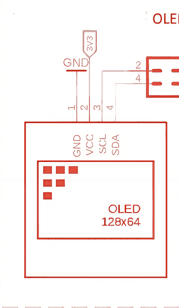

*Gambar 35.1 — Blok OLED 128×64 pada kit: pin 1 GND, pin 2 VCC (3V3), lalu pin 3 SCL dan pin 4 SDA yang menuju blok* jumper cap *di kanan. Sumber: skematik ESP32 Starter Shield 3.2, [Bluino](http://www.bluino.com).*

SCL dan SDA OLED **tidak** langsung tersambung ke ESP32, tetapi lewat sepasang ***jumper cap*** (penutup *jumper* hitam) di blok **JP** di samping slot microSD — dua pin terbawah berlabel `SCL` dan `SDA` (blok nomor 7 di [BAB 6](../BAB-06/README.md#621-letak-header-di-kit) dan [BAB 23](../BAB-23/README.md#2331-tiga-modul-dan-jumper-cap)). Jadi kamu **tidak perlu kabel *jumper*** untuk OLED, asalkan kedua *jumper cap* itu terpasang.

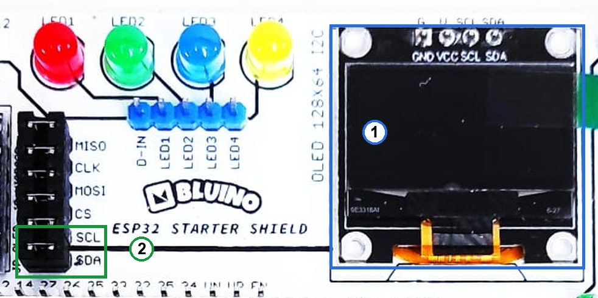

*Gambar 35.2 — Modul OLED (1) dan* jumper cap *`SCL`/`SDA` miliknya di blok JP (2) pada kit v3.x; tata letak kit v3.2 milikmu bisa sedikit berbeda. Sumber: foto produk ESP32 Starter Shield, [Bluino](http://www.bluino.com), dipotong dan diberi penanda untuk materi ini.*

> ⚠️ **Perhatian:** Cabut USB sebelum melepas atau memasang *jumper cap*. Jangan colokkan kabel *jumper* lain ke label `21` dan `22` di deretan pin ESP32, karena kedua pin itu sudah dipakai bus I2C.

> 📌 **Catatan:** Kalau suatu saat kamu membeli modul OLED sendiri, periksa chip-nya. Banyak modul **1,3 inci** memakai chip **SH1106**, bukan SSD1306. Dengan *library* Adafruit SSD1306, layar SH1106 akan menampilkan gambar yang bergeser atau penuh titik acak. Untuk SH1106, pakai *library* lain, misalnya **Adafruit SH110X** atau **U8g2**. OLED 0,96" di kit memakai SSD1306, jadi aman.

### 35.1.3 Chip SSD1306 dan Memori Layarnya

Chip SSD1306 adalah "otak" layar. Di dalamnya ada memori bernama **GDDRAM** (*Graphic Display Data RAM*) sebesar 1.024 *byte*: setiap piksel diwakili 1 bit (1 = menyala, 0 = mati), dan 128 × 64 = 8.192 bit = 1.024 *byte*.

SSD1306 terus-menerus "menggambar ulang" panel dari isi GDDRAM, berkali-kali setiap detik, tanpa bantuan ESP32. Akibatnya:

- ESP32 cukup mengirim gambar **sekali**. Gambar itu tetap tampil walaupun ESP32 sedang sibuk atau programnya berhenti, selama layar masih mendapat daya.
- ESP32 hanya perlu mengirim data lagi kalau **isi layar berubah**. Prinsip ini sangat penting di [35.10](#3510-memperbarui-layar-tanpa-kedip-dan-tanpa-membanjiri-i2c).

<details>
<summary><b>🔬 Pendalaman (opsional): Susunan GDDRAM dalam "halaman"</b></summary>

GDDRAM tidak disusun baris demi baris, melainkan dalam 8 **halaman** (*page*). Setiap halaman setinggi 8 piksel dan selebar 128 kolom. Satu *byte* di GDDRAM mewakili 8 piksel yang **tersusun tegak** dalam satu kolom: bit 0 untuk piksel paling atas, bit 7 untuk piksel paling bawah di halaman itu.

| Halaman | Baris piksel (y) |
|---|---|
| Page 0 | 0–7 |
| Page 1 | 8–15 |
| … | … |
| Page 7 | 56–63 |

Karena itu, mengubah satu piksel di layar sebenarnya berarti mengubah satu bit di salah satu *byte* ini. *Library* Adafruit mengurus semua perhitungan ini, jadi kamu cukup memakai koordinat (x, y) biasa. Susunan ini juga menjelaskan kenapa modul dua warna selalu terbagi tepat di baris ke-16: dua halaman teratas (16 baris) memakai bahan berwarna kuning.

</details>

---

## 35.2 Memasang Library Adafruit SSD1306 dan GFX

Kita memakai dua *library* buatan Adafruit yang bekerja sama, ditambah satu *library* pembantu:

| *Library* | Tugasnya | Ibaratnya |
|---|---|---|
| **Adafruit GFX Library** | Menggambar teks, garis, kotak, lingkaran, dan *bitmap*. *Library* ini dipakai bersama oleh banyak jenis layar Adafruit, jadi cara menggambarnya sama untuk layar lain | Tangan yang menggambar di kertas |
| **Adafruit SSD1306** | Menyiapkan chip SSD1306, menyediakan *buffer* 1 KB, dan mengirim isinya ke layar lewat I2C | Kurir yang mengantar kertas itu ke layar |
| **Adafruit BusIO** | Pembantu komunikasi I2C/SPI yang dibutuhkan GFX | Ikut terpasang otomatis |

Cara memasangnya (pola lengkapnya ada di [BAB 5](../BAB-05/README.md#58-dasar-library-manager)):

1. Buka **Sketch → Include Library → Manage Libraries…** (Ctrl+Shift+I), atau klik ikon **Library Manager** (bergambar buku) di panel kiri Arduino IDE.
2. Ketik `Adafruit SSD1306` di kolom pencarian.
3. Pilih kartu **Adafruit SSD1306** dengan tulisan **by Adafruit**. Ada *library* lain dengan nama mirip, misalnya **ESP8266 and ESP32 OLED driver for SSD1306 displays** (by ThingPulse). Cara pakainya berbeda, jadi kode di BAB ini tidak akan jalan dengan *library* itu.
4. Klik **INSTALL**. Saat muncul jendela **Install library dependencies**, klik **Install All** supaya **Adafruit GFX Library** dan **Adafruit BusIO** ikut terpasang.
5. Instalasi selesai kalau kartu *library* menampilkan tulisan **installed** beserta nomor versinya. Materi ini diuji dengan Adafruit SSD1306 versi 2.5.17 dan Adafruit GFX Library versi 1.13.0.

> ⚠️ **Perhatian:** Kalau kamu telanjur mengklik **Install without dependencies**, cari `Adafruit GFX Library` dan `Adafruit BusIO` di Library Manager lalu instal juga (keduanya by Adafruit). Tanpa keduanya, proses *compile* gagal dengan pesan `fatal error: Adafruit_GFX.h: No such file or directory` atau `fatal error: Adafruit_I2CDevice.h: No such file or directory`.

> 💡 **Tips:** Setelah terpasang, contoh program bawaan bisa dibuka lewat **File → Examples → Adafruit SSD1306 → ssd1306_128x64_i2c**. Contoh itu berguna untuk melihat semua efek gambar, tetapi perhatikan dua hal: alamatnya ditulis `0x3D` (ganti menjadi `0x3C` untuk kit), dan banyak bagiannya memakai `delay()` panjang.

---

## 35.3 Koordinat, Buffer, dan display()

Tiga konsep di bagian ini dipakai di **semua** program OLED. Kalau kamu memahaminya, sebagian besar masalah layar bisa kamu tebak sendiri penyebabnya.

### 35.3.1 Sistem Koordinat 128×64

Setiap piksel punya alamat berupa pasangan angka **(x, y)**:

- **x** adalah nomor kolom, dihitung dari **kiri** (0) ke **kanan** (127).
- **y** adalah nomor baris, dihitung dari **atas** (0) ke **bawah** (63).
- Titik **(0, 0)** ada di **pojok kiri atas**, dan titik terakhir **(127, 63)** di pojok kanan bawah.

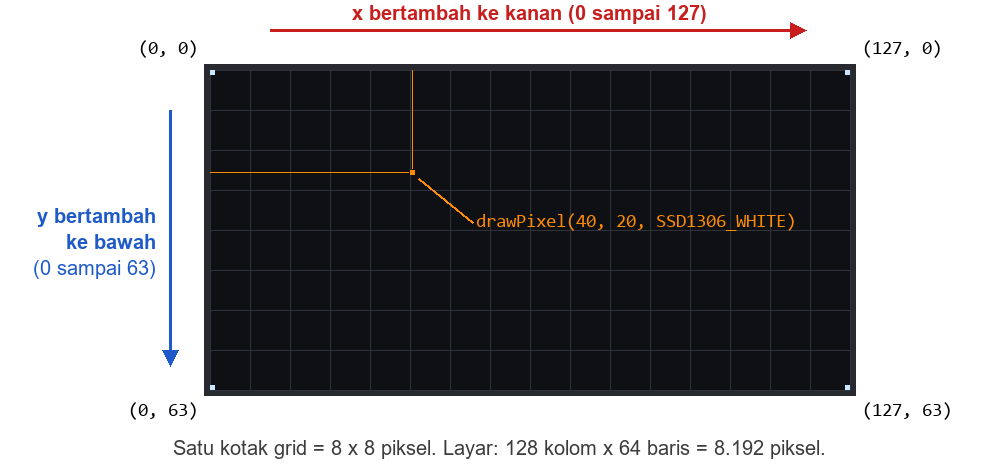

*Gambar 35.3 — Sistem koordinat layar 128×64. Nomor piksel dimulai dari 0, jadi kolom terakhir bernomor 127 dan baris terakhir 63. Sumber: dibuat untuk materi ini.*

> ⚠️ **Perhatian:** Arah y di layar **kebalikan** dari grafik matematika di sekolah. Di layar, makin besar y berarti makin **ke bawah**. Ini sumber kesalahan paling umum bagi pemula.

Kalau kamu menggambar di luar batas (misalnya x = 130 atau y = −5), *library* cukup mengabaikan bagian yang keluar layar — tidak ada *error*, tetapi gambarnya terpotong. Lebar dan tinggi layar bisa dibaca dari program dengan `oled.width()` (hasilnya 128) dan `oled.height()` (hasilnya 64).

### 35.3.2 Buffer 1 KB dan Kenapa display() Wajib Dipanggil

Saat OLED disiapkan, *library* Adafruit SSD1306 memesan 1.024 *byte* RAM di ESP32 sebagai ***buffer*** (tempat penampungan sementara) — satu bit untuk setiap piksel, sama persis dengan ukuran GDDRAM di chip SSD1306.

Semua fungsi menggambar — `print()`, `drawLine()`, `drawCircle()`, dan lainnya — **hanya mengubah *buffer* di RAM ESP32**. Layar belum berubah sedikit pun. Layar baru berubah saat kamu memanggil **`oled.display()`**, yang mengirim seluruh isi *buffer* lewat I2C ke GDDRAM.

Ibaratnya, *buffer* adalah buku sketsa di mejamu, sedangkan layar adalah papan pengumuman. Kamu boleh menggambar, menghapus, dan mencoret di buku sketsa sesukamu; orang lain baru melihat hasilnya setelah kamu memfotokopi halaman itu dan menempelkannya di papan. `display()` adalah langkah "fotokopi dan tempel" itu.

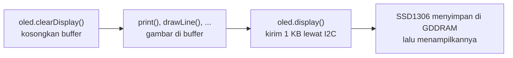

*Gambar 35.4 — Tiga langkah setiap kali isi layar diganti. Hanya langkah ketiga yang memakai bus I2C. Sumber: dibuat untuk materi ini.*

Hal-hal penting:

- `clearDisplay()` hanya mengosongkan *buffer*, **bukan** layar. Layar tetap menampilkan gambar lama sampai `display()` dipanggil.
- Lupa memanggil `display()` adalah penyebab nomor satu "kodenya jalan, tapi layarnya kosong".
- `display()` selalu mengirim **seluruh** 1.024 *byte*, walaupun yang berubah hanya satu piksel. Selama pengiriman, *library* menaikkan kecepatan I2C ke 400 kHz, lalu mengembalikannya ke 100 kHz setelah selesai. Satu kali `display()` butuh kira-kira 25 ms, dan selama itu `loop()` menunggu. Program 1 akan mengukur angka ini di kit-mu. Akibatnya dibahas di [35.10](#3510-memperbarui-layar-tanpa-kedip-dan-tanpa-membanjiri-i2c).

### 35.3.3 Menyalakan OLED dengan begin()

Potongan kode berikut (bagian awal program dan `setup()`) menunjukkan cara menyiapkan OLED:

```cpp
#include <Wire.h>
#include <Adafruit_GFX.h>
#include <Adafruit_SSD1306.h>

// Layar 128x64, bus I2C pertama (Wire), tanpa pin reset (-1)
Adafruit_SSD1306 oled(128, 64, &Wire, -1);

void setup() {
  Serial.begin(115200);
  Wire.begin(21, 22);  // bus I2C: SDA = IO21, SCL = IO22

  // 1. Pastikan OLED menjawab di alamat 0x3C
  Wire.beginTransmission(0x3C);
  if (Wire.endTransmission() != 0) {
    Serial.println("OLED tidak menjawab di 0x3C!");
  }

  // 2. Siapkan OLED dan buffer 1 KB
  if (!oled.begin(SSD1306_SWITCHCAPVCC, 0x3C)) {
    Serial.println("RAM tidak cukup untuk buffer OLED!");
  }

  oled.clearDisplay();  // 3. hapus logo Adafruit dari buffer
  oled.display();       //    lalu tampilkan layar kosong
}
```

Penjelasannya:

- **`Adafruit_SSD1306 oled(128, 64, &Wire, -1);`** membuat objek layar bernama `oled`: lebar 128, tinggi 64, memakai bus I2C pertama (`Wire`), dan `-1` berarti modul tidak punya pin *reset* (modul di kit memang hanya punya 4 pin). Contoh dari Adafruit biasanya menamai objek ini `display`; di BAB ini kita pakai nama `oled` supaya perintah `oled.display()` lebih mudah dibaca daripada `display.display()`.
- **`SSD1306_SWITCHCAPVCC`** memberi tahu SSD1306 untuk membuat sendiri tegangan tinggi yang dibutuhkan panel OLED (sekitar 7,5 V menurut datasheet) dari catu 3,3 V, memakai rangkaian *charge pump* (pelipat tegangan) di dalam chip. Modul 4 pin seperti di kit selalu memakai pilihan ini. Pilihan lainnya, `SSD1306_EXTERNALVCC`, hanya untuk modul yang mendapat tegangan panel dari luar.
- **`0x3C`** adalah alamat I2C OLED di kit. Kalau parameter ini dikosongkan, *library* menebak `0x3D` untuk layar 128×64 — salah untuk kit ini.
- **Hasil `begin()`**: `false` hanya kalau *buffer* 1 KB gagal dipesan karena RAM penuh. Di ESP32 yang punya ratusan KB RAM, hal ini hampir tidak pernah terjadi, tetapi tetap periksa hasilnya — kebiasaan baik untuk semua fungsi yang bisa gagal.
- **`begin()` tidak memeriksa apakah OLED benar-benar ada.** Walaupun *jumper cap* OLED dicabut, hasilnya tetap `true` dan program berjalan seolah normal, hanya layarnya gelap. Karena itu langkah 1 memanggil alamat `0x3C` dengan `Wire.beginTransmission()` + `Wire.endTransmission()`, cara yang sama seperti pemindai I2C di [BAB 23](../BAB-23/README.md#235-program-1-memeriksa-perangkat-dan-kode-hasil). Hasil 0 berarti OLED menjawab (ACK).
- `begin()` juga memanggil `Wire.begin()` sendiri. Karena bus sudah dinyalakan di IO21/IO22, panggilan kedua itu tidak mengubah apa pun.
- Setelah `begin()`, *buffer* sudah berisi **logo Adafruit**. Kalau kamu memanggil `display()` tanpa `clearDisplay()` lebih dulu, logo itu yang akan muncul.

> 📌 **Catatan:** Warna di *library* ini ditulis `SSD1306_WHITE` (piksel menyala), `SSD1306_BLACK` (piksel mati), dan `SSD1306_INVERSE` (balik keadaan piksel). Kamu juga akan sering melihat versi pendeknya, `WHITE` dan `BLACK`, di contoh-contoh di internet. Keduanya sama, tetapi BAB ini memakai versi lengkap supaya tidak bentrok dengan *library* lain yang kebetulan juga punya nama `WHITE`.

---

## 35.4 Program 1: Halo, OLED!

**Tujuan:** Menampilkan teks pertama di OLED kit dengan dua ukuran huruf, memperlihatkan bahwa satu baris muat 21 karakter, lalu mengukur berapa lama `oled.display()` mengirim *buffer* 1 KB. Program juga memeriksa apakah OLED terhubung dan memberi pesan yang jelas kalau tidak.

**Rangkaian:**

*Tidak perlu merangkai — OLED sudah tersambung ke IO21/IO22 lewat* jumper cap *di kit. Pastikan saja kedua* jumper cap *`SCL` dan `SDA` OLED (Gambar 35.2) terpasang.*

**Cara Menjalankan:**

1. Pastikan *jumper cap* OLED terpasang dan tidak ada kabel *jumper* di label `21` atau `22`. Kabel *jumper* lain dari BAB sebelumnya boleh tetap terpasang.
2. Pasang *library* **Adafruit SSD1306** dan **Adafruit GFX Library** kalau belum (lihat [35.2](#352-memasang-library-adafruit-ssd1306-dan-gfx)).
3. Buka Arduino IDE → **File → New Sketch**, hapus isinya, lalu salin kode di bawah. Kode yang sama juga tersedia di *file* [`p1_halo_oled.ino`](p1_halo_oled/p1_halo_oled.ino).
4. Pastikan **Tools → Board** = **ESP32 Dev Module** dan **Tools → Port** = *port* ESP32 kamu (misalnya `COM5` di Windows atau `/dev/ttyUSB0` di Linux).
5. Klik tombol **Upload** (ikon panah →) dan tunggu sampai muncul tulisan **Done uploading**.
6. Buka **Serial Monitor** (**Tools → Serial Monitor**) lalu pilih baud **115200**. Kalau tulisannya terlewat, tekan tombol **EN** di *board* ESP32 untuk mengulang program.

**Kode Program:**

<!-- sketch: p1_halo_oled -->
```cpp
/*
 * BAB 35 - Program 1: Halo, OLED!
 * Menampilkan teks ukuran 1 dan 2 di OLED, lalu mengukur
 * berapa lama oled.display() mengirim buffer 1 KB.
 *
 * Rangkaian: tidak perlu kabel. OLED SSD1306 tersambung ke
 * IO21 (SDA) dan IO22 (SCL) lewat jumper cap di kit, alamat 0x3C.
 * Library: Adafruit SSD1306 + Adafruit GFX Library (by Adafruit)
 */

#include <Wire.h>
#include <Adafruit_GFX.h>
#include <Adafruit_SSD1306.h>

#define PIN_SDA      21
#define PIN_SCL      22
#define LEBAR_LAYAR  128
#define TINGGI_LAYAR 64
#define ALAMAT_OLED  0x3C

// Objek layar: 128x64, bus I2C pertama (Wire), tanpa pin reset (-1)
Adafruit_SSD1306 oled(LEBAR_LAYAR, TINGGI_LAYAR, &Wire, -1);

// Mencetak pesan, lalu menghentikan program di sini
void berhenti(const char *pesan) {
  Serial.println(pesan);
  while (true) {
    delay(1000);
  }
}

void setup() {
  Serial.begin(115200);
  delay(1000);  // beri waktu Serial Monitor tersambung
  Serial.println("BAB 35 - Program 1: Halo, OLED!");

  Wire.begin(PIN_SDA, PIN_SCL);

  // 1. Pastikan OLED menjawab di alamat 0x3C (begin() tidak memeriksanya)
  Wire.beginTransmission(ALAMAT_OLED);
  if (Wire.endTransmission() != 0) {
    berhenti("OLED tidak menjawab di 0x3C! Periksa jumper cap SCL/SDA OLED.");
  }

  // 2. Siapkan OLED dan buffer 1 KB di RAM ESP32
  if (!oled.begin(SSD1306_SWITCHCAPVCC, ALAMAT_OLED)) {
    berhenti("Gagal menyiapkan OLED: RAM tidak cukup untuk buffer.");
  }
  Serial.println("OLED siap.");

  // 3. Gambar di buffer (layar belum berubah)
  oled.clearDisplay();               // kosongkan buffer (logo Adafruit ikut terhapus)
  oled.setTextColor(SSD1306_WHITE);  // teks = piksel menyala
  oled.setTextSize(1);               // ukuran 1: 6x8 piksel per karakter
  oled.setCursor(0, 0);              // mulai dari pojok kiri atas
  oled.println("Halo, OLED!");
  oled.println("Ukuran 1 = 6x8 px");

  oled.setTextSize(2);               // ukuran 2: 12x16 piksel per karakter
  oled.setCursor(0, 20);
  oled.println("Ukuran 2");

  oled.setTextSize(1);
  oled.setCursor(0, 44);
  oled.println("Satu baris 21 huruf:");
  oled.print("123456789012345678901");  // tepat 21 karakter, mulai di y = 52

  // 4. Kirim buffer ke layar sambil mengukur lamanya
  unsigned long mulai = micros();
  oled.display();
  unsigned long lama = micros() - mulai;
  Serial.printf("oled.display() selesai dalam %lu us\n", lama);
}

void loop() {
  // Kosong. Gambar tetap tampil karena SSD1306 menyimpannya di GDDRAM.
}
```

**Penjelasan Kode:**

- **Pemeriksaan OLED.** Pasangan `Wire.beginTransmission()` + `Wire.endTransmission()` memanggil alamat `0x3C` tanpa mengirim data. Hasil selain 0 berarti tidak ada yang menjawab, dan fungsi `berhenti()` mencetak pesan lalu menahan program di perulangan `while (true)`. Pemeriksaan hasil `begin()` menangani kasus RAM penuh.
- **Langkah menggambar.** `clearDisplay()` mengosongkan *buffer*; `setTextColor()`, `setTextSize()`, dan `setCursor()` mengatur warna, ukuran, dan posisi teks; `print()` dan `println()` menulis teks ke *buffer* persis seperti `Serial.print()`. Semua ini belum terlihat di layar.
- **Posisi teks.** `setCursor(x, y)` menentukan **pojok kiri atas** huruf pertama. `println()` memindahkan kursor ke awal baris berikutnya (turun 8 piksel untuk ukuran 1, 16 piksel untuk ukuran 2). Karena itu, baris "Ukuran 1 = 6x8 px" otomatis berada di y = 8, dan baris angka berada di y = 52 tepat di bawah baris y = 44.
- **21 karakter per baris.** Setiap karakter ukuran 1 memakan 6 piksel, jadi 21 karakter = 126 piksel, masih muat dalam lebar 128. Karakter ke-22 akan otomatis pindah ke baris berikutnya (dibahas di [35.5](#355-menampilkan-teks)).
- **Mengukur waktu.** `micros()` mencatat waktu dalam mikrodetik sebelum dan sesudah `oled.display()`. Selisihnya adalah lama pengiriman 1 KB lewat I2C.
- **`loop()` kosong.** Setelah `display()`, gambar tersimpan di GDDRAM dan terus ditampilkan oleh SSD1306 tanpa bantuan ESP32.

**Contoh Output:**

```text
BAB 35 - Program 1: Halo, OLED!
OLED siap.
oled.display() selesai dalam 25862 us
```

Angka waktu di atas hanya contoh — angkamu bisa sedikit berbeda, tetapi seharusnya di kisaran 25 ms (tercetak sebagai angka sekitar `25000`, karena satuannya mikrodetik dan 1 ms = 1000 µs). Layar OLED akan menampilkan:

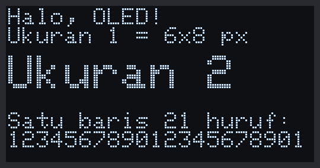

*Gambar 35.5 — Tampilan OLED Program 1 (disimulasikan piksel demi piksel dari kode program). Warna piksel di kit-mu bisa putih, biru, atau kuning-biru. Sumber: dibuat untuk materi ini.*

> 🧪 **Coba Sendiri:** Jadikan baris `oled.clearDisplay();` sebagai komentar (tambahkan `//` di depannya), lalu *upload* ulang. Logo Adafruit akan muncul di belakang tulisanmu — bukti bahwa `begin()` mengisi *buffer* dengan logo dan `clearDisplay()` yang menghapusnya. Setelah itu, kembalikan seperti semula.

**Kalau Belum Berhasil:**

- **Serial Monitor menampilkan `OLED tidak menjawab di 0x3C!`** → *jumper cap* `SCL`/`SDA` OLED lepas atau longgar, atau ada kabel *jumper* di label `21`/`22`. Cabut USB, periksa blok JP (Gambar 35.2), lalu sambungkan lagi. Kalau masih gagal, jalankan Program 1 di [BAB 23](../BAB-23/README.md#235-program-1-memeriksa-perangkat-dan-kode-hasil) untuk melihat alamat apa yang menjawab.
- **Serial Monitor normal (`OLED siap.`), tetapi layar gelap** → `oled.display()` terhapus atau tidak terpanggil, atau warna teks belum diatur dengan `setTextColor()`. Cocokkan lagi kodenya dengan kode di atas.
- **Gambar bergeser, terpotong separuh, atau penuh titik acak** → modulnya bukan SSD1306 128×64 (misalnya SH1106 1,3"), atau ukuran di konstruktor salah tulis (misalnya 128, 32). Lihat [35.15](#3515-troubleshooting).
- **Compile gagal dengan `Adafruit_GFX.h: No such file or directory`** → *library* GFX belum terpasang. Ulangi [35.2](#352-memasang-library-adafruit-ssd1306-dan-gfx).

---

## 35.5 Menampilkan Teks

### 35.5.1 Ukuran Huruf

Font bawaan *library* GFX menggambar setiap karakter dalam kotak **6 × 8 piksel**: hurufnya sendiri 5 × 7 piksel, ditambah 1 kolom kosong di kanan dan 1 baris kosong di bawah sebagai jarak antarhuruf. `setTextSize(n)` memperbesar setiap piksel huruf menjadi kotak n × n, jadi huruf besar tampak "kotak-kotak".

| `setTextSize()` | Ukuran satu karakter | Karakter per baris | Jumlah baris di layar | Cocok untuk |
|---|---|---|---|---|
| 1 | 6 × 8 piksel | 21 (128 ÷ 6) | 8 (64 ÷ 8) | Keterangan, menu, angka kecil |
| 2 | 12 × 16 piksel | 10 | 4 | Nilai utama, judul |
| 3 | 18 × 24 piksel | 7 | 2 (sisa 16 piksel) | Satu angka besar |
| 4 | 24 × 32 piksel | 5 | 2 | Jam atau angka yang dibaca dari jauh |

Kamu juga bisa memperbesar lebar dan tinggi secara terpisah, misalnya `oled.setTextSize(1, 2)` untuk huruf yang ramping dan tinggi.

### 35.5.2 Posisi, Baris Baru, dan Teks Kepanjangan

- `setCursor(x, y)` menentukan **pojok kiri atas** karakter pertama. Untuk ukuran 1, baris-baris teks yang rapi ada di y = 0, 8, 16, …, 56.
- `println()` memindahkan kursor ke **x = 0** di baris berikutnya — bukan ke x awal yang kamu pasang dengan `setCursor()`. Kalau teksmu dimulai dari x = 10, pakai `setCursor()` lagi untuk setiap baris.
- Teks yang melewati tepi kanan otomatis **pindah baris** ke x = 0. Kalau kamu lebih suka teks yang kepanjangan terpotong, panggil `oled.setTextWrap(false);`.
- Untuk meletakkan teks di tengah, hitung: **x = (128 − jumlah karakter × 6 × ukuran) ÷ 2**. Contohnya, "BLUINO" ukuran 2: (128 − 6 × 12) ÷ 2 = 28.
- `oled.getCursorX()` memberi tahu posisi x kursor setelah teks terakhir dicetak. Ini berguna untuk menaruh satuan tepat di belakang angka yang panjangnya berubah-ubah.

### 35.5.3 Menulis Angka

Semua cara mencetak di `Serial` juga berlaku di OLED. Contoh potongan kode:

```cpp
float suhu = 28.46;
oled.print(suhu, 1);              // satu angka di belakang koma: 28.5
oled.printf("%5.1f", suhu);       // lebar tetap 5 karakter: " 28.5"
oled.printf("%3d%%", 75);         // persen: " 75%" (%% mencetak tanda %)
```

Format dengan lebar tetap seperti `%5.1f` membuat angka tidak "melompat" ke kiri dan ke kanan saat jumlah digitnya berubah, misalnya dari 9.8 ke 10.2.

> 📌 **Catatan:** Angka di layar memakai titik sebagai pemisah desimal (28.5), sama seperti di Serial Monitor, karena begitulah cara bahasa C++ mencetak angka.

### 35.5.4 Teks yang Menimpa Teks Lama

`oled.setTextColor(SSD1306_WHITE)` hanya menyalakan piksel huruf dan membiarkan piksel di sekitarnya apa adanya (latar transparan). Kalau kamu mencetak angka baru di atas angka lama **tanpa** `clearDisplay()`, kedua angka bertumpuk — misalnya "1" yang ditulis di atas "8" tetap terlihat seperti "8".

Ada dua cara menghindarinya:

1. **Gambar ulang seluruh layar**: `clearDisplay()` → gambar semuanya → `display()`. Cara inilah yang dipakai di semua program BAB ini karena paling sederhana.
2. **Pakai warna latar**: `oled.setTextColor(SSD1306_WHITE, SSD1306_BLACK)` membuat setiap karakter menghapus kotak 6 × 8 di belakangnya. Cara ini cocok untuk mengganti satu angka saja, asalkan teks baru sama panjang atau lebih panjang dari teks lama.

Kebalikannya, `oled.setTextColor(SSD1306_BLACK, SSD1306_WHITE)` menghasilkan **teks gelap di atas latar terang** — cara umum untuk menandai pilihan menu yang sedang aktif. Program 6 memakai variasinya: menggambar pita terang selebar layar dengan `fillRect()`, lalu menulis teks di atasnya dengan `setTextColor(SSD1306_BLACK)`.

### 35.5.5 Simbol Khusus: Derajat dan Panah

Font bawaan berisi 256 karakter yang mengikuti tabel **CP437** (*Code Page 437*), kumpulan karakter komputer IBM PC zaman dulu. Selain huruf dan angka, tabel ini punya simbol seperti panah, hati, kotak penuh, dan derajat.

> ⚠️ **Perhatian:** Jangan mengetik simbol `°` langsung di dalam kode, misalnya `oled.print("28°C")`. Arduino IDE menyimpan `°` sebagai dua *byte* (format UTF-8), sehingga layar menampilkan dua karakter aneh. Cetak simbolnya memakai nomor karakter dengan `oled.write(nomor)`.

Karena kesalahan urutan di font versi lama, *library* GFX secara bawaan memakai urutan lama untuk karakter bernomor 176 ke atas. Panggil **`oled.cp437(true);`** sekali di `setup()` supaya nomornya sama dengan tabel CP437 yang benar:

| Nomor | Simbol | Butuh `cp437(true)`? |
|---|---|---|
| 3 | ♥ | Tidak |
| 16 / 17 | ► / ◄ | Tidak |
| 24 / 25 | ↑ / ↓ | Tidak |
| 30 / 31 | ▲ / ▼ | Tidak |
| 219 | █ (kotak penuh) | Ya |
| 248 | ° (derajat) | Ya |

Contoh potongan kode untuk menampilkan `28.5 °C` di layar:

```cpp
oled.cp437(true);   // cukup sekali, di setup()

oled.print(28.5, 1);
oled.print(" ");
oled.write(248);    // simbol derajat
oled.print("C");
```

> 💡 **Tips:** Banyak contoh di internet memakai `oled.write(247)` untuk derajat. Itu benar **hanya** kalau `cp437(true)` tidak dipanggil (urutan lama bergeser satu nomor). Pilih salah satu cara dan pakai secara konsisten.

<details>
<summary><b>🔬 Pendalaman (opsional): Memakai font lain</b></summary>

*Library* GFX menyertakan puluhan font tambahan di folder `Fonts` (misalnya FreeSans, FreeSerif, FreeMono dalam ukuran 9, 12, 18, dan 24 *point*). Cara memakainya:

```cpp
#include <Fonts/FreeSans9pt7b.h>   // di bagian atas program

oled.setFont(&FreeSans9pt7b);      // pakai font FreeSans 9 pt
oled.setCursor(0, 20);             // y = garis dasar huruf, bukan pojok kiri atas!
oled.print("Halo");
oled.setFont();                    // kembali ke font bawaan
```

Hal yang perlu diingat:

- Untuk font tambahan, `setCursor(x, y)` menunjuk **garis dasar** (*baseline*) huruf — garis tempat huruf "duduk" — bukan pojok kiri atasnya. Kalau y = 0, teksnya keluar dari layar bagian atas.
- Font tambahan hanya berisi karakter ASCII 32–126, jadi tidak punya simbol derajat atau panah CP437.
- `setTextColor(warna, latar)` tidak menghapus latar untuk font tambahan; hapus area itu dulu dengan `fillRect()`.
- Setiap font memakan memori *flash* beberapa KB, jadi pakai seperlunya.

</details>

---

## 35.6 Menggambar Bentuk Dasar

Semua fungsi berikut berasal dari *library* GFX dan, seperti teks, hanya mengubah *buffer* sampai `display()` dipanggil. Parameter `warna` diisi `SSD1306_WHITE`, `SSD1306_BLACK`, atau `SSD1306_INVERSE`.

| Fungsi | Yang digambar | Arti parameter |
|---|---|---|
| `drawPixel(x, y, warna)` | Satu titik | Koordinat titik |
| `drawLine(x0, y0, x1, y1, warna)` | Garis lurus | Titik awal dan titik akhir |
| `drawFastHLine(x, y, w, warna)` | Garis mendatar | Titik paling kiri dan panjang `w` piksel; lebih cepat daripada `drawLine()` |
| `drawFastVLine(x, y, h, warna)` | Garis tegak | Titik paling atas dan tinggi `h` piksel |
| `drawRect(x, y, w, h, warna)` | Kotak (garis tepi saja) | Pojok kiri atas, lebar `w`, tinggi `h` |
| `fillRect(x, y, w, h, warna)` | Kotak penuh | Sama dengan `drawRect()` |
| `drawRoundRect(x, y, w, h, r, warna)` | Kotak bersudut tumpul | Seperti `drawRect()`, ditambah jari-jari sudut `r` |
| `fillRoundRect(x, y, w, h, r, warna)` | Kotak bersudut tumpul, penuh | Sama dengan `drawRoundRect()` |
| `drawCircle(x, y, r, warna)` | Lingkaran | **Titik pusat** dan jari-jari `r` |
| `fillCircle(x, y, r, warna)` | Lingkaran penuh | Sama dengan `drawCircle()` |
| `drawTriangle(x0, y0, x1, y1, x2, y2, warna)` | Segitiga | Tiga titik sudut |
| `fillTriangle(x0, y0, x1, y1, x2, y2, warna)` | Segitiga penuh | Sama dengan `drawTriangle()` |
| `fillScreen(warna)` | Mengisi seluruh *buffer* | `fillScreen(SSD1306_BLACK)` sama dengan `clearDisplay()` |

Pola namanya mudah diingat: awalan **`draw`** menggambar garis tepi, awalan **`fill`** menggambar bentuk yang terisi penuh.

Beberapa jebakan yang sering terjadi:

- `w` dan `h` adalah **jumlah piksel**, bukan koordinat ujung. Bingkai seluruh layar ditulis `drawRect(0, 0, 128, 64, ...)`. Kalau kamu menulis `drawRect(0, 0, 127, 63, ...)`, sisi kanan dan bawahnya bergeser satu piksel ke dalam.
- Kotak dimulai dari **pojok kiri atas**, sedangkan lingkaran dari **titik pusat**. Lingkaran berjari-jari 9 lebarnya 19 piksel (9 + 1 + 9).
- Warna `SSD1306_INVERSE` membalik piksel yang sudah ada: piksel menyala jadi mati, dan sebaliknya. Contohnya, `fillRect(0, 0, 128, 10, SSD1306_INVERSE)` membalik warna baris judul beserta tulisannya.

Selain fungsi menggambar di *buffer*, ada juga fungsi yang langsung mengirim **perintah** ke chip SSD1306 dan langsung terlihat tanpa `display()`:

| Fungsi | Efek |
|---|---|
| `oled.invertDisplay(true)` / `oled.invertDisplay(false)` | Membalik warna seluruh layar / kembali normal. Isi *buffer* tidak berubah |
| `oled.dim(true)` / `oled.dim(false)` | Meredupkan layar / kembali ke kecerahan normal (dipakai di [35.13](#3513-burn-in-dan-cara-merawat-oled)) |

---

## 35.7 Program 2: Galeri Bentuk Dasar

**Tujuan:** Menggambar bingkai layar, garis pemisah, serta empat bentuk dasar (kotak, lingkaran, kotak bersudut tumpul, dan segitiga) dalam versi garis tepi (`draw...`) dan versi penuh (`fill...`). Setiap 2 detik, warna seluruh layar dibalik dengan `invertDisplay()` tanpa menggambar ulang *buffer*.

**Rangkaian:**

*Tidak perlu merangkai — OLED sudah tersambung lewat* jumper cap *di kit.*

**Cara Menjalankan:**

1. Buka Arduino IDE → **File → New Sketch**, hapus isinya, lalu salin kode di bawah. Kode yang sama juga tersedia di *file* [`p2_bentuk_dasar.ino`](p2_bentuk_dasar/p2_bentuk_dasar.ino).
2. Pastikan **Tools → Board** = **ESP32 Dev Module** dan **Tools → Port** = *port* ESP32 kamu.
3. Klik tombol **Upload** dan tunggu sampai muncul tulisan **Done uploading**.
4. Buka **Serial Monitor** (**Tools → Serial Monitor**) lalu pilih baud **115200**.

**Kode Program:**

<!-- sketch: p2_bentuk_dasar -->
```cpp
/*
 * BAB 35 - Program 2: Galeri Bentuk Dasar
 * Menggambar bingkai, garis, kotak, lingkaran, kotak bersudut tumpul,
 * dan segitiga (versi draw = garis tepi, versi fill = penuh).
 * Setiap 2 detik warna layar dibalik dengan invertDisplay().
 *
 * Rangkaian: tidak perlu kabel. OLED SSD1306 tersambung ke
 * IO21 (SDA) dan IO22 (SCL) lewat jumper cap di kit, alamat 0x3C.
 * Library: Adafruit SSD1306 + Adafruit GFX Library (by Adafruit)
 */

#include <Wire.h>
#include <Adafruit_GFX.h>
#include <Adafruit_SSD1306.h>

#define PIN_SDA      21
#define PIN_SCL      22
#define LEBAR_LAYAR  128
#define TINGGI_LAYAR 64
#define ALAMAT_OLED  0x3C

#define PUTIH SSD1306_WHITE  // singkatan supaya baris kode tidak terlalu panjang

Adafruit_SSD1306 oled(LEBAR_LAYAR, TINGGI_LAYAR, &Wire, -1);

const unsigned long INTERVAL_BALIK = 2000;  // ms
unsigned long waktuLalu = 0;
bool dibalik = false;

void berhenti(const char *pesan) {
  Serial.println(pesan);
  while (true) {
    delay(1000);
  }
}

void gambarGaleri() {
  oled.clearDisplay();

  // Bingkai seluruh layar dan judul
  oled.drawRect(0, 0, LEBAR_LAYAR, TINGGI_LAYAR, PUTIH);  // x 0-127, y 0-63
  oled.setTextSize(1);
  oled.setTextColor(PUTIH);
  oled.setCursor(4, 3);
  oled.print("draw=garis  fill=isi");
  oled.drawLine(0, 12, 127, 12, PUTIH);                  // garis pemisah judul

  // Baris atas: garis tepi saja (draw...)
  oled.drawRect(6, 16, 24, 18, PUTIH);                   // pojok kiri atas (6,16), 24x18
  oled.drawCircle(47, 25, 9, PUTIH);                     // pusat (47,25), jari-jari 9
  oled.drawRoundRect(64, 16, 28, 18, 5, PUTIH);          // sudut tumpul, jari-jari 5
  oled.drawTriangle(98, 33, 109, 16, 120, 33, PUTIH);    // tiga titik sudut

  // Baris bawah: bentuk yang sama, terisi penuh (fill...)
  oled.fillRect(6, 40, 24, 18, PUTIH);
  oled.fillCircle(47, 49, 9, PUTIH);
  oled.fillRoundRect(64, 40, 28, 18, 5, PUTIH);
  oled.fillTriangle(98, 57, 109, 40, 120, 57, PUTIH);

  oled.display();  // kirim semuanya ke layar sekaligus
}

void setup() {
  Serial.begin(115200);
  delay(1000);
  Serial.println("BAB 35 - Program 2: Galeri Bentuk Dasar");

  Wire.begin(PIN_SDA, PIN_SCL);
  Wire.beginTransmission(ALAMAT_OLED);
  if (Wire.endTransmission() != 0) {
    berhenti("OLED tidak menjawab di 0x3C! Periksa jumper cap SCL/SDA OLED.");
  }
  if (!oled.begin(SSD1306_SWITCHCAPVCC, ALAMAT_OLED)) {
    berhenti("Gagal menyiapkan OLED: RAM tidak cukup untuk buffer.");
  }

  gambarGaleri();  // cukup digambar sekali
  Serial.println("Galeri digambar. Warna layar dibalik setiap 2 detik.");
}

void loop() {
  unsigned long sekarang = millis();

  if (sekarang - waktuLalu >= INTERVAL_BALIK) {
    waktuLalu = sekarang;
    dibalik = !dibalik;
    oled.invertDisplay(dibalik);  // perintah langsung ke SSD1306, tanpa display()
    Serial.println(dibalik ? "invertDisplay(true): warna dibalik"
                           : "invertDisplay(false): warna normal");
  }
}
```

**Penjelasan Kode:**

- **`#define PUTIH SSD1306_WHITE`** hanya singkatan supaya baris-baris menggambar tidak terlalu panjang. Saat di-*compile*, setiap `PUTIH` diganti `SSD1306_WHITE`.
- **`gambarGaleri()`** mengikuti pola tiga langkah: `clearDisplay()` → semua perintah menggambar → satu kali `display()`. Fungsi ini hanya dipanggil **sekali** di `setup()`, karena isi layar tidak pernah berubah.
- **Koordinat.** Kotak atas dimulai dari pojok kiri atas (6, 16) dengan ukuran 24 × 18, sehingga menempati x 6–29 dan y 16–33. Lingkaran atas berpusat di (47, 25) dengan jari-jari 9, sehingga menempati y 16–34. Bentuk-bentuk di baris bawah sama persis, hanya digeser 24 piksel ke bawah.
- **`loop()`** memakai pola `millis()` dari [BAB 16](../BAB-16/README.md) untuk membalik warna setiap 2 detik. `invertDisplay()` adalah perintah langsung ke chip SSD1306: hanya beberapa *byte* yang dikirim lewat I2C (bandingkan dengan 1 KB untuk `display()`), *buffer* tidak berubah, dan `display()` tidak perlu dipanggil.

**Contoh Output:**

```text
BAB 35 - Program 2: Galeri Bentuk Dasar
Galeri digambar. Warna layar dibalik setiap 2 detik.
invertDisplay(true): warna dibalik
invertDisplay(false): warna normal
invertDisplay(true): warna dibalik
```

Tampilan OLED dalam keadaan normal:

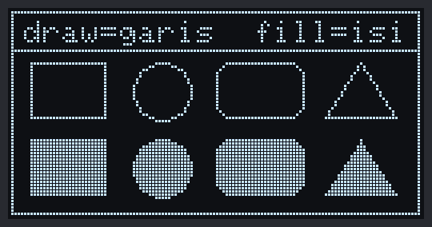

*Gambar 35.6 — Tampilan OLED Program 2 sebelum warnanya dibalik (disimulasikan dari kode program). Setiap 2 detik, bagian yang gelap menjadi terang dan sebaliknya. Sumber: dibuat untuk materi ini.*

> 🧪 **Coba Sendiri:** Ubah jari-jari `drawCircle()` menjadi 20 dan perhatikan bahwa lingkarannya terpotong di tepi layar tanpa *error*. Lalu tambahkan `oled.fillRect(0, 0, 128, 12, SSD1306_INVERSE);` tepat sebelum `oled.display();` untuk membuat judul menjadi tulisan gelap di atas pita terang.

**Kalau Belum Berhasil:**

- **Bentuk tampak terpotong atau saling menempel** → periksa lagi koordinat yang kamu ubah. Ingat: kotak dimulai dari pojok kiri atas, lingkaran dari titik pusat.
- **Bingkai tidak tampak di tepi kanan atau bawah** → lebar/tinggi ditulis 127/63, bukan 128/64.
- **Warna tidak pernah terbalik** → periksa bahwa `loop()` tidak terhalang `delay()` panjang dan Serial Monitor menampilkan pesan `invertDisplay(...)` setiap 2 detik.

---

## 35.8 Gambar Bitmap dan Cara Membuatnya

### 35.8.1 Apa Itu Bitmap?

Ikon kecil seperti termometer atau logo terlalu rumit kalau digambar dengan garis dan lingkaran. Cara yang lebih mudah adalah ***bitmap*** (peta bit): gambar yang disimpan sebagai deretan bit, **1 bit untuk setiap piksel** — 1 berarti piksel menyala, 0 berarti mati. Mirip pola sulaman kristik atau gambar di kertas berpetak, tempat setiap kotak hanya diwarnai atau dibiarkan kosong.

Contohnya, ikon hati 8 × 8 piksel berikut disimpan sebagai 8 *byte*, satu *byte* untuk setiap baris. Bit paling kiri (bernilai `0x80`) mewakili piksel paling kiri:

```text
Baris   Piksel (# = menyala)   Biner       Heksadesimal
  0     . # # . . # # .        01100110    0x66
  1     # # # # # # # #        11111111    0xFF
  2     # # # # # # # #        11111111    0xFF
  3     # # # # # # # #        11111111    0xFF
  4     . # # # # # # .        01111110    0x7E
  5     . . # # # # . .        00111100    0x3C
  6     . . . # # . . .        00011000    0x18
  7     . . . . . . . .        00000000    0x00
```

Di program, deretan *byte* itu ditulis sebagai *array*:

```cpp
const unsigned char ikonHati[] PROGMEM = {
  0x66, 0xFF, 0xFF, 0xFF, 0x7E, 0x3C, 0x18, 0x00
};
```

Untuk gambar yang lebih lebar dari 8 piksel, setiap baris memakai beberapa *byte* berurutan dari kiri ke kanan. Ikon 16 × 16 butuh 2 *byte* per baris × 16 baris = **32 *byte***. Kalau lebarnya bukan kelipatan 8 (misalnya 12 piksel), setiap baris tetap dibulatkan ke atas menjadi *byte* utuh (2 *byte*), dan bit sisanya diabaikan.

> 📌 **Catatan:** `PROGMEM` adalah tanda untuk menyimpan data di memori *flash*, bukan di RAM. Di ESP32, kata `const` saja sudah cukup untuk itu; `PROGMEM` tetap ditulis supaya kodenya juga jalan di Arduino Uno dan sama dengan hasil alat konversi di bawah.

### 35.8.2 Menggambar Bitmap

```cpp
oled.drawBitmap(x, y, ikonHati, 8, 8, SSD1306_WHITE);
```

- `x`, `y` — pojok kiri atas tempat gambar diletakkan.
- `ikonHati` — nama *array*-nya.
- `8, 8` — lebar dan tinggi gambar dalam piksel. **Harus sama** dengan ukuran saat gambar dibuat; kalau salah, gambarnya akan tampak miring atau acak.
- `SSD1306_WHITE` — warna untuk bit 1. Bit 0 dilewati (transparan), jadi gambar di bawahnya tetap terlihat. Kalau ingin bit 0 menghapus latar, tambahkan warna latar: `oled.drawBitmap(x, y, ikonHati, 8, 8, SSD1306_WHITE, SSD1306_BLACK);`.

### 35.8.3 Membuat Bitmap dengan image2cpp

Menghitung bit satu per satu seperti contoh hati di atas hanya masuk akal untuk gambar yang sangat kecil. Untuk gambar lain, pakai **image2cpp** — alat gratis dan *open source* yang berjalan di *browser*. Gambarmu diolah di *browser* itu sendiri, tidak diunggah ke server.

1. Siapkan gambar hitam-putih sederhana berformat PNG atau JPG, idealnya sudah berukuran kecil (misalnya 16 × 16 atau 32 × 32 piksel). Kamu bisa menggambarnya sendiri di Paint (Windows) atau editor piksel *online* seperti Piskel. Kalau mengambil ikon dari internet, pastikan lisensinya mengizinkan.
2. Buka [https://javl.github.io/image2cpp/](https://javl.github.io/image2cpp/) di *browser* (butuh internet).
3. Di bagian **1. Select image**, klik tombol pemilih *file* lalu pilih gambarmu.
4. Di bagian **2. Image Settings**:
   - **Canvas size(s)**: isi ukuran tujuan, misalnya `16` × `16`.
   - **Canvas background color**: biarkan **White**.
   - **Scaling**: pilih **scale to fit, keeping proportions** kalau gambarmu lebih besar dari ukuran tujuan.
   - **Invert image colors**: **centang** kalau gambarmu gelap di atas latar putih (yang paling umum). image2cpp menjadikan bagian yang **terang** sebagai bit 1 (piksel menyala), jadi gambar gelap perlu dibalik dulu.
   - **Brightness / alpha threshold**: geser kalau ada bagian gambar yang hilang atau terlalu tebal.
5. Periksa bagian **Preview**: bagian yang nanti **menyala** di OLED tampak putih.
6. Di bagian **3. Output**, pilih **Code output format** = **Arduino code** dan **Draw mode** = **Horizontal - 1 bit per pixel**, lalu klik **Generate code**.
7. Salin hasilnya ke program. Hasilnya berbentuk `const unsigned char epd_bitmap_namafile [] PROGMEM = { ... };` — ganti namanya dengan nama yang lebih jelas, misalnya `ikonTermometer`.

> 💡 **Tips:** Kalau ikonmu tampil seperti negatif foto (latarnya menyala, gambarnya gelap), ulangi langkah 4 dengan pengaturan **Invert image colors** yang berlawanan. Kalau gambarnya tampak miring atau acak, berarti **Draw mode** salah atau lebar/tinggi di `drawBitmap()` tidak sama dengan **Canvas size**.

---

## 35.9 Program 3: Ikon Bitmap

**Tujuan:** Menampilkan dua ikon 16 × 16 (termometer dan tetes air) dengan `drawBitmap()`, lalu menggambar ulang ikon tetes air dua kali lebih besar memakai fungsi buatan sendiri yang membaca bit demi bit — supaya kamu melihat sendiri bagaimana *byte* di *array* menjadi piksel di layar. Kedua ikon ini dipakai lagi di Program 4.

**Rangkaian:**

*Tidak perlu merangkai — OLED sudah tersambung lewat* jumper cap *di kit.*

**Cara Menjalankan:**

1. Buka Arduino IDE → **File → New Sketch**, hapus isinya, lalu salin kode di bawah. Kode yang sama juga tersedia di *file* [`p3_ikon_bitmap.ino`](p3_ikon_bitmap/p3_ikon_bitmap.ino).
2. Pastikan **Tools → Board** = **ESP32 Dev Module** dan **Tools → Port** = *port* ESP32 kamu.
3. Klik tombol **Upload** dan tunggu sampai muncul tulisan **Done uploading**.
4. Buka **Serial Monitor** (**Tools → Serial Monitor**) lalu pilih baud **115200**.

**Kode Program:**

<!-- sketch: p3_ikon_bitmap -->
```cpp
/*
 * BAB 35 - Program 3: Ikon Bitmap
 * Menampilkan ikon termometer dan tetes air (16x16 piksel) dengan
 * drawBitmap(), lalu menggambar ikon tetes air 2x lebih besar
 * dengan membaca bit demi bit.
 *
 * Rangkaian: tidak perlu kabel. OLED SSD1306 tersambung ke
 * IO21 (SDA) dan IO22 (SCL) lewat jumper cap di kit, alamat 0x3C.
 * Library: Adafruit SSD1306 + Adafruit GFX Library (by Adafruit)
 */

#include <Wire.h>
#include <Adafruit_GFX.h>
#include <Adafruit_SSD1306.h>

#define PIN_SDA      21
#define PIN_SCL      22
#define LEBAR_LAYAR  128
#define TINGGI_LAYAR 64
#define ALAMAT_OLED  0x3C

#define LEBAR_IKON  16
#define TINGGI_IKON 16

Adafruit_SSD1306 oled(LEBAR_LAYAR, TINGGI_LAYAR, &Wire, -1);

// Ikon 16x16: 2 byte per baris x 16 baris = 32 byte. Bit 1 = piksel menyala.
const unsigned char ikonTermometer[] PROGMEM = {
  0x03, 0x00, 0x04, 0x80, 0x04, 0xB0, 0x04, 0x80,
  0x04, 0xB8, 0x04, 0x80, 0x07, 0xB0, 0x07, 0x80,
  0x07, 0xB8, 0x0F, 0xC0, 0x1F, 0xE0, 0x1F, 0xE0,
  0x1F, 0xE0, 0x1F, 0xE0, 0x0F, 0xC0, 0x07, 0x80
};

const unsigned char ikonTetes[] PROGMEM = {
  0x01, 0x80, 0x01, 0x80, 0x03, 0xC0, 0x03, 0xC0,
  0x07, 0xE0, 0x07, 0xE0, 0x0F, 0xF0, 0x1F, 0xF8,
  0x1F, 0xF8, 0x3F, 0xFC, 0x37, 0xFC, 0x37, 0xFC,
  0x3B, 0xFC, 0x1F, 0xF8, 0x0F, 0xF0, 0x03, 0xC0
};

void berhenti(const char *pesan) {
  Serial.println(pesan);
  while (true) {
    delay(1000);
  }
}

// Menggambar bitmap dengan setiap piksel diperbesar menjadi kotak skala x skala.
// Cara membaca bitnya sama dengan drawBitmap() milik library GFX.
void gambarBitmapBesar(int x, int y, const unsigned char *data,
                       int lebar, int tinggi, int skala) {
  int bytePerBaris = (lebar + 7) / 8;  // dibulatkan ke atas
  for (int baris = 0; baris < tinggi; baris++) {
    for (int kolom = 0; kolom < lebar; kolom++) {
      uint8_t b = data[baris * bytePerBaris + kolom / 8];  // byte yang memuat piksel ini
      bool menyala = b & (0x80 >> (kolom % 8));            // bit paling kiri = 0x80
      if (menyala) {
        oled.fillRect(x + kolom * skala, y + baris * skala, skala, skala, SSD1306_WHITE);
      }
    }
  }
}

void setup() {
  Serial.begin(115200);
  delay(1000);
  Serial.println("BAB 35 - Program 3: Ikon Bitmap");

  Wire.begin(PIN_SDA, PIN_SCL);
  Wire.beginTransmission(ALAMAT_OLED);
  if (Wire.endTransmission() != 0) {
    berhenti("OLED tidak menjawab di 0x3C! Periksa jumper cap SCL/SDA OLED.");
  }
  if (!oled.begin(SSD1306_SWITCHCAPVCC, ALAMAT_OLED)) {
    berhenti("Gagal menyiapkan OLED: RAM tidak cukup untuk buffer.");
  }

  oled.clearDisplay();
  oled.setTextSize(1);
  oled.setTextColor(SSD1306_WHITE);
  oled.setCursor(0, 0);
  oled.print("Ikon Bitmap 16x16");
  oled.drawLine(0, 10, 127, 10, SSD1306_WHITE);

  // Ikon ukuran asli dengan drawBitmap()
  oled.drawBitmap(0, 14, ikonTermometer, LEBAR_IKON, TINGGI_IKON, SSD1306_WHITE);
  oled.setCursor(20, 18);
  oled.print("Suhu");

  oled.drawBitmap(0, 34, ikonTetes, LEBAR_IKON, TINGGI_IKON, SSD1306_WHITE);
  oled.setCursor(20, 38);
  oled.print("Kelembapan");

  // Ikon yang sama, diperbesar 2x (32x32 piksel) di kanan
  gambarBitmapBesar(92, 16, ikonTetes, LEBAR_IKON, TINGGI_IKON, 2);

  oled.setCursor(0, 56);
  oled.print("kiri: asli  kanan: 2x");
  oled.display();

  Serial.printf("Ukuran satu ikon: %u byte\n", (unsigned)sizeof(ikonTetes));
  Serial.println("Ikon ditampilkan.");
}

void loop() {
  // Kosong: gambar statis cukup dikirim sekali.
}
```

**Penjelasan Kode:**

- **Data ikon.** Kedua *array* dibuat dari gambar 16 × 16 piksel, persis seperti hasil image2cpp dengan **Draw mode** **Horizontal - 1 bit per pixel**. Setiap baris gambar memakai 2 *byte*; misalnya `0x03, 0x00` di baris pertama termometer berarti piksel ke-7 dan ke-8 dari kiri menyala (ujung atas tabung).
- **`drawBitmap(0, 14, ikonTermometer, 16, 16, SSD1306_WHITE)`** meletakkan pojok kiri atas ikon di (0, 14). Teks "Suhu" diletakkan di x = 20, sedikit di kanan ikon, dan di y = 18 supaya kira-kira sejajar dengan bagian tengah ikon.
- **`gambarBitmapBesar()`** melakukan hal yang sama dengan `drawBitmap()`, tetapi setiap piksel digambar sebagai kotak `skala × skala` memakai `fillRect()`. Indeks *byte* dihitung dengan `baris * bytePerBaris + kolom / 8`, lalu bit-nya dipilih dengan *mask* `0x80 >> (kolom % 8)`: untuk kolom 0 *mask*-nya `0x80` (bit paling kiri), untuk kolom 7 *mask*-nya `0x01`.
- **`sizeof(ikonTetes)`** menghitung ukuran *array* dalam *byte*: 32, sesuai rumus 2 *byte* × 16 baris.

**Contoh Output:**

```text
BAB 35 - Program 3: Ikon Bitmap
Ukuran satu ikon: 32 byte
Ikon ditampilkan.
```

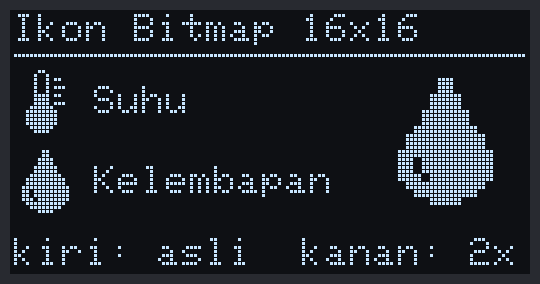

*Gambar 35.7 — Tampilan OLED Program 3 (disimulasikan dari kode program). Pada ikon yang diperbesar, setiap piksel terlihat sebagai kotak 2 × 2. Sumber: dibuat untuk materi ini.*

> 🧪 **Coba Sendiri:** Tambahkan *array* `ikonHati` dari [35.8.1](#3581-apa-itu-bitmap) ke program, lalu tampilkan dengan `oled.drawBitmap(60, 18, ikonHati, 8, 8, SSD1306_WHITE);` dan dengan `gambarBitmapBesar(60, 30, ikonHati, 8, 8, 3);`. Setelah itu, buat ikonmu sendiri dengan image2cpp.

**Kalau Belum Berhasil:**

- **Ikon tampak miring atau seperti garis acak** → lebar/tinggi di `drawBitmap()` tidak sama dengan ukuran gambar asli, atau *array* dibuat dengan **Draw mode** selain **Horizontal - 1 bit per pixel**.
- **Ikon tampil seperti negatif (latarnya menyala)** → buat ulang *array* di image2cpp dengan pengaturan **Invert image colors** yang berlawanan.
- **Compile gagal dengan `too many initializers`** → jumlah *byte* di *array* lebih banyak daripada yang tertulis di dalam kurung siku. Hapus angka di dalam `[]` supaya *compiler* menghitung sendiri.

---

## 35.10 Memperbarui Layar Tanpa Kedip dan Tanpa Membanjiri I2C

Program 1–3 menggambar layar **sekali** saja. Program yang menampilkan data sensor harus memperbarui layar berulang kali. Pertanyaannya: **seberapa sering?**

### 35.10.1 Kesalahan Umum: Menggambar di Setiap Putaran loop()

Contoh potongan kode yang **jangan** ditiru:

```cpp
void loop() {                      // ❌ jangan seperti ini
  oled.clearDisplay();
  oled.setCursor(0, 0);
  oled.print(analogRead(34));
  oled.display();                  // dikirim di SETIAP putaran loop()
}
```

Kode ini memang jalan, tetapi menimbulkan tiga masalah:

1. **`loop()` menjadi lambat.** Setiap `display()` butuh sekitar 25 ms, jadi `loop()` hanya berputar sekitar 40 kali per detik dan hampir seluruh waktunya habis untuk mengirim gambar yang sering kali sama. Tombol terasa lambat merespons, dan tugas lain ikut tertunda.
2. **Bus I2C kebanjiran.** Bus hampir selalu sibuk mengirim data OLED, sehingga BMP180 dan MPU-6050 yang memakai bus yang sama harus terus menunggu giliran.
3. **Angka sulit dibaca.** Nilai sensor yang bergetar sedikit (misalnya ADC yang naik-turun beberapa angka) berganti 40 kali per detik, sehingga digit terakhirnya tampak berkedip-kedip.

Penyebab kedipan yang lain adalah mengirim **gambar setengah jadi**:

```cpp
oled.clearDisplay();
oled.display();      // ❌ layar kosong sempat dikirim → layar berkedip gelap
oled.print(nilai);
oled.display();
```

Aturannya: dalam satu kali pembaruan, panggil `display()` **tepat sekali**, di paling akhir, setelah semua bagian layar selesai digambar di *buffer*.

### 35.10.2 Dua Strategi Memperbarui Layar

**Strategi A — laju tetap.** Gambar ulang layar dengan jeda tetap memakai `struct Timer` dari [BAB 16](../BAB-16/README.md#1682-fungsi-di-dalam-struct), misalnya 10 kali per detik untuk grafik yang bergerak. Cocok untuk tampilan yang memang terus berubah. Strategi ini dipakai Program 5.

**Strategi B — hanya saat berubah.** Simpan angka yang **sedang tampil** di layar. Setiap kali data baru dibaca, bandingkan dengan angka itu; gambar ulang **hanya kalau berbeda**. Bandingkan dalam bentuk yang ditampilkan — misalnya suhu yang sudah dibulatkan ke satu angka di belakang koma — bukan nilai mentahnya, karena perubahan kecil yang tidak terlihat di layar tidak perlu dikirim. Strategi ini dipakai Program 4 dan 6.

Contoh potongan kode strategi B:

```cpp
int persenTampil = -1;                 // angka yang sedang tampil (-1 = belum ada)

void loop() {
  int persen = analogRead(34) * 100 / 4095;   // 0-100
  if (persen != persenTampil) {        // hanya kalau angkanya berubah
    persenTampil = persen;
    oled.clearDisplay();
    oled.setCursor(0, 0);
    oled.printf("%d%%", persen);
    oled.display();
  }
}
```

Kedua strategi sering digabung: data dibaca dengan laju tetap, tetapi layar hanya digambar ulang kalau hasilnya berubah.

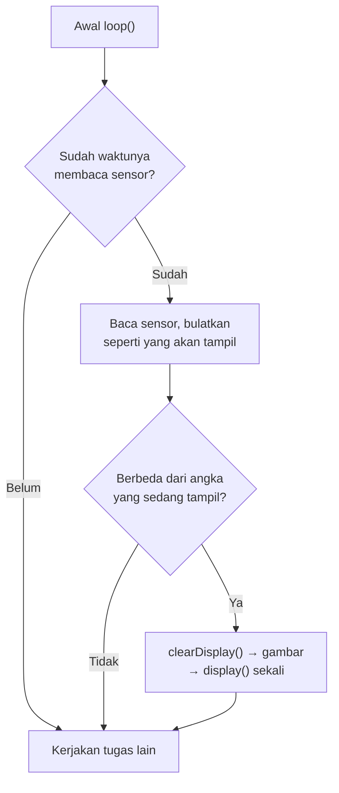

*Gambar 35.8 — Pola gabungan: baca dengan laju tetap, gambar ulang hanya saat berubah. Sumber: dibuat untuk materi ini.*

Panduan laju pembaruan:

| Jenis tampilan | Laju yang cukup |
|---|---|
| Angka sensor yang berubah lambat (suhu, kelembapan, tekanan) | Dicek setiap 1–2 detik, digambar hanya saat berubah |
| Jam dengan detik | Sekali per detik |
| Grafik atau animasi | 10–20 kali per detik (secara teori paling banyak sekitar 40 kali per detik, tetapi `loop()` lalu hampir tidak punya waktu untuk hal lain) |
| Menu | Hanya saat tombol ditekan atau isi halaman berubah |

---

## 35.11 Program 4: Dashboard Sensor

**Tujuan:** Menampilkan suhu dan kelembapan dari DHT11 (lengkap dengan ikon dari Program 3) dan tekanan udara dari BMP180. Sensor dibaca setiap 2 detik, tetapi layar **hanya digambar ulang kalau angka yang tampil berubah** (strategi B). Pojok kanan atas layar menampilkan berapa kali layar sudah digambar ulang, supaya kamu bisa melihat sendiri betapa jarangnya pembaruan yang benar-benar diperlukan.

**Rangkaian:**

| Pin **Custom** di kit | Sambungkan ke pin ESP32 |
|---|---|
| `DHT` — DHT11 (header hijau, pin ke-3 dari atas) | IO27 |

OLED (`0x3C`) dan BMP180 (`0x77`) sudah tersambung ke IO21/IO22 lewat *jumper cap*. Letak pin `DHT` dan pin `27` ada di [BAB 26](../BAB-26/README.md#264-rangkaian-dht11-di-kit).

**Cara Menjalankan:**

1. Cabut USB, lalu pasang kabel *jumper* dari pin **`DHT`** di header hijau ke pin berlabel **`27`** di deretan pin ESP32 atas. Pastikan juga *jumper cap* OLED dan BMP180 terpasang. Sambungkan lagi USB.
2. Pasang *library* **DHT sensor library** + **Adafruit Unified Sensor** ([BAB 26](../BAB-26/README.md#265-memasang-library-dht)) dan **Adafruit BMP085 Library** ([BAB 28](../BAB-28/README.md#283-library-adafruit-bmp085)) kalau belum, semuanya by Adafruit.
3. Buka Arduino IDE → **File → New Sketch**, hapus isinya, lalu salin kode di bawah. Kode yang sama juga tersedia di *file* [`p4_dashboard_sensor.ino`](p4_dashboard_sensor/p4_dashboard_sensor.ino).
4. Pastikan **Tools → Board** = **ESP32 Dev Module** dan **Tools → Port** = *port* ESP32 kamu.
5. Klik tombol **Upload** dan tunggu sampai muncul tulisan **Done uploading**.
6. Buka **Serial Monitor** (**Tools → Serial Monitor**) lalu pilih baud **115200**.
7. Setelah beberapa baris muncul, pegang badan DHT11 dengan dua jari atau embuskan napas ke arahnya, lalu amati angka di layar dan di Serial Monitor.

**Kode Program:**

<!-- sketch: p4_dashboard_sensor -->
```cpp
/*
 * BAB 35 - Program 4: Dashboard Sensor
 * Menampilkan suhu & kelembapan DHT11 (dengan ikon) dan tekanan BMP180.
 * Sensor dibaca setiap 2 detik, tetapi layar hanya digambar ulang
 * kalau angka yang tampil berubah.
 *
 * Rangkaian: pin DHT (header hijau) → IO27 (kabel jumper)
 *            OLED (0x3C) dan BMP180 (0x77) di IO21/IO22 lewat jumper cap
 * Library: Adafruit SSD1306, Adafruit GFX Library, DHT sensor library,
 *          Adafruit Unified Sensor, Adafruit BMP085 Library (semua by Adafruit)
 */

#include <Wire.h>
#include <Adafruit_GFX.h>
#include <Adafruit_SSD1306.h>
#include <DHT.h>
#include <Adafruit_BMP085.h>

#define PIN_SDA      21
#define PIN_SCL      22
#define LEBAR_LAYAR  128
#define TINGGI_LAYAR 64
#define ALAMAT_OLED  0x3C
#define DHT_PIN      27
#define DHT_TYPE     DHT11

Adafruit_SSD1306 oled(LEBAR_LAYAR, TINGGI_LAYAR, &Wire, -1);
DHT dht(DHT_PIN, DHT_TYPE);
Adafruit_BMP085 bmp;
bool bmpAda = false;

// Ikon 16x16 dari Program 3
const unsigned char ikonTermometer[] PROGMEM = {
  0x03, 0x00, 0x04, 0x80, 0x04, 0xB0, 0x04, 0x80,
  0x04, 0xB8, 0x04, 0x80, 0x07, 0xB0, 0x07, 0x80,
  0x07, 0xB8, 0x0F, 0xC0, 0x1F, 0xE0, 0x1F, 0xE0,
  0x1F, 0xE0, 0x1F, 0xE0, 0x0F, 0xC0, 0x07, 0x80
};
const unsigned char ikonTetes[] PROGMEM = {
  0x01, 0x80, 0x01, 0x80, 0x03, 0xC0, 0x03, 0xC0,
  0x07, 0xE0, 0x07, 0xE0, 0x0F, 0xF0, 0x1F, 0xF8,
  0x1F, 0xF8, 0x3F, 0xFC, 0x37, 0xFC, 0x37, 0xFC,
  0x3B, 0xFC, 0x1F, 0xF8, 0x0F, 0xF0, 0x03, 0xC0
};

// Timer serbaguna dari BAB 16
struct Timer {
  unsigned long interval;   // ms
  unsigned long waktuLalu;  // hasil millis() saat terakhir dijalankan

  bool sudahWaktunya(unsigned long sekarang) {
    if (sekarang - waktuLalu >= interval) {
      waktuLalu = sekarang;
      return true;
    }
    return false;
  }
};

// Angka dalam bentuk yang TAMPIL di layar (sudah dibulatkan)
const long NILAI_GAGAL = -9999;  // penanda: sensor gagal dibaca atau tidak ada

struct DataLayar {
  long suhuX10;     // suhu x 10, misalnya 285 berarti 28.5 °C
  long kelembapan;  // persen, bilangan bulat
  long tekanan;     // hPa, bilangan bulat
};

Timer timerSensor = {2000, 0};  // DHT11 tidak boleh dibaca lebih cepat dari 2 detik
DataLayar tampil;               // angka yang sedang tampil di layar
bool sudahDigambar = false;
unsigned long jumlahGambar = 0; // berapa kali layar digambar ulang

void berhenti(const char *pesan) {
  Serial.println(pesan);
  while (true) {
    delay(1000);
  }
}

DataLayar bacaSensor() {
  DataLayar d;

  dht.read(true);  // paksa membaca DHT11 sekarang (±25 ms), lihat BAB 26
  float suhu = dht.readTemperature();
  float kelembapan = dht.readHumidity();
  if (isnan(suhu) || isnan(kelembapan)) {
    d.suhuX10 = NILAI_GAGAL;
    d.kelembapan = NILAI_GAGAL;
  } else {
    d.suhuX10 = lround(suhu * 10);      // 28.46 → 285
    d.kelembapan = lround(kelembapan);  // 64.8 → 65
  }

  if (bmpAda) {
    d.tekanan = lround(bmp.readPressure() / 100.0);  // Pa → hPa, dibulatkan
  } else {
    d.tekanan = NILAI_GAGAL;
  }
  return d;
}

void gambarDashboard(const DataLayar &d) {
  oled.clearDisplay();
  oled.setTextColor(SSD1306_WHITE);

  // Judul + jumlah gambar ulang di pojok kanan atas
  oled.setTextSize(1);
  oled.setCursor(0, 0);
  oled.print("Dashboard Sensor");
  oled.setCursor(110, 0);
  oled.printf("%3lu", jumlahGambar % 1000);
  oled.drawLine(0, 10, 127, 10, SSD1306_WHITE);

  // Suhu: ikon + angka besar + satuan kecil
  oled.drawBitmap(0, 14, ikonTermometer, 16, 16, SSD1306_WHITE);
  oled.setTextSize(2);
  oled.setCursor(20, 14);
  if (d.suhuX10 == NILAI_GAGAL) {
    oled.print("--");
  } else {
    oled.print(d.suhuX10 / 10.0, 1);
  }
  int x = oled.getCursorX() + 2;  // satuan tepat di belakang angka
  oled.setTextSize(1);
  oled.setCursor(x, 14);
  oled.write(248);                // simbol derajat (butuh cp437(true))
  oled.print("C");

  // Kelembapan
  oled.drawBitmap(0, 34, ikonTetes, 16, 16, SSD1306_WHITE);
  oled.setTextSize(2);
  oled.setCursor(20, 34);
  if (d.kelembapan == NILAI_GAGAL) {
    oled.print("--");
  } else {
    oled.print(d.kelembapan);
  }
  x = oled.getCursorX() + 2;
  oled.setTextSize(1);
  oled.setCursor(x, 34);
  oled.print("%");

  // Tekanan di baris bawah
  oled.drawLine(0, 53, 127, 53, SSD1306_WHITE);
  oled.setCursor(0, 56);
  if (d.tekanan == NILAI_GAGAL) {
    oled.print("Tekanan: BMP180 --");
  } else {
    oled.printf("Tekanan: %ld hPa", d.tekanan);
  }

  oled.display();  // satu kali kirim, di paling akhir
}

void cetakSerial(const DataLayar &d) {
  if (d.suhuX10 == NILAI_GAGAL) {
    Serial.print("DHT11 gagal dibaca");
  } else {
    Serial.printf("Suhu %.1f °C | Kelembapan %ld %%", d.suhuX10 / 10.0, d.kelembapan);
  }
  if (d.tekanan == NILAI_GAGAL) {
    Serial.print(" | Tekanan --");
  } else {
    Serial.printf(" | Tekanan %ld hPa", d.tekanan);
  }
}

void setup() {
  Serial.begin(115200);
  delay(1000);
  Serial.println("BAB 35 - Program 4: Dashboard Sensor");

  Wire.begin(PIN_SDA, PIN_SCL);
  Wire.beginTransmission(ALAMAT_OLED);
  if (Wire.endTransmission() != 0) {
    berhenti("OLED tidak menjawab di 0x3C! Periksa jumper cap SCL/SDA OLED.");
  }
  if (!oled.begin(SSD1306_SWITCHCAPVCC, ALAMAT_OLED)) {
    berhenti("Gagal menyiapkan OLED: RAM tidak cukup untuk buffer.");
  }
  oled.cp437(true);  // supaya write(248) = simbol derajat

  // Layar sementara selama menunggu pembacaan pertama (2 detik)
  oled.clearDisplay();
  oled.setTextSize(1);
  oled.setTextColor(SSD1306_WHITE);
  oled.setCursor(0, 28);
  oled.print("Membaca sensor...");
  oled.display();

  dht.begin();
  bmpAda = bmp.begin();
  Serial.println(bmpAda ? "BMP180 siap." : "BMP180 tidak ditemukan, tekanan tidak ditampilkan.");
}

void loop() {
  unsigned long sekarang = millis();

  if (timerSensor.sudahWaktunya(sekarang)) {
    DataLayar baru = bacaSensor();
    cetakSerial(baru);

    bool berubah = !sudahDigambar ||
                   baru.suhuX10 != tampil.suhuX10 ||
                   baru.kelembapan != tampil.kelembapan ||
                   baru.tekanan != tampil.tekanan;

    if (berubah) {
      tampil = baru;
      sudahDigambar = true;
      jumlahGambar = jumlahGambar + 1;
      gambarDashboard(tampil);
      Serial.printf(" -> layar digambar ulang (ke-%lu)\n", jumlahGambar);
    } else {
      Serial.println(" -> sama, layar tidak dikirim ulang");
    }
  }
}
```

**Penjelasan Kode:**

- **`struct DataLayar`** menyimpan angka **dalam bentuk yang tampil di layar**: suhu dikali 10 lalu dibulatkan dengan `lround()` (28,46 °C → 285), kelembapan dan tekanan dibulatkan ke bilangan bulat. Bilangan bulat mudah dan aman dibandingkan dengan `!=`; membandingkan `float` secara langsung bisa "berbeda" hanya karena selisih yang sangat kecil.
- **`NILAI_GAGAL`** (−9999) adalah penanda bahwa sensor gagal dibaca atau tidak ada. Angka ini mustahil muncul dari sensor sungguhan, jadi aman dipakai sebagai tanda. Layar lalu menampilkan `--`.
- **`bacaSensor()`** memakai `dht.read(true)` seperti [BAB 26 Program 4](../BAB-26/README.md#2612-program-4-membaca-dht11-tanpa-delay) supaya DHT11 benar-benar dibaca setiap 2 detik, lalu `bmp.readPressure()` yang menghasilkan pascal dan dibagi 100 menjadi hPa.
- **`loop()`** menerapkan pola gabungan dari [35.10](#3510-memperbarui-layar-tanpa-kedip-dan-tanpa-membanjiri-i2c): sensor dibaca dengan laju tetap (`timerSensor`), tetapi `gambarDashboard()` — dan `display()` di dalamnya — hanya dipanggil kalau `berubah` bernilai `true`. `sudahDigambar` memastikan layar pasti digambar pada pembacaan pertama.
- **`gambarDashboard()`** menggambar seluruh layar dari nol lalu memanggil `display()` **sekali** di akhir. `getCursorX()` dipakai untuk menaruh satuan °C dan % tepat di belakang angka, berapa pun panjang angkanya.
- **Layar sementara.** Pembacaan pertama baru terjadi 2 detik setelah menyala (sama seperti BAB 26), jadi `setup()` menampilkan "Membaca sensor..." supaya layar tidak kosong.

**Contoh Output:**

```text
BAB 35 - Program 4: Dashboard Sensor
BMP180 siap.
Suhu 28.5 °C | Kelembapan 65 % | Tekanan 1008 hPa -> layar digambar ulang (ke-1)
Suhu 28.5 °C | Kelembapan 65 % | Tekanan 1008 hPa -> sama, layar tidak dikirim ulang
Suhu 28.5 °C | Kelembapan 65 % | Tekanan 1008 hPa -> sama, layar tidak dikirim ulang
Suhu 28.6 °C | Kelembapan 66 % | Tekanan 1008 hPa -> layar digambar ulang (ke-2)
Suhu 28.6 °C | Kelembapan 66 % | Tekanan 1008 hPa -> sama, layar tidak dikirim ulang
```

Angka suhu, kelembapan, dan tekanan di atas hanya contoh — angkamu pasti berbeda. Di ruangan yang tenang, sebagian besar baris berakhir dengan "layar tidak dikirim ulang".

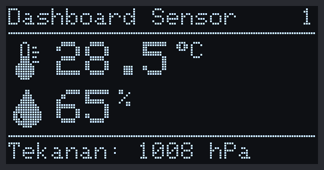

*Gambar 35.9 — Tampilan OLED Program 4 dengan contoh angka (disimulasikan dari kode program). Angka kecil di pojok kanan atas adalah jumlah gambar ulang. Sumber: dibuat untuk materi ini.*

> 📌 **Catatan:** Tekanan yang berada tepat di batas pembulatan (misalnya 1008,5 hPa) bisa sesekali bolak-balik antara 1008 dan 1009, sehingga layar ikut digambar ulang. Itu wajar. Cara meredamnya dengan *hysteresis* dibahas di [BAB 34](../BAB-34/README.md).

**Kalau Belum Berhasil:**

- **Suhu dan kelembapan selalu `--`** → kabel `DHT` → `27` belum benar, atau tidak terpasang. Periksa dengan Program 1 di [BAB 26](../BAB-26/README.md#266-program-1-membaca-suhu-dan-kelembapan).
- **Baris bawah `Tekanan: BMP180 --` dan Serial Monitor menulis `BMP180 tidak ditemukan`** → *jumper cap* BMP180 (blok di bawah MPU-6050) lepas, atau modulnya BMP280/BME280. Lihat [BAB 28](../BAB-28/README.md#2811-bmp180-bmp280-atau-bme280).
- **Simbol derajat tampil sebagai titik kecil** → baris `oled.cp437(true);` terhapus. Tambahkan lagi di `setup()`, setelah `oled.begin()`.
- **Compile gagal dengan `DHT.h` atau `Adafruit_BMP085.h: No such file or directory`** → *library* sensor belum terpasang (langkah 2).

---

## 35.12 Program 5: Grafik Potensiometer

**Tujuan:** Membaca potensiometer 10 kali per detik dan menggambar grafik garis dari 128 sampel terakhir (±12,8 detik) yang terus bergeser ke kiri, seperti grafik detak jantung di monitor rumah sakit. Layar diperbarui dengan **laju tetap** (strategi A), dan setiap detik Serial Monitor melaporkan berapa kali layar dikirim.

**Rangkaian:**

| Pin **Custom** di kit | Sambungkan ke pin ESP32 |
|---|---|
| `VR10K` — potensiometer (header kuning, pin ke-5 dari kiri) | IO34 |

Letak pin `VR10K` dan pin `34` ada di [BAB 11](../BAB-11/README.md). IO34 termasuk ADC1, jadi tetap bisa dibaca walaupun nanti WiFi dinyalakan.

**Cara Menjalankan:**

1. Cabut USB, lalu pasang kabel *jumper* dari pin ke-5 header kuning (**`VR10K`**) ke pin berlabel **`34`** di deretan pin ESP32 atas. Kabel `DHT` dari Program 4 boleh tetap terpasang. Sambungkan lagi USB.
2. Buka Arduino IDE → **File → New Sketch**, hapus isinya, lalu salin kode di bawah. Kode yang sama juga tersedia di *file* [`p5_grafik_potensio.ino`](p5_grafik_potensio/p5_grafik_potensio.ino).
3. Pastikan **Tools → Board** = **ESP32 Dev Module** dan **Tools → Port** = *port* ESP32 kamu.
4. Klik tombol **Upload** dan tunggu sampai muncul tulisan **Done uploading**.
5. Buka **Serial Monitor** (**Tools → Serial Monitor**) lalu pilih baud **115200**.
6. Putar kenop potensiometer pelan-pelan dari ujung ke ujung, lalu cepat bolak-balik, sambil memperhatikan grafiknya.

**Kode Program:**

<!-- sketch: p5_grafik_potensio -->
```cpp
/*
 * BAB 35 - Program 5: Grafik Potensiometer
 * Membaca potensiometer dan menggambar grafik 128 sampel terakhir
 * (±12,8 detik) yang terus bergeser ke kiri. Layar diperbarui dengan
 * laju tetap: 10 kali per detik.
 *
 * Rangkaian: pin VR10K (header kuning, pin ke-5 dari kiri) → IO34 (kabel jumper)
 *            OLED di IO21/IO22 lewat jumper cap, alamat 0x3C
 * Library: Adafruit SSD1306 + Adafruit GFX Library (by Adafruit)
 */

#include <Wire.h>
#include <Adafruit_GFX.h>
#include <Adafruit_SSD1306.h>

#define PIN_SDA      21
#define PIN_SCL      22
#define LEBAR_LAYAR  128
#define TINGGI_LAYAR 64
#define ALAMAT_OLED  0x3C
#define PIN_POT      34

Adafruit_SSD1306 oled(LEBAR_LAYAR, TINGGI_LAYAR, &Wire, -1);

// Area grafik di layar
const int JUMLAH_SAMPEL = 128;  // satu sampel untuk setiap kolom piksel
const int GRAFIK_ATAS   = 12;   // y teratas area grafik
const int GRAFIK_BAWAH  = 63;   // y terbawah area grafik

// Penyimpanan melingkar (circular buffer) untuk 128 sampel terakhir
int sampel[JUMLAH_SAMPEL];
int posisiTulis  = 0;  // indeks tempat sampel berikutnya ditulis
int jumlahTerisi = 0;  // berapa sampel yang sudah ada (maksimal 128)

// Timer serbaguna dari BAB 16
struct Timer {
  unsigned long interval;   // ms
  unsigned long waktuLalu;  // hasil millis() saat terakhir dijalankan

  bool sudahWaktunya(unsigned long sekarang) {
    if (sekarang - waktuLalu >= interval) {
      waktuLalu = sekarang;
      return true;
    }
    return false;
  }
};

Timer timerGambar  = {100, 0};   // 10 kali per detik
Timer timerLaporan = {1000, 0};  // laporan ke Serial setiap detik
unsigned long jumlahFrame = 0;   // berapa kali display() sejak laporan terakhir

void berhenti(const char *pesan) {
  Serial.println(pesan);
  while (true) {
    delay(1000);
  }
}

void simpanSampel(int nilai) {
  sampel[posisiTulis] = nilai;
  posisiTulis = (posisiTulis + 1) % JUMLAH_SAMPEL;  // setelah 127 kembali ke 0
  if (jumlahTerisi < JUMLAH_SAMPEL) {
    jumlahTerisi = jumlahTerisi + 1;
  }
}

// Mengubah nilai ADC (0-4095) menjadi koordinat y: makin besar nilai, makin ke atas
int keY(int nilai) {
  return map(nilai, 0, 4095, GRAFIK_BAWAH, GRAFIK_ATAS);
}

void gambarGrafik(int nilaiSekarang) {
  oled.clearDisplay();
  oled.setTextSize(1);
  oled.setTextColor(SSD1306_WHITE);
  oled.setCursor(0, 0);
  oled.printf("Potensio:%5d %3d%%", nilaiSekarang, nilaiSekarang * 100 / 4095);
  oled.drawLine(0, 9, 127, 9, SSD1306_WHITE);

  // Garis bantu putus-putus di nilai tengah (2048 = 50%)
  int yTengah = keY(2048);
  for (int x = 0; x < LEBAR_LAYAR; x += 4) {
    oled.drawPixel(x, yTengah, SSD1306_WHITE);
  }

  // Grafik: sampel tertua di kiri, sampel terbaru di kolom paling kanan
  int xAwal = JUMLAH_SAMPEL - jumlahTerisi;
  for (int i = 1; i < jumlahTerisi; i++) {
    int iLama = (posisiTulis - jumlahTerisi + i - 1 + JUMLAH_SAMPEL) % JUMLAH_SAMPEL;
    int iBaru = (iLama + 1) % JUMLAH_SAMPEL;
    oled.drawLine(xAwal + i - 1, keY(sampel[iLama]),
                  xAwal + i,     keY(sampel[iBaru]), SSD1306_WHITE);
  }

  oled.display();  // satu kali kirim per frame
  jumlahFrame = jumlahFrame + 1;
}

void setup() {
  Serial.begin(115200);
  delay(1000);
  Serial.println("BAB 35 - Program 5: Grafik Potensiometer");

  Wire.begin(PIN_SDA, PIN_SCL);
  Wire.beginTransmission(ALAMAT_OLED);
  if (Wire.endTransmission() != 0) {
    berhenti("OLED tidak menjawab di 0x3C! Periksa jumper cap SCL/SDA OLED.");
  }
  if (!oled.begin(SSD1306_SWITCHCAPVCC, ALAMAT_OLED)) {
    berhenti("Gagal menyiapkan OLED: RAM tidak cukup untuk buffer.");
  }
  oled.clearDisplay();
  oled.display();

  // Kedua timer mulai dihitung dari sekarang, bukan dari ESP32 menyala
  unsigned long sekarang = millis();
  timerGambar.waktuLalu = sekarang;
  timerLaporan.waktuLalu = sekarang;
}

void loop() {
  unsigned long sekarang = millis();

  // Tugas 1: baca, simpan, dan gambar dengan laju tetap
  if (timerGambar.sudahWaktunya(sekarang)) {
    int nilai = analogRead(PIN_POT);  // 0-4095
    simpanSampel(nilai);
    gambarGrafik(nilai);
  }

  // Tugas 2: laporan setiap detik
  if (timerLaporan.sudahWaktunya(sekarang)) {
    int terakhir = sampel[(posisiTulis - 1 + JUMLAH_SAMPEL) % JUMLAH_SAMPEL];
    Serial.printf("Potensio: %4d (%3d%%) | layar: %lu frame/detik\n",
                  terakhir, terakhir * 100 / 4095, jumlahFrame);
    jumlahFrame = 0;
  }
}
```

**Penjelasan Kode:**

- **Penyimpanan melingkar.** *Array* `sampel` berisi 128 tempat. `posisiTulis` menunjuk tempat sampel berikutnya; setelah tempat ke-127 terisi, operasi `% JUMLAH_SAMPEL` mengembalikannya ke 0, sehingga sampel terlama otomatis tertimpa. Cara ini jauh lebih hemat daripada menggeser 127 angka setiap kali ada sampel baru. Penyimpanan seperti ini juga dipakai untuk *moving average* di [BAB 34](../BAB-34/README.md).
- **Urutan menggambar.** Sampel tertua berada di indeks `posisiTulis - jumlahTerisi` (ditambah 128 lalu di-`%` supaya tidak negatif). Grafik dimulai dari kolom `xAwal`, sehingga saat program baru berjalan, garisnya "tumbuh" dari kanan ke kiri. Setelah 128 sampel, grafik memenuhi layar dan mulai bergeser.
- **`keY()`** memakai `map()` untuk mengubah 0–4095 menjadi y = 63 (bawah) sampai y = 12 (atas). Urutan parameternya sengaja dibalik (`GRAFIK_BAWAH, GRAFIK_ATAS`) karena di layar, y yang lebih **kecil** berarti lebih **atas**.
- **`drawLine()` antarsampel.** Menyambung setiap sampel ke sampel berikutnya dengan garis membuat grafik tetap tersambung walaupun nilainya melompat jauh, misalnya saat kenop diputar cepat.
- **Laju tetap.** `timerGambar` (100 ms) membuat layar dikirim 10 kali per detik. Dengan sekitar 25 ms per `display()`, bus I2C dan `loop()` hanya sibuk sekitar 250 ms setiap detik — sisanya bebas untuk tugas lain. `jumlahFrame` menghitung `display()` yang benar-benar terjadi dan dilaporkan oleh `timerLaporan`. Di akhir `setup()`, `waktuLalu` kedua *timer* diisi `millis()` saat itu, supaya hitungan dimulai setelah OLED siap, bukan sejak ESP32 menyala (`setup()` sendiri sudah memakan lebih dari 1 detik karena `delay(1000)`).

**Contoh Output:**

```text
BAB 35 - Program 5: Grafik Potensiometer
Potensio:  712 ( 17%) | layar: 10 frame/detik
Potensio:  715 ( 17%) | layar: 10 frame/detik
Potensio: 2391 ( 58%) | layar: 9 frame/detik
Potensio: 3502 ( 85%) | layar: 10 frame/detik
Potensio: 2048 ( 50%) | layar: 10 frame/detik
```

Angka potensiometer di atas hanya contoh. Jumlah frame kadang 9, kadang 10, karena kedua *timer* tidak berdetak tepat bersamaan — rata-ratanya tetap 10 per detik. Contoh tampilan setelah kenop diputar naik, ditahan, lalu diputar turun dan bolak-balik:

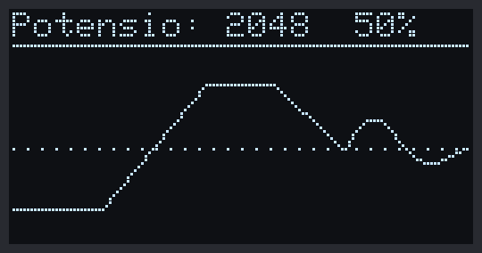

*Gambar 35.10 — Tampilan OLED Program 5 dengan contoh data 128 sampel (disimulasikan dari kode program). Sampel terbaru ada di tepi kanan. Sumber: dibuat untuk materi ini.*

> 🧪 **Coba Sendiri:** Ubah `timerGambar` menjadi `{20, 0}` (target 50 kali per detik), *upload*, lalu lihat laporan di Serial Monitor. Jumlah frame per detik tidak akan mencapai 50, melainkan tertahan di sekitar 35–40, karena setiap `display()` butuh sekitar 25 ms. Itulah batas kecepatan OLED I2C ini — dan pada laju itu, `loop()` hampir tidak punya waktu untuk hal lain. Kembalikan ke `{100, 0}` setelah selesai.

**Kalau Belum Berhasil:**

- **Grafik datar di bawah (0) atau di atas (4095) walaupun kenop diputar** → kabel `VR10K` belum tersambung ke `34`, atau tertancap di pin tetangga. Cocokkan dengan [BAB 11](../BAB-11/README.md).
- **Grafik bergerak terbalik (diputar ke kanan malah turun)** → itu hanya arah putaran potensiometer di kit; tidak ada yang salah. Kalau ingin dibalik, ganti `analogRead(PIN_POT)` dengan `4095 - analogRead(PIN_POT)`.
- **Garis bergerigi kecil walaupun kenop diam** → *noise* ADC ESP32 yang wajar (beberapa puluh angka). Cara meredamnya ada di [BAB 34](../BAB-34/README.md).

---

## 35.13 Burn-in dan Cara Merawat OLED

### 35.13.1 Apa Itu Burn-in?

Setiap piksel OLED adalah LED organik yang **perlahan menua** setiap kali menyala: makin lama dan makin terang ia menyala, makin turun kecerahannya. Kalau sebagian piksel menyala jauh lebih lama daripada tetangganya — misalnya bingkai, judul, atau garis yang sama ditampilkan berminggu-minggu — piksel-piksel itu menjadi sedikit lebih redup. Saat layar menampilkan gambar lain, bekas tampilan lama itu terlihat samar seperti bayangan. Gejala ini disebut ***burn-in*** (bekas terbakar).

*Burn-in* tidak terjadi dalam hitungan menit atau jam. Namun, perangkat IoT sering menyala 24 jam sehari selama berbulan-bulan dengan tampilan yang hampir sama, misalnya termometer ruangan — dan di situlah *burn-in* menjadi masalah nyata.

### 35.13.2 Cara Mencegahnya

| Cara | Kode | Keterangan |
|---|---|---|
| Meredupkan layar saat tidak dilihat | `oled.dim(true);` / `oled.dim(false);` | Mengubah kontras ke nilai minimum. Langsung berlaku tanpa `display()`. Seberapa redup hasilnya berbeda-beda antarmodul — pada sebagian modul perbedaannya tidak terlalu besar |
| Mematikan panel saat tidak dipakai (*sleep*) | `oled.ssd1306_command(SSD1306_DISPLAYOFF);` | Semua piksel padam dan chip masuk mode tidur. Isi GDDRAM **tetap tersimpan**, dan bus I2C tetap bisa dipakai |
| Menyalakan panel lagi | `oled.ssd1306_command(SSD1306_DISPLAYON);` | Gambar terakhir langsung muncul kembali |
| Menampilkan data hanya saat diminta | Misalnya layar menyala 10 detik setelah tombol ditekan | Cara paling ampuh: piksel yang tidak menyala tidak menua |
| Mengurangi bagian terang yang statis | Pakai garis tipis, hindari kotak penuh atau mode terbalik yang tampil terus | Latar gelap dengan sedikit piksel menyala lebih awet dan lebih hemat daya |
| Menggeser isi layar sesekali | Geser semua posisi 1–2 piksel setiap beberapa menit | Piksel yang menyala jadi bergantian, sehingga penuaannya lebih merata |

Gabungan "redupkan dulu, lalu matikan" disebut ***screen saver*** — persis seperti layar laptop yang meredup lalu padam saat kamu tinggal pergi. Program 6 menerapkannya: 30 detik tanpa tombol → layar redup, 60 detik → layar mati, tombol apa saja → menyala lagi.

> 💡 **Tips:** Mematikan panel juga menghemat daya. Menurut datasheet, chip SSD1306 dalam mode tidur hanya membutuhkan arus paling banyak 10 µA, sedangkan saat menyala arus panel naik sebanding dengan jumlah piksel yang menyala. Ini penting kalau kit-mu nanti memakai baterai.

> 📌 **Catatan:** `invertDisplay()` **bukan** cara mencegah *burn-in*. Piksel yang tadinya mati memang ganti menyala, tetapi bagian yang menyala justru jadi lebih banyak.

---

## 35.14 Program 6: Menu Tombol dengan Screen Saver

**Tujuan:** Membuat menu tiga pilihan — **Suhu & Lembap**, **Potensiometer**, dan **Tentang** — yang dikendalikan dua tombol kit: S1 memindahkan pilihan, S2 masuk ke halaman yang dipilih atau kembali ke menu. Halaman dikelola dengan *state machine* dari [BAB 17](../BAB-17/README.md), layar hanya digambar ulang kalau ada yang berubah, dan *screen saver* meredupkan lalu mematikan layar kalau tidak ada tombol yang ditekan.

**Rangkaian:**

| Pin **Custom** di kit | Sambungkan ke pin ESP32 |
|---|---|
| Tombol S1 — `SW1` (header kuning, pin ke-3 dari kiri) | IO15 |
| Tombol S2 — `SW2` (header kuning, pin ke-4 dari kiri) | IO25 |
| `DHT` — DHT11 (header hijau, pin ke-3 dari atas) | IO27 |
| `VR10K` — potensiometer (header kuning, pin ke-5 dari kiri) | IO34 |

Letak pin tombol ada di [BAB 9](../BAB-09/README.md#922-menyambungkan-kabel-jumper). Tombol kit sudah punya resistor *pull-down* 10 kΩ, jadi ditekan = HIGH dan pin cukup diatur `INPUT`.

> ⚠️ **Perhatian:** Di deretan pin ESP32 bawah, pin `15` bersebelahan dengan pin `G` (GND). Pastikan kabel S1 benar-benar di `15`; kalau tergeser ke `G`, menekan S1 akan menghubungsingkatkan 3,3 V ke GND. IO25 juga dipakai sebagai Trig HC-SR04 di [BAB 30](../BAB-30/README.md), jadi lepaskan sensor itu dulu kalau masih terpasang.

**Cara Menjalankan:**

1. Cabut USB, lalu pasang keempat kabel *jumper* sesuai tabel **Rangkaian** (kabel `DHT` → `27` dan `VR10K` → `34` dari Program 4 dan 5 boleh tetap terpasang). Sambungkan lagi USB.
2. Pastikan *library* DHT dari Program 4 sudah terpasang.
3. Buka Arduino IDE → **File → New Sketch**, hapus isinya, lalu salin kode di bawah. Kode yang sama juga tersedia di *file* [`p6_menu_tombol.ino`](p6_menu_tombol/p6_menu_tombol.ino).
4. Pastikan **Tools → Board** = **ESP32 Dev Module** dan **Tools → Port** = *port* ESP32 kamu.
5. Klik tombol **Upload** dan tunggu sampai muncul tulisan **Done uploading**.
6. Buka **Serial Monitor** (**Tools → Serial Monitor**) lalu pilih baud **115200**.
7. Tekan S1 beberapa kali untuk memindahkan pilihan, tekan S2 untuk masuk, lalu S2 lagi untuk kembali. Di halaman **Potensiometer**, putar kenopnya. Terakhir, diamkan kit 30 detik, lalu 60 detik, dan amati layarnya.

**Kode Program:**

<!-- sketch: p6_menu_tombol -->
```cpp
/*
 * BAB 35 - Program 6: Menu Tombol dengan Screen Saver
 * S1 = pindah pilihan, S2 = pilih / kembali.
 * Halaman: Suhu & Lembap (DHT11), Potensiometer, Tentang.
 * Layar hanya digambar ulang kalau ada yang berubah.
 * 30 detik tanpa tombol → layar redup; 60 detik → layar mati.
 * Tekan tombol apa saja untuk menyalakannya lagi.
 *
 * Rangkaian (kabel jumper):
 *   SW1   (header kuning, pin ke-3)  → IO15
 *   SW2   (header kuning, pin ke-4)  → IO25
 *   DHT   (header hijau, pin ke-3)   → IO27
 *   VR10K (header kuning, pin ke-5)  → IO34
 *   OLED di IO21/IO22 lewat jumper cap, alamat 0x3C
 * Library: Adafruit SSD1306, Adafruit GFX Library, DHT sensor library,
 *          Adafruit Unified Sensor (semua by Adafruit)
 */

#include <Wire.h>
#include <Adafruit_GFX.h>
#include <Adafruit_SSD1306.h>
#include <DHT.h>

#define PIN_SDA      21
#define PIN_SCL      22
#define LEBAR_LAYAR  128
#define TINGGI_LAYAR 64
#define ALAMAT_OLED  0x3C
#define TOMBOL_S1    15
#define TOMBOL_S2    25
#define DHT_PIN      27
#define DHT_TYPE     DHT11
#define PIN_POT      34

#define PUTIH SSD1306_WHITE
#define HITAM SSD1306_BLACK

Adafruit_SSD1306 oled(LEBAR_LAYAR, TINGGI_LAYAR, &Wire, -1);
DHT dht(DHT_PIN, DHT_TYPE);

// ---- Tipe data (ditulis paling atas supaya dikenali semua fungsi) ----
enum Halaman { MENU_UTAMA, HAL_SENSOR, HAL_POT, HAL_TENTANG };
enum ModeLayar { LAYAR_NORMAL, LAYAR_REDUP, LAYAR_MATI };

// Timer serbaguna dari BAB 16
struct Timer {
  unsigned long interval;   // ms
  unsigned long waktuLalu;  // hasil millis() saat terakhir dijalankan

  bool sudahWaktunya(unsigned long sekarang) {
    if (sekarang - waktuLalu >= interval) {
      waktuLalu = sekarang;
      return true;
    }
    return false;
  }
};

// ---- Menu dan halaman ----
const int JUMLAH_MENU = 3;
const char *namaMenu[JUMLAH_MENU] = {"Suhu & Lembap", "Potensiometer", "Tentang"};
const Halaman tujuanMenu[JUMLAH_MENU] = {HAL_SENSOR, HAL_POT, HAL_TENTANG};

Halaman halaman = MENU_UTAMA;  // state yang sedang aktif
int pilihan = 0;               // item menu yang sedang ditandai (0-2)
bool perluGambar = true;       // true = layar harus digambar ulang

// ---- Data sensor ----
float suhu = NAN;
float kelembapan = NAN;
int nilaiPot = 0;               // nilai potensiometer yang sedang tampil
const int AMBANG_POT = 41;      // ±1% dari 4095; perubahan lebih kecil diabaikan
Timer timerDHT = {2000, 0};     // DHT11: tidak boleh lebih cepat dari 2 detik
Timer timerPot = {100, 0};      // potensiometer dicek 10 kali per detik

// ---- Screen saver ----
const unsigned long WAKTU_REDUP = 30000;  // ms tanpa tombol sebelum layar redup
const unsigned long WAKTU_MATI  = 60000;  // ms tanpa tombol sebelum layar mati
ModeLayar modeLayar = LAYAR_NORMAL;
unsigned long waktuTombolTerakhir = 0;

// ---- Debounce dua tombol (dari BAB 9): indeks 0 = S1, indeks 1 = S2 ----
const int TOMBOL_PINS[] = {TOMBOL_S1, TOMBOL_S2};
const int JUMLAH_TOMBOL = 2;
const unsigned long WAKTU_DEBOUNCE = 50;  // ms
int bacaanSebelumnya[JUMLAH_TOMBOL] = {LOW, LOW};
int statusStabil[JUMLAH_TOMBOL] = {LOW, LOW};
unsigned long waktuBerubah[JUMLAH_TOMBOL] = {0, 0};

// Mengembalikan true hanya satu kali setiap tombol ke-i baru ditekan
bool baruDitekan(int i) {
  int bacaan = digitalRead(TOMBOL_PINS[i]);

  if (bacaan != bacaanSebelumnya[i]) {
    waktuBerubah[i] = millis();
    bacaanSebelumnya[i] = bacaan;
  }

  if ((millis() - waktuBerubah[i]) > WAKTU_DEBOUNCE && bacaan != statusStabil[i]) {
    statusStabil[i] = bacaan;
    return statusStabil[i] == HIGH;  // true hanya pada tepi naik (LOW → HIGH)
  }
  return false;
}

void berhenti(const char *pesan) {
  Serial.println(pesan);
  while (true) {
    delay(1000);
  }
}

// ---------------- Menggambar setiap halaman ----------------

void gambarJudul(const char *judul) {
  oled.clearDisplay();
  oled.setTextSize(1);
  oled.setTextColor(PUTIH);
  oled.setCursor(0, 0);
  oled.print(judul);
  oled.drawLine(0, 10, 127, 10, PUTIH);
}

void gambarPetunjuk(const char *teks) {
  oled.drawLine(0, 53, 127, 53, PUTIH);
  oled.setCursor(0, 56);
  oled.print(teks);
}

void gambarMenu() {
  gambarJudul("MENU UTAMA");
  for (int i = 0; i < JUMLAH_MENU; i++) {
    int y = 15 + i * 12;
    if (i == pilihan) {
      oled.fillRect(0, y - 2, LEBAR_LAYAR, 11, PUTIH);  // pita terang
      oled.setTextColor(HITAM);                         // teks gelap di atas pita
      oled.setCursor(2, y);
      oled.write(16);                                   // simbol ►
    } else {
      oled.setTextColor(PUTIH);
    }
    oled.setCursor(12, y);
    oled.print(namaMenu[i]);
  }
  oled.setTextColor(PUTIH);
  gambarPetunjuk("S1:pindah  S2:pilih");
}

void gambarSensor() {
  gambarJudul("Suhu & Lembap");

  oled.setTextSize(2);
  oled.setCursor(0, 16);
  if (isnan(suhu)) {
    oled.print("--");
  } else {
    oled.print(suhu, 1);
  }
  int x = oled.getCursorX() + 2;
  oled.setTextSize(1);
  oled.setCursor(x, 16);
  oled.write(248);  // simbol derajat
  oled.print("C");

  oled.setTextSize(2);
  oled.setCursor(0, 34);
  if (isnan(kelembapan)) {
    oled.print("--");
  } else {
    oled.print(kelembapan, 0);
  }
  x = oled.getCursorX() + 2;
  oled.setTextSize(1);
  oled.setCursor(x, 34);
  oled.print("%");

  gambarPetunjuk("S2: kembali");
}

void gambarPot() {
  gambarJudul("Potensiometer");

  oled.setTextSize(2);
  oled.setCursor(0, 16);
  oled.printf("%4d", nilaiPot);
  oled.setTextSize(1);
  oled.setCursor(56, 22);
  oled.printf("= %3d%%", nilaiPot * 100 / 4095);

  // Batang: bingkai 128x12, isinya sepanjang nilai potensiometer
  oled.drawRect(0, 38, LEBAR_LAYAR, 12, PUTIH);
  int panjang = map(nilaiPot, 0, 4095, 0, LEBAR_LAYAR - 4);
  oled.fillRect(2, 40, panjang, 8, PUTIH);

  gambarPetunjuk("S2: kembali");
}

void gambarTentang() {
  gambarJudul("Tentang");
  oled.setCursor(0, 14);
  oled.print("BAB 35 - OLED 128x64");
  oled.setCursor(0, 24);
  oled.print("S1 : pindah pilihan");
  oled.setCursor(0, 34);
  oled.print("S2 : pilih / kembali");
  oled.setCursor(0, 44);
  oled.print("Redup 30 s, mati 60 s");
  gambarPetunjuk("S2: kembali");
}

void gambarHalaman() {
  switch (halaman) {
    case MENU_UTAMA:  gambarMenu();    break;
    case HAL_SENSOR:  gambarSensor();  break;
    case HAL_POT:     gambarPot();     break;
    case HAL_TENTANG: gambarTentang(); break;
  }
  oled.display();  // satu kali kirim untuk satu halaman
}

// ---------------- Perpindahan state ----------------

void pindahHalaman(Halaman baru) {
  halaman = baru;
  perluGambar = true;
  if (baru == MENU_UTAMA) {
    Serial.println("Kembali ke menu");
  } else {
    Serial.printf("Masuk halaman: %s\n", namaMenu[pilihan]);
  }
}

void aturModeLayar(ModeLayar baru) {
  if (baru == LAYAR_NORMAL) {
    oled.ssd1306_command(SSD1306_DISPLAYON);   // nyalakan panel lagi
    oled.dim(false);                           // kecerahan normal
    Serial.println("Layar menyala lagi");
  } else if (baru == LAYAR_REDUP) {
    oled.dim(true);                            // kontras minimum
    Serial.println("Layar redup (30 detik tanpa tombol)");
  } else {
    oled.ssd1306_command(SSD1306_DISPLAYOFF);  // panel padam, isi GDDRAM tetap tersimpan
    Serial.println("Layar mati (60 detik tanpa tombol)");
  }
  modeLayar = baru;
}

void setup() {
  Serial.begin(115200);
  delay(1000);
  Serial.println("BAB 35 - Program 6: Menu Tombol dengan Screen Saver");

  for (int i = 0; i < JUMLAH_TOMBOL; i++) {
    pinMode(TOMBOL_PINS[i], INPUT);  // tombol kit: pull-down 10 kΩ sudah ada
  }

  Wire.begin(PIN_SDA, PIN_SCL);
  Wire.beginTransmission(ALAMAT_OLED);
  if (Wire.endTransmission() != 0) {
    berhenti("OLED tidak menjawab di 0x3C! Periksa jumper cap SCL/SDA OLED.");
  }
  if (!oled.begin(SSD1306_SWITCHCAPVCC, ALAMAT_OLED)) {
    berhenti("Gagal menyiapkan OLED: RAM tidak cukup untuk buffer.");
  }
  oled.cp437(true);  // supaya write(248) = simbol derajat

  dht.begin();
  nilaiPot = analogRead(PIN_POT);
  waktuTombolTerakhir = millis();
  Serial.println("S1 = pindah pilihan, S2 = pilih/kembali");
}

void loop() {
  unsigned long sekarang = millis();
  bool s1 = baruDitekan(0);
  bool s2 = baruDitekan(1);

  // 1. Screen saver: tombol apa saja membangunkan layar
  if (s1 || s2) {
    waktuTombolTerakhir = sekarang;
    if (modeLayar != LAYAR_NORMAL) {
      aturModeLayar(LAYAR_NORMAL);
      perluGambar = true;  // data mungkin sudah berubah selama layar mati
      s1 = false;          // tekanan ini hanya untuk membangunkan layar,
      s2 = false;          // tidak dipakai untuk menu
    }
  }
  unsigned long lamaDiam = sekarang - waktuTombolTerakhir;
  if (modeLayar == LAYAR_NORMAL && lamaDiam >= WAKTU_REDUP) {
    aturModeLayar(LAYAR_REDUP);
  } else if (modeLayar == LAYAR_REDUP && lamaDiam >= WAKTU_MATI) {
    aturModeLayar(LAYAR_MATI);
  }

  // 2. Tugas latar: sensor tetap dibaca, apa pun halamannya
  if (timerDHT.sudahWaktunya(sekarang)) {
    dht.read(true);  // paksa membaca DHT11 sekarang (±25 ms)
    suhu = dht.readTemperature();
    kelembapan = dht.readHumidity();
    if (halaman == HAL_SENSOR) {
      perluGambar = true;  // halaman sensor diperbarui setiap 2 detik
    }
  }
  if (timerPot.sudahWaktunya(sekarang)) {
    int bacaan = analogRead(PIN_POT);
    if (abs(bacaan - nilaiPot) >= AMBANG_POT) {  // abaikan getaran kecil (noise)
      nilaiPot = bacaan;
      if (halaman == HAL_POT) {
        perluGambar = true;
      }
    }
  }

  // 3. State machine halaman
  switch (halaman) {
    case MENU_UTAMA:
      if (s1) {
        pilihan = (pilihan + 1) % JUMLAH_MENU;  // setelah item terakhir kembali ke atas
        perluGambar = true;
        Serial.printf("Pilihan: %s\n", namaMenu[pilihan]);
      }
      if (s2) {
        pindahHalaman(tujuanMenu[pilihan]);
      }
      break;

    case HAL_SENSOR:
    case HAL_POT:
    case HAL_TENTANG:
      if (s2) {
        pindahHalaman(MENU_UTAMA);
      }
      break;
  }

  // 4. Gambar ulang hanya kalau perlu, dan tidak saat layar mati
  if (perluGambar && modeLayar != LAYAR_MATI) {
    gambarHalaman();
    perluGambar = false;
  }
}
```

**Penjelasan Kode:**

Program ini punya dua *state machine* yang berjalan berdampingan. Yang pertama mengatur **halaman**:

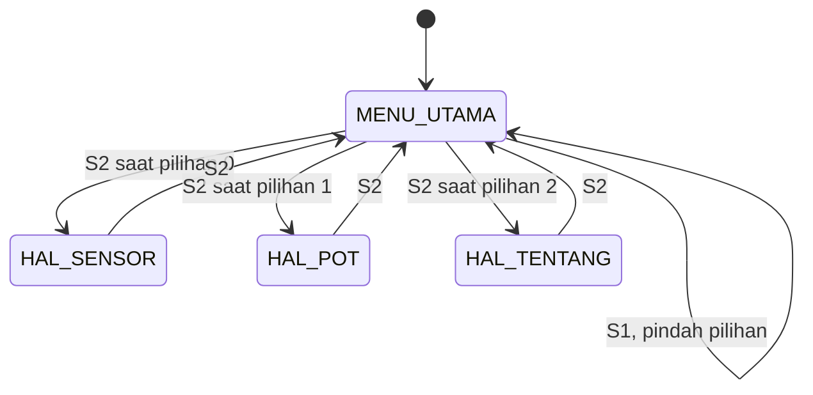

*Gambar 35.11 — State machine halaman di Program 6. Sumber: dibuat untuk materi ini.*

Yang kedua mengatur **keadaan layar** (*screen saver*):

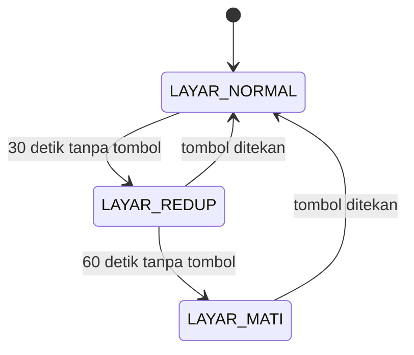

*Gambar 35.12 — State machine screen saver di Program 6. Sumber: dibuat untuk materi ini.*

- **`enum Halaman` dan `enum ModeLayar`** ditulis di bagian atas program, sebelum fungsi pertama. Kalau ditulis di bawah, Arduino IDE bisa gagal dengan pesan `'Halaman' has not been declared`, karena Arduino membuat daftar fungsi otomatis di atas kode.
- **Tombol** dibaca dengan `baruDitekan()` dari [BAB 9](../BAB-09/README.md#99-program-4-dua-tombol-mengatur-jumlah-led) dengan cara *polling* (dicek di setiap putaran `loop()`), tanpa *interrupt*. Hasilnya disimpan di `s1` dan `s2`, lalu dipakai oleh *screen saver* dan *state machine* di putaran yang sama.
- **Penanda `perluGambar`** (sering disebut *dirty flag*) menggabungkan semua alasan untuk menggambar ulang: pilihan menu berpindah, halaman berganti, data sensor baru, atau layar baru bangun. Semua bagian program cukup mengubah penanda ini menjadi `true`; penggambaran sesungguhnya hanya dilakukan di satu tempat (langkah 4), dengan satu `display()`. Halaman **Tentang** yang statis hanya digambar sekali saat dibuka.
- **Dua strategi sekaligus.** Halaman sensor diperbarui dengan laju tetap setiap 2 detik (strategi A, cukup lambat untuk DHT11). Halaman potensiometer hanya diperbarui kalau nilainya bergeser minimal `AMBANG_POT` (41, sekitar 1%) dari angka yang sedang tampil (strategi B). Ambang ini meredam *noise* ADC sehingga angkanya tidak terus bergetar; akibatnya angka di layar bisa meleset sampai 40 dari nilai sebenarnya — harga yang wajar untuk layar yang tenang.
- **Sensor tetap dibaca di latar belakang** apa pun halamannya, sehingga saat halaman sensor dibuka, angkanya sudah tersedia. Hanya penggambarannya yang bergantung pada halaman.
- **Screen saver.** `lamaDiam` adalah waktu sejak tombol terakhir ditekan. `aturModeLayar()` memakai `dim()` dan perintah `SSD1306_DISPLAYOFF`/`SSD1306_DISPLAYON` dari [35.13](#3513-burn-in-dan-cara-merawat-oled). Saat layar mati, langkah 4 dilewati sehingga bus I2C benar-benar sepi. Tekanan tombol yang membangunkan layar sengaja "dibuang" (`s1 = false; s2 = false;`) supaya kamu tidak tanpa sengaja memilih menu yang belum terlihat — perilaku yang sama seperti HP yang layarnya padam.

**Contoh Output:**

```text
BAB 35 - Program 6: Menu Tombol dengan Screen Saver
S1 = pindah pilihan, S2 = pilih/kembali
Pilihan: Potensiometer
Masuk halaman: Potensiometer
Kembali ke menu
Pilihan: Tentang
Masuk halaman: Tentang
Kembali ke menu
Layar redup (30 detik tanpa tombol)
Layar mati (60 detik tanpa tombol)
Layar menyala lagi
```

Contoh di atas terjadi kalau kamu menekan S1, S2, S2, S1, S2, S2, lalu mendiamkan kit lebih dari 1 menit dan menekan salah satu tombol. Tampilan menu (kiri) dan halaman potensiometer (kanan):


*Gambar 35.13 — Tampilan OLED Program 6: menu dengan pilihan kedua ditandai (kiri) dan halaman potensiometer dengan contoh nilai 2048 (kanan), disimulasikan dari kode program. Sumber: dibuat untuk materi ini.*

**Kalau Belum Berhasil:**

- **Menekan S1 sekali memindahkan pilihan dua langkah** → *bouncing* tombol. Naikkan `WAKTU_DEBOUNCE` menjadi 80 atau 100.
- **S1 bekerja, tetapi S2 tidak** → kabel S2 harus ke pin berlabel `25` di deretan pin ESP32 **atas**, bukan deretan bawah. Pastikan juga tidak ada kabel HC-SR04 di IO25.
- **ESP32 *restart* saat S1 ditekan** → kabel S1 tergeser ke pin `G` di sebelah pin `15`. Cabut USB dan perbaiki kabelnya.
- **Layar tidak meredup setelah 30 detik** → efek `dim(true)` pada sebagian modul memang tipis. Perhatikan Serial Monitor: kalau pesan `Layar redup` muncul, programnya sudah benar. Setelah 60 detik layar pasti padam.
- **Halaman Suhu & Lembap selalu `--`** → kabel `DHT` → `27` belum terpasang, atau baru kurang dari 2 detik sejak ESP32 menyala.

---

## 35.15 Troubleshooting

| Masalah | Kemungkinan Penyebab | Solusi |
|---|---|---|
| Serial Monitor menampilkan `OLED tidak menjawab di 0x3C!` | *Jumper cap* `SCL`/`SDA` OLED lepas atau longgar, ada kabel *jumper* di label `21`/`22`, atau modulnya beralamat `0x3D` | Cabut USB, periksa blok JP (Gambar 35.2), lepaskan kabel dari pin 21/22. Jalankan pemindai di [BAB 23](../BAB-23/README.md#235-program-1-memeriksa-perangkat-dan-kode-hasil); kalau OLED ditemukan di `0x3D`, ganti `ALAMAT_OLED` |
| Program berjalan normal, tetapi layar tetap gelap | `display()` tidak dipanggil, warna teks `SSD1306_BLACK` di atas latar gelap, atau gambar diletakkan di luar layar | Pastikan urutan `clearDisplay()` → gambar → `display()`; periksa `setTextColor()` dan koordinat |
| Muncul logo Adafruit | `display()` dipanggil sebelum `clearDisplay()` | Panggil `oled.clearDisplay()` setelah `begin()` |
| Hanya separuh layar terisi atau setiap baris kedua kosong | Ukuran di konstruktor salah, misalnya `128, 32` untuk layar 128×64 | Pakai `Adafruit_SSD1306 oled(128, 64, &Wire, -1);` |
| Gambar bergeser beberapa piksel, ada kolom berisi titik acak di tepi | Modul memakai chip SH1106 (umumnya 1,3") | Pakai *library* **Adafruit SH110X** atau **U8g2** |
| Teks baru bertumpuk dengan teks lama | Teks dicetak ulang tanpa `clearDisplay()`, sedangkan latar teks transparan | Gambar ulang seluruh layar, atau pakai `setTextColor(SSD1306_WHITE, SSD1306_BLACK)` (lihat [35.5.4](#3554-teks-yang-menimpa-teks-lama)) |
| Simbol `°` tampil sebagai dua karakter aneh | `°` diketik langsung di kode (tersimpan sebagai 2 *byte* UTF-8) | Pakai `oled.write(248)` dan `oled.cp437(true)` |
| Simbol derajat tampil sebagai titik kecil | `write(248)` tanpa `cp437(true)` | Tambahkan `oled.cp437(true);` di `setup()` |
| Layar berkedip gelap sesaat setiap diperbarui | `display()` dipanggil setelah `clearDisplay()` tetapi sebelum semua bagian digambar | Panggil `display()` tepat sekali, di akhir |
| Tombol terasa lambat, sensor I2C lain kadang gagal dibaca | `display()` dipanggil di setiap putaran `loop()` | Pakai laju tetap (`struct Timer`) atau gambar ulang hanya saat data berubah ([35.10](#3510-memperbarui-layar-tanpa-kedip-dan-tanpa-membanjiri-i2c)) |
| Setelah meng-*upload* program lain yang tidak memakai OLED, layar masih menampilkan gambar lama | Normal: SSD1306 menyimpan gambar terakhir di GDDRAM selama masih mendapat daya. Menekan **EN** atau meng-*upload* hanya me-*reset* ESP32, bukan OLED | Cabut USB beberapa detik, atau jalankan program yang memanggil `clearDisplay()` + `display()` |
| Ada bayangan samar bekas tampilan lama | *Burn-in* karena tampilan yang sama menyala sangat lama | Pakai *screen saver*, kurangi bagian terang yang statis ([35.13](#3513-burn-in-dan-cara-merawat-oled)) |
| *Compile* gagal: `'Adafruit_SSD1306' does not name a type` atau `Adafruit_GFX.h: No such file or directory` | *Library* belum terpasang atau baris `#include` terhapus | Pasang *library* ([35.2](#352-memasang-library-adafruit-ssd1306-dan-gfx)) dan periksa ketiga baris `#include` di awal program |
| Semua perangkat I2C tiba-tiba tidak menjawab | Bus I2C macet, misalnya karena *jumper cap* dicabut saat menyala | Cabut USB beberapa detik lalu sambungkan lagi (lihat [BAB 23](../BAB-23/README.md#2311-troubleshooting)) |

---

## 📝 Rangkuman

- **OLED** memancarkan cahaya dari setiap pikselnya sendiri, tanpa lampu latar: hitamnya pekat, kontrasnya tinggi, dan dayanya bergantung pada jumlah piksel yang menyala. Kelemahannya, piksel bisa menua (*burn-in*).
- OLED kit: **0,96", 128 × 64 piksel, chip SSD1306, I2C alamat `0x3C`** di IO21 (SDA) dan IO22 (SCL), tersambung lewat *jumper cap* — tanpa kabel *jumper*. Modul 1,3" dengan chip SH1106 butuh *library* lain.
- **Koordinat** (0, 0) ada di pojok kiri atas; x = 0–127 ke kanan, y = 0–63 **ke bawah**.
- *Library* memakai **buffer 1 KB** di RAM ESP32. Fungsi menggambar hanya mengubah *buffer*; layar baru berubah setelah **`display()`**, yang mengirim seluruh 1 KB lewat I2C (±25 ms).
- **`begin(SSD1306_SWITCHCAPVCC, 0x3C)`** hanya gagal kalau RAM penuh; ia **tidak** memeriksa keberadaan OLED. Periksa OLED dengan `Wire.beginTransmission(0x3C)` + `Wire.endTransmission() == 0`.
- **Font bawaan** 6 × 8 piksel per karakter → **21 karakter × 8 baris** pada ukuran 1. Simbol derajat: `cp437(true)` lalu `write(248)`.
- **Bitmap** menyimpan 1 bit per piksel, baris demi baris, bit paling kiri = `0x80`. Buat dengan **image2cpp** (**Arduino code**, **Horizontal - 1 bit per pixel**), gambar dengan `drawBitmap()`.
- Perbarui layar dengan **laju tetap** atau **hanya saat data berubah**, dan panggil `display()` **sekali** per pembaruan. Jangan menggambar di setiap putaran `loop()`.
- Cegah *burn-in* dengan *screen saver*: `dim(true)`, lalu `ssd1306_command(SSD1306_DISPLAYOFF)`; nyalakan lagi dengan `SSD1306_DISPLAYON`.

Fungsi yang dipakai di BAB ini:

| Fungsi | Kegunaan |
|---|---|
| `Adafruit_SSD1306 oled(128, 64, &Wire, -1);` | Membuat objek layar 128×64 di bus I2C pertama, tanpa pin *reset* |
| `oled.begin(SSD1306_SWITCHCAPVCC, 0x3C)` | Menyiapkan OLED dan *buffer*; `false` kalau RAM tidak cukup |
| `oled.clearDisplay()` / `oled.display()` | Mengosongkan *buffer* / mengirim *buffer* ke layar |
| `setTextSize()`, `setTextColor()`, `setCursor()`, `print()`, `println()`, `printf()`, `write()` | Menulis teks |
| `setTextWrap()`, `getCursorX()`, `cp437(true)` | Mengatur pindah baris, membaca posisi kursor, memakai tabel CP437 yang benar |
| `drawPixel()`, `drawLine()`, `drawRect()`/`fillRect()`, `drawRoundRect()`/`fillRoundRect()`, `drawCircle()`/`fillCircle()`, `drawTriangle()`/`fillTriangle()` | Menggambar bentuk dasar |
| `drawBitmap(x, y, data, w, h, warna)` | Menggambar *bitmap* |
| `invertDisplay()`, `dim()`, `ssd1306_command(SSD1306_DISPLAYOFF/ON)` | Perintah langsung ke chip: balik warna, redupkan, matikan/nyalakan panel |

---

## 💪 Latihan

### Latihan Dasar

1. **Kartu nama.** Tampilkan namamu dengan ukuran 2 tepat di tengah layar (mendatar), lalu nama kampus atau kotamu dengan ukuran 1 di bawahnya, dan beri bingkai bersudut tumpul di sekeliling layar.
   *Petunjuk:* x = (128 − jumlah karakter × 6 × ukuran) ÷ 2. Bingkai: `oled.drawRoundRect(0, 0, 128, 64, 8, SSD1306_WHITE);`. Kalau namamu lebih dari 10 huruf, pakai ukuran 1.
2. **Stopwatch.** Tampilkan lama ESP32 menyala dalam format `mm:ss` dengan ukuran 3 di tengah layar. Gambar ulang layar **hanya** saat angka detiknya berubah.
   *Petunjuk:* `unsigned long detik = millis() / 1000;`, simpan `detikTampil`, lalu bandingkan seperti strategi B di [35.10](#3510-memperbarui-layar-tanpa-kedip-dan-tanpa-membanjiri-i2c). Format: `oled.printf("%02lu:%02lu", detik / 60, detik % 60);`.
3. **Ikon buatanmu.** Buat ikon 16 × 16 sendiri (misalnya petir, rumah, atau logo kampusmu) dengan image2cpp, lalu tampilkan di Program 3 menggantikan ikon tetes air.
   *Petunjuk:* ikuti langkah di [35.8.3](#3583-membuat-bitmap-dengan-image2cpp): **Canvas size** 16 × 16, **Code output format** = **Arduino code**, **Draw mode** = **Horizontal - 1 bit per pixel**.

### Latihan Menengah

4. **Dashboard dua halaman.** Ubah Program 4 supaya layar bergantian setiap 5 detik antara halaman suhu & kelembapan dan halaman tekanan udara (angka besar ukuran 2), dengan penanda `1/2` atau `2/2` di pojok kanan atas.
   *Petunjuk:* tambahkan `Timer timerHalaman = {5000, 0};` dan variabel `int halamanAktif`. Saat halaman berganti, gambar ulang layar walaupun datanya sama.
5. **Alarm suhu berkedip.** Di Program 4, kalau suhu mencapai 35 °C atau lebih, balik warna layar setiap 500 ms dengan `invertDisplay()` tanpa `delay()`. Saat suhu turun, layar harus kembali normal. Untuk mencoba, turunkan batasnya sementara menjadi 30 °C lalu pegang DHT11.
   *Petunjuk:* pakai `Timer timerKedip = {500, 0};` dan `bool dibalik`. Ingat memanggil `oled.invertDisplay(false)` saat alarm berhenti, supaya layar tidak tertinggal dalam keadaan terbalik.
6. **Grafik suhu berskala otomatis.** Ubah Program 5 supaya menggambar suhu DHT11 (satu sampel setiap 2 detik), dengan sumbu y yang menyesuaikan nilai terkecil dan terbesar di *buffer*. Tampilkan juga nilai terkecil dan terbesar itu di baris judul.
   *Petunjuk:* simpan suhu × 10 sebagai `int`. Sebelum menggambar, cari `minimum` dan `maksimum` dari sampel yang ada; kalau keduanya sama, tambahkan 1 pada `maksimum` supaya `map()` tidak membagi dengan nol.

### Tantangan Lanjutan

7. **Menu bergulir.** Kembangkan Program 6 menjadi 6 pilihan menu, padahal layar hanya muat 3 baris. Saat penanda melewati baris ketiga, daftar ikut bergulir. Tampilkan panah ▲/▼ di kanan kalau masih ada pilihan di atas atau di bawah.
   *Petunjuk:* simpan `int awalTampil` (indeks item paling atas yang terlihat). Kalau `pilihan >= awalTampil + 3`, naikkan `awalTampil`; kalau `pilihan < awalTampil`, turunkan. Panah: `oled.write(30)` (▲) dan `oled.write(31)` (▼).
8. **Geser piksel anti-*burn-in*.** Di Program 4, geser seluruh isi layar 0–2 piksel ke kanan dan ke bawah setiap satu menit, berputar terus, supaya piksel yang menyala bergantian.
   *Petunjuk:* tambahkan variabel `geserX` dan `geserY`, lalu tambahkan keduanya ke **semua** koordinat di `gambarDashboard()`. Kurangi dulu lebar/posisi elemen di tepi kanan dan bawah supaya tidak terpotong, dan gambar ulang layar setiap kali posisinya bergeser.

---

## 📚 Referensi

- [Adafruit GFX Graphics Library — Adafruit Learning System](https://learn.adafruit.com/adafruit-gfx-graphics-library) — sistem koordinat, fungsi menggambar, teks, *bitmap*, dan font tambahan.
- [Monochrome OLED Breakouts — Adafruit Learning System](https://learn.adafruit.com/monochrome-oled-breakouts) — cara kerja modul OLED SSD1306 dan pemakaian *library* Adafruit SSD1306.
- [Adafruit_SSD1306 — Adafruit (GitHub)](https://github.com/adafruit/Adafruit_SSD1306) — kode sumber *library* (versi 2.5.17 dipakai di BAB ini): `begin()`, `display()`, `dim()`, dan pengaturan kecepatan I2C saat pengiriman.
- [Adafruit-GFX-Library — Adafruit (GitHub)](https://github.com/adafruit/Adafruit-GFX-Library) — kode sumber *library* GFX (versi 1.13.0), termasuk font bawaan `glcdfont.c` dan fungsi `cp437()`.
- [SSD1306 Datasheet — Solomon Systech (salinan Adafruit)](https://cdn-shop.adafruit.com/datasheets/SSD1306.pdf) — GDDRAM 128 × 64 bit, *charge pump* 7,5 V, perintah *display ON/OFF* dan kontras, arus mode tidur, batas I2C 400 kHz.
- [I2C — Arduino-ESP32 Documentation — Espressif](https://docs.espressif.com/projects/arduino-esp32/en/latest/api/i2c.html) — `Wire.begin()`, `setClock()`, dan pemeriksaan perangkat di esp32 core 3.x.
- [image2cpp — javl](https://javl.github.io/image2cpp/) — alat pengubah gambar menjadi *array* *bitmap*; kode sumbernya di [GitHub](https://github.com/javl/image2cpp) (lisensi GPL-3.0).
- [Code page 437 — Wikipedia](https://en.wikipedia.org/wiki/Code_page_437) — tabel karakter CP437 yang dipakai font bawaan GFX.
- [OLED — Wikipedia](https://en.wikipedia.org/wiki/OLED) — cara kerja OLED dan perbandingannya dengan LCD.
- [Screen burn-in — Wikipedia](https://en.wikipedia.org/wiki/Screen_burn-in) — penjelasan *burn-in* pada layar, termasuk OLED.
- [Adafruit_SH110X — Adafruit (GitHub)](https://github.com/adafruit/Adafruit_SH110X) dan [U8g2 — olikraus (GitHub)](https://github.com/olikraus/u8g2) — *library* untuk modul OLED berchip SH1106.
- [Skematik ESP32 Starter Shield 3.2 — Bluino](../Schematic.jpg) — jalur OLED dan *jumper cap* di kit (tersimpan di repositori ini).

---

[⬅️ BAB 34: Pemrosesan Data Sensor](../BAB-34/README.md) · [🏠 Daftar Isi](../README.md) · [BAB 36: RGB LED WS2812 (NeoPixel) ➡️](../BAB-36/README.md)

---

## ☕ Dukung Proyek Ini

Bab ini disusun dengan dedikasi waktu dan keahlian yang tidak sedikit. Kalau materi ini bermanfaat untuk proses belajar, riset, atau proyekmu, bentuk apresiasi terbaik yang bisa kamu berikan adalah mentraktir penulis secangkir kopi:

[](https://trakteer.id/limitless7/tip)

**💬 Konsultasi & Kolaborasi:**
Punya kritik, saran, atau butuh pendampingan khusus ESP32 & IoT? Silakan hubungi:
- ✉️ **Email:** [antonprafanto@unmul.ac.id](mailto:antonprafanto@unmul.ac.id)
- 📞 **WhatsApp:** [0811-553-393](https://wa.me/62811553393) / [0852-5069-0673](https://wa.me/6285250690673)
