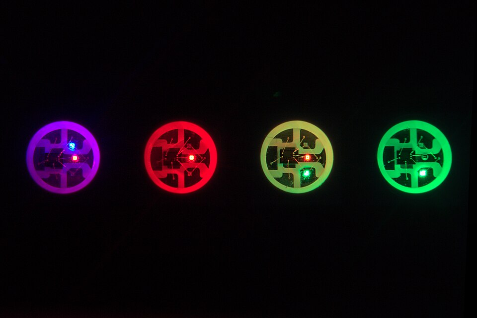
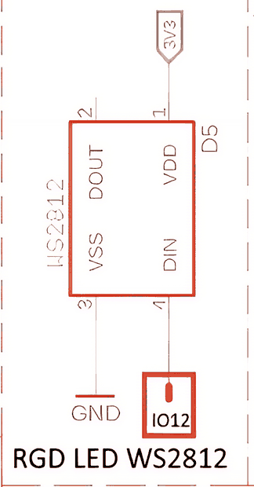
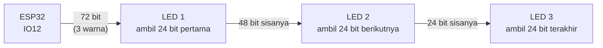
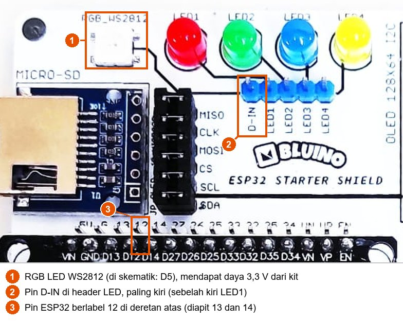
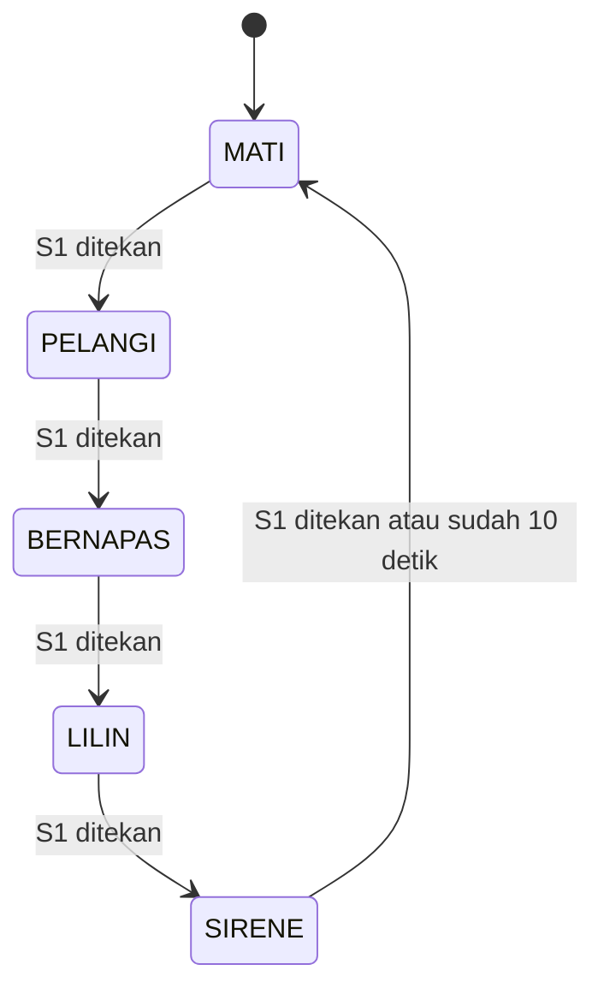

# BAB 36: RGB LED WS2812 (NeoPixel)

> ✅ **Prasyarat:** Selesaikan **BAB 8 (Digital Output — LED & *Buzzer*)**, **BAB 12 (PWM dengan LEDC)**, dan **BAB 16 (Non-Blocking Programming)** — kamu sudah bisa menyambung komponen kit dengan kabel *jumper*, paham arti kecerahan dan *duty cycle*, serta terbiasa memakai `millis()` sebagai pengganti `delay()`. Beberapa program juga memakai potensiometer dan LDR dari **BAB 11 (Analog Input & ADC)**, tombol dari **BAB 9 (Digital Input — Push Button)**, *state machine* dari **BAB 17 (State Machine)**, dan sensor suhu dari **BAB 26 (DHT11 — Suhu & Kelembapan)**.

Di kit ada satu LED kecil berbentuk kotak putih bertuliskan **RGB_WS2812**. Sekilas mirip LED biasa, tetapi di dalamnya ada tiga LED mungil (merah, hijau, biru) **ditambah sebuah chip pengendali**. Kamu cukup mengirim "nomor warna" lewat **satu** kabel data, lalu chip itu mengatur sendiri campuran ketiga warnanya — jutaan pilihan warna tanpa perlu tiga pin PWM. LED pintar seperti ini dipakai di *keyboard* RGB, lampu hias, lampu indikator di perangkat elektronik, sampai papan reklame LED. Di BAB ini kamu akan belajar cara kerjanya, cara memakainya dengan *library* FastLED, dan cara membuat efek animasi yang tetap responsif.

## 📌 Tujuan Pembelajaran

Setelah mempelajari BAB ini, kamu bisa:

- Menjelaskan beda LED RGB biasa dengan WS2812, serta cara kerja protokol datanya: satu kabel, 800 kHz, 24 bit per LED dengan urutan GRB, dan rantai LED (*daisy-chain*).
- Menyambung WS2812 kit ke IO12 dengan aman dan menjelaskan kenapa IO12 sebagai pin *strapping* perlu diperhatikan.
- Memakai *library* FastLED: `FastLED.addLeds()`, `CRGB`, `CHSV`, `FastLED.show()`, `FastLED.clear()`, dan `FastLED.setBrightness()`.
- Memilih warna dengan model **RGB** maupun **HSV**, dan tahu kapan HSV lebih praktis.
- Menjelaskan kecerahan global, "peredupan ganda", dan koreksi gamma.
- Membuat efek animasi untuk satu LED (bernapas, pelangi, sirene, lilin) tanpa `delay()`.
- Membuat indikator warna yang bereaksi terhadap sensor dan lampu suasana berbasis *state machine*.
- Memperkirakan kebutuhan arus WS2812 dan tahu apa yang perlu disiapkan kalau ingin memakai *strip* WS2812 yang panjang.

## 🧰 Yang Perlu Disiapkan

| Kebutuhan | Keterangan |
|---|---|
| *Hardware* | Kit Bluino ESP32 IoT Starter Shield (WS2812 sudah terpasang di PCB) + kabel USB **data** |
| Kabel *jumper* | 1 kabel *female-female* untuk WS2812 (`D-IN` → `12`) yang dipakai di semua program, ditambah paling banyak 2 kabel lagi per program (potensiometer, LDR, DHT11, atau tombol S1). Totalnya 5 kabel berbeda untuk seluruh BAB — semuanya ada di kit |
| Komponen tambahan | Tidak ada. Opsional untuk [36.11](#3611-daya-dan-strip-ws2812-eksternal): *strip* WS2812 dan catu daya 5 V (tidak termasuk kit) |
| *Software* | Arduino IDE 2.x + *board package* **esp32** versi 3.3.x (lihat [BAB 5](../BAB-05/README.md)) |
| *Library* | **FastLED** oleh Daniel Garcia (diuji dengan versi 3.10.8). Program 4 juga memakai **DHT sensor library** oleh Adafruit + **Adafruit Unified Sensor** |
| Alat uji | **Serial Monitor** Arduino IDE (baud 115200), ditambah matamu untuk mengamati warna LED |
| Jaringan | Tidak perlu WiFi |

## 📑 Daftar Isi

- [36.1 Mengenal WS2812 (NeoPixel)](#361-mengenal-ws2812-neopixel)
- [36.2 Cara Kerja Protokol Data WS2812](#362-cara-kerja-protokol-data-ws2812)
- [36.3 Warna Digital: RGB dan HSV](#363-warna-digital-rgb-dan-hsv)
- [36.4 Kecerahan, Peredupan Ganda, dan Gamma](#364-kecerahan-peredupan-ganda-dan-gamma)
- [36.5 Menyiapkan Rangkaian dan *Library* FastLED](#365-menyiapkan-rangkaian-dan-library-fastled)
- [36.6 Program 1: Warna Dasar RGB](#366-program-1-warna-dasar-rgb)
- [36.7 Program 2: Roda Warna dengan Potensiometer](#367-program-2-roda-warna-dengan-potensiometer)
- [36.8 Program 3: Efek Animasi Satu LED](#368-program-3-efek-animasi-satu-led)
- [36.9 Program 4: Indikator Suhu Berwarna](#369-program-4-indikator-suhu-berwarna)
- [36.10 Program 5: Lampu Suasana dengan State Machine](#3610-program-5-lampu-suasana-dengan-state-machine)
- [36.11 Daya dan *Strip* WS2812 Eksternal](#3611-daya-dan-strip-ws2812-eksternal)
- [36.12 Troubleshooting](#3612-troubleshooting)
- [📝 Rangkuman](#-rangkuman)
- [💪 Latihan](#-latihan)
- [📚 Referensi](#-referensi)

---

## 36.1 Mengenal WS2812 (NeoPixel)

**WS2812** adalah LED RGB "pintar" buatan Worldsemi. Di dalam satu kemasan kecil berukuran 5 × 5 mm ada empat benda: chip LED merah, chip LED hijau, chip LED biru, dan sebuah **IC** (*integrated circuit*, chip pengendali) yang mengatur ketiganya. Nama **NeoPixel** sebenarnya merek dagang Adafruit untuk produk-produk berbasis WS2812, tetapi kini sering dipakai untuk menyebut semua LED sejenis. Istilah umumnya adalah LED ***addressable*** (bisa dialamati): setiap LED dalam satu rantai bisa diberi warna sendiri-sendiri.



*Gambar 36.1 — Empat WS2812 dilihat dari dekat. Di tengah setiap LED ada chip pengendali, di sampingnya tiga chip LED kecil. Perhatikan cara warna dibuat: ungu = chip merah + biru menyala, kuning = chip merah + hijau menyala. Sumber: [Daniele Napolitano (DnaX)](https://commons.wikimedia.org/wiki/File:WS2812Closeup2.jpg), lisensi CC BY-SA 4.0.*

### 36.1.1 LED RGB Biasa vs WS2812

Kamu bisa saja membuat warna dengan LED RGB biasa (empat kaki: merah, hijau, biru, dan kaki bersama). Bedanya terasa sekali saat jumlah LED bertambah:

| Hal | LED RGB biasa | WS2812 |
|---|---|---|
| Pin ESP32 yang dipakai | 3 pin PWM **per LED** | 1 pin data untuk **seluruh rantai** LED |
| Siapa yang mengatur kecerahan tiap warna | ESP32 (3 *channel* LEDC, lihat [BAB 12](../BAB-12/README.md)) | Chip di dalam LED itu sendiri |
| Jumlah warna | Bergantung resolusi PWM (8 bit → 256 × 256 × 256 ≈ 16,7 juta) | 256 × 256 × 256 ≈ 16,7 juta |
| Kalau ESP32 sibuk | PWM tetap jalan (dibuat *hardware* LEDC) | Warna tetap tampil; LED menyimpan warna terakhir sampai ada data baru |
| Menambah LED | Butuh 3 pin dan 3 *channel* PWM lagi — cepat habis | Cukup sambung DOUT LED pertama ke DIN LED berikutnya |
| Resistor | Butuh resistor untuk setiap warna | Tidak perlu — arus setiap warna diatur chip di dalamnya |

Jadi untuk 1 LED, keduanya sama-sama bisa. Keunggulan WS2812 muncul saat kamu memakai puluhan sampai ratusan LED, misalnya *strip* LED sepanjang 1 meter, dengan **satu pin** saja.

### 36.1.2 WS2812 di Kit Bluino

Kit Bluino punya **satu** WS2812 (di skematik bernama **D5**). Kaki-kakinya mengikuti *datasheet* WS2812B: 1 = VDD (daya), 2 = DOUT (data keluar), 3 = VSS (GND), 4 = DIN (data masuk).



*Gambar 36.2 — Rangkaian WS2812 pada kit: VDD dari 3V3, VSS ke GND, DIN ke pin header (kotak IO12, di PCB berlabel `D-IN`), DOUT tidak dipakai. Sumber: skematik ESP32 Starter Shield 3.2, [Bluino](http://www.bluino.com).*

Dari skematik ini ada tiga hal penting:

1. **DIN belum tersambung ke ESP32.** Kotak bertuliskan IO12 hanyalah pin header berlabel `D-IN` di PCB. Pin **12** adalah pin yang *disarankan* perancang kit, jadi kamu harus memasang kabel *jumper* `D-IN` → `12` sendiri (caranya di [36.5.1](#3651-memasang-kabel-d-in-ke-io12)). Tanpa kabel ini, WS2812 tidak akan pernah menyala.
2. **DOUT tidak dipakai**, karena kit hanya punya satu LED. Di *strip* LED, DOUT inilah yang meneruskan data ke LED berikutnya.
3. **WS2812 diberi daya 3,3 V**, bukan 5 V seperti *strip* LED pada umumnya.

Poin ketiga perlu dibahas jujur. *Datasheet* WS2812B menyebut tegangan catu **3,5–5,3 V**, sedangkan kit memberinya 3,3 V — sedikit di bawah batas bawah itu. Di praktiknya LED tetap bekerja, tetapi ada akibatnya:

| Warna | Tegangan maju chip LED (*datasheet*) | Dampak saat dicatu 3,3 V |
|---|---|---|
| Merah | 2,0–2,2 V | Masih punya sisa tegangan, menyala normal |
| Hijau | 3,0–3,4 V | Sisa tegangannya tipis, bisa lebih redup dari seharusnya |
| Biru | 3,0–3,4 V | Sisa tegangannya tipis, bisa lebih redup dari seharusnya |

Akibatnya, warna yang butuh hijau dan biru (misalnya putih atau *cyan*) bisa tampak sedikit berbeda dari layar komputer — putih bisa agak kemerahan atau kekuningan — dan hasilnya bisa berbeda antara satu kit dan kit lain. Itu bukan kesalahan programmu. Keuntungannya juga ada: *datasheet* meminta sinyal data HIGH minimal **0,7 × VDD**. Dengan VDD 3,3 V, batas itu hanya 2,31 V, sehingga sinyal 3,3 V dari ESP32 pasti terbaca dengan andal tanpa pengubah level tegangan.

**Arus.** Adafruit memakai angka **maksimal ±60 mA per LED** saat menyala putih penuh (merah + hijau + biru, jadi kira-kira ±20 mA per warna) untuk menghitung kebutuhan catu daya. Pada 3,3 V arus hijau dan biru biasanya lebih kecil lagi. Untuk satu LED, ±60 mA masih aman bagi regulator 3,3 V di *board* ESP32 dan *port* USB. Jadi di BAB ini kecerahan dibatasi **demi kenyamanan mata** — WS2812 yang menyala penuh dari jarak dekat sangat menyilaukan — bukan karena USB tidak kuat. Perhitungan untuk *strip* yang berisi banyak LED ada di [36.11](#3611-daya-dan-strip-ws2812-eksternal).

> ⚠️ **Perhatian:** Jangan menatap WS2812 yang menyala terang dari jarak dekat terlalu lama. Semua program di BAB ini memakai kecerahan sekitar 30% supaya nyaman dilihat.

---

## 36.2 Cara Kerja Protokol Data WS2812

Bagaimana satu kabel bisa membawa informasi warna? Jawabannya: ESP32 mengirim deretan **bit** (angka 0 dan 1) lewat kabel itu dengan kecepatan **800.000 bit per detik** (800 kHz). Tidak ada kabel *clock* (detak) terpisah seperti pada I2C atau SPI, jadi WS2812 membedakan 0 dan 1 dari **lamanya** sinyal HIGH. Protokol seperti ini sering disebut protokol **satu kabel** (*one-wire*), tetapi jangan tertukar dengan protokol OneWire milik DS18B20 di [BAB 25](../BAB-25/README.md) — keduanya sama sekali berbeda.

### 36.2.1 Bit 0 dan Bit 1: Dibedakan dari Lebar Pulsa

Bayangkan kode Morse dengan senter: kedipan pendek berarti titik, kedipan panjang berarti garis. WS2812 bekerja mirip, hanya saja jauh lebih cepat. Setiap bit berlangsung sekitar **1,25 µs** (mikrodetik, sepersejuta detik):

```text
Bit 0:  ┌──────┐
        │      │_________________   HIGH ±0,40 µs, lalu LOW ±0,85 µs

Bit 1:  ┌──────────────┐
        │              │_________   HIGH ±0,80 µs, lalu LOW ±0,45 µs

        |<- satu bit ±1,25 µs ->|
```

| Kode | Lama HIGH | Lama LOW | Toleransi |
|---|---|---|---|
| Bit 0 | 0,40 µs | 0,85 µs | ±150 ns |
| Bit 1 | 0,80 µs | 0,45 µs | ±150 ns |
| *Reset* (tanda selesai) | — | Minimal 50 µs (versi WS2812B yang lebih baru meminta ±280 µs) | — |

*Sumber angka: datasheet WS2812B (Worldsemi). Satuan ns = nanodetik, seperseribu mikrodetik.*

Toleransinya hanya ±150 ns. Kalau program membuat pulsa ini dengan `digitalWrite()` biasa, satu gangguan kecil (misalnya interupsi WiFi) sudah cukup untuk membuat warnanya kacau. Karena itu kita tidak membuat pulsanya sendiri — *library* FastLED menyerahkan tugas ini ke *hardware* khusus di ESP32 (lihat [36.2.4](#3624-rmt-pembuat-pulsa-presisi-di-esp32)).

### 36.2.2 24 Bit per LED dengan Urutan GRB

Setiap LED butuh **24 bit**: 8 bit untuk hijau, 8 bit untuk merah, dan 8 bit untuk biru. Delapan bit bisa menyimpan angka 0–255, jadi setiap warna punya 256 tingkat kecerahan, dan semua kombinasinya ada 256 × 256 × 256 = 16.777.216 warna.

Perhatikan urutannya: WS2812 menerima **hijau dulu, lalu merah, lalu biru** (GRB), bukan RGB. Bit yang paling besar nilainya (MSB, *most significant bit*) dikirim lebih dulu:

```text
G7 G6 G5 G4 G3 G2 G1 G0 | R7 R6 R5 R4 R3 R2 R1 R0 | B7 B6 B5 B4 B3 B2 B1 B0
<------ 8 bit hijau ---> <------ 8 bit merah ---> <------ 8 bit biru ---->
```

Contoh: warna oranye dengan merah = 255, hijau = 128, biru = 0 dikirim sebagai `10000000` (hijau 128) `11111111` (merah 255) `00000000` (biru 0). Kamu tidak perlu menghitung bit sendiri; cukup beri tahu FastLED bahwa urutannya **GRB**, dan FastLED yang menyusunnya. Kalau urutan ini salah, warnanya tertukar: kamu meminta merah, yang menyala justru hijau.

### 36.2.3 Rantai LED dan Sinyal *Reset*

Di *strip* LED, setiap WS2812 disambung berantai: DOUT LED pertama ke DIN LED kedua, dan seterusnya. Cara mereka berbagi data mirip barisan murid yang membagikan lembar soal: murid pertama mengambil lembar paling atas, lalu meneruskan sisa tumpukan ke belakang.



*Gambar 36.3 — Cara data mengalir di rantai tiga WS2812. Setiap LED mengambil 24 bit pertama yang datang, lalu meneruskan sisanya lewat DOUT (sinyalnya dirapikan ulang oleh chip, jadi tidak makin rusak di LED ke-100). Sumber: dibuat untuk materi ini.*

Setelah semua data terkirim, ESP32 membiarkan kabel data LOW sedikitnya 50 µs. Jeda diam ini adalah sinyal ***reset***: artinya "data selesai, tampilkan sekarang". Semua LED lalu menampilkan warna barunya **bersamaan**, dan setelah itu siap menerima data berikutnya mulai dari LED pertama lagi. FastLED memakai jeda 280 µs supaya cocok dengan WS2812B versi lama maupun baru.

Hitung-hitungan kecilnya: 24 bit × 1,25 µs = 30 µs per LED. Untuk satu LED di kit, satu kali kirim data hanya butuh ±30 µs ditambah jeda *reset* ±0,3 ms — sangat cepat.

> 📌 **Catatan:** Chip WS2812 **mengingat** warna terakhirnya selama masih mendapat daya. Kalau ESP32 di-*reset* atau sedang di-*upload*, WS2812 tetap menyala dengan warna lama sampai program baru mengirim data. Karena itu semua program di BAB ini mematikan LED di awal `setup()`.

### 36.2.4 RMT: Pembuat Pulsa Presisi di ESP32

ESP32 punya periferal bernama **RMT** (*Remote Control Transceiver*). Aslinya RMT dibuat untuk membangkitkan dan membaca sinyal *remote* inframerah, tetapi kemampuannya membuat deretan pulsa dengan lebar yang sangat tepat cocok sekali untuk WS2812. FastLED menyiapkan daftar pulsa (HIGH sekian ns, LOW sekian ns), lalu RMT yang mengeluarkannya di IO12 — tidak terganggu interupsi atau WiFi karena dikerjakan *hardware*.

Kamu tidak perlu mengatur RMT secara langsung. Cukup ingat: **WS2812 butuh pewaktuan yang sangat ketat, dan di ESP32 pekerjaan itu dilakukan RMT lewat FastLED.**

---

## 36.3 Warna Digital: RGB dan HSV

### 36.3.1 RGB: Mencampur Tiga Cahaya

Warna pada WS2812 dibuat dengan mencampur cahaya merah (*Red*), hijau (*Green*), dan biru (*Blue*) — disebut model **RGB**. Ini **campuran cahaya**, bukan campuran cat: makin banyak warna yang dinyalakan, hasilnya makin terang, dan ketiganya penuh menghasilkan putih. Lihat lagi Gambar 36.1: LED kuning ternyata adalah chip merah dan hijau yang menyala bersamaan.

Di FastLED, warna RGB disimpan dalam tipe data `CRGB`, yaitu tiga angka 0–255:

| Kode | Merah | Hijau | Biru | Hasil |
|---|---|---|---|---|
| `CRGB(255, 0, 0)` | 255 | 0 | 0 | Merah |
| `CRGB(0, 255, 0)` | 0 | 255 | 0 | Hijau |
| `CRGB(0, 0, 255)` | 0 | 0 | 255 | Biru |
| `CRGB(255, 255, 0)` | 255 | 255 | 0 | Kuning |
| `CRGB(0, 255, 255)` | 0 | 255 | 255 | *Cyan* (biru muda kehijauan) |
| `CRGB(255, 0, 255)` | 255 | 0 | 255 | Magenta (ungu kemerahan) |
| `CRGB(255, 255, 255)` | 255 | 255 | 255 | Putih |
| `CRGB(0, 0, 0)` | 0 | 0 | 0 | Mati (hitam) |

FastLED juga punya nama warna siap pakai seperti `CRGB::Red`, `CRGB::Blue`, `CRGB::White`, dan `CRGB::Black` (mati). Nama-nama ini mengikuti daftar warna HTML.

> ⚠️ **Perhatian:** Karena mengikuti warna HTML, `CRGB::Green` bernilai `(0, 128, 0)` — hanya **setengah** terang! Hijau penuh `(0, 255, 0)` di FastLED bernama `CRGB::Lime`. Begitu juga `CRGB::Purple` = `(128, 0, 128)`. Kalau ragu, tulis angkanya langsung, misalnya `CRGB(0, 255, 0)`.

### 36.3.2 HSV: Roda Warna

Coba pikirkan: bagaimana caranya membuat LED berganti warna perlahan dari merah → kuning → hijau → biru → ungu → kembali merah dengan RGB? Kamu harus menaikkan dan menurunkan tiga angka secara bergantian — merepotkan. Di sinilah model **HSV** membantu. HSV menggambarkan warna dengan tiga angka yang lebih mirip cara manusia berpikir:

| Huruf | Kepanjangan | Arti | Rentang di FastLED |
|---|---|---|---|
| H | *Hue* (rona) | **Jenis warnanya** — posisi di roda warna | 0–255 (melingkar: setelah 255 kembali ke 0) |
| S | *Saturation* (saturasi) | **Kepekatan** warna. 255 = warna pekat, 0 = putih | 0–255 |
| V | *Value* (nilai kecerahan) | **Kecerahan**. 0 = mati, 255 = paling terang | 0–255 |

Di FastLED, warna HSV ditulis dengan `CHSV(hue, saturasi, kecerahan)`. Saat kamu menulis `leds[0] = CHSV(...)`, FastLED otomatis mengubahnya menjadi RGB, karena WS2812 hanya mengerti RGB. Bayangkan *hue* sebagai jarum jam pada roda warna:

| *Hue* | Warna | Hasil RGB dari `CHSV(hue, 255, 255)` |
|---|---|---|
| 0 | Merah | (255, 0, 0) |
| 32 | Oranye | (171, 85, 0) |
| 64 | Kuning | (171, 170, 0) |
| 96 | Hijau | (0, 255, 0) |
| 128 | Toska (*aqua*) | (0, 171, 85) |
| 160 | Biru | (0, 0, 255) |
| 192 | Ungu | (85, 0, 171) |
| 224 | Merah muda | (170, 0, 85) |
| 255 | Hampir merah lagi | (253, 0, 2) |

*Angka RGB dihitung dari rumus `hsv2rgb_rainbow()` di FastLED 3.10.8.*

Perhatikan kuning (171, 170, 0) tidak memakai angka 255. Itu disengaja: FastLED menyeimbangkan kecerahan setiap *hue* supaya kuning tidak tampak jauh lebih terang daripada warna lain saat roda warna diputar.

Dengan HSV, efek pelangi cukup ditulis dengan **menaikkan satu angka**:

```cpp
// Potongan kode: hue naik 1 setiap kali baris ini dijalankan
hue = hue + 1;                    // uint8_t: setelah 255 otomatis kembali ke 0
leds[0] = CHSV(hue, 255, 255);    // saturasi penuh, kecerahan penuh
FastLED.show();
```

### 36.3.3 Kapan Memakai RGB, Kapan HSV?

| Kebutuhan | Pilihan yang lebih mudah | Contoh |
|---|---|---|
| Warna tetap yang angkanya sudah diketahui | RGB (`CRGB`) | Lampu status merah, warna dari *color picker* di HP |
| Berpindah warna secara halus (pelangi, gradasi) | HSV (`CHSV`) — ubah *hue* | Lampu suasana, indikator suhu |
| Mengatur kecerahan tanpa mengubah jenis warna | HSV (`CHSV`) — ubah *value* | Efek bernapas |
| Membuat warna pastel/lembut | HSV (`CHSV`) — turunkan *saturation* | `CHSV(160, 128, 255)` = biru muda pastel |

Keduanya bisa dicampur dalam satu program, karena `CHSV` selalu diubah menjadi `CRGB` sebelum dikirim.

---

## 36.4 Kecerahan, Peredupan Ganda, dan Gamma

### 36.4.1 Kecerahan Global dengan setBrightness()

FastLED punya pengatur kecerahan untuk **semua** LED sekaligus:

```cpp
FastLED.setBrightness(80);   // 0–255; 80 ≈ 31% dari kecerahan penuh
```

Bayangkan tombol volume utama pada *speaker*: lagunya tetap sama, hanya kerasnya yang diatur. Saat `FastLED.show()` dipanggil, setiap angka warna dikalikan dengan kecerahan global, kira-kira:

```text
nilai yang dikirim ≈ nilai warna × kecerahan global ÷ 256
contoh: merah 255 dengan setBrightness(80) → 255 × 81 ÷ 256 ≈ 80
```

Isi `leds[]` sendiri **tidak berubah** — perkalian itu hanya terjadi saat data dikirim. Jadi `leds[0].r` tetap 255, walaupun yang benar-benar dikirim ke LED hanya ±80. Nilai `setBrightness()` juga boleh diubah kapan saja saat program berjalan (Program 4 dan Program 5 memanfaatkannya).

### 36.4.2 Peredupan Ganda

Ada dua tempat untuk meredupkan LED: kecerahan global (`setBrightness()`) dan kecerahan warna itu sendiri (angka RGB atau *value* pada `CHSV`). Masalah muncul kalau keduanya dipakai untuk tujuan yang sama. Misalnya kamu ingin LED "sekitar 30%", lalu menulis:

```cpp
FastLED.setBrightness(80);          // ±31%
leds[0] = CRGB(80, 0, 0);           // merah ±31% juga
// hasil: 80 × 81 ÷ 256 ≈ 25 dari 255 → hanya ±10%, jauh lebih redup dari niatmu
```

Kedua pengurangan itu **dikalikan**, bukan dipilih salah satu. Mirip memutar volume HP ke 30% dan volume *speaker* Bluetooth juga ke 30% — suaranya jadi sangat pelan. Inilah yang disebut **peredupan ganda** (*double dimming*). Kesalahan yang paling sering: membatasi kecerahan di `setBrightness()`, lalu membatasinya sekali lagi di *value* `CHSV` dengan angka yang sama, misalnya `CHSV(hue, 255, 80)` — hasilnya hanya ±3% dari kecerahan penuh, karena *value* `CHSV` juga ikut dibengkokkan oleh kurva redup ([36.4.3](#3643-mata-tidak-linear-koreksi-gamma)).

Aturan yang dipakai di semua program BAB ini:

1. **`FastLED.setBrightness()` adalah satu-satunya "pembatas kecerahan".** Nilainya diatur sekali (`KECERAHAN = 80`) atau diubah oleh sensor/potensiometer.
2. **Warna dan efek memakai rentang penuh 0–255.** Efek bernapas misalnya menggerakkan *value* dari hampir 0 sampai 255; hasil akhirnya otomatis tidak pernah melebihi batas global.
3. Kalau kamu **sengaja** ingin satu warna lebih redup dari yang lain (misalnya mode "siaga" yang redup), turunkan *value*-nya, dan ingat bahwa hasilnya masih akan dikalikan lagi dengan kecerahan global.

### 36.4.3 Mata Tidak Linear: Koreksi Gamma

Di [BAB 12](../BAB-12/README.md) kamu sudah melihat bahwa LED dengan *duty cycle* 50% tampak jauh lebih terang daripada "setengahnya". Mata manusia lebih peka terhadap perubahan di bagian redup. Akibatnya, kalau kecerahan dinaikkan lurus 0, 1, 2, …, 255, LED tampak cepat sekali menjadi terang lalu "tertahan" lama di bagian terang.

Cara mengakalinya disebut **koreksi gamma**: angka kecerahan "dibengkokkan" dulu sebelum dikirim, supaya bagian redup mendapat langkah yang lebih banyak. FastLED sudah melakukan sebagian pekerjaan ini untukmu:

| Cara mengatur kecerahan | Sudah dikoreksi? | Contoh: angka 128 menjadi … |
|---|---|---|
| *Value* pada `CHSV(hue, sat, value)` | **Ya** — FastLED mengkuadratkan *value* (kurva mirip gamma 2) | `CHSV(0, 255, 128)` → merah ±65, bukan 128 |
| Angka RGB pada `CRGB(r, g, b)` | Tidak — lurus apa adanya | `CRGB(128, 0, 0)` → merah 128 |
| `FastLED.setBrightness()` | Tidak — lurus apa adanya | 128 → ±50% dari nilai warna |
| Fungsi `dim8_raw(x)` | Ya — kurvanya hampir sama dengan *value* pada `CHSV` | `dim8_raw(128)` → 64 |

Contoh lengkap pengaruh *value* pada `CHSV(0, 255, value)` (merah):

| *Value* | 255 | 192 | 128 | 64 | 32 |
|---|---|---|---|---|---|
| Merah yang dihasilkan | 255 | 145 | 65 | 17 | 5 |

Jadi efek bernapas yang dibuat dengan *value* `CHSV` (seperti di Program 3) sudah tampak alami. Kalau kamu membuat efek redup-terang dengan angka `CRGB`, lewatkan angkanya ke `dim8_raw()` dulu, misalnya `leds[0] = CRGB(dim8_raw(x), 0, 0);`. Kamu akan membandingkan keduanya sendiri di bagian 🧪 **Coba Sendiri** Program 3.

<details>
<summary><b>🔬 Pendalaman (opsional): <i>dithering</i> — kenapa LED kadang bergetar halus saat sangat redup</b></summary>

Saat kecerahan global di bawah 255, FastLED secara bawaan menyalakan ***dithering*** (pengacakan halus): nilai yang dikirim dibuat berselang-seling sedikit (misalnya 4, 5, 4, 5, …) setiap kali `show()` dipanggil, supaya rata-ratanya terlihat seperti 4,5. Teknik ini menambah kehalusan gradasi kalau `show()` dipanggil sangat sering.

Pada nilai yang sangat kecil (1 atau 2 dari 255) selisih satu langkah itu cukup besar, sehingga LED bisa tampak bergetar halus. Kalau terganggu, matikan *dithering* di `setup()`:

```cpp
FastLED.setDither(DISABLE_DITHER);   // kirim nilai yang sama persis di setiap show()
```

</details>

---

## 36.5 Menyiapkan Rangkaian dan *Library* FastLED

### 36.5.1 Memasang Kabel D-IN ke IO12

Semua program di BAB ini membutuhkan kabel ini:

| Pin di kit | Sambungkan ke pin ESP32 | Letak pin ESP32 |
|---|---|---|
| `D-IN` (header LED, pin paling kiri) | IO12 (label `12`) | Deretan atas, di antara `13` dan `14` |



*Gambar 36.4 — Letak WS2812 (1), pin `D-IN` (2), dan pin ESP32 berlabel `12` (3) pada kit v3.x; tata letak kit v3.2 milikmu bisa sedikit berbeda. Sumber: foto produk ESP32 Starter Shield, [Bluino](http://www.bluino.com), dipotong dan diberi penanda untuk materi ini.*

Langkah memasang kabel:

1. Cabut kabel USB dulu supaya aman saat merangkai.
2. Cari *header* LED (pin biru di bawah keempat LED 5 mm). Urutan labelnya dari kiri: `D-IN`, `LED1`, `LED2`, `LED3`, `LED4`. Pasang satu ujung kabel *jumper* di pin **`D-IN`** (paling kiri).
3. Pasang ujung lainnya di pin berlabel **12** di deretan pin ESP32 atas. Urutan deretan atas dari kiri: `5V`, `G`, `13`, `12`, `14`, `27`, … — jadi `12` adalah pin ke-4 dari kiri, diapit `13` dan `14`.
4. Periksa sekali lagi bahwa kabel tidak bergeser satu pin, lalu sambungkan kembali kabel USB.

**Kenapa harus teliti di pin 12?** IO12 adalah **pin *strapping*** (lihat [BAB 6](../BAB-06/README.md)). Setiap kali ESP32 dinyalakan atau di-*reset* — termasuk saat *upload* — ESP32 membaca level IO12 untuk memilih tegangan chip memori *flash*:

| Level IO12 saat *boot* | Tegangan *flash* yang dipilih | Akibat pada ESP32 DEVKIT V1 |
|---|---|---|
| LOW (normal) | 3,3 V | *Boot* normal |
| HIGH | 1,8 V | *Flash* 3,3 V kekurangan tegangan → gagal *boot*, terus *restart* dengan pesan seperti `flash read err, 1000` |

ESP32 punya resistor *pull-down* internal yang menahan IO12 tetap LOW saat *boot*, dan input DIN WS2812 tidak menarik IO12 ke HIGH. Jadi kabel `D-IN` → `12` **aman**. Yang berbahaya adalah kalau pin `12` tersambung ke jalur yang punya resistor *pull-up* atau mengeluarkan HIGH.

> ⚠️ **Perhatian:** Pin `12` bersebelahan dengan `14`, yang dipakai DS18B20 (`DS` → `14`), dan tidak jauh dari `27` yang dipakai DHT11. Jalur `DS` dan `DHT` punya resistor *pull-up* 4,7 kΩ ke 3,3 V. Kalau kabel dari `DS` atau `DHT` tidak sengaja tertancap di `12`, IO12 menjadi HIGH saat *boot* dan ESP32 tidak mau menyala. Jangan pula memasang tombol ke 3,3 V atau resistor *pull-up* di IO12. Kalau ESP32 tiba-tiba terus *restart* setelah kamu memasang kabel, cabut USB dan periksa kabel di sekitar pin `12` lebih dulu.

### 36.5.2 Memasang *Library* FastLED

FastLED adalah *library* untuk mengendalikan berbagai jenis LED *addressable*, termasuk WS2812. Selain mengirim data, FastLED punya banyak fungsi bantu untuk warna dan animasi (`CHSV`, `sin8()`, `dim8_raw()`, dan lain-lain). Ada juga *library* populer lain, **Adafruit NeoPixel**; keduanya bagus, tetapi BAB ini memakai FastLED.

1. Buka Arduino IDE → **Sketch → Include Library → Manage Libraries…** (atau klik ikon buku di bilah kiri).
2. Ketik **FastLED** di kotak pencarian.
3. Pilih **FastLED** oleh **Daniel Garcia**, lalu klik **Install**. BAB ini diuji dengan versi **3.10.8**; versi 3.10.x yang lebih baru seharusnya juga bisa.
4. Tunggu sampai muncul tulisan **INSTALLED**.

> 📌 **Catatan:** FastLED adalah *library* besar. *Compile* pertama kali bisa memakan waktu beberapa menit (di komputer penulis materi ±2–3 menit); *compile* berikutnya jauh lebih cepat karena hasilnya disimpan. Jangan menutup Arduino IDE selama proses ini. Kalau di jendela *output* muncul pesan *warning* yang berasal dari folder FastLED, biarkan saja selama prosesnya berakhir dengan **Done compiling** / **Done uploading**.

### 36.5.3 Kerangka Program FastLED

Semua program di BAB ini memakai kerangka yang sama. Potongan kode berikut belum program lengkap, tetapi berisi bagian yang wajib ada:

```cpp
#include <FastLED.h>

#define PIN_WS2812 12   // D-IN WS2812 → IO12
#define JUMLAH_LED 1    // kit hanya punya 1 WS2812
#define KECERAHAN  80   // kecerahan global 0–255 (±31%)

CRGB leds[JUMLAH_LED];  // "buffer": tempat menyimpan warna setiap LED di memori

// --- di dalam setup() ---
FastLED.addLeds<WS2812B, PIN_WS2812, GRB>(leds, JUMLAH_LED);  // daftarkan LED ke FastLED
FastLED.setBrightness(KECERAHAN);  // satu-satunya pembatas kecerahan
FastLED.clear(true);               // kosongkan buffer dan langsung matikan LED

// --- setiap kali warna perlu diubah (misalnya di dalam loop()) ---
leds[0] = CRGB(255, 0, 0);  // 1) ubah warna di buffer (LED belum berubah)
FastLED.show();             // 2) kirim isi buffer ke LED → sekarang LED menyala merah
```

| Baris | Artinya |
|---|---|
| `CRGB leds[JUMLAH_LED];` | *Array* berisi warna untuk setiap LED. Karena kit hanya punya 1 LED, satu-satunya elemen adalah `leds[0]`. |
| `FastLED.addLeds<WS2812B, PIN_WS2812, GRB>(...)` | Memberi tahu FastLED tiga hal: jenis chip (**WS2812B** — di FastLED, `WS2812` dan `WS2812B` memakai pewaktuan yang sama), pin data (**12**), dan urutan warna (**GRB**). |
| `FastLED.setBrightness(KECERAHAN);` | Kecerahan global, lihat [36.4.1](#3641-kecerahan-global-dengan-setbrightness). |
| `FastLED.clear(true);` | Mengisi *buffer* dengan hitam lalu langsung mengirimnya. Tanpa `true`, hanya *buffer* yang dikosongkan dan LED masih menampilkan warna lama. |
| `leds[0] = ...;` | Mengubah warna **di memori saja**. |
| `FastLED.show();` | Mengirim seluruh isi `leds[]` ke rantai LED. Tanpa baris ini, LED tidak akan berubah. |

Pola "ubah *buffer* dulu, kirim kemudian" sama seperti OLED di [BAB 35](../BAB-35/README.md): `display.drawPixel()` hanya menggambar di memori, dan layar baru berubah setelah `display.display()`. Keuntungannya, kamu bisa mengubah banyak LED dulu lalu mengirim semuanya sekaligus, sehingga perubahannya tampak serentak.

> ⚠️ **Perhatian:** Indeks *array* dimulai dari 0. Dengan `JUMLAH_LED 1`, hanya `leds[0]` yang boleh dipakai. Menulis ke `leds[1]` berarti menulis di luar batas *array*: *compiler* tidak menolaknya, tetapi data lain di memori bisa rusak dan ESP32 bisa *restart* dengan pesan `Guru Meditation Error`. Hati-hati saat menyalin contoh efek dari internet yang ditulis untuk *strip* berisi puluhan LED.

---

## 36.6 Program 1: Warna Dasar RGB

**Tujuan:** Menampilkan sembilan warna dasar bergantian setiap 1 detik dengan `CRGB(merah, hijau, biru)`, sambil mencetak nama warna dan angka RGB-nya di Serial Monitor. Pergantian warnanya memakai `millis()`, bukan `delay()`.

**Rangkaian:**

| Pin di kit | Sambungkan ke pin ESP32 |
|---|---|
| `D-IN` (WS2812, *header* LED) | IO12 |

**Cara Menjalankan:**

1. Sambungkan kabel *jumper* sesuai tabel **Rangkaian** di atas (lihat [36.5.1](#3651-memasang-kabel-d-in-ke-io12)).
2. Pasang *library* **FastLED** kalau belum (lihat [36.5.2](#3652-memasang-library-fastled)).
3. Buka Arduino IDE → **File → New Sketch**, hapus isinya, lalu salin kode di bawah. Kode yang sama juga tersedia di *file* [`p1_warna_dasar.ino`](p1_warna_dasar/p1_warna_dasar.ino).
4. Pastikan **Tools → Board** = **ESP32 Dev Module** dan **Tools → Port** = *port* ESP32 kamu (misalnya `COM5` di Windows atau `/dev/ttyUSB0` di Linux).
5. Klik tombol **Upload** (ikon panah →) dan tunggu sampai muncul tulisan **Done uploading**.
6. Buka **Serial Monitor** (**Tools → Serial Monitor**) lalu pilih baud **115200**.

**Kode Program:**

<!-- sketch: p1_warna_dasar -->
```cpp
/*
 * BAB 36 - Program 1: Warna Dasar RGB
 * WS2812 menampilkan 9 warna bergantian setiap 1 detik (tanpa delay()).
 * Nama warna dan angka RGB-nya dicetak di Serial Monitor.
 *
 * Rangkaian: D-IN (header LED) → IO12
 * Library  : FastLED (Daniel Garcia)
 */

#include <FastLED.h>

#define PIN_WS2812 12   // D-IN WS2812 → IO12
#define JUMLAH_LED 1    // kit hanya punya 1 WS2812
#define KECERAHAN  80   // kecerahan global 0–255 (±31%)

CRGB leds[JUMLAH_LED];

// Satu warna = nama + tiga angka merah, hijau, biru (0–255)
struct Warna {
  const char *nama;
  uint8_t merah;
  uint8_t hijau;
  uint8_t biru;
};

const Warna DAFTAR_WARNA[] = {
  {"Merah",   255,   0,   0},
  {"Hijau",     0, 255,   0},
  {"Biru",      0,   0, 255},
  {"Kuning",  255, 255,   0},
  {"Cyan",      0, 255, 255},
  {"Magenta", 255,   0, 255},
  {"Oranye",  255,  80,   0},
  {"Putih",   255, 255, 255},
  {"Mati",      0,   0,   0},
};
const int JUMLAH_WARNA = sizeof(DAFTAR_WARNA) / sizeof(DAFTAR_WARNA[0]);

const unsigned long INTERVAL_MS = 1000;  // ganti warna setiap 1 detik
unsigned long waktuGanti = 0;
int urutan = 0;  // warna ke berapa yang akan ditampilkan berikutnya

void setup() {
  Serial.begin(115200);

  FastLED.addLeds<WS2812B, PIN_WS2812, GRB>(leds, JUMLAH_LED);
  FastLED.setBrightness(KECERAHAN);
  FastLED.clear(true);  // matikan LED (hapus warna sisa program sebelumnya)

  Serial.println("BAB 36 - Program 1: Warna Dasar RGB");
}

void loop() {
  unsigned long sekarang = millis();

  if (sekarang - waktuGanti >= INTERVAL_MS) {
    waktuGanti = sekarang;

    const Warna &w = DAFTAR_WARNA[urutan];
    leds[0] = CRGB(w.merah, w.hijau, w.biru);  // 1) ubah warna di buffer
    FastLED.show();                            // 2) kirim ke LED

    Serial.printf("Warna %d dari %d: %-8s CRGB(%3d, %3d, %3d)\n",
                  urutan + 1, JUMLAH_WARNA, w.nama, w.merah, w.hijau, w.biru);

    urutan = (urutan + 1) % JUMLAH_WARNA;  // setelah warna terakhir, kembali ke 0
  }

  // loop() tidak pernah tertahan, jadi di sini kamu bebas menambah tugas lain
}
```

**Penjelasan Kode:**

- `struct Warna` mengelompokkan nama warna dan tiga angka RGB-nya menjadi satu paket (lihat `struct` di [BAB 16](../BAB-16/README.md)). Tipe `uint8_t` adalah bilangan bulat 0–255, pas dengan rentang setiap warna.
- `DAFTAR_WARNA[]` berisi sembilan warna. `JUMLAH_WARNA` dihitung otomatis dengan `sizeof`, jadi kalau kamu menambah atau menghapus baris warna, angka ini ikut menyesuaikan dan indeks *array* tidak akan melewati batas.
- `const Warna &w = DAFTAR_WARNA[urutan];` membuat nama pendek `w` untuk warna yang sedang dipakai. Tanda `&` berarti `w` hanyalah "nama lain" dari elemen *array* itu, bukan salinannya.
- Di dalam `if`, program melakukan dua langkah FastLED: mengubah `leds[0]` lalu memanggil `FastLED.show()`. Setelah itu LED **tetap** menampilkan warna tersebut tanpa perlu dikirim ulang — chip WS2812 menyimpannya sendiri.
- `%-8s` di `Serial.printf()` mencetak teks dengan lebar 8 karakter rata kiri, sedangkan `%3d` mencetak angka dengan lebar 3 karakter. Hasilnya kolom angka di Serial Monitor tersusun rapi.
- `urutan = (urutan + 1) % JUMLAH_WARNA;` memakai operator sisa bagi `%`: setelah warna ke-9 (indeks 8), `9 % 9 = 0`, sehingga urutan kembali ke awal.
- Angka yang dicetak adalah isi `leds[0]` **sebelum** dikalikan kecerahan global. Yang benar-benar dikirim ke LED kira-kira sepertiganya (lihat [36.4.1](#3641-kecerahan-global-dengan-setbrightness)).

**Contoh Output:**

```text
BAB 36 - Program 1: Warna Dasar RGB
Warna 1 dari 9: Merah    CRGB(255,   0,   0)
Warna 2 dari 9: Hijau    CRGB(  0, 255,   0)
Warna 3 dari 9: Biru     CRGB(  0,   0, 255)
Warna 4 dari 9: Kuning   CRGB(255, 255,   0)
Warna 5 dari 9: Cyan     CRGB(  0, 255, 255)
Warna 6 dari 9: Magenta  CRGB(255,   0, 255)
Warna 7 dari 9: Oranye   CRGB(255,  80,   0)
Warna 8 dari 9: Putih    CRGB(255, 255, 255)
Warna 9 dari 9: Mati     CRGB(  0,   0,   0)
Warna 1 dari 9: Merah    CRGB(255,   0,   0)
```

Di kit: WS2812 berganti warna setiap detik sesuai urutan di Serial Monitor, lalu mati selama 1 detik dan mengulang dari merah. Seperti dibahas di [36.1.2](#3612-ws2812-di-kit-bluino), putih dan *cyan* bisa tampak sedikit kemerahan atau kurang terang karena WS2812 di kit dicatu 3,3 V — itu normal.

> 🧪 **Coba Sendiri:** Ganti baris `{"Hijau", 0, 255, 0},` menjadi `{"Hijau", 0, 128, 0},` lalu *upload* ulang. Inilah nilai `CRGB::Green` di FastLED — terlihat jelas lebih redup daripada hijau penuh. Coba juga ubah `KECERAHAN` menjadi `20` dan `255`, lalu bandingkan.

**Kalau Belum Berhasil:**

- **Serial Monitor menampilkan tulisan, tetapi WS2812 tidak menyala sama sekali** → kabel `D-IN` → `12` belum terpasang atau salah pin. Pastikan ujung kabel ada di pin **paling kiri** *header* LED (bukan `LED1`) dan di pin berlabel **12** (bukan `13` atau `14`).
- **LED merah 5 mm (LED1) berkedip redup, WS2812 diam** → kabel tertancap di pin `LED1`, bukan `D-IN`. Geser satu pin ke kiri.
- **Warna tertukar (diminta merah, yang menyala hijau)** → urutan warna di `addLeds` bukan `GRB`. Pastikan tertulis `FastLED.addLeds<WS2812B, PIN_WS2812, GRB>`.
- ***Error* `FastLED.h: No such file or directory`** → *library* FastLED belum terpasang. Ulangi [36.5.2](#3652-memasang-library-fastled).

---

## 36.7 Program 2: Roda Warna dengan Potensiometer

**Tujuan:** Memutar kenop potensiometer untuk memilih *hue* (jenis warna) di roda warna HSV. Kamu bisa melihat langsung bagaimana satu angka *hue* 0–255 menghasilkan semua warna pelangi, dan angka RGB apa yang dibuat FastLED untuk setiap *hue*.

**Rangkaian:**

| Pin di kit | Sambungkan ke pin ESP32 |
|---|---|
| `D-IN` (WS2812, *header* LED) | IO12 |
| `VR10K` (potensiometer, *header* kuning pin ke-5 dari kiri) | IO34 |

Pin `VR10K` ada di *header* kuning 5 pin di bawah *board* ESP32 (urutan dari kiri: `LDR`, `TOUCH`, `SW1`, `SW2`, `VR10K`), dan pin **34** ada di deretan pin ESP32 atas, di kanan pin `35`. Detailnya ada di [BAB 11](../BAB-11/README.md#1143-menyambungkan-kabel-jumper).

**Cara Menjalankan:**

1. Biarkan kabel `D-IN` → `12`, lalu tambahkan kabel `VR10K` → `34`.
2. Buka Arduino IDE → **File → New Sketch**, hapus isinya, lalu salin kode di bawah. Kode yang sama juga tersedia di *file* [`p2_roda_warna_potensiometer.ino`](p2_roda_warna_potensiometer/p2_roda_warna_potensiometer.ino).
3. Pastikan **Tools → Board** = **ESP32 Dev Module** dan **Tools → Port** = *port* ESP32 kamu.
4. Klik tombol **Upload** dan tunggu sampai muncul tulisan **Done uploading**.
5. Buka **Serial Monitor** (**Tools → Serial Monitor**) lalu pilih baud **115200**.
6. Putar kenop potensiometer perlahan dari satu ujung ke ujung lain sambil memperhatikan LED dan Serial Monitor.

**Kode Program:**

<!-- sketch: p2_roda_warna_potensiometer -->
```cpp
/*
 * BAB 36 - Program 2: Roda Warna dengan Potensiometer
 * Posisi potensiometer (ADC 0–4095) diubah menjadi hue 0–255,
 * lalu WS2812 menampilkan CHSV(hue, 255, 255).
 *
 * Rangkaian: D-IN (header LED) → IO12
 *            VR10K (header kuning) → IO34
 * Library  : FastLED (Daniel Garcia)
 */

#include <FastLED.h>

#define PIN_WS2812 12   // D-IN WS2812 → IO12
#define JUMLAH_LED 1
#define KECERAHAN  80   // kecerahan global 0–255 (±31%)
#define PIN_POT    34   // potensiometer VR10K → IO34 (ADC1)

CRGB leds[JUMLAH_LED];

const unsigned long INTERVAL_BACA_MS = 50;  // baca potensiometer 20 kali per detik
unsigned long waktuBaca = 0;
int hueTercetak = -1;  // hue terakhir yang dicetak; -1 = belum pernah mencetak

// Nama perkiraan warna untuk setiap rentang hue FastLED
const char *namaWarna(uint8_t hue) {
  if (hue < 16)  return "merah";
  if (hue < 48)  return "oranye";
  if (hue < 80)  return "kuning";
  if (hue < 112) return "hijau";
  if (hue < 144) return "toska";
  if (hue < 176) return "biru";
  if (hue < 208) return "ungu";
  if (hue < 240) return "merah muda";
  return "merah";  // 240–255: roda warna kembali ke merah
}

void setup() {
  Serial.begin(115200);

  FastLED.addLeds<WS2812B, PIN_WS2812, GRB>(leds, JUMLAH_LED);
  FastLED.setBrightness(KECERAHAN);
  FastLED.clear(true);

  Serial.println("BAB 36 - Program 2: Roda Warna dengan Potensiometer");
  Serial.println("Putar kenop potensiometer untuk memilih warna.");
}

void loop() {
  unsigned long sekarang = millis();

  if (sekarang - waktuBaca >= INTERVAL_BACA_MS) {
    waktuBaca = sekarang;

    int adc = analogRead(PIN_POT);            // 0–4095
    uint8_t hue = map(adc, 0, 4095, 0, 255);  // ubah ke rentang hue 0–255

    leds[0] = CHSV(hue, 255, 255);  // saturasi penuh, value penuh
    FastLED.show();

    // Cetak hanya kalau hue berubah minimal 4 langkah, supaya Serial Monitor tidak banjir
    if (hueTercetak < 0 || abs(hue - hueTercetak) >= 4) {
      hueTercetak = hue;
      Serial.printf("ADC %4d -> hue %3d (%s) -> R=%3d G=%3d B=%3d\n",
                    adc, hue, namaWarna(hue), leds[0].r, leds[0].g, leds[0].b);
    }
  }
}
```

**Penjelasan Kode:**

- `map(adc, 0, 4095, 0, 255)` mengubah rentang ADC 12 bit (0–4095) menjadi rentang *hue* (0–255), sama seperti di [BAB 11](../BAB-11/README.md). Satu putaran penuh kenop = satu putaran penuh roda warna.
- `leds[0] = CHSV(hue, 255, 255);` memberi warna dalam bentuk HSV. Saat baris ini dijalankan, FastLED langsung mengubahnya menjadi RGB dan menyimpannya di `leds[0]`. Karena itu `leds[0].r`, `leds[0].g`, dan `leds[0].b` bisa dicetak untuk melihat hasil konversinya.
- Kecerahan dibatasi **hanya** oleh `FastLED.setBrightness(KECERAHAN)`; *value* di `CHSV` dibiarkan 255 supaya tidak terjadi peredupan ganda ([36.4.2](#3642-peredupan-ganda)).
- LED diperbarui setiap 50 ms, tetapi Serial Monitor hanya diberi tulisan kalau *hue* berubah minimal 4 langkah. `abs()` menghitung selisih tanpa tanda minus, jadi putaran ke kiri maupun ke kanan sama-sama terdeteksi. Nilai awal `hueTercetak = -1` memastikan baris pertama selalu dicetak.
- Fungsi `namaWarna()` hanya untuk membantu membaca. Batas-batasnya berada di tengah antara dua warna di tabel [36.3.2](#3632-hsv-roda-warna), misalnya oranye (32) dan kuning (64) dibatasi di 48.

**Contoh Output:**

Contoh saat kenop diputar agak cepat dari satu ujung ke ujung lain (angka ADC-mu pasti berbeda; angka RGB untuk setiap *hue* akan sama):

```text
BAB 36 - Program 2: Roda Warna dengan Potensiometer
Putar kenop potensiometer untuk memilih warna.
ADC    0 -> hue   0 (merah) -> R=255 G=  0 B=  0
ADC  530 -> hue  33 (oranye) -> R=171 G= 87 B=  0
ADC 1030 -> hue  64 (kuning) -> R=171 G=170 B=  0
ADC 1540 -> hue  95 (hijau) -> R=  6 G=253 B=  0
ADC 2050 -> hue 127 (toska) -> R=  0 G=172 B= 83
ADC 2570 -> hue 160 (biru) -> R=  0 G=  0 B=255
ADC 3080 -> hue 191 (ungu) -> R= 83 G=  0 B=172
ADC 3590 -> hue 223 (merah muda) -> R=168 G=  0 B= 88
ADC 4095 -> hue 255 (merah) -> R=253 G=  0 B=  2
```

Di kit: warna WS2812 bergeser mengikuti putaran kenop, dari merah, oranye, kuning, hijau, toska, biru, ungu, merah muda, sampai kembali merah. Kalau diputar perlahan, akan muncul lebih banyak baris dengan selisih *hue* sekitar 4. Saat kenop diam, Serial Monitor juga diam. Kadang muncul satu baris baru walaupun kenop tidak disentuh — itu derau (*noise*) ADC yang kebetulan mengubah *hue* 4 langkah (lihat [BAB 11](../BAB-11/README.md)).

> 🧪 **Coba Sendiri:** Ganti `CHSV(hue, 255, 255)` menjadi `CHSV(hue, 128, 255)`. Warnanya berubah menjadi pastel (lebih keputihan) karena saturasinya diturunkan. Lalu coba `CHSV(hue, 255, 128)` dan perhatikan angka R, G, B yang tercetak: *value* 128 membuat angkanya turun menjadi sekitar seperempat, bukan setengah, karena kurva redup FastLED ([36.4.3](#3643-mata-tidak-linear-koreksi-gamma)).

**Kalau Belum Berhasil:**

- **Angka ADC tidak berubah saat kenop diputar (tetap 0 atau 4095)** → kabel `VR10K` belum terpasang atau tertancap di pin selain `34`. Ingat: di deretan atas, pin `35` ada di **kiri** `34`.
- **Angka ADC berubah, tetapi warna LED tidak berubah** → periksa kabel `D-IN` → `12` seperti di Program 1.
- **Di dekat ujung putaran, warna diam walaupun kenop masih diputar** → ADC ESP32 sudah mentok 0 di bawah ±0,15 V dan mentok 4095 di atas ±3,1 V (lihat [BAB 11](../BAB-11/README.md#1181-tidak-linear-di-ujung-ujungnya)). Normal dan tidak masalah untuk program ini.

---

## 36.8 Program 3: Efek Animasi Satu LED

Banyak contoh efek WS2812 di internet — misalnya lampu berjalan bolak-balik ala "Knight Rider" atau efek api — membutuhkan **banyak LED**, karena polanya bergerak dari satu LED ke LED lain (efek **ruang**). Kit hanya punya satu LED, jadi semua efek di BAB ini adalah efek **waktu**: satu LED yang warnanya atau kecerahannya berubah dari waktu ke waktu.

Cara membuatnya tanpa `delay()` mirip film. Film terdiri atas gambar diam (*frame*) yang ditampilkan bergantian dengan cepat. Program ini menggambar ulang LED setiap **20 ms** (50 *frame* per detik). Di setiap *frame*, fungsi efek hanya menjawab satu pertanyaan: "**pada waktu sekarang**, LED harus berwarna apa?" — lalu langsung selesai. Tidak ada perulangan panjang atau `delay()` di dalam efek, jadi `loop()` tetap bebas mengerjakan tugas lain, persis seperti di [BAB 16](../BAB-16/README.md).

**Tujuan:** Menampilkan tiga efek bergantian otomatis setiap 8 detik: **bernapas** (biru meredup dan menerang perlahan), **pelangi** (warna berputar terus), dan **sirene** (kilat ganda merah lalu kilat ganda biru). Semua efek tidak memakai `delay()`.

**Rangkaian:**

| Pin di kit | Sambungkan ke pin ESP32 |
|---|---|
| `D-IN` (WS2812, *header* LED) | IO12 |

Kabel potensiometer dari Program 2 boleh dibiarkan terpasang; program ini tidak membacanya.

**Cara Menjalankan:**

1. Pastikan kabel `D-IN` → `12` terpasang.
2. Buka Arduino IDE → **File → New Sketch**, hapus isinya, lalu salin kode di bawah. Kode yang sama juga tersedia di *file* [`p3_efek_animasi.ino`](p3_efek_animasi/p3_efek_animasi.ino).
3. Pastikan **Tools → Board** = **ESP32 Dev Module** dan **Tools → Port** = *port* ESP32 kamu.
4. Klik tombol **Upload** dan tunggu sampai muncul tulisan **Done uploading**.
5. Buka **Serial Monitor** (**Tools → Serial Monitor**) lalu pilih baud **115200**.

**Kode Program:**

<!-- sketch: p3_efek_animasi -->
```cpp
/*
 * BAB 36 - Program 3: Efek Animasi Satu LED
 * Tiga efek bergantian otomatis setiap 8 detik:
 *   BERNAPAS - biru meredup dan menerang perlahan
 *   PELANGI  - hue berputar terus melewati semua warna
 *   SIRENE   - kilat ganda merah, lalu kilat ganda biru
 * Tanpa delay(): LED digambar ulang setiap 20 ms (50 frame per detik).
 *
 * Rangkaian: D-IN (header LED) → IO12
 * Library  : FastLED (Daniel Garcia)
 */

#include <FastLED.h>

#define PIN_WS2812 12   // D-IN WS2812 → IO12
#define JUMLAH_LED 1
#define KECERAHAN  80   // kecerahan global 0–255 (±31%)

CRGB leds[JUMLAH_LED];

// ---- Tipe data ditulis paling atas supaya dikenal oleh semua fungsi ----
enum Efek { BERNAPAS, PELANGI, SIRENE };
const int JUMLAH_EFEK = 3;

// Satu langkah pola sirene: warna yang ditampilkan dan lamanya
struct LangkahSirene {
  CRGB warna;
  unsigned long lamaMs;
};

const LangkahSirene POLA_SIRENE[] = {
  {CRGB(255, 0, 0),  60},  // kilat merah
  {CRGB(0, 0, 0),    60},  // gelap sebentar
  {CRGB(255, 0, 0),  60},  // kilat merah lagi
  {CRGB(0, 0, 0),   300},  // jeda sebelum ganti warna
  {CRGB(0, 0, 255),  60},  // kilat biru
  {CRGB(0, 0, 0),    60},
  {CRGB(0, 0, 255),  60},
  {CRGB(0, 0, 0),   300},
};
const int JUMLAH_LANGKAH = sizeof(POLA_SIRENE) / sizeof(POLA_SIRENE[0]);

const unsigned long LAMA_PER_EFEK_MS  = 8000;  // ganti efek setiap 8 detik
const unsigned long INTERVAL_FRAME_MS = 20;    // gambar ulang LED 50 kali per detik
const unsigned long PERIODE_NAPAS_MS  = 4000;  // satu kali napas = 4 detik

Efek efekAktif = BERNAPAS;
unsigned long waktuGantiEfek = 0;
unsigned long waktuFrame = 0;
int langkahSirene = 0;            // langkah sirene yang sedang tampil
unsigned long waktuLangkah = 0;   // kapan langkah itu dimulai

const char *namaEfek(Efek e) {
  switch (e) {
    case BERNAPAS: return "BERNAPAS (biru, satu napas 4 detik)";
    case PELANGI:  return "PELANGI (satu putaran warna +-5 detik)";
    case SIRENE:   return "SIRENE (kilat ganda merah lalu biru)";
  }
  return "?";
}

// ---- Efek 1: bernapas ----
void gambarBernapas(unsigned long sekarang) {
  // posisi 0–255 di dalam satu kali napas
  uint8_t posisi = (sekarang % PERIODE_NAPAS_MS) * 256 / PERIODE_NAPAS_MS;
  uint8_t terang = sin8(posisi);      // gelombang sinus: naik-turun halus antara ±1 dan 255
  leds[0] = CHSV(160, 255, terang);   // biru; value CHSV sudah dikoreksi kurva redup
}

// ---- Efek 2: pelangi ----
void gambarPelangi(unsigned long sekarang) {
  uint8_t hue = (uint8_t)(sekarang / 20);  // naik 1 setiap 20 ms; 256 langkah ≈ 5,1 detik
  leds[0] = CHSV(hue, 255, 255);
}

// ---- Efek 3: sirene ----
void gambarSirene(unsigned long sekarang) {
  if (sekarang - waktuLangkah >= POLA_SIRENE[langkahSirene].lamaMs) {
    waktuLangkah = sekarang;
    langkahSirene = (langkahSirene + 1) % JUMLAH_LANGKAH;  // setelah langkah terakhir → 0
  }
  leds[0] = POLA_SIRENE[langkahSirene].warna;
}

void gantiEfek(unsigned long sekarang) {
  efekAktif = (Efek)((efekAktif + 1) % JUMLAH_EFEK);
  waktuGantiEfek = sekarang;
  langkahSirene = 0;          // sirene selalu mulai dari langkah pertama
  waktuLangkah = sekarang;

  Serial.print("Efek: ");
  Serial.println(namaEfek(efekAktif));
}

void setup() {
  Serial.begin(115200);

  FastLED.addLeds<WS2812B, PIN_WS2812, GRB>(leds, JUMLAH_LED);
  FastLED.setBrightness(KECERAHAN);
  FastLED.clear(true);

  Serial.println("BAB 36 - Program 3: Efek Animasi Satu LED");
  Serial.print("Efek: ");
  Serial.println(namaEfek(efekAktif));
}

void loop() {
  unsigned long sekarang = millis();

  // Tugas 1: ganti efek setiap 8 detik
  if (sekarang - waktuGantiEfek >= LAMA_PER_EFEK_MS) {
    gantiEfek(sekarang);
  }

  // Tugas 2: gambar satu frame setiap 20 ms
  if (sekarang - waktuFrame >= INTERVAL_FRAME_MS) {
    waktuFrame = sekarang;

    switch (efekAktif) {
      case BERNAPAS: gambarBernapas(sekarang); break;
      case PELANGI:  gambarPelangi(sekarang);  break;
      case SIRENE:   gambarSirene(sekarang);   break;
    }
    FastLED.show();  // kirim hasil frame ini ke LED
  }
}
```

**Penjelasan Kode:**

- **`enum Efek` dan `struct LangkahSirene` ditulis di bagian paling atas.** Arduino IDE otomatis membuat "pengumuman" (*prototype*) untuk setiap fungsi dan menaruhnya sebelum fungsi pertama. Kalau `enum` atau `struct` baru ditulis di bawah fungsi, *compile* bisa gagal dengan pesan `'Efek' has not been declared`.
- **Bernapas.** `sekarang % PERIODE_NAPAS_MS` menghasilkan waktu 0–3999 ms di dalam satu napas, lalu diubah menjadi `posisi` 0–255. `sin8()` adalah fungsi sinus versi FastLED: masukannya 0–255 (satu putaran penuh), keluarannya 0–255 berbentuk gelombang yang naik-turun halus. Karena kecerahan diatur lewat *value* `CHSV`, kurva redup FastLED membuat napasnya tampak alami ([36.4.3](#3643-mata-tidak-linear-koreksi-gamma)).
- **Pelangi.** `sekarang / 20` naik 1 setiap 20 ms. Saat diubah ke `uint8_t`, angkanya otomatis berputar 0–255 lalu kembali ke 0, persis seperti roda warna. Efek ini tidak butuh variabel tambahan karena warnanya dihitung langsung dari waktu.
- **Sirene.** Polanya disimpan sebagai daftar langkah di `POLA_SIRENE[]`, masing-masing dengan warna dan lamanya — teknik "urutan langkah tanpa `delay()`" dari [BAB 16](../BAB-16/README.md). Lama nyala (60 ms) dan jeda (300 ms) yang tidak sama membuat kedipannya terasa seperti lampu sirene sungguhan. Karena pemeriksaan langkah hanya terjadi di setiap *frame*, lama setiap langkah bisa meleset sampai ±20 ms — tidak terlihat oleh mata.
- **Batas *array* aman.** `JUMLAH_LANGKAH` dihitung dengan `sizeof`, dan `% JUMLAH_LANGKAH` memastikan `langkahSirene` tidak pernah melewati indeks terakhir. Nama efek dicetak lewat `switch` di `namaEfek()`, bukan lewat *array* terpisah yang bisa lupa diperbarui saat efek baru ditambahkan.
- **Satu pembatas kecerahan.** Semua efek memakai warna penuh (255), dan hanya `FastLED.setBrightness(KECERAHAN)` yang membatasi hasil akhirnya.

**Contoh Output:**

```text
BAB 36 - Program 3: Efek Animasi Satu LED
Efek: BERNAPAS (biru, satu napas 4 detik)
Efek: PELANGI (satu putaran warna +-5 detik)
Efek: SIRENE (kilat ganda merah lalu biru)
Efek: BERNAPAS (biru, satu napas 4 detik)
```

Satu baris baru muncul setiap 8 detik. Di kit: selama 8 detik pertama WS2812 menyala biru yang perlahan meredup hampir padam lalu menerang lagi (dua kali napas). Delapan detik berikutnya warnanya bergeser terus melewati semua warna pelangi. Lalu WS2812 berkedip cepat dua kali merah, jeda, dua kali biru, jeda, dan seterusnya, sebelum kembali bernapas.

> 🧪 **Coba Sendiri (gamma):** Di `gambarBernapas()`, ganti `leds[0] = CHSV(160, 255, terang);` menjadi `leds[0] = CRGB(0, 0, terang);` lalu *upload*. Kecerahannya sekarang lurus tanpa koreksi: LED tampak terang hampir sepanjang waktu dan hanya sebentar redup. Setelah itu coba `leds[0] = CRGB(0, 0, dim8_raw(terang));` — napasnya kembali tampak alami, karena `dim8_raw()` memakai kurva yang hampir sama dengan *value* `CHSV`.

**Kalau Belum Berhasil:**

- ***Error* `'Efek' has not been declared` atau `'LangkahSirene' does not name a type`** → `enum` atau `struct` dipindahkan ke bawah fungsi. Kembalikan ke bagian atas, sebelum fungsi pertama.
- **Efek bernapas tampak bergetar halus saat paling redup** → itu *dithering* FastLED pada nilai yang sangat kecil. Tambahkan `FastLED.setDither(DISABLE_DITHER);` di `setup()` (lihat pendalaman di [36.4](#364-kecerahan-peredupan-ganda-dan-gamma)).
- **Efek tidak pernah berganti** → baris `if (sekarang - waktuGantiEfek >= LAMA_PER_EFEK_MS)` terhapus atau `LAMA_PER_EFEK_MS` diubah menjadi angka yang sangat besar.

---

## 36.9 Program 4: Indikator Suhu Berwarna

Sekarang WS2812 dipakai sebagai **indikator**: lampu kecil yang memberi tahu keadaan sesuatu lewat warna, seperti lampu indikator di AC atau *charger*. Warna LED mengikuti suhu dari DHT11, sedangkan kecerahannya mengikuti cahaya ruangan dari LDR — seperti layar HP yang otomatis meredup di ruangan gelap supaya tidak menyilaukan.

| Suhu | *Hue* | Warna LED |
|---|---|---|
| 24 °C atau kurang | 160 | Biru (sejuk) |
| 26 °C | 128 | Toska |
| 28 °C | 96 | Hijau (nyaman) |
| 30 °C | 64 | Kuning |
| 32 °C | 32 | Oranye |
| 34 °C atau lebih | 0 | Merah (panas) |

Di antara angka-angka itu, *hue* dihitung dengan interpolasi linear: setiap naik 1 °C, *hue* turun 16.

**Tujuan:** Membaca suhu DHT11 setiap 3 detik dan mengubahnya menjadi warna (biru = sejuk sampai merah = panas). Kecerahan LED diatur oleh LDR: ruangan terang → LED terang, ruangan gelap → LED redup. Perubahan warna dibuat bergeser halus, bukan melompat.

**Rangkaian:**

| Pin di kit | Sambungkan ke pin ESP32 |
|---|---|
| `D-IN` (WS2812, *header* LED) | IO12 |
| `DHT` (DHT11, *header* hijau pin ke-3 dari atas) | IO27 |
| `LDR` (*header* kuning pin ke-1 dari kiri) | IO35 |

Urutan *header* hijau dari atas: `Ec`, `Tr`, `DHT`, `DS`, `PIR`, `SRV`. Pin **27** ada di deretan pin ESP32 atas (`5V`, `G`, `13`, `12`, `14`, `27`, …), dua pin di kanan `12`. Pin **35** juga di deretan atas, di kiri `34`. DHT11 dibahas lengkap di [BAB 26](../BAB-26/README.md), dan LDR di [BAB 11](../BAB-11/README.md) serta [BAB 32](../BAB-32/README.md).

> ⚠️ **Perhatian:** Jalur `DHT` punya resistor *pull-up* 4,7 kΩ ke 3,3 V. Pastikan ujung kabelnya tertancap di **27**, jangan sampai bergeser ke `12` — ESP32 tidak akan bisa *boot* (lihat [36.5.1](#3651-memasang-kabel-d-in-ke-io12)).

**Cara Menjalankan:**

1. Cabut kabel USB. Biarkan kabel `D-IN` → `12`, lepas kabel potensiometer kalau masih terpasang, lalu tambahkan kabel `DHT` → `27` dan `LDR` → `35`.
2. Pasang *library* **DHT sensor library** oleh **Adafruit** lewat **Sketch → Include Library → Manage Libraries…**. Saat Arduino IDE menawarkan untuk memasang *library* pendukungnya (**Adafruit Unified Sensor**), klik **Install All**.
3. Buka Arduino IDE → **File → New Sketch**, hapus isinya, lalu salin kode di bawah. Kode yang sama juga tersedia di *file* [`p4_indikator_suhu.ino`](p4_indikator_suhu/p4_indikator_suhu.ino).
4. Pastikan **Tools → Board** = **ESP32 Dev Module** dan **Tools → Port** = *port* ESP32 kamu.
5. Klik tombol **Upload** dan tunggu sampai muncul tulisan **Done uploading**.
6. Buka **Serial Monitor** (**Tools → Serial Monitor**) lalu pilih baud **115200**. LED baru menyala sekitar 3 detik setelah program mulai, yaitu setelah suhu pertama terbaca.
7. Uji programnya: pegang badan DHT11 dengan ujung jari selama beberapa detik supaya suhunya naik, lalu tutup LDR dengan jari supaya "ruangan" menjadi gelap.

**Kode Program:**

<!-- sketch: p4_indikator_suhu -->
```cpp
/*
 * BAB 36 - Program 4: Indikator Suhu Berwarna
 * Suhu DHT11 → warna WS2812 (biru = sejuk, hijau = nyaman, merah = panas)
 * Cahaya LDR → kecerahan WS2812 (ruangan gelap → LED redup)
 *
 * Rangkaian: D-IN (header LED)    → IO12
 *            DHT  (header hijau)  → IO27
 *            LDR  (header kuning) → IO35
 * Library  : FastLED (Daniel Garcia), DHT sensor library (Adafruit)
 */

#include <FastLED.h>
#include <DHT.h>

#define PIN_WS2812 12   // D-IN WS2812 → IO12
#define JUMLAH_LED 1
#define PIN_DHT    27   // DHT11 → IO27
#define TIPE_DHT   DHT11
#define PIN_LDR    35   // LDR → IO35 (ADC1; makin gelap → nilai makin besar)

// Rentang suhu → warna
const float SUHU_SEJUK = 24.0;  // suhu ini atau lebih rendah: biru (hue 160)
const float SUHU_PANAS = 34.0;  // suhu ini atau lebih tinggi: merah (hue 0)

// Rentang LDR → kecerahan (sesuaikan dengan ruanganmu)
const int LDR_TERANG = 500;     // nilai ADC saat ruangan terang
const int LDR_GELAP  = 3500;    // nilai ADC saat ruangan gelap
const int KECERAHAN_MAKS = 150; // kecerahan global saat ruangan terang
const int KECERAHAN_MIN  = 10;  // kecerahan global saat ruangan gelap

const unsigned long INTERVAL_SUHU_MS  = 3000;  // DHT11 lambat; 3 detik sekali sudah cukup
const unsigned long INTERVAL_LDR_MS   = 100;   // baca LDR 10 kali per detik
const unsigned long INTERVAL_FRAME_MS = 20;    // perbarui LED 50 kali per detik

CRGB leds[JUMLAH_LED];
DHT dht(PIN_DHT, TIPE_DHT);

unsigned long waktuSuhu = 0;
unsigned long waktuLdr = 0;
unsigned long waktuFrame = 0;

bool sudahAdaSuhu = false;  // LED baru dinyalakan setelah suhu pertama terbaca
uint8_t hueTarget = 96;     // hue yang dituju (dari suhu terakhir)
uint8_t hueSekarang = 96;   // hue yang sedang tampil (bergeser pelan ke target)
float ldrHalus = 0;         // nilai LDR yang sudah dihaluskan (EMA)
int kecerahan = KECERAHAN_MAKS;

// Suhu → hue: 24 °C = 160 (biru), 28 °C = 96 (hijau), 34 °C = 0 (merah)
uint8_t suhuKeHue(float suhu) {
  if (suhu <= SUHU_SEJUK) return 160;
  if (suhu >= SUHU_PANAS) return 0;
  float rasio = (SUHU_PANAS - suhu) / (SUHU_PANAS - SUHU_SEJUK);  // 1 = sejuk, 0 = panas
  return (uint8_t)(rasio * 160 + 0.5);  // + 0.5 supaya dibulatkan
}

// Nilai LDR → kecerahan global (makin gelap, makin redup)
int ldrKeKecerahan(float ldr) {
  int k = map((long)ldr, LDR_TERANG, LDR_GELAP, KECERAHAN_MAKS, KECERAHAN_MIN);
  return constrain(k, KECERAHAN_MIN, KECERAHAN_MAKS);
}

const char *namaWarna(uint8_t hue) {
  if (hue < 16)  return "merah";
  if (hue < 48)  return "oranye";
  if (hue < 80)  return "kuning";
  if (hue < 112) return "hijau";
  if (hue < 144) return "toska";
  if (hue < 176) return "biru";
  if (hue < 208) return "ungu";
  if (hue < 240) return "merah muda";
  return "merah";
}

void setup() {
  Serial.begin(115200);

  FastLED.addLeds<WS2812B, PIN_WS2812, GRB>(leds, JUMLAH_LED);
  FastLED.setBrightness(KECERAHAN_MAKS);
  FastLED.clear(true);

  dht.begin();
  ldrHalus = analogRead(PIN_LDR);  // EMA dimulai dari bacaan pertama, bukan dari 0

  Serial.println("BAB 36 - Program 4: Indikator Suhu Berwarna");
  Serial.println("Biru = sejuk (<= 24 °C), hijau = 28 °C, merah = panas (>= 34 °C)");
}

void loop() {
  unsigned long sekarang = millis();

  // Tugas 1: baca LDR dan haluskan dengan EMA
  if (sekarang - waktuLdr >= INTERVAL_LDR_MS) {
    waktuLdr = sekarang;
    int adc = analogRead(PIN_LDR);
    ldrHalus = 0.8 * ldrHalus + 0.2 * adc;  // EMA dengan alfa 0,2
    kecerahan = ldrKeKecerahan(ldrHalus);
  }

  // Tugas 2: baca suhu DHT11 (butuh sekitar 25 ms)
  if (sekarang - waktuSuhu >= INTERVAL_SUHU_MS) {
    waktuSuhu = sekarang;
    float suhu = dht.readTemperature();

    if (isnan(suhu)) {
      Serial.println("Gagal membaca DHT11! Periksa kabel DHT -> 27.");
    } else {
      hueTarget = suhuKeHue(suhu);
      if (!sudahAdaSuhu) {        // bacaan pertama: langsung tampilkan, tanpa bergeser
        hueSekarang = hueTarget;
        sudahAdaSuhu = true;
      }
      Serial.printf("Suhu %.1f °C -> hue %3d (%s) | LDR %4d -> kecerahan %3d/255\n",
                    suhu, hueTarget, namaWarna(hueTarget), (int)ldrHalus, kecerahan);
    }
  }

  // Tugas 3: perbarui LED; hue bergeser 1 langkah per frame menuju target
  if (sudahAdaSuhu && sekarang - waktuFrame >= INTERVAL_FRAME_MS) {
    waktuFrame = sekarang;

    if (hueSekarang < hueTarget) hueSekarang++;
    else if (hueSekarang > hueTarget) hueSekarang--;

    leds[0] = CHSV(hueSekarang, 255, 255);
    FastLED.setBrightness(kecerahan);  // satu-satunya pembatas kecerahan
    FastLED.show();
  }
}
```

**Penjelasan Kode:**

- **Tiga tugas dengan *timer* masing-masing**: LDR setiap 100 ms, DHT11 setiap 3 detik, dan LED setiap 20 ms. Polanya sama dengan "beberapa tugas sekaligus" di [BAB 16](../BAB-16/README.md). Membaca DHT11 memang menahan program sekitar 25 ms (sinyal awal 20 ms plus pengiriman data), tetapi itu hanya terjadi sekali setiap 3 detik, jadi tidak terlihat pada LED.
- **`suhuKeHue()`** memetakan 24–34 °C ke *hue* 160–0. `rasio` bernilai 1 saat sejuk dan 0 saat panas, lalu dikali 160. Contoh: 29 °C → rasio (34 − 29) ÷ 10 = 0,5 → *hue* 80 (hijau kekuningan). Di luar rentang itu, *hue* ditahan di 160 atau 0 supaya tidak berputar ke ungu atau merah muda.
- **`ldrKeKecerahan()`** memakai `map()` dengan rentang keluaran terbalik (`KECERAHAN_MAKS` dulu, baru `KECERAHAN_MIN`), karena di kit **makin gelap, nilai ADC LDR makin besar**. `constrain()` menjaga hasilnya tetap di 10–150 walaupun ADC di luar `LDR_TERANG`–`LDR_GELAP`.
- **EMA** (*Exponential Moving Average*, rata-rata bergerak eksponensial) dari [BAB 34](../BAB-34/README.md) menghaluskan bacaan LDR, sehingga bayangan tangan yang lewat sekilas tidak membuat LED berkedip. EMA dimulai dari bacaan pertama di `setup()`, bukan dari 0, supaya LED tidak "merangkak naik" di awal.
- **Pergeseran warna halus.** Suhu dari DHT11 berubah per 1 °C, yang berarti lompatan 16 *hue*. Daripada melompat, `hueSekarang` digeser satu langkah setiap 20 ms menuju `hueTarget`, sehingga perpindahan dari hijau ke kuning butuh ±0,3 detik dan tampak mulus.
- **Kecerahan diatur hanya lewat `FastLED.setBrightness(kecerahan)`**, sedangkan *value* di `CHSV` tetap 255 — tidak ada peredupan ganda.
- Kalau DHT11 gagal dibaca, program mencetak pesan dan LED tetap menampilkan warna terakhir yang valid.

**Contoh Output:**

Contoh saat DHT11 dipegang dengan jari, lalu LDR ditutup (angkamu bisa berbeda — bergantung pada suhu dan terang ruanganmu):

```text
BAB 36 - Program 4: Indikator Suhu Berwarna
Biru = sejuk (<= 24 °C), hijau = 28 °C, merah = panas (>= 34 °C)
Suhu 29.0 °C -> hue  80 (hijau) | LDR 1432 -> kecerahan 107/255
Suhu 29.0 °C -> hue  80 (hijau) | LDR 1440 -> kecerahan 107/255
Suhu 30.0 °C -> hue  64 (kuning) | LDR 1436 -> kecerahan 107/255
Suhu 31.0 °C -> hue  48 (kuning) | LDR 3120 -> kecerahan  28/255
Suhu 31.0 °C -> hue  48 (kuning) | LDR 3205 -> kecerahan  24/255
```

Di kit: sekitar 3 detik setelah program mulai, WS2812 menyala hijau kekuningan. Saat DHT11 dipegang, suhu naik perlahan (DHT11 lambat bereaksi) dan warnanya bergeser halus ke kuning. Saat LDR ditutup jari, LED meredup dalam waktu sekitar 1 detik; saat jari dilepas, LED kembali terang.

> 💡 **Tips:** Nilai `LDR_TERANG` dan `LDR_GELAP` bergantung pada ruanganmu. Lihat angka `LDR` di Serial Monitor saat ruangan terang dan saat LDR ditutup, lalu masukkan kedua angka itu ke program. Rentang suhu 24–34 °C juga boleh kamu ubah, misalnya 26–32 °C supaya warnanya lebih cepat berubah.

**Kalau Belum Berhasil:**

- **Muncul `Gagal membaca DHT11! Periksa kabel DHT -> 27.` terus-menerus, LED tidak menyala** → kabel `DHT` belum di pin `27`, atau tertancap di pin `DS` (pin ke-4 header hijau). Periksa juga bahwa `TIPE_DHT` adalah `DHT11`.
- **ESP32 terus *restart* atau tidak mau *upload* setelah kabel dipasang** → kabel dari `DHT` kemungkinan tertancap di `12`. Cabut USB, pindahkan ke `27`.
- **Kecerahan tidak berubah saat LDR ditutup** → kabel `LDR` → `35` belum terpasang, atau tertukar dengan `34`. Cek angka `LDR` di Serial Monitor: saat ditutup jari, angkanya harus naik.
- **Warna selalu biru atau selalu merah** → suhu ruanganmu di luar rentang 24–34 °C. Ubah `SUHU_SEJUK` dan `SUHU_PANAS`.

---

## 36.10 Program 5: Lampu Suasana dengan State Machine

Program terakhir menggabungkan semuanya menjadi **lampu suasana** (*mood lamp*): tombol S1 mengganti mode, potensiometer mengatur kecerahan, dan setiap mode punya efeknya sendiri. Supaya rapi, mode lampu ditulis sebagai ***state machine*** seperti di [BAB 17](../BAB-17/README.md): setiap mode adalah satu *state*, tombol S1 adalah *event* yang memindahkan *state*, dan mode SIRENE punya batas waktu.



*Gambar 36.5 — Diagram state lampu suasana. Setiap tekanan S1 memindahkan lampu ke mode berikutnya; mode SIRENE juga kembali ke MATI sendiri setelah 10 detik. Sumber: dibuat untuk materi ini.*

| Mode | Efek pada WS2812 |
|---|---|
| MATI | LED padam |
| PELANGI | Warna berputar terus seperti di Program 3 |
| BERNAPAS | Biru meredup dan menerang perlahan seperti di Program 3 |
| LILIN | Jingga yang berkedip tidak teratur seperti nyala lilin |
| SIRENE | Kilat ganda merah-biru, berhenti sendiri setelah 10 detik |

**Tujuan:** Membuat lampu suasana dengan lima mode yang diganti dengan tombol S1, kecerahan yang diatur potensiometer, dan satu transisi otomatis berdasarkan waktu. Semua efek tetap tanpa `delay()`, sehingga tombol selalu langsung direspons.

**Rangkaian:**

| Pin di kit | Sambungkan ke pin ESP32 |
|---|---|
| `D-IN` (WS2812, *header* LED) | IO12 |
| `SW1` (tombol S1, *header* kuning pin ke-3 dari kiri) | IO15 |
| `VR10K` (potensiometer, *header* kuning pin ke-5 dari kiri) | IO34 |

Pin **15** ada di deretan pin ESP32 **bawah** (`3V`, `G`, `15`, `2`, `4`, …), tepat di sebelah `G`. Pin **34** ada di deretan atas, di kanan `35`.

> ⚠️ **Perhatian:** Pin `15` bersebelahan dengan `G` (GND). Kalau kabel S1 bergeser ke `G`, menekan S1 akan menghubungkan 3,3 V langsung ke GND. Periksa sebelum menyambungkan USB. Selama kabel S1 terpasang di IO15, log *boot* bawaan ESP32 juga tidak muncul di Serial Monitor — itu normal (lihat [BAB 9](../BAB-09/README.md)).

**Cara Menjalankan:**

1. Cabut kabel USB. Biarkan kabel `D-IN` → `12`, lepas kabel `DHT` dan `LDR` dari Program 4, lalu pasang `SW1` → `15` dan `VR10K` → `34`.
2. Buka Arduino IDE → **File → New Sketch**, hapus isinya, lalu salin kode di bawah. Kode yang sama juga tersedia di *file* [`p5_lampu_suasana.ino`](p5_lampu_suasana/p5_lampu_suasana.ino).
3. Pastikan **Tools → Board** = **ESP32 Dev Module** dan **Tools → Port** = *port* ESP32 kamu.
4. Klik tombol **Upload** dan tunggu sampai muncul tulisan **Done uploading**.
5. Buka **Serial Monitor** (**Tools → Serial Monitor**) lalu pilih baud **115200**.
6. Tekan S1 beberapa kali untuk berpindah mode, dan putar potensiometer untuk mengatur kecerahan.

**Kode Program:**

<!-- sketch: p5_lampu_suasana -->
```cpp
/*
 * BAB 36 - Program 5: Lampu Suasana dengan State Machine
 * Tombol S1 mengganti mode: MATI → PELANGI → BERNAPAS → LILIN → SIRENE → MATI ...
 * Mode SIRENE kembali ke MATI sendiri setelah 10 detik.
 * Potensiometer mengatur kecerahan global.
 *
 * Rangkaian: D-IN  (header LED)    → IO12
 *            SW1   (header kuning) → IO15
 *            VR10K (header kuning) → IO34
 * Library  : FastLED (Daniel Garcia)
 */

#include <FastLED.h>

#define PIN_WS2812 12   // D-IN WS2812 → IO12
#define JUMLAH_LED 1
#define TOMBOL_S1  15   // ditekan = HIGH (pull-down 10 kΩ di PCB)
#define PIN_POT    34   // potensiometer VR10K → IO34 (ADC1)

// ---- Tipe data ditulis paling atas supaya dikenal oleh semua fungsi ----
enum Mode { MATI, PELANGI, BERNAPAS, LILIN, SIRENE };

struct LangkahSirene {
  CRGB warna;
  unsigned long lamaMs;
};

const LangkahSirene POLA_SIRENE[] = {
  {CRGB(255, 0, 0),  60}, {CRGB(0, 0, 0),  60},
  {CRGB(255, 0, 0),  60}, {CRGB(0, 0, 0), 300},
  {CRGB(0, 0, 255),  60}, {CRGB(0, 0, 0),  60},
  {CRGB(0, 0, 255),  60}, {CRGB(0, 0, 0), 300},
};
const int JUMLAH_LANGKAH = sizeof(POLA_SIRENE) / sizeof(POLA_SIRENE[0]);

const unsigned long INTERVAL_FRAME_MS = 20;     // perbarui LED 50 kali per detik
const unsigned long PERIODE_NAPAS_MS  = 4000;   // satu kali napas = 4 detik
const unsigned long BATAS_SIRENE_MS   = 10000;  // sirene berhenti sendiri setelah 10 detik
const int KECERAHAN_MIN  = 5;                   // kecerahan saat potensiometer di ujung 0
const int KECERAHAN_MAKS = 200;                 // kecerahan saat potensiometer di ujung lain

CRGB leds[JUMLAH_LED];

Mode mode = MATI;
unsigned long waktuMasukMode = 0;  // kapan mode sekarang dimulai
unsigned long waktuFrame = 0;
int kecerahan = KECERAHAN_MIN;
int kecerahanTercetak = -100;      // supaya kecerahan pertama pasti dicetak

int langkahSirene = 0;             // untuk mode SIRENE
unsigned long waktuLangkah = 0;
unsigned long waktuLilin = 0;      // untuk mode LILIN
unsigned long jedaLilin = 0;

// ---- Debounce tombol S1 (sama seperti di BAB 9, BAB 16, dan BAB 17) ----
const unsigned long WAKTU_DEBOUNCE = 50;
int bacaanSebelumnya = LOW;
int statusStabil = LOW;
unsigned long waktuBerubah = 0;

// Mengembalikan true hanya sekali setiap S1 baru ditekan (sudah di-debounce)
bool s1BaruDitekan() {
  int bacaan = digitalRead(TOMBOL_S1);
  if (bacaan != bacaanSebelumnya) {
    waktuBerubah = millis();
    bacaanSebelumnya = bacaan;
  }
  if ((millis() - waktuBerubah) > WAKTU_DEBOUNCE && bacaan != statusStabil) {
    statusStabil = bacaan;
    return statusStabil == HIGH;  // true hanya pada tepi naik (LOW → HIGH)
  }
  return false;
}

// ---- Bagian state machine ----
const char *namaMode(Mode m) {
  switch (m) {
    case MATI:     return "MATI";
    case PELANGI:  return "PELANGI";
    case BERNAPAS: return "BERNAPAS";
    case LILIN:    return "LILIN";
    case SIRENE:   return "SIRENE";
  }
  return "?";
}

Mode modeBerikutnya(Mode m) {
  switch (m) {
    case MATI:     return PELANGI;
    case PELANGI:  return BERNAPAS;
    case BERNAPAS: return LILIN;
    case LILIN:    return SIRENE;
    case SIRENE:   return MATI;
  }
  return MATI;
}

void pindahMode(Mode modeBaru, const char *alasan) {
  mode = modeBaru;
  waktuMasukMode = millis();

  // Aksi masuk: siapkan efek supaya selalu mulai dari awal
  langkahSirene = 0;
  waktuLangkah = waktuMasukMode;
  jedaLilin = 0;  // lilin langsung menggambar nyala pertama

  Serial.printf("Mode -> %s (%s)\n", namaMode(mode), alasan);
}

// ---- Efek-efek: hanya menghitung warna untuk "waktu sekarang" ----
void gambarPelangi(unsigned long sekarang) {
  leds[0] = CHSV((uint8_t)(sekarang / 20), 255, 255);
}

void gambarBernapas(unsigned long sekarang) {
  uint8_t posisi = (sekarang % PERIODE_NAPAS_MS) * 256 / PERIODE_NAPAS_MS;
  leds[0] = CHSV(160, 255, sin8(posisi));
}

void gambarLilin(unsigned long sekarang) {
  if (sekarang - waktuLilin >= jedaLilin) {
    waktuLilin = sekarang;
    jedaLilin = random(40, 150);        // lama nyala berikutnya: 40–149 ms, tidak teratur
    uint8_t hue = random(18, 34);       // jingga
    uint8_t terang = random(140, 256);  // kadang redup, kadang terang
    leds[0] = CHSV(hue, 255, terang);
  }
}

void gambarSirene(unsigned long sekarang) {
  if (sekarang - waktuLangkah >= POLA_SIRENE[langkahSirene].lamaMs) {
    waktuLangkah = sekarang;
    langkahSirene = (langkahSirene + 1) % JUMLAH_LANGKAH;
  }
  leds[0] = POLA_SIRENE[langkahSirene].warna;
}

void setup() {
  Serial.begin(115200);
  pinMode(TOMBOL_S1, INPUT);  // pull-down eksternal sudah ada di PCB

  FastLED.addLeds<WS2812B, PIN_WS2812, GRB>(leds, JUMLAH_LED);
  FastLED.setBrightness(KECERAHAN_MIN);
  FastLED.clear(true);

  Serial.println("BAB 36 - Program 5: Lampu Suasana dengan State Machine");
  Serial.println("Tekan S1 untuk ganti mode, putar potensiometer untuk kecerahan.");
  pindahMode(MATI, "awal");
}

void loop() {
  unsigned long sekarang = millis();
  unsigned long lamaDiMode = sekarang - waktuMasukMode;

  // 1) Transisi state: karena tombol, atau karena waktu
  if (s1BaruDitekan()) {
    pindahMode(modeBerikutnya(mode), "S1 ditekan");
  } else if (mode == SIRENE && lamaDiMode >= BATAS_SIRENE_MS) {
    pindahMode(MATI, "sirene sudah 10 detik");
  }

  // 2) Gambar satu frame setiap 20 ms
  if (sekarang - waktuFrame >= INTERVAL_FRAME_MS) {
    waktuFrame = sekarang;

    // Kecerahan global dari potensiometer
    kecerahan = map(analogRead(PIN_POT), 0, 4095, KECERAHAN_MIN, KECERAHAN_MAKS);
    if (abs(kecerahan - kecerahanTercetak) >= 10) {
      kecerahanTercetak = kecerahan;
      Serial.printf("Kecerahan: %d/255\n", kecerahan);
    }

    // Aksi selama di state: gambar efek sesuai mode
    switch (mode) {
      case MATI:     leds[0] = CRGB::Black;    break;
      case PELANGI:  gambarPelangi(sekarang);  break;
      case BERNAPAS: gambarBernapas(sekarang); break;
      case LILIN:    gambarLilin(sekarang);    break;
      case SIRENE:   gambarSirene(sekarang);   break;
    }

    FastLED.setBrightness(kecerahan);  // satu-satunya pembatas kecerahan
    FastLED.show();
  }
}
```

**Penjelasan Kode:**

- **Tiga jenis kode *state machine*** dari [BAB 17](../BAB-17/README.md) terlihat jelas: **aksi masuk** di `pindahMode()` (menyiapkan efek dan mencetak log), **aksi selama di *state*** di dalam `switch (mode)` (menggambar efek setiap *frame*), dan **pemeriksaan transisi** di awal `loop()` (tombol S1 atau batas waktu sirene).
- **`modeBerikutnya()` memakai `switch`, bukan rumus `(mode + 1) % jumlah`.** Urutan mode jadi tertulis jelas dan mudah diubah, dan tidak ada risiko indeks melewati batas kalau kamu menambah mode tetapi lupa memperbarui jumlahnya. Nama mode juga diambil lewat `switch` di `namaMode()`.
- **`lamaDiMode`** dihitung dengan `sekarang - waktuMasukMode`, lalu dipakai untuk transisi otomatis SIRENE → MATI setelah 10 detik — seperti alarm yang berhenti sendiri.
- **Efek lilin** memakai `random()`: setiap 40–149 ms (lamanya pun acak) warnanya diganti dengan jingga yang sedikit berbeda dan kecerahan acak. Ketidakteraturan inilah yang membuatnya mirip api. Fungsi `random(a, b)` menghasilkan angka dari `a` sampai `b − 1`.
- **Kecerahan dari potensiometer** dipetakan ke 5–200 lalu dipasang dengan `FastLED.setBrightness()` di setiap *frame*. Semua efek tetap memakai warna penuh, jadi memutar potensiometer berpengaruh sama untuk semua mode.
- **Tombol selalu responsif.** Tidak ada `delay()` di mana pun, jadi `s1BaruDitekan()` dipanggil ribuan kali per detik. Tekanan S1 langsung terbaca walaupun LED sedang berkedip sirene atau bernapas.

**Contoh Output:**

Contoh saat S1 ditekan empat kali dengan jeda beberapa detik, potensiometer diputar sedikit saat mode BERNAPAS, lalu SIRENE dibiarkan sampai berhenti sendiri (angka kecerahanmu bisa berbeda):

```text
BAB 36 - Program 5: Lampu Suasana dengan State Machine
Tekan S1 untuk ganti mode, putar potensiometer untuk kecerahan.
Mode -> MATI (awal)
Kecerahan: 102/255
Mode -> PELANGI (S1 ditekan)
Mode -> BERNAPAS (S1 ditekan)
Kecerahan: 113/255
Kecerahan: 124/255
Kecerahan: 137/255
Kecerahan: 151/255
Mode -> LILIN (S1 ditekan)
Mode -> SIRENE (S1 ditekan)
Mode -> MATI (sirene sudah 10 detik)
```

Di kit: awalnya WS2812 padam. Setiap tekanan S1 mengganti efek sesuai urutan di diagram. Memutar potensiometer mengubah kecerahan semua mode, dan baris `Kecerahan` baru muncul setiap kali nilainya berubah minimal 10. Kalau S1 tidak ditekan selama mode SIRENE, lampu padam sendiri setelah 10 detik.

> 🧪 **Coba Sendiri:** Tambahkan mode keenam, misalnya **PUTIH_HANGAT** yang menampilkan `CRGB(255, 140, 40)`. Kamu perlu menambah nama di `enum Mode`, satu `case` di `namaMode()`, satu `case` di `switch (mode)`, dan menyisipkannya di urutan `modeBerikutnya()`. Perhatikan bahwa tidak ada angka "jumlah mode" yang perlu diubah.

**Kalau Belum Berhasil:**

- **Mode tidak berganti saat S1 ditekan** → kabel `SW1` belum di pin `15`, atau tertancap di `SW2` (pin ke-4 *header* kuning). Pastikan juga `pinMode(TOMBOL_S1, INPUT)`, bukan `INPUT_PULLUP` — tombol kit sudah punya *pull-down* dan ditekan = HIGH.
- **Satu tekanan melompati dua mode** → tombolmu memantul lebih lama dari 50 ms. Naikkan `WAKTU_DEBOUNCE` menjadi 80 atau 100.
- **Kecerahan tidak berubah saat potensiometer diputar** → periksa kabel `VR10K` → `34` (bukan `35`).
- **Baris `Kecerahan` terus bermunculan walaupun potensiometer diam** → derau ADC cukup besar di kitmu. Naikkan angka `10` pada `abs(kecerahan - kecerahanTercetak) >= 10`.

---

## 36.11 Daya dan *Strip* WS2812 Eksternal

Untuk satu LED di kit, urusan daya sudah aman (lihat [36.1.2](#3612-ws2812-di-kit-bluino)). Lain ceritanya kalau suatu saat kamu membeli *strip* WS2812 berisi puluhan atau ratusan LED: arusnya bertambah sebanding dengan jumlah LED, dan cara menyambungnya perlu disiapkan dengan benar. Bagian ini opsional, karena *strip* LED tidak termasuk kit.

<details>
<summary><b>🔬 Pendalaman (opsional): menghitung arus dan menyambung <i>strip</i> WS2812</b></summary>

**Menghitung arus.** Pakai angka paling buruk ±60 mA per LED (putih penuh):

| Jumlah LED | Arus maksimal (putih penuh) | Bisa dari USB laptop (±500 mA)? |
|---|---|---|
| 1 (kit) | ±60 mA | Ya |
| 8 | ±480 mA | Pas-pasan, belum termasuk ESP32 sendiri |
| 30 (*strip* 1 m, 30 LED/m) | ±1,8 A | Tidak |
| 60 (*strip* 1 m, 60 LED/m) | ±3,6 A | Tidak |
| 144 (*strip* 1 m, 144 LED/m) | ±8,6 A | Tidak |

Adafruit menyebut, untuk animasi warna-warni biasa, rata-rata ±20 mA per LED sudah cukup sebagai perkiraan kasar. Tetapi catu daya sebaiknya tetap disiapkan untuk keadaan terburuk, atau kecerahannya dibatasi oleh program.

**Aturan menyambung *strip*** (dirangkum dari panduan NeoPixel Adafruit):

1. **Jangan mencatu *strip* dari pin 3V3 atau 5V *board* ESP32.** Pakai adaptor 5 V terpisah yang arusnya cukup (lihat tabel), dan sambungkan **GND adaptor dengan GND ESP32** — tanpa GND bersama, sinyal data tidak punya titik acuan.
2. Pasang **kapasitor 500–1000 µF** (minimal 6,3 V) di antara + dan − *strip*, dekat ujung masukannya, untuk meredam lonjakan saat dinyalakan.
3. Pasang **resistor 300–500 Ω** di jalur data, antara pin ESP32 dan DIN LED pertama.
4. Sambungkan GND dulu, lalu +5 V, baru data. Lepas dengan urutan sebaliknya, dan jangan menyambung *strip* saat catu dayanya menyala.
5. **Level tegangan data.** *Strip* yang dicatu 5 V meminta sinyal HIGH minimal 0,7 × 5 V = 3,5 V, sedangkan ESP32 hanya mengeluarkan 3,3 V. Kadang tetap jalan, tetapi tidak dijamin. Cara yang benar: pasang IC pengubah level seperti **74AHCT125** atau **74HCT245** di antara ESP32 dan DIN *strip*.

**Pin data.** Kaki DOUT WS2812 di kit tidak dikeluarkan ke *header*, jadi *strip* tidak bisa disambung "di belakang" LED kit. Sambungkan DIN *strip* langsung ke pin ESP32 — misalnya ke IO12 setelah kabel `D-IN` dilepas — dan ingat aturan pin *strapping* di [36.5.1](#3651-memasang-kabel-d-in-ke-io12).

**Membatasi daya lewat program.** FastLED bisa menurunkan kecerahan secara otomatis supaya perkiraan arusnya tidak melewati batas:

```cpp
// Potongan kode di setup(), setelah FastLED.addLeds(...):
FastLED.setMaxPowerInVoltsAndMilliamps(5, 1500);  // strip 5 V, maksimal ±1,5 A
```

**Memakai banyak LED di program.** Ganti `JUMLAH_LED` sesuai jumlah LED di *strip*, lalu pakai perulangan yang batasnya `JUMLAH_LED`:

```cpp
// Potongan kode: setiap LED diberi hue berbeda → pelangi yang terbentang di strip
for (int i = 0; i < JUMLAH_LED; i++) {        // i hanya 0 sampai JUMLAH_LED - 1
  leds[i] = CHSV(i * 256 / JUMLAH_LED, 255, 255);
}
FastLED.show();
```

FastLED juga punya fungsi untuk banyak LED sekaligus, misalnya `fill_solid(leds, JUMLAH_LED, CRGB(255, 0, 0))` untuk mewarnai semuanya dan `fadeToBlackBy(leds, JUMLAH_LED, 20)` untuk meredupkan semuanya sedikit demi sedikit (efek "ekor").

> ⚠️ **Perhatian:** Sebaliknya, hati-hati saat menjalankan contoh efek dari internet di kit yang hanya punya 1 LED. Contoh efek api terkenal "Fire2012" misalnya menulis ke elemen ke-0 sampai ke-6 *array* `heat[]`; dengan `JUMLAH_LED 1`, enam di antaranya berada di luar batas *array* dan bisa merusak data lain atau membuat ESP32 *restart*. Selalu periksa indeks setiap *array* yang dipakai efek.

</details>

---

## 36.12 Troubleshooting

| Masalah | Kemungkinan Penyebab | Solusi |
|---|---|---|
| WS2812 tidak menyala sama sekali, padahal Serial Monitor menampilkan tulisan | Kabel `D-IN` → `12` belum terpasang, tertancap di `LED1`, atau di `13`/`14` | Pasang ulang sesuai [36.5.1](#3651-memasang-kabel-d-in-ke-io12): `D-IN` adalah pin **paling kiri** *header* LED, `12` adalah pin ke-4 dari kiri di deretan atas |
| LED merah 5 mm (LED1) berkedip redup, WS2812 diam | Kabel tertancap di `LED1`, bukan `D-IN` | Geser ujung kabel satu pin ke kiri |
| Warna tertukar (merah tampil hijau, hijau tampil merah) | Urutan warna di `addLeds` bukan `GRB` | Tulis `FastLED.addLeds<WS2812B, PIN_WS2812, GRB>(...)` |
| `CRGB::Green` tampak redup | Mengikuti warna HTML, `CRGB::Green` = `(0, 128, 0)` | Pakai `CRGB(0, 255, 0)` atau `CRGB::Lime` ([36.3.1](#3631-rgb-mencampur-tiga-cahaya)) |
| Putih tampak kemerahan/kekuningan, hijau dan biru kurang terang | WS2812 di kit dicatu 3,3 V, di bawah tegangan minimal *datasheet* (3,5 V) | Normal untuk kit ini ([36.1.2](#3612-ws2812-di-kit-bluino)); kalau perlu, kurangi angka merah supaya putih tampak lebih netral |
| LED jauh lebih redup dari yang diharapkan | Peredupan ganda: kecerahan dibatasi di `setBrightness()` **dan** di *value*/angka warna | Pakai `setBrightness()` sebagai satu-satunya pembatas; warna memakai rentang penuh ([36.4.2](#3642-peredupan-ganda)) |
| Warna di `leds[0]` sudah diubah, tetapi LED tidak berubah | `FastLED.show()` lupa dipanggil | Panggil `FastLED.show()` setelah mengubah `leds[]` |
| Setelah *upload*, LED masih menampilkan warna program lama sebentar | WS2812 menyimpan warna terakhir selama masih mendapat daya | Normal; panggil `FastLED.clear(true)` di awal `setup()` |
| ESP32 terus *restart*, Serial Monitor menampilkan `flash read err` atau tidak bisa *upload* | IO12 tertarik HIGH saat *boot*, misalnya kabel `DS`/`DHT` tertancap di `12`, atau ada *pull-up*/tombol di IO12 | Cabut USB, periksa kabel di sekitar pin `12` ([36.5.1](#3651-memasang-kabel-d-in-ke-io12)) |
| Animasi tersendat-sendat | Ada `delay()` atau `Serial.print()` yang sangat banyak di `loop()` | Pakai pola *frame* dengan `millis()` seperti Program 3; cetak ke Serial Monitor hanya saat ada perubahan |
| LED bergetar halus saat sangat redup | *Dithering* FastLED pada nilai kecerahan yang sangat kecil | Tambahkan `FastLED.setDither(DISABLE_DITHER);` di `setup()` |
| ESP32 *restart* dengan pesan `Guru Meditation Error` setelah menyalin efek dari internet | Efek menulis ke `leds[]` atau *array* lain di luar batas, misalnya ditulis untuk *strip* panjang | Periksa setiap indeks *array*; dengan 1 LED hanya `leds[0]` yang boleh dipakai ([36.11](#3611-daya-dan-strip-ws2812-eksternal)) |
| *Error* `FastLED.h: No such file or directory` | *Library* FastLED belum terpasang | Pasang **FastLED** oleh Daniel Garcia ([36.5.2](#3652-memasang-library-fastled)) |
| *Compile* sangat lama | *Library* FastLED besar dan sedang di-*compile* pertama kali | Tunggu sampai selesai; *compile* berikutnya lebih cepat |

---

## 📝 Rangkuman

- **WS2812** (populer dengan nama **NeoPixel**) adalah LED RGB yang berisi chip pengendali. Satu pin data cukup untuk satu rantai LED, setiap LED bisa diberi warna sendiri, dan LED menyimpan warnanya sampai ada data baru.
- Di kit ada **satu** WS2812 yang dicatu **3,3 V** (di bawah batas minimal *datasheet* 3,5 V): tetap bekerja, tetapi hijau dan biru bisa kurang terang. Arus maksimalnya ±60 mA (putih penuh) — aman untuk satu LED.
- Data dikirim **800.000 bit per detik** lewat satu kabel. Bit 0 dan bit 1 dibedakan dari **lama pulsa HIGH** (±0,4 µs untuk bit 0, ±0,8 µs untuk bit 1). Setiap LED butuh **24 bit** dengan urutan **GRB**, mengambil 24 bit pertama, lalu meneruskan sisanya. Jeda LOW yang panjang (*reset*) membuat semua LED menampilkan warna baru bersamaan. Di ESP32, pulsa ini dibuat oleh periferal **RMT**.
- **IO12** adalah pin *strapping* yang harus LOW saat *boot*. Kabel `D-IN` → `12` aman, tetapi jalur ber-*pull-up* (misalnya `DS` atau `DHT`) yang tidak sengaja tertancap di `12` membuat ESP32 gagal *boot*.
- Pola FastLED: ubah `leds[]` di memori, lalu kirim dengan `FastLED.show()`. Mulai setiap program dengan `addLeds<WS2812B, 12, GRB>()`, `setBrightness()`, dan `clear(true)`.
- **RGB** (`CRGB`) cocok untuk warna tetap; **HSV** (`CHSV`) cocok untuk perpindahan warna (*hue*), kepekatan (*saturation*), dan kecerahan (*value*). Hati-hati: `CRGB::Green` hanya setengah terang.
- `setBrightness()` mengalikan semua warna saat dikirim. Pakai **satu** pembatas kecerahan supaya tidak terjadi **peredupan ganda**.
- Mata tidak linear. *Value* pada `CHSV` dan `dim8_raw()` sudah memakai kurva redup (mirip koreksi gamma 2), sedangkan angka `CRGB` dan `setBrightness()` lurus.
- Efek animasi tanpa `delay()`: gambar ulang LED setiap 20 ms (*frame*), dan setiap efek hanya menghitung warna untuk waktu sekarang. Dengan satu LED, efek yang bermakna adalah efek **waktu** (bernapas, pelangi, sirene, lilin), bukan efek ruang.

Peta pin yang dipakai di BAB ini:

| Komponen | Label header di kit | Pin ESP32 | Dipakai di |
|---|---|---|---|
| RGB LED WS2812 | `D-IN` (*header* LED, paling kiri) | IO12 | Semua program |
| Potensiometer | `VR10K` (*header* kuning, pin ke-5) | IO34 | Program 2 dan 5 |
| DHT11 | `DHT` (*header* hijau, pin ke-3) | IO27 | Program 4 |
| LDR | `LDR` (*header* kuning, pin ke-1) | IO35 | Program 4 |
| Tombol S1 | `SW1` (*header* kuning, pin ke-3) | IO15 | Program 5 |

---

## 💪 Latihan

### Latihan Dasar

1. **Lampu lalu lintas satu LED:** Buat WS2812 menampilkan merah 5 detik, hijau 4 detik, lalu kuning 2 detik, berulang, tanpa `delay()`.
   *Petunjuk:* Mulai dari Program 1. Tambahkan kolom `lamaMs` di `struct Warna`, lalu bandingkan `sekarang - waktuGanti` dengan lama warna yang sedang tampil, bukan dengan `INTERVAL_MS` yang tetap. Ingat, kuning penuh = `CRGB(255, 255, 0)`.
2. **Pelangi lebih lambat:** Ubah efek PELANGI di Program 3 supaya satu putaran warna berlangsung sekitar 20 detik.
   *Petunjuk:* Satu putaran = 256 langkah *hue*. Kalau *hue* naik 1 setiap `x` ms, satu putaran butuh 256 × `x` ms. Cari `x` yang menghasilkan sekitar 20 detik, lalu ganti angka `20` di `sekarang / 20`.

### Latihan Menengah

3. **SOS kode Morse:** Buat WS2812 memancarkan sinyal S-O-S (`... --- ...`) berwarna oranye tanpa `delay()`: titik 200 ms, garis 600 ms, jeda antarkedip 200 ms, jeda antarhuruf 600 ms, dan jeda 2 detik sebelum mengulang.
   *Petunjuk:* Tiru `POLA_SIRENE[]` di Program 3: buat daftar langkah `{warna, lamaMs}` berisi nyala dan padam secara bergantian, lalu jalankan dengan fungsi seperti `gambarSirene()`.
4. **Kecepatan pelangi dari potensiometer:** Kembangkan mode PELANGI di Program 5 supaya kecepatan putaran warna diatur potensiometer, sedangkan kecerahannya tetap.
   *Petunjuk:* Kecepatan dan posisi harus dipisah. Simpan `uint8_t hue` sebagai variabel global, lalu di setiap *frame* tambahkan `hue = hue + langkah;` dengan `langkah = map(analogRead(PIN_POT), 0, 4095, 0, 8);`. Kecerahan bisa dikembalikan ke angka tetap, misalnya `FastLED.setBrightness(80)`.
5. **Alarm suhu bertingkat:** Kembangkan Program 4 supaya pada suhu 33 °C atau lebih WS2812 tidak lagi menampilkan warna tetap, melainkan berkedip sirene merah-biru sebagai tanda bahaya. Kembali ke tampilan biasa setelah suhu turun di bawah 32 °C.
   *Petunjuk:* Ini *state machine* dengan dua *state* (NORMAL dan ALARM). Pakai dua ambang berbeda (33 °C untuk masuk, 32 °C untuk keluar) supaya LED tidak bolak-balik saat suhu tepat di batas — teknik histeresis dari [BAB 34](../BAB-34/README.md).

### Tantangan Lanjutan

6. **Pemilih warna RGB dari Serial Monitor:** Buat program yang menerima perintah seperti `255,80,0` dari Serial Monitor lalu menampilkan warna itu di WS2812. Perintah yang salah (bukan tiga angka 0–255) harus ditolak dengan pesan yang jelas.
   *Petunjuk:* Di Serial Monitor, pilih *line ending* **New Line**, ketik perintah, lalu tekan Enter. Baca satu baris tanpa menunggu seperti di [BAB 16](../BAB-16/README.md), lalu urai dengan `sscanf(baris, "%d,%d,%d", &r, &g, &b)` — fungsi ini mengembalikan jumlah angka yang berhasil dibaca (harus 3).
7. **Indikator status perangkat IoT:** Rancang "bahasa warna" untuk perangkat IoT: biru bernapas = sedang menyambung WiFi, hijau tetap = tersambung, kuning berkedip = mengirim data, merah berkedip cepat = *error*. Buat *state machine*-nya dengan perpindahan *state* dari perintah Serial Monitor (`wifi`, `ok`, `kirim`, `error`), karena WiFi baru dibahas di [BAB 42](../BAB-42/README.md).
   *Petunjuk:* Gabungkan pola Program 5 (*state* + efek per *frame*) dengan pembacaan Serial dari Latihan 6. Simpan program ini — nanti di BAB WiFi, perintah Serial tinggal diganti dengan status WiFi yang sebenarnya.

---

## 📚 Referensi

- [WS2812B Intelligent Control LED Integrated Light Source — Worldsemi (salinan Adafruit)](https://cdn-shop.adafruit.com/datasheets/WS2812B.pdf) — *datasheet*: tegangan catu 3,5–5,3 V, ambang input 0,7 × VDD, pewaktuan bit 0/1 dan *reset* ≥ 50 µs, urutan data GRB dengan bit terbesar lebih dulu, tegangan maju chip merah/hijau/biru, dan cara menyambung berantai.
- [Adafruit NeoPixel Überguide — Powering NeoPixels, Adafruit Learning System](https://learn.adafruit.com/adafruit-neopixel-uberguide/powering-neopixels) — arus maksimal ±60 mA per LED putih penuh, perkiraan rata-rata 20 mA, kapasitor 500–1000 µF, dan sinyal minimal 70% tegangan catu.
- [Adafruit NeoPixel Überguide — Best Practices, Adafruit Learning System](https://learn.adafruit.com/adafruit-neopixel-uberguide/best-practices) — resistor 300–500 Ω di jalur data, urutan menyambung GND/+5 V/data, dan pengubah level 74AHCT125/74HCT245 untuk mikrokontroler 3,3 V.
- [FastLED — repositori GitHub](https://github.com/FastLED/FastLED) — *library* yang dipakai di BAB ini (diuji versi 3.10.8): `addLeds()`, `CRGB`, `CHSV`, `setBrightness()`, `setDither()`, `setMaxPowerInVoltsAndMilliamps()`, serta kode `hsv2rgb_rainbow()` dan pewaktuan WS2812 (*reset* 280 µs).
- [FastLED Wiki — Pixel reference](https://github.com/FastLED/FastLED/wiki/Pixel-reference) — penjelasan `CRGB`, `CHSV`, roda warna *hue* 0–255, dan daftar nama warna.
- [RMT (Remote Control Transceiver) — ESP-IDF Programming Guide, Espressif](https://docs.espressif.com/projects/esp-idf/en/stable/esp32/api-reference/peripherals/rmt.html) — periferal yang dipakai FastLED untuk membangkitkan pulsa WS2812 di ESP32, termasuk contoh *LED strip*.
- [ESP32 Series Datasheet — Espressif](https://www.espressif.com/sites/default/files/documentation/esp32_datasheet_en.pdf) — tabel pin *strapping*: MTDI (IO12) memilih tegangan *flash* dan punya *pull-down* internal.
- [File:WS2812Closeup2.jpg — Wikimedia Commons](https://commons.wikimedia.org/wiki/File:WS2812Closeup2.jpg) — foto Gambar 36.1 oleh Daniele Napolitano (DnaX), CC BY-SA 4.0.

---

[⬅️ BAB 35: OLED Display 128×64](../BAB-35/README.md) · [🏠 Daftar Isi](../README.md) · [BAB 37: Relay — Kontrol AC/DC ➡️](../BAB-37/README.md)

---

## ☕ Dukung Proyek Ini

Bab ini disusun dengan dedikasi waktu dan keahlian yang tidak sedikit. Kalau materi ini bermanfaat untuk proses belajar, riset, atau proyekmu, bentuk apresiasi terbaik yang bisa kamu berikan adalah mentraktir penulis secangkir kopi:

[](https://trakteer.id/limitless7/tip)

**💬 Konsultasi & Kolaborasi:**
Punya kritik, saran, atau butuh pendampingan khusus ESP32 & IoT? Silakan hubungi:
- ✉️ **Email:** [antonprafanto@unmul.ac.id](mailto:antonprafanto@unmul.ac.id)
- 📞 **WhatsApp:** [0811-553-393](https://wa.me/62811553393) / [0852-5069-0673](https://wa.me/6285250690673)
