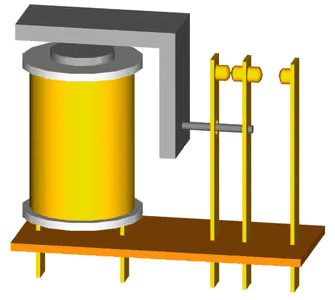
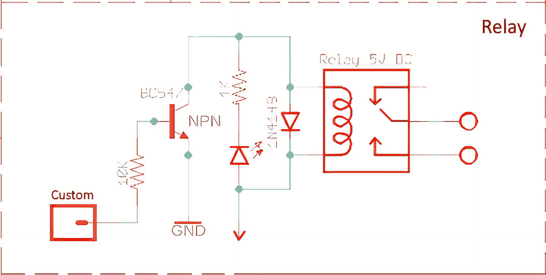
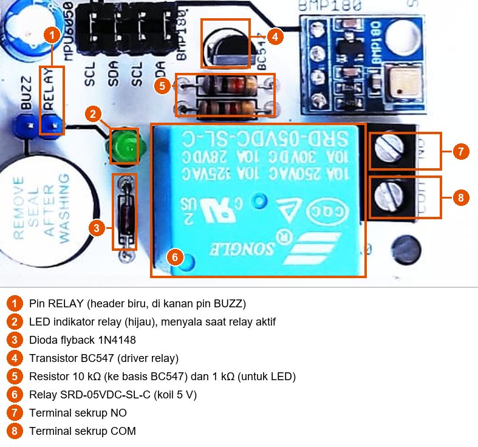
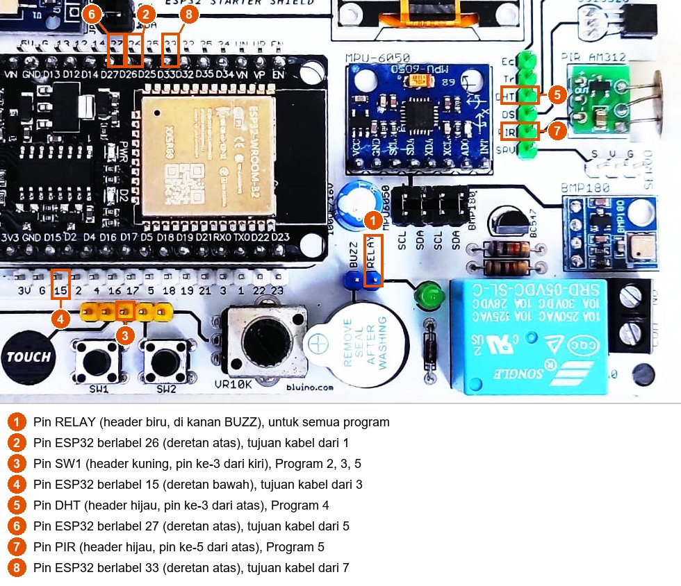
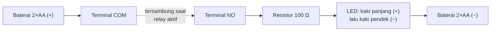
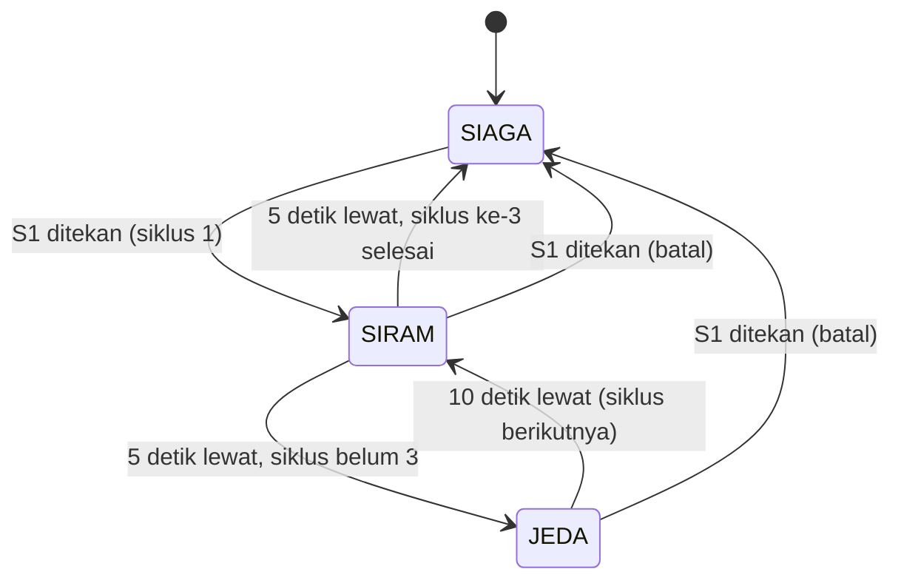
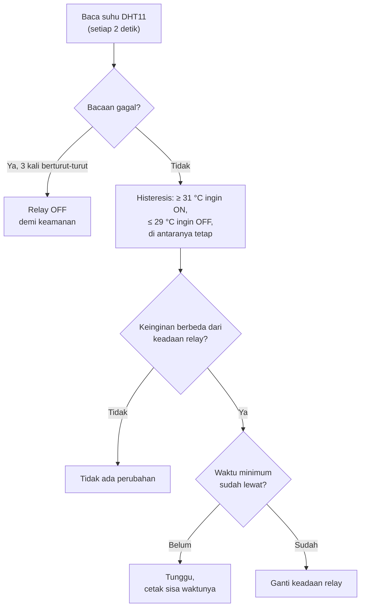
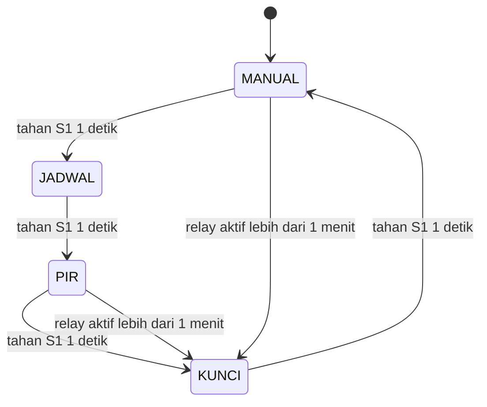

# BAB 37: Relay — Kontrol AC/DC

> ✅ **Prasyarat:** Selesaikan **BAB 3 (Dasar Elektronika untuk Mikrokontroler)** — terutama [3.9](../BAB-03/README.md#39-transistor-relay-dan-dioda-flyback) tentang transistor, *relay*, dan dioda *flyback* — **BAB 9 (Digital Input — Push Button)** untuk *debounce* tombol, dan **BAB 16 (Non-Blocking Programming)**, karena semua program di BAB ini mengatur waktu dengan `millis()` tanpa `delay()`. Program 4 memakai sensor dari **BAB 26 (DHT11 — Suhu & Kelembapan)**, sedangkan Program 5 memakai pola dari **BAB 17 (State Machine)** dan sensor dari **BAB 31 (PIR AM312 — Deteksi Gerakan)**.

*Relay* adalah sakelar yang ditekan oleh elektromagnet, bukan oleh jari. Dengan *relay*, sinyal kecil 3,3 V dari ESP32 bisa menyambung dan memutus rangkaian lain yang terpisah sepenuhnya dari ESP32 — begitulah pompa air, lampu taman, dan kipas dikendalikan dalam proyek rumah pintar. Di BAB ini kamu mempelajari cara kerja *relay* di kit beserta aturan keselamatannya, lalu membuat program untuk mengendalikannya dengan tombol, jadwal, termostat suhu, dan beberapa mode sekaligus — semuanya tanpa `delay()`. Semua program cukup diuji dengan mendengar bunyi "klik" dan melihat LED indikator *relay*. Kalau mau, kamu juga bisa menyambung beban DC tegangan rendah yang aman.

## 📌 Tujuan Pembelajaran

Setelah mempelajari BAB ini, kamu bisa:

- Menjelaskan cara kerja *relay* elektromekanis dan arti kontak COM, NO, dan NC.
- Membaca data *relay* SRD-05VDC-SL-C dan rangkaian *driver*-nya di kit (transistor BC547, resistor 10 kΩ, dioda *flyback* 1N4148, dan LED indikator).
- Menjelaskan kenapa *relay* kit **tidak boleh** disambung ke listrik PLN 220 V, dan memilih beban yang aman untuk latihan.
- Mengendalikan *relay* tanpa `delay()`: berkedip, sakelar tombol dengan batas waktu pengaman, dan penjadwal siklus.
- Menjelaskan umur kontak *relay*, arus lonjakan (*inrush current*), dan alasan *relay* tidak boleh dipakai untuk PWM.
- Membuat termostat dengan histeresis serta waktu nyala dan mati minimum yang melindungi *relay* dan beban.
- Menggabungkan beberapa mode kerja *relay* dalam satu *state machine* yang aman.

## 🧰 Yang Perlu Disiapkan

| Kebutuhan | Keterangan |
|---|---|
| *Hardware* | Kit Bluino ESP32 IoT Starter Shield (ESP32 DEVKIT V1 sudah terpasang di kit) + kabel USB **data** |
| Kabel *jumper* | 4 kabel *female-female* (sudah ada di kit): `RELAY` → IO26 untuk semua program, `SW1` → IO15 untuk Program 2, 3, dan 5, `DHT` → IO27 untuk Program 4, serta `PIR` → IO33 untuk Program 5 |
| Komponen tambahan | Tidak wajib — *relay*, transistor, dioda, dan LED indikatornya sudah terpasang di kit. Opsional untuk [37.7](#377-menguji-kontak-dan-menyambung-beban-dc-opsional): multimeter digital, atau beban DC tegangan rendah dengan catu dayanya sendiri (misalnya tempat baterai 2×AA + LED + resistor 100 Ω), kabel kecil, dan obeng minus kecil |
| *Software* | Arduino IDE 2.x + *board package* **esp32** versi 3.3.x (lihat [BAB 5](../BAB-05/README.md)) |
| *Library* | Program 4: **DHT sensor library** dan **Adafruit Unified Sensor** by Adafruit (cara memasangnya di [BAB 26](../BAB-26/README.md#265-memasang-library-dht)). Program lain tidak perlu *library* tambahan |
| Alat uji | **Serial Monitor** Arduino IDE (baud 115200), telingamu (bunyi "klik"), dan matamu (LED indikator *relay*) |
| Jaringan | Tidak perlu WiFi |

> 🚨 **Bahaya:** Jangan pernah menyambung listrik PLN 220 V (stopkontak, kabel lampu rumah, atau peralatan rumah tangga) ke *relay* kit. Alasannya dibahas di [37.4](#374-keselamatan-kit-ini-bukan-untuk-listrik-pln). Semua latihan di BAB ini aman dilakukan **tanpa beban apa pun**.

## 📑 Daftar Isi

- [37.1 Apa Itu Relay?](#371-apa-itu-relay)
- [37.2 Kontak COM, NO, dan NC](#372-kontak-com-no-dan-nc)
- [37.3 Relay di Kit Bluino](#373-relay-di-kit-bluino)
- [37.4 Keselamatan: Kit Ini Bukan untuk Listrik PLN](#374-keselamatan-kit-ini-bukan-untuk-listrik-pln)
- [37.5 Rangkaian untuk Seluruh BAB](#375-rangkaian-untuk-seluruh-bab)
- [37.6 Program 1: Relay Berkedip Tanpa delay()](#376-program-1-relay-berkedip-tanpa-delay)
- [37.7 Menguji Kontak dan Menyambung Beban DC (Opsional)](#377-menguji-kontak-dan-menyambung-beban-dc-opsional)
- [37.8 Umur Relay, Arus Lonjakan, dan Kenapa Relay Bukan untuk PWM](#378-umur-relay-arus-lonjakan-dan-kenapa-relay-bukan-untuk-pwm)
- [37.9 Program 2: Sakelar Relay dengan Tombol S1](#379-program-2-sakelar-relay-dengan-tombol-s1)
- [37.10 Program 3: Penjadwal Siklus Otomatis](#3710-program-3-penjadwal-siklus-otomatis)
- [37.11 Termostat: Histeresis dan Waktu Minimum](#3711-termostat-histeresis-dan-waktu-minimum)
- [37.12 Program 4: Termostat Kipas dengan DHT11](#3712-program-4-termostat-kipas-dengan-dht11)
- [37.13 Program 5: Relay Multi-Mode dengan State Machine](#3713-program-5-relay-multi-mode-dengan-state-machine)
- [37.14 Troubleshooting](#3714-troubleshooting)
- [📝 Rangkuman](#-rangkuman)
- [💪 Latihan](#-latihan)
- [📚 Referensi](#-referensi)

---

## 37.1 Apa Itu Relay?

Sakelar lampu di dinding rumah ditekan oleh jarimu. *Relay* juga sakelar, tetapi yang "menekannya" adalah **elektromagnet** kecil di dalamnya. Elektromagnet itu bisa dinyalakan dan dimatikan oleh ESP32, sehingga ESP32 bisa menyambung dan memutus rangkaian lain tanpa bantuan tangan. Perangkat yang dinyalakan dan dimatikan oleh *relay* — lampu, kipas, pompa — disebut **beban**.

Bagian-bagian di dalam *relay*:

| Bagian | Tugasnya | Analogi |
|---|---|---|
| **Koil** (kumparan) | Lilitan kawat tembaga di sekeliling inti besi. Saat dialiri arus, koil menjadi magnet | Jari yang menekan sakelar |
| **Jangkar** (*armature*) | Lempeng besi yang bisa bergerak. Ditarik koil saat koil menjadi magnet | Tuas sakelar |
| **Pegas** | Mengembalikan jangkar ke posisi semula saat koil tidak lagi dialiri arus | Per di dalam sakelar |
| **Kontak** | Lempeng logam yang saling menempel atau berpisah — inilah "sakelar" untuk beban | Logam di dalam sakelar dinding |



*Gambar 37.1 — Prinsip relay: kumparan kuning adalah koil, besi abu-abu berbentuk L adalah jangkar, dan lempeng tengah di kanan adalah kontak yang bergerak. Saat koil dialiri arus (tanda + dan − muncul di kaki bawah), jangkar tertarik dan mendorong kontak tengah dari kontak kiri ke kontak kanan. Sumber: [Digigalos (Wikimedia Commons)](https://commons.wikimedia.org/wiki/File:Relay_principle_horizontal_new.gif), lisensi CC BY-SA 3.0.*

Urutan kerjanya:

1. Koil dialiri arus → koil menjadi magnet.
2. Jangkar tertarik → kontak berpindah posisi, terdengar bunyi **"klik"**.
3. Arus koil dihentikan → magnetnya hilang → pegas mengembalikan jangkar dan kontak, terdengar "klik" lagi (biasanya lebih pelan).

Yang paling penting: *relay* punya **dua rangkaian yang terpisah**. Rangkaian **kendali** (koil) dikendalikan ESP32, sedangkan rangkaian **beban** (kontak) menyambung beban ke catu dayanya sendiri. Keduanya tidak tersambung oleh kabel — penghubungnya hanya gaya magnet. Pemisahan ini disebut **isolasi galvanis**. Ibaratnya menekan sakelar memakai tongkat plastik: tanganmu tidak pernah menyentuh logam yang dialiri listrik. Berkat isolasi ini, kontak *relay* bisa menyambung arus DC maupun AC, dengan tegangan yang jauh berbeda dari 3,3 V milik ESP32.

Di [BAB 3](../BAB-03/README.md#391-transistor-sebagai-sakelar-elektronik) kamu sudah mengenal transistor, yang juga bisa menjadi sakelar. Kapan memakai *relay*, kapan transistor?

| Sifat | *Relay* elektromekanis | Transistor/MOSFET |
|---|---|---|
| Jenis arus beban | DC maupun AC | Umumnya hanya DC |
| Isolasi antara pengendali dan beban | Ada (hanya lewat magnet) | Tidak ada (*ground* tersambung) |
| Kecepatan | Lambat: sekitar 10 ms untuk menarik kontak | Sangat cepat: mikrodetik atau lebih cepat |
| Umur | Terbatas — kontak dan pegasnya aus | Hampir tidak aus kalau dipakai dalam batasnya |
| Bunyi | "Klik" | Senyap |
| Cocok untuk PWM | **Tidak** (lihat [37.8](#378-umur-relay-arus-lonjakan-dan-kenapa-relay-bukan-untuk-pwm)) | Ya |

---

## 37.2 Kontak COM, NO, dan NC

*Relay* di kit punya tiga kontak di dalamnya. Bayangkan **wesel rel kereta**: kereta (arus) selalu masuk dari satu rel yang sama, lalu diarahkan ke salah satu dari dua rel cabang. Rel masuk itu disebut **COM**, rel cabang yang dipakai saat wesel dalam posisi biasa disebut **NC**, dan rel cabang lainnya disebut **NO**.

| Kontak | Kepanjangan | Saat koil **tidak** dialiri arus (*relay* mati) | Saat koil dialiri arus (*relay* aktif) |
|---|---|---|---|
| **COM** | *Common* (bersama) | Kontak yang bergerak — selalu dipakai | Kontak yang bergerak — selalu dipakai |
| **NC** | *Normally Closed* (biasanya tersambung) | Tersambung ke COM | Terputus dari COM |
| **NO** | *Normally Open* (biasanya terputus) | Terputus dari COM | Tersambung ke COM |

Kata *normally* (biasanya) berarti keadaan saat koil **tidak** diberi arus — termasuk saat ESP32 mati atau kabel USB dicabut. Pada Gambar 37.1, kontak tengah adalah COM, kontak kiri adalah NC, dan kontak kanan adalah NO.

Kapan memakai NO, kapan NC?

- **COM + NO** — beban hanya menyala saat ESP32 mengaktifkan *relay*. Kalau ESP32 kehilangan daya, *relay* lepas dan beban ikut mati. Inilah pilihan paling umum, misalnya untuk pompa, pemanas, atau lampu.
- **COM + NC** — beban menyala terus, kecuali saat ESP32 mengaktifkan *relay*. Dipakai kalau beban justru harus tetap berjalan saat pengendalinya mati, misalnya kipas pendingin.

> 📌 **Catatan:** NO tidak otomatis berarti "aman". Kalau program ESP32 macet (*hang*) tepat saat pin *relay* sedang HIGH, *relay* tetap aktif dan beban tetap menyala — pengaman di dalam program pun ikut macet. Karena itu, alat yang benar-benar berbahaya kalau terus menyala (misalnya pemanas) selalu diberi pengaman perangkat keras juga, seperti sekering atau termostat mekanis.

---

## 37.3 Relay di Kit Bluino

### 37.3.1 Data Relay SRD-05VDC-SL-C

*Relay* biru di kit bertuliskan **SRD-05VDC-SL-C** buatan Songle. Kode itu bisa dibaca seperti ini: **SRD** = seri *relay*-nya, **05VDC** = koil 5 V DC, **S** = model tertutup (*sealed*), **L** = koil hemat daya ±0,36 W, dan **C** = susunan kontak "*form C*", yaitu satu set COM–NO–NC.

Angka-angka penting dari *datasheet*-nya:

| Parameter | Nilai di *datasheet* | Artinya bagi kita |
|---|---|---|
| Tegangan koil | 5 V DC | Koil mendapat daya dari jalur 5 V kit (dari USB), **bukan** dari pin GPIO |
| Hambatan koil | 70 Ω ±10% | — |
| Arus koil | 71,4 mA | Jauh di atas kemampuan wajar sebuah GPIO, jadi perlu transistor |
| Daya koil | ±0,36 W | Badan *relay* terasa hangat kalau lama aktif — itu normal |
| Tegangan tarik (*pull-in*) | Maksimal 75% × 5 V = 3,75 V | Di atas tegangan ini kontak **dijamin** tertarik |
| Tegangan lepas (*drop-out*) | Minimal 10% × 5 V = 0,5 V | Di bawah tegangan ini kontak **dijamin** lepas |
| Waktu tarik / waktu lepas | Maksimal 10 ms / 5 ms | Jauh lebih lambat daripada transistor |
| Frekuensi kerja maksimal | 300 kali/menit tanpa beban, 30 kali/menit dengan beban | *Relay* tidak dirancang untuk berkedip cepat |
| Umur | Minimal 10 juta kali tanpa beban, minimal 100.000 kali dengan beban sesuai *rating* | Dibahas di [37.8](#378-umur-relay-arus-lonjakan-dan-kenapa-relay-bukan-untuk-pwm) |

Di badan *relay* juga tercetak **kemampuan kontak** (*contact rating*): `10A 250VAC`, `10A 125VAC`, `10A 30VDC`, dan `10A 28VDC`. *Datasheet*-nya lebih rinci: untuk *relay form C*, 10 A berlaku pada 125 V AC dengan beban resistif (seperti pemanas atau lampu pijar), turun menjadi 7 A pada 240 V AC atau 28 V DC, dan hanya **3 A** untuk beban induktif seperti motor, kipas, atau pompa.

> ⚠️ **Perhatian:** Angka di badan *relay* adalah kemampuan **kontak *relay*-nya saja** dalam kondisi ideal, **bukan** kemampuan kit. Jalur tembaga PCB, terminal sekrup, dan jarak antarjalur di kit tidak dirancang untuk arus besar atau tegangan PLN. Untuk latihan, pakai batas yang jauh lebih kecil: **paling tinggi 12 V DC dan 1 A** (lihat [37.4](#374-keselamatan-kit-ini-bukan-untuk-listrik-pln)).

### 37.3.2 Rangkaian *Driver* Relay

Rangkaian *driver* (penggerak) *relay* di kit sudah dibahas lengkap di [BAB 3 bagian 3.9](../BAB-03/README.md#39-transistor-relay-dan-dioda-flyback). Berikut ringkasannya:



*Gambar 37.2 — Rangkaian driver relay pada kit. Panah di bagian bawah adalah jalur catu 5 V; dua lingkaran di kanan adalah terminal sekrup untuk beban. Sumber: skematik ESP32 Starter Shield 3.2, [Bluino](http://www.bluino.com).*

| Komponen | Tugasnya |
|---|---|
| Pin **Custom** (header `RELAY`) | Tempat kabel *jumper* dari IO26 dipasang |
| Resistor **10 kΩ** | Membatasi arus basis transistor: (3,3 V − 0,7 V) ÷ 10 kΩ ≈ **0,26 mA** — sangat ringan bagi GPIO |
| Transistor **BC547** (NPN) | Sakelar elektronik: arus basis yang kecil membuka jalur arus koil ±71 mA dari jalur 5 V ke GND. Arus besar ini **tidak** lewat pin ESP32 |
| Dioda **1N4148** | Dioda *flyback*: memberi jalan memutar bagi arus koil saat *relay* dimatikan, sehingga lonjakan tegangan dari koil tidak merusak transistor |
| LED + resistor **1 kΩ** | LED indikator hijau di samping *relay*, menyala bersamaan dengan koil |
| Dua lingkaran di kanan | Terminal sekrup **COM** dan **NO** untuk beban (lihat [37.3.3](#3733-terminal-sekrup-hanya-com-dan-no)) |

Kesimpulannya untuk program: **pin HIGH → *relay* aktif (klik, LED indikator menyala, COM tersambung ke NO); pin LOW → *relay* mati.** Rangkaian seperti ini disebut **aktif HIGH**.

Arus 0,26 mA juga jauh di bawah batas GPIO menurut *datasheet* ESP32. Angka-angka batas itu (±40 mA pada kekuatan *drive* maksimum, dan aturan praktis "bebani beberapa mA saja") dibahas di [BAB 3 bagian 3.8](../BAB-03/README.md#38-batas-arus-gpio-esp32).

<details>
<summary><b>🔬 Pendalaman (opsional): Apakah BC547 di kit selalu "terbuka penuh"?</b></summary>

Supaya transistor benar-benar terbuka penuh — disebut **jenuh** atau **saturasi** — arus basis dikali penguatan arus transistor (hFE) harus lebih besar daripada arus koil. Arus koil ±71 mA dibagi arus basis ±0,26 mA hasilnya ±270. Artinya, transistor perlu penguatan sekitar 270 kali, bahkan lebih supaya ada cadangan.

Menurut *datasheet* onsemi, penguatan BC547 sangat beragam tergantung kelompoknya. Pada arus 2 mA, BC547**A** berkisar 110–220, BC547**B** 200–450, dan BC547**C** 420–800, dan angkanya turun lagi pada arus sebesar 70–100 mA. Jadi pada transistor berpenguatan rendah, BC547 di kit mungkin **tidak jenuh penuh**: transistor hanya "setengah terbuka", seperti keran yang tidak dibuka penuh, sehingga koil mendapat tegangan kurang dari 5 V.

Biasanya *relay* tetap bekerja dengan baik, karena tegangan tarik *relay* yang sebenarnya umumnya lebih rendah daripada batas jaminan 3,75 V, dan setelah tertarik, kontak cukup ditahan dengan tegangan yang jauh lebih kecil. Namun, kalau *relay* di kitmu tidak berbunyi "klik" atau bergetar cepat (*chattering*) padahal LED indikatornya menyala redup, inilah salah satu kemungkinan penyebabnya — apalagi kalau tegangan USB-mu juga sedang rendah. Coba dulu kabel USB yang lebih bagus dan colokkan langsung ke laptop (lihat [37.14](#3714-troubleshooting)).

</details>

### 37.3.3 Terminal Sekrup: Hanya COM dan NO



*Gambar 37.3 — Bagian relay pada kit v3.x: pin `RELAY` (1), LED indikator (2), dioda flyback (3), transistor BC547 (4), resistor (5), relay (6), serta terminal sekrup NO (7) dan COM (8). Tata letak kit v3.2 milikmu bisa sedikit berbeda. Sumber: foto produk ESP32 Starter Shield, [Bluino](http://www.bluino.com), dipotong dan diberi penanda untuk materi ini.*

Walaupun *relay* SRD-05VDC-SL-C punya kontak COM, NO, dan NC, kit Bluino hanya mengeluarkan **dua** di antaranya ke terminal sekrup hitam di tepi kanan kit: **NO** dan **COM**. Tulisannya tercetak kecil di PCB, tepat di samping terminal. Kontak NC tidak disambungkan ke mana pun, jadi di kit ini kamu hanya bisa memakai pasangan **COM + NO**: beban menyala saat *relay* aktif.

Cara memakai terminal sekrup:

1. Putar sekrupnya **berlawanan** arah jarum jam dengan obeng minus kecil sampai lubang di sampingnya terbuka.
2. Masukkan ujung kabel yang sudah dikupas sekitar 5–7 mm.
3. Putar sekrup **searah** jarum jam sampai kencang, lalu tarik kabelnya pelan-pelan untuk memastikan kabel terjepit.

> 💡 **Tips:** Kalau di papanmu urutan terminalnya berbeda, ikuti tulisan **NO** dan **COM** di PCB, bukan posisi di foto.

---

## 37.4 Keselamatan: Kit Ini Bukan untuk Listrik PLN

> 🚨 **Bahaya:** **Jangan menyambung listrik PLN 220 V ke *relay* kit** — tidak ke terminal sekrupnya, tidak lewat kabel stopkontak, dan tidak untuk "sebentar saja". Listrik PLN bisa menyebabkan sengatan yang mematikan dan kebakaran. Tulisan `10A 250VAC` di badan *relay* **bukan** izin untuk melakukannya.

Kenapa *relay*-nya mampu, tetapi kit-nya tidak boleh?

- **Kit ini papan belajar yang terbuka.** Kaki-kaki solder *relay* dan terminal sekrup terbuka tanpa penutup. Kalau tersentuh saat dialiri listrik PLN, jarimu ikut menjadi bagian dari rangkaian.
- **Tidak ada wadah, sekering, maupun pembumian (*grounding*).** Peralatan listrik rumah selalu punya pengaman ini. Kit tidak punya satu pun.
- **Jarak antarjalur tidak dirancang untuk 220 V.** Jalur beban hanya berjarak beberapa milimeter dari jalur 5 V dan 3,3 V yang tersambung ke ESP32, kabel USB, dan laptopmu. Kalau terjadi kerusakan, tegangan PLN bisa "menyeberang" ke sana.
- **Kabel *jumper* mudah tercabut.** Kebiasaan bongkar-pasang kabel yang wajar untuk sinyal 3,3 V sangat berbahaya untuk 220 V.
- **Arus kecil saja sudah berbahaya.** Arus beberapa puluh miliampere yang melewati tubuh bisa mengganggu kerja jantung. Itulah sebabnya pengaman arus bocor (ELCB/RCD) di rumah diatur memutus listrik pada arus bocor 30 mA.

Beban yang **boleh** dan **tidak boleh** dipakai untuk latihan:

| ✅ Boleh untuk latihan | ❌ Jangan |
|---|---|
| Tanpa beban sama sekali — cukup dengar "klik" dan lihat LED indikator | Listrik PLN 220 V dalam bentuk apa pun: stopkontak, lampu rumah, kipas angin, pompa air |
| Multimeter dalam mode kontinuitas (uji sambung) | Membongkar *charger* atau adaptor, lalu menyambung sisi 220 V-nya |
| Baterai 1,5–9 V dengan LED dan resistor | Aki mobil atau motor — arus hubung singkatnya bisa ratusan ampere dan memicu kebakaran |
| Kipas DC, lampu LED, atau *strip* LED 5–12 V dengan adaptor DC-nya sendiri | Beban di atas **12 V DC** atau di atas **1 A** |

Aturan emas saat menyambung beban:

1. **Rangkai saat semuanya mati.** Cabut kabel USB kit **dan** lepaskan catu daya beban (keluarkan baterai atau cabut adaptornya) sebelum memasang atau melepas kabel.
2. **Pakai catu daya terpisah untuk beban.** Jangan mengambil daya beban dari pin `5V` atau `3V` kit.
3. **Perhatikan kutub (+) dan (−)** pada beban DC.
4. **Kalau ada yang panas, berasap, atau berbau gosong**, cabut kabel USB dan catu beban segera.

> 📌 **Catatan:** Kalau suatu saat kamu ingin mengendalikan peralatan 220 V sungguhan, pakai perangkat yang memang dirancang dan bersertifikat untuk itu — misalnya modul *relay* dalam wadah tertutup lengkap dengan sekering, atau *smart plug* — dan minta bantuan teknisi listrik. Hal itu di luar cakupan kurikulum ini.

---

## 37.5 Rangkaian untuk Seluruh BAB

Semua program di BAB ini memakai *relay* di IO26, sesuai Peta Pin Standar ([BAB 6](../BAB-06/README.md)). IO26 adalah GPIO biasa: bukan pin *strapping* (pin yang dibaca saat *boot*) dan bukan pin khusus input. Saat ESP32 baru menyala atau di-*reset*, IO26 belum menjadi output, jadi transistor tidak mendapat arus basis dan *relay* tetap diam sampai program mulai berjalan.

Pasang keempat kabel sekali saja di awal. Kabel yang belum dipakai sebuah program boleh tetap terpasang.

| Komponen | Pin **Custom** di kit | Sambungkan ke pin ESP32 | Dipakai di |
|---|---|---|---|
| *Relay* | `RELAY` — header biru, di **kanan** `BUZZ` | IO26 (label `26`, deretan atas) | Semua program |
| Tombol S1 | `SW1` — header kuning, pin ke-3 dari kiri | IO15 (label `15`, deretan bawah) | Program 2, 3, 5 |
| DHT11 | `DHT` — header hijau, pin ke-3 dari atas | IO27 (label `27`, deretan atas) | Program 4 |
| Sensor PIR AM312 | `PIR` — header hijau, pin ke-5 dari atas | IO33 (label `33`, deretan atas) | Program 5 |



*Gambar 37.4 — Letak pin yang disambung di BAB ini pada kit v3.x: `RELAY` (1) ke pin 26 (2), `SW1` (3) ke pin 15 (4), `DHT` (5) ke pin 27 (6), dan `PIR` (7) ke pin 33 (8). Tata letak kit v3.2 milikmu bisa sedikit berbeda. Sumber: foto produk ESP32 Starter Shield, [Bluino](http://www.bluino.com), dipotong dan diberi penanda untuk materi ini.*

Langkah memasang kabel:

1. Cabut kabel USB dulu supaya aman saat merangkai.
2. Pasang kabel dari pin **`RELAY`** ke pin berlabel **`26`** di deretan atas (pin ke-7 dari kiri: `5V`, `G`, `13`, `12`, `14`, `27`, **`26`**).
3. Pasang kabel dari pin **`SW1`** (pin kuning ke-3 dari kiri) ke pin berlabel **`15`** di deretan bawah, seperti di [BAB 9](../BAB-09/README.md).
4. Pasang kabel dari pin **`DHT`** ke pin berlabel **`27`** di deretan atas, tepat di kiri pin `26`.
5. Pasang kabel dari pin **`PIR`** ke pin berlabel **`33`** di deretan atas (dua pin di kanan `26`: `26`, `25`, **`33`**).
6. Periksa sekali lagi bahwa setiap kabel tertancap penuh dan tidak bergeser satu pin, lalu sambungkan kembali kabel USB.

> ⚠️ **Perhatian:** Pin `RELAY` bersebelahan dengan `BUZZ`. Kalau kabelnya tertukar, *buzzer* yang berbunyi, bukan *relay*. Di deretan atas, pin `27` (DHT11), `26` (*relay*), dan `25` berjajar rapat, jadi pastikan kabel *relay* benar-benar di `26`. Di deretan bawah, pin `15` bersebelahan dengan `G` (GND): kabel S1 yang tergeser ke `G` akan menyambung 3,3 V ke GND saat S1 ditekan.

> 📌 **Catatan:** Selama kabel S1 terpasang di IO15, log *boot* bawaan ESP32 (baris seperti `rst:0x1 (POWERON_RESET),boot:0x13 ...`) tidak muncul di Serial Monitor. Itu normal dan aman (penjelasannya di [BAB 9](../BAB-09/README.md)).

---

## 37.6 Program 1: Relay Berkedip Tanpa delay()

**Tujuan:** "Hello World"-nya *relay*: mengaktifkan *relay* selama 2 detik, lalu mematikannya selama 2 detik, berulang terus. Waktunya diatur dengan `millis()` seperti di [BAB 16](../BAB-16/README.md), jadi `loop()` tetap bebas mengerjakan hal lain.

**Rangkaian:**

| Pin **Custom** di kit | Sambungkan ke pin ESP32 |
|---|---|
| `RELAY` (header biru, di kanan `BUZZ`) | IO26 |

Beban tidak diperlukan. Kalau ingin, sambungkan beban DC tegangan rendah ke terminal COM dan NO seperti di [37.7](#377-menguji-kontak-dan-menyambung-beban-dc-opsional).

**Cara Menjalankan:**

1. Sambungkan kabel *jumper* sesuai tabel **Rangkaian** di atas (atau langsung pasang semua kabel seperti di [37.5](#375-rangkaian-untuk-seluruh-bab)).
2. Buka Arduino IDE → **File → New Sketch**, hapus isinya, lalu salin kode di bawah. Kode yang sama juga tersedia di *file* [`p1_relay_berkedip.ino`](p1_relay_berkedip/p1_relay_berkedip.ino).
3. Pastikan **Tools → Board** = **ESP32 Dev Module** dan **Tools → Port** = *port* ESP32 kamu (misalnya `COM5` di Windows atau `/dev/ttyUSB0` di Linux).
4. Klik tombol **Upload** (ikon panah →) dan tunggu sampai muncul tulisan **Done uploading**.
5. Buka **Serial Monitor** (**Tools → Serial Monitor**) lalu pilih baud **115200**.
6. Dengarkan bunyi "klik" dan perhatikan LED indikator hijau di samping *relay*.

**Kode Program:**

<!-- sketch: p1_relay_berkedip -->
```cpp
/*
 * BAB 37 - Program 1: Relay Berkedip Tanpa delay()
 * Relay aktif 2 detik, lalu mati 2 detik, berulang terus.
 * Waktu diatur dengan millis(), jadi loop() tidak pernah menunggu.
 *
 * Rangkaian:
 *   RELAY (header biru, kanan BUZZ) → IO26 (aktif HIGH, lewat transistor BC547)
 *   Beban (opsional)                → terminal COM dan NO (lihat 37.7)
 */

#define RELAY_PIN 26  // RELAY → IO26

const unsigned long LAMA_AKTIF = 2000;  // ms: relay aktif selama 2 detik
const unsigned long LAMA_MATI  = 2000;  // ms: relay mati selama 2 detik

bool relayAktif = false;         // keadaan relay saat ini
unsigned long waktuBerubah = 0;  // kapan relay terakhir berganti keadaan

// Satu-satunya tempat yang menyentuh pin relay
void aturRelay(bool aktif) {
  relayAktif = aktif;
  digitalWrite(RELAY_PIN, aktif ? HIGH : LOW);
}

void setup() {
  Serial.begin(115200);
  pinMode(RELAY_PIN, OUTPUT);  // di core 3.x, pinMode() wajib dipanggil dulu
  aturRelay(false);            // lalu langsung pastikan relay mati

  Serial.println("BAB 37 - Program 1: Relay Berkedip Tanpa delay()");
  Serial.println("Relay aktif 2 detik, mati 2 detik, berulang.");
  Serial.println("Keadaan awal: relay OFF");
  waktuBerubah = millis();
}

void loop() {
  unsigned long sekarang = millis();  // lirik jam sekali di awal loop()

  // Lama keadaan sekarang: 2 detik kalau sedang aktif, 2 detik kalau sedang mati
  unsigned long lamaKeadaan = relayAktif ? LAMA_AKTIF : LAMA_MATI;

  if (sekarang - waktuBerubah >= lamaKeadaan) {
    waktuBerubah = sekarang;  // catat waktu pergantian ini
    aturRelay(!relayAktif);   // balik keadaan: aktif ↔ mati

    Serial.printf("[%6.1f s] Relay %s\n", sekarang / 1000.0,
                  relayAktif ? "ON  -> COM tersambung ke NO" : "OFF -> COM terputus dari NO");
  }

  // Tugas lain bisa ditambahkan di sini, tanpa terganggu oleh relay
}
```

**Penjelasan Kode:**

- `#define RELAY_PIN 26` — pin *relay* sesuai Peta Pin Standar. Semua program di BAB ini memakai nama yang sama.
- **Urutan di `setup()` penting.** Di core 3.x, `digitalWrite()` yang dipanggil **sebelum** `pinMode()` tidak berpengaruh apa-apa (core hanya mencatat pesan *error* di log yang biasanya tidak terlihat). Jadi pin dijadikan output dulu, lalu `aturRelay(false)` langsung memastikan *relay* mati. Kalaupun ada kedipan sesaat di antara dua baris itu, lamanya hanya beberapa mikrodetik — jauh lebih singkat daripada ±10 ms yang dibutuhkan *relay* untuk menarik kontaknya.
- **Kenapa harus "mati" di awal?** Beban seperti pompa atau pemanas tidak boleh tiba-tiba menyala hanya karena ESP32 baru di-*reset*. Biasakan setiap program *relay* dimulai dengan *relay* mati.
- `aturRelay()` adalah satu-satunya fungsi yang menyentuh pin *relay*, dan ia selalu memperbarui variabel `relayAktif`. Dengan begitu, isi variabel dan keadaan *relay* yang sebenarnya tidak pernah berbeda. Di program-program berikutnya, fungsi ini juga menjadi tempat pemeriksaan keamanan.
- `relayAktif ? LAMA_AKTIF : LAMA_MATI` memilih lama keadaan sekarang dengan operator *ternary* ([BAB 9](../BAB-09/README.md#98-program-3-sakelar-toggle-dengan-debounce)). Kamu bisa membuat lama aktif dan lama mati berbeda hanya dengan mengubah dua konstanta di atas.
- `Serial.printf()` mencetak teks dengan format: `%6.1f` berarti angka desimal selebar 6 karakter dengan 1 angka di belakang koma, dan `%s` diganti teks. Waktu ditampilkan dalam detik (`sekarang / 1000.0`).

**Contoh Output:**

```text
BAB 37 - Program 1: Relay Berkedip Tanpa delay()
Relay aktif 2 detik, mati 2 detik, berulang.
Keadaan awal: relay OFF
[   2.0 s] Relay ON  -> COM tersambung ke NO
[   4.0 s] Relay OFF -> COM terputus dari NO
[   6.0 s] Relay ON  -> COM tersambung ke NO
[   8.0 s] Relay OFF -> COM terputus dari NO
```

Angka detiknya hanya contoh dan bisa sedikit berbeda, misalnya `2.1`, tergantung kapan `setup()` selesai. Di kit: setiap 2 detik terdengar "klik", dan LED indikator hijau di samping *relay* menyala selama *relay* aktif. Saat *relay* mati, biasanya terdengar "klik" yang lebih pelan.

> 🧪 **Coba Sendiri:** Ubah `LAMA_AKTIF` menjadi `500` dan `LAMA_MATI` menjadi `4000`, lalu *upload* ulang. *Relay* hanya aktif sebentar, lalu mati lama. Jangan membuatnya lebih cepat daripada ±1 kali per detik — alasannya ada di [37.8](#378-umur-relay-arus-lonjakan-dan-kenapa-relay-bukan-untuk-pwm).

**Kalau Belum Berhasil:**

- **Tulisan muncul, tetapi tidak ada "klik" dan LED indikator tetap padam** → kabel belum terpasang di pin `RELAY` atau tidak di pin `26`. Cabut USB, periksa kedua ujung kabel, lalu coba lagi.
- ***Buzzer* berbunyi bergantian, *relay* diam** → kabel terpasang di `BUZZ`. Pindahkan ke `RELAY` di sebelah kanannya.
- **LED indikator menyala (mungkin redup), tetapi tidak ada "klik" atau *relay* bergetar** → tegangan 5 V terlalu rendah atau transistor tidak terbuka penuh. Ganti kabel USB yang lebih bagus dan colokkan langsung ke laptop (lihat [37.3.2](#3732-rangkaian-driver-relay) dan [37.14](#3714-troubleshooting)).
- **ESP32 *restart* sendiri setiap *relay* aktif** → lonjakan arus koil membuat tegangan USB turun sesaat. Pakai kabel USB yang pendek dan bagus, dan jangan lewat *hub* USB.

---

## 37.7 Menguji Kontak dan Menyambung Beban DC (Opsional)

Bagian ini opsional. Bunyi "klik" dan LED indikator sudah membuktikan bahwa koil bekerja, tetapi belum membuktikan bahwa **kontaknya** benar-benar menyambung. Biarkan Program 1 tetap berjalan, lalu pilih salah satu cara berikut.

### 37.7.1 Cara A: Uji Sambung dengan Multimeter

Cara ini paling aman karena tidak memakai sumber tegangan tambahan.

1. Putar sakelar multimeter ke mode **kontinuitas** (simbol gelombang suara; cara memakainya ada di [BAB 3 bagian 3.12](../BAB-03/README.md#312-mengukur-dengan-multimeter-opsional)).
2. Tempelkan satu probe ke kepala sekrup **COM** dan probe lainnya ke kepala sekrup **NO**.
3. Multimeter berbunyi "bip" setiap kali *relay* aktif dan diam saat *relay* mati — seirama dengan tulisan `ON`/`OFF` di Serial Monitor.

Menempelkan probe ke terminal saat kit menyala aman, karena kontak *relay* terisolasi dari rangkaian kit.

### 37.7.2 Cara B: Menyalakan LED dengan Baterai

Bahan (tidak termasuk kit): tempat baterai 2×AA beserta baterainya (3 V), satu LED, resistor 100 Ω, dan dua potong kabel kecil.



*Gambar 37.5 — Rangkaian beban latihan: relay bekerja seperti sakelar di jalur (+) baterai. Sumber: dibuat untuk materi ini.*

1. Cabut kabel USB kit dan keluarkan baterai dari tempatnya.
2. Sambungkan kabel (+) tempat baterai ke terminal **COM** (cara memakai terminal sekrup ada di [37.3.3](#3733-terminal-sekrup-hanya-com-dan-no)).
3. Sambungkan terminal **NO** ke salah satu kaki resistor 100 Ω, dan kaki resistor lainnya ke kaki **panjang** LED.
4. Sambungkan kaki **pendek** LED ke kabel (−) tempat baterai.
5. Pasang baterai, lalu sambungkan kabel USB kit. LED eksternal ikut berkedip seirama dengan "klik" *relay*.

Arus LED kira-kira (3 V − 2 V) ÷ 100 Ω = 10 mA — kecil dan aman. Perhatikan bahwa rangkaian baterai ini **sama sekali tidak tersambung** ke GND kit: inilah isolasi galvanis dari [37.1](#371-apa-itu-relay).

### 37.7.3 Beban DC yang Lebih Besar

Untuk kipas DC atau lampu LED 5–12 V, pola sambungannya sama: **(+) catu daya → COM**, **NO → (+) beban**, dan **(−) beban → (−) catu daya**. Supaya tidak perlu memotong kabel adaptor, pakai **konektor DC *female* bertipe terminal sekrup** (banyak dijual di toko elektronik) untuk mengambil (+) dan (−) dari colokan adaptor. Tetap patuhi batas latihan: paling tinggi 12 V DC dan 1 A.

> ⚠️ **Perhatian:** Kipas, pompa, dan motor DC adalah beban **induktif** (punya kumparan). Saat kontak memutusnya, terjadi percikan kecil di dalam *relay* yang mengikis kontak lebih cepat. Itulah sebabnya *datasheet* memberi batas jauh lebih kecil untuk beban induktif (3 A) dibanding beban resistif.

---

## 37.8 Umur Relay, Arus Lonjakan, dan Kenapa Relay Bukan untuk PWM

### 37.8.1 Setiap "Klik" Mengurangi Umur Relay

*Relay* adalah benda mekanis yang aus. *Datasheet* SRD menjamin minimal **10 juta kali** kerja tanpa beban, tetapi hanya minimal **100.000 kali** kerja dengan beban sesuai *rating*-nya. Penyebabnya, setiap kali kontak memutus arus, muncul **percikan api kecil** (busur listrik) yang sedikit demi sedikit mengikis permukaan kontak.

Angka 100.000 terdengar banyak, tetapi coba hitung:

| Cara memakai | Kali kerja per hari | 100.000 kali habis dalam |
|---|---|---|
| Lampu teras: nyala sore, mati pagi | 1 | ±274 tahun |
| Pompa penyiram: 3 kali sehari | 3 | ±91 tahun |
| Program 1 (2 detik aktif, 2 detik mati) dengan beban | 21.600 | **±4,6 hari** |
| Berkedip 5 kali per detik | 432.000 | **±5,5 jam** |

Pada beban yang jauh lebih kecil daripada *rating* (misalnya LED dari baterai), umurnya jauh lebih panjang. Namun pelajarannya tetap: **jangan menyalakan dan mematikan *relay* lebih sering daripada yang benar-benar perlu.** Itulah alasan teknik histeresis dan waktu minimum di [37.11](#3711-termostat-histeresis-dan-waktu-minimum).

Satu hal lagi: busur listrik pada arus **DC** lebih sulit padam daripada pada arus AC, karena arus AC melewati nol 100 kali per detik (listrik PLN 50 Hz), sedangkan arus DC tidak pernah. Itulah sebabnya *rating* DC *relay* ini (28–30 V) jauh lebih rendah daripada *rating* AC-nya (125–250 V).

### 37.8.2 Arus Lonjakan (*Inrush Current*)

Banyak beban menarik arus **jauh lebih besar** sesaat ketika baru dinyalakan, sebelum turun ke arus normalnya:

| Beban | Kenapa terjadi lonjakan |
|---|---|
| Lampu pijar | Filamen yang masih dingin hambatannya jauh lebih kecil daripada saat sudah panas |
| Motor, kipas, pompa | Saat belum berputar, motor belum menghasilkan tegangan balik yang membatasi arusnya |
| Adaptor, *driver* LED, peralatan elektronik | Kapasitor besar di dalamnya terisi dalam sekejap |

Lonjakan ini bisa beberapa kali hingga belasan kali arus normalnya, walaupun hanya berlangsung beberapa milidetik. Akibatnya, kontak *relay* bisa **lengket** (menempel karena meleleh sedikit), sehingga beban tetap menyala walaupun koil sudah tidak dialiri arus. Karena itu, untuk beban dengan lonjakan besar, pilih *relay* dengan *rating* yang jauh di atas arus normal bebannya.

### 37.8.3 Relay Tidak Bisa Dipakai untuk PWM

Di [BAB 12](../BAB-12/README.md) kamu memakai PWM (*Pulse Width Modulation*, modulasi lebar pulsa) untuk meredupkan LED: pin dinyalakan dan dimatikan ribuan kali per detik. **Jangan pernah melakukan ini pada pin *relay*.**

- *Relay* butuh hingga 10 ms untuk menarik kontak dan 5 ms untuk melepasnya. Sinyal PWM 1 kHz (seribu siklus per detik) dengan *duty cycle* 50% berganti keadaan setiap 0,5 ms, jadi kontak tidak sempat bergerak dan *relay* hanya bergetar atau berdengung.
- Kontak *relay* juga memantul selama beberapa milidetik setiap kali berpindah, mirip tombol di [BAB 9](../BAB-09/README.md).
- Pada PWM lambat yang masih bisa diikuti *relay* (beberapa kali per detik), *relay* akan aus dalam hitungan jam (lihat tabel di atas), dan *datasheet* sendiri membatasi kerja dengan beban maksimal 30 kali per menit.

Untuk mengatur kecerahan lampu DC atau kecepatan kipas DC, pakai transistor atau MOSFET yang memang dirancang untuk PWM. Jadi, **jangan pernah memanggil `analogWrite()` atau `ledcWrite()` untuk pin *relay***.

---

## 37.9 Program 2: Sakelar Relay dengan Tombol S1

**Tujuan:** Menjadikan tombol S1 sakelar *relay*: tekan sekali → *relay* aktif, tekan lagi → *relay* mati. Program ini menambahkan dua pengaman yang biasa dipakai pada alat sungguhan:

- **Batas waktu aktif.** *Relay* mati sendiri setelah 30 detik, seperti lampu kamar mandi atau pemanas yang lupa dimatikan. Pada alat sungguhan, batasnya bisa 30 menit atau beberapa jam.
- **Jeda minimum.** Tekanan yang datang kurang dari 1 detik setelah pergantian terakhir diabaikan, supaya *relay* tidak dihidup-matikan terlalu cepat walaupun tombolnya ditekan bertubi-tubi.

**Rangkaian:**

| Pin **Custom** di kit | Sambungkan ke pin ESP32 |
|---|---|
| `RELAY` (header biru, di kanan `BUZZ`) | IO26 |
| `SW1` — tombol S1 (header kuning, pin ke-3 dari kiri) | IO15 |

**Cara Menjalankan:**

1. Sambungkan kabel *jumper* sesuai tabel **Rangkaian** di atas.
2. Buka Arduino IDE → **File → New Sketch**, hapus isinya, lalu salin kode di bawah. Kode yang sama juga tersedia di *file* [`p2_sakelar_tombol.ino`](p2_sakelar_tombol/p2_sakelar_tombol.ino).
3. Pastikan **Tools → Board** = **ESP32 Dev Module** dan **Tools → Port** = *port* ESP32 kamu.
4. Klik tombol **Upload** dan tunggu sampai muncul tulisan **Done uploading**.
5. Buka **Serial Monitor** (**Tools → Serial Monitor**) lalu pilih baud **115200**.
6. Tekan S1 sekali, tunggu beberapa detik, lalu tekan lagi. Setelah itu, aktifkan *relay* dan biarkan sampai 30 detik. Terakhir, coba tekan S1 dua kali dengan sangat cepat.

**Kode Program:**

<!-- sketch: p2_sakelar_tombol -->
```cpp
/*
 * BAB 37 - Program 2: Sakelar Relay dengan Tombol S1
 * Tekan S1 sekali → relay aktif, tekan lagi → relay mati.
 * Pengaman:
 *   - relay mati sendiri setelah BATAS_AKTIF (30 detik)
 *   - tekanan yang datang kurang dari JEDA_MIN setelah pergantian terakhir diabaikan
 *
 * Rangkaian:
 *   RELAY (header biru, kanan BUZZ)         → IO26
 *   SW1 (header kuning, pin ke-3 dari kiri) → IO15 (pull-down di PCB, ditekan = HIGH)
 */

#define RELAY_PIN 26
#define TOMBOL_S1 15

const unsigned long WAKTU_DEBOUNCE = 50;     // ms: bacaan tombol harus stabil selama ini
const unsigned long JEDA_MIN       = 1000;   // ms: jarak minimal antara dua pergantian relay
const unsigned long BATAS_AKTIF    = 30000;  // ms: relay mati sendiri setelah 30 detik
const unsigned long INTERVAL_SISA  = 10000;  // ms: laporkan sisa waktu setiap 10 detik

// Variabel debounce (pola dari BAB 9)
int bacaanSebelumnya = LOW;
int statusStabil = LOW;
unsigned long waktuBacaanBerubah = 0;

// Keadaan relay
bool relayAktif = false;
unsigned long waktuRelayBerubah = 0;  // kapan relay terakhir berganti keadaan
unsigned long waktuLaporanLalu = 0;   // kapan sisa waktu terakhir dilaporkan

// true satu kali saja, tepat saat S1 baru ditekan (sudah lolos debounce)
bool tombolBaruDitekan(unsigned long sekarang) {
  int bacaan = digitalRead(TOMBOL_S1);
  if (bacaan != bacaanSebelumnya) {
    waktuBacaanBerubah = sekarang;
    bacaanSebelumnya = bacaan;
  }
  if (sekarang - waktuBacaanBerubah > WAKTU_DEBOUNCE && bacaan != statusStabil) {
    statusStabil = bacaan;
    return statusStabil == HIGH;  // hanya tepi naik (LOW → HIGH) yang dihitung
  }
  return false;
}

// Satu-satunya tempat yang menyentuh pin relay
void aturRelay(bool aktif, unsigned long sekarang, const char *alasan) {
  relayAktif = aktif;
  digitalWrite(RELAY_PIN, aktif ? HIGH : LOW);
  waktuRelayBerubah = sekarang;
  waktuLaporanLalu = sekarang;
  Serial.printf("Relay %s (%s)\n", aktif ? "ON" : "OFF", alasan);
}

void setup() {
  Serial.begin(115200);
  pinMode(RELAY_PIN, OUTPUT);
  digitalWrite(RELAY_PIN, LOW);  // relay mati sejak awal
  pinMode(TOMBOL_S1, INPUT);     // tombol kit: pull-down 10 kΩ sudah ada di PCB

  Serial.println("BAB 37 - Program 2: Sakelar Relay dengan Tombol S1");
  Serial.println("Tekan S1 untuk ON/OFF. Relay mati sendiri setelah 30 detik.");
}

void loop() {
  unsigned long sekarang = millis();  // satu nilai waktu untuk seluruh putaran

  // 1. S1 baru ditekan → balik keadaan relay, kecuali terlalu cepat
  if (tombolBaruDitekan(sekarang)) {
    if (sekarang - waktuRelayBerubah < JEDA_MIN) {
      Serial.println("Terlalu cepat! Tunggu sebentar, lalu tekan lagi.");
    } else {
      aturRelay(!relayAktif, sekarang, "tombol S1");
    }
  }

  // 2. Pengaman: relay sudah aktif terlalu lama → matikan sendiri
  if (relayAktif) {
    unsigned long lamaAktif = sekarang - waktuRelayBerubah;
    if (lamaAktif >= BATAS_AKTIF) {
      aturRelay(false, sekarang, "batas waktu habis");
    } else if (sekarang - waktuLaporanLalu >= INTERVAL_SISA) {
      waktuLaporanLalu = sekarang;
      Serial.printf("  Sisa waktu: %lu detik\n", (BATAS_AKTIF - lamaAktif + 500) / 1000);
    }
  }
}
```

**Penjelasan Kode:**

- `tombolBaruDitekan()` adalah *debounce* dari [BAB 9](../BAB-09/README.md#972-cara-kerja-debounce) yang dibungkus menjadi fungsi. Fungsi ini mengembalikan `true` **satu kali** saja untuk setiap tekanan, tepat saat tombol baru ditekan (tepi naik).
- `aturRelay()` sekarang juga mencatat **kapan** *relay* berganti keadaan (`waktuRelayBerubah`) dan mencetak alasannya. Kedua pengaman di `loop()` memakai catatan waktu ini.
- **Jeda minimum:** `sekarang - waktuRelayBerubah < JEDA_MIN` berarti pergantian terakhir terjadi kurang dari 1 detik yang lalu. Tekanan itu ditolak dengan pesan, sehingga *relay* tidak pernah berganti keadaan lebih sering daripada sekali per detik.
- **Batas waktu aktif:** selama *relay* aktif, program menghitung `lamaAktif`. Kalau sudah 30 detik, *relay* dimatikan dengan alasan `batas waktu habis`. Sebelum itu, sisa waktunya dilaporkan setiap 10 detik. Angka `+ 500` membulatkan milidetik ke detik terdekat.
- **Satu nilai `sekarang` untuk semua.** `sekarang` diambil sekali di awal `loop()` dan dikirim ke semua fungsi. Ini bukan sekadar kerapian. Kalau `aturRelay()` mencatat `millis()` yang lebih baru daripada `sekarang`, hasil `sekarang - waktuRelayBerubah` bisa menjadi "negatif". Karena `unsigned long` tidak mengenal negatif, hasilnya berubah menjadi angka raksasa, dan pengaman akan langsung mematikan *relay* yang baru saja dinyalakan.

**Contoh Output:**

```text
BAB 37 - Program 2: Sakelar Relay dengan Tombol S1
Tekan S1 untuk ON/OFF. Relay mati sendiri setelah 30 detik.
Relay ON (tombol S1)
Relay OFF (tombol S1)
Relay ON (tombol S1)
  Sisa waktu: 20 detik
  Sisa waktu: 10 detik
Relay OFF (batas waktu habis)
Relay ON (tombol S1)
Terlalu cepat! Tunggu sebentar, lalu tekan lagi.
```

Di kit: setiap tekanan S1 yang diterima menghasilkan "klik" dan mengubah LED indikator *relay*. Saat batas waktu habis, *relay* mati sendiri tanpa disentuh. Tekanan kedua yang terlalu cepat tidak menghasilkan "klik" — *relay* tetap aktif.

> 🧪 **Coba Sendiri:** Ubah `BATAS_AKTIF` menjadi `10000` dan `INTERVAL_SISA` menjadi `2000`, lalu *upload* ulang. *Relay* sekarang mati sendiri setelah 10 detik dengan laporan sisa waktu setiap 2 detik.

**Kalau Belum Berhasil:**

- **Tidak terjadi apa-apa saat S1 ditekan** → cek kabel `SW1` → `15` (pin kuning ke-3 dari kiri, bukan ke-2 atau ke-4).
- **Tulisan `Relay ON` muncul, tetapi tidak ada "klik"** → cek kabel `RELAY` → `26` (lihat Program 1).
- **Satu tekanan kadang terhitung dua kali** → pantulan tombolmu lebih lama dari 50 ms. Naikkan `WAKTU_DEBOUNCE` menjadi 80 atau 100.
- ***Relay* langsung mati dengan alasan `batas waktu habis` sesaat setelah dinyalakan** → kamu mengubah kode sehingga `aturRelay()` memakai `millis()` sendiri, bukan `sekarang`. Kembalikan seperti kode di atas.

---

## 37.10 Program 3: Penjadwal Siklus Otomatis

**Tujuan:** Membuat penjadwal sederhana, misalnya untuk penyiram tanaman. Tekan S1 untuk mulai: *relay* aktif 5 detik (pompa menyiram), lalu mati 10 detik (air meresap), diulang 3 kali, lalu berhenti sendiri. Tekan S1 kapan saja selama jadwal berjalan untuk membatalkannya. Program ini disusun sebagai *state machine* ([BAB 17](../BAB-17/README.md)) dengan tiga *state*:

| *State* | *Relay* | Artinya |
|---|---|---|
| `SIAGA` | Mati | Menunggu S1 ditekan |
| `SIRAM` | **Aktif** | Pompa menyiram selama 5 detik |
| `JEDA` | Mati | Menunggu 10 detik sebelum siraman berikutnya |



*Gambar 37.6 — Diagram state penjadwal siklus. Relay hanya aktif di state SIRAM. Sumber: dibuat untuk materi ini.*

**Rangkaian:**

| Pin **Custom** di kit | Sambungkan ke pin ESP32 |
|---|---|
| `RELAY` (header biru, di kanan `BUZZ`) | IO26 |
| `SW1` — tombol S1 (header kuning, pin ke-3 dari kiri) | IO15 |

**Cara Menjalankan:**

1. Sambungkan kabel *jumper* sesuai tabel **Rangkaian** di atas.
2. Buka Arduino IDE → **File → New Sketch**, hapus isinya, lalu salin kode di bawah. Kode yang sama juga tersedia di *file* [`p3_penjadwal_siklus.ino`](p3_penjadwal_siklus/p3_penjadwal_siklus.ino).
3. Pastikan **Tools → Board** = **ESP32 Dev Module** dan **Tools → Port** = *port* ESP32 kamu.
4. Klik tombol **Upload** dan tunggu sampai muncul tulisan **Done uploading**.
5. Buka **Serial Monitor** (**Tools → Serial Monitor**) lalu pilih baud **115200**.
6. Tekan S1 sekali, lalu biarkan jadwalnya berjalan sampai selesai (±40 detik). Setelah itu, mulai lagi dan tekan S1 di tengah jalan untuk membatalkan.

**Kode Program:**

<!-- sketch: p3_penjadwal_siklus -->
```cpp
/*
 * BAB 37 - Program 3: Penjadwal Siklus Otomatis
 * Contoh penyiram tanaman. Tekan S1 untuk mulai: relay aktif 5 detik
 * (menyiram), mati 10 detik (jeda), diulang 3 kali, lalu berhenti sendiri.
 * Tekan S1 saat jadwal berjalan untuk membatalkan.
 *
 * Rangkaian:
 *   RELAY (header biru, kanan BUZZ)         → IO26
 *   SW1 (header kuning, pin ke-3 dari kiri) → IO15 (ditekan = HIGH)
 */

#define RELAY_PIN 26
#define TOMBOL_S1 15

const unsigned long LAMA_SIRAM = 5000;   // ms: relay aktif (pompa menyala)
const unsigned long LAMA_JEDA  = 10000;  // ms: relay mati di antara dua siraman
const int JUMLAH_SIKLUS = 3;             // berapa kali menyiram
const unsigned long WAKTU_DEBOUNCE = 50;

// Tipe enum ditulis di atas, sebelum fungsi mana pun (lihat BAB 17)
enum Keadaan { SIAGA, SIRAM, JEDA };

Keadaan keadaan = SIAGA;
unsigned long waktuMasuk = 0;  // kapan state sekarang dimulai
int siklusKe = 0;              // siklus yang sedang berjalan (1..JUMLAH_SIKLUS)

int bacaanSebelumnya = LOW;
int statusStabil = LOW;
unsigned long waktuBacaanBerubah = 0;

bool tombolBaruDitekan(unsigned long sekarang) {
  int bacaan = digitalRead(TOMBOL_S1);
  if (bacaan != bacaanSebelumnya) {
    waktuBacaanBerubah = sekarang;
    bacaanSebelumnya = bacaan;
  }
  if (sekarang - waktuBacaanBerubah > WAKTU_DEBOUNCE && bacaan != statusStabil) {
    statusStabil = bacaan;
    return statusStabil == HIGH;
  }
  return false;
}

// Pindah state. Relay HANYA aktif di state SIRAM, jadi pin relay cukup diatur di sini.
void masukKeadaan(Keadaan baru, unsigned long sekarang) {
  keadaan = baru;
  waktuMasuk = sekarang;
  digitalWrite(RELAY_PIN, baru == SIRAM ? HIGH : LOW);
}

void cetakWaktu(unsigned long sekarang) {
  Serial.printf("[%5.1f s] ", sekarang / 1000.0);
}

void setup() {
  Serial.begin(115200);
  pinMode(RELAY_PIN, OUTPUT);
  digitalWrite(RELAY_PIN, LOW);  // relay mati sejak awal
  pinMode(TOMBOL_S1, INPUT);

  Serial.println("BAB 37 - Program 3: Penjadwal Siklus Otomatis");
  Serial.printf("Jadwal: relay ON %lu detik, OFF %lu detik, %d siklus.\n",
                LAMA_SIRAM / 1000, LAMA_JEDA / 1000, JUMLAH_SIKLUS);
  Serial.println("Tekan S1 untuk mulai, tekan lagi untuk membatalkan.");
}

void loop() {
  unsigned long sekarang = millis();
  bool ditekan = tombolBaruDitekan(sekarang);

  switch (keadaan) {
    case SIAGA:
      if (ditekan) {
        siklusKe = 1;
        masukKeadaan(SIRAM, sekarang);
        cetakWaktu(sekarang);
        Serial.printf("Mulai! Siklus 1/%d: relay ON (menyiram)\n", JUMLAH_SIKLUS);
      }
      break;

    case SIRAM:
      if (ditekan) {
        masukKeadaan(SIAGA, sekarang);
        cetakWaktu(sekarang);
        Serial.println("Dibatalkan dengan S1. Relay OFF.");
      } else if (sekarang - waktuMasuk >= LAMA_SIRAM) {
        if (siklusKe >= JUMLAH_SIKLUS) {
          masukKeadaan(SIAGA, sekarang);
          cetakWaktu(sekarang);
          Serial.println("Relay OFF. Jadwal selesai. Tekan S1 untuk mulai lagi.");
        } else {
          masukKeadaan(JEDA, sekarang);
          cetakWaktu(sekarang);
          Serial.printf("Siklus %d/%d: relay OFF (jeda %lu detik)\n",
                        siklusKe, JUMLAH_SIKLUS, LAMA_JEDA / 1000);
        }
      }
      break;

    case JEDA:
      if (ditekan) {
        masukKeadaan(SIAGA, sekarang);
        cetakWaktu(sekarang);
        Serial.println("Dibatalkan dengan S1. Relay OFF.");
      } else if (sekarang - waktuMasuk >= LAMA_JEDA) {
        siklusKe = siklusKe + 1;
        masukKeadaan(SIRAM, sekarang);
        cetakWaktu(sekarang);
        Serial.printf("Siklus %d/%d: relay ON (menyiram)\n", siklusKe, JUMLAH_SIKLUS);
      }
      break;
  }
}
```

**Penjelasan Kode:**

- `enum Keadaan { SIAGA, SIRAM, JEDA };` memberi nama untuk ketiga *state*. Tipe ini ditulis di bagian atas *sketch*, sebelum fungsi mana pun, supaya Arduino IDE tidak memunculkan *error* `'Keadaan' has not been declared`.
- `masukKeadaan()` adalah satu-satunya tempat yang mengubah *state* **dan** pin *relay*. Karena *relay* hanya boleh aktif di `SIRAM`, cukup satu baris: `baru == SIRAM ? HIGH : LOW`. Tidak mungkin ada *state* `JEDA` dengan *relay* yang lupa dimatikan.
- `waktuMasuk` mencatat kapan *state* sekarang dimulai. Setiap *state* cukup bertanya, "Sudah berapa lama aku di sini?" — pola yang sama dengan [BAB 17](../BAB-17/README.md).
- Pembatalan diperiksa **sebelum** pewaktu di `SIRAM` dan `JEDA`, sehingga S1 selalu diutamakan. Ini penting untuk alat sungguhan: tombol "berhenti" harus selalu bisa menghentikan pompa, kapan pun.
- `%lu` dipakai untuk mencetak `unsigned long`, sedangkan `%d` untuk `int`.

**Contoh Output:**

```text
BAB 37 - Program 3: Penjadwal Siklus Otomatis
Jadwal: relay ON 5 detik, OFF 10 detik, 3 siklus.
Tekan S1 untuk mulai, tekan lagi untuk membatalkan.
[  3.2 s] Mulai! Siklus 1/3: relay ON (menyiram)
[  8.2 s] Siklus 1/3: relay OFF (jeda 10 detik)
[ 18.2 s] Siklus 2/3: relay ON (menyiram)
[ 23.2 s] Siklus 2/3: relay OFF (jeda 10 detik)
[ 33.2 s] Siklus 3/3: relay ON (menyiram)
[ 38.2 s] Relay OFF. Jadwal selesai. Tekan S1 untuk mulai lagi.
[ 45.7 s] Mulai! Siklus 1/3: relay ON (menyiram)
[ 47.9 s] Dibatalkan dengan S1. Relay OFF.
```

Angka detiknya hanya contoh — angkamu bergantung pada kapan S1 ditekan. Di kit: *relay* berbunyi "klik" dan LED indikatornya menyala selama 5 detik, lalu mati selama 10 detik, sebanyak 3 kali. Saat dibatalkan, *relay* langsung mati.

> 🧪 **Coba Sendiri:** Ubah `JUMLAH_SIKLUS` menjadi `5` dan `LAMA_JEDA` menjadi `3000`. Hitung dulu berapa detik seluruh jadwal akan berjalan, lalu bandingkan dengan Serial Monitor.

**Kalau Belum Berhasil:**

- **Jadwal tidak mulai saat S1 ditekan** → cek kabel `SW1` → `15`.
- ***Error* `'Keadaan' has not been declared` saat *compile*** → baris `enum Keadaan ...` terhapus atau berpindah ke bawah fungsi. Kembalikan ke posisi semula di atas.
- **Tulisan sesuai, tetapi *relay* tidak berbunyi** → cek kabel `RELAY` → `26` dan pastikan tidak tertukar dengan `BUZZ`.

---

## 37.11 Termostat: Histeresis dan Waktu Minimum

**Termostat** adalah pengatur yang menyalakan dan mematikan pendingin atau pemanas berdasarkan suhu. Contohnya kipas pendingin di dalam kotak panel listrik, AC, atau pemanas inkubator telur. Termostat paling sederhana hanya punya satu batas: "kipas menyala kalau suhu ≥ 30 °C, mati kalau di bawahnya". Masalahnya, bacaan sensor selalu naik-turun sedikit di sekitar batas, sehingga *relay* bisa berkali-kali menyala dan mati dalam hitungan detik:

| Bacaan suhu | 29,9 °C | 30,0 °C | 29,9 °C | 30,1 °C | 29,8 °C | 30,0 °C |
|---|---|---|---|---|---|---|
| *Relay* (satu batas 30 °C) | mati | **aktif** | mati | **aktif** | mati | **aktif** |

Setiap pergantian menghabiskan umur *relay* ([37.8](#378-umur-relay-arus-lonjakan-dan-kenapa-relay-bukan-untuk-pwm)) dan memberi beban kejut pada kipas atau kompresor. Ada dua teknik untuk mengatasinya — histeresis dan waktu minimum — ditambah satu aturan keselamatan untuk sensor yang gagal. Ketiganya dipakai di Program 4.

### 37.11.1 Histeresis: Dua Batas

**Histeresis** berarti memakai **dua batas yang berbeda**: *relay* baru aktif kalau suhu mencapai **31 °C**, tetapi baru mati kalau suhu turun sampai **29 °C**. Di antara keduanya, *relay* mempertahankan keadaannya yang terakhir. Teknik ini sudah kamu kenal di [BAB 32](../BAB-32/README.md#32102-teknik-1-histeresis-dua-batas) untuk lampu otomatis.

| Bacaan suhu | 30,5 °C | 31,0 °C | 30,6 °C | 29,8 °C | 29,4 °C | 29,0 °C |
|---|---|---|---|---|---|---|
| *Relay* (histeresis 29–31 °C) | mati | **aktif** | aktif | aktif | aktif | mati |

Jarak antara dua batas harus lebih besar daripada naik-turunnya bacaan sensor. Beberapa versi DHT11 hanya melaporkan suhu dalam bilangan bulat (langkah 1 °C), jadi jarak 2 °C adalah pilihan yang aman.

### 37.11.2 Waktu Nyala dan Mati Minimum

Histeresis belum cukup kalau pendinginnya kuat: kipas besar bisa menurunkan suhu dari 31 °C ke 29 °C dengan cepat, lalu ruangan memanas lagi, dan seterusnya. Pergantian yang terlalu sering ini disebut ***short cycling***. Solusinya adalah **waktu minimum**:

- Setelah *relay* aktif, ia harus tetap aktif minimal sekian lama (**waktu nyala minimum**).
- Setelah *relay* mati, ia harus tetap mati minimal sekian lama (**waktu mati minimum**).

Banyak AC dan kulkas punya penunda bawaan seperti ini: setelah kompresor berhenti, ia baru boleh menyala lagi beberapa menit kemudian. Penunda ini juga melindungi alat saat listrik padam lalu menyala lagi. Di Program 4 dipakai 10 detik supaya mudah dicoba; pada alat sungguhan biasanya beberapa menit.

### 37.11.3 Kalau Sensor Gagal

Termostat yang buta suhu tidak boleh menebak. Program 4 menghitung kegagalan baca DHT11 yang terjadi berturut-turut. Setelah 3 kali gagal (±6 detik), *relay* dimatikan. Untuk **pemanas**, mati memang keadaan paling aman. Untuk kipas yang melindungi alat dari panas berlebih, perancang bisa saja memilih sebaliknya. Yang penting, keadaan aman itu dipikirkan dan ditulis dengan sengaja, bukan dibiarkan terjadi secara kebetulan.

Alur keputusan Program 4 setiap 2 detik:



*Gambar 37.7 — Alur keputusan termostat dengan histeresis, waktu minimum, dan penanganan sensor gagal. Sumber: dibuat untuk materi ini.*

---

## 37.12 Program 4: Termostat Kipas dengan DHT11

**Tujuan:** Membuat termostat kipas: *relay* aktif kalau suhu DHT11 mencapai 31 °C dan baru mati kalau suhu turun sampai 29 °C, dengan waktu nyala dan mati minimum masing-masing 10 detik. Kalau DHT11 gagal dibaca 3 kali berturut-turut, *relay* dimatikan demi keamanan.

**Rangkaian:**

| Pin **Custom** di kit | Sambungkan ke pin ESP32 |
|---|---|
| `RELAY` (header biru, di kanan `BUZZ`) | IO26 |
| `DHT` — DHT11 (header hijau, pin ke-3 dari atas) | IO27 |

**Cara Menjalankan:**

1. Sambungkan kabel *jumper* sesuai tabel **Rangkaian** di atas. Pin `27` dan `26` bersebelahan di deretan atas — pastikan kabel DHT11 di `27` dan kabel *relay* di `26`.
2. Pastikan *library* **DHT sensor library** dan **Adafruit Unified Sensor** (keduanya buatan Adafruit) sudah terpasang. Kalau belum, buka **Sketch → Include Library → Manage Libraries…**, cari `DHT sensor library`, klik **INSTALL**, lalu pilih **Install All** (langkah lengkapnya di [BAB 26](../BAB-26/README.md#265-memasang-library-dht)).
3. Buka Arduino IDE → **File → New Sketch**, hapus isinya, lalu salin kode di bawah. Kode yang sama juga tersedia di *file* [`p4_termostat_dht11.ino`](p4_termostat_dht11/p4_termostat_dht11.ino).
4. Pastikan **Tools → Board** = **ESP32 Dev Module** dan **Tools → Port** = *port* ESP32 kamu, lalu klik **Upload** dan tunggu sampai muncul tulisan **Done uploading**.
5. Buka **Serial Monitor** (**Tools → Serial Monitor**) lalu pilih baud **115200**.
6. Lihat suhu ruanganmu di Serial Monitor, lalu sesuaikan kedua batas di bagian atas kode. Contoh: kalau suhu ruangan 28 °C, pakai `SUHU_NYALA = 30.0` dan `SUHU_MATI = 29.0`, lalu *upload* ulang. Jarak 1 °C ini cukup untuk percobaan supaya kamu tidak perlu menunggu lama; untuk pemakaian sungguhan, jarak 2 °C lebih aman (lihat [37.11.1](#37111-histeresis-dua-batas)).
7. Genggam DHT11 dengan ujung jari (atau tiupkan napas hangat dari jarak dekat) sampai suhunya melewati `SUHU_NYALA`, lalu lepaskan dan tunggu suhunya turun sampai `SUHU_MATI`.

**Kode Program:**

<!-- sketch: p4_termostat_dht11 -->
```cpp
/*
 * BAB 37 - Program 4: Termostat Kipas dengan DHT11
 * Relay (misalnya untuk kipas) aktif kalau suhu >= SUHU_NYALA dan baru mati
 * kalau suhu <= SUHU_MATI (histeresis). Setiap keadaan juga harus bertahan
 * minimal LAMA_MIN_AKTIF / LAMA_MIN_MATI sebelum relay boleh berganti lagi.
 * Kalau DHT11 gagal dibaca BATAS_GAGAL kali berturut-turut, relay dimatikan.
 *
 * Rangkaian:
 *   RELAY (header biru, kanan BUZZ)        → IO26
 *   DHT (header hijau, pin ke-3 dari atas) → IO27 (pull-up 4,7 kΩ sudah ada di PCB)
 *
 * Library: DHT sensor library by Adafruit (+ Adafruit Unified Sensor)
 */

#include <DHT.h>

#define RELAY_PIN 26
#define DHT_PIN   27
#define DHT_TYPE  DHT11

// ← Sesuaikan kedua batas ini dengan suhu ruanganmu (lihat langkah 6)
const float SUHU_NYALA = 31.0;  // °C: relay aktif kalau suhu >= angka ini
const float SUHU_MATI  = 29.0;  // °C: relay mati kalau suhu <= angka ini

const unsigned long LAMA_MIN_AKTIF = 10000;  // ms: setelah aktif, minimal aktif selama ini
const unsigned long LAMA_MIN_MATI  = 10000;  // ms: setelah mati, minimal mati selama ini
const unsigned long INTERVAL_BACA  = 2000;   // ms: DHT11 paling cepat dibaca setiap 2 detik
const int BATAS_GAGAL = 3;                   // gagal berturut-turut sebelum relay dimatikan

// Pola timer dari BAB 16 (tipe ditulis di atas, sebelum fungsi mana pun)
struct Timer {
  unsigned long interval;
  unsigned long waktuLalu;
  bool sudahWaktunya(unsigned long sekarang) {
    if (sekarang - waktuLalu >= interval) {
      waktuLalu = sekarang;
      return true;
    }
    return false;
  }
};

DHT dht(DHT_PIN, DHT_TYPE);
Timer timerBaca = {INTERVAL_BACA, 0};

bool relayAktif = false;
unsigned long waktuRelayBerubah = 0;  // kapan relay terakhir berganti keadaan
int jumlahGagal = 0;                  // berapa kali DHT11 gagal dibaca berturut-turut

void aturRelay(bool aktif, unsigned long sekarang) {
  relayAktif = aktif;
  digitalWrite(RELAY_PIN, aktif ? HIGH : LOW);
  waktuRelayBerubah = sekarang;
}

void periksaSuhu(unsigned long sekarang) {
  float suhu = dht.readTemperature();

  // 1. Bacaan gagal? Setelah BATAS_GAGAL kali berturut-turut, matikan relay.
  if (isnan(suhu)) {
    jumlahGagal = jumlahGagal + 1;
    Serial.printf("Gagal membaca DHT11 (%d kali berturut-turut)\n", jumlahGagal);
    if (jumlahGagal >= BATAS_GAGAL && relayAktif) {
      aturRelay(false, sekarang);
      Serial.println(">> Relay OFF demi keamanan: suhu tidak diketahui");
    }
    return;
  }
  jumlahGagal = 0;

  // 2. Histeresis: tentukan keadaan yang diinginkan
  bool inginAktif = relayAktif;  // di antara dua batas: pertahankan keadaan
  if (suhu >= SUHU_NYALA) inginAktif = true;
  if (suhu <= SUHU_MATI) inginAktif = false;

  Serial.printf("Suhu: %.1f °C | Relay: %s", suhu, relayAktif ? "ON" : "OFF");

  // 3. Waktu minimum: ganti keadaan hanya kalau keadaan sekarang sudah cukup lama
  if (inginAktif != relayAktif) {
    unsigned long lamaKeadaan = sekarang - waktuRelayBerubah;
    unsigned long lamaMinimum = relayAktif ? LAMA_MIN_AKTIF : LAMA_MIN_MATI;
    if (lamaKeadaan >= lamaMinimum) {
      aturRelay(inginAktif, sekarang);
      Serial.printf(" -> %s\n", relayAktif ? "ON" : "OFF");
    } else {
      unsigned long sisa = (lamaMinimum - lamaKeadaan + 999) / 1000;  // dibulatkan ke atas
      Serial.printf(" (ingin %s, tunggu %lu detik lagi)\n", inginAktif ? "ON" : "OFF", sisa);
    }
  } else {
    Serial.println();
  }
}

void setup() {
  Serial.begin(115200);
  pinMode(RELAY_PIN, OUTPUT);
  aturRelay(false, millis());  // relay mati; waktu mati minimum mulai dihitung dari sini
  dht.begin();

  Serial.println("BAB 37 - Program 4: Termostat Kipas dengan DHT11");
  Serial.printf("Relay ON kalau suhu >= %.1f °C, OFF kalau suhu <= %.1f °C\n",
                SUHU_NYALA, SUHU_MATI);
  Serial.printf("Waktu minimum: ON %lu detik, OFF %lu detik\n",
                LAMA_MIN_AKTIF / 1000, LAMA_MIN_MATI / 1000);
}

void loop() {
  unsigned long sekarang = millis();

  if (timerBaca.sudahWaktunya(sekarang)) {
    periksaSuhu(sekarang);
  }

  // Tugas lain (tombol, layar, WiFi) bisa ditambahkan di sini tanpa terganggu
}
```

**Penjelasan Kode:**

- `struct Timer` dan `sudahWaktunya()` berasal dari [BAB 16](../BAB-16/README.md#1682-fungsi-di-dalam-struct). `timerBaca` membuat `periksaSuhu()` dijalankan setiap 2 detik, karena DHT11 memang tidak boleh dibaca lebih cepat ([BAB 26](../BAB-26/README.md)). Pembacaan pertama terjadi 2 detik setelah ESP32 menyala, sehingga DHT11 sempat stabil.
- **Langkah 1 — sensor gagal.** `isnan(suhu)` bernilai `true` kalau pembacaan gagal. Kegagalan dihitung, dan baru setelah 3 kali **berturut-turut** *relay* dimatikan. Satu kali gagal sesekali itu wajar pada DHT11, jadi tidak perlu langsung bereaksi. Begitu ada bacaan yang berhasil, hitungan kembali ke 0.
- **Langkah 2 — histeresis.** `inginAktif` dimulai dari keadaan sekarang. Hanya suhu yang mencapai `SUHU_NYALA` (atau lebih) dan suhu yang turun sampai `SUHU_MATI` (atau kurang) yang bisa mengubahnya. Di antara kedua batas, keinginannya tetap sama dengan keadaan sekarang.
- **Langkah 3 — waktu minimum.** Kalau keinginan berbeda dari keadaan sekarang, program memeriksa sudah berapa lama *relay* berada di keadaan itu. Batasnya dipilih sesuai keadaan sekarang: `LAMA_MIN_AKTIF` kalau sedang aktif, `LAMA_MIN_MATI` kalau sedang mati. Kalau belum cukup lama, program hanya mencetak sisa waktunya. Angka `+ 999` membulatkan sisa milidetik **ke atas**, supaya tidak pernah tertulis "tunggu 0 detik lagi".
- `aturRelay(false, millis())` di `setup()` juga mencatat waktu. Akibatnya, waktu mati minimum berlaku sejak ESP32 menyala: setelah listrik padam lalu menyala lagi, *relay* tetap menunggu 10 detik sebelum boleh aktif.
- `Serial.printf("... %.1f °C ...")` mencetak suhu dengan satu angka di belakang koma, lengkap dengan simbol derajat.

**Contoh Output:**

```text
BAB 37 - Program 4: Termostat Kipas dengan DHT11
Relay ON kalau suhu >= 31.0 °C, OFF kalau suhu <= 29.0 °C
Waktu minimum: ON 10 detik, OFF 10 detik
Suhu: 28.6 °C | Relay: OFF
Suhu: 28.6 °C | Relay: OFF
...
Suhu: 29.3 °C | Relay: OFF
Suhu: 30.4 °C | Relay: OFF
Suhu: 31.0 °C | Relay: OFF -> ON
Suhu: 31.5 °C | Relay: ON
Suhu: 31.8 °C | Relay: ON
...
Suhu: 30.7 °C | Relay: ON
Suhu: 29.8 °C | Relay: ON
Suhu: 29.0 °C | Relay: ON -> OFF
Suhu: 28.8 °C | Relay: OFF
```

Angka suhunya hanya contoh — angkamu bergantung pada ruangan, sensor, dan seberapa lama DHT11 digenggam. Baris `...` menandakan baris yang dipersingkat. Satu baris muncul setiap 2 detik. Di kit: *relay* berbunyi "klik" dan LED indikatornya menyala tepat pada baris `-> ON`, lalu mati pada baris `-> OFF`. Perhatikan bahwa di antara 29 °C dan 31 °C, *relay* tidak berganti keadaan sama sekali — itulah histeresis.

Kalau ruanganmu sudah lebih panas daripada `SUHU_NYALA` saat program mulai, kamu akan melihat waktu mati minimum bekerja:

```text
Suhu: 31.4 °C | Relay: OFF (ingin ON, tunggu 9 detik lagi)
Suhu: 31.4 °C | Relay: OFF (ingin ON, tunggu 7 detik lagi)
Suhu: 31.4 °C | Relay: OFF (ingin ON, tunggu 5 detik lagi)
Suhu: 31.4 °C | Relay: OFF (ingin ON, tunggu 3 detik lagi)
Suhu: 31.4 °C | Relay: OFF (ingin ON, tunggu 1 detik lagi)
Suhu: 31.4 °C | Relay: OFF -> ON
```

Angka "tunggu ... detik lagi" di sini juga contoh dan bisa selisih satu detik, tergantung kapan `setup()` selesai.

> 🧪 **Coba Sendiri:** Ubah `LAMA_MIN_AKTIF` menjadi `60000` (1 menit). Aktifkan *relay* dengan menggenggam DHT11, lalu lepaskan dan kipasi sensornya supaya cepat dingin. Walaupun suhu sudah di bawah `SUHU_MATI`, *relay* tetap aktif sampai 1 menit dan Serial Monitor menampilkan `(ingin OFF, tunggu ... detik lagi)`. Setelah itu, saat *relay* aktif, lepaskan ujung kabel `DHT` dari pin `27` dengan hati-hati (jangan sampai menyentuh pin lain). Setelah tiga pesan `Gagal membaca DHT11`, *relay* mati demi keamanan. Pasang kembali kabelnya, dan termostat bekerja normal lagi.

**Kalau Belum Berhasil:**

- ***Compile* gagal dengan pesan `DHT.h: No such file or directory` atau `Adafruit_Sensor.h: No such file or directory`** → *library* belum lengkap terpasang. Ulangi langkah 2 dan pastikan memilih **Install All**.
- **Selalu muncul `Gagal membaca DHT11`** → cek kabel `DHT` → `27`. Kalau kabel tertukar dengan `26`, DHT11 tidak terbaca dan *relay* juga tidak bekerja.
- ***Relay* tidak pernah aktif** → suhu belum mencapai `SUHU_NYALA`. Turunkan kedua batas sesuai langkah 6.
- ***Relay* tidak mau mati walaupun jari sudah dilepas** → DHT11 memang lambat mendingin. Tunggu satu sampai dua menit, atau naikkan `SUHU_MATI` sedikit (tetap minimal 1 °C di bawah `SUHU_NYALA`).

---

## 37.13 Program 5: Relay Multi-Mode dengan State Machine

**Tujuan:** Menggabungkan pola-pola sebelumnya dalam satu program dengan empat **mode** kerja yang bisa dipilih dengan tombol S1. Setiap mode adalah satu *state* dalam *state machine* ([BAB 17](../BAB-17/README.md)), dan ada pengaman yang berlaku untuk semua mode.

| Mode | Perilaku *relay* | Tekan S1 sebentar |
|---|---|---|
| `MANUAL` | Mengikuti tombol | *Relay* ON/OFF |
| `JADWAL` | Aktif 5 detik, mati 10 detik, berulang | Tidak ada aksi |
| `PIR` | Aktif saat ada gerakan, mati 10 detik setelah gerakan terakhir | Tidak ada aksi |
| `KUNCI` | Selalu mati — misalnya saat alat sedang diperbaiki | Hanya menampilkan pesan |

Aturan yang berlaku di semua mode:

- **Tahan S1 selama 1 detik** untuk pindah ke mode berikutnya. Setiap kali pindah mode, *relay* **selalu dimatikan dulu**, supaya mode baru mulai dari keadaan aman.
- ***Relay* harus mati minimal 2 detik** sebelum boleh aktif lagi (waktu mati minimum seperti di [37.11.2](#37112-waktu-nyala-dan-mati-minimum)).
- **Kalau *relay* aktif lebih dari 1 menit**, *relay* dimatikan dan sistem langsung masuk mode `KUNCI`. Pengguna harus sengaja menahan S1 untuk keluar dari mode ini.



*Gambar 37.8 — Perpindahan mode pada Program 5. Mode JADWAL tidak pernah memicu pengaman karena relay-nya hanya aktif 5 detik. Sumber: dibuat untuk materi ini.*

**Rangkaian:**

| Pin **Custom** di kit | Sambungkan ke pin ESP32 |
|---|---|
| `RELAY` (header biru, di kanan `BUZZ`) | IO26 |
| `SW1` — tombol S1 (header kuning, pin ke-3 dari kiri) | IO15 |
| `PIR` — sensor PIR AM312 (header hijau, pin ke-5 dari atas) | IO33 |

**Cara Menjalankan:**

1. Sambungkan kabel *jumper* sesuai tabel **Rangkaian** di atas (atau pasang semua kabel seperti di [37.5](#375-rangkaian-untuk-seluruh-bab)).
2. Buka Arduino IDE → **File → New Sketch**, hapus isinya, lalu salin kode di bawah. Kode yang sama juga tersedia di *file* [`p5_relay_multimode.ino`](p5_relay_multimode/p5_relay_multimode.ino).
3. Pastikan **Tools → Board** = **ESP32 Dev Module** dan **Tools → Port** = *port* ESP32 kamu, lalu klik **Upload** dan tunggu sampai muncul tulisan **Done uploading**.
4. Buka **Serial Monitor** (**Tools → Serial Monitor**) lalu pilih baud **115200**.
5. Kalau kit **baru dicolokkan**, tunggu sekitar 1 menit sebelum mencoba mode `PIR`, supaya sensor PIR stabil (lihat [BAB 31](../BAB-31/README.md#3134-waktu-stabil-setelah-dinyalakan)).
6. Di mode `MANUAL`, tekan S1 sebentar beberapa kali. Lalu tahan S1 sampai muncul tulisan mode baru, dan coba setiap mode secara bergantian. Terakhir, kembali ke mode `MANUAL`, aktifkan *relay*, dan biarkan selama 1 menit.

**Kode Program:**

<!-- sketch: p5_relay_multimode -->
```cpp
/*
 * BAB 37 - Program 5: Relay Multi-Mode dengan State Machine
 * Empat mode kerja relay:
 *   MANUAL → tekan S1 sebentar untuk ON/OFF
 *   JADWAL → relay ON 5 detik, OFF 10 detik, berulang
 *   PIR    → relay ON saat ada gerakan, OFF 10 detik setelah gerakan terakhir
 *   KUNCI  → relay dikunci OFF
 * Tahan S1 selama 1 detik untuk pindah ke mode berikutnya (relay dimatikan dulu).
 *
 * Pengaman untuk semua mode:
 *   - relay harus mati minimal 2 detik sebelum boleh aktif lagi
 *   - relay yang aktif lebih dari 1 menit dimatikan, lalu sistem masuk mode KUNCI
 *
 * Rangkaian:
 *   RELAY (header biru, kanan BUZZ)         → IO26
 *   SW1 (header kuning, pin ke-3 dari kiri) → IO15 (ditekan = HIGH)
 *   PIR (header hijau, pin ke-5 dari atas)  → IO33 (HIGH saat ada gerakan)
 */

#define RELAY_PIN 26
#define TOMBOL_S1 15
#define PIR_PIN   33

const unsigned long WAKTU_DEBOUNCE     = 50;     // ms
const unsigned long LAMA_TEKAN_PANJANG = 1000;   // ms: ditahan selama ini = pindah mode
const unsigned long LAMA_MIN_MATI      = 2000;   // ms: relay harus mati minimal selama ini
const unsigned long BATAS_AKTIF        = 60000;  // ms: relay aktif lebih lama → dimatikan
const unsigned long JADWAL_AKTIF       = 5000;   // ms: mode JADWAL, lama relay aktif
const unsigned long JADWAL_MATI        = 10000;  // ms: mode JADWAL, lama relay mati
const unsigned long PIR_TAHAN          = 10000;  // ms: mode PIR, lama relay aktif setelah gerakan terakhir

// Tipe enum ditulis di atas, sebelum fungsi mana pun
enum JenisTekan { TIDAK_ADA, TEKAN_PENDEK, TEKAN_PANJANG };
enum Mode { MODE_MANUAL, MODE_JADWAL, MODE_PIR, MODE_KUNCI, JUMLAH_MODE };

const char *NAMA_MODE[JUMLAH_MODE] = {"MANUAL", "JADWAL", "PIR", "KUNCI"};

Mode mode = MODE_MANUAL;

bool relayAktif = false;
unsigned long waktuRelayBerubah = 0;   // kapan relay terakhir berganti keadaan
unsigned long waktuJadwal = 0;         // mode JADWAL: kapan fase sekarang dimulai
unsigned long waktuGerakTerakhir = 0;  // mode PIR: kapan gerakan terakhir terdeteksi

// Variabel tombol
int bacaanSebelumnya = LOW;
int statusStabil = LOW;
unsigned long waktuBacaanBerubah = 0;
unsigned long waktuMulaiTekan = 0;
bool sudahTekanPanjang = false;

// Tekan pendek dilaporkan saat tombol DILEPAS (sebelum 1 detik).
// Tekan panjang dilaporkan begitu tombol sudah ditahan 1 detik, tanpa menunggu dilepas.
JenisTekan bacaTombol(unsigned long sekarang) {
  int bacaan = digitalRead(TOMBOL_S1);
  if (bacaan != bacaanSebelumnya) {
    waktuBacaanBerubah = sekarang;
    bacaanSebelumnya = bacaan;
  }
  if (sekarang - waktuBacaanBerubah > WAKTU_DEBOUNCE && bacaan != statusStabil) {
    statusStabil = bacaan;
    if (statusStabil == HIGH) {       // baru ditekan: mulai hitung lamanya
      waktuMulaiTekan = sekarang;
      sudahTekanPanjang = false;
    } else if (!sudahTekanPanjang) {  // baru dilepas sebelum menjadi tekan panjang
      return TEKAN_PENDEK;
    }
  }
  if (statusStabil == HIGH && !sudahTekanPanjang &&
      sekarang - waktuMulaiTekan >= LAMA_TEKAN_PANJANG) {
    sudahTekanPanjang = true;         // dilaporkan sekali saja per tekanan
    return TEKAN_PANJANG;
  }
  return TIDAK_ADA;
}

void cetakMode() {
  Serial.printf("[%s] ", NAMA_MODE[mode]);
}

// Satu-satunya tempat yang menyentuh pin relay. Mengembalikan false kalau permintaan ditolak.
bool aturRelay(bool aktif, unsigned long sekarang, const char *alasan) {
  if (aktif == relayAktif) {
    return true;  // keadaannya sudah sesuai, tidak ada yang perlu diubah
  }
  if (aktif && sekarang - waktuRelayBerubah < LAMA_MIN_MATI) {
    return false;  // baru saja mati: belum boleh aktif lagi
  }
  relayAktif = aktif;
  digitalWrite(RELAY_PIN, aktif ? HIGH : LOW);
  waktuRelayBerubah = sekarang;
  cetakMode();
  Serial.printf("Relay %s (%s)\n", aktif ? "ON" : "OFF", alasan);
  return true;
}

void tampilkanInfoMode() {
  cetakMode();
  switch (mode) {
    case MODE_MANUAL:
      Serial.println("Tekan S1 sebentar untuk ON/OFF.");
      break;
    case MODE_JADWAL:
      Serial.printf("Otomatis: ON %lu detik, OFF %lu detik, berulang.\n",
                    JADWAL_AKTIF / 1000, JADWAL_MATI / 1000);
      break;
    case MODE_PIR:
      Serial.printf("Relay ON saat ada gerakan, OFF %lu detik setelah gerakan terakhir.\n",
                    PIR_TAHAN / 1000);
      break;
    case MODE_KUNCI:
      Serial.println("Relay dikunci OFF. Tahan S1 1 detik untuk pindah mode.");
      break;
    default:
      break;
  }
}

// Pindah mode: relay SELALU dimatikan dulu, supaya mode baru mulai dari keadaan aman
void masukMode(Mode baru, unsigned long sekarang) {
  aturRelay(false, sekarang, "ganti mode");
  mode = baru;
  waktuJadwal = sekarang;  // mode JADWAL selalu mulai dari fase mati
  Serial.println();
  tampilkanInfoMode();
}

void setup() {
  Serial.begin(115200);
  pinMode(RELAY_PIN, OUTPUT);
  digitalWrite(RELAY_PIN, LOW);  // relay mati sejak awal
  pinMode(TOMBOL_S1, INPUT);
  pinMode(PIR_PIN, INPUT);

  Serial.println("BAB 37 - Program 5: Relay Multi-Mode dengan State Machine");
  Serial.println("Tahan S1 1 detik = pindah mode. Tekan S1 sebentar = ON/OFF di mode MANUAL.");
  tampilkanInfoMode();
}

void loop() {
  unsigned long sekarang = millis();
  JenisTekan tekan = bacaTombol(sekarang);

  // 1. S1 ditahan → pindah ke mode berikutnya (setelah KUNCI kembali ke MANUAL)
  if (tekan == TEKAN_PANJANG) {
    masukMode((Mode)((mode + 1) % JUMLAH_MODE), sekarang);
  }

  // 2. Jalankan perilaku mode yang sedang aktif
  switch (mode) {
    case MODE_MANUAL:
      if (tekan == TEKAN_PENDEK) {
        bool berhasil = aturRelay(!relayAktif, sekarang, "tombol S1");
        if (!berhasil) {
          cetakMode();
          Serial.println("Relay baru saja mati, tunggu 2 detik.");
        }
      }
      break;

    case MODE_JADWAL: {
      unsigned long lamaFase = relayAktif ? JADWAL_AKTIF : JADWAL_MATI;
      if (sekarang - waktuJadwal >= lamaFase) {
        waktuJadwal = sekarang;
        aturRelay(!relayAktif, sekarang, "jadwal");
      }
      break;
    }

    case MODE_PIR:
      if (digitalRead(PIR_PIN) == HIGH) {
        waktuGerakTerakhir = sekarang;
        aturRelay(true, sekarang, "ada gerakan");  // kalau ditolak, dicoba lagi di putaran berikutnya
      } else if (relayAktif && sekarang - waktuGerakTerakhir >= PIR_TAHAN) {
        aturRelay(false, sekarang, "tidak ada gerakan");
      }
      break;

    case MODE_KUNCI:
      if (tekan == TEKAN_PENDEK) {
        cetakMode();
        Serial.println("Relay terkunci. Tahan S1 1 detik untuk pindah mode.");
      }
      break;

    default:
      break;
  }

  // 3. Pengaman untuk semua mode: relay aktif terlalu lama → matikan, lalu kunci
  if (relayAktif && sekarang - waktuRelayBerubah >= BATAS_AKTIF) {
    aturRelay(false, sekarang, "batas waktu aktif habis");
    masukMode(MODE_KUNCI, sekarang);
  }
}
```

**Penjelasan Kode:**

- **Dua `enum` di bagian atas.** `JenisTekan` menamai hasil pembacaan tombol, sedangkan `Mode` menamai keempat mode. `JUMLAH_MODE` sengaja diletakkan paling akhir: nilainya otomatis 4, sehingga bisa dipakai sebagai ukuran *array* `NAMA_MODE` dan untuk memutar mode.
- **`bacaTombol()` membedakan tekan pendek dan panjang.** Saat tombol baru ditekan, waktunya dicatat di `waktuMulaiTekan`. Kalau tombol masih ditahan setelah 1 detik, fungsi langsung melaporkan `TEKAN_PANJANG` — kamu tidak perlu melepas tombol untuk melihat mode berganti. Tekan pendek baru dilaporkan saat tombol **dilepas**, karena sebelum dilepas program belum tahu apakah tekanan itu akan menjadi tekan panjang. Penanda `sudahTekanPanjang` mencegah tekan panjang ikut terhitung sebagai tekan pendek saat tombol akhirnya dilepas.
- **`(mode + 1) % JUMLAH_MODE`** memutar mode: 0 → 1 → 2 → 3 → 0. Operator `%` (sisa bagi) membuat angka 4 kembali menjadi 0, jadi setelah `KUNCI` kembali ke `MANUAL`. Hasilnya diubah lagi menjadi tipe `Mode` dengan `(Mode)`.
- **Waktu mati minimum dijaga di `aturRelay()`.** Fungsi ini menolak permintaan "aktif" kalau *relay* baru mati kurang dari 2 detik, lalu mengembalikan `false`. Mode `MANUAL` memberi tahu pengguna, sedangkan mode `PIR` cukup mencoba lagi di putaran `loop()` berikutnya. Karena semua mode wajib lewat fungsi ini, tidak ada satu mode pun yang bisa melewati pengaman tersebut.
- **`masukMode()` selalu mematikan *relay* dulu.** Mode `JADWAL` juga selalu mulai dari fase mati (`waktuJadwal = sekarang`), jadi *relay* baru aktif 10 detik setelah mode ini dipilih.
- **Mode `KUNCI` tidak punya satu baris pun yang mengaktifkan *relay*.** Cara paling aman untuk "mengunci" adalah memastikan memang tidak ada jalan untuk menyalakannya.
- **Pengaman batas waktu diperiksa paling akhir**, setelah mode apa pun selesai bekerja, sehingga ia selalu menang. Di mode `PIR`, artinya gerakan yang terus-menerus selama lebih dari 1 menit juga akan mengunci sistem. Pada alat sungguhan, pilih `BATAS_AKTIF` yang lebih panjang daripada pemakaian normal terlama, misalnya 30 menit.
- `case MODE_JADWAL: { ... }` memakai kurung kurawal karena di dalamnya ada variabel baru (`lamaFase`). Tanpa kurung kurawal, *compiler* menolak variabel yang dibuat dan langsung diberi nilai di dalam sebuah `case` yang masih diikuti `case` lain (pesan *error*-nya berbunyi `jump to case label`).

**Contoh Output:**

```text
BAB 37 - Program 5: Relay Multi-Mode dengan State Machine
Tahan S1 1 detik = pindah mode. Tekan S1 sebentar = ON/OFF di mode MANUAL.
[MANUAL] Tekan S1 sebentar untuk ON/OFF.
[MANUAL] Relay ON (tombol S1)
[MANUAL] Relay OFF (tombol S1)
[MANUAL] Relay baru saja mati, tunggu 2 detik.

[JADWAL] Otomatis: ON 5 detik, OFF 10 detik, berulang.
[JADWAL] Relay ON (jadwal)
[JADWAL] Relay OFF (jadwal)
[JADWAL] Relay ON (jadwal)
[JADWAL] Relay OFF (ganti mode)

[PIR] Relay ON saat ada gerakan, OFF 10 detik setelah gerakan terakhir.
[PIR] Relay ON (ada gerakan)
[PIR] Relay OFF (tidak ada gerakan)

[KUNCI] Relay dikunci OFF. Tahan S1 1 detik untuk pindah mode.
[KUNCI] Relay terkunci. Tahan S1 1 detik untuk pindah mode.

[MANUAL] Tekan S1 sebentar untuk ON/OFF.
[MANUAL] Relay ON (tombol S1)
[MANUAL] Relay OFF (batas waktu aktif habis)

[KUNCI] Relay dikunci OFF. Tahan S1 1 detik untuk pindah mode.
```

Urutan baris di atas hanya contoh — urutanmu bergantung pada kapan kamu menekan S1 dan bergerak di depan sensor. Di kit: setiap baris `Relay ON` disertai "klik" dan LED indikator *relay* yang menyala. Di mode `PIR`, *relay* tetap aktif selama kamu terus bergerak, lalu mati sekitar 10 detik setelah gerakan terakhir (ditambah ±2 detik sinyal HIGH dari sensor AM312 itu sendiri).

> 🧪 **Coba Sendiri:** Tambahkan mode kelima, `MODE_TERMOSTAT`, yang memakai logika Program 4. Petunjuk: tambahkan namanya di `enum Mode` **sebelum** `JUMLAH_MODE`, tambahkan teksnya di `NAMA_MODE`, lalu tambahkan `case` baru di `tampilkanInfoMode()` dan di `loop()`.

**Kalau Belum Berhasil:**

- **Mode tidak pernah berganti** → tahan S1 sampai muncul tulisan mode baru (sekitar 1 detik). Kalau tetap tidak berganti, cek kabel `SW1` → `15`.
- **Setiap tekanan singkat malah memindahkan mode** → nilai `LAMA_TEKAN_PANJANG` terlalu kecil. Kembalikan ke `1000`.
- **Mode `PIR` menyalakan *relay* walaupun tidak ada yang bergerak** → sensor PIR belum stabil (tunggu ±1 menit setelah kit dicolokkan), ada sumber panas yang bergerak, atau kabel `PIR` lepas sehingga IO33 mengambang. Lihat troubleshooting di [BAB 31](../BAB-31/README.md).
- **Sistem tiba-tiba masuk mode `KUNCI`** → itu pengaman batas waktu: *relay* sudah aktif lebih dari 1 menit. Tahan S1 untuk keluar.

---

## 37.14 Troubleshooting

| Masalah | Kemungkinan Penyebab | Solusi |
|---|---|---|
| Tulisan muncul di Serial Monitor, tetapi tidak ada "klik" dan LED indikator *relay* padam | Kabel *jumper* tidak di pin `RELAY` atau tidak di pin `26`, atau kabelnya putus | Cabut USB, periksa kedua ujung kabel (lihat [37.5](#375-rangkaian-untuk-seluruh-bab)), atau ganti kabelnya |
| *Buzzer* berbunyi, *relay* diam | Kabel terpasang di `BUZZ` | Pindahkan ke `RELAY`, tepat di sebelah kanannya |
| LED indikator menyala redup, tetapi *relay* tidak "klik" atau bergetar cepat (*chattering*) | Tegangan 5 V dari USB terlalu rendah, atau transistor BC547 tidak jenuh penuh karena penguatannya rendah (lihat [37.3.2](#3732-rangkaian-driver-relay)) | Pakai kabel USB yang pendek dan bagus, colokkan langsung ke laptop (bukan lewat *hub*). Kalau punya multimeter, ukur pin `5V` kit: seharusnya ±4,5–5 V. Kalau tetap bermasalah, laporkan ke penyedia kit — jangan mengganti komponen kalau belum berpengalaman menyolder |
| ESP32 *restart* sendiri setiap *relay* aktif | Lonjakan arus koil membuat tegangan USB turun sesaat | Sama seperti di atas, dan jangan menyalakan banyak beban (servo, *relay*, WS2812) bersamaan |
| *Relay* "klik", tetapi beban tidak menyala | Kabel beban tidak di COM dan NO, sekrup terminal longgar, catu beban mati, atau kutub beban DC terbalik | Uji kontak dengan multimeter ([37.7.1](#3771-cara-a-uji-sambung-dengan-multimeter)), kencangkan sekrup, periksa baterai/adaptor dan kutub (+)/(−) |
| Beban tetap menyala walaupun *relay* sudah mati | Kontak lengket karena arus lonjakan atau beban melebihi batas, atau beban tidak tersambung lewat *relay* | Lepaskan catu beban, periksa sambungannya. *Relay* yang kontaknya lengket harus diganti. Patuhi batas latihan 12 V DC dan 1 A |
| *Relay* bergetar atau berdengung terus | Pin *relay* diberi sinyal PWM, atau logika program membalik *relay* di setiap putaran `loop()` | Jangan memakai `analogWrite()`/`ledcWrite()` di pin *relay* ([37.8.3](#3783-relay-tidak-bisa-dipakai-untuk-pwm)). Pastikan setiap pergantian punya syarat waktu atau histeresis |
| *Relay* sering menyala-mati di sekitar batas suhu atau cahaya | Hanya memakai satu batas | Pakai histeresis dan waktu minimum ([37.11](#3711-termostat-histeresis-dan-waktu-minimum)) |
| Badan *relay* terasa hangat | Koil memakai daya ±0,36 W selama aktif | Normal. Yang tidak normal adalah panas sampai tidak bisa disentuh atau berbau gosong — cabut semua daya |
| Memakai modul *relay* lain (bukan *relay* kit), dan logikanya terbalik | Banyak modul *relay* siap pakai bersifat **aktif LOW**: *relay* aktif saat pin LOW | Buat dua konstanta, misalnya `#define RELAY_ON LOW` dan `#define RELAY_OFF HIGH`, lalu pakai keduanya di `aturRelay()`. *Relay* kit Bluino sendiri aktif HIGH |
| *Compile error* `'Keadaan' has not been declared` atau `'Mode' has not been declared` | `enum` ditulis di bawah fungsi yang memakainya | Pindahkan semua `enum` dan `struct` ke bagian atas *sketch* |

---

## 📝 Rangkuman

| Konsep | Inti yang perlu diingat |
|---|---|
| *Relay* | Sakelar yang digerakkan elektromagnet: koil, jangkar, pegas, dan kontak. Rangkaian kendali (koil) dan rangkaian beban (kontak) terpisah — isolasi galvanis |
| COM, NO, NC | Koil tanpa arus: COM–NC tersambung. Koil dialiri arus: COM–NO tersambung. **Kit hanya mengeluarkan COM dan NO** ke terminal sekrup |
| *Relay* kit | SRD-05VDC-SL-C: koil 5 V, 70 Ω, 71,4 mA, dari jalur 5 V. *Driver* BC547 dengan resistor basis 10 kΩ (±0,26 mA dari GPIO), dioda *flyback* 1N4148, LED indikator. **Aktif HIGH**, `RELAY` → IO26 |
| Keselamatan | **Jangan** menyambung listrik PLN 220 V ke kit. Latihan cukup tanpa beban, atau dengan beban DC paling tinggi 12 V dan 1 A dari catu daya terpisah. `10A 250VAC` adalah kemampuan kontak, bukan izin |
| Mulai dari aman | `pinMode(RELAY_PIN, OUTPUT)` dulu, lalu langsung `LOW`. Di core 3.x, `digitalWrite()` sebelum `pinMode()` tidak berpengaruh |
| Umur dan batas | ±100.000 kali kerja dengan beban sesuai *rating*, maksimal 30 kali per menit. Arus lonjakan bisa membuat kontak lengket. **Jangan pernah dipakai untuk PWM** |
| Pola program | Satu fungsi `aturRelay()` untuk semua perubahan, satu nilai `sekarang` per putaran `loop()`, batas waktu aktif, dan jeda minimum |
| Termostat | Histeresis (dua batas) + waktu nyala dan mati minimum + keadaan aman saat sensor gagal |
| Multi-mode | Setiap mode adalah satu *state*. Pindah mode → *relay* dimatikan dulu. Pengaman global diperiksa paling akhir supaya selalu menang |

Program di BAB ini:

| Program | Isi | Pin |
|---|---|---|
| 1 | *Relay* berkedip tanpa `delay()` | IO26 |
| 2 | Sakelar *relay* dengan S1, batas waktu aktif, dan jeda minimum | IO26, IO15 |
| 3 | Penjadwal siklus (penyiram tanaman) sebagai *state machine* | IO26, IO15 |
| 4 | Termostat kipas DHT11 dengan histeresis dan waktu minimum | IO26, IO27 |
| 5 | *Relay* multi-mode: MANUAL, JADWAL, PIR, KUNCI | IO26, IO15, IO33 |

---

## 💪 Latihan

### Latihan Dasar

1. **Memilih kontak.** Kamu ingin kipas DC 12 V tetap berputar walaupun ESP32 mati, dan baru berhenti saat ESP32 mengaktifkan *relay*. Kontak mana yang harus dipakai? Bisakah dilakukan dengan *relay* kit tanpa mengubah PCB?
   *Petunjuk:* Lihat tabel di [37.2](#372-kontak-com-no-dan-nc) dan terminal yang tersedia di [37.3.3](#3733-terminal-sekrup-hanya-com-dan-no).
2. **Menghitung umur *relay*.** Program 3 dijalankan 4 kali sehari, masing-masing 3 siklus, dengan beban sesuai *rating*. Kira-kira berapa tahun sampai *relay* mencapai 100.000 kali kerja?
   *Petunjuk:* Hitung jumlah kali *relay* aktif per hari, lalu bagi 100.000 dengan angka itu (lihat tabel di [37.8.1](#3781-setiap-klik-mengurangi-umur-relay)).
3. **Berhenti sendiri.** Ubah Program 1 supaya *relay* aktif 1 detik dan mati 3 detik, lalu berhenti (tetap mati) setelah 10 kali aktif.
   *Petunjuk:* Tambahkan variabel penghitung yang bertambah setiap kali *relay* menjadi aktif, dan periksa nilainya sebelum membalik keadaan *relay*.

### Latihan Menengah

4. **Durasi dari potensiometer.** Pasang kabel `VR10K` → IO34, lalu buat lama aktif *relay* di Program 1 bisa diatur dari 1 sampai 10 detik dengan memutar potensiometer. Tampilkan lama aktif yang dipakai setiap kali *relay* menjadi aktif.
   *Petunjuk:* Baca `analogRead(34)` tepat sebelum *relay* diaktifkan, lalu ubah dengan `map(nilai, 0, 4095, 1000, 10000)` (lihat [BAB 11](../BAB-11/README.md)). Jangan biarkan lama mati di bawah 1 detik.
5. **Konfirmasi dua kali tekan.** Ubah Program 2 supaya tekanan pertama hanya menampilkan `Tekan S1 lagi dalam 5 detik untuk menyalakan relay.` *Relay* baru aktif kalau S1 ditekan lagi dalam 5 detik. Kalau tidak, batalkan. Mematikan *relay* tetap cukup sekali tekan.
   *Petunjuk:* Tambahkan *state* `MENUNGGU_KONFIRMASI` dan catat kapan *state* itu dimulai, seperti `waktuMasuk` di Program 3.
6. **Lampu malam dengan LDR.** Pasang kabel `LDR` → IO35. Aktifkan *relay* saat gelap dan matikan saat terang, dengan histeresis dan waktu minimum 5 detik. Ingat: di kit, **makin gelap → nilai ADC makin besar**.
   *Petunjuk:* Pakai struktur Program 4, tetapi ganti suhu dengan `analogRead(35)`. Tentukan dua batas (misalnya aktif di atas 2800, mati di bawah 2200) dari pengamatanmu sendiri di Serial Monitor. Bandingkan dengan Program 4 di [BAB 32](../BAB-32/README.md).

### Tantangan Lanjutan

7. **Alarm suhu bertingkat.** Gabungkan DHT11, LED, *buzzer*, dan *relay*: di bawah 30 °C normal (LED hijau), 30–33 °C waspada (LED kuning dan *buzzer* berbunyi singkat setiap 5 detik), di atas 33 °C darurat (LED merah dan *relay* kipas aktif). Setiap batas memakai histeresis 1 °C.
   *Petunjuk:* Jangan membuat *relay* berkedip sebagai tanda waspada — tanda berkedip adalah tugas LED dan *buzzer* (lihat [37.8](#378-umur-relay-arus-lonjakan-dan-kenapa-relay-bukan-untuk-pwm)). Rancang dulu tabel *state* dan transisinya seperti di [BAB 17](../BAB-17/README.md).
8. **Jadwal 24 jam simulasi.** Buat jam simulasi dengan 1 menit sungguhan = 1 jam simulasi. *Relay* aktif pukul 06.00–07.00 dan 18.00–23.00 waktu simulasi. Cetak jam simulasi setiap kali berganti jam.
   *Petunjuk:* `jamSimulasi = (millis() / 60000) % 24`. *Relay* hanya diubah saat keadaan yang diinginkan berbeda dari keadaan sekarang, jadi tidak ada "klik" berulang di jam yang sama. Waktu sungguhan bisa diambil dari internet setelah kamu mempelajari WiFi mulai [BAB 42](../BAB-42/README.md).
9. **Tombol darurat S2.** Tambahkan tombol S2 (`SW2` → IO25) ke Program 5: kapan pun S2 ditekan, *relay* langsung mati dan sistem masuk mode `KUNCI`.
   *Petunjuk:* Baca S2 dengan *polling* dan *debounce* seperti S1 — jangan memakai *interrupt* bersama S1 (lihat catatan *errata* di [BAB 10](../BAB-10/README.md)). Periksa S2 **sebelum** `switch (mode)` supaya tombol darurat selalu diutamakan.

---

## 📚 Referensi

- [SRD Relay Datasheet — Songle (salinan di Circuit Basics)](https://www.circuitbasics.com/wp-content/uploads/2015/11/SRD-05VDC-SL-C-Datasheet.pdf) — data koil SRD-05VDC-SL-C (70 Ω, 71,4 mA, tegangan tarik maksimal 75%, tegangan lepas minimal 10%), *rating* kontak *form A*/*form C* untuk beban resistif dan induktif, waktu tarik/lepas, frekuensi kerja maksimal, dan umur mekanis/elektris.
- [BC546, BC547, BC548 Datasheet — onsemi](https://www.onsemi.com/pdf/datasheet/bc546-d.pdf) — arus kolektor maksimal 100 mA dan penguatan arus (hFE) per kelompok A/B/C.
- [ESP32 Series Datasheet — Espressif](https://www.espressif.com/sites/default/files/documentation/esp32_datasheet_en.pdf) — batas arus GPIO (I<sub>OH</sub>, I<sub>OL</sub>) dan daftar pin *strapping*.
- [GPIO — Arduino-ESP32 Documentation (Espressif)](https://docs.espressif.com/projects/arduino-esp32/en/latest/api/gpio.html) — `pinMode()` dan `digitalWrite()` di Arduino-ESP32.
- [Contact Load Life Performance Enhancement — TE Connectivity](https://www.te.com/en/products/relays-and-contactors/relays/intersection/contact-load-life-performance-enhancement.html) — arus lonjakan lampu dan beban lain yang bisa mencapai 10 kali arus normal atau lebih, serta risiko kontak lengket.
- [Contact Welding and How to Prevent It — OMRON](https://omron.helpjuice.com/electromechanical-relays/contact-welding-and-how-to-prevent-it) — penyebab kontak *relay* lengket: arus berlebih, busur listrik pada beban induktif, dan lonjakan tegangan.
- [File:Relay principle horizontal new.gif — Wikimedia Commons](https://commons.wikimedia.org/wiki/File:Relay_principle_horizontal_new.gif) — animasi prinsip *relay* (sumber Gambar 37.1, CC BY-SA 3.0).
- [Skematik ESP32 Starter Shield 3.2 — Bluino](../Schematic.jpg) — rangkaian *driver relay* kit (sumber Gambar 37.2).
- [BAB 3: Dasar Elektronika untuk Mikrokontroler](../BAB-03/README.md) — transistor, dioda *flyback*, dan batas arus GPIO yang menjadi dasar BAB ini.

---

[⬅️ BAB 36: RGB LED WS2812 (NeoPixel)](../BAB-36/README.md) · [🏠 Daftar Isi](../README.md) · [BAB 38: Motor Servo ➡️](../BAB-38/README.md)

---

## ☕ Dukung Proyek Ini

Bab ini disusun dengan dedikasi waktu dan keahlian yang tidak sedikit. Kalau materi ini bermanfaat untuk proses belajar, riset, atau proyekmu, bentuk apresiasi terbaik yang bisa kamu berikan adalah mentraktir penulis secangkir kopi:

[](https://trakteer.id/limitless7/tip)

**💬 Konsultasi & Kolaborasi:**
Punya kritik, saran, atau butuh pendampingan khusus ESP32 & IoT? Silakan hubungi:
- ✉️ **Email:** [antonprafanto@unmul.ac.id](mailto:antonprafanto@unmul.ac.id)
- 📞 **WhatsApp:** [0811-553-393](https://wa.me/62811553393) / [0852-5069-0673](https://wa.me/6285250690673)
