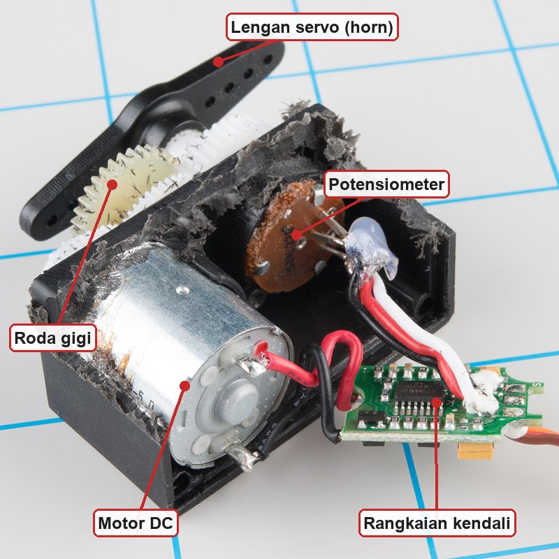
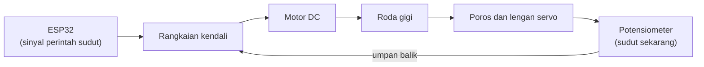
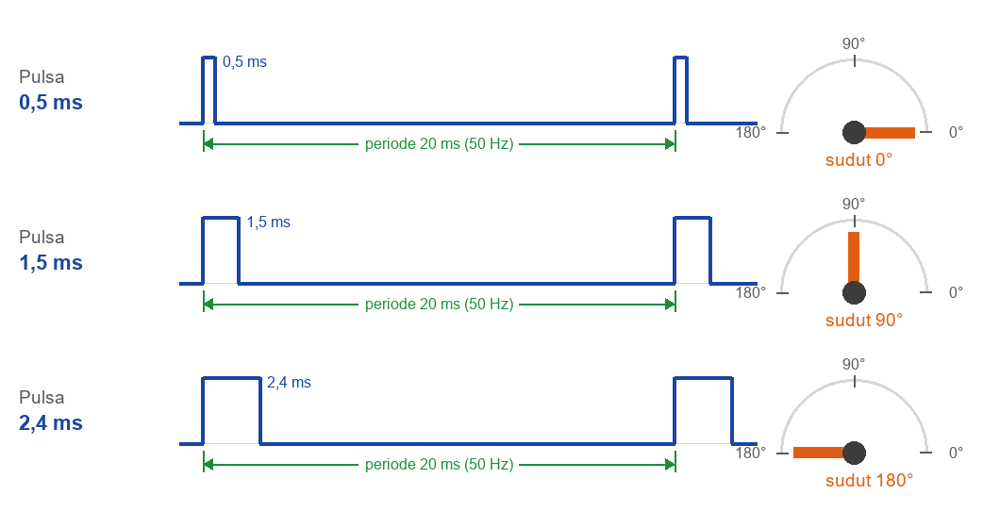
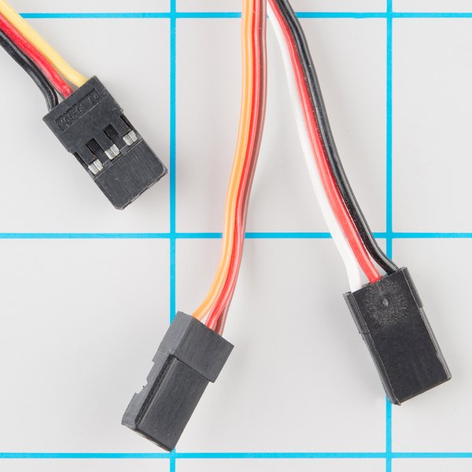
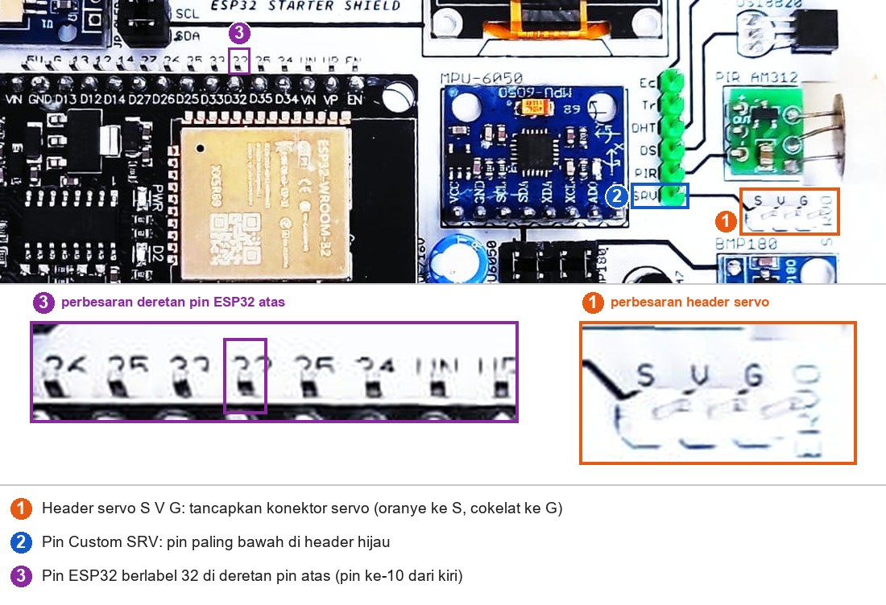
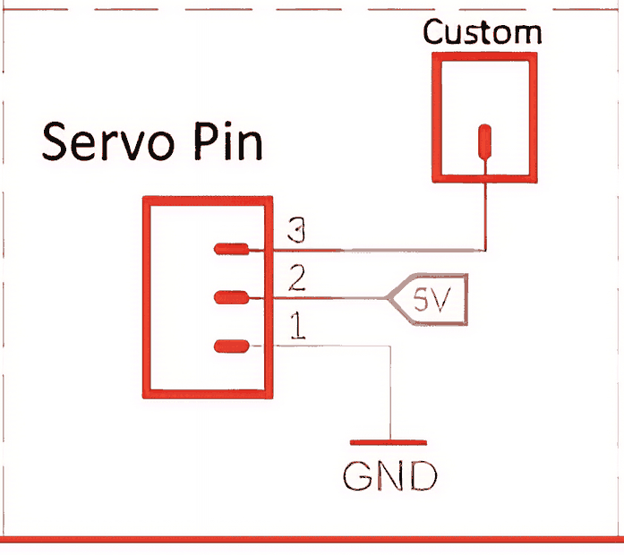
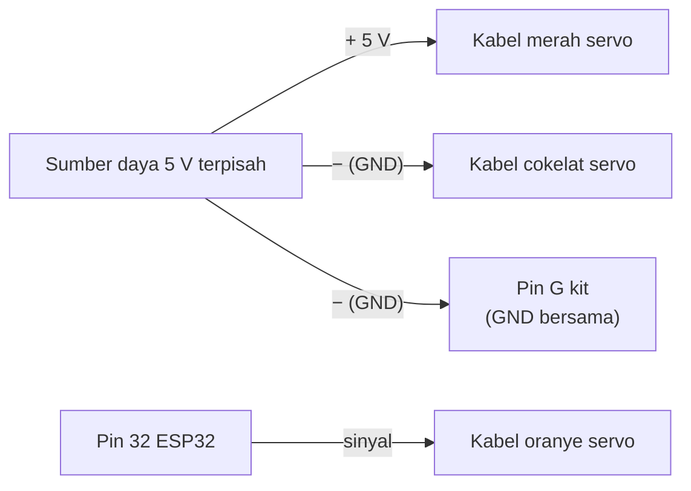
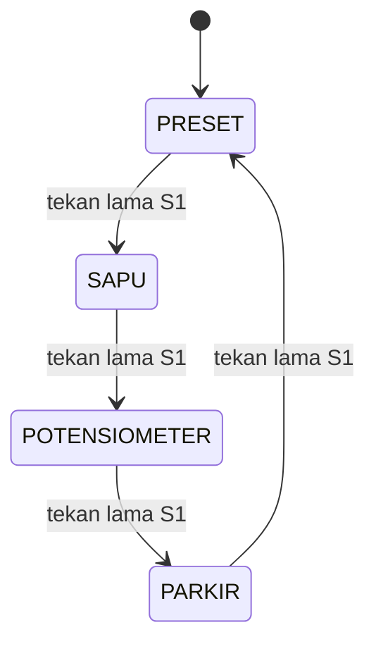

# BAB 38: Motor Servo

> ✅ **Prasyarat:** Selesaikan **BAB 12 (PWM dengan LEDC)** dan **BAB 16 (Non-Blocking Programming)** — kamu sudah paham frekuensi dan lebar pulsa PWM, fungsi `ledcAttach()`/`ledcWrite()`, serta pola `millis()`. Program 3–5 juga memakai potensiometer dari **BAB 11 (Analog Input & ADC)**, tombol S1/S2 dengan *debounce* dari **BAB 9 (Digital Input — Push Button)**, dan `enum` dari **BAB 17 (State Machine)**.

Palang parkir mainan, kemudi mobil RC, lengan robot, dan pengunci pintu otomatis punya satu kebutuhan yang sama: berputar ke **sudut tertentu**, lalu diam dan bertahan di sana. Motor DC biasa tidak bisa melakukannya, karena ia hanya tahu "berputar" atau "berhenti". **Motor servo** bisa: kamu cukup memberi perintah "ke 90°", dan servo bergerak ke sudut itu lalu menahannya. Di BAB ini kamu akan menggerakkan servo dengan ESP32 lewat sinyal PWM 50 Hz, mengalibrasinya, lalu mengendalikannya dengan potensiometer dan tombol — semuanya tanpa `delay()` di `loop()`.

## 📌 Tujuan Pembelajaran

Setelah mempelajari BAB ini, kamu bisa:

- Menjelaskan cara kerja motor servo (motor DC, roda gigi, potensiometer, dan rangkaian kendali) serta beda servo 180° dengan servo rotasi kontinu.
- Menjelaskan sinyal kendali servo: periode 20 ms (50 Hz) dan lebar pulsa sekitar 0,5–2,5 ms yang menentukan sudut.
- Menyambungkan servo ke header servo kit (`S V G`) dengan arah konektor yang benar, lalu menyambung pin `SRV` ke IO32.
- Memperkirakan kebutuhan arus servo, mengenali gejala *brownout*, dan memilih sumber daya yang aman.
- Memakai *library* ESP32Servo: `attach()`, `write()`, `writeMicroseconds()`, `attached()`, dan `detach()`.
- Mengalibrasi titik ujung servo lewat Serial Monitor supaya servo tidak berdengung atau memaksa di ujung putarannya.
- Membuat gerakan bolak-balik, kendali dengan potensiometer, preset posisi dengan tombol, dan gerakan halus tanpa `delay()`.
- Menggabungkan semuanya dalam *state machine* multi-mode dan mengendalikan servo langsung dengan LEDC tanpa *library*.

## 🧰 Yang Perlu Disiapkan

| Kebutuhan | Keterangan |
|---|---|
| *Hardware* | Kit Bluino ESP32 IoT Starter Shield + kabel USB **data** |
| Kabel *jumper* | *Female-female* (sudah ada di kit): 1 untuk `SRV` → IO32 (semua program), 1 untuk `VR10K` → IO34 (Program 3 dan 5), 2 untuk `SW1` → IO15 dan `SW2` → IO25 (Program 4 dan 5) |
| Komponen tambahan | **Tidak termasuk kit:** 1 motor servo mikro 180°, misalnya **SG90** (atau MG90S). Opsional: kapasitor elektrolit 470–1000 µF (tegangan kerja minimal 10 V) dan sumber daya 5 V terpisah untuk servo yang lebih besar (lihat [38.4](#384-daya-servo-arus-brownout-dan-sumber-daya-terpisah)) |
| *Software* | Arduino IDE 2.x + *board package* **esp32** versi 3.3.x (lihat [BAB 5](../BAB-05/README.md)) |
| *Library* | **ESP32Servo** buatan Kevin Harrington dan John K. Bennett (diuji dengan versi 3.2.1; cara memasang di [38.5](#385-library-esp32servo)). Program 2 tidak memakai *library* |
| Alat uji | **Serial Monitor** Arduino IDE (baud 115200; Program 2 memakai *line ending* **New Line**). Opsional: busur derajat untuk mengukur sudut lengan servo |
| Jaringan | Tidak perlu WiFi |

> 📌 **Catatan:** Kit hanya menyediakan **konektor** servo, bukan servonya. Servo mikro SG90 mudah dibeli di toko elektronik atau toko daring dengan harga terjangkau. Biasanya servo dijual bersama beberapa lengan plastik (*horn*) dan sekrup kecil. Pastikan yang kamu beli adalah versi **180°**, bukan versi **360°** (rotasi kontinu) — bedanya dijelaskan di [38.1.3](#3813-servo-180-dan-servo-rotasi-kontinu).

## 📑 Daftar Isi

- [38.1 Mengenal Motor Servo](#381-mengenal-motor-servo)
- [38.2 Sinyal Kendali Servo: Lebar Pulsa Menentukan Sudut](#382-sinyal-kendali-servo-lebar-pulsa-menentukan-sudut)
- [38.3 Menyambungkan Servo ke Kit](#383-menyambungkan-servo-ke-kit)
- [38.4 Daya Servo: Arus, Brownout, dan Sumber Daya Terpisah](#384-daya-servo-arus-brownout-dan-sumber-daya-terpisah)
- [38.5 Library ESP32Servo](#385-library-esp32servo)
- [38.6 Program 1: Servo Bergerak Bolak-Balik](#386-program-1-servo-bergerak-bolak-balik)
- [38.7 Program 2: Kalibrasi Titik Ujung Servo Tanpa Library](#387-program-2-kalibrasi-titik-ujung-servo-tanpa-library)
- [38.8 Program 3: Servo Mengikuti Potensiometer](#388-program-3-servo-mengikuti-potensiometer)
- [38.9 Program 4: Preset Posisi dengan Tombol](#389-program-4-preset-posisi-dengan-tombol)
- [38.10 Program 5: Servo Multi-Mode dengan State Machine](#3810-program-5-servo-multi-mode-dengan-state-machine)
- [38.11 Servo Rotasi Kontinu](#3811-servo-rotasi-kontinu)
- [38.12 Troubleshooting](#3812-troubleshooting)
- [📝 Rangkuman](#-rangkuman)
- [💪 Latihan](#-latihan)
- [📚 Referensi](#-referensi)

---

## 38.1 Mengenal Motor Servo

**Motor servo** adalah motor yang mengatur **posisi sudut** porosnya, bukan sekadar berputar. Bandingkan dengan motor DC biasa (seperti motor di mainan atau kipas kecil): selama diberi tegangan, motor DC terus berputar, dan ia tidak tahu porosnya sedang menghadap ke mana. Servo berbeda — ia "tahu" posisinya sendiri dan terus mengoreksi gerakannya sampai sudutnya sesuai perintah.

| | Motor DC biasa | Motor servo |
|---|---|---|
| Yang diatur | Kecepatan dan arah putar | **Sudut** poros |
| Tahu posisinya sendiri? | Tidak | Ya, lewat potensiometer di dalamnya |
| Jumlah kabel | 2 (+ dan −) | 3 (daya, GND, sinyal) |
| Bisa langsung disambung ke ESP32? | Tidak — wajib lewat *driver* motor | Ya — kabel sinyalnya ke GPIO, dayanya dari jalur 5 V |
| Contoh pemakaian | Kipas, roda robot | Kemudi, lengan robot, palang pintu |

### 38.1.1 Isi di Dalam Servo



*Gambar 38.1 — Isi servo hobi yang casing-nya dibongkar. Servo mikro SG90 berisi bagian yang sama dalam ukuran lebih kecil. Sumber: [SparkFun Electronics](https://learn.sparkfun.com/tutorials/hobby-servo-tutorial/all), lisensi CC BY-SA 4.0; label ditambahkan untuk materi ini.*

| Bagian | Tugasnya |
|---|---|
| **Motor DC** kecil | Sumber gerak. Putarannya cepat tetapi tenaganya lemah |
| **Roda gigi** (*gearbox*) | Memperlambat putaran motor sekaligus melipatgandakan tenaganya, lalu meneruskannya ke poros keluaran |
| **Potensiometer** | Ikut berputar bersama poros keluaran, sehingga nilai hambatannya menunjukkan sudut poros saat itu. Prinsipnya sama dengan potensiometer di kit ([BAB 11](../BAB-11/README.md)) |
| **Rangkaian kendali** | Membaca perintah dari ESP32, membandingkannya dengan posisi dari potensiometer, lalu memutar motor maju atau mundur sampai keduanya sama |
| **Lengan servo** (*horn*) | Lengan plastik yang dipasang di poros keluaran, tempat menyambung benda yang mau digerakkan |

Cara kerja servo adalah contoh **umpan balik** (*feedback*): rangkaian kendali terus membandingkan "sudut yang diminta" dengan "sudut sekarang". Mirip kamu menuang air ke gelas sambil melihat permukaan air: mata memberi umpan balik, tangan berhenti menuang saat airnya sudah pas.



*Gambar 38.2 — Lingkaran umpan balik di dalam servo: motor terus dikoreksi sampai sudut dari potensiometer sama dengan sudut yang diminta. Sumber: dibuat untuk materi ini.*

> 📌 **Catatan:** Umpan balik itu hanya terjadi **di dalam** servo. ESP32 tidak menerima informasi posisi apa pun dari servo — kabelnya hanya satu arah (ESP32 → servo). Jadi kalau lengan servo tertahan benda, ESP32 tidak tahu bahwa servo gagal mencapai sudutnya.

### 38.1.2 Spesifikasi Servo Mikro SG90

| Parameter | Nilai menurut *datasheet* | Artinya untuk kamu |
|---|---|---|
| Berat | 9 g | Sangat ringan, cocok untuk proyek kecil |
| Tegangan kerja | 4,8 V (±5 V) | Pas dengan jalur 5 V di kit. **Jangan** diberi 3,3 V (lihat [38.4](#384-daya-servo-arus-brownout-dan-sumber-daya-terpisah)) |
| Torsi saat macet (*stall torque*) | 1,8 kgf·cm (pada 4,8 V) | Paling kuat menahan beban ±1,8 kg yang digantung 1 cm dari poros, atau ±180 g pada lengan 10 cm. Itu batas saat servo sudah macet — dalam pemakaian, bebannya sebaiknya jauh lebih ringan |
| Kecepatan | 0,1 detik per 60° (pada 4,8 V, tanpa beban) | Berputar 180° butuh sekitar 0,3 detik |
| Sudut putar | Sekitar 180° (90° ke setiap arah dari tengah) | Ada penahan mekanis di kedua ujung |
| Lebar pita mati (*dead band*) | 10 µs | Perubahan lebar pulsa yang lebih kecil dari 10 µs diabaikan servo |
| Suhu kerja | 0–55 °C | Aman untuk suhu ruangan |

*Datasheet* SG90 tidak mencantumkan arus. Hasil pengukuran toko komponen ProtoSupplies: sekitar **10 mA** saat diam, **100–250 mA** saat bergerak, dan sampai sekitar **360 mA** saat macet (*stall*, poros tertahan sehingga motor tidak bisa berputar). Sumber lain menyebut arus macet yang lebih besar, sampai sekitar 700 mA. Angka-angka ini penting untuk [38.4](#384-daya-servo-arus-brownout-dan-sumber-daya-terpisah).

> 💡 **Tips:** Satuan kgf·cm (kilogram-gaya sentimeter) mengukur **torsi**, yaitu kekuatan memutar. Makin jauh beban dari poros, makin berat terasa bagi servo — sama seperti membuka pintu: mendorong di dekat engsel jauh lebih berat daripada di dekat gagang.

### 38.1.3 Servo 180° dan Servo Rotasi Kontinu

Bentuk luarnya sama, tetapi perilakunya berbeda:

| Jenis | Contoh | Yang diatur oleh sinyal | Kapan dipakai |
|---|---|---|---|
| **Servo posisi (180°)** | SG90, MG90S, MG996R | **Sudut** poros (sekitar 0–180°) | Palang, kemudi, lengan robot — **jenis ini yang dipakai di BAB ini** |
| **Servo rotasi kontinu (360°)** | SG90 versi 360°, FS90R | **Kecepatan dan arah** putar; poros bisa berputar terus | Roda robot kecil |

Servo rotasi kontinu tidak bisa diperintah "ke 90°". Cara mengendalikannya dibahas singkat di [38.11](#3811-servo-rotasi-kontinu). Kalau servomu terus berputar tanpa berhenti saat menjalankan Program 1, kemungkinan besar itu servo rotasi kontinu.

---

## 38.2 Sinyal Kendali Servo: Lebar Pulsa Menentukan Sudut

Servo diperintah dengan sinyal PWM (*Pulse Width Modulation*, modulasi lebar pulsa) yang sudah kamu kenal di [BAB 12](../BAB-12/README.md), tetapi cara membacanya berbeda dari LED:

- **Frekuensi 50 Hz**, artinya satu pulsa setiap **20 ms** (periode = 1 ÷ 50 detik = 20 ms).
- Yang penting bagi servo adalah **lebar pulsa HIGH dalam mikrodetik (µs)**, bukan persentase *duty cycle*. 1 ms = 1000 µs.
- Menurut *datasheet* SG90, pulsa **±1 ms** membawa poros ke ujung yang satu, **1,5 ms** ke tengah, dan **±2 ms** ke ujung yang lain.
- Dalam praktik, banyak SG90 baru mencapai putaran penuh ±180° dengan pulsa sekitar **0,5–2,4 ms**. Rentang ini berbeda-beda untuk setiap servo, bahkan antara dua servo dengan merek dan tipe yang sama. Karena itu ada Program 2 untuk kalibrasi.



*Gambar 38.3 — Lebar pulsa menentukan sudut lengan servo; jarak antarpulsa tetap 20 ms. Angka 0,5 dan 2,4 ms adalah contoh untuk SG90 — servomu bisa sedikit berbeda. Sumber: dibuat untuk materi ini.*

Rangkaian kendali di dalam servo mengukur lebar setiap pulsa yang datang, lalu menggerakkan motor ke sudut yang sesuai. Pulsa harus terus dikirim (sekitar 50 kali per detik) supaya servo tetap menahan posisinya. Untungnya, LEDC di ESP32 membuat pulsa-pulsa itu sendiri di latar belakang, jadi programmu cukup mengatur lebarnya sekali.

| Lebar pulsa | Sudut (contoh SG90, rentang 0,5–2,4 ms) | *Duty cycle* pada 50 Hz |
|---|---|---|
| 500 µs (0,5 ms) | 0° (ujung pertama) | 2,5% |
| 1000 µs (1 ms) | ±47° | 5% |
| 1450 µs (1,45 ms) | 90° (tengah) | 7,25% |
| 2000 µs (2 ms) | ±142° | 10% |
| 2400 µs (2,4 ms) | 180° (ujung kedua) | 12% |

*Duty cycle* = lebar pulsa ÷ periode (20 ms) × 100%. Contoh: 1,5 ms ÷ 20 ms × 100% = 7,5%. Perhatikan bahwa seluruh gerakan servo hanya memakai *duty cycle* sekitar 2,5–12%. Inilah sebabnya resolusi PWM untuk servo perlu cukup tinggi (lihat [Program 2](#387-program-2-kalibrasi-titik-ujung-servo-tanpa-library)).

Hubungan sudut dan lebar pulsa berupa garis lurus, sehingga bisa dihitung dengan rumus:

```text
lebar pulsa = PULSA_MIN + sudut × (PULSA_MAX − PULSA_MIN) ÷ 180

Contoh (PULSA_MIN = 500 µs, PULSA_MAX = 2400 µs, sudut 90°):
lebar pulsa = 500 + 90 × 1900 ÷ 180 = 500 + 950 = 1450 µs
```

Rumus ini sama dengan fungsi `map(sudut, 0, 180, PULSA_MIN, PULSA_MAX)` yang kamu kenal di [BAB 11](../BAB-11/README.md), dan itulah yang dikerjakan *library* ESP32Servo di balik layar.

> ⚠️ **Perhatian:** Jangan memaksa servo melewati penahan mekanis di ujung putarannya. Kalau lebar pulsa terlalu kecil atau terlalu besar, servo terus berusaha berputar padahal porosnya sudah mentok: terdengar dengung atau gemeretak, servo menjadi panas, arusnya melonjak ke arus macet, dan roda gigi plastiknya bisa rontok. Kalibrasi di Program 2 mencegah hal ini.

> 📌 **Catatan:** Sinyal dari ESP32 hanya 3,3 V, padahal servo diberi daya 5 V. Hal ini umumnya tidak masalah, karena kebanyakan servo hobi seperti SG90 sudah membaca 3,3 V sebagai HIGH (lihat tabel komponen kit di [BAB 3](../BAB-03/README.md#363-komponen-kit-mana-yang-33-v-mana-yang-5-v)). Arah sinyalnya pun dari ESP32 ke servo, jadi tidak ada tegangan 5 V yang masuk ke pin ESP32.

---

## 38.3 Menyambungkan Servo ke Kit

### 38.3.1 Warna Kabel Servo

Servo hobi memakai konektor 3 lubang. Warnanya berbeda antarpabrik, tetapi urutannya hampir selalu sama: **kabel daya (+) selalu di tengah**.

| Fungsi | SG90 dan kebanyakan servo murah | Warna lain yang sering dipakai |
|---|---|---|
| GND (−) | **Cokelat** | Hitam |
| Daya + (5 V) | **Merah** | Merah |
| Sinyal | **Oranye** | Kuning atau putih |



*Gambar 38.4 — Tiga skema warna kabel servo yang umum: hitam–merah–kuning (kiri atas), cokelat–merah–oranye seperti SG90 (tengah), dan hitam–merah–putih (kanan). Kabel merah (daya) selalu di tengah. Sumber: [SparkFun Electronics](https://learn.sparkfun.com/tutorials/hobby-servo-tutorial/all), lisensi CC BY-SA 4.0.*

### 38.3.2 Header Servo dan Pin SRV di Kit

Di sisi kanan kit, di bawah sensor PIR, ada **header servo** berupa 3 pin putih berlabel `S`, `V`, `G` (di sebelahnya tertulis `SERVO`). Jalur `S` dari header itu dibawa jalur PCB ke pin Custom **`SRV`**, yaitu pin paling bawah di header hijau.



*Gambar 38.5 — Header servo `S V G` (1), pin Custom `SRV` di header hijau (2), dan pin `32` di deretan pin ESP32 atas (3) pada kit v3.x; tata letak kit v3.2 milikmu bisa sedikit berbeda. Sumber: foto produk ESP32 Starter Shield, [Bluino](http://www.bluino.com), dipotong dan diberi penanda untuk materi ini.*

Rangkaian header itu di skematik kit:



*Gambar 38.6 — Header servo pada kit: pin 1 = GND, pin 2 = 5 V, pin 3 = sinyal (ke pin Custom `SRV`). Sumber: skematik ESP32 Starter Shield 3.2, [Bluino](http://www.bluino.com).*

| Pin header servo | Tersambung ke | Kabel servo (SG90) | Perlu kabel *jumper*? |
|---|---|---|---|
| `S` (pin 3) | Pin Custom `SRV` (header hijau, paling bawah) | **Oranye** (sinyal) | **Ya**: `SRV` → IO32 |
| `V` (pin 2) | Jalur 5 V kit | **Merah** (+) | Tidak — sudah lewat PCB |
| `G` (pin 1) | GND | **Cokelat** (−) | Tidak — sudah lewat PCB |

**Kenapa IO32?** IO32 adalah pin servo di **Peta Pin Standar** seluruh materi ini ([BAB 6](../BAB-06/README.md#632-pin-custom-disambung-dengan-kabel-jumper)). Pin ini bisa menjadi output PWM, bukan pin *strapping*, dan tidak dipakai komponen kit lainnya, jadi kabelnya boleh dibiarkan terpasang saat kamu mempelajari BAB lain.

### 38.3.3 Langkah Merangkai

1. **Cabut kabel USB** dari laptop.
2. Tancapkan konektor servo ke header `S V G` dengan kabel **oranye di `S`** dan kabel **cokelat di `G`** (sisi yang dekat tulisan `SERVO`). Kabel merah otomatis berada di tengah, di `V`.
3. Pasang kabel *jumper* *female-female* dari pin **`SRV`** (header hijau, paling bawah) ke pin **`32`** di deretan pin ESP32 atas. Urutan deretan atas dari kiri: `5V`, `G`, `13`, `12`, `14`, `27`, `26`, `25`, `33`, `32`, … — jadi pin `32` adalah pin ke-10 dari kiri.
4. Pasang salah satu lengan servo ke porosnya (cukup ditekan, sekrupnya tidak wajib). Sudutnya boleh sembarang dulu; setelah kalibrasi di Program 2 kamu bisa memasangnya ulang supaya lurus.
5. Letakkan servo di meja supaya lengannya bebas berputar dan tidak membentur kabel atau benda lain.
6. Periksa sekali lagi, lalu sambungkan kabel USB.

> ⚠️ **Perhatian:** Karena kabel merah ada di tengah, konektor yang terbalik biasanya tidak langsung merusak servo. Namun servo tidak akan bergerak, dan kabel GND servo justru tersambung ke jalur sinyal ESP32. Kalau servo diam saja, cabut USB dan periksa lagi arah konektornya.

> 💡 **Tips:** Konektor servo SG90 berupa lubang (*female*), sedangkan header servo kit berupa pin (*male*), jadi servo langsung bisa ditancapkan tanpa kabel tambahan.

---

## 38.4 Daya Servo: Arus, Brownout, dan Sumber Daya Terpisah

### 38.4.1 Dari Mana Servo Mendapat Daya?

Saat kit disambung ke laptop lewat USB, tegangan 5 V dari *port* USB masuk ke *board* ESP32, muncul di pin **5V/VIN**, lalu menjadi jalur 5 V kit yang juga memberi daya ke header servo (pin `V`), *relay*, dan konektor HC-SR04 (lihat Gambar 3.8 di [BAB 3](../BAB-03/README.md#3102-dari-mana-kit-mendapat-daya)). Artinya, **ESP32 dan servo berbagi sumber daya yang sama**.

| Pemakai daya | Perkiraan arus |
|---|---|
| Chip ESP32 tanpa WiFi | ±20–70 mA (lihat [BAB 2](../BAB-02/README.md)) |
| Chip ESP32 saat WiFi mengirim data | Sampai ±240 mA sesaat |
| SG90 diam | ±10 mA |
| SG90 bergerak tanpa beban | ±100–250 mA, dengan lonjakan sesaat setiap kali motor mulai berputar |
| SG90 macet (*stall*) | ±360 mA (hasil ukur); sumber lain menyebut sampai ±700 mA |
| Servo besar MG996R macet | Sampai ±2,5 A (pada 6 V, menurut *datasheet*) |
| ***Port* USB 2.0 laptop** | **Biasanya maksimal 500 mA** (USB 3.x: 900 mA) |

### 38.4.2 Brownout: ESP32 Mulai Ulang Saat Servo Bergerak

Setiap kali motor servo mulai berputar, arusnya melonjak sesaat. Kabel USB yang panjang atau tipis membuat tegangan 5 V ikut turun sesaat, dan tegangan 3,3 V untuk chip ESP32 bisa ikut turun. Kalau turunnya melewati batas, ***brownout detector*** di dalam ESP32 langsung me-*reset* chip supaya tidak bekerja kacau ([BAB 21](../BAB-21/README.md#2112-brownout-saat-daya-tidak-cukup)). Gejalanya:

```text
Brownout detector was triggered
```

ESP32 lalu mulai lagi dari `setup()`, servo kembali ke posisi awal, arus melonjak lagi, dan ESP32 bisa me-*reset* berulang-ulang.

Untuk satu servo SG90 **tanpa beban berat**, daya USB dari laptop biasanya cukup — asalkan kabel USB-nya bagus dan dicolokkan langsung ke laptop. Kit juga sudah punya kapasitor elektrolit 100 µF di jalur 5 V (tabung biru di dekat MPU-6050) yang membantu meredam lonjakan kecil.

### 38.4.3 Aturan Aman Memberi Daya Servo

1. **Jangan pernah memberi daya servo dari pin 3V3.** Tegangannya terlalu rendah untuk SG90 (butuh ±4,8–6 V), dan pin 3V3 disuplai regulator yang sama dengan chip ESP32. Lonjakan arus motor langsung mengganggu ESP32.
2. **Jangan menggerakkan servo dengan pin GPIO.** Pin GPIO hanya untuk **sinyal**. Arus motor harus lewat kabel merah dan cokelat (lihat batas arus GPIO di [BAB 3](../BAB-03/README.md#38-batas-arus-gpio-esp32)).
3. **Kalau ESP32 sering me-*reset*,** pasang kapasitor elektrolit **470–1000 µF** (tegangan kerja minimal 10 V) di antara jalur 5 V dan GND, sedekat mungkin dengan servo. Kaki panjang (+) ke 5 V, sisi badan yang bergaris (−) ke GND — kapasitor yang terbalik bisa menggembung atau meletus. Kapasitor ini bekerja seperti tangki air kecil yang menutupi kebutuhan arus sesaat saat motor mulai berputar.
4. **Servo besar, beberapa servo sekaligus, atau servo yang mengangkat beban** (misalnya MG996R pada lengan robot) wajib memakai **sumber daya terpisah**: adaptor atau modul catu daya 5–6 V (sesuai *datasheet* servo) yang mampu memberi arus minimal sekitar 1 A per servo kecil, dan lebih besar lagi untuk servo besar.
5. **Colokan adaptor DC di kit tidak menyelesaikan masalah ini.** Jalurnya lewat regulator 78M05 yang maksimal hanya 500 mA dan cepat panas ([BAB 3](../BAB-03/README.md#3103-regulator-78m05-dan-dioda-1n4001)).

### 38.4.4 Menyambung Sumber Daya Terpisah

Saat memakai sumber daya terpisah, servo **tidak** ditancapkan ke header `S V G`, karena pin `V` di header itu tersambung ke jalur 5 V kit. Pakai kabel *jumper* *male-female* (tidak termasuk kit) untuk memisahkan ketiga kabel servo:



*Gambar 38.7 — Servo dengan sumber daya terpisah: daya dari sumber luar, sinyal dari IO32, dan **GND keduanya disatukan**. Sumber: dibuat untuk materi ini.*

- **GND wajib disatukan.** Sinyal dari IO32 diukur terhadap GND ESP32. Tanpa GND bersama, servo tidak punya acuan untuk membaca pulsa, sehingga ia diam atau bergerak acak.
- **Jangan menyambung + sumber luar ke pin 5V/VIN kit** selama kabel USB terpasang. Dua sumber daya yang saling bertemu bisa saling mendorong arus dan merusak *port* USB atau sumber dayanya. Yang disatukan hanya GND.
- Kabel sinyal (oranye) boleh langsung ke pin `32`, atau ke pin `S` di header servo kalau kabel `SRV` → `32` tetap terpasang.

> 🚨 **Bahaya:** Jangan memakai baterai atau adaptor dengan tegangan lebih dari yang tertulis di *datasheet* servo (SG90: ±4,8–6 V). Tegangan berlebih merusak rangkaian kendali servo dan bisa membuatnya panas.

---

## 38.5 Library ESP32Servo

Secara teori, servo bisa dikendalikan cukup dengan `ledcAttach()` dan `ledcWrite()` dari BAB 12 (kamu akan mencobanya di Program 2). Namun *library* **ESP32Servo** membuat semuanya lebih praktis: ia menyiapkan LEDC 50 Hz, mengubah sudut menjadi lebar pulsa, dan bisa mengurus beberapa servo sekaligus. Cara pakainya juga mirip *library* Servo milik Arduino, jadi contoh servo Arduino di internet mudah disesuaikan.

### 38.5.1 Memasang Library

1. Buka Arduino IDE, lalu pilih menu **Sketch → Include Library → Manage Libraries…** (atau klik ikon buku di bilah kiri).
2. Ketik `ESP32Servo` di kolom pencarian.
3. Cari **ESP32Servo** buatan **Kevin Harrington, John K. Bennett**, lalu klik **Install**. Materi ini diuji dengan versi **3.2.1**; versi 3.x yang lebih baru seharusnya juga bisa.
4. Tunggu sampai muncul tulisan **INSTALLED** di bawah nama *library*.
5. Untuk memastikan, buka **File → Examples**. Di bagian bawah daftar harus ada **ESP32Servo** dengan contoh seperti `Sweep` dan `Knob`.

> ⚠️ **Perhatian:** Jangan memakai `#include <Servo.h>`. *Library* Servo bawaan Arduino tidak mendukung ESP32, sehingga *compile* gagal dengan pesan bahwa *library* itu hanya mendukung prosesor tertentu (AVR, SAM, SAMD, dan lain-lain). Untuk ESP32, tulis `#include <ESP32Servo.h>`. Nama kelasnya tetap `Servo`.

### 38.5.2 Fungsi-Fungsi Penting

| Fungsi | Gunanya | Catatan |
|---|---|---|
| `Servo servo;` | Membuat satu objek untuk satu servo | Ditulis di luar fungsi, di bagian atas program |
| `servo.setPeriodHertz(50)` | Mengatur frekuensi sinyal | 50 Hz adalah nilai bawaan; panggil sebelum `attach()` |
| `servo.attach(pin, min, max)` | Menyambungkan servo ke pin, sekaligus menentukan lebar pulsa untuk 0° (`min`) dan 180° (`max`) dalam µs | `min` di bawah 500 dipaksa menjadi 500, `max` di atas 2500 dipaksa menjadi 2500. Tanpa `min`/`max`, *library* memakai 544–2400 µs |
| `servo.attached()` | Memeriksa apakah servo berhasil disambungkan | `true` kalau berhasil |
| `servo.write(sudut)` | Memutar servo ke sudut 0–180 | Sudut di bawah 0 dianggap 0, sudut 181–499 dianggap 180 |
| `servo.writeMicroseconds(us)` | Mengirim lebar pulsa tertentu dalam µs | Dibatasi ke rentang `min`–`max` dari `attach()` |
| `servo.read()` | Mengembalikan sudut **terakhir yang diperintahkan** | Bukan posisi sebenarnya — servo tidak melapor ke ESP32 |
| `servo.detach()` | Menghentikan pulsa dan melepas pin | Servo berhenti menahan posisi dan lengannya bisa diputar dengan tangan |

Contoh potongan kode (bukan program lengkap):

```cpp
#include <ESP32Servo.h>

Servo servo;                    // satu objek untuk satu servo

servo.setPeriodHertz(50);       // di setup(): sinyal 50 Hz
servo.attach(32, 500, 2400);    // IO32; 0° = 500 µs, 180° = 2400 µs
servo.write(90);                // ke 90° → pulsa 1450 µs
servo.writeMicroseconds(1500);  // kirim pulsa 1500 µs secara langsung
```

> ⚠️ **Perhatian:** `write()` menganggap angka **500 ke atas sebagai mikrodetik**, bukan derajat. Jadi `servo.write(600)` berarti "kirim pulsa 600 µs", bukan "putar ke 600°". Selalu pakai angka 0–180 untuk `write()`, dan `writeMicroseconds()` kalau ingin menulis mikrodetik.

> 📌 **Catatan:** ESP32Servo hanya menerima pin yang bisa membuat PWM dengan baik: IO2, IO4, IO5, IO12–IO19, IO21–IO23, IO25–IO27, IO32, dan IO33. Pin lain, misalnya IO34–IO39 yang hanya bisa input, ditolak dan `attached()` bernilai `false`. Nilai yang dikembalikan `attach()` adalah nomor *channel* LEDC, dan servo pertama mendapat *channel* 0, jadi angka itu tidak bisa dipakai untuk memeriksa keberhasilan. Pakai `attached()`.

<details>
<summary><b>🔬 Pendalaman (opsional): resolusi 10 bit dan berbagi LEDC dengan komponen lain</b></summary>

- **Resolusi bawaan 10 bit.** ESP32Servo 3.2.1 memakai LEDC 50 Hz dengan resolusi 10 bit, yaitu 1.024 langkah per 20 ms, sehingga satu langkah ±19,5 µs. Dengan rentang 500–2400 µs, gerakan 180° hanya terbagi menjadi ±97 langkah (±1,9° per langkah), jadi `write(90)` dan `write(91)` bisa menghasilkan pulsa yang sama persis. Untuk SG90 ini biasanya tidak terasa. Kalau butuh gerakan lebih halus, panggil `servo.setTimerWidth(16)` **setelah** `attach()` (panggilan sebelum `attach()` akan di-*reset* oleh `attach()`), lalu panggil `write()` lagi. Pada 16 bit, satu langkah ±0,3 µs.
- **Pembagian *channel* LEDC.** ESP32Servo memilih *channel* LEDC sendiri, dimulai dari *channel* 0, tanpa memeriksa *channel* yang sudah dipakai fungsi lain. Kalau satu program juga memakai `ledcAttach()` atau `analogWrite()` untuk komponen lain (misalnya peredup LED dari BAB 12), **panggil `attach()` untuk semua servo lebih dulu**, baru `ledcAttach()`/`analogWrite()`. Kalau urutannya terbalik, servo bisa ikut memakai *channel* milik LED sehingga sinyalnya kacau.
- **Berbagi *timer*.** Semua servo 50 Hz dengan resolusi yang sama memakai satu *timer* LEDC (lihat Pendalaman di [BAB 12](../BAB-12/README.md#1222-batas-frekuensi-dan-resolusi)). Itu normal. Jangan memanggil `ledcChangeFrequency()` atau `ledcWriteTone()` pada pin yang berbagi *timer* dengan servo, karena frekuensi servo ikut berubah.

</details>

---

## 38.6 Program 1: Servo Bergerak Bolak-Balik

**Tujuan:** Menggerakkan servo dari 0° ke 180° lalu kembali ke 0°, terus-menerus, satu derajat setiap 15 ms. Gerakan ini sering disebut ***sweep***. Program ini memastikan servo, kabel, dan *library* sudah bekerja, dan gerakannya dibuat tanpa `delay()` di `loop()`.

**Rangkaian:**

| Pin **Custom** di kit | Sambungkan ke pin ESP32 |
|---|---|
| `SRV` (header hijau, paling bawah) | IO32 (label `32`, deretan atas) |

Servo ditancapkan di header `S V G`: oranye → `S`, merah → `V`, cokelat → `G` (lihat [38.3.3](#3833-langkah-merangkai)).

**Cara Menjalankan:**

1. Rangkai sesuai [38.3.3](#3833-langkah-merangkai). Pastikan lengan servo bebas berputar.
2. Pasang *library* **ESP32Servo** kalau belum ([38.5.1](#3851-memasang-library)).
3. Buka Arduino IDE → **File → New Sketch**, hapus isinya, lalu salin kode di bawah. Kode yang sama juga tersedia di *file* [`p1_sweep_dasar.ino`](p1_sweep_dasar/p1_sweep_dasar.ino).
4. Pastikan **Tools → Board** = **ESP32 Dev Module** dan **Tools → Port** = *port* ESP32 kamu (misalnya `COM5` di Windows atau `/dev/ttyUSB0` di Linux).
5. Klik tombol **Upload** (ikon panah →) dan tunggu sampai muncul tulisan **Done uploading**.
6. Buka **Serial Monitor** (**Tools → Serial Monitor**) lalu pilih baud **115200**.

**Kode Program:**

<!-- sketch: p1_sweep_dasar -->
```cpp
/*
 * BAB 38 - Program 1: Servo Bergerak Bolak-Balik (Sweep)
 * Servo bergerak 0° → 180° → 0° terus-menerus, 1 derajat setiap 15 ms,
 * tanpa delay() di loop().
 *
 * Rangkaian:
 *   Servo di header servo kit: oranye → S, merah → V, cokelat → G
 *   SRV (header hijau, paling bawah) → IO32
 */

#include <ESP32Servo.h>

#define PIN_SERVO 32  // SRV → IO32

// Lebar pulsa (µs) untuk 0° dan 180°. Cocok untuk banyak SG90;
// ganti dengan hasil kalibrasi Program 2.
const int PULSA_MIN_US = 500;
const int PULSA_MAX_US = 2400;

const unsigned long JEDA_LANGKAH_MS = 15;  // 1° setiap 15 ms → 180° dalam ±2,7 detik

Servo servo;

int sudut = 0;  // sudut yang sedang diperintahkan
int arah = 1;   // +1 = sudut naik, -1 = sudut turun
unsigned long waktuLangkahLalu = 0;

void setup() {
  Serial.begin(115200);
  Serial.println("BAB 38 - Program 1: Servo Bergerak Bolak-Balik");

  servo.setPeriodHertz(50);  // sinyal servo standar: 50 Hz (periode 20 ms)
  servo.attach(PIN_SERVO, PULSA_MIN_US, PULSA_MAX_US);
  if (!servo.attached()) {
    Serial.println("Gagal memasang servo di IO32! Periksa nomor pin.");
    while (true) {
      delay(1000);  // program berhenti di sini
    }
  }

  servo.write(sudut);  // mulai dari 0°
  Serial.printf("Servo di IO%d, pulsa %d-%d us, 1 derajat setiap %lu ms\n",
                PIN_SERVO, PULSA_MIN_US, PULSA_MAX_US, JEDA_LANGKAH_MS);
}

void loop() {
  unsigned long sekarang = millis();

  if (sekarang - waktuLangkahLalu >= JEDA_LANGKAH_MS) {
    waktuLangkahLalu = sekarang;

    // Langkah berikutnya, dan balik arah di kedua ujung
    sudut = sudut + arah;
    if (sudut >= 180) {
      sudut = 180;
      arah = -1;
    } else if (sudut <= 0) {
      sudut = 0;
      arah = 1;
    }
    servo.write(sudut);

    // Lapor setiap kelipatan 30° supaya Serial Monitor tidak banjir
    if (sudut % 30 == 0) {
      int pulsa = map(sudut, 0, 180, PULSA_MIN_US, PULSA_MAX_US);
      Serial.printf("Sudut: %3d derajat | pulsa: %4d us | arah berikutnya: %s\n",
                    sudut, pulsa, arah > 0 ? "naik" : "turun");
    }
  }

  // Tugas lain (membaca tombol, sensor, dan sebagainya) bisa ditaruh di sini
}
```

**Penjelasan Kode:**

- `#include <ESP32Servo.h>` memuat *library*, lalu `Servo servo;` membuat satu objek bernama `servo` yang mewakili servo kita.
- `servo.attach(PIN_SERVO, PULSA_MIN_US, PULSA_MAX_US)` menyambungkan servo ke IO32 dan memberi tahu *library* bahwa 0° = 500 µs dan 180° = 2400 µs. Setelah itu, `servo.attached()` memastikan pemasangan berhasil. Kalau gagal (misalnya kamu mengganti `PIN_SERVO` menjadi 34), program mencetak pesan lalu berhenti.
- `servo.write(sudut)` cukup dipanggil sekali untuk setiap sudut baru. LEDC terus mengirim pulsa 50 kali per detik di latar belakang, sehingga servo tetap menahan posisinya walaupun `write()` tidak dipanggil lagi.
- Bagian `if (sekarang - waktuLangkahLalu >= JEDA_LANGKAH_MS)` adalah pola *blink without delay* dari [BAB 16](../BAB-16/README.md). Setiap 15 ms sudut bertambah atau berkurang 1°. Di luar itu `loop()` langsung selesai, jadi masih ada waktu untuk tugas lain.
- Saat `sudut` mencapai 180, `arah` menjadi -1 (turun); saat mencapai 0, `arah` menjadi +1 (naik). Itulah yang membuat servo bolak-balik.
- `sudut % 30 == 0` bernilai benar kalau `sudut` habis dibagi 30 (0, 30, 60, …), jadi laporan hanya muncul setiap 30°, bukan setiap 1°.
- Nilai `pulsa` dihitung dengan `map()` yang sama seperti yang dipakai *library*. Tulisan `us` di Serial Monitor artinya µs — huruf µ sengaja diganti `u`.

**Contoh Output:**

```text
BAB 38 - Program 1: Servo Bergerak Bolak-Balik
Servo di IO32, pulsa 500-2400 us, 1 derajat setiap 15 ms
Sudut:  30 derajat | pulsa:  816 us | arah berikutnya: naik
Sudut:  60 derajat | pulsa: 1133 us | arah berikutnya: naik
Sudut:  90 derajat | pulsa: 1450 us | arah berikutnya: naik
Sudut: 120 derajat | pulsa: 1766 us | arah berikutnya: naik
Sudut: 150 derajat | pulsa: 2083 us | arah berikutnya: naik
Sudut: 180 derajat | pulsa: 2400 us | arah berikutnya: turun
Sudut: 150 derajat | pulsa: 2083 us | arah berikutnya: turun
Sudut: 120 derajat | pulsa: 1766 us | arah berikutnya: turun
Sudut:  90 derajat | pulsa: 1450 us | arah berikutnya: turun
Sudut:  60 derajat | pulsa: 1133 us | arah berikutnya: turun
Sudut:  30 derajat | pulsa:  816 us | arah berikutnya: turun
Sudut:   0 derajat | pulsa:  500 us | arah berikutnya: naik
Sudut:  30 derajat | pulsa:  816 us | arah berikutnya: naik
```

Di kit: lengan servo berayun perlahan dari satu ujung ke ujung lain dalam sekitar 2,7 detik, lalu kembali, terus-menerus. Satu baris laporan muncul kira-kira setiap 0,45 detik.

> 🧪 **Coba Sendiri:** Ubah `JEDA_LANGKAH_MS` menjadi `5`, lalu *upload* ulang. Servo bergerak jauh lebih cepat (180° dalam ±0,9 detik). Coba juga `30` untuk gerakan yang sangat pelan. Perhatikan: tidak ada `delay()` yang perlu diubah, cukup satu konstanta.

**Kalau Belum Berhasil:**

- **Serial Monitor menampilkan laporan, tetapi servo diam** → periksa kabel `SRV` → `32` (bukan `33` atau `35` di sebelahnya) dan arah konektor servo (oranye di `S`). Kalau lengan hanya bergetar sedikit tanpa berputar, kemungkinan dayanya kurang (lihat [38.4](#384-daya-servo-arus-brownout-dan-sumber-daya-terpisah)).
- ***Error* `ESP32Servo.h: No such file or directory`** → *library* belum terpasang. Ikuti [38.5.1](#3851-memasang-library).
- **ESP32 terus *restart* dan muncul `Brownout detector was triggered`** → daya USB tidak cukup saat servo mulai bergerak. Pakai kabel USB yang pendek dan bagus, colokkan langsung ke laptop, atau ikuti [38.4.3](#3843-aturan-aman-memberi-daya-servo).
- **Servo berdengung atau bergetar di ujung 0° atau 180°** → rentang pulsa 500–2400 µs terlalu lebar untuk servomu. Cari rentang yang pas dengan Program 2.
- **Servo berputar terus tanpa berhenti** → kemungkinan servomu jenis rotasi kontinu (360°), lihat [38.11](#3811-servo-rotasi-kontinu).

---

## 38.7 Program 2: Kalibrasi Titik Ujung Servo Tanpa Library

**Tujuan:** Mencari lebar pulsa yang pas untuk ujung 0° dan 180° **servomu sendiri**. Kamu mengetik lebar pulsa (dalam µs) di Serial Monitor, dan servo langsung bergerak ke sana. Program ini sengaja **tidak memakai *library***: sinyalnya dibuat langsung dengan LEDC dari [BAB 12](../BAB-12/README.md), sehingga kamu bisa melihat sendiri hubungan lebar pulsa dengan nilai *duty*.

Kenapa perlu kalibrasi? Rentang 500–2400 µs di Program 1 hanyalah perkiraan. Kalau pulsanya terlalu sempit, servo tidak mencapai putaran penuh. Kalau terlalu lebar, servo memaksa melewati penahan mekanisnya — berdengung, panas, dan boros arus.

**Rangkaian:**

| Pin **Custom** di kit | Sambungkan ke pin ESP32 |
|---|---|
| `SRV` (header hijau, paling bawah) | IO32 (label `32`, deretan atas) |

**Cara Menjalankan:**

1. Rangkaian sama dengan Program 1.
2. Buka Arduino IDE → **File → New Sketch**, hapus isinya, lalu salin kode di bawah. Kode yang sama juga tersedia di *file* [`p2_kalibrasi_pulsa.ino`](p2_kalibrasi_pulsa/p2_kalibrasi_pulsa.ino).
3. Pastikan **Tools → Board** = **ESP32 Dev Module** dan **Tools → Port** = *port* ESP32 kamu.
4. Klik tombol **Upload** dan tunggu sampai muncul tulisan **Done uploading**.
5. Buka **Serial Monitor** (**Tools → Serial Monitor**). Di bagian kanan panel Serial Monitor, pilih **New Line** untuk *line ending* dan **115200 baud** untuk kecepatan.
6. Klik kolom pesan di bagian atas panel Serial Monitor (bertuliskan *Message (Enter to send message to ...)*), ketik angka, misalnya `1000`, lalu tekan **Enter**. Ikuti langkah kalibrasi di bawah kode.

**Kode Program:**

<!-- sketch: p2_kalibrasi_pulsa -->
```cpp
/*
 * BAB 38 - Program 2: Kalibrasi Titik Ujung Servo (Tanpa Library)
 * Mengirim lebar pulsa pilihanmu ke servo memakai LEDC secara langsung.
 * Ketik di Serial Monitor (line ending: New Line), lalu tekan Enter:
 *   angka 500-2500 → kirim pulsa selebar itu (dalam µs), misalnya 1500
 *   +              → tambah 10 µs
 *   -              → kurangi 10 µs
 *
 * Rangkaian: SRV (header hijau) → IO32, servo di header servo kit (S V G)
 */

#define PIN_SERVO 32  // SRV → IO32

const uint32_t FREKUENSI_HZ = 50;      // 50 Hz → satu pulsa setiap 20 ms
const uint8_t RESOLUSI_BIT = 14;       // 2^14 = 16384 langkah per periode
const uint32_t PERIODE_US = 20000;     // 1 ÷ 50 Hz = 20.000 µs
const uint32_t LANGKAH_PENUH = 16384;  // 2^RESOLUSI_BIT

const int BATAS_BAWAH_US = 500;  // rentang aman yang boleh diketik
const int BATAS_ATAS_US = 2500;
const int LANGKAH_US = 10;       // besar perubahan untuk perintah + dan -

int pulsaUs = 1500;     // lebar pulsa sekarang; mulai di tengah
String penampung = "";  // karakter yang sudah tiba, menunggu akhir baris

// Mengubah lebar pulsa (µs) menjadi nilai duty LEDC 14 bit, dibulatkan
uint32_t pulsaKeDuty(int us) {
  return ((uint32_t)us * LANGKAH_PENUH + PERIODE_US / 2) / PERIODE_US;
}

void kirimPulsa(int us) {
  pulsaUs = constrain(us, BATAS_BAWAH_US, BATAS_ATAS_US);
  uint32_t duty = pulsaKeDuty(pulsaUs);
  ledcWrite(PIN_SERVO, duty);
  Serial.printf("Pulsa: %4d us | duty: %4lu dari %lu (%.2f%%)\n", pulsaUs,
                (unsigned long)duty, (unsigned long)LANGKAH_PENUH,
                duty * 100.0 / LANGKAH_PENUH);
}

void prosesPerintah(String perintah) {
  perintah.trim();                     // buang spasi dan karakter '\r'
  if (perintah.length() == 0) return;  // baris kosong: abaikan

  Serial.print("> ");
  Serial.println(perintah);

  if (perintah == "+") {
    kirimPulsa(pulsaUs + LANGKAH_US);
  } else if (perintah == "-") {
    kirimPulsa(pulsaUs - LANGKAH_US);
  } else {
    int angka = perintah.toInt();  // teks yang bukan angka menjadi 0
    if (angka >= BATAS_BAWAH_US && angka <= BATAS_ATAS_US) {
      kirimPulsa(angka);
    } else {
      Serial.println("Ketik angka 500-2500, atau + atau -");
    }
  }
}

void setup() {
  Serial.begin(115200);
  Serial.println("BAB 38 - Program 2: Kalibrasi Titik Ujung Servo");

  // IO32 menjadi PWM 50 Hz dengan resolusi 14 bit
  if (!ledcAttach(PIN_SERVO, FREKUENSI_HZ, RESOLUSI_BIT)) {
    Serial.println("Gagal mengatur PWM di IO32!");
    while (true) {
      delay(1000);  // program berhenti di sini
    }
  }

  Serial.println("Ketik lebar pulsa 500-2500 (us), atau + / -, lalu tekan Enter.");
  kirimPulsa(pulsaUs);  // mulai dari tengah (1500 µs)
}

void loop() {
  // Ambil hanya karakter yang sudah tiba, tanpa menunggu (pola BAB 16)
  while (Serial.available() > 0) {
    char c = Serial.read();
    if (c == '\n') {
      prosesPerintah(penampung);
      penampung = "";
    } else if (penampung.length() < 10) {
      penampung += c;
    }
  }
}
```

**Penjelasan Kode:**

- `ledcAttach(PIN_SERVO, 50, 14)` membuat IO32 menjadi PWM 50 Hz dengan resolusi 14 bit, persis seperti di BAB 12. Kombinasi ini aman karena 50 × 16.384 = 819.200, jauh di bawah batas 80.000.000 ([BAB 12](../BAB-12/README.md#1222-batas-frekuensi-dan-resolusi)).
- Dengan 14 bit, satu periode (20 ms = 20.000 mikrodetik) dibagi menjadi 16.384 langkah, jadi **satu langkah = 20.000 ÷ 16.384 ≈ 1,22 µs**. Ini jauh lebih halus daripada *dead band* SG90 (10 µs).
- Fungsi `pulsaKeDuty()` menerapkan rumus **duty = lebar pulsa × 16.384 ÷ 20.000**. Penambahan `PERIODE_US / 2` sebelum pembagian membuat hasilnya dibulatkan, bukan dipotong. Contoh: 1500 µs × 16.384 ÷ 20.000 = 1.228,8 → 1229. Tipe `uint32_t` (bilangan bulat 32 bit tanpa tanda minus) sama dengan tipe yang diminta `ledcWrite()` dan cukup besar untuk hasil perkalian sementara (sampai 2500 × 16.384 = 40.960.000).
- `kirimPulsa()` membatasi pulsa ke 500–2500 µs dengan `constrain()`, menulis *duty* dengan `ledcWrite()`, lalu mencetak lebar pulsa, *duty*, dan persentasenya. `%%` di dalam `printf` mencetak tanda `%`.
- Perintah dari Serial Monitor dibaca dengan pola *non-blocking* dari [BAB 16](../BAB-16/README.md#1612-membaca-input-serial-tanpa-menunggu): karakter dikumpulkan di `penampung`, lalu diproses setelah karakter akhir baris `'\n'` datang. `perintah.toInt()` mengubah teks menjadi angka; teks yang bukan angka menjadi 0 sehingga ditolak.

**Langkah Kalibrasi:**

1. Setelah *upload*, servo berada di **1500 µs** (sekitar tengah). Kalau mau, lepas lengan servo lalu pasang lagi supaya lurus di posisi ini.
2. Ketik `1000`, Enter. Lanjutkan perlahan: `800`, `700`, `600`, `550`, `500`. Perhatikan lengan servo dan dengarkan bunyinya di setiap langkah.
3. Pada suatu angka, lengan berhenti bergerak lebih jauh (sudah mentok), dan biasanya mulai terdengar dengung. Ketik `+` beberapa kali (setiap kali naik 10 µs) sampai dengungnya hilang. Catat angka itu sebagai **`PULSA_MIN_US`**. Kalau sampai 500 µs servo masih bergerak tanpa dengung, pakai 500.
4. Lakukan hal yang sama untuk ujung lainnya: `2000`, `2200`, `2300`, `2400`, `2500`, lalu `-` sampai dengungnya hilang. Catat sebagai **`PULSA_MAX_US`**.
5. Opsional: ukur sudut lengan di kedua ujung dengan busur derajat. Total putaran servo murah sering tidak tepat 180°, misalnya 170° atau 190°. Itu normal.
6. Tulis kedua angka itu ke `PULSA_MIN_US` dan `PULSA_MAX_US` di Program 1, 3, 4, dan 5.

> ⚠️ **Perhatian:** Jangan biarkan servo terlalu lama di posisi yang berdengung. Saat itu servo sedang macet: arusnya besar, motornya memanas, dan roda giginya tertekan. Segera kembalikan dengan `+`/`-` atau ketik `1500`.

**Contoh Output:**

```text
BAB 38 - Program 2: Kalibrasi Titik Ujung Servo
Ketik lebar pulsa 500-2500 (us), atau + / -, lalu tekan Enter.
Pulsa: 1500 us | duty: 1229 dari 16384 (7.50%)
> 1000
Pulsa: 1000 us | duty:  819 dari 16384 (5.00%)
> 600
Pulsa:  600 us | duty:  492 dari 16384 (3.00%)
> 500
Pulsa:  500 us | duty:  410 dari 16384 (2.50%)
> +
Pulsa:  510 us | duty:  418 dari 16384 (2.55%)
> 2400
Pulsa: 2400 us | duty: 1966 dari 16384 (12.00%)
> 3000
Ketik angka 500-2500, atau + atau -
```

Di kit: servo pindah ke posisi baru setiap kali kamu menekan Enter. Hasil kalibrasi yang umum untuk SG90 berada di sekitar 500–600 µs dan 2300–2500 µs, tetapi angka servomu bisa berbeda.

**Kalau Belum Berhasil:**

- **Mengetik angka tetapi tidak ada tanggapan** → *line ending* masih **No Line Ending**. Ganti menjadi **New Line**, lalu ketik ulang.
- **Muncul `Gagal mengatur PWM di IO32!`** → angka `FREKUENSI_HZ` atau `RESOLUSI_BIT` sudah diubah menjadi kombinasi yang tidak mungkin. Kembalikan ke 50 dan 14.
- **Servo tidak bergerak sama sekali** → periksa kabel `SRV` → `32`, arah konektor servo, dan daya USB seperti di Program 1.
- **Servo bergetar halus terus-menerus di satu posisi** → coba geser 10–20 µs. Servo murah kadang "ragu" di posisi tertentu. Kalau terjadi di semua posisi, periksa daya ([38.4](#384-daya-servo-arus-brownout-dan-sumber-daya-terpisah)).

---

## 38.8 Program 3: Servo Mengikuti Potensiometer

**Tujuan:** Membuat lengan servo mengikuti putaran kenop potensiometer kit: kenop di kiri → servo di 0°, kenop di kanan → servo di 180°. Ini dasar dari banyak kendali manual, misalnya *joystick* lengan robot atau pengarah kamera.

Ada satu masalah kecil: nilai ADC selalu bergoyang beberapa angka walaupun kenop tidak disentuh (*noise*, lihat [BAB 11](../BAB-11/README.md)). Kalau setiap goyangan langsung dikirim ke servo, servo ikut bergetar. Program ini memakai dua cara untuk mengatasinya:

- **EMA** (*Exponential Moving Average*, rata-rata bergerak eksponensial): setiap bacaan baru hanya diberi bobot 20%, sisanya 80% dari nilai sebelumnya, sehingga goyangan kecil teredam. Penjelasan lengkapnya ada di [BAB 34](../BAB-34/README.md#346-exponential-moving-average-ema).
- **Ambang gerak** (*deadband*): servo baru digerakkan kalau sudutnya berubah minimal 2°.

**Rangkaian:**

| Pin **Custom** di kit | Sambungkan ke pin ESP32 |
|---|---|
| `SRV` (header hijau, paling bawah) | IO32 (label `32`, deretan atas) |
| `VR10K` (header kuning, pin ke-5 dari kiri) | IO34 (label `34`, deretan atas) |

Letak pin `VR10K` bisa kamu lihat di [BAB 11](../BAB-11/README.md#1143-menyambungkan-kabel-jumper).

**Cara Menjalankan:**

1. Tambahkan kabel *jumper* dari `VR10K` ke pin `34`. Kabel `SRV` → `32` tetap terpasang.
2. Buka Arduino IDE → **File → New Sketch**, hapus isinya, lalu salin kode di bawah. Kode yang sama juga tersedia di *file* [`p3_servo_potensiometer.ino`](p3_servo_potensiometer/p3_servo_potensiometer.ino).
3. Ganti `PULSA_MIN_US` dan `PULSA_MAX_US` dengan hasil kalibrasi Program 2.
4. Pastikan **Tools → Board** = **ESP32 Dev Module** dan **Tools → Port** = *port* ESP32 kamu.
5. Klik tombol **Upload** dan tunggu sampai muncul tulisan **Done uploading**.
6. Buka **Serial Monitor** (**Tools → Serial Monitor**) lalu pilih baud **115200**. Putar kenop potensiometer perlahan dari ujung ke ujung.

**Kode Program:**

<!-- sketch: p3_servo_potensiometer -->
```cpp
/*
 * BAB 38 - Program 3: Servo Mengikuti Potensiometer
 * Putar potensiometer kit → servo ikut berputar (0–180°).
 * Nilai ADC dihaluskan dengan EMA, dan perubahan kecil diabaikan
 * supaya servo tidak bergetar.
 *
 * Rangkaian:
 *   SRV (header hijau, paling bawah) → IO32, servo di header servo kit
 *   VR10K (header kuning, pin ke-5)   → IO34
 */

#include <ESP32Servo.h>

#define PIN_SERVO 32  // SRV → IO32
#define PIN_POT 34    // VR10K → IO34 (ADC1)

const int PULSA_MIN_US = 500;   // ← ganti dengan hasil kalibrasi Program 2
const int PULSA_MAX_US = 2400;  // ← ganti dengan hasil kalibrasi Program 2

const unsigned long INTERVAL_BACA_MS = 20;    // baca potensiometer 50 kali per detik
const unsigned long INTERVAL_LAPOR_MS = 500;  // laporan ke Serial Monitor 2 kali per detik
const float ALFA = 0.2;                       // bobot EMA: kecil = halus tetapi lambat
const int AMBANG_DERAJAT = 2;                 // abaikan perubahan kurang dari 2°

Servo servo;

int adcMentah = 0;    // bacaan ADC terakhir (belum dihaluskan)
float adcHalus = 0;   // nilai ADC setelah dihaluskan EMA
int sudutServo = 0;   // sudut terakhir yang dikirim ke servo
unsigned long waktuBacaLalu = 0;
unsigned long waktuLaporLalu = 0;

void setup() {
  Serial.begin(115200);
  Serial.println("BAB 38 - Program 3: Servo Mengikuti Potensiometer");

  analogReadResolution(12);  // nilai ADC 0–4095

  servo.setPeriodHertz(50);
  servo.attach(PIN_SERVO, PULSA_MIN_US, PULSA_MAX_US);
  if (!servo.attached()) {
    Serial.println("Gagal memasang servo di IO32! Periksa nomor pin.");
    while (true) {
      delay(1000);  // program berhenti di sini
    }
  }

  // Isi EMA dengan bacaan pertama supaya servo langsung ke posisi kenop
  adcMentah = analogRead(PIN_POT);
  adcHalus = adcMentah;
  sudutServo = map(adcMentah, 0, 4095, 0, 180);
  servo.write(sudutServo);
}

void loop() {
  unsigned long sekarang = millis();

  // Tugas 1: baca potensiometer dan gerakkan servo
  if (sekarang - waktuBacaLalu >= INTERVAL_BACA_MS) {
    waktuBacaLalu = sekarang;

    adcMentah = analogRead(PIN_POT);
    adcHalus = ALFA * adcMentah + (1 - ALFA) * adcHalus;  // EMA
    int sudutBaru = map((int)(adcHalus + 0.5), 0, 4095, 0, 180);

    // Gerakkan hanya kalau perubahannya cukup besar,
    // atau kalau kenop sudah di ujung (supaya 0° dan 180° tetap tercapai)
    bool cukupJauh = abs(sudutBaru - sudutServo) >= AMBANG_DERAJAT;
    bool diUjung = (sudutBaru == 0 || sudutBaru == 180);
    if (sudutBaru != sudutServo && (cukupJauh || diUjung)) {
      sudutServo = sudutBaru;
      servo.write(sudutServo);
    }
  }

  // Tugas 2: laporan ke Serial Monitor
  if (sekarang - waktuLaporLalu >= INTERVAL_LAPOR_MS) {
    waktuLaporLalu = sekarang;
    Serial.printf("ADC mentah: %4d | ADC halus: %6.1f | sudut servo: %3d derajat\n",
                  adcMentah, adcHalus, sudutServo);
  }
}
```

**Penjelasan Kode:**

- Program punya **dua tugas** dengan jadwal masing-masing, seperti di [BAB 16](../BAB-16/README.md#166-menjalankan-beberapa-tugas-sekaligus): membaca potensiometer setiap 20 ms dan melapor ke Serial Monitor setiap 500 ms. Laporan yang jarang membuat Serial Monitor tetap mudah dibaca, sementara servo tetap responsif.
- `adcHalus = ALFA * adcMentah + (1 - ALFA) * adcHalus;` adalah rumus EMA. Dengan `ALFA = 0.2`, nilai halus bergeser 20% mendekati bacaan baru setiap 20 ms, sehingga butuh sekitar 0,2–0,3 detik untuk menyusul putaran kenop. Perkecil `ALFA` (misalnya `0.1`) kalau servo masih bergetar, atau perbesar (misalnya `0.4`) kalau terasa lambat.
- `(int)(adcHalus + 0.5)` membulatkan nilai halus ke bilangan bulat terdekat. Tanpa pembulatan, nilai EMA yang hampir mencapai 4095 (misalnya 4094,99) akan terpotong menjadi 4094, dan servo tidak pernah sampai 180°.
- `map(..., 0, 4095, 0, 180)` mengubah rentang ADC 0–4095 menjadi sudut 0–180. Satu derajat setara sekitar 23 angka ADC.
- Ambang 2° mencegah servo "menjawab" goyangan 1° yang tersisa setelah EMA. Pengecualiannya ada di ujung (0° dan 180°), supaya servo tetap bisa mencapai kedua ujung walaupun selisihnya hanya 1°.
- Di `setup()`, EMA langsung diisi dengan bacaan pertama. Kalau dimulai dari 0, servo akan bergerak dari 0° menuju posisi kenop setiap kali program mulai.

**Contoh Output** (angkamu akan berbeda, bergantung pada posisi kenop):

```text
BAB 38 - Program 3: Servo Mengikuti Potensiometer
ADC mentah: 2051 | ADC halus: 2049.6 | sudut servo:  90 derajat
ADC mentah: 2047 | ADC halus: 2048.8 | sudut servo:  90 derajat
ADC mentah: 3010 | ADC halus: 2795.3 | sudut servo: 122 derajat
ADC mentah: 4095 | ADC halus: 4071.8 | sudut servo: 178 derajat
ADC mentah: 4095 | ADC halus: 4095.0 | sudut servo: 180 derajat
ADC mentah:    0 | ADC halus:  262.1 | sudut servo:  11 derajat
ADC mentah:    0 | ADC halus:    0.3 | sudut servo:   0 derajat
```

Di kit: lengan servo mengikuti kenop dengan sedikit jeda yang halus. Saat kenop tidak disentuh, `ADC mentah` mungkin masih bergoyang beberapa angka, tetapi `sudut servo` tetap diam.

> 💡 **Tips:** Buka **Tools → Serial Plotter** (tutup Serial Monitor dulu) untuk melihat `ADC mentah` dan `ADC halus` sebagai grafik. Garis nilai halus tampak lebih mulus dan sedikit tertinggal dari nilai mentah — itulah harga yang dibayar untuk kehalusan.

**Kalau Belum Berhasil:**

- **`ADC mentah` selalu 0 atau 4095** → kabel `VR10K` → `34` belum terpasang atau salah pin. `VR10K` adalah pin kuning **ke-5** dari kiri, dan `34` ada di deretan atas, di sebelah kanan `35`.
- **Servo bergetar terus walaupun kenop diam** → perkecil `ALFA` (misalnya `0.1`) atau perbesar `AMBANG_DERAJAT` menjadi `3`. Kalau masih bergetar, periksa daya servo ([38.4](#384-daya-servo-arus-brownout-dan-sumber-daya-terpisah)).
- **Arah putar servo terbalik dari arah kenop** → tukar urutan angka di `map()`: `map(..., 0, 4095, 180, 0)`.
- **Servo tidak sampai ujung atau berdengung di ujung** → ganti `PULSA_MIN_US`/`PULSA_MAX_US` dengan hasil kalibrasi Program 2.

---

## 38.9 Program 4: Preset Posisi dengan Tombol

**Tujuan:** Menyimpan lima sudut favorit (*preset*): 0°, 45°, 90°, 135°, dan 180°. Tombol S1 memindahkan servo ke preset berikutnya, tombol S2 ke preset sebelumnya. Servo tidak langsung melompat, tetapi bergerak **halus** 1° setiap 10 ms menuju sudut tujuan — dan tombol tetap bisa ditekan kapan saja, bahkan saat servo masih bergerak.

**Rangkaian:**

| Pin **Custom** di kit | Sambungkan ke pin ESP32 |
|---|---|
| `SRV` (header hijau, paling bawah) | IO32 (label `32`, deretan atas) |
| `SW1` (header kuning, pin ke-3 dari kiri) | IO15 (label `15`, deretan bawah) |
| `SW2` (header kuning, pin ke-4 dari kiri) | IO25 (label `25`, deretan atas) |

Cara memasang kabel tombol sama seperti di [BAB 9](../BAB-09/README.md#922-menyambungkan-kabel-jumper). Kalau kabel `Tr` → `25` dari BAB 30 masih terpasang, lepas dulu dan pasang kabel `SW2` di tempatnya.

**Cara Menjalankan:**

1. Pasang kabel `SW1` → `15` dan `SW2` → `25`. Kabel `SRV` → `32` tetap terpasang; kabel potensiometer boleh tetap terpasang.
2. Buka Arduino IDE → **File → New Sketch**, hapus isinya, lalu salin kode di bawah. Kode yang sama juga tersedia di *file* [`p4_preset_tombol.ino`](p4_preset_tombol/p4_preset_tombol.ino).
3. Ganti `PULSA_MIN_US` dan `PULSA_MAX_US` dengan hasil kalibrasi Program 2.
4. Pastikan **Tools → Board** = **ESP32 Dev Module** dan **Tools → Port** = *port* ESP32 kamu.
5. Klik tombol **Upload** dan tunggu sampai muncul tulisan **Done uploading**.
6. Buka **Serial Monitor** (**Tools → Serial Monitor**) lalu pilih baud **115200**. Tekan S1 beberapa kali, lalu S2. Coba juga menekan S2 dua kali dengan cepat saat servo masih bergerak.

**Kode Program:**

<!-- sketch: p4_preset_tombol -->
```cpp
/*
 * BAB 38 - Program 4: Preset Posisi dengan Tombol
 * S1 → preset berikutnya, S2 → preset sebelumnya.
 * Servo bergerak halus 1° setiap 10 ms menuju sudut preset,
 * dan tombol tetap bisa ditekan kapan saja selama servo bergerak.
 *
 * Rangkaian:
 *   SRV (header hijau, paling bawah) → IO32, servo di header servo kit
 *   SW1 (header kuning, pin ke-3)     → IO15
 *   SW2 (header kuning, pin ke-4)     → IO25
 */

#include <ESP32Servo.h>

#define PIN_SERVO 32  // SRV → IO32
#define PIN_S1 15     // SW1 → IO15 (ditekan = HIGH)
#define PIN_S2 25     // SW2 → IO25 (ditekan = HIGH)

const int PULSA_MIN_US = 500;   // ← ganti dengan hasil kalibrasi Program 2
const int PULSA_MAX_US = 2400;  // ← ganti dengan hasil kalibrasi Program 2

const int PRESET[] = {0, 45, 90, 135, 180};  // sudut-sudut preset
const int JUMLAH_PRESET = sizeof(PRESET) / sizeof(PRESET[0]);

const unsigned long JEDA_GERAK_MS = 10;  // 1° setiap 10 ms → 180° dalam ±1,8 detik
const unsigned long DEBOUNCE_MS = 50;

// Data satu tombol untuk debounce (ditulis sebelum fungsi mana pun)
struct Tombol {
  uint8_t pin;
  bool bacaanLalu;             // bacaan mentah sebelumnya
  bool stabil;                 // keadaan yang sudah pasti (true = ditekan)
  unsigned long waktuBerubah;  // kapan bacaan mentah terakhir berubah
};

Tombol tombolS1 = {PIN_S1, false, false, 0};
Tombol tombolS2 = {PIN_S2, false, false, 0};

Servo servo;

int indeksPreset = 2;    // mulai dari preset ketiga (90°)
int sudutSekarang = 90;  // sudut yang sedang dikirim ke servo
int sudutTarget = 90;    // sudut tujuan
unsigned long waktuGerakLalu = 0;

// Mengembalikan true SEKALI saat tombol baru ditekan (sudah di-debounce)
bool baruDitekan(Tombol &t, unsigned long sekarang) {
  bool bacaan = (digitalRead(t.pin) == HIGH);
  if (bacaan != t.bacaanLalu) {
    t.bacaanLalu = bacaan;
    t.waktuBerubah = sekarang;
  }
  if (sekarang - t.waktuBerubah >= DEBOUNCE_MS && bacaan != t.stabil) {
    t.stabil = bacaan;
    return t.stabil;  // true hanya saat berubah dari dilepas menjadi ditekan
  }
  return false;
}

void pilihPreset(int indeks) {
  indeksPreset = indeks;
  sudutTarget = PRESET[indeksPreset];
  Serial.printf("Preset %d dari %d -> target %d derajat\n",
                indeksPreset + 1, JUMLAH_PRESET, sudutTarget);
}

void setup() {
  Serial.begin(115200);
  Serial.println("BAB 38 - Program 4: Preset Posisi dengan Tombol");
  pinMode(PIN_S1, INPUT);  // kit sudah punya resistor pull-down 10 kΩ
  pinMode(PIN_S2, INPUT);

  servo.setPeriodHertz(50);
  servo.attach(PIN_SERVO, PULSA_MIN_US, PULSA_MAX_US);
  if (!servo.attached()) {
    Serial.println("Gagal memasang servo di IO32! Periksa nomor pin.");
    while (true) {
      delay(1000);  // program berhenti di sini
    }
  }
  servo.write(sudutSekarang);

  Serial.println("S1 = preset berikutnya, S2 = preset sebelumnya");
  pilihPreset(indeksPreset);
}

void loop() {
  unsigned long sekarang = millis();

  // Tugas 1: baca tombol dan pilih preset
  if (baruDitekan(tombolS1, sekarang)) {
    if (indeksPreset < JUMLAH_PRESET - 1) {
      pilihPreset(indeksPreset + 1);
    } else {
      Serial.println("Sudah di preset terakhir");
    }
  }
  if (baruDitekan(tombolS2, sekarang)) {
    if (indeksPreset > 0) {
      pilihPreset(indeksPreset - 1);
    } else {
      Serial.println("Sudah di preset pertama");
    }
  }

  // Tugas 2: gerakkan servo 1° menuju target setiap JEDA_GERAK_MS
  if (sudutSekarang != sudutTarget && sekarang - waktuGerakLalu >= JEDA_GERAK_MS) {
    waktuGerakLalu = sekarang;
    if (sudutTarget > sudutSekarang) {
      sudutSekarang = sudutSekarang + 1;
    } else {
      sudutSekarang = sudutSekarang - 1;
    }
    servo.write(sudutSekarang);

    if (sudutSekarang == sudutTarget) {
      Serial.printf("Sampai di %d derajat\n", sudutSekarang);
    }
  }
}
```

**Penjelasan Kode:**

- **Dua sudut, dua peran.** `sudutTarget` adalah tujuan ("mau ke mana"), sedangkan `sudutSekarang` adalah sudut yang benar-benar sedang dikirim ke servo ("sudah sampai mana"). Tombol hanya mengubah `sudutTarget`. Tugas 2 yang memindahkan `sudutSekarang` selangkah demi selangkah. Karena itu, kalau target diubah saat servo masih bergerak, servo langsung berbelok ke target baru tanpa menunggu.
- **Kenapa halus?** Kalau `servo.write(135)` langsung dikirim dari 0°, servo melompat dengan kecepatan maksimumnya — menyentak, menarik arus besar sekaligus, dan bisa menjatuhkan benda yang dibawanya. Dengan langkah 1° setiap 10 ms, kecepatannya dibatasi menjadi 100° per detik. Ubah `JEDA_GERAK_MS` untuk mengatur kecepatan.
- `struct Tombol` menyimpan data *debounce* satu tombol, mengikuti cara kerja di [BAB 9](../BAB-09/README.md#972-cara-kerja-debounce): perubahan dianggap sungguhan kalau bacaan tidak berubah lagi selama 50 ms. Dengan `struct`, kedua tombol cukup memakai satu fungsi `baruDitekan()`. `struct` ini sengaja ditulis sebelum fungsi mana pun, supaya Arduino IDE tidak memunculkan *error* `'Tombol' has not been declared`.
- `Tombol &t` (dengan tanda `&`) artinya fungsi bekerja langsung pada variabel tombol aslinya, bukan salinannya, sehingga perubahan `bacaanLalu` dan `stabil` tersimpan.
- `sizeof(PRESET) / sizeof(PRESET[0])` menghitung jumlah isi *array* secara otomatis. Kalau kamu menambah preset, misalnya `{0, 30, 60, 90, 120, 150, 180}`, `JUMLAH_PRESET` ikut menyesuaikan.
- Tombol kit memakai resistor *pull-down* di PCB, jadi `pinMode(..., INPUT)` dan ditekan = HIGH (lihat [BAB 9](../BAB-09/README.md)).

**Contoh Output:**

```text
BAB 38 - Program 4: Preset Posisi dengan Tombol
S1 = preset berikutnya, S2 = preset sebelumnya
Preset 3 dari 5 -> target 90 derajat
Preset 4 dari 5 -> target 135 derajat
Sampai di 135 derajat
Preset 5 dari 5 -> target 180 derajat
Sampai di 180 derajat
Sudah di preset terakhir
Preset 4 dari 5 -> target 135 derajat
Preset 3 dari 5 -> target 90 derajat
Sampai di 90 derajat
```

Baris-baris di atas muncul saat S1 ditekan tiga kali, lalu S2 ditekan dua kali dengan cepat. Perhatikan dua baris terakhir: tekanan kedua S2 datang sebelum servo sampai di 135°, jadi servo langsung berbalik menuju 90° tanpa pernah melapor "Sampai di 135 derajat".

**Kalau Belum Berhasil:**

- **Menekan S1 tidak berpengaruh** → periksa kabel `SW1` → `15` (deretan bawah, di sebelah `G`). Pin kuning ke-3 adalah `SW1`; jangan tertukar dengan label `16`/`17` yang tercetak di dekatnya (lihat [BAB 9](../BAB-09/README.md#922-menyambungkan-kabel-jumper)).
- **Satu tekanan terhitung dua kali** → naikkan `DEBOUNCE_MS` menjadi 80–100.
- **Preset berubah sendiri tanpa ditekan** → kemungkinan kabel tombol menyentuh pin lain, atau kamu memakai `INPUT_PULLUP`. Tombol kit wajib memakai `INPUT`.
- **ESP32 *restart* saat menekan S1** → kabel S1 mungkin tergeser ke pin `G`, sehingga 3,3 V terhubung singkat ke GND saat ditekan. Cabut USB dan pasang ulang kabelnya di pin `15`.

---

## 38.10 Program 5: Servo Multi-Mode dengan State Machine

**Tujuan:** Menggabungkan semua teknik sebelumnya dalam satu program dengan empat mode. **Tekan lama S1** (minimal 1 detik) untuk berpindah mode. Program ini memakai pola *state machine* dari [BAB 17](../BAB-17/README.md): setiap mode adalah satu *state*, dan "tekan lama S1" adalah *event* yang memicu perpindahan.

| Mode | Yang dilakukan servo | Tombol di mode ini |
|---|---|---|
| `PRESET` | Bergerak halus ke salah satu dari 5 preset | S1 singkat = preset berikutnya, S2 singkat = preset sebelumnya |
| `SAPU` | Bolak-balik 0° ↔ 180° terus-menerus | S2 singkat = ganti kecepatan (pelan/cepat) |
| `POTENSIOMETER` | Mengikuti kenop potensiometer | — |
| `PARKIR` | Ke 90°, lalu sinyalnya dilepas (`detach()`) | — |



*Gambar 38.8 — Diagram state Program 5: setiap tekan lama S1 memindahkan program ke mode berikutnya. Sumber: dibuat untuk materi ini.*

**Rangkaian:**

| Pin **Custom** di kit | Sambungkan ke pin ESP32 |
|---|---|
| `SRV` (header hijau, paling bawah) | IO32 (label `32`, deretan atas) |
| `SW1` (header kuning, pin ke-3 dari kiri) | IO15 (label `15`, deretan bawah) |
| `SW2` (header kuning, pin ke-4 dari kiri) | IO25 (label `25`, deretan atas) |
| `VR10K` (header kuning, pin ke-5 dari kiri) | IO34 (label `34`, deretan atas) |

**Cara Menjalankan:**

1. Pastikan keempat kabel *jumper* di tabel **Rangkaian** terpasang (gabungan Program 3 dan Program 4).
2. Buka Arduino IDE → **File → New Sketch**, hapus isinya, lalu salin kode di bawah. Kode yang sama juga tersedia di *file* [`p5_servo_multimode.ino`](p5_servo_multimode/p5_servo_multimode.ino).
3. Ganti `PULSA_MIN_US` dan `PULSA_MAX_US` dengan hasil kalibrasi Program 2.
4. Pastikan **Tools → Board** = **ESP32 Dev Module** dan **Tools → Port** = *port* ESP32 kamu.
5. Klik tombol **Upload** dan tunggu sampai muncul tulisan **Done uploading**.
6. Buka **Serial Monitor** (**Tools → Serial Monitor**) lalu pilih baud **115200**. Coba setiap mode: tekan singkat untuk aksi di dalam mode, tahan S1 sekitar 1 detik untuk berganti mode.

**Kode Program:**

<!-- sketch: p5_servo_multimode -->
```cpp
/*
 * BAB 38 - Program 5: Servo Multi-Mode dengan State Machine
 * Tekan LAMA S1 (minimal 1 detik) untuk berganti mode:
 *   PRESET → SAPU → POTENSIOMETER → PARKIR → PRESET → ...
 *   PRESET        : S1/S2 singkat = preset berikutnya/sebelumnya
 *   SAPU          : bolak-balik 0°–180°; S2 singkat = ganti kecepatan
 *   POTENSIOMETER : servo mengikuti potensiometer
 *   PARKIR        : servo ke 90°, lalu sinyalnya dilepas (detach)
 *
 * Rangkaian:
 *   SRV (header hijau, paling bawah) → IO32, servo di header servo kit
 *   SW1 (header kuning, pin ke-3)     → IO15
 *   SW2 (header kuning, pin ke-4)     → IO25
 *   VR10K (header kuning, pin ke-5)   → IO34
 */

#include <ESP32Servo.h>

#define PIN_SERVO 32  // SRV → IO32
#define PIN_S1 15     // SW1 → IO15 (ditekan = HIGH)
#define PIN_S2 25     // SW2 → IO25 (ditekan = HIGH)
#define PIN_POT 34    // VR10K → IO34

const int PULSA_MIN_US = 500;   // ← ganti dengan hasil kalibrasi Program 2
const int PULSA_MAX_US = 2400;  // ← ganti dengan hasil kalibrasi Program 2

const unsigned long DEBOUNCE_MS = 50;
const unsigned long TEKAN_LAMA_MS = 1000;  // tahan minimal 1 detik = tekan lama
const unsigned long INTERVAL_POT_MS = 20;

const int PRESET[] = {0, 45, 90, 135, 180};
const int JUMLAH_PRESET = sizeof(PRESET) / sizeof(PRESET[0]);

// ── Tipe data (ditulis sebelum fungsi mana pun) ──
enum Mode { MODE_PRESET, MODE_SAPU, MODE_POT, MODE_PARKIR, JUMLAH_MODE };
enum KejadianTombol { TIDAK_ADA, TEKAN_SINGKAT, TEKAN_LAMA };

struct Tombol {
  uint8_t pin;
  bool bacaanLalu;             // bacaan mentah sebelumnya
  bool stabil;                 // keadaan yang sudah pasti (true = ditekan)
  unsigned long waktuBerubah;  // kapan bacaan mentah terakhir berubah
  unsigned long waktuDitekan;  // kapan tombol mulai ditekan
  bool lamaSudahDilapor;       // tekan lama sudah dilaporkan untuk tekanan ini?
};

Tombol tombolS1 = {PIN_S1, false, false, 0, 0, false};
Tombol tombolS2 = {PIN_S2, false, false, 0, 0, false};

Servo servo;
Mode mode = MODE_PRESET;

int sudutSekarang = 90;          // sudut yang sedang dikirim ke servo
int sudutTarget = 90;            // sudut tujuan
unsigned long jedaGerakMs = 10;  // kecepatan: 1° setiap sekian ms
unsigned long waktuGerakLalu = 0;

int indeksPreset = 2;  // preset ketiga (90°)
float adcHalus = 0;
unsigned long waktuPotLalu = 0;

const char *namaMode(Mode m) {
  switch (m) {
    case MODE_PRESET: return "PRESET";
    case MODE_SAPU: return "SAPU";
    case MODE_POT: return "POTENSIOMETER";
    case MODE_PARKIR: return "PARKIR";
    default: return "?";
  }
}

// Debounce + membedakan tekan singkat dan tekan lama
KejadianTombol periksaTombol(Tombol &t, unsigned long sekarang) {
  bool bacaan = (digitalRead(t.pin) == HIGH);
  if (bacaan != t.bacaanLalu) {
    t.bacaanLalu = bacaan;
    t.waktuBerubah = sekarang;
  }
  if (sekarang - t.waktuBerubah >= DEBOUNCE_MS && bacaan != t.stabil) {
    t.stabil = bacaan;
    if (t.stabil) {  // baru ditekan: mulai menghitung lama tekan
      t.waktuDitekan = sekarang;
      t.lamaSudahDilapor = false;
    } else if (!t.lamaSudahDilapor) {
      return TEKAN_SINGKAT;  // dilepas sebelum 1 detik
    }
  }
  if (t.stabil && !t.lamaSudahDilapor && sekarang - t.waktuDitekan >= TEKAN_LAMA_MS) {
    t.lamaSudahDilapor = true;  // laporkan sekali saja per tekanan
    return TEKAN_LAMA;
  }
  return TIDAK_ADA;
}

void pastikanTerpasang() {
  if (!servo.attached()) {
    servo.attach(PIN_SERVO, PULSA_MIN_US, PULSA_MAX_US);
    servo.write(sudutSekarang);
    Serial.println("  Sinyal servo dipasang lagi");
  }
}

void pilihPreset(int indeks) {
  indeksPreset = indeks;
  sudutTarget = PRESET[indeksPreset];
  Serial.printf("  Preset %d dari %d -> target %d derajat\n",
                indeksPreset + 1, JUMLAH_PRESET, sudutTarget);
}

// Aksi masuk: dijalankan SEKALI setiap kali pindah mode
void pindahMode(Mode modeBaru) {
  mode = modeBaru;
  Serial.printf("[MODE] %s\n", namaMode(mode));
  pastikanTerpasang();
  jedaGerakMs = 10;

  switch (mode) {
    case MODE_PRESET:
      Serial.println("  S1/S2 singkat = preset berikutnya/sebelumnya");
      pilihPreset(indeksPreset);
      break;
    case MODE_SAPU:
      Serial.println("  S2 singkat = ganti kecepatan");
      jedaGerakMs = 15;
      sudutTarget = (sudutSekarang < 90) ? 180 : 0;  // menuju ujung yang lebih jauh
      break;
    case MODE_POT:
      Serial.println("  Putar potensiometer");
      jedaGerakMs = 3;  // cepat mengikuti tangan
      adcHalus = analogRead(PIN_POT);
      break;
    case MODE_PARKIR:
      Serial.println("  Menuju 90 derajat, lalu sinyal dilepas");
      sudutTarget = 90;
      break;
    default:
      break;
  }
}

// Gerakkan servo 1° menuju sudutTarget setiap jedaGerakMs
void gerakHalus(unsigned long sekarang) {
  if (sudutSekarang == sudutTarget) return;
  if (sekarang - waktuGerakLalu < jedaGerakMs) return;
  waktuGerakLalu = sekarang;
  if (sudutTarget > sudutSekarang) {
    sudutSekarang = sudutSekarang + 1;
  } else {
    sudutSekarang = sudutSekarang - 1;
  }
  servo.write(sudutSekarang);
}

void setup() {
  Serial.begin(115200);
  Serial.println("BAB 38 - Program 5: Servo Multi-Mode");
  Serial.println("Tekan lama S1 (1 detik) untuk ganti mode");
  pinMode(PIN_S1, INPUT);
  pinMode(PIN_S2, INPUT);
  analogReadResolution(12);

  servo.setPeriodHertz(50);
  servo.attach(PIN_SERVO, PULSA_MIN_US, PULSA_MAX_US);
  if (!servo.attached()) {
    Serial.println("Gagal memasang servo di IO32! Periksa nomor pin.");
    while (true) {
      delay(1000);  // program berhenti di sini
    }
  }
  servo.write(sudutSekarang);
  pindahMode(MODE_PRESET);
}

void loop() {
  unsigned long sekarang = millis();
  KejadianTombol s1 = periksaTombol(tombolS1, sekarang);
  KejadianTombol s2 = periksaTombol(tombolS2, sekarang);

  // Transisi: tekan lama S1 di mode mana pun → mode berikutnya
  if (s1 == TEKAN_LAMA) {
    pindahMode((Mode)((mode + 1) % JUMLAH_MODE));
  }

  // Aksi selama berada di mode tertentu
  switch (mode) {
    case MODE_PRESET:
      if (s1 == TEKAN_SINGKAT && indeksPreset < JUMLAH_PRESET - 1) {
        pilihPreset(indeksPreset + 1);
      }
      if (s2 == TEKAN_SINGKAT && indeksPreset > 0) {
        pilihPreset(indeksPreset - 1);
      }
      break;

    case MODE_SAPU:
      if (s2 == TEKAN_SINGKAT) {
        jedaGerakMs = (jedaGerakMs == 15) ? 5 : 15;
        Serial.printf("  Kecepatan: 1 derajat setiap %lu ms\n", jedaGerakMs);
      }
      if (sudutSekarang == sudutTarget) {  // sampai di ujung → berbalik
        sudutTarget = (sudutTarget == 180) ? 0 : 180;
      }
      break;

    case MODE_POT:
      if (sekarang - waktuPotLalu >= INTERVAL_POT_MS) {
        waktuPotLalu = sekarang;
        adcHalus = 0.2 * analogRead(PIN_POT) + 0.8 * adcHalus;  // EMA
        int sudutPot = map((int)(adcHalus + 0.5), 0, 4095, 0, 180);
        if (abs(sudutPot - sudutTarget) >= 2 || sudutPot == 0 || sudutPot == 180) {
          sudutTarget = sudutPot;
        }
      }
      break;

    case MODE_PARKIR:
      if (sudutSekarang == 90 && servo.attached()) {
        servo.detach();                // berhenti mengirim pulsa
        pinMode(PIN_SERVO, OUTPUT);    // tahan jalur sinyal LOW
        digitalWrite(PIN_SERVO, LOW);  // supaya servo tidak menangkap gangguan
        Serial.println("  Sudah di 90 derajat, sinyal dilepas (lengan bisa diputar dengan tangan)");
      }
      break;

    default:
      break;
  }

  gerakHalus(sekarang);
}
```

**Penjelasan Kode:**

- **Tipe data di bagian atas.** `enum Mode`, `enum KejadianTombol`, dan `struct Tombol` ditulis sebelum fungsi mana pun. Arduino IDE otomatis membuat "deklarasi awal" (*prototype*) semua fungsi di atas fungsi pertama; kalau `struct` baru ditulis setelah itu, muncul *error* seperti `'Tombol' has not been declared`. Anggota terakhir `JUMLAH_MODE` bernilai 4, yaitu jumlah mode, sehingga `(mode + 1) % JUMLAH_MODE` berputar 0 → 1 → 2 → 3 → 0.
- **Tekan singkat vs tekan lama.** `periksaTombol()` mencatat `waktuDitekan` saat tombol mulai ditekan. Kalau tombol masih ditahan setelah 1 detik, fungsi melaporkan `TEKAN_LAMA` **sekali**, lalu menandai `lamaSudahDilapor` supaya saat tombol dilepas tidak ikut dilaporkan sebagai `TEKAN_SINGKAT`. Kalau dilepas sebelum 1 detik, yang dilaporkan `TEKAN_SINGKAT`.
- **Pola *state machine* BAB 17.** `pindahMode()` berisi **aksi masuk** yang dijalankan sekali saat berganti mode (mencetak nama mode, mengatur kecepatan, memilih target). Blok `switch (mode)` di `loop()` berisi **aksi selama di mode**, misalnya membaca potensiometer setiap 20 ms.
- **Satu penggerak untuk semua mode.** Semua mode hanya mengubah `sudutTarget` dan `jedaGerakMs`. Yang benar-benar menggerakkan servo hanya `gerakHalus()`, yang dipanggil sekali di akhir `loop()`. Mode `SAPU` pun memakainya: saat target tercapai, target dibalik ke ujung lainnya.
- **`detach()` di mode PARKIR.** Setelah servo sampai di 90°, `servo.detach()` menghentikan pulsa. Servo berhenti menahan posisi, tidak berdengung, dan arusnya turun ke arus diam. Jalur sinyal lalu ditahan LOW dengan `digitalWrite()` supaya servo tidak membaca gangguan sebagai pulsa. Saat pindah ke mode lain, `pastikanTerpasang()` memasang sinyalnya lagi.
- Ingat batasan `detach()`: tanpa pulsa, servo **tidak melawan** gaya dari luar. Jangan memakainya kalau servo sedang menahan beban, misalnya lengan robot yang memegang benda.

**Contoh Output:**

```text
BAB 38 - Program 5: Servo Multi-Mode
Tekan lama S1 (1 detik) untuk ganti mode
[MODE] PRESET
  S1/S2 singkat = preset berikutnya/sebelumnya
  Preset 3 dari 5 -> target 90 derajat
  Preset 4 dari 5 -> target 135 derajat
[MODE] SAPU
  S2 singkat = ganti kecepatan
  Kecepatan: 1 derajat setiap 5 ms
[MODE] POTENSIOMETER
  Putar potensiometer
[MODE] PARKIR
  Menuju 90 derajat, lalu sinyal dilepas
  Sudah di 90 derajat, sinyal dilepas (lengan bisa diputar dengan tangan)
[MODE] PRESET
  Sinyal servo dipasang lagi
  S1/S2 singkat = preset berikutnya/sebelumnya
  Preset 4 dari 5 -> target 135 derajat
```

Baris-baris di atas muncul saat: S1 ditekan singkat sekali, S1 ditahan (pindah ke `SAPU`), S2 ditekan singkat, lalu S1 ditahan tiga kali lagi. Di mode `PARKIR`, coba putar lengan servo pelan-pelan dengan tangan: kini terasa ringan karena servo tidak lagi menahan posisinya. Saat kembali ke `PRESET`, servo langsung kembali ke 90°, lalu ke preset 135° yang terakhir dipilih.

**Kalau Belum Berhasil:**

- **Mode tidak pernah berganti** → tahan S1 lebih lama (minimal 1 detik) dan pastikan kabel `SW1` → `15` terpasang. Tekan singkat S1 di mode `PRESET` hanya memilih preset.
- **Setiap tekan lama juga memindahkan preset** → kemungkinan kode `periksaTombol()` diubah sehingga `lamaSudahDilapor` tidak lagi diperiksa. Bandingkan dengan kode di atas.
- ***Error* `'Tombol' has not been declared`** → `struct Tombol` atau `enum` ditulis di bawah fungsi pertama. Pindahkan semua tipe data ke bagian atas program.
- **Di mode `PARKIR` servo masih bergetar sedikit** → beberapa servo murah tetap bergetar halus saat sinyal berhenti mendadak. Itu tidak berbahaya. Kalau mengganggu, pastikan baris `digitalWrite(PIN_SERVO, LOW)` ada.

---

## 38.11 Servo Rotasi Kontinu

Servo rotasi kontinu (360°) memakai konektor, kabel, dan sinyal 50 Hz yang sama, sehingga *library* ESP32Servo juga bisa dipakai. Bedanya, rangkaian kendalinya tidak lagi membaca sudut poros (potensiometernya diganti resistor tetap atau dikunci di posisi tengah), dan penahan mekanis di roda giginya dihilangkan. Akibatnya, **lebar pulsa mengatur kecepatan dan arah putar**, bukan posisi:

| Lebar pulsa (perkiraan) | `write()` | Yang terjadi |
|---|---|---|
| ±1000 µs | `servo.write(0)` | Berputar penuh ke satu arah |
| ±1500 µs | `servo.write(90)` | **Berhenti** (titik netral) |
| ±2000 µs | `servo.write(180)` | Berputar penuh ke arah sebaliknya |
| Di antaranya | misalnya `servo.write(100)` | Berputar pelan |

Contoh potongan kode (bukan program lengkap):

```cpp
servo.attach(32, 1000, 2000);  // rentang umum servo rotasi kontinu
servo.write(90);   // berhenti
servo.write(120);  // berputar pelan ke satu arah
servo.write(0);    // berputar cepat ke arah sebaliknya
```

> 📌 **Catatan:** Titik netral setiap servo sedikit berbeda, sehingga `write(90)` kadang masih membuat poros berputar pelan. Cari lebar pulsa yang membuatnya benar-benar berhenti dengan Program 2 (kirim 1500, lalu `+`/`-`), atau putar sekrup kecil penyetel netral (*trimpot*) kalau servomu memilikinya. Cara lain untuk berhenti total adalah `detach()`. Ingat juga: servo jenis ini **tidak bisa** diperintah "ke 90°" — tanpa sensor tambahan, ESP32 tidak tahu posisi porosnya.

---

## 38.12 Troubleshooting

| Masalah | Kemungkinan Penyebab | Solusi |
|---|---|---|
| *Error* `ESP32Servo.h: No such file or directory` | *Library* ESP32Servo belum terpasang | Pasang lewat **Library Manager** ([38.5.1](#3851-memasang-library)) |
| *Error* bahwa *library* Servo hanya mendukung AVR, SAM, SAMD, dan seterusnya | Kode memakai `#include <Servo.h>` dari tutorial Arduino Uno | Ganti dengan `#include <ESP32Servo.h>` |
| *Error* `'ledcSetup' was not declared in this scope` | Kode LEDC dari tutorial lama untuk esp32 core 2.x | Pakai `ledcAttach(pin, frekuensi, resolusi)` dan `ledcWrite(pin, duty)` seperti Program 2 |
| Muncul `Gagal memasang servo di IO32!` | `PIN_SERVO` diganti ke pin yang tidak didukung (misalnya IO34–IO39) | Kembalikan ke 32, atau pakai pin yang ada di daftar [38.5.2](#3852-fungsi-fungsi-penting) |
| Servo diam, tetapi Serial Monitor normal | Kabel `SRV` → `32` belum terpasang atau salah pin; konektor servo terbalik; servo rusak | Periksa kabel dan arah konektor (oranye di `S`). Uji servo dengan Program 2 |
| ESP32 *restart* saat servo bergerak, muncul `Brownout detector was triggered` | Lonjakan arus servo membuat tegangan turun | Kabel USB pendek dan bagus, colok langsung ke laptop, pasang kapasitor 470–1000 µF, atau pakai sumber daya terpisah ([38.4](#384-daya-servo-arus-brownout-dan-sumber-daya-terpisah)) |
| Servo berdengung atau panas di ujung 0°/180° | Rentang `PULSA_MIN_US`–`PULSA_MAX_US` terlalu lebar sehingga servo memaksa melewati penahannya | Kalibrasi ulang dengan Program 2, lalu sempitkan rentangnya |
| Servo tidak mencapai putaran penuh | Rentang pulsa terlalu sempit, misalnya 1000–2000 µs | Lebarkan rentangnya sesuai hasil kalibrasi (maksimal 500–2500 µs) |
| Servo bergetar saat diam | *Noise* ADC (Program 3), daya kurang, atau servo murah yang "ragu" di posisi tertentu | Perkecil `ALFA`, perbesar ambang gerak, perbaiki daya, atau geser posisinya 1–2° |
| Servo bergetar acak dengan sumber daya terpisah | GND sumber daya terpisah tidak disatukan dengan GND kit | Sambungkan **−** sumber daya ke pin `G` kit ([38.4.4](#3844-menyambung-sumber-daya-terpisah)) |
| Servo berputar terus tanpa berhenti | Servo jenis rotasi kontinu (360°) | Lihat [38.11](#3811-servo-rotasi-kontinu), atau ganti dengan servo 180° |
| Arah putar terbalik dari yang diharapkan | Arah 0°–180° bergantung pada servo dan cara memasangnya | Pakai `servo.write(180 - sudut)`, atau tukar urutan angka di `map()` |
| Servo bergerak kacau setelah ditambah peredup LED (`ledcAttach()`/`analogWrite()`) di program yang sama | Servo dan LED berebut *channel* LEDC | Panggil `servo.attach()` lebih dulu, baru `ledcAttach()`/`analogWrite()` (lihat Pendalaman di [38.5.2](#3852-fungsi-fungsi-penting)) |
| Roda gigi berbunyi gemeretak lalu lengan selip | Roda gigi plastik rontok karena servo dipaksa atau dibebani berlebihan | Ganti servo; untuk beban berat pakai servo bergigi logam (misalnya MG90S/MG996R) dengan sumber daya terpisah |
| *Upload* gagal (`Failed to connect to ESP32`) | *Port* salah, kabel USB hanya untuk mengisi daya, atau *driver* USB belum terpasang | Lihat [BAB 5](../BAB-05/README.md); tahan tombol **BOOT** saat muncul tulisan `Connecting...` |
| Serial Monitor kosong atau berisi karakter aneh | Baud Serial Monitor tidak sama dengan kode | Pilih **115200**, lalu tekan tombol **EN** di *board* |

---

## 📝 Rangkuman

- **Motor servo** mengatur **sudut** poros. Di dalamnya ada motor DC, roda gigi, potensiometer, dan rangkaian kendali yang terus membandingkan sudut yang diminta dengan sudut sekarang (umpan balik). ESP32 tidak menerima informasi posisi dari servo.
- Sinyal servo adalah PWM **50 Hz (periode 20 ms)**. **Lebar pulsa** menentukan sudut: *datasheet* SG90 menyebut ±1 ms dan ±2 ms untuk kedua ujung serta 1,5 ms untuk tengah, tetapi banyak SG90 butuh sekitar 0,5–2,4 ms untuk putaran penuh. Setiap servo berbeda, jadi **kalibrasi** dulu (Program 2).
- Di kit: servo ditancapkan ke header **`S V G`** (oranye → `S`, merah → `V`, cokelat → `G`), lalu kabel *jumper* dari **`SRV`** ke **IO32**. Servo tidak termasuk kit.
- **Daya:** servo memakai jalur 5 V yang sama dengan ESP32. Lonjakan arus bisa menyebabkan *brownout*. Jangan pernah memakai pin 3V3 atau pin GPIO untuk daya servo. Kapasitor 470–1000 µF membantu; servo besar atau berbeban wajib memakai sumber daya terpisah dengan **GND disatukan**.
- *Library* **ESP32Servo**: `attach(pin, min, max)`, periksa dengan `attached()`, lalu `write(sudut)` atau `writeMicroseconds(us)`. `read()` hanya mengembalikan perintah terakhir. `detach()` menghentikan pulsa sehingga servo tidak lagi menahan posisi.
- Tanpa *library*: `ledcAttach(pin, 50, 14)` lalu `ledcWrite(pin, lebar pulsa × 16384 ÷ 20000)`.
- Pola *non-blocking*: pisahkan **target** dan **posisi sekarang**, lalu gerakkan 1° setiap beberapa ms. Gerakan menjadi halus, kecepatannya bisa diatur, dan tombol atau sensor tetap terbaca kapan saja.
- Servo rotasi kontinu (360°) memakai sinyal yang sama, tetapi lebar pulsa mengatur kecepatan dan arah, bukan sudut.

| Komponen | Label di kit | Pin ESP32 | Dipakai di |
|---|---|---|---|
| Servo (sinyal) | `SRV` (header hijau) | IO32 | Semua program |
| Servo (daya) | Header `S V G` | 5 V dan GND lewat PCB | Semua program |
| Potensiometer | `VR10K` (header kuning) | IO34 | Program 3 dan 5 |
| Tombol S1 | `SW1` (header kuning) | IO15 | Program 4 dan 5 |
| Tombol S2 | `SW2` (header kuning) | IO25 | Program 4 dan 5 |

---

## 💪 Latihan

### Latihan Dasar

1. **Sapuan setengah lingkaran.** Ubah Program 1 supaya servo hanya bolak-balik antara 45° dan 135°, dengan kecepatan 1° setiap 20 ms.
   *Petunjuk:* Buat konstanta `SUDUT_BAWAH = 45` dan `SUDUT_ATAS = 135`, lalu ganti angka `0` dan `180` di bagian "balik arah", dan mulai dari `sudut = SUDUT_BAWAH`.
2. **Hitung sendiri.** Tanpa menjalankan program, hitung nilai *duty* LEDC untuk pulsa 1000 µs dan 2000 µs pada resolusi 14 bit dan 16 bit. Lalu hitung lebar pulsa untuk sudut 60° kalau rentang kalibrasimu 550–2350 µs.
   *Petunjuk:* *Duty* = lebar pulsa × 2<sup>resolusi</sup> ÷ 20.000 ([Program 2](#387-program-2-kalibrasi-titik-ujung-servo-tanpa-library)); lebar pulsa = PULSA_MIN + sudut × (PULSA_MAX − PULSA_MIN) ÷ 180 ([38.2](#382-sinyal-kendali-servo-lebar-pulsa-menentukan-sudut)).

### Latihan Menengah

3. **Palang parkir otomatis.** Pakai sensor PIR AM312 (`PIR` → IO33, lihat [BAB 31](../BAB-31/README.md)). Saat ada gerakan, servo membuka palang ke 90° secara halus, menunggu 5 detik tanpa gerakan, lalu menutup kembali ke 0°. Nyalakan LED merah (IO4) selama palang terbuka.
   *Petunjuk:* Buat *state machine* tiga *state*: `TERTUTUP`, `TERBUKA`, `MENUTUP`. Pakai `sudutTarget` dan fungsi gerak halus dari Program 4; catat `millis()` terakhir kali PIR HIGH untuk menghitung 5 detik.
4. **Sudut di layar OLED.** Kembangkan Program 3 supaya sudut servo juga tampil di layar OLED, lengkap dengan batang penunjuk sepanjang 0–128 piksel.
   *Petunjuk:* Pakai *library* Adafruit SSD1306 dari [BAB 35](../BAB-35/README.md). Perbarui layar cukup 5–10 kali per detik dengan pola `millis()`, karena menggambar ulang layar butuh waktu. Lebar batang = `sudutServo * 128 / 180`.

### Tantangan Lanjutan

5. **Perekam gerakan.** Rekam gerakan tanganmu lalu putar ulang: selama S1 ditahan, simpan sudut potensiometer setiap 50 ms ke sebuah *array* (maksimal 200 data = 10 detik). Saat S2 ditekan, servo memutar ulang gerakan itu dengan jeda yang sama.
   *Petunjuk:* Pakai `int rekaman[200];` dan `int jumlahData`. Pemutaran ulang juga harus *non-blocking*: simpan indeks yang sedang diputar dan majukan setiap 50 ms dengan pola `millis()`.
6. **Dua servo (*pan-tilt*).** Kalau punya dua servo, buat dudukan kamera dua sumbu: servo pertama (*pan*, kiri–kanan) di IO32 mengikuti potensiometer seperti Program 3, sedangkan servo kedua (*tilt*, atas–bawah) di IO26 digerakkan naik-turun 10° oleh tombol S1/S2 seperti Program 4. Lepas dulu kabel `RELAY` → `26` kalau masih terpasang.
   *Petunjuk:* Buat dua objek, `Servo servoPan;` dan `Servo servoTilt;`, lalu `attach()` keduanya di `setup()`. Sambungkan kabel sinyal servo kedua ke pin `26` dengan kabel *male-female*, dan beri daya kedua servo dari sumber daya 5 V terpisah dengan GND disatukan ([38.4.4](#3844-menyambung-sumber-daya-terpisah)).

---

## 📚 Referensi

- [ESP32Servo — GitHub (Kevin Harrington, John K. Bennett)](https://github.com/madhephaestus/ESP32Servo) — kode sumber dan contoh *library*; batas lebar pulsa 500–2500 µs, daftar pin yang didukung, dan resolusi bawaan.
- [LEDC — Arduino-ESP32 Documentation, Espressif](https://docs.espressif.com/projects/arduino-esp32/en/latest/api/ledc.html) — fungsi `ledcAttach()`, `ledcWrite()`, dan `ledcDetach()` di core 3.x.
- [SG90 9 g Micro Servo — datasheet (salinan di situs Universität Hamburg)](https://tams.informatik.uni-hamburg.de/lehre/2023ss/vorlesung/es/doc/sg90.pdf) — berat, torsi, kecepatan, tegangan kerja, *dead band* 10 µs, periode 20 ms, dan lebar pulsa ±1–2 ms.
- [Servo Motor Micro SG90 — ProtoSupplies](https://protosupplies.com/product/servo-motor-micro-sg90/) — hasil ukur arus SG90 (diam, bergerak, macet), warna kabel, dan saran kapasitor 470–1000 µF.
- [MG996R High Torque Metal Gear Servo — datasheet TowerPro (salinan di situs Cornell University)](https://people.ece.cornell.edu/land/courses/ece4760/FinalProjects/f2017/kmv48_rp625/kmv48_rp625/kmv48_rp625/MG996RTowerPro.pdf) — tegangan 4,8–7,2 V dan arus macet ±2,5 A pada 6 V.
- [Hobby Servo Tutorial — SparkFun Learn](https://learn.sparkfun.com/tutorials/hobby-servo-tutorial/all) — isi servo, warna kabel, pulsa 1–2 ms setiap 20 ms, dan servo rotasi kontinu (lisensi CC BY-SA 4.0; sumber Gambar 38.1 dan 38.4).
- [Arduino Lesson 14: Servo Motors — If the Servo Misbehaves, Adafruit Learning System](https://learn.adafruit.com/adafruit-arduino-lesson-14-servo-motors/if-the-servo-misbehaves) — *reset* akibat lonjakan arus servo dan kapasitor 470 µF atau lebih di antara 5 V dan GND.
- [ESP32 Series Datasheet — Espressif](https://www.espressif.com/sites/default/files/documentation/esp32_datasheet_en.pdf) — konsumsi arus chip ESP32 dan batas tegangan pin.

---

[⬅️ BAB 37: Relay — Kontrol AC/DC](../BAB-37/README.md) · [🏠 Daftar Isi](../README.md) · [BAB 39: NVS — Non-Volatile Storage ➡️](../BAB-39/README.md)

---

## ☕ Dukung Proyek Ini

Bab ini disusun dengan dedikasi waktu dan keahlian yang tidak sedikit. Kalau materi ini bermanfaat untuk proses belajar, riset, atau proyekmu, bentuk apresiasi terbaik yang bisa kamu berikan adalah mentraktir penulis secangkir kopi:

[](https://trakteer.id/limitless7/tip)

**💬 Konsultasi & Kolaborasi:**
Punya kritik, saran, atau butuh pendampingan khusus ESP32 & IoT? Silakan hubungi:
- ✉️ **Email:** [antonprafanto@unmul.ac.id](mailto:antonprafanto@unmul.ac.id)
- 📞 **WhatsApp:** [0811-553-393](https://wa.me/62811553393) / [0852-5069-0673](https://wa.me/6285250690673)
