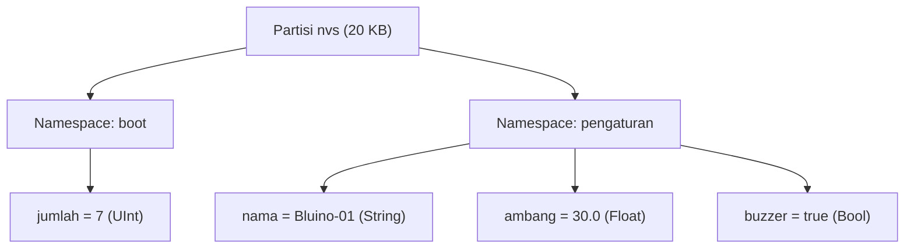
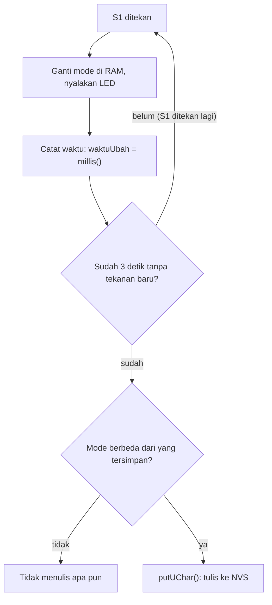

# BAB 39: NVS — Non-Volatile Storage

> ✅ **Prasyarat:** Selesaikan **BAB 16 (Non-Blocking Programming)** dan **BAB 22 (UART / Serial Communication)** — kamu sudah terbiasa memakai `millis()` tanpa `delay()` dan mengirim perintah teks lewat Serial Monitor. Program 2 dan 4 juga memakai tombol S1 dengan *debounce* dari [BAB 9](../BAB-09/README.md), potensiometer dari [BAB 11](../BAB-11/README.md), dan PWM (*Pulse Width Modulation*, pengatur kecerahan LED) dari [BAB 12](../BAB-12/README.md). Peta memori *flash* ESP32 sudah dikenalkan di [BAB 20](../BAB-20/README.md).

Pernahkah kamu mengatur volume TV, mematikannya, lalu saat dinyalakan lagi volumenya masih sama? TV itu menyimpan pengaturanmu di memori yang **tidak hilang walaupun listrik diputus**. ESP32 juga bisa melakukannya lewat **NVS** (*Non-Volatile Storage*, penyimpanan yang tidak hilang saat listrik mati). Di BAB ini kamu belajar menyimpan angka, teks, dan pengaturan ke NVS dengan *library* bawaan `Preferences`, sekaligus belajar menulis ke *flash* dengan hemat supaya memorinya awet bertahun-tahun.

## 📌 Tujuan Pembelajaran

Setelah mempelajari BAB ini, kamu bisa:

- Menjelaskan perbedaan RAM dan *flash*, serta alasan variabel biasa hilang saat ESP32 di-*reset*.
- Menyebutkan kapan data NVS bertahan (*reset*, listrik dicabut, *upload* ulang) dan kapan terhapus (misalnya opsi **Erase All Flash Before Sketch Upload**).
- Menjelaskan letak dan ukuran partisi NVS (20 KB) serta konsep *namespace*, *key*, dan *value*.
- Memakai *library* `Preferences`: `begin()`, `end()`, `put...()`, `get...()` dengan nilai bawaan, `isKey()`, `getType()`, `remove()`, `clear()`, dan `freeEntries()`.
- Menjelaskan batas umur *flash* dan cara NVS meratakan keausan (*wear leveling*), lalu menerapkan pola "tulis hanya saat berubah" dan "simpan tertunda".
- Membuat program yang mengingat jumlah *boot*, mode lampu, pengaturan dari Serial Monitor, dan kecerahan LED dari potensiometer.
- Memilih antara NVS, EEPROM, LittleFS, dan microSD sesuai kebutuhan.

## 🧰 Yang Perlu Disiapkan

| Kebutuhan | Keterangan |
|---|---|
| *Hardware* | Kit Bluino ESP32 IoT Starter Shield (ESP32 DEVKIT V1 sudah terpasang di kit) + kabel USB **data**. Program 1 dan 3 cukup memakai *board* ESP32 saja |
| Kabel *jumper* | 6 kabel *female-female*: 1 untuk tombol S1 (Program 2 dan 4), 4 untuk LED (Program 2; Program 4 memakai LED merah saja), dan 1 untuk potensiometer (Program 4) — sudah ada di kit |
| Komponen tambahan | Tidak ada — tombol, LED, dan potensiometer sudah terpasang di kit |
| *Software* | Arduino IDE 2.x + *board package* **esp32** versi 3.3.x (lihat [BAB 5](../BAB-05/README.md)) |
| *Library* | Tidak perlu *library* tambahan — `Preferences` sudah termasuk di *board package* esp32 |
| Alat uji | **Serial Monitor** Arduino IDE (baud 115200). Program 3 juga memakai kolom kirim pesan Serial Monitor dengan *line ending* **New Line** |
| Jaringan | Tidak perlu WiFi |

## 📑 Daftar Isi

- [39.1 RAM dan Flash: Kenapa Variabel Hilang Saat Reset?](#391-ram-dan-flash-kenapa-variabel-hilang-saat-reset)
- [39.2 Partisi NVS di Flash ESP32](#392-partisi-nvs-di-flash-esp32)
- [39.3 Namespace, Key, dan Value](#393-namespace-key-dan-value)
- [39.4 Library Preferences](#394-library-preferences)
- [39.5 Program 1: Penghitung Boot](#395-program-1-penghitung-boot)
- [39.6 Umur Flash dan Kapan Sebaiknya Menulis](#396-umur-flash-dan-kapan-sebaiknya-menulis)
- [39.7 Program 2: Lampu yang Ingat Mode Terakhir](#397-program-2-lampu-yang-ingat-mode-terakhir)
- [39.8 Program 3: Pengaturan Lewat Serial Monitor](#398-program-3-pengaturan-lewat-serial-monitor)
- [39.9 Program 4: Kecerahan LED Tersimpan](#399-program-4-kecerahan-led-tersimpan)
- [39.10 EEPROM dan Pilihan Penyimpanan Lain](#3910-eeprom-dan-pilihan-penyimpanan-lain)
- [39.11 Troubleshooting](#3911-troubleshooting)
- [📝 Rangkuman](#-rangkuman)
- [💪 Latihan](#-latihan)
- [📚 Referensi](#-referensi)

---

## 39.1 RAM dan Flash: Kenapa Variabel Hilang Saat Reset?

Coba ingat program penghitung tombol di [BAB 9](../BAB-09/README.md). Setelah kamu menekan S1 sepuluh kali lalu menekan tombol **EN** (tombol *reset* di *board* ESP32), hitungannya kembali ke 0. Penyebabnya: semua variabel program disimpan di **RAM**, dan isi RAM hilang begitu ESP32 di-*reset* atau listriknya diputus.

ESP32 punya dua jenis memori utama (rinciannya ada di [BAB 20](../BAB-20/README.md)):

- **RAM** (SRAM 520 KB) — ibarat **papan tulis** di kelas: cepat ditulis dan dihapus, tetapi dibersihkan setiap pelajaran selesai.
- ***Flash*** (4 MB) — ibarat **buku catatan**: menulisnya lebih lambat, tetapi isinya tetap ada walaupun kelas sudah bubar. Programmu sendiri tersimpan di sini, dan itulah sebabnya program tidak hilang saat ESP32 dimatikan.

NVS adalah bagian kecil dari *flash* yang disediakan untuk menyimpan **data milik programmu**, misalnya pengaturan, penghitung, atau mode terakhir.

| | Variabel biasa (RAM) | Data di NVS (*flash*) |
|---|---|---|
| Contoh kode | `int hitung = 0;` | `prefs.putUInt("hitung", 7);` |
| Kecepatan | Sangat cepat, bisa diubah jutaan kali per detik | Lebih lambat — satu penulisan butuh beberapa milidetik |
| Saat ESP32 di-*reset* atau listrik dicabut | **Hilang**, kembali ke nilai awal | **Tetap ada** |
| Batas jumlah penulisan | Praktis tidak terbatas | Terbatas (dibahas di [39.6](#396-umur-flash-dan-kapan-sebaiknya-menulis)) |
| Cocok untuk | Perhitungan sementara, nilai sensor terbaru | Pengaturan, penghitung, kalibrasi, mode terakhir |

Jadi, program yang baik tetap **bekerja dengan variabel di RAM**. NVS hanya dipakai untuk "mencatat ke buku" nilai yang perlu diingat, lalu "membaca catatan itu lagi" saat ESP32 menyala.

### 39.1.1 Kapan Data NVS Bertahan, Kapan Hilang?

| Kejadian | Data di NVS |
|---|---|
| Tombol **EN** ditekan, atau ESP32 *restart* sendiri (misalnya karena *crash*) | Tetap ada |
| Kabel USB atau sumber listrik dicabut lalu dipasang lagi | Tetap ada |
| ESP32 bangun dari *deep sleep* | Tetap ada |
| Program baru di-*upload* dengan pengaturan bawaan Arduino IDE | Tetap ada — **walaupun programnya berbeda** |
| Program memanggil `remove()` atau `clear()` (lihat [39.4](#394-library-preferences)) | *Key* atau *namespace* itu terhapus |
| *Upload* dengan **Tools → Erase All Flash Before Sketch Upload** = **Enabled** | **Semua hilang** |
| *Sketch* yang sama di-*upload* ke *board* ESP32 lain | Tidak ikut pindah — data tersimpan di *board*, bukan di *file* `.ino` |

> 📌 **Catatan:** Karena data NVS bertahan saat *upload*, program baru bisa saja menemukan data lama milik program sebelumnya kalau keduanya kebetulan memakai nama yang sama. Itulah gunanya *namespace* ([39.3](#393-namespace-key-dan-value)): beri nama yang khas untuk setiap proyek.

---

## 39.2 Partisi NVS di Flash ESP32

Di [BAB 20](../BAB-20/README.md) kamu sudah melihat bahwa *flash* 4 MB dibagi menjadi beberapa **partisi**, mirip *harddisk* yang dibagi menjadi *drive* C: dan D:. Untuk *board* **ESP32 Dev Module** dengan **Tools → Partition Scheme** bawaan (**Default 4MB with spiffs**), bagian awalnya seperti ini:

| Bagian | Alamat awal | Ukuran | Ditulis saat *upload*? |
|---|---|---|---|
| *Bootloader* | `0x1000` | Maksimal 28 KB | Ya |
| Tabel partisi | `0x8000` | 4 KB | Ya |
| **`nvs`** | **`0x9000`** | **20 KB** (`0x5000` *byte*) | **Tidak** |
| `otadata` | `0xE000` | 8 KB | Ya (diisi ulang) |
| `app0` — programmu | `0x10000` | 1280 KB | Ya |
| `app1`, `spiffs`, `coredump` | `0x150000` dan seterusnya | Lihat [BAB 20](../BAB-20/README.md) | Tidak |

Saat kamu mengklik **Upload**, Arduino IDE hanya menulis *bootloader*, tabel partisi, `otadata`, dan programmu. Partisi `nvs` di alamat `0x9000` **dilewati**, sehingga isinya tetap aman. Partisi 20 KB itu terdiri dari 5 **sektor** (*sector*, satuan hapus terkecil *flash*) berukuran masing-masing 4 KB.

> 📌 **Catatan:** Hampir semua pilihan **Tools → Partition Scheme** untuk ESP32 Dev Module memakai letak dan ukuran `nvs` yang sama (`0x9000`, 20 KB). Pengecualiannya **Storage APP (2MB APP/1MB NVS/1MB SPIFFS)**, yang memindahkan NVS ke tempat lain dan memperbesarnya menjadi 1 MB. Kalau kamu berganti ke skema seperti itu, data NVS lama tidak akan terbaca.

### 39.2.1 Opsi Erase All Flash Before Sketch Upload

Di menu **Tools** Arduino IDE (saat *board* **ESP32 Dev Module** dipilih) ada opsi **Erase All Flash Before Sketch Upload** dengan dua pilihan:

| Pilihan | Akibatnya |
|---|---|
| **Disabled** (bawaan) | Arduino IDE hanya menulis ulang bagian yang diperlukan. Data NVS **tetap ada** |
| **Enabled** | Seluruh *flash* 4 MB dihapus dulu sebelum program ditulis. Data NVS, *file* LittleFS/SPIFFS, dan semua data lain **hilang** |

Pilih **Enabled** hanya kalau kamu memang ingin ESP32 kembali "seperti baru", misalnya sebelum memberikannya ke orang lain. Setelah itu, **kembalikan ke Disabled** — Arduino IDE mengingat pilihan ini, sehingga setiap *upload* berikutnya akan ikut menghapus semua data.

---

## 39.3 Namespace, Key, dan Value

NVS menyimpan data sebagai pasangan **key–value** (kunci–nilai), dan setiap pasangan dikelompokkan dalam **namespace** (ruang nama). Bayangkan sebuah lemari arsip:

- **Partisi NVS** = lemarinya.
- ***Namespace*** = laci berlabel, misalnya laci `boot` dan laci `pengaturan`. Setiap program sebaiknya memakai lacinya sendiri.
- ***Key*** = label pada map di dalam laci, misalnya `jumlah` atau `nama`.
- ***Value*** = isi map itu, misalnya angka `7` atau teks `"Bluino-01"`.



*Gambar 39.1 — Contoh isi NVS: dua namespace, masing-masing berisi pasangan key–value. Key `jumlah` di namespace `boot` tidak tertukar dengan key lain di namespace `pengaturan`. Sumber: dibuat untuk materi ini.*

Aturan yang perlu kamu ingat:

| Aturan | Keterangan |
|---|---|
| Panjang nama *namespace* dan *key* | **Maksimal 15 karakter**. `"pengaturan"` (10 karakter) boleh; `"pengaturan_alat"` (15) masih boleh; `"pengaturan_lampu"` (16) **tidak** |
| Huruf besar dan kecil | Dibedakan: `"Nama"` dan `"nama"` adalah dua *key* berbeda |
| Satu *key*, satu nilai | Menyimpan ke *key* yang sudah ada akan **menimpa** nilai lamanya |
| Setiap *key* punya tipe | Nilai yang disimpan sebagai `UInt` harus dibaca sebagai `UInt` juga |
| Jumlah *namespace* | Maksimal 254 dalam satu partisi |
| Panjang teks (*string*) | Maksimal 4000 *byte*, termasuk 1 *byte* penutup. Batas 15 karakter hanya berlaku untuk **nama** *key*, bukan untuk isinya |

> 💡 **Tips:** Sistem ESP32 sendiri (misalnya *driver* WiFi) juga bisa menyimpan data di partisi NVS yang sama, dengan *namespace* miliknya sendiri. Jadi jangan heran kalau ruang NVS sudah sedikit terpakai walaupun programmu belum menyimpan apa pun.

---

## 39.4 Library Preferences

*Library* `Preferences` adalah cara termudah memakai NVS dari Arduino IDE. *Library* ini sudah termasuk di *board package* esp32, jadi cukup ditulis `#include <Preferences.h>` — tidak perlu dipasang lewat Library Manager.

### 39.4.1 Pola Dasar: Buka, Baca/Tulis, Tutup

Contoh potongan kode (bukan program lengkap):

```cpp
#include <Preferences.h>

Preferences prefs;                         // satu objek untuk mengakses NVS

// ... di dalam setup() atau fungsi lain:
prefs.begin("boot", false);                // 1. buka namespace "boot" (false = baca-tulis)
uint32_t n = prefs.getUInt("jumlah", 0);   // 2. baca key "jumlah"; 0 kalau belum ada
prefs.putUInt("jumlah", n + 1);            // 3. tulis nilai baru
prefs.end();                               // 4. tutup namespace
```

| Fungsi | Gunanya | Nilai kembali |
|---|---|---|
| `begin(namespace, readOnly)` | Membuka *namespace*. `readOnly` = `false` → baca-tulis (*namespace* dibuat otomatis kalau belum ada); `true` → hanya baca | `true` kalau berhasil |
| `end()` | Menutup *namespace* yang sedang dibuka | — |
| `put...(key, nilai)` | Menyimpan nilai. Data **langsung** ditulis ke *flash* saat itu juga | Jumlah *byte* yang disimpan; **0 kalau gagal** |
| `get...(key, nilaiBawaan)` | Membaca nilai. Kalau *key* belum ada (atau tipenya berbeda), hasilnya `nilaiBawaan` | Nilai yang dibaca |

**Nilai bawaan** (*default value*) pada `get...()` sangat berguna: saat program pertama kali berjalan, NVS masih kosong, sehingga `getUInt("jumlah", 0)` menghasilkan `0` tanpa *error*. Kalau nilai bawaan tidak ditulis, `getUInt()` memakai 0, `getFloat()` memakai `NAN` (*Not a Number*, "bukan angka"), dan `getString()` memakai teks kosong.

### 39.4.2 Fungsi untuk Setiap Tipe Data

| Tipe di C++ | Simpan dengan | Baca dengan | Jangkauan / catatan |
|---|---|---|---|
| `uint8_t` | `putUChar()` | `getUChar()` | 0 sampai 255 |
| `int8_t` | `putChar()` | `getChar()` | −128 sampai 127 |
| `uint16_t` / `int16_t` | `putUShort()` / `putShort()` | `getUShort()` / `getShort()` | 0 sampai 65.535 / −32.768 sampai 32.767 |
| `uint32_t` / `int32_t` | `putUInt()` / `putInt()` | `getUInt()` / `getInt()` | `putULong()`/`putLong()` adalah nama lain untuk fungsi yang sama |
| `uint64_t` / `int64_t` | `putULong64()` / `putLong64()` | `getULong64()` / `getLong64()` | Bilangan bulat 64 bit |
| `bool` | `putBool()` | `getBool()` | Disimpan sebagai 1 *byte* (0 atau 1) |
| `float` / `double` | `putFloat()` / `putDouble()` | `getFloat()` / `getDouble()` | Disimpan sebagai *blob* (deretan *byte*) 4 / 8 *byte* |
| `String` / teks C | `putString()` | `getString()` | Teks, maksimal 4000 *byte* termasuk penutup |
| *Array*, `struct` | `putBytes(key, data, ukuran)` | `getBytes(key, buffer, ukuranMaks)` | *Blob* bebas, misalnya data kalibrasi |

> ⚠️ **Perhatian:** Pasangan simpan–baca harus **sama tipenya**. Kalau kamu menyimpan dengan `putUInt("jumlah", 7)` lalu membaca dengan `getInt("jumlah", 0)`, hasilnya bukan 7 melainkan nilai bawaan 0 — tanpa pesan *error* apa pun. Kesalahan seperti ini sering membuat pemula mengira NVS "tidak menyimpan".

### 39.4.3 Fungsi Bantu

| Fungsi | Gunanya |
|---|---|
| `isKey(key)` | `true` kalau *key* itu sudah ada. Berguna untuk membedakan "pertama kali menyala" dan "data sudah pernah disimpan" |
| `getType(key)` | Tipe *key* yang tersimpan, misalnya `PT_U8`, `PT_U32`, `PT_STR`, `PT_BLOB`, atau `PT_INVALID` (belum ada) |
| `remove(key)` | Menghapus satu *key*. Berikutnya, `get...()` untuk *key* itu kembali menghasilkan nilai bawaan |
| `clear()` | Menghapus **semua** *key* di *namespace* yang sedang dibuka (*namespace* lain tidak tersentuh) |
| `freeEntries()` | Jumlah **entri** (slot 32 *byte*) yang masih kosong di **seluruh** partisi NVS — bukan hanya di *namespace* ini |
| `getStringLength(key)` / `getBytesLength(key)` | Panjang teks (termasuk penutup) / panjang *blob* yang tersimpan |

### 39.4.4 Empat Aturan yang Sering Terlupa

1. **Mode hanya-baca gagal kalau *namespace* belum ada.** Pada saat pertama kali program berjalan, *namespace* belum dibuat, sehingga `begin("boot", true)` mengembalikan `false`. Fungsi `get...()` tetap menghasilkan nilai bawaan, tetapi semua `put...()` gagal. Karena itu, program di BAB ini membuka *namespace* dengan mode baca-tulis (`false`) setidaknya sekali di `setup()`.
2. **Satu objek `Preferences` hanya bisa membuka satu *namespace* sekaligus.** Memanggil `begin()` lagi sebelum `end()` akan gagal (mengembalikan `false`). Biasakan memasangkan setiap `begin()` dengan `end()`.
3. **`end()` bukan tombol "Simpan".** Setiap `put...()` langsung menulis ke *flash*. Kalau ESP32 mati sebelum `end()` dipanggil, data yang sudah di-`put` tetap aman. `end()` hanya menutup *namespace* supaya objeknya bisa dipakai lagi.
4. **Nama lebih dari 15 karakter ditolak diam-diam.** `begin()` atau `put...()` gagal, dan `get...()` selalu menghasilkan nilai bawaan.

> 💡 **Tips:** Secara bawaan, *library* `Preferences` tidak mencetak pesan apa pun saat gagal. Untuk melihat pesan *error*-nya, pilih **Tools → Core Debug Level → Error**, lalu *upload* ulang. Serial Monitor akan menampilkan pesan seperti `[E][Preferences.cpp:...] ... NOT_FOUND`. Pesan `NOT_FOUND` saat pertama kali program berjalan itu **normal** (*key* memang belum ada). Kembalikan ke **None** setelah selesai mencari masalah.

---

## 39.5 Program 1: Penghitung Boot

**Tujuan:** Membuktikan bahwa data di NVS tidak hilang. Setiap kali ESP32 menyala atau di-*reset*, program membaca angka dari NVS, menambahkannya 1, menyimpannya lagi, lalu menampilkannya di Serial Monitor.

**Rangkaian:** *Tidak perlu merangkai — program ini hanya memakai board ESP32.*

**Cara Menjalankan:**

1. Hubungkan ESP32 ke komputer dengan kabel USB.
2. Buka Arduino IDE → **File → New Sketch**, hapus isinya, lalu salin kode di bawah. Kode yang sama juga tersedia di *file* [`p1_boot_counter.ino`](p1_boot_counter/p1_boot_counter.ino).
3. Pastikan **Tools → Board** = **ESP32 Dev Module**, **Tools → Port** = *port* ESP32 kamu (misalnya `COM5` di Windows atau `/dev/ttyUSB0` di Linux), dan **Tools → Erase All Flash Before Sketch Upload** = **Disabled**.
4. Klik tombol **Upload** (ikon panah →) dan tunggu sampai muncul tulisan **Done uploading**.
5. Buka **Serial Monitor** (**Tools → Serial Monitor**) lalu pilih baud **115200**.
6. Tekan tombol **EN** di *board* ESP32 beberapa kali. Setelah itu, cabut kabel USB, tunggu beberapa detik, lalu pasang lagi. Perhatikan angkanya.

**Kode Program:**

<!-- sketch: p1_boot_counter -->
```cpp
/*
 * BAB 39 - Program 1: Penghitung Boot
 * Setiap kali ESP32 menyala atau di-reset, angka boot bertambah 1.
 * Angkanya disimpan di NVS, jadi tidak kembali ke 0 walaupun
 * listrik dicabut atau program di-upload ulang.
 *
 * Rangkaian: tidak perlu, cukup ESP32 dan kabel USB.
 * Alat uji : Serial Monitor, baud 115200.
 */

#include <Preferences.h>   // library bawaan esp32 core untuk NVS

Preferences prefs;          // objek untuk mengakses NVS

void setup() {
  Serial.begin(115200);
  delay(1000);  // beri waktu Serial Monitor tersambung lagi setelah reset

  Serial.println();
  Serial.println("BAB 39 - Program 1: Penghitung Boot");

  // Buka namespace "boot" dalam mode baca-tulis (false = bukan hanya-baca).
  // Kalau namespace belum ada, NVS membuatnya otomatis.
  if (!prefs.begin("boot", false)) {
    Serial.println("Gagal membuka NVS!");
    return;
  }

  uint32_t jumlahBoot = prefs.getUInt("jumlah", 0);   // 0 kalau key belum ada
  jumlahBoot = jumlahBoot + 1;
  size_t tertulis = prefs.putUInt("jumlah", jumlahBoot);  // simpan nilai baru
  prefs.end();                                           // tutup namespace

  if (tertulis == 0) {
    Serial.println("Gagal menyimpan ke NVS!");
  }

  Serial.printf("ESP32 ini sudah menyala %lu kali.\n", (unsigned long)jumlahBoot);
  Serial.println("Tekan tombol EN, cabut-pasang kabel USB, atau upload ulang,");
  Serial.println("lalu lihat angkanya bertambah.");
}

void loop() {
  // Tidak ada yang dikerjakan di sini.
}
```

**Penjelasan Kode:**

- `#include <Preferences.h>` dan `Preferences prefs;` menyiapkan *library* dan satu objek bernama `prefs`. Semua akses ke NVS lewat objek ini.
- `prefs.begin("boot", false)` membuka *namespace* `boot` dalam mode baca-tulis. Hasilnya diperiksa dengan `if (!...)`: tanda `!` berarti "tidak", jadi blok itu dijalankan kalau `begin()` gagal.
- `prefs.getUInt("jumlah", 0)` membaca *key* `jumlah`. Saat program pertama kali berjalan, *key* itu belum ada, sehingga hasilnya nilai bawaan `0`.
- `prefs.putUInt("jumlah", jumlahBoot)` menyimpan angka baru ke *flash*. Fungsi ini mengembalikan jumlah *byte* yang disimpan (4 untuk `uint32_t`), atau 0 kalau gagal.
- `prefs.end()` menutup *namespace*. Data sudah aman sejak `putUInt()` selesai.
- `uint32_t` adalah bilangan bulat tanpa tanda minus berukuran 32 bit (0 sampai sekitar 4,29 miliar). Untuk mencetaknya dengan `printf()`, nilainya diubah dulu ke `unsigned long` dan dicetak dengan `%lu`.
- Semua pekerjaan selesai di `setup()`, yang hanya berjalan sekali setiap ESP32 menyala. Karena itu `loop()` dibiarkan kosong.

**Contoh Output:**

Setelah beberapa kali menekan **EN** (angkamu bisa berbeda):

```text
BAB 39 - Program 1: Penghitung Boot
ESP32 ini sudah menyala 5 kali.
Tekan tombol EN, cabut-pasang kabel USB, atau upload ulang,
lalu lihat angkanya bertambah.
```

Setiap kali ESP32 di-*reset*, bagian di atas muncul lagi dengan angka yang 1 lebih besar. Di atasnya mungkin terlihat beberapa baris pesan *boot* bawaan ESP32 (diawali `rst:0x1 (POWERON_RESET)` atau sejenisnya) — itu normal. Tidak ada perubahan apa pun di kit.

> 🧪 **Coba Sendiri:**
>
> - *Upload* ulang program yang sama. Angkanya **tidak** kembali ke 1, karena partisi NVS tidak ikut ditulis saat *upload*. Perhatikan juga bahwa proses *upload* sendiri me-*reset* ESP32, sehingga angkanya bisa langsung bertambah.
> - Pilih **Tools → Erase All Flash Before Sketch Upload → Enabled**, lalu *upload* ulang. Angkanya kembali ke 1 karena seluruh *flash* dihapus. **Kembalikan pilihan itu ke Disabled** setelah mencoba.

**Kalau Belum Berhasil:**

- **Angkanya selalu 1** → pastikan **Tools → Erase All Flash Before Sketch Upload** = **Disabled**, dan nama *key* di `getUInt()` dan `putUInt()` sama persis (`"jumlah"`).
- **Angkanya melompat lebih dari 1** → ESP32 sempat di-*reset* tanpa terlihat di Serial Monitor, misalnya saat *upload* selesai (ESP32 di-*reset* otomatis) sebelum Serial Monitor dibuka, atau pada sebagian *board* saat Serial Monitor dibuka. Itu normal: setiap *reset* memang dihitung.
- **Serial Monitor kosong** → pilih baud **115200**, lalu tekan tombol **EN** supaya program berjalan dari awal saat Serial Monitor sudah terbuka.
- **Muncul `Gagal membuka NVS!`** → nama *namespace* lebih dari 15 karakter (kalau kamu mengubahnya). Kalau namanya sudah benar, coba *upload* sekali dengan **Erase All Flash Before Sketch Upload** = **Enabled** untuk mengosongkan partisi NVS, lalu kembalikan ke **Disabled**.

---

## 39.6 Umur Flash dan Kapan Sebaiknya Menulis

### 39.6.1 Flash Bisa Aus

*Flash* punya satu sifat penting: sebelum ditulis ulang, isinya harus **dihapus** dulu, dan penghapusan selalu dilakukan per **sektor** 4 KB sekaligus. Setiap sektor hanya tahan dihapus sekitar **100.000 kali** (angka umum menurut FAQ Espressif; nilai pastinya tergantung chip *flash*-nya). Setelah itu, sektor mulai aus dan data bisa rusak — mirip kertas yang terus-menerus dihapus dengan penghapus sampai akhirnya sobek.

100.000 kedengarannya banyak, tetapi `loop()` bisa berputar ribuan kali per detik. Seandainya sebuah program menghapus lalu menulis sektor yang sama di setiap putaran `loop()`, jatah itu bisa habis hanya dalam satu atau dua jam.

### 39.6.2 Cara NVS Meratakan Keausan

Untungnya, NVS dirancang supaya tidak menghapus sektor yang sama terus-menerus. Dokumentasi ESP-IDF menyebutnya *wear leveling by design* (perataan keausan sejak dirancang). Caranya seperti menulis buku harian: catatan baru selalu ditulis di baris kosong berikutnya, dan catatan lama cukup dicoret, bukan dihapus.

| Langkah | Isi halaman NVS (dari kiri ke kanan) |
|---|---|
| `putUInt("jumlah", 1)` | `jumlah=1` |
| `putUInt("jumlah", 2)` | ~~`jumlah=1`~~ · `jumlah=2` |
| `putUInt("jumlah", 3)` | ~~`jumlah=1`~~ · ~~`jumlah=2`~~ · `jumlah=3` |

- Setiap sektor 4 KB menjadi satu **halaman** (*page*) NVS berisi 126 **entri** (slot) berukuran 32 *byte*. Satu angka biasanya memakai 1 entri.
- Nilai baru ditulis ke entri kosong berikutnya, lalu entri lama ditandai "terhapus". Menandai tidak butuh penghapusan sektor.
- Kalau satu halaman penuh, NVS pindah ke halaman berikutnya. Halaman lama baru dihapus saat ruangnya dibutuhkan lagi, setelah entri yang masih berlaku dipindahkan (proses ini disebut *garbage collection*, "membuang sampah").
- Menurut dokumentasi ESP-IDF, dengan cara ini jumlah penghapusan sektor menjadi sekitar **126 kali lebih sedikit** daripada jumlah penulisan, dan penghapusannya bergilir di kelima sektor partisi.
- Bonus: kalau nilai yang ditulis **sama persis** dengan yang sudah tersimpan, NVS tidak menulis apa pun (terlihat di kode sumber ESP-IDF, `nvs_storage.cpp`).

> 📌 **Catatan:** Bagaimana kalau listrik putus tepat saat NVS sedang menulis? NVS dirancang untuk keadaan seperti itu: menurut dokumentasi ESP-IDF, perangkat boleh dimatikan kapan saja. Paling buruk, hanya pasangan *key*–*value* yang sedang ditulis saat itu yang tidak tersimpan; data lain tetap utuh, dan pekerjaan yang terpotong dibereskan saat ESP32 menyala lagi.

Hitungan kasarnya: partisi 20 KB berisi 5 halaman × 126 entri = 630 entri. Kalau programmu hanya menyimpan satu angka, setiap sektor kira-kira baru dihapus sekali setiap ±630 penulisan, sehingga total penulisan sebelum aus kira-kira 630 × 100.000 ≈ **63 juta kali**.

| Seberapa sering menulis | Perkiraan umur *flash* (hitungan kasar) |
|---|---|
| Setiap 10 ms (100 kali per detik, misalnya di dalam `loop()` dengan `delay(10)`) | ±7 hari |
| Setiap 1 detik | ±2 tahun |
| Setiap 1 menit | ±120 tahun |
| Hanya saat tombol ditekan (misalnya 50 kali sehari) | Ribuan tahun — tidak perlu dikhawatirkan |

> 📌 **Catatan:** Angka di atas hanya perkiraan untuk satu angka bulat. Nilai `float`, teks, dan *blob* memakai 2–3 entri atau lebih per penulisan, dan entri lain yang masih berlaku ikut dipindahkan saat *garbage collection*, sehingga umur sebenarnya bisa beberapa kali lebih pendek. Pesannya tetap sama: **menulis berkala dalam hitungan detik masih berisiko, menulis hanya saat perlu praktis aman.**

Selain itu, menulis ke *flash* juga **lambat**: biasanya beberapa milidetik, dan bisa sampai puluhan milidetik kalau NVS sedang menghapus sektor. Selama itu, sebagian besar program ESP32 berhenti sejenak. Program yang terlalu sering menulis akan terasa tersendat.

### 39.6.3 Tiga Pola Menulis yang Aman

Contoh yang **salah** — potongan kode ini menulis ke NVS di setiap putaran `loop()`:

```cpp
// SALAH: di dalam loop(), menulis ke NVS ribuan kali per menit
int persen = map(analogRead(34), 0, 4095, 0, 100);
prefs.putUChar("kecerahan", persen);
```

Pembacaan potensiometer selalu sedikit naik-turun (*noise*), jadi nilainya hampir selalu "berbeda" dan fitur "lewati kalau sama" di NVS tidak banyak membantu. Pakai salah satu pola berikut:

| Pola | Cara kerja | Cocok untuk | Dipakai di |
|---|---|---|---|
| **Tulis saat berubah** (*write-on-change*) | Bandingkan dulu nilai baru dengan nilai yang tersimpan; tulis hanya kalau berbeda | Pengaturan yang jarang berubah | Semua program |
| **Simpan tertunda** | Saat nilai berubah, jangan langsung menulis. Tunggu sampai nilai tidak berubah lagi selama beberapa detik, baru tulis sekali | Input yang bisa diubah berkali-kali dengan cepat, misalnya tombol yang ditekan beruntun | [Program 2](#397-program-2-lampu-yang-ingat-mode-terakhir) |
| **Simpan atas perintah** | Nilai hanya ditulis saat pengguna meminta, misalnya lewat tombol "Simpan" atau perintah teks | Nilai yang terus bergerak, misalnya kenop potensiometer | [Program 3](#398-program-3-pengaturan-lewat-serial-monitor) dan [Program 4](#399-program-4-kecerahan-led-tersimpan) |

> 💡 **Tips:** Untuk penghitung yang naik sangat cepat (misalnya jumlah putaran roda), simpan ke NVS **berkala**, misalnya setiap 10 menit atau setiap kelipatan 1000. Kalau listrik mati mendadak, kamu hanya kehilangan sebagian kecil hitungan, dan *flash* tetap awet.

<details>
<summary><b>🔬 Pendalaman (opsional): isi partisi NVS dan cara mengosongkannya</b></summary>

**Halaman dan entri.** Satu halaman NVS = 4096 *byte*: 32 *byte* kepala halaman, 32 *byte* peta status entri, lalu 126 entri × 32 *byte*. Kebutuhan entri setiap jenis data:

| Jenis data | Entri yang dipakai |
|---|---|
| Bilangan bulat dan `bool` | 1 |
| Teks (`putString`) | 1 + 1 untuk setiap 32 karakter (termasuk 1 *byte* penutup). Teks harus muat di satu halaman |
| *Blob* (`putFloat`, `putDouble`, `putBytes`) | 2 + 1 untuk setiap 32 *byte* data |
| Setiap *namespace* baru | 1 |

**Arti `freeEntries()`.** Nilainya adalah entri kosong di seluruh partisi, **termasuk** satu halaman (126 entri) yang selalu dicadangkan NVS untuk *garbage collection*. Jadi ruang yang benar-benar bisa dipakai kira-kira `freeEntries() − 126`.

**Kalau NVS rusak atau partisinya berubah.** Saat ESP32 menyala, esp32 core memeriksa partisi NVS. Kalau tidak ada halaman kosong (misalnya karena ukuran partisi berubah) atau formatnya dari versi lain, core **otomatis memformat ulang** partisi NVS, sehingga semua data di dalamnya hilang.

**Mengosongkan seluruh partisi dari program.** `clear()` hanya menghapus satu *namespace*. Untuk menghapus seluruh partisi `nvs` — semua *namespace*, termasuk milik sistem — pakai fungsi ESP-IDF berikut di dalam `setup()` (potongan kode):

```cpp
#include <nvs_flash.h>   // fungsi ESP-IDF untuk partisi NVS

// ... di dalam setup(), sebelum memakai Preferences:
nvs_flash_erase();       // hapus SELURUH partisi nvs
nvs_flash_init();        // siapkan lagi partisinya supaya bisa dipakai
```

Jangan biarkan potongan ini di program yang berjalan terus, karena setiap kali ESP32 menyala, semua datanya akan terhapus. Cara yang lebih mudah adalah *upload* sekali dengan **Erase All Flash Before Sketch Upload** = **Enabled** ([39.2.1](#3921-opsi-erase-all-flash-before-sketch-upload)).

</details>

---

## 39.7 Program 2: Lampu yang Ingat Mode Terakhir

**Tujuan:** Tombol S1 mengganti mode lampu: MATI → MERAH → HIJAU → BIRU → KUNING → MATI, dan seterusnya. Mode terakhir disimpan ke NVS dengan pola **simpan tertunda**: baru ditulis 3 detik setelah tekanan terakhir, dan hanya kalau berbeda dari yang sudah tersimpan. Saat ESP32 menyala lagi, lampu langsung kembali ke mode terakhir — seperti lampu meja pintar yang ingat warna kesukaanmu.

**Rangkaian:**

| Pin **Custom** di kit | Sambungkan ke pin ESP32 |
|---|---|
| SW1 (tombol S1, pin kuning ke-3 dari kiri) | IO15 |
| LED1 (LED merah) | IO4 |
| LED2 (LED hijau) | IO17 |
| LED3 (LED biru) | IO2 |
| LED4 (LED kuning) | IO16 |

> ⚠️ **Perhatian:** Di deretan pin ESP32 bawah, pin `15` bersebelahan dengan pin `G` (GND). Pastikan kabel S1 benar-benar tertancap di `15`, bukan di `G` (penjelasannya di [BAB 9](../BAB-09/README.md)).

**Cara Menjalankan:**

1. Cabut kabel USB, sambungkan kelima kabel *jumper* sesuai tabel **Rangkaian** di atas (sama seperti [BAB 9](../BAB-09/README.md)), lalu pasang lagi kabel USB.
2. Buka Arduino IDE → **File → New Sketch**, hapus isinya, lalu salin kode di bawah. Kode yang sama juga tersedia di *file* [`p2_mode_lampu.ino`](p2_mode_lampu/p2_mode_lampu.ino).
3. Pastikan **Tools → Board** = **ESP32 Dev Module** dan **Tools → Port** = *port* ESP32 kamu.
4. Klik tombol **Upload** dan tunggu sampai muncul tulisan **Done uploading**.
5. Buka **Serial Monitor** (**Tools → Serial Monitor**) lalu pilih baud **115200**.
6. Tekan S1 beberapa kali dengan cepat, lalu diamkan 3 detik. Setelah itu tekan tombol **EN** atau cabut-pasang kabel USB, dan lihat apakah LED kembali ke mode terakhir.

**Kode Program:**

<!-- sketch: p2_mode_lampu -->
```cpp
/*
 * BAB 39 - Program 2: Lampu yang Ingat Mode Terakhir
 * Tombol S1 mengganti mode: MATI -> MERAH -> HIJAU -> BIRU -> KUNING -> MATI ...
 * Mode disimpan ke NVS 3 detik setelah tekanan terakhir (simpan tertunda),
 * dan hanya kalau berbeda dari yang sudah tersimpan.
 *
 * Rangkaian (header kit → pin ESP32):
 *   SW1 (tombol S1) → IO15
 *   LED1 (merah)    → IO4     LED2 (hijau)  → IO17
 *   LED3 (biru)     → IO2     LED4 (kuning) → IO16
 * Alat uji: Serial Monitor, baud 115200
 */

#include <Preferences.h>

#define TOMBOL_S1  15
#define LED_MERAH  4
#define LED_HIJAU  17
#define LED_BIRU   2
#define LED_KUNING 16

const int JUMLAH_LED = 4;
const int PIN_LED[JUMLAH_LED] = {LED_MERAH, LED_HIJAU, LED_BIRU, LED_KUNING};

const uint8_t JUMLAH_MODE = 5;
const char *NAMA_MODE[JUMLAH_MODE] = {"MATI", "MERAH", "HIJAU", "BIRU", "KUNING"};

const unsigned long WAKTU_DEBOUNCE = 50;    // ms, sama seperti BAB 9
const unsigned long JEDA_SIMPAN    = 3000;  // ms: simpan 3 detik setelah tekanan terakhir

Preferences prefs;

uint8_t modeLampu = 0;        // mode yang sedang aktif (di RAM)
uint8_t modeTersimpan = 0;    // mode yang sudah tersimpan di NVS
bool perluDisimpan = false;   // ada perubahan yang belum disimpan?
unsigned long waktuUbah = 0;  // kapan mode terakhir kali diubah
uint32_t jumlahTulis = 0;     // berapa kali program ini menulis ke NVS sejak menyala

// Variabel debounce tombol S1 (pola BAB 9)
int bacaanSebelumnya = LOW;
int statusStabil = LOW;
unsigned long waktuBerubah = 0;

// Menyalakan LED sesuai mode: mode 1-4 menyalakan satu LED, mode 0 mematikan semua
void tampilkanMode() {
  for (int i = 0; i < JUMLAH_LED; i++) {
    digitalWrite(PIN_LED[i], (modeLampu == i + 1) ? HIGH : LOW);
  }
}

// Menulis mode ke NVS, tetapi hanya kalau berbeda dari yang sudah tersimpan
void simpanMode() {
  if (modeLampu == modeTersimpan) {
    Serial.println("  Mode sama dengan yang tersimpan, tidak perlu menulis ke flash.");
    return;
  }
  prefs.begin("lampu", false);
  size_t tertulis = prefs.putUChar("mode", modeLampu);
  prefs.end();

  if (tertulis == 0) {
    Serial.println("  Gagal menyimpan ke NVS!");
    return;
  }
  modeTersimpan = modeLampu;
  jumlahTulis = jumlahTulis + 1;
  Serial.printf("  Disimpan ke NVS: mode %s (penulisan ke-%lu sejak menyala)\n",
                NAMA_MODE[modeLampu], (unsigned long)jumlahTulis);
}

void setup() {
  Serial.begin(115200);
  pinMode(TOMBOL_S1, INPUT);  // tombol kit punya pull-down 10 kΩ: ditekan = HIGH
  for (int i = 0; i < JUMLAH_LED; i++) {
    pinMode(PIN_LED[i], OUTPUT);
  }
  delay(1000);

  Serial.println();
  Serial.println("BAB 39 - Program 2: Lampu yang Ingat Mode Terakhir");

  // Mode baca-tulis supaya namespace dibuat kalau belum ada
  prefs.begin("lampu", false);
  bool adaData = prefs.isKey("mode");
  modeLampu = prefs.getUChar("mode", 0);  // 0 (MATI) kalau belum pernah disimpan
  prefs.end();

  if (modeLampu >= JUMLAH_MODE) {         // jaga-jaga kalau isinya tidak masuk akal
    modeLampu = 0;
  }
  modeTersimpan = modeLampu;

  if (adaData) {
    Serial.printf("Mode terakhir dari NVS: %s\n", NAMA_MODE[modeLampu]);
  } else {
    Serial.println("Belum ada data di NVS, mulai dari mode MATI.");
  }
  Serial.println("Tekan S1 untuk mengganti mode.");
  tampilkanMode();
}

void loop() {
  unsigned long sekarang = millis();

  // 1. Baca tombol S1 dengan debounce
  int bacaan = digitalRead(TOMBOL_S1);
  if (bacaan != bacaanSebelumnya) {
    waktuBerubah = sekarang;
    bacaanSebelumnya = bacaan;
  }
  if ((sekarang - waktuBerubah) > WAKTU_DEBOUNCE && bacaan != statusStabil) {
    statusStabil = bacaan;
    if (statusStabil == HIGH) {                     // S1 baru ditekan
      modeLampu = (modeLampu + 1) % JUMLAH_MODE;    // pindah ke mode berikutnya
      tampilkanMode();
      Serial.printf("Mode: %s (belum disimpan)\n", NAMA_MODE[modeLampu]);
      perluDisimpan = true;
      waktuUbah = sekarang;                         // hitungan 3 detik diulang dari nol
    }
  }

  // 2. Simpan tertunda: tulis ke NVS kalau sudah 3 detik tidak ada tekanan baru
  if (perluDisimpan && (sekarang - waktuUbah >= JEDA_SIMPAN)) {
    perluDisimpan = false;
    simpanMode();
  }
}
```

**Penjelasan Kode:**

- Variabel `modeLampu` (di RAM) dipakai untuk bekerja, sedangkan `modeTersimpan` mencatat nilai yang sudah ada di NVS. Dengan membandingkan keduanya, program tahu apakah perlu menulis ke *flash*.
- Di `setup()`, `isKey("mode")` memeriksa apakah mode pernah disimpan, lalu `getUChar("mode", 0)` membacanya. Nilai di luar 0–4 (misalnya kalau *namespace* `lampu` pernah dipakai program lain) dikembalikan ke 0 supaya program tidak membaca *array* `NAMA_MODE` di luar batas.
- Bagian *debounce* sama persis dengan Program 3 [BAB 9](../BAB-09/README.md). Saat S1 baru ditekan, `(modeLampu + 1) % JUMLAH_MODE` menaikkan mode, dan operator `%` (sisa bagi) membuatnya kembali ke 0 setelah mode 4.
- Setiap tekanan hanya mengubah variabel di RAM dan mencatat waktunya di `waktuUbah`. Tekanan berikutnya mengulang hitungan dari nol, seperti *debounce* versi "lambat". Penulisan ke NVS baru terjadi setelah `JEDA_SIMPAN` (3 detik) tanpa tekanan baru.
- `simpanMode()` menerapkan pola **tulis saat berubah**: kalau mode akhirnya sama dengan yang tersimpan (misalnya kamu menekan S1 lima kali dan kembali ke mode semula), tidak ada yang ditulis.
- `jumlahTulis` hanya ada di RAM, untuk menunjukkan betapa jarangnya program ini menulis ke *flash*.



*Gambar 39.2 — Alur simpan tertunda pada Program 2. Lima tekanan beruntun tetap menghasilkan paling banyak satu penulisan ke flash. Sumber: dibuat untuk materi ini.*

**Contoh Output:**

Saat pertama kali dijalankan: S1 ditekan dua kali lalu didiamkan, kemudian ditekan lima kali dengan cepat (kembali ke HIJAU) lalu didiamkan:

```text
BAB 39 - Program 2: Lampu yang Ingat Mode Terakhir
Belum ada data di NVS, mulai dari mode MATI.
Tekan S1 untuk mengganti mode.
Mode: MERAH (belum disimpan)
Mode: HIJAU (belum disimpan)
  Disimpan ke NVS: mode HIJAU (penulisan ke-1 sejak menyala)
Mode: BIRU (belum disimpan)
Mode: KUNING (belum disimpan)
Mode: MATI (belum disimpan)
Mode: MERAH (belum disimpan)
Mode: HIJAU (belum disimpan)
  Mode sama dengan yang tersimpan, tidak perlu menulis ke flash.
```

Setelah tombol **EN** ditekan:

```text
BAB 39 - Program 2: Lampu yang Ingat Mode Terakhir
Mode terakhir dari NVS: HIJAU
Tekan S1 untuk mengganti mode.
```

Di kit: setiap tekanan S1 memindahkan nyala LED dari merah ke hijau, biru, kuning, lalu semua padam. Setelah *reset*, LED hijau langsung menyala lagi tanpa perlu menekan apa pun. LED biru kecil di *board* ikut menyala bersama LED biru kit karena keduanya tersambung ke IO2.

> 🧪 **Coba Sendiri:** Ubah `JEDA_SIMPAN` menjadi `0`, *upload*, lalu tekan S1 sepuluh kali. Perhatikan angka "penulisan ke-" yang terus naik. Kembalikan ke `3000` dan ulangi — sekarang sepuluh tekanan beruntun hanya menghasilkan satu penulisan.

**Kalau Belum Berhasil:**

- **Setelah *reset*, LED kembali ke MATI** → kamu menekan **EN** sebelum 3 detik berlalu, sehingga mode belum sempat disimpan. Tunggu sampai muncul tulisan `Disimpan ke NVS`.
- **Mode melompat dua sekaligus dalam satu tekanan** → pantulan tombolmu lebih lama dari 50 ms. Naikkan `WAKTU_DEBOUNCE` menjadi 80–100.
- **Tidak ada yang terjadi saat S1 ditekan** → cek kabel SW1 → `15`. Kalau ESP32 malah *restart* saat S1 ditekan, kabelnya tergeser ke `G`.
- **Warna LED tidak sesuai nama mode** → kabel LED tertukar. Ingat: LED1 = merah → `4`, LED2 = hijau → `17`, LED3 = biru → `2`, LED4 = kuning → `16`.

---

## 39.8 Program 3: Pengaturan Lewat Serial Monitor

**Tujuan:** Membuat "menu pengaturan" berbasis teks: kamu mengetik perintah di Serial Monitor untuk melihat, mengubah, dan menghapus empat pengaturan alat — nama (teks), ambang suhu (`float`), interval laporan (`uint16_t`), dan *buzzer* (`bool`). Antarmuka seperti ini disebut **CLI** (*Command Line Interface*, antarmuka baris perintah). Program ini sekaligus memperlihatkan hampir semua fungsi `Preferences`: `put...()`/`get...()` untuk berbagai tipe, `isKey()`, `getType()`, `remove()`, `clear()`, dan `freeEntries()`.

**Rangkaian:** *Tidak perlu merangkai — program ini hanya memakai board ESP32.* Kabel dari Program 2 boleh tetap terpasang.

**Cara Menjalankan:**

1. Buka Arduino IDE → **File → New Sketch**, hapus isinya, lalu salin kode di bawah. Kode yang sama juga tersedia di *file* [`p3_nvs_cli.ino`](p3_nvs_cli/p3_nvs_cli.ino).
2. Pastikan **Tools → Board** = **ESP32 Dev Module** dan **Tools → Port** = *port* ESP32 kamu.
3. Klik tombol **Upload** dan tunggu sampai muncul tulisan **Done uploading**.
4. Buka **Serial Monitor** (**Tools → Serial Monitor**), pilih baud **115200** dan *line ending* **New Line** (di kanan panel; penjelasannya di [BAB 22](../BAB-22/README.md)).
5. Klik kolom pesan di bagian atas Serial Monitor, ketik perintah, lalu tekan **Enter**. Coba berurutan: `bantuan`, `atur ambang 31.5`, `atur nama Lab IoT 1`, `atur buzzer off`, `lihat`, dan `info`.
6. Tekan tombol **EN**, lalu ketik `lihat` lagi: pengaturanmu masih ada. Terakhir, coba `hapus ambang` dan `reset`.

**Kode Program:**

<!-- sketch: p3_nvs_cli -->
```cpp
/*
 * BAB 39 - Program 3: Pengaturan Lewat Serial Monitor
 * Melihat, mengubah, dan menghapus pengaturan di NVS dengan perintah teks.
 *
 * Ketik perintah di Serial Monitor (line ending: New Line):
 *   lihat                  → tampilkan semua pengaturan
 *   atur nama <teks>       → nama alat, 1-20 karakter
 *   atur ambang <angka>    → ambang suhu alarm 0-60 (°C), desimal pakai titik
 *   atur interval <detik>  → interval laporan 1-3600 detik
 *   atur buzzer on|off     → buzzer alarm aktif atau tidak
 *   hapus <pengaturan>     → hapus satu pengaturan (kembali ke nilai bawaan)
 *   reset                  → hapus semua pengaturan program ini
 *   info                   → tipe data setiap key dan sisa entri NVS
 *   bantuan                → daftar perintah
 *
 * Rangkaian: tidak perlu, cukup ESP32 dan kabel USB.
 */

#include <Preferences.h>

#define NAMESPACE "pengaturan"   // nama namespace, maksimal 15 karakter

// Nilai bawaan, dipakai kalau pengaturan belum pernah disimpan
const char    *NAMA_BAWAAN     = "Bluino-01";
const float    AMBANG_BAWAAN   = 30.0;
const uint16_t INTERVAL_BAWAAN = 10;
const bool     BUZZER_BAWAAN   = true;

const unsigned int PANJANG_NAMA_MAKS = 20;

Preferences prefs;

// Salinan pengaturan di RAM. Program bekerja dengan variabel-variabel ini.
String   nama;
float    ambang;
uint16_t interval;
bool     buzzer;

// ---------- Pembaca baris tanpa menunggu (sama seperti BAB 22) ----------
const int PANJANG_MAKS = 64;   // termasuk 1 tempat untuk '\0'
char baris[PANJANG_MAKS];
int panjang = 0;

bool bacaBaris() {
  while (Serial.available() > 0) {
    char c = Serial.read();
    if (c == '\r' || c == '\n') {      // karakter akhir baris
      if (panjang == 0) continue;      // baris kosong: lewati
      baris[panjang] = '\0';
      panjang = 0;
      return true;
    }
    if (panjang < PANJANG_MAKS - 1) {  // kalau sudah penuh, karakter dibuang
      baris[panjang] = c;
      panjang++;
    }
  }
  return false;
}

// true kalau SELURUH teks adalah angka, misalnya "31.5" atau "-2"
bool apakahAngka(const String &teks) {
  char *sisa;
  strtof(teks.c_str(), &sisa);
  return sisa != teks.c_str() && *sisa == '\0';
}

// true kalau SELURUH teks adalah bilangan bulat, misalnya "60"
bool apakahBilanganBulat(const String &teks) {
  char *sisa;
  strtol(teks.c_str(), &sisa, 10);
  return sisa != teks.c_str() && *sisa == '\0';
}

// ---------- Fungsi-fungsi NVS ----------

void muatPengaturan() {
  prefs.begin(NAMESPACE, false);    // baca-tulis: namespace dibuat kalau belum ada
  nama     = prefs.getString("nama", NAMA_BAWAAN);
  ambang   = prefs.getFloat("ambang", AMBANG_BAWAAN);
  interval = prefs.getUShort("interval", INTERVAL_BAWAAN);
  buzzer   = prefs.getBool("buzzer", BUZZER_BAWAAN);
  prefs.end();
}

// Keterangan "(bawaan)" untuk pengaturan yang belum ada di NVS.
// Dipanggil saat namespace sedang dibuka.
const char *asal(const char *kunci) {
  return prefs.isKey(kunci) ? "" : "  (bawaan)";
}

void tampilkanPengaturan() {
  prefs.begin(NAMESPACE, true);     // hanya-baca: cukup untuk memeriksa isKey()
  Serial.println("Pengaturan saat ini:");
  Serial.printf("  nama     = %s%s\n", nama.c_str(), asal("nama"));
  Serial.printf("  ambang   = %.1f °C%s\n", ambang, asal("ambang"));
  Serial.printf("  interval = %u detik%s\n", (unsigned int)interval, asal("interval"));
  Serial.printf("  buzzer   = %s%s\n", buzzer ? "on" : "off", asal("buzzer"));
  prefs.end();
}

// Mencetak hasil penyimpanan. 'tertulis' adalah nilai kembali fungsi put...()
void laporSimpan(size_t tertulis, const char *kunci, const String &teksNilai) {
  if (tertulis > 0) {
    Serial.printf("OK: %s = %s (tersimpan di NVS)\n", kunci, teksNilai.c_str());
  } else {
    Serial.println("Gagal menyimpan ke NVS!");
  }
}

void aturPengaturan(String kunci, String nilai) {
  prefs.begin(NAMESPACE, false);

  if (kunci == "nama") {
    if (nilai.length() < 1 || nilai.length() > PANJANG_NAMA_MAKS) {
      Serial.printf("Nama harus 1-%u karakter.\n", PANJANG_NAMA_MAKS);
    } else if (nilai == nama) {
      Serial.println("Nilainya sama dengan nilai sekarang, tidak perlu ditulis.");
    } else {
      size_t n = prefs.putString("nama", nilai);
      if (n > 0) nama = nilai;
      laporSimpan(n, "nama", nama);
    }

  } else if (kunci == "ambang") {
    float baru = nilai.toFloat();
    if (!apakahAngka(nilai) || baru < 0 || baru > 60) {
      Serial.println("Ambang harus angka 0-60, contoh: atur ambang 31.5");
    } else if (baru == ambang) {
      Serial.println("Nilainya sama dengan nilai sekarang, tidak perlu ditulis.");
    } else {
      size_t n = prefs.putFloat("ambang", baru);
      if (n > 0) ambang = baru;
      laporSimpan(n, "ambang", String(ambang, 1));
    }

  } else if (kunci == "interval") {
    long baru = nilai.toInt();
    if (!apakahBilanganBulat(nilai) || baru < 1 || baru > 3600) {
      Serial.println("Interval harus bilangan bulat 1-3600, contoh: atur interval 60");
    } else if (baru == interval) {
      Serial.println("Nilainya sama dengan nilai sekarang, tidak perlu ditulis.");
    } else {
      size_t n = prefs.putUShort("interval", (uint16_t)baru);
      if (n > 0) interval = (uint16_t)baru;
      laporSimpan(n, "interval", String((unsigned int)interval));
    }

  } else if (kunci == "buzzer") {
    nilai.toLowerCase();
    if (nilai != "on" && nilai != "off") {
      Serial.println("Pilihan buzzer: on atau off, contoh: atur buzzer off");
    } else {
      bool baru = (nilai == "on");
      if (baru == buzzer) {
        Serial.println("Nilainya sama dengan nilai sekarang, tidak perlu ditulis.");
      } else {
        size_t n = prefs.putBool("buzzer", baru);
        if (n > 0) buzzer = baru;
        laporSimpan(n, "buzzer", buzzer ? "on" : "off");
      }
    }

  } else {
    Serial.println("Pengaturan tidak dikenal. Pilihan: nama, ambang, interval, buzzer");
  }

  prefs.end();
}

bool kunciDikenal(const String &kunci) {
  return kunci == "nama" || kunci == "ambang" || kunci == "interval" || kunci == "buzzer";
}

void hapusPengaturan(String kunci) {
  kunci.toLowerCase();
  if (!kunciDikenal(kunci)) {
    Serial.println("Pengaturan tidak dikenal. Pilihan: nama, ambang, interval, buzzer");
    return;
  }
  prefs.begin(NAMESPACE, false);
  if (!prefs.isKey(kunci.c_str())) {
    Serial.printf("%s belum pernah disimpan, sudah memakai nilai bawaan.\n", kunci.c_str());
  } else if (prefs.remove(kunci.c_str())) {
    Serial.printf("OK: %s dihapus dari NVS, kembali ke nilai bawaan.\n", kunci.c_str());
  } else {
    Serial.println("Gagal menghapus!");
  }
  prefs.end();
  muatPengaturan();   // muat ulang supaya nilai di RAM ikut kembali ke bawaan
}

void resetPengaturan() {
  prefs.begin(NAMESPACE, false);
  bool berhasil = prefs.clear();    // hapus semua key di namespace "pengaturan"
  prefs.end();
  muatPengaturan();
  if (berhasil) {
    Serial.println("OK: semua pengaturan dihapus, kembali ke nilai bawaan.");
  } else {
    Serial.println("Gagal menghapus!");
  }
}

// Mengubah hasil getType() menjadi teks yang mudah dibaca
const char *namaTipe(PreferenceType tipe) {
  switch (tipe) {
    case PT_U8:      return "U8   (putUChar / putBool)";
    case PT_U16:     return "U16  (putUShort)";
    case PT_U32:     return "U32  (putUInt)";
    case PT_STR:     return "STR  (putString)";
    case PT_BLOB:    return "BLOB (putFloat / putBytes)";
    case PT_INVALID: return "belum ada";
    default:         return "tipe lain";
  }
}

void tampilkanInfo() {
  const char *daftarKunci[] = {"nama", "ambang", "interval", "buzzer"};
  prefs.begin(NAMESPACE, true);
  Serial.printf("Isi namespace \"%s\":\n", NAMESPACE);
  for (int i = 0; i < 4; i++) {
    Serial.printf("  %-8s : %s\n", daftarKunci[i], namaTipe(prefs.getType(daftarKunci[i])));
  }
  if (prefs.isKey("nama")) {
    Serial.printf("  Panjang teks nama: %u byte (termasuk penutup)\n",
                  (unsigned int)prefs.getStringLength("nama"));
  }
  Serial.printf("Entri kosong di seluruh partisi NVS: %u\n", (unsigned int)prefs.freeEntries());
  prefs.end();
}

void tampilkanBantuan() {
  Serial.println("Daftar perintah:");
  Serial.println("  lihat                  tampilkan semua pengaturan");
  Serial.println("  atur nama <teks>       1-20 karakter, contoh: atur nama Lab IoT 1");
  Serial.println("  atur ambang <angka>    0-60, contoh: atur ambang 31.5");
  Serial.println("  atur interval <detik>  1-3600, contoh: atur interval 60");
  Serial.println("  atur buzzer on|off     contoh: atur buzzer off");
  Serial.println("  hapus <pengaturan>     contoh: hapus ambang");
  Serial.println("  reset                  hapus semua pengaturan");
  Serial.println("  info                   tipe data dan sisa ruang NVS");
  Serial.println("  bantuan                tampilkan daftar ini");
}

void prosesPerintah(const char *teks) {
  String masukan = teks;
  masukan.trim();                      // buang spasi di awal dan akhir
  if (masukan.length() == 0) return;

  Serial.print("> ");
  Serial.println(masukan);

  // Pisahkan kata pertama (perintah) dari sisanya (argumen), seperti BAB 22
  String perintah = masukan;
  String argumen = "";
  int posisiSpasi = masukan.indexOf(' ');
  if (posisiSpasi >= 0) {
    perintah = masukan.substring(0, posisiSpasi);
    argumen = masukan.substring(posisiSpasi + 1);
    argumen.trim();
  }
  perintah.toLowerCase();              // "LIHAT" dianggap sama dengan "lihat"

  if (perintah == "lihat") {
    tampilkanPengaturan();
  } else if (perintah == "atur") {
    // Argumen dipecah lagi: nama pengaturan, lalu nilainya
    int spasiKedua = argumen.indexOf(' ');
    if (spasiKedua < 0) {
      Serial.println("Format: atur <pengaturan> <nilai>, contoh: atur ambang 31.5");
      return;
    }
    String kunci = argumen.substring(0, spasiKedua);
    String nilai = argumen.substring(spasiKedua + 1);
    kunci.toLowerCase();
    nilai.trim();
    aturPengaturan(kunci, nilai);
  } else if (perintah == "hapus") {
    hapusPengaturan(argumen);
  } else if (perintah == "reset") {
    resetPengaturan();
  } else if (perintah == "info") {
    tampilkanInfo();
  } else if (perintah == "bantuan") {
    tampilkanBantuan();
  } else {
    Serial.println("Perintah tidak dikenal. Ketik: bantuan");
  }
}

void setup() {
  Serial.begin(115200);
  delay(1000);

  Serial.println();
  Serial.println("BAB 39 - Program 3: Pengaturan Lewat Serial Monitor");
  muatPengaturan();
  tampilkanPengaturan();
  Serial.println("Ketik bantuan untuk melihat daftar perintah.");
}

void loop() {
  if (bacaBaris()) {          // tidak pernah menunggu
    prosesPerintah(baris);
  }
  // Di sini program bebas mengerjakan tugas lain, misalnya membaca sensor
}
```

**Penjelasan Kode:**

- **Pengaturan bekerja di RAM.** Keempat pengaturan disimpan di variabel biasa (`nama`, `ambang`, `interval`, `buzzer`). `muatPengaturan()` mengisinya dari NVS saat ESP32 menyala; kalau sebuah *key* belum ada, nilai bawaan (`NAMA_BAWAAN` dan kawan-kawan) yang dipakai.
- **Membaca perintah.** `bacaBaris()` adalah pembaca baris *non-blocking* dari [BAB 22](../BAB-22/README.md): karakter CR (*Carriage Return*) maupun LF (*Line Feed*) dianggap akhir baris, baris kosong dilewati, dan teks yang terlalu panjang dipotong. Cara memecah perintah dan argumennya dengan `indexOf(' ')` dan `substring()` juga sama dengan Program 2 BAB 22. Untuk `atur`, argumennya dipecah sekali lagi menjadi nama pengaturan dan nilainya, sehingga nama alat boleh berisi spasi (`atur nama Lab IoT 1`).
- **Periksa dulu, baru simpan.** Setiap nilai diperiksa jenis dan jangkauannya. `apakahAngka()` dan `apakahBilanganBulat()` memakai `strtof()`/`strtol()` (lihat [BAB 22](../BAB-22/README.md)) supaya teks seperti `abc` atau `12x` ditolak, bukan diam-diam dianggap 0.
- **Tulis saat berubah.** Sebelum memanggil `put...()`, program membandingkan nilai baru dengan nilai sekarang. Kalau sama, tidak ada yang ditulis. Setiap perintah menulis paling banyak satu *key*, dan perintah diketik manusia (paling cepat beberapa kali per menit), jadi menulis langsung tanpa jeda di sini aman.
- **Tipe data yang cocok.** `ambang` disimpan dengan `putFloat()` dan dibaca dengan `getFloat()`, `interval` dengan `putUShort()`/`getUShort()`, dan seterusnya. Variabel di RAM baru diubah kalau `put...()` mengembalikan angka lebih dari 0 (berhasil).
- **Menghapus.** `hapus` memakai `remove()` untuk satu *key*, sedangkan `reset` memakai `clear()` untuk semua *key* di *namespace* `pengaturan`. Data milik Program 1 dan 2 (di *namespace* `boot` dan `lampu`) tidak ikut terhapus. Setelah itu `muatPengaturan()` dipanggil lagi supaya variabel di RAM kembali ke nilai bawaan.
- **Mode hanya-baca.** `tampilkanPengaturan()` dan `tampilkanInfo()` membuka *namespace* dengan `begin(NAMESPACE, true)`, karena keduanya hanya membaca. Ini aman karena *namespace* sudah dibuat oleh `muatPengaturan()` di `setup()`.
- **Perintah `info`.** `getType()` memperlihatkan bagaimana NVS menyimpan setiap *key*: `putBool()` ternyata disimpan sebagai `U8`, dan `putFloat()` sebagai `BLOB`. `freeEntries()` menghitung entri kosong di **seluruh** partisi, termasuk yang dipakai program lain.

**Contoh Output:**

Saat pertama kali dijalankan, lalu beberapa perintah diketik berurutan (angka entri kosong bisa berbeda di ESP32-mu):

```text
BAB 39 - Program 3: Pengaturan Lewat Serial Monitor
Pengaturan saat ini:
  nama     = Bluino-01  (bawaan)
  ambang   = 30.0 °C  (bawaan)
  interval = 10 detik  (bawaan)
  buzzer   = on  (bawaan)
Ketik bantuan untuk melihat daftar perintah.
> atur ambang 31.5
OK: ambang = 31.5 (tersimpan di NVS)
> atur nama Lab IoT 1
OK: nama = Lab IoT 1 (tersimpan di NVS)
> atur buzzer OFF
OK: buzzer = off (tersimpan di NVS)
> atur ambang 31.5
Nilainya sama dengan nilai sekarang, tidak perlu ditulis.
> atur interval 5000
Interval harus bilangan bulat 1-3600, contoh: atur interval 60
> atur ambang abc
Ambang harus angka 0-60, contoh: atur ambang 31.5
> lihat
Pengaturan saat ini:
  nama     = Lab IoT 1
  ambang   = 31.5 °C
  interval = 10 detik  (bawaan)
  buzzer   = off
> info
Isi namespace "pengaturan":
  nama     : STR  (putString)
  ambang   : BLOB (putFloat / putBytes)
  interval : belum ada
  buzzer   : U8   (putUChar / putBool)
  Panjang teks nama: 10 byte (termasuk penutup)
Entri kosong di seluruh partisi NVS: 598
> hapus ambang
OK: ambang dihapus dari NVS, kembali ke nilai bawaan.
> reset
OK: semua pengaturan dihapus, kembali ke nilai bawaan.
```

Kalau kamu menekan tombol **EN** sebelum mengetik `reset`, bagian "Pengaturan saat ini" langsung menampilkan nilai yang sudah kamu simpan, tanpa keterangan `(bawaan)`. Tidak ada perubahan apa pun di kit.

> 🧪 **Coba Sendiri:** Ketik `atur nama` diikuti teks 21 karakter atau lebih, misalnya `atur nama Laboratorium IoT 2026`. Program menolaknya karena melebihi batas 20 karakter yang kita tetapkan sendiri — NVS sebenarnya sanggup menyimpan teks sampai 4000 *byte*. Batas 15 karakter hanya berlaku untuk **nama** *key* dan *namespace*.

**Kalau Belum Berhasil:**

- **Perintah diketik, tetapi tidak ada tanggapan sama sekali** → *line ending* masih **No Line Ending**. Pilih **New Line** di kanan panel Serial Monitor, lalu kirim ulang.
- **Selalu muncul `Perintah tidak dikenal`** → periksa ejaannya (`bantuan`, bukan `help`) dan pastikan ada spasi di antara bagian perintah (`atur ambang 31.5`, bukan `aturambang31.5`).
- **`atur ambang 31,5` ditolak** → desimal di dalam perintah dan kode memakai **titik**: `31.5`.
- **Setelah *upload* ulang, pengaturan kembali ke bawaan** → **Tools → Erase All Flash Before Sketch Upload** masih **Enabled**. Kembalikan ke **Disabled**.

---

## 39.9 Program 4: Kecerahan LED Tersimpan

**Tujuan:** Potensiometer mengatur kecerahan LED merah, dan tombol S1 menyimpannya ke NVS — pola **simpan atas perintah**. Saat ESP32 menyala lagi, LED langsung memakai kecerahan tersimpan dan baru mengikuti kenop setelah kenop benar-benar diputar. Cara kerja seperti ini mirip lampu belajar dengan tombol "ingat kecerahan".

**Rangkaian:**

| Pin **Custom** di kit | Sambungkan ke pin ESP32 |
|---|---|
| VR10K (potensiometer, pin kuning ke-5 dari kiri) | IO34 |
| SW1 (tombol S1, pin kuning ke-3 dari kiri) | IO15 |
| LED1 (LED merah) | IO4 |


*Gambar 39.3 — Potensiometer pada kit: kaki tengahnya menghasilkan tegangan 0–3,3 V yang dibaca IO34 sebagai angka 0–4095 (lihat [BAB 11](../BAB-11/README.md)). Sumber: skematik ESP32 Starter Shield 3.2, [Bluino](http://www.bluino.com).*

**Cara Menjalankan:**

1. Cabut kabel USB. Pastikan kabel SW1 → `15` dan LED1 → `4` dari Program 2 masih terpasang, lalu tambahkan kabel VR10K → `34` (deretan pin ESP32 atas). Kabel LED lainnya boleh tetap terpasang. Pasang lagi kabel USB.
2. Buka Arduino IDE → **File → New Sketch**, hapus isinya, lalu salin kode di bawah. Kode yang sama juga tersedia di *file* [`p4_kecerahan_tersimpan.ino`](p4_kecerahan_tersimpan/p4_kecerahan_tersimpan.ino).
3. Pastikan **Tools → Board** = **ESP32 Dev Module** dan **Tools → Port** = *port* ESP32 kamu.
4. Klik tombol **Upload** dan tunggu sampai muncul tulisan **Done uploading**.
5. Buka **Serial Monitor** (**Tools → Serial Monitor**) lalu pilih baud **115200**.
6. Putar kenop potensiometer, lalu tekan S1 untuk menyimpan. Putar lagi ke posisi lain **tanpa** menekan S1, lalu tekan tombol **EN**. LED kembali ke kecerahan yang terakhir disimpan, bukan ke posisi kenop.

**Kode Program:**

<!-- sketch: p4_kecerahan_tersimpan -->
```cpp
/*
 * BAB 39 - Program 4: Kecerahan LED Tersimpan
 * Putar potensiometer untuk mengatur kecerahan LED merah, lalu tekan S1
 * untuk menyimpannya ke NVS. Saat ESP32 menyala lagi, LED memakai
 * kecerahan tersimpan sampai kenop diputar.
 *
 * Rangkaian (header kit → pin ESP32):
 *   VR10K (potensiometer) → IO34
 *   SW1 (tombol S1)       → IO15
 *   LED1 (merah)          → IO4
 * Alat uji: Serial Monitor, baud 115200
 */

#include <Preferences.h>

#define POT_PIN   34
#define TOMBOL_S1 15
#define LED_MERAH 4

const uint32_t FREKUENSI = 5000;  // PWM 5 kHz (BAB 12)
const uint8_t  RESOLUSI  = 8;     // 8 bit → duty 0-255

const int AMBANG_GESER = 5;       // kenop dianggap diputar kalau bergeser >= 5 %
const unsigned long WAKTU_DEBOUNCE = 50;

// Timer non-blocking (pola BAB 16)
struct Timer {
  unsigned long interval;
  unsigned long waktuLalu;

  bool sudahWaktunya(unsigned long sekarang) {
    if (sekarang - waktuLalu >= interval) {
      waktuLalu = sekarang;
      return true;
    }
    return false;
  }
};

Timer timerKenop   = {50, 0};    // baca kenop setiap 50 ms
Timer timerLaporan = {1000, 0};  // laporan ke Serial Monitor setiap 1 detik

Preferences prefs;

int kecerahanTersimpan = 50;  // persen; diisi dari NVS di setup()
int persenAwal = 0;           // posisi kenop saat ESP32 menyala
bool ikutiKenop = false;      // false: LED masih memakai nilai tersimpan
int persenAktif = 0;          // kecerahan LED saat ini (persen)

// Variabel debounce tombol S1 (pola BAB 9)
int bacaanSebelumnya = LOW;
int statusStabil = LOW;
unsigned long waktuBerubah = 0;

// Posisi kenop dalam persen (0-100), dirata-rata 8 kali supaya lebih tenang
int bacaKenopPersen() {
  long total = 0;
  for (int i = 0; i < 8; i++) {
    total = total + analogRead(POT_PIN);
  }
  return map(total / 8, 0, 4095, 0, 100);
}

void aturLed(int persen) {
  ledcWrite(LED_MERAH, map(persen, 0, 100, 0, 255));
}

// Simpan atas perintah + tulis saat berubah
void simpanKecerahan() {
  if (persenAktif == kecerahanTersimpan) {
    Serial.printf("S1 ditekan: %d %% sudah tersimpan, tidak perlu menulis ke flash.\n", persenAktif);
    return;
  }
  prefs.begin("peredup", false);
  size_t tertulis = prefs.putUChar("kecerahan", (uint8_t)persenAktif);
  prefs.end();

  if (tertulis > 0) {
    kecerahanTersimpan = persenAktif;
    Serial.printf("S1 ditekan: kecerahan %d %% disimpan ke NVS.\n", persenAktif);
  } else {
    Serial.println("Gagal menyimpan ke NVS!");
  }
}

void setup() {
  Serial.begin(115200);
  pinMode(TOMBOL_S1, INPUT);   // tombol kit punya pull-down 10 kΩ: ditekan = HIGH
  delay(1000);

  Serial.println();
  Serial.println("BAB 39 - Program 4: Kecerahan LED Tersimpan");

  if (!ledcAttach(LED_MERAH, FREKUENSI, RESOLUSI)) {
    Serial.println("Gagal mengatur PWM di IO4!");
    while (true) {
      delay(1000);
    }
  }

  prefs.begin("peredup", false);   // baca-tulis: namespace dibuat kalau belum ada
  kecerahanTersimpan = prefs.getUChar("kecerahan", 50);  // 50 % kalau belum pernah disimpan
  prefs.end();
  if (kecerahanTersimpan > 100) {
    kecerahanTersimpan = 100;      // jaga-jaga kalau isinya tidak masuk akal
  }

  persenAwal = bacaKenopPersen();
  persenAktif = kecerahanTersimpan;
  aturLed(persenAktif);

  Serial.printf("Kecerahan tersimpan: %d %%\n", kecerahanTersimpan);
  Serial.println("Putar potensiometer untuk mengubah, tekan S1 untuk menyimpan.");
}

void loop() {
  unsigned long sekarang = millis();

  // 1. Baca kenop setiap 50 ms
  if (timerKenop.sudahWaktunya(sekarang)) {
    int persenKenop = bacaKenopPersen();
    if (!ikutiKenop && abs(persenKenop - persenAwal) >= AMBANG_GESER) {
      ikutiKenop = true;           // kenop sudah diputar: mulai sekarang LED ikut kenop
      Serial.println("Kenop diputar: LED sekarang mengikuti potensiometer.");
    }
    if (ikutiKenop) {
      persenAktif = persenKenop;
      aturLed(persenAktif);
    }
  }

  // 2. Tombol S1 dengan debounce: simpan kecerahan saat ditekan
  int bacaan = digitalRead(TOMBOL_S1);
  if (bacaan != bacaanSebelumnya) {
    waktuBerubah = sekarang;
    bacaanSebelumnya = bacaan;
  }
  if ((sekarang - waktuBerubah) > WAKTU_DEBOUNCE && bacaan != statusStabil) {
    statusStabil = bacaan;
    if (statusStabil == HIGH) {
      simpanKecerahan();
    }
  }

  // 3. Laporan setiap 1 detik
  if (timerLaporan.sudahWaktunya(sekarang)) {
    Serial.printf("LED: %3d %% | tersimpan: %3d %%%s\n", persenAktif, kecerahanTersimpan,
                  (persenAktif != kecerahanTersimpan) ? "  (belum disimpan)" : "");
  }
}
```

**Penjelasan Kode:**

- **Membaca kenop.** `bacaKenopPersen()` membaca IO34 delapan kali, merata-ratakannya, lalu mengubah angka 0–4095 menjadi 0–100 dengan `map()`. Rata-rata ini meredam *noise* (gangguan kecil) pada ADC (*Analog-to-Digital Converter*, pengubah tegangan menjadi angka), tetapi angkanya tetap bisa sesekali bergeser 1 % (lihat [BAB 11](../BAB-11/README.md)). Itulah alasan nilai kenop **tidak** disimpan otomatis di setiap putaran `loop()`.
- **Mengatur kecerahan.** `ledcAttach()` dan `ledcWrite()` dari [BAB 12](../BAB-12/README.md) membuat sinyal PWM di IO4. Nilai persen diubah ke 0–255 karena resolusinya 8 bit.
- **Mulai dari nilai tersimpan.** Di `setup()`, `getUChar("kecerahan", 50)` membaca kecerahan terakhir (50 % kalau belum pernah disimpan), lalu posisi kenop saat itu dicatat di `persenAwal`. Selama `ikutiKenop` masih `false`, LED tetap memakai nilai tersimpan walaupun kenop sedang berada di posisi lain.
- **Mengambil alih kenop.** Begitu kenop bergeser minimal `AMBANG_GESER` (5 %) dari posisi awalnya, `ikutiKenop` menjadi `true` dan LED mulai mengikuti kenop. Ambang ini mencegah *noise* kecil dianggap sebagai putaran.
- **Simpan atas perintah.** Tekanan S1 (dengan *debounce* dari [BAB 9](../BAB-09/README.md)) memanggil `simpanKecerahan()`. Fungsi ini hanya menulis kalau nilainya berbeda dari yang tersimpan, jadi menekan S1 berkali-kali tanpa memutar kenop tidak menambah keausan *flash*.
- **Tanpa `delay()`.** Pembacaan kenop dan laporan memakai `struct Timer` dari [BAB 16](../BAB-16/README.md), sehingga tombol S1 tetap dibaca ribuan kali per detik.

**Contoh Output:**

Saat pertama kali dijalankan: kenop diputar, S1 ditekan, lalu S1 ditekan sekali lagi tanpa memutar kenop (angka persenmu bisa berbeda):

```text
BAB 39 - Program 4: Kecerahan LED Tersimpan
Kecerahan tersimpan: 50 %
Putar potensiometer untuk mengubah, tekan S1 untuk menyimpan.
LED:  50 % | tersimpan:  50 %
Kenop diputar: LED sekarang mengikuti potensiometer.
LED:  23 % | tersimpan:  50 %  (belum disimpan)
LED:  12 % | tersimpan:  50 %  (belum disimpan)
S1 ditekan: kecerahan 12 % disimpan ke NVS.
LED:  12 % | tersimpan:  12 %
S1 ditekan: 12 % sudah tersimpan, tidak perlu menulis ke flash.
LED:  12 % | tersimpan:  12 %
```

Setelah tombol **EN** ditekan, baris kedua berubah menjadi `Kecerahan tersimpan: 12 %`. Di kit: LED merah menyala redup sesuai nilai tersimpan, lalu menjadi lebih terang atau redup begitu kenop diputar.

**Kalau Belum Berhasil:**

- **LED merah tidak berubah saat kenop diputar** → cek kabel VR10K → `34` (deretan atas) dan LED1 → `4` (deretan bawah). Kalau baris `LED:` di Serial Monitor juga tidak berubah, masalahnya di kabel potensiometer.
- **Angka `LED:` meloncat-loncat 1 % walaupun kenop diam** → itu *noise* ADC yang wajar. Karena kecerahan hanya disimpan saat S1 ditekan, *noise* ini tidak menambah penulisan ke *flash*.
- **Setelah *reset*, LED langsung mengikuti kenop** → kenop bergeser 5 % atau lebih saat ESP32 menyala (misalnya tersenggol). Naikkan `AMBANG_GESER` kalau perlu.
- **Muncul `Gagal mengatur PWM di IO4!`** → nilai `FREKUENSI` atau `RESOLUSI` sudah diubah ke kombinasi yang tidak mungkin. Kembalikan ke 5000 dan 8 (lihat [BAB 12](../BAB-12/README.md)).

---

## 39.10 EEPROM dan Pilihan Penyimpanan Lain

### 39.10.1 EEPROM di Arduino Uno dan di ESP32

Kalau kamu pernah memakai Arduino Uno, mungkin kamu mengenal **EEPROM** (*Electrically Erasable Programmable Read-Only Memory*): memori permanen kecil sebesar 1 KB di **dalam** chip ATmega328P, yang diakses per alamat *byte* dengan `EEPROM.write(alamat, nilai)`. ESP32 **tidak punya** EEPROM sungguhan. *Library* `EEPROM.h` di esp32 core hanyalah **tiruan** (emulasi) yang dibangun di atas NVS:

| | EEPROM Arduino Uno | `EEPROM.h` di ESP32 | `Preferences` di ESP32 |
|---|---|---|---|
| Tempat data | Memori EEPROM di dalam chip ATmega328P | Satu *blob* di NVS (*namespace* `eeprom`) | NVS |
| Cara akses | Alamat *byte* (0, 1, 2, ...) | Alamat *byte*, ditampung dulu di RAM | Nama *key* |
| Langkah tambahan | Tidak ada | Wajib `EEPROM.begin(ukuran)` di awal dan `EEPROM.commit()` untuk benar-benar menyimpan | Tidak ada — setiap `put...()` langsung tersimpan |
| Kapan dipakai | — | Memindahkan program lama dari Arduino Uno | **Program baru** |

> 📌 **Catatan:** Banyak contoh lama untuk ESP32 di internet masih memakai `EEPROM.h`. Kalau lupa memanggil `EEPROM.commit()`, perubahan hanya ada di RAM dan hilang saat ESP32 di-*reset*. Untuk program baru, pakai `Preferences` saja.

### 39.10.2 Memilih Tempat Menyimpan Data

| Kebutuhan | Pilihan yang cocok | Dibahas di |
|---|---|---|
| Nilai sementara selama program berjalan | Variabel biasa (RAM) | — |
| Nilai yang hanya perlu bertahan saat *deep sleep* | Variabel `RTC_DATA_ATTR` | [BAB 20](../BAB-20/README.md) |
| Pengaturan, penghitung, kalibrasi, mode terakhir — kecil dan jarang berubah | **NVS / `Preferences`** | BAB ini |
| *File*: konfigurasi berformat JSON (format teks data terstruktur), halaman web, catatan kecil | LittleFS | [BAB 40](../BAB-40/README.md) |
| Data besar, misalnya catatan sensor berhari-hari yang ingin dibuka di laptop | Kartu microSD | [BAB 41](../BAB-41/README.md) |
| Nama dan *password* WiFi tanpa menuliskannya di kode | WiFiManager | [BAB 44](../BAB-44/README.md) |

> ⚠️ **Perhatian:** Secara bawaan, data NVS **tidak dienkripsi**. Siapa pun yang memegang *board* ESP32-mu bisa membaca isi *flash*-nya dengan alat seperti esptool. Jangan menganggap NVS sebagai brankas untuk *password* penting. Teknik enkripsi *flash* termasuk topik lanjutan (BAB 71, sedang disusun).

---

## 39.11 Troubleshooting

| Masalah | Kemungkinan Penyebab | Solusi |
|---|---|---|
| Nilai selalu kembali ke nilai bawaan setelah *reset* | Nama *key* di `put...()` dan `get...()` berbeda (salah ketik, huruf besar/kecil) | Simpan nama *key* sebagai konstanta, misalnya `#define KEY_MODE "mode"`, lalu pakai konstanta itu di semua tempat |
| Nilai selalu kembali ke nilai bawaan setelah *reset* | Tipe simpan dan baca berbeda (misalnya `putUInt()` dibaca dengan `getInt()`) | Pasangkan fungsi yang setipe; cek dengan `getType()` (perintah `info` di Program 3) |
| Nilai selalu kembali ke nilai bawaan setelah *reset* | Nama *namespace* atau *key* lebih dari 15 karakter | Persingkat namanya. Hasil `begin()` dan `put...()` (0 = gagal) membantu mendeteksinya |
| Nilai selalu kembali ke nilai bawaan setelah *reset* | *Namespace* dibuka dengan mode hanya-baca (`true`) saat belum pernah dibuat | Buka dengan mode baca-tulis (`false`) setidaknya sekali |
| Data hilang setiap kali *upload* | **Tools → Erase All Flash Before Sketch Upload** = **Enabled** | Ubah ke **Disabled** |
| Program baru langsung menampilkan nilai aneh, bukan nilai bawaan | Program lama pernah memakai *namespace* dan *key* yang sama | Pakai nama *namespace* yang khas untuk setiap proyek, atau hapus dengan `clear()` |
| `begin()` mengembalikan `false` padahal namanya benar | `begin()` dipanggil dua kali tanpa `end()` di antaranya | Pasangkan setiap `begin()` dengan `end()` |
| Program terasa tersendat setiap beberapa saat | Program terlalu sering menulis ke NVS, misalnya di setiap putaran `loop()` | Terapkan pola tulis saat berubah, simpan tertunda, atau simpan atas perintah ([39.6.3](#3963-tiga-pola-menulis-yang-aman)) |
| `put...()` mengembalikan 0 padahal nama dan tipenya benar | Partisi NVS penuh | Cek `freeEntries()`, hapus *key* yang tidak dipakai dengan `remove()`, atau pindahkan data besar ke LittleFS ([BAB 40](../BAB-40/README.md)) |
| Muncul pesan `[E][Preferences.cpp:...] ... NOT_FOUND` | **Tools → Core Debug Level** di atas **None**, dan *key* yang dibaca belum pernah disimpan | Normal saat program pertama kali berjalan. Kembalikan **Core Debug Level** ke **None** kalau pesannya mengganggu |
| Perintah Program 3 tidak ditanggapi | *Line ending* Serial Monitor masih **No Line Ending** | Pilih **New Line** |
| Pesan *boot* ESP32 (`rst:...`) tidak muncul di Program 2 dan 4 | Kabel S1 di IO15 membuat pesan *boot* bawaan dimatikan | Normal — lihat [BAB 9](../BAB-09/README.md). Pesan dari programmu tetap muncul |

---

## 📝 Rangkuman

- Variabel biasa tinggal di **RAM** dan hilang saat ESP32 di-*reset*. **NVS** adalah bagian *flash* untuk data programmu yang harus bertahan saat *reset*, listrik dicabut, dan *upload* ulang.
- Partisi `nvs` bawaan ESP32 Dev Module ada di alamat `0x9000` dengan ukuran **20 KB** (5 sektor × 4 KB) dan tidak ditulis saat *upload*. Datanya terhapus kalau program menghapusnya atau kamu *upload* dengan **Erase All Flash Before Sketch Upload** = **Enabled**.
- Data NVS tersusun sebagai *namespace* → *key* → *value*. Nama *namespace* dan *key* maksimal **15 karakter**; teks yang disimpan boleh jauh lebih panjang (sampai 4000 *byte*).
- Pola `Preferences`: `begin(namespace, false)` → `get...(key, bawaan)` / `put...(key, nilai)` → `end()`. Setiap `put...()` langsung tersimpan; tipe simpan dan baca harus sama.
- Fungsi bantu: `isKey()` (sudah pernah disimpan?), `getType()`, `remove()` (hapus satu *key*), `clear()` (hapus satu *namespace*), dan `freeEntries()` (sisa entri seluruh partisi).
- Sektor *flash* tahan sekitar 100.000 kali hapus. NVS meratakan keausan dengan menulis entri baru secara berurutan dan melewati penulisan yang nilainya sama persis, tetapi program tetap harus hemat menulis.
- Tiga pola aman: **tulis saat berubah**, **simpan tertunda** (Program 2), dan **simpan atas perintah** (Program 3 dan 4). Jangan pernah menulis ke NVS di setiap putaran `loop()`.
- `EEPROM.h` di ESP32 hanya tiruan di atas NVS; untuk program baru pakai `Preferences`. Untuk *file* pakai LittleFS (BAB 40), untuk data besar pakai microSD (BAB 41), dan untuk kredensial WiFi lihat BAB 44.

---

## 💪 Latihan

### Latihan Dasar

1. **Penghitung yang bisa dinolkan.** Ubah Program 1 supaya penghitung kembali ke 0 kalau tombol S1 sedang ditahan saat ESP32 menyala.
   *Petunjuk:* Pasang kabel SW1 → IO15. Di awal `setup()`, panggil `pinMode(15, INPUT)` lalu baca `digitalRead(15)`. Kalau hasilnya `HIGH`, panggil `prefs.remove("jumlah")` (atau `prefs.clear()`) setelah `begin()`, sebelum membaca `getUInt()`.
2. **Bandingkan jumlah penulisan.** Di Program 2, ubah `JEDA_SIMPAN` menjadi `0`, `1000`, dan `5000`. Tekan S1 sepuluh kali secepat mungkin untuk setiap nilai, lalu catat angka "penulisan ke-" yang muncul.
   *Petunjuk:* Buat tabel kecil di buku catatanmu: nilai `JEDA_SIMPAN` vs jumlah penulisan. Mana yang paling hemat, dan apa kekurangannya?
3. **Pengaturan baru.** Tambahkan pengaturan `satuan` ke Program 3 yang bisa diisi `c` (Celsius) atau `f` (Fahrenheit).
   *Petunjuk:* Simpan sebagai `bool` atau `char` (dengan `putChar()`), tambahkan cabang baru di `aturPengaturan()`, `muatPengaturan()`, `tampilkanPengaturan()`, `kunciDikenal()`, dan daftar *key* di `tampilkanInfo()`.

### Latihan Menengah

4. **Simpan otomatis setelah kenop diam.** Ubah Program 4 supaya kecerahan tersimpan sendiri kalau kenop tidak bergerak lebih dari 2 % selama 5 detik, tanpa perlu menekan S1.
   *Petunjuk:* Gabungkan pola simpan tertunda dari Program 2: setiap kali kenop bergeser lebih dari 2 % dari posisi terakhir, catat `waktuUbah = millis()`. Simpan kalau `millis() - waktuUbah >= 5000` dan nilainya berbeda dari `kecerahanTersimpan`.
5. **Menyimpan `struct` sekaligus.** Buat `struct Kalibrasi { float offset; float skala; uint8_t pin; };` lalu simpan seluruhnya sebagai satu *blob*.
   *Petunjuk:* Tulis dengan `prefs.putBytes("kal", &kal, sizeof(kal))`. Sebelum membaca dengan `prefs.getBytes("kal", &kal, sizeof(kal))`, pastikan `prefs.getBytesLength("kal") == sizeof(kal)`; kalau tidak sama (misalnya *struct*-nya pernah diubah), pakai nilai bawaan. Deklarasikan `struct` di bagian atas *sketch*.
6. **Suhu tertinggi sepanjang masa.** Pasang DHT11 (kabel `DHT` → IO27, lihat [BAB 26](../BAB-26/README.md)) dan simpan suhu tertinggi yang pernah terukur ke NVS.
   *Petunjuk:* Baca DHT11 setiap 2 detik dengan `struct Timer`. Tulis ke NVS **hanya** kalau suhu baru lebih tinggi daripada rekor yang tersimpan — penulisan otomatis jarang terjadi. Tambahkan perintah Serial `hapus` untuk menolkan rekor.

### Tantangan Lanjutan

7. **Versi data pengaturan.** Simpan *key* `versi` (misalnya `1`) bersama pengaturan Program 3. Kalau programmu nanti menambah atau mengubah pengaturan, naikkan versinya menjadi `2`, lalu saat ESP32 menyala, jalankan fungsi "migrasi" yang menambahkan *key* baru dengan nilai bawaan kalau versi tersimpan masih `1`.
   *Petunjuk:* Teknik ini dipakai di perangkat IoT sungguhan supaya pembaruan *firmware* tidak merusak pengaturan pengguna.
8. **Dua profil pengaturan.** Buat dua *namespace* (`profil1` dan `profil2`) berisi kecerahan LED dan mode lampu. Tombol S2 (IO25) memilih profil aktif, dan profil terakhir yang dipilih juga diingat setelah *reset*.
   *Petunjuk:* Simpan nomor profil aktif di *namespace* ketiga (misalnya `umum`). Baca S2 dengan cara yang sama seperti S1 (*debounce* berbasis `millis()`, lihat [BAB 9](../BAB-09/README.md)), dan pasang kabel `SW2` → **25**. Ingat, IO25 juga dipakai Trig HC-SR04 — lepaskan dulu kalau terpasang.
9. **Kredensial WiFi.** Pelajari [BAB 42](../BAB-42/README.md) dan [BAB 44](../BAB-44/README.md), lalu bandingkan: kapan lebih baik menyimpan nama dan *password* WiFi sendiri dengan `Preferences`, dan kapan lebih praktis memakai WiFiManager?
   *Petunjuk:* Pikirkan siapa yang mengisi kredensialnya (kamu saat memprogram, atau pengguna lewat HP), dan apa yang terjadi kalau WiFi-nya berganti.

---

## 📚 Referensi

- [Preferences — Arduino-ESP32 Documentation (Espressif)](https://docs.espressif.com/projects/arduino-esp32/en/latest/tutorials/preferences.html) — tutorial resmi: *namespace*, batas 15 karakter, mode baca-tulis dan hanya-baca.
- [Preferences API — Arduino-ESP32 Documentation (Espressif)](https://docs.espressif.com/projects/arduino-esp32/en/latest/api/preferences.html) — daftar lengkap fungsi `Preferences`.
- [Kode sumber *library* Preferences — espressif/arduino-esp32 (GitHub)](https://github.com/espressif/arduino-esp32/tree/master/libraries/Preferences) — perilaku `begin()`, nilai kembali `put...()`, `getType()`, dan `freeEntries()` yang dipakai di BAB ini.
- [Non-Volatile Storage Library — ESP-IDF Programming Guide v5.5 (Espressif)](https://docs.espressif.com/projects/esp-idf/en/v5.5/esp32/api-reference/storage/nvs_flash.html) — struktur halaman dan entri, *wear leveling by design*, batas teks 4000 *byte*, batas 254 *namespace*, ketahanan saat listrik mati.
- [`nvs_storage.cpp` — espressif/esp-idf (GitHub)](https://github.com/espressif/esp-idf/blob/release/v5.5/components/nvs_flash/src/nvs_storage.cpp) — kode yang melewati penulisan kalau nilai baru sama dengan nilai tersimpan.
- [Non-Volatile Storage (NVS) — ESP-FAQ (Espressif)](https://docs.espressif.com/projects/esp-faq/en/latest/software-framework/storage/nvs.html) — umur *flash* sekitar 100.000 kali hapus per sektor dan *wear leveling* di NVS.
- [Partition Tables — ESP-IDF Programming Guide v5.5 (Espressif)](https://docs.espressif.com/projects/esp-idf/en/v5.5/esp32/api-guides/partition-tables.html) — penjelasan tabel partisi dan partisi `nvs`.
- [Kode sumber *library* EEPROM — espressif/arduino-esp32 (GitHub)](https://github.com/espressif/arduino-esp32/tree/master/libraries/EEPROM) — `EEPROM.h` di ESP32 menyimpan datanya sebagai *blob* di NVS.
- [ATmega328P — Microchip](https://www.microchip.com/en-us/product/atmega328p) — *datasheet* mikrokontroler Arduino Uno: EEPROM 1 KB, 100.000 siklus tulis/hapus.

---

[⬅️ BAB 38: Motor Servo](../BAB-38/README.md) · [🏠 Daftar Isi](../README.md) · [BAB 40: LittleFS — Sistem File di Flash ESP32 ➡️](../BAB-40/README.md)

---

## ☕ Dukung Proyek Ini

Bab ini disusun dengan dedikasi waktu dan keahlian yang tidak sedikit. Kalau materi ini bermanfaat untuk proses belajar, riset, atau proyekmu, bentuk apresiasi terbaik yang bisa kamu berikan adalah mentraktir penulis secangkir kopi:

[](https://trakteer.id/limitless7/tip)

**💬 Konsultasi & Kolaborasi:**
Punya kritik, saran, atau butuh pendampingan khusus ESP32 & IoT? Silakan hubungi:
- ✉️ **Email:** [antonprafanto@unmul.ac.id](mailto:antonprafanto@unmul.ac.id)
- 📞 **WhatsApp:** [0811-553-393](https://wa.me/62811553393) / [0852-5069-0673](https://wa.me/6285250690673)
