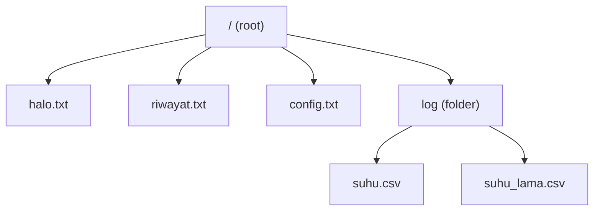
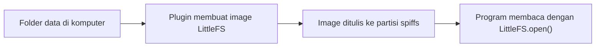

# BAB 40: LittleFS — Sistem File di Flash ESP32

> ✅ **Prasyarat:** Selesaikan **BAB 39 (NVS — Non-Volatile Storage)** — kamu sudah tahu beda RAM dan *flash*, dan kenapa menulis ke *flash* harus hemat. BAB ini juga memakai pola `struct Timer` + `sudahWaktunya()` dari **BAB 16 (Non-Blocking Programming)** dan perintah teks lewat Serial Monitor dari **BAB 22 (UART / Serial Communication)**. Program 3 memakai sensor dari **BAB 26 (DHT11 — Suhu & Kelembapan)**, dan pembagian *flash* menjadi partisi sudah dikenalkan di **BAB 20 (Memory Management)**.

Di BAB 39 kamu menyimpan angka dan teks pendek ke NVS. Bagaimana kalau yang ingin disimpan adalah catatan suhu ribuan baris, *file* pengaturan yang bisa kamu baca sendiri, atau halaman web? Untuk itu ESP32 bisa dipakai seperti *flash disk* kecil: ada *file*, ada folder, dan isinya tetap ada walaupun listrik diputus. Pengaturnya adalah **LittleFS**, sistem *file* yang sudah termasuk di *board package* esp32. Di BAB ini kamu belajar menulis, membaca, dan mengelola *file* di *flash* ESP32, membuat pencatat suhu ke *file* CSV, membuat *file* konfigurasi, dan mengirim *file* dari komputer ke ESP32.

## 📌 Tujuan Pembelajaran

Setelah mempelajari BAB ini, kamu bisa:

- Menjelaskan apa itu sistem *file*, *file*, folder, dan *path*, serta bedanya menyimpan data di RAM dan di *flash*.
- Memilih tempat penyimpanan yang tepat: NVS, LittleFS, atau kartu microSD.
- Menjelaskan partisi `spiffs` yang dipakai LittleFS, ukurannya di setiap pilihan **Tools → Partition Scheme**, dan kejadian yang bisa menghapus isinya.
- Me-*mount* LittleFS dengan `LittleFS.begin()` dan menjelaskan kenapa pemakaian pertama perlu memformat partisi.
- Membuat, membaca, menambah, mengganti nama, dan menghapus *file* dan folder dengan mode `"r"`, `"w"`, dan `"a"`.
- Menampilkan isi folder dan sisa ruang penyimpanan.
- Menulis data sensor ke *file* CSV dengan hemat supaya *flash* awet, dan menyimpan *file* dengan aman dari listrik padam.
- Membuat *file* konfigurasi `kunci=nilai` yang bisa diubah lewat Serial Monitor atau dari komputer.
- Mengunggah isi folder `data` dari komputer ke ESP32 memakai *plugin* **arduino-littlefs-upload** di Arduino IDE 2.x.

## 🧰 Yang Perlu Disiapkan

| Kebutuhan | Keterangan |
|---|---|
| *Hardware* | Kit Bluino ESP32 IoT Starter Shield (ESP32 DEVKIT V1 sudah terpasang) + kabel USB **data**. Program 1, 2, dan 4 cukup memakai *board* ESP32 saja |
| Kabel *jumper* | 1 kabel *female-female* untuk `DHT` → IO27 (Program 3). Opsional 1 kabel lagi untuk LED3 (biru) → IO2 (Program 4) |
| Komponen tambahan | Tidak ada — DHT11 dan LED sudah terpasang di kit |
| *Software* | Arduino IDE 2.x + *board package* **esp32** versi 3.3.x (lihat [BAB 5](../BAB-05/README.md)). Untuk mengunggah folder `data` ([40.11](#4011-mengunggah-file-dari-komputer-folder-data)) dibutuhkan Arduino IDE **2.2.1 atau yang lebih baru** |
| *Library* | `LittleFS` sudah termasuk di *board package* esp32. Program 3 memakai **DHT sensor library** (Adafruit) + **Adafruit Unified Sensor** — cara memasangnya ada di Program 3 |
| Alat uji | **Serial Monitor** Arduino IDE (baud 115200). Program 2–4 juga memakai kolom kirim pesan Serial Monitor dengan *line ending* **New Line**. Untuk [40.11](#4011-mengunggah-file-dari-komputer-folder-data): *plugin* **arduino-littlefs-upload**, File Explorer (Windows) atau Finder (macOS), dan editor teks seperti Notepad atau TextEdit |
| Jaringan | Tidak perlu WiFi. Internet hanya dibutuhkan untuk mengunduh *library* dan *plugin* |

## 📑 Daftar Isi

- [40.1 Apa Itu Sistem File?](#401-apa-itu-sistem-file)
- [40.2 NVS, LittleFS, atau microSD?](#402-nvs-littlefs-atau-microsd)
- [40.3 Partisi LittleFS di Flash](#403-partisi-littlefs-di-flash)
- [40.4 Mount, Format, dan Fungsi Dasar](#404-mount-format-dan-fungsi-dasar)
- [40.5 Program 1: Halo LittleFS](#405-program-1-halo-littlefs)
- [40.6 Folder dan Daftar Isi Folder](#406-folder-dan-daftar-isi-folder)
- [40.7 Program 2: Pengelola File Lewat Serial Monitor](#407-program-2-pengelola-file-lewat-serial-monitor)
- [40.8 Umur Flash dan Listrik Padam](#408-umur-flash-dan-listrik-padam)
- [40.9 Program 3: Pencatat Suhu ke File CSV](#409-program-3-pencatat-suhu-ke-file-csv)
- [40.10 Program 4: File Konfigurasi](#4010-program-4-file-konfigurasi)
- [40.11 Mengunggah File dari Komputer (Folder data)](#4011-mengunggah-file-dari-komputer-folder-data)
- [40.12 Troubleshooting](#4012-troubleshooting)
- [📝 Rangkuman](#-rangkuman)
- [💪 Latihan](#-latihan)
- [📚 Referensi](#-referensi)

---

## 40.1 Apa Itu Sistem File?

Bayangkan *flash* ESP32 sebagai buku tulis tebal yang masih kosong. Kalau kamu menulis catatan di sembarang halaman, lama-lama kamu harus mengingat sendiri "catatan suhu ada di halaman 37 baris 5, pengaturan WiFi di halaman 102". Merepotkan dan mudah tertimpa.

**Sistem *file*** (*file system*) adalah aturan sekaligus "pustakawan" yang mengurus buku itu. Kamu cukup berkata "simpan catatan ini dengan nama `suhu.csv`" atau "buka `suhu.csv`", lalu sistem *file* yang mencarikan halaman kosong, mencatat letaknya di daftar isi, dan menemukannya lagi nanti. Laptopmu juga memakai sistem *file* (misalnya NTFS di Windows), begitu pula *flash disk* (biasanya FAT32).

**LittleFS** (*Little File System*) adalah sistem *file* kecil yang dirancang khusus untuk mikrokontroler: hemat RAM, tahan listrik padam, dan meratakan keausan *flash*. *Board package* esp32 sudah menyertakannya sebagai *library* `LittleFS`, jadi kamu tidak perlu memasang apa pun.

### 40.1.1 File, Folder, dan Path

| Istilah | Artinya | Contoh |
|---|---|---|
| *File* | Sekumpulan data yang diberi nama, misalnya teks, tabel CSV, atau halaman web | `halo.txt`, `suhu.csv` |
| Folder | "Map" tempat mengelompokkan *file* (sering juga disebut direktori) | `log` |
| *Root* | Folder paling atas, ditulis `/` | `/` |
| *Path* | "Alamat lengkap" sebuah *file*: daftar folder dari *root* sampai nama *file*, dipisah tanda `/` | `/log/suhu.csv` |



*Gambar 40.1 — Contoh susunan file dan folder di LittleFS. Path file `suhu.csv` adalah `/log/suhu.csv`. Sumber: dibuat untuk materi ini.*

Tiga aturan *path* di LittleFS yang perlu kamu ingat:

- *Path* **selalu diawali `/`**. Tulis `"/halo.txt"`, bukan `"halo.txt"`.
- Huruf besar dan kecil **dibedakan**: `/Halo.txt` dan `/halo.txt` adalah dua *file* yang berbeda.
- Pakai nama pendek tanpa spasi, misalnya `suhu_harian.csv`. Selain lebih mudah diketik, nama tanpa spasi juga diperlukan oleh perintah Serial di Program 2.

### 40.1.2 Flash dan RAM

Ingat lagi perbedaan dua memori utama ESP32 dari [BAB 39](../BAB-39/README.md):

| | RAM (SRAM 520 KB) | *Flash* (4 MB) |
|---|---|---|
| Ibarat | Papan tulis: cepat ditulis dan dihapus | Buku catatan: lebih lambat ditulis, tetapi awet |
| Saat ESP32 di-*reset* atau listrik dicabut | Isinya **hilang** | Isinya **tetap ada** |
| Batas penulisan | Praktis tidak terbatas | Terbatas — setiap bagian *flash* bisa aus (dibahas di [40.8](#408-umur-flash-dan-listrik-padam)) |
| Dipakai untuk | Variabel, perhitungan, data sementara | Program, NVS, dan *file* LittleFS |

Jadi pola kerjanya selalu begini: program **bekerja dengan variabel di RAM**, lalu sesekali **menyimpan** hasil yang perlu diingat ke *file* di *flash*, dan **membacanya lagi** saat ESP32 menyala.

---

## 40.2 NVS, LittleFS, atau microSD?

ESP32 di kit punya tiga tempat untuk menyimpan data yang tidak boleh hilang. Ketiganya saling melengkapi:

| | NVS ([BAB 39](../BAB-39/README.md)) | LittleFS (BAB ini) | Kartu microSD ([BAB 41](../BAB-41/README.md)) |
|---|---|---|---|
| Bentuk data | Pasangan kunci–nilai, misalnya `"kecerahan"` = 75 | *File* dan folder: teks, CSV, JSON, HTML, gambar kecil | *File* dan folder (FAT32) |
| Tempat | Partisi `nvs` 20 KB di *flash* | Partisi `spiffs` ±1,4 MB di *flash* | Kartu microSD (beberapa GB), dibeli terpisah |
| Isinya bisa dilihat di komputer? | Tidak | Tidak langsung — lewat Serial Monitor atau *plugin* | Ya — cabut kartunya, colokkan ke laptop |
| Cocok untuk | Pengaturan kecil, penghitung, nilai kalibrasi | Log kecil–sedang, *file* konfigurasi, halaman web, data yang disiapkan dari komputer | Log besar dan berbulan-bulan, data yang akan diolah di komputer |

Pegangan praktisnya:

- **Beberapa angka atau teks pendek** (mode terakhir, nama WiFi, jumlah *boot*) → **NVS**. Lebih sederhana dan lebih hemat daripada membuat *file*.
- **Data berbentuk *file*** — catatan berbaris-baris, *file* yang ingin dibaca manusia, halaman web untuk *web server* — dan ukurannya masih jauh di bawah 1 MB → **LittleFS**.
- **Data besar atau harus dipindah ke komputer** → **microSD**.

### 40.2.1 LittleFS dan SPIFFS

Di contoh-contoh lama di internet kamu akan sering bertemu **SPIFFS** (*SPI Flash File System*), pendahulu LittleFS. Dokumentasi ESP-IDF dari Espressif menyebutkan SPIFFS **tidak dikembangkan dan tidak dirawat lagi**, sedangkan LittleFS adalah pilihan yang disarankan untuk aplikasi umum.

| | SPIFFS (lama) | LittleFS (dipakai di BAB ini) |
|---|---|---|
| Status | Tidak dikembangkan lagi | Masih dikembangkan, disarankan Espressif |
| Folder | Tidak ada folder sungguhan (semua *file* sejajar) | Folder bertingkat |
| Tahan listrik padam | Sebagian | Ya, dirancang untuk itu |
| Perataan keausan *flash* | Ada | Ada (*dynamic wear leveling*) |

Cara memakai keduanya hampir sama (`SPIFFS.begin(true)` ↔ `LittleFS.begin(true)`), tetapi **format datanya berbeda**. Kalau partisi yang sebelumnya berisi SPIFFS dibuka dengan `LittleFS.begin(true)`, partisi itu akan diformat ulang dan *file* lamanya hilang.

> 📌 **Catatan:** Nama partisinya tetap `spiffs` dan menu Arduino IDE masih menulis "SPIFFS" (misalnya **Default 4MB with spiffs**). Itu hanya nama warisan. Partisi yang sama dipakai oleh LittleFS — tidak ada pilihan khusus "LittleFS" di menu.

---

## 40.3 Partisi LittleFS di Flash

Di [BAB 20](../BAB-20/README.md) kamu sudah melihat bahwa *flash* 4 MB dibagi menjadi beberapa **partisi**, mirip *harddisk* laptop yang dibagi menjadi *drive* C: dan D:. Untuk *board* **ESP32 Dev Module** dengan pilihan bawaan **Tools → Partition Scheme → Default 4MB with spiffs** (di menu tertulis lengkap `Default 4MB with spiffs (1.2MB APP/1.5MB SPIFFS)`), pembagiannya seperti ini:

| Partisi | Alamat awal | Ukuran | Isinya |
|---|---|---|---|
| `nvs` | `0x9000` | 20 KB | Data NVS ([BAB 39](../BAB-39/README.md)) |
| `otadata` | `0xE000` | 8 KB | Catatan partisi program yang aktif |
| `app0` | `0x10000` | 1280 KB | Programmu |
| `app1` | `0x150000` | 1280 KB | Cadangan untuk pembaruan program lewat WiFi (OTA) |
| **`spiffs`** | **`0x290000`** | **1408 KB** (1.441.792 *byte*) | **Tempat *file* LittleFS** |
| `coredump` | `0x3F0000` | 64 KB | Catatan saat terjadi *crash* ([BAB 21](../BAB-21/README.md)) |

Angka 1.441.792 *byte* itulah yang nanti muncul sebagai kapasitas total LittleFS di Program 1. Menu Arduino IDE membulatkannya menjadi `1.5MB SPIFFS`.

### 40.3.1 Pilihan Partition Scheme

Ukuran ruang *file* bergantung pada pilihan **Tools → Partition Scheme**. Berikut pilihan untuk **ESP32 Dev Module** di esp32 core 3.3.12 (nama ditulis persis seperti di menu):

| Pilihan di menu | Ruang LittleFS | Keterangan |
|---|---|---|
| `Default 4MB with spiffs (1.2MB APP/1.5MB SPIFFS)` | 1408 KB | Bawaan. Dipakai di seluruh BAB ini |
| `Huge APP (3MB No OTA/1MB SPIFFS)` | 896 KB | Untuk program besar (misalnya WiFi + Bluetooth) |
| `No OTA (2MB APP/2MB SPIFFS)` | 1920 KB | Tanpa OTA, ruang *file* lebih besar |
| `No OTA (1MB APP/3MB SPIFFS)` | 2944 KB | Ruang *file* paling besar, program maksimal 1 MB |
| `Minimal (1.3MB APP/700KB SPIFFS)` | 640 KB | — |
| `Minimal SPIFFS (1.9MB APP with OTA/128KB SPIFFS)` | 128 KB | Ruang *file* sangat kecil |
| `No FS 4MB (2MB APP x2)` | **Tidak ada** | `LittleFS.begin()` selalu gagal |
| `Default 4MB with ffat (…)`, `No OTA (… FATFS)` | **Tidak ada** | Partisinya untuk sistem *file* FAT, bukan LittleFS |

> ⚠️ **Perhatian:** Letak partisi `spiffs` berbeda-beda di setiap pilihan (misalnya `0x290000` di **Default** dan `0x310000` di **Huge APP**). Kalau kamu mengganti **Partition Scheme**, program akan menemukan partisi yang belum berformat LittleFS, dan `LittleFS.begin(true)` akan memformatnya. Artinya, *file* lamamu tidak terbawa. Salin dulu isi *file* penting (misalnya lewat Serial Monitor) sebelum mengganti pilihan ini.

### 40.3.2 Kapan File di LittleFS Hilang?

| Kejadian | *File* di LittleFS |
|---|---|
| Tombol **EN** ditekan, atau ESP32 *restart* sendiri | Tetap ada |
| Kabel USB atau sumber listrik dicabut lalu dipasang lagi | Tetap ada — kecuali data yang sedang ditulis dan belum ditutup ([40.8](#408-umur-flash-dan-listrik-padam)) |
| Program baru diunggah dengan tombol **Upload** (pengaturan bawaan) | Tetap ada, **walaupun programnya berbeda** — **Upload** tidak menyentuh partisi `spiffs` |
| **Tools → Erase All Flash Before Sketch Upload** = **Enabled** saat *upload* | **Semua hilang** |
| **Tools → Partition Scheme** diganti | Biasanya hilang (lihat [40.3.1](#4031-pilihan-partition-scheme)) |
| Program memanggil `LittleFS.remove()` atau `LittleFS.format()` | *File* itu hilang / semua *file* hilang |
| Isi folder `data` diunggah dengan *plugin* ([40.11](#4011-mengunggah-file-dari-komputer-folder-data)) | **Diganti seluruhnya** dengan isi folder `data` |

> 💡 **Tips:** Karena *file* bertahan saat *upload*, program baru bisa menemukan *file* sisa program sebelumnya. Itu normal. Program 2 nanti bisa kamu pakai untuk melihat dan membersihkan *file*-*file* lama.

---

## 40.4 Mount, Format, dan Fungsi Dasar

### 40.4.1 Mount dengan LittleFS.begin()

Saat kamu mencolokkan *flash disk* ke laptop, Windows perlu mengenali dan "memasang" *drive*-nya dulu sebelum kamu bisa membuka *file* di dalamnya. Proses memasang ini disebut ***mount***. Di ESP32, *mount* dilakukan oleh `LittleFS.begin()`, yang membaca struktur LittleFS dari partisi `spiffs`. Semua fungsi *file* lain baru bisa dipakai setelah `begin()` berhasil.

Bentuk lengkap fungsinya di esp32 core 3.3.12:

```cpp
bool begin(bool formatOnFail = false, const char *basePath = "/littlefs",
           uint8_t maxOpenFiles = 10, const char *partitionLabel = "spiffs");
```

| Parameter | Nilai bawaan | Artinya |
|---|---|---|
| `formatOnFail` | `false` | Kalau `true` dan *mount* gagal, partisi **diformat** lalu di-*mount* ulang |
| `basePath` | `"/littlefs"` | Awalan *path* untuk fungsi C standar seperti `fopen()`. Jarang perlu diubah |
| `maxOpenFiles` | `10` | Di core 3.3.12, parameter ini **diabaikan** oleh LittleFS (hanya berpengaruh pada `SPIFFS.begin()`) |
| `partitionLabel` | `"spiffs"` | Nama partisi di tabel partisi |

`begin()` mengembalikan `true` kalau berhasil. Hampir selalu kamu cukup menulis `LittleFS.begin(true)`.

**Kenapa pemakaian pertama perlu diformat?** Partisi `spiffs` di ESP32 baru masih kosong (atau berisi sisa SPIFFS), jadi belum punya "daftar isi" LittleFS dan *mount* gagal. **Memformat** berarti membuat struktur LittleFS yang kosong — sama seperti memformat *flash disk* baru. Dengan `begin(true)`, pemformatan ini terjadi otomatis sekali, lalu *mount* berikutnya langsung berhasil.

Pada pemakaian pertama itu, Serial Monitor biasanya menampilkan beberapa baris *error* dari sistem sebelum pesan programmu, kira-kira seperti ini (angka dan teksnya bisa sedikit berbeda):

```text
E (1084) esp_littlefs: ./managed_components/joltwallet__littlefs/src/littlefs/lfs.c:1384:error: Corrupted dir pair at {0x0, 0x1}
E (1085) esp_littlefs: mount failed,  (-84)
E (1089) esp_littlefs: Failed to initialize LittleFS
```

Pesan ini **normal** pada pemakaian pertama: artinya "partisi belum berformat LittleFS". Setelah itu `begin(true)` memformat partisi, dan pada *reset* berikutnya pesan ini tidak muncul lagi. Kalau pesan yang sama muncul di **setiap** *reset*, lihat [40.12 Troubleshooting](#4012-troubleshooting).

> ⚠️ **Perhatian:** Memformat **menghapus semua *file***. `begin(true)` tidak bertanya dulu: kalau suatu saat *mount* gagal karena sebab lain (misalnya kamu mengganti **Partition Scheme** atau partisinya rusak), isinya langsung diformat. Untuk perangkat yang datanya sangat berharga, pakai `begin(false)` lalu tentukan sendiri apa yang harus dilakukan (misalnya menyalakan LED peringatan), alih-alih langsung memformat.

### 40.4.2 Membuka File: Mode r, w, dan a

Setiap operasi *file* mengikuti empat langkah yang sama, seperti memakai buku catatan: **buka → periksa → baca/tulis → tutup**.

```cpp
File f = LittleFS.open("/catatan.txt", "a");  // 1. buka (mode "a" = tambah di akhir)
if (!f) {                                     // 2. periksa: berhasil dibuka?
  Serial.println("Gagal membuka file");
  return;
}
f.println("Baris baru");                      // 3. tulis (sama seperti Serial.println)
f.close();                                    // 4. tutup — data baru benar-benar tersimpan di sini
```

Parameter kedua `LittleFS.open()` adalah **mode**, yang menentukan apa yang terjadi pada *file*:

| Mode | Konstanta | Kalau *file* belum ada | Kalau *file* sudah ada | Dipakai untuk |
|---|---|---|---|---|
| `"r"` | `FILE_READ` | Gagal (`f` bernilai `false`) | Dibaca dari awal | Membaca |
| `"w"` | `FILE_WRITE` | Dibuat | **Isinya dikosongkan dulu**, lalu ditulis dari awal | Menulis ulang seluruh isi, misalnya *file* konfigurasi |
| `"a"` | `FILE_APPEND` | Dibuat | Isi lama tetap, tulisan baru ditambahkan di akhir | Menambah baris log |

Kalau mode tidak ditulis, `LittleFS.open(path)` memakai `"r"`. Ada juga mode `"r+"`, `"w+"`, dan `"a+"` untuk membaca dan menulis sekaligus, tetapi jarang diperlukan.

> ⚠️ **Perhatian:** Begitu *file* yang sudah ada dibuka dengan mode `"w"`, **isi lamanya dibuang** — walaupun kamu tidak menulis apa pun lalu langsung menutupnya. Untuk log, selalu pakai `"a"`.

Dua hal lagi yang sering terlupa:

- **Folder harus sudah ada.** `LittleFS.open("/log/suhu.csv", "a")` gagal kalau folder `/log` belum dibuat. Buat dulu dengan `LittleFS.mkdir("/log")`.
- **Selalu `close()`.** Tulisanmu ditampung dulu di RAM, lalu benar-benar ditulis ke *flash* saat `close()` (atau `flush()`) dipanggil. Objek `File` memang menutup dirinya sendiri saat fungsinya selesai, tetapi biasakan menulis `close()` supaya jelas kapan data tersimpan.

### 40.4.3 Daftar Fungsi Penting

Fungsi milik `LittleFS` (mengurus sistem *file*):

| Fungsi | Kegunaan | Hasil |
|---|---|---|
| `LittleFS.begin(true)` | *Mount*, format kalau perlu | `true` kalau berhasil |
| `LittleFS.end()` | Melepas (*unmount*) | — |
| `LittleFS.format()` | Memformat partisi — **semua *file* hilang** | `true` kalau berhasil |
| `LittleFS.totalBytes()` | Kapasitas total partisi (*byte*) | `size_t` |
| `LittleFS.usedBytes()` | Ruang yang terpakai (*byte*) | `size_t` |
| `LittleFS.open(path, mode)` | Membuka *file* atau folder | Objek `File` |
| `LittleFS.exists(path)` | Apakah *file*/folder ada? | `true`/`false` |
| `LittleFS.remove(path)` | Menghapus *file* | `true` kalau berhasil |
| `LittleFS.rename(lama, baru)` | Mengganti nama atau memindah *file* (kalau `baru` sudah ada, ia ditimpa) | `true` kalau berhasil |
| `LittleFS.mkdir(path)` | Membuat folder | `true` kalau berhasil atau sudah ada |
| `LittleFS.rmdir(path)` | Menghapus folder — **harus kosong** | `true` kalau berhasil |

Fungsi milik objek `File` (mengurus satu *file* yang sedang dibuka):

| Fungsi | Kegunaan |
|---|---|
| `if (f)` / `if (!f)` | Memeriksa apakah *file* berhasil dibuka |
| `f.print()`, `f.println()`, `f.printf()` | Menulis teks — sama persis dengan `Serial.print()` dan kawan-kawan |
| `f.write(buf, n)` | Menulis `n` *byte* mentah |
| `f.available()` | Jumlah *byte* yang belum dibaca (0 = sudah sampai akhir) |
| `f.read()` | Membaca satu *byte* (`-1` kalau sudah habis) |
| `f.readStringUntil('\n')` | Membaca satu baris (tanpa `'\n'`-nya) |
| `f.readString()` | Membaca seluruh sisa isi — hati-hati, *file* besar bisa menghabiskan RAM |
| `f.size()` | Ukuran *file* (*byte*) |
| `f.name()` / `f.path()` | Nama saja (`suhu.csv`) / *path* lengkap (`/log/suhu.csv`) |
| `f.isDirectory()` | Apakah ini folder? |
| `f.openNextFile()` | Untuk folder: membuka isi berikutnya ([40.6](#406-folder-dan-daftar-isi-folder)) |
| `f.flush()` | Memaksa tulisan yang masih ditampung segera disimpan ke *flash* |
| `f.close()` | Menutup *file* (sekaligus menyimpan tulisan yang masih ditampung) |

> 📌 **Catatan:** LittleFS mengelola ruang dalam **blok 4 KB** (4096 *byte*). Karena itu, angka `usedBytes()` selalu kelipatan 4096. Sistem *file* yang baru diformat sudah terpakai 8192 *byte* (dua blok untuk catatan folder *root*), dan setiap folder baru memakai dua blok lagi. *File* yang sangat kecil bisa "menumpang" di blok catatan folder, sedangkan *file* yang lebih besar memakai blok utuh. Jadi, satu *file* besar lebih hemat ruang daripada ratusan *file* kecil.

---

## 40.5 Program 1: Halo LittleFS

**Tujuan:** Mencoba tiga mode dasar sekaligus. Program menulis ulang `/halo.txt` (mode `"w"`), menambah satu baris ke `/riwayat.txt` (mode `"a"`) setiap kali ESP32 menyala, lalu membaca dan menampilkan keduanya (mode `"r"`). Dari `/riwayat.txt` kamu bisa melihat sendiri bahwa isi *file* tetap ada setelah ESP32 di-*reset*.

**Rangkaian:**

*Tidak perlu merangkai — program ini hanya memakai board ESP32.*

**Cara Menjalankan:**

1. Buka Arduino IDE → **File → New Sketch**, hapus isinya, lalu salin kode di bawah. Kode yang sama juga tersedia di *file* [`p1_halo_littlefs.ino`](p1_halo_littlefs/p1_halo_littlefs.ino).
2. Pastikan **Tools → Board** = **ESP32 Dev Module**, **Tools → Port** = *port* ESP32 kamu (misalnya `COM5` di Windows atau `/dev/ttyUSB0` di Linux), dan **Tools → Partition Scheme** = **Default 4MB with spiffs**.
3. Klik tombol **Upload** (ikon panah →) dan tunggu sampai muncul tulisan **Done uploading**.
4. Buka **Serial Monitor** (**Tools → Serial Monitor**) lalu pilih baud **115200**.
5. Tekan tombol **EN** di *board* ESP32 (tombol *reset*) supaya semua pesan dari awal terlihat. Ulangi beberapa kali, lalu perhatikan isi `/riwayat.txt` yang terus bertambah.

**Kode Program:**

<!-- sketch: p1_halo_littlefs -->
```cpp
/*
 * BAB 40 - Program 1: Halo LittleFS
 * Menulis, membaca, dan menambah isi file di flash ESP32.
 *   /halo.txt    -> ditulis ulang (mode "w") setiap ESP32 menyala
 *   /riwayat.txt -> ditambah satu baris (mode "a") setiap ESP32 menyala
 * Tekan tombol EN beberapa kali dan perhatikan /riwayat.txt bertambah.
 * Rangkaian: tidak perlu.
 */

#include <LittleFS.h>

const char *FILE_HALO = "/halo.txt";
const char *FILE_RIWAYAT = "/riwayat.txt";

// Menampilkan seluruh isi sebuah file ke Serial Monitor, baris demi baris
void tampilkanIsi(const char *path) {
  File f = LittleFS.open(path, "r");
  if (!f) {
    Serial.printf("Gagal membuka %s untuk dibaca\n", path);
    return;
  }
  Serial.printf("--- Isi %s (%u byte) ---\n", path, (unsigned)f.size());
  while (f.available()) {
    String baris = f.readStringUntil('\n');  // baca sampai akhir baris
    baris.trim();                            // buang '\r' di ujung baris
    Serial.println(baris);
  }
  f.close();
  Serial.println("---");
}

// Menghitung jumlah baris (jumlah karakter '\n') di sebuah file
int hitungBaris(const char *path) {
  File f = LittleFS.open(path, "r");
  if (!f) {
    return 0;  // file belum ada -> 0 baris
  }
  int jumlah = 0;
  while (f.available()) {
    if (f.read() == '\n') {
      jumlah = jumlah + 1;
    }
  }
  f.close();
  return jumlah;
}

void setup() {
  Serial.begin(115200);
  delay(1000);  // beri waktu Serial Monitor tersambung
  Serial.println();
  Serial.println("BAB 40 - Program 1: Halo LittleFS");

  // 1. Mount LittleFS (diformat otomatis pada pemakaian pertama)
  if (!LittleFS.begin(true)) {
    Serial.println("LittleFS gagal di-mount! Periksa Tools > Partition Scheme.");
    return;
  }
  Serial.println("LittleFS siap.");
  size_t total = LittleFS.totalBytes();
  size_t terpakai = LittleFS.usedBytes();
  Serial.printf("Kapasitas: %u byte | terpakai: %u byte | sisa: %u byte\n",
                (unsigned)total, (unsigned)terpakai, (unsigned)(total - terpakai));
  Serial.println();

  // 2. Mode "w": buat file baru, atau kosongkan isi lama, lalu tulis
  File f = LittleFS.open(FILE_HALO, "w");
  if (!f) {
    Serial.println("Gagal membuat /halo.txt");
    return;
  }
  f.println("Halo dari LittleFS!");
  f.println("File ini ditulis ulang setiap ESP32 menyala.");
  f.close();  // tutup: tulisan benar-benar tersimpan di flash
  tampilkanIsi(FILE_HALO);
  Serial.println();

  // 3. Mode "a": tambah satu baris di akhir file, isi lama tetap
  int nomor = hitungBaris(FILE_RIWAYAT) + 1;
  f = LittleFS.open(FILE_RIWAYAT, "a");
  if (!f) {
    Serial.println("Gagal membuka /riwayat.txt");
    return;
  }
  f.print("ESP32 menyala ke-");
  f.println(nomor);
  f.close();
  tampilkanIsi(FILE_RIWAYAT);
  Serial.println();
  Serial.println("Tekan tombol EN untuk menyalakan ulang ESP32.");
}

void loop() {
  // Tidak ada tugas berulang. Semua contoh dijalankan sekali di setup().
}
```

**Penjelasan Kode:**

- `#include <LittleFS.h>` memanggil *library* LittleFS bawaan *board package* esp32. Objek `LittleFS` langsung tersedia tanpa perlu dibuat.
- `LittleFS.begin(true)` me-*mount* sistem *file* dan memformatnya kalau belum pernah diformat ([40.4.1](#4041-mount-dengan-littlefsbegin)). Kalau gagal, program berhenti di `return` karena semua langkah berikutnya pasti gagal juga.
- `totalBytes()` dan `usedBytes()` memberi kapasitas dan ruang terpakai dalam *byte*. Hasilnya bertipe `size_t`, jadi diubah ke `(unsigned)` supaya cocok dengan `%u` di `printf()`.
- Mode `"w"` membuat `/halo.txt` dari nol di setiap *boot*, jadi isinya selalu dua baris. `f.println()` bekerja persis seperti `Serial.println()`, hanya saja tujuannya *file*. Setiap `println()` menulis dua karakter akhir baris, `'\r'` dan `'\n'`.
- `hitungBaris()` membaca `/riwayat.txt` satu *byte* demi satu *byte* dan menghitung karakter `'\n'`. Hasilnya plus satu menjadi nomor *boot* sekarang. Kalau *file* belum ada, `open()` gagal dan fungsi mengembalikan 0.
- Mode `"a"` menambahkan baris baru di **akhir** `/riwayat.txt` tanpa mengganggu baris-baris sebelumnya.
- `tampilkanIsi()` membaca *file* per baris dengan `readStringUntil('\n')`. Hasilnya masih membawa `'\r'` di ujungnya, sehingga dibersihkan dulu dengan `trim()`.

**Contoh Output:**

Setelah tombol **EN** ditekan dua kali (jadi ESP32 sudah menyala tiga kali). Angka kapasitas berasal dari **Partition Scheme** bawaan; angka terpakai hanya contoh, angkamu bisa berbeda.

```text
BAB 40 - Program 1: Halo LittleFS
LittleFS siap.
Kapasitas: 1441792 byte | terpakai: 8192 byte | sisa: 1433600 byte

--- Isi /halo.txt (67 byte) ---
Halo dari LittleFS!
File ini ditulis ulang setiap ESP32 menyala.
---

--- Isi /riwayat.txt (60 byte) ---
ESP32 menyala ke-1
ESP32 menyala ke-2
ESP32 menyala ke-3
---

Tekan tombol EN untuk menyalakan ulang ESP32.
```

Pada pemakaian pertama, baris `E (…) esp_littlefs: …` seperti di [40.4.1](#4041-mount-dengan-littlefsbegin) bisa muncul sebelum `LittleFS siap.` — itu tanda partisi sedang diformat. Tidak ada yang berubah di kit; semua hasil terlihat di Serial Monitor.

> 🧪 **Coba Sendiri:** *Upload* ulang Program 1 tanpa mengubah apa pun, lalu lihat `/riwayat.txt`. Nomornya melanjutkan hitungan sebelumnya, karena tombol **Upload** tidak menyentuh partisi `spiffs`. Lalu coba unggah Program 1 dari [BAB 7](../BAB-07/README.md), dan kembali ke program ini: *file*-nya masih ada.

**Kalau Belum Berhasil:**

- **Muncul `LittleFS gagal di-mount!`** → **Partition Scheme** yang dipilih tidak punya partisi `spiffs` (misalnya **No FS 4MB (2MB APP x2)** atau pilihan **… FATFS**). Pilih **Default 4MB with spiffs**, lalu *upload* ulang.
- **Serial Monitor kosong atau pesannya terpotong** → pastikan baud **115200**, lalu tekan tombol **EN**. Pesan dari `setup()` hanya dicetak sekali setiap ESP32 menyala.
- **Hitungan `/riwayat.txt` kembali ke 1 setelah *upload*** → opsi **Tools → Erase All Flash Before Sketch Upload** masih **Enabled**, atau **Partition Scheme** baru saja diganti. Kembalikan opsi itu ke **Disabled**.
- **Baris `E (…) esp_littlefs: …` muncul di setiap *reset*** → lihat [40.12 Troubleshooting](#4012-troubleshooting).

---

## 40.6 Folder dan Daftar Isi Folder

Folder dibuat dengan `LittleFS.mkdir()` dan dihapus dengan `LittleFS.rmdir()`. Folder hanya bisa dihapus kalau **sudah kosong**, sedangkan `LittleFS.remove()` hanya untuk *file* (tidak bisa menghapus folder).

```cpp
LittleFS.mkdir("/log");               // buat folder /log (aman dipanggil walaupun sudah ada)
File f = LittleFS.open("/log/suhu.csv", "a");   // sekarang file di dalam /log bisa dibuat
f.close();
LittleFS.remove("/log/suhu.csv");     // hapus file-nya dulu...
LittleFS.rmdir("/log");               // ...baru folder kosongnya bisa dihapus
```

Untuk melihat isi sebuah folder, buka folder itu dengan `LittleFS.open()`, lalu ambil isinya satu per satu dengan `openNextFile()`. Saat isinya sudah habis, `openNextFile()` mengembalikan objek `File` kosong yang bernilai `false`, sehingga perulangan `while` berhenti:

```cpp
File folder = LittleFS.open("/");           // buka folder root
File isi = folder.openNextFile();           // ambil isi pertama
while (isi) {                               // selama masih ada isi
  if (isi.isDirectory()) {
    Serial.printf("[%s]\n", isi.name());    // folder ditulis dalam kurung siku
  } else {
    Serial.printf("%s (%u byte)\n", isi.name(), (unsigned)isi.size());
  }
  isi = folder.openNextFile();              // ambil isi berikutnya
}
```

Potongan kode di atas hanya menampilkan isi satu folder. Untuk ikut menampilkan isi subfolder, Program 2 memakai fungsi yang **memanggil dirinya sendiri** (rekursi): setiap kali menemukan folder, fungsi itu dipanggil lagi untuk folder tersebut, dengan tulisan yang menjorok lebih dalam.

> 📌 **Catatan:** `isi.name()` hanya berisi nama (`suhu.csv`), sedangkan `isi.path()` berisi *path* lengkap (`/log/suhu.csv`). Untuk membuka *file* yang ditemukan, pakai `path()`.

---

## 40.7 Program 2: Pengelola File Lewat Serial Monitor

**Tujuan:** Membuat "pengelola *file* mini" yang dikendalikan dari Serial Monitor. Kamu bisa melihat semua *file* dan folder, membaca isi *file*, menulis, menambah, mengganti nama, menghapus, membuat dan menghapus folder, sampai memformat LittleFS. Program ini juga berguna sebagai alat bantu untuk memeriksa *file* yang dibuat Program 3 dan 4.

**Rangkaian:**

*Tidak perlu merangkai — program ini hanya memakai board ESP32.*

**Cara Menjalankan:**

1. Buka Arduino IDE → **File → New Sketch**, hapus isinya, lalu salin kode di bawah. Kode yang sama juga tersedia di *file* [`p2_pengelola_file.ino`](p2_pengelola_file/p2_pengelola_file.ino).
2. Pastikan **Tools → Board** = **ESP32 Dev Module**, **Tools → Port** = *port* ESP32 kamu, dan **Tools → Partition Scheme** = **Default 4MB with spiffs**.
3. Klik **Upload** dan tunggu sampai muncul **Done uploading**.
4. Buka **Serial Monitor**. Di bagian kanan panel Serial Monitor ada dua pilihan: pilih **New Line** untuk *line ending* dan **115200 baud** untuk kecepatan.
5. Klik kolom pesan di bagian atas panel Serial Monitor (bertuliskan *Message (Enter to send message to ...)*), ketik `ls`, lalu tekan **Enter**. Coba juga perintah-perintah lain seperti di **Contoh Output**. Ketik `bantuan` untuk melihat daftar perintah.

**Kode Program:**

<!-- sketch: p2_pengelola_file -->
```cpp
/*
 * BAB 40 - Program 2: Pengelola File Lewat Serial Monitor
 * Ketik perintah di Serial Monitor (line ending: New Line):
 *   bantuan               -> daftar perintah
 *   info                  -> kapasitas dan sisa ruang
 *   ls                    -> semua file dan folder
 *   baca <path>           -> tampilkan isi file
 *   tulis <path> <teks>   -> buat/timpa file berisi <teks>
 *   tambah <path> <teks>  -> tambahkan <teks> sebagai baris baru
 *   hapus <path>          -> hapus file
 *   ganti <lama> <baru>   -> ganti nama/pindahkan file
 *   buatfolder <path>     -> buat folder
 *   hapusfolder <path>    -> hapus folder kosong
 *   format ya             -> hapus SEMUA file (memformat LittleFS)
 * Rangkaian: tidak perlu.
 */

#include <LittleFS.h>

const unsigned int PANJANG_MAKS = 120;  // batas panjang satu perintah

String penampung = "";  // karakter yang sudah tiba, menunggu akhir baris
int jumlahFile = 0;
int jumlahFolder = 0;

// Menambahkan '/' di depan path kalau pengguna lupa menuliskannya
String rapikanPath(String path) {
  path.trim();
  if (!path.startsWith("/")) {
    path = "/" + path;
  }
  return path;
}

// Memecah "kata1 sisanya" menjadi kata pertama dan sisanya
void pisahKataPertama(const String &teks, String &kata, String &sisa) {
  int spasi = teks.indexOf(' ');
  if (spasi < 0) {
    kata = teks;
    sisa = "";
  } else {
    kata = teks.substring(0, spasi);
    sisa = teks.substring(spasi + 1);
    sisa.trim();
  }
}

size_t ukuranFile(const String &path) {
  File f = LittleFS.open(path, "r");
  if (!f) {
    return 0;
  }
  size_t ukuran = f.size();
  f.close();
  return ukuran;
}

void tampilkanBantuan() {
  Serial.println("Perintah (path diawali /, tanpa spasi):");
  Serial.println("  info                  kapasitas dan sisa ruang");
  Serial.println("  ls                    semua file dan folder");
  Serial.println("  baca <path>           tampilkan isi file");
  Serial.println("  tulis <path> <teks>   buat/timpa file berisi teks");
  Serial.println("  tambah <path> <teks>  tambah teks sebagai baris baru");
  Serial.println("  hapus <path>          hapus file");
  Serial.println("  ganti <lama> <baru>   ganti nama/pindahkan file");
  Serial.println("  buatfolder <path>     buat folder");
  Serial.println("  hapusfolder <path>    hapus folder kosong");
  Serial.println("  format ya             hapus SEMUA file");
}

void tampilkanInfo() {
  size_t total = LittleFS.totalBytes();
  size_t terpakai = LittleFS.usedBytes();
  Serial.printf("Kapasitas: %u byte | terpakai: %u byte (%.1f%%) | sisa: %u byte\n",
                (unsigned)total, (unsigned)terpakai, 100.0 * terpakai / total,
                (unsigned)(total - terpakai));
}

// Menampilkan isi folder; memanggil dirinya sendiri untuk setiap subfolder
void tampilkanFolder(const String &pathFolder, int kedalaman) {
  File folder = LittleFS.open(pathFolder);
  if (!folder || !folder.isDirectory()) {
    Serial.printf("%s bukan folder\n", pathFolder.c_str());
    return;
  }
  File isi = folder.openNextFile();
  while (isi) {
    for (int i = 0; i < kedalaman; i++) {
      Serial.print("  ");  // menjorok sesuai kedalaman folder
    }
    if (isi.isDirectory()) {
      Serial.printf("[%s]\n", isi.name());
      jumlahFolder = jumlahFolder + 1;
      String pathSub = isi.path();  // salin path-nya sebelum ditutup
      isi.close();
      tampilkanFolder(pathSub, kedalaman + 1);
    } else {
      Serial.printf("%s  (%u byte)\n", isi.name(), (unsigned)isi.size());
      jumlahFile = jumlahFile + 1;
    }
    isi = folder.openNextFile();
  }
}

void perintahLs() {
  jumlahFile = 0;
  jumlahFolder = 0;
  Serial.println("/");
  tampilkanFolder("/", 1);
  Serial.printf("Jumlah: %d file, %d folder\n", jumlahFile, jumlahFolder);
  tampilkanInfo();
}

void perintahBaca(const String &path) {
  File f = LittleFS.open(path, "r");
  if (!f || f.isDirectory()) {
    Serial.printf("Tidak bisa membaca %s (tidak ada, atau itu folder)\n", path.c_str());
    return;
  }
  Serial.printf("--- Isi %s (%u byte) ---\n", path.c_str(), (unsigned)f.size());
  int terakhir = '\n';
  while (f.available()) {
    terakhir = f.read();
    Serial.write(terakhir);  // kirim apa adanya, byte demi byte
  }
  f.close();
  if (terakhir != '\n') {
    Serial.println();  // file tidak diakhiri baris baru
  }
  Serial.println("--- selesai ---");
}

// mode "w" = timpa isi lama, mode "a" = tambah di akhir
void perintahTulis(const String &argumen, const char *mode) {
  String path, teks;
  pisahKataPertama(argumen, path, teks);
  if (path.length() == 0 || teks.length() == 0) {
    Serial.println("Format: tulis <path> <teks>  atau  tambah <path> <teks>");
    return;
  }
  path = rapikanPath(path);
  File f = LittleFS.open(path, mode);
  if (!f) {
    Serial.printf("Gagal membuka %s (foldernya sudah dibuat?)\n", path.c_str());
    return;
  }
  f.println(teks);
  f.close();
  Serial.printf("OK: %s sekarang %u byte\n", path.c_str(), (unsigned)ukuranFile(path));
}

void perintahGanti(const String &argumen) {
  String lama, baru;
  pisahKataPertama(argumen, lama, baru);
  if (lama.length() == 0 || baru.length() == 0) {
    Serial.println("Format: ganti <path_lama> <path_baru>");
    return;
  }
  lama = rapikanPath(lama);
  baru = rapikanPath(baru);
  if (!LittleFS.exists(lama)) {
    Serial.printf("%s tidak ada\n", lama.c_str());
    return;
  }
  if (LittleFS.rename(lama, baru)) {
    Serial.printf("OK: %s -> %s\n", lama.c_str(), baru.c_str());
  } else {
    Serial.println("Gagal mengganti nama (foldernya sudah dibuat?)");
  }
}

void prosesPerintah(String baris) {
  baris.trim();
  if (baris.length() == 0) {
    return;  // baris kosong (misalnya dari line ending Both NL & CR): abaikan
  }
  Serial.print("> ");
  Serial.println(baris);

  String perintah, argumen;
  pisahKataPertama(baris, perintah, argumen);
  perintah.toLowerCase();  // hanya kata perintah yang dijadikan huruf kecil

  if (perintah == "bantuan") {
    tampilkanBantuan();
  } else if (perintah == "info") {
    tampilkanInfo();
  } else if (perintah == "ls") {
    perintahLs();
  } else if (perintah == "tulis") {
    perintahTulis(argumen, "w");
  } else if (perintah == "tambah") {
    perintahTulis(argumen, "a");
  } else if (perintah == "ganti") {
    perintahGanti(argumen);
  } else if (perintah == "format") {
    if (argumen == "ya") {
      Serial.println("Memformat LittleFS...");
      Serial.println(LittleFS.format() ? "OK: semua file sudah dihapus" : "Gagal memformat");
    } else {
      Serial.println("PERINGATAN: format menghapus SEMUA file. Ketik 'format ya' kalau yakin.");
    }
  } else if (perintah == "baca" || perintah == "hapus" ||
             perintah == "buatfolder" || perintah == "hapusfolder") {
    if (argumen.length() == 0) {
      Serial.printf("Format: %s <path>\n", perintah.c_str());
      return;
    }
    String path = rapikanPath(argumen);
    if (perintah == "baca") {
      perintahBaca(path);
    } else if (perintah == "hapus") {
      if (LittleFS.remove(path)) {
        Serial.printf("OK: %s dihapus\n", path.c_str());
      } else {
        Serial.printf("Gagal menghapus %s (tidak ada, atau itu folder?)\n", path.c_str());
      }
    } else if (perintah == "buatfolder") {
      if (LittleFS.mkdir(path)) {
        Serial.printf("OK: folder %s siap\n", path.c_str());
      } else {
        Serial.printf("Gagal membuat folder %s\n", path.c_str());
      }
    } else {
      if (LittleFS.rmdir(path)) {
        Serial.printf("OK: folder %s dihapus\n", path.c_str());
      } else {
        Serial.printf("Gagal menghapus folder %s (tidak ada, atau belum kosong)\n", path.c_str());
      }
    }
  } else {
    Serial.println("Perintah tidak dikenal. Ketik: bantuan");
  }
}

void setup() {
  Serial.begin(115200);
  delay(1000);  // beri waktu Serial Monitor tersambung
  penampung.reserve(PANJANG_MAKS);
  Serial.println();
  Serial.println("BAB 40 - Program 2: Pengelola File Lewat Serial Monitor");
  if (!LittleFS.begin(true)) {
    Serial.println("LittleFS gagal di-mount! Periksa Tools > Partition Scheme.");
    while (true) {
      delay(1000);  // berhenti di sini; tidak ada yang bisa dikerjakan
    }
  }
  Serial.println("LittleFS siap. Ketik: bantuan (line ending: New Line)");
}

void loop() {
  // Ambil karakter yang SUDAH tiba saja, tanpa menunggu (pola BAB 16)
  while (Serial.available() > 0) {
    char c = Serial.read();
    if (c == '\n' || c == '\r') {
      prosesPerintah(penampung);
      penampung = "";
    } else if (penampung.length() < PANJANG_MAKS) {
      penampung += c;
    }
  }
}
```

**Penjelasan Kode:**

- `loop()` memakai pola membaca Serial tanpa menunggu dari [BAB 16](../BAB-16/README.md): karakter dikumpulkan di `penampung`, lalu diproses begitu karakter akhir baris tiba. Perintah yang lebih panjang dari 120 karakter dipotong.
- `pisahKataPertama()` memecah satu baris menjadi kata pertama dan sisanya. Fungsi ini dipakai dua kali: memisahkan perintah dari argumennya (`tulis` | `/a.txt halo dunia`), lalu memisahkan *path* dari teksnya (`/a.txt` | `halo dunia`). Karena itulah *path* tidak boleh mengandung spasi, sedangkan teks boleh.
- Hanya kata perintah yang dijadikan huruf kecil. *Path* dan teks dibiarkan apa adanya, karena LittleFS membedakan huruf besar dan kecil.
- `rapikanPath()` menambahkan `/` di depan *path* kalau kamu lupa, jadi `baca halo.txt` sama dengan `baca /halo.txt`.
- `tampilkanFolder()` adalah fungsi rekursif dari [40.6](#406-folder-dan-daftar-isi-folder). Sebelum masuk ke subfolder, *path*-nya disalin ke `String` dan objek `isi` (subfolder itu) ditutup dulu, supaya tidak terlalu banyak *file* dan folder terbuka bersamaan.
- Nama perintah `ls` dipinjam dari perintah *list* di Linux dan macOS. Perintah lainnya memakai bahasa Indonesia supaya mudah diingat.
- `perintahBaca()` mengirim isi *file* apa adanya dengan `Serial.write()`, sehingga *file* apa pun (bukan hanya teks per baris) bisa ditampilkan.
- `perintahTulis()` dipakai untuk `tulis` (mode `"w"`) maupun `tambah` (mode `"a"`). Ukuran *file* dibaca ulang setelah `close()`, saat tulisan sudah tersimpan.
- `ganti` memakai `LittleFS.rename()`. Kalau *path* baru sudah dipakai *file* lain, *file* itu **ditimpa**. `rename()` juga bisa memindahkan *file* ke folder lain, asalkan foldernya sudah ada.
- `format` sengaja meminta konfirmasi `format ya`, karena tindakan ini menghapus semua *file*. Setelah diformat, LittleFS langsung bisa dipakai lagi.
- Kalau *mount* gagal, `setup()` berhenti di perulangan `while (true)`, karena semua perintah pasti gagal.

**Contoh Output:**

Contoh di bawah dijalankan setelah Program 1. Angka terpakai hanya contoh, angkamu bisa berbeda.

```text
BAB 40 - Program 2: Pengelola File Lewat Serial Monitor
LittleFS siap. Ketik: bantuan (line ending: New Line)
> ls
/
  halo.txt  (67 byte)
  riwayat.txt  (60 byte)
Jumlah: 2 file, 0 folder
Kapasitas: 1441792 byte | terpakai: 8192 byte (0.6%) | sisa: 1433600 byte
> buatfolder catatan
OK: folder /catatan siap
> tulis /catatan/belanja.txt beli kabel jumper
OK: /catatan/belanja.txt sekarang 19 byte
> tambah /catatan/belanja.txt beli kartu microSD
OK: /catatan/belanja.txt sekarang 39 byte
> baca /catatan/belanja.txt
--- Isi /catatan/belanja.txt (39 byte) ---
beli kabel jumper
beli kartu microSD
--- selesai ---
> ls
/
  [catatan]
    belanja.txt  (39 byte)
  halo.txt  (67 byte)
  riwayat.txt  (60 byte)
Jumlah: 3 file, 1 folder
Kapasitas: 1441792 byte | terpakai: 16384 byte (1.1%) | sisa: 1425408 byte
> hapusfolder catatan
Gagal menghapus folder /catatan (tidak ada, atau belum kosong)
> hapus catatan/belanja.txt
OK: /catatan/belanja.txt dihapus
> hapusfolder catatan
OK: folder /catatan dihapus
> format
PERINGATAN: format menghapus SEMUA file. Ketik 'format ya' kalau yakin.
```

Perhatikan angka terpakai naik 8192 *byte* begitu folder `catatan` dibuat — itu dua blok catatan folder dari [40.4.3](#4043-daftar-fungsi-penting). Urutan nama di daftar `ls` bisa berbeda di ESP32-mu. Tidak ada yang berubah di kit; semua hasil terlihat di Serial Monitor.

**Kalau Belum Berhasil:**

- **Perintah diketik, tetapi tidak ada tanggapan sama sekali** → *line ending* masih **No Line Ending**. Ganti menjadi **New Line**, lalu kirim ulang perintahnya.
- **`Gagal membuka /catatan/belanja.txt (foldernya sudah dibuat?)`** → folder `/catatan` belum dibuat. Jalankan dulu `buatfolder catatan`.
- **`Gagal menghapus ... (tidak ada, atau itu folder?)`** → periksa ejaan dan huruf besar-kecilnya dengan `ls`. Untuk folder, pakai `hapusfolder` setelah isinya dihapus.
- **Teks yang ditulis terpotong** → satu perintah maksimal 120 karakter. Tulis teks panjang dengan beberapa perintah `tambah`.

---

## 40.8 Umur Flash dan Listrik Padam

### 40.8.1 Flash Bisa Aus

Seperti dijelaskan di [BAB 39](../BAB-39/README.md), *flash* tidak bisa ditulis ulang tanpa batas. Sebelum ditulis ulang, sebuah blok harus dihapus dulu, dan setiap blok umumnya hanya tahan sekitar **100.000 kali** penghapusan. Ibaratnya kertas yang terus-menerus dihapus dengan karet: lama-lama tipis dan sobek.

LittleFS punya **perataan keausan** (*dynamic wear leveling*): penulisan baru diarahkan bergiliran ke blok-blok yang sedang kosong, sehingga tidak ada satu blok yang dihapus terus-menerus — seperti bergantian menulis di halaman yang berbeda supaya tidak ada halaman yang cepat rusak. Tetapi jumlah penulisan totalnya tetap menentukan umur *flash*. Dokumentasi ESP-IDF bahkan mengingatkan bahwa program yang menulis ke *flash* kira-kira setiap 500 ms **bisa merusak *flash* ESP32 dalam beberapa hari**.

| Program menyimpan ke *file* setiap… | Jumlah penyimpanan per hari |
|---|---|
| 1 detik | 86.400 kali |
| 1 menit | 1.440 kali |
| 10 menit | 144 kali |

Jadi, menyimpan setiap menit membuat *flash* kira-kira 60 kali lebih awet daripada menyimpan setiap detik. Selain itu, perataan keausan hanya bekerja di blok yang kosong. Kalau partisi hampir penuh, penulisan berputar di sedikit blok saja, sehingga blok-blok itu lebih cepat aus.

### 40.8.2 Pola Menulis yang Hemat

1. **Baca sensor sesering perlu, simpan ke *file* lebih jarang.** Misalnya baca setiap 5 detik, tetapi yang disimpan hanya rata-rata per menit. Program 3 memakai pola ini.
2. **Tulis hanya kalau ada yang berubah.** *File* konfigurasi cukup ditulis saat pengguna menyimpan perubahan, bukan di setiap putaran `loop()`. Program 4 memakai pola ini.
3. **Jangan pernah membuka dan menulis *file* langsung di dalam `loop()` tanpa pengatur waktu.** `loop()` bisa berputar ribuan kali per detik.
4. **Batasi ukuran *file*.** *File* log yang terus membesar akhirnya memenuhi partisi. Program 3 mengganti *file* lama begitu ukurannya mencapai batas.
5. **Sisakan ruang kosong.** Jangan memakai partisi sampai penuh, supaya perataan keausan tetap punya banyak blok untuk bergiliran.

### 40.8.3 Kalau Listrik Padam Saat Menulis

LittleFS menulis perubahan ke blok baru dulu, lalu baru "memindahkan daftar isinya" ke versi baru dalam satu langkah. Ibaratnya menyalin ulang satu halaman ke kertas baru, dan baru menyobek halaman lama setelah salinannya selesai. Kalau listrik padam di tengah jalan, daftar isinya masih menunjuk ke versi lama yang utuh. Jadi, sistem *file* tidak rusak dan *mount* berikutnya tetap berhasil.

| Saat listrik padam | Akibatnya |
|---|---|
| Sebelum `close()` atau `flush()` dipanggil | Tulisan sejak `close()`/`flush()` terakhir **hilang**. Isi *file* sebelumnya tetap aman |
| Setelah `close()` selesai | Aman, tulisan sudah tersimpan |
| Saat ESP32 sedang menghapus atau mengganti nama *file* | Hasilnya salah satu: keadaan sebelum atau sesudah perintah itu. Tidak ada keadaan "setengah jadi" |

Untuk *file* penting seperti konfigurasi, ada satu kebiasaan baik lagi: **tulis ke *file* sementara dulu, periksa hasilnya, baru ganti nama menjadi *file* aslinya** dengan `LittleFS.rename()`. Dengan cara ini, *file* asli tidak pernah tertimpa isi yang setengah jadi, misalnya karena partisi penuh atau programmu berhenti di tengah penulisan. Pola ini juga sangat dianjurkan di kartu microSD ([BAB 41](../BAB-41/README.md)), yang sistem *file*-nya jauh lebih rentan terhadap listrik padam. Program 4 menerapkannya.

---

## 40.9 Program 3: Pencatat Suhu ke File CSV

**Tujuan:** Membaca suhu dan kelembapan DHT11 setiap 5 detik, lalu menyimpan **rata-rata** per menit ke *file* CSV `/log/suhu.csv`. Kalau ukuran *file* mencapai 64 KB, *file* itu diganti nama menjadi `/log/suhu_lama.csv` dan pencatatan dilanjutkan di *file* baru. Isi *file* bisa ditampilkan lewat Serial Monitor dan disalin ke Excel atau Google Sheets.

**CSV** (*Comma-Separated Values*) adalah tabel dalam bentuk teks: satu baris per data, nilai-nilainya dipisah koma, dan baris pertama berisi judul kolom. Format ini bisa langsung dibuka di Excel atau Google Sheets.

**Rangkaian:**

| Pin **Custom** di kit | Sambungkan ke pin ESP32 |
|---|---|
| `DHT` — DHT11 (header hijau, pin ke-3 dari atas) | IO27 |


*Gambar 40.2 — Rangkaian DHT11 pada kit. Pin data tersambung ke header `DHT` dengan resistor pull-up 4,7 kΩ; sambungkan header itu ke IO27 dengan kabel jumper. Sumber: skematik ESP32 Starter Shield 3.2, [Bluino](http://www.bluino.com).*

**Cara Menjalankan:**

1. Sambungkan kabel *jumper* sesuai tabel **Rangkaian** di atas.
2. Pasang *library* DHT (kalau sudah pernah dipasang di [BAB 26](../BAB-26/README.md), lewati langkah ini): buka **Sketch → Include Library → Manage Libraries…**, ketik `DHT sensor library`, pilih yang pembuatnya **Adafruit**, klik **INSTALL**, lalu klik **Install All** saat ditanya soal *library* pendukung (**Adafruit Unified Sensor**).
3. Buka Arduino IDE → **File → New Sketch**, hapus isinya, lalu salin kode di bawah. Kode yang sama juga tersedia di *file* [`p3_log_suhu.ino`](p3_log_suhu/p3_log_suhu.ino).
4. Pastikan **Tools → Board** = **ESP32 Dev Module**, **Tools → Port** = *port* ESP32 kamu, dan **Tools → Partition Scheme** = **Default 4MB with spiffs**.
5. Klik **Upload** dan tunggu sampai muncul **Done uploading**.
6. Buka **Serial Monitor**, pilih **New Line** dan **115200 baud**. Tunggu sekitar satu menit sampai baris `[SIMPAN]` pertama muncul, lalu ketik `lihat` dan tekan **Enter**.

**Kode Program:**

<!-- sketch: p3_log_suhu -->
```cpp
/*
 * BAB 40 - Program 3: Pencatat Suhu ke File CSV
 * - Membaca DHT11 setiap 5 detik (hasilnya hanya ditampung di RAM)
 * - Setiap 60 detik, menyimpan RATA-RATA suhu dan kelembapan
 *   sebagai satu baris di /log/suhu.csv (hemat penulisan flash)
 * - Kalau /log/suhu.csv mencapai 64 KB, file diganti nama menjadi
 *   /log/suhu_lama.csv dan pencatatan dilanjutkan di file baru
 * Perintah Serial Monitor (line ending: New Line): lihat, info, hapus
 * Rangkaian: DHT (header hijau) -> IO27
 */

#include <LittleFS.h>
#include <DHT.h>

#define PIN_DHT 27
#define TIPE_DHT DHT11

const char *FOLDER_LOG = "/log";
const char *FILE_LOG = "/log/suhu.csv";
const char *FILE_LOG_LAMA = "/log/suhu_lama.csv";
const size_t UKURAN_MAKS_LOG = 64 * 1024;  // 64 KB per file
const unsigned int PANJANG_MAKS = 20;      // batas panjang satu perintah

// struct Timer dari BAB 16
struct Timer {
  unsigned long interval;   // ms
  unsigned long waktuLalu;  // hasil millis() saat terakhir dijalankan

  // Mengembalikan true kalau sudah waktunya, lalu mencatat waktunya
  bool sudahWaktunya(unsigned long sekarang) {
    if (sekarang - waktuLalu >= interval) {
      waktuLalu = sekarang;
      return true;
    }
    return false;
  }
};

Timer timerBaca = {5000, 0};     // baca sensor setiap 5 detik
Timer timerSimpan = {60000, 0};  // simpan ke file setiap 60 detik

DHT dht(PIN_DHT, TIPE_DHT);
bool fsSiap = false;
String penampung = "";  // karakter perintah yang sudah tiba

// Penampung untuk menghitung rata-rata (di RAM, bukan di flash)
float jumlahSuhu = 0;
float jumlahLembap = 0;
int jumlahSampel = 0;
unsigned long barisTersimpan = 0;  // baris yang disimpan sejak ESP32 menyala

size_t ukuranFile(const char *path) {
  File f = LittleFS.open(path, "r");
  if (!f) {
    return 0;
  }
  size_t ukuran = f.size();
  f.close();
  return ukuran;
}

// Membuat folder /log dan file CSV beserta baris judulnya kalau belum ada
void siapkanFileLog() {
  LittleFS.mkdir(FOLDER_LOG);
  if (!LittleFS.exists(FILE_LOG)) {
    File f = LittleFS.open(FILE_LOG, "w");
    if (f) {
      f.println("waktu_s,suhu_C,kelembapan_persen,jumlah_sampel");
      f.close();
      Serial.println("[FILE] /log/suhu.csv baru dibuat");
    }
  }
}

// Kalau file log sudah mencapai batas, jadikan file lama lalu mulai file baru
void putarFileLog() {
  if (ukuranFile(FILE_LOG) < UKURAN_MAKS_LOG) {
    return;
  }
  LittleFS.remove(FILE_LOG_LAMA);  // buang file lama sebelumnya (kalau ada)
  if (LittleFS.rename(FILE_LOG, FILE_LOG_LAMA)) {
    Serial.println("[FILE] suhu.csv mencapai batas -> diganti nama menjadi suhu_lama.csv");
  }
  siapkanFileLog();
}

void bacaSensor() {
  float suhu = dht.readTemperature();
  float lembap = dht.readHumidity();
  if (isnan(suhu) || isnan(lembap)) {
    Serial.println("[BACA] Gagal membaca DHT11 (cek kabel DHT -> 27)");
    return;
  }
  jumlahSuhu = jumlahSuhu + suhu;
  jumlahLembap = jumlahLembap + lembap;
  jumlahSampel = jumlahSampel + 1;
  Serial.printf("[BACA] %.1f °C | %.0f %% (sampel ke-%d)\n", suhu, lembap, jumlahSampel);
}

void simpanRataRata(unsigned long sekarang) {
  if (jumlahSampel == 0) {
    Serial.println("[SIMPAN] Dilewati: belum ada pembacaan yang berhasil");
    return;
  }
  float rataSuhu = jumlahSuhu / jumlahSampel;
  float rataLembap = jumlahLembap / jumlahSampel;

  if (!fsSiap) {
    Serial.println("[SIMPAN] Dilewati: LittleFS tidak siap");
  } else {
    putarFileLog();
    File f = LittleFS.open(FILE_LOG, "a");
    if (!f) {
      Serial.println("[SIMPAN] Gagal membuka /log/suhu.csv");
    } else {
      // satu baris CSV, diakhiri "\r\n" seperti baris judul
      f.printf("%lu,%.1f,%.0f,%d\r\n", sekarang / 1000, rataSuhu, rataLembap, jumlahSampel);
      f.close();
      barisTersimpan = barisTersimpan + 1;
      Serial.printf("[SIMPAN] Baris ke-%lu: %lu s, %.1f °C, %.0f %% (rata-rata %d sampel)\n",
                    barisTersimpan, sekarang / 1000, rataSuhu, rataLembap, jumlahSampel);
    }
  }

  // mulai mengumpulkan sampel untuk menit berikutnya
  jumlahSuhu = 0;
  jumlahLembap = 0;
  jumlahSampel = 0;
}

void tampilkanLog() {
  File f = LittleFS.open(FILE_LOG, "r");
  if (!f) {
    Serial.println("Belum ada /log/suhu.csv");
    return;
  }
  Serial.println("--- Isi /log/suhu.csv ---");
  while (f.available()) {
    Serial.write(f.read());
  }
  f.close();
  Serial.println("--- selesai ---");
}

void tampilkanInfo() {
  Serial.printf("/log/suhu.csv: %u byte (batas %u byte)\n",
                (unsigned)ukuranFile(FILE_LOG), (unsigned)UKURAN_MAKS_LOG);
  if (LittleFS.exists(FILE_LOG_LAMA)) {
    Serial.printf("/log/suhu_lama.csv: %u byte\n", (unsigned)ukuranFile(FILE_LOG_LAMA));
  }
  Serial.printf("Baris tersimpan sejak menyala: %lu\n", barisTersimpan);
  Serial.printf("LittleFS terpakai: %u dari %u byte\n",
                (unsigned)LittleFS.usedBytes(), (unsigned)LittleFS.totalBytes());
}

void hapusLog() {
  LittleFS.remove(FILE_LOG);
  LittleFS.remove(FILE_LOG_LAMA);
  Serial.println("Semua file log dihapus.");
  siapkanFileLog();
}

void prosesPerintah(String perintah) {
  perintah.trim();
  perintah.toLowerCase();
  if (perintah.length() == 0) {
    return;
  }
  Serial.print("> ");
  Serial.println(perintah);
  if (!fsSiap) {
    Serial.println("LittleFS tidak siap, perintah tidak bisa dijalankan.");
  } else if (perintah == "lihat") {
    tampilkanLog();
  } else if (perintah == "info") {
    tampilkanInfo();
  } else if (perintah == "hapus") {
    hapusLog();
  } else {
    Serial.println("Perintah tidak dikenal. Pilihan: lihat, info, hapus");
  }
}

void setup() {
  Serial.begin(115200);
  delay(1000);  // beri waktu Serial Monitor tersambung
  penampung.reserve(PANJANG_MAKS);
  dht.begin();
  Serial.println();
  Serial.println("BAB 40 - Program 3: Pencatat Suhu ke File CSV");

  fsSiap = LittleFS.begin(true);
  if (fsSiap) {
    siapkanFileLog();
    tampilkanInfo();
  } else {
    Serial.println("LittleFS gagal di-mount! Data hanya ditampilkan, tidak disimpan.");
  }
  Serial.println("Baca setiap 5 detik, simpan rata-rata setiap 60 detik.");
  Serial.println("Perintah: lihat, info, hapus (line ending: New Line)");
}

void loop() {
  unsigned long sekarang = millis();

  if (timerBaca.sudahWaktunya(sekarang)) {
    bacaSensor();
  }
  if (timerSimpan.sudahWaktunya(sekarang)) {
    simpanRataRata(sekarang);
  }

  // Perintah dari Serial Monitor, tanpa menunggu (pola BAB 16)
  while (Serial.available() > 0) {
    char c = Serial.read();
    if (c == '\n' || c == '\r') {
      prosesPerintah(penampung);
      penampung = "";
    } else if (penampung.length() < PANJANG_MAKS) {
      penampung += c;
    }
  }
}
```

**Penjelasan Kode:**

- Dua *timer* `struct Timer` dari [BAB 16](../BAB-16/README.md) menjalankan dua tugas dengan irama berbeda: `timerBaca` setiap 5 detik dan `timerSimpan` setiap 60 detik. Tidak ada `delay()` di `loop()`, jadi perintah dari Serial Monitor tetap langsung ditanggapi.
- `bacaSensor()` hanya **menjumlahkan** hasil bacaan di variabel RAM (`jumlahSuhu`, `jumlahLembap`, `jumlahSampel`). Bacaan yang gagal (`isnan()`, *not a number*) dilewati supaya tidak merusak rata-rata.
- `simpanRataRata()` menghitung rata-rata, lalu menulis **satu** baris ke *file* dengan mode `"a"`. Hasilnya 1.440 penulisan per hari, bukan 17.280 kali kalau setiap bacaan langsung disimpan. Setelah itu penampung dikosongkan untuk menit berikutnya.
- Pada detik ke-60, `timerBaca` dan `timerSimpan` jatuh tempo bersamaan. Karena `bacaSensor()` dipanggil lebih dulu, bacaan ke-12 ikut masuk ke rata-rata menit pertama.
- `siapkanFileLog()` membuat folder `/log` (aman walaupun sudah ada) dan menulis baris judul kolom kalau *file* belum ada. Fungsi ini dipanggil saat menyala, setelah *file* dihapus, dan setelah *file* diganti nama.
- `putarFileLog()` dipanggil sebelum setiap penyimpanan. Begitu `/log/suhu.csv` mencapai 64 KB (±4.000 baris ≈ hampir 3 hari), *file* itu menjadi `/log/suhu_lama.csv` dan *file* lama sebelumnya dibuang. Jadi, log tidak pernah memakai lebih dari ±128 KB. Semua *file* sudah ditutup saat `remove()` dan `rename()` dipanggil — LittleFS menolak menghapus atau mengganti nama *file* yang masih terbuka.
- Kolom `waktu_s` adalah lama ESP32 menyala dalam detik (`millis() / 1000`), karena ESP32 tidak punya jam sungguhan. Saat ESP32 di-*reset*, hitungannya mulai lagi dari kecil, dan baris baru tetap ditambahkan ke *file* yang sama. Jadi, angka `waktu_s` yang tiba-tiba mengecil menandai ESP32 baru saja menyala ulang.
- Baris CSV diakhiri `"\r\n"`, sama dengan baris judul yang ditulis `println()`, supaya *file* rapi saat dibuka di Notepad atau Excel.

**Contoh Output:**

Setelah sekitar satu menit, lalu perintah `lihat` diketik. Bacaan ke-3 sampai ke-11 tidak ditampilkan (ditulis `...`). Nilai suhu, kelembapan, dan ukuran hanya contoh; angkamu bisa berbeda.

```text
BAB 40 - Program 3: Pencatat Suhu ke File CSV
[FILE] /log/suhu.csv baru dibuat
/log/suhu.csv: 48 byte (batas 65536 byte)
Baris tersimpan sejak menyala: 0
LittleFS terpakai: 16384 dari 1441792 byte
Baca setiap 5 detik, simpan rata-rata setiap 60 detik.
Perintah: lihat, info, hapus (line ending: New Line)
[BACA] 28.3 °C | 70 % (sampel ke-1)
[BACA] 28.4 °C | 70 % (sampel ke-2)
...
[BACA] 28.5 °C | 69 % (sampel ke-12)
[SIMPAN] Baris ke-1: 60 s, 28.4 °C, 70 % (rata-rata 12 sampel)
> lihat
--- Isi /log/suhu.csv ---
waktu_s,suhu_C,kelembapan_persen,jumlah_sampel
60,28.4,70,12
--- selesai ---
```

Baris `[FILE] /log/suhu.csv baru dibuat` hanya muncul saat *file* belum ada. Kalau ESP32 dinyalakan ulang, baris-baris lama tetap ada dan baris baru ditambahkan di bawahnya. Di kit tidak ada yang menyala; semua hasil terlihat di Serial Monitor. Coba tiup DHT11 atau pegang sebentar, lalu lihat suhu dan kelembapan pada baris berikutnya naik.

> 💡 **Tips:** Saat mencoba-coba, kamu boleh mengubah `timerSimpan` menjadi `{10000, 0}` (10 detik) supaya hasilnya cepat terlihat. Kembalikan ke 60 detik atau lebih kalau program akan dibiarkan berjalan lama, supaya *flash* tetap awet.

**Membuka data di Excel atau Google Sheets:**

1. Ketik `lihat` di Serial Monitor.
2. Di area keluaran Serial Monitor, blok dengan *mouse* mulai dari baris `waktu_s,...` sampai baris data terakhir, lalu tekan **Ctrl+C** (macOS: **Cmd+C**).
3. Buka Notepad (Windows) atau TextEdit (macOS; pilih **Format → Make Plain Text**), tempel dengan **Ctrl+V**, lalu simpan dengan nama `suhu.csv`. Di Notepad, pilih **Save as type: All files** supaya namanya tidak menjadi `suhu.csv.txt`.
4. **Google Sheets:** buka [sheets.google.com](https://sheets.google.com), buat *spreadsheet* kosong, lalu pilih **File → Import → Upload**, pilih `suhu.csv`, dan pada **Separator type** pilih **Comma**. **Excel:** pilih **Data → From Text/CSV**, pilih `suhu.csv`, lalu pastikan **Delimiter** = **Comma**.

> 📌 **Catatan:** Kalau komputermu memakai pengaturan wilayah Indonesia, angka `28.4` bisa terbaca sebagai teks atau tanggal, karena di Indonesia tanda desimalnya koma. Di Google Sheets, ubah dulu **File → Settings → Locale** menjadi **United States** sebelum mengimpor. Di Excel, pada jendela impor pilih **Transform Data**, klik kanan judul kolom angka, pilih **Change Type → Using Locale…**, lalu pilih **Decimal Number** dan **English (United States)**.

**Kalau Belum Berhasil:**

- **Selalu muncul `[BACA] Gagal membaca DHT11`** → kabel `DHT` → **27** belum terpasang atau meleset satu pin. Periksa juga *library*-nya: harus **DHT sensor library** buatan Adafruit.
- ***Compile* gagal: `DHT.h: No such file or directory`** → *library* DHT belum terpasang. Ulangi langkah 2 di **Cara Menjalankan**.
- **Belum ada baris `[SIMPAN]`** → tunggu satu menit penuh. Kalau muncul `Dilewati: belum ada pembacaan yang berhasil`, berarti semua bacaan dalam menit itu gagal — periksa kabel DHT11.
- **Perintah `lihat` tidak ditanggapi** → *line ending* masih **No Line Ending**. Ganti menjadi **New Line**.

---

## 40.10 Program 4: File Konfigurasi

**Tujuan:** Menyimpan pengaturan program di *file* teks `/config.txt` yang bisa dibaca manusia, dengan format satu `kunci=nilai` per baris. Pengaturan dibaca saat ESP32 menyala, bisa diubah lewat Serial Monitor, lalu disimpan dengan aman (*file* sementara + `rename()`). Hasilnya terlihat langsung di kit: LED biru berkedip dengan kecepatan sesuai pengaturan.

Isi `/config.txt` nantinya seperti ini. Baris yang diawali `#` adalah komentar dan diabaikan program:

```text
# Pengaturan Program 4 BAB 40
# Format: kunci=nilai, satu per baris. Baris diawali # diabaikan.
nama=Bluino-01
kedip_ms=500
led=1
```

| Kunci | Arti | Nilai yang diterima |
|---|---|---|
| `nama` | Nama perangkat, dicetak saat menyala | Teks 1–20 karakter |
| `kedip_ms` | Lama LED biru menyala, juga lama padamnya, dalam milidetik | 50–5000 |
| `led` | LED biru berkedip atau mati | `1` (berkedip) atau `0` (mati) |

Kenapa pakai *file*, padahal NVS ([BAB 39](../BAB-39/README.md)) juga bisa menyimpan pengaturan? Untuk tiga angka seperti ini, NVS sebenarnya sudah cukup. Kelebihan *file* teks: isinya bisa dibaca utuh dan diberi komentar, dan *file*-nya bisa disiapkan di komputer lalu dikirim ke ESP32 ([40.11](#4011-mengunggah-file-dari-komputer-folder-data)). Kalau pengaturannya makin banyak dan bertingkat, format **JSON** dengan *library* ArduinoJson lebih cocok — format itu dibahas di [BAB 41](../BAB-41/README.md).

**Rangkaian:**

| Pin **Custom** di kit | Sambungkan ke pin ESP32 |
|---|---|
| LED3 (biru) — opsional | IO2 |

IO2 juga tersambung ke LED biru kecil di *board* ESP32, jadi tanpa kabel pun ada LED yang berkedip.

**Cara Menjalankan:**

1. (Opsional) Sambungkan kabel *jumper* LED3 (biru) → **2**.
2. Buka Arduino IDE → **File → New Sketch**, hapus isinya, lalu salin kode di bawah. Kode yang sama juga tersedia di *file* [`p4_konfigurasi_file.ino`](p4_konfigurasi_file/p4_konfigurasi_file.ino). Kalau kamu ingin mencoba [40.11](#4011-mengunggah-file-dari-komputer-folder-data) nanti, simpan *sketch*-nya dengan **File → Save As…** dan nama `p4_konfigurasi_file`.
3. Pastikan **Tools → Board** = **ESP32 Dev Module**, **Tools → Port** = *port* ESP32 kamu, dan **Tools → Partition Scheme** = **Default 4MB with spiffs**.
4. Klik **Upload** dan tunggu sampai muncul **Done uploading**.
5. Buka **Serial Monitor**, pilih **New Line** dan **115200 baud**, lalu tekan tombol **EN**.
6. Ketik perintah seperti di **Contoh Output**: ubah pengaturan dengan `set`, simpan dengan `simpan`, lalu tekan **EN** dan lihat pengaturannya bertahan.

**Kode Program:**

<!-- sketch: p4_konfigurasi_file -->
```cpp
/*
 * BAB 40 - Program 4: File Konfigurasi
 * Pengaturan disimpan di /config.txt dengan format kunci=nilai:
 *   nama=Bluino-01
 *   kedip_ms=500
 *   led=1
 * - Saat menyala, /config.txt dibaca. Kalau belum ada, dibuat dari nilai bawaan.
 * - LED biru (IO2) berkedip sesuai kedip_ms, kalau led=1.
 * Perintah Serial Monitor (line ending: New Line):
 *   lihat                -> pengaturan yang sedang dipakai
 *   isi                  -> isi mentah /config.txt
 *   set <kunci> <nilai>  -> ubah pengaturan (belum disimpan)
 *   simpan               -> simpan ke /config.txt
 *   muat                 -> baca ulang /config.txt
 *   bawaan               -> kembali ke nilai bawaan (belum disimpan)
 * Rangkaian: LED3 (biru) -> IO2 (opsional; LED biru di board juga di IO2)
 */

#include <LittleFS.h>

#define LED_BIRU 2

const char *FILE_KONFIG = "/config.txt";
const char *FILE_SEMENTARA = "/config.tmp";
const unsigned int PANJANG_MAKS = 60;  // batas panjang satu perintah

// Nilai bawaan
const char *NAMA_BAWAAN = "Bluino-01";
const unsigned long KEDIP_BAWAAN = 500;

// Pengaturan yang sedang dipakai (di RAM)
String nama = NAMA_BAWAAN;
unsigned long kedipMs = KEDIP_BAWAAN;
bool ledAktif = true;

bool fsSiap = false;
String penampung = "";
unsigned long waktuKedipLalu = 0;
bool ledNyala = false;

void aturBawaan() {
  nama = NAMA_BAWAAN;
  kedipMs = KEDIP_BAWAAN;
  ledAktif = true;
}

// Memeriksa lalu memakai satu pasangan kunci-nilai. Hasil: true kalau diterima.
bool terapkan(String kunci, String nilai) {
  kunci.trim();
  kunci.toLowerCase();
  nilai.trim();
  if (kunci == "nama") {
    if (nilai.length() == 0 || nilai.length() > 20) {
      Serial.println("  nama harus 1-20 karakter");
      return false;
    }
    nama = nilai;
  } else if (kunci == "kedip_ms") {
    long angka = nilai.toInt();  // teks bukan angka -> 0
    if (angka < 50 || angka > 5000) {
      Serial.println("  kedip_ms harus angka 50-5000");
      return false;
    }
    kedipMs = angka;
  } else if (kunci == "led") {
    if (nilai == "1") {
      ledAktif = true;
    } else if (nilai == "0") {
      ledAktif = false;
    } else {
      Serial.println("  led harus 1 (berkedip) atau 0 (mati)");
      return false;
    }
  } else {
    Serial.printf("  kunci '%s' tidak dikenal\n", kunci.c_str());
    return false;
  }
  return true;
}

// Membaca /config.txt baris demi baris. Hasil: false kalau file tidak ada.
bool muatKonfigurasi() {
  File f = LittleFS.open(FILE_KONFIG, "r");
  if (!f) {
    return false;
  }
  aturBawaan();  // kunci yang tidak tertulis di file memakai nilai bawaan
  int nomorBaris = 0;
  while (f.available()) {
    String baris = f.readStringUntil('\n');
    nomorBaris = nomorBaris + 1;
    baris.trim();  // buang spasi dan '\r'
    if (baris.length() == 0 || baris.startsWith("#")) {
      continue;  // lewati baris kosong dan komentar
    }
    int samaDengan = baris.indexOf('=');
    if (samaDengan < 0) {
      Serial.printf("  baris %d dilewati: tidak ada tanda '='\n", nomorBaris);
      continue;
    }
    if (!terapkan(baris.substring(0, samaDengan), baris.substring(samaDengan + 1))) {
      Serial.printf("  baris %d dilewati\n", nomorBaris);
    }
  }
  f.close();
  return true;
}

size_t ukuranFile(const char *path) {
  File f = LittleFS.open(path, "r");
  if (!f) {
    return 0;
  }
  size_t ukuran = f.size();
  f.close();
  return ukuran;
}

// Menyimpan dengan aman: tulis ke file sementara, periksa, baru ganti nama
bool simpanKonfigurasi() {
  String isi = "";
  isi += "# Pengaturan Program 4 BAB 40\r\n";
  isi += "# Format: kunci=nilai, satu per baris. Baris diawali # diabaikan.\r\n";
  isi += "nama=" + nama + "\r\n";
  isi += "kedip_ms=" + String(kedipMs) + "\r\n";
  isi += "led=" + String(ledAktif ? 1 : 0) + "\r\n";

  File f = LittleFS.open(FILE_SEMENTARA, "w");
  if (!f) {
    Serial.println("Gagal membuat /config.tmp");
    return false;
  }
  f.print(isi);
  f.close();

  // Periksa: apakah seluruh isi benar-benar tersimpan?
  if (ukuranFile(FILE_SEMENTARA) != isi.length()) {
    Serial.println("Gagal menyimpan: isi /config.tmp tidak lengkap (LittleFS penuh?)");
    LittleFS.remove(FILE_SEMENTARA);
    return false;
  }
  // Ganti /config.txt dengan file baru dalam satu langkah
  if (!LittleFS.rename(FILE_SEMENTARA, FILE_KONFIG)) {
    Serial.println("Gagal mengganti nama /config.tmp menjadi /config.txt");
    return false;
  }
  return true;
}

void tampilkanPengaturan() {
  Serial.println("Pengaturan aktif:");
  Serial.printf("  nama     = %s\n", nama.c_str());
  Serial.printf("  kedip_ms = %lu\n", kedipMs);
  Serial.printf("  led      = %d (%s)\n", ledAktif ? 1 : 0, ledAktif ? "berkedip" : "mati");
}

void tampilkanIsiFile() {
  File f = LittleFS.open(FILE_KONFIG, "r");
  if (!f) {
    Serial.println("/config.txt belum ada");
    return;
  }
  Serial.printf("--- Isi /config.txt (%u byte) ---\n", (unsigned)f.size());
  while (f.available()) {
    Serial.write(f.read());
  }
  f.close();
  Serial.println("--- selesai ---");
}

void prosesPerintah(String baris) {
  baris.trim();
  if (baris.length() == 0) {
    return;
  }
  Serial.print("> ");
  Serial.println(baris);

  String perintah = baris;
  String argumen = "";
  int spasi = baris.indexOf(' ');
  if (spasi >= 0) {
    perintah = baris.substring(0, spasi);
    argumen = baris.substring(spasi + 1);
    argumen.trim();
  }
  perintah.toLowerCase();

  bool butuhFile = (perintah == "isi" || perintah == "simpan" || perintah == "muat");
  if (butuhFile && !fsSiap) {
    Serial.println("LittleFS tidak siap, perintah ini tidak bisa dijalankan.");
  } else if (perintah == "lihat") {
    tampilkanPengaturan();
  } else if (perintah == "isi") {
    tampilkanIsiFile();
  } else if (perintah == "set") {
    int pemisah = argumen.indexOf(' ');
    if (pemisah < 0) {
      Serial.println("Format: set <kunci> <nilai>, misalnya: set kedip_ms 200");
    } else if (terapkan(argumen.substring(0, pemisah), argumen.substring(pemisah + 1))) {
      Serial.println("OK (belum disimpan; ketik 'simpan' supaya tetap ada setelah reset)");
    } else {
      Serial.println("Pengaturan tidak diubah");
    }
  } else if (perintah == "simpan") {
    if (simpanKonfigurasi()) {
      Serial.println("OK: tersimpan di /config.txt");
    }
  } else if (perintah == "muat") {
    if (muatKonfigurasi()) {
      Serial.println("OK: dibaca ulang dari /config.txt");
      tampilkanPengaturan();
    } else {
      Serial.println("/config.txt belum ada");
    }
  } else if (perintah == "bawaan") {
    aturBawaan();
    Serial.println("OK: kembali ke nilai bawaan (belum disimpan)");
    tampilkanPengaturan();
  } else {
    Serial.println("Perintah tidak dikenal. Pilihan: lihat, isi, set, simpan, muat, bawaan");
  }
}

void setup() {
  Serial.begin(115200);
  delay(1000);  // beri waktu Serial Monitor tersambung
  pinMode(LED_BIRU, OUTPUT);
  digitalWrite(LED_BIRU, LOW);
  penampung.reserve(PANJANG_MAKS);
  Serial.println();
  Serial.println("BAB 40 - Program 4: File Konfigurasi");

  fsSiap = LittleFS.begin(true);
  if (!fsSiap) {
    Serial.println("LittleFS gagal di-mount! Memakai nilai bawaan.");
  } else if (muatKonfigurasi()) {
    Serial.println("Pengaturan dibaca dari /config.txt");
  } else {
    Serial.println("/config.txt belum ada, dibuat dari nilai bawaan");
    simpanKonfigurasi();
  }
  tampilkanPengaturan();
  Serial.printf("Halo, saya %s!\n", nama.c_str());
  Serial.println("Perintah: lihat, isi, set <kunci> <nilai>, simpan, muat, bawaan");
}

void loop() {
  unsigned long sekarang = millis();

  // LED biru berkedip tanpa delay(), mengikuti pengaturan
  if (ledAktif) {
    if (sekarang - waktuKedipLalu >= kedipMs) {
      waktuKedipLalu = sekarang;
      ledNyala = !ledNyala;
      digitalWrite(LED_BIRU, ledNyala ? HIGH : LOW);
    }
  } else if (ledNyala) {
    ledNyala = false;
    digitalWrite(LED_BIRU, LOW);
  }

  // Perintah dari Serial Monitor, tanpa menunggu (pola BAB 16)
  while (Serial.available() > 0) {
    char c = Serial.read();
    if (c == '\n' || c == '\r') {
      prosesPerintah(penampung);
      penampung = "";
    } else if (penampung.length() < PANJANG_MAKS) {
      penampung += c;
    }
  }
}
```

**Penjelasan Kode:**

- Ada dua "tempat" pengaturan: variabel di RAM (`nama`, `kedipMs`, `ledAktif`) yang dipakai program setiap saat, dan *file* `/config.txt` di *flash* yang hanya dibaca saat menyala (atau saat `muat`) dan hanya ditulis saat `simpan`. Perintah `set` hanya mengubah RAM, jadi efeknya langsung terlihat di LED, tetapi hilang kalau ESP32 di-*reset* sebelum `simpan`.
- `terapkan()` adalah satu-satunya pintu untuk mengubah pengaturan, baik dari *file* maupun dari perintah `set`. Setiap nilai diperiksa dulu (panjang nama, rentang `kedip_ms`, nilai `led`). Nilai yang salah ditolak, dan pengaturan lama tetap dipakai.
- `muatKonfigurasi()` membaca *file* per baris, membuang spasi dan `'\r'` dengan `trim()`, melewati baris kosong dan komentar `#`, lalu memecah baris di tanda `=` pertama. Sebelum membaca, semua pengaturan dikembalikan ke nilai bawaan, supaya kunci yang tidak tertulis di *file* tetap punya nilai yang masuk akal.
- `simpanKonfigurasi()` menerapkan pola aman dari [40.8.3](#4083-kalau-listrik-padam-saat-menulis): seluruh isi disusun dulu di sebuah `String`, ditulis ke `/config.tmp`, lalu ukurannya diperiksa. Hanya kalau ukurannya cocok, `/config.tmp` diganti nama menjadi `/config.txt` — `rename()` otomatis menimpa *file* lama. Kalau penyimpanan gagal di tengah jalan, `/config.txt` yang lama tetap utuh.
- Saat pertama kali menyala, `/config.txt` belum ada, sehingga program membuatnya dari nilai bawaan. Mulai *boot* berikutnya, program selalu membaca dari *file*.
- `loop()` mengedipkan LED biru dengan pola *blink without delay* ([BAB 16](../BAB-16/README.md)) memakai `kedipMs`. Jadi, LED menyala `kedipMs` milidetik lalu padam `kedipMs` milidetik.

**Contoh Output:**

Saat pertama kali dijalankan, lalu beberapa perintah diketik:

```text
BAB 40 - Program 4: File Konfigurasi
/config.txt belum ada, dibuat dari nilai bawaan
Pengaturan aktif:
  nama     = Bluino-01
  kedip_ms = 500
  led      = 1 (berkedip)
Halo, saya Bluino-01!
Perintah: lihat, isi, set <kunci> <nilai>, simpan, muat, bawaan
> set kedip_ms 100
OK (belum disimpan; ketik 'simpan' supaya tetap ada setelah reset)
> set nama Lab-IoT
OK (belum disimpan; ketik 'simpan' supaya tetap ada setelah reset)
> set warna merah
  kunci 'warna' tidak dikenal
Pengaturan tidak diubah
> simpan
OK: tersimpan di /config.txt
> isi
--- Isi /config.txt (133 byte) ---
# Pengaturan Program 4 BAB 40
# Format: kunci=nilai, satu per baris. Baris diawali # diabaikan.
nama=Lab-IoT
kedip_ms=100
led=1
--- selesai ---
```

Setelah tombol **EN** ditekan, pengaturan yang tersimpan langsung dipakai:

```text
BAB 40 - Program 4: File Konfigurasi
Pengaturan dibaca dari /config.txt
Pengaturan aktif:
  nama     = Lab-IoT
  kedip_ms = 100
  led      = 1 (berkedip)
Halo, saya Lab-IoT!
Perintah: lihat, isi, set <kunci> <nilai>, simpan, muat, bawaan
```

Di kit: LED biru (LED3 dan LED kecil di *board* ESP32) berkedip pelan (setengah detik nyala, setengah detik padam), lalu menjadi cepat begitu `set kedip_ms 100` dikirim. Setelah `simpan` dan *reset*, LED langsung berkedip cepat.

> 🧪 **Coba Sendiri:** Ketik `set kedip_ms 2000` **tanpa** `simpan`, lalu tekan **EN**. LED kembali berkedip sesuai isi *file*, karena perubahan tadi hanya ada di RAM.

**Kalau Belum Berhasil:**

- **LED tidak berkedip sama sekali** → cek `led` di `lihat` harus `1`. Kalau kamu memakai kabel, pastikan LED3 (biru) → **2**, bukan ke pin lain.
- **Pengaturan kembali ke nilai lama setelah *reset*** → kamu lupa mengetik `simpan` setelah `set`.
- **Muncul `kunci '...' tidak dikenal`** → kunci yang dikenal hanya `nama`, `kedip_ms`, dan `led` (huruf kecil, dengan garis bawah).
- **Perintah tidak ditanggapi** → *line ending* masih **No Line Ending**. Ganti menjadi **New Line**.

---

## 40.11 Mengunggah File dari Komputer (Folder data)

Sejauh ini semua *file* dibuat oleh program di ESP32. Kadang lebih praktis menyiapkan *file* di komputer — misalnya *file* konfigurasi, tabel data, atau halaman web — lalu mengirimnya ke ESP32. Caranya: taruh *file*-*file* itu di folder bernama **`data`** di dalam folder *sketch*, lalu unggah dengan *plugin* **arduino-littlefs-upload**.



*Gambar 40.3 — Alur mengunggah folder data: plugin mengemas seluruh isi folder data menjadi satu image LittleFS (satu file berisi salinan utuh isi partisi), lalu menuliskannya ke partisi spiffs ESP32. Sumber: dibuat untuk materi ini.*

> 📌 **Catatan:** Di Arduino IDE 1.x dulu ada menu **Tools → ESP32 Sketch Data Upload**. Alat itu **tidak bisa dipakai di Arduino IDE 2.x**, jadi tutorial lama yang menyuruhmu mencari menu tersebut tidak berlaku lagi. Penggantinya adalah *plugin* **arduino-littlefs-upload** buatan Earle F. Philhower III, yang berjalan di Arduino IDE **2.2.1 atau yang lebih baru**. Kamu juga tidak perlu memasang alat apa pun untuk SPIFFS, karena BAB ini hanya memakai LittleFS.

### 40.11.1 Memasang Plugin (Sekali Saja)

1. **Unduh *plugin*.** Buka halaman rilis [github.com/earlephilhower/arduino-littlefs-upload/releases](https://github.com/earlephilhower/arduino-littlefs-upload/releases). Pada rilis teratas (bertanda **Latest**; saat materi ini ditulis versi 1.6.3), buka bagian **Assets** lalu klik *file* berakhiran `.vsix`, misalnya `arduino-littlefs-upload-1.6.3.vsix`. *File* ini **tidak perlu diekstrak**.
2. **Siapkan folder `plugins`.** Arduino IDE 2.x menyimpan pengaturannya di folder `.arduinoIDE` di folder pengguna. Buat folder `plugins` di dalamnya kalau belum ada:

   | Sistem operasi | Lokasi folder | Cara membukanya |
   |---|---|---|
   | Windows | `C:\Users\<nama-pengguna>\.arduinoIDE\plugins\` | Buka File Explorer, ketik `%USERPROFILE%\.arduinoIDE` di kolom alamat, tekan **Enter**, lalu buat folder baru bernama `plugins` (klik kanan → **New → Folder**) |
   | macOS | `~/.arduinoIDE/plugins/` | Di Finder pilih **Go → Go to Folder…** (Shift+Cmd+G), ketik `~/.arduinoIDE`, tekan **Enter**, lalu buat folder `plugins`. Folder berawalan titik memang tersembunyi di Finder |
   | Linux | `~/.arduinoIDE/plugins/` | Di Terminal ketik `mkdir -p ~/.arduinoIDE/plugins` |

3. **Salin *file* `.vsix`** dari folder **Downloads** ke folder `plugins` tadi. Di macOS/Linux bisa juga lewat Terminal: `cp ~/Downloads/arduino-littlefs-upload-*.vsix ~/.arduinoIDE/plugins/`.
4. **Tutup semua jendela Arduino IDE**, lalu buka lagi.
5. **Periksa:** di Arduino IDE tekan **Ctrl+Shift+P** (macOS: **Cmd+Shift+P**) untuk membuka *Command Palette* (kotak pencarian perintah di bagian atas jendela), lalu ketik `littlefs`. Kalau muncul **Upload LittleFS to Pico/ESP8266/ESP32**, *plugin* sudah terpasang. Tekan **Esc** untuk menutupnya.

> 💡 **Tips:** Kalau folder `.arduinoIDE` tidak ditemukan, berarti Arduino IDE 2.x belum pernah dijalankan di akun itu. Jalankan Arduino IDE sekali, tutup, lalu ulangi langkah 2.

### 40.11.2 Menyiapkan Folder data

Folder `data` harus berada **di dalam folder *sketch***, bersebelahan dengan *file* `.ino`. Seluruh isinya akan menjadi isi LittleFS: *file* `data/config.txt` menjadi `/config.txt`, dan subfolder `data/web/` menjadi folder `/web`.

```text
p4_konfigurasi_file/            <- folder sketch
├── p4_konfigurasi_file.ino
└── data/                       <- nama folder harus "data" (huruf kecil)
    └── config.txt              <- di ESP32 menjadi /config.txt
```

Kita pakai Program 4 sebagai contoh:

1. Buka *sketch* Program 4 yang sudah disimpan. Kalau kamu mengunduh repositori ini, buka saja *file* `BAB-40/p4_konfigurasi_file/p4_konfigurasi_file.ino` lewat **File → Open…** — folder `data` berisi `config.txt` contoh sudah disediakan di sana, jadi kamu bisa langsung ke langkah 4.
2. Pilih **Sketch → Show Sketch Folder** (Ctrl+Alt+K). Folder *sketch* terbuka di File Explorer/Finder. Buat folder baru bernama `data` di sana.
3. Buka Notepad (Windows) atau TextEdit (macOS; pilih **Format → Make Plain Text**), lalu ketik isi berikut. Simpan ke dalam folder `data` dengan nama `config.txt` (di Notepad, pilih **Save as type: All files** dan **Encoding: UTF-8**).

   ```text
   # Pengaturan Program 4 BAB 40
   # File ini dikirim dari komputer lewat folder data
   nama=Dari-Komputer
   kedip_ms=1000
   led=1
   ```

4. Pastikan **Tools → Partition Scheme** sama dengan saat Program 4 diunggah (**Default 4MB with spiffs**). *Plugin* menghitung letak partisi dari pilihan ini, jadi pilihan yang berbeda membuat *file* dikirim ke tempat yang salah.

### 40.11.3 Mengunggah ke ESP32

1. **Tutup Serial Monitor** (klik tanda **×** pada tab **Serial Monitor**). Selama Serial Monitor terbuka, *port*-nya dipakai Serial Monitor dan *plugin* gagal tersambung.
2. Pastikan **Tools → Port** sudah memilih *port* ESP32. Kalau Program 4 belum pernah diunggah ke ESP32 ini, klik **Upload** dulu.
3. Tekan **Ctrl+Shift+P** (macOS: **Cmd+Shift+P**), ketik `Upload LittleFS`, pilih **Upload LittleFS to Pico/ESP8266/ESP32**, lalu tekan **Enter**.
4. Panel **LittleFS Upload** muncul di bagian bawah Arduino IDE. Tunggu sampai tertulis **Completed upload.** Setelah itu ESP32 menyala ulang sendiri.
5. Buka lagi **Serial Monitor** (**New Line**, **115200 baud**) dan tekan tombol **EN**.

**Contoh Output:**

```text
BAB 40 - Program 4: File Konfigurasi
Pengaturan dibaca dari /config.txt
Pengaturan aktif:
  nama     = Dari-Komputer
  kedip_ms = 1000
  led      = 1 (berkedip)
Halo, saya Dari-Komputer!
Perintah: lihat, isi, set <kunci> <nilai>, simpan, muat, bawaan
```

Di kit: LED biru sekarang berkedip lambat, satu detik nyala dan satu detik padam, sesuai `kedip_ms=1000` dari komputer.

> ⚠️ **Perhatian:** *Plugin* menulis ulang **seluruh** partisi. Semua *file* yang sebelumnya dibuat program di ESP32 — misalnya `/riwayat.txt` dari Program 1 atau `/log/suhu.csv` dari Program 3 — **hilang** dan diganti persis dengan isi folder `data`. Simpan dulu data pentingmu (misalnya dengan perintah `lihat` di Program 3) sebelum mengunggah.

> 📌 **Catatan:** Arah sebaliknya — mengambil *file* dari ESP32 ke komputer — tidak bisa dilakukan dengan *plugin* ini. Gunakan Serial Monitor seperti di Program 2 dan 3, atau simpan data di kartu microSD ([BAB 41](../BAB-41/README.md)) yang bisa dicolokkan ke laptop.

**Kalau belum bisa memasang *plugin*** (misalnya di komputer laboratorium yang terkunci), *file* tetap bisa dibuat dari program: ketik isinya dengan perintah `tulis` dan `tambah` di Program 2, atau biarkan program membuat *file* bawaan sendiri seperti Program 4.

Folder `data` juga sering dipakai untuk menyimpan halaman web (`index.html`, `style.css`) yang disajikan ESP32 ke *browser*. Cara membuat *web server*-nya dibahas di [BAB 46](../BAB-46/README.md).

---

## 40.12 Troubleshooting

| Masalah | Kemungkinan Penyebab | Solusi |
|---|---|---|
| `LittleFS.begin()` selalu gagal (program mencetak "gagal di-mount") | **Partition Scheme** yang dipilih tidak punya partisi `spiffs`, misalnya **No FS 4MB (2MB APP x2)** atau pilihan **… FATFS** | Pilih **Default 4MB with spiffs**, lalu *upload* ulang ([40.3.1](#4031-pilihan-partition-scheme)) |
| Baris `E (…) esp_littlefs: … Corrupted dir pair at {0x0, 0x1}` dan `mount failed, (-84)` muncul di **setiap** *reset* | Program memanggil `LittleFS.begin()` tanpa `true`, sehingga partisi tidak pernah diformat | Pakai `LittleFS.begin(true)`, atau format sekali dengan perintah `format ya` di Program 2. Kalau tetap muncul, *upload* sekali dengan **Erase All Flash Before Sketch Upload** = **Enabled**, lalu kembalikan ke **Disabled** |
| Semua *file* hilang setelah *upload* program | **Erase All Flash Before Sketch Upload** masih **Enabled**, **Partition Scheme** diganti, atau folder `data` baru saja diunggah dengan *plugin* | Kembalikan opsi itu ke **Disabled** dan jangan mengganti **Partition Scheme** di tengah proyek ([40.3.2](#4032-kapan-file-di-littlefs-hilang)) |
| `open()` untuk menulis gagal | Foldernya belum dibuat, *path* tidak diawali `/`, atau partisi penuh | Buat folder dengan `mkdir()`, periksa *path*, dan cek sisa ruang dengan `info` di Program 2 |
| `open(..., "r")` gagal padahal *file*-nya ada | Huruf besar-kecil atau *path* berbeda (`/Config.txt` ≠ `/config.txt`, atau *file*-nya ada di dalam folder) | Cek nama yang tepat dengan perintah `ls` di Program 2 |
| Baris terakhir hilang setelah listrik padam | *File* belum ditutup saat listrik padam | Panggil `close()` segera setelah menulis. Untuk *file* yang lama terbuka, panggil `flush()` secara berkala ([40.8.3](#4083-kalau-listrik-padam-saat-menulis)) |
| `remove()` atau `rename()` gagal, muncul `E (…) esp_littlefs: Failed to unlink path "…". Has open FD.` atau `Cannot rename; src "…" is open.` | *File* itu masih terbuka | Tutup dulu objek `File`-nya dengan `close()`, baru hapus atau ganti nama |
| `rmdir()` gagal | Folder belum kosong, atau yang dihapus ternyata *file* | Hapus semua isinya dulu. Untuk *file*, pakai `remove()` |
| Angka `usedBytes()` jauh lebih besar daripada total ukuran *file* | LittleFS memakai blok 4 KB; setiap folder memakai dua blok | Gabungkan data ke lebih sedikit *file* dan folder ([40.4.3](#4043-daftar-fungsi-penting)) |
| Pengaturan di *file* konfigurasi tidak terbaca | Nama kunci salah ketik, tidak ada tanda `=`, atau *file* tersimpan sebagai `config.txt.txt` | Perhatikan pesan `baris … dilewati` di Serial Monitor. Di Windows, aktifkan **View → File name extensions** di File Explorer untuk melihat nama *file* lengkap |
| *Plugin*: perintah **Upload LittleFS to Pico/ESP8266/ESP32** tidak muncul di Ctrl+Shift+P | *File* `.vsix` salah tempat, Arduino IDE belum dibuka ulang, atau versi Arduino IDE di bawah 2.2.1 | Pastikan *file* ada langsung di folder `.arduinoIDE/plugins/`, tutup semua jendela Arduino IDE lalu buka lagi, dan perbarui Arduino IDE ([40.11.1](#40111-memasang-plugin-sekali-saja)) |
| *Plugin*: `ERROR: No data folder found at …` | Folder `data` tidak berada di dalam folder *sketch*, atau *sketch* belum disimpan | Simpan *sketch* (**File → Save As…**), buka **Sketch → Show Sketch Folder**, lalu buat folder `data` di sana |
| *Plugin*: gagal membuka *port* (`Could not open …`) | Serial Monitor masih terbuka dan memakai *port* | Tutup tab **Serial Monitor**, lalu ulangi |
| *Plugin*: `Board details not available. Compile the sketch once.` | Arduino IDE belum memuat informasi *board* | Klik **Verify** (ikon centang) sekali, lalu ulangi. Kalau masih gagal, ganti **Tools → Board** ke *board* lain lalu kembali ke **ESP32 Dev Module** |
| Setelah folder `data` diunggah, program tetap bilang `/config.txt belum ada` | **Partition Scheme** saat mengunggah folder `data` berbeda dengan saat mengunggah program, sehingga program memformat partisinya | Samakan **Partition Scheme**, *upload* ulang programnya, lalu unggah ulang folder `data` |

---

## 📝 Rangkuman

- **Sistem *file*** mengatur penyimpanan dalam bentuk *file* dan folder, sehingga kamu cukup menyebut *path*-nya (misalnya `/log/suhu.csv`). **LittleFS** adalah sistem *file* bawaan *board package* esp32 yang tahan listrik padam dan meratakan keausan *flash*. SPIFFS sudah tidak dikembangkan lagi.
- Pilih tempat penyimpanan sesuai data: **NVS** untuk beberapa angka/teks pendek, **LittleFS** untuk *file* kecil–sedang, **microSD** untuk data besar atau yang perlu dipindah ke komputer.
- LittleFS memakai partisi `spiffs`: 1408 KB (1.441.792 *byte*) pada **Default 4MB with spiffs**, tidak ada sama sekali pada **No FS 4MB**. *File* bertahan saat *reset*, listrik dicabut, dan *upload* program biasa, tetapi hilang kalau **Erase All Flash** diaktifkan, **Partition Scheme** diganti, atau folder `data` diunggah.
- `LittleFS.begin(true)` me-*mount* sistem *file* dan memformatnya pada pemakaian pertama. Memformat menghapus semua *file*.
- Pola dasar: **buka → periksa → baca/tulis → tutup**. Mode `"r"` membaca, `"w"` mengosongkan lalu menulis, `"a"` menambah di akhir. Tulisan baru benar-benar tersimpan saat `close()` atau `flush()`.
- `exists()`, `remove()`, `rename()`, `mkdir()`, `rmdir()`, dan `openNextFile()` dipakai untuk mengelola *file* dan folder. Folder harus dibuat sebelum diisi, dan harus kosong sebelum dihapus.
- *Flash* bisa aus: baca sensor sesering perlu, tetapi simpan ke *file* jarang-jarang (misalnya rata-rata per menit), batasi ukuran *file*, dan sisakan ruang kosong.
- Untuk *file* penting, tulis ke *file* sementara, periksa, lalu `rename()` ke nama aslinya.
- Di Arduino IDE 2.x, folder `data` diunggah dengan *plugin* **arduino-littlefs-upload** (Ctrl+Shift+P → **Upload LittleFS to Pico/ESP8266/ESP32**), dengan Serial Monitor tertutup dan **Partition Scheme** yang sama dengan programnya.

---

## 💪 Latihan

### Latihan Dasar

1. **Baris terakhir saja.** Ubah Program 1 supaya selain menampilkan seluruh `/riwayat.txt`, program juga menampilkan baris terakhirnya saja dengan awalan `Terakhir: `.
   *Petunjuk:* Saat membaca per baris, simpan setiap baris ke sebuah variabel `String`. Setelah perulangan selesai, variabel itu berisi baris terakhir.
2. **Perintah `ukuran`.** Tambahkan perintah `ukuran <path>` di Program 2 yang hanya menampilkan ukuran sebuah *file* dalam *byte*, atau pesan "tidak ada" kalau *file*-nya tidak ditemukan.
   *Petunjuk:* Fungsi `ukuranFile()` sudah ada. Periksa dulu dengan `LittleFS.exists()`.
3. **Hitung umur log.** Ubah `timerSimpan` di Program 3 menjadi 5 menit. Hitung kira-kira berapa hari sampai `/log/suhu.csv` mencapai 64 KB, lalu bandingkan dengan interval 1 menit.
   *Petunjuk:* Satu baris CSV sekitar 17 *byte*. Bagi 65.536 dengan 17, lalu kalikan dengan jumlah menit per baris.

### Latihan Menengah

1. **Kolom sesi dari NVS.** Tambahkan kolom `sesi` di Program 3 yang menunjukkan ESP32 sedang menyala ke berapa kali, supaya baris-baris setelah *reset* mudah dibedakan.
   *Petunjuk:* Nomor sesi adalah satu angka kecil, jadi simpan di NVS dengan `Preferences` ([BAB 39](../BAB-39/README.md)): baca, tambah 1, dan simpan sekali saja di `setup()`. Ubah juga baris judul CSV-nya.
2. **Alarm suhu dari *file* konfigurasi.** Gabungkan Program 3 dan Program 4: tambahkan kunci `batas_suhu` (misalnya `batas_suhu=30.0`) yang membuat LED1 (merah) → IO4 menyala saat suhu DHT11 melewati batas.
   *Petunjuk:* Tambahkan cabang baru di `terapkan()` dengan `nilai.toFloat()` dan periksa rentangnya (misalnya 0–50). Jangan lupa ikut menulis kunci ini di `simpanKonfigurasi()`.
3. **Perintah `salin`.** Tambahkan perintah `salin <asal> <tujuan>` di Program 2 untuk menyalin isi sebuah *file*.
   *Petunjuk:* Buka *file* asal dengan `"r"` dan *file* tujuan dengan `"w"`, lalu pindahkan isinya sepotong demi sepotong dengan `uint8_t buf[64];`, `size_t n = asal.read(buf, sizeof(buf));`, dan `tujuan.write(buf, n);` sampai `n` bernilai 0. Tutup keduanya.

### Tantangan Lanjutan

1. **Konfigurasi JSON.** Ubah Program 4 supaya pengaturannya disimpan di `/config.json`, misalnya `{"nama":"Bluino-01","kedip_ms":500,"led":1}`, memakai *library* **ArduinoJson** versi 7 (Benoit Blanchon).
   *Petunjuk:* Objek `File` bisa langsung dipakai ArduinoJson: `JsonDocument doc; deserializeJson(doc, f);` untuk membaca dan `serializeJsonPretty(doc, f);` untuk menulis. Contoh lengkap ArduinoJson ada di [BAB 41](../BAB-41/README.md). Pertahankan pola *file* sementara + `rename()`.
2. **Menulis per sepuluh baris.** Ubah Program 3 supaya rata-rata per menit dikumpulkan dulu di RAM (misalnya dalam *array* `char baris[10][32]`) dan baru ditulis ke *file* sekaligus setiap 10 menit. Jelaskan untung-ruginya: berapa kali lebih sedikit penulisan *flash*, dan data berapa lama yang bisa hilang kalau listrik padam.
   *Petunjuk:* Buka *file* sekali dengan mode `"a"`, tulis kesepuluh baris dalam perulangan, lalu tutup.
3. **Rotasi lima *file*.** Kembangkan `putarFileLog()` supaya menyimpan lima *file* lama (`suhu_1.csv` sampai `suhu_5.csv`, `suhu_1.csv` yang terbaru), bukan hanya satu.
   *Petunjuk:* Hapus `suhu_5.csv`, lalu ganti nama mulai dari yang paling tua: `suhu_4` → `suhu_5`, `suhu_3` → `suhu_4`, dan seterusnya, terakhir `suhu.csv` → `suhu_1.csv`.
4. **Halaman web dari folder `data`.** Setelah mempelajari [BAB 46](../BAB-46/README.md), buat `data/index.html` sederhana, unggah dengan *plugin*, lalu sajikan dengan *library* `WebServer`.
   *Petunjuk:* `server.serveStatic("/", LittleFS, "/index.html");` menyajikan *file* dari LittleFS tanpa perlu menyalin isinya ke dalam kode.

---

## 📚 Referensi

- [LittleFS — *library* arduino-esp32 (Espressif)](https://github.com/espressif/arduino-esp32/tree/master/libraries/LittleFS) — sumber `LittleFS.h`/`LittleFS.cpp` (parameter `begin()`, `format()`, `totalBytes()`, `usedBytes()`) dan contoh `LITTLEFS_test`.
- [FS.h — antarmuka `FS` dan `File` (Espressif, arduino-esp32)](https://github.com/espressif/arduino-esp32/blob/master/libraries/FS/src/FS.h) — daftar fungsi `open()`, `exists()`, `remove()`, `rename()`, `mkdir()`, `rmdir()`, `openNextFile()`, dan mode `FILE_READ`/`FILE_WRITE`/`FILE_APPEND`.
- [File System Considerations — ESP-IDF Programming Guide (Espressif)](https://docs.espressif.com/projects/esp-idf/en/stable/esp32/api-guides/file-system-considerations.html) — perbandingan FatFS, SPIFFS, dan LittleFS; status SPIFFS yang tidak dirawat lagi; peringatan keausan *flash*.
- [Partition Tables — ESP-IDF Programming Guide (Espressif)](https://docs.espressif.com/projects/esp-idf/en/stable/esp32/api-guides/partition-tables.html) — cara kerja tabel partisi dan partisi data.
- [littlefs — a little fail-safe filesystem (littlefs-project)](https://github.com/littlefs-project/littlefs) — rancangan LittleFS: tahan listrik padam (*copy-on-write*) dan *dynamic wear leveling*.
- [esp_littlefs — LittleFS untuk ESP-IDF (joltwallet)](https://github.com/joltwallet/esp_littlefs) — lapisan yang dipakai esp32 core 3.3.12 (versi 1.22.3); sumber pesan *error* `esp_littlefs`.
- [arduino-littlefs-upload (Earle F. Philhower III)](https://github.com/earlephilhower/arduino-littlefs-upload) — *plugin* Arduino IDE 2.x untuk mengunggah folder `data`: lokasi folder `plugins`, perintah *Command Palette*, dan catatan Serial Monitor.
- [DHT sensor library (Adafruit)](https://github.com/adafruit/DHT-sensor-library) — *library* DHT11 yang dipakai Program 3.
- [Import data sets & spreadsheets — Google Docs Editors Help](https://support.google.com/docs/answer/40608) — cara mengimpor *file* CSV ke Google Sheets.

---

[⬅️ BAB 39: NVS — Non-Volatile Storage](../BAB-39/README.md) · [🏠 Daftar Isi](../README.md) · [BAB 41: MicroSD Card — Data Logging Eksternal ESP32 ➡️](../BAB-41/README.md)

---

## ☕ Dukung Proyek Ini

Bab ini disusun dengan dedikasi waktu dan keahlian yang tidak sedikit. Kalau materi ini bermanfaat untuk proses belajar, riset, atau proyekmu, bentuk apresiasi terbaik yang bisa kamu berikan adalah mentraktir penulis secangkir kopi:

[](https://trakteer.id/limitless7/tip)

**💬 Konsultasi & Kolaborasi:**
Punya kritik, saran, atau butuh pendampingan khusus ESP32 & IoT? Silakan hubungi:
- ✉️ **Email:** [antonprafanto@unmul.ac.id](mailto:antonprafanto@unmul.ac.id)
- 📞 **WhatsApp:** [0811-553-393](https://wa.me/62811553393) / [0852-5069-0673](https://wa.me/6285250690673)
