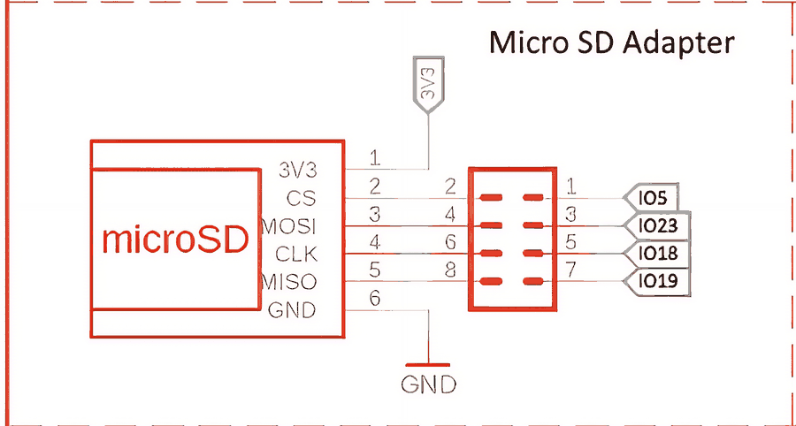
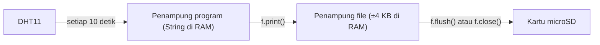
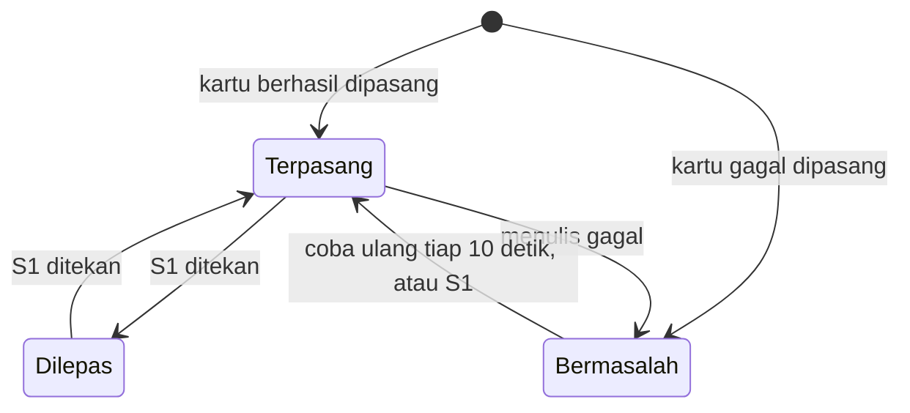

# BAB 41: MicroSD Card — Data Logging

> ✅ **Prasyarat:** Selesaikan **BAB 24 (SPI — Serial Peripheral Interface)** — kartu microSD-mu sudah berhasil terbaca di Program 1 BAB 24 — dan **BAB 40 (SPIFFS / LittleFS)** — kamu sudah bisa membuka, menulis, dan membaca *file*. Program di BAB ini juga memakai `struct Timer` dari **BAB 16 (Non-Blocking Programming)**, sensor dari **BAB 26 (DHT11 — Suhu & Kelembapan)**, dan *debounce* tombol dari **BAB 9 (Digital Input — Push Button)**.

Bayangkan petugas yang setiap jam mencatat angka meteran air di buku catatan, lengkap dengan jamnya. Setelah sebulan, buku itu bisa dibawa ke kantor dan diolah menjadi grafik pemakaian. ESP32 bisa melakukan pekerjaan yang sama tanpa pernah lelah: membaca sensor secara berkala, lalu mencatat hasilnya ke kartu microSD. Alat seperti ini disebut ***data logger*** (pencatat data). Di BAB ini kamu belajar membuat *data logger* yang benar: *file* CSV yang langsung bisa dibuka di Excel atau Google Sheets, data yang tidak hilang saat kartu dicabut, dan *file* yang tidak membengkak tanpa batas.

## 📌 Tujuan Pembelajaran

Setelah mempelajari BAB ini, kamu bisa:

- Menjelaskan apa itu *data logger* dan kapan kartu microSD lebih cocok daripada NVS atau LittleFS.
- Memasang kartu dengan `SD.begin()` dan memakai fungsi *file* yang sama dengan LittleFS, termasuk perbedaannya di sistem *file* FAT.
- Merancang *file* log CSV: baris judul, cap waktu (*timestamp*), dan pemisah kolom yang cocok untuk Excel berbahasa Indonesia.
- Menjelaskan kapan data benar-benar tersimpan di kartu (`flush()` dan `close()`), data apa yang hilang saat listrik padam, dan seberapa sering sebaiknya menulis ke kartu.
- Membuat *data logger* DHT11 yang non-blocking dengan `struct Timer`.
- Mengeluarkan kartu dengan aman, lalu membuka datanya di Excel atau Google Sheets.
- Membuat *logger* yang tahan gangguan: rotasi *file* per ukuran atau per hari, tombol "lepas kartu", dan pemasangan ulang otomatis saat kartu hilang.
- Menyimpan pengaturan di *file* JSON memakai *library* ArduinoJson, dengan cara menyimpan yang aman.

## 🧰 Yang Perlu Disiapkan

| Kebutuhan | Keterangan |
|---|---|
| *Hardware* | Kit Bluino ESP32 IoT Starter Shield + kabel USB **data** |
| Kabel *jumper* | Program 1 dan 4: tidak perlu. Program 2: 1 kabel *female-female* (`DHT` → IO27). Program 3: 4 kabel (`DHT` → IO27, `SW1` → IO15, `LED1` → IO4, `LED2` → IO17). Adaptor microSD sudah tersambung lewat *jumper cap* |
| Komponen tambahan | **Kartu microSD** (tidak termasuk kit): microSDHC 4–32 GB berformat FAT32 (lihat [BAB 24 bagian 24.3.3](../BAB-24/README.md#2433-memilih-dan-menyiapkan-kartu-microsd)). **Pembaca kartu** (*card reader*) USB atau adaptor SD supaya kartu bisa dibaca di laptop |
| *Software* | Arduino IDE 2.x + *board package* **esp32** versi 3.3.x (lihat [BAB 5](../BAB-05/README.md)); untuk membuka data: Microsoft Excel, Google Sheets (lewat *browser*), atau LibreOffice Calc, ditambah Notepad (Windows) atau TextEdit (macOS) |
| *Library* | `SD`, `SPI`, dan `FS` sudah termasuk *board package* esp32. Program 2–3: **DHT sensor library** (Adafruit) + **Adafruit Unified Sensor**. Program 4: **ArduinoJson** versi 7 (Benoit Blanchon). Cara memasangnya ada di setiap program |
| Alat uji | **Serial Monitor** Arduino IDE (baud 115200); Program 4 juga memakai kolom kirim pesan Serial Monitor dengan *line ending* **New Line** |
| Jaringan | Tidak perlu WiFi. Internet hanya untuk mengunduh *library* dan membuka Google Sheets |

## 📑 Daftar Isi

- [41.1 Apa Itu Data Logger?](#411-apa-itu-data-logger)
- [41.2 Kartu microSD di Kit](#412-kartu-microsd-di-kit)
- [41.3 Fungsi File di Kartu SD](#413-fungsi-file-di-kartu-sd)
- [41.4 Program 1: Halo microSD](#414-program-1-halo-microsd)
- [41.5 Merancang File Log CSV](#415-merancang-file-log-csv)
- [41.6 Program 2: Data Logger CSV Sederhana](#416-program-2-data-logger-csv-sederhana)
- [41.7 Membuka Data di Laptop](#417-membuka-data-di-laptop)
- [41.8 Logger yang Tahan Gangguan](#418-logger-yang-tahan-gangguan)
- [41.9 Program 3: Data Logger Tangguh](#419-program-3-data-logger-tangguh)
- [41.10 Program 4: File Pengaturan JSON](#4110-program-4-file-pengaturan-json)
- [41.11 Troubleshooting](#4111-troubleshooting)
- [📝 Rangkuman](#-rangkuman)
- [💪 Latihan](#-latihan)
- [📚 Referensi](#-referensi)

---

## 41.1 Apa Itu Data Logger?

***Data logger*** adalah alat yang mengukur sesuatu secara berkala, lalu menyimpan setiap hasil pengukurannya beserta waktunya. Contohnya ada di mana-mana: pencatat suhu di gudang vaksin, stasiun cuaca, alat ukur di kebun atau kolam ikan, sampai *black box* di pesawat. Pola kerjanya selalu sama:

1. **Ukur** — baca sensor.
2. **Beri cap waktu** — catat kapan pengukuran dilakukan.
3. **Simpan** — tulis ke tempat yang tidak hilang saat listrik padam.
4. **Ulangi** — terus-menerus, berhari-hari atau berbulan-bulan.

*Data logger* yang baik punya tiga sifat: **datanya lengkap** (tidak ada yang hilang saat kartu dicabut atau listrik padam), **datanya mudah diolah** (langsung bisa dibuka di Excel), dan **bisa berjalan lama tanpa diawasi** (*file* tidak membengkak, kartu tetap awet). Ketiga sifat ini akan kamu bangun satu per satu di BAB ini.

### 41.1.1 NVS, LittleFS, atau microSD?

Di BAB 39 dan BAB 40 kamu sudah mengenal dua tempat penyimpanan di dalam ESP32. Kartu microSD melengkapi keduanya:

| | NVS ([BAB 39](../BAB-39/README.md)) | LittleFS ([BAB 40](../BAB-40/README.md)) | Kartu microSD (BAB ini) |
|---|---|---|---|
| Bentuk data | Pasangan kunci–nilai | *File* dan folder | *File* dan folder (sistem *file* FAT32) |
| Tempat dan kapasitas | Partisi `nvs` 20 KB di *flash* | Partisi `spiffs` ±1,4 MB (1408 KB) di *flash* | Kartu microSD, beberapa GB |
| Perlu dibeli terpisah? | Tidak | Tidak | Ya, kartunya (adaptornya sudah ada di kit) |
| Dibaca di laptop | Tidak bisa | Tidak langsung (lewat Serial Monitor atau *plugin*) | Bisa — cabut kartunya, colokkan ke laptop |
| Kalau listrik padam saat menulis | Data lama tetap utuh | Sistem *file* tetap utuh | Sistem *file* FAT **bisa rusak** (jarang, tetapi mungkin) — lihat [41.5.4](#4154-kapan-data-benar-benar-tersimpan) |
| Cocok untuk | Pengaturan kecil, penghitung | Log kecil–sedang, *file* konfigurasi, halaman web | Log besar dan berbulan-bulan, data yang akan diolah di komputer |

Seberapa besar bedanya? Satu baris log seperti `86400,28.4,70,ok` panjangnya sekitar 18 *byte*. Kalau dicatat setiap 10 detik, sehari ada 8.640 baris ≈ 152 KB. Dengan laju itu:

- LittleFS (1408 KB) penuh dalam ±9 hari.
- Kartu microSDHC 8 GB secara hitungan cukup untuk lebih dari 100 tahun.

Jadi di kartu microSD, yang membatasi *logger*-mu bukan lagi kapasitas, melainkan hal lain: *file* yang terlalu besar untuk dibuka (Excel hanya sanggup 1.048.576 baris per lembar, dan satu *file* di FAT32 maksimal 4 GB), keawetan kartu, dan keamanan data saat kartu dicabut atau listrik padam. Semuanya dibahas di BAB ini.

---

## 41.2 Kartu microSD di Kit

Adaptor microSD di kit sudah dibahas lengkap di [BAB 24](../BAB-24/README.md#2432-adaptor-microsd-di-kit). Ringkasnya:



*Gambar 41.1 — Rangkaian adaptor microSD di kit. Setiap pasangan pin di kotak merah adalah tempat satu jumper cap. Sumber: skematik ESP32 Starter Shield 3.2, [Bluino](http://www.bluino.com).*

| Label di blok *jumper cap* **JP** | Jalur SPI | Pin ESP32 |
|---|---|---|
| `CS` | *Chip Select* (pemilih kartu) | IO5 |
| `MOSI` | Data ESP32 → kartu | IO23 |
| `CLK` | Detak (*clock*) | IO18 |
| `MISO` | Data kartu → ESP32 | IO19 |

Hal-hal yang perlu diingat:

- Kartu memakai bus **VSPI** (pengendali SPI3) — bus yang sama dengan objek `SPI` bawaan Arduino-ESP32. Pin-pin di atas adalah pin bawaan bus itu, jadi *library* `SD` langsung cocok.
- Keempat *jumper cap* microSD harus terpasang. Jangan colokkan kabel *jumper* komponen lain ke label `5`, `18`, `19`, dan `23` di deretan pin ESP32.
- Adaptor mendapat daya **3,3 V** dari jalur PCB, sama dengan level sinyal ESP32.
- Slot microSD di kit **tidak punya jalur pendeteksi kartu** (*card detect*) ke ESP32. Program baru tahu kartu hilang saat gagal membaca atau menulis — hal ini penting di Program 3.
- Kartu microSD **tidak termasuk kit**. Pakai microSDHC 4–32 GB berformat **FAT32**; kartu exFAT (biasanya 64 GB ke atas) dan NTFS tidak bisa dipakai. Cara memilih dan memformat kartu ada di [BAB 24 bagian 24.3.3](../BAB-24/README.md#2433-memilih-dan-menyiapkan-kartu-microsd).
- Masukkan dan cabut kartu saat **USB tercabut**. Kartu yang dimasukkan saat ESP32 menyala bisa menarik arus besar sesaat sehingga ESP32 me-*reset*. Satu-satunya pengecualian adalah mencabut kartu setelah "dilepas" dengan tombol di Program 3.

> 💡 **Tips:** Sebelum mulai, jalankan dulu [Program 1 BAB 24](../BAB-24/README.md#244-program-1-info-kartu-microsd). Kalau program itu menampilkan `Kartu berhasil dipasang.`, berarti kartu, format, dan *jumper cap*-mu sudah benar, dan semua program di BAB ini siap dicoba.

---

## 41.3 Fungsi File di Kartu SD

Kabar baiknya: *library* `SD` memakai **fungsi *file* yang sama persis** dengan LittleFS. Keduanya turunan dari kelas `FS` di *board package* esp32. Semua yang kamu pelajari di [BAB 40 bagian 40.4](../BAB-40/README.md#404-mount-format-dan-fungsi-dasar) — mode `FILE_READ`/`FILE_WRITE`/`FILE_APPEND`, `print()`, `readStringUntil()`, `openNextFile()`, `close()` — berlaku di sini. Bedanya hanya awalan `SD.` sebagai ganti `LittleFS.`, cara memasang kartunya, dan beberapa sifat sistem *file* FAT.

### 41.3.1 Memasang Kartu dengan SD.begin()

Seperti LittleFS, kartu harus **dipasang** (*mount*) dulu sebelum *file*-nya bisa dibuka. Di esp32 core 3.3.12, bentuk lengkap fungsinya:

```cpp
bool begin(uint8_t ssPin = SS, SPIClass &spi = SPI, uint32_t frequency = 4000000,
           const char *mountpoint = "/sd", uint8_t max_files = 5, bool format_if_empty = false);
```

| Parameter | Nilai bawaan | Artinya |
|---|---|---|
| `ssPin` | `SS` (IO5) | Pin CS kartu |
| `spi` | `SPI` (bus VSPI) | Bus SPI yang dipakai |
| `frequency` | `4000000` (4 MHz) | Kecepatan *clock* saat membaca/menulis data. Permintaan di atas 25 MHz dipotong *library* menjadi 25 MHz, dan ESP32 membulatkannya ke bawah menjadi 20 MHz — jadi kecepatan tertinggi yang benar-benar dipakai adalah 20 MHz (lihat [BAB 24 Program 3](../BAB-24/README.md#248-program-3-pengaruh-kecepatan-clock-spi)). Untuk *data logger*, 4 MHz sudah lebih dari cukup |
| `mountpoint` | `"/sd"` | Awalan *path* untuk fungsi C standar. Jarang perlu diubah |
| `max_files` | `5` | Jumlah *file* yang boleh terbuka **bersamaan** |
| `format_if_empty` | `false` | Kalau `true` dan kartu tidak berformat FAT, kartu **langsung diformat** |

Di BAB ini kartu selalu dipasang dengan pola yang sama seperti BAB 24:

```cpp
SPI.begin(18, 19, 23);            // mulai bus SPI; urutan: SCK, MISO, MOSI
if (!SD.begin(5, SPI, 4000000)) { // pin CS, bus, kecepatan 4 MHz
  Serial.println("Kartu gagal dipasang!");
}
```

> ⚠️ **Perhatian:** Jangan pernah mengisi parameter keenam dengan `true`. Berbeda dengan `LittleFS.begin(true)` yang hanya memformat partisi di dalam ESP32, `SD.begin(..., true)` memformat **kartu**. Kalau seseorang memasukkan kartu exFAT berisi foto liburan, semua fotonya hilang tanpa peringatan. Format kartu di laptop saja.

Pasangan `SD.begin()` adalah `SD.end()`, yang **melepas** (*unmount*) kartu — sama seperti **Eject** di laptop. Setelah `SD.end()`, kartu tidak dipakai lagi oleh program. Tutup dulu semua *file* sebelum memanggilnya.

### 41.3.2 Sama dengan LittleFS, tetapi Sistem File-nya FAT

Kartu memakai sistem *file* **FAT32** supaya bisa dibaca semua laptop. Akibatnya ada beberapa perbedaan dengan LittleFS:

| Hal | LittleFS ([BAB 40](../BAB-40/README.md)) | Kartu SD (FAT32) |
|---|---|---|
| Memasang | `LittleFS.begin(true)` | `SPI.begin(18, 19, 23)` lalu `SD.begin(5, SPI, 4000000)` |
| `FILE_WRITE` (`"w"`) pada *file* yang sudah ada | Isi lama dibuang, ditulis dari awal | **Sama:** isi lama dibuang |
| Huruf besar dan kecil di nama *file* | Dibedakan | **Tidak dibedakan**: `/Data.csv` dan `/data.csv` adalah *file* yang sama |
| Nama *file* | Pendek, tanpa spasi | Boleh panjang (sampai 255 karakter), tetapi tetap pakai nama pendek tanpa spasi. Karakter `\ / : * ? " < > \|` dilarang |
| `rename(lama, baru)` kalau `baru` sudah ada | `baru` ditimpa | **Gagal** — hapus dulu *file* tujuannya |
| Menghapus atau mengganti nama *file* yang masih terbuka | Ditolak | **Tidak dicegah**, dan bisa merusak isi kartu. Selalu `close()` dulu |
| Listrik padam saat menulis | Sistem *file* tetap utuh | Struktur FAT bisa rusak ([41.5.4](#4154-kapan-data-benar-benar-tersimpan)) |
| `totalBytes()` / `usedBytes()` | Tipe `size_t` | Tipe `uint64_t` (kartu bisa lebih dari 4 GB). Panggilan pertama di kartu besar bisa makan waktu beberapa detik |
| Tanggal *file* di laptop | — | Tertulis **1 Januari 1980**, karena ESP32 belum tahu tanggal hari ini (lihat [41.5.2](#4152-cap-waktu-tanpa-jam)) |

Hal yang tidak berubah: *path* selalu diawali `/`, folder harus dibuat dulu dengan `SD.mkdir()` sebelum diisi *file*, dan setiap *file* yang dibuka harus ditutup dengan `close()`.

Fungsi milik `SD` yang paling sering dipakai:

| Fungsi | Kegunaan | Hasil |
|---|---|---|
| `SD.begin(cs, SPI, kecepatan)` | Memasang kartu | `true` kalau berhasil |
| `SD.end()` | Melepas kartu | — |
| `SD.open(path, mode)` | Membuka *file* (`FILE_READ`, `FILE_WRITE`, `FILE_APPEND`) atau folder | Objek `File` |
| `SD.exists(path)` | Apakah *file*/folder ada? | `true`/`false` |
| `SD.remove(path)` | Menghapus *file* | `true` kalau berhasil |
| `SD.rename(lama, baru)` | Mengganti nama atau memindah *file* | `true` kalau berhasil |
| `SD.mkdir(path)` / `SD.rmdir(path)` | Membuat folder / menghapus folder kosong | `true` kalau berhasil (`mkdir` juga `true` kalau folder sudah ada) |
| `SD.cardType()`, `SD.cardSize()` | Jenis dan kapasitas kartu ([BAB 24](../BAB-24/README.md#244-program-1-info-kartu-microsd)) | — |
| `SD.totalBytes()`, `SD.usedBytes()` | Ukuran partisi dan ruang terpakai | *Byte* (`uint64_t`) |

Fungsi objek `File` (`print()`, `printf()`, `write()`, `read()`, `available()`, `readStringUntil()`, `size()`, `name()`, `path()`, `flush()`, `close()`) sama dengan tabel di [BAB 40 bagian 40.4.3](../BAB-40/README.md#4043-daftar-fungsi-penting).

---

## 41.4 Program 1: Halo microSD

**Tujuan:** Mencoba tiga mode *file* di kartu. Program menulis ulang `/halo.txt` (mode `FILE_WRITE`), menambah satu baris ke `/riwayat.txt` (mode `FILE_APPEND`) setiap kali ESP32 menyala, membaca keduanya (mode `FILE_READ`), lalu menampilkan isi folder utama kartu. Setelah itu kamu membuka kedua *file* itu di laptop.

**Rangkaian:**

*Tidak perlu merangkai — adaptor microSD sudah tersambung lewat* jumper cap *di kit. Pastikan keempat* jumper cap *microSD terpasang dan kartu sudah dimasukkan (saat USB tercabut).*

**Cara Menjalankan:**

1. Cabut USB, masukkan kartu microSD berformat FAT32 ke *slot* kit, lalu sambungkan USB lagi.
2. Buka Arduino IDE → **File → New Sketch**, hapus isinya, lalu salin kode di bawah. Kode yang sama juga tersedia di *file* [`p1_halo_microsd.ino`](p1_halo_microsd/p1_halo_microsd.ino).
3. Pastikan **Tools → Board** = **ESP32 Dev Module** dan **Tools → Port** = *port* ESP32 kamu (misalnya `COM5` di Windows atau `/dev/ttyUSB0` di Linux).
4. Klik tombol **Upload** (ikon panah →) dan tunggu sampai muncul tulisan **Done uploading**.
5. Buka **Serial Monitor** (**Tools → Serial Monitor**) lalu pilih baud **115200**.
6. Tekan tombol **EN** di *board* dua kali (tunggu tulisan `Selesai.` di antaranya). Perhatikan isi `/riwayat.txt` bertambah satu baris setiap kali.

**Kode Program:**

<!-- sketch: p1_halo_microsd -->
```cpp
/*
 * BAB 41 - Program 1: Halo microSD
 * - Menulis ulang /halo.txt (mode FILE_WRITE)
 * - Menambah satu baris ke /riwayat.txt setiap kali ESP32 menyala (FILE_APPEND)
 * - Membaca dan menampilkan kedua file (FILE_READ)
 * - Menampilkan isi folder utama kartu
 *
 * Rangkaian: tidak perlu kabel. Adaptor microSD tersambung ke
 * CS = IO5, MOSI = IO23, CLK = IO18, MISO = IO19 lewat jumper cap di kit.
 */

#include <SPI.h>
#include <SD.h>

#define PIN_SCK  18  // CLK
#define PIN_MISO 19
#define PIN_MOSI 23
#define PIN_CS   5

const uint32_t KECEPATAN_SPI = 4000000;  // 4 MHz, sama dengan bawaan library SD

// Menghitung jumlah baris sebuah file (0 kalau file belum ada)
int hitungBaris(const char *path) {
  File f = SD.open(path, FILE_READ);
  if (!f) {
    return 0;
  }
  int jumlah = 0;
  while (f.available()) {
    if (f.read() == '\n') {
      jumlah = jumlah + 1;
    }
  }
  f.close();
  return jumlah;
}

// Menampilkan seluruh isi sebuah file ke Serial Monitor
void tampilkanFile(const char *path) {
  File f = SD.open(path, FILE_READ);
  if (!f) {
    Serial.printf("Gagal membuka %s\n", path);
    return;
  }
  Serial.printf("--- Isi %s (%u byte) ---\n", path, (unsigned)f.size());
  while (f.available()) {
    Serial.write(f.read());
  }
  f.close();
  Serial.println("--- selesai ---");
}

// Menampilkan daftar file dan folder di folder utama ("/") kartu
void tampilkanFolderUtama() {
  File folder = SD.open("/");
  if (!folder) {
    Serial.println("Folder utama tidak bisa dibuka.");
    return;
  }
  Serial.println("Isi folder utama kartu:");
  File item = folder.openNextFile();
  while (item) {
    if (item.isDirectory()) {
      Serial.printf("  [FOLDER] %s\n", item.name());
    } else {
      Serial.printf("  [FILE]   %s (%u byte)\n", item.name(), (unsigned)item.size());
    }
    item.close();
    item = folder.openNextFile();
  }
  folder.close();
}

void setup() {
  Serial.begin(115200);
  delay(1000);  // beri waktu Serial Monitor tersambung
  Serial.println();
  Serial.println("BAB 41 - Program 1: Halo microSD");

  SPI.begin(PIN_SCK, PIN_MISO, PIN_MOSI);  // urutan: SCK, MISO, MOSI
  if (!SD.begin(PIN_CS, SPI, KECEPATAN_SPI)) {
    Serial.println("Kartu gagal dipasang!");
    Serial.println("Periksa kartu, format FAT32, dan jumper cap MISO/CLK/MOSI/CS.");
    return;
  }
  Serial.println("Kartu berhasil dipasang.");

  // 1. FILE_WRITE: isi lama dibuang, file ditulis dari awal
  File f = SD.open("/halo.txt", FILE_WRITE);
  if (f) {
    f.println("Halo dari ESP32!");
    f.println("File ini ditulis ulang setiap kali ESP32 menyala.");
    f.close();  // data benar-benar dikirim ke kartu saat close()
  } else {
    Serial.println("Gagal menulis /halo.txt");
  }

  // 2. FILE_APPEND: isi lama tetap, baris baru ditambahkan di akhir
  int nyalaKe = hitungBaris("/riwayat.txt") + 1;
  f = SD.open("/riwayat.txt", FILE_APPEND);
  if (f) {
    f.printf("ESP32 menyala ke-%d\r\n", nyalaKe);
    f.close();
  } else {
    Serial.println("Gagal menambah /riwayat.txt");
  }

  // 3. FILE_READ: baca dan tampilkan
  tampilkanFile("/halo.txt");
  tampilkanFile("/riwayat.txt");
  tampilkanFolderUtama();

  SD.end();  // lepas kartu: semua file sudah ditutup
  Serial.println("Selesai. Kartu sudah dilepas. Tekan EN untuk mengulang.");
}

void loop() {
  // Semua pekerjaan sudah dijalankan sekali di setup().
}
```

**Penjelasan Kode:**

- **Memasang kartu.** `SPI.begin()` lalu `SD.begin()` sama persis dengan BAB 24. Kalau gagal, program berhenti di `return` dan tidak menyentuh kartu sama sekali.
- **`FILE_WRITE`** membuat `/halo.txt` kalau belum ada, dan **membuang isi lamanya** kalau sudah ada. Karena itu *file* ini selalu berisi dua baris, berapa kali pun ESP32 dinyalakan. `println()` mengakhiri setiap baris dengan dua karakter `\r\n` (*carriage return* + *line feed*), akhiran baris yang dipakai Windows.
- **`FILE_APPEND`** membuka `/riwayat.txt` dan menambahkan tulisan di akhir *file*, jadi isinya terus bertambah. Nomor `nyalaKe` dihitung dari jumlah baris yang sudah ada: `hitungBaris()` membaca *file* *byte* demi *byte* dan menghitung karakter `'\n'`. Baris barunya ditulis dengan `printf()` dan diakhiri `\r\n` juga, supaya sama dengan baris dari `println()`.
- **`close()`** dipanggil tepat setelah selesai menulis. Selama *file* masih terbuka, tulisanmu bisa masih tertahan di RAM; `close()` memastikan semuanya terkirim ke kartu. Detailnya di [41.5.4](#4154-kapan-data-benar-benar-tersimpan).
- **`tampilkanFile()`** membuka *file* dengan `FILE_READ`, menampilkan ukurannya dengan `size()`, lalu menyalin isinya ke Serial Monitor dengan `Serial.write()`.
- **`tampilkanFolderUtama()`** sama dengan fungsi di BAB 24: `openNextFile()` mengambil isi folder satu per satu sampai habis.
- **`SD.end()`** di akhir melepas kartu. Ini kebiasaan baik sebelum kartu dicabut, walaupun di program ini kamu tetap mencabut USB dulu.

**Contoh Output:**

Setelah tombol **EN** ditekan dua kali (ESP32 menyala untuk ketiga kalinya). Folder `System Volume Information` hanya muncul kalau kartu pernah dipasang di laptop Windows, dan daftar isi kartumu bisa berbeda.

```text
BAB 41 - Program 1: Halo microSD
Kartu berhasil dipasang.
--- Isi /halo.txt (69 byte) ---
Halo dari ESP32!
File ini ditulis ulang setiap kali ESP32 menyala.
--- selesai ---
--- Isi /riwayat.txt (60 byte) ---
ESP32 menyala ke-1
ESP32 menyala ke-2
ESP32 menyala ke-3
--- selesai ---
Isi folder utama kartu:
  [FOLDER] System Volume Information
  [FILE]   halo.txt (69 byte)
  [FILE]   riwayat.txt (60 byte)
Selesai. Kartu sudah dilepas. Tekan EN untuk mengulang.
```

Ukuran `/halo.txt` tetap 69 *byte* setiap kali, sedangkan `/riwayat.txt` bertambah 20 *byte* (satu baris) setiap kali ESP32 menyala. Di kit tidak ada lampu atau bunyi apa pun; semua hasil terlihat di Serial Monitor.

Sekarang buktikan bahwa *file* ini bisa dibaca di laptop:

1. Cabut USB dari ESP32 (program sudah selesai dan kartu sudah dilepas), lalu cabut kartu dari *slot*.
2. Masukkan kartu ke laptop lewat *card reader*. Kartu muncul sebagai *drive* baru di **File Explorer** (Windows) atau **Finder** (macOS).
3. Klik dua kali `riwayat.txt` — *file* terbuka di Notepad atau TextEdit dan berisi baris yang sama dengan di Serial Monitor.
4. Keluarkan kartu dari laptop dengan aman (cara lengkapnya di [41.7.4](#4174-mengembalikan-kartu-ke-kit)), lalu masukkan kembali ke kit saat USB tercabut.

> 🧪 **Coba Sendiri:** Di laptop, tambahkan satu baris `Ditulis dari laptop` di akhir `riwayat.txt`, **tekan Enter** di akhir baris itu, simpan, kembalikan kartu ke kit, lalu nyalakan ESP32. Baris tulisanmu ikut tampil, dan nomor "menyala ke-" melompat satu karena baris tambahanmu ikut terhitung. (Kalau Enter lupa ditekan, baris berikutnya dari ESP32 akan menempel di belakang tulisanmu.)

**Kalau Belum Berhasil:**

- **`Kartu gagal dipasang!`** → kartu belum masuk penuh, formatnya bukan FAT32, atau *jumper cap* microSD longgar. Jalankan [Program 1 BAB 24](../BAB-24/README.md#244-program-1-info-kartu-microsd) dan ikuti langkah perbaikannya.
- **Nomor "menyala ke-" tidak bertambah satu-satu** → tombol **EN** ditekan saat program sedang menulis, atau isi `riwayat.txt` diubah di laptop. Tidak berbahaya; nomornya hanya hasil menghitung baris.
- **`Gagal menulis /halo.txt`** padahal kartu terpasang → kartu terkunci (*write-protect*) atau rusak. Coba kartu lain. Kalau kamu memakai adaptor SD besar di laptop, pastikan sakelar kecil di sisinya tidak di posisi **LOCK**.

---

## 41.5 Merancang File Log CSV

Sebelum menulis program *logger*, rancang dulu *file*-nya. *File* log yang dirancang dengan baik bisa langsung dibuka di Excel tanpa dirapikan, tetap terbaca walaupun sensornya sesekali gagal, dan tidak kehilangan banyak data saat listrik padam.

### 41.5.1 Format CSV dan Baris Judul

Seperti di [BAB 40](../BAB-40/README.md#409-program-3-pencatat-suhu-ke-file-csv), data disimpan dalam format **CSV** (*Comma-Separated Values*): tabel berbentuk teks, satu baris per pengukuran, nilai-nilainya dipisah koma. Contoh *file* log yang baik:

```text
detik,suhu_C,kelembapan_persen,status
10,28.4,70,ok
20,28.5,70,ok
30,,,gagal
40,28.5,69,ok
```

Aturan yang dipakai di BAB ini:

1. **Baris pertama berisi judul kolom**, ditulis sekali saja saat *file* baru dibuat. Satuan dimasukkan ke nama kolom (`suhu_C`, `kelembapan_persen`), tanpa spasi dan tanpa simbol seperti `°`, supaya aman dibaca program apa pun.
2. **Satu baris = satu pengukuran**, dan jumlah kolomnya selalu sama.
3. **Pengukuran yang gagal tetap dicatat**: kolom nilainya dikosongkan dan kolom `status` diisi `gagal`. Jangan diisi `0`, karena 0 °C terlihat seperti suhu sungguhan. Sel kosong akan dilewati Excel saat membuat grafik.
4. **Nilai tidak boleh mengandung tanda pemisah kolom.** Kalau pemisahnya koma, jangan ada koma di dalam nilai (misalnya nama lokasi "Kebun, Blok A").
5. **Setiap baris diakhiri `\r\n`**, akhiran baris yang dipakai Windows, supaya rapi di Notepad maupun Excel.

### 41.5.2 Cap Waktu tanpa Jam

Setiap pengukuran butuh **cap waktu** (*timestamp*). Masalahnya, ESP32 tidak punya jam yang tahu tanggal hari ini — tidak ada baterai jam seperti di laptop. Yang ESP32 tahu hanyalah **sudah berapa lama ia menyala**. Jadi di BAB ini kolom pertama berisi **detik sejak ESP32 menyala**.

Kenapa tidak memakai `millis() / 1000` seperti di BAB 40? Karena `millis()` kembali ke 0 setelah ±49,7 hari (*rollover*, lihat [BAB 16](../BAB-16/README.md#1616-rollover-kenapa-rumus-selisih-selalu-benar)). Untuk mengatur jadwal hal itu tidak masalah, karena rumus selisih `sekarang - waktuLalu` tetap benar. Tetapi untuk **angka yang ditulis ke log**, lompatan ke 0 akan terlihat seperti ESP32 baru menyala. *Logger* yang dirancang berjalan berbulan-bulan sebaiknya memakai `esp_timer_get_time()`, pewaktu 64 bit dalam mikrodetik yang baru kembali ke 0 setelah ratusan ribu tahun:

```cpp
#include <esp_timer.h>

unsigned long long detik = esp_timer_get_time() / 1000000ULL;  // detik sejak ESP32 menyala
Serial.printf("%llu\n", detik);  // %llu = format untuk unsigned long long
```

Hal yang perlu kamu ketahui tentang cap waktu ini:

- **Hitungannya mulai dari 0 lagi setiap kali ESP32 menyala.** Di Program 2, angka `detik` yang tiba-tiba mengecil menandai ESP32 baru saja menyala ulang. Program 3 memulai *file* baru setiap kali menyala, jadi angka `detik` di dalam satu *file* tidak pernah mundur.
- **Bisa diubah menjadi jam sungguhan di Excel.** Kalau kamu mencatat kapan *logger* dinyalakan (misalnya 24/10/2026 08.00), tulis waktu itu di sel `F1`, lalu di sel `E2` ketik `=$F$1+A2/86400` dan salin rumusnya ke bawah. Excel menyimpan waktu dalam satuan hari, dan satu hari = 86.400 detik. Terakhir, ubah format sel kolom E menjadi tanggal dan jam (**klik kanan → Format Cells**).
- **Tanggal *file* di laptop tertulis 1 Januari 1980.** Sistem *file* FAT juga mencatat kapan *file* diubah, dan karena ESP32 belum tahu tanggal, yang tercatat adalah tanggal paling awal yang bisa disimpan FAT. Abaikan saja.

> 📌 **Catatan:** Untuk tanggal dan jam sungguhan (misalnya kolom `2026-10-24 08:15:30`), ESP32 perlu sumber waktu. Ada dua pilihan: mengambil waktu dari internet dengan **NTP** (*Network Time Protocol*) setelah ESP32 tersambung ke WiFi — caranya dibahas di [BAB 42 bagian 42.10](../BAB-42/README.md#4210-waktu-dari-internet-ntp-dan-zona-waktu-indonesia) — atau memasang modul jam **RTC** (*Real-Time Clock*) berbaterai seperti DS3231 (tidak termasuk kit). Begitu jamnya diketahui, tanggal *file* di laptop juga ikut benar.

### 41.5.3 Koma atau Titik Koma?

CSV yang "standar" memakai **koma** sebagai pemisah kolom dan **titik** sebagai tanda desimal (`28.4`). Format ini langsung dikenali Google Sheets, LibreOffice, Python, dan Excel dengan pengaturan wilayah Inggris/Amerika.

Masalahnya, Windows dengan pengaturan wilayah (*regional format*) **Indonesia** memakai **koma sebagai tanda desimal** (28,4) dan **titik koma sebagai pemisah daftar**. Kalau *file* CSV standar dibuka dengan klik dua kali di Excel seperti itu, hasilnya kacau: semua data menumpuk di kolom A, atau angka `28.4` berubah menjadi tanggal (28 April) atau angka 284.

Ada dua jalan keluar, dan program di BAB ini mendukung keduanya lewat satu konstanta:

| Pilihan | Contoh isi *file* | Cocok untuk |
|---|---|---|
| `FORMAT_INDONESIA = false` (bawaan) — koma + titik desimal | `10,28.4,70,ok` | Google Sheets, LibreOffice, Python, Excel berwilayah Inggris/Amerika. Excel berwilayah Indonesia tetap bisa, lewat menu impor ([41.7.2](#4172-membuka-di-excel)) |
| `FORMAT_INDONESIA = true` — titik koma + koma desimal | `10;28,4;70;ok` | Excel berwilayah Indonesia: cukup klik dua kali *file*-nya |

Cara cepat mengetahui Excel-mu memakai format yang mana: buka Excel, ketik `1,5` di sebuah sel, lalu tekan Enter. Kalau angkanya rata kanan (dianggap angka), Excel-mu memakai **koma desimal** → pilih `FORMAT_INDONESIA = true`. Kalau rata kiri (dianggap teks), pilih `false`. Pengaturannya sendiri ada di Windows: **Settings → Time & language → Language & region → Regional format**.

Pengubahnya cukup satu fungsi kecil yang dijalankan pada setiap baris sebelum ditulis:

```cpp
// koma (pemisah kolom) -> titik koma, titik (desimal) -> koma
void sesuaikanFormat(char *baris) {
  if (!FORMAT_INDONESIA) {
    return;
  }
  for (int i = 0; baris[i] != '\0'; i++) {
    if (baris[i] == ',') {
      baris[i] = ';';
    } else if (baris[i] == '.') {
      baris[i] = ',';
    }
  }
}
```

Setiap karakter hanya diperiksa sekali, jadi titik yang baru diubah menjadi koma tidak ikut berubah lagi menjadi titik koma.

> ⚠️ **Perhatian:** Jangan mencampur dua format di satu *file*. Kalau kamu mengganti `FORMAT_INDONESIA` di tengah jalan, hapus atau ganti nama *file* log lama dulu, supaya baris judul dan baris datanya memakai pemisah yang sama.

### 41.5.4 Kapan Data Benar-Benar Tersimpan?

Saat program memanggil `f.print()`, data **belum** tentu sampai di kartu. Data melewati tiga tempat:



*Gambar 41.2 — Perjalanan data dari sensor ke kartu. Selama data masih di RAM, data itu hilang kalau listrik padam. Sumber: dibuat untuk materi ini.*

1. **Penampung program** — variabel `String` di programmu yang mengumpulkan beberapa baris dulu, supaya kartu tidak ditulis terlalu sering.
2. **Penampung *file*** — setiap *file* yang terbuka punya penampung sekitar 4 KB di RAM milik sistem. `print()` hanya menaruh data di sini. Begitu penampung ini penuh, isinya baru dikirim ke kartu.
3. **Kartu** — `flush()` memaksa isi penampung *file* dikirim ke kartu **dan** memperbarui catatan ukuran *file* di daftar isi kartu. `close()` melakukan hal yang sama, lalu menutup *file*.

Jadi, apa yang terjadi kalau listrik padam (atau kartu dicabut) di setiap tahap?

| Data berada di | Kalau listrik padam atau kartu dicabut |
|---|---|
| Penampung program (belum di-`print()`) | **Hilang** |
| Sudah di-`print()`, tetapi belum `flush()`/`close()` | Hampir pasti **hilang**. Walaupun sebagian sudah sampai di kartu, catatan ukuran *file* belum diperbarui, sehingga datanya tidak terlihat |
| Sedang dikirim ke kartu (beberapa milidetik) | Kiriman itu bisa hilang. Jarang terjadi, tetapi struktur FAT juga bisa rusak: *file* yang baru dibuat hilang, atau tambahan datanya batal |
| Sesudah `flush()` atau `close()` selesai | **Aman** |

Inilah perbedaan penting dengan LittleFS. LittleFS dirancang tahan listrik padam ([BAB 40 bagian 40.8.3](../BAB-40/README.md#4083-kalau-listrik-padam-saat-menulis)), sedangkan FAT tidak. Pembuat FatFs — pustaka FAT yang dipakai ESP32 — menyarankan dua hal: **buka *file* untuk menulis sesingkat mungkin**, atau panggil `flush()` secara teratur kalau *file* harus terus terbuka. Program di BAB ini memakai cara pertama: setiap kali menulis, *file* dibuka, ditambah, lalu langsung ditutup. Di antara dua penulisan, tidak ada *file* yang terbuka, sehingga kartu dalam keadaan "tenang".

> 💡 **Tips:** Kalau suatu saat Windows menampilkan pesan *"There's a problem with this drive. Scan and fix?"* saat kartu dicolokkan, kemungkinan besar struktur FAT-nya rusak karena listrik padam atau kartu dicabut saat menulis. Pilih **Scan and fix** — Windows akan memperbaikinya. Salin dulu *file* penting kalau masih bisa dibuka.

### 41.5.5 Seberapa Sering Menulis ke Kartu?

Setiap kali *file* ditutup atau di-`flush()`, kartu tidak hanya menulis data baru. Daftar isi folder (ukuran *file*) dan tabel FAT (peta letak *file*) juga ikut diperbarui — dan keduanya selalu berada di tempat yang sama. Kartu microSD memang punya pengendali (*controller*) di dalamnya yang meratakan keausan *flash*, tetapi kualitasnya berbeda-beda antarmerek dan tidak diumumkan pabriknya. Kartu murah yang terus-menerus ditulis sedikit-sedikit bisa lebih cepat rusak.

Jadi ada tarik-ulur antara **keawetan kartu** dan **data yang hilang saat listrik padam**:

| Menulis ke kartu setiap… | Jumlah penulisan per hari | Data yang bisa hilang saat listrik padam |
|---|---|---|
| 1 detik | 86.400 kali | Paling banyak ±1 detik |
| 10 detik | 8.640 kali | Paling banyak ±10 detik |
| 1 menit | 1.440 kali | Paling banyak ±1 menit |
| 10 menit | 144 kali | Paling banyak ±10 menit |

Pegangan praktis:

1. **Baca sensor sesering yang kamu perlukan, tetapi tulis ke kartu secara berkelompok.** Program 2 dan 3 membaca setiap 10 detik, menampung barisnya di RAM, lalu menulis semuanya sekaligus setiap 1 menit. Semua sampel tetap tercatat, tetapi kartu hanya ditulis 1.440 kali sehari.
2. **Jangan pernah membuka dan menulis *file* di `loop()` tanpa pengatur waktu.** `loop()` bisa berputar ribuan kali per detik.
3. **Untuk *logger* yang menyala 24 jam berbulan-bulan**, pakai kartu dari merek yang jelas. Kartu berlabel ***High Endurance*** dirancang untuk direkam terus-menerus (misalnya untuk kamera CCTV dan *dashcam*).
4. **Sisakan ruang kosong** di kartu, dan batasi ukuran setiap *file* (rotasi *file*, dibahas di [41.8](#418-logger-yang-tahan-gangguan)).

---

## 41.6 Program 2: Data Logger CSV Sederhana

**Tujuan:** Membaca suhu dan kelembapan DHT11 setiap 10 detik, menampung setiap bacaan sebagai satu baris CSV di RAM, lalu menulis semuanya sekaligus ke `/dht11.csv` setiap 60 detik. Baris judul ditulis otomatis saat *file* belum ada. LED biru di *board* menyala selama ESP32 menulis ke kartu.

**Rangkaian:**

| Pin **Custom** di kit | Sambungkan ke pin ESP32 |
|---|---|
| `DHT` — DHT11 (header hijau, pin ke-3 dari atas) | IO27 |

LED biru yang dipakai adalah LED bawaan *board* ESP32 di IO2, jadi tidak perlu kabel. Kalau ingin LED3 (biru) di kit ikut menyala, tambahkan kabel `LED3` → IO2. Adaptor microSD sudah tersambung lewat *jumper cap*.


*Gambar 41.3 — Rangkaian DHT11 pada kit. Pin data tersambung ke header `DHT` dengan resistor pull-up 4,7 kΩ; sambungkan header itu ke IO27 dengan kabel jumper. Sumber: skematik ESP32 Starter Shield 3.2, [Bluino](http://www.bluino.com).*

**Cara Menjalankan:**

1. Cabut USB, pastikan kartu microSD terpasang, lalu sambungkan kabel *jumper* sesuai tabel **Rangkaian** di atas. Sambungkan USB lagi.
2. Pasang *library* DHT (kalau sudah pernah dipasang di [BAB 26](../BAB-26/README.md), lewati langkah ini): buka **Sketch → Include Library → Manage Libraries…**, ketik `DHT sensor library`, pilih yang pembuatnya **Adafruit**, klik **INSTALL**, lalu klik **Install All** saat ditanya soal *library* pendukung (**Adafruit Unified Sensor**).
3. Buka Arduino IDE → **File → New Sketch**, hapus isinya, lalu salin kode di bawah. Kode yang sama juga tersedia di *file* [`p2_logger_csv.ino`](p2_logger_csv/p2_logger_csv.ino).
4. Kalau Excel di laptopmu memakai format Indonesia (lihat [41.5.3](#4153-koma-atau-titik-koma)), ubah `FORMAT_INDONESIA` menjadi `true`.
5. Pastikan **Tools → Board** = **ESP32 Dev Module** dan **Tools → Port** = *port* ESP32 kamu.
6. Klik **Upload** dan tunggu sampai muncul **Done uploading**.
7. Buka **Serial Monitor**, pilih baud **115200**. Biarkan program berjalan beberapa menit — setiap menit akan muncul satu baris `[SIMPAN]`.

**Kode Program:**

<!-- sketch: p2_logger_csv -->
```cpp
/*
 * BAB 41 - Program 2: Data Logger CSV Sederhana
 * - Membaca DHT11 setiap 10 detik; setiap bacaan menjadi satu baris CSV
 * - Baris-baris ditampung dulu di RAM, lalu ditulis sekaligus ke
 *   /dht11.csv setiap 60 detik (buka -> tambah -> tutup)
 * - Baris judul ditulis otomatis kalau file belum ada
 * - LED biru di board (IO2) menyala selama menulis ke kartu
 *
 * Rangkaian: DHT (header hijau) -> IO27.
 * microSD: CS = IO5, MOSI = IO23, CLK = IO18, MISO = IO19 (lewat jumper cap).
 */

#include <SPI.h>
#include <SD.h>
#include <DHT.h>
#include <esp_timer.h>

#define PIN_SCK  18  // CLK
#define PIN_MISO 19
#define PIN_MOSI 23
#define PIN_CS   5
#define PIN_DHT  27
#define TIPE_DHT DHT11
#define LED_BIRU 2   // LED biru bawaan board ESP32

// Format CSV (penjelasan di 41.5.3):
//   false -> pemisah kolom koma, desimal titik       contoh: 10,28.4,70,ok
//   true  -> pemisah kolom titik koma, desimal koma  contoh: 10;28,4;70;ok
const bool FORMAT_INDONESIA = false;

const uint32_t KECEPATAN_SPI = 4000000;  // 4 MHz
const char *FILE_LOG = "/dht11.csv";
const char *JUDUL_KOLOM = "detik,suhu_C,kelembapan_persen,status";

// struct Timer dari BAB 16
struct Timer {
  unsigned long interval;   // ms
  unsigned long waktuLalu;  // hasil millis() saat terakhir dijalankan

  // Mengembalikan true kalau sudah waktunya, lalu mencatat waktunya
  bool sudahWaktunya(unsigned long sekarang) {
    if (sekarang - waktuLalu >= interval) {
      waktuLalu = sekarang;
      return true;
    }
    return false;
  }
};

Timer timerBaca = {10000, 0};    // baca sensor setiap 10 detik
Timer timerSimpan = {60000, 0};  // tulis ke kartu setiap 60 detik

DHT dht(PIN_DHT, TIPE_DHT);
bool kartuSiap = false;
String penampung = "";             // baris CSV yang belum ditulis ke kartu
int barisDitampung = 0;            // jumlah baris di penampung
unsigned long barisTersimpan = 0;  // baris yang sudah ditulis sejak menyala

// Mengubah satu baris ke format Indonesia kalau FORMAT_INDONESIA = true:
// koma (pemisah kolom) -> titik koma, titik (desimal) -> koma
void sesuaikanFormat(char *baris) {
  if (!FORMAT_INDONESIA) {
    return;
  }
  for (int i = 0; baris[i] != '\0'; i++) {
    if (baris[i] == ',') {
      baris[i] = ';';
    } else if (baris[i] == '.') {
      baris[i] = ',';
    }
  }
}

// Membuat file log beserta baris judulnya kalau file belum ada
bool siapkanFileLog() {
  if (SD.exists(FILE_LOG)) {
    return true;
  }
  File f = SD.open(FILE_LOG, FILE_WRITE);
  if (!f) {
    return false;
  }
  char judul[64];
  snprintf(judul, sizeof(judul), "%s", JUDUL_KOLOM);
  sesuaikanFormat(judul);
  f.print(judul);
  f.print("\r\n");
  f.close();
  Serial.printf("[FILE] %s baru dibuat\n", FILE_LOG);
  return true;
}

// Membaca DHT11 lalu menambahkan satu baris CSV ke penampung
void bacaSensor() {
  // Detik sejak ESP32 menyala, dari pewaktu 64 bit (tidak kembali ke 0)
  unsigned long long detik = esp_timer_get_time() / 1000000ULL;
  float suhu = dht.readTemperature();
  float lembap = dht.readHumidity();

  char baris[48];
  if (isnan(suhu) || isnan(lembap)) {
    snprintf(baris, sizeof(baris), "%llu,,,gagal", detik);  // kolom nilai dikosongkan
    Serial.printf("[BACA] %llu s: gagal membaca DHT11 (cek kabel DHT -> 27)\n", detik);
  } else {
    snprintf(baris, sizeof(baris), "%llu,%.1f,%.0f,ok", detik, suhu, lembap);
    Serial.printf("[BACA] %llu s: %.1f °C, %.0f %%\n", detik, suhu, lembap);
  }
  sesuaikanFormat(baris);
  penampung += baris;
  penampung += "\r\n";
  barisDitampung = barisDitampung + 1;
}

// Menulis seluruh isi penampung ke kartu: buka -> tambah -> tutup
void simpanKeKartu() {
  if (barisDitampung == 0) {
    return;
  }
  bool berhasil = false;
  if (kartuSiap) {
    digitalWrite(LED_BIRU, HIGH);  // tanda: sedang menulis, jangan cabut kartu
    File f = SD.open(FILE_LOG, FILE_APPEND);
    if (f) {
      size_t ditulis = f.print(penampung);
      f.close();  // close() = data dikirim ke kartu
      berhasil = (ditulis == penampung.length());
    }
    digitalWrite(LED_BIRU, LOW);
  }

  if (berhasil) {
    barisTersimpan = barisTersimpan + barisDitampung;
    Serial.printf("[SIMPAN] %d baris ditulis ke %s (total %lu baris sejak menyala)\n",
                  barisDitampung, FILE_LOG, barisTersimpan);
  } else {
    Serial.printf("[SIMPAN] Gagal! %d baris dibuang. Kartu tidak ada atau dicabut?\n",
                  barisDitampung);
  }
  penampung = "";  // kosongkan penampung untuk menit berikutnya
  barisDitampung = 0;
}

void setup() {
  Serial.begin(115200);
  delay(1000);  // beri waktu Serial Monitor tersambung
  pinMode(LED_BIRU, OUTPUT);
  digitalWrite(LED_BIRU, LOW);
  dht.begin();
  penampung.reserve(512);  // siapkan tempat di RAM sejak awal
  Serial.println();
  Serial.println("BAB 41 - Program 2: Data Logger CSV Sederhana");

  SPI.begin(PIN_SCK, PIN_MISO, PIN_MOSI);  // urutan: SCK, MISO, MOSI
  if (SD.begin(PIN_CS, SPI, KECEPATAN_SPI) && siapkanFileLog()) {
    kartuSiap = true;
    Serial.printf("Kartu siap. Data dicatat ke %s\n", FILE_LOG);
  } else {
    Serial.println("Kartu tidak siap! Data hanya ditampilkan, tidak disimpan.");
  }
  Serial.println("Baca setiap 10 detik, tulis ke kartu setiap 60 detik.");
}

void loop() {
  unsigned long sekarang = millis();

  if (timerBaca.sudahWaktunya(sekarang)) {
    bacaSensor();
  }
  if (timerSimpan.sudahWaktunya(sekarang)) {
    simpanKeKartu();
  }
}
```

**Penjelasan Kode:**

- **Dua *timer*** `struct Timer` dari [BAB 16](../BAB-16/README.md) menjalankan dua tugas dengan irama berbeda: `timerBaca` setiap 10 detik dan `timerSimpan` setiap 60 detik. Tidak ada `delay()` di `loop()`. Pada detik ke-60 keduanya jatuh tempo bersamaan; karena `bacaSensor()` dipanggil lebih dulu, bacaan ke-6 ikut tersimpan di menit pertama.
- **`siapkanFileLog()`** menulis baris judul hanya kalau `/dht11.csv` belum ada (`SD.exists()`). Kalau ESP32 dinyalakan ulang, *file* yang sama dilanjutkan tanpa judul ganda.
- **`bacaSensor()`** menyusun satu baris dengan `snprintf()` ke dalam *array* `char` berukuran 48 — cukup untuk baris terpanjang — lalu menambahkannya ke `penampung`. Cap waktunya dari `esp_timer_get_time()` ([41.5.2](#4152-cap-waktu-tanpa-jam)), dicetak dengan format `%llu`. Bacaan gagal tetap menjadi satu baris dengan kolom kosong dan status `gagal`.
- **`sesuaikanFormat()`** mengubah pemisah kolom dan tanda desimal kalau `FORMAT_INDONESIA = true` ([41.5.3](#4153-koma-atau-titik-koma)). Fungsi ini juga dipakai untuk baris judul.
- **`simpanKeKartu()`** membuka *file* dengan `FILE_APPEND`, menulis seluruh `penampung` dengan satu `print()`, lalu langsung `close()`. *File* hanya terbuka beberapa milidetik setiap menit. Jumlah *byte* yang berhasil ditulis dibandingkan dengan panjang `penampung` untuk memastikan tidak ada yang terpotong. Selama menulis, LED biru menyala sebagai tanda "jangan cabut kartu".
- **Kalau gagal** (kartu tidak ada, dicabut, atau penuh), baris di penampung dibuang supaya RAM tidak terus terisi, dan jumlahnya dilaporkan. Program 2 sengaja dibuat sederhana: ia tidak mencoba memasang ulang kartu. Program 3 menangani hal itu.
- **`penampung.reserve(512)`** menyiapkan tempat di RAM sejak awal supaya `String` tidak perlu berkali-kali mencari tempat baru saat bertambah panjang (lihat [BAB 20](../BAB-20/README.md)).

**Contoh Output:**

Setelah sekitar 70 detik. Nilai suhu dan kelembapan hanya contoh; angkamu bisa berbeda.

```text
BAB 41 - Program 2: Data Logger CSV Sederhana
[FILE] /dht11.csv baru dibuat
Kartu siap. Data dicatat ke /dht11.csv
Baca setiap 10 detik, tulis ke kartu setiap 60 detik.
[BACA] 10 s: 28.4 °C, 70 %
[BACA] 20 s: 28.4 °C, 70 %
[BACA] 30 s: 28.5 °C, 70 %
[BACA] 40 s: 28.5 °C, 69 %
[BACA] 50 s: 28.5 °C, 69 %
[BACA] 60 s: 28.6 °C, 69 %
[SIMPAN] 6 baris ditulis ke /dht11.csv (total 6 baris sejak menyala)
[BACA] 70 s: 28.6 °C, 69 %
```

Baris `[FILE] /dht11.csv baru dibuat` hanya muncul saat *file* belum ada. Di kit, LED biru di *board* berkedip sekejap setiap menit, tepat saat baris `[SIMPAN]` muncul. Isi `/dht11.csv` setelah menit pertama (dengan `FORMAT_INDONESIA = false`):

```text
detik,suhu_C,kelembapan_persen,status
10,28.4,70,ok
20,28.4,70,ok
30,28.5,70,ok
40,28.5,69,ok
50,28.5,69,ok
60,28.6,69,ok
```

Dengan `FORMAT_INDONESIA = true`, baris judulnya menjadi `detik;suhu_C;kelembapan_persen;status` dan baris datanya seperti `10;28,4;70;ok`.

> 🧪 **Coba Sendiri:** Biarkan program berjalan sekitar 3 menit, lalu tiup DHT11 atau genggam sebentar. Setelah datanya kamu buka di Excel ([41.7](#417-membuka-data-di-laptop)), lonjakan suhu dan kelembapannya akan terlihat jelas di grafik.

**Kalau Belum Berhasil:**

- **`Kartu tidak siap!`** → kartu tidak terbaca. Jalankan Program 1 dulu dan ikuti langkah perbaikannya.
- **Selalu muncul `gagal membaca DHT11`** → kabel `DHT` → **27** belum terpasang atau meleset satu pin. Periksa juga *library*-nya: harus **DHT sensor library** buatan Adafruit.
- ***Compile* gagal: `DHT.h: No such file or directory`** → *library* DHT belum terpasang. Ulangi langkah 2 di **Cara Menjalankan**.
- **Awalnya berhasil, lalu muncul `[SIMPAN] Gagal!`** → kartu tergeser atau dicabut. Cabut USB, pasang kartu dengan benar, lalu nyalakan lagi. Baris yang sudah tersimpan sebelumnya tetap aman.

---

## 41.7 Membuka Data di Laptop

Inilah keunggulan utama kartu microSD: datanya bisa dibawa ke laptop dan diolah dengan aplikasi *spreadsheet* yang sudah kamu kenal. Kamu butuh pembaca kartu (*card reader*) USB, atau adaptor SD kalau laptopmu punya *slot* kartu SD.

### 41.7.1 Mengeluarkan Kartu dengan Aman

Untuk Program 2 (yang belum punya tombol "lepas kartu"):

1. Perhatikan Serial Monitor dan tunggu sampai baris `[SIMPAN]` muncul. Data yang dibaca sesudah `[SIMPAN]` terakhir masih di RAM dan **belum** ada di kartu. Jadi, kalau ingin datanya selengkap mungkin, lakukan langkah berikutnya tepat setelah `[SIMPAN]`.
2. **Cabut USB** supaya ESP32 mati. Jangan mencabut USB saat LED biru menyala — saat itulah ESP32 sedang menulis.
3. Keluarkan kartu dari *slot*. Kalau *slot*-nya model tekan (*push-push*), tekan dulu kartunya sampai terdengar klik, lalu tarik.

Program 3 nanti punya tombol untuk melepas kartu dengan aman tanpa mematikan ESP32 ([41.8.2](#4182-melepas-kartu-dengan-aman)).

Masukkan kartu ke *card reader* dan colokkan ke laptop. Kartu muncul sebagai *drive* baru di **File Explorer** (Windows, misalnya `D:`) atau **Finder** (macOS). Lalu:

1. **Salin dulu *file* CSV ke laptop**, misalnya ke folder **Documents**. Olah salinannya, bukan *file* di kartu. Dengan begitu, *file* di kartu tidak sengaja tersimpan ulang oleh Excel dalam format lain.
2. **Intip isinya di Notepad** (klik kanan *file* → **Open with → Notepad**; di macOS: **TextEdit**). Pastikan baris judulnya ada dan pemisah kolomnya sesuai harapan (koma atau titik koma).

### 41.7.2 Membuka di Excel

**Kalau formatnya cocok** (`FORMAT_INDONESIA = true` di Excel berwilayah Indonesia, atau `false` di Excel berwilayah Inggris/Amerika): cukup klik dua kali *file* CSV-nya. Data langsung tersusun di kolom A–D.

**Kalau semua data menumpuk di kolom A** (biasanya *file* berformat koma dibuka di Excel berwilayah Indonesia), pecah kolomnya dengan **Text to Columns**:

1. Klik huruf **A** di atas kolom A untuk memilih seluruh kolom.
2. Pilih menu **Data → Text to Columns**.
3. Langkah 1: pilih **Delimited**, klik **Next**.
4. Langkah 2: centang **Comma** saja (hapus centang yang lain), klik **Next**.
5. Langkah 3: klik **Advanced…**, isi **Decimal separator** dengan `.` (titik) dan **Thousands separator** dengan `,` (koma), klik **OK**, lalu **Finish**.

Sekarang angka seperti `28.4` terbaca sebagai angka 28,4 (rata kanan), bukan teks atau tanggal.

> 💡 **Tips:** Cara lain adalah menu impor: **Data → From Text/CSV**, pilih *file*-nya, atur **Delimiter** = **Comma** dan **Data Type Detection** = **Do not detect data types**, lalu klik **Transform Data**. Di jendela yang terbuka, pilih kolom `suhu_C` dan `kelembapan_persen`, klik kanan judul kolomnya → **Change Type → Using Locale…** → **Decimal Number** dan **English (United States)** → **OK**, lalu **Home → Close & Load**. Cara ini sama dengan yang dipakai di [BAB 40](../BAB-40/README.md#409-program-3-pencatat-suhu-ke-file-csv).

Membuat grafik suhu terhadap waktu:

1. Pilih kolom A dan B (klik huruf **A**, tahan tombol Ctrl, lalu klik huruf **B**).
2. Pilih **Insert → Charts → Scatter with Straight Lines** (grafik sebar dengan garis). Jenis ini memakai angka `detik` sebagai sumbu mendatar.
3. Kalau ingin menyimpan grafiknya, simpan sebagai *workbook* Excel: **File → Save As** → **Excel Workbook (\*.xlsx)**. Format CSV hanya menyimpan teks, jadi grafik dan format sel akan hilang.

### 41.7.3 Membuka di Google Sheets

Google Sheets bisa dipakai dari *browser* apa pun (butuh akun Google dan internet):

1. Buka [sheets.google.com](https://sheets.google.com), lalu buat *spreadsheet* kosong (**Blank spreadsheet**).
2. Atur dulu wilayahnya supaya tanda desimal terbaca benar: **File → Settings → Locale** → pilih **United States** untuk `FORMAT_INDONESIA = false`, atau **Indonesia** untuk `FORMAT_INDONESIA = true` → **Save settings**.
3. Pilih **File → Import → Upload**, lalu seret *file* CSV-mu ke jendela itu.
4. Di jendela **Import file**: **Import location** = **Replace current sheet**; **Separator type** = **Comma** (untuk format Indonesia: **Custom**, lalu ketik `;`); centang **Convert text to numbers, dates, and formulas**. Klik **Import data**.
5. Untuk grafik: pilih kolom A dan B, lalu **Insert → Chart**.

Kalau tampilan Google Sheets-mu berbahasa Indonesia, nama menunya ikut berbahasa Indonesia, misalnya **File → Impor → Upload** dan **Setelan → Lokalitas**.

> 📌 **Catatan:** **LibreOffice Calc** (gratis) menampilkan jendela **Text Import** setiap kali membuka CSV. Pilih pemisah di **Separator Options**, dan atur **Language** = **English (USA)** untuk *file* berformat koma.

### 41.7.4 Mengembalikan Kartu ke Kit

Laptop juga menampung tulisan di RAM sebelum dikirim ke kartu, persis seperti ESP32. Jadi kartu juga harus dikeluarkan dengan aman dari laptop:

1. Tutup Notepad, Excel, atau aplikasi lain yang sedang membuka *file* di kartu.
2. **Windows:** buka **File Explorer**, klik kanan *drive* kartu → **Eject**, lalu tunggu pesan bahwa perangkat aman dicabut. **macOS:** klik tombol ⏏ di samping nama kartu di **Finder**.
3. Cabut kartu dari *card reader*.
4. **Cabut USB ESP32 dulu**, masukkan kartu ke *slot* kit, lalu sambungkan USB lagi. Program akan memakai kartunya saat menyala.

Kalau kamu memakai Program 2, data baru akan ditambahkan di bawah data lama di `/dht11.csv`. Angka `detik` mulai lagi dari kecil, menandai ESP32 baru menyala ulang.

---

## 41.8 Logger yang Tahan Gangguan

Program 2 sudah mencatat data dengan benar, tetapi punya tiga kelemahan kalau dibiarkan berjalan berminggu-minggu:

1. **Satu *file* terus membesar.** Setelah beberapa bulan, *file*-nya terlalu besar untuk dibuka dengan nyaman.
2. **Mengambil kartu berarti mematikan ESP32**, dan data yang belum ditulis (sampai 1 menit) ikut hilang.
3. **Kalau kartu tergeser atau dicabut, data dibuang**, dan program tidak pernah mencoba memakai kartu lagi.

Program 3 mengatasi ketiganya. Konsepnya dijelaskan dulu di bagian ini.

### 41.8.1 Rotasi File: per Ukuran atau per Hari

**Rotasi *file*** berarti berganti ke *file* baru secara teratur — seperti petugas yang memakai buku catatan baru setiap bulan, atau setiap kali bukunya penuh. Manfaatnya:

- Setiap *file* tetap kecil, cepat disalin, dan nyaman dibuka di Excel (batasnya 1.048.576 baris per lembar).
- Tidak pernah menyentuh batas FAT32 (satu *file* maksimal 4 GB).
- Kalau satu *file* rusak, hanya data di *file* itu yang hilang.
- Data mudah dicari, misalnya "hari ketiga ada di *file* ketiga".

Ada dua pemicu rotasi yang umum, dan Program 3 memakai keduanya — mana yang lebih dulu tercapai:

| Pemicu | Contoh di Program 3 | Kelebihan | Kekurangan |
|---|---|---|---|
| **Ukuran *file*** | Ganti *file* setelah 512 KB | Ukuran setiap *file* pasti terkendali, cocok untuk pencatatan yang cepat | Satu *file* bisa berisi data beberapa hari |
| **Umur *file*** | Ganti *file* setelah 24 jam | Satu *file* ≈ satu hari, mudah dicari | Tanpa jam sungguhan, "satu hari" dihitung sejak *file* dibuat, bukan mulai pukul 00.00 |

Karena ESP32 belum tahu tanggal, *file* diberi **nomor urut**: `/log/data_0001.csv`, `/log/data_0002.csv`, dan seterusnya. Saat kartu dipasang, program mencari nomor terbesar yang sudah ada di folder `/log`, lalu memakai nomor berikutnya. Jadi *file* lama tidak pernah tertimpa. Setelah ESP32 bisa mengambil waktu dari internet ([BAB 42 bagian 42.10](../BAB-42/README.md#4210-waktu-dari-internet-ntp-dan-zona-waktu-indonesia)), kamu bisa menamai *file* dengan tanggal, misalnya `2026-10-24.csv`, dan berganti *file* tepat tengah malam.

### 41.8.2 Melepas Kartu dengan Aman

Melepas kartu di ESP32 sama dengan **Eject** di laptop:

1. Tulis semua data yang masih menunggu di RAM ke kartu.
2. Pastikan tidak ada *file* yang masih terbuka (di program ini, *file* selalu langsung ditutup setelah ditulis).
3. Panggil `SD.end()`. Setelah itu program tidak menyentuh kartu lagi.
4. Beri tanda yang jelas bahwa kartu boleh dicabut.

Di Program 3, semua langkah itu dijalankan dengan menekan tombol **S1**. Sesudahnya kartu boleh dicabut walaupun ESP32 masih menyala, dan pengukuran tetap berjalan — datanya ditampung di RAM sampai kartu dipasang lagi.

Tanda dari dua LED:

| LED hijau (LED2) | LED merah (LED1) | Artinya | Kartu boleh dicabut? |
|---|---|---|---|
| Menyala | Mati | Kartu terpasang dan sedang dipakai | **Tidak** |
| Mati | Mati | Kartu sudah dilepas dengan S1 | Ya |
| Mati | Menyala | Kartu tidak terbaca (tidak ada, longgar, atau rusak). Data ditampung di RAM, program mencoba lagi setiap 10 detik | Ya — kartu sudah tidak dipakai |

> ⚠️ **Perhatian:** Mencabut kartu yang sudah dilepas aman. Tetapi **memasukkan** kartu saat ESP32 menyala kadang membuat ESP32 me-*reset*, karena kartu menarik arus besar sesaat ([41.2](#412-kartu-microsd-di-kit)). Kalau itu terjadi, data yang sedang menunggu di RAM ikut hilang. Kalau datanya penting, tekan S1 dulu (supaya data di RAM tersimpan), cabut USB, baru masukkan kartu.

### 41.8.3 Kalau Kartu Hilang atau Rusak

Karena *slot* di kit tidak punya jalur pendeteksi kartu, program baru tahu ada masalah saat menulis gagal. Program 3 memeriksa dua hal setiap kali menulis:

- **Apakah *file* bisa dibuka?** Kalau kartu sudah dicabut, `SD.open()` gagal.
- **Apakah ukuran *file* bertambah sesuai jumlah data yang ditulis?** Sesudah `flush()`, ukuran *file* menurut kartu dibandingkan dengan ukuran awal ditambah panjang data. Kalau tidak cocok, ada data yang tidak sampai.

Kalau salah satunya gagal, program tidak membuang data. Yang dilakukan:



*Gambar 41.4 — Tiga keadaan kartu di Program 3 (state machine, lihat BAB 17). Di keadaan Dilepas dan Bermasalah, data baru tetap ditampung di RAM. Sumber: dibuat untuk materi ini.*

1. Kartu dilepas dengan `SD.end()` dan LED merah menyala.
2. Data baru tetap ditampung di RAM, paling banyak 8 KB — kira-kira 400 baris, atau sekitar satu jam pengukuran setiap 10 detik. Kalau penampung penuh, baris terbaru dibuang dan jumlahnya dilaporkan.
3. Setiap 10 detik program mencoba `SD.begin()` lagi. Begitu berhasil, program memulai **file baru** (kartunya mungkin sudah diganti, atau *file* lamanya tidak utuh), lalu langsung menulis semua data yang menunggu.

> 📌 **Catatan:** Saat kartu tidak ada, satu kali percobaan `SD.begin()` bisa memakan waktu sekitar 1–2 detik, karena *library* mengulang perintah perkenalan beberapa kali sebelum menyerah. Selama itu program tertahan sebentar, dan tombol S1 tidak langsung ditanggapi. Itulah sebabnya percobaan dilakukan setiap 10 detik, bukan terus-menerus.

---

## 41.9 Program 3: Data Logger Tangguh

**Tujuan:** Mengembangkan Program 2 menjadi *logger* yang siap ditinggal lama: *file* bernomor di folder `/log` dengan rotasi per ukuran (512 KB) atau per umur (24 jam), tombol S1 untuk melepas dan memasang kartu dengan aman, LED penanda keadaan kartu, serta pemasangan ulang otomatis kalau kartu hilang — tanpa membuang data yang sedang menunggu di RAM.

**Rangkaian:**

| Pin **Custom** di kit | Sambungkan ke pin ESP32 |
|---|---|
| `DHT` — DHT11 (header hijau, pin ke-3 dari atas) | IO27 |
| `SW1` — tombol S1 (header kuning, pin ke-3 dari kiri) | IO15 |
| `LED1` — LED merah (header LED) | IO4 |
| `LED2` — LED hijau (header LED) | IO17 |

> ⚠️ **Perhatian:** Label `15` di deretan pin ESP32 bersebelahan dengan `G` (GND). Pastikan kabel `SW1` benar-benar masuk ke `15`; kalau meleset ke `G`, menekan S1 akan menyambung 3,3 V langsung ke GND.

**Cara Menjalankan:**

1. Cabut USB, pastikan kartu microSD terpasang, lalu sambungkan keempat kabel *jumper* sesuai tabel **Rangkaian**. Sambungkan USB lagi.
2. Pastikan **DHT sensor library** (Adafruit) sudah terpasang (lihat Program 2).
3. Buka Arduino IDE → **File → New Sketch**, hapus isinya, lalu salin kode di bawah. Kode yang sama juga tersedia di *file* [`p3_logger_tangguh.ino`](p3_logger_tangguh/p3_logger_tangguh.ino). Ubah `FORMAT_INDONESIA` kalau perlu ([41.5.3](#4153-koma-atau-titik-koma)).
4. Pastikan **Tools → Board** = **ESP32 Dev Module** dan **Tools → Port** = *port* ESP32 kamu.
5. Klik **Upload** dan tunggu sampai muncul **Done uploading**.
6. Buka **Serial Monitor**, pilih baud **115200**. LED hijau harus menyala.
7. Uji ketiga fitur ini:
   - Setelah baris `[TULIS]` pertama, tekan **S1**. LED hijau mati: kartu sudah dilepas. Tunggu beberapa bacaan, lalu tekan **S1** lagi. Kartu dipasang lagi dengan *file* baru, dan bacaan yang menunggu langsung ditulis.
   - Tekan **S1** untuk melepas kartu, cabut kartunya, lalu salin isi folder `log` ke laptop. Kembalikan kartu, sebaiknya saat USB tercabut (lihat [41.8.2](#4182-melepas-kartu-dengan-aman)). Kalau kartu dimasukkan saat ESP32 tetap menyala, tekan **S1** untuk memasangnya.
   - Untuk menguji kartu hilang, cabut kartu **tanpa** menekan S1 (hanya untuk percobaan — di pemakaian sungguhan selalu tekan S1 dulu). Pada penulisan berikutnya (paling lama 1 menit kemudian) LED merah menyala. Masukkan kartu lagi: dalam 10 detik kartu terpasang kembali. Kalau ESP32 justru me-*reset* saat kartu dimasukkan, itu akibat lonjakan arus yang dijelaskan di [41.8.2](#4182-melepas-kartu-dengan-aman).

**Kode Program:**

<!-- sketch: p3_logger_tangguh -->
```cpp
/*
 * BAB 41 - Program 3: Data Logger Tangguh
 * - Membaca DHT11 setiap 10 detik; baris CSV ditampung di RAM (maks. 8 KB)
 *   lalu ditulis ke kartu setiap 60 detik
 * - File bernomor di folder /log: data_0001.csv, data_0002.csv, ...
 *   File baru dimulai setiap kali kartu dipasang, dan saat file aktif
 *   mencapai BATAS_UKURAN_FILE atau berumur BATAS_UMUR_FILE (rotasi)
 * - Tombol S1: lepas kartu dengan aman; tekan lagi untuk memasang kembali
 * - Kalau kartu hilang atau gagal ditulis: data tetap ditampung di RAM
 *   dan program mencoba memasang kartu lagi setiap 10 detik
 * - LED hijau menyala = kartu sedang dipakai (jangan dicabut)
 *   LED merah menyala = kartu tidak terbaca
 *   keduanya mati     = kartu sudah dilepas, aman dicabut
 *
 * Rangkaian: DHT -> IO27, SW1 -> IO15, LED1 (merah) -> IO4, LED2 (hijau) -> IO17.
 * microSD: CS = IO5, MOSI = IO23, CLK = IO18, MISO = IO19 (lewat jumper cap).
 */

#include <SPI.h>
#include <SD.h>
#include <DHT.h>
#include <esp_timer.h>

#define PIN_SCK   18  // CLK
#define PIN_MISO  19
#define PIN_MOSI  23
#define PIN_CS    5
#define PIN_DHT   27
#define TIPE_DHT  DHT11
#define TOMBOL_S1 15  // ditekan = HIGH (pull-down 10 kΩ di PCB)
#define LED_MERAH 4   // LED1
#define LED_HIJAU 17  // LED2

// Format CSV (lihat 41.5.3): false = koma + titik desimal, true = titik koma + koma desimal
const bool FORMAT_INDONESIA = false;

const uint32_t KECEPATAN_SPI = 4000000;  // 4 MHz
const char *FOLDER_LOG = "/log";
const char *JUDUL_KOLOM = "detik,suhu_C,kelembapan_persen,status";

// Aturan rotasi: file baru kalau salah satu batas ini tercapai
const size_t BATAS_UKURAN_FILE = 512UL * 1024UL;                    // 512 KB
const unsigned long BATAS_UMUR_FILE = 24UL * 60UL * 60UL * 1000UL;  // 24 jam dalam ms

const size_t BATAS_PENAMPUNG = 8 * 1024;  // maks. 8 KB data yang belum tersimpan
const unsigned long WAKTU_DEBOUNCE = 50;  // ms

// Tiga keadaan kartu (state machine, BAB 17)
enum StatusKartu { KARTU_TERPASANG, KARTU_DILEPAS, KARTU_BERMASALAH };

// struct Timer dari BAB 16
struct Timer {
  unsigned long interval;   // ms
  unsigned long waktuLalu;  // hasil millis() saat terakhir dijalankan

  // Mengembalikan true kalau sudah waktunya, lalu mencatat waktunya
  bool sudahWaktunya(unsigned long sekarang) {
    if (sekarang - waktuLalu >= interval) {
      waktuLalu = sekarang;
      return true;
    }
    return false;
  }
};

Timer timerBaca = {10000, 0};        // baca sensor setiap 10 detik
Timer timerTulis = {60000, 0};       // tulis ke kartu setiap 60 detik
Timer timerCobaPasang = {10000, 0};  // coba pasang ulang kartu setiap 10 detik

DHT dht(PIN_DHT, TIPE_DHT);
StatusKartu statusKartu = KARTU_DILEPAS;

String penampung = "";          // baris CSV yang belum tersimpan di kartu
int barisDitampung = 0;         // jumlah baris di penampung
unsigned long barisHilang = 0;  // baris yang terpaksa dibuang karena RAM penuh

char fileAktif[32] = "";          // contoh: /log/data_0007.csv
size_t ukuranFileAktif = 0;       // byte
unsigned long waktuMulaiFile = 0;  // millis() saat file aktif dibuat

// Variabel debounce tombol S1 (pola BAB 9)
int bacaanSebelumnya = LOW;
int statusStabil = LOW;
unsigned long waktuBerubah = 0;

// koma (pemisah kolom) -> titik koma, titik (desimal) -> koma
void sesuaikanFormat(char *baris) {
  if (!FORMAT_INDONESIA) {
    return;
  }
  for (int i = 0; baris[i] != '\0'; i++) {
    if (baris[i] == ',') {
      baris[i] = ';';
    } else if (baris[i] == '.') {
      baris[i] = ',';
    }
  }
}

// Menyalakan LED sesuai keadaan kartu
void aturLed() {
  digitalWrite(LED_HIJAU, statusKartu == KARTU_TERPASANG ? HIGH : LOW);
  digitalWrite(LED_MERAH, statusKartu == KARTU_BERMASALAH ? HIGH : LOW);
}

// Mencari nomor terbesar dari file data_XXXX.csv di folder /log
int cariNomorTerakhir() {
  int terbesar = 0;
  File folder = SD.open(FOLDER_LOG);
  if (!folder) {
    return 0;
  }
  File item = folder.openNextFile();
  while (item) {
    int nomor = 0;
    if (sscanf(item.name(), "data_%d", &nomor) == 1 && nomor > terbesar) {
      terbesar = nomor;
    }
    item.close();
    item = folder.openNextFile();
  }
  folder.close();
  return terbesar;
}

// Membuat file log baru bernomor berikutnya, lengkap dengan baris judul
bool mulaiFileBaru() {
  if (!SD.mkdir(FOLDER_LOG)) {  // true juga kalau folder sudah ada
    return false;
  }
  int nomor = cariNomorTerakhir() + 1;
  snprintf(fileAktif, sizeof(fileAktif), "%s/data_%04d.csv", FOLDER_LOG, nomor);
  while (SD.exists(fileAktif)) {  // jaga-jaga kalau ada file yang diganti nama di laptop
    nomor = nomor + 1;
    snprintf(fileAktif, sizeof(fileAktif), "%s/data_%04d.csv", FOLDER_LOG, nomor);
  }

  File f = SD.open(fileAktif, FILE_WRITE);
  if (!f) {
    return false;
  }
  char judul[64];
  snprintf(judul, sizeof(judul), "%s", JUDUL_KOLOM);
  sesuaikanFormat(judul);
  size_t ditulis = f.print(judul);
  ditulis = ditulis + f.print("\r\n");
  f.close();

  ukuranFileAktif = ditulis;
  waktuMulaiFile = millis();
  Serial.printf("[FILE] File baru: %s\n", fileAktif);
  return true;
}

// Memasang kartu lalu memulai file baru. Hasil: true kalau berhasil
bool pasangKartu() {
  if (!SD.begin(PIN_CS, SPI, KECEPATAN_SPI)) {
    return false;
  }
  if (!mulaiFileBaru()) {
    SD.end();
    return false;
  }
  statusKartu = KARTU_TERPASANG;
  aturLed();
  Serial.println("[KARTU] Terpasang. LED hijau menyala: jangan cabut kartu.");
  return true;
}

// Kartu tidak bisa dipakai: lepas, tampung data di RAM, coba lagi nanti
void kartuBermasalah(const char *alasan) {
  SD.end();
  statusKartu = KARTU_BERMASALAH;
  aturLed();
  timerCobaPasang.waktuLalu = millis();  // percobaan berikutnya 10 detik lagi
  Serial.printf("[KARTU] Bermasalah: %s. Data ditampung di RAM, dicoba lagi tiap 10 detik.\n",
                alasan);
}

// Menambahkan satu baris ke penampung RAM (dibuang kalau penampung penuh)
void tampung(const char *baris) {
  if (penampung.length() + strlen(baris) + 2 > BATAS_PENAMPUNG) {
    barisHilang = barisHilang + 1;
    Serial.printf("[RAM] Penampung penuh! Baris dibuang (total %lu baris hilang)\n", barisHilang);
    return;
  }
  penampung += baris;
  penampung += "\r\n";
  barisDitampung = barisDitampung + 1;
}

// Membaca DHT11 lalu menampung hasilnya sebagai satu baris CSV
void bacaSensor() {
  unsigned long long detik = esp_timer_get_time() / 1000000ULL;  // detik sejak menyala
  float suhu = dht.readTemperature();
  float lembap = dht.readHumidity();
  bool gagal = isnan(suhu) || isnan(lembap);

  char baris[48];
  if (gagal) {
    snprintf(baris, sizeof(baris), "%llu,,,gagal", detik);
  } else {
    snprintf(baris, sizeof(baris), "%llu,%.1f,%.0f,ok", detik, suhu, lembap);
  }
  sesuaikanFormat(baris);
  tampung(baris);

  if (gagal) {
    Serial.printf("[BACA] %llu s: gagal membaca DHT11 | di RAM: %d baris\n",
                  detik, barisDitampung);
  } else {
    Serial.printf("[BACA] %llu s: %.1f °C, %.0f %% | di RAM: %d baris\n",
                  detik, suhu, lembap, barisDitampung);
  }
}

// Menulis isi penampung ke file aktif (rotasi dulu kalau perlu)
void tulisPenampung() {
  if (statusKartu != KARTU_TERPASANG || barisDitampung == 0) {
    return;
  }

  // Rotasi: file aktif sudah terlalu besar atau terlalu lama?
  bool terlaluBesar = ukuranFileAktif >= BATAS_UKURAN_FILE;
  bool terlaluLama = millis() - waktuMulaiFile >= BATAS_UMUR_FILE;
  if (terlaluBesar || terlaluLama) {
    Serial.printf("[FILE] %s %s, ganti file\n", fileAktif,
                  terlaluBesar ? "mencapai batas ukuran" : "mencapai batas umur");
    if (!mulaiFileBaru()) {
      kartuBermasalah("gagal membuat file baru");
      return;
    }
  }

  File f = SD.open(fileAktif, FILE_APPEND);
  if (!f) {
    kartuBermasalah("file tidak bisa dibuka (kartu dicabut?)");
    return;
  }
  size_t ukuranAwal = f.size();
  f.print(penampung);
  f.flush();                      // paksa data dikirim ke kartu sekarang
  size_t ukuranAkhir = f.size();  // ukuran menurut kartu sesudah flush()
  f.close();

  if (ukuranAkhir != ukuranAwal + penampung.length()) {
    kartuBermasalah("data tidak tertulis utuh");
    return;  // penampung tidak dikosongkan: dicoba lagi setelah kartu terpasang
  }
  ukuranFileAktif = ukuranAkhir;
  Serial.printf("[TULIS] %d baris -> %s (%u byte)\n",
                barisDitampung, fileAktif, (unsigned)ukuranFileAktif);
  penampung = "";
  barisDitampung = 0;
}

// Mengembalikan true sekali saja setiap kali S1 baru ditekan (debounce BAB 9)
bool s1BaruDitekan() {
  int bacaan = digitalRead(TOMBOL_S1);
  if (bacaan != bacaanSebelumnya) {
    waktuBerubah = millis();
    bacaanSebelumnya = bacaan;
  }
  if (millis() - waktuBerubah > WAKTU_DEBOUNCE && bacaan != statusStabil) {
    statusStabil = bacaan;
    return statusStabil == HIGH;
  }
  return false;
}

// S1: lepas kartu kalau sedang terpasang, pasang kartu kalau sedang tidak terpasang
void tanganiTombol() {
  if (statusKartu == KARTU_TERPASANG) {
    Serial.println("[S1] Melepas kartu...");
    tulisPenampung();  // simpan dulu data yang masih di RAM
    if (statusKartu == KARTU_TERPASANG) {  // penulisan barusan bisa saja gagal
      SD.end();
      statusKartu = KARTU_DILEPAS;
      aturLed();
      Serial.println("[KARTU] Dilepas. Kartu aman dicabut. Data baru ditampung di RAM.");
      Serial.println("        Tekan S1 lagi untuk memasang kartu kembali.");
    }
  } else {
    Serial.println("[S1] Memasang kartu...");
    if (pasangKartu()) {
      tulisPenampung();  // langsung simpan data yang menunggu di RAM
    } else {
      kartuBermasalah("kartu tidak terbaca");
    }
  }
}

void setup() {
  Serial.begin(115200);
  delay(1000);  // beri waktu Serial Monitor tersambung
  pinMode(TOMBOL_S1, INPUT);  // pull-down sudah ada di PCB
  pinMode(LED_MERAH, OUTPUT);
  pinMode(LED_HIJAU, OUTPUT);
  aturLed();
  dht.begin();
  penampung.reserve(BATAS_PENAMPUNG);  // siapkan 8 KB di RAM sejak awal
  Serial.println();
  Serial.println("BAB 41 - Program 3: Data Logger Tangguh");
  Serial.println("S1 = lepas/pasang kartu. Hijau = kartu dipakai, merah = kartu bermasalah.");

  SPI.begin(PIN_SCK, PIN_MISO, PIN_MOSI);  // urutan: SCK, MISO, MOSI
  if (!pasangKartu()) {
    kartuBermasalah("kartu tidak terbaca saat menyala");
  }
}

void loop() {
  unsigned long sekarang = millis();

  if (timerBaca.sudahWaktunya(sekarang)) {
    bacaSensor();
  }
  if (timerTulis.sudahWaktunya(sekarang)) {
    tulisPenampung();
  }
  if (statusKartu == KARTU_BERMASALAH && timerCobaPasang.sudahWaktunya(sekarang)) {
    Serial.println("[KARTU] Mencoba memasang kartu lagi...");
    if (pasangKartu()) {
      tulisPenampung();
    } else {
      Serial.println("[KARTU] Belum berhasil, dicoba lagi 10 detik lagi.");
    }
  }
  if (s1BaruDitekan()) {
    tanganiTombol();
  }
}
```

**Penjelasan Kode:**

- **Keadaan kartu** disimpan di variabel `statusKartu` bertipe `enum StatusKartu` — pola *state machine* dari [BAB 17](../BAB-17/README.md) — dengan tiga nilai: `KARTU_TERPASANG`, `KARTU_DILEPAS`, dan `KARTU_BERMASALAH` (Gambar 41.4). Tipe ini dideklarasikan di bagian atas program, sebelum fungsi pertama, supaya Arduino IDE tidak bingung saat membuat daftar fungsi otomatis. `aturLed()` menerjemahkan keadaan itu ke LED.
- **Tiga *timer*** berjalan bersamaan tanpa `delay()`: `timerBaca` (10 detik), `timerTulis` (60 detik), dan `timerCobaPasang` (10 detik, hanya dipakai saat kartu bermasalah).
- **`tampung()`** menambahkan baris ke `penampung` selama ukurannya belum melewati `BATAS_PENAMPUNG` (8 KB). Karena `reserve()` sudah menyiapkan 8 KB sejak awal, `String` ini tidak perlu berpindah-pindah tempat di RAM. Pengukuran tetap ditampung walaupun kartu sedang dilepas.
- **`mulaiFileBaru()`** membuat folder `/log` (aman walaupun sudah ada), mencari nomor terbesar dengan `cariNomorTerakhir()`, lalu membuat *file* bernomor berikutnya beserta baris judulnya. `sscanf(item.name(), "data_%d", &nomor)` membaca angka di belakang `data_`; hasilnya 1 kalau berhasil. Perulangan `while (SD.exists(...))` adalah pengaman: FAT tidak membedakan huruf besar dan kecil, jadi kalau di laptop ada *file* yang diganti nama menjadi `DATA_0005.CSV`, nomor 5 tetap tidak dipakai lagi dan *file* itu tidak tertimpa.
- **`tulisPenampung()`** menjalankan rotasi lebih dulu: kalau *file* aktif sudah 512 KB atau sudah berumur 24 jam, *file* baru dimulai. Selisih `millis() - waktuMulaiFile` tetap benar walaupun `millis()` mengalami *rollover*. Setelah itu data ditulis dengan pola buka → `print()` → `flush()` → `close()`.
- **Pemeriksaan ukuran.** `f.size()` sebelum menulis memberi ukuran awal *file*. Sesudah `flush()`, `f.size()` menanyakan ukuran terbaru ke kartu. Kalau hasilnya tidak sama dengan ukuran awal + panjang data, berarti ada yang tidak sampai — misalnya kartu dicabut tepat saat menulis. `penampung` **tidak dikosongkan**, jadi datanya ditulis ulang ke *file* baru begitu kartu terpasang lagi. (Di kejadian langka ini, sebagian baris bisa tercatat dua kali: terpotong di *file* lama dan utuh di *file* baru.)
- **`kartuBermasalah()`** melepas kartu dengan `SD.end()`, menyalakan LED merah, dan menyetel `timerCobaPasang` supaya percobaan berikutnya baru dilakukan 10 detik lagi.
- **`s1BaruDitekan()`** adalah *debounce* dari [BAB 9](../BAB-09/README.md) yang dibungkus dalam fungsi: hasilnya `true` sekali saja setiap kali S1 baru ditekan. **`tanganiTombol()`** lalu melepas atau memasang kartu, tergantung keadaannya. Sebelum melepas, sisa data di RAM ditulis dulu; setelah memasang, data yang menunggu langsung ditulis.
- **Mengganti format jadi aman.** Setiap *file* baru mendapat baris judulnya sendiri, dan setiap kali ESP32 menyala selalu dimulai *file* baru. Jadi kalau kamu mengganti `FORMAT_INDONESIA` lalu meng-*upload* ulang, formatnya tidak tercampur di satu *file* — perubahan berlaku mulai *file* berikutnya.

> 💡 **Tips:** Untuk mencoba rotasi tanpa menunggu 24 jam, ubah sementara `BATAS_UMUR_FILE` menjadi `3UL * 60UL * 1000UL` (3 menit) atau `BATAS_UKURAN_FILE` menjadi `200`. Kembalikan ke nilai semula untuk pemakaian sungguhan.

**Contoh Output:**

Contoh berikut dari kartu yang sudah berisi `data_0001.csv` dan `data_0002.csv` dari percobaan sebelumnya. Urutannya: menyala, S1 ditekan sekitar detik ke-75, S1 ditekan lagi sekitar detik ke-105, lalu kartu dicabut tanpa S1 sekitar detik ke-150 dan dimasukkan lagi sekitar detik ke-185. Beberapa baris tidak ditampilkan (ditulis `...`). Nilai sensor hanya contoh; angkamu bisa berbeda.

```text
BAB 41 - Program 3: Data Logger Tangguh
S1 = lepas/pasang kartu. Hijau = kartu dipakai, merah = kartu bermasalah.
[FILE] File baru: /log/data_0003.csv
[KARTU] Terpasang. LED hijau menyala: jangan cabut kartu.
[BACA] 10 s: 28.4 °C, 70 % | di RAM: 1 baris
...
[BACA] 60 s: 28.5 °C, 69 % | di RAM: 6 baris
[TULIS] 6 baris -> /log/data_0003.csv (129 byte)
[BACA] 70 s: 28.5 °C, 69 % | di RAM: 1 baris
[S1] Melepas kartu...
[TULIS] 1 baris -> /log/data_0003.csv (144 byte)
[KARTU] Dilepas. Kartu aman dicabut. Data baru ditampung di RAM.
        Tekan S1 lagi untuk memasang kartu kembali.
[BACA] 80 s: 28.5 °C, 69 % | di RAM: 1 baris
[BACA] 90 s: 28.6 °C, 69 % | di RAM: 2 baris
[BACA] 100 s: 28.6 °C, 69 % | di RAM: 3 baris
[S1] Memasang kartu...
[FILE] File baru: /log/data_0004.csv
[KARTU] Terpasang. LED hijau menyala: jangan cabut kartu.
[TULIS] 3 baris -> /log/data_0004.csv (85 byte)
...
[BACA] 180 s: 28.6 °C, 68 % | di RAM: 6 baris
[KARTU] Bermasalah: file tidak bisa dibuka (kartu dicabut?). Data ditampung di RAM, dicoba lagi tiap 10 detik.
[BACA] 190 s: 28.6 °C, 68 % | di RAM: 7 baris
[KARTU] Mencoba memasang kartu lagi...
[FILE] File baru: /log/data_0005.csv
[KARTU] Terpasang. LED hijau menyala: jangan cabut kartu.
[TULIS] 7 baris -> /log/data_0005.csv (151 byte)
```

Yang terjadi di kit:

- Saat menyala dan kartu terbaca: **LED hijau** menyala.
- Setelah S1 ditekan pertama kali: kedua LED **mati** — kartu boleh dicabut. Bacaan berikutnya ditampung di RAM (`di RAM: 1 baris`, `2 baris`, …).
- Setelah S1 ditekan lagi: LED hijau menyala, *file* baru `data_0004.csv` dibuat, dan 3 baris yang menunggu langsung ditulis.
- Saat kartu dicabut tanpa S1: penulisan pada detik ke-180 gagal, **LED merah** menyala, dan ke-6 baris tidak dibuang. Setelah kartu dimasukkan lagi, percobaan berikutnya berhasil dan ke-7 baris (6 lama + 1 baru) ditulis ke `data_0005.csv`.

Di laptop, folder `log` berisi beberapa *file* `data_XXXX.csv` yang masing-masing diawali baris judul — buka dengan cara yang sama seperti di [41.7](#417-membuka-data-di-laptop).

**Kalau Belum Berhasil:**

- **LED merah langsung menyala saat menyala** → kartu tidak terbaca sejak awal. Periksa kartu dan *jumper cap* seperti di Program 1. Program tetap mencatat ke RAM dan mencoba lagi setiap 10 detik.
- **S1 tidak berpengaruh** → kabel `SW1` → **15** belum terpasang atau meleset. Ingat juga bahwa selama percobaan memasang kartu (sekitar 1–2 detik), tombol tidak langsung ditanggapi — tekan lagi setelah baris `Belum berhasil` muncul.
- **ESP32 me-*reset* sendiri saat kartu dimasukkan** → kartu menarik arus besar sesaat. Masukkan kartu saat USB tercabut (lihat [41.8.2](#4182-melepas-kartu-dengan-aman)).
- **Muncul `[RAM] Penampung penuh!`** → kartu sudah lebih dari sekitar satu jam tidak terpasang. Pasang kartu atau tekan S1 untuk memasangnya kembali.
- **Kartu dimasukkan lagi tetapi LED merah tetap menyala** → kartu belum masuk penuh, atau perlu waktu sampai percobaan berikutnya (10 detik). Kalau tetap gagal, cabut USB lalu nyalakan lagi.

---

## 41.10 Program 4: File Pengaturan JSON

**Tujuan:** Menyimpan pengaturan *data logger* di `/config.json` pada kartu. Pengaturan dibaca saat ESP32 menyala, bisa diubah lewat Serial Monitor atau dengan mengedit *file*-nya di laptop, dan disimpan dengan aman: tulis ke *file* sementara, periksa, baru ganti nama. Versi sebelumnya disimpan sebagai cadangan `/config.bak`, yang otomatis dipakai kalau `/config.json` rusak.

Di Program 3, interval baca, interval tulis, format CSV, dan batas ukuran *file* tertulis di dalam kode. Untuk mengubahnya, kamu harus meng-*upload* ulang program. Akan lebih praktis kalau pengaturan itu disimpan di kartu, sehingga cukup diedit di laptop. Di [BAB 40](../BAB-40/README.md#4010-program-4-file-konfigurasi) kamu sudah membuat *file* pengaturan berformat `kunci=nilai`. Kali ini kita memakai format yang lebih umum: **JSON**.

**JSON** (*JavaScript Object Notation*) adalah format teks untuk menyimpan pasangan kunci–nilai, misalnya:

```json
{
  "nama_alat": "Logger-01",
  "interval_baca_s": 10,
  "interval_simpan_s": 60,
  "format_indonesia": false,
  "batas_ukuran_kb": 512
}
```

Aturannya sederhana: seluruh isi diapit kurung kurawal `{ }`, setiap kunci ditulis dalam tanda kutip ganda, lalu titik dua dan nilainya. Teks diapit tanda kutip (`"Logger-01"`), angka ditulis apa adanya (`10`), dan nilai benar/salah ditulis `true` atau `false` tanpa tanda kutip. Antarpasangan dipisah koma, tetapi **tidak ada koma setelah pasangan terakhir**. Dibandingkan format `kunci=nilai`, JSON menyimpan jenis datanya dengan jelas dan bisa bertingkat (nilai di dalam nilai). Format ini juga dipakai hampir semua layanan web, sehingga akan sering kamu temui lagi mulai [BAB 48](../BAB-48/README.md).

Untuk membaca dan menulis JSON, kita memakai *library* **ArduinoJson** versi 7. Fungsi yang dipakai di program ini:

| Kode | Kegunaan |
|---|---|
| `JsonDocument doc;` | Membuat "wadah" data JSON di RAM. Di versi 7, ukurannya menyesuaikan sendiri |
| `deserializeJson(doc, f)` | Membaca teks JSON dari *file* `f` ke `doc`. Hasilnya bernilai `true` kalau ada kesalahan; teks kesalahannya bisa diambil dengan `.c_str()` |
| `doc["kunci"] \| nilaiBawaan` | Mengambil nilai sebuah kunci. Kalau kuncinya tidak ada atau jenis datanya salah, yang diambil `nilaiBawaan` |
| `doc["kunci"] = nilai;` | Mengisi atau mengubah nilai sebuah kunci |
| `serializeJsonPretty(doc, f)` | Menulis `doc` ke *file* `f` sebagai teks JSON yang rapi (berbaris-baris dan menjorok) |

Program ini hanya mengurus *file* pengaturannya. Menggabungkannya dengan Program 3, sehingga *logger* benar-benar memakai pengaturan dari kartu, menjadi salah satu latihan di akhir BAB.

**Rangkaian:**

*Tidak perlu merangkai — program ini hanya memakai kartu microSD, yang sudah tersambung lewat* jumper cap *di kit.*

**Cara Menjalankan:**

1. Pasang *library* ArduinoJson (kalau belum pernah): buka **Sketch → Include Library → Manage Libraries…**, ketik `ArduinoJson`, pilih yang pembuatnya **Benoit Blanchon**, pastikan versinya **7.x**, lalu klik **INSTALL**.
2. Buka Arduino IDE → **File → New Sketch**, hapus isinya, lalu salin kode di bawah. Kode yang sama juga tersedia di *file* [`p4_config_json.ino`](p4_config_json/p4_config_json.ino).
3. Pastikan **Tools → Board** = **ESP32 Dev Module** dan **Tools → Port** = *port* ESP32 kamu.
4. Klik **Upload** dan tunggu sampai muncul **Done uploading**.
5. Buka **Serial Monitor**, pilih baud **115200** dan *line ending* **New Line** (menu di sebelah pilihan baud).
6. Ketik perintah di kolom pesan bagian atas Serial Monitor, lalu tekan **Enter**. Coba berurutan: `bantuan`, `set interval_baca_s 30`, `simpan`, lalu `file`.

**Kode Program:**

<!-- sketch: p4_config_json -->
```cpp
/*
 * BAB 41 - Program 4: File Pengaturan JSON di Kartu
 * - Membaca /config.json saat menyala. Kalau rusak, memakai cadangan
 *   /config.bak; kalau belum ada sama sekali, membuatnya dari nilai bawaan
 * - Pengaturan bisa diubah lewat Serial Monitor atau dengan mengedit
 *   /config.json di laptop
 * - Menyimpan dengan aman: tulis /config.tmp, periksa, lalu ganti nama
 * Perintah (line ending: New Line):
 *   lihat, set <kunci> <nilai>, simpan, muat, file, bantuan
 *
 * Rangkaian: tidak perlu kabel. Adaptor microSD tersambung ke
 * CS = IO5, MOSI = IO23, CLK = IO18, MISO = IO19 lewat jumper cap di kit.
 */

#include <SPI.h>
#include <SD.h>
#include <ArduinoJson.h>

#define PIN_SCK  18  // CLK
#define PIN_MISO 19
#define PIN_MOSI 23
#define PIN_CS   5

const uint32_t KECEPATAN_SPI = 4000000;  // 4 MHz
const char *FILE_CONFIG = "/config.json";
const char *FILE_SEMENTARA = "/config.tmp";
const char *FILE_CADANGAN = "/config.bak";
const size_t UKURAN_MAKS_CONFIG = 1024;  // file yang lebih besar dari ini dianggap rusak
const unsigned int PANJANG_MAKS = 64;    // batas panjang satu perintah

// Pengaturan untuk data logger
struct Pengaturan {
  String namaAlat;
  int intervalBacaS;    // detik
  int intervalSimpanS;  // detik
  bool formatIndonesia;
  int batasUkuranKB;    // KB per file sebelum ganti file (rotasi)
};

Pengaturan atur;
bool kartuSiap = false;
String penampungPerintah = "";  // karakter perintah yang sudah tiba

void aturBawaan() {
  atur.namaAlat = "Logger-01";
  atur.intervalBacaS = 10;
  atur.intervalSimpanS = 60;
  atur.formatIndonesia = false;
  atur.batasUkuranKB = 512;
}

// Memastikan semua nilai masuk akal
void rapikanNilai() {
  atur.namaAlat.trim();
  if (atur.namaAlat.length() == 0 || atur.namaAlat.length() > 31) {
    atur.namaAlat = "Logger-01";
  }
  atur.intervalBacaS = constrain(atur.intervalBacaS, 2, 3600);  // DHT11: minimal 2 detik
  atur.intervalSimpanS = constrain(atur.intervalSimpanS, 10, 86400);
  if (atur.intervalSimpanS < atur.intervalBacaS) {
    atur.intervalSimpanS = atur.intervalBacaS;
  }
  atur.batasUkuranKB = constrain(atur.batasUkuranKB, 16, 1048576);  // 16 KB sampai 1 GB
}

// Membaca satu file pengaturan. Hasil: true kalau file ada dan isinya JSON yang sah
bool bacaDariFile(const char *path) {
  File f = SD.open(path, FILE_READ);
  if (!f) {
    return false;
  }
  if (f.size() > UKURAN_MAKS_CONFIG) {
    Serial.printf("[CONFIG] %s terlalu besar (%u byte), dianggap rusak\n",
                  path, (unsigned)f.size());
    f.close();
    return false;
  }
  JsonDocument doc;
  DeserializationError hasil = deserializeJson(doc, f);
  f.close();
  if (hasil) {
    Serial.printf("[CONFIG] %s rusak: %s\n", path, hasil.c_str());
    return false;
  }

  // Ambil setiap nilai; kalau kuncinya tidak ada atau jenisnya salah, pakai nilai bawaan
  atur.namaAlat = doc["nama_alat"] | "Logger-01";
  atur.intervalBacaS = doc["interval_baca_s"] | 10;
  atur.intervalSimpanS = doc["interval_simpan_s"] | 60;
  atur.formatIndonesia = doc["format_indonesia"] | false;
  atur.batasUkuranKB = doc["batas_ukuran_kb"] | 512;
  rapikanNilai();
  return true;
}

// Menyimpan dengan aman: tulis ke file sementara, periksa, lalu ganti nama
bool simpanPengaturan() {
  JsonDocument doc;
  doc["nama_alat"] = atur.namaAlat;
  doc["interval_baca_s"] = atur.intervalBacaS;
  doc["interval_simpan_s"] = atur.intervalSimpanS;
  doc["format_indonesia"] = atur.formatIndonesia;
  doc["batas_ukuran_kb"] = atur.batasUkuranKB;

  // 1. Tulis ke file sementara
  File f = SD.open(FILE_SEMENTARA, FILE_WRITE);
  if (!f) {
    Serial.println("[CONFIG] Gagal membuat /config.tmp");
    return false;
  }
  serializeJsonPretty(doc, f);
  f.close();

  // 2. Periksa: file sementara bisa dibaca lagi dan isinya JSON yang sah?
  bool sah = false;
  f = SD.open(FILE_SEMENTARA, FILE_READ);
  if (f) {
    JsonDocument cek;
    sah = !deserializeJson(cek, f);
    f.close();
  }
  if (!sah) {
    Serial.println("[CONFIG] /config.tmp tidak sah, penyimpanan dibatalkan");
    SD.remove(FILE_SEMENTARA);
    return false;
  }

  // 3. Ganti nama. Di FAT, rename() gagal kalau nama tujuannya sudah ada,
  //    jadi config.json lama dijadikan cadangan config.bak lebih dulu.
  SD.remove(FILE_CADANGAN);
  if (SD.exists(FILE_CONFIG) && !SD.rename(FILE_CONFIG, FILE_CADANGAN)) {
    Serial.println("[CONFIG] Gagal membuat cadangan /config.bak");
    return false;
  }
  if (!SD.rename(FILE_SEMENTARA, FILE_CONFIG)) {
    Serial.println("[CONFIG] Gagal mengganti nama /config.tmp");
    return false;
  }
  Serial.println("[CONFIG] Tersimpan di /config.json");
  return true;
}

// Urutan memuat: config.json -> cadangan config.bak -> nilai bawaan
void muatPengaturan() {
  if (bacaDariFile(FILE_CONFIG)) {
    Serial.println("[CONFIG] Dimuat dari /config.json");
  } else if (bacaDariFile(FILE_CADANGAN)) {
    Serial.println("[CONFIG] Memakai cadangan /config.bak. Ketik 'simpan' untuk memperbaiki /config.json");
  } else if (SD.exists(FILE_CONFIG)) {
    aturBawaan();
    Serial.println("[CONFIG] /config.json rusak dan tidak ada cadangan. Memakai nilai bawaan.");
    Serial.println("         Perbaiki file-nya di laptop, atau ketik 'simpan' untuk menimpanya.");
  } else {
    aturBawaan();
    Serial.println("[CONFIG] Belum ada /config.json. Membuat file baru dari nilai bawaan.");
    simpanPengaturan();
  }
}

void tampilkanPengaturan() {
  Serial.println("Pengaturan aktif:");
  Serial.printf("  nama_alat         : %s\n", atur.namaAlat.c_str());
  Serial.printf("  interval_baca_s   : %d\n", atur.intervalBacaS);
  Serial.printf("  interval_simpan_s : %d\n", atur.intervalSimpanS);
  Serial.printf("  format_indonesia  : %s\n", atur.formatIndonesia ? "true" : "false");
  Serial.printf("  batas_ukuran_kb   : %d\n", atur.batasUkuranKB);
}

// Menampilkan isi /config.json apa adanya
void tampilkanFileConfig() {
  File f = SD.open(FILE_CONFIG, FILE_READ);
  if (!f) {
    Serial.println("Belum ada /config.json");
    return;
  }
  Serial.println("--- Isi /config.json ---");
  while (f.available()) {
    Serial.write(f.read());
  }
  f.close();
  Serial.println();  // serializeJsonPretty tidak menambahkan baris baru di akhir
  Serial.println("--- selesai ---");
}

void tampilkanBantuan() {
  Serial.println("Perintah (line ending: New Line):");
  Serial.println("  lihat               - tampilkan pengaturan aktif");
  Serial.println("  set <kunci> <nilai> - ubah pengaturan, contoh: set interval_baca_s 30");
  Serial.println("  simpan              - simpan pengaturan ke /config.json");
  Serial.println("  muat                - muat ulang dari kartu (batalkan perubahan)");
  Serial.println("  file                - tampilkan isi /config.json apa adanya");
  Serial.println("  bantuan             - tampilkan daftar ini");
}

// Mengubah satu pengaturan di RAM (belum disimpan ke kartu)
void ubahNilai(String kunci, String nilai) {
  if (kunci == "nama_alat") {
    atur.namaAlat = nilai;
  } else if (kunci == "interval_baca_s") {
    atur.intervalBacaS = nilai.toInt();
  } else if (kunci == "interval_simpan_s") {
    atur.intervalSimpanS = nilai.toInt();
  } else if (kunci == "format_indonesia") {
    atur.formatIndonesia = (nilai == "true" || nilai == "1");
  } else if (kunci == "batas_ukuran_kb") {
    atur.batasUkuranKB = nilai.toInt();
  } else {
    Serial.printf("Kunci '%s' tidak dikenal. Ketik 'lihat' untuk melihat nama-nama kunci.\n",
                  kunci.c_str());
    return;
  }
  rapikanNilai();
  Serial.println("Diubah (belum disimpan). Ketik 'simpan' untuk menyimpan ke kartu.");
  tampilkanPengaturan();
}

void prosesPerintah(String perintah) {
  perintah.trim();
  if (perintah.length() == 0) {
    return;
  }
  Serial.print("> ");
  Serial.println(perintah);
  if (!kartuSiap) {
    Serial.println("Kartu tidak siap, perintah tidak bisa dijalankan.");
  } else if (perintah == "lihat") {
    tampilkanPengaturan();
  } else if (perintah == "simpan") {
    simpanPengaturan();
  } else if (perintah == "muat") {
    muatPengaturan();
    tampilkanPengaturan();
  } else if (perintah == "file") {
    tampilkanFileConfig();
  } else if (perintah == "bantuan") {
    tampilkanBantuan();
  } else if (perintah.startsWith("set ")) {
    String sisa = perintah.substring(4);  // buang "set "
    sisa.trim();
    int spasi = sisa.indexOf(' ');
    if (spasi < 0) {
      Serial.println("Format: set <kunci> <nilai>");
      return;
    }
    String nilai = sisa.substring(spasi + 1);
    nilai.trim();
    ubahNilai(sisa.substring(0, spasi), nilai);
  } else {
    Serial.println("Perintah tidak dikenal. Ketik 'bantuan'.");
  }
}

void setup() {
  Serial.begin(115200);
  delay(1000);  // beri waktu Serial Monitor tersambung
  penampungPerintah.reserve(PANJANG_MAKS);
  Serial.println();
  Serial.println("BAB 41 - Program 4: File Pengaturan JSON di Kartu");

  SPI.begin(PIN_SCK, PIN_MISO, PIN_MOSI);  // urutan: SCK, MISO, MOSI
  kartuSiap = SD.begin(PIN_CS, SPI, KECEPATAN_SPI);
  if (kartuSiap) {
    Serial.println("Kartu berhasil dipasang.");
    muatPengaturan();
  } else {
    aturBawaan();
    Serial.println("Kartu gagal dipasang! Memakai nilai bawaan.");
  }
  tampilkanPengaturan();
  Serial.println("Ketik 'bantuan' untuk melihat daftar perintah (line ending: New Line).");
}

void loop() {
  // Membaca perintah dari Serial Monitor tanpa menunggu (pola BAB 16)
  while (Serial.available() > 0) {
    char c = Serial.read();
    if (c == '\n' || c == '\r') {
      prosesPerintah(penampungPerintah);
      penampungPerintah = "";
    } else if (penampungPerintah.length() < PANJANG_MAKS) {
      penampungPerintah += c;
    }
  }
}
```

**Penjelasan Kode:**

- **`struct Pengaturan`** mengelompokkan kelima pengaturan dalam satu variabel `atur`, sehingga mudah dikirim dan disimpan bersama. `aturBawaan()` mengisinya dengan nilai bawaan.
- **`bacaDariFile()`** membuka *file*, menolak *file* yang lebih besar dari 1 KB (*file* pengaturan normal hanya ±150 *byte*; *file* sebesar itu pasti bukan *file* pengaturan), lalu menyerahkan objek `File` langsung ke `deserializeJson()`. Kalau JSON-nya rusak — misalnya koma hilang — fungsi ini melaporkan jenis kesalahannya dan mengembalikan `false` tanpa mengubah pengaturan yang sedang dipakai.
- **`doc["kunci"] | nilaiBawaan`** mengambil nilai dengan aman. Kalau seseorang menghapus satu kunci di laptop, atau menulis `"interval_baca_s": "sepuluh"`, nilai bawaannya yang dipakai.
- **`rapikanNilai()`** memastikan nilainya masuk akal dengan `constrain()` (membatasi angka di antara batas bawah dan atas): interval baca minimal 2 detik karena DHT11 tidak bisa dibaca lebih cepat ([BAB 26](../BAB-26/README.md)), interval simpan tidak lebih pendek dari interval baca, dan nama alat 1–31 karakter. Data dari luar program — baik dari *file* maupun dari Serial Monitor — sebaiknya selalu diperiksa seperti ini.
- **`simpanPengaturan()`** memakai pola aman yang sama dengan [BAB 40 bagian 40.8.3](../BAB-40/README.md#4083-kalau-listrik-padam-saat-menulis), disesuaikan untuk FAT:
  1. Tulis semua pengaturan ke `/config.tmp`.
  2. Baca lagi `/config.tmp` untuk memastikan isinya JSON yang sah.
  3. Hapus cadangan lama, ganti nama `/config.json` menjadi `/config.bak`, lalu ganti nama `/config.tmp` menjadi `/config.json`. Langkah "jadikan cadangan dulu" diperlukan karena di FAT `rename()` **gagal** kalau nama tujuannya sudah ada ([41.3.2](#4132-sama-dengan-littlefs-tetapi-sistem-file-nya-fat)).

  Di setiap langkah, selalu ada minimal satu *file* pengaturan yang utuh. Kalau listrik padam di tengah langkah 3, `muatPengaturan()` akan memakai `/config.bak`.
- **`muatPengaturan()`** mencoba `/config.json`, lalu `/config.bak`, lalu nilai bawaan. *File* baru hanya dibuat otomatis kalau `/config.json` memang belum ada. Kalau *file*-nya ada tetapi rusak, program **tidak** menimpanya, supaya hasil editanmu di laptop masih bisa diperbaiki.
- **Perintah Serial** dibaca huruf demi huruf tanpa menunggu, sama seperti di [BAB 16](../BAB-16/README.md) dan BAB 40. `set` hanya mengubah pengaturan di RAM; baru `simpan` yang menulisnya ke kartu, sehingga kartu tidak ditulis setiap kali kamu mengetik.

**Contoh Output:**

Saat pertama kali dijalankan, lalu perintah `set interval_baca_s 30`, `simpan`, dan `file` diketik:

```text
BAB 41 - Program 4: File Pengaturan JSON di Kartu
Kartu berhasil dipasang.
[CONFIG] Belum ada /config.json. Membuat file baru dari nilai bawaan.
[CONFIG] Tersimpan di /config.json
Pengaturan aktif:
  nama_alat         : Logger-01
  interval_baca_s   : 10
  interval_simpan_s : 60
  format_indonesia  : false
  batas_ukuran_kb   : 512
Ketik 'bantuan' untuk melihat daftar perintah (line ending: New Line).
> set interval_baca_s 30
Diubah (belum disimpan). Ketik 'simpan' untuk menyimpan ke kartu.
Pengaturan aktif:
  nama_alat         : Logger-01
  interval_baca_s   : 30
  interval_simpan_s : 60
  format_indonesia  : false
  batas_ukuran_kb   : 512
> simpan
[CONFIG] Tersimpan di /config.json
> file
--- Isi /config.json ---
{
  "nama_alat": "Logger-01",
  "interval_baca_s": 30,
  "interval_simpan_s": 60,
  "format_indonesia": false,
  "batas_ukuran_kb": 512
}
--- selesai ---
```

Sekarang kartu berisi `/config.json` (versi terbaru) dan `/config.bak` (versi sebelum `simpan` terakhir). Tidak ada lampu atau bunyi di kit; semua hasil terlihat di Serial Monitor.

**Mengedit pengaturan di laptop:**

1. Cabut USB, keluarkan kartu, dan masukkan ke laptop ([41.7](#417-membuka-data-di-laptop)).
2. Buka `config.json` dengan Notepad (klik kanan → **Open with → Notepad**), ubah nilainya — misalnya `"nama_alat": "Logger-Kebun"` — lalu simpan dengan **Ctrl+S**.
3. Keluarkan kartu dengan aman (**Eject**), masukkan ke kit saat USB tercabut, lalu nyalakan ESP32. Pengaturan barumu langsung terbaca.

Kesalahan mengetik yang paling sering: tanda kutip "miring" (`“ ”`) alih-alih tanda kutip lurus (`"`), koma yang hilang di antara dua pasangan, koma berlebih setelah pasangan terakhir, dan `True`/`TRUE` alih-alih `true`. Contohnya, kalau satu koma terhapus, program menampilkan:

```text
BAB 41 - Program 4: File Pengaturan JSON di Kartu
Kartu berhasil dipasang.
[CONFIG] /config.json rusak: InvalidInput
[CONFIG] Memakai cadangan /config.bak. Ketik 'simpan' untuk memperbaiki /config.json
Pengaturan aktif:
  nama_alat         : Logger-01
  interval_baca_s   : 10
  interval_simpan_s : 60
  format_indonesia  : false
  batas_ukuran_kb   : 512
Ketik 'bantuan' untuk melihat daftar perintah (line ending: New Line).
```

Program tetap berjalan dengan pengaturan cadangan (di contoh ini versi sebelum `simpan` terakhir, dengan `interval_baca_s` = 10). Perbaiki *file*-nya di laptop, atau ketik `simpan` untuk menimpanya dengan pengaturan yang sedang aktif.

**Kalau Belum Berhasil:**

- ***Compile* gagal: `ArduinoJson.h: No such file or directory`** → *library* belum terpasang. Ulangi langkah 1 di **Cara Menjalankan**.
- ***Compile* gagal dengan pesan tentang `StaticJsonDocument` atau `DynamicJsonDocument`** → kamu memakai contoh kode lama untuk ArduinoJson 6. Program ini ditulis untuk versi 7, yang cukup memakai `JsonDocument`.
- **Perintah tidak ditanggapi** → *line ending* masih **No Line Ending**. Ganti menjadi **New Line**.
- **`Kartu gagal dipasang! Memakai nilai bawaan.`** → periksa kartu seperti di Program 1. Semua perintah ditolak sampai kartu berhasil dipasang (tekan **EN** setelah kartu terpasang).
- **Nilai yang kamu `set` berubah sendiri** → nilainya di luar batas dan dirapikan oleh `rapikanNilai()`. Misalnya `set interval_baca_s 1` menjadi 2, dan teks yang bukan angka menjadi batas bawahnya.

---

## 41.11 Troubleshooting

| Masalah | Kemungkinan Penyebab | Solusi |
|---|---|---|
| `Kartu gagal dipasang!` / `Kartu tidak siap!` | Kartu tidak ada atau belum masuk penuh, format bukan FAT32, atau *jumper cap* microSD lepas | Cabut USB, periksa kartu dan keempat *jumper cap*, lalu jalankan [Program 1 BAB 24](../BAB-24/README.md#244-program-1-info-kartu-microsd) untuk memastikan |
| Kartu 64 GB atau lebih tidak bisa dipasang | Kartu microSDXC berformat exFAT, yang tidak didukung *library* `SD` | Pakai microSDHC ≤ 32 GB, atau format ulang ke FAT32 ([BAB 24 bagian 24.3.3](../BAB-24/README.md#2433-memilih-dan-menyiapkan-kartu-microsd)) |
| Semua data menumpuk di kolom A saat CSV dibuka di Excel | Pemisah kolom di *file* tidak sama dengan pengaturan wilayah Windows | Pakai **Data → Text to Columns** ([41.7.2](#4172-membuka-di-excel)), atau ubah `FORMAT_INDONESIA` ([41.5.3](#4153-koma-atau-titik-koma)) |
| Angka `28.4` berubah menjadi tanggal, teks, atau 284 | Tanda desimal di *file* tidak sama dengan pengaturan wilayah | Sama seperti di atas; di Google Sheets atur **File → Settings → Locale** sebelum mengimpor |
| Baris-baris terakhir tidak ada di *file* setelah kartu dibaca di laptop | Data itu masih di RAM (penampung) saat USB atau kartu dicabut | Program 2: cabut USB tepat setelah `[SIMPAN]`. Program 3: tekan S1 dulu |
| *File* di laptop berukuran 0 *byte* atau lebih pendek dari seharusnya | *File* belum ditutup (`close()`) atau di-`flush()` saat kartu dicabut atau listrik padam | Selalu tutup *file* setelah menulis; jangan mencabut kartu saat LED tanda menulis menyala |
| Windows menawarkan **Scan and fix** saat kartu dicolokkan | Struktur FAT rusak karena kartu dicabut atau listrik padam saat menulis | Pilih **Scan and fix**. Ke depannya, lepas kartu dengan aman ([41.8.2](#4182-melepas-kartu-dengan-aman)) |
| ESP32 me-*reset* sendiri saat kartu dimasukkan | Kartu menarik arus besar sesaat sehingga tegangan 3,3 V turun | Masukkan kartu saat USB tercabut |
| Data log lama hilang | *File* log dibuka dengan `FILE_WRITE`, yang membuang isi lama | Untuk menambah baris, selalu pakai `FILE_APPEND` |
| `SD.open()` gagal untuk *file* di dalam folder | Folder belum dibuat | Panggil `SD.mkdir("/nama_folder")` dulu |
| `SD.rename()` selalu gagal | Di FAT, nama tujuan tidak boleh sudah ada | Hapus *file* tujuan dulu dengan `SD.remove()`, seperti di Program 4 |
| Membuka *file* keenam gagal padahal kartu baik | Paling banyak 5 *file* boleh terbuka bersamaan (`max_files` = 5) | Tutup *file* yang sudah tidak dipakai |
| `/Data.csv` dan `/data.csv` ternyata *file* yang sama | FAT tidak membedakan huruf besar dan kecil | Pakai nama huruf kecil semua supaya konsisten |
| Tanggal *file* di laptop 1 Januari 1980 | ESP32 belum tahu tanggal hari ini | Normal. Tanggal sungguhan butuh NTP ([BAB 42](../BAB-42/README.md)) atau modul RTC |
| Angka `detik` tiba-tiba mengecil di tengah *file* | ESP32 menyala ulang (listrik padam, tombol **EN**, atau *crash*) | Normal di Program 2. Program 3 memulai *file* baru setiap kali menyala |
| Program tertahan 1–2 detik secara berkala saat kartu tidak ada | Setiap percobaan `SD.begin()` tanpa kartu butuh waktu | Normal; percobaan hanya dilakukan setiap 10 detik |
| Serial Monitor menampilkan huruf aneh atau kosong | Baud tidak 115200, atau Serial Monitor dibuka terlambat | Pilih baud **115200**, lalu tekan tombol **EN** di *board* |

---

## 📝 Rangkuman

- ***Data logger*** mengukur secara berkala, memberi cap waktu, lalu menyimpan hasilnya. Kartu microSD cocok untuk log besar dan berbulan-bulan yang akan diolah di komputer; NVS (20 KB) untuk pengaturan kecil; LittleFS (±1,4 MB) untuk log kecil dan *file* konfigurasi.
- Kartu tersambung ke bus **VSPI** (SPI3): CS = IO5, MOSI = IO23, CLK = IO18, MISO = IO19 lewat *jumper cap* **JP**. Kartu (tidak termasuk kit) harus **FAT32**, sebaiknya microSDHC 4–32 GB. Masukkan kartu saat USB tercabut.
- Pasang kartu dengan `SPI.begin(18, 19, 23)` lalu `SD.begin(5, SPI, 4000000)`. Kecepatan bawaannya 4 MHz (paling tinggi efektif 20 MHz). Jangan pernah memakai parameter `format_if_empty = true`. `SD.end()` melepas kartu, sama dengan **Eject**.
- Fungsi *file*-nya sama dengan LittleFS, tetapi FAT punya sifat sendiri: nama tidak membedakan huruf besar/kecil, `rename()` gagal kalau nama tujuan sudah ada, *file* yang terbuka tidak dilindungi dari penghapusan, maksimal 5 *file* terbuka, dan sistem *file*-nya **tidak tahan** listrik padam saat menulis.
- *File* log CSV yang baik: baris judul dengan satuan, satu baris per pengukuran, pengukuran gagal tetap dicatat dengan kolom kosong, dan akhiran baris `\r\n`.
- Tanpa jam, cap waktu berupa **detik sejak menyala** dari `esp_timer_get_time()` (64 bit, tidak kembali ke 0 seperti `millis()` setelah ±49,7 hari). Tanggal sungguhan butuh NTP ([BAB 42](../BAB-42/README.md)) atau modul RTC.
- Excel berwilayah Indonesia memakai **koma desimal** dan **titik koma** sebagai pemisah. Pilih `FORMAT_INDONESIA = true` untuk klik dua kali, atau pakai format standar lalu **Text to Columns** / menu impor.
- Data baru benar-benar tersimpan setelah **`flush()`** atau **`close()`**. Data di RAM hilang saat listrik padam. Buka *file* sesingkat mungkin: buka → tulis → tutup.
- **Baca sensor sesering perlu, tulis ke kartu berkelompok** (misalnya setiap 1 menit) supaya kartu awet, dengan risiko kehilangan data maksimal sebesar satu kelompok.
- *Logger* yang tahan gangguan memakai **rotasi *file*** (per ukuran atau per umur), **tombol lepas kartu** (tulis sisa data → `SD.end()` → tanda LED), dan **pemasangan ulang otomatis** tanpa membuang data yang menunggu di RAM.
- Pengaturan bisa disimpan sebagai **JSON** dengan ArduinoJson 7 (`JsonDocument`, `deserializeJson()`, `doc["kunci"] | bawaan`, `serializeJsonPretty()`), dan disimpan dengan aman: tulis ke *file* sementara → periksa → jadikan *file* lama cadangan → ganti nama.

Pola menulis log yang dipakai di BAB ini:

```cpp
File f = SD.open(fileLog, FILE_APPEND);  // buka untuk menambah
if (f) {
  f.print(penampung);                    // tulis sekelompok baris sekaligus
  f.close();                             // data benar-benar dikirim ke kartu
}
```

---

## 💪 Latihan

### Latihan Dasar

1. **Kolom baru.** Ubah Program 2 supaya mencatat juga *heat index* (suhu yang terasa) di kolom `heat_index_C`.
   *Petunjuk:* hitung dengan `dht.computeHeatIndex(suhu, lembap, false)` seperti di [BAB 26](../BAB-26/README.md). Tambahkan nama kolom di `JUDUL_KOLOM` dan satu `%.1f` lagi di `snprintf()`. Ganti juga `FILE_LOG`, misalnya menjadi `"/dht11_hi.csv"`, supaya judul kolom lama dan baru tidak tercampur.
2. **Hitung tarik-ulurnya.** Kalau `timerSimpan` di Program 2 diubah menjadi 10 detik, berapa kali kartu ditulis dalam sehari, dan berapa lama data paling banyak bisa hilang saat listrik padam? Bagaimana kalau 5 menit?
   *Petunjuk:* sehari = 86.400 detik. Data yang bisa hilang = semua bacaan sejak penulisan terakhir.
3. **Format Indonesia.** Jalankan Program 2 dengan `FORMAT_INDONESIA = true` dan `FILE_LOG` = `"/dht11_id.csv"`, lalu buka *file*-nya di Excel dengan klik dua kali.
   *Petunjuk:* periksa dulu isinya di Notepad — barisnya harus seperti `10;28,4;70;ok`. Kalau Excel-mu berwilayah Inggris/Amerika, hasilnya justru menumpuk di kolom A; itu tandanya kamu perlu format bawaan.

### Latihan Menengah

4. **Perintah Serial untuk Program 3.** Tambahkan perintah `info` yang menampilkan *file* aktif, ukurannya, jumlah baris di RAM, jumlah baris yang hilang, dan sisa ruang kartu dalam MB.
   *Petunjuk:* tiru pembacaan perintah di Program 4. Sisa ruang = `SD.totalBytes() - SD.usedBytes()` (tipe `uint64_t`, cetak dengan `%llu` setelah dibagi `1024ULL * 1024ULL`). Hanya hitung sisa ruang saat `statusKartu == KARTU_TERPASANG`.
5. **Buang *file* tertua saat kartu hampir penuh.** Sebelum `mulaiFileBaru()` membuat *file*, periksa sisa ruang kartu. Kalau kurang dari 50 MB, hapus *file* `data_XXXX.csv` dengan nomor **terkecil**.
   *Petunjuk:* buat `cariNomorTerkecil()` yang mirip `cariNomorTerakhir()`. Susun *path*-nya dengan `snprintf()`, lalu hapus dengan `SD.remove()`. Jangan pernah menghapus `fileAktif`.
6. **Logger yang membaca pengaturan dari kartu.** Gabungkan Program 3 dan Program 4: saat menyala, *logger* membaca `/config.json` dan memakai `interval_baca_s`, `interval_simpan_s`, `format_indonesia`, dan `batas_ukuran_kb`.
   *Petunjuk:* setelah kartu terpasang, panggil `muatPengaturan()`, lalu isi `timerBaca.interval = atur.intervalBacaS * 1000UL;` dan seterusnya. `FORMAT_INDONESIA` dan `BATAS_UKURAN_FILE` harus diubah dari `const` menjadi variabel biasa. Kalau kartu tidak ada saat menyala, pakai `aturBawaan()`.

### Tantangan Lanjutan

7. **Nama *file* per tanggal.** Setelah mempelajari NTP di [BAB 42 bagian 42.10](../BAB-42/README.md#4210-waktu-dari-internet-ntp-dan-zona-waktu-indonesia), ambil waktu dari internet, lalu beri nama *file* sesuai tanggal (`/log/2026-10-24.csv`), ganti *file* tepat tengah malam, dan isi kolom pertama dengan tanggal-jam.
   *Petunjuk:* setelah WiFi tersambung, `configTzTime("WIB-7", "id.pool.ntp.org", "pool.ntp.org");` mengatur zona WIB. Lalu `struct tm waktu;` diisi dengan `getLocalTime(&waktu, 0)` (hasilnya `false` selama jam belum tersinkron — tetap tampung data di RAM), dan `strftime(nama, sizeof(nama), "/log/%Y-%m-%d.csv", &waktu);` menyusun nama *file*. Ganti *file* setiap kali hasil `strftime()` berbeda dari nama *file* aktif.
8. **Cadangan ke LittleFS.** Saat kartu bermasalah dan penampung RAM hampir penuh, pindahkan isinya ke `/cadangan.csv` di LittleFS ([BAB 40](../BAB-40/README.md)). Setelah kartu terpasang lagi, salin isi `/cadangan.csv` ke *file* aktif di kartu, lalu hapus.
   *Petunjuk:* `LittleFS` dan `SD` bisa dipakai bersamaan. Salin per potongan, misalnya 512 *byte* sekali baca, dengan `read(buffer, n)` dan `write(buffer, n)`. Hapus `/cadangan.csv` hanya setelah penyalinan berhasil.
9. **Unduh log lewat WiFi.** Setelah mempelajari [BAB 46 (Web Server)](../BAB-46/README.md), buat halaman web yang menampilkan daftar *file* di folder `/log` dan mengizinkan setiap *file* diunduh lewat *browser*, tanpa mencabut kartu.
   *Petunjuk:* daftar *file* didapat dengan `openNextFile()` seperti di `cariNomorTerakhir()`. Kirim isi *file* dengan `server.streamFile(f, "text/csv");`.

---

## 📚 Referensi

- [Arduino-ESP32 SD Library (sumber kode) — Espressif, GitHub](https://github.com/espressif/arduino-esp32/tree/master/libraries/SD) — `SD.begin()` dan parameternya (kecepatan bawaan 4 MHz, `max_files`, `format_if_empty`), `SD.end()`, serta cara perkenalan dan pemeriksaan kartu di `sd_diskio.cpp`.
- [Arduino-ESP32 FS Library (sumber kode) — Espressif, GitHub](https://github.com/espressif/arduino-esp32/tree/master/libraries/FS) — mode `FILE_READ`/`FILE_WRITE`/`FILE_APPEND`, penampung *file* 4 KB, dan `flush()` (`fflush()` + `fsync()`) di `vfs_api.cpp`.
- [FAT Filesystem Support — ESP-IDF Programming Guide (ESP32) — Espressif](https://docs.espressif.com/projects/esp-idf/en/stable/esp32/api-reference/storage/fatfs.html) — FatFs di ESP32 dan lapisan VFS yang dipakai *library* `SD`.
- [ESP-IDF FatFs `diskio.c` — Espressif, GitHub](https://github.com/espressif/esp-idf/blob/master/components/fatfs/diskio/diskio.c) — fungsi `get_fattime()`: tanggal *file* menjadi 1980 kalau jam sistem belum diatur.
- [FatFs Application Note — ChaN (elm-chan.org)](http://elm-chan.org/fsw/ff/doc/appnote.html) — risiko struktur FAT rusak saat listrik padam, saran membuka *file* sesingkat mungkin atau memakai `f_sync()`, dan batas ukuran *file* FAT (4 GB).
- [FatFs f_rename — ChaN (elm-chan.org)](http://elm-chan.org/fsw/ff/doc/rename.html) — `rename()` gagal (`FR_EXIST`) kalau nama tujuan sudah ada.
- [Capacity (SD/SDHC/SDXC/SDUC) — SD Association](https://www.sdcard.org/developers/sd-standard-overview/capacity-sd-sdhc-sdxc-sduc/) — jenis kartu berdasarkan kapasitas dan sistem *file* bawaannya.
- [RFC 4180: Common Format and MIME Type for CSV Files — IETF](https://www.rfc-editor.org/rfc/rfc4180) — aturan umum format CSV (baris judul, pemisah koma, akhiran baris CRLF).
- [Excel specifications and limits — Microsoft Support](https://support.microsoft.com/en-us/office/excel-specifications-and-limits-1672b34d-7043-467e-8e27-269d656771c3) — batas 1.048.576 baris per lembar kerja.
- [Import or export text (.txt or .csv) files — Microsoft Support](https://support.microsoft.com/en-us/office/import-or-export-text-txt-or-csv-files-5250ac4c-663c-47ce-937b-339e391393ba) — membuka dan mengimpor CSV di Excel, serta pengaruh pemisah daftar (*list separator*) di pengaturan wilayah Windows.
- [Text Import Wizard — Microsoft Support](https://support.microsoft.com/office/text-import-wizard-c5b02af6-fda1-4440-899f-f78bafe41857) — tombol **Advanced** untuk mengatur tanda desimal dan pemisah ribuan saat memecah teks.
- [Split text into different columns with the Convert Text to Columns Wizard — Microsoft Support](https://support.microsoft.com/en-us/office/split-text-into-different-columns-with-the-convert-text-to-columns-wizard-30b14928-5550-41f5-97ca-7a3e9c363ed7) — langkah **Data → Text to Columns**.
- [Import data sets in Google Sheets — Google Docs Editors Help](https://support.google.com/docs/answer/40608) — **File → Import** dan pilihan jenis pemisah.
- [Set a spreadsheet's location & calculation settings — Google Docs Editors Help](https://support.google.com/docs/answer/58515) — mengubah **Locale**, yang memengaruhi format angka.
- [Memperkenalkan JSON — json.org](https://www.json.org/json-id.html) — aturan penulisan JSON (dalam bahasa Indonesia).
- [ArduinoJson 7: deserializeJson() — Benoit Blanchon](https://arduinojson.org/v7/api/json/deserializejson/) dan [serializeJsonPretty()](https://arduinojson.org/v7/api/json/serializejsonpretty/) — membaca dan menulis JSON dari/ke objek `File`.
- [Skematik ESP32 Starter Shield 3.2 — Bluino](../Schematic.jpg) — jalur adaptor microSD, DHT11, tombol, dan LED di kit (tersimpan di repositori ini).

---

[⬅️ BAB 40: LittleFS — Sistem File di Flash ESP32](../BAB-40/README.md) · [🏠 Daftar Isi](../README.md) · [BAB 42: WiFi Station Mode — Koneksi Internet ESP32 ➡️](../BAB-42/README.md)

---

## ☕ Dukung Proyek Ini

Bab ini disusun dengan dedikasi waktu dan keahlian yang tidak sedikit. Kalau materi ini bermanfaat untuk proses belajar, riset, atau proyekmu, bentuk apresiasi terbaik yang bisa kamu berikan adalah mentraktir penulis secangkir kopi:

[](https://trakteer.id/limitless7/tip)

**💬 Konsultasi & Kolaborasi:**
Punya kritik, saran, atau butuh pendampingan khusus ESP32 & IoT? Silakan hubungi:
- ✉️ **Email:** [antonprafanto@unmul.ac.id](mailto:antonprafanto@unmul.ac.id)
- 📞 **WhatsApp:** [0811-553-393](https://wa.me/62811553393) / [0852-5069-0673](https://wa.me/6285250690673)
