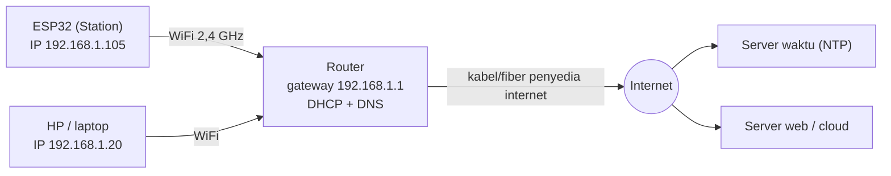
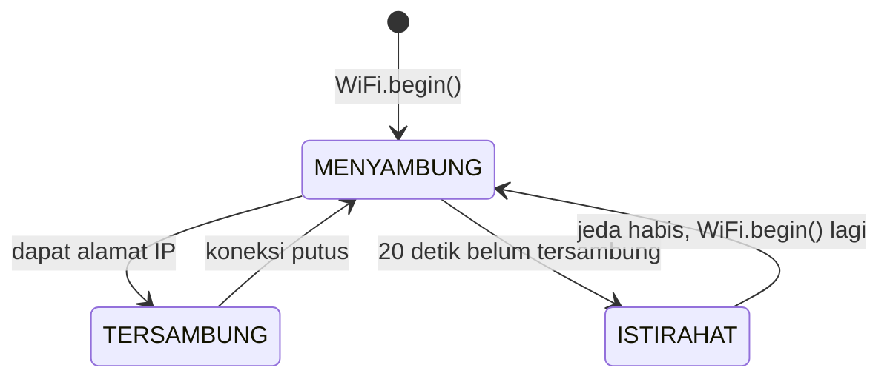

# BAB 42: WiFi Station Mode — Koneksi Internet ESP32

> ✅ **Prasyarat:** Selesaikan **BAB 16 (Non-Blocking Programming)** dan **BAB 17 (State Machine)** — kamu sudah terbiasa memakai `millis()` tanpa `delay()` dan menulis *state machine* dengan `enum` dan `switch-case`. Program 2 juga memakai *callback* dari [BAB 18 (Callback & Event-Driven Programming)](../BAB-18/README.md), Program 4 memakai DHT11 dari [BAB 26 (DHT11 — Suhu & Kelembapan)](../BAB-26/README.md) secara opsional, dan Program 5 memakai `Preferences` dari [BAB 39 (NVS — Non-Volatile Storage)](../BAB-39/README.md).

Sampai BAB 41, ESP32-mu bekerja sendirian: membaca sensor, menyalakan LED, dan menyimpan data di dalam kit. Mulai BAB ini ESP32 masuk ke jaringan. Caranya sama seperti HP-mu tersambung ke WiFi rumah: ESP32 menjadi salah satu "tamu" di jaringan *router*, mendapat alamat IP, lalu bisa berbicara dengan perangkat lain dan dengan internet. Mode ini disebut **Station** (STA). BAB ini adalah fondasi seluruh BAB jaringan berikutnya (*web server*, HTTP, MQTT, dan seterusnya): semuanya memakai cara menyambung, aturan menulis nama dan *password* WiFi, serta pola sambung ulang yang kamu pelajari di sini.

## 📌 Tujuan Pembelajaran

Setelah mempelajari BAB ini, kamu bisa:

- Menjelaskan istilah jaringan dasar — *router*, SSID, alamat IP, DHCP, *gateway*, DNS, dan MAC *address* — dengan analogi sehari-hari.
- Membedakan mode **Station** dan **Access Point**.
- Memastikan jaringanmu memakai pita **2,4 GHz**, baik *router* rumah maupun *hotspot* HP Android/iPhone.
- Menyambungkan ESP32 ke WiFi dengan `WiFi.begin()`, membaca `WiFi.status()`, lalu menampilkan alamat IP, *gateway*, DNS, MAC *address*, dan kekuatan sinyal (RSSI).
- Menulis koneksi yang tidak memblokir program, lengkap dengan batas waktu, *state machine*, LED penanda status, sambung ulang otomatis, dan *event* `ARDUINO_EVENT_WIFI_STA_*`.
- Membaca kode alasan terputus untuk membedakan "nama WiFi salah", "*password* salah", dan "sinyal hilang".
- Memindai jaringan WiFi di sekitar.
- Menentukan kapan IP statis perlu dipakai, memahami efek `WiFi.setSleep()`, dan mengingat bahwa ADC2 tidak bisa dipakai saat WiFi aktif.
- Mengambil waktu yang tepat dari internet (NTP) dalam zona WIB, WITA, atau WIT.
- Menyimpan nama dan *password* WiFi di NVS lewat Serial Monitor, sehingga tidak perlu menuliskannya di kode.

## 🧰 Yang Perlu Disiapkan

| Kebutuhan | Keterangan |
|---|---|
| *Hardware* | Kit Bluino ESP32 IoT Starter Shield (ESP32 DEVKIT V1 sudah terpasang di kit) + kabel USB **data**. Program 1, 3, dan 5 cukup memakai *board* ESP32 saja |
| Kabel *jumper* | Program 2: 2 kabel *female-female* untuk LED1 (merah) → IO4 dan LED2 (hijau) → IO17, ditambah 1 kabel opsional LED3 (biru) → IO2. Program 4: 1 kabel `DHT` → IO27 (opsional). Semua sudah ada di kit |
| Komponen tambahan | Tidak ada |
| *Software* | Arduino IDE 2.x + *board package* **esp32** versi 3.3.x (lihat [BAB 5](../BAB-05/README.md)) |
| *Library* | `WiFi` dan `Preferences` sudah termasuk di *board package* esp32. Program 4 memakai **DHT sensor library** dan **Adafruit Unified Sensor** by Adafruit (cara memasangnya ada di [BAB 26](../BAB-26/README.md)) |
| Alat uji | **Serial Monitor** Arduino IDE (baud 115200). Program 5 juga memakai kolom kirim pesan Serial Monitor dengan *line ending* **New Line**. HP atau laptop untuk melihat daftar perangkat yang tersambung ke *hotspot*/*router* (opsional) |
| Jaringan | WiFi **2,4 GHz** (*router* rumah atau *hotspot* HP) yang tersambung ke internet — siapkan nama dan *password*-nya. WiFi yang memakai halaman *login* (WiFi kampus/kafe/hotel) atau *username* (misalnya eduroam) tidak bisa dipakai; lihat [42.3](#423-menyiapkan-jaringan-wifi-24-ghz) |

## 📑 Daftar Isi

- [42.1 Mengenal Jaringan WiFi: Router, SSID, dan Alamat IP](#421-mengenal-jaringan-wifi-router-ssid-dan-alamat-ip)
- [42.2 Mode Station dan Access Point](#422-mode-station-dan-access-point)
- [42.3 Menyiapkan Jaringan WiFi 2,4 GHz](#423-menyiapkan-jaringan-wifi-24-ghz)
- [42.4 Library WiFi.h: Fungsi Dasar dan Status Koneksi](#424-library-wifih-fungsi-dasar-dan-status-koneksi)
- [42.5 Program 1: Hello WiFi](#425-program-1-hello-wifi)
- [42.6 Koneksi yang Tangguh: Batas Waktu, Event, dan Sambung Ulang](#426-koneksi-yang-tangguh-batas-waktu-event-dan-sambung-ulang)
- [42.7 Program 2: Koneksi Tangguh dengan LED Status](#427-program-2-koneksi-tangguh-dengan-led-status)
- [42.8 Program 3: Pemindai Jaringan WiFi](#428-program-3-pemindai-jaringan-wifi)
- [42.9 Pengaturan Tambahan: Hostname, IP Statis, Hemat Daya, dan ADC2](#429-pengaturan-tambahan-hostname-ip-statis-hemat-daya-dan-adc2)
- [42.10 Waktu dari Internet: NTP dan Zona Waktu Indonesia](#4210-waktu-dari-internet-ntp-dan-zona-waktu-indonesia)
- [42.11 Program 4: Jam Internet dan Log Suhu Bertanda Waktu](#4211-program-4-jam-internet-dan-log-suhu-bertanda-waktu)
- [42.12 Menyimpan Nama dan Password WiFi di NVS](#4212-menyimpan-nama-dan-password-wifi-di-nvs)
- [42.13 Program 5: Ganti WiFi Lewat Serial Monitor](#4213-program-5-ganti-wifi-lewat-serial-monitor)
- [42.14 Troubleshooting](#4214-troubleshooting)
- [📝 Rangkuman](#-rangkuman)
- [💪 Latihan](#-latihan)
- [📚 Referensi](#-referensi)

---

## 42.1 Mengenal Jaringan WiFi: Router, SSID, dan Alamat IP

Sebelum menulis kode, kenali dulu "bahasa" jaringan. Bayangkan jaringan WiFi di rumahmu sebagai **kompleks perumahan berpagar**:

- ***Router*** adalah kantor pengelola kompleks sekaligus pos satpamnya. Ia memutuskan siapa yang boleh masuk, membagikan nomor rumah, dan menjadi satu-satunya gerbang ke jalan raya (internet).
- **WiFi** adalah jalan di dalam kompleks — bedanya, "jalan" ini berupa gelombang radio, bukan aspal.
- ESP32, HP, dan laptop adalah **rumah-rumah** di kompleks itu. Masing-masing perlu nomor rumah supaya surat (data) bisa diantar ke alamat yang benar.

| Istilah | Kepanjangan / arti | Analogi kompleks perumahan | Contoh |
|---|---|---|---|
| SSID | *Service Set Identifier* — nama jaringan WiFi | Nama kompleks di papan gerbang | `RumahBudi` |
| *Password* WiFi | Kata sandi jaringan | Kode akses gerbang | `PasswordWiFiKamu` |
| Alamat IP | *Internet Protocol address* — nomor perangkat di jaringan | Nomor rumah | `192.168.1.105` |
| DHCP | *Dynamic Host Configuration Protocol* — layanan pembagi alamat IP otomatis | Petugas yang memberi nomor rumah kepada setiap penghuni baru. Nomornya dipinjamkan untuk sementara, jadi bisa berubah | Biasanya berjalan di *router* |
| *Gateway* | Pintu keluar ke jaringan lain (internet) | Gerbang kompleks ke jalan raya — biasanya *router* itu sendiri | `192.168.1.1` |
| *Subnet mask* | Aturan yang menentukan alamat mana yang masih "satu kompleks" | Aturan "semua nomor 192.168.1.x tinggal di kompleks ini" | `255.255.255.0` |
| DNS | *Domain Name System* — penerjemah nama ke alamat IP | Buku telepon: mencari nomor dari nama | `pool.ntp.org` → alamat IP server |
| MAC *address* | *Media Access Control address* — nomor unik bawaan pabrik untuk perangkat jaringan | Nomor rangka kendaraan: tidak berubah walaupun pemiliknya pindah kompleks | `24:6F:28:A1:B2:C3` |
| RSSI | *Received Signal Strength Indicator* — kekuatan sinyal yang diterima | Seberapa keras suara satpam terdengar dari rumahmu | `-58 dBm` |

Alamat seperti `192.168.x.x`, `10.x.x.x`, dan `172.16.x.x`–`172.31.x.x` adalah **alamat IP lokal** (privat). Alamat ini hanya berlaku di dalam jaringanmu sendiri, sama seperti "Blok C No. 5" hanya bermakna di dalam kompleks itu. Karena itu alamat IP ESP32 di rumahmu bisa saja sama persis dengan alamat IP ESP32 milik temanmu di rumahnya.



*Gambar 42.1 — ESP32 dalam mode Station: bergabung ke router bersama perangkat lain, lalu menjangkau internet lewat gateway. Sumber: dibuat untuk materi ini.*

Urutan yang terjadi saat ESP32 menyambung ke WiFi:

1. ESP32 mencari *router* dengan SSID yang kamu tulis di kode.
2. ESP32 dan *router* saling memeriksa *password* (proses autentikasi).
3. Setelah diterima, ESP32 meminta alamat IP ke DHCP *router*. *Router* juga memberi tahu alamat *gateway*, *subnet mask*, dan DNS.
4. Setelah alamat IP diterima, barulah ESP32 benar-benar **tersambung** dan siap berkomunikasi.

Langkah 3 sering terlupakan: ESP32 yang sudah "masuk kompleks" tetapi belum mendapat nomor rumah belum bisa menerima atau mengirim data.

---

## 42.2 Mode Station dan Access Point

WiFi ESP32 bisa bekerja dalam beberapa mode. Mode dipilih dengan `WiFi.mode(...)`:

| Mode | Konstanta | Peran ESP32 | Analogi | Dibahas di |
|---|---|---|---|---|
| ***Station*** (STA) | `WIFI_STA` | Bergabung ke *router* yang sudah ada, seperti HP-mu | Penghuni yang masuk ke kompleks orang lain | BAB ini |
| ***Access Point*** (AP) | `WIFI_AP` | Membuat jaringan WiFi sendiri. HP bisa langsung tersambung ke ESP32, tetapi **tanpa internet** | ESP32 membangun kompleks kecil sendiri | [BAB 43](../BAB-43/README.md) |
| AP + STA | `WIFI_AP_STA` | Keduanya sekaligus, misalnya untuk halaman pengaturan WiFi | Penghuni yang juga membuka pos kecil sendiri | [BAB 43](../BAB-43/README.md) dan [BAB 44](../BAB-44/README.md) |
| Mati | `WIFI_OFF` | WiFi dimatikan untuk menghemat daya | Pindah keluar kompleks | — |

Mode Station dipakai kalau ESP32 perlu **internet** (mengambil waktu, mengirim data ke *cloud*) atau perlu diakses perangkat lain di WiFi yang sama (misalnya membuka halaman web ESP32 dari HP di [BAB 46](../BAB-46/README.md)).

<details>
<summary><b>🔬 Pendalaman (opsional): Apa yang terjadi di balik <code>WiFi.h</code>?</b></summary>

Saat kamu memanggil `WiFi.begin()`, ada beberapa lapisan perangkat lunak yang bekerja:

| Lapisan | Isi | Siapa yang menulis |
|---|---|---|
| Program kamu | `setup()`, `loop()`, panggilan `WiFi.begin()` | Kamu |
| *Library* `WiFi.h` (Arduino) | Fungsi-fungsi sederhana seperti `WiFi.begin()`, `WiFi.status()`, `WiFi.onEvent()` | Espressif, bagian dari *board package* esp32 |
| ESP-IDF | *Driver* WiFi dan *stack* TCP/IP **lwIP** (yang mengurus DHCP, DNS, serta protokol pengiriman data TCP dan UDP) | Espressif |
| *Hardware* | Radio WiFi 2,4 GHz di dalam chip ESP32 dan antena PCB di ujung modul | Espressif |

Pada ESP32 dengan *board package* 3.3.x, *task* *driver* WiFi dan lwIP berjalan di **core 0**, sedangkan `setup()` dan `loop()` berjalan di **core 1**. Karena itu WiFi tetap "hidup" walaupun `loop()` sedang sibuk — tetapi data yang datang baru bisa diproses programmu saat `loop()` sempat memeriksanya. *Callback* *event* WiFi (dibahas di [42.6](#426-koneksi-yang-tangguh-batas-waktu-event-dan-sambung-ulang)) dijalankan oleh *task* terpisah bernama `arduino_events`.

Menyalakan WiFi juga memakai puluhan KB RAM (*heap*) untuk *buffer* data — lihat [BAB 20](../BAB-20/README.md) untuk cara memantaunya.

</details>

---

## 42.3 Menyiapkan Jaringan WiFi 2,4 GHz

Bagian ini adalah penyebab kegagalan nomor satu bagi pemula. Pastikan jaringanmu memenuhi syarat **sebelum** meng-*upload* program.

### 42.3.1 Kenapa Harus 2,4 GHz?

WiFi memakai gelombang radio di beberapa "pita frekuensi" (*band*). Yang paling umum adalah **2,4 GHz** dan **5 GHz**. Radio di dalam ESP32 **hanya mendukung 2,4 GHz** (standar 802.11 b/g/n). Jaringan 5 GHz sama sekali tidak terlihat oleh ESP32: tidak muncul saat dipindai, dan ESP32 akan melaporkan "SSID tidak ditemukan" kalau kamu mencoba menyambung ke sana.

| | 2,4 GHz | 5 GHz |
|---|---|---|
| Bisa dipakai ESP32 | ✅ Ya | ❌ Tidak |
| Jangkauan dan tembus tembok | Lebih jauh, lebih mudah menembus tembok | Lebih pendek |
| Kecepatan | Lebih lambat — tetapi sudah lebih dari cukup untuk data sensor | Lebih cepat |
| Kanal (*channel*) di Indonesia | 1–13 | Bervariasi |
| Ciri nama jaringan | Sering tanpa akhiran, atau berakhiran `-2G`/`_2.4G` | Sering berakhiran `-5G`/`_5G` |

### 42.3.2 Router Rumah

Kebanyakan *router* modern bersifat ***dual-band***: memancarkan 2,4 GHz dan 5 GHz sekaligus. Ada dua kemungkinan:

- **Ada dua nama jaringan**, misalnya `RumahBudi` dan `RumahBudi-5G`. Pakai nama yang **bukan** 5G.
- **Hanya ada satu nama** untuk kedua pita (fitur ini biasanya disebut *band steering* atau *Smart Connect*). ESP32 biasanya tetap bisa tersambung karena ia hanya "melihat" bagian 2,4 GHz-nya. Kalau tetap sering gagal, pisahkan kedua pita lewat halaman pengaturan *router*: buka *browser* di HP/laptop yang tersambung ke WiFi itu, ketik alamat *gateway* (biasanya `192.168.1.1` atau `192.168.0.1`, juga tertulis di stiker bawah *router*), *login* dengan akun admin *router*, lalu cari menu **Wireless**/**WLAN** dan beri nama berbeda untuk jaringan 2,4 GHz.

> 📌 **Catatan:** Kalau *router* milik orang lain (kos, kantor), minta izin pengelolanya sebelum mengubah pengaturan. Cara paling cepat untuk belajar biasanya adalah *hotspot* HP.

### 42.3.3 Hotspot HP

*Hotspot* HP adalah pilihan paling praktis untuk belajar, termasuk di kampus. Pastikan *hotspot*-nya memancar di 2,4 GHz:

| HP | Langkah (nama menu bisa sedikit berbeda antarmerek dan versi) |
|---|---|
| Android (umum) | **Setelan** → **Jaringan & internet** / **Koneksi** → **Hotspot & tethering** → **Hotspot Wi-Fi**. Cari pilihan **Pita AP**/**Band** lalu pilih **2,4 GHz**. Di Google Pixel, pilihan pita ada di menu *Speed & compatibility* (Android versi baru) atau berupa sakelar *Extend compatibility* yang harus diaktifkan (Android versi lama) |
| Samsung | **Pengaturan** → **Koneksi** → **Hotspot Seluler dan Tethering** → **Hotspot Seluler** → **Konfigurasikan** → **Pita** → **2,4 GHz** |
| iPhone | **Pengaturan** → **Hotspot Pribadi** → aktifkan **Izinkan Lainnya Bergabung** dan **Maksimalkan Kompatibilitas** (*Maximize Compatibility*). Nama *hotspot* = nama iPhone (**Pengaturan** → **Umum** → **Mengenai** → **Nama**) |

Tips tambahan untuk *hotspot*:

- Catat nama dan *password* *hotspot* **persis** seperti tertulis, termasuk huruf besar-kecil, spasi, dan apostrof. Nama iPhone sering berisi apostrof miring (`’`, bukan `'` biasa), misalnya `iPhone Budi’s`. Apostrof miring sulit diketik dengan benar di kode, jadi lebih aman ganti nama iPhone menjadi tanpa apostrof, misalnya `iPhoneBudi`.
- Di iPhone, biarkan layar **Hotspot Pribadi** tetap terbuka saat ESP32 pertama kali menyambung.
- Aktifkan data seluler kalau programmu butuh internet (misalnya NTP di Program 4).

### 42.3.4 Jaringan yang Tidak Bisa atau Sulit Dipakai

| Jenis jaringan | Kenapa bermasalah | Solusi |
|---|---|---|
| WiFi dengan halaman *login* di *browser* (*captive portal*) — WiFi kampus, kafe, hotel | ESP32 tidak punya *browser* untuk mengisi halaman *login*, jadi internetnya tidak terbuka | Pakai *hotspot* HP |
| WiFi dengan *username* + *password* (WPA2/WPA3-*Enterprise*, misalnya eduroam) | Butuh kode khusus yang tidak dibahas di BAB ini | Pakai *hotspot* HP |
| WiFi 5 GHz saja | ESP32 hanya 2,4 GHz | Aktifkan 2,4 GHz ([42.3.2](#4232-router-rumah) dan [42.3.3](#4233-hotspot-hp)) |
| *Router* dengan penyaring MAC (*MAC filtering*) | Hanya perangkat terdaftar yang boleh masuk | Daftarkan MAC *address* ESP32 (dicetak oleh Program 1) di pengaturan *router* |
| *Router* sangat lama dengan keamanan WEP atau WPA (bukan WPA2) | *Board package* 3.3.x secara bawaan hanya mau tersambung ke WPA2 atau yang lebih baru | Ubah keamanan *router* ke WPA2/WPA3. Kalau tidak mungkin, panggil `WiFi.setMinSecurity(WIFI_AUTH_WEP);` sebelum `WiFi.begin()` (tidak disarankan — WEP/WPA mudah dibobol) |

Jaringan **tersembunyi** (*hidden SSID*, namanya tidak disiarkan) tetap bisa dipakai karena kamu mengetik namanya sendiri di kode, tetapi tidak akan muncul di pemindai (Program 3).

### 42.3.5 Menulis Nama dan Password WiFi di Kode

Semua program di BAB ini menulis nama dan *password* WiFi seperti berikut. **Ganti kedua teks contoh itu dengan milikmu** sebelum meng-*upload*:

```cpp
const char *WIFI_SSID = "NamaWiFiKamu";      // ← ganti dengan WiFi kamu
const char *WIFI_PASS = "PasswordWiFiKamu";  // ← ganti dengan WiFi kamu
```

Aturan yang wajib diperhatikan:

- **Peka huruf besar-kecil** (*case-sensitive*). `RumahBudi`, `rumahbudi`, dan `RumahBudi ` (ada spasi di akhir) adalah tiga nama yang berbeda. Begitu juga *password*-nya.
- Kalau nama atau *password* berisi tanda kutip `"` atau garis miring terbalik `\`, tulis sebagai `\"` dan `\\` di dalam kode.
- Panjang SSID maksimal 32 karakter. *Password* WPA2 panjangnya 8–63 karakter. Untuk jaringan tanpa *password*, tulis `""`.
- **Jangan menyebarkan kode yang berisi *password* asli** — misalnya mengunggahnya ke GitHub atau grup WhatsApp. Hapus dulu *password*-nya, atau simpan di NVS seperti Program 5.

---

## 42.4 Library WiFi.h: Fungsi Dasar dan Status Koneksi

*Library* `WiFi.h` sudah termasuk di *board package* esp32, jadi tidak perlu dipasang. Cukup tulis `#include <WiFi.h>` di bagian atas *sketch*, lalu semua fungsinya bisa dipanggil lewat objek siap pakai bernama `WiFi`.

### 42.4.1 Fungsi yang Paling Sering Dipakai

| Fungsi | Kegunaan | Hasil |
|---|---|---|
| `WiFi.mode(WIFI_STA)` | Menyalakan WiFi dalam mode Station | `true` kalau berhasil |
| `WiFi.begin(ssid, password)` | **Mulai** menyambung ke WiFi | Langsung kembali tanpa menunggu tersambung |
| `WiFi.status()` | Status koneksi saat ini | Salah satu nilai di [42.4.2](#4242-nilai-wifistatus) |
| `WiFi.isConnected()` | Sudah tersambung dan punya IP? | `true`/`false` |
| `WiFi.localIP()` | Alamat IP ESP32 | `IPAddress`, misalnya `192.168.1.105` |
| `WiFi.gatewayIP()`, `WiFi.subnetMask()`, `WiFi.dnsIP()` | Alamat *gateway*, *subnet mask*, dan DNS | `IPAddress` |
| `WiFi.macAddress()` | MAC *address* ESP32 | `String`, misalnya `24:6F:28:A1:B2:C3` |
| `WiFi.RSSI()` | Kekuatan sinyal *router* yang sedang tersambung | Angka negatif dalam dBm, atau 0 kalau tidak tersambung |
| `WiFi.SSID()`, `WiFi.channel()` | Nama dan kanal jaringan yang sedang tersambung | `String`, angka 1–13 |
| `WiFi.getHostname()` | Nama ESP32 yang terlihat di daftar perangkat *router* | Teks, bawaannya `esp32-` + 6 digit terakhir MAC |
| `WiFi.disconnect()` | Memutus koneksi (WiFi tetap menyala) | `true` kalau berhasil |
| `WiFi.reconnect()` | Mencoba menyambung lagi dengan nama dan *password* terakhir | `true` kalau perintahnya diterima |
| `WiFi.setAutoReconnect(true)` | Sambung ulang otomatis saat terputus (bawaannya sudah `true`) | — |
| `WiFi.onEvent(fungsi)` | Mendaftarkan *callback* untuk kejadian WiFi | — |

Ada satu hal penting tentang `WiFi.begin()`: fungsi ini **tidak menunggu** sampai tersambung. Ia hanya memberi perintah kepada *driver* WiFi, lalu langsung kembali. Proses menyambung berjalan di latar belakang dan biasanya butuh beberapa detik. Ibaratnya kamu mengirim surat lamaran: setelah surat dikirim, kamu harus **memeriksa kotak surat** (`WiFi.status()`) untuk tahu hasilnya.

Fungsi yang menghasilkan `IPAddress` bisa langsung dicetak dengan `Serial.println(WiFi.localIP());`. Untuk `Serial.printf()`, ubah dulu menjadi teks: `WiFi.localIP().toString().c_str()`.

### 42.4.2 Nilai WiFi.status()

`WiFi.status()` menghasilkan nilai bertipe `wl_status_t`. Pada *board package* 3.3.12, nilai yang mungkin muncul untuk mode Station adalah:

| Nilai | Angka | Artinya |
|---|---|---|
| `WL_STOPPED` | 254 | Mode Station belum dinyalakan (`WiFi.mode()`/`WiFi.begin()` belum dipanggil) |
| `WL_DISCONNECTED` | 6 | Tidak tersambung, atau **sedang mencoba** menyambung. Nilai ini yang paling sering terlihat |
| `WL_IDLE_STATUS` | 0 | Sudah diterima *router*, tetapi **belum mendapat alamat IP** dari DHCP |
| `WL_CONNECTED` | 3 | ✅ Tersambung dan sudah punya alamat IP |
| `WL_NO_SSID_AVAIL` | 1 | *Router* dengan nama itu tidak ditemukan (nama salah, 5 GHz, atau terlalu jauh) |
| `WL_CONNECTION_LOST` | 5 | Sinyal *router* hilang di tengah jalan, atau proses "jabat tangan" dengan *router* kehabisan waktu (bisa juga karena *password* salah) |
| `WL_CONNECT_FAILED` | 4 | Autentikasi ditolak, atau perintah `WiFi.begin()` ditolak (misalnya SSID kosong atau lebih dari 32 karakter) |

Nilai lain di daftar `wl_status_t` (`WL_SCAN_COMPLETED` = 2 dan `WL_NO_SHIELD` = 255) hanya ada demi kecocokan dengan *library* lama dan tidak dipakai oleh mode Station di 3.3.12.

> ⚠️ **Perhatian:** Jangan mengandalkan `WL_CONNECT_FAILED` untuk mendeteksi *password* salah. Di *board package* 3.3.x, *password* salah sering hanya menghasilkan `WL_DISCONNECTED` yang terus berulang, karena *driver* terus mencoba lagi. Cara yang lebih pasti adalah membaca **kode alasan terputus** dari *event* WiFi — dibahas di [42.6.4](#4264-kode-alasan-terputus).

### 42.4.3 RSSI: Membaca Kekuatan Sinyal

RSSI diukur dalam **dBm** (desibel-miliwatt). Angkanya selalu negatif, dan **makin mendekati 0, makin kuat** sinyalnya: −45 dBm lebih kuat daripada −75 dBm. Skalanya logaritmik — setiap turun 10 dB, daya sinyal yang diterima tinggal sepersepuluhnya. Jadi sinyal −70 dBm seribu kali lebih lemah daripada −40 dBm.

| RSSI | Kualitas | Yang biasanya terjadi |
|---|---|---|
| −50 dBm ke atas (misalnya −42) | Sangat kuat | ESP32 sangat dekat dengan *router* |
| −50 sampai −60 dBm | Kuat | Stabil dan lancar |
| −60 sampai −70 dBm | Cukup | Normal di dalam ruangan; masih lancar untuk data sensor |
| −70 sampai −80 dBm | Lemah | Mulai lambat dan kadang terputus |
| Di bawah −80 dBm (misalnya −86) | Sangat lemah | Sering gagal tersambung |

Batas-batas di atas adalah pedoman praktis, bukan angka mutlak. Antena ESP32 DEVKIT V1 berupa jalur berliku-liku di ujung modul ESP32, di luar tutup logamnya (antena PCB). Jangan menutupinya dengan tangan, logam, atau menempelkannya ke dinding logam, karena RSSI bisa turun beberapa dBm.

### 42.4.4 MAC Address

MAC *address* terdiri dari 6 *byte* yang ditulis dalam heksadesimal, misalnya `24:6F:28:A1:B2:C3`. Tiga *byte* pertama menunjukkan pembuatnya (di sini Espressif). Nomor ini ditanam di chip saat produksi, jadi tidak berubah walaupun ESP32 pindah WiFi. Gunanya antara lain:

- Didaftarkan di *router* yang memakai penyaring MAC, atau untuk "memesan" alamat IP tetap (lihat [42.9](#429-pengaturan-tambahan-hostname-ip-statis-hemat-daya-dan-adc2)).
- Menjadi alamat tujuan di ESP-NOW ([BAB 54](../BAB-54/README.md)).

> 📌 **Catatan:** `WiFi.macAddress()` baru berisi nilai yang benar **setelah** WiFi dinyalakan (`WiFi.mode(WIFI_STA)` atau `WiFi.begin()`). Kalau dipanggil sebelumnya, hasilnya `00:00:00:00:00:00`.

---

## 42.5 Program 1: Hello WiFi

**Tujuan:** Menyambungkan ESP32 ke WiFi rumah atau *hotspot* HP, lalu menampilkan alamat IP, *gateway*, DNS, MAC *address*, dan kekuatan sinyal di Serial Monitor. LED biru bawaan *board* menyala selama ESP32 tersambung.

**Rangkaian:** *Tidak perlu merangkai — program ini memakai LED biru bawaan board di IO2.* (Kalau kabel LED3 (biru) → IO2 dari BAB sebelumnya masih terpasang, LED biru di kit ikut menyala.)

**Cara Menjalankan:**

1. Siapkan jaringan WiFi 2,4 GHz (lihat [42.3](#423-menyiapkan-jaringan-wifi-24-ghz)) dan catat nama serta *password*-nya.
2. Buka Arduino IDE → **File → New Sketch**, hapus isinya, lalu salin kode di bawah. Kode yang sama juga tersedia di *file* [`p1_hello_wifi.ino`](p1_hello_wifi/p1_hello_wifi.ino).
3. Ganti `NamaWiFiKamu` dan `PasswordWiFiKamu` dengan nama dan *password* WiFi-mu (tanda kutipnya jangan dihapus).
4. Pastikan **Tools → Board** = **ESP32 Dev Module** dan **Tools → Port** = *port* ESP32 kamu (misalnya `COM5` di Windows atau `/dev/ttyUSB0` di Linux).
5. Klik tombol **Upload** (ikon panah →) dan tunggu sampai muncul tulisan **Done uploading**.
6. Buka **Serial Monitor** (**Tools → Serial Monitor**) lalu pilih baud **115200**. Kalau tulisan awalnya terlewat, tekan tombol **EN** di *board* ESP32.

**Kode Program:**

<!-- sketch: p1_hello_wifi -->
```cpp
/*
 * BAB 42 - Program 1: Hello WiFi
 * Menyambungkan ESP32 ke WiFi dalam mode Station, lalu menampilkan
 * informasi jaringan dan kekuatan sinyal di Serial Monitor.
 *
 * Rangkaian: tidak perlu. LED biru bawaan board (IO2) menyala saat tersambung.
 * Alat uji : Serial Monitor, baud 115200.
 * Jaringan : WiFi 2,4 GHz. Nama dan password peka huruf besar-kecil.
 */

#include <WiFi.h>   // library WiFi, sudah termasuk di board package esp32

const char *WIFI_SSID = "NamaWiFiKamu";      // ← ganti dengan WiFi kamu
const char *WIFI_PASS = "PasswordWiFiKamu";  // ← ganti dengan WiFi kamu

#define LED_BIRU 2   // LED biru bawaan board (juga LED3 di kit lewat IO2)

const unsigned long BATAS_TUNGGU   = 15000;  // menunggu tersambung paling lama 15 detik
const unsigned long INTERVAL_LAPOR = 5000;   // laporan sinyal setiap 5 detik

unsigned long waktuLaporTerakhir = 0;

// Mengubah angka RSSI menjadi kata yang mudah dipahami (lihat tabel di 42.4.3)
const char *kualitasSinyal(int rssi) {
  if (rssi >= -50) return "sangat kuat";
  if (rssi >= -60) return "kuat";
  if (rssi >= -70) return "cukup";
  if (rssi >= -80) return "lemah";
  return "sangat lemah";
}

void tampilkanInfoJaringan() {
  int rssi = WiFi.RSSI();
  Serial.println("Tersambung!");
  Serial.printf("  Nama WiFi (SSID) : %s\n", WiFi.SSID().c_str());
  Serial.printf("  Alamat IP ESP32  : %s\n", WiFi.localIP().toString().c_str());
  Serial.printf("  Subnet mask      : %s\n", WiFi.subnetMask().toString().c_str());
  Serial.printf("  Gateway (router) : %s\n", WiFi.gatewayIP().toString().c_str());
  Serial.printf("  Server DNS       : %s\n", WiFi.dnsIP().toString().c_str());
  Serial.printf("  Kanal (channel)  : %ld\n", (long)WiFi.channel());
  Serial.printf("  Hostname ESP32   : %s\n", WiFi.getHostname());
  Serial.printf("  Kekuatan sinyal  : %d dBm (%s)\n", rssi, kualitasSinyal(rssi));
}

void setup() {
  Serial.begin(115200);
  delay(1000);                    // beri waktu Serial Monitor tersambung
  pinMode(LED_BIRU, OUTPUT);
  digitalWrite(LED_BIRU, LOW);

  Serial.println();
  Serial.println("BAB 42 - Program 1: Hello WiFi");

  WiFi.mode(WIFI_STA);            // nyalakan WiFi sebagai Station ("tamu" di router)
  Serial.print("MAC address ESP32: ");
  Serial.println(WiFi.macAddress());

  Serial.printf("Menyambung ke \"%s\"", WIFI_SSID);
  WiFi.begin(WIFI_SSID, WIFI_PASS);  // mulai menyambung; prosesnya berjalan di latar belakang

  // Tunggu sampai tersambung, tetapi paling lama BATAS_TUNGGU
  unsigned long mulai = millis();
  while (WiFi.status() != WL_CONNECTED && millis() - mulai < BATAS_TUNGGU) {
    Serial.print(".");
    delay(500);
  }
  Serial.println();

  if (WiFi.status() == WL_CONNECTED) {
    digitalWrite(LED_BIRU, HIGH);
    tampilkanInfoJaringan();
  } else {
    Serial.printf("Belum tersambung setelah %lu detik (status %d).\n",
                  BATAS_TUNGGU / 1000, (int)WiFi.status());
    Serial.println("Cek nama/password WiFi dan pastikan jaringannya 2,4 GHz.");
    Serial.println("ESP32 tetap mencoba menyambung di latar belakang...");
  }
}

void loop() {
  if (millis() - waktuLaporTerakhir >= INTERVAL_LAPOR) {
    waktuLaporTerakhir = millis();

    if (WiFi.status() == WL_CONNECTED) {
      digitalWrite(LED_BIRU, HIGH);
      int rssi = WiFi.RSSI();
      Serial.printf("Tersambung | IP %s | RSSI %d dBm (%s)\n",
                    WiFi.localIP().toString().c_str(), rssi, kualitasSinyal(rssi));
    } else {
      digitalWrite(LED_BIRU, LOW);
      Serial.printf("Tidak tersambung (status %d), menunggu sambung ulang otomatis...\n",
                    (int)WiFi.status());
    }
  }
}
```

**Penjelasan Kode:**

- `const char *WIFI_SSID = "...";` menyimpan teks nama dan *password* WiFi. `const` berarti nilainya tidak akan diubah program. Inilah dua baris yang **wajib** kamu ganti.
- `WiFi.mode(WIFI_STA)` menyalakan radio WiFi dalam mode Station. Setelah baris ini, `WiFi.macAddress()` sudah berisi MAC *address* yang benar.
- `WiFi.begin(WIFI_SSID, WIFI_PASS)` memberi perintah "sambungkan ke jaringan ini". Fungsi ini langsung selesai; proses menyambung (mencari *router*, memeriksa *password*, meminta IP) berjalan di latar belakang.
- Perulangan `while` memeriksa `WiFi.status()` setiap 0,5 detik dan mencetak titik. Perulangan berhenti karena **dua** kemungkinan: sudah tersambung, atau sudah 15 detik. Batas waktu ini penting — tanpa batas, ESP32 akan menunggu selamanya kalau *password*-nya salah.
- Rumus `millis() - mulai < BATAS_TUNGGU` adalah pola selisih waktu dari [BAB 16](../BAB-16/README.md) yang tetap benar walaupun `millis()` *rollover*.
- `tampilkanInfoJaringan()` mencetak semua informasi yang diberikan DHCP *router*. `.toString().c_str()` mengubah `IPAddress` menjadi teks agar bisa dicetak dengan `%s`.
- `WiFi.getHostname()` adalah nama ESP32 di jaringan. Bawaannya `esp32-` diikuti 6 digit terakhir MAC *address*. Nama inilah yang biasanya muncul di daftar perangkat *router* atau *hotspot* HP.
- Di `loop()`, laporan dicetak setiap 5 detik dengan pola *blink without delay*. Kalau koneksi terputus, *driver* WiFi mencoba menyambung ulang sendiri (fitur *auto reconnect*, dibahas di [42.6](#426-koneksi-yang-tangguh-batas-waktu-event-dan-sambung-ulang)), dan LED biru padam sampai tersambung lagi.

> 📌 **Catatan:** Menunggu dengan `while` + `delay(500)` di `setup()` masih bisa diterima untuk program pertama, karena waktunya dibatasi 15 detik dan belum ada tugas lain. Di Program 2 kamu akan membuat versi yang sama sekali tidak memblokir `loop()`.

**Contoh Output:**

Kalau berhasil (MAC, alamat IP, kanal, dan RSSI-mu pasti berbeda):

```text
BAB 42 - Program 1: Hello WiFi
MAC address ESP32: 24:6F:28:A1:B2:C3
Menyambung ke "NamaWiFiKamu"......
Tersambung!
  Nama WiFi (SSID) : NamaWiFiKamu
  Alamat IP ESP32  : 192.168.1.105
  Subnet mask      : 255.255.255.0
  Gateway (router) : 192.168.1.1
  Server DNS       : 192.168.1.1
  Kanal (channel)  : 6
  Hostname ESP32   : esp32-A1B2C3
  Kekuatan sinyal  : -58 dBm (kuat)
Tersambung | IP 192.168.1.105 | RSSI -57 dBm (kuat)
Tersambung | IP 192.168.1.105 | RSSI -59 dBm (kuat)
```

LED biru di *board* menyala. Kalau memakai *hotspot* HP, alamatnya bisa berbentuk lain, misalnya `192.168.43.x`, `10.x.x.x`, atau `172.20.10.x` (iPhone) — semuanya normal.

Kalau gagal, misalnya nama WiFi salah ketik:

```text
BAB 42 - Program 1: Hello WiFi
MAC address ESP32: 24:6F:28:A1:B2:C3
Menyambung ke "NamaWiFiKamu"..............................
Belum tersambung setelah 15 detik (status 1).
Cek nama/password WiFi dan pastikan jaringannya 2,4 GHz.
ESP32 tetap mencoba menyambung di latar belakang...
Tidak tersambung (status 1), menunggu sambung ulang otomatis...
```

Angka status bisa 1 (`WL_NO_SSID_AVAIL`) atau 6 (`WL_DISCONNECTED`), tergantung saat status dibaca. Artinya bisa kamu cocokkan dengan tabel di [42.4.2](#4242-nilai-wifistatus).

> 🧪 **Coba Sendiri:**
>
> - Buka daftar perangkat yang tersambung di HP (layar *hotspot*) atau di halaman pengaturan *router*. Cari nama `esp32-...` yang sama dengan *hostname* di Serial Monitor.
> - Dari laptop yang tersambung ke WiFi **yang sama**, "sapa" ESP32 dengan perintah `ping`. Di Windows: klik **Start**, ketik `cmd`, tekan Enter, lalu ketik `ping 192.168.1.105` (ganti dengan alamat IP ESP32-mu). Di macOS/Linux: buka **Terminal**, ketik `ping -c 4 192.168.1.105`. Kalau muncul baris seperti `Reply from 192.168.1.105: bytes=32 time=45ms`, berarti laptopmu bisa menjangkau ESP32. Waktunya bisa naik-turun puluhan sampai ratusan milidetik karena mode hemat daya WiFi ([42.9.3](#4293-mode-hemat-daya-wifisetsleep)). Sebagian *hotspot* HP dan WiFi publik sengaja memisahkan perangkat satu sama lain (*client isolation*), sehingga `ping` tidak dijawab — itu bukan kesalahan programmu.
> - Matikan *hotspot* atau *router* selama 10 detik, lalu nyalakan lagi. Perhatikan LED biru padam lalu menyala kembali tanpa kamu menekan apa pun.

**Kalau Belum Berhasil:**

- **Titik terus bertambah sampai 15 detik, status 1** → nama WiFi tidak ditemukan. Cek huruf besar-kecil dan spasi, pastikan jaringannya 2,4 GHz, lalu dekatkan ESP32 ke *router*. Program 3 (pemindai) bisa memastikan apakah ESP32 "melihat" jaringanmu.
- **Titik terus bertambah, status 6 (kadang 4 atau 5), padahal nama sudah benar** → kemungkinan besar *password* salah, atau jaringannya memakai *login* di *browser*/*username* ([42.3.4](#4234-jaringan-yang-tidak-bisa-atau-sulit-dipakai)). Program 2 menampilkan kode alasannya dengan lebih jelas.
- **Serial Monitor kosong atau berisi huruf acak** → pilih baud **115200**, lalu tekan tombol **EN** supaya program berjalan dari awal saat Serial Monitor sudah terbuka.
- **ESP32 *restart* sendiri saat mulai menyambung (muncul `Brownout detector was triggered`)** → arus sesaat WiFi terlalu besar untuk sumber dayamu. Ganti kabel USB yang lebih pendek/bagus, colok langsung ke laptop (bukan *hub*), lihat [BAB 21](../BAB-21/README.md).

---

## 42.6 Koneksi yang Tangguh: Batas Waktu, Event, dan Sambung Ulang

Program 1 sudah bekerja, tetapi masih punya kelemahan: selama menunggu WiFi, ESP32 tidak bisa mengerjakan hal lain. Perangkat IoT sungguhan harus tetap berfungsi — membaca sensor, merespons tombol, menyimpan log — **walaupun WiFi sedang bermasalah**, lalu tersambung kembali dengan sendirinya. Bagian ini membahas bahan-bahannya.

### 42.6.1 Masalah Menunggu Tanpa Batas

Contoh berikut sangat sering ditemukan di internet. Jangan ditiru:

```cpp
WiFi.begin(WIFI_SSID, WIFI_PASS);
while (WiFi.status() != WL_CONNECTED) {   // ❌ tidak ada batas waktu
  delay(500);
}
```

Kalau *password* salah atau *router* mati, ESP32 berputar di `while` itu **selamanya**: sensor tidak dibaca, tombol tidak ditanggapi, dan LED tidak memberi tanda apa pun. Menambahkan batas waktu seperti Program 1 sudah lebih baik, tetapi menunggu 15 detik di dalam `loop()` setiap kali WiFi terputus tetap membuat programmu "membeku".

Solusinya adalah pola dari [BAB 16](../BAB-16/README.md) dan [BAB 17](../BAB-17/README.md): `loop()` tidak pernah menunggu. Setiap putaran `loop()` cukup **memeriksa** status WiFi sebentar, lalu memutuskan langkah berikutnya lewat *state machine*.

### 42.6.2 Sambung Ulang Otomatis Bawaan

*Driver* WiFi di *board package* 3.3.12 sudah punya fitur sambung ulang otomatis (*auto reconnect*), yang menyala secara bawaan (`WiFi.setAutoReconnect(true)`). Cara kerjanya:

- Kalau koneksi putus karena sinyal hilang, *router* di-*restart*, atau *router* belum ditemukan, *driver* langsung mencoba lagi, terus-menerus, tanpa perlu kode tambahan.
- Kegagalan pertama sejak ESP32 menyala selalu dicoba ulang sekali, apa pun penyebabnya.
- Kalau **kamu sendiri** memutus koneksi dengan `WiFi.disconnect()`, *driver* tidak menyambung ulang — dianggap disengaja.
- Untuk sebagian kecil penyebab — misalnya keamanan jaringan tidak cocok — *driver* berhenti mencoba. Programmu sendiri yang harus memulai lagi.

Karena poin terakhir itu, program yang tangguh tetap butuh **jaring pengaman**: kalau setelah 20 detik belum juga tersambung, hentikan percobaan, istirahat sebentar, lalu mulai lagi dengan `WiFi.begin()`. Lama istirahatnya dibuat bertambah (5, 10, 20, 40, lalu paling lama 60 detik). Teknik ini disebut *backoff* — mirip menelepon teman yang HP-nya mati: kamu tidak menelepon setiap detik, tetapi menunggu makin lama di antara percobaan. Dengan begitu ESP32 tidak terus-menerus membebani *router* dan tidak boros daya.

Perhatikan juga arti parameter `WiFi.disconnect()`, karena sering salah dipahami:

| Perintah | Yang terjadi |
|---|---|
| `WiFi.disconnect()` | Memutus koneksi. WiFi tetap menyala, nama dan *password* tetap diingat, jadi `WiFi.reconnect()` atau `WiFi.begin(...)` bisa langsung dipanggil |
| `WiFi.disconnect(true)` | Memutus koneksi **dan mematikan WiFi** (parameter pertama = `wifioff`). Untuk tersambung lagi harus memanggil `WiFi.begin(...)` |
| `WiFi.disconnect(false, true)` | Memutus koneksi dan menghapus nama/*password* yang diingat *driver* (parameter kedua = `eraseap`) |

> ⚠️ **Perhatian:** Banyak contoh di internet memanggil `WiFi.disconnect(true)` dengan anggapan "membersihkan sisa koneksi lama". Di *board package* 3.x, perintah itu justru **mematikan radio WiFi**. Pakai `WiFi.disconnect()` tanpa parameter kalau kamu hanya ingin memutus lalu menyambung lagi.

### 42.6.3 Event WiFi dengan WiFi.onEvent()

Di [BAB 18](../BAB-18/README.md) kamu belajar *callback*: fungsi yang dipanggil otomatis saat sesuatu terjadi. *Library* WiFi menyediakan hal yang sama. Daripada terus bertanya "sudah tersambung belum?", kamu bisa meminta *library* memanggil fungsimu setiap kali ada **kejadian** (*event*) WiFi.

| *Event* (nama di *board package* 3.3.12) | Kapan terjadi |
|---|---|
| `ARDUINO_EVENT_WIFI_STA_START` | Mode Station baru dinyalakan |
| `ARDUINO_EVENT_WIFI_STA_CONNECTED` | Diterima *router*, tetapi **belum** punya alamat IP |
| `ARDUINO_EVENT_WIFI_STA_GOT_IP` | Mendapat alamat IP — sekarang benar-benar siap dipakai |
| `ARDUINO_EVENT_WIFI_STA_DISCONNECTED` | Koneksi terputus, **atau** satu percobaan menyambung gagal. Membawa kode alasan |
| `ARDUINO_EVENT_WIFI_STA_LOST_IP` | Alamat IP hilang (misalnya masa pinjam DHCP habis dan tidak bisa diperpanjang) |
| `ARDUINO_EVENT_WIFI_STA_STOP` | Mode Station dimatikan |
| `ARDUINO_EVENT_WIFI_SCAN_DONE` | Pemindaian jaringan selesai (dipakai di [42.8](#428-program-3-pemindai-jaringan-wifi)) |

Bentuk fungsi *callback*-nya seperti ini (potongan kode):

```cpp
void saatEventWiFi(WiFiEvent_t event, WiFiEventInfo_t info) {
  if (event == ARDUINO_EVENT_WIFI_STA_DISCONNECTED) {
    uint8_t alasan = info.wifi_sta_disconnected.reason;   // kode alasan terputus
    Serial.printf("Terputus, alasan %u\n", (unsigned)alasan);
  }
}

// Di dalam setup(), SEBELUM WiFi.begin():
WiFi.onEvent(saatEventWiFi);                                   // semua event
// atau hanya satu jenis event:
// WiFi.onEvent(saatEventWiFi, ARDUINO_EVENT_WIFI_STA_GOT_IP);
```

- `WiFiEvent_t` berisi jenis *event*; `WiFiEventInfo_t` berisi data tambahan sesuai jenisnya, misalnya `info.wifi_sta_disconnected.reason` (kode alasan) atau `info.got_ip.ip_info.ip` (alamat IP baru).
- Daftarkan *callback* **sebelum** `WiFi.begin()`, supaya tidak ada *event* yang terlewat.

> ⚠️ **Perhatian:** *Callback* *event* WiFi **tidak** dijalankan oleh `loop()`, melainkan oleh *task* lain (`arduino_events`) yang bisa menyela `loop()` kapan saja. Karena itu, buat isinya singkat: catat ke variabel atau cetak pesan pendek. Jangan memanggil `delay()`, jangan menunggu sesuatu, dan jangan memanggil `WiFi.begin()` berulang-ulang di dalamnya. Variabel yang ditulis *callback* dan dibaca `loop()` diberi kata kunci `volatile` (seperti variabel ISR di [BAB 10](../BAB-10/README.md)).

> 📌 **Catatan:** Contoh lama dari internet memakai nama seperti `SYSTEM_EVENT_STA_GOT_IP`. Nama itu milik *board package* versi 1.x dan sudah tidak ada. Pakai nama `ARDUINO_EVENT_WIFI_STA_...` seperti tabel di atas.

### 42.6.4 Kode Alasan Terputus

Setiap *event* `ARDUINO_EVENT_WIFI_STA_DISCONNECTED` membawa **kode alasan** (*reason code*). Kode inilah alat diagnosis terbaik, karena jauh lebih rinci daripada `WiFi.status()`. Nama teksnya bisa didapat dengan `WiFi.disconnectReasonName((wifi_err_reason_t)alasan)`.

| Kode | Nama | Arti dan penyebab yang paling mungkin |
|---|---|---|
| 2 | `AUTH_EXPIRE` | *Router* tidak menjawab tepat waktu saat autentikasi — sering karena sinyal lemah |
| 8 | `ASSOC_LEAVE` | ESP32 sendiri yang memutus (`WiFi.disconnect()`) — normal |
| 15 | `4WAY_HANDSHAKE_TIMEOUT` | Pertukaran kunci gagal — **paling sering karena *password* salah** |
| 200 | `BEACON_TIMEOUT` | Sinyal *router* hilang: *router* mati, di-*restart*, atau terlalu jauh |
| 201 | `NO_AP_FOUND` | Nama WiFi tidak ditemukan: salah ketik, jaringan 5 GHz, terlalu jauh, atau *router* mati |
| 202 | `AUTH_FAIL` | Autentikasi ditolak — biasanya *password* salah |
| 203 | `ASSOC_FAIL` | *Router* menolak ESP32 bergabung, misalnya karena perangkatnya sudah terlalu banyak |
| 204 | `HANDSHAKE_TIMEOUT` | Mirip kode 15 — sering karena *password* salah |
| 210, 211 | `NO_AP_FOUND_W_COMPATIBLE_SECURITY`, `NO_AP_FOUND_IN_AUTHMODE_THRESHOLD` | Jaringannya ada, tetapi jenis keamanannya tidak cocok — misalnya WEP/WPA lama, atau jaringan tanpa *password* padahal kamu mengisi *password* |

> 💡 **Tips:** Kalau **Tools → Core Debug Level** diatur ke **Warn** atau lebih tinggi ([BAB 21](../BAB-21/README.md)), *board package* sendiri ikut mencetak baris seperti `[W][STA.cpp:...] _onStaArduinoEvent(): Reason: 201 - NO_AP_FOUND`. Isinya sama dengan tabel di atas. Kembalikan ke **None** setelah selesai.

### 42.6.5 Rancangan State Machine Koneksi

Semua bahan di atas digabung menjadi *state machine* dengan tiga *state*:



*Gambar 42.2 — State machine koneksi WiFi di Program 2. Sumber: dibuat untuk materi ini.*

| *State* | LED | Aksi | Pindah ke |
|---|---|---|---|
| `MENYAMBUNG` | Biru berkedip | *Driver* sedang mencoba (termasuk sambung ulang otomatis) | `TERSAMBUNG` saat status `WL_CONNECTED`; `ISTIRAHAT` kalau sudah 20 detik |
| `TERSAMBUNG` | Hijau menyala | Jeda istirahat dikembalikan ke 5 detik | `MENYAMBUNG` saat status bukan `WL_CONNECTED` |
| `ISTIRAHAT` | Merah menyala | Saat masuk: cetak saran perbaikan dari kode alasan, lalu `WiFi.disconnect()` | `MENYAMBUNG` setelah jeda habis; jeda berikutnya digandakan (maksimal 60 detik) |

Perhatikan bahwa saat koneksi putus, *state* kembali ke `MENYAMBUNG` — bukan langsung `ISTIRAHAT` — karena *driver* sudah otomatis mencoba lagi. Jaring pengaman baru bekerja kalau dalam 20 detik usaha itu tidak berhasil.

---

## 42.7 Program 2: Koneksi Tangguh dengan LED Status

**Tujuan:** Menerapkan *state machine* dari [42.6.5](#4265-rancangan-state-machine-koneksi): ESP32 menyambung ke WiFi tanpa pernah memblokir `loop()`, menyambung ulang sendiri saat WiFi putus, memberi tahu status lewat tiga LED, dan menampilkan kode alasan terputus beserta saran perbaikannya.

**Rangkaian:**

| Pin **Custom** di kit | Sambungkan ke pin ESP32 | Fungsi |
|---|---|---|
| `LED1` (merah) | IO4 | Menyala saat istirahat sebelum mencoba lagi |
| `LED2` (hijau) | IO17 | Menyala saat tersambung |
| `LED3` (biru) | IO2 | Berkedip saat menyambung — opsional, karena LED biru bawaan *board* juga tersambung ke IO2 |


*Gambar 42.3 — Rangkaian LED pada kit (aktif HIGH). Sumber: skematik ESP32 Starter Shield 3.2, [Bluino](http://www.bluino.com).*

**Cara Menjalankan:**

1. Sambungkan kabel *jumper* sesuai tabel **Rangkaian** di atas. Header LED ada di bawah keempat LED (urutan labelnya `D-IN`, `LED1`, `LED2`, `LED3`, `LED4`), sedangkan pin `4`, `17`, dan `2` ada di deretan pin ESP32 bagian bawah. Cara memasang kabel *jumper* dijelaskan di [BAB 8](../BAB-08/README.md).
2. Buka Arduino IDE → **File → New Sketch**, hapus isinya, lalu salin kode di bawah. Kode yang sama juga tersedia di *file* [`p2_koneksi_tangguh.ino`](p2_koneksi_tangguh/p2_koneksi_tangguh.ino).
3. Ganti `NamaWiFiKamu` dan `PasswordWiFiKamu` dengan nama dan *password* WiFi 2,4 GHz-mu.
4. Pastikan **Tools → Board** = **ESP32 Dev Module** dan **Tools → Port** = *port* ESP32 kamu.
5. Klik tombol **Upload** dan tunggu sampai muncul tulisan **Done uploading**.
6. Buka **Serial Monitor** (**Tools → Serial Monitor**) lalu pilih baud **115200**.
7. Setelah LED hijau menyala, uji ketangguhannya: matikan *hotspot*/*router* selama ±40 detik, lalu nyalakan lagi. Coba juga *upload* ulang dengan *password* yang sengaja salah untuk melihat saran perbaikannya.

**Kode Program:**

<!-- sketch: p2_koneksi_tangguh -->
```cpp
/*
 * BAB 42 - Program 2: Koneksi Tangguh dengan LED Status
 * Menyambung ke WiFi tanpa memblokir loop(), memakai state machine,
 * event WiFi, sambung ulang otomatis, dan jeda bertahap (backoff).
 *
 * Rangkaian (kabel jumper female-female):
 *   LED1 (merah) → IO4   menyala saat istirahat sebelum mencoba lagi
 *   LED2 (hijau) → IO17  menyala saat tersambung
 *   LED3 (biru)  → IO2   berkedip saat menyambung (opsional, LED bawaan board juga di IO2)
 * Alat uji : Serial Monitor, baud 115200.
 */

#include <WiFi.h>

const char *WIFI_SSID = "NamaWiFiKamu";      // ← ganti dengan WiFi kamu
const char *WIFI_PASS = "PasswordWiFiKamu";  // ← ganti dengan WiFi kamu

#define LED_MERAH 4    // LED1
#define LED_HIJAU 17   // LED2
#define LED_BIRU  2    // LED3 dan LED biru bawaan board

const unsigned long BATAS_MENYAMBUNG = 20000;  // satu percobaan paling lama 20 detik
const unsigned long JEDA_AWAL        = 5000;   // istirahat pertama 5 detik
const unsigned long JEDA_MAKS        = 60000;  // istirahat paling lama 60 detik

// ---------- Timer non-blocking (BAB 16) ----------
struct Timer {
  unsigned long interval;   // ms
  unsigned long waktuLalu;  // millis() saat terakhir dijalankan

  bool sudahWaktunya(unsigned long sekarang) {
    if (sekarang - waktuLalu >= interval) {
      waktuLalu = sekarang;
      return true;
    }
    return false;
  }
};

Timer timerKedip = {250, 0};     // kedipan LED biru saat menyambung
Timer timerLapor = {10000, 0};   // laporan status setiap 10 detik

// ---------- State machine (BAB 17) ----------
enum StateWiFi { MENYAMBUNG, TERSAMBUNG, ISTIRAHAT };

StateWiFi state = MENYAMBUNG;
unsigned long waktuMasukState = 0;
unsigned long jedaIstirahat = JEDA_AWAL;
unsigned int percobaanKe = 1;

// Ditulis oleh callback event (task lain), dibaca oleh loop() → volatile
volatile uint8_t alasanTerakhir = 0;

const char *namaState(StateWiFi s) {
  switch (s) {
    case MENYAMBUNG: return "MENYAMBUNG";
    case TERSAMBUNG: return "TERSAMBUNG";
    case ISTIRAHAT:  return "ISTIRAHAT";
  }
  return "?";
}

// Saran perbaikan berdasarkan kode alasan terputus (tabel di 42.6.4)
const char *saranDariAlasan(uint8_t alasan) {
  switch (alasan) {
    case WIFI_REASON_NO_AP_FOUND:
      return "Nama WiFi tidak ditemukan. Cek huruf besar-kecil, pita 2,4 GHz, dan jarak ke router.";
    case WIFI_REASON_4WAY_HANDSHAKE_TIMEOUT:
    case WIFI_REASON_AUTH_FAIL:
    case WIFI_REASON_HANDSHAKE_TIMEOUT:
      return "Kemungkinan besar password salah (ingat: peka huruf besar-kecil).";
    case WIFI_REASON_NO_AP_FOUND_W_COMPATIBLE_SECURITY:
    case WIFI_REASON_NO_AP_FOUND_IN_AUTHMODE_THRESHOLD:
      return "Jenis keamanan jaringan tidak cocok (WEP/WPA lama, atau jaringan terbuka diberi password).";
    case WIFI_REASON_BEACON_TIMEOUT:
      return "Sinyal router hilang. Router mati atau terlalu jauh.";
    default:
      return "Periksa router/hotspot, lalu tunggu percobaan berikutnya.";
  }
}

// Dipanggil otomatis oleh task arduino_events setiap ada kejadian WiFi.
// Isinya dibuat singkat: mencatat dan mencetak pesan pendek saja.
void saatEventWiFi(WiFiEvent_t event, WiFiEventInfo_t info) {
  switch (event) {
    case ARDUINO_EVENT_WIFI_STA_CONNECTED:
      Serial.println("[EVENT] Diterima router, menunggu alamat IP...");
      break;
    case ARDUINO_EVENT_WIFI_STA_GOT_IP:
      Serial.printf("[EVENT] Mendapat alamat IP %s\n", WiFi.localIP().toString().c_str());
      break;
    case ARDUINO_EVENT_WIFI_STA_DISCONNECTED: {
      uint8_t alasan = info.wifi_sta_disconnected.reason;
      alasanTerakhir = alasan;
      Serial.printf("[EVENT] Terputus, alasan %u (%s)\n", (unsigned)alasan,
                    WiFi.disconnectReasonName((wifi_err_reason_t)alasan));
      break;
    }
    default:
      break;
  }
}

// Pindah state + aksi masuk: atur ketiga LED sesuai state baru
void pindahState(StateWiFi stateBaru) {
  state = stateBaru;
  waktuMasukState = millis();
  Serial.printf("[STATE] %s\n", namaState(state));

  digitalWrite(LED_MERAH, state == ISTIRAHAT ? HIGH : LOW);
  digitalWrite(LED_HIJAU, state == TERSAMBUNG ? HIGH : LOW);
  digitalWrite(LED_BIRU,  state == MENYAMBUNG ? HIGH : LOW);  // dikedipkan di loop()
}

void mulaiMenyambung() {
  Serial.printf("Percobaan ke-%u: menyambung ke \"%s\"...\n", percobaanKe, WIFI_SSID);
  WiFi.begin(WIFI_SSID, WIFI_PASS);
  pindahState(MENYAMBUNG);
}

void setup() {
  Serial.begin(115200);
  delay(1000);

  pinMode(LED_MERAH, OUTPUT);
  pinMode(LED_HIJAU, OUTPUT);
  pinMode(LED_BIRU, OUTPUT);
  digitalWrite(LED_MERAH, LOW);
  digitalWrite(LED_HIJAU, LOW);
  digitalWrite(LED_BIRU, LOW);

  Serial.println();
  Serial.println("BAB 42 - Program 2: Koneksi Tangguh dengan LED Status");

  WiFi.onEvent(saatEventWiFi);    // daftarkan callback SEBELUM WiFi.begin()
  WiFi.mode(WIFI_STA);
  WiFi.setAutoReconnect(true);    // bawaannya sudah true; ditulis supaya jelas
  mulaiMenyambung();
}

void loop() {
  unsigned long sekarang = millis();
  unsigned long lamaDiState = sekarang - waktuMasukState;
  bool tersambung = (WiFi.status() == WL_CONNECTED);

  switch (state) {
    case MENYAMBUNG:
      if (tersambung) {
        Serial.printf("Tersambung! IP %s, RSSI %d dBm\n",
                      WiFi.localIP().toString().c_str(), WiFi.RSSI());
        jedaIstirahat = JEDA_AWAL;   // gangguan berikutnya mulai lagi dari jeda pendek
        percobaanKe = 1;
        pindahState(TERSAMBUNG);
      } else if (lamaDiState >= BATAS_MENYAMBUNG) {
        Serial.printf("Belum tersambung setelah %lu detik.\n", BATAS_MENYAMBUNG / 1000);
        Serial.printf("Saran: %s\n", saranDariAlasan(alasanTerakhir));
        WiFi.disconnect();           // hentikan percobaan driver selama istirahat
        Serial.printf("Istirahat %lu detik sebelum mencoba lagi.\n", jedaIstirahat / 1000);
        pindahState(ISTIRAHAT);
      } else if (timerKedip.sudahWaktunya(sekarang)) {
        digitalWrite(LED_BIRU, !digitalRead(LED_BIRU));   // kedipkan LED biru
      }
      break;

    case TERSAMBUNG:
      if (!tersambung) {
        Serial.println("Koneksi terputus! Driver WiFi mencoba menyambung ulang otomatis.");
        pindahState(MENYAMBUNG);
      }
      break;

    case ISTIRAHAT:
      if (lamaDiState >= jedaIstirahat) {
        jedaIstirahat = jedaIstirahat * 2;       // jeda berikutnya dua kali lebih lama
        if (jedaIstirahat > JEDA_MAKS) {
          jedaIstirahat = JEDA_MAKS;
        }
        percobaanKe = percobaanKe + 1;
        mulaiMenyambung();
      }
      break;
  }

  // Laporan berkala — di sinilah program aslimu (baca sensor, dsb.) bisa ditaruh
  if (timerLapor.sudahWaktunya(sekarang)) {
    if (tersambung) {
      Serial.printf("[LAPORAN] %s | IP %s | RSSI %d dBm | menyala %lu detik\n",
                    namaState(state), WiFi.localIP().toString().c_str(),
                    WiFi.RSSI(), sekarang / 1000);
    } else {
      Serial.printf("[LAPORAN] %s | status WiFi %d | menyala %lu detik\n",
                    namaState(state), (int)WiFi.status(), sekarang / 1000);
    }
  }
}
```

**Penjelasan Kode:**

- **`struct Timer`** sama persis dengan [BAB 16](../BAB-16/README.md). Ada dua *timer*: `timerKedip` (250 ms) untuk LED biru dan `timerLapor` (10 detik) untuk laporan.
- **`enum StateWiFi`** dan **`pindahState()`** mengikuti pola [BAB 17](../BAB-17/README.md). Aksi masuk setiap *state* adalah mengatur ketiga LED, sehingga warna LED selalu cocok dengan *state*.
- **`saatEventWiFi()`** adalah *callback* yang didaftarkan dengan `WiFi.onEvent()` di `setup()`. Ia hanya mencetak pesan pendek dan mencatat kode alasan ke `alasanTerakhir`. Kurung kurawal `{ }` di `case ARDUINO_EVENT_WIFI_STA_DISCONNECTED:` diperlukan karena kita membuat variabel lokal `alasan` di dalam sebuah `case`.
- **`state MENYAMBUNG`**: setiap putaran `loop()` hanya memeriksa `WiFi.status()`. Kalau sudah `WL_CONNECTED`, pindah ke `TERSAMBUNG`. Kalau sudah 20 detik, cetak saran dari `saranDariAlasan()`, panggil `WiFi.disconnect()` supaya *driver* benar-benar berhenti mencoba, lalu pindah ke `ISTIRAHAT`. Selama menunggu, LED biru dikedipkan.
- **`state TERSAMBUNG`**: begitu status bukan `WL_CONNECTED`, kembali ke `MENYAMBUNG`. Kode kita tidak perlu memanggil `WiFi.begin()` di sini karena *auto reconnect* bawaan sudah bekerja.
- **`state ISTIRAHAT`**: setelah jeda habis, jeda berikutnya digandakan (5 → 10 → 20 → 40 → 60 → 60 detik …), lalu `mulaiMenyambung()` memanggil `WiFi.begin()` lagi. Begitu tersambung, jeda dikembalikan ke 5 detik.
- **Laporan berkala** di akhir `loop()` membuktikan bahwa `loop()` tidak pernah tertahan: laporan tetap muncul setiap 10 detik, apa pun *state*-nya. Di tempat itulah nantinya kamu menaruh pembacaan sensor, tombol, atau penyimpanan log.
- `digitalRead()` pada pin OUTPUT menghasilkan level yang sedang dikeluarkan pin itu, jadi `digitalWrite(LED_BIRU, !digitalRead(LED_BIRU))` membalik nyala LED.

**Contoh Output:**

Contoh di bawah adalah satu rangkaian kejadian: ESP32 tersambung, lalu *hotspot* dimatikan sekitar 30 detik, lalu dinyalakan lagi. Waktu, alamat IP, angka status, dan jumlah baris `[EVENT]`-mu bisa berbeda, dan urutan baris `[EVENT]` terhadap baris lain kadang bertukar karena dicetak oleh *task* yang berbeda.

```text
BAB 42 - Program 2: Koneksi Tangguh dengan LED Status
Percobaan ke-1: menyambung ke "NamaWiFiKamu"...
[STATE] MENYAMBUNG
[EVENT] Diterima router, menunggu alamat IP...
[EVENT] Mendapat alamat IP 192.168.1.105
Tersambung! IP 192.168.1.105, RSSI -58 dBm
[STATE] TERSAMBUNG
[LAPORAN] TERSAMBUNG | IP 192.168.1.105 | RSSI -57 dBm | menyala 10 detik
[EVENT] Terputus, alasan 200 (BEACON_TIMEOUT)
Koneksi terputus! Driver WiFi mencoba menyambung ulang otomatis.
[STATE] MENYAMBUNG
[EVENT] Terputus, alasan 201 (NO_AP_FOUND)
[LAPORAN] MENYAMBUNG | status WiFi 1 | menyala 20 detik
[EVENT] Terputus, alasan 201 (NO_AP_FOUND)
[EVENT] Terputus, alasan 201 (NO_AP_FOUND)
[LAPORAN] MENYAMBUNG | status WiFi 1 | menyala 30 detik
[EVENT] Terputus, alasan 201 (NO_AP_FOUND)
Belum tersambung setelah 20 detik.
Saran: Nama WiFi tidak ditemukan. Cek huruf besar-kecil, pita 2,4 GHz, dan jarak ke router.
Istirahat 5 detik sebelum mencoba lagi.
[STATE] ISTIRAHAT
Percobaan ke-2: menyambung ke "NamaWiFiKamu"...
[STATE] MENYAMBUNG
[LAPORAN] MENYAMBUNG | status WiFi 6 | menyala 40 detik
[EVENT] Diterima router, menunggu alamat IP...
[EVENT] Mendapat alamat IP 192.168.1.105
Tersambung! IP 192.168.1.105, RSSI -60 dBm
[STATE] TERSAMBUNG
```

Di kit: LED biru berkedip saat menyambung, LED hijau menyala saat tersambung, dan LED merah menyala selama istirahat. Setelah `WiFi.disconnect()`, kadang muncul juga baris `[EVENT] Terputus, alasan 8 (ASSOC_LEAVE)` — itu tanda pemutusan yang kita lakukan sendiri.

Kalau *password* salah, baris `[EVENT]` biasanya berisi alasan 15 (`4WAY_HANDSHAKE_TIMEOUT`), 202, atau 204, dan saran yang muncul adalah `Kemungkinan besar password salah (ingat: peka huruf besar-kecil).`

**Kalau Belum Berhasil:**

- **LED tidak menyala sama sekali, tetapi Serial Monitor normal** → periksa kabel LED1 → IO4 dan LED2 → IO17. Ingat, nomor LED tidak urut dengan nomor pin.
- **Selalu `ISTIRAHAT` dengan saran "password salah"** → ketik ulang *password* dengan teliti. Kalau memakai *hotspot* HP, buka layar *hotspot* dan cocokkan huruf per huruf.
- **Selalu `NO_AP_FOUND`** → jaringan 5 GHz, nama salah ketik, atau terlalu jauh. Jalankan Program 3 untuk melihat jaringan yang terlihat oleh ESP32.
- **Baris `[EVENT]` menumpuk sangat cepat** → itu normal selama *driver* mencoba lagi: setiap percobaan yang gagal menghasilkan satu *event*. Jumlahnya berhenti saat *state* masuk `ISTIRAHAT`.

---

## 42.8 Program 3: Pemindai Jaringan WiFi

**Tujuan:** Menampilkan semua jaringan WiFi 2,4 GHz yang "terlihat" oleh ESP32, lengkap dengan kekuatan sinyal, kanal, dan jenis keamanannya. Program ini adalah alat diagnosis andalan: kalau nama WiFi-mu tidak muncul di sini, ESP32 juga tidak akan bisa tersambung ke sana. Pemindaian dijalankan secara asinkron, jadi `loop()` tetap bebas selama menunggu hasilnya.

**Rangkaian:** *Tidak perlu merangkai — LED biru bawaan board (IO2) menyala selama pemindaian.*

**Cara Menjalankan:**

1. Buka Arduino IDE → **File → New Sketch**, hapus isinya, lalu salin kode di bawah. Kode yang sama juga tersedia di *file* [`p3_pemindai_wifi.ino`](p3_pemindai_wifi/p3_pemindai_wifi.ino).
2. Ganti `NamaWiFiKamu` dengan nama WiFi yang ingin kamu cari. Program ini tidak butuh *password* karena tidak menyambung ke jaringan mana pun.
3. Pastikan **Tools → Board** = **ESP32 Dev Module** dan **Tools → Port** = *port* ESP32 kamu.
4. Klik tombol **Upload** dan tunggu sampai muncul tulisan **Done uploading**.
5. Buka **Serial Monitor** (**Tools → Serial Monitor**) lalu pilih baud **115200**. Hasil pindai muncul setiap ±20 detik.

**Kode Program:**

<!-- sketch: p3_pemindai_wifi -->
```cpp
/*
 * BAB 42 - Program 3: Pemindai Jaringan WiFi
 * Memindai jaringan WiFi 2,4 GHz di sekitar tanpa memblokir loop(),
 * lalu menampilkan nama, kekuatan sinyal, kanal, dan jenis keamanannya.
 * Jaringan yang namanya sama dengan WIFI_SSID diberi tanda.
 *
 * Rangkaian: tidak perlu. LED biru bawaan board (IO2) menyala saat memindai.
 * Alat uji : Serial Monitor, baud 115200.
 */

#include <WiFi.h>

// Nama WiFi yang ingin dicari di daftar (password tidak diperlukan)
const char *WIFI_SSID = "NamaWiFiKamu";   // ← ganti dengan WiFi kamu

#define LED_BIRU 2   // LED biru bawaan board

const unsigned long INTERVAL_PINDAI = 20000;  // jeda antarpemindaian: 20 detik
const unsigned long INTERVAL_TITIK  = 250;    // titik "sedang memindai" setiap 250 ms

bool sedangMemindai = false;
unsigned long waktuSelesaiPindai = 0;
unsigned long waktuTitik = 0;

const char *namaKeamanan(wifi_auth_mode_t mode) {
  switch (mode) {
    case WIFI_AUTH_OPEN:            return "Terbuka";
    case WIFI_AUTH_WEP:             return "WEP";
    case WIFI_AUTH_WPA_PSK:         return "WPA";
    case WIFI_AUTH_WPA2_PSK:        return "WPA2";
    case WIFI_AUTH_WPA_WPA2_PSK:    return "WPA/WPA2";
    case WIFI_AUTH_WPA2_ENTERPRISE: return "WPA2-Ent";
    case WIFI_AUTH_WPA3_PSK:        return "WPA3";
    case WIFI_AUTH_WPA2_WPA3_PSK:   return "WPA2/WPA3";
    default:                        return "Lainnya";
  }
}

// Batang sinyal sederhana berdasarkan tabel RSSI di 42.4.3
const char *batangSinyal(long rssi) {
  if (rssi >= -50) return "[####]";
  if (rssi >= -60) return "[### ]";
  if (rssi >= -70) return "[##  ]";
  if (rssi >= -80) return "[#   ]";
  return "[    ]";
}

void mulaiPindai() {
  Serial.println();
  Serial.print("Memindai jaringan WiFi");
  digitalWrite(LED_BIRU, HIGH);
  WiFi.scanNetworks(true);   // true = asinkron: langsung kembali, hasilnya diperiksa di loop()
  sedangMemindai = true;
}

void tampilkanHasil(int jumlah) {
  bool wifiKamuTerlihat = false;

  Serial.printf("Ditemukan %d jaringan (urut dari sinyal terkuat):\n", jumlah);
  Serial.printf(" No  %-24s  RSSI  Sinyal  Kanal  Keamanan\n", "Nama (SSID)");

  for (int i = 0; i < jumlah; i++) {
    String nama = WiFi.SSID(i);
    long rssi = WiFi.RSSI(i);
    bool cocok = (nama == WIFI_SSID);   // perbandingan peka huruf besar-kecil
    if (cocok) {
      wifiKamuTerlihat = true;
    }
    Serial.printf(" %2d  %-24.24s  %4ld  %s  %5ld  %s%s\n",
                  i + 1, nama.c_str(), rssi, batangSinyal(rssi),
                  (long)WiFi.channel(i), namaKeamanan(WiFi.encryptionType(i)),
                  cocok ? "  <- WiFi kamu" : "");
  }

  if (wifiKamuTerlihat) {
    Serial.printf("WiFi \"%s\" terlihat. ESP32 bisa mencoba tersambung ke sana.\n", WIFI_SSID);
  } else {
    Serial.printf("WiFi \"%s\" TIDAK terlihat. Cek huruf besar-kecil, pita 2,4 GHz, dan jarak.\n",
                  WIFI_SSID);
  }
}

void setup() {
  Serial.begin(115200);
  delay(1000);
  pinMode(LED_BIRU, OUTPUT);
  digitalWrite(LED_BIRU, LOW);

  Serial.println();
  Serial.println("BAB 42 - Program 3: Pemindai Jaringan WiFi");

  WiFi.mode(WIFI_STA);   // pemindaian dilakukan dalam mode Station
  mulaiPindai();
}

void loop() {
  unsigned long sekarang = millis();

  if (sedangMemindai) {
    int hasil = WiFi.scanComplete();

    if (hasil == WIFI_SCAN_RUNNING) {
      // Belum selesai. loop() tetap bebas: di sini cukup mencetak titik.
      if (sekarang - waktuTitik >= INTERVAL_TITIK) {
        waktuTitik = sekarang;
        Serial.print(".");
      }
    } else {
      Serial.println();
      digitalWrite(LED_BIRU, LOW);
      sedangMemindai = false;
      waktuSelesaiPindai = sekarang;

      if (hasil == WIFI_SCAN_FAILED) {
        Serial.println("Pemindaian gagal. Dicoba lagi nanti.");
      } else if (hasil == 0) {
        Serial.println("Tidak ada jaringan 2,4 GHz yang terlihat.");
      } else {
        tampilkanHasil(hasil);
      }
      WiFi.scanDelete();   // bebaskan memori hasil pindai
      Serial.printf("Pindai ulang dalam %lu detik...\n", INTERVAL_PINDAI / 1000);
    }
  } else if (sekarang - waktuSelesaiPindai >= INTERVAL_PINDAI) {
    mulaiPindai();
  }
}
```

**Penjelasan Kode:**

- `WiFi.scanNetworks(true)` memulai pemindaian **asinkron**: fungsi langsung kembali, sementara radio berpindah dari kanal 1 sampai 13 untuk "mendengarkan" *router* di sekitar. Prosesnya biasanya butuh 2–4 detik. Tanpa parameter (`WiFi.scanNetworks()`), fungsi ini menunggu sampai selesai dan memblokir program selama itu.
- `WiFi.scanComplete()` diperiksa di setiap putaran `loop()`. Hasilnya `WIFI_SCAN_RUNNING` (−1) selama masih memindai, `WIFI_SCAN_FAILED` (−2) kalau gagal, atau jumlah jaringan yang ditemukan. Titik-titik yang muncul selama menunggu membuktikan bahwa `loop()` tetap berjalan.
- Hasil pindai dari ESP-IDF sudah **diurutkan dari sinyal terkuat**, jadi program tidak perlu mengurutkannya lagi.
- `WiFi.SSID(i)`, `WiFi.RSSI(i)`, `WiFi.channel(i)`, dan `WiFi.encryptionType(i)` membaca data jaringan ke-`i` dari hasil pindai. Perhatikan: versi dengan parameter `i` membaca hasil pindai, sedangkan versi tanpa parameter (Program 1) membaca jaringan yang sedang tersambung.
- `%-24.24s` mencetak teks rata kiri selebar 24 karakter dan memotong nama yang lebih panjang, sehingga kolom tetap rapi.
- `nama == WIFI_SSID` membandingkan nama secara **peka huruf besar-kecil** — persis seperti yang dilakukan *driver* saat menyambung.
- `WiFi.scanDelete()` membebaskan memori yang dipakai hasil pindai. Pemindaian berikutnya juga akan membersihkannya, tetapi kebiasaan membebaskan memori segera setelah selesai dipakai adalah kebiasaan yang baik.

**Contoh Output:**

Daftar jaringan, RSSI, dan kanalmu pasti berbeda:

```text
BAB 42 - Program 3: Pemindai Jaringan WiFi

Memindai jaringan WiFi..........
Ditemukan 6 jaringan (urut dari sinyal terkuat):
 No  Nama (SSID)               RSSI  Sinyal  Kanal  Keamanan
  1  NamaWiFiKamu               -45  [####]      6  WPA2/WPA3  <- WiFi kamu
  2  Kos_Melati_2G              -58  [### ]      1  WPA2
  3  DIRECT-7B-HP LaserJet      -63  [##  ]     11  WPA2
  4  TetanggaSebelah            -71  [#   ]      6  WPA/WPA2
  5  WiFi Gratis Warkop         -79  [#   ]      3  Terbuka
  6  AndroidAP_5521             -86  [    ]      9  WPA2
WiFi "NamaWiFiKamu" terlihat. ESP32 bisa mencoba tersambung ke sana.
Pindai ulang dalam 20 detik...
```

LED biru menyala sebentar setiap kali pemindaian berjalan. Jaringan 5 GHz di sekitarmu tidak akan pernah muncul di daftar ini, begitu juga jaringan tersembunyi (*hidden SSID*).

> 🧪 **Coba Sendiri:**
>
> - Bawa ESP32 (dengan *power bank* atau laptop) menjauh dari *router*, lalu perhatikan RSSI dan batang sinyal WiFi-mu turun.
> - Lihat kolom **Kanal**. Kalau banyak jaringan memakai kanal yang sama dengan WiFi-mu, sinyalnya saling mengganggu. Kanal 1, 6, dan 11 tidak saling tumpang-tindih, jadi biasanya dipilih untuk *router*.
> - Ubah *hotspot* HP-mu ke 5 GHz, tunggu pemindaian berikutnya, lalu kembalikan ke 2,4 GHz. Jaringanmu hilang lalu muncul lagi.

**Kalau Belum Berhasil:**

- **WiFi-mu tidak terlihat, padahal HP bisa melihatnya** → hampir pasti jaringan itu 5 GHz. Ikuti [42.3](#423-menyiapkan-jaringan-wifi-24-ghz).
- **WiFi-mu terlihat tetapi tertulis `TIDAK terlihat`** → ada perbedaan huruf besar-kecil atau spasi antara `WIFI_SSID` dan nama sebenarnya. Salin nama dari daftar hasil pindai.
- **`Pemindaian gagal`** → biasanya karena ESP32 sedang dalam proses menyambung ke WiFi lain (misalnya kamu menggabungkan kode ini dengan `WiFi.begin()`). Jalankan pemindaian saat tidak sedang menyambung.
- **Daftar kosong padahal banyak WiFi di sekitar** → periksa apakah ada logam yang menutupi antena ESP32, lalu tekan **EN** untuk mengulang.

---

## 42.9 Pengaturan Tambahan: Hostname, IP Statis, Hemat Daya, dan ADC2

Bagian ini membahas beberapa pengaturan yang akan sering kamu temui di BAB-BAB jaringan berikutnya. Semuanya opsional — program di BAB ini tetap berjalan tanpa mengubah apa pun.

### 42.9.1 Hostname: Nama ESP32 di Jaringan

*Hostname* adalah nama ESP32 yang terlihat di daftar perangkat *router* atau *hotspot*. Bawaannya `esp32-` diikuti 6 digit terakhir MAC *address*. Supaya mudah dikenali, misalnya kalau kamu punya beberapa ESP32, beri nama sendiri:

```cpp
WiFi.setHostname("bluino-kamar");   // WAJIB sebelum WiFi.mode() dan WiFi.begin()
WiFi.mode(WIFI_STA);
WiFi.begin(WIFI_SSID, WIFI_PASS);
```

- Panggil `WiFi.setHostname()` **sebelum** WiFi dinyalakan. Di *board package* 3.3.x, nama itu dipasang saat mode Station dinyalakan; kalau dipanggil sesudahnya, nama baru belum dipakai.
- Pakai huruf, angka, dan tanda hubung (`-`) saja, tanpa spasi atau garis bawah, maksimal 31 karakter.
- *Hostname* tidak otomatis membuat ESP32 bisa dibuka dengan nama dari *browser*. Untuk itu ada mDNS (`nama.local`) yang dibahas di [BAB 45](../BAB-45/README.md).

### 42.9.2 IP Statis: Kapan Perlu, Kapan Jangan

Dengan DHCP, alamat IP ESP32 bisa berubah, misalnya setelah *router* di-*restart*. Ini merepotkan kalau kamu ingin membuka halaman web ESP32 dari HP ([BAB 46](../BAB-46/README.md)), karena alamatnya harus dicek ulang di Serial Monitor. Ada tiga cara agar alamatnya mudah ditemukan:

| Cara | Kelebihan | Kekurangan |
|---|---|---|
| **Reservasi DHCP** di *router* (memesan alamat untuk MAC *address* ESP32) | Paling aman; kode tidak perlu diubah | Butuh akses ke pengaturan *router*; tidak bisa di *hotspot* HP |
| **mDNS** — membuka ESP32 dengan nama `bluino.local` ([BAB 45](../BAB-45/README.md)) | Tidak perlu tahu alamat IP sama sekali | Tidak didukung oleh semua perangkat/aplikasi |
| **IP statis** di kode dengan `WiFi.config()` | Tidak butuh akses *router* | Mudah salah: bisa bentrok dengan perangkat lain, internet tidak jalan kalau *gateway*/DNS salah, dan langsung gagal kalau ESP32 pindah ke WiFi lain |

Kalau tetap ingin memakai IP statis, panggil `WiFi.config()` **sebelum** `WiFi.begin()` (potongan kode):

```cpp
IPAddress ipTetap(192, 168, 1, 200);   // alamat pilihanmu, di luar rentang DHCP router
IPAddress gateway(192, 168, 1, 1);     // alamat router (lihat output Program 1)
IPAddress subnet(255, 255, 255, 0);    // lihat output Program 1
IPAddress dns(192, 168, 1, 1);         // DNS: alamat router, atau DNS publik seperti 8.8.8.8

WiFi.mode(WIFI_STA);
if (!WiFi.config(ipTetap, gateway, subnet, dns)) {
  Serial.println("Gagal mengatur IP statis");
}
WiFi.begin(WIFI_SSID, WIFI_PASS);
```

Cara memilih alamatnya: jalankan Program 1 dulu dan catat *gateway*, *subnet mask*, serta alamat IP yang diberikan DHCP. Tiga angka pertama IP statis harus sama dengan *gateway* (misalnya `192.168.1.`), dan angka terakhirnya dipilih di **luar rentang DHCP** supaya tidak bentrok dengan perangkat lain. Rentang itu biasanya tertulis di menu **DHCP**/**LAN** halaman pengaturan *router* — misalnya kalau DHCP membagikan `.100` sampai `.199`, pilih `.200`. Sebelum dipakai, pastikan alamat itu kosong: `ping 192.168.1.200` dari laptop tidak boleh dijawab. Untuk kembali memakai DHCP, cukup hapus baris `WiFi.config(...)`.

> ⚠️ **Perhatian:** Jangan memakai IP statis di *hotspot* HP. Alamat jaringan *hotspot* bisa berubah setiap kali dinyalakan, sehingga IP statismu tiba-tiba tidak berlaku.

### 42.9.3 Mode Hemat Daya: WiFi.setSleep()

Secara bawaan, ESP32 dalam mode Station memakai ***modem sleep*** (`WIFI_PS_MIN_MODEM`): radio dimatikan sebentar-sebentar, lalu dinyalakan lagi untuk mendengar sinyal "absen" dari *router* (*beacon* DTIM, *Delivery Traffic Indication Message*), biasanya setiap 100–300 ms. Analoginya seperti satpam yang tidur ayam dan bangun setiap kali lonceng berbunyi.

| Pengaturan | Perintah | Rata-rata arus saat menganggur | Waktu tanggap |
|---|---|---|---|
| Hemat daya (bawaan) | `WiFi.setSleep(true)` | Sekitar 20–31 mA menurut pengukuran Espressif | Data yang **datang** ke ESP32 bisa tertunda puluhan sampai ratusan milidetik |
| Tanpa hemat daya | `WiFi.setSleep(false)` | Jauh lebih besar, karena radio terus mendengarkan (arus menerima 95–100 mA menurut *datasheet*) | Paling cepat |

- Biarkan bawaan (`true`) untuk sebagian besar program, terutama yang memakai baterai.
- Pakai `WiFi.setSleep(false)` kalau ESP32 harus cepat menanggapi data yang datang, misalnya *web server* atau WebSocket yang terasa lambat ([BAB 46](../BAB-46/README.md)–[BAB 47](../BAB-47/README.md)). Perintah ini boleh dipanggil sebelum atau sesudah `WiFi.begin()`.
- Mode hemat daya ini hanya mematikan **radio**, bukan CPU. `loop()` tetap berjalan seperti biasa. Mode tidur yang benar-benar hemat (*deep sleep*) akan dibahas di BAB 68 (segera hadir).

> 💡 **Tips:** Efek mode hemat daya bisa kamu lihat dengan `ping` dari [Program 1](#425-program-1-hello-wifi). Catat waktu `time=...ms`, tambahkan `WiFi.setSleep(false);` setelah `WiFi.mode(WIFI_STA);`, *upload* ulang, lalu `ping` lagi. Biasanya waktunya menjadi lebih kecil dan stabil.

### 42.9.4 ADC2 Tidak Bisa Dipakai Saat WiFi Aktif

ESP32 punya dua ADC (*Analog-to-Digital Converter*, pengubah sinyal analog menjadi angka digital). **ADC2** juga dipakai oleh *driver* WiFi, sehingga `analogRead()` di pin ADC2 — IO0, IO2, IO4, IO12–IO15, IO25–IO27 — **gagal** selama WiFi menyala. Penjelasan lengkapnya ada di [BAB 11](../BAB-11/README.md#113-adc1-dan-adc2-pin-mana-yang-boleh-dipakai).

- Potensiometer (IO34) dan LDR (IO35) di Peta Pin Standar sengaja memakai **ADC1**, jadi aman dibaca bersama WiFi.
- Larangan ini hanya untuk membaca **analog**. Pin ADC2 tetap boleh dipakai untuk keperluan digital — LED merah di IO4, *buzzer* di IO13, dan DHT11 di IO27 tetap bekerja normal walaupun WiFi aktif.

---

## 42.10 Waktu dari Internet: NTP dan Zona Waktu Indonesia

### 42.10.1 Kenapa ESP32 Tidak Tahu Sekarang Jam Berapa?

ESP32 di kit tidak punya jam berbaterai seperti jam dinding. `millis()` hanya menghitung **lama ESP32 menyala**, dan kembali ke 0 setiap kali di-*reset*. Itulah sebabnya log di [BAB 40](../BAB-40/README.md) dan [BAB 41](../BAB-41/README.md) hanya mencatat "detik ke-sekian sejak menyala".

Setelah tersambung ke internet, ESP32 bisa menyetel jamnya sendiri dengan **NTP** (*Network Time Protocol*), protokol untuk menanyakan waktu ke server waktu di internet. Analoginya seperti menyetel jam tanganmu dengan melihat jam di HP: cukup sekali, lalu jam tangan berjalan sendiri, dan sesekali dicocokkan lagi.

Setelah tersinkron:

- Jam ESP32 terus berjalan memakai *timer* internalnya, **walaupun WiFi terputus**. Ketepatannya bisa sedikit bergeser seiring waktu.
- *Board package* 3.3.x mencocokkan ulang jam dengan server NTP secara otomatis setiap **3 jam**, selama masih tersambung ke internet.
- Kalau ESP32 di-*reset* atau listriknya dicabut, waktunya hilang dan harus disinkronkan lagi.

### 42.10.2 Zona Waktu Indonesia

Server NTP selalu memberi waktu **UTC** (*Coordinated Universal Time*, waktu acuan dunia). ESP32 lalu menghitung waktu lokal dari zona waktu yang kamu tentukan. Indonesia punya tiga zona waktu (Keputusan Presiden No. 41 Tahun 1987) dan tidak memakai *daylight saving time* (pergeseran jam musim panas):

| Zona | Selisih dari UTC | Wilayah | Tulisan di kode (format POSIX) |
|---|---|---|---|
| WIB (Waktu Indonesia Barat) | UTC+7 | Sumatra, Jawa, Kalimantan Barat, Kalimantan Tengah | `"WIB-7"` |
| WITA (Waktu Indonesia Tengah) | UTC+8 | Bali, NTB, NTT, Kalimantan Selatan, Kalimantan Timur, Kalimantan Utara, Sulawesi | `"WITA-8"` |
| WIT (Waktu Indonesia Timur) | UTC+9 | Maluku, Maluku Utara, Papua | `"WIT-9"` |

Tanda minus di `"WIB-7"` bukan salah ketik. Format POSIX (standar penulisan zona waktu yang juga dipakai Linux) menulis selisih dengan tanda **terbalik**: angkanya menyatakan berapa jam yang harus **ditambahkan ke waktu lokal** untuk mendapat UTC (14.00 WIB − 7 jam = 07.00 UTC, jadi ditulis −7). Huruf di depannya (`WIB`) adalah nama zona yang ikut dicetak di jam.

### 42.10.3 Fungsi-Fungsi Waktu

| Fungsi | Kegunaan |
|---|---|
| `configTzTime(zona, server1, server2)` | Mengatur zona waktu dan mulai meminta waktu ke server NTP. Panggil **setelah** WiFi tersambung. Fungsi ini langsung kembali; sinkronisasi berjalan di latar belakang dan biasanya selesai dalam beberapa detik |
| `getLocalTime(&waktu, 0)` | Mengisi `struct tm` dengan waktu lokal. Hasilnya `false` kalau jam belum tersinkron. Angka kedua adalah batas tunggu (ms). **Bawaannya 5000**, artinya tanpa angka itu fungsi ini bisa menunggu sampai 5 detik — selalu tulis `0` di dalam `loop()` |
| `time(nullptr)` | Waktu Unix (*Unix time*/*epoch*): jumlah detik sejak 1 Januari 1970 00.00 UTC. Angkanya sama di seluruh dunia, jadi cocok untuk dikirim ke server ([BAB 48](../BAB-48/README.md)) |
| `strftime(teks, ukuran, format, &waktu)` | Mengubah `struct tm` menjadi teks, misalnya format `"%Y-%m-%d %H:%M:%S"` → `2026-10-24 14:32:13` |

`struct tm` berisi waktu yang sudah dipecah menjadi beberapa bagian. Ada dua jebakan: tahun dihitung sejak 1900, dan bulan dimulai dari 0.

| Anggota `struct tm` | Isi | Contoh untuk Sabtu, 24 Oktober 2026 14.32.05 |
|---|---|---|
| `tm_year` | Tahun **dikurangi 1900** | `126` (→ 126 + 1900 = 2026) |
| `tm_mon` | Bulan, **0 = Januari** sampai 11 = Desember | `9` (→ Oktober) |
| `tm_mday` | Tanggal 1–31 | `24` |
| `tm_hour`, `tm_min`, `tm_sec` | Jam, menit, detik | `14`, `32`, `5` |
| `tm_wday` | Hari, **0 = Minggu** sampai 6 = Sabtu | `6` (→ Sabtu) |

Server NTP yang dipakai di BAB ini adalah `id.pool.ntp.org` — kumpulan server NTP sukarela di Indonesia dari proyek NTP Pool — dengan cadangan `pool.ntp.org` (kumpulan server seluruh dunia). Menulis dua server membuat sinkronisasi tetap berjalan kalau salah satunya bermasalah.

> 📌 **Catatan:** Kamu mungkin juga menemukan `configTime(7 * 3600, 0, "pool.ntp.org");` di contoh lain. Hasilnya sama untuk WIB (angka pertama adalah selisih dalam detik), tetapi `configTzTime()` lebih mudah dibaca dan langsung memberi nama zona.

---

## 42.11 Program 4: Jam Internet dan Log Suhu Bertanda Waktu

**Tujuan:** Mengambil waktu dari server NTP dalam zona WIB/WITA/WIT, lalu setiap 10 detik mencetak satu baris log berisi tanggal, jam, dan bacaan DHT11. Program ini tetap mencatat walaupun WiFi atau jamnya belum siap — pola "tetap bekerja tanpa internet" yang dipakai perangkat IoT sungguhan.

**Rangkaian:**

| Pin **Custom** di kit | Sambungkan ke pin ESP32 | Keterangan |
|---|---|---|
| `DHT` (header hijau) | IO27 | Opsional. Tanpa DHT11, program tetap berjalan dan mencetak `DHT11 gagal dibaca` |

**Cara Menjalankan:**

1. (Opsional) Sambungkan kabel *jumper* `DHT` → IO27. Penjelasan lengkap DHT11 ada di [BAB 26](../BAB-26/README.md).
2. Pastikan *library* **DHT sensor library** dan **Adafruit Unified Sensor** (keduanya by Adafruit) sudah terpasang. Kalau belum: **Sketch → Include Library → Manage Libraries…**, ketik `DHT sensor library`, pilih yang pembuatnya **Adafruit**, klik **Install**, lalu pilih **Install All** saat ditawari memasang Adafruit Unified Sensor.
3. Buka Arduino IDE → **File → New Sketch**, hapus isinya, lalu salin kode di bawah. Kode yang sama juga tersedia di *file* [`p4_jam_internet.ino`](p4_jam_internet/p4_jam_internet.ino).
4. Ganti `NamaWiFiKamu` dan `PasswordWiFiKamu`. Pilih zona waktumu: biarkan baris `"WIB-7"`, atau beri `//` di depannya lalu hapus `//` di depan baris `"WITA-8"` atau `"WIT-9"`.
5. Pastikan WiFi-mu **tersambung ke internet** (kalau memakai *hotspot* HP, data seluler harus menyala).
6. Pastikan **Tools → Board** = **ESP32 Dev Module** dan **Tools → Port** = *port* ESP32 kamu, lalu klik **Upload**.
7. Buka **Serial Monitor** (**Tools → Serial Monitor**) lalu pilih baud **115200**. Cocokkan jam yang tercetak dengan jam di HP-mu.

**Kode Program:**

<!-- sketch: p4_jam_internet -->
```cpp
/*
 * BAB 42 - Program 4: Jam Internet dan Log Suhu Bertanda Waktu
 * Mengambil waktu dari internet (NTP) dalam zona WIB/WITA/WIT, lalu
 * setiap 10 detik mencetak baris log berisi tanggal-jam dan bacaan DHT11.
 *
 * Rangkaian (opsional): pin DHT (header hijau) → IO27 dengan kabel jumper.
 *                       Tanpa DHT11 program tetap berjalan.
 * Library : DHT sensor library by Adafruit (+ Adafruit Unified Sensor)
 * Alat uji: Serial Monitor, baud 115200.
 * Jaringan: WiFi 2,4 GHz yang tersambung ke internet.
 */

#include <WiFi.h>
#include <time.h>   // struct tm, time(), strftime()
#include <DHT.h>

const char *WIFI_SSID = "NamaWiFiKamu";      // ← ganti dengan WiFi kamu
const char *WIFI_PASS = "PasswordWiFiKamu";  // ← ganti dengan WiFi kamu

// Pilih SATU zona waktu: hapus // di depan baris yang kamu pakai, beri // di baris lain
const char *ZONA_WAKTU = "WIB-7";        // WIB  = UTC+7
// const char *ZONA_WAKTU = "WITA-8";    // WITA = UTC+8
// const char *ZONA_WAKTU = "WIT-9";     // WIT  = UTC+9

const char *SERVER_NTP_1 = "id.pool.ntp.org";  // kumpulan server NTP di Indonesia
const char *SERVER_NTP_2 = "pool.ntp.org";     // cadangan: kumpulan server seluruh dunia

#define DHT_PIN  27      // pin DHT di header hijau → IO27
#define DHT_TYPE DHT11
DHT dht(DHT_PIN, DHT_TYPE);

const unsigned long INTERVAL_LOG = 10000;   // satu baris log setiap 10 detik

const char *NAMA_HARI[] = {"Minggu", "Senin", "Selasa", "Rabu", "Kamis", "Jumat", "Sabtu"};
const char *NAMA_BULAN[] = {"Januari", "Februari", "Maret", "April", "Mei", "Juni", "Juli",
                            "Agustus", "September", "Oktober", "November", "Desember"};

bool ntpDimulai = false;   // configTzTime() sudah dipanggil?
bool waktuSiap = false;    // jam sudah tersinkron?
unsigned long waktuLogTerakhir = 0;

// Mencetak satu baris log: waktu + suhu + kelembapan
void cetakLog(unsigned long sekarang) {
  char teksWaktu[40];
  struct tm waktu;

  if (getLocalTime(&waktu, 0)) {   // 0 = jangan menunggu
    strftime(teksWaktu, sizeof(teksWaktu), "%Y-%m-%d %H:%M:%S %Z", &waktu);
  } else {
    snprintf(teksWaktu, sizeof(teksWaktu), "(belum sinkron) +%lus", sekarang / 1000);
  }

  float kelembapan = dht.readHumidity();
  float suhu = dht.readTemperature();

  if (isnan(suhu) || isnan(kelembapan)) {
    Serial.printf("%s | DHT11 gagal dibaca (cek kabel DHT -> IO27)\n", teksWaktu);
  } else {
    Serial.printf("%s | suhu %.1f °C | kelembapan %.0f %%\n", teksWaktu, suhu, kelembapan);
  }
}

void setup() {
  Serial.begin(115200);
  delay(1000);
  Serial.println();
  Serial.println("BAB 42 - Program 4: Jam Internet dan Log Suhu");

  dht.begin();
  WiFi.mode(WIFI_STA);
  WiFi.begin(WIFI_SSID, WIFI_PASS);   // tidak menunggu: koneksi diperiksa di loop()
  Serial.printf("Menyambung ke \"%s\"...\n", WIFI_SSID);
}

void loop() {
  unsigned long sekarang = millis();

  // 1) Setelah WiFi tersambung, mulai sinkronisasi waktu (cukup sekali)
  if (!ntpDimulai && WiFi.status() == WL_CONNECTED) {
    Serial.printf("WiFi tersambung (IP %s). Meminta waktu ke server NTP...\n",
                  WiFi.localIP().toString().c_str());
    configTzTime(ZONA_WAKTU, SERVER_NTP_1, SERVER_NTP_2);
    ntpDimulai = true;
  }

  // 2) Umumkan sekali saat jam pertama kali tersinkron
  struct tm waktu;
  if (ntpDimulai && !waktuSiap && getLocalTime(&waktu, 0)) {
    waktuSiap = true;
    char namaZona[8];
    strftime(namaZona, sizeof(namaZona), "%Z", &waktu);   // misalnya "WIB"
    Serial.printf("Waktu tersinkron: %s, %d %s %d pukul %02d:%02d:%02d %s\n",
                  NAMA_HARI[waktu.tm_wday], waktu.tm_mday, NAMA_BULAN[waktu.tm_mon],
                  waktu.tm_year + 1900, waktu.tm_hour, waktu.tm_min, waktu.tm_sec, namaZona);
    Serial.printf("Unix time: %lld\n", (long long)time(nullptr));
  }

  // 3) Log berkala — tetap berjalan walaupun WiFi atau jam belum siap
  if (sekarang - waktuLogTerakhir >= INTERVAL_LOG) {
    waktuLogTerakhir = sekarang;
    cetakLog(sekarang);
  }
}
```

**Penjelasan Kode:**

- `ZONA_WAKTU` berisi teks zona POSIX dari tabel [42.10.2](#42102-zona-waktu-indonesia). Hanya boleh ada **satu** baris yang aktif (tanpa `//`); kalau dua baris aktif, *compile* gagal karena nama `ZONA_WAKTU` dibuat dua kali.
- `WiFi.begin()` dipanggil di `setup()` tanpa perulangan menunggu. Bagian 1 di `loop()` memeriksa koneksi, lalu memanggil `configTzTime()` **sekali** setelah tersambung. Variabel `ntpDimulai` memastikan fungsi itu tidak dipanggil berulang-ulang.
- Bagian 2 memanggil `getLocalTime(&waktu, 0)`. Selama jam belum tersinkron (ESP32 masih menganggap sekarang tahun 1970), hasilnya `false`. Begitu tersinkron, program mencetak tanggal lengkap dengan nama hari dan bulan berbahasa Indonesia dari *array* `NAMA_HARI` dan `NAMA_BULAN` — `tm_wday` dan `tm_mon` yang dimulai dari 0 cocok langsung dengan indeks *array*.
- `strftime(..., "%Z", ...)` mengambil nama zona (`WIB`, `WITA`, atau `WIT`) dari `ZONA_WAKTU`.
- `time(nullptr)` menghasilkan waktu Unix bertipe `time_t` (64 bit di *board package* 3.x), sehingga dicetak dengan `%lld` setelah diubah ke `long long`.
- `cetakLog()` dipanggil setiap 10 detik. Kalau jam sudah siap, waktunya ditulis dengan format `tahun-bulan-tanggal jam:menit:detik`, yang mudah diurutkan dan dibaca *spreadsheet* — format ini cocok untuk *file* log di [BAB 41](../BAB-41/README.md). Kalau belum siap, program tetap mencatat dengan keterangan lama menyala (`+10s`).
- `getLocalTime(&waktu, 0)` yang belum tersinkron hanya menahan program sekitar 10 ms. Tanpa angka `0`, fungsi itu bisa menahan `loop()` sampai 5 detik.
- Pembacaan DHT11 sama dengan [BAB 26](../BAB-26/README.md): `isnan()` memeriksa pembacaan yang gagal. Di dalam `printf`, `%%` mencetak satu tanda `%`.

**Contoh Output:**

Tanggal, jam, dan bacaan sensormu tentu berbeda. Kalau jam sudah tersinkron sebelum log pertama, baris `(belum sinkron)` tidak muncul.

```text
BAB 42 - Program 4: Jam Internet dan Log Suhu
Menyambung ke "NamaWiFiKamu"...
WiFi tersambung (IP 192.168.1.105). Meminta waktu ke server NTP...
(belum sinkron) +10s | suhu 28.0 °C | kelembapan 65 %
Waktu tersinkron: Sabtu, 24 Oktober 2026 pukul 14:32:05 WIB
Unix time: 1792827125
2026-10-24 14:32:13 WIB | suhu 28.0 °C | kelembapan 65 %
2026-10-24 14:32:23 WIB | suhu 28.1 °C | kelembapan 64 %
```

Tanpa kabel DHT11, kolom suhu berganti menjadi:

```text
2026-10-24 14:32:13 WIB | DHT11 gagal dibaca (cek kabel DHT -> IO27)
```

> 🧪 **Coba Sendiri:**
>
> - Ganti zona waktu ke `"WITA-8"`, *upload* ulang, dan pastikan jamnya maju satu jam dibanding WIB. Angka `Unix time` tetap sama, karena waktu Unix tidak bergantung pada zona.
> - Setelah jam tersinkron, matikan *hotspot*/*router*. Jam di log tetap berjalan, karena ESP32 sudah menyimpan waktunya sendiri.
> - Tekan tombol **EN**. Jamnya harus disinkronkan ulang, karena ESP32 tidak punya baterai jam.

**Kalau Belum Berhasil:**

- **`(belum sinkron)` terus, padahal WiFi tersambung** → WiFi-mu tidak tersambung ke internet (data seluler *hotspot* mati, kuota habis, atau WiFi perlu *login* di *browser*), atau jaringan memblokir layanan NTP, yang kadang terjadi di jaringan kantor/kampus. Coba *hotspot* HP.
- **Jamnya selisih tepat 1 atau 2 jam** → zona waktu yang aktif salah. Periksa baris `ZONA_WAKTU` tanpa `//`.
- **Jamnya selisih 7, 8, atau 9 jam** → tanda di zona terbalik (misalnya `"WIB+7"`). Tulis dengan minus: `"WIB-7"`.
- ***Compile error* `fatal error: DHT.h: No such file or directory`** → *library* DHT belum terpasang (langkah 2).
- **Sesekali `DHT11 gagal dibaca` padahal kabel benar** → DHT11 kadang gagal dibaca, terutama saat WiFi sedang sibuk. Selama sebagian besar baris normal, abaikan saja; program akan mencoba lagi 10 detik kemudian.

---

## 42.12 Menyimpan Nama dan Password WiFi di NVS

Program 1–4 menulis nama dan *password* WiFi langsung di kode (*hardcode*). Cara ini praktis untuk belajar, tetapi punya dua masalah:

- Setiap kali pindah WiFi (dari rumah ke kampus, atau *router* diganti), program harus diubah dan di-*upload* ulang.
- *Password* ikut tersebar setiap kali kodenya dibagikan.

Solusinya adalah menyimpan nama dan *password* di **NVS** ([BAB 39](../BAB-39/README.md)), lalu mengisinya **tanpa** mengubah kode. Program 5 mengisinya lewat Serial Monitor. Di [BAB 44](../BAB-44/README.md) kamu akan belajar cara yang lebih ramah pengguna: mengisinya dari HP lewat halaman web (WiFiManager).

Ada dua hal yang perlu kamu ketahui:

- ***Driver* WiFi juga menyimpan salinan sendiri.** Secara bawaan, nama dan *password* terakhir yang dipakai `WiFi.begin()` ikut disimpan *driver* di NVS. Program 5 tetap menyimpan salinannya sendiri di *namespace* `wifi-kit` supaya kita yang memegang kendali: bisa ditampilkan, diganti, dan dihapus kapan saja. Perintah `lupa` di Program 5 menghapus keduanya.
- **NVS tidak terenkripsi secara bawaan.** Orang yang memegang *board*-mu bisa membaca isi *flash* dengan alat seperti `esptool`, termasuk *password* WiFi. Untuk belajar dan proyek pribadi ini wajar. Untuk produk yang dijual, ESP32 menyediakan *flash encryption* dan *NVS encryption* (akan dibahas di BAB 71, segera hadir). Yang pasti: jangan pernah mencetak *password* ke Serial Monitor.

---

## 42.13 Program 5: Ganti WiFi Lewat Serial Monitor

**Tujuan:** Membuat "menu WiFi" berbasis teks. Kamu mengetik nama dan *password* WiFi di Serial Monitor, program menyimpannya di NVS, lalu ESP32 otomatis tersambung setiap kali menyala — tanpa ada *password* di dalam kode.

**Rangkaian:** *Tidak perlu merangkai — LED biru bawaan board (IO2) menyala saat tersambung.*

**Cara Menjalankan:**

1. Buka Arduino IDE → **File → New Sketch**, hapus isinya, lalu salin kode di bawah. Kode yang sama juga tersedia di *file* [`p5_wifi_lewat_serial.ino`](p5_wifi_lewat_serial/p5_wifi_lewat_serial.ino). Perhatikan: **tidak ada** nama dan *password* WiFi yang perlu diganti di kode.
2. Pastikan **Tools → Board** = **ESP32 Dev Module**, **Tools → Port** = *port* ESP32 kamu, dan **Tools → Erase All Flash Before Sketch Upload** = **Disabled** (supaya isi NVS tidak terhapus saat *upload*).
3. Klik tombol **Upload** dan tunggu sampai muncul tulisan **Done uploading**.
4. Buka **Serial Monitor** (**Tools → Serial Monitor**), pilih baud **115200** dan *line ending* **New Line** (menu di kanan bawah panel Serial Monitor; penjelasannya di [BAB 22](../BAB-22/README.md)).
5. Klik kolom pesan di bagian atas Serial Monitor, lalu ketik perintah berikut satu per satu, masing-masing diakhiri **Enter** (ganti dengan nama dan *password* WiFi-mu, perhatikan huruf besar-kecil):
   - `ssid NamaWiFiKamu`
   - `pass PasswordWiFiKamu`
   - `sambung`
6. Setelah tersambung, tekan tombol **EN**. ESP32 menyambung sendiri memakai data dari NVS. Coba juga perintah `status`, `putus`, `bantuan`, dan terakhir `lupa`.

**Kode Program:**

<!-- sketch: p5_wifi_lewat_serial -->
```cpp
/*
 * BAB 42 - Program 5: Ganti WiFi Lewat Serial Monitor
 * Nama dan password WiFi disimpan di NVS (Preferences), bukan di kode.
 *
 * Ketik perintah di Serial Monitor (line ending: New Line):
 *   ssid <nama>    → simpan nama WiFi (boleh mengandung spasi)
 *   pass <sandi>   → simpan password WiFi ("pass" saja = WiFi tanpa password)
 *   sambung        → sambungkan memakai data tersimpan
 *   putus          → putuskan koneksi
 *   status         → tampilkan data tersimpan dan status koneksi
 *   lupa           → hapus nama dan password dari NVS
 *   bantuan        → daftar perintah
 *
 * Rangkaian: tidak perlu. LED biru bawaan board (IO2) menyala saat tersambung.
 * Alat uji : Serial Monitor, baud 115200, line ending New Line.
 */

#include <WiFi.h>
#include <Preferences.h>

#define NAMESPACE_WIFI "wifi-kit"   // nama namespace NVS, maksimal 15 karakter
#define LED_BIRU 2                  // LED biru bawaan board

const unsigned long BATAS_MENYAMBUNG = 20000;   // 20 detik

Preferences prefs;
String ssidTersimpan;   // salinan di RAM; program bekerja dengan variabel ini
String passTersimpan;

bool sedangMenyambung = false;        // baru saja memberi perintah sambung?
unsigned long waktuMulaiSambung = 0;
bool tersambungSebelumnya = false;    // untuk mendeteksi perubahan status

// ---------- Pembaca baris tanpa menunggu (sama seperti BAB 22 dan BAB 39) ----------
const int PANJANG_MAKS = 100;   // termasuk 1 tempat untuk '\0'
char baris[PANJANG_MAKS];
int panjang = 0;

bool bacaBaris() {
  while (Serial.available() > 0) {
    char c = Serial.read();
    if (c == '\r' || c == '\n') {      // karakter akhir baris
      if (panjang == 0) continue;      // baris kosong: lewati
      baris[panjang] = '\0';
      panjang = 0;
      return true;
    }
    if (panjang < PANJANG_MAKS - 1) {  // kalau sudah penuh, karakter dibuang
      baris[panjang] = c;
      panjang++;
    }
  }
  return false;
}

// ---------- Fungsi NVS ----------
void muatKredensial() {
  prefs.begin(NAMESPACE_WIFI, false);   // baca-tulis: namespace dibuat kalau belum ada
  ssidTersimpan = prefs.getString("ssid", "");
  passTersimpan = prefs.getString("pass", "");
  prefs.end();
}

// Menyimpan teks ke NVS. Teks kosong disimpan dengan menghapus key-nya,
// karena getString() mengembalikan nilai bawaan "" untuk key yang tidak ada.
bool simpanTeks(const char *kunci, const String &nilai) {
  if (!prefs.begin(NAMESPACE_WIFI, false)) {
    return false;
  }
  bool berhasil = true;
  if (nilai.length() == 0) {
    prefs.remove(kunci);
  } else {
    berhasil = prefs.putString(kunci, nilai) > 0;
  }
  prefs.end();
  return berhasil;
}

// ---------- Fungsi WiFi ----------
void mulaiMenyambung() {
  if (ssidTersimpan.length() == 0) {
    Serial.println("Belum ada nama WiFi. Ketik: ssid <nama WiFi>");
    return;
  }
  Serial.printf("Menyambung ke \"%s\"...\n", ssidTersimpan.c_str());
  WiFi.disconnect();   // hentikan koneksi/percobaan sebelumnya (WiFi tetap menyala)
  WiFi.begin(ssidTersimpan.c_str(), passTersimpan.c_str());
  sedangMenyambung = true;
  waktuMulaiSambung = millis();
}

void tampilkanStatus() {
  Serial.printf("Nama WiFi tersimpan : \"%s\"\n", ssidTersimpan.c_str());
  if (passTersimpan.length() == 0) {
    Serial.println("Password tersimpan  : (kosong)");
  } else {
    Serial.printf("Password tersimpan  : %u karakter (tidak ditampilkan)\n",
                  passTersimpan.length());
  }
  if (WiFi.status() == WL_CONNECTED) {
    Serial.println("Status koneksi      : tersambung");
    Serial.printf("Alamat IP           : %s\n", WiFi.localIP().toString().c_str());
    Serial.printf("Kekuatan sinyal     : %d dBm\n", WiFi.RSSI());
  } else {
    Serial.printf("Status koneksi      : tidak tersambung (status %d)\n", (int)WiFi.status());
  }
}

void tampilkanBantuan() {
  Serial.println("Perintah (akhiri dengan Enter):");
  Serial.println("  ssid <nama>   simpan nama WiFi (peka huruf besar-kecil)");
  Serial.println("  pass <sandi>  simpan password WiFi");
  Serial.println("  sambung       sambungkan memakai data tersimpan");
  Serial.println("  putus         putuskan koneksi");
  Serial.println("  status        tampilkan data tersimpan dan status koneksi");
  Serial.println("  lupa          hapus nama dan password dari NVS");
  Serial.println("  bantuan       tampilkan daftar ini");
}

// ---------- Pengolah perintah ----------
void prosesPerintah(String teks) {
  // Pisahkan kata pertama (perintah) dari sisanya (argumen)
  String perintah = teks;
  String argumen = "";
  int spasi = teks.indexOf(' ');
  if (spasi >= 0) {
    perintah = teks.substring(0, spasi);
    argumen = teks.substring(spasi + 1);
    while (argumen.startsWith(" ")) {
      argumen.remove(0, 1);   // buang spasi berlebih di depan argumen
    }
  }
  perintah.toLowerCase();   // perintah tidak peka huruf besar-kecil, argumen tetap apa adanya

  if (perintah == "ssid") {
    if (argumen.length() < 1 || argumen.length() > 32) {
      Serial.println("Nama WiFi harus 1-32 karakter. Contoh: ssid RumahBudi");
    } else if (simpanTeks("ssid", argumen)) {
      ssidTersimpan = argumen;
      Serial.printf("OK: nama WiFi disimpan: \"%s\"\n", ssidTersimpan.c_str());
    } else {
      Serial.println("Gagal menyimpan ke NVS!");
    }

  } else if (perintah == "pass") {
    if (argumen.length() > 0 && (argumen.length() < 8 || argumen.length() > 64)) {
      Serial.println("Password WPA2 harus 8-64 karakter (atau kosong untuk WiFi terbuka).");
    } else if (simpanTeks("pass", argumen)) {
      passTersimpan = argumen;
      Serial.printf("OK: password disimpan (%u karakter)\n", passTersimpan.length());
    } else {
      Serial.println("Gagal menyimpan ke NVS!");
    }

  } else if (perintah == "sambung") {
    mulaiMenyambung();

  } else if (perintah == "putus") {
    WiFi.disconnect();          // WiFi tetap menyala, auto reconnect tidak berjalan
    sedangMenyambung = false;
    Serial.println("Koneksi diputus. Ketik sambung untuk menyambung lagi.");

  } else if (perintah == "status") {
    tampilkanStatus();

  } else if (perintah == "lupa") {
    prefs.begin(NAMESPACE_WIFI, false);
    prefs.clear();              // hapus semua key di namespace wifi-kit
    prefs.end();
    ssidTersimpan = "";
    passTersimpan = "";
    WiFi.disconnect(false, true);   // putus + hapus salinan milik driver WiFi
    sedangMenyambung = false;
    Serial.println("Nama dan password WiFi sudah dihapus dari NVS.");

  } else if (perintah == "bantuan") {
    tampilkanBantuan();

  } else {
    Serial.printf("Perintah \"%s\" tidak dikenal. Ketik bantuan.\n", perintah.c_str());
  }
}

void setup() {
  Serial.begin(115200);
  delay(1000);
  pinMode(LED_BIRU, OUTPUT);
  digitalWrite(LED_BIRU, LOW);

  Serial.println();
  Serial.println("BAB 42 - Program 5: Ganti WiFi Lewat Serial Monitor");

  WiFi.mode(WIFI_STA);
  muatKredensial();

  if (ssidTersimpan.length() > 0) {
    Serial.printf("Data tersimpan: nama WiFi \"%s\", password %u karakter.\n",
                  ssidTersimpan.c_str(), passTersimpan.length());
    mulaiMenyambung();
  } else {
    Serial.println("Belum ada nama WiFi tersimpan.");
    Serial.println("Ketik: ssid <nama WiFi>, lalu pass <password>, lalu sambung");
    Serial.println("Ketik bantuan untuk daftar perintah.");
  }
}

void loop() {
  // 1) Perintah dari Serial Monitor
  if (bacaBaris()) {
    String teks = baris;
    if (teks.length() > 5 && teks.substring(0, 5).equalsIgnoreCase("pass ")) {
      Serial.println("> pass ********");   // jangan menampilkan password
    } else {
      Serial.printf("> %s\n", baris);      // tampilkan ulang perintah yang diketik
    }
    prosesPerintah(teks);
  }

  // 2) Pantau perubahan status koneksi
  bool tersambung = (WiFi.status() == WL_CONNECTED);
  if (tersambung != tersambungSebelumnya) {
    tersambungSebelumnya = tersambung;
    digitalWrite(LED_BIRU, tersambung ? HIGH : LOW);
    if (tersambung) {
      sedangMenyambung = false;
      Serial.printf("Tersambung! IP %s, RSSI %d dBm\n",
                    WiFi.localIP().toString().c_str(), WiFi.RSSI());
    } else {
      Serial.println("WiFi terputus.");
    }
  }

  // 3) Batas waktu menyambung: beri petunjuk, driver tetap mencoba di latar belakang
  if (sedangMenyambung && millis() - waktuMulaiSambung >= BATAS_MENYAMBUNG) {
    sedangMenyambung = false;
    Serial.println("Belum tersambung setelah 20 detik. Cek nama dan password (ketik status).");
    Serial.println("Ganti dengan ssid/pass lalu sambung. Sementara itu ESP32 tetap mencoba.");
  }
}
```

**Penjelasan Kode:**

- **`bacaBaris()`** adalah pembaca baris tanpa menunggu dari [BAB 22](../BAB-22/README.md) dan [BAB 39](../BAB-39/README.md). Panjang maksimalnya 99 karakter — cukup untuk `pass ` + 64 karakter.
- **`prosesPerintah()`** memisahkan kata pertama (perintah) dari sisanya (argumen). Hanya perintahnya yang diubah ke huruf kecil; argumennya disimpan **apa adanya**, karena nama dan *password* WiFi peka huruf besar-kecil dan boleh mengandung spasi (misalnya `ssid Kos Melati Lt 2`).
- **Validasi**: nama WiFi 1–32 karakter, *password* 8–64 karakter atau kosong. Data yang salah ditolak sebelum disimpan, sehingga NVS tidak berisi data rusak.
- **`simpanTeks()`** menulis ke NVS dengan pola `begin()` → `putString()` → `end()` dari [BAB 39](../BAB-39/README.md). Penulisan hanya terjadi saat kamu mengetik perintah (pola "simpan atas perintah"), jadi *flash* tidak cepat aus. `putString()` dengan teks kosong menghasilkan 0 walaupun berhasil, karena itu *password* kosong disimpan dengan cara menghapus *key*-nya.
- **`mulaiMenyambung()`** memanggil `WiFi.disconnect()` lebih dulu untuk menghentikan koneksi atau percobaan sebelumnya, lalu `WiFi.begin()` dengan data dari NVS. `.c_str()` mengubah `String` menjadi teks biasa yang diterima `WiFi.begin()`.
- **Pemantau status** di `loop()` hanya mencetak pesan saat status **berubah** (tersambung ↔ terputus), lalu mengatur LED biru. Pola "bandingkan dengan keadaan sebelumnya" ini sama seperti mendeteksi tepi tombol di [BAB 9](../BAB-09/README.md).
- **Batas waktu 20 detik** hanya memberi petunjuk; program tidak berhenti. *Driver* tetap mencoba menyambung di latar belakang, dan perintah lain tetap bisa diketik kapan saja.
- **`lupa`** menghapus *namespace* `wifi-kit` dengan `prefs.clear()`, lalu `WiFi.disconnect(false, true)` memutus koneksi sekaligus menghapus salinan nama/*password* milik *driver*.
- Saat kamu mengetik `pass ...`, program menampilkan `> pass ********` supaya *password* tidak terlihat di layar.

**Contoh Output:**

Saat pertama kali dijalankan, lalu kamu mengetik tiga perintah (alamat IP dan RSSI-mu berbeda):

```text
BAB 42 - Program 5: Ganti WiFi Lewat Serial Monitor
Belum ada nama WiFi tersimpan.
Ketik: ssid <nama WiFi>, lalu pass <password>, lalu sambung
Ketik bantuan untuk daftar perintah.
> ssid NamaWiFiKamu
OK: nama WiFi disimpan: "NamaWiFiKamu"
> pass ********
OK: password disimpan (16 karakter)
> sambung
Menyambung ke "NamaWiFiKamu"...
Tersambung! IP 192.168.1.105, RSSI -58 dBm
> status
Nama WiFi tersimpan : "NamaWiFiKamu"
Password tersimpan  : 16 karakter (tidak ditampilkan)
Status koneksi      : tersambung
Alamat IP           : 192.168.1.105
Kekuatan sinyal     : -57 dBm
```

Setelah tombol **EN** ditekan, ESP32 langsung memakai data dari NVS:

```text
BAB 42 - Program 5: Ganti WiFi Lewat Serial Monitor
Data tersimpan: nama WiFi "NamaWiFiKamu", password 16 karakter.
Menyambung ke "NamaWiFiKamu"...
Tersambung! IP 192.168.1.105, RSSI -58 dBm
```

LED biru menyala selama tersambung. Data tetap tersimpan walaupun listrik dicabut atau program lain di-*upload* — kecuali *upload* dengan **Erase All Flash Before Sketch Upload** = **Enabled**.

**Kalau Belum Berhasil:**

- **Perintah tidak ditanggapi sama sekali** → *line ending* Serial Monitor masih **No Line Ending**. Ubah ke **New Line**.
- **`Belum tersambung setelah 20 detik`** → ketik `status` dan periksa nama WiFi di antara tanda kutip, termasuk huruf besar-kecil dan spasi. Kalau ragu dengan *password*, ketik ulang dengan `pass ...`, lalu `sambung`.
- **Muncul `[E][Preferences.cpp:...] ... NOT_FOUND`** → **Tools → Core Debug Level** sedang di atas **None** dan *key* `ssid`/`pass` belum pernah disimpan. Normal saat pertama kali; lihat [BAB 39](../BAB-39/README.md).
- **Data hilang setiap kali *upload*** → **Tools → Erase All Flash Before Sketch Upload** masih **Enabled**. Ubah ke **Disabled**.

---

## 42.14 Troubleshooting

| Masalah | Kemungkinan Penyebab | Solusi |
|---|---|---|
| Tidak pernah tersambung, status 1 atau alasan 201 (`NO_AP_FOUND`) | Nama WiFi salah (huruf besar-kecil, spasi), jaringan 5 GHz, terlalu jauh, atau *router* mati | Jalankan Program 3 dan salin nama dari daftarnya; aktifkan 2,4 GHz ([42.3](#423-menyiapkan-jaringan-wifi-24-ghz)); dekatkan ESP32 ke *router* |
| Tidak pernah tersambung, status 6 atau alasan 15/202/204 | *Password* salah | Ketik ulang dengan teliti; waspadai huruf yang mirip (`l`/`I`/`1`, `O`/`0`) dan spasi di akhir |
| Alasan 210 atau 211 | Jenis keamanan tidak cocok: WEP/WPA lama, atau jaringan terbuka padahal *password* diisi | Ubah keamanan *router* ke WPA2/WPA3; untuk jaringan tanpa *password* tulis `""` |
| WiFi kampus, kafe, atau hotel tidak bisa dipakai | Jaringan memakai halaman *login* (*captive portal*) atau *username* (*Enterprise*) | Pakai *hotspot* HP ([42.3.4](#4234-jaringan-yang-tidak-bisa-atau-sulit-dipakai)) |
| Tersambung dan dapat IP, tetapi NTP/internet tidak jalan | Data seluler *hotspot* mati atau kuota habis, WiFi butuh *login*, atau jaringan memblokir NTP | Cek internet dari HP yang tersambung ke WiFi yang sama; coba *hotspot* HP |
| ESP32 *restart* saat WiFi mulai menyala, muncul `Brownout detector was triggered` | Saat memancar, ESP32 menarik arus sampai sekitar 240 mA; kabel USB/*port* tidak kuat | Ganti kabel USB yang pendek dan bagus, colok langsung ke laptop atau adaptor 5 V yang baik ([BAB 21](../BAB-21/README.md)). Upaya terakhir: kurangi daya pancar dengan `WiFi.setTxPower(WIFI_POWER_8_5dBm);` tepat setelah `WiFi.begin(...)` (jangkauan WiFi ikut berkurang) |
| Koneksi sering putus sendiri | RSSI di bawah sekitar −75 dBm, antena tertutup logam, kanal ramai, atau catu daya tidak stabil | Dekatkan ke *router*, jauhkan antena dari logam, ganti kanal *router* (lihat Program 3), pakai pola sambung ulang Program 2 |
| Program "macet" saat WiFi tidak ada | Menunggu dengan `while (WiFi.status() != WL_CONNECTED)` tanpa batas waktu | Pakai pola *state machine* Program 2 ([42.6](#426-koneksi-yang-tangguh-batas-waktu-event-dan-sambung-ulang)) |
| Alamat IP ESP32 berubah-ubah | DHCP membagikan alamat yang bisa berubah | Reservasi DHCP di *router*, mDNS ([BAB 45](../BAB-45/README.md)), atau IP statis ([42.9.2](#4292-ip-statis-kapan-perlu-kapan-jangan)) |
| Laptop tidak bisa `ping` ESP32 | Laptop di jaringan lain (misalnya WiFi tamu/*guest*), atau *hotspot*/WiFi publik memisahkan perangkat (*client isolation*) | Sambungkan laptop ke WiFi yang sama. Laptop di jaringan 5 GHz dari *router* yang sama biasanya tetap bisa, karena kedua pita ada di jaringan lokal yang sama |
| `ping` atau halaman web ESP32 terasa lambat | Mode hemat daya (*modem sleep*) bawaan | `WiFi.setSleep(false)` ([42.9.3](#4293-mode-hemat-daya-wifisetsleep)) |
| `analogRead()` selalu 0 atau tidak berubah setelah WiFi menyala | Pin yang dibaca termasuk ADC2 | Pakai pin ADC1 (IO32–IO39) ([42.9.4](#4294-adc2-tidak-bisa-dipakai-saat-wifi-aktif)) |
| *Hostname* di daftar *router* tetap `esp32-...` | `WiFi.setHostname()` dipanggil setelah `WiFi.mode()`/`WiFi.begin()` | Pindahkan ke paling awal, sebelum WiFi dinyalakan |
| *Compile error* `'class WiFiClass' has no member named 'setAutoConnect'` | Kode lama untuk *board package* 2.x | Hapus baris itu; sambung ulang diatur dengan `WiFi.setAutoReconnect()` |
| *Compile error* `'SYSTEM_EVENT_STA_GOT_IP' was not declared` | Nama *event* dari *board package* 1.x | Ganti dengan `ARDUINO_EVENT_WIFI_STA_GOT_IP` (daftar lengkap di [42.6.3](#4263-event-wifi-dengan-wifionevent)) |
| Setelah `WiFi.disconnect(true)`, ESP32 tidak bisa tersambung lagi dengan `WiFi.reconnect()` | Parameter `true` mematikan radio WiFi | Panggil `WiFi.begin(...)` lagi, atau pakai `WiFi.disconnect()` tanpa parameter ([42.6.2](#4262-sambung-ulang-otomatis-bawaan)) |
| Jam NTP selisih beberapa jam | Zona waktu salah atau tanda +/− terbalik | Pakai `"WIB-7"`, `"WITA-8"`, atau `"WIT-9"` ([42.10.2](#42102-zona-waktu-indonesia)) |

---

## 📝 Rangkuman

- Dalam mode **Station**, ESP32 bergabung ke *router* seperti HP: mencari SSID, memeriksa *password*, lalu meminta alamat IP lewat DHCP. *Router* juga memberi *gateway* (pintu ke internet), *subnet mask*, dan DNS (penerjemah nama ke alamat IP).
- ESP32 **hanya mendukung WiFi 2,4 GHz**. Nama dan *password* WiFi **peka huruf besar-kecil**. WiFi dengan halaman *login* atau *username* tidak bisa dipakai — gunakan *hotspot* HP (Android: pilih pita 2,4 GHz; iPhone: **Maksimalkan Kompatibilitas**).
- Tulis kredensial sebagai `"NamaWiFiKamu"`/`"PasswordWiFiKamu"` dengan komentar `// ← ganti dengan WiFi kamu`, dan jangan pernah membagikan kode berisi *password* asli.
- `WiFi.begin()` **tidak menunggu**. Periksa `WiFi.status()` sampai bernilai `WL_CONNECTED` (3), selalu dengan batas waktu. *Password* salah sering hanya terlihat sebagai `WL_DISCONNECTED` (6); kode alasan dari *event* `ARDUINO_EVENT_WIFI_STA_DISCONNECTED` jauh lebih jelas (201 = nama tidak ditemukan, 15/202/204 = biasanya *password* salah, 200 = sinyal hilang).
- *Auto reconnect* bawaan menangani sebagian besar gangguan. Program yang tangguh menambahkan *state machine* (`MENYAMBUNG` → `TERSAMBUNG` → `ISTIRAHAT`) dengan batas waktu dan jeda bertahap, tanpa pernah memblokir `loop()`.
- *Callback* `WiFi.onEvent()` berjalan di *task* lain: buat singkat dan pakai `volatile` untuk variabel bersama. `WiFi.disconnect(true)` **mematikan** WiFi, bukan sekadar memutus.
- RSSI dalam dBm: makin mendekati 0 makin kuat; di atas −60 dBm bagus, di bawah −80 dBm sering gagal. `WiFi.macAddress()` baru benar setelah WiFi dinyalakan.
- Pemindaian asinkron (`scanNetworks(true)` + `scanComplete()`) adalah alat diagnosis utama; jaringan 5 GHz tidak akan pernah terlihat.
- `WiFi.setHostname()` dipanggil sebelum WiFi dinyalakan. Utamakan reservasi DHCP atau mDNS daripada IP statis. *Modem sleep* bawaan menghemat daya tetapi menambah jeda; `WiFi.setSleep(false)` membuatnya lebih responsif. ADC2 tidak bisa membaca analog selama WiFi aktif.
- `configTzTime("WIB-7" / "WITA-8" / "WIT-9", server...)` menyetel jam dari NTP; `getLocalTime(&waktu, 0)` membacanya tanpa menunggu. Jam hilang saat *reset* dan disinkronkan ulang otomatis setiap 3 jam.
- Kredensial bisa disimpan di NVS lewat Serial Monitor (Program 5) atau lewat HP dengan WiFiManager ([BAB 44](../BAB-44/README.md)). NVS tidak terenkripsi secara bawaan.

---

## 💪 Latihan

### Latihan Dasar

1. **Lampu kekuatan sinyal.** Ubah Program 1 supaya LED hijau menyala saat RSSI ≥ −60 dBm, LED kuning saat −60 sampai −75 dBm, dan LED merah saat di bawah −75 dBm atau tidak tersambung.
   *Petunjuk:* Pasang kabel LED2 (hijau) → IO17, LED4 (kuning) → IO16, dan LED1 (merah) → IO4. Atur ketiga LED di bagian laporan 5 detik di `loop()`. Lalu bawa ESP32 berkeliling rumah.
2. **Beri nama ESP32-mu.** Ubah *hostname* Program 1 menjadi `bluino-` diikuti namamu, lalu temukan nama itu di daftar perangkat *hotspot* atau *router*.
   *Petunjuk:* Panggil `WiFi.setHostname("bluino-budi");` sebelum `WiFi.mode(WIFI_STA);` ([42.9.1](#4291-hostname-nama-esp32-di-jaringan)).
3. **Kanal paling ramai.** Tambahkan ringkasan ke Program 3: jumlah jaringan tanpa *password* dan kanal yang paling banyak dipakai.
   *Petunjuk:* Buat `int jumlahPerKanal[14] = {0};`, tambahkan 1 ke `jumlahPerKanal[WiFi.channel(i)]` di dalam perulangan, lalu cari nilai terbesarnya. Jaringan tanpa *password* ditandai `WIFI_AUTH_OPEN`.

### Latihan Menengah

4. **Statistik koneksi.** Tambahkan ke Program 2 penghitung berapa kali koneksi terputus dan total lama tersambung (dalam detik), lalu tampilkan di baris `[LAPORAN]`.
   *Petunjuk:* Hitung di `loop()` (bukan di *callback*), misalnya saat berpindah dari `TERSAMBUNG` ke `MENYAMBUNG`. Simpan `millis()` saat masuk `TERSAMBUNG` untuk menghitung lamanya.
5. **Jam meja di OLED.** Tampilkan jam (`HH:MM:SS`) dan tanggal dari Program 4 di OLED ([BAB 35](../BAB-35/README.md)), diperbarui setiap detik.
   *Petunjuk:* Pakai `struct Timer` 1 detik dan `getLocalTime(&waktu, 0)`. Selama belum tersinkron, tampilkan tulisan `Menunggu NTP...`. Periksa dulu apakah OLED menjawab di alamat `0x3C` seperti di BAB 35.
6. **Tombol ganti zona waktu.** Di Program 4, tekan tombol S1 untuk berganti zona WIB → WITA → WIT → WIB, dan ingat pilihan terakhir di NVS.
   *Petunjuk:* Pasang kabel SW1 → IO15 (`pinMode(15, INPUT)`, ditekan = HIGH, *debounce* seperti [BAB 9](../BAB-09/README.md)). Untuk mengganti zona tanpa sinkronisasi ulang, cukup panggil `setenv("TZ", zonaBaru, 1);` lalu `tzset();`. Simpan indeks zona dengan `Preferences` ([BAB 39](../BAB-39/README.md)).

### Tantangan Lanjutan

7. **Log CSV bertanda waktu.** Gabungkan Program 4 dengan LittleFS ([BAB 40](../BAB-40/README.md)) atau microSD ([BAB 41](../BAB-41/README.md)): setiap menit, tambahkan baris `2026-10-24 14:32:13,28.0,65` ke *file* `log.csv`.
   *Petunjuk:* Selama jam belum tersinkron, tulis waktu Unix `0` dan lama menyala di kolom terpisah, supaya baris itu tetap bisa dikenali. Buka *file* dengan mode tambah (*append*) dan tutup lagi setelah menulis.
8. **Dua WiFi cadangan.** Kembangkan Program 5 supaya bisa menyimpan dua jaringan (misalnya WiFi rumah dan *hotspot* HP). Kalau jaringan pertama gagal dalam 20 detik, coba jaringan kedua.
   *Petunjuk:* Pakai *key* `ssid1`, `pass1`, `ssid2`, `pass2` dan *state machine* seperti Program 2. Sebagai pembanding, pelajari juga *library* bawaan `WiFiMulti` (contohnya ada di **File → Examples → WiFi → WiFiMulti** setelah memilih *board* ESP32 Dev Module).
9. **Peta sinyal rumah.** Kirim nilai RSSI setiap detik ke **Serial Plotter** (**Tools → Serial Plotter**), lalu bawa laptop dan ESP32 berkeliling untuk menemukan titik sinyal terlemah.
   *Petunjuk:* Cetak dengan format `Serial.printf("RSSI:%d\n", WiFi.RSSI());` seperti di [BAB 21](../BAB-21/README.md). Catat RSSI di setiap ruangan, lalu bandingkan dengan tabel [42.4.3](#4243-rssi-membaca-kekuatan-sinyal).

---

## 📚 Referensi

- [Wi-Fi API — Arduino-ESP32 Documentation (Espressif)](https://docs.espressif.com/projects/arduino-esp32/en/latest/api/wifi.html) — penjelasan resmi `WiFi.begin()`, `WiFi.status()`, *event*, `setSleep()`, `setHostname()`, dan pemindaian.
- [Kode sumber *library* WiFi — espressif/arduino-esp32 (GitHub)](https://github.com/espressif/arduino-esp32/tree/master/libraries/WiFi/src) — `STA.cpp` (sambung ulang otomatis, pemetaan kode alasan ke `WiFi.status()`, keamanan minimal WPA2), `WiFiSTA.cpp` (arti parameter `disconnect()`), dan `WiFiGeneric.cpp` (*hostname* dan *modem sleep* bawaan) yang dipakai sebagai acuan BAB ini.
- [Contoh WiFiClientEvents — espressif/arduino-esp32 (GitHub)](https://github.com/espressif/arduino-esp32/blob/master/libraries/WiFi/examples/WiFiClientEvents/WiFiClientEvents.ino) — daftar lengkap *event* `ARDUINO_EVENT_*` dan cara mendaftarkan *callback*.
- [Wi-Fi Driver — ESP-IDF Programming Guide v5.5 (Espressif)](https://docs.espressif.com/projects/esp-idf/en/v5.5/esp32/api-guides/wifi.html) — tahapan koneksi Station, daftar kode alasan terputus, pemindaian, dan mode hemat daya.
- [Low Power Mode in Wi-Fi Scenarios — ESP-IDF Programming Guide v5.5 (Espressif)](https://docs.espressif.com/projects/esp-idf/en/v5.5/esp32/api-guides/low-power-mode/low-power-mode-wifi.html) — cara kerja *modem sleep* dan DTIM, serta hasil pengukuran arus rata-rata ±20–31 mA.
- [System Time — ESP-IDF Programming Guide v5.5 (Espressif)](https://docs.espressif.com/projects/esp-idf/en/v5.5/esp32/api-reference/system/system_time.html) — sinkronisasi waktu SNTP dan pengaturan zona waktu dengan variabel `TZ`.
- [ESP32 Series Datasheet v5.3 (Espressif)](https://documentation.espressif.com/esp32_datasheet_en.pdf) — WiFi 802.11 b/g/n pita 2,4 GHz (2412–2484 MHz), arus memancar hingga 240 mA, arus menerima 95–100 mA.
- [TZ Variable — The GNU C Library Manual](https://www.gnu.org/software/libc/manual/html_node/TZ-Variable.html) — format POSIX `TZ`, termasuk tanda selisih yang terbalik.
- [Indonesia — id.pool.ntp.org (NTP Pool Project)](https://www.ntppool.org/zone/id) — kumpulan server NTP sukarela di Indonesia.
- [Keputusan Presiden Nomor 41 Tahun 1987 (JDIH BPK)](https://peraturan.bpk.go.id/Download/54711/KEPPRES%20NO%2041%20TH%201987.pdf) — pembagian Indonesia menjadi tiga wilayah waktu: WIB (GMT+7), WITA (GMT+8), dan WIT (GMT+9).
- [Troubleshoot Personal Hotspot connections on iPhone and iPad (Apple Support)](https://support.apple.com/guide/platform-support/sup025284ac0/web) — pilihan **Maximize Compatibility** untuk memakai koneksi 2,4 GHz.
- [Connect to the Personal Hotspot of an iPhone or iPad (Apple Support)](https://support.apple.com/en-us/111785) — saran agar layar **Personal Hotspot** tetap terbuka sampai perangkat lain tersambung.

---

[⬅️ BAB 41: MicroSD Card — Data Logging](../BAB-41/README.md) · [🏠 Daftar Isi](../README.md) · [BAB 43: WiFi Access Point — ESP32 sebagai Hotspot Mandiri ➡️](../BAB-43/README.md)

---

## ☕ Dukung Proyek Ini

Bab ini disusun dengan dedikasi waktu dan keahlian yang tidak sedikit. Kalau materi ini bermanfaat untuk proses belajar, riset, atau proyekmu, bentuk apresiasi terbaik yang bisa kamu berikan adalah mentraktir penulis secangkir kopi:

[](https://trakteer.id/limitless7/tip)

**💬 Konsultasi & Kolaborasi:**
Punya kritik, saran, atau butuh pendampingan khusus ESP32 & IoT? Silakan hubungi:
- ✉️ **Email:** [antonprafanto@unmul.ac.id](mailto:antonprafanto@unmul.ac.id)
- 📞 **WhatsApp:** [0811-553-393](https://wa.me/62811553393) / [0852-5069-0673](https://wa.me/6285250690673)
