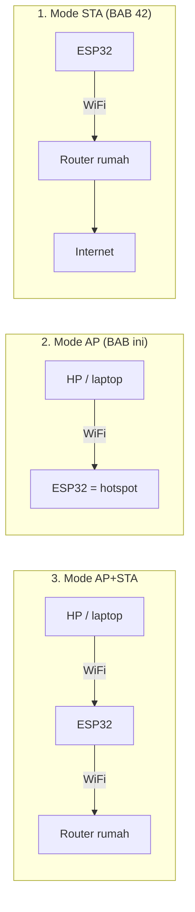
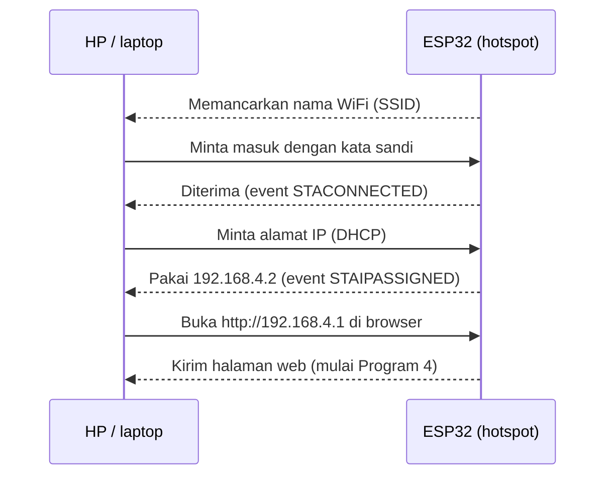

# BAB 43: WiFi Access Point — ESP32 sebagai Hotspot Mandiri

> ✅ **Prasyarat:** Selesaikan **BAB 42 (WiFi Station Mode — Koneksi Internet ESP32)** — kamu sudah mengenal SSID, alamat IP, dan cara ESP32 tersambung ke WiFi. Program 2 dan 3 membaca perintah dari Serial Monitor tanpa menunggu (**BAB 16 (Non-Blocking Programming)**), dan Program 3 menyimpan pengaturan di NVS (**BAB 39 (NVS — Non-Volatile Storage)**).

Di BAB 42, ESP32 menumpang di WiFi rumah atau kampus, sama seperti HP-mu. Di BAB ini perannya dibalik: ESP32 **menjadi "*router*"-nya sendiri**. ESP32 memancarkan nama WiFi, HP atau laptop menyambung ke sana, lalu kamu bisa mengendalikan LED dari *browser* — tanpa *router*, tanpa kuota, di mana pun. Cara kerjanya mirip fitur *hotspot* (*tethering*) di HP, bedanya *hotspot* ESP32 **tidak membagikan internet**. Pola ini dipakai banyak perangkat sungguhan, misalnya printer WiFi, kamera CCTV, dan lampu pintar yang saat pertama dipasang memancarkan WiFi sendiri untuk diatur lewat HP.

## 📌 Tujuan Pembelajaran

Setelah mempelajari BAB ini, kamu bisa:

- Menjelaskan perbedaan mode **Station (STA)**, **Access Point (AP)**, dan **AP+STA** dengan analogi sehari-hari.
- Membuat *hotspot* ESP32 dengan `WiFi.softAP()` dan memahami setiap parameternya: SSID, kata sandi, *channel*, SSID tersembunyi, dan jumlah perangkat maksimum.
- Menyambungkan HP/laptop ke *hotspot* ESP32 dan membuka `http://192.168.4.1`, termasuk mengatasi peringatan "tidak ada internet".
- Memantau perangkat yang tersambung dengan `WiFi.softAPgetStationNum()` dan *event* `ARDUINO_EVENT_WIFI_AP_STACONNECTED`, lengkap dengan MAC dan IP-nya.
- Mengganti alamat IP *hotspot* dengan `WiFi.softAPConfig()`.
- Menyimpan pengaturan *hotspot* di NVS supaya bisa diubah tanpa meng-*upload* ulang program.
- Membuat halaman kendali LED sederhana yang tetap berjalan tanpa internet.
- Menjalankan mode AP+STA dan memahami batasan *channel*-nya.
- Menerapkan kebiasaan aman (WPA2, kata sandi kuat) dan memahami hal-hal yang memengaruhi jangkauan sinyal.

## 🧰 Yang Perlu Disiapkan

| Kebutuhan | Keterangan |
|---|---|
| *Hardware* | Kit Bluino ESP32 IoT Starter Shield + kabel USB **data** |
| Kabel *jumper* | 4 kabel *female-female* untuk LED (hanya Program 4); program lain tidak perlu merangkai |
| Komponen tambahan | Tidak ada |
| *Software* | Arduino IDE 2.x + *board package* **esp32** versi 3.3.x (lihat [BAB 5](../BAB-05/README.md)) |
| *Library* | Tidak perlu *library* tambahan — `WiFi`, `WebServer`, dan `Preferences` sudah bawaan *board package* esp32 |
| Alat uji | **Serial Monitor** Arduino IDE (baud 115200; *line ending* **New Line** untuk Program 2 dan 3), **HP atau laptop** dengan WiFi, dan *browser* (Chrome, Firefox, Safari, atau Edge) |
| Jaringan | Program 1–4 **tidak perlu** *router* maupun internet. Program 5 (AP+STA) butuh WiFi rumah/kampus **2,4 GHz** |

## 📑 Daftar Isi

- [43.1 Apa Itu Access Point?](#431-apa-itu-access-point)
- [43.2 Istilah Penting di Mode AP](#432-istilah-penting-di-mode-ap)
- [43.3 Membuat Hotspot dengan WiFi.softAP()](#433-membuat-hotspot-dengan-wifisoftap)
- [43.4 Menyambungkan HP atau Laptop ke Hotspot ESP32](#434-menyambungkan-hp-atau-laptop-ke-hotspot-esp32)
- [43.5 Program 1: Hotspot Pertama](#435-program-1-hotspot-pertama)
- [43.6 Memantau Perangkat yang Tersambung](#436-memantau-perangkat-yang-tersambung)
- [43.7 Mengganti Alamat IP dengan softAPConfig()](#437-mengganti-alamat-ip-dengan-softapconfig)
- [43.8 Program 2: Pemantau Perangkat Tersambung](#438-program-2-pemantau-perangkat-tersambung)
- [43.9 Program 3: Hotspot yang Bisa Diatur dari Serial Monitor](#439-program-3-hotspot-yang-bisa-diatur-dari-serial-monitor)
- [43.10 Halaman Web di Mode AP: Tanpa Internet](#4310-halaman-web-di-mode-ap-tanpa-internet)
- [43.11 Program 4: Panel LED Lewat Browser](#4311-program-4-panel-led-lewat-browser)
- [43.12 Mode AP+STA: Hotspot Sekaligus Tersambung ke Router](#4312-mode-apsta-hotspot-sekaligus-tersambung-ke-router)
- [43.13 Program 5: Mode AP+STA](#4313-program-5-mode-apsta)
- [43.14 Keamanan dan Jangkauan Hotspot](#4314-keamanan-dan-jangkauan-hotspot)
- [43.15 Troubleshooting](#4315-troubleshooting)
- [📝 Rangkuman](#-rangkuman)
- [💪 Latihan](#-latihan)
- [📚 Referensi](#-referensi)

---

## 43.1 Apa Itu Access Point?

**Access Point** (AP, titik akses) adalah perangkat yang **memancarkan jaringan WiFi** dan menjadi pusat tempat perangkat lain bergabung. *Router* WiFi di rumahmu sebenarnya berisi sebuah *access point* (ditambah fungsi *router* dan modem yang tersambung ke internet).

Bayangkan sebuah rumah:

- **Mode Station (STA)** — ESP32 menjadi **tamu**. Ia datang ke rumah orang lain (*router*), harus tahu nama rumahnya (SSID) dan kuncinya (kata sandi). Ini yang kamu pelajari di [BAB 42](../BAB-42/README.md).
- **Mode Access Point (AP)** — ESP32 menjadi **tuan rumah**. Ia membuka rumahnya sendiri, memasang papan nama (SSID), dan memegang kuncinya. HP dan laptop yang datang diberi "nomor kursi" (alamat IP) oleh ESP32.
- **Mode AP+STA** — ESP32 menjadi tuan rumah **sekaligus** bertamu ke rumah lain pada saat yang sama.

Di ESP32, *access point* dibuat oleh perangkat lunak di dalam *chip*, bukan oleh *router* khusus. Karena itu namanya ***soft-AP*** (*software access point*), dan semua fungsinya berawalan `softAP`, misalnya `WiFi.softAP()` dan `WiFi.softAPIP()`.



*Gambar 43.1 — Tiga mode WiFi ESP32. Panah berarti "menyambung ke". Di mode AP tidak ada router dan tidak ada internet. Di mode AP+STA, ESP32 bisa ke internet lewat router, tetapi HP di hotspot-nya tidak. Sumber: dibuat untuk materi ini.*

| | Mode STA | Mode AP | Mode AP+STA |
|---|---|---|---|
| Konstanta di kode | `WIFI_STA` | `WIFI_AP` | `WIFI_AP_STA` |
| Peran ESP32 | Tamu di jaringan *router* | Tuan rumah (*hotspot*) | Keduanya sekaligus |
| Butuh *router*? | Ya | **Tidak** | Ya, untuk sisi STA |
| Ada internet? | Ya, kalau *router*-nya terhubung internet | **Tidak** | Hanya ESP32 yang bisa ke internet; perangkat di *hotspot*-nya tidak |
| Contoh pemakaian | Mengirim data sensor ke *cloud* ([BAB 50](../BAB-50/README.md)) | Kendali di lapangan, alat praktikum, halaman pengaturan | Portal pengaturan WiFi ([BAB 44](../BAB-44/README.md)) |

Kapan mode AP cocok dipakai?

- **Tidak ada WiFi di lokasi**, misalnya di kebun, lapangan, atau stan pameran.
- **Pengaturan awal perangkat.** Perangkat yang belum tahu nama dan kata sandi WiFi rumah bisa memancarkan WiFi sendiri dulu, lalu pemiliknya mengisi pengaturan lewat HP ([BAB 44](../BAB-44/README.md)).
- **Kendali jarak dekat** lewat HP tanpa aplikasi khusus — cukup *browser*.
- **Praktikum di kelas**, supaya puluhan ESP32 tidak membebani WiFi kampus.

Beberapa sifat mode AP di ESP32 yang perlu kamu ingat:

| Sifat | Keterangan |
|---|---|
| Tidak butuh *router* | ESP32 sendiri yang memancarkan WiFi dan membagikan alamat IP |
| Keamanan | Bisa memakai kata sandi WPA2 (disarankan) atau dibiarkan terbuka |
| Alamat IP bawaan | ESP32 = `192.168.4.1`; perangkat yang menyambung mendapat `192.168.4.2`, `192.168.4.3`, dan seterusnya |
| Jumlah perangkat | Bawaan 4, bisa diatur sampai 10 |
| Internet | **Tidak ada.** Halaman web dari ESP32 tetap bisa dibuka, tetapi situs lain tidak |
| Pita frekuensi | Hanya **2,4 GHz** (ESP32 tidak mendukung 5 GHz) |
| Daya | Radio harus terus menyala supaya perangkat bisa menyambung kapan saja, jadi pemakaian dayanya lebih besar daripada mode STA yang bisa "tidur" sebentar-sebentar (*modem sleep*). Kurang cocok untuk perangkat bertenaga baterai |

---

## 43.2 Istilah Penting di Mode AP

Sebagian istilah ini sudah muncul di [BAB 42](../BAB-42/README.md). Di sini kita lihat artinya dari sisi ESP32 sebagai tuan rumah.

| Istilah | Arti | Contoh di BAB ini |
|---|---|---|
| **SSID** (*Service Set Identifier*) | Nama WiFi yang muncul di daftar WiFi HP. Maksimal 32 karakter, peka huruf besar-kecil | `Bluino-AP-43` |
| **Kata sandi** dan **WPA2** | Kunci untuk masuk. WPA2 (*Wi-Fi Protected Access 2*) mengacak (mengenkripsi) data yang lewat udara. Panjang kata sandi WPA2 **8–63 karakter** | `bluino123` |
| **Klien** atau ***station*** | Perangkat yang menyambung ke *hotspot*: HP, laptop, atau ESP32 lain | HP-mu |
| **Alamat IP** | "Nomor rumah" setiap perangkat di jaringan, dipakai untuk saling mengirim data | ESP32 `192.168.4.1`, HP `192.168.4.2` |
| **DHCP** (*Dynamic Host Configuration Protocol*) | Layanan yang membagikan alamat IP secara otomatis. Di mode AP, **ESP32 sendiri** yang menjalankan *DHCP server* | HP otomatis mendapat `192.168.4.2` |
| ***Channel*** | "Jalur" frekuensi di pita 2,4 GHz. *Hotspot* memakai satu *channel* | *Channel* 1 |
| **Alamat MAC** | Nomor identitas kartu jaringan, 6 byte, ditulis seperti `5A:3C:91:0E:7B:22` | Dipakai untuk mengenali HP yang masuk |

> 📌 **Catatan:** ESP32 hanya mendukung WiFi **2,4 GHz**, jadi *hotspot*-nya juga hanya 2,4 GHz. Hampir semua HP dan laptop mendukung 2,4 GHz, jadi *hotspot* ESP32 akan tetap terlihat. SSID dan kata sandi **peka huruf besar-kecil**: `Bluino-AP-43` berbeda dengan `bluino-ap-43`.

---

## 43.3 Membuat Hotspot dengan WiFi.softAP()

Semua fungsi WiFi ada di *library* `WiFi.h` yang sudah bawaan *board package* esp32. Fungsi utamanya `WiFi.softAP()`:

```cpp
WiFi.softAP(ssid, password, channel, ssid_hidden, max_connection);
```

Hanya `ssid` yang wajib diisi. Parameter lain boleh dihilangkan dari belakang; yang tidak ditulis memakai nilai bawaan.

| Parameter | Arti | Nilai bawaan | Aturan |
|---|---|---|---|
| `ssid` | Nama *hotspot* | — (wajib) | 1–32 karakter, tidak boleh kosong |
| `password` | Kata sandi WPA2 | `NULL` (terbuka) | `NULL` atau `""` = jaringan **terbuka** tanpa kata sandi. Selain itu **minimal 8**, maksimal 63 karakter |
| `channel` | *Channel* radio | `1` | Pakai 1–11 (lihat tabel *channel* di bawah) |
| `ssid_hidden` | Menyembunyikan nama *hotspot* | `0` | `0` = nama tampil, `1` = tersembunyi |
| `max_connection` | Jumlah perangkat maksimum yang boleh tersambung bersamaan | `4` | 1–10 |

Contoh pemakaian (potongan kode, ditulis di dalam `setup()`):

```cpp
WiFi.softAP("Bluino-AP-43", "bluino123");               // paling sering dipakai
WiFi.softAP("Bluino-AP-43", "bluino123", 6, 0, 2);      // channel 6, nama tampil, maks. 2 perangkat
WiFi.softAP("Bluino-Uji");                              // tanpa kata sandi — hanya untuk uji coba singkat
```

`WiFi.softAP()` mengembalikan `true` kalau *hotspot* berhasil dibuat dan `false` kalau gagal. **Selalu periksa hasilnya.** Penyebab gagal yang paling sering adalah kata sandi 1–7 karakter: *hotspot* tidak dibuat, dan pesan *error*-nya (`passphrase too short!`) tidak terlihat di Serial Monitor karena pengaturan bawaan **Tools → Core Debug Level** adalah **None**. Jadi program kita sendiri yang harus mencetak pesan gagal.

Beberapa fakta yang perlu kamu tahu (diperiksa pada *board package* esp32 3.3.12):

- *Hotspot* memakai keamanan **WPA2-PSK** dengan enkripsi AES (CCMP) secara bawaan, selama kata sandinya diisi.
- Alamat IP ESP32 di mode AP otomatis **`192.168.4.1`**. *DHCP server* langsung aktif dan membagikan alamat IP ke setiap perangkat yang menyambung.
- `max_connection` bawaannya 4. Pada *board package* 3.3.x, ESP32 bisa menerima **paling banyak 10** perangkat, karena kunci enkripsi di *hardware* dipakai bersama dengan ESP-NOW ([BAB 54](../BAB-54/README.md)). Makin banyak perangkat, makin lambat respons ESP32, jadi isi sesuai kebutuhan.
- Fungsi `softAP()` juga punya parameter lanjutan (misalnya jenis keamanan `auth_mode`), tetapi untuk BAB ini lima parameter di atas sudah cukup.

Fungsi pendukung yang sering dipakai:

| Fungsi | Hasil |
|---|---|
| `WiFi.mode(WIFI_AP)` | Menjadikan ESP32 *access point*. Panggil sebelum `softAP()` supaya jelas mode apa yang dipakai |
| `WiFi.softAPIP()` | Alamat IP *hotspot*, misalnya `192.168.4.1` |
| `WiFi.softAPSSID()` | Nama *hotspot* yang sedang dipancarkan |
| `WiFi.softAPmacAddress()` | Alamat MAC *hotspot* (berbeda dari MAC mode STA) |
| `WiFi.softAPgetStationNum()` | Jumlah perangkat yang sedang tersambung |
| `WiFi.channel()` | *Channel* yang sedang dipakai radio ESP32 |
| `WiFi.softAPdisconnect(true)` | Mematikan *hotspot* (dan antarmuka AP-nya) |

### 43.3.1 Memilih Channel

Pita 2,4 GHz dibagi menjadi beberapa *channel* yang jaraknya hanya 5 MHz, padahal satu sinyal WiFi memakai lebar sekitar 20 MHz. Akibatnya *channel* yang berdekatan saling tumpang-tindih dan saling mengganggu. Tiga *channel* yang **tidak** saling tumpang-tindih adalah 1, 6, dan 11.

| *Channel* | Frekuensi tengah | Rekomendasi |
|---|---|---|
| 1 | 2,412 GHz | Disarankan |
| 6 | 2,437 GHz | Disarankan |
| 11 | 2,462 GHz | Disarankan |
| 2–5, 7–10 | Di antara *channel* di atas | Hindari — tumpang-tindih dengan *channel* 1, 6, atau 11 di dekatnya |
| 12–13 | 2,467–2,472 GHz | Hindari — dengan pengaturan negara bawaan ESP-IDF (mode *world safe*, *channel* 1–11) bisa ditolak |

> 💡 **Tips:** Kalau di sekitarmu banyak WiFi lain, pilih *channel* 1, 6, atau 11 yang paling sepi. Kamu bisa melihatnya dengan contoh pemindai WiFi (`WiFi.scanNetworks()`) di [BAB 42](../BAB-42/README.md), atau aplikasi penganalisis WiFi di HP Android (cari "WiFi Analyzer" di Play Store).

---

## 43.4 Menyambungkan HP atau Laptop ke Hotspot ESP32

Menyambung ke *hotspot* ESP32 sama seperti menyambung ke WiFi biasa:

1. **Buka daftar WiFi.**
   - Android: **Setelan → Wi-Fi** (atau tekan lama ikon WiFi di panel notifikasi).
   - iPhone/iPad: **Pengaturan → Wi-Fi**.
   - Windows: klik ikon WiFi di pojok kanan bawah *taskbar*.
   - macOS: klik ikon WiFi di bilah menu kanan atas.
2. **Tunggu beberapa detik** sampai nama *hotspot* ESP32 (misalnya `Bluino-AP-43`) muncul, lalu ketuk/klik.
3. **Masukkan kata sandi** persis seperti di kode (peka huruf besar-kecil), lalu pilih **Sambungkan**/**Gabung**/**Connect**.
4. HP/laptop akan menampilkan tulisan seperti **"Tidak ada internet"** atau **"No internet"**. Ini **normal** — *hotspot* ESP32 memang tidak punya internet. Lihat tabel di bawah supaya HP tetap tersambung.
5. Kalau program menjalankan *web server* (mulai Program 4), buka *browser* dan ketik **`http://192.168.4.1`** di kolom alamat. Tulis lengkap dengan `http://` dan jangan diketik di kolom pencarian Google.

Di balik layar, langkah-langkah di atas terjadi dalam urutan berikut:



*Gambar 43.2 — Urutan kejadian saat HP menyambung ke hotspot ESP32. Nama event di dalam kurung dibahas di [43.6](#436-memantau-perangkat-yang-tersambung). Sumber: dibuat untuk materi ini.*

### 43.4.1 Supaya HP Tidak Pindah ke Data Seluler

Saat sebuah WiFi tidak punya internet, HP dan laptop modern berusaha "menyelamatkan" koneksi: mereka memakai data seluler untuk *browsing*, atau pindah ke WiFi lain yang punya internet. Akibatnya alamat `192.168.4.1` tidak bisa dibuka walaupun HP terlihat tersambung ke *hotspot* ESP32.

| Perangkat | Yang biasanya terjadi | Yang perlu kamu lakukan |
|---|---|---|
| Android | Muncul notifikasi "Wi-Fi tidak memiliki akses internet". Sebagian HP diam-diam memakai data seluler | Ketuk notifikasinya, pilih **Ya**/**Tetap sambungkan** (centang "Jangan tanya lagi" kalau ada). Kalau halaman tetap tidak terbuka, **matikan data seluler** sementara. Matikan juga fitur seperti **Beralih ke data seluler otomatis**, *Adaptive Wi-Fi*, atau *Intelligent Wi-Fi* — nama menunya berbeda di setiap merek |
| iPhone/iPad | Di bawah nama WiFi tertulis "Tidak Ada Sambungan Internet", tetapi tetap tersambung | Biasanya tidak perlu apa-apa. Kalau halaman tidak terbuka, matikan Data Seluler sementara, atau matikan fitur **Bantuan Wi-Fi** (*Wi-Fi Assist*) di **Pengaturan → Seluler** — di iOS terbaru fitur ini bernama *Connectivity Assist* dan letaknya di **Pengaturan → Wi-Fi** |
| Windows / macOS | Ikon WiFi bertanda "Tidak ada internet" | Biasanya tidak perlu apa-apa. Kalau laptop pindah sendiri ke WiFi rumah, matikan sementara pilihan **Sambungkan secara otomatis** (*Connect automatically*) pada WiFi rumah itu |

> 💡 **Tips:** HP juga bisa tiba-tiba pindah kembali ke WiFi rumah yang lebih kuat sinyalnya. Kalau itu terjadi, sambungkan ulang ke *hotspot* ESP32, atau "lupakan" (*forget*) WiFi rumah selama praktik.

> 📌 **Catatan:** Halaman otomatis yang langsung muncul saat tersambung ke WiFi hotel atau kafe disebut ***captive portal***. Untuk membuatnya, ESP32 butuh *DNS server* tambahan — topik ini dibahas di [BAB 44](../BAB-44/README.md). Di BAB ini kamu membuka alamat `http://192.168.4.1` secara manual.

---

## 43.5 Program 1: Hotspot Pertama

**Tujuan:** Menyalakan *hotspot* WiFi `Bluino-AP-43` dari ESP32, menampilkan nama, alamat IP, dan alamat MAC-nya, lalu melaporkan jumlah perangkat yang tersambung setiap 5 detik.

**Rangkaian:**

*Tidak perlu merangkai — program ini hanya memakai WiFi bawaan ESP32.*

**Cara Menjalankan:**

1. Buka Arduino IDE → **File → New Sketch**, hapus isinya, lalu salin kode di bawah. Kode yang sama juga tersedia di *file* [`p1_hotspot_pertama.ino`](p1_hotspot_pertama/p1_hotspot_pertama.ino).
2. Pastikan **Tools → Board** = **ESP32 Dev Module** dan **Tools → Port** = *port* ESP32 kamu (misalnya `COM5` di Windows atau `/dev/ttyUSB0` di Linux).
3. Klik tombol **Upload** (ikon panah →) dan tunggu sampai muncul tulisan **Done uploading**.
4. Buka **Serial Monitor** (**Tools → Serial Monitor**) lalu pilih baud **115200**. Tekan tombol **EN** di ESP32 kalau tulisan awal terlewat.
5. Di HP atau laptop, sambungkan ke WiFi **`Bluino-AP-43`** dengan kata sandi **`bluino123`** (langkahnya di [43.4](#434-menyambungkan-hp-atau-laptop-ke-hotspot-esp32)).
6. Perhatikan angka "Perangkat tersambung" di Serial Monitor. Coba sambungkan perangkat kedua, lalu putuskan salah satunya.

**Kode Program:**

<!-- sketch: p1_hotspot_pertama -->
```cpp
/*
 * BAB 43 - Program 1: Hotspot Pertama
 * ESP32 memancarkan WiFi sendiri (mode Access Point).
 * Sambungkan HP/laptop ke "Bluino-AP-43" dengan kata sandi "bluino123",
 * lalu lihat jumlah perangkat yang tersambung di Serial Monitor.
 */

#include <WiFi.h>

// ── Pengaturan hotspot ─────────────────────────────────────────────
const char *AP_SSID     = "Bluino-AP-43";  // nama WiFi yang muncul di HP
const char *AP_PASSWORD = "bluino123";     // minimal 8 karakter!

// ── Laporan berkala tanpa delay() (pola BAB 16) ────────────────────
const unsigned long INTERVAL_LAPORAN = 5000;  // 5 detik
unsigned long waktuLaporanTerakhir = 0;

void setup() {
  Serial.begin(115200);
  delay(500);
  Serial.println();
  Serial.println("=== BAB 43 Program 1: Hotspot Pertama ===");

  WiFi.mode(WIFI_AP);  // jadikan ESP32 access point

  // Nyalakan hotspot. Hasilnya true kalau berhasil.
  if (!WiFi.softAP(AP_SSID, AP_PASSWORD)) {
    Serial.println("Gagal membuat hotspot! Periksa kata sandi (minimal 8 karakter).");
    while (true) {
      delay(1000);  // berhenti di sini
    }
  }

  Serial.println("Hotspot aktif!");
  Serial.print("Nama WiFi (SSID) : ");
  Serial.println(WiFi.softAPSSID());
  Serial.print("Kata sandi       : ");
  Serial.println(AP_PASSWORD);
  Serial.print("Alamat IP ESP32  : ");
  Serial.println(WiFi.softAPIP());
  Serial.print("MAC hotspot      : ");
  Serial.println(WiFi.softAPmacAddress());
  Serial.println("Sambungkan HP/laptop ke WiFi di atas.");
}

void loop() {
  unsigned long sekarang = millis();
  if (sekarang - waktuLaporanTerakhir >= INTERVAL_LAPORAN) {
    waktuLaporanTerakhir = sekarang;
    Serial.print("Perangkat tersambung: ");
    Serial.println(WiFi.softAPgetStationNum());
  }
}
```

**Penjelasan Kode:**

1. `#include <WiFi.h>` memuat *library* WiFi bawaan *board package* esp32.
2. `WiFi.mode(WIFI_AP)` menyalakan radio WiFi dalam mode *access point*.
3. `WiFi.softAP(AP_SSID, AP_PASSWORD)` membuat *hotspot* dengan *channel* 1 dan maksimal 4 perangkat (nilai bawaan). Kalau hasilnya `false`, program mencetak pesan lalu berhenti di `while (true)`, supaya kamu langsung tahu ada yang salah.
4. Alamat IP tidak diatur sama sekali, jadi ESP32 memakai alamat bawaan `192.168.4.1`. `WiFi.softAPIP()` menampilkannya.
5. Di `loop()`, `WiFi.softAPgetStationNum()` dipanggil setiap 5 detik dengan pola `millis()` dari [BAB 16](../BAB-16/README.md). Fungsi ini menghitung perangkat yang **sedang** tersambung.

**Contoh Output:**

```text
=== BAB 43 Program 1: Hotspot Pertama ===
Hotspot aktif!
Nama WiFi (SSID) : Bluino-AP-43
Kata sandi       : bluino123
Alamat IP ESP32  : 192.168.4.1
MAC hotspot      : 24:6F:28:A1:B2:C5
Sambungkan HP/laptop ke WiFi di atas.
Perangkat tersambung: 0
Perangkat tersambung: 0
Perangkat tersambung: 1
Perangkat tersambung: 2
Perangkat tersambung: 1
```

Alamat MAC milikmu pasti berbeda — setiap ESP32 punya MAC sendiri. Di HP, WiFi `Bluino-AP-43` muncul di daftar dengan ikon gembok (artinya berkata sandi). Setelah tersambung, HP menampilkan "Tidak ada internet" — itu normal.

> 📌 **Catatan:** Program ini **belum** punya halaman web. Kalau sekarang kamu membuka `http://192.168.4.1` di *browser*, yang muncul adalah pesan seperti "Situs ini tidak dapat dijangkau". Halaman web baru dibuat di [Program 4](#4311-program-4-panel-led-lewat-browser).

**Kalau Belum Berhasil:**

- **Serial Monitor menulis `Gagal membuat hotspot!`** → kata sandi kurang dari 8 karakter. Ganti dengan kata sandi 8–63 karakter, lalu *upload* ulang.
- **Nama `Bluino-AP-43` tidak muncul di HP** → tunggu 5–10 detik lalu segarkan daftar WiFi (matikan-nyalakan WiFi HP). Pastikan Serial Monitor sudah menulis `Hotspot aktif!`.
- **HP menolak dengan pesan "Kata sandi salah" atau "Masalah autentikasi"** → kata sandi peka huruf besar-kecil. Kalau sebelumnya kamu pernah menyambung ke SSID yang sama dengan kata sandi lain, pilih **Lupakan** (*Forget*) jaringan itu di HP, lalu sambungkan ulang.
- **Muncul WiFi bernama `ESP_` diikuti 6 huruf/angka, atau nama *hotspot* dari program sebelumnya** → `softAP()` gagal, sehingga ESP32 memancarkan pengaturan lama/bawaan. Perbaiki kata sandinya (lihat poin pertama).

---

## 43.6 Memantau Perangkat yang Tersambung

Ada dua cara untuk mengetahui siapa saja yang tersambung ke *hotspot*:

1. **Bertanya berkala** (*polling*) — seperti sesekali melihat buku tamu. `WiFi.softAPgetStationNum()` menjawab "ada berapa perangkat sekarang?". Cara ini dipakai Program 1.
2. ***Event*** — seperti bel pintu: ESP32 langsung memberi tahu saat ada perangkat masuk atau keluar. Kamu mendaftarkan sebuah fungsi *callback* ([BAB 18](../BAB-18/README.md)) dengan `WiFi.onEvent()`, dan fungsi itu dipanggil otomatis setiap ada kejadian WiFi.

*Event* yang berhubungan dengan *hotspot*:

| *Event* | Kapan terjadi | Data yang tersedia di `info` |
|---|---|---|
| `ARDUINO_EVENT_WIFI_AP_START` | *Hotspot* mulai memancar | — |
| `ARDUINO_EVENT_WIFI_AP_STOP` | *Hotspot* dimatikan | — |
| `ARDUINO_EVENT_WIFI_AP_STACONNECTED` | Perangkat berhasil masuk (kata sandinya benar) | `info.wifi_ap_staconnected.mac` (alamat MAC) |
| `ARDUINO_EVENT_WIFI_AP_STAIPASSIGNED` | *DHCP server* memberi alamat IP ke perangkat | `info.wifi_ap_staipassigned.ip` dan `.mac` |
| `ARDUINO_EVENT_WIFI_AP_STADISCONNECTED` | Perangkat keluar atau terputus | `info.wifi_ap_stadisconnected.mac` |

Contoh potongan kode:

```cpp
// Fungsi ini dipanggil otomatis setiap ada kejadian WiFi
void onWiFiEvent(WiFiEvent_t event, WiFiEventInfo_t info) {
  if (event == ARDUINO_EVENT_WIFI_AP_STACONNECTED) {
    Serial.println("Ada perangkat baru tersambung!");
  }
}

// Di setup(), SEBELUM hotspot dinyalakan:
WiFi.onEvent(onWiFiEvent);
```

Hal yang perlu diperhatikan:

- Daftarkan *event* **sebelum** `WiFi.mode()` dan `WiFi.softAP()`, supaya tidak ada kejadian yang terlewat.
- Fungsi *event* berjalan di *task* terpisah milik ESP32 (bernama `arduino_events`), bukan di dalam `loop()`. Ini **bukan** *interrupt* seperti di [BAB 10](../BAB-10/README.md), jadi `Serial.print()` boleh dipakai. Meskipun begitu, buat isinya singkat: jangan memakai `delay()` panjang di sana.
- Perangkat yang salah memasukkan kata sandi tidak pernah mendapat alamat IP, jadi *event* `STAIPASSIGNED` tidak muncul untuknya.

> 📌 **Catatan:** Alamat MAC HP yang terlihat di ESP32 sering **bukan** MAC asli HP. Android 10 ke atas dan iOS 14 ke atas memakai **alamat MAC acak** (*private address*) yang berbeda untuk setiap WiFi demi privasi. Jadi jangan memakai MAC untuk mengenali pemilik HP secara pasti.

---

## 43.7 Mengganti Alamat IP dengan softAPConfig()

Alamat bawaan `192.168.4.1` sudah cukup untuk sebagian besar proyek. Kamu perlu menggantinya kalau:

- Memakai mode **AP+STA** dan *router* rumahmu kebetulan juga memakai alamat `192.168.4.x` — dua jaringan dengan alamat yang sama membuat ESP32 bingung harus mengirim data lewat jalur mana (lihat [43.12](#4312-mode-apsta-hotspot-sekaligus-tersambung-ke-router)).
- Ingin alamat yang mudah diingat atau sesuai aturan jaringan di tempatmu.

Gunakan `WiFi.softAPConfig()` (potongan kode):

```cpp
IPAddress ipHotspot(192, 168, 10, 1);   // alamat IP ESP32
IPAddress gateway(192, 168, 10, 1);     // isi sama dengan alamat IP ESP32
IPAddress subnet(255, 255, 255, 0);     // subnet mask

WiFi.mode(WIFI_AP);
WiFi.softAPConfig(ipHotspot, gateway, subnet);  // atur IP dulu...
WiFi.softAP("Bluino-AP-43", "bluino123");       // ...lalu nyalakan hotspot
```

Aturan yang perlu dipatuhi:

| Parameter | Isi | Keterangan |
|---|---|---|
| Alamat IP | Alamat **privat**, berakhiran `.1` | Misalnya `192.168.10.1` atau `10.0.0.1`. Jangan memakai alamat internet publik |
| *Gateway* | **Sama** dengan alamat IP | ESP32 sendiri yang menjadi "gerbang" jaringan *hotspot* |
| *Subnet mask* | `255.255.255.0` (paling umum) | Boleh `255.255.255.0` sampai `255.255.255.240`; selain itu `softAPConfig()` mengembalikan `false` |

Setelah `softAPConfig()`, *DHCP server* membagikan alamat mulai dari **alamat ESP32 + 1**. Untuk contoh di atas, HP pertama mendapat `192.168.10.2`, perangkat berikutnya `192.168.10.3`, dan seterusnya.

> 💡 **Tips:** Panggil `softAPConfig()` **sebelum** `softAP()`, seperti contoh resmi ESP32. Di *board package* 3.x urutan sebaliknya juga berhasil, tetapi perangkat yang sudah tersambung harus menyambung ulang untuk mendapat alamat baru.

> 📌 **Catatan:** Mengganti alamat IP **tidak** membuat *hotspot* lebih aman. Keamanan ditentukan oleh kata sandi WPA2, bukan oleh angka alamat IP. Alasan memilih alamat lain hanyalah supaya tidak bentrok dengan jaringan lain yang dipakai bersamaan (mode AP+STA).

---

## 43.8 Program 2: Pemantau Perangkat Tersambung

**Tujuan:** Membuat *hotspot* dengan alamat IP sendiri (`192.168.10.1`), menampilkan setiap perangkat yang masuk, mendapat IP, dan keluar memakai *event*, serta menampilkan daftar perangkat (MAC, IP, dan kekuatan sinyal) saat kamu mengetik `daftar` di Serial Monitor.

**Rangkaian:**

*Tidak perlu merangkai — program ini hanya memakai WiFi bawaan ESP32.*

**Cara Menjalankan:**

1. Buka Arduino IDE → **File → New Sketch**, hapus isinya, lalu salin kode di bawah. Kode yang sama juga tersedia di *file* [`p2_pemantau_perangkat.ino`](p2_pemantau_perangkat/p2_pemantau_perangkat.ino).
2. Pastikan **Tools → Board** = **ESP32 Dev Module** dan **Tools → Port** = *port* ESP32 kamu.
3. Klik **Upload** dan tunggu sampai muncul tulisan **Done uploading**.
4. Buka **Serial Monitor**, pilih baud **115200**, lalu ubah *line ending* di sebelahnya menjadi **New Line**.
5. Sambungkan HP/laptop ke WiFi **`Bluino-AP-43`** (kata sandi **`bluino123`**). Perhatikan pesan `[EVENT]` yang muncul.
6. Ketik `daftar` di kolom pesan Serial Monitor (kolom bertuliskan *Message* di bagian atas panel Serial Monitor), lalu tekan **Enter**.
7. Matikan WiFi HP, lalu perhatikan pesan perangkat keluar.

**Kode Program:**

<!-- sketch: p2_pemantau_perangkat -->
```cpp
/*
 * BAB 43 - Program 2: Pemantau Perangkat Tersambung
 * - Hotspot memakai alamat IP sendiri (192.168.10.1) lewat softAPConfig()
 * - Event WiFi memberi tahu saat perangkat masuk, mendapat IP, dan keluar
 * - Ketik "daftar" di Serial Monitor (line ending: New Line) untuk melihat
 *   MAC, IP, dan kekuatan sinyal setiap perangkat
 */

#include <WiFi.h>
#include <esp_wifi.h>                  // esp_wifi_ap_get_sta_list()
#include <esp_wifi_ap_get_sta_list.h>  // esp_wifi_ap_get_sta_list_with_ip()

// ── Pengaturan hotspot ─────────────────────────────────────────────
const char *AP_SSID     = "Bluino-AP-43";
const char *AP_PASSWORD = "bluino123";

const IPAddress AP_IP(192, 168, 10, 1);
const IPAddress AP_GATEWAY(192, 168, 10, 1);  // sama dengan AP_IP
const IPAddress AP_SUBNET(255, 255, 255, 0);

String bufferPerintah = "";  // menampung huruf dari Serial Monitor

// Ubah 6 byte alamat MAC menjadi teks "AA:BB:CC:DD:EE:FF"
String macKeTeks(const uint8_t *mac) {
  char teks[18];
  snprintf(teks, sizeof(teks), "%02X:%02X:%02X:%02X:%02X:%02X",
           mac[0], mac[1], mac[2], mac[3], mac[4], mac[5]);
  return String(teks);
}

// Dipanggil otomatis oleh ESP32 setiap ada kejadian WiFi
void onWiFiEvent(WiFiEvent_t event, WiFiEventInfo_t info) {
  switch (event) {
    case ARDUINO_EVENT_WIFI_AP_STACONNECTED:
      Serial.printf("[EVENT] Perangkat masuk  : %s\n",
                    macKeTeks(info.wifi_ap_staconnected.mac).c_str());
      break;

    case ARDUINO_EVENT_WIFI_AP_STAIPASSIGNED:
      Serial.printf("[EVENT] IP diberikan     : %s -> %s\n",
                    macKeTeks(info.wifi_ap_staipassigned.mac).c_str(),
                    IPAddress(info.wifi_ap_staipassigned.ip.addr).toString().c_str());
      break;

    case ARDUINO_EVENT_WIFI_AP_STADISCONNECTED:
      Serial.printf("[EVENT] Perangkat keluar : %s\n",
                    macKeTeks(info.wifi_ap_stadisconnected.mac).c_str());
      break;

    default:
      break;  // event lain diabaikan
  }
}

// Tampilkan semua perangkat yang sedang tersambung
void tampilkanDaftar() {
  wifi_sta_list_t daftarWifi;      // MAC + kekuatan sinyal
  wifi_sta_mac_ip_list_t daftarIp; // MAC + alamat IP

  if (esp_wifi_ap_get_sta_list(&daftarWifi) != ESP_OK ||
      esp_wifi_ap_get_sta_list_with_ip(&daftarWifi, &daftarIp) != ESP_OK) {
    Serial.println("Gagal membaca daftar perangkat.");
    return;
  }

  Serial.printf("Perangkat tersambung: %d\n", daftarWifi.num);
  for (int i = 0; i < daftarWifi.num; i++) {
    IPAddress ip(daftarIp.sta[i].ip.addr);
    Serial.printf("  %d. MAC %s | IP %s | sinyal %d dBm\n",
                  i + 1,
                  macKeTeks(daftarWifi.sta[i].mac).c_str(),
                  ip.toString().c_str(),
                  daftarWifi.sta[i].rssi);
  }
}

void setup() {
  Serial.begin(115200);
  delay(500);
  Serial.println();
  Serial.println("=== BAB 43 Program 2: Pemantau Perangkat Tersambung ===");

  WiFi.onEvent(onWiFiEvent);  // daftarkan event SEBELUM hotspot menyala
  WiFi.mode(WIFI_AP);

  if (!WiFi.softAPConfig(AP_IP, AP_GATEWAY, AP_SUBNET)) {
    Serial.println("Gagal mengatur alamat IP hotspot! Periksa AP_IP, AP_GATEWAY, AP_SUBNET.");
    while (true) {
      delay(1000);
    }
  }

  if (!WiFi.softAP(AP_SSID, AP_PASSWORD)) {
    Serial.println("Gagal membuat hotspot! Periksa kata sandi (minimal 8 karakter).");
    while (true) {
      delay(1000);
    }
  }

  Serial.printf("Hotspot \"%s\" aktif. IP ESP32: %s\n",
                AP_SSID, WiFi.softAPIP().toString().c_str());
  Serial.println("Ketik daftar lalu Enter untuk melihat perangkat yang tersambung.");
}

void loop() {
  // Baca perintah dari Serial Monitor tanpa menunggu (pola BAB 16)
  while (Serial.available() > 0) {
    char huruf = Serial.read();
    if (huruf == '\n') {
      bufferPerintah.trim();
      bufferPerintah.toLowerCase();
      if (bufferPerintah == "daftar") {
        tampilkanDaftar();
      } else if (bufferPerintah.length() > 0) {
        Serial.println("Perintah tidak dikenal. Ketik: daftar");
      }
      bufferPerintah = "";
    } else if (huruf != '\r' && bufferPerintah.length() < 40) {
      bufferPerintah += huruf;
    }
  }
}
```

**Penjelasan Kode:**

1. **Dua *header* tambahan.** `esp_wifi.h` dan `esp_wifi_ap_get_sta_list.h` adalah bagian dari ESP-IDF (kerangka program resmi Espressif yang menjadi dasar *board package* esp32). Keduanya sudah ikut terpasang, jadi tidak perlu menginstal apa pun.
2. **`softAPConfig()` sebelum `softAP()`.** Alamat ESP32 menjadi `192.168.10.1`, sehingga perangkat yang menyambung mendapat `192.168.10.2`, `192.168.10.3`, dan seterusnya.
3. **`macKeTeks()`** mengubah 6 byte alamat MAC menjadi teks berformat `AA:BB:CC:DD:EE:FF` dengan `snprintf()`. `%02X` artinya "tulis dalam heksadesimal huruf besar, 2 digit".
4. **`onWiFiEvent()`** memeriksa jenis kejadian dengan `switch`. Data tambahan diambil dari `info`: MAC dari `info.wifi_ap_staconnected.mac`, alamat IP dari `info.wifi_ap_staipassigned.ip.addr` yang diubah menjadi `IPAddress` supaya bisa dicetak.
5. **`tampilkanDaftar()`** meminta dua daftar ke ESP-IDF: `esp_wifi_ap_get_sta_list()` (MAC dan kekuatan sinyal) dan `esp_wifi_ap_get_sta_list_with_ip()` (alamat IP untuk setiap MAC tadi). Kekuatan sinyal (RSSI, *Received Signal Strength Indicator*) dalam dBm: makin mendekati 0 makin kuat, misalnya −40 dBm lebih kuat daripada −75 dBm.
6. **`loop()`** mengumpulkan huruf dari Serial Monitor sampai bertemu karakter baris baru (`'\n'`), lalu memproses perintahnya — tanpa menunggu, sehingga *event* tetap tercetak kapan pun.

**Contoh Output:**

```text
=== BAB 43 Program 2: Pemantau Perangkat Tersambung ===
Hotspot "Bluino-AP-43" aktif. IP ESP32: 192.168.10.1
Ketik daftar lalu Enter untuk melihat perangkat yang tersambung.
[EVENT] Perangkat masuk  : 5A:3C:91:0E:7B:22
[EVENT] IP diberikan     : 5A:3C:91:0E:7B:22 -> 192.168.10.2
[EVENT] Perangkat masuk  : 1C:BF:CE:44:A0:19
[EVENT] IP diberikan     : 1C:BF:CE:44:A0:19 -> 192.168.10.3
Perangkat tersambung: 2
  1. MAC 5A:3C:91:0E:7B:22 | IP 192.168.10.2 | sinyal -38 dBm
  2. MAC 1C:BF:CE:44:A0:19 | IP 192.168.10.3 | sinyal -61 dBm
[EVENT] Perangkat keluar : 1C:BF:CE:44:A0:19
```

Alamat MAC dan angka sinyal di atas hanya contoh — angkamu pasti berbeda. Coba jauhkan HP dari ESP32 lalu ketik `daftar` lagi: angka sinyalnya makin negatif (makin lemah).

> 📌 **Catatan:** Pesan `Perangkat keluar` langsung muncul kalau HP mematikan WiFi atau memilih putus. Kalau HP hanya dibawa keluar jangkauan, ESP32 baru menganggapnya keluar setelah beberapa menit tidak ada kabar dari HP itu.

**Kalau Belum Berhasil:**

- **Mengetik `daftar` tidak menghasilkan apa-apa** → *line ending* Serial Monitor masih **No Line Ending**. Ganti menjadi **New Line**, lalu kirim ulang.
- **Muncul `Perangkat masuk`, tetapi tidak pernah `IP diberikan`** → HP memakai alamat IP statis untuk WiFi ini. Di pengaturan WiFi HP, ubah **Setelan IP** menjadi **DHCP**.
- **IP di daftar tertulis `0.0.0.0`** → perangkat baru saja masuk dan belum selesai meminta alamat IP. Tunggu beberapa detik, lalu ketik `daftar` lagi.
- **Serial Monitor menulis `Gagal mengatur alamat IP hotspot!`** → periksa angka di `AP_IP`, `AP_GATEWAY`, dan `AP_SUBNET` (aturan di [43.7](#437-mengganti-alamat-ip-dengan-softapconfig)).

---

## 43.9 Program 3: Hotspot yang Bisa Diatur dari Serial Monitor

**Tujuan:** Mengubah nama, kata sandi, *channel*, jumlah perangkat maksimum, dan pilihan SSID tersembunyi lewat perintah di Serial Monitor. Pengaturan disimpan di NVS ([BAB 39](../BAB-39/README.md)), jadi tetap dipakai walaupun ESP32 dimatikan — tanpa meng-*upload* ulang program.

**Rangkaian:**

*Tidak perlu merangkai — program ini hanya memakai WiFi bawaan ESP32.*

**Cara Menjalankan:**

1. Buka Arduino IDE → **File → New Sketch**, hapus isinya, lalu salin kode di bawah. Kode yang sama juga tersedia di *file* [`p3_hotspot_diatur.ino`](p3_hotspot_diatur/p3_hotspot_diatur.ino).
2. Pastikan **Tools → Board** = **ESP32 Dev Module** dan **Tools → Port** = *port* ESP32 kamu.
3. Klik **Upload** dan tunggu sampai muncul tulisan **Done uploading**.
4. Buka **Serial Monitor**, pilih baud **115200**, dan *line ending* **New Line**.
5. Ketik `bantuan` lalu **Enter** untuk melihat daftar perintah. Coba urutan berikut:
   - `ssid Lab IoT Kelompok 1` → mengganti nama *hotspot* (boleh memakai spasi).
   - `sandi rahasiaKelompok1` → mengganti kata sandi.
   - `channel 6` → pindah ke *channel* 6.
   - `status` → memeriksa pengaturan.
   - `simpan` → menyimpan ke NVS dan me-*restart* ESP32. Setelah *restart*, *hotspot* baru muncul di daftar WiFi HP.
6. Cabut kabel USB, colokkan lagi, lalu buka Serial Monitor: pengaturan barumu masih dipakai. Ketik `reset` untuk kembali ke `Bluino-AP-43` / `bluino123`.

**Kode Program:**

<!-- sketch: p3_hotspot_diatur -->
```cpp
/*
 * BAB 43 - Program 3: Hotspot yang Bisa Diatur dari Serial Monitor
 * Pengaturan hotspot diubah lewat perintah di Serial Monitor
 * (line ending: New Line), disimpan di NVS, lalu dipakai lagi
 * setiap kali ESP32 menyala.
 */

#include <WiFi.h>
#include <Preferences.h>

// ── Nilai bawaan (dipakai kalau NVS masih kosong) ──────────────────
const char *SSID_BAWAAN  = "Bluino-AP-43";
const char *SANDI_BAWAAN = "bluino123";
const int CHANNEL_BAWAAN = 1;
const int MAKS_BAWAAN    = 4;

// ── Pengaturan yang sedang dipakai ─────────────────────────────────
String apSsid;
String apSandi;
int apChannel;
bool apSembunyi;
int apMaksPerangkat;

Preferences prefs;
String bufferPerintah = "";

// Baca pengaturan dari NVS (namespace "hotspot")
void muatPengaturan() {
  prefs.begin("hotspot", true);  // true = hanya baca
  apSsid          = prefs.getString("ssid", SSID_BAWAAN);
  apSandi         = prefs.getString("sandi", SANDI_BAWAAN);
  apChannel       = prefs.getInt("channel", CHANNEL_BAWAAN);
  apSembunyi      = prefs.getBool("sembunyi", false);
  apMaksPerangkat = prefs.getInt("maks", MAKS_BAWAAN);
  prefs.end();

  // Jaga-jaga kalau isi NVS tidak masuk akal
  if (apSsid.length() < 1 || apSsid.length() > 32) apSsid = SSID_BAWAAN;
  if (apSandi.length() < 8 || apSandi.length() > 63) apSandi = SANDI_BAWAAN;
  if (apChannel < 1 || apChannel > 11) apChannel = CHANNEL_BAWAAN;
  if (apMaksPerangkat < 1 || apMaksPerangkat > 10) apMaksPerangkat = MAKS_BAWAAN;
}

// Tulis pengaturan ke NVS
void simpanPengaturan() {
  prefs.begin("hotspot", false);  // false = baca-tulis
  prefs.putString("ssid", apSsid);
  prefs.putString("sandi", apSandi);
  prefs.putInt("channel", apChannel);
  prefs.putBool("sembunyi", apSembunyi);
  prefs.putInt("maks", apMaksPerangkat);
  prefs.end();
}

// Hapus semua isi namespace "hotspot" (kembali ke nilai bawaan)
void hapusPengaturan() {
  prefs.begin("hotspot", false);
  prefs.clear();
  prefs.end();
}

void tampilkanStatus() {
  Serial.println("----- Pengaturan hotspot -----");
  Serial.printf("SSID            : %s\n", apSsid.c_str());
  Serial.printf("Kata sandi      : %s\n", apSandi.c_str());
  Serial.printf("Channel         : %d\n", apChannel);
  Serial.printf("Sembunyikan SSID: %s\n", apSembunyi ? "ya" : "tidak");
  Serial.printf("Maks. perangkat : %d\n", apMaksPerangkat);
  Serial.printf("IP hotspot      : %s\n", WiFi.softAPIP().toString().c_str());
  Serial.printf("Tersambung      : %d perangkat\n", WiFi.softAPgetStationNum());
  Serial.println("------------------------------");
}

void tampilkanBantuan() {
  Serial.println("Daftar perintah:");
  Serial.println("  status              tampilkan pengaturan");
  Serial.println("  ssid <nama>         ganti nama hotspot (1-32 karakter)");
  Serial.println("  sandi <kata sandi>  ganti kata sandi (8-63 karakter)");
  Serial.println("  channel <1-11>      ganti channel");
  Serial.println("  maks <1-10>         jumlah perangkat maksimum");
  Serial.println("  sembunyi <ya/tidak> sembunyikan nama hotspot");
  Serial.println("  simpan              simpan ke NVS lalu restart");
  Serial.println("  reset               kembali ke pengaturan bawaan lalu restart");
}

void prosesPerintah(String baris) {
  baris.trim();
  if (baris.length() == 0) return;

  // Pisahkan kata pertama (perintah) dari sisanya (nilai)
  String perintah = baris;
  String nilai = "";
  int posisiSpasi = baris.indexOf(' ');
  if (posisiSpasi > 0) {
    perintah = baris.substring(0, posisiSpasi);
    nilai = baris.substring(posisiSpasi + 1);
    nilai.trim();
  }
  perintah.toLowerCase();  // perintah tidak peka huruf besar-kecil

  if (perintah == "status") {
    tampilkanStatus();

  } else if (perintah == "ssid") {
    if (nilai.length() < 1 || nilai.length() > 32) {
      Serial.println("Gagal: SSID harus 1-32 karakter.");
    } else {
      apSsid = nilai;
      Serial.printf("SSID -> \"%s\". Ketik simpan agar berlaku.\n", apSsid.c_str());
    }

  } else if (perintah == "sandi") {
    if (nilai.length() < 8 || nilai.length() > 63) {
      Serial.println("Gagal: kata sandi harus 8-63 karakter.");
    } else {
      apSandi = nilai;
      Serial.println("Kata sandi diganti. Ketik simpan agar berlaku.");
    }

  } else if (perintah == "channel") {
    int ch = nilai.toInt();  // teks bukan angka -> 0
    if (ch < 1 || ch > 11) {
      Serial.println("Gagal: channel harus 1-11.");
    } else {
      apChannel = ch;
      Serial.printf("Channel -> %d. Ketik simpan agar berlaku.\n", apChannel);
    }

  } else if (perintah == "maks") {
    int n = nilai.toInt();
    if (n < 1 || n > 10) {
      Serial.println("Gagal: maks harus 1-10.");
    } else {
      apMaksPerangkat = n;
      Serial.printf("Maks. perangkat -> %d. Ketik simpan agar berlaku.\n", apMaksPerangkat);
    }

  } else if (perintah == "sembunyi") {
    nilai.toLowerCase();
    if (nilai == "ya" || nilai == "tidak") {
      apSembunyi = (nilai == "ya");
      Serial.printf("Sembunyikan SSID -> %s. Ketik simpan agar berlaku.\n", nilai.c_str());
    } else {
      Serial.println("Gagal: tulis sembunyi ya atau sembunyi tidak.");
    }

  } else if (perintah == "simpan") {
    simpanPengaturan();
    Serial.println("Pengaturan disimpan. ESP32 restart dalam 1 detik...");
    delay(1000);
    ESP.restart();

  } else if (perintah == "reset") {
    hapusPengaturan();
    Serial.println("Pengaturan dihapus. ESP32 restart dalam 1 detik...");
    delay(1000);
    ESP.restart();

  } else if (perintah == "bantuan") {
    tampilkanBantuan();

  } else {
    Serial.printf("Perintah \"%s\" tidak dikenal. Ketik bantuan.\n", perintah.c_str());
  }
}

void setup() {
  Serial.begin(115200);
  delay(500);
  Serial.println();
  Serial.println("=== BAB 43 Program 3: Hotspot yang Bisa Diatur ===");

  muatPengaturan();

  WiFi.mode(WIFI_AP);
  bool berhasil = WiFi.softAP(apSsid.c_str(), apSandi.c_str(), apChannel,
                              apSembunyi ? 1 : 0, apMaksPerangkat);
  if (berhasil) {
    Serial.println("Hotspot aktif.");
  } else {
    Serial.println("Gagal membuat hotspot! Ketik reset untuk kembali ke pengaturan bawaan.");
  }

  tampilkanStatus();
  Serial.println("Ketik bantuan untuk melihat daftar perintah.");
}

void loop() {
  // Kumpulkan huruf sampai Enter, lalu proses (pola BAB 16)
  while (Serial.available() > 0) {
    char huruf = Serial.read();
    if (huruf == '\n') {
      prosesPerintah(bufferPerintah);
      bufferPerintah = "";
    } else if (huruf != '\r' && bufferPerintah.length() < 100) {
      bufferPerintah += huruf;
    }
  }
}
```

**Penjelasan Kode:**

1. **Nilai bawaan dan nilai yang dipakai dipisah.** `SSID_BAWAAN` dan kawan-kawan hanya dipakai kalau NVS masih kosong. Pengaturan yang sedang berlaku ada di variabel `apSsid`, `apSandi`, dan seterusnya.
2. **`muatPengaturan()`** membuka *namespace* `"hotspot"` di NVS dalam mode hanya-baca. Pada pemakaian pertama *namespace* itu belum ada, sehingga semua fungsi `get...()` mengembalikan nilai bawaan yang kita berikan. Setelah itu nilainya diperiksa ulang supaya isi NVS yang aneh tidak membuat *hotspot* gagal.
3. **`prosesPerintah()`** memisahkan kata pertama (perintah) dari sisanya (nilai) dengan `indexOf(' ')` dan `substring()`. Hanya perintahnya yang diubah ke huruf kecil — nilai SSID dan kata sandi dibiarkan apa adanya karena peka huruf besar-kecil.
4. **Validasi sebelum menyimpan.** Setiap nilai diperiksa batasnya (SSID 1–32 karakter, kata sandi 8–63 karakter, *channel* 1–11, maks. 1–10). Nilai yang salah ditolak dengan pesan yang jelas, sehingga `softAP()` tidak akan gagal karena pengaturan buatan pengguna.
5. **`simpan` → `ESP.restart()`.** Pengaturan baru disimpan lalu ESP32 dinyalakan ulang. Saat menyala lagi, `setup()` memuat pengaturan dari NVS dan membuat *hotspot* baru. Cara ini sederhana dan pasti berhasil, karena *hotspot* selalu dibuat dari awal.
6. **`sembunyi ya`** mengisi parameter `ssid_hidden` dengan `1`. *Hotspot* tetap bekerja, tetapi namanya tidak muncul di daftar WiFi.

**Contoh Output:**

Saat pertama dijalankan, lalu kamu mengetik `ssid Lab IoT Kelompok 1`, `channel 6`, dan `simpan`:

```text
=== BAB 43 Program 3: Hotspot yang Bisa Diatur ===
Hotspot aktif.
----- Pengaturan hotspot -----
SSID            : Bluino-AP-43
Kata sandi      : bluino123
Channel         : 1
Sembunyikan SSID: tidak
Maks. perangkat : 4
IP hotspot      : 192.168.4.1
Tersambung      : 0 perangkat
------------------------------
Ketik bantuan untuk melihat daftar perintah.
SSID -> "Lab IoT Kelompok 1". Ketik simpan agar berlaku.
Channel -> 6. Ketik simpan agar berlaku.
Pengaturan disimpan. ESP32 restart dalam 1 detik...
```

Setelah *restart* (sebelum baris pertama mungkin muncul beberapa baris log *boot* dari ESP32):

```text
=== BAB 43 Program 3: Hotspot yang Bisa Diatur ===
Hotspot aktif.
----- Pengaturan hotspot -----
SSID            : Lab IoT Kelompok 1
Kata sandi      : bluino123
Channel         : 6
Sembunyikan SSID: tidak
Maks. perangkat : 4
IP hotspot      : 192.168.4.1
Tersambung      : 0 perangkat
------------------------------
Ketik bantuan untuk melihat daftar perintah.
```

Di HP, `Bluino-AP-43` hilang dari daftar WiFi dan muncul `Lab IoT Kelompok 1`.

> 💡 **Tips:** Untuk menyambung ke *hotspot* yang disembunyikan, ketik namanya secara manual. Di Android: **Setelan → Wi-Fi → Tambahkan jaringan**. Di iPhone: **Pengaturan → Wi-Fi → Lainnya...**. Di Windows: pilih **Hidden Network** di daftar WiFi.

**Kalau Belum Berhasil:**

- **Perintah tidak ditanggapi** → *line ending* masih **No Line Ending**. Pilih **New Line**.
- **Setelah `simpan`, HP tidak mau tersambung ke nama yang sama dengan kata sandi baru** → HP masih mengingat kata sandi lama. Pilih **Lupakan** (*Forget*) jaringan itu di HP, lalu sambungkan ulang.
- **Lupa kata sandi atau nama *hotspot* yang sudah disimpan** → buka Serial Monitor dan ketik `status`, atau `reset` untuk kembali ke pengaturan bawaan.
- **Ingin menghapus pengaturan tanpa program ini** → NVS tetap ada walaupun kamu meng-*upload* program lain. Ketik `reset` di program ini, atau hapus seluruh *flash* lewat **Tools → Erase All Flash Before Sketch Upload → Enabled** (lihat [BAB 39](../BAB-39/README.md)).

---

## 43.10 Halaman Web di Mode AP: Tanpa Internet

ESP32 bisa menjalankan ***web server*** — program yang mengirim halaman web ke *browser* yang memintanya. Di mode AP, HP yang tersambung ke *hotspot* ESP32 **tidak punya internet**. Akibatnya, semua yang dibutuhkan halaman web harus dikirim oleh ESP32 sendiri.

Banyak contoh di internet memuat tampilan atau JavaScript dari ***CDN*** (*Content Delivery Network*, *server* di internet yang menyimpan *file* populer), misalnya:

```html
<!-- JANGAN dipakai di mode AP: file ini diambil dari internet -->
<link rel="stylesheet" href="https://cdn.jsdelivr.net/npm/bootstrap@5.3.3/dist/css/bootstrap.min.css">
<script src="https://cdn.jsdelivr.net/npm/chart.js@4.4.1/dist/chart.umd.min.js"></script>
```

Di mode AP, *file* seperti itu tidak bisa diunduh. Halaman akan tampil berantakan tanpa gaya, tombol atau grafik tidak berfungsi, atau *browser* terus "memuat" sampai menyerah. Aturannya:

| Lakukan | Hindari |
|---|---|
| Tulis CSS dan JavaScript langsung di dalam halaman (`<style>...</style>`, `<script>...</script>`) | `<link>` atau `<script>` yang alamatnya diawali `https://` |
| Simpan *file* besar (gambar, ikon, *library* JavaScript) di LittleFS ([BAB 40](../BAB-40/README.md)) lalu kirim dari ESP32 ([BAB 46](../BAB-46/README.md)) | Google Fonts, ikon dari CDN, gambar dari situs lain |
| Buat halaman sesederhana mungkin | Halaman berukuran ratusan KB (memori ESP32 terbatas) |
| Tambahkan `<meta name="viewport" ...>` supaya pas di layar HP | Tata letak lebar yang harus digeser-geser di HP |

> 📌 **Catatan:** BAB ini hanya membuat satu halaman kecil memakai *library* `WebServer` bawaan. Cara kerja *web server*, HTTP, formulir, dan JSON dibahas lengkap di [BAB 46](../BAB-46/README.md). Membuka ESP32 dengan nama seperti `bluino.local` (bukan angka IP) dibahas di [BAB 45](../BAB-45/README.md).

---

## 43.11 Program 4: Panel LED Lewat Browser

**Tujuan:** Membuat *hotspot* `Bluino-LED` dan halaman web kecil di `http://192.168.4.1` untuk menyalakan dan mematikan 4 LED kit dari HP. Halaman tidak memuat apa pun dari internet, jadi tetap berjalan di mode AP.

**Rangkaian:**

| Pin **Custom** di kit | Sambungkan ke pin ESP32 |
|---|---|
| LED1 (merah) | IO4 |
| LED2 (hijau) | IO17 |
| LED3 (biru) | IO2 |
| LED4 (kuning) | IO16 |

Keempat pin ESP32 di atas ada di deretan pin **bawah** (label `4`, `17`, `2`, `16`). Cara memasang kabel LED dijelaskan di [BAB 8](../BAB-08/README.md).

**Cara Menjalankan:**

1. Sambungkan 4 kabel *jumper* sesuai tabel **Rangkaian** di atas.
2. Buka Arduino IDE → **File → New Sketch**, hapus isinya, lalu salin kode di bawah. Kode yang sama juga tersedia di *file* [`p4_panel_led_ap.ino`](p4_panel_led_ap/p4_panel_led_ap.ino).
3. Pastikan **Tools → Board** = **ESP32 Dev Module** dan **Tools → Port** = *port* ESP32 kamu.
4. Klik **Upload** dan tunggu sampai muncul tulisan **Done uploading**.
5. Buka **Serial Monitor** (baud **115200**) dan pastikan muncul tulisan `Web server berjalan`.
6. Di HP, sambungkan ke WiFi **`Bluino-LED`** dengan kata sandi **`bluino123`**. Kalau muncul peringatan "tidak ada internet", pilih tetap tersambung ([43.4.1](#4341-supaya-hp-tidak-pindah-ke-data-seluler)).
7. Buka *browser* di HP, ketik **`http://192.168.4.1`** di kolom alamat, lalu tekan Enter.
8. Ketuk tombol **Nyalakan** dan **Matikan** di setiap LED, dan perhatikan LED di kit.

**Kode Program:**

<!-- sketch: p4_panel_led_ap -->
```cpp
/*
 * BAB 43 - Program 4: Panel LED Lewat Browser
 * ESP32 menjadi hotspot "Bluino-LED" sekaligus web server.
 * Buka http://192.168.4.1 dari HP yang tersambung ke hotspot itu.
 * Halaman tidak memuat apa pun dari internet (aman untuk mode AP).
 */

#include <WiFi.h>
#include <WebServer.h>

// ── Pengaturan hotspot ─────────────────────────────────────────────
const char *AP_SSID     = "Bluino-LED";
const char *AP_PASSWORD = "bluino123";

// ── Pin LED (Peta Pin Standar) ─────────────────────────────────────
#define LED_MERAH  4   // LED1
#define LED_HIJAU  17  // LED2
#define LED_BIRU   2   // LED3
#define LED_KUNING 16  // LED4

const int JUMLAH_LED = 4;
const int pinLed[JUMLAH_LED]       = {LED_MERAH, LED_HIJAU, LED_BIRU, LED_KUNING};
const char *namaLed[JUMLAH_LED]    = {"Merah", "Hijau", "Biru", "Kuning"};
const char *warnaLed[JUMLAH_LED]   = {"#e53935", "#43a047", "#1e88e5", "#fdd835"};
bool ledNyala[JUMLAH_LED]          = {false, false, false, false};

WebServer server(80);  // web server di port 80 (port bawaan HTTP)

// Susun halaman HTML berdasarkan keadaan LED saat ini
String buatHalaman() {
  String html;
  html.reserve(3000);
  html += "<!DOCTYPE html><html lang=\"id\"><head><meta charset=\"utf-8\">";
  html += "<meta name=\"viewport\" content=\"width=device-width, initial-scale=1\">";
  html += "<title>Panel LED ESP32</title><style>";
  html += "body{font-family:sans-serif;max-width:420px;margin:auto;padding:16px;";
  html += "background:#f4f6f8;color:#222}";
  html += ".kartu{background:#fff;border-radius:12px;padding:12px 16px;margin:12px 0;";
  html += "box-shadow:0 1px 4px rgba(0,0,0,.2)}";
  html += ".lampu{display:inline-block;width:18px;height:18px;border-radius:50%;";
  html += "border:2px solid #888;vertical-align:middle;margin-right:8px}";
  html += ".tombol{display:inline-block;padding:12px 18px;margin:8px 8px 0 0;";
  html += "border-radius:8px;color:#fff;text-decoration:none;font-size:18px}";
  html += ".nyala{background:#2e7d32}.mati{background:#616161}";
  html += "</style></head><body>";
  html += "<h1>Panel LED ESP32</h1>";
  html += "<p>Hotspot: <b>" + String(AP_SSID) + "</b><br>";
  html += "Perangkat tersambung: <b>" + String(WiFi.softAPgetStationNum()) + "</b></p>";

  for (int i = 0; i < JUMLAH_LED; i++) {
    html += "<div class=\"kartu\"><span class=\"lampu\" style=\"background:";
    html += ledNyala[i] ? warnaLed[i] : "#ddd";
    html += "\"></span><b>LED " + String(namaLed[i]) + "</b>: ";
    html += ledNyala[i] ? "NYALA" : "MATI";
    html += "<br><a class=\"tombol nyala\" href=\"/atur?led=" + String(i) + "&nyala=1\">Nyalakan</a>";
    html += "<a class=\"tombol mati\" href=\"/atur?led=" + String(i) + "&nyala=0\">Matikan</a></div>";
  }

  html += "</body></html>";
  return html;
}

// Alamat "/" → kirim halaman
void handleRoot() {
  server.send(200, "text/html", buatHalaman());
}

// Alamat "/atur?led=0&nyala=1" → ubah LED, lalu kembali ke "/"
void handleAtur() {
  String teksLed = server.arg("led");      // "" kalau tidak ada
  String teksNyala = server.arg("nyala");

  if (teksLed.length() == 1 && isDigit(teksLed[0])) {
    int i = teksLed.toInt();
    if (i < JUMLAH_LED) {
      ledNyala[i] = (teksNyala == "1");
      digitalWrite(pinLed[i], ledNyala[i] ? HIGH : LOW);
      Serial.printf("LED %s -> %s\n", namaLed[i], ledNyala[i] ? "NYALA" : "MATI");
    }
  }

  // Suruh browser kembali ke halaman utama
  server.sendHeader("Location", "/");
  server.send(303);
}

// Alamat lain → pesan "tidak ditemukan"
void handleTidakDitemukan() {
  server.send(404, "text/plain", "Halaman tidak ditemukan. Buka http://192.168.4.1");
}

void setup() {
  Serial.begin(115200);
  delay(500);
  Serial.println();
  Serial.println("=== BAB 43 Program 4: Panel LED Lewat Browser ===");

  // pinMode dulu, baru digitalWrite
  for (int i = 0; i < JUMLAH_LED; i++) {
    pinMode(pinLed[i], OUTPUT);
    digitalWrite(pinLed[i], LOW);
  }

  WiFi.mode(WIFI_AP);
  if (!WiFi.softAP(AP_SSID, AP_PASSWORD)) {
    Serial.println("Gagal membuat hotspot! Periksa kata sandi (minimal 8 karakter).");
    while (true) {
      delay(1000);
    }
  }
  Serial.printf("Hotspot aktif: %s (kata sandi: %s)\n", AP_SSID, AP_PASSWORD);
  Serial.printf("Buka di browser: http://%s\n", WiFi.softAPIP().toString().c_str());

  server.on("/", handleRoot);
  server.on("/atur", handleAtur);
  server.onNotFound(handleTidakDitemukan);
  server.begin();
  Serial.println("Web server berjalan di port 80.");
}

void loop() {
  server.handleClient();  // layani permintaan dari browser
}
```

**Penjelasan Kode:**

1. **`WebServer server(80);`** membuat *web server* di *port* 80, *port* bawaan HTTP. Karena itu cukup mengetik `http://192.168.4.1` tanpa nomor *port*.
2. **`buatHalaman()`** menyusun halaman HTML dalam sebuah `String`. Semua tampilan (CSS) ditulis langsung di dalam `<style>`, tanpa *file* dari internet. Baris `<meta name="viewport" ...>` membuat halaman pas di layar HP, dan `<meta charset="utf-8">` memastikan huruf tampil benar.
3. **Setiap LED punya dua tautan:** `/atur?led=0&nyala=1` (nyalakan LED merah) dan `/atur?led=0&nyala=0` (matikan). Bagian setelah `?` disebut ***query string***; nilainya dibaca dengan `server.arg("led")` dan `server.arg("nyala")`.
4. **Validasi nomor LED.** `handleAtur()` hanya menerima satu digit 0–3, sehingga alamat iseng seperti `/atur?led=99` tidak membuat program menulis ke pin yang salah.
5. **Kode 303 + `Location: /`** menyuruh *browser* langsung kembali ke halaman utama. Hasilnya, alamat di *browser* selalu `http://192.168.4.1/`, dan menekan tombol *refresh* tidak mengulang perintah terakhir.
6. **`server.handleClient()`** di `loop()` memeriksa apakah ada permintaan dari *browser* lalu memanggil fungsi yang sesuai. Jangan memakai `delay()` panjang di `loop()`, supaya halaman tetap cepat merespons ([BAB 16](../BAB-16/README.md)).

**Contoh Output:**

```text
=== BAB 43 Program 4: Panel LED Lewat Browser ===
Hotspot aktif: Bluino-LED (kata sandi: bluino123)
Buka di browser: http://192.168.4.1
Web server berjalan di port 80.
LED Merah -> NYALA
LED Biru -> NYALA
LED Merah -> MATI
```

Di HP tampil halaman berjudul **Panel LED ESP32** berisi nama *hotspot*, jumlah perangkat tersambung, dan empat kartu (Merah, Hijau, Biru, Kuning). Setiap kartu punya lingkaran berwarna (abu-abu saat mati), tulisan `NYALA`/`MATI`, serta tombol hijau **Nyalakan** dan tombol abu-abu **Matikan**. Saat kamu mengetuk **Nyalakan** pada kartu Merah, LED merah di kit menyala dan lingkarannya berubah merah.

> 🧪 **Coba Sendiri:** Sambungkan dua HP ke `Bluino-LED`. Nyalakan LED dari HP pertama, lalu *refresh* halaman di HP kedua — keadaannya ikut berubah, karena keadaan LED disimpan di ESP32, bukan di HP.

**Kalau Belum Berhasil:**

- ***Browser* menampilkan "Situs tidak dapat dijangkau" atau terus memuat** → HP memakai data seluler atau pindah ke WiFi lain. Ikuti langkah di [43.4.1](#4341-supaya-hp-tidak-pindah-ke-data-seluler), lalu pastikan alamatnya `http://192.168.4.1` (bukan `https://`).
- ***Browser* membuka hasil pencarian Google** → alamat diketik di kolom pencarian, atau tanpa `http://`. Ketik lengkap `http://192.168.4.1`.
- **Halaman tampil, tetapi LED tidak menyala** → periksa kabel LED1 → `4`, LED2 → `17`, LED3 → `2`, LED4 → `16` di deretan pin bawah. LED biru di *board* ESP32 ikut menyala bersama LED3 karena keduanya memakai IO2.
- **Tulisan `Gagal membuat hotspot!`** → kata sandi kurang dari 8 karakter.

---

## 43.12 Mode AP+STA: Hotspot Sekaligus Tersambung ke Router

Di mode **AP+STA**, ESP32 menjalankan dua peran sekaligus: menjadi *hotspot* untuk HP (sisi AP) dan menjadi tamu di *router* rumah (sisi STA). Contoh pemakaiannya:

- **Portal pengaturan WiFi** — ESP32 membuka *hotspot* sambil mencoba menyambung ke *router* ([BAB 44](../BAB-44/README.md)).
- **Kendali lokal cadangan** — halaman kendali tetap bisa dibuka lewat *hotspot* walaupun *router* sedang mati.
- ***Gateway*** — perangkat lain menyambung ke *hotspot* ESP32, lalu ESP32 meneruskan datanya ke internet, misalnya lewat MQTT ([BAB 50](../BAB-50/README.md)).

Cara mengaktifkannya (potongan kode):

```cpp
WiFi.mode(WIFI_AP_STA);                           // dua peran sekaligus
WiFi.softAP("Bluino-AP-STA", "bluino123");        // sisi AP: hotspot
WiFi.begin("NamaWiFiKamu", "PasswordWiFiKamu");   // sisi STA: ke router  ← ganti dengan WiFi kamu
```

Sekarang ESP32 punya **dua alamat IP**:

| Sisi | Fungsi untuk melihat alamatnya | Contoh | Dibuka dari |
|---|---|---|---|
| AP (*hotspot*) | `WiFi.softAPIP()` | `192.168.4.1` | HP/laptop yang tersambung ke *hotspot* ESP32 |
| STA (ke *router*) | `WiFi.localIP()` | `192.168.1.23` (diberi *router*) | HP/laptop yang tersambung ke WiFi rumah yang **sama** |

### 43.12.1 Batasan Channel

ESP32 hanya punya **satu radio**, jadi sisi AP dan sisi STA harus memakai *channel* yang sama. Yang menentukan adalah ***router***: begitu sisi STA tersambung ke *router* di *channel* 6, *hotspot* ESP32 ikut pindah ke *channel* 6 — walaupun di `softAP()` kamu menulis *channel* 1. ESP32 mengumumkan perpindahan ini ke perangkat yang tersambung (*Channel Switch Announcement*). Sebagian besar HP ikut pindah tanpa putus, tetapi ada juga yang terputus sebentar lalu menyambung lagi.

Akibat lainnya:

- Selama sisi STA **mencari** *router* — misalnya nama/kata sandi *router* salah, *router* memakai 5 GHz, atau *router* mati — ESP32 berulang kali memindai banyak *channel*. Selama itu *hotspot* bisa tersendat atau HP terputus. Pastikan pengaturan *router* benar, atau pakai mode AP saja kalau tidak butuh *router*.
- Parameter `channel` di `softAP()` hanya berlaku selama sisi STA belum tersambung.

### 43.12.2 Hotspot ESP32 Tidak Membagikan Internet

Di mode AP+STA, **ESP32 sendiri** bisa mengakses internet lewat *router*. Namun HP yang tersambung ke *hotspot* ESP32 **tetap tidak punya internet**, karena ESP32 tidak meneruskan data dari satu jaringan ke jaringan lain. HP itu tetap bisa membuka halaman web dari ESP32.

### 43.12.3 Alamat Jaringan Tidak Boleh Sama

Kalau *router* rumahmu kebetulan juga memakai alamat `192.168.4.x`, ESP32 punya dua jaringan dengan alamat yang sama dan bisa mengirim balasan lewat jalur yang salah — halaman tidak terbuka, atau koneksi putus-sambung. Cegah dengan memberi *hotspot* alamat lain memakai `softAPConfig()`, misalnya `192.168.50.1`. Program 5 melakukannya. Untuk melihat alamat jaringan *router*, perhatikan tiga angka pertama alamat dari `WiFi.localIP()`.

<details>
<summary><b>🔬 Pendalaman (opsional): Meneruskan internet ke perangkat di hotspot (NAPT)</b></summary>

*Router* dan fitur *tethering* di HP meneruskan internet dengan teknik **NAPT** (*Network Address and Port Translation*): semua perangkat di jaringan dalam "menumpang" satu alamat milik *router*. *Board package* esp32 3.x menyediakan fungsi `WiFi.AP.enableNAPT()` untuk itu, seperti pada contoh resmi **File → Examples → WiFi → WiFiExtender** (di kelompok contoh untuk **ESP32 Dev Module**). Potongan kodenya:

```cpp
// Di setup(): parameter ke-4 = alamat IP pertama yang dibagikan DHCP,
// parameter ke-5 = server DNS yang diberitahukan ke perangkat di hotspot
WiFi.softAPConfig(AP_IP, AP_IP, AP_SUBNET, IPAddress(192, 168, 50, 2), IPAddress(8, 8, 8, 8));

// Setelah ESP32 mendapat IP dari router (event ARDUINO_EVENT_WIFI_STA_GOT_IP):
WiFi.AP.enableNAPT(true);
```

Perlu diingat: ESP32 bukan *router*. Kecepatannya jauh di bawah *router* biasa, jumlah perangkatnya terbatas (maksimal 10), dan memorinya ikut terpakai. Fitur ini cocok untuk percobaan, bukan untuk menggantikan *router*.

</details>

---

## 43.13 Program 5: Mode AP+STA

**Tujuan:** Menjalankan *hotspot* `Bluino-AP-STA` (alamat `192.168.50.1`) sambil menyambung ke WiFi rumah/kampus, lalu menampilkan kedua alamat IP dan *channel* yang dipakai. Kamu akan melihat sendiri *hotspot* ikut pindah ke *channel* *router*.

**Rangkaian:**

*Tidak perlu merangkai — program ini hanya memakai WiFi bawaan ESP32.*

**Cara Menjalankan:**

1. Buka Arduino IDE → **File → New Sketch**, hapus isinya, lalu salin kode di bawah. Kode yang sama juga tersedia di *file* [`p5_mode_ap_sta.ino`](p5_mode_ap_sta/p5_mode_ap_sta.ino).
2. Ganti `NamaWiFiKamu` dan `PasswordWiFiKamu` dengan nama dan kata sandi WiFi rumah/kampusmu. Ingat: harus WiFi **2,4 GHz**, dan huruf besar-kecil berpengaruh.
3. Pastikan **Tools → Board** = **ESP32 Dev Module** dan **Tools → Port** = *port* ESP32 kamu.
4. Klik **Upload** dan tunggu sampai muncul tulisan **Done uploading**.
5. Buka **Serial Monitor** dengan baud **115200**. Tunggu sampai muncul tulisan `Tersambung ke router`.
6. Sambungkan HP ke WiFi **`Bluino-AP-STA`** (kata sandi **`bluino123`**), lalu perhatikan jumlah perangkat di baris `[Status]`.

**Kode Program:**

<!-- sketch: p5_mode_ap_sta -->
```cpp
/*
 * BAB 43 - Program 5: Mode AP+STA
 * ESP32 menjadi hotspot "Bluino-AP-STA" (192.168.50.1)
 * sekaligus tersambung ke WiFi rumah/kampus.
 * Perhatikan: channel hotspot ikut pindah ke channel router.
 */

#include <WiFi.h>

// ── Sisi AP: hotspot ESP32 ─────────────────────────────────────────
const char *AP_SSID     = "Bluino-AP-STA";
const char *AP_PASSWORD = "bluino123";
const IPAddress AP_IP(192, 168, 50, 1);       // beda dari jaringan router
const IPAddress AP_SUBNET(255, 255, 255, 0);

// ── Sisi STA: WiFi rumah/kampus (harus 2,4 GHz) ────────────────────
const char *WIFI_SSID     = "NamaWiFiKamu";      // ← ganti dengan WiFi kamu
const char *WIFI_PASSWORD = "PasswordWiFiKamu";  // ← ganti dengan WiFi kamu

const unsigned long INTERVAL_LAPORAN = 10000;  // 10 detik
unsigned long waktuLaporanTerakhir = 0;
bool routerTersambungTadi = false;  // untuk mendeteksi perubahan

void setup() {
  Serial.begin(115200);
  delay(500);
  Serial.println();
  Serial.println("=== BAB 43 Program 5: Mode AP+STA ===");

  WiFi.mode(WIFI_AP_STA);  // hotspot + tamu sekaligus

  // Sisi AP
  if (!WiFi.softAPConfig(AP_IP, AP_IP, AP_SUBNET)) {
    Serial.println("[AP]  Gagal mengatur alamat IP hotspot!");
  }
  if (!WiFi.softAP(AP_SSID, AP_PASSWORD, 1)) {  // minta channel 1
    Serial.println("[AP]  Gagal membuat hotspot! Periksa kata sandi (minimal 8 karakter).");
    while (true) {
      delay(1000);
    }
  }
  Serial.printf("[AP]  Hotspot %s aktif di %s (channel %d)\n",
                AP_SSID, WiFi.softAPIP().toString().c_str(), (int)WiFi.channel());

  // Sisi STA: mulai menyambung, tanpa menunggu di sini
  WiFi.begin(WIFI_SSID, WIFI_PASSWORD);
  Serial.printf("[STA] Menyambung ke router \"%s\"...\n", WIFI_SSID);
}

void loop() {
  // Laporkan setiap kali status sambungan ke router berubah
  bool routerTersambung = (WiFi.status() == WL_CONNECTED);
  if (routerTersambung != routerTersambungTadi) {
    routerTersambungTadi = routerTersambung;
    if (routerTersambung) {
      Serial.printf("[STA] Tersambung ke router. IP dari router: %s\n",
                    WiFi.localIP().toString().c_str());
      Serial.printf("[STA] Channel router: %d -> hotspot ikut memakai channel ini\n",
                    (int)WiFi.channel());
    } else {
      Serial.println("[STA] Terputus dari router. ESP32 mencoba lagi otomatis...");
    }
  }

  // Laporan berkala
  unsigned long sekarang = millis();
  if (sekarang - waktuLaporanTerakhir >= INTERVAL_LAPORAN) {
    waktuLaporanTerakhir = sekarang;
    Serial.printf("[Status] Perangkat di hotspot: %d | Router: %s | Channel: %d\n",
                  WiFi.softAPgetStationNum(),
                  routerTersambung ? WiFi.localIP().toString().c_str() : "belum tersambung",
                  (int)WiFi.channel());
  }
}
```

**Penjelasan Kode:**

1. **`WiFi.mode(WIFI_AP_STA)`** menyalakan kedua peran. Setelah itu sisi AP diatur dengan `softAPConfig()` + `softAP()`, dan sisi STA dengan `WiFi.begin()` — sama seperti di [BAB 42](../BAB-42/README.md).
2. **Alamat *hotspot* `192.168.50.1`** sengaja dibuat berbeda dari alamat jaringan rumah pada umumnya (`192.168.0.x`, `192.168.1.x`), supaya kedua jaringan tidak bentrok ([43.12.3](#43123-alamat-jaringan-tidak-boleh-sama)).
3. **Tidak ada `while` yang menunggu *router*.** `setup()` langsung selesai, sehingga *hotspot* sudah bisa dipakai walaupun *router* belum tersambung (atau mati sama sekali). Kalau sambungan ke *router* gagal atau putus, ESP32 mencoba lagi secara otomatis.
4. **Deteksi perubahan.** `loop()` membandingkan status sekarang (`WiFi.status() == WL_CONNECTED`) dengan status sebelumnya (`routerTersambungTadi`). Pesan hanya dicetak saat statusnya berubah, sehingga Serial Monitor tidak banjir pesan.
5. **`WiFi.channel()`** menampilkan *channel* radio. Sebelum tersambung ke *router* nilainya 1 (permintaan kita di `softAP()`); setelah tersambung nilainya mengikuti *channel* *router*.

**Contoh Output:**

```text
=== BAB 43 Program 5: Mode AP+STA ===
[AP]  Hotspot Bluino-AP-STA aktif di 192.168.50.1 (channel 1)
[STA] Menyambung ke router "NamaWiFiKamu"...
[STA] Tersambung ke router. IP dari router: 192.168.1.23
[STA] Channel router: 6 -> hotspot ikut memakai channel ini
[Status] Perangkat di hotspot: 0 | Router: 192.168.1.23 | Channel: 6
[Status] Perangkat di hotspot: 1 | Router: 192.168.1.23 | Channel: 6
```

Alamat IP dari *router* dan nomor *channel*-nya bergantung pada *router*-mu — angkamu bisa berbeda. Kalau *router*-mu kebetulan memakai *channel* 1, *hotspot* tetap di *channel* 1.

**Kalau Belum Berhasil:**

- **`Tersambung ke router` tidak pernah muncul** → periksa nama dan kata sandi WiFi (peka huruf besar-kecil) dan pastikan *router* memancarkan 2,4 GHz. Lihat juga *troubleshooting* di [BAB 42](../BAB-42/README.md).
- **HP di *hotspot* sering terputus sebelum ESP32 tersambung ke router** → ESP32 sedang memindai *channel* untuk mencari *router* ([43.12.1](#43121-batasan-channel)). Perbaiki pengaturan *router*, atau matikan sementara bagian `WiFi.begin()`.
- **HP yang tersambung ke `Bluino-AP-STA` tidak bisa membuka situs internet** → memang begitu: *hotspot* ESP32 tidak membagikan internet ([43.12.2](#43122-hotspot-esp32-tidak-membagikan-internet)).
- **IP dari *router* diawali `192.168.50.`** → jaringan *router* sama dengan *hotspot*. Ganti `AP_IP` menjadi alamat lain, misalnya `192.168.77.1`.

---

## 43.14 Keamanan dan Jangkauan Hotspot

### 43.14.1 Keamanan

*Hotspot* ESP32 bisa dijangkau siapa pun di sekitarmu. Kalau perangkatmu mengendalikan sesuatu yang penting — misalnya *relay* yang menyalakan pompa ([BAB 37](../BAB-37/README.md)) — terapkan kebiasaan berikut:

| Kebiasaan | Alasan |
|---|---|
| **Selalu pakai kata sandi (WPA2).** Jaringan terbuka hanya untuk uji coba singkat di meja | Di jaringan terbuka, siapa pun dalam jangkauan bisa masuk dan menekan tombol di halamanmu, dan data dikirim tanpa enkripsi sehingga bisa disadap |
| **Pakai kata sandi yang kuat**: minimal 12 karakter, campuran huruf dan angka | Kata sandi pendek atau umum (`12345678`, `password`) mudah ditebak |
| **Jangan memakai `bluino123` di perangkat sungguhan** | Siapa pun yang membaca materi ini tahu kata sandi itu. Program 3 menunjukkan cara menggantinya tanpa *upload* ulang |
| **Jangan menganggap SSID tersembunyi sebagai pengaman** | Nama *hotspot* tetap terkirim saat ada perangkat yang menyambung, dan mudah dilihat dengan aplikasi penganalisis WiFi |
| **Batasi `max_connection`** sesuai kebutuhan | Makin sedikit "kursi", makin kecil peluang orang asing ikut masuk |
| **Jangan menampilkan kata sandi** di Serial Monitor atau halaman web pada perangkat jadi | Program di BAB ini mencetaknya hanya supaya mudah dipelajari |
| **Ingat bahwa HTTP tidak terenkripsi** | Semua orang yang tahu kata sandi WiFi bisa "mendengar" isi halaman. Untuk data sensitif, pelajari HTTPS dan login di [BAB 49](../BAB-49/README.md) |

> 📌 **Catatan:** `softAP()` punya parameter lanjutan `auth_mode` untuk memilih jenis keamanan lain, misalnya WPA3. BAB ini tetap memakai WPA2 bawaan karena didukung hampir semua HP dan laptop, termasuk yang lama.

### 43.14.2 Jangkauan

Seberapa jauh HP masih bisa tersambung ke *hotspot* ESP32 bergantung pada banyak hal:

- **Antena.** ESP32 DEVKIT V1 memakai **antena PCB**: jalur tembaga berkelok di ujung modul ESP32 yang **tidak** tertutup pelat logam (ujung yang berlawanan dengan colokan USB). Jangan menutupinya dengan tangan, logam, atau kotak berlapis aluminium.
- **Penghalang.** Dinding beton, logam, air, bahkan badan manusia meredam sinyal 2,4 GHz. Di dalam ruangan, jangkauan yang nyaman biasanya beberapa meter sampai belasan meter; di tempat terbuka tanpa penghalang bisa lebih jauh. Angka ini hanya perkiraan — hasilmu bisa berbeda.
- **Gangguan.** WiFi lain di *channel* yang sama, perangkat Bluetooth, dan *microwave* memakai pita 2,4 GHz yang sama. Pindah ke *channel* 1, 6, atau 11 yang paling sepi.
- **Daya pancar.** Bawaannya sudah mendekati maksimum (sekitar 20 dBm). Kamu bisa **menurunkannya** dengan `WiFi.setTxPower()` setelah `softAP()`, misalnya `WiFi.setTxPower(WIFI_POWER_8_5dBm);`, untuk menghemat daya atau supaya *hotspot* hanya terjangkau di dalam satu ruangan.

Ukur sendiri dengan perintah `daftar` di Program 2, yang menampilkan kekuatan sinyal (RSSI) setiap perangkat:

| RSSI | Kualitas sinyal |
|---|---|
| Lebih besar dari −50 dBm (misalnya −40) | Sangat baik |
| −50 sampai −67 dBm | Baik |
| −67 sampai −80 dBm | Lemah — halaman mulai lambat |
| Lebih kecil dari −80 dBm | Sangat lemah — sering putus |

---

## 43.15 Troubleshooting

| Masalah | Kemungkinan Penyebab | Solusi |
|---|---|---|
| Serial Monitor menulis `Gagal membuat hotspot!` | Kata sandi 1–7 karakter (paling sering), SSID kosong, atau nilai *channel*/`max_connection` di luar batas | Perbaiki sesuai aturan di [43.3](#433-membuat-hotspot-dengan-wifisoftap) |
| Nama *hotspot* tidak muncul di daftar WiFi HP | *Hotspot* belum aktif, SSID disembunyikan, atau HP terlalu jauh | Periksa pesan di Serial Monitor, matikan pilihan SSID tersembunyi, dekatkan HP, lalu segarkan daftar WiFi |
| Muncul WiFi `ESP_xxxxxx` atau nama dari program lama | `softAP()` gagal, sehingga ESP32 memancarkan pengaturan lama/bawaan | Perbaiki penyebab gagalnya (baris pertama tabel ini) |
| HP menolak: "kata sandi salah" | Huruf besar-kecil berbeda, atau HP mengingat kata sandi lama untuk SSID yang sama | Ketik ulang dengan teliti; **Lupakan** (*Forget*) jaringan di HP lalu sambungkan lagi |
| HP tersambung, tetapi `http://192.168.4.1` tidak terbuka | HP memakai data seluler; alamat diketik dengan `https://`; programnya tidak punya *web server* (Program 1–3); atau alamat IP sudah diganti dengan `softAPConfig()` | Ikuti [43.4.1](#4341-supaya-hp-tidak-pindah-ke-data-seluler); ketik `http://` lengkap; pakai Program 4; lihat alamat yang dicetak di Serial Monitor |
| HP terus putus-sambung | HP pindah ke WiFi lain yang punya internet, sinyal lemah, atau *hotspot* pindah *channel* (mode AP+STA) | Matikan sambung otomatis ke WiFi lain, dekatkan HP, lihat [43.12.1](#43121-batasan-channel) |
| Halaman tampil berantakan atau terus memuat | Halaman memuat CSS/JavaScript/*font* dari internet (CDN) | Tulis CSS/JavaScript langsung di halaman ([43.10](#4310-halaman-web-di-mode-ap-tanpa-internet)) |
| Perangkat ke-5 tidak bisa masuk | `max_connection` bawaannya 4 | Isi parameter ke-5 `softAP()`, maksimal 10 |
| `softAPConfig()` mengembalikan `false` | *Subnet mask* di luar `255.255.255.0`–`255.255.255.240`, atau alamat IP tidak sesuai aturan | Pakai contoh di [43.7](#437-mengganti-alamat-ip-dengan-softapconfig) |
| AP+STA: *hotspot* tersendat sebelum tersambung ke *router* | ESP32 terus memindai *channel* mencari *router* (nama/kata sandi salah, *router* 5 GHz, *router* mati) | Perbaiki pengaturan *router*, atau pakai mode AP saja |
| AP+STA: halaman tidak terbuka padahal tersambung | Jaringan *hotspot* dan *router* memakai alamat yang sama | Ganti alamat *hotspot* dengan `softAPConfig()` ([43.12.3](#43123-alamat-jaringan-tidak-boleh-sama)) |
| AP+STA: HP di *hotspot* tidak bisa membuka situs internet | *Hotspot* ESP32 memang tidak membagikan internet | Normal. Lihat pendalaman NAPT di [43.12](#4312-mode-apsta-hotspot-sekaligus-tersambung-ke-router) kalau benar-benar perlu |
| *Upload* gagal (`Failed to connect to ESP32`) | *Port* salah atau kabel USB hanya untuk mengisi daya | Lihat [BAB 5](../BAB-05/README.md); tahan tombol **BOOT** saat muncul tulisan `Connecting...` |

---

## 📝 Rangkuman

- **Access Point** = ESP32 menjadi "tuan rumah" yang memancarkan WiFi sendiri. Tidak butuh *router*, tetapi **tidak ada internet**.
- `WiFi.mode(WIFI_AP)` lalu `WiFi.softAP(ssid, password, channel, ssid_hidden, max_connection)`. Bawaannya: terbuka (tanpa kata sandi), *channel* 1, nama tampil, maksimal 4 perangkat. Selalu periksa nilai kembaliannya.
- Kata sandi WPA2 harus **8–63 karakter**. Kata sandi 1–7 karakter membuat `softAP()` gagal tanpa pesan di Serial Monitor.
- Alamat bawaan ESP32 `192.168.4.1`; *DHCP server* bawaan membagikan `192.168.4.2`, `.3`, dan seterusnya. `softAPConfig()` mengganti alamat itu — panggil sebelum `softAP()`.
- Pantau perangkat dengan `WiFi.softAPgetStationNum()` (bertanya berkala) atau *event* `ARDUINO_EVENT_WIFI_AP_STACONNECTED` / `STAIPASSIGNED` / `STADISCONNECTED` (diberi tahu langsung).
- Cara menyambung: daftar WiFi HP → pilih SSID ESP32 → kata sandi → *browser* `http://192.168.4.1`. Pilih "tetap tersambung" saat HP bilang tidak ada internet; matikan data seluler kalau perlu.
- Halaman web di mode AP tidak boleh bergantung pada CDN; tulis CSS/JavaScript langsung di halaman.
- **AP+STA**: *hotspot* dan sambungan *router* sekaligus, dengan dua alamat IP. Satu radio → *hotspot* **ikut pindah** ke *channel* milik *router*. *Hotspot* tidak membagikan internet, dan alamat jaringannya harus berbeda dari *router*.
- Keamanan: WPA2 + kata sandi kuat; SSID tersembunyi bukan pengaman. Jangkauan dipengaruhi antena PCB, penghalang, gangguan, dan daya pancar.

| Kebutuhan | Fungsi / cara |
|---|---|
| Membuat *hotspot* | `WiFi.mode(WIFI_AP)` + `WiFi.softAP(ssid, password)` |
| Melihat alamat IP *hotspot* | `WiFi.softAPIP()` |
| Mengganti alamat IP | `WiFi.softAPConfig(ip, gateway, subnet)` sebelum `softAP()` |
| Menghitung perangkat tersambung | `WiFi.softAPgetStationNum()` |
| Diberi tahu saat perangkat masuk/keluar | `WiFi.onEvent()` + `ARDUINO_EVENT_WIFI_AP_STACONNECTED` / `ARDUINO_EVENT_WIFI_AP_STADISCONNECTED` |
| Daftar MAC, IP, dan sinyal | `esp_wifi_ap_get_sta_list()` + `esp_wifi_ap_get_sta_list_with_ip()` |
| Halaman web di *hotspot* | `WebServer` + HTML tanpa CDN, buka `http://192.168.4.1` |
| *Hotspot* + *router* sekaligus | `WiFi.mode(WIFI_AP_STA)` + `softAP()` + `WiFi.begin()` |
| Mematikan *hotspot* | `WiFi.softAPdisconnect(true)` |

---

## 💪 Latihan

### Latihan Dasar

1. **Bel tamu:** Kembangkan Program 2 supaya *buzzer* berbunyi "bip" 200 ms setiap ada perangkat yang masuk.
   *Petunjuk:* Sambungkan BUZZ → IO13 dan tambahkan `pinMode(13, OUTPUT);` di `setup()`. Jangan memakai `delay()` di fungsi *event*. Di *event* `ARDUINO_EVENT_WIFI_AP_STACONNECTED`, cukup isi `adaTamu = true;` (variabel global `volatile bool`). Di `loop()`, kalau `adaTamu` bernilai `true`, nyalakan *buzzer*, catat `millis()`, lalu matikan setelah 200 ms dengan pola [BAB 16](../BAB-16/README.md).
2. **Lampu status *hotspot*:** Buat LED biru (IO2) berkedip setiap 500 ms selama belum ada perangkat yang tersambung, dan menyala terus saat ada minimal satu perangkat.
   *Petunjuk:* Tulis `#define LED_BIRU 2` dan `pinMode(LED_BIRU, OUTPUT);` di `setup()`. Di `loop()`, baca `WiFi.softAPgetStationNum()`. Kalau hasilnya 0, balik keadaan LED setiap 500 ms memakai `millis()`; kalau lebih dari 0, `digitalWrite(LED_BIRU, HIGH)`. LED biru bawaan *board* juga terhubung ke IO2, jadi latihan ini bisa dicoba tanpa kabel.

### Latihan Menengah

3. **Statistik pengunjung:** Tambahkan perintah `status` di Program 2 yang menampilkan jumlah perangkat yang **pernah** masuk sejak ESP32 menyala, bukan hanya yang sedang tersambung.
   *Petunjuk:* Tambahkan variabel global `volatile int totalPengunjung = 0;` dan tulis `totalPengunjung = totalPengunjung + 1;` di *event* `STACONNECTED` (jangan `totalPengunjung++` — lihat catatan `volatile` di [BAB 10](../BAB-10/README.md)). Untuk tantangan tambahan, simpan angkanya di NVS supaya tidak hilang saat *restart*.
4. **Tombol semua LED:** Tambahkan tombol **Nyalakan Semua** dan **Matikan Semua** di halaman Program 4.
   *Petunjuk:* Buat alamat baru `/semua?nyala=1` dan `/semua?nyala=0` dengan `server.on("/semua", handleSemua);`. Di `handleSemua()`, ulangi `digitalWrite()` untuk keempat LED, lalu kirim kode 303 ke `/` seperti `handleAtur()`.
5. **Alamat sendiri:** Ubah Program 4 supaya halaman dibuka di `http://192.168.20.1`.
   *Petunjuk:* Tambahkan `WiFi.softAPConfig(...)` sebelum `WiFi.softAP(...)` seperti di [43.7](#437-mengganti-alamat-ip-dengan-softapconfig). Pesan `Buka di browser:` otomatis ikut berubah karena memakai `WiFi.softAPIP()`.

### Tantangan Lanjutan

6. **Pilih *channel* otomatis:** Saat menyala, ESP32 memindai WiFi di sekitarnya, menghitung jumlah jaringan di *channel* 1, 6, dan 11, lalu membuat *hotspot* di *channel* yang paling sepi.
   *Petunjuk:* Mulai dengan `WiFi.mode(WIFI_STA);` lalu `int n = WiFi.scanNetworks();`. *Channel* jaringan ke-`i` dibaca dengan `WiFi.channel(i)`. Hitung jaringan di sekitar setiap *channel* (misalnya *channel* 1–3 dihitung untuk *channel* 1), lalu panggil `WiFi.mode(WIFI_AP);` dan `WiFi.softAP(ssid, password, channelTerpilih);`.
7. **Buku tamu di LittleFS:** Catat setiap perangkat masuk dan keluar ke *file* `/buku_tamu.txt` dengan format `[detik] MASUK AA:BB:CC:DD:EE:FF`, lalu tambahkan perintah `log` untuk menampilkan isinya.
   *Petunjuk:* Jangan menulis *file* di dalam fungsi *event*. Simpan MAC dan jenis kejadian ke variabel global, beri tanda `adaCatatanBaru = true`, lalu tulis ke *file* di `loop()` ([BAB 40](../BAB-40/README.md)).
8. **Panel LED dari dua jaringan:** Gabungkan Program 4 dan Program 5, sehingga panel LED bisa dibuka dari HP yang tersambung ke *hotspot* (`http://192.168.50.1`) **dan** dari laptop di WiFi rumah (alamat dari `WiFi.localIP()`).
   *Petunjuk:* Ganti `WiFi.mode(WIFI_AP)` di Program 4 dengan `WiFi.mode(WIFI_AP_STA)`, tambahkan `softAPConfig()` dan `WiFi.begin()` dari Program 5. `WebServer` otomatis melayani kedua jaringan. Cetak kedua alamat di Serial Monitor.

---

## 📚 Referensi

- [Wi-Fi API — Arduino-ESP32 Documentation, Espressif](https://docs.espressif.com/projects/arduino-esp32/en/latest/api/wifi.html) — dokumentasi resmi `softAP()`, `softAPConfig()`, `softAPgetStationNum()`, dan *event* WiFi.
- [AP.cpp — arduino-esp32, Espressif (GitHub)](https://github.com/espressif/arduino-esp32/blob/master/libraries/WiFi/src/AP.cpp) — kode sumber `softAP()`: kata sandi minimal 8 karakter, nilai bawaan *channel* 1 dan maksimal 4 perangkat, WPA2-PSK + CCMP.
- [NetworkInterface.cpp — arduino-esp32, Espressif (GitHub)](https://github.com/espressif/arduino-esp32/blob/master/libraries/Network/src/NetworkInterface.cpp) — kode sumber `softAPConfig()`: batas *subnet mask* /24–/28 dan rentang alamat yang dibagikan *DHCP server*.
- [WiFiAccessPoint.ino — arduino-esp32, Espressif (GitHub)](https://github.com/espressif/arduino-esp32/blob/master/libraries/WiFi/examples/WiFiAccessPoint/WiFiAccessPoint.ino) — contoh resmi *hotspot* dengan halaman pengendali LED.
- [WiFiExtender.ino — arduino-esp32, Espressif (GitHub)](https://github.com/espressif/arduino-esp32/blob/master/libraries/WiFi/examples/WiFiExtender/WiFiExtender.ino) — contoh resmi mode AP+STA dengan NAPT.
- [WebServer — arduino-esp32, Espressif (GitHub)](https://github.com/espressif/arduino-esp32/tree/master/libraries/WebServer) — *library* `WebServer` bawaan yang dipakai Program 4.
- [Wi-Fi Driver — ESP-IDF Programming Guide v5.5, Espressif](https://docs.espressif.com/projects/esp-idf/en/v5.5/esp32/api-guides/wifi.html) — batas jumlah perangkat di soft-AP (dibagi dengan kunci enkripsi ESP-NOW) dan aturan *channel* di mode AP+STA.
- [Wi-Fi — ESP-IDF API Reference v5.5, Espressif](https://docs.espressif.com/projects/esp-idf/en/v5.5/esp32/api-reference/network/esp_wifi.html) — `esp_wifi_ap_get_sta_list()`, `esp_wifi_ap_get_sta_list_with_ip()`, dan pengaturan negara (*channel* 1–11 secara bawaan).
- [List of WLAN channels — Wikipedia](https://en.wikipedia.org/wiki/List_of_WLAN_channels) — frekuensi *channel* 2,4 GHz dan alasan memilih *channel* 1, 6, dan 11.
- [MAC randomization behavior — Android Open Source Project](https://source.android.com/docs/core/connect/wifi-mac-randomization-behavior) — Android 10 ke atas memakai alamat MAC acak untuk setiap WiFi.
- [Use private Wi-Fi addresses on Apple devices — Apple Support](https://support.apple.com/en-us/102509) — alamat MAC pribadi di iPhone/iPad (iOS 14 ke atas).
- [About Connectivity Assist — Apple Support](https://support.apple.com/127686) — fitur pengganti *Wi-Fi Assist* di iOS terbaru yang bisa memindahkan koneksi ke data seluler.

---

[⬅️ BAB 42: WiFi Station Mode — Koneksi Internet ESP32](../BAB-42/README.md) · [🏠 Daftar Isi](../README.md) · [BAB 44: WiFiManager & Captive Portal — Konfigurasi WiFi via Browser ➡️](../BAB-44/README.md)

---

## ☕ Dukung Proyek Ini

Bab ini disusun dengan dedikasi waktu dan keahlian yang tidak sedikit. Kalau materi ini bermanfaat untuk proses belajar, riset, atau proyekmu, bentuk apresiasi terbaik yang bisa kamu berikan adalah mentraktir penulis secangkir kopi:

[](https://trakteer.id/limitless7/tip)

**💬 Konsultasi & Kolaborasi:**
Punya kritik, saran, atau butuh pendampingan khusus ESP32 & IoT? Silakan hubungi:
- ✉️ **Email:** [antonprafanto@unmul.ac.id](mailto:antonprafanto@unmul.ac.id)
- 📞 **WhatsApp:** [0811-553-393](https://wa.me/62811553393) / [0852-5069-0673](https://wa.me/6285250690673)
