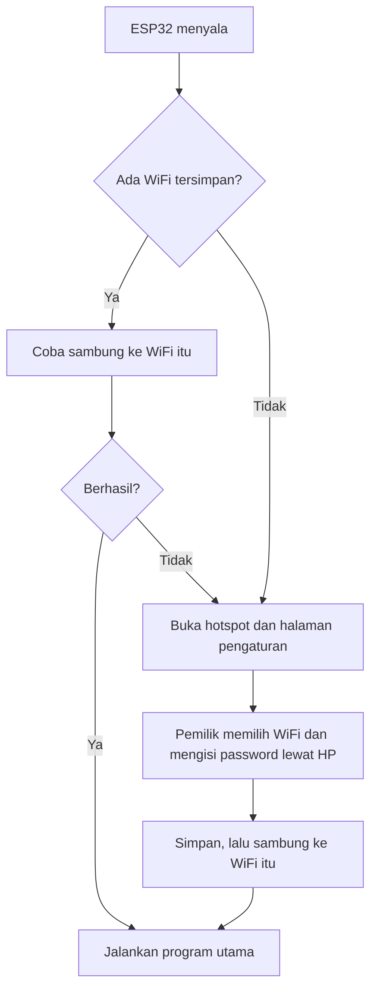
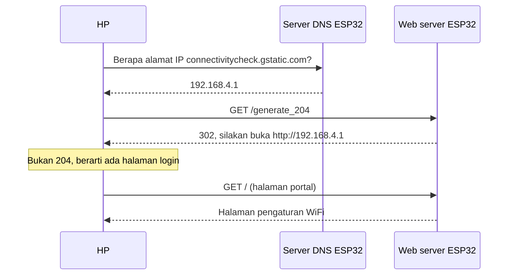
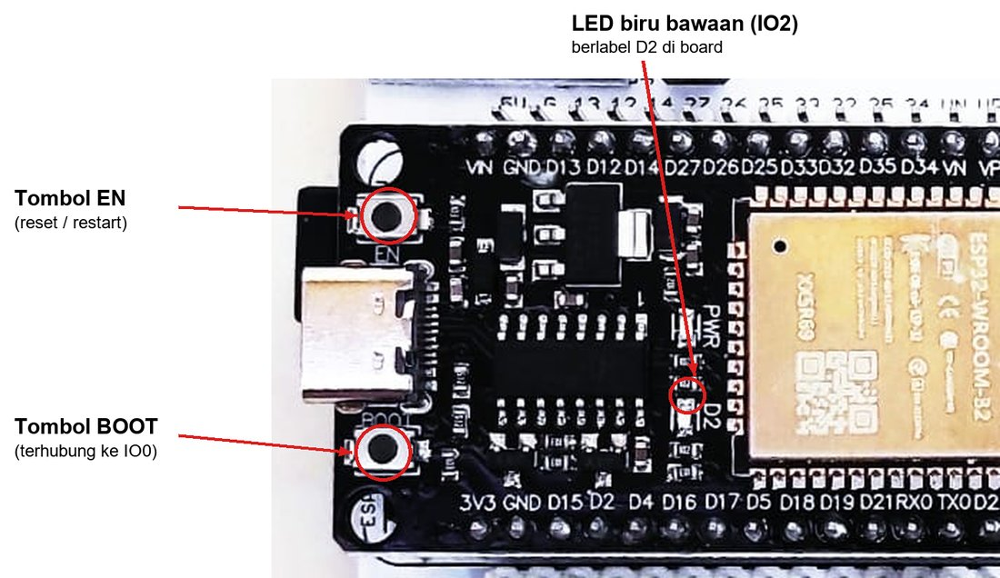
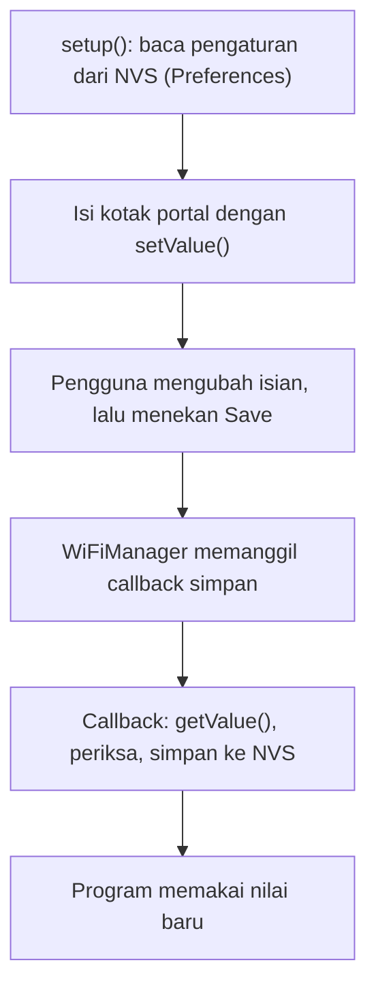

# BAB 44: WiFiManager & Captive Portal — Konfigurasi WiFi via Browser

> ✅ **Prasyarat:** Selesaikan **BAB 42 (WiFi Station Mode)** dan **BAB 43 (WiFi Access Point)** — kamu sudah bisa menyambungkan ESP32 ke WiFi rumah dan membuat ESP32 menjadi *hotspot*. Konsep penyimpanan di **BAB 39 (NVS — Non-Volatile Storage)** dan pola `millis()` dari **BAB 16 (Non-Blocking Programming)** juga dipakai di sini. Program 3 membaca tombol S1 seperti di [BAB 9](../BAB-09/README.md).

Sampai BAB 42, nama dan *password* WiFi selalu kamu tulis langsung di kode. Cara itu cukup untuk latihan, tetapi bayangkan kamu membuat alat penyiram tanaman pintar untuk temanmu: setiap kali ia mengganti *password* *router*, alat itu harus dibawa kembali kepadamu untuk di-*upload* ulang. Di BAB ini kamu belajar cara yang dipakai perangkat IoT sungguhan: saat belum tahu WiFi mana yang harus dipakai, ESP32 membuka *hotspot* sendiri, lalu HP yang tersambung langsung menampilkan halaman pengaturan — persis seperti WiFi hotel atau bandara yang memunculkan halaman *login*. Teknik ini disebut ***captive portal***, dan *library* **WiFiManager** membuatnya cukup dengan beberapa baris kode.

## 📌 Tujuan Pembelajaran

Setelah mempelajari BAB ini, kamu bisa:

- Menjelaskan kenapa menulis nama dan *password* WiFi langsung di kode merepotkan untuk alat yang dipakai orang lain.
- Menjelaskan cara kerja *captive portal*: *hotspot* ESP32, server DNS yang menjawab semua nama domain, pengalihan (*redirect*) HTTP, dan pemeriksaan koneksi otomatis di HP.
- Memasang dan memakai *library* WiFiManager (tzapu): `autoConnect()`, `setConfigPortalTimeout()`, `setConnectTimeout()`, dan `resetSettings()`.
- Menjelaskan di mana WiFiManager menyimpan nama dan *password* WiFi, kapan data itu terhapus, dan kenapa data itu tidak terenkripsi.
- Menjalankan portal secara *non-blocking* dengan `setConfigPortalBlocking(false)` dan `process()`, sehingga LED status dan tugas lain tetap berjalan.
- Menambahkan isian sendiri (nama perangkat, server MQTT) dengan `WiFiManagerParameter`, lalu menyimpannya ke NVS dengan `Preferences`.
- Menghapus WiFi tersimpan dengan tombol **BOOT** dan membuka portal kapan saja dengan tombol S1.
- (Opsional) Membuat *captive portal* sendiri dengan `DNSServer`, `WebServer`, dan `Preferences` untuk memahami isi "dapur" WiFiManager.

## 🧰 Yang Perlu Disiapkan

| Kebutuhan | Keterangan |
|---|---|
| *Hardware* | Kit Bluino ESP32 IoT Starter Shield (ESP32 DEVKIT V1 sudah terpasang di kit) + kabel USB **data** |
| Kabel *jumper* | Program 1, 2, dan 4: tidak perlu — program memakai LED biru dan tombol **BOOT** yang ada di *board* ESP32. Program 3: 1 kabel *female-female* untuk tombol S1 (`SW1` → IO15). Opsional: 1 kabel `LED3` (biru) → IO2 supaya LED biru di kit ikut menyala |
| Komponen tambahan | Tidak ada |
| *Software* | Arduino IDE 2.x + *board package* **esp32** versi 3.3.x (lihat [BAB 5](../BAB-05/README.md)) |
| *Library* | **WiFiManager** by **tzapu** versi 2.0.17 atau lebih baru (Program 1–3; cara memasang di [44.3.1](#4431-memasang-library-wifimanager)). Program 4 hanya memakai *library* bawaan *board package* esp32 (`WiFi`, `WebServer`, `DNSServer`, `Preferences`) |
| Alat uji | **Serial Monitor** Arduino IDE (baud 115200) + HP (Android atau iPhone) atau laptop yang punya WiFi, untuk membuka halaman portal |
| Jaringan | *Router* atau *hotspot* WiFi **2,4 GHz** yang nama dan *password*-nya kamu ketahui. ESP32 tidak bisa memakai WiFi 5 GHz |

> 📌 **Catatan:** Kalau "WiFi rumah" yang ingin kamu pakai adalah *hotspot* dari HP-mu sendiri, kamu butuh perangkat **kedua** (laptop atau HP lain) untuk membuka portal. Banyak HP tidak bisa menjadi *hotspot* sambil tersambung ke WiFi lain pada saat yang sama.

## 📑 Daftar Isi

- [44.1 Masalah: Password WiFi Tertanam di Kode](#441-masalah-password-wifi-tertanam-di-kode)
- [44.2 Cara Kerja Captive Portal](#442-cara-kerja-captive-portal)
- [44.3 Mengenal Library WiFiManager](#443-mengenal-library-wifimanager)
- [44.4 Tombol BOOT untuk Menghapus WiFi Tersimpan](#444-tombol-boot-untuk-menghapus-wifi-tersimpan)
- [44.5 Program 1: WiFiManager Pertama](#445-program-1-wifimanager-pertama)
- [44.6 Program 2: Portal Non-Blocking dengan LED Status](#446-program-2-portal-non-blocking-dengan-led-status)
- [44.7 Isian Tambahan dengan WiFiManagerParameter](#447-isian-tambahan-dengan-wifimanagerparameter)
- [44.8 Program 3: Isian Tambahan dan Portal Sesuai Permintaan](#448-program-3-isian-tambahan-dan-portal-sesuai-permintaan)
- [44.9 Keamanan Portal Konfigurasi](#449-keamanan-portal-konfigurasi)
- [44.10 Program 4: Captive Portal Buatan Sendiri](#4410-program-4-captive-portal-buatan-sendiri)
- [44.11 Troubleshooting](#4411-troubleshooting)
- [📝 Rangkuman](#-rangkuman)
- [💪 Latihan](#-latihan)
- [📚 Referensi](#-referensi)

---

## 44.1 Masalah: Password WiFi Tertanam di Kode

Di [BAB 42](../BAB-42/README.md), program WiFi selalu diawali baris seperti ini:

```cpp
const char* WIFI_SSID = "NamaWiFiKamu";      // ← ganti dengan WiFi kamu
const char* WIFI_PASS = "PasswordWiFiKamu";  // ← ganti dengan WiFi kamu
```

**SSID** (*Service Set Identifier*) adalah nama jaringan WiFi yang muncul di daftar WiFi HP-mu. Menulis SSID dan *password* langsung di kode disebut *hardcode* (ditanam permanen). Untuk latihan di meja sendiri, cara ini praktis. Masalahnya muncul ketika alatmu dipakai di tempat lain atau oleh orang lain:

| Kejadian | Akibatnya kalau WiFi ditulis di kode |
|---|---|
| Pemilik mengganti *password* *router* | ESP32 tidak bisa tersambung lagi sampai kodenya diubah dan di-*upload* ulang |
| Alat dibawa pindah rumah atau ke kantor | Sama: harus di-*upload* ulang dengan WiFi baru |
| Kamu membuat 20 alat untuk 20 orang | Kode harus diubah dan di-*upload* 20 kali, satu untuk setiap WiFi |
| Kode dibagikan di GitHub atau grup kelas | *Password* WiFi-mu ikut tersebar |

Perangkat IoT sungguhan — lampu pintar, CCTV WiFi, *smart plug* — memecahkan masalah ini dengan cara yang sama: **perangkat menanyakan WiFi kepada pemiliknya lewat HP**, lalu mengingat jawabannya.



*Gambar 44.1 — Alur perangkat yang meminta pengaturan WiFi lewat HP. Inilah yang dikerjakan WiFiManager untukmu. Sumber: dibuat untuk materi ini.*

Kalau WiFi tersimpan masih bisa dipakai, pemilik tidak melihat apa-apa — alat langsung bekerja. Halaman pengaturan hanya muncul saat alat baru, saat WiFi berganti, atau saat pengaturan sengaja dihapus.

---

## 44.2 Cara Kerja Captive Portal

### 44.2.1 Tiga Bagian di Dalam ESP32

Pernah tersambung ke WiFi gratis di hotel, kafe, atau bandara? Begitu tersambung, HP biasanya langsung menampilkan halaman *login* atau persetujuan, padahal kamu belum membuka *browser*. Halaman seperti itu disebut ***captive portal*** (portal "penangkap"): setiap usaha membuka situs apa pun "ditangkap" dan diarahkan ke satu halaman yang sama.

ESP32 bisa melakukan hal yang sama dengan tiga bagian yang bekerja bersamaan:

| Bagian | Tugasnya | Analogi |
|---|---|---|
| ***Hotspot*** (*Access Point*, [BAB 43](../BAB-43/README.md)) | ESP32 membuat jaringan WiFi sendiri, misalnya `Bluino-Setup`. Alamat ESP32 di jaringan ini **192.168.4.1** | Gedung kecil dengan satu pintu masuk |
| **Server DNS** | DNS (*Domain Name System*) adalah "buku telepon" internet yang mengubah nama seperti `google.com` menjadi alamat IP. Server DNS di ESP32 menjawab **semua** nama dengan alamat yang sama: 192.168.4.1 | Buku telepon yang semua nomornya adalah nomor resepsionis |
| ***Web server*** | Menyajikan halaman pengaturan. Permintaan ke alamat lain dijawab dengan pengalihan (*redirect*, kode HTTP 302) ke halaman itu | Resepsionis yang mengantar setiap tamu ke meja pendaftaran |

### 44.2.2 Kenapa Halamannya Bisa Muncul Sendiri?

Setiap kali tersambung ke WiFi baru, HP dan laptop diam-diam membuka sebuah **alamat uji** untuk memeriksa apakah internet benar-benar bisa dipakai:

| Sistem operasi | Alamat uji | Jawaban normal kalau internet tersedia |
|---|---|---|
| Android | `http://connectivitycheck.gstatic.com/generate_204` | Kode HTTP 204 dengan isi kosong |
| iPhone, iPad, Mac | `http://captive.apple.com/hotspot-detect.html` | Halaman bertuliskan `Success` |
| Windows 10/11 | `http://www.msftconnecttest.com/connecttest.txt` | Teks `Microsoft Connect Test` |

Di *hotspot* ESP32, permintaan itu "ditangkap": server DNS menjawab dengan 192.168.4.1, lalu *web server* ESP32 menjawab dengan pengalihan ke halaman pengaturan. Karena jawabannya tidak sesuai harapan, sistem operasi menyimpulkan bahwa jaringan ini punya halaman *login*, lalu menampilkannya:

- **Android** biasanya memunculkan notifikasi seperti **Masuk ke jaringan Wi-Fi** / **Sign in to Wi-Fi network**. Ketuk notifikasi itu untuk membuka halamannya.
- **iPhone/iPad** biasanya langsung membuka jendela kecil berisi halaman portal.
- **Windows** biasanya memunculkan notifikasi yang membuka *browser*.

Tulisan persisnya berbeda-beda menurut merek HP, versi sistem operasi, dan bahasa yang dipakai.



*Gambar 44.2 — Urutan kejadian saat HP Android tersambung ke hotspot ESP32. iPhone dan Windows melakukan hal serupa dengan alamat uji masing-masing. Sumber: dibuat untuk materi ini.*

> 💡 **Tips:** Kalau halaman portal **tidak muncul sendiri**, buka *browser* (Chrome, Safari, dan sebagainya) di HP yang masih tersambung ke *hotspot* ESP32, lalu ketik **`http://192.168.4.1`** lengkap dengan `http://`. Jangan mengetik `google.com`: *browser* modern membuka situs terkenal lewat HTTPS (terenkripsi), dan permintaan HTTPS tidak bisa dialihkan oleh ESP32, sehingga yang muncul hanya pesan *error*.

> ⚠️ **Perhatian:** Android kadang bertanya "Jaringan ini tidak memiliki akses internet. Tetap terhubung?" — pilih **Ya** / **Tetap terhubung**. Kalau halaman portal tidak mau terbuka, **matikan data seluler** sementara: sebagian HP diam-diam memakai data seluler ketika WiFi tidak punya internet, sehingga permintaan ke 192.168.4.1 tidak pernah sampai ke ESP32.

---

## 44.3 Mengenal Library WiFiManager

WiFiManager adalah *library* buatan **tzapu** (sekarang dikelola **tablatronix**) yang sudah menyiapkan ketiga bagian di atas: *hotspot*, server DNS, *web server* beserta halamannya, sampai penyimpanan WiFi. Kamu cukup memanggil satu fungsi.

### 44.3.1 Memasang Library WiFiManager

1. Buka Arduino IDE → **Sketch → Include Library → Manage Libraries…** (atau klik ikon buku di bilah kiri).
2. Ketik `WiFiManager` di kolom pencarian.
3. Cari yang bertuliskan **WiFiManager** *by* **tzapu**. Ada beberapa *library* dengan nama mirip (misalnya ESPAsyncWiFiManager atau ESP_WiFiManager) — **jangan** pilih yang itu, karena cara pakainya berbeda.
4. Pilih versi **2.0.17** (atau yang lebih baru), lalu klik **Install**. Tunggu sampai muncul tulisan **INSTALLED**.

Untuk memastikan *library* terpasang, buka **File → Examples**. Di bagian **Examples from Custom Libraries** harus ada folder **WiFiManager**.

### 44.3.2 Apa yang Dilakukan `autoConnect()`?

Semua kerja WiFiManager dimulai dari satu baris:

```cpp
bool tersambung = wm.autoConnect("Bluino-Setup", "bluino123");
```

Argumen pertama adalah nama *hotspot* portal, argumen kedua *password*-nya. Langkah yang dikerjakan fungsi ini:

1. Mencoba tersambung ke WiFi yang **tersimpan** di ESP32.
2. Kalau berhasil, `autoConnect()` langsung kembali dengan nilai `true`. Halaman portal tidak pernah muncul.
3. Kalau gagal (atau belum pernah ada WiFi tersimpan), WiFiManager membuka *hotspot* `Bluino-Setup`, server DNS, dan *web server* di 192.168.4.1.
4. Kamu menyambungkan HP ke *hotspot* itu, memilih WiFi rumah, mengisi *password*, lalu menekan **Save**.
5. WiFiManager menyimpan pilihanmu dan langsung mencoba tersambung. Kalau berhasil, *hotspot* ditutup dan `autoConnect()` kembali dengan `true` — **tanpa perlu *restart***. Kalau gagal (misalnya *password* salah), portal tetap terbuka: sambungkan HP lagi ke *hotspot* dan ulangi.
6. Kalau batas waktu portal habis tanpa ada yang mengisi, `autoConnect()` kembali dengan `false`.

Secara bawaan, `autoConnect()` bekerja ***blocking***: selama portal terbuka, fungsi ini tidak kembali, sehingga `loop()` belum berjalan. Program 1 memakai cara ini karena paling sederhana. Program 2 menunjukkan versi *non-blocking*.

### 44.3.3 Fungsi-Fungsi Penting

| Fungsi | Gunanya |
|---|---|
| `WiFiManager wm;` | Membuat objek WiFiManager bernama `wm` |
| `wm.autoConnect(nama, password)` | Sambung ke WiFi tersimpan; kalau gagal, buka portal. Hasilnya `true` kalau akhirnya tersambung |
| `wm.setConnectTimeout(20)` | Batas waktu (detik) setiap kali mencoba tersambung ke WiFi, misalnya 20 detik |
| `wm.setConfigPortalTimeout(180)` | Portal ditutup kalau 180 detik tidak ada aktivitas. Hitungannya dimulai lagi setiap kali halaman portal dibuka |
| `wm.setConfigPortalBlocking(false)` | Membuat portal *non-blocking*; setelah itu `wm.process()` wajib dipanggil di `loop()` (Program 2) |
| `wm.process()` | Melayani portal *non-blocking*. Hasilnya `true` sekali, tepat saat ESP32 berhasil tersambung ke WiFi yang baru dipilih |
| `wm.getConfigPortalActive()` | `true` kalau portal sedang terbuka |
| `wm.startConfigPortal(nama, password)` | Membuka portal kapan saja, walaupun WiFi sedang tersambung (Program 3) |
| `wm.resetSettings()` | Menghapus WiFi tersimpan |
| `wm.setDebugOutput(false)` | Mematikan pesan bawaan WiFiManager (diawali `*wm:`) di Serial Monitor |
| `wm.setTitle("…")` | Mengganti judul halaman portal (bawaan: `WiFiManager`) |
| `wm.setAPCallback(fungsi)` | Memanggil `fungsi` tepat saat portal dibuka |
| `WiFiManagerParameter` + `wm.addParameter()` | Menambah isian sendiri di halaman portal (Program 3) |
| `wm.setSaveParamsCallback(fungsi)` | Memanggil `fungsi` saat isian tambahan disimpan (Program 3) |

### 44.3.4 Di Mana Nama dan Password WiFi Disimpan?

WiFiManager tidak punya tempat penyimpanan sendiri. Ia memakai fitur ***driver* WiFi** ESP32 — bagian sistem yang mengurus radio WiFi — yang mengingat SSID dan *password* terakhir di **partisi NVS** yang sudah kamu kenal di [BAB 39](../BAB-39/README.md), di *namespace* milik sistem. Karena itu:

| Kejadian | WiFi tersimpan |
|---|---|
| Tombol **EN** ditekan, atau listrik dicabut lalu dipasang lagi | Tetap ada |
| *Upload* program baru dengan pengaturan bawaan Arduino IDE | Tetap ada |
| Program memanggil `wm.resetSettings()` (atau kamu menahan tombol **BOOT** 3 detik di program BAB ini) | Terhapus |
| *Upload* dengan **Tools → Erase All Flash Before Sketch Upload** = **Enabled** | Terhapus (bersama semua data NVS lain) |

> ⚠️ **Perhatian:** Program BAB 42 yang memakai `WiFi.begin("NamaWiFiKamu", "PasswordWiFiKamu")` juga menyimpan WiFi itu ke tempat yang sama. Jadi, kalau sebelumnya kamu menjalankan program BAB 42, Program 1 mungkin **langsung tersambung tanpa membuka portal**. Itu normal. Tahan tombol **BOOT** selama 3 detik (lihat [44.4](#444-tombol-boot-untuk-menghapus-wifi-tersimpan)) supaya portalnya muncul.

> 🚨 **Bahaya:** Partisi NVS **tidak dienkripsi** secara bawaan. Siapa pun yang memegang *board*-mu bisa menyalin isi *flash* lewat USB dan membaca *password* WiFi di dalamnya. Jangan memberikan atau menjual alat yang masih menyimpan WiFi pribadimu — hapus dulu dengan tombol **BOOT** atau **Erase All Flash Before Sketch Upload**.

---

## 44.4 Tombol BOOT untuk Menghapus WiFi Tersimpan

Perangkat yang mengingat WiFi juga butuh cara untuk **melupakannya**, misalnya saat alat diberikan ke orang lain. Program di BAB ini memakai tombol **BOOT** yang ada di *board* ESP32: tahan selama 3 detik, dan WiFi tersimpan dihapus.



*Gambar 44.3 — Tombol EN, tombol BOOT, dan LED biru bawaan di board ESP32 DEVKIT V1 pada kit Bluino v3.x. Board ESP32 di kit kamu bisa sedikit berbeda (misalnya konektor micro-USB), tetapi letak tombolnya mirip. Sumber: foto produk [Bluino](http://www.bluino.com), dipotong dan diberi penanda untuk materi ini.*

Beberapa hal yang perlu kamu tahu tentang tombol ini:

| Hal | Penjelasan |
|---|---|
| Letaknya | Di *board* ESP32 (bertuliskan `BOOT`), **bukan** tombol SW1/SW2 di kit. Tidak perlu kabel *jumper* |
| Sambungannya | Tombol menghubungkan **IO0** ke GND. Saat ditekan, IO0 bernilai **LOW** |
| Mode pin | `INPUT_PULLUP` — *resistor pull-up* di dalam ESP32 membuat IO0 bernilai HIGH saat tombol dilepas |
| Bedanya dengan SW1/SW2 | Tombol kit punya *pull-down* di PCB, jadi ditekan = HIGH dan memakai `INPUT`. Tombol BOOT kebalikannya: ditekan = **LOW** |
| Kenapa ditahan 3 detik | Supaya WiFi tidak terhapus karena tombol tersenggol sebentar |

> ⚠️ **Perhatian:** Tekan tombol BOOT **setelah program berjalan** (setelah pesan pertama muncul di Serial Monitor). IO0 adalah pin *strapping* ([BAB 6](../BAB-06/README.md)): kalau BOOT sedang ditahan saat ESP32 menyala atau saat tombol **EN** ditekan, ESP32 masuk **mode unggah** dan programmu tidak berjalan. Serial Monitor hanya menampilkan tulisan seperti `waiting for download`. Kalau itu terjadi, lepaskan BOOT lalu tekan **EN** sekali.

Di Program 1–3, tombol BOOT diperiksa di `loop()` dengan pola `millis()` dari [BAB 16](../BAB-16/README.md): program mencatat kapan tombol mulai ditekan, lalu menghapus WiFi kalau tombol masih ditahan setelah 3 detik. Kalau tombol dilepas sebelum itu, hitungan dibatalkan.

---

## 44.5 Program 1: WiFiManager Pertama

**Tujuan:** Membuat ESP32 meminta WiFi lewat HP. Kalau belum ada WiFi tersimpan (atau WiFi tersimpan tidak bisa disambungi), ESP32 membuka *hotspot* `Bluino-Setup` berisi halaman pengaturan. Setelah WiFi dipilih, ESP32 tersambung dan mengingatnya untuk menyala berikutnya.

**Rangkaian:** *Tidak perlu merangkai — program ini memakai LED biru bawaan (IO2) dan tombol BOOT (IO0) yang ada di board ESP32.* Kalau ingin LED biru di kit ikut menyala, pasang 1 kabel *jumper* dari header `LED3` (biru) ke pin **2** di header ESP32.

**Cara Menjalankan:**

1. Pasang *library* **WiFiManager** *by* tzapu kalau belum (lihat [44.3.1](#4431-memasang-library-wifimanager)).
2. Buka Arduino IDE → **File → New Sketch**, hapus isinya, lalu salin kode di bawah. Kode yang sama juga tersedia di *file* [`p1_wifimanager_dasar.ino`](p1_wifimanager_dasar/p1_wifimanager_dasar.ino).
3. Pastikan **Tools → Board** = **ESP32 Dev Module** dan **Tools → Port** = *port* ESP32 kamu (misalnya `COM5` di Windows atau `/dev/ttyUSB0` di Linux).
4. Klik tombol **Upload** (ikon panah →) dan tunggu sampai muncul tulisan **Done uploading**.
5. Buka **Serial Monitor** (**Tools → Serial Monitor**) lalu pilih baud **115200**. Tekan tombol **EN** di *board* supaya pesan awal terlihat dari awal.
6. Kalau portal terbuka, ikuti langkah di [44.5.1](#4451-langkah-di-hp-mengisi-portal). Kalau ESP32 langsung tersambung (karena WiFi dari BAB 42 masih tersimpan) dan kamu ingin mencoba portalnya, tahan tombol **BOOT** selama 3 detik.

**Kode Program:**

<!-- sketch: p1_wifimanager_dasar -->
```cpp
/*
 * BAB 44 - Program 1: WiFiManager Pertama
 * Saat menyala, ESP32 mencoba WiFi yang tersimpan. Kalau belum ada atau
 * gagal, ESP32 membuka hotspot "Bluino-Setup" berisi halaman pengaturan.
 * Pilih WiFi rumahmu lewat HP, dan ESP32 akan mengingatnya.
 *
 * Library  : WiFiManager by tzapu (versi 2.0.17)
 * Rangkaian: tidak perlu (LED biru bawaan board di IO2, tombol BOOT di IO0)
 * Alat uji : Serial Monitor (115200) + HP atau laptop
 * Hapus WiFi tersimpan: tahan tombol BOOT 3 detik setelah program berjalan.
 */

#include <WiFiManager.h>   // WiFiManager by tzapu (sudah ikut menyertakan WiFi.h)

#define LED_BIRU     2     // LED biru bawaan board (sama dengan LED3 di kit)
#define TOMBOL_BOOT  0     // tombol BOOT di board ESP32: ditekan = LOW

const char* PORTAL_SSID = "Bluino-Setup";  // nama hotspot portal
const char* PORTAL_PASS = "bluino123";     // password hotspot, 8 sampai 63 karakter

WiFiManager wm;

unsigned long mulaiTekanBoot = 0;      // kapan tombol BOOT mulai ditahan (0 = tidak ditahan)
bool peringatanBootTampil = false;     // supaya peringatan hanya dicetak sekali
unsigned long waktuLaporan = 0;        // kapan laporan terakhir dicetak

// Dipanggil WiFiManager tepat saat portal dibuka
void saatPortalDibuka(WiFiManager* portal) {
  Serial.println("Portal pengaturan dibuka:");
  Serial.printf("  1. Sambungkan HP ke WiFi \"%s\" (password: %s)\n",
                portal->getConfigPortalSSID().c_str(), PORTAL_PASS);
  Serial.println("  2. Tunggu halaman pengaturan muncul, atau buka http://192.168.4.1");
  Serial.println("  3. Pilih Configure WiFi, pilih WiFi rumahmu, isi password, tekan Save");
}

void tampilkanInfoWiFi() {
  Serial.println("Tersambung ke WiFi!");
  Serial.print("  Nama WiFi : ");
  Serial.println(WiFi.SSID());
  Serial.print("  Alamat IP : ");
  Serial.println(WiFi.localIP());
  Serial.print("  Sinyal    : ");
  Serial.print(WiFi.RSSI());
  Serial.println(" dBm");
}

// Hapus WiFi tersimpan kalau tombol BOOT ditahan 3 detik
void periksaTombolBoot() {
  if (digitalRead(TOMBOL_BOOT) == HIGH) {   // tidak ditekan (pull-up membuatnya HIGH)
    mulaiTekanBoot = 0;                     // batalkan hitungan
    peringatanBootTampil = false;
    return;
  }

  // Sampai di sini, tombol sedang ditekan (LOW)
  if (mulaiTekanBoot == 0) {
    mulaiTekanBoot = millis();              // catat awal penekanan
  }
  unsigned long lamaDitekan = millis() - mulaiTekanBoot;

  if (lamaDitekan >= 1000 && !peringatanBootTampil) {
    Serial.println("Tombol BOOT ditahan... lepaskan sekarang kalau tidak jadi menghapus.");
    peringatanBootTampil = true;
  }
  if (lamaDitekan >= 3000) {
    Serial.println("Menghapus WiFi tersimpan, lalu restart...");
    wm.resetSettings();                     // hapus SSID dan password dari NVS
    delay(500);
    ESP.restart();
  }
}

void setup() {
  Serial.begin(115200);
  delay(1000);                          // beri waktu Serial Monitor tersambung
  pinMode(LED_BIRU, OUTPUT);
  digitalWrite(LED_BIRU, LOW);
  pinMode(TOMBOL_BOOT, INPUT_PULLUP);   // tombol BOOT menghubungkan IO0 ke GND

  Serial.println();
  Serial.println("BAB 44 - Program 1: WiFiManager Pertama");

  wm.setDebugOutput(false);             // matikan pesan bawaan "*wm:" supaya rapi
  wm.setTitle("Bluino IoT Kit");        // judul halaman portal
  wm.setConnectTimeout(20);             // coba sambung paling lama 20 detik
  wm.setConfigPortalTimeout(180);       // tutup portal setelah 3 menit tanpa aktivitas
  wm.setAPCallback(saatPortalDibuka);   // cetak petunjuk saat portal dibuka

  Serial.println("Mencoba WiFi tersimpan (paling lama 20 detik)...");

  // Blocking: baru kembali setelah tersambung, atau setelah portal ditutup
  bool tersambung = wm.autoConnect(PORTAL_SSID, PORTAL_PASS);

  if (!tersambung) {
    Serial.println("Portal ditutup tanpa pengaturan. Restart dalam 3 detik...");
    delay(3000);
    ESP.restart();                      // coba lagi dari awal
  }

  tampilkanInfoWiFi();
  Serial.println("Tahan tombol BOOT 3 detik untuk menghapus WiFi tersimpan.");
}

void loop() {
  periksaTombolBoot();

  // LED biru menyala selama WiFi tersambung
  digitalWrite(LED_BIRU, WiFi.status() == WL_CONNECTED ? HIGH : LOW);

  if (millis() - waktuLaporan >= 10000) {   // laporan setiap 10 detik
    waktuLaporan = millis();
    if (WiFi.status() == WL_CONNECTED) {
      Serial.printf("Masih tersambung, sinyal %d dBm\n", WiFi.RSSI());
    } else {
      Serial.println("WiFi terputus, ESP32 mencoba menyambung lagi...");
    }
  }
}
```

**Penjelasan Kode:**

- `#include <WiFiManager.h>` memuat *library* WiFiManager. *Library* ini sudah menyertakan `WiFi.h`, jadi `WiFi.SSID()`, `WiFi.localIP()`, dan `WiFi.RSSI()` dari [BAB 42](../BAB-42/README.md) tetap bisa dipakai.
- `PORTAL_PASS` adalah *password* ***hotspot* portal**, bukan *password* WiFi rumahmu. Panjangnya harus 8 sampai 63 karakter. Kalau kurang dari 8, WiFiManager **menolak membuka portal** dan `autoConnect()` langsung mengembalikan `false`.
- `wm.setDebugOutput(false)` mematikan pesan bawaan WiFiManager supaya Serial Monitor hanya berisi pesan programmu. Saat mencari masalah, ubah menjadi `true` untuk melihat pesan berawalan `*wm:`.
- `wm.setConnectTimeout(20)` membatasi setiap percobaan menyambung, baik ke WiFi tersimpan maupun ke WiFi yang baru dipilih di portal, paling lama 20 detik.
- `wm.setConfigPortalTimeout(180)` menutup portal kalau tidak ada aktivitas selama 3 menit. Hitungannya dimulai lagi setiap kali halaman portal dibuka. Ini penting saat listrik padam: ESP32 sering menyala lebih cepat daripada *router*, sehingga WiFi tersimpan belum ada dan portal terbuka. Dengan batas waktu, `autoConnect()` kembali `false`, program me-*restart* ESP32, dan ESP32 mencoba WiFi tersimpan lagi.
- `wm.setAPCallback(saatPortalDibuka)` mendaftarkan fungsi ***callback*** ([BAB 18](../BAB-18/README.md)) yang dipanggil WiFiManager tepat saat portal dibuka. Karena itu petunjuk portal hanya dicetak kalau portal memang dibuka. `portal->getConfigPortalSSID()` mengambil nama *hotspot* yang sedang dipakai.
- `wm.autoConnect(PORTAL_SSID, PORTAL_PASS)` bekerja seperti dijelaskan di [44.3.2](#4432-apa-yang-dilakukan-autoconnect). Fungsi ini ***blocking***: selama portal terbuka, `loop()` belum berjalan dan LED biru tetap mati.
- `periksaTombolBoot()` membaca IO0 setiap putaran `loop()`. `mulaiTekanBoot` menyimpan waktu awal penekanan; selisihnya dengan `millis()` adalah lama tombol ditahan. Setelah 3 detik, `wm.resetSettings()` menghapus WiFi tersimpan, lalu `ESP.restart()` menyalakan ulang ESP32 sehingga portal terbuka lagi.
- Di `loop()`, LED biru mengikuti `WiFi.status()`: menyala kalau tersambung, mati kalau terputus. Kalau WiFi terputus, ESP32 mencoba menyambung lagi sendiri (*auto reconnect*), jadi program tidak perlu memanggil `autoConnect()` lagi.

### 44.5.1 Langkah di HP: Mengisi Portal

Halaman portal WiFiManager berbahasa Inggris dan tampilannya seperti ini:


*Gambar 44.4 — Halaman utama portal (Program 1) dan halaman Configure WiFi. Tiga kotak di bawah garis (nama perangkat, server MQTT, port MQTT) hanya muncul di Program 3. Nama-nama WiFi di daftar hanyalah contoh. Sumber: dirender untuk materi ini dari kode HTML asli WiFiManager 2.0.17 ([tzapu/WiFiManager](https://github.com/tzapu/WiFiManager), lisensi MIT).*

1. Saat Serial Monitor menampilkan `Portal pengaturan dibuka:`, buka **Pengaturan → WiFi** di HP. Tunggu beberapa detik sampai **Bluino-Setup** muncul di daftar.
2. Pilih **Bluino-Setup**, lalu masukkan *password* `bluino123`.
3. Tunggu notifikasi atau jendela *login* muncul (lihat [44.2.2](#4422-kenapa-halamannya-bisa-muncul-sendiri)), lalu ketuk. Kalau setelah ±10 detik tidak ada apa-apa, buka *browser* dan ketik `http://192.168.4.1`.
4. Halaman utama portal muncul dengan judul **Bluino IoT Kit**. Halamannya berbahasa Inggris; arti tombol-tombolnya:

   | Tombol / tulisan | Artinya |
   |---|---|
   | **Configure WiFi** | Membuka daftar WiFi di sekitar ESP32 untuk dipilih |
   | **Info** | Informasi tentang ESP32 (alamat MAC, memori, dan lain-lain) |
   | **Exit** | Menutup portal tanpa menyimpan apa pun |
   | **Update** | Memasang *firmware* (program) baru lewat *browser* — **jangan dipakai** di BAB ini |
   | `No AP set` | Belum ada WiFi tersimpan |
   | `Not connected to …` | Ada WiFi tersimpan, tetapi gagal disambungi (misalnya *router* mati atau *password* berubah) |

5. Ketuk **Configure WiFi**. ESP32 memindai WiFi di sekitarnya (±2–3 detik), lalu menampilkan daftarnya beserta ikon kekuatan sinyal. Ikon gembok berarti WiFi itu memakai *password*.
6. Ketuk nama WiFi rumahmu — namanya otomatis terisi di kolom **SSID**. Ketik *password* WiFi di kolom **Password** (centang **Show Password** untuk memeriksa ketikanmu). Huruf besar dan kecil dibedakan.
7. Ketuk **Save**. Halaman menampilkan `Saving Credentials … Trying to connect ESP to network.` HP-mu akan terputus dari **Bluino-Setup** — itu normal, karena *hotspot* ditutup setelah ESP32 berhasil tersambung.

> 💡 **Tips:** WiFi 5 GHz tidak muncul di daftar karena ESP32 hanya bisa memakai WiFi **2,4 GHz**. Kalau *router*-mu memakai satu nama untuk 2,4 GHz dan 5 GHz sekaligus (*band steering*), biasanya ESP32 tetap bisa tersambung lewat 2,4 GHz. Kalau gagal, aktifkan nama WiFi terpisah untuk 2,4 GHz di pengaturan *router*.

**Contoh Output:**

Saat pertama kali dijalankan (belum ada WiFi tersimpan). Nama WiFi, alamat IP, dan sinyal di bawah hanya contoh — angkamu bisa berbeda:

```text
BAB 44 - Program 1: WiFiManager Pertama
Mencoba WiFi tersimpan (paling lama 20 detik)...
Portal pengaturan dibuka:
  1. Sambungkan HP ke WiFi "Bluino-Setup" (password: bluino123)
  2. Tunggu halaman pengaturan muncul, atau buka http://192.168.4.1
  3. Pilih Configure WiFi, pilih WiFi rumahmu, isi password, tekan Save
Tersambung ke WiFi!
  Nama WiFi : NamaWiFiKamu
  Alamat IP : 192.168.1.23
  Sinyal    : -54 dBm
Tahan tombol BOOT 3 detik untuk menghapus WiFi tersimpan.
Masih tersambung, sinyal -55 dBm
Masih tersambung, sinyal -54 dBm
```

Tekan tombol **EN**. Kali ini ESP32 langsung tersambung dalam beberapa detik tanpa membuka portal, karena WiFi-nya sudah tersimpan:

```text
BAB 44 - Program 1: WiFiManager Pertama
Mencoba WiFi tersimpan (paling lama 20 detik)...
Tersambung ke WiFi!
  Nama WiFi : NamaWiFiKamu
  Alamat IP : 192.168.1.23
  Sinyal    : -55 dBm
Tahan tombol BOOT 3 detik untuk menghapus WiFi tersimpan.
```

Saat tombol **BOOT** ditahan 3 detik, muncul pesan berikut, lalu ESP32 *restart* dan membuka portal lagi:

```text
Tombol BOOT ditahan... lepaskan sekarang kalau tidak jadi menghapus.
Menghapus WiFi tersimpan, lalu restart...
```

Di kit, LED biru bawaan *board* (dan LED3 biru kalau kamu memasang kabelnya) **menyala** selama ESP32 tersambung ke WiFi, dan **mati** selama portal terbuka atau WiFi terputus.

**Kalau Belum Berhasil:**

- **Bluino-Setup tidak muncul di daftar WiFi HP** → tunggu sampai Serial Monitor menampilkan `Portal pengaturan dibuka:`, lalu segarkan daftar WiFi di HP. Kalau ESP32 langsung tersambung ke WiFi lama, tahan tombol **BOOT** 3 detik.
- **Halaman portal tidak muncul sendiri** → buka `http://192.168.4.1` di *browser*, matikan data seluler, dan pilih **Tetap terhubung** kalau Android bertanya soal internet.
- **Setelah Save, Bluino-Setup muncul lagi** → ESP32 gagal tersambung ke WiFi yang kamu pilih, biasanya karena *password* salah atau WiFi-nya 5 GHz. Sambungkan HP ke **Bluino-Setup** lagi dan ulangi dengan teliti.
- **Serial Monitor berhenti di `waiting for download`** → tombol BOOT tertahan saat ESP32 menyala. Lepaskan BOOT, lalu tekan **EN**.

---

## 44.6 Program 2: Portal Non-Blocking dengan LED Status

**Tujuan:** Menjalankan portal "di latar belakang" sehingga `loop()` tetap berputar selama portal terbuka. LED biru menunjukkan status dengan pola kedip yang berbeda, tombol BOOT tetap bisa dipakai, dan laporan tetap dicetak setiap 5 detik. Portal juga dibuat lebih aman: tombol **Update** disembunyikan.

Di Program 1, selama portal terbuka, program "terjebak" di dalam `autoConnect()`. Akibatnya LED tidak bisa berkedip dan tugas lain tidak berjalan — padahal di alat sungguhan, LED status justru paling dibutuhkan saat itu, supaya pemilik tahu bahwa alat sedang menunggu diatur. Solusinya dua baris:

```cpp
wm.setConfigPortalBlocking(false);  // di setup(), sebelum autoConnect()
wm.process();                       // di loop(), dipanggil terus-menerus
```

Dengan `setConfigPortalBlocking(false)`, `autoConnect()` langsung kembali `false` begitu portal dibuka, dan `setup()` selesai. Setelah itu, `wm.process()` di setiap putaran `loop()` melayani HP yang membuka halaman portal — mirip pola *non-blocking* di [BAB 16](../BAB-16/README.md): sedikit kerja di setiap putaran, lalu kembali ke tugas lain.

| Pola LED biru | Artinya |
|---|---|
| Kedip cepat (5 kali per detik) | Portal terbuka, menunggu pengaturan dari HP |
| Menyala terus | Tersambung ke WiFi |
| Kedip lambat (1 detik menyala, 1 detik mati) | WiFi terputus, ESP32 sedang mencoba menyambung lagi |

**Rangkaian:** *Tidak perlu merangkai — sama seperti Program 1.* Opsional: kabel `LED3` (biru) → pin **2**.

**Cara Menjalankan:**

1. Buka Arduino IDE → **File → New Sketch**, hapus isinya, lalu salin kode di bawah. Kode yang sama juga tersedia di *file* [`p2_portal_nonblocking.ino`](p2_portal_nonblocking/p2_portal_nonblocking.ino).
2. Pastikan **Tools → Board** = **ESP32 Dev Module** dan **Tools → Port** = *port* ESP32 kamu.
3. Klik **Upload** dan tunggu sampai muncul tulisan **Done uploading**.
4. Buka **Serial Monitor** dengan baud **115200**, lalu tekan **EN**.
5. Kalau ESP32 langsung tersambung (WiFi dari Program 1 masih tersimpan), tahan tombol **BOOT** 3 detik supaya portal terbuka. Perhatikan LED biru berkedip cepat, lalu isi portal seperti di [44.5.1](#4451-langkah-di-hp-mengisi-portal).

**Kode Program:**

<!-- sketch: p2_portal_nonblocking -->
```cpp
/*
 * BAB 44 - Program 2: Portal Non-Blocking dengan LED Status
 * Portal WiFiManager berjalan "di latar belakang": loop() tetap berputar,
 * sehingga LED status berkedip, tombol BOOT tetap dibaca, dan laporan
 * tetap dicetak selama portal terbuka.
 *
 * LED biru (IO2):
 *   kedip cepat  = portal terbuka, menunggu pengaturan
 *   menyala      = tersambung ke WiFi
 *   kedip lambat = WiFi terputus, ESP32 mencoba menyambung lagi
 *
 * Library  : WiFiManager by tzapu (versi 2.0.17)
 * Rangkaian: tidak perlu (LED biru bawaan di IO2, tombol BOOT di IO0)
 * Alat uji : Serial Monitor (115200) + HP atau laptop
 */

#include <WiFiManager.h>

#define LED_BIRU     2     // LED biru bawaan board (sama dengan LED3 di kit)
#define TOMBOL_BOOT  0     // tombol BOOT di board ESP32: ditekan = LOW

const char* PORTAL_SSID = "Bluino-Setup";
const char* PORTAL_PASS = "bluino123";

// Tombol di halaman utama portal: hanya "Configure WiFi" dan "Info"
const char* MENU_PORTAL[] = {"wifi", "info"};

WiFiManager wm;

bool portalTadiAktif = false;        // status portal pada putaran loop() sebelumnya
unsigned long mulaiTekanBoot = 0;
bool peringatanBootTampil = false;
unsigned long waktuLaporan = 0;

void saatPortalDibuka(WiFiManager* portal) {
  Serial.println("Portal pengaturan dibuka:");
  Serial.printf("  1. Sambungkan HP ke WiFi \"%s\" (password: %s)\n",
                portal->getConfigPortalSSID().c_str(), PORTAL_PASS);
  Serial.println("  2. Tunggu halaman pengaturan muncul, atau buka http://192.168.4.1");
  Serial.println("  3. Pilih Configure WiFi, pilih WiFi rumahmu, isi password, tekan Save");
}

void tampilkanInfoWiFi() {
  Serial.println("Tersambung ke WiFi!");
  Serial.print("  Nama WiFi : ");
  Serial.println(WiFi.SSID());
  Serial.print("  Alamat IP : ");
  Serial.println(WiFi.localIP());
  Serial.print("  Sinyal    : ");
  Serial.print(WiFi.RSSI());
  Serial.println(" dBm");
}

// Pola LED biru sesuai status (tanpa delay)
void aturLed() {
  unsigned long t = millis();
  if (wm.getConfigPortalActive()) {
    digitalWrite(LED_BIRU, (t / 100) % 2);    // berganti setiap 100 ms: kedip cepat
  } else if (WiFi.status() == WL_CONNECTED) {
    digitalWrite(LED_BIRU, HIGH);             // menyala terus
  } else {
    digitalWrite(LED_BIRU, (t / 1000) % 2);   // berganti setiap 1 detik: kedip lambat
  }
}

// Hapus WiFi tersimpan kalau tombol BOOT ditahan 3 detik
void periksaTombolBoot() {
  if (digitalRead(TOMBOL_BOOT) == HIGH) {     // tidak ditekan
    mulaiTekanBoot = 0;
    peringatanBootTampil = false;
    return;
  }
  if (mulaiTekanBoot == 0) {
    mulaiTekanBoot = millis();
  }
  unsigned long lamaDitekan = millis() - mulaiTekanBoot;
  if (lamaDitekan >= 1000 && !peringatanBootTampil) {
    Serial.println("Tombol BOOT ditahan... lepaskan sekarang kalau tidak jadi menghapus.");
    peringatanBootTampil = true;
  }
  if (lamaDitekan >= 3000) {
    Serial.println("Menghapus WiFi tersimpan, lalu restart...");
    wm.resetSettings();
    delay(500);
    ESP.restart();
  }
}

void cetakLaporan() {
  Serial.printf("[%lu s] ", millis() / 1000);
  if (wm.getConfigPortalActive()) {
    Serial.printf("Portal terbuka, %d perangkat tersambung ke hotspot\n",
                  WiFi.softAPgetStationNum());
  } else if (WiFi.status() == WL_CONNECTED) {
    Serial.printf("Tersambung ke %s, sinyal %d dBm\n",
                  WiFi.SSID().c_str(), WiFi.RSSI());
  } else {
    Serial.println("WiFi terputus, mencoba menyambung lagi...");
  }
}

void setup() {
  Serial.begin(115200);
  delay(1000);
  pinMode(LED_BIRU, OUTPUT);
  digitalWrite(LED_BIRU, LOW);
  pinMode(TOMBOL_BOOT, INPUT_PULLUP);

  Serial.println();
  Serial.println("BAB 44 - Program 2: Portal Non-Blocking dengan LED Status");

  wm.setDebugOutput(false);
  wm.setTitle("Bluino IoT Kit");
  wm.setMenu(MENU_PORTAL, 2);          // tampilkan 2 tombol menu saja
  wm.setShowInfoUpdate(false);         // sembunyikan tombol Update di halaman Info
  wm.setConnectTimeout(20);            // coba sambung paling lama 20 detik
  wm.setConfigPortalTimeout(180);      // tutup portal setelah 3 menit tanpa aktivitas
  wm.setBreakAfterConfig(true);        // WiFi baru gagal disambungi? tutup portal
  wm.setConfigPortalBlocking(false);   // portal non-blocking
  wm.setAPCallback(saatPortalDibuka);

  Serial.println("Mencoba WiFi tersimpan (paling lama 20 detik)...");
  if (wm.autoConnect(PORTAL_SSID, PORTAL_PASS)) {
    tampilkanInfoWiFi();
  }
  // Kalau gagal, autoConnect() langsung kembali (false) dan portal tetap
  // terbuka. Portal dilayani oleh wm.process() di loop().
  portalTadiAktif = wm.getConfigPortalActive();
}

void loop() {
  // 1. Layani portal. Hasilnya true sekali, saat WiFi baru berhasil tersambung.
  if (wm.process()) {
    Serial.println("WiFi baru tersimpan.");
    tampilkanInfoWiFi();
  }

  // 2. Portal baru saja tertutup, tetapi WiFi belum tersambung?
  //    (batas waktu habis, atau WiFi yang diisi gagal disambungi)
  bool portalAktif = wm.getConfigPortalActive();
  if (portalTadiAktif && !portalAktif && WiFi.status() != WL_CONNECTED) {
    Serial.println("Portal ditutup tanpa WiFi yang berhasil. Restart untuk mencoba lagi...");
    delay(1000);
    ESP.restart();
  }
  portalTadiAktif = portalAktif;

  // 3. Tugas lain tetap berjalan, portal terbuka atau tidak
  aturLed();
  periksaTombolBoot();
  if (millis() - waktuLaporan >= 5000) {   // laporan setiap 5 detik
    waktuLaporan = millis();
    cetakLaporan();
  }
}
```

**Penjelasan Kode:**

- `wm.setConfigPortalBlocking(false)` dipanggil **sebelum** `autoConnect()`. Kalau WiFi tersimpan berhasil disambungi, `autoConnect()` mengembalikan `true` seperti biasa. Kalau gagal, portal dibuka dan `autoConnect()` langsung mengembalikan `false` — bukan tanda gagal total, melainkan tanda "portal sedang terbuka".
- `wm.process()` wajib dipanggil di **setiap** putaran `loop()`. Fungsi ini melayani HP yang membuka halaman portal dan memeriksa batas waktu portal. Hasilnya `true` **satu kali**, tepat setelah WiFi yang baru dipilih berhasil disambungi; saat itu portal sudah ditutup otomatis.
- `wm.setBreakAfterConfig(true)` mengatur apa yang terjadi kalau WiFi yang kamu isi gagal disambungi (misalnya *password* salah): portal ditutup. Bagian 2 di `loop()` mendeteksi keadaan "portal baru saja tertutup, tetapi WiFi tidak tersambung" dengan membandingkan `portalAktif` sekarang dengan `portalTadiAktif` dari putaran sebelumnya. Keadaan itu juga terjadi saat batas waktu 3 menit habis. Jawabannya sama: *restart*, coba WiFi tersimpan lagi, dan buka portal baru kalau masih gagal.
- `wm.setMenu(MENU_PORTAL, 2)` menentukan tombol yang tampil di halaman utama portal. Nama yang bisa dipakai antara lain `"wifi"`, `"info"`, `"exit"`, `"restart"`, `"erase"`, dan `"update"`; angka `2` adalah jumlah isi *array* `MENU_PORTAL`. Bersama `wm.setShowInfoUpdate(false)`, tombol **Update** (unggah *firmware* lewat *browser*) tidak lagi ditampilkan. Alasannya dibahas di [44.9](#449-keamanan-portal-konfigurasi).
- `aturLed()` memakai trik pembagian: `millis() / 100` bertambah 1 setiap 100 ms, dan `% 2` (sisa bagi 2) menghasilkan 0, 1, 0, 1, … bergantian. Hasil itu langsung dipakai sebagai LOW/HIGH, sehingga LED berganti keadaan setiap 100 ms tanpa `delay()` dan tanpa variabel tambahan. `millis() / 1000` membuat kedip yang 10 kali lebih lambat.
- `WiFi.softAPgetStationNum()` ([BAB 43](../BAB-43/README.md)) menghitung perangkat yang sedang tersambung ke *hotspot* portal. Angka ini membantu memastikan HP-mu benar-benar sudah tersambung ke **Bluino-Setup**.

> 📌 **Catatan:** *Non-blocking* di sini berlaku selama portal **menunggu**. Ada dua saat ketika program tetap tertahan sebentar: percobaan pertama menyambung ke WiFi tersimpan di `setup()` (paling lama 20 detik), dan beberapa detik setelah kamu menekan **Save** — WiFiManager menunggu ±2 detik supaya halaman terkirim ke HP, lalu mencoba menyambung (paling lama 20 detik). Selama itu LED berhenti berkedip. Itu normal.

**Contoh Output:**

Saat pertama kali dijalankan (belum ada WiFi tersimpan). Waktu di dalam `[...]`, nama WiFi, alamat IP, dan sinyal hanya contoh — angkamu bisa berbeda:

```text
BAB 44 - Program 2: Portal Non-Blocking dengan LED Status
Mencoba WiFi tersimpan (paling lama 20 detik)...
Portal pengaturan dibuka:
  1. Sambungkan HP ke WiFi "Bluino-Setup" (password: bluino123)
  2. Tunggu halaman pengaturan muncul, atau buka http://192.168.4.1
  3. Pilih Configure WiFi, pilih WiFi rumahmu, isi password, tekan Save
[5 s] Portal terbuka, 0 perangkat tersambung ke hotspot
[10 s] Portal terbuka, 1 perangkat tersambung ke hotspot
[15 s] Portal terbuka, 1 perangkat tersambung ke hotspot
[20 s] Portal terbuka, 1 perangkat tersambung ke hotspot
WiFi baru tersimpan.
Tersambung ke WiFi!
  Nama WiFi : NamaWiFiKamu
  Alamat IP : 192.168.1.23
  Sinyal    : -54 dBm
[30 s] Tersambung ke NamaWiFiKamu, sinyal -55 dBm
[35 s] Tersambung ke NamaWiFiKamu, sinyal -54 dBm
```

Laporan `[... s]` tetap muncul setiap 5 detik selama portal terbuka — bukti bahwa `loop()` terus berjalan. Di kit, LED biru **berkedip cepat** selama portal terbuka, lalu **menyala terus** setelah tersambung. Coba matikan *router* sebentar: laporan berubah menjadi `WiFi terputus, mencoba menyambung lagi...` dan LED **berkedip lambat**, lalu kembali menyala terus setelah *router* hidup lagi.

Kalau portal dibiarkan 3 menit tanpa ada yang membuka halamannya, atau WiFi yang kamu isi gagal disambungi:

```text
[180 s] Portal terbuka, 0 perangkat tersambung ke hotspot
Portal ditutup tanpa WiFi yang berhasil. Restart untuk mencoba lagi...
```

**Kalau Belum Berhasil:**

- **Portal terbuka, tetapi halamannya tidak pernah selesai dimuat** → pastikan `wm.process()` ada di `loop()` dan tidak ada `delay()` panjang di `loop()`. Tanpa `process()`, tidak ada yang melayani HP.
- **ESP32 terus-menerus *restart* setelah Save** → WiFi yang kamu isi gagal disambungi. Periksa *password* (huruf besar-kecil), pastikan WiFi-nya 2,4 GHz, dan dekatkan ESP32 ke *router*. Setelah *restart*, ESP32 mencoba WiFi itu ±20 detik, lalu portal terbuka lagi.
- **LED tidak berkedip padahal portal terbuka** → LED bawaan *board* sangat kecil; lihat LED berlabel D2 di dekat modul ESP32 ([Gambar 44.3](#444-tombol-boot-untuk-menghapus-wifi-tersimpan)), atau pasang kabel `LED3` → pin **2**.

---

## 44.7 Isian Tambahan dengan WiFiManagerParameter

Alat IoT biasanya butuh pengaturan lain selain WiFi: nama perangkat, alamat server MQTT ([BAB 50](../BAB-50/README.md)), kunci API layanan *cloud*, dan sebagainya. Daripada menanamnya di kode, kamu bisa menambahkan isian ke halaman **Configure WiFi** di portal.

### 44.7.1 Membuat dan Menambahkan Isian

```cpp
// id, label (teks di atas kotak isian), nilai awal, panjang maksimal (karakter)
WiFiManagerParameter isianServer("server", "Server MQTT", "broker.hivemq.com", 40);

// di setup(), sebelum autoConnect():
wm.addParameter(&isianServer);
```

| Argumen | Contoh | Keterangan |
|---|---|---|
| `id` | `"server"` | Nama unik isian. Hanya boleh huruf, angka, dan `_` — kalau ada karakter lain, `addParameter()` menolaknya |
| `label` | `"Server MQTT"` | Teks yang tampil di atas kotak isian |
| nilai awal | `"broker.hivemq.com"` | Isi kotak saat halaman dibuka |
| panjang maksimal | `40` | Jumlah karakter maksimal yang bisa diketik |

Objek `WiFiManagerParameter` sebaiknya dibuat sebagai **variabel global** (di luar fungsi), karena WiFiManager hanya menyimpan alamatnya (`&isianServer`). Kalau dibuat di dalam `setup()`, objek itu hilang saat `setup()` selesai, padahal portal *non-blocking* masih memakainya di `loop()`.

Setelah pengguna menekan **Save**, isinya dibaca dengan `isianServer.getValue()` (hasilnya teks C, `const char*`). Untuk mengganti isi kotak sebelum portal dibuka, pakai `isianServer.setValue("teks baru", 40)`.

### 44.7.2 Menyimpan Isian ke NVS

WiFiManager **hanya** menyimpan SSID dan *password* WiFi. Nilai isian tambahan hilang saat ESP32 *restart*, kecuali kamu menyimpannya sendiri — misalnya dengan `Preferences` dari [BAB 39](../BAB-39/README.md). Alurnya:



*Gambar 44.5 — Alur isian tambahan: dibaca dari NVS, ditampilkan di portal, lalu disimpan kembali setelah diubah. Sumber: dibuat untuk materi ini.*

WiFiManager punya dua *callback* simpan yang sering tertukar:

| *Callback* | Kapan dipanggil | Cocok untuk |
|---|---|---|
| `wm.setSaveParamsCallback(fungsi)` | Setiap kali tombol **Save** ditekan, **sebelum** WiFiManager mencoba menyambung | Menyimpan isian tambahan — dipakai di Program 3 |
| `wm.setSaveConfigCallback(fungsi)` | Setelah WiFi baru **berhasil** disambungi (kalau `setBreakAfterConfig(true)` dipakai, juga saat gagal) | Tindakan yang perlu WiFi sudah tersambung |

Program 3 memakai `setSaveParamsCallback()` supaya isian tetap tersimpan walaupun WiFi yang diisi ternyata salah. *Callback* ini dipanggil dari dalam `wm.process()` di `loop()` — bukan dari *interrupt* — jadi aman memakai `Preferences` dan `Serial` di dalamnya.

> ⚠️ **Perhatian:** WiFiManager memasukkan isian ke halaman HTML apa adanya. Tanda petik (`'` atau `"`) di dalam nilai bisa merusak tampilan halaman. Karena itu, Program 3 hanya menerima huruf, angka, dan tanda `-`, `.`, `_`.

---

## 44.8 Program 3: Isian Tambahan dan Portal Sesuai Permintaan

**Tujuan:** Menambahkan tiga isian ke portal (nama perangkat, server MQTT, port MQTT) dan menyimpannya ke NVS. Tombol S1 di kit membuka portal kapan saja — misalnya saat pindah rumah atau ingin mengganti server — tanpa menghapus pengaturan lama. Menahan tombol BOOT 3 detik mengembalikan semuanya ke pengaturan pabrik.

**Rangkaian:**

| Pin **Custom** di kit | Sambungkan ke pin ESP32 |
|---|---|
| `SW1` (tombol S1, header kuning) | IO15 (label `15`, bersebelahan dengan `G`) |

Opsional: kabel `LED3` (biru) → pin **2** supaya LED biru di kit ikut menyala.

> ⚠️ **Perhatian:** Label `15` di header ESP32 bersebelahan dengan `G` (GND). Pastikan kabel SW1 tidak meleset satu pin.

**Cara Menjalankan:**

1. Sambungkan kabel *jumper* sesuai tabel **Rangkaian** di atas.
2. Buka Arduino IDE → **File → New Sketch**, hapus isinya, lalu salin kode di bawah. Kode yang sama juga tersedia di *file* [`p3_parameter_kustom.ino`](p3_parameter_kustom/p3_parameter_kustom.ino).
3. Pastikan **Tools → Board** = **ESP32 Dev Module** dan **Tools → Port** = *port* ESP32 kamu.
4. Klik **Upload** dan tunggu sampai muncul tulisan **Done uploading**.
5. Buka **Serial Monitor** dengan baud **115200**, lalu tekan **EN**.
6. Tahan tombol **BOOT** 3 detik supaya WiFi dari program sebelumnya terhapus dan portal terbuka. Di halaman **Configure WiFi**, isi WiFi seperti biasa, lalu gulir ke bawah: ada tiga kotak tambahan. Ganti **Nama perangkat** (misalnya `kebun-01`), lalu tekan **Save**.
7. Setelah tersambung, tekan **EN** dan perhatikan bahwa nama perangkat baru tetap dipakai. Lalu tekan **S1** untuk membuka portal lagi. Kalau hanya ingin mengubah isian tambahan, **kosongkan** kotak SSID dan *password*, ubah isiannya, lalu tekan **Save** — WiFi lama tetap dipakai.

**Kode Program:**

<!-- sketch: p3_parameter_kustom -->
```cpp
/*
 * BAB 44 - Program 3: Isian Tambahan dan Portal Sesuai Permintaan
 * Portal WiFiManager mendapat 3 isian tambahan: nama perangkat, server MQTT,
 * dan port MQTT. Isian disimpan ke NVS dengan Preferences.
 * Tombol S1 membuka portal kapan saja untuk mengubah pengaturan.
 *
 * Library  : WiFiManager by tzapu (versi 2.0.17)
 * Rangkaian: SW1 (tombol S1) -> IO15
 * Tombol   : S1 = buka portal
 *            BOOT ditahan 3 detik = kembali ke pengaturan pabrik
 * Alat uji : Serial Monitor (115200) + HP atau laptop
 */

#include <WiFiManager.h>
#include <Preferences.h>

#define LED_BIRU     2     // LED biru bawaan board (sama dengan LED3 di kit)
#define TOMBOL_BOOT  0     // tombol BOOT di board ESP32: ditekan = LOW
#define TOMBOL_S1    15    // SW1 di kit: ditekan = HIGH (pull-down 10 kΩ di PCB)

const char* PORTAL_SSID = "Bluino-Setup";
const char* PORTAL_PASS = "bluino123";
const char* MENU_PORTAL[] = {"wifi", "info", "exit"};

// Pengaturan pabrik (dipakai kalau NVS masih kosong)
const char* NAMA_BAWAAN   = "bluino-01";
const char* SERVER_BAWAAN = "broker.hivemq.com";
const uint16_t PORT_BAWAAN = 1883;

const unsigned long WAKTU_DEBOUNCE = 50;   // ms

// Pengaturan yang sedang dipakai (salinan di RAM)
String namaPerangkat;
String serverMqtt;
uint16_t portMqtt;

Preferences prefs;
WiFiManager wm;

// Isian tambahan di portal: id, label, nilai awal, panjang maksimal
WiFiManagerParameter isianNama("nama", "Nama perangkat (huruf, angka, tanda -)", "", 32);
WiFiManagerParameter isianServer("server", "Server MQTT", "", 40);
WiFiManagerParameter isianPort("port", "Port MQTT (1-65535)", "", 5);

bool portalTadiAktif = false;
unsigned long mulaiTekanBoot = 0;
bool peringatanBootTampil = false;
unsigned long waktuLaporan = 0;

// Data debounce tombol S1 (pola dari BAB 9)
int bacaanS1Sebelumnya = LOW;
int statusS1Stabil = LOW;
unsigned long waktuS1Berubah = 0;

// ---------- Pengaturan tambahan (NVS) ----------

void muatPengaturan() {
  prefs.begin("bab44", false);   // false = baca-tulis (namespace dibuat kalau belum ada)
  namaPerangkat = prefs.getString("nama", NAMA_BAWAAN);
  serverMqtt    = prefs.getString("server", SERVER_BAWAAN);
  portMqtt      = prefs.getUShort("port", PORT_BAWAAN);
  prefs.end();
}

void tampilkanPengaturan() {
  Serial.println("  Nama perangkat : " + namaPerangkat);
  Serial.println("  Server MQTT    : " + serverMqtt);
  Serial.println("  Port MQTT      : " + String(portMqtt));
}

// Salin pengaturan terbaru ke kotak isian portal
void isiKotakPortal() {
  isianNama.setValue(namaPerangkat.c_str(), 32);
  isianServer.setValue(serverMqtt.c_str(), 40);
  isianPort.setValue(String(portMqtt).c_str(), 5);
}

// Hanya huruf, angka, dan tanda - . _ yang diterima (tidak boleh kosong)
bool teksAman(const String& teks) {
  if (teks.length() == 0) return false;
  for (size_t i = 0; i < teks.length(); i++) {
    char c = teks[i];
    if (!isalnum((unsigned char)c) && c != '-' && c != '.' && c != '_') return false;
  }
  return true;
}

// Callback: dipanggil WiFiManager saat tombol Save di portal ditekan
void simpanParameter() {
  String nama   = isianNama.getValue();
  String server = isianServer.getValue();
  long port     = String(isianPort.getValue()).toInt();   // teks -> angka (0 kalau bukan angka)
  nama.trim();
  server.trim();

  if (teksAman(nama)) {
    namaPerangkat = nama;
  } else {
    Serial.println("Nama perangkat tidak valid, nilai lama tetap dipakai.");
  }
  if (teksAman(server)) {
    serverMqtt = server;
  } else {
    Serial.println("Server MQTT tidak valid, nilai lama tetap dipakai.");
  }
  if (port >= 1 && port <= 65535) {
    portMqtt = port;
  } else {
    Serial.println("Port MQTT tidak valid, nilai lama tetap dipakai.");
  }

  prefs.begin("bab44", false);
  prefs.putString("nama", namaPerangkat);
  prefs.putString("server", serverMqtt);
  prefs.putUShort("port", portMqtt);
  prefs.end();

  Serial.println("Pengaturan tambahan disimpan ke NVS:");
  tampilkanPengaturan();
  isiKotakPortal();   // kalau portal dibuka lagi, kotak berisi nilai yang benar
}

// ---------- WiFi dan portal ----------

void saatPortalDibuka(WiFiManager* portal) {
  Serial.println("Portal pengaturan dibuka:");
  Serial.printf("  1. Sambungkan HP ke WiFi \"%s\" (password: %s)\n",
                portal->getConfigPortalSSID().c_str(), PORTAL_PASS);
  Serial.println("  2. Tunggu halaman pengaturan muncul, atau buka http://192.168.4.1");
  Serial.println("  3. Pilih Configure WiFi, isi WiFi dan isian tambahan, tekan Save");
}

void tampilkanInfoWiFi() {
  Serial.println("Tersambung ke WiFi!");
  Serial.print("  Nama WiFi : ");
  Serial.println(WiFi.SSID());
  Serial.print("  Alamat IP : ");
  Serial.println(WiFi.localIP());
  Serial.print("  Sinyal    : ");
  Serial.print(WiFi.RSSI());
  Serial.println(" dBm");
}

void aturLed() {
  unsigned long t = millis();
  if (wm.getConfigPortalActive()) {
    digitalWrite(LED_BIRU, (t / 100) % 2);    // kedip cepat: portal terbuka
  } else if (WiFi.status() == WL_CONNECTED) {
    digitalWrite(LED_BIRU, HIGH);             // menyala: tersambung
  } else {
    digitalWrite(LED_BIRU, (t / 1000) % 2);   // kedip lambat: terputus
  }
}

// ---------- Tombol ----------

// true sekali setiap kali S1 baru ditekan (debounce + edge detection)
bool s1BaruDitekan() {
  int bacaan = digitalRead(TOMBOL_S1);
  if (bacaan != bacaanS1Sebelumnya) {
    waktuS1Berubah = millis();
    bacaanS1Sebelumnya = bacaan;
  }
  if ((millis() - waktuS1Berubah) > WAKTU_DEBOUNCE && bacaan != statusS1Stabil) {
    statusS1Stabil = bacaan;
    return statusS1Stabil == HIGH;
  }
  return false;
}

// Tahan BOOT 3 detik: hapus WiFi dan isian tambahan (pengaturan pabrik)
void periksaTombolBoot() {
  if (digitalRead(TOMBOL_BOOT) == HIGH) {
    mulaiTekanBoot = 0;
    peringatanBootTampil = false;
    return;
  }
  if (mulaiTekanBoot == 0) {
    mulaiTekanBoot = millis();
  }
  unsigned long lamaDitekan = millis() - mulaiTekanBoot;
  if (lamaDitekan >= 1000 && !peringatanBootTampil) {
    Serial.println("Tombol BOOT ditahan... lepaskan sekarang kalau tidak jadi menghapus.");
    peringatanBootTampil = true;
  }
  if (lamaDitekan >= 3000) {
    Serial.println("Kembali ke pengaturan pabrik, lalu restart...");
    prefs.begin("bab44", false);
    prefs.clear();                // hapus isian tambahan
    prefs.end();
    wm.resetSettings();           // hapus WiFi tersimpan
    delay(500);
    ESP.restart();
  }
}

void setup() {
  Serial.begin(115200);
  delay(1000);
  pinMode(LED_BIRU, OUTPUT);
  digitalWrite(LED_BIRU, LOW);
  pinMode(TOMBOL_BOOT, INPUT_PULLUP);
  pinMode(TOMBOL_S1, INPUT);      // pull-down sudah ada di PCB kit

  Serial.println();
  Serial.println("BAB 44 - Program 3: Isian Tambahan dan Portal Sesuai Permintaan");

  muatPengaturan();
  Serial.println("Pengaturan tambahan:");
  tampilkanPengaturan();

  isiKotakPortal();
  wm.addParameter(&isianNama);
  wm.addParameter(&isianServer);
  wm.addParameter(&isianPort);
  wm.setSaveParamsCallback(simpanParameter);

  wm.setDebugOutput(false);
  wm.setTitle("Bluino IoT Kit");
  wm.setMenu(MENU_PORTAL, 3);
  wm.setShowInfoUpdate(false);
  wm.setConnectTimeout(20);
  wm.setConfigPortalTimeout(180);
  wm.setBreakAfterConfig(true);
  wm.setConfigPortalBlocking(false);
  wm.setAPCallback(saatPortalDibuka);

  Serial.println("Tombol: S1 = buka portal, BOOT ditahan 3 detik = pengaturan pabrik.");
  Serial.println("Mencoba WiFi tersimpan (paling lama 20 detik)...");
  if (wm.autoConnect(PORTAL_SSID, PORTAL_PASS)) {
    tampilkanInfoWiFi();
  }
  portalTadiAktif = wm.getConfigPortalActive();
}

void loop() {
  if (wm.process()) {
    Serial.println("WiFi baru tersimpan.");
    tampilkanInfoWiFi();
  }

  // Portal baru saja tertutup?
  bool portalAktif = wm.getConfigPortalActive();
  if (portalTadiAktif && !portalAktif) {
    if (WiFi.status() == WL_CONNECTED) {
      Serial.println("Portal ditutup.");
    } else {
      Serial.println("Portal ditutup tanpa WiFi yang berhasil. Restart untuk mencoba lagi...");
      delay(1000);
      ESP.restart();
    }
  }
  portalTadiAktif = portalAktif;

  // Tombol S1: buka portal sesuai permintaan (kalau belum terbuka)
  if (s1BaruDitekan() && !portalAktif) {
    Serial.println("Tombol S1 ditekan: membuka portal pengaturan...");
    isiKotakPortal();
    wm.startConfigPortal(PORTAL_SSID, PORTAL_PASS);   // non-blocking: langsung kembali
  }

  aturLed();
  periksaTombolBoot();

  if (millis() - waktuLaporan >= 10000) {   // laporan setiap 10 detik
    waktuLaporan = millis();
    Serial.print("[" + namaPerangkat + "] ");
    if (wm.getConfigPortalActive()) {
      Serial.println("portal terbuka, menunggu pengaturan");
    } else if (WiFi.status() == WL_CONNECTED) {
      Serial.printf("tersambung ke %s, MQTT %s:%u\n",
                    WiFi.SSID().c_str(), serverMqtt.c_str(), (unsigned int)portMqtt);
    } else {
      Serial.println("WiFi terputus, mencoba menyambung lagi...");
    }
  }
}
```

**Penjelasan Kode:**

- **Urutan di `setup()` penting.** Pengaturan dibaca dari NVS (`muatPengaturan()`), disalin ke kotak isian (`isiKotakPortal()`), lalu isian didaftarkan dengan `addParameter()` — semuanya **sebelum** `autoConnect()`, karena portal bisa langsung terbuka di dalam `autoConnect()`.
- `muatPengaturan()` membuka *namespace* `bab44` dalam mode baca-tulis supaya *namespace* dibuat kalau belum ada (aturan dari [BAB 39](../BAB-39/README.md)). Kalau *key* belum pernah disimpan, `getString()` dan `getUShort()` menghasilkan nilai bawaan (pengaturan pabrik).
- `simpanParameter()` adalah *callback* yang didaftarkan dengan `wm.setSaveParamsCallback()`. Di dalamnya, `getValue()` membaca isi kotak, `trim()` membuang spasi di awal/akhir, `teksAman()` dan pemeriksaan rentang port menolak isian yang aneh, lalu nilai yang lolos disimpan ke NVS. Isian yang tidak valid diabaikan dan nilai lama tetap dipakai.
- `isianPort` disimpan sebagai teks di portal, tetapi sebagai angka `uint16_t` (0–65.535) di NVS dengan `putUShort()`. `String(...).toInt()` mengubah teks menjadi angka dan menghasilkan 0 kalau isinya bukan angka — karena itu pemeriksaannya `port >= 1`.
- `s1BaruDitekan()` adalah pola *debounce* dan *edge detection* dari [BAB 9](../BAB-09/README.md) yang dibungkus dalam fungsi: hasilnya `true` sekali setiap S1 baru ditekan. Saat itu, `wm.startConfigPortal()` membuka portal walaupun WiFi sedang tersambung. ESP32 menjadi *hotspot* dan tetap tersambung ke WiFi rumah sekaligus (mode AP+STA dari [BAB 43](../BAB-43/README.md)).
- Saat portal dibuka lewat S1, ada tiga cara menutupnya:
  - Tekan **Save** dengan WiFi baru → ESP32 pindah ke WiFi itu. Kalau WiFi baru gagal disambungi, ESP32 *restart* dan portal terbuka lagi (WiFi lama sudah tertimpa).
  - Tekan **Save** dengan kotak SSID dan *password* **kosong** → hanya isian tambahan yang disimpan. Berkat `setBreakAfterConfig(true)`, portal langsung ditutup dan WiFi lama tetap tersambung.
  - Tekan **Exit**, atau biarkan portal 3 menit tanpa aktivitas → portal ditutup tanpa menyimpan apa pun, WiFi lama tetap tersambung.

  Bagian "Portal baru saja tertutup?" di `loop()` menangani semuanya: kalau WiFi masih tersambung, program cukup mencetak `Portal ditutup.`; kalau tidak, ESP32 di-*restart*.
- Menahan BOOT 3 detik kini menghapus **dua** hal: *namespace* `bab44` dengan `prefs.clear()` dan WiFi tersimpan dengan `wm.resetSettings()`. Hasilnya seperti alat yang baru keluar dari pabrik.

**Contoh Output:**

Saat pertama kali dijalankan (setelah BOOT ditahan 3 detik), lalu WiFi dan nama perangkat `kebun-01` diisi di portal. Nama WiFi, alamat IP, dan sinyal hanya contoh — angkamu bisa berbeda:

```text
BAB 44 - Program 3: Isian Tambahan dan Portal Sesuai Permintaan
Pengaturan tambahan:
  Nama perangkat : bluino-01
  Server MQTT    : broker.hivemq.com
  Port MQTT      : 1883
Tombol: S1 = buka portal, BOOT ditahan 3 detik = pengaturan pabrik.
Mencoba WiFi tersimpan (paling lama 20 detik)...
Portal pengaturan dibuka:
  1. Sambungkan HP ke WiFi "Bluino-Setup" (password: bluino123)
  2. Tunggu halaman pengaturan muncul, atau buka http://192.168.4.1
  3. Pilih Configure WiFi, isi WiFi dan isian tambahan, tekan Save
[bluino-01] portal terbuka, menunggu pengaturan
Pengaturan tambahan disimpan ke NVS:
  Nama perangkat : kebun-01
  Server MQTT    : broker.hivemq.com
  Port MQTT      : 1883
WiFi baru tersimpan.
Tersambung ke WiFi!
  Nama WiFi : NamaWiFiKamu
  Alamat IP : 192.168.1.24
  Sinyal    : -52 dBm
Portal ditutup.
[kebun-01] tersambung ke NamaWiFiKamu, MQTT broker.hivemq.com:1883
```

Saat S1 ditekan, lalu hanya port MQTT yang diubah menjadi `8883` (kotak SSID dan *password* dikosongkan):

```text
Tombol S1 ditekan: membuka portal pengaturan...
Portal pengaturan dibuka:
  1. Sambungkan HP ke WiFi "Bluino-Setup" (password: bluino123)
  2. Tunggu halaman pengaturan muncul, atau buka http://192.168.4.1
  3. Pilih Configure WiFi, isi WiFi dan isian tambahan, tekan Save
Pengaturan tambahan disimpan ke NVS:
  Nama perangkat : kebun-01
  Server MQTT    : broker.hivemq.com
  Port MQTT      : 8883
Portal ditutup.
[kebun-01] tersambung ke NamaWiFiKamu, MQTT broker.hivemq.com:8883
```

Di kit, LED biru **berkedip cepat** selama portal terbuka dan **menyala terus** saat tersambung, seperti di Program 2. Setelah tombol **EN** ditekan, baris `Nama perangkat : kebun-01` tetap muncul — bukti bahwa isian tambahan tersimpan di NVS.

**Kalau Belum Berhasil:**

- **Tiga kotak tambahan tidak muncul di portal** → kotak itu ada di halaman **Configure WiFi** (bukan halaman utama), di bawah kotak *password*. Gulir ke bawah. Pastikan juga `addParameter()` dipanggil sebelum `autoConnect()`.
- **Menekan S1 tidak membuka portal** → periksa kabel `SW1` → **15**. Di [BAB 9](../BAB-09/README.md) kamu bisa menguji tombolnya dengan program sederhana. Ingat, S1 diabaikan kalau portal sudah terbuka.
- **Muncul `Nama perangkat tidak valid, nilai lama tetap dipakai.`** → nama berisi spasi atau karakter selain huruf, angka, dan `- . _`. Contoh yang benar: `kebun-01`.
- **Pesan *boot* ESP32 (`rst:...`) tidak lagi muncul di Serial Monitor** → kabel S1 di IO15 (pin *strapping*) membuat pesan *boot* bawaan dimatikan. Itu normal (lihat [BAB 9](../BAB-09/README.md)); pesan dari programmu tetap muncul.

---

## 44.9 Keamanan Portal Konfigurasi

Portal konfigurasi adalah "pintu belakang" alatmu: siapa pun yang bisa membukanya bisa mengganti WiFi dan pengaturan. Beberapa hal yang perlu kamu perhatikan:

| Risiko | Penjelasan | Yang dilakukan di BAB ini |
|---|---|---|
| *Hotspot* portal tanpa *password* | Siapa pun di sekitar bisa tersambung dan mengatur alatmu. Selain itu, halaman portal memakai HTTP biasa (tidak terenkripsi), sehingga *password* WiFi rumah yang kamu ketik dikirim lewat udara tanpa pengaman | Semua program memakai *password* *hotspot* (WPA2). Lalu lintas WiFi ke *hotspot* ber-*password* dienkripsi |
| *Password* *hotspot* yang mudah ditebak | `bluino123` tercetak di Serial Monitor dan tertulis di materi ini, jadi semua pembaca tahu | Untuk latihan tidak apa-apa. Untuk alat sungguhan, ganti dengan *password*-mu sendiri, atau buat *password* unik per alat (lihat Latihan) |
| Portal terbuka terlalu lama | Makin lama portal terbuka, makin besar peluang orang lain masuk | Batas waktu 3 menit (`setConfigPortalTimeout(180)`), dan di Program 3 portal hanya dibuka saat S1 ditekan |
| Tombol **Update** | Halaman bawaan WiFiManager punya tombol untuk mengunggah *firmware* baru lewat *browser*. Siapa pun yang tersambung ke *hotspot* bisa mengganti programmu | Program 2 dan 3 menyembunyikan tombolnya (`setMenu()` dan `setShowInfoUpdate(false)`). Alamat `/update` sebenarnya masih ada, jadi pelindung utamanya tetap *password* *hotspot* |
| *Password* WiFi tersimpan tanpa enkripsi | Isi partisi NVS bisa dibaca siapa pun yang memegang *board* dan kabel USB | Hapus WiFi (tombol BOOT) sebelum alat diberikan ke orang lain |

> 📌 **Catatan:** ESP32 sebenarnya mendukung enkripsi *flash* (*flash encryption*) dan enkripsi NVS. Namun, fitur itu mengubah *eFuse* (sekring sekali-pakai di dalam chip) secara permanen dan umumnya diatur lewat ESP-IDF, bukan Arduino IDE. **Jangan** mencobanya pada kit latihan; cukup ketahui bahwa perangkat komersial biasanya memakainya. Topik keamanan dibahas lebih jauh di [BAB 49](../BAB-49/README.md).

---

## 44.10 Program 4: Captive Portal Buatan Sendiri

> 💡 **Tips:** Program ini **opsional**. Kalau kamu hanya ingin memakai WiFiManager, lompat ke [44.11](#4411-troubleshooting). Program ini cocok untuk yang penasaran "apa yang sebenarnya terjadi di dalam WiFiManager" — dan berguna kalau suatu saat kamu ingin halaman portal yang tampilannya sepenuhnya kamu atur sendiri.

**Tujuan:** Membuat *captive portal* sederhana tanpa *library* tambahan, hanya dengan *library* bawaan *board package* esp32: `WiFi` untuk *hotspot* dan koneksi, `DNSServer` untuk menjawab semua nama domain, `WebServer` untuk halaman pengaturan, dan `Preferences` untuk menyimpan WiFi ke NVS. Serial Monitor juga menampilkan alamat uji yang dibuka HP saat tersambung — bukti cara kerja di [44.2](#442-cara-kerja-captive-portal).

**Rangkaian:** *Tidak perlu merangkai — program ini memakai LED biru bawaan (IO2) dan tombol BOOT (IO0) di board ESP32.*

**Cara Menjalankan:**

1. Buka Arduino IDE → **File → New Sketch**, hapus isinya, lalu salin kode di bawah. Kode yang sama juga tersedia di *file* [`p4_portal_buatan_sendiri.ino`](p4_portal_buatan_sendiri/p4_portal_buatan_sendiri.ino). Tidak perlu memasang *library* apa pun.
2. Pastikan **Tools → Board** = **ESP32 Dev Module** dan **Tools → Port** = *port* ESP32 kamu.
3. Klik **Upload** dan tunggu sampai muncul tulisan **Done uploading**.
4. Buka **Serial Monitor** dengan baud **115200**, lalu tekan **EN**.
5. Sambungkan HP ke *hotspot* **Bluino-DIY** (*password* `bluino123`). Perhatikan Serial Monitor saat HP tersambung, lalu isi halaman pengaturan yang muncul.

**Kode Program:**

<!-- sketch: p4_portal_buatan_sendiri -->
```cpp
/*
 * BAB 44 - Program 4: Captive Portal Buatan Sendiri
 * Meniru cara kerja WiFiManager hanya dengan library bawaan esp32:
 *   WiFi        : hotspot portal dan koneksi ke WiFi rumah
 *   DNSServer   : menjawab SEMUA nama domain dengan alamat ESP32
 *   WebServer   : halaman pengaturan + pengalihan (redirect) ke halaman itu
 *   Preferences : menyimpan nama dan password WiFi ke NVS
 *
 * Rangkaian: tidak perlu (LED biru bawaan di IO2, tombol BOOT di IO0)
 * Alat uji : Serial Monitor (115200) + HP atau laptop
 * Hapus WiFi tersimpan: tahan tombol BOOT 3 detik setelah program berjalan.
 */

#include <WiFi.h>
#include <WebServer.h>
#include <DNSServer.h>
#include <Preferences.h>

#define LED_BIRU     2
#define TOMBOL_BOOT  0

const char* PORTAL_SSID = "Bluino-DIY";
const char* PORTAL_PASS = "bluino123";              // minimal 8 karakter
const unsigned long BATAS_SAMBUNG_MS = 20000;       // coba sambung paling lama 20 detik
const unsigned long BATAS_PORTAL_MS  = 180000;      // portal ditutup setelah 3 menit diam

WebServer server(80);
DNSServer dns;
Preferences prefs;

bool modePortal = false;
String pilihanWiFi;                  // <option> hasil pemindaian WiFi
unsigned long waktuAktivitas = 0;    // kapan halaman portal terakhir dibuka
bool restartTerjadwal = false;
unsigned long waktuSimpan = 0;
unsigned long mulaiTekanBoot = 0;
unsigned long waktuLaporan = 0;

// Bagian awal dan akhir halaman pengaturan (HTML)
const char HTML_AWAL[] = R"rawliteral(<!DOCTYPE html>
<html lang="id"><head><meta charset="UTF-8">
<meta name="viewport" content="width=device-width, initial-scale=1">
<title>Pengaturan WiFi</title>
<style>
body{font-family:Arial,sans-serif;max-width:420px;margin:auto;padding:16px}
label{display:block;margin-top:14px}
select,input,button{width:100%;padding:10px;font-size:1em;box-sizing:border-box}
button{margin-top:20px;background:#1976d2;color:#fff;border:0;border-radius:6px}
</style></head><body>
<h2>Pengaturan WiFi</h2>
<p>Bluino IoT Kit. Hanya WiFi 2,4 GHz yang didukung.</p>
<form method="POST" action="/simpan">
<label for="ssid">Pilih WiFi</label>
<select id="ssid" name="ssid">)rawliteral";

const char HTML_AKHIR[] = R"rawliteral(</select>
<label for="ssid2">Atau ketik nama WiFi (kalau tidak ada di daftar)</label>
<input id="ssid2" name="ssid2" maxlength="32">
<label for="pass">Password WiFi</label>
<input id="pass" name="pass" type="password" maxlength="63">
<button type="submit">Simpan dan Sambungkan</button>
</form></body></html>)rawliteral";

// Ganti karakter khusus HTML supaya nama WiFi aneh tidak merusak halaman
String amankanHtml(String teks) {
  teks.replace("&", "&amp;");
  teks.replace("<", "&lt;");
  teks.replace(">", "&gt;");
  teks.replace("\"", "&quot;");
  return teks;
}

String halamanPesan(const String& isi) {
  return "<!DOCTYPE html><html lang=\"id\"><head><meta charset=\"UTF-8\">"
         "<meta name=\"viewport\" content=\"width=device-width, initial-scale=1\">"
         "<title>Pengaturan WiFi</title></head>"
         "<body style=\"font-family:Arial,sans-serif;padding:16px\"><p>" + isi +
         "</p></body></html>";
}

// GET / : tampilkan halaman pengaturan
void tampilkanHalaman() {
  waktuAktivitas = millis();         // ada yang membuka halaman: hitungan 3 menit diulang
  String html = HTML_AWAL;
  html += pilihanWiFi;
  html += HTML_AKHIR;
  server.send(200, "text/html", html);
}

// POST /simpan : periksa isian, simpan ke NVS, lalu restart
void simpanWiFi() {
  String ssid = server.arg("ssid2");           // nama yang diketik diutamakan
  if (ssid.length() == 0) ssid = server.arg("ssid");
  String pass = server.arg("pass");

  if (ssid.length() == 0 || ssid.length() > 32) {
    server.send(400, "text/html",
                halamanPesan("Nama WiFi harus 1-32 karakter. <a href=\"/\">Kembali</a>"));
    return;
  }
  if (pass.length() > 0 && (pass.length() < 8 || pass.length() > 63)) {
    server.send(400, "text/html",
                halamanPesan("Password WiFi harus 8-63 karakter, atau kosong untuk WiFi "
                             "tanpa password. <a href=\"/\">Kembali</a>"));
    return;
  }

  prefs.begin("wifi-diy", false);
  prefs.putString("ssid", ssid);
  prefs.putString("pass", pass);
  prefs.end();

  Serial.printf("WiFi \"%s\" disimpan ke NVS. Restart dalam 2 detik...\n", ssid.c_str());
  server.send(200, "text/html",
              halamanPesan("Tersimpan! ESP32 akan restart dan menyambung ke WiFi <b>" +
                           amankanHtml(ssid) + "</b>. Kalau gagal, hotspot <b>" +
                           String(PORTAL_SSID) + "</b> akan muncul lagi."));
  restartTerjadwal = true;           // restart di loop(), setelah halaman terkirim
  waktuSimpan = millis();
}

// Alamat lain (termasuk alamat uji HP): alihkan ke halaman portal
void alihkanKePortal() {
  Serial.printf("[HTTP] %s%s -> dialihkan ke portal\n",
                server.hostHeader().c_str(), server.uri().c_str());
  server.sendHeader("Location", "http://" + WiFi.softAPIP().toString() + "/", true);
  server.send(302, "text/plain", "");
}

void bukaPortal() {
  Serial.println("Membuka portal...");
  WiFi.disconnect();                 // hentikan percobaan menyambung yang gagal
  WiFi.mode(WIFI_AP_STA);            // AP untuk portal, STA untuk memindai WiFi
  if (!WiFi.softAP(PORTAL_SSID, PORTAL_PASS)) {
    Serial.println("Gagal membuat hotspot! Periksa panjang PORTAL_PASS (8-63 karakter).");
    return;
  }
  delay(500);

  // Pindai WiFi sekali saja, lalu simpan hasilnya sebagai <option>
  int n = WiFi.scanNetworks();
  Serial.printf("Memindai WiFi di sekitar... %d jaringan ditemukan.\n", n < 0 ? 0 : n);
  pilihanWiFi = "";
  for (int i = 0; i < n; i++) {
    String nama = WiFi.SSID(i);
    if (nama.length() == 0) continue;          // lewati WiFi tersembunyi
    String aman = amankanHtml(nama);
    pilihanWiFi += "<option value=\"" + aman + "\">" + aman + " (" +
                   String(WiFi.RSSI(i)) + " dBm)</option>";
  }
  WiFi.scanDelete();                           // bebaskan memori hasil pemindaian

  // DNS: jawab SEMUA nama domain ("*") dengan alamat IP ESP32
  dns.setErrorReplyCode(DNSReplyCode::NoError);
  dns.start(53, "*", WiFi.softAPIP());

  server.on("/", HTTP_GET, tampilkanHalaman);
  server.on("/simpan", HTTP_POST, simpanWiFi);
  server.onNotFound(alihkanKePortal);
  server.begin();

  modePortal = true;
  waktuAktivitas = millis();
  Serial.println("Portal siap:");
  Serial.printf("  Hotspot : %s (password: %s)\n", PORTAL_SSID, PORTAL_PASS);
  Serial.println("  Alamat  : http://" + WiFi.softAPIP().toString());
}

void periksaTombolBoot() {
  if (digitalRead(TOMBOL_BOOT) == HIGH) {
    mulaiTekanBoot = 0;
    return;
  }
  if (mulaiTekanBoot == 0) {
    mulaiTekanBoot = millis();
  }
  if (millis() - mulaiTekanBoot >= 3000) {
    Serial.println("Menghapus WiFi tersimpan, lalu restart...");
    prefs.begin("wifi-diy", false);
    prefs.clear();
    prefs.end();
    delay(500);
    ESP.restart();
  }
}

void setup() {
  Serial.begin(115200);
  delay(1000);
  pinMode(LED_BIRU, OUTPUT);
  digitalWrite(LED_BIRU, LOW);
  pinMode(TOMBOL_BOOT, INPUT_PULLUP);

  Serial.println();
  Serial.println("BAB 44 - Program 4: Captive Portal Buatan Sendiri");

  // Kita menyimpan WiFi sendiri di NVS, jadi driver WiFi tidak perlu ikut
  // menyimpannya. Harus dipanggil sebelum fungsi WiFi lain.
  WiFi.persistent(false);

  prefs.begin("wifi-diy", false);
  String ssid = prefs.getString("ssid", "");
  String pass = prefs.getString("pass", "");
  prefs.end();

  if (ssid.length() == 0) {
    Serial.println("Belum ada WiFi tersimpan.");
    bukaPortal();
    return;
  }

  Serial.printf("Mencoba menyambung ke \"%s\"...\n", ssid.c_str());
  WiFi.mode(WIFI_STA);
  WiFi.begin(ssid.c_str(), pass.c_str());
  unsigned long mulai = millis();
  while (WiFi.status() != WL_CONNECTED && millis() - mulai < BATAS_SAMBUNG_MS) {
    delay(250);
  }

  if (WiFi.status() == WL_CONNECTED) {
    Serial.println("Tersambung! Alamat IP: " + WiFi.localIP().toString());
    Serial.println("Tahan tombol BOOT 3 detik untuk menghapus WiFi tersimpan.");
  } else {
    Serial.println("Gagal tersambung dalam 20 detik.");
    bukaPortal();
  }
}

void loop() {
  if (modePortal) {
    server.handleClient();                       // layani HP
    digitalWrite(LED_BIRU, (millis() / 100) % 2);   // kedip cepat

    if (restartTerjadwal && millis() - waktuSimpan >= 2000) {
      ESP.restart();                             // halaman sukses sudah terkirim
    }
    if (!restartTerjadwal && millis() - waktuAktivitas >= BATAS_PORTAL_MS) {
      Serial.println("Portal 3 menit tanpa aktivitas. Restart untuk mencoba lagi...");
      delay(500);
      ESP.restart();
    }
  } else {
    digitalWrite(LED_BIRU, WiFi.status() == WL_CONNECTED ? HIGH : LOW);
    if (millis() - waktuLaporan >= 10000) {
      waktuLaporan = millis();
      if (WiFi.status() == WL_CONNECTED) {
        Serial.printf("Masih tersambung, sinyal %d dBm\n", WiFi.RSSI());
      } else {
        Serial.println("WiFi terputus, ESP32 mencoba menyambung lagi...");
      }
    }
  }

  periksaTombolBoot();
}
```

**Penjelasan Kode:**

- **Server DNS.** `dns.start(53, "*", WiFi.softAPIP())` menjalankan server DNS di *port* 53 (*port* standar DNS). Tanda `"*"` berarti "semua nama domain", dan semuanya dijawab dengan alamat ESP32 (192.168.4.1). `setErrorReplyCode(DNSReplyCode::NoError)` membuat server tidak pernah menjawab "nama tidak dikenal". Di *board package* esp32 versi 3.x, `DNSServer` berjalan sendiri di latar belakang, jadi tidak perlu dipanggil di `loop()`. Fungsi `dns.processNextRequest()` yang muncul di contoh lama masih ada, tetapi isinya kosong.
- **Pengalihan.** `server.onNotFound(alihkanKePortal)` menangani semua alamat yang tidak didaftarkan — termasuk alamat uji HP seperti `/generate_204` dan `/hotspot-detect.html`. Fungsi itu mengirim kode **302** dengan *header* `Location: http://192.168.4.1/`, artinya "halaman ini pindah ke sana". `server.hostHeader()` berisi nama domain yang diminta HP, sehingga kamu bisa melihat alamat uji itu di Serial Monitor.
- **Pemindaian sekali di awal.** `WiFi.scanNetworks()` butuh 2–3 detik dan memerlukan mode STA, karena itu mode diatur `WIFI_AP_STA` dan pemindaian dilakukan sebelum *web server* mulai. Hasilnya disimpan sebagai teks `<option>` sehingga halaman bisa dikirim seketika setiap kali dibuka. `WiFi.scanDelete()` membebaskan memori hasil pemindaian.
- **`amankanHtml()`** mengganti karakter `& < > "` di nama WiFi dengan kode HTML. Tanpa ini, nama WiFi tetangga yang berisi `<` atau `"` bisa merusak halaman.
- **Restart setelah halaman terkirim.** `simpanWiFi()` tidak langsung memanggil `ESP.restart()`, karena halaman "Tersimpan!" belum tentu sudah sampai ke HP. Fungsi itu hanya menjadwalkan *restart*; `loop()` menjalankannya 2 detik kemudian tanpa `delay()`.
- **`WiFi.persistent(false)`** membuat *driver* WiFi tidak ikut menyimpan SSID dan *password* ke NVS-nya sendiri, karena program ini sudah menyimpannya di *namespace* `wifi-diy`. Pengaturan ini hanya berpengaruh kalau dipanggil sebelum WiFi pertama kali dinyalakan.
- Program ini sengaja dibuat sederhana. Dibandingkan WiFiManager, belum ada pemeriksaan "apakah WiFi yang dipilih benar" sebelum *restart*, tombol pindai ulang, halaman info, maupun isian tambahan. Itulah gunanya *library*: semua detail itu sudah dikerjakan untukmu.

**Contoh Output:**

Saat pertama kali dijalankan, lalu sebuah HP Android tersambung ke **Bluino-DIY** dan pengguna memilih WiFi. Jumlah jaringan, alamat uji yang muncul, dan alamat IP hanya contoh — HP-mu bisa membuka alamat lain, lebih banyak, atau lebih sedikit:

```text
BAB 44 - Program 4: Captive Portal Buatan Sendiri
Belum ada WiFi tersimpan.
Membuka portal...
Memindai WiFi di sekitar... 6 jaringan ditemukan.
Portal siap:
  Hotspot : Bluino-DIY (password: bluino123)
  Alamat  : http://192.168.4.1
[HTTP] connectivitycheck.gstatic.com/generate_204 -> dialihkan ke portal
[HTTP] www.google.com/gen_204 -> dialihkan ke portal
[HTTP] connectivitycheck.gstatic.com/generate_204 -> dialihkan ke portal
WiFi "NamaWiFiKamu" disimpan ke NVS. Restart dalam 2 detik...
```

Setelah *restart*:

```text
BAB 44 - Program 4: Captive Portal Buatan Sendiri
Mencoba menyambung ke "NamaWiFiKamu"...
Tersambung! Alamat IP: 192.168.1.25
Tahan tombol BOOT 3 detik untuk menghapus WiFi tersimpan.
Masih tersambung, sinyal -53 dBm
```

Di HP, halaman berjudul **Pengaturan WiFi** muncul dengan daftar WiFi, kotak nama WiFi, kotak *password*, dan tombol **Simpan dan Sambungkan**. LED biru berkedip cepat selama portal terbuka dan menyala terus setelah tersambung.

**Kalau Belum Berhasil:**

- **Serial Monitor tidak menampilkan baris `[HTTP] ...` dan halaman tidak muncul sendiri** → beberapa HP menunda pemeriksaan koneksi. Buka `http://192.168.4.1` secara manual; halaman tetap bisa dipakai.
- **Setelah *restart*, ESP32 kembali membuka portal** → *password* atau nama WiFi salah (ingat: huruf besar-kecil dibedakan), atau WiFi-nya 5 GHz. Isi ulang lewat portal.
- **Daftar WiFi kosong** → tidak ada WiFi 2,4 GHz yang terdeteksi saat pemindaian. Ketik nama WiFi secara manual di kotak kedua, atau tekan **EN** untuk memindai ulang.

---

## 44.11 Troubleshooting

| Masalah | Kemungkinan Penyebab | Solusi |
|---|---|---|
| `fatal error: WiFiManager.h: No such file or directory` saat *compile* | *Library* WiFiManager belum dipasang | Pasang **WiFiManager** *by* **tzapu** lewat Library Manager ([44.3.1](#4431-memasang-library-wifimanager)) |
| Muncul pesan `Multiple libraries were found for "WiFiManager.h"`, lalu *error* aneh | Ada *library* lain dengan nama *file* yang sama | Buka **Sketch → Include Library → Manage Libraries…**, cari `WiFiManager`, lalu hapus (**Remove**) yang bukan buatan tzapu |
| Portal tidak muncul; ESP32 langsung tersambung ke WiFi lama | WiFi dari program sebelumnya (misalnya BAB 42) masih tersimpan di NVS | Tahan tombol **BOOT** 3 detik setelah program berjalan |
| `autoConnect()` langsung mengembalikan `false` dan *hotspot* tidak pernah muncul | `PORTAL_PASS` kurang dari 8 atau lebih dari 63 karakter, sehingga WiFiManager menolak membuka portal | Pakai *password* *hotspot* 8–63 karakter. Ubah `setDebugOutput(true)` untuk melihat pesan `*wm:` penyebabnya |
| Hotspot portal baru muncul setelah ±20 detik | ESP32 sedang mencoba WiFi tersimpan dulu (`setConnectTimeout(20)`) | Normal. Tunggu sampai Serial Monitor menampilkan `Portal pengaturan dibuka:` |
| HP sudah tersambung ke *hotspot*, tetapi halaman portal tidak muncul sendiri | Sebagian HP menunda pemeriksaan koneksi, memakai data seluler, atau notifikasinya tertutup | Buka `http://192.168.4.1` di *browser*; matikan data seluler; pilih **Tetap terhubung** kalau Android bertanya |
| Mengetik `google.com` di *browser* malah muncul *error* | *Browser* membuka situs itu lewat HTTPS, yang tidak bisa dialihkan ESP32 | Ketik `http://192.168.4.1` lengkap dengan `http://` |
| WiFi rumah tidak ada di daftar portal | WiFi itu 5 GHz, tersembunyi (*hidden*), atau terlalu jauh | Pakai WiFi 2,4 GHz; ketik nama WiFi tersembunyi langsung di kotak **SSID**; dekatkan ESP32 ke *router* lalu tekan **Refresh** |
| Setelah **Save**, *hotspot* portal muncul lagi (Program 1) atau ESP32 *restart* (Program 2–3) | ESP32 gagal tersambung: *password* salah (huruf besar-kecil dibedakan), WiFi 5 GHz, atau sinyal lemah | Sambungkan HP ke *hotspot* lagi dan isi ulang dengan teliti |
| LED berhenti berkedip beberapa detik setelah **Save** | WiFiManager sedang mencoba menyambung; bagian ini tetap *blocking* | Normal — paling lama sekitar 20 detik |
| Portal tertutup sendiri lalu ESP32 *restart* | Batas waktu portal 3 menit habis tanpa aktivitas | Normal. Perbesar angka di `setConfigPortalTimeout()` kalau butuh waktu lebih lama |
| Halaman portal Program 2/3 tidak pernah selesai dimuat | `wm.process()` tidak dipanggil, atau ada `delay()` panjang di `loop()` | Panggil `wm.process()` di setiap putaran `loop()` dan hindari `delay()` panjang |
| Isian tambahan kembali ke nilai lama setelah *restart* | Isian tidak lolos pemeriksaan, atau *callback* simpan tidak terdaftar | Perhatikan pesan `... tidak valid` di Serial Monitor; pastikan `setSaveParamsCallback()` dipanggil sebelum `autoConnect()` |
| Serial Monitor penuh pesan berawalan `*wm:` | Pesan bawaan WiFiManager aktif (bawaannya memang aktif) | Panggil `wm.setDebugOutput(false)` di `setup()` |
| Serial Monitor hanya menampilkan `waiting for download` | Tombol BOOT tertahan saat ESP32 menyala atau saat **EN** ditekan | Lepaskan BOOT, lalu tekan **EN** |

---

## 📝 Rangkuman

- Menulis SSID dan *password* WiFi langsung di kode (*hardcode*) merepotkan untuk alat yang dipakai orang lain: setiap pergantian WiFi berarti *upload* ulang. Perangkat IoT sungguhan meminta pengaturan WiFi lewat HP.
- *Captive portal* bekerja dengan tiga bagian di ESP32: *hotspot* (192.168.4.1), server DNS yang menjawab **semua** nama domain dengan alamat ESP32, dan *web server* yang mengalihkan (HTTP 302) semua alamat ke halaman pengaturan. HP mendeteksinya lewat alamat uji (misalnya `generate_204` di Android), lalu menampilkan halaman *login*. Kalau tidak muncul sendiri, buka `http://192.168.4.1`.
- *Library* **WiFiManager** *by* tzapu mengerjakan semua itu. `autoConnect(nama, password)` mencoba WiFi tersimpan, membuka portal kalau gagal, dan mengembalikan `true` setelah tersambung — tanpa perlu *restart*.
- Atur batas waktu dengan `setConnectTimeout()` (percobaan menyambung) dan `setConfigPortalTimeout()` (portal tanpa aktivitas), supaya alat pulih sendiri setelah listrik padam. *Password* *hotspot* portal harus 8–63 karakter.
- WiFi disimpan oleh *driver* WiFi di partisi NVS: tetap ada setelah *reset* dan *upload*, terhapus oleh `resetSettings()` atau **Erase All Flash Before Sketch Upload**, dan **tidak dienkripsi**.
- Tombol **BOOT** (IO0) ada di *board* ESP32, ditekan = LOW, memakai `INPUT_PULLUP`, dan hanya boleh ditekan setelah program berjalan. Menahannya 3 detik menghapus WiFi tersimpan.
- `setConfigPortalBlocking(false)` + `process()` di `loop()` membuat portal *non-blocking*, sehingga LED status dan tugas lain tetap berjalan. `process()` bernilai `true` sekali saat WiFi baru berhasil tersambung; `getConfigPortalActive()` memberi tahu apakah portal masih terbuka.
- `WiFiManagerParameter` + `addParameter()` menambah isian di portal. WiFiManager tidak menyimpan isian itu — simpan sendiri dengan `Preferences` di dalam *callback* `setSaveParamsCallback()`, dan periksa isinya sebelum disimpan. `startConfigPortal()` membuka portal kapan saja, misalnya saat tombol S1 ditekan.
- Amankan portal: pakai *password* *hotspot*, batasi waktunya, sembunyikan tombol **Update**, dan hapus WiFi sebelum alat berpindah tangan.
- Selanjutnya, [BAB 45](../BAB-45/README.md) membahas mDNS supaya ESP32 bisa dibuka dengan nama seperti `bluino.local` tanpa perlu mengingat alamat IP-nya.

---

## 💪 Latihan

### Latihan Dasar

1. **Portal milikmu sendiri.** Ubah Program 1 supaya *hotspot* portal bernama `KebunPintar-Setup` dengan *password* buatanmu, dan judul halamannya `Kebun Pintar`.
   *Petunjuk:* Ubah `PORTAL_SSID`, `PORTAL_PASS` (8–63 karakter), dan teks di `wm.setTitle()`. Coba juga *password* 7 karakter, lalu perhatikan apa yang terjadi (aktifkan `setDebugOutput(true)` untuk melihat penyebabnya).
2. **Batas waktu yang lebih pendek.** Di Program 2, ubah batas waktu portal menjadi 60 detik. Biarkan portal terbuka tanpa menyambungkan HP ke *hotspot*, lalu catat kapan ESP32 *restart*. Ulangi, tetapi kali ini sambungkan HP dan muat ulang halaman portal setiap 30 detik.
   *Petunjuk:* Ganti angka di `wm.setConfigPortalTimeout()`. Hitungan batas waktu dimulai ulang setiap kali halaman portal dibuka, jadi pada percobaan kedua portal seharusnya tidak tertutup.
3. **LED status dengan LED kit.** Ubah Program 2 supaya LED kuning (LED4 → IO16) berkedip saat portal terbuka, LED hijau (LED2 → IO17) menyala saat tersambung, dan LED merah (LED1 → IO4) berkedip lambat saat WiFi terputus.
   *Petunjuk:* Pasang 3 kabel *jumper* (`LED4` → **16**, `LED2` → **17**, `LED1` → **4**), panggil `pinMode(..., OUTPUT)` untuk ketiganya, lalu ubah isi `aturLed()` supaya LED yang tidak dipakai dimatikan.

### Latihan Menengah

4. ***Password* *hotspot* unik untuk setiap alat.** Buat *password* *hotspot* dari nomor unik chip ESP32, sehingga dua alat tidak pernah punya *password* yang sama.
   *Petunjuk:* `ESP.getEfuseMac()` menghasilkan alamat MAC 48 bit; tiga *byte* terakhirnya berbeda untuk setiap chip. Contoh: `String passPortal = "bluino-" + String((uint32_t)(ESP.getEfuseMac() >> 24), HEX);` (panjangnya minimal 8 karakter). Buat variabel itu global, cetak di Serial Monitor, lalu berikan `passPortal.c_str()` ke `autoConnect()`. Pada alat sungguhan, *password* seperti ini biasanya dicetak di stiker.
5. **Status di layar OLED.** Tambahkan OLED ([BAB 35](../BAB-35/README.md)) ke Program 2: saat portal terbuka tampilkan `Mode: Portal`, nama *hotspot*, dan `192.168.4.1`; setelah tersambung tampilkan nama WiFi dan alamat IP.
   *Petunjuk:* OLED tersambung lewat *jumper cap* JP (SDA IO21, SCL IO22). Periksa dulu alamat `0x3C` dengan `Wire.beginTransmission()`, lalu perbarui layar setiap 500 ms memakai pola `millis()`, jangan di setiap putaran `loop()`.
6. **Nama perangkat sebagai *hostname*.** Di Program 3, pakai `namaPerangkat` sebagai *hostname* ESP32, yaitu nama yang terlihat di daftar perangkat *router*.
   *Petunjuk:* Panggil `wm.setHostname(namaPerangkat.c_str())` **sebelum** `autoConnect()`. WiFiManager memasang *hostname* itu sebelum WiFi dinyalakan — di *board package* esp32 3.3.x, *hostname* yang dipasang setelah WiFi menyala tidak berlaku sampai ESP32 *restart*. *Hostname* maksimal 31 karakter dan sebaiknya hanya berisi huruf, angka, dan `-` (tanpa `.` atau `_`), jadi sesuaikan juga pemeriksaan di `teksAman()`. Buka halaman admin *router* (biasanya `192.168.1.1` atau `192.168.0.1`) dan cari nama itu di daftar klien DHCP. Topik nama perangkat dilanjutkan di [BAB 45](../BAB-45/README.md).

### Tantangan Lanjutan

7. **Isian angka.** Tambahkan isian keempat di Program 3: **Interval kirim data (detik)**, angka 5–3600, disimpan ke NVS dengan `putUInt()`, lalu pakai sebagai jarak antarlaporan di `loop()` (menggantikan 10 detik).
   *Petunjuk:* Argumen kelima `WiFiManagerParameter` adalah atribut HTML tambahan, misalnya `WiFiManagerParameter isianInterval("interval", "Interval (detik)", "10", 4, "type='number' min='5' max='3600'");` — HP akan menampilkan papan ketik angka.
8. **Halaman status dan pindai ulang di Program 4.** Tambahkan alamat `/status` yang menampilkan nama *hotspot*, jumlah perangkat tersambung, dan lama portal terbuka, serta tombol **Pindai Ulang** yang memindai WiFi lagi.
   *Petunjuk:* Daftarkan `server.on("/status", HTTP_GET, ...)` dan `server.on("/pindai", HTTP_POST, ...)`. Setelah memindai, kirim pengalihan 302 ke `/` seperti di `alihkanKePortal()`. Ingat bahwa pemindaian butuh 2–3 detik.
9. **Uji dulu, baru simpan.** Ubah Program 4 supaya WiFi yang diisi dicoba dulu (ESP32 tetap dalam mode AP+STA) dan hanya disimpan ke NVS kalau berhasil tersambung. Halaman portal menampilkan hasilnya.
   *Petunjuk:* Pakai *state machine* ([BAB 17](../BAB-17/README.md)) dengan keadaan `MENUNGGU`, `MENCOBA`, `BERHASIL`, dan `GAGAL`. Halaman bisa memeriksa hasil lewat alamat `/hasil` yang dibuka ulang setiap 2 detik (`<meta http-equiv="refresh" content="2">`). Perhatikan bahwa saat ESP32 tersambung ke *router*, kanal *hotspot* ikut pindah, sehingga HP bisa terputus sebentar.

---

## 📚 Referensi

- [WiFiManager — tzapu (GitHub)](https://github.com/tzapu/WiFiManager) — README, cara kerja, dan contoh resmi (`Basic`, `NonBlocking`, `OnDemand`, `Parameters`).
- [WiFiManager v2.0.17 — tzapu (GitHub Releases)](https://github.com/tzapu/WiFiManager/releases/tag/v2.0.17) — versi *library* yang dipakai di BAB ini. Perilaku `autoConnect()`, `process()`, `setBreakAfterConfig()`, batas waktu, dan *callback* diperiksa langsung dari kode sumber `WiFiManager.cpp` versi ini.
- [Wi-Fi API — Arduino-ESP32 Documentation (Espressif)](https://docs.espressif.com/projects/arduino-esp32/en/latest/api/wifi.html) — mode STA/AP, `softAP()`, `persistent()`, dan *auto reconnect*.
- [DNSServer — espressif/arduino-esp32 (GitHub)](https://github.com/espressif/arduino-esp32/tree/master/libraries/DNSServer) — server DNS mode *captive portal*; `processNextRequest()` di versi 3.x hanya fungsi kosong untuk kompatibilitas.
- [WebServer — espressif/arduino-esp32 (GitHub)](https://github.com/espressif/arduino-esp32/tree/master/libraries/WebServer) — `on()`, `onNotFound()`, `arg()`, `sendHeader()`, dan `hostHeader()`.
- [Wi-Fi Driver — ESP-IDF Programming Guide v5.5 (Espressif)](https://docs.espressif.com/projects/esp-idf/en/v5.5/esp32/api-guides/wifi.html) — konfigurasi WiFi disimpan ke *flash* (NVS) saat penyimpanan NVS WiFi aktif.
- [Boot Mode Selection — esptool Documentation (Espressif)](https://docs.espressif.com/projects/esptool/en/latest/esp32/advanced-topics/boot-mode-selection.html) — GPIO0 LOW saat *reset* = mode unggah; GPIO0 punya *pull-up* internal.
- [Captive portal — Wikipedia](https://en.wikipedia.org/wiki/Captive_portal) — alamat uji Android, Apple, dan Windows, serta teknik pengalihan DNS dan HTTP.
- [RFC 8952: Captive Portal Architecture — IETF](https://www.rfc-editor.org/rfc/rfc8952) — gambaran resmi arsitektur *captive portal*.
- [Flash Encryption — ESP-IDF Programming Guide v5.5 (Espressif)](https://docs.espressif.com/projects/esp-idf/en/v5.5/esp32/security/flash-encryption.html) — enkripsi *flash* dan peringatan bahwa *eFuse* bersifat permanen.

---

[⬅️ BAB 43: WiFi Access Point — ESP32 sebagai Hotspot Mandiri](../BAB-43/README.md) · [🏠 Daftar Isi](../README.md) · [BAB 45: mDNS — Akses ESP32 dengan Nama Domain Lokal ➡️](../BAB-45/README.md)

---

## ☕ Dukung Proyek Ini

Bab ini disusun dengan dedikasi waktu dan keahlian yang tidak sedikit. Kalau materi ini bermanfaat untuk proses belajar, riset, atau proyekmu, bentuk apresiasi terbaik yang bisa kamu berikan adalah mentraktir penulis secangkir kopi:

[](https://trakteer.id/limitless7/tip)

**💬 Konsultasi & Kolaborasi:**
Punya kritik, saran, atau butuh pendampingan khusus ESP32 & IoT? Silakan hubungi:
- ✉️ **Email:** [antonprafanto@unmul.ac.id](mailto:antonprafanto@unmul.ac.id)
- 📞 **WhatsApp:** [0811-553-393](https://wa.me/62811553393) / [0852-5069-0673](https://wa.me/6285250690673)
