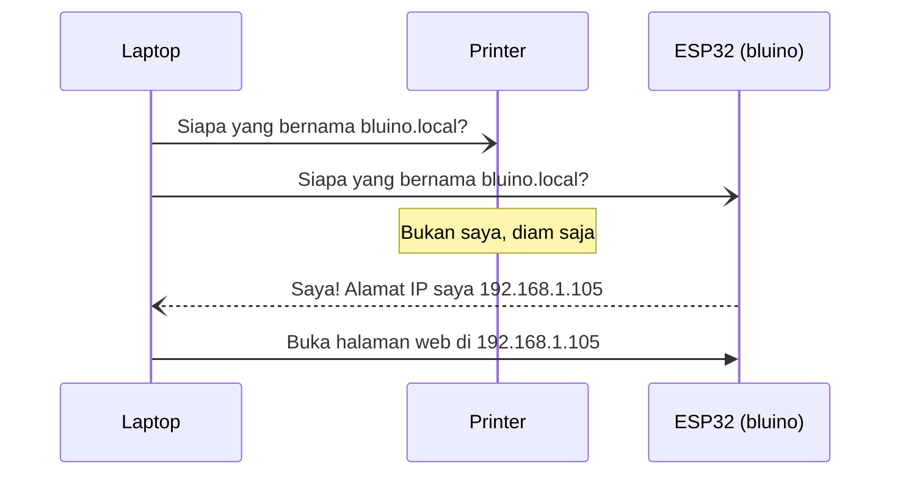

# BAB 45: mDNS — Akses ESP32 dengan Nama Domain Lokal

> ✅ **Prasyarat:** Selesaikan **BAB 42 (WiFi Station Mode — Koneksi Internet ESP32)** — ESP32 kamu sudah bisa terhubung ke WiFi dan menampilkan alamat IP-nya di Serial Monitor. Program 3 juga memakai `Preferences` dari **BAB 39 (NVS — Non-Volatile Storage)**.

Di BAB 42, setiap kali ESP32 tersambung ke WiFi, kamu harus membuka Serial Monitor dulu untuk tahu alamat IP-nya — deretan angka seperti `192.168.1.105` yang bisa berubah sewaktu-waktu. Di BAB ini kamu akan memberi ESP32 sebuah **nama**, misalnya `bluino.local`, dengan **mDNS** (*Multicast DNS*). Ibaratnya seperti menelepon teman: kamu cukup memilih nama "Budi" di daftar kontak, tidak perlu menghafal nomor HP-nya. Bedanya, dengan mDNS "daftar kontak" itu selalu diperbarui otomatis — ESP32 sendiri yang mengumumkan alamatnya yang terbaru, sehingga laptop dan HP bisa membuka `http://bluino.local` tanpa perlu tahu alamat IP-nya.

## 📌 Tujuan Pembelajaran

Setelah mempelajari BAB ini, kamu bisa:

- Menjelaskan kenapa alamat IP ESP32 bisa berubah (DHCP) dan pilihan cara mengatasinya.
- Menjelaskan cara kerja mDNS, nama `.local`, dan aturan memberi nama perangkat.
- Mengetahui laptop dan HP mana yang bisa membuka nama `.local`, serta cara lain kalau tidak bisa.
- Memberi ESP32 nama `.local` dengan *library* `ESPmDNS` dan mengujinya dengan perintah `ping` dari Command Prompt atau Terminal.
- Membuka halaman web ESP32 lewat `http://bluino.local` dan mengumumkan layanan web dengan DNS-SD.
- Mengganti nama mDNS lewat Serial Monitor serta mencari perangkat lain di jaringan dengan `MDNS.queryHost()` dan `MDNS.queryService()`.

## 🧰 Yang Perlu Disiapkan

| Kebutuhan | Keterangan |
|---|---|
| *Hardware* | Kit Bluino ESP32 IoT Starter Shield + kabel USB **data** |
| Kabel *jumper* | Tidak wajib — program memakai LED biru bawaan *board* di IO2. Opsional: 1 kabel *female-female* dari LED3 (biru) ke IO2 supaya LED biru di kit ikut menyala |
| Komponen tambahan | Tidak ada. Opsional: kit/ESP32 kedua untuk mencoba nama kembar dan pencarian perangkat (Latihan) |
| *Software* | Arduino IDE 2.x + *board package* **esp32** versi 3.3.x (lihat [BAB 5](../BAB-05/README.md)) |
| *Library* | Tidak perlu *library* tambahan — `WiFi`, `ESPmDNS`, `WebServer`, dan `Preferences` sudah bawaan *board package* esp32 |
| Alat uji | **Serial Monitor** Arduino IDE (baud 115200); **Command Prompt** (Windows) atau **Terminal** (macOS/Linux) untuk perintah `ping`; *browser* di laptop atau HP |
| Jaringan | WiFi **2,4 GHz** (ESP32 tidak mendukung 5 GHz). Laptop/HP harus terhubung ke WiFi yang **sama** dengan ESP32. Hindari WiFi tamu dan WiFi kampus/kantor yang memblokir komunikasi antarperangkat. Internet tidak wajib |

## 📑 Daftar Isi

- [45.1 Kenapa Alamat IP ESP32 Bisa Berubah?](#451-kenapa-alamat-ip-esp32-bisa-berubah)
- [45.2 Mengenal mDNS dan Nama .local](#452-mengenal-mdns-dan-nama-local)
- [45.3 Laptop dan HP Mana yang Bisa Membuka .local?](#453-laptop-dan-hp-mana-yang-bisa-membuka-local)
- [45.4 Library ESPmDNS](#454-library-espmdns)
- [45.5 Program 1: Memberi Nama ESP32](#455-program-1-memberi-nama-esp32)
- [45.6 Menguji Nama .local dengan ping](#456-menguji-nama-local-dengan-ping)
- [45.7 Program 2: Halaman Web di bluino.local](#457-program-2-halaman-web-di-bluinolocal)
- [45.8 Program 3: Ganti Nama dan Cari Perangkat Lain](#458-program-3-ganti-nama-dan-cari-perangkat-lain)
- [45.9 Keterbatasan mDNS dan Tips Pemakaian](#459-keterbatasan-mdns-dan-tips-pemakaian)
- [45.10 Troubleshooting](#4510-troubleshooting)
- [📝 Rangkuman](#-rangkuman)
- [💪 Latihan](#-latihan)
- [📚 Referensi](#-referensi)

---

## 45.1 Kenapa Alamat IP ESP32 Bisa Berubah?

Setiap perangkat di jaringan WiFi punya **alamat IP** (*Internet Protocol address*) — semacam nomor rumah supaya data sampai ke perangkat yang benar (lihat [BAB 42](../BAB-42/README.md)). Di jaringan rumah, alamat ini biasanya berbentuk `192.168.x.x`.

Alamat itu diberikan oleh **router** WiFi lewat layanan bernama **DHCP** (*Dynamic Host Configuration Protocol*). Cara kerjanya mirip resepsionis hotel: setiap tamu yang datang diberi nomor kamar yang sedang kosong, dengan masa inap tertentu. Di DHCP, masa pinjam alamat ini disebut ***lease*** — misalnya 24 jam, tergantung pengaturan *router*. Setelah *lease* habis, alamat itu boleh diberikan ke perangkat lain.

*Router* biasanya berusaha memberi alamat yang sama ke perangkat yang sama, tetapi **tidak ada jaminan**. Alamat IP ESP32 bisa berubah, misalnya ketika:

- ESP32 lama dimatikan, *lease*-nya habis, lalu alamatnya dipakai perangkat lain;
- *router* di-*restart* atau dikembalikan ke pengaturan pabrik;
- kit dibawa ke jaringan lain (dari rumah ke kampus atau kos) — di jaringan baru alamatnya pasti berbeda.

Contoh yang sering dialami:

| | Hari pertama | Hari berikutnya (ESP32 dan *router* sempat mati) |
|---|---|---|
| Alamat IP ESP32 | `192.168.1.105` | `192.168.1.117` |
| Membuka `http://192.168.1.105` | Berhasil | Gagal — alamatnya sudah pindah |
| Membuka `http://bluino.local` (mDNS) | Berhasil | Tetap berhasil |

Ada tiga cara umum supaya ESP32 tetap mudah ditemukan:

| Cara | Cara kerja | Kelebihan | Kekurangan |
|---|---|---|---|
| IP statis | Alamat IP ditulis tetap di kode ESP32 (`WiFi.config()`) | Tidak butuh dukungan apa pun dari laptop/HP | Bisa bentrok dengan alamat perangkat lain; kode harus diubah kalau pindah jaringan |
| Reservasi DHCP | Di halaman pengaturan *router*, satu alamat "dipesan" khusus untuk ESP32 berdasarkan alamat MAC-nya | Alamat tetap tanpa mengubah kode | Butuh akses admin *router*; biasanya tidak bisa di jaringan kampus/kantor |
| mDNS | ESP32 mengumumkan namanya sendiri, misalnya `bluino.local` | Tanpa server dan tanpa mengatur *router*; nama tetap sama di jaringan mana pun | Hanya berlaku di jaringan lokal yang sama; laptop/HP harus mendukung mDNS |

Alamat **MAC** (*Media Access Control*) adalah nomor identitas unik milik perangkat keras WiFi ESP32, seperti nomor rangka pada motor. BAB ini membahas cara ketiga, mDNS. Kamu tetap boleh menggabungkannya dengan reservasi DHCP kalau punya akses ke *router*.

---

## 45.2 Mengenal mDNS dan Nama `.local`

### 45.2.1 DNS: Buku Telepon Internet

Saat kamu mengetik `google.com` di *browser*, komputer tidak langsung tahu alamat IP-nya. Komputer bertanya dulu ke **server DNS** (*Domain Name System*), semacam buku telepon raksasa di internet: "`google.com` alamatnya berapa?" Setelah mendapat jawaban, barulah *browser* menghubungi alamat itu.

Masalahnya, server DNS di internet tidak tahu apa-apa tentang ESP32 di kamarmu. Tidak ada yang mencatat bahwa `bluino` sedang memakai alamat `192.168.1.105`.

### 45.2.2 mDNS: Bertanya ke Seluruh Ruangan

**mDNS** (*Multicast DNS*) memecahkan masalah itu **tanpa server**. Bayangkan kamu masuk ke ruang kelas dan berseru, "Yang namanya Budi, angkat tangan!" Budi menjawab dari kursinya — di mana pun ia duduk hari itu. Orang lain cukup diam.

Itulah *multicast*: satu pesan dikirim sekaligus ke sekelompok perangkat di jaringan yang sama, bukan hanya ke satu perangkat (*unicast*). Perangkat yang merasa memiliki nama itu menjawab dengan alamat IP-nya.



*Gambar 45.1 — Laptop mencari `bluino.local` dengan pesan multicast; hanya ESP32 bernama `bluino` yang menjawab. Sumber: dibuat untuk materi ini.*

Jawaban ESP32 sebenarnya juga dikirim secara *multicast*, sehingga perangkat lain ikut mencatatnya. Selain itu, setiap kali tersambung ke WiFi, ESP32 lebih dulu memeriksa apakah namanya sudah dipakai perangkat lain, lalu **mengumumkan** namanya beberapa kali tanpa ditanya supaya perangkat lain cepat tahu (detailnya ada di bagian Pendalaman [45.9](#459-keterbatasan-mdns-dan-tips-pemakaian)).

Beberapa fakta teknis yang perlu kamu tahu:

| Hal | Keterangan |
|---|---|
| Domain | `.local` — khusus jaringan lokal, tidak berlaku di internet |
| Alamat *multicast* | `224.0.0.251` (IPv4) dan `ff02::fb` (IPv6) |
| *Port* | UDP 5353 — UDP (*User Datagram Protocol*) adalah cara kirim data yang ringan tanpa "jabat tangan" dulu; *port* adalah nomor "pintu" layanan di sebuah perangkat |
| Jangkauan | Hanya satu jaringan lokal (satu *subnet*). *Router* tidak meneruskan pesan mDNS ke jaringan lain atau ke internet |
| Standar | RFC 6762 (mDNS) dan RFC 6763 (DNS-SD) |
| Nama lain | Bonjour (Apple), Avahi (Linux), Zeroconf (*zero-configuration networking*) |

### 45.2.3 DNS-SD: Mengumumkan Layanan

Selain nama, mDNS juga bisa mengumumkan **layanan** apa saja yang dimiliki sebuah perangkat. Fitur ini disebut **DNS-SD** (*DNS Service Discovery*). Ibaratnya papan pengumuman di jaringan: "Di `bluino.local` ada *web server* di *port* 80."

Jenis layanan ditulis dengan format `_layanan._protokol`, misalnya:

| Jenis layanan | Artinya |
|---|---|
| `_http._tcp` | *Web server* (halaman web) |
| `_ipp._tcp` | Printer jaringan |
| `_arduino._tcp` | Papan Arduino/ESP32 yang siap menerima *upload* lewat WiFi (OTA) — inilah yang membuat *port* jaringan muncul di menu **Tools → Port** Arduino IDE |

Setiap layanan boleh membawa **catatan TXT**, yaitu informasi tambahan berbentuk `kunci=nilai`, misalnya `board=ESP32 DEVKIT V1`. Aplikasi pencari layanan bisa membaca catatan ini tanpa perlu membuka halaman webnya.

### 45.2.4 Aturan Memberi Nama

Nama mDNS (sering disebut ***hostname***) sebaiknya mengikuti aturan berikut supaya bisa dibuka dari semua perangkat:

- Pakai **huruf kecil** `a`–`z`, **angka** `0`–`9`, dan **tanda hubung** `-` saja.
- Jangan pakai spasi, garis bawah `_`, titik, atau huruf beraksen.
- Jangan diawali atau diakhiri tanda hubung.
- Standarnya membolehkan sampai 63 karakter, tetapi di BAB ini kita batasi **maksimal 31 karakter**, karena `WiFi.setHostname()` di esp32 core hanya menyimpan 31 karakter.
- Di kode, tulis nama **tanpa** `.local`: `MDNS.begin("bluino")` menghasilkan `bluino.local`.
- Nama harus **unik** di satu jaringan. Di kelas atau lab yang berisi banyak kit, tambahkan nama atau nomormu, misalnya `bluino-andi` atau `bluino-07`.

| Contoh nama di kode | Boleh? | Alasan |
|---|---|---|
| `bluino` | ✅ | Huruf kecil saja |
| `bluino-andi` | ✅ | Huruf kecil dan tanda hubung |
| `sensor-dapur-2` | ✅ | Huruf kecil, angka, dan tanda hubung |
| `Bluino Kit` | ❌ | Ada spasi (dan huruf besar) |
| `bluino_kit` | ❌ | Garis bawah tidak sah untuk *hostname*, sebagian perangkat menolaknya |
| `-bluino` | ❌ | Diawali tanda hubung |
| `bluino.local` | ❌ | Jangan tulis `.local` di kode — ditambahkan otomatis |

> 💡 **Tips:** mDNS tidak membedakan huruf besar dan kecil — `BLUINO.local` sama dengan `bluino.local`. Meski begitu, biasakan selalu menulis huruf kecil supaya tidak membingungkan.

---

## 45.3 Laptop dan HP Mana yang Bisa Membuka `.local`?

ESP32 hanya **mengumumkan** nama. Laptop atau HP yang ingin membuka `bluino.local` juga harus bisa **bertanya** lewat mDNS. *Browser* seperti Chrome dan Edge menyerahkan urusan nama `.local` ke sistem operasi, jadi yang menentukan adalah sistem operasinya.

| Perangkat | Bisa membuka `.local`? | Catatan |
|---|---|---|
| Windows 11 dan Windows 10 versi 1903 (2019) ke atas | Ya, bawaan | `ping` dan *browser* bisa langsung memakai nama `.local` |
| Windows 7/8 atau Windows 10 versi lama | Tidak bawaan | Pasang **Bonjour Print Services for Windows** dari Apple (gratis, lihat [📚 Referensi](#-referensi)), lalu *restart* komputer |
| macOS, iPhone, iPad | Ya, bawaan | Apple menyebutnya **Bonjour**, sudah ada sejak Mac OS X 10.2 (2002) |
| Linux desktop (Ubuntu, Debian, Fedora, dan lain-lain) | Ya, umumnya bawaan | Butuh layanan **Avahi** dan **nss-mdns**. Kalau belum ada (Ubuntu/Debian): `sudo apt install avahi-daemon libnss-mdns` |
| Android 12 ke atas | Umumnya ya | Didukung sejak pembaruan sistem Google Play November 2021. **Tidak** berlaku saat VPN aktif atau saat memakai data seluler |
| Android 11 ke bawah | Umumnya tidak | Pakai alamat IP atau aplikasi bantu (lihat di bawah) |

> 📌 **Catatan:** Cara mengecek versi: Windows → tombol Start → ketik `winver` → Enter. Android → **Pengaturan → Tentang ponsel → Versi Android** (letak menunya bisa sedikit berbeda di tiap merek HP).

Kalau perangkatmu tidak bisa membuka nama `.local`, jangan khawatir — ESP32-nya tetap bisa diakses dengan cara lain:

1. **Pakai alamat IP** yang tampil di Serial Monitor. Semua program di BAB ini selalu mencetaknya, misalnya `http://192.168.1.105`.
2. **Lihat daftar perangkat di halaman admin *router*.** ESP32 muncul dengan nama `bluino` karena program memanggil `WiFi.setHostname()`.
3. **Pakai aplikasi di HP**, misalnya aplikasi pemindai jaringan seperti **Fing** (Android/iOS) yang menampilkan semua perangkat beserta IP-nya, atau aplikasi pencari layanan mDNS seperti **Service Browser** (Android) yang menampilkan perangkat yang mengumumkan layanan `_http._tcp`.

---

## 45.4 Library ESPmDNS

*Library* `ESPmDNS` sudah termasuk dalam *board package* esp32, jadi tidak perlu diinstal. Cukup tulis `#include <ESPmDNS.h>` di awal program. *Library* ini menyediakan objek siap pakai bernama `MDNS`.

Urutan pemakaiannya (potongan kode di dalam `setup()`):

```cpp
WiFi.setHostname("bluino");          // 1. nama DHCP — panggil SEBELUM WiFi.mode()
WiFi.mode(WIFI_STA);
WiFi.begin("NamaWiFiKamu", "PasswordWiFiKamu");  // ← ganti dengan WiFi kamu
// ... 2. tunggu sampai WiFi.status() == WL_CONNECTED ...

MDNS.begin("bluino");                // 3. mulai mDNS → bluino.local
MDNS.addService("http", "tcp", 80);  // 4. (opsional) umumkan layanan web di port 80
```

Fungsi-fungsi yang dipakai di BAB ini:

| Fungsi | Kegunaan | Contoh |
|---|---|---|
| `MDNS.begin(nama)` | Mulai mDNS dengan nama tertentu (tanpa `.local`). Menghasilkan `true` kalau berhasil | `MDNS.begin("bluino")` |
| `MDNS.end()` | Hentikan mDNS. Semua layanan yang sudah diumumkan ikut terhapus | `MDNS.end()` |
| `MDNS.setInstanceName(teks)` | Nama "ramah" (boleh berspasi) yang tampil di aplikasi pencari layanan | `MDNS.setInstanceName("Kit Bluino Andi")` |
| `MDNS.addService(layanan, protokol, port)` | Umumkan layanan DNS-SD. Garis bawah `_` di depan ditambahkan otomatis | `MDNS.addService("http", "tcp", 80)` |
| `MDNS.addServiceTxt(layanan, protokol, kunci, nilai)` | Tambahkan catatan TXT ke layanan yang sudah diumumkan | `MDNS.addServiceTxt("http", "tcp", "path", "/")` |
| `MDNS.queryHost(nama, waktuTunggu)` | Cari alamat IP perangkat lain dari namanya (**tanpa** `.local`). Menunggu paling lama `waktuTunggu` milidetik (bawaan 2000). Hasil `0.0.0.0` berarti tidak ketemu | `IPAddress ip = MDNS.queryHost("bluino-dapur");` |
| `MDNS.queryService(layanan, protokol)` | Cari semua perangkat yang mengumumkan layanan tertentu (menunggu ±3 detik). Menghasilkan jumlah perangkat yang ditemukan | `int n = MDNS.queryService("http", "tcp");` |
| `MDNS.hostname(i)`, `MDNS.address(i)`, `MDNS.port(i)` | Membaca nama (tanpa `.local`), alamat IP, dan *port* hasil ke-`i` dari `queryService()` | `MDNS.address(0)` |

> 📌 **Catatan:** Panggil `MDNS.begin()` **setelah** WiFi terhubung — urutan ini juga dipakai contoh resmi Espressif. Kamu **tidak perlu** memanggil `MDNS.update()` di `loop()`; fungsi itu hanya ada di *library* ESP8266. Di ESP32, mDNS berjalan sendiri di latar belakang. Kalau WiFi terputus lalu tersambung lagi (bahkan dengan alamat IP baru), mDNS otomatis mengumumkan alamat barunya, jadi `MDNS.begin()` tidak perlu dipanggil ulang.

> ⚠️ **Perhatian:** Di esp32 core 3.3.x, `WiFi.setHostname()` hanya berpengaruh kalau dipanggil **sebelum** `WiFi.mode()` atau `WiFi.begin()`. Kalau dipanggil sesudahnya, *router* tetap melihat nama bawaan seperti `esp32-A1B2C3`. Nama DHCP ini berbeda dari nama mDNS: nama DHCP tampil di daftar perangkat pada halaman admin *router*, sedangkan nama mDNS dipakai laptop/HP untuk membuka `bluino.local`. Supaya tidak bingung, samakan keduanya.

---

## 45.5 Program 1: Memberi Nama ESP32

**Tujuan:** ESP32 terhubung ke WiFi, lalu memakai mDNS untuk mengumumkan nama `bluino.local`. LED biru menyala saat mDNS siap, dan setiap 10 detik Serial Monitor menampilkan nama serta alamat IP yang sedang dipakai.

**Rangkaian:**

*Tidak perlu merangkai — program memakai LED biru bawaan board ESP32 di IO2.* Kalau ingin LED biru di kit juga ikut menyala, pasang satu kabel *jumper*:

| Pin **Custom** di kit | Sambungkan ke pin ESP32 |
|---|---|
| LED3 (LED biru) — opsional | IO2 |

**Cara Menjalankan:**

1. (Opsional) Sambungkan kabel *jumper* sesuai tabel **Rangkaian** di atas.
2. Buka Arduino IDE → **File → New Sketch**, hapus isinya, lalu salin kode di bawah. Kode yang sama juga tersedia di *file* [`p1_nama_mdns.ino`](p1_nama_mdns/p1_nama_mdns.ino).
3. Ganti `NamaWiFiKamu` dan `PasswordWiFiKamu` dengan nama dan kata sandi WiFi kamu. Keduanya peka huruf besar-kecil, dan WiFi-nya harus 2,4 GHz.
4. Kalau ada beberapa kit di WiFi yang sama (misalnya di kelas atau lab), ganti juga `NAMA_MDNS` dengan nama unik, misalnya `"bluino-andi"` (aturan nama ada di [45.2.4](#4524-aturan-memberi-nama)).
5. Pastikan **Tools → Board** = **ESP32 Dev Module** dan **Tools → Port** = *port* ESP32 kamu (misalnya `COM5` di Windows atau `/dev/ttyUSB0` di Linux).
6. Klik tombol **Upload** (ikon panah →) dan tunggu sampai muncul tulisan **Done uploading**.
7. Buka **Serial Monitor** (**Tools → Serial Monitor**) lalu pilih baud **115200**. Kalau tulisan awal terlewat, tekan tombol **EN** di *board* ESP32.
8. Uji namanya dari laptop dengan perintah `ping` seperti dijelaskan di [45.6](#456-menguji-nama-local-dengan-ping).

**Kode Program:**

<!-- sketch: p1_nama_mdns -->
```cpp
/*
 * BAB 45 - Program 1: Memberi Nama ESP32 dengan mDNS
 * ESP32 terhubung ke WiFi, lalu mengumumkan nama "bluino.local".
 * Uji dari laptop di WiFi yang sama: ping bluino.local
 *
 * Rangkaian: tidak perlu (LED biru bawaan board di IO2).
 *   Opsional: LED3 (biru) → IO2 supaya LED biru di kit ikut menyala.
 */

#include <WiFi.h>
#include <ESPmDNS.h>

const char* WIFI_SSID     = "NamaWiFiKamu";      // ← ganti dengan WiFi kamu
const char* WIFI_PASSWORD = "PasswordWiFiKamu";  // ← ganti dengan WiFi kamu

// Nama mDNS TANPA ".local": huruf kecil, angka, tanda hubung (maks. 31 karakter)
const char* NAMA_MDNS = "bluino";

#define LED_BIRU 2  // LED biru bawaan board (dan LED3 kit) → IO2

bool mdnsAktif = false;
unsigned long waktuLaporan = 0;

// Nama yang benar-benar dipakai mDNS saat ini. Bisa berbeda dari NAMA_MDNS
// kalau nama itu sudah dipakai perangkat lain (misalnya menjadi "bluino-2").
String namaMdnsAktif() {
  char nama[MDNS_NAME_BUF_LEN];
  if (mdns_hostname_get(nama) == ESP_OK) {
    return String(nama);
  }
  return String("");  // mDNS belum berjalan
}

void setup() {
  Serial.begin(115200);
  pinMode(LED_BIRU, OUTPUT);
  digitalWrite(LED_BIRU, LOW);
  delay(500);
  Serial.println();
  Serial.println("BAB 45 - Program 1: Memberi Nama ESP32 dengan mDNS");

  // 1. Sambungkan ke WiFi
  WiFi.setHostname(NAMA_MDNS);  // nama di daftar perangkat router — SEBELUM WiFi.mode()
  WiFi.mode(WIFI_STA);
  WiFi.begin(WIFI_SSID, WIFI_PASSWORD);
  Serial.print("Menghubungkan ke WiFi");

  unsigned long mulai = millis();
  while (WiFi.status() != WL_CONNECTED) {
    if (millis() - mulai >= 20000) {  // menyerah setelah 20 detik
      Serial.println();
      Serial.println("Gagal terhubung! Periksa nama dan password WiFi (harus 2,4 GHz).");
      Serial.println("ESP32 restart dalam 5 detik...");
      delay(5000);
      ESP.restart();
    }
    Serial.print(".");
    delay(500);
  }
  Serial.println();
  Serial.print("Terhubung! Alamat IP: ");
  Serial.println(WiFi.localIP());

  // 2. Mulai mDNS (setelah WiFi terhubung)
  mdnsAktif = MDNS.begin(NAMA_MDNS);
  if (mdnsAktif) {
    Serial.printf("mDNS aktif: %s.local\n", NAMA_MDNS);
    Serial.printf("Uji dari laptop di WiFi yang sama: ping %s.local\n", NAMA_MDNS);
  } else {
    Serial.println("Gagal memulai mDNS! Periksa isi NAMA_MDNS.");
  }
}

void loop() {
  // Tidak perlu MDNS.update(): mDNS berjalan sendiri di latar belakang dan
  // otomatis mengumumkan alamat IP baru setelah WiFi tersambung ulang.

  bool wifiTerhubung = (WiFi.status() == WL_CONNECTED);
  digitalWrite(LED_BIRU, (wifiTerhubung && mdnsAktif) ? HIGH : LOW);  // menyala = siap

  // Laporan status setiap 10 detik (tanpa delay, lihat BAB 16)
  if (millis() - waktuLaporan >= 10000) {
    waktuLaporan = millis();
    if (!wifiTerhubung) {
      Serial.println("WiFi terputus, menunggu tersambung ulang...");
    } else if (mdnsAktif) {
      Serial.printf("Nama: %s.local | IP: %s\n",
                    namaMdnsAktif().c_str(), WiFi.localIP().toString().c_str());
    } else {
      Serial.printf("mDNS tidak aktif | IP: %s\n", WiFi.localIP().toString().c_str());
    }
  }
}
```

**Penjelasan Kode:**

- `#include <ESPmDNS.h>` memuat *library* mDNS bawaan *board package* esp32. Objek `MDNS` langsung bisa dipakai tanpa perlu dibuat sendiri.
- `WiFi.setHostname(NAMA_MDNS)` memberi nama DHCP, yaitu nama yang tampil di daftar perangkat pada halaman admin *router*. Baris ini harus ada **sebelum** `WiFi.mode()` (lihat [45.4](#454-library-espmdns)).
- *Loop* `while` menunggu WiFi terhubung paling lama 20 detik. Kalau gagal, ESP32 menampilkan pesan lalu *restart* untuk mencoba lagi. `delay()` di sini tidak masalah karena program memang belum bisa bekerja tanpa WiFi.
- `MDNS.begin(NAMA_MDNS)` menjalankan mDNS dengan nama `bluino`, sehingga perangkat lain bisa mencarinya sebagai `bluino.local`. Hasilnya (`true`/`false`) disimpan di `mdnsAktif`. `MDNS.begin()` gagal kalau namanya kosong atau terlalu panjang.
- Fungsi `namaMdnsAktif()` membaca nama yang **benar-benar** dipakai lewat fungsi ESP-IDF `mdns_hostname_get()`. Kalau ternyata sudah ada perangkat lain bernama `bluino` di jaringan, mDNS ESP32 bisa otomatis mengganti namanya menjadi `bluino-2`. Laporan setiap 10 detik akan memperlihatkannya.
- Di `loop()` tidak ada perintah mDNS sama sekali: mDNS berjalan sendiri di latar belakang. LED biru diperbarui setiap putaran `loop()`: menyala selama WiFi terhubung dan mDNS aktif.
- Laporan berkala memakai pola `millis()` dari [BAB 16](../BAB-16/README.md), sehingga `loop()` tidak pernah berhenti menunggu.

**Contoh Output:**

```text
BAB 45 - Program 1: Memberi Nama ESP32 dengan mDNS
Menghubungkan ke WiFi.....
Terhubung! Alamat IP: 192.168.1.105
mDNS aktif: bluino.local
Uji dari laptop di WiFi yang sama: ping bluino.local
Nama: bluino.local | IP: 192.168.1.105
Nama: bluino.local | IP: 192.168.1.105
```

Alamat IP-mu hampir pasti berbeda — itu wajar. Di kit, LED biru menyala begitu mDNS siap dan padam kalau WiFi terputus. Kalau ada perangkat lain yang sudah memakai nama `bluino` di jaringan yang sama, laporan berkala bisa menampilkan `Nama: bluino-2.local | ...`. Artinya, ESP32 kamu sekarang harus dibuka dengan nama `bluino-2.local` (lebih baik: ganti `NAMA_MDNS` dengan nama unik).

Membuka `http://bluino.local` di *browser* sekarang akan gagal (misalnya muncul tulisan *refused to connect*). Itu normal: Program 1 baru memberi **nama**, belum punya *web server*. Halaman web dibuat di Program 2.

**Kalau Belum Berhasil:**

- **Titik-titik terus bertambah, lalu muncul `Gagal terhubung!`** → nama/kata sandi WiFi salah (perhatikan huruf besar-kecil) atau WiFi-nya 5 GHz. Pakai WiFi 2,4 GHz, misalnya *hotspot* HP yang diatur ke 2,4 GHz.
- **Muncul `Gagal memulai mDNS!`** → isi `NAMA_MDNS` kosong atau terlalu panjang. Pakai nama pendek sesuai [45.2.4](#4524-aturan-memberi-nama).
- **Serial Monitor normal, tetapi `ping bluino.local` gagal** → lihat bagian berikutnya ([45.6](#456-menguji-nama-local-dengan-ping)) dan tabel [45.10 Troubleshooting](#4510-troubleshooting).
- **Serial Monitor hanya menampilkan huruf acak** → baud Serial Monitor belum 115200.

---

## 45.6 Menguji Nama `.local` dengan `ping`

`ping` adalah perintah bawaan Windows, macOS, dan Linux untuk mengecek apakah sebuah perangkat bisa dihubungi. `ping` mengirim beberapa paket kecil dan menunggu balasannya. Kalau nama `bluino.local` berhasil diterjemahkan menjadi alamat IP **dan** ESP32 membalas, berarti mDNS bekerja.

Sebelum mulai, pastikan Program 1 sedang berjalan dan laptopmu terhubung ke WiFi yang **sama** dengan ESP32.

### 45.6.1 Windows (Command Prompt)

1. Klik tombol **Start**, ketik `cmd`, lalu tekan Enter. Jendela **Command Prompt** berlatar hitam akan terbuka.
2. Ketik perintah berikut, lalu tekan Enter:

```bash
ping bluino.local
```

Contoh hasilnya (angkamu bisa berbeda; kalau Windows-mu berbahasa Indonesia, tulisannya juga berbahasa Indonesia):

```text
Pinging bluino.local [192.168.1.105] with 32 bytes of data:
Reply from 192.168.1.105: bytes=32 time=48ms TTL=64
Reply from 192.168.1.105: bytes=32 time=12ms TTL=64
Reply from 192.168.1.105: bytes=32 time=95ms TTL=64
Reply from 192.168.1.105: bytes=32 time=33ms TTL=64

Ping statistics for 192.168.1.105:
    Packets: Sent = 4, Received = 4, Lost = 0 (0% loss),
Approximate round trip times in milli-seconds:
    Minimum = 12ms, Maximum = 95ms, Average = 47ms
```

Cara membacanya:

- Alamat di dalam kurung siku `[192.168.1.105]` adalah hasil pencarian mDNS. Alamat ini harus **sama** dengan alamat IP di Serial Monitor.
- Baris `Reply from ...` berarti ESP32 membalas. Waktu balasan (`time=`) yang naik-turun puluhan milidetik itu wajar, karena WiFi ESP32 memakai mode hemat daya secara *default*.
- Kalau muncul `Ping request could not find host bluino.local`, berarti nama `.local` tidak ditemukan. Kalau muncul `Request timed out`, berarti namanya ditemukan, tetapi ESP32 tidak membalas. Cari penyebabnya di [45.10 Troubleshooting](#4510-troubleshooting).

### 45.6.2 macOS dan Linux (Terminal)

1. Buka **Terminal**. Di macOS: tekan **Command + Spasi**, ketik `Terminal`, lalu Enter. Di Ubuntu: tekan **Ctrl + Alt + T**.
2. Ketik perintah berikut, lalu tekan Enter. Opsi `-c 4` artinya kirim 4 kali saja; tanpa opsi itu `ping` berjalan terus sampai kamu menekan **Ctrl + C**.

```bash
ping -c 4 bluino.local
```

Contoh hasilnya di macOS (tampilan di Linux sedikit berbeda, angkamu juga bisa berbeda):

```text
PING bluino.local (192.168.1.105): 56 data bytes
64 bytes from 192.168.1.105: icmp_seq=0 ttl=64 time=41.200 ms
64 bytes from 192.168.1.105: icmp_seq=1 ttl=64 time=10.800 ms
64 bytes from 192.168.1.105: icmp_seq=2 ttl=64 time=87.400 ms
64 bytes from 192.168.1.105: icmp_seq=3 ttl=64 time=24.600 ms

--- bluino.local ping statistics ---
4 packets transmitted, 4 packets received, 0.0% packet loss
round-trip min/avg/max/stddev = 10.800/41.000/87.400/28.870 ms
```

Di Linux, kamu juga bisa menanyakan alamat sebuah nama `.local` tanpa mengirim `ping`. Perintah ini butuh paket `avahi-utils` (di Ubuntu/Debian: `sudo apt install avahi-utils`):

```bash
avahi-resolve -n bluino.local
```

Hasilnya berupa nama dan alamat IP, misalnya `bluino.local    192.168.1.105`.

### 45.6.3 Di HP

HP tidak punya perintah `ping` bawaan. Cara paling mudah menguji nama `.local` dari HP adalah membuka halaman web ESP32 di Program 2 berikut. Ingat, HP harus tersambung ke WiFi yang sama (bukan data seluler), dan VPN di HP sebaiknya dimatikan dulu.

---

## 45.7 Program 2: Halaman Web di `bluino.local`

**Tujuan:** ESP32 menjalankan *web server* kecil sehingga `http://bluino.local` bisa dibuka dari *browser* laptop atau HP. ESP32 juga mengumumkan layanan web-nya (`_http._tcp`) dengan DNS-SD, sehingga aplikasi pencari layanan bisa menemukannya.

Program ini sengaja dibuat sederhana: halamannya hanya berisi teks. Cara membuat halaman web yang lebih lengkap (tombol, formulir, *dashboard*) dibahas di [BAB 46](../BAB-46/README.md).

**Rangkaian:**

*Tidak perlu merangkai — program memakai LED biru bawaan board ESP32 di IO2.* Opsional: LED3 (LED biru) → IO2, sama seperti Program 1.

**Cara Menjalankan:**

1. Buka Arduino IDE → **File → New Sketch**, hapus isinya, lalu salin kode di bawah. Kode yang sama juga tersedia di *file* [`p2_web_mdns.ino`](p2_web_mdns/p2_web_mdns.ino).
2. Ganti `NamaWiFiKamu` dan `PasswordWiFiKamu` dengan WiFi kamu (2,4 GHz, peka huruf besar-kecil). Kalau ada beberapa kit di WiFi yang sama, ganti juga `NAMA_MDNS` dengan nama unik.
3. Pastikan **Tools → Board** = **ESP32 Dev Module** dan **Tools → Port** = *port* ESP32 kamu.
4. Klik **Upload** dan tunggu sampai muncul tulisan **Done uploading**.
5. Buka **Serial Monitor** (baud **115200**) dan catat alamat IP yang tampil sebagai cadangan.
6. Di laptop atau HP yang tersambung ke WiFi yang **sama**, buka *browser* (Chrome, Edge, Safari, atau Firefox), lalu ketik alamat lengkap **beserta `http://`** di kolom alamat:

```text
http://bluino.local
```

**Kode Program:**

<!-- sketch: p2_web_mdns -->
```cpp
/*
 * BAB 45 - Program 2: Halaman Web di bluino.local
 * ESP32 menjalankan web server kecil dan mengumumkan layanan _http._tcp.
 * Buka dari browser di WiFi yang sama: http://bluino.local
 *
 * Rangkaian: tidak perlu (LED biru bawaan board di IO2).
 *   Opsional: LED3 (biru) → IO2.
 */

#include <WiFi.h>
#include <ESPmDNS.h>
#include <WebServer.h>

const char* WIFI_SSID     = "NamaWiFiKamu";      // ← ganti dengan WiFi kamu
const char* WIFI_PASSWORD = "PasswordWiFiKamu";  // ← ganti dengan WiFi kamu

const char* NAMA_MDNS = "bluino";  // → http://bluino.local

#define LED_BIRU 2  // LED biru bawaan board (dan LED3 kit) → IO2

WebServer server(80);  // web server di port 80 (port standar HTTP)

// Nama yang benar-benar dipakai mDNS (bisa menjadi "bluino-2" kalau namanya kembar)
String namaMdnsAktif() {
  char nama[MDNS_NAME_BUF_LEN];
  if (mdns_hostname_get(nama) == ESP_OK) {
    return String(nama);
  }
  return String(NAMA_MDNS);
}

// Dipanggil setiap kali ada yang membuka http://bluino.local/
void handleRoot() {
  String html;
  html += "<!DOCTYPE html><html lang=\"id\"><head><meta charset=\"UTF-8\">";
  html += "<meta name=\"viewport\" content=\"width=device-width, initial-scale=1\">";
  html += "<title>ESP32 Bluino</title></head>";
  html += "<body style=\"font-family:sans-serif;max-width:480px;margin:auto;padding:16px\">";
  html += "<h1>Halo dari ESP32!</h1>";
  html += "<p>Nama mDNS: <b>http://" + namaMdnsAktif() + ".local</b></p>";
  html += "<p>Alamat IP: <b>" + WiFi.localIP().toString() + "</b></p>";
  html += "<p>Kekuatan sinyal WiFi: <b>" + String(WiFi.RSSI()) + " dBm</b></p>";
  html += "<p>Menyala sejak: <b>" + String(millis() / 1000) + " detik</b> yang lalu</p>";
  html += "<p>Muat ulang halaman ini untuk memperbarui angka.</p>";
  html += "</body></html>";
  server.send(200, "text/html", html);

  Serial.printf("Halaman dibuka dari %s\n", server.client().remoteIP().toString().c_str());
}

// Dipanggil kalau alamat yang diminta tidak dikenal, misalnya /abc
void handleNotFound() {
  server.send(404, "text/plain", "Halaman tidak ditemukan");
}

void setup() {
  Serial.begin(115200);
  pinMode(LED_BIRU, OUTPUT);
  digitalWrite(LED_BIRU, LOW);
  delay(500);
  Serial.println();
  Serial.println("BAB 45 - Program 2: Halaman Web di bluino.local");

  // 1. Sambungkan ke WiFi
  WiFi.setHostname(NAMA_MDNS);  // SEBELUM WiFi.mode()
  WiFi.mode(WIFI_STA);
  WiFi.begin(WIFI_SSID, WIFI_PASSWORD);
  Serial.print("Menghubungkan ke WiFi");

  unsigned long mulai = millis();
  while (WiFi.status() != WL_CONNECTED) {
    if (millis() - mulai >= 20000) {  // menyerah setelah 20 detik
      Serial.println();
      Serial.println("Gagal terhubung! Periksa nama dan password WiFi (harus 2,4 GHz).");
      Serial.println("ESP32 restart dalam 5 detik...");
      delay(5000);
      ESP.restart();
    }
    Serial.print(".");
    delay(500);
  }
  Serial.println();
  Serial.print("Terhubung! Alamat IP: ");
  Serial.println(WiFi.localIP());

  // 2. Mulai mDNS dan umumkan layanan web (DNS-SD)
  bool mdnsAktif = MDNS.begin(NAMA_MDNS);
  if (mdnsAktif) {
    MDNS.setInstanceName("Kit Bluino ESP32");                       // nama ramah di aplikasi pencari layanan
    MDNS.addService("http", "tcp", 80);                             // layanan _http._tcp di port 80
    MDNS.addServiceTxt("http", "tcp", "path", "/");                 // catatan TXT: halaman utama
    MDNS.addServiceTxt("http", "tcp", "board", "ESP32 DEVKIT V1");  // catatan TXT: info papan
    Serial.printf("mDNS aktif: %s.local\n", NAMA_MDNS);
    Serial.println("Layanan _http._tcp diumumkan di port 80");
  } else {
    Serial.println("Gagal memulai mDNS! Halaman tetap bisa dibuka lewat alamat IP.");
  }

  // 3. Jalankan web server
  server.on("/", handleRoot);
  server.onNotFound(handleNotFound);
  server.begin();
  if (mdnsAktif) {
    Serial.printf("Web server berjalan. Buka di browser: http://%s.local\n", NAMA_MDNS);
  }
  Serial.print("Kalau nama .local tidak bisa dibuka, pakai: http://");
  Serial.println(WiFi.localIP());
}

void loop() {
  server.handleClient();  // layani browser yang membuka halaman

  // LED biru menyala selama WiFi terhubung (halaman siap dibuka)
  digitalWrite(LED_BIRU, (WiFi.status() == WL_CONNECTED) ? HIGH : LOW);
}
```

**Penjelasan Kode:**

- `WebServer server(80);` membuat *web server* di *port* 80, *port* standar untuk HTTP. Karena itu, alamatnya cukup ditulis `http://bluino.local` tanpa nomor *port*.
- `handleRoot()` menyusun halaman HTML sederhana berisi nama mDNS, alamat IP, kekuatan sinyal WiFi (RSSI, makin mendekati 0 makin kuat — lihat [BAB 42](../BAB-42/README.md)), dan lama ESP32 menyala, lalu mengirimkannya dengan `server.send(200, "text/html", html)`. Kode `200` artinya "berhasil". Baris `<meta name="viewport" ...>` membuat halaman tetap terbaca di layar HP.
- `handleNotFound()` menjawab alamat yang tidak dikenal (misalnya `http://bluino.local/abc`) dengan kode `404` (tidak ditemukan).
- `MDNS.setInstanceName()` memberi nama ramah yang tampil di aplikasi pencari layanan. Nama ini boleh berspasi karena bukan *hostname*.
- `MDNS.addService("http", "tcp", 80)` mengumumkan "di perangkat ini ada *web server* di *port* 80". `addServiceTxt()` menambahkan catatan TXT: `path=/` (alamat halaman utama — kunci ini juga dipakai di contoh layanan web pada RFC 6763) dan `board=ESP32 DEVKIT V1`. Semua `addService...()` dipanggil **setelah** `MDNS.begin()` berhasil.
- `server.handleClient()` di `loop()` wajib dipanggil terus-menerus supaya permintaan dari *browser* dilayani. Jangan beri `delay()` panjang di `loop()`.
- Halaman ini tidak memuat *file* apa pun dari internet (misalnya dari CDN, *Content Delivery Network*), jadi tetap tampil walaupun WiFi-mu tidak tersambung ke internet.

**Contoh Output:**

Serial Monitor:

```text
BAB 45 - Program 2: Halaman Web di bluino.local
Menghubungkan ke WiFi.....
Terhubung! Alamat IP: 192.168.1.105
mDNS aktif: bluino.local
Layanan _http._tcp diumumkan di port 80
Web server berjalan. Buka di browser: http://bluino.local
Kalau nama .local tidak bisa dibuka, pakai: http://192.168.1.105
Halaman dibuka dari 192.168.1.101
```

Baris terakhir muncul setiap kali halaman dibuka atau dimuat ulang; `192.168.1.101` adalah alamat laptop/HP yang membukanya.

Tampilan di *browser* (angkamu bisa berbeda):

```text
Halo dari ESP32!

Nama mDNS: http://bluino.local
Alamat IP: 192.168.1.105
Kekuatan sinyal WiFi: -58 dBm
Menyala sejak: 42 detik yang lalu

Muat ulang halaman ini untuk memperbarui angka.
```

LED biru menyala selama ESP32 terhubung ke WiFi.

> 💡 **Tips:** Selalu ketik `http://` di depan nama. Kalau hanya mengetik `bluino.local`, sebagian *browser* menganggapnya kata kunci pencarian, atau mencoba `https://` lebih dulu. Kalau *browser* memperingatkan bahwa situs tidak mendukung koneksi aman, pilih tombol untuk tetap melanjutkan — halaman ESP32 di BAB ini memang memakai HTTP biasa (HTTPS dibahas di [BAB 49](../BAB-49/README.md)).

> 🧪 **Coba Sendiri:** Tekan tombol **EN** di ESP32 untuk me-*restart*-nya, tunggu LED biru menyala lagi, lalu muat ulang halaman di *browser*. Kamu tidak perlu melihat Serial Monitor sama sekali — inilah gunanya mDNS.

**Melihat pengumuman layanan (opsional):**

Layanan `_http._tcp` yang diumumkan ESP32 bisa dilihat dengan alat berikut. Perintah macOS berjalan terus sampai kamu menekan **Ctrl + C**; perintah Linux dengan opsi `-t` berhenti sendiri.

| Perangkat | Alat dan perintah | Yang seharusnya muncul |
|---|---|---|
| macOS | Terminal: `dns-sd -B _http._tcp` | Baris berisi `Kit Bluino ESP32` |
| Linux | Terminal: `avahi-browse -rt _http._tcp` (paket `avahi-utils`) | `Kit Bluino ESP32`, *hostname* `bluino.local`, alamat IP, *port* 80, dan catatan TXT `board=...` serta `path=/` |
| Android | Aplikasi pencari layanan mDNS, misalnya **Service Browser** | Kategori `_http._tcp` berisi `Kit Bluino ESP32` |
| Windows | Tidak ada alat bawaan yang praktis | Pakai HP, atau coba perintah `cari` di Program 3 dari kit kedua |

**Kalau Belum Berhasil:**

- ***Browser* malah menampilkan hasil pencarian Google/Bing** → kamu mengetik tanpa `http://`. Ketik lengkap: `http://bluino.local`.
- **Muncul "Situs tidak dapat dijangkau" (*This site can't be reached*), tetapi alamat IP dari Serial Monitor bisa dibuka** → perangkatmu belum bisa membuka nama `.local` (misalnya Android 11 ke bawah, VPN aktif, atau HP memakai data seluler, bukan WiFi). Pakai alamat IP, atau lihat [45.3](#453-laptop-dan-hp-mana-yang-bisa-membuka-local).
- **Nama `.local` maupun alamat IP sama-sama tidak bisa dibuka** → laptop/HP tidak berada di jaringan yang sama dengan ESP32, atau WiFi memakai isolasi klien (WiFi tamu, WiFi kampus). Lihat [45.10 Troubleshooting](#4510-troubleshooting).
- **Halaman menampilkan `bluino-2.local`** → ada perangkat lain yang sudah memakai nama `bluino`. Ganti `NAMA_MDNS` dengan nama unik.

---

## 45.8 Program 3: Ganti Nama dan Cari Perangkat Lain

**Tujuan:** Nama mDNS bisa diganti lewat Serial Monitor tanpa *upload* ulang, lalu disimpan di NVS supaya tetap ada setelah ESP32 *restart*. ESP32 juga bisa berperan sebagai **pencari**: menemukan perangkat lain yang punya *web server* (`MDNS.queryService()`) dan mencari alamat IP dari sebuah nama `.local` (`MDNS.queryHost()`).

Program ini berguna di kelas atau lab: setiap kit cukup di-*upload* program yang sama, lalu setiap orang memberi nama kitnya sendiri lewat Serial Monitor.

**Rangkaian:**

*Tidak perlu merangkai — program memakai LED biru bawaan board ESP32 di IO2.* Opsional: LED3 (LED biru) → IO2.

**Cara Menjalankan:**

1. Buka Arduino IDE → **File → New Sketch**, hapus isinya, lalu salin kode di bawah. Kode yang sama juga tersedia di *file* [`p3_ganti_nama_cari.ino`](p3_ganti_nama_cari/p3_ganti_nama_cari.ino).
2. Ganti `NamaWiFiKamu` dan `PasswordWiFiKamu` dengan WiFi kamu (2,4 GHz, peka huruf besar-kecil).
3. Pastikan **Tools → Board** = **ESP32 Dev Module** dan **Tools → Port** = *port* ESP32 kamu, lalu klik **Upload**.
4. Buka **Serial Monitor**, pilih baud **115200**, dan atur *line ending* (menu di sebelah kiri pilihan baud) ke **New Line** (atau **Both NL & CR**).
5. Ketik perintah di kolom pesan bagian atas Serial Monitor, lalu tekan Enter. Mulailah dengan `bantuan`, kemudian coba `nama bluino-namamu` (ganti `namamu` dengan namamu, huruf kecil).
6. Buka `http://bluino-namamu.local` di *browser* untuk memastikan nama barunya bekerja.
7. Untuk mencoba `cari` dan `ip`, perlu ada perangkat lain di jaringan yang sama — misalnya kit temanmu yang menjalankan Program 2 atau 3. Kalau tidak ada, hasilnya `Tidak ditemukan` (itu bukan *error*).

**Kode Program:**

<!-- sketch: p3_ganti_nama_cari -->
```cpp
/*
 * BAB 45 - Program 3: Ganti Nama dan Cari Perangkat Lain
 * Perintah lewat Serial Monitor (line ending: New Line):
 *   bantuan          -> daftar perintah
 *   status           -> nama, alamat IP, status WiFi
 *   nama <nama-baru> -> ganti nama mDNS (disimpan di NVS)
 *   cari             -> cari perangkat yang punya web server (_http._tcp)
 *   ip <nama>        -> cari alamat IP dari sebuah nama .local
 *
 * Rangkaian: tidak perlu (LED biru bawaan board di IO2).
 *   Opsional: LED3 (biru) → IO2.
 */

#include <WiFi.h>
#include <ESPmDNS.h>
#include <WebServer.h>
#include <Preferences.h>

const char* WIFI_SSID     = "NamaWiFiKamu";      // ← ganti dengan WiFi kamu
const char* WIFI_PASSWORD = "PasswordWiFiKamu";  // ← ganti dengan WiFi kamu

const char* NAMA_BAWAAN = "bluino";  // dipakai kalau belum ada nama tersimpan

#define LED_BIRU 2  // LED biru bawaan board (dan LED3 kit) → IO2

WebServer server(80);
Preferences prefs;

String namaMdns;          // nama yang diminta (tersimpan di NVS)
bool mdnsAktif = false;
String bufferPerintah;    // menampung huruf dari Serial Monitor sampai Enter

// Nama yang benar-benar dipakai mDNS (bisa "...-2" kalau namanya kembar)
String namaMdnsAktif() {
  char nama[MDNS_NAME_BUF_LEN];
  if (mdns_hostname_get(nama) == ESP_OK) {
    return String(nama);
  }
  return namaMdns;
}

// Aturan nama: 1-31 karakter, hanya a-z, 0-9, dan '-',
// tidak boleh diawali atau diakhiri '-'
bool namaValid(const String& nama) {
  if (nama.length() < 1 || nama.length() > 31) return false;
  if (nama.startsWith("-") || nama.endsWith("-")) return false;
  for (unsigned int i = 0; i < nama.length(); i++) {
    char c = nama[i];
    bool boleh = (c >= 'a' && c <= 'z') || (c >= '0' && c <= '9') || c == '-';
    if (!boleh) return false;
  }
  return true;
}

// Rapikan masukan: buang spasi di tepi, jadikan huruf kecil, buang ".local"
String rapikanNama(String nama) {
  nama.trim();
  nama.toLowerCase();
  if (nama.endsWith(".local")) {
    nama.remove(nama.length() - 6);
  }
  return nama;
}

// (Ulang) jalankan mDNS dengan nama di variabel namaMdns
bool mulaiMdns() {
  MDNS.end();  // hentikan dulu kalau sudah berjalan (aman walau belum pernah dimulai)
  if (!MDNS.begin(namaMdns.c_str())) {
    return false;
  }
  MDNS.addService("http", "tcp", 80);  // layanan harus diumumkan ulang setelah end()
  MDNS.addServiceTxt("http", "tcp", "path", "/");
  return true;
}

// Halaman web sederhana (detail web server ada di BAB 46)
void handleRoot() {
  String html;
  html += "<!DOCTYPE html><html lang=\"id\"><head><meta charset=\"UTF-8\">";
  html += "<meta name=\"viewport\" content=\"width=device-width, initial-scale=1\">";
  html += "<title>ESP32 Bluino</title></head>";
  html += "<body style=\"font-family:sans-serif;max-width:480px;margin:auto;padding:16px\">";
  html += "<h1>Halo dari " + namaMdnsAktif() + ".local!</h1>";
  html += "<p>Alamat IP: <b>" + WiFi.localIP().toString() + "</b></p>";
  html += "<p>Nama ini bisa diganti lewat Serial Monitor dengan perintah <code>nama</code>.</p>";
  html += "</body></html>";
  server.send(200, "text/html", html);
}

void tampilkanBantuan() {
  Serial.println("Perintah yang tersedia:");
  Serial.println("  bantuan          -> tampilkan daftar perintah ini");
  Serial.println("  status           -> tampilkan nama, alamat IP, dan status WiFi");
  Serial.println("  nama <nama-baru> -> ganti nama mDNS, contoh: nama bluino-andi");
  Serial.println("  cari             -> cari perangkat yang punya web server (_http._tcp)");
  Serial.println("  ip <nama>        -> cari alamat IP sebuah nama, contoh: ip bluino-budi");
}

void tampilkanStatus() {
  Serial.printf("Nama tersimpan : %s.local\n", namaMdns.c_str());
  if (mdnsAktif) {
    Serial.printf("Nama aktif     : %s.local\n", namaMdnsAktif().c_str());
  } else {
    Serial.println("Nama aktif     : (mDNS tidak aktif)");
  }
  Serial.printf("WiFi           : %s\n", (WiFi.status() == WL_CONNECTED) ? "terhubung" : "terputus");
  Serial.printf("Alamat IP      : %s\n", WiFi.localIP().toString().c_str());
}

void gantiNama(const String& masukan) {
  String namaBaru = rapikanNama(masukan);
  if (namaBaru.length() == 0) {
    Serial.printf("Nama sekarang: %s.local. Untuk mengganti: nama <nama-baru>\n", namaMdns.c_str());
    return;
  }
  if (!namaValid(namaBaru)) {
    Serial.println("Nama tidak valid! Pakai 1-31 huruf kecil, angka, atau tanda hubung (-),");
    Serial.println("dan jangan diawali/diakhiri tanda hubung. Contoh: nama bluino-andi");
    return;
  }

  namaMdns = namaBaru;
  prefs.putString("nama", namaMdns);  // simpan ke NVS supaya tetap ada setelah restart
  mdnsAktif = mulaiMdns();
  if (mdnsAktif) {
    Serial.printf("Nama diganti dan disimpan. Sekarang buka: http://%s.local\n", namaMdns.c_str());
    Serial.println("(Nama di daftar perangkat router baru ikut berubah setelah ESP32 restart.)");
  } else {
    Serial.println("Gagal memulai mDNS dengan nama baru!");
  }
}

void cariLayanan() {
  if (!mdnsAktif) {
    Serial.println("mDNS tidak aktif, tidak bisa mencari.");
    return;
  }
  Serial.println("Mencari perangkat dengan layanan _http._tcp (tunggu 3 detik)...");
  int jumlah = MDNS.queryService("http", "tcp");  // ESP32 menunggu ±3 detik di sini
  if (jumlah == 0) {
    Serial.println("Tidak ditemukan. (ESP32 ini sendiri tidak ikut terhitung.)");
    return;
  }
  Serial.printf("Ditemukan %d perangkat:\n", jumlah);
  for (int i = 0; i < jumlah; i++) {
    Serial.printf("  %d. %s.local | IP: %s | port: %u\n", i + 1,
                  MDNS.hostname(i).c_str(),
                  MDNS.address(i).toString().c_str(),
                  (unsigned int)MDNS.port(i));
  }
}

void cariIp(const String& masukan) {
  String nama = rapikanNama(masukan);
  if (nama.length() == 0) {
    Serial.println("Tulis namanya, contoh: ip bluino-budi");
    return;
  }
  if (!mdnsAktif) {
    Serial.println("mDNS tidak aktif, tidak bisa mencari.");
    return;
  }
  Serial.printf("Mencari %s.local (tunggu sampai 2 detik)...\n", nama.c_str());
  IPAddress ip = MDNS.queryHost(nama, 2000);  // nama TANPA ".local", tunggu maks. 2000 ms
  if (ip == INADDR_NONE) {                    // 0.0.0.0 = tidak ada yang menjawab
    Serial.println("Tidak ditemukan.");
  } else {
    Serial.printf("%s.local -> %s\n", nama.c_str(), ip.toString().c_str());
  }
}

// Pisahkan baris menjadi perintah + isi, lalu jalankan
void prosesPerintah(String baris) {
  baris.trim();
  if (baris.length() == 0) return;  // baris kosong (misalnya sisa '\r') diabaikan
  Serial.print("> ");
  Serial.println(baris);

  String perintah = baris;
  String isi = "";
  int spasi = baris.indexOf(' ');
  if (spasi > 0) {
    perintah = baris.substring(0, spasi);
    isi = baris.substring(spasi + 1);
  }
  perintah.toLowerCase();

  if (perintah == "bantuan") {
    tampilkanBantuan();
  } else if (perintah == "status") {
    tampilkanStatus();
  } else if (perintah == "nama") {
    gantiNama(isi);
  } else if (perintah == "cari") {
    cariLayanan();
  } else if (perintah == "ip") {
    cariIp(isi);
  } else {
    Serial.println("Perintah tidak dikenal. Ketik: bantuan");
  }
}

void setup() {
  Serial.begin(115200);
  pinMode(LED_BIRU, OUTPUT);
  digitalWrite(LED_BIRU, LOW);
  delay(500);
  Serial.println();
  Serial.println("BAB 45 - Program 3: Ganti Nama dan Cari Perangkat Lain");

  // 1. Muat nama tersimpan dari NVS (lihat BAB 39)
  prefs.begin("bab45", false);  // namespace "bab45", mode baca-tulis
  namaMdns = NAMA_BAWAAN;
  if (prefs.isKey("nama")) {
    namaMdns = prefs.getString("nama");
  }
  if (!namaValid(namaMdns)) {
    namaMdns = NAMA_BAWAAN;  // jaga-jaga kalau isi NVS tidak sesuai aturan
  }
  Serial.printf("Nama tersimpan: %s\n", namaMdns.c_str());

  // 2. Sambungkan ke WiFi
  WiFi.setHostname(namaMdns.c_str());  // SEBELUM WiFi.mode()
  WiFi.mode(WIFI_STA);
  WiFi.begin(WIFI_SSID, WIFI_PASSWORD);
  Serial.print("Menghubungkan ke WiFi");

  unsigned long mulai = millis();
  while (WiFi.status() != WL_CONNECTED) {
    if (millis() - mulai >= 20000) {  // menyerah setelah 20 detik
      Serial.println();
      Serial.println("Gagal terhubung! Periksa nama dan password WiFi (harus 2,4 GHz).");
      Serial.println("ESP32 restart dalam 5 detik...");
      delay(5000);
      ESP.restart();
    }
    Serial.print(".");
    delay(500);
  }
  Serial.println();
  Serial.print("Terhubung! Alamat IP: ");
  Serial.println(WiFi.localIP());

  // 3. Mulai mDNS
  mdnsAktif = mulaiMdns();
  if (mdnsAktif) {
    Serial.printf("mDNS aktif: %s.local\n", namaMdns.c_str());
  } else {
    Serial.println("Gagal memulai mDNS!");
  }

  // 4. Jalankan web server
  server.on("/", handleRoot);
  server.begin();
  Serial.printf("Web server berjalan. Buka di browser: http://%s.local\n", namaMdns.c_str());

  bufferPerintah.reserve(64);
  tampilkanBantuan();
}

void loop() {
  server.handleClient();

  // Baca perintah dari Serial Monitor huruf demi huruf sampai Enter
  while (Serial.available() > 0) {
    char c = (char)Serial.read();
    if (c == '\n' || c == '\r') {
      prosesPerintah(bufferPerintah);
      bufferPerintah = "";
    } else if (bufferPerintah.length() < 64) {
      bufferPerintah += c;
    }
  }

  // LED biru menyala selama WiFi terhubung dan mDNS aktif
  digitalWrite(LED_BIRU, (WiFi.status() == WL_CONNECTED && mdnsAktif) ? HIGH : LOW);
}
```

**Penjelasan Kode:**

- **Menyimpan nama di NVS.** `prefs.begin("bab45", false)` membuka tempat penyimpanan NVS bernama `bab45` (lihat [BAB 39](../BAB-39/README.md)). Saat menyala, program memakai nama tersimpan dengan kunci `"nama"` kalau ada (`prefs.isKey()`), atau `bluino` kalau belum ada. Perintah `nama` menyimpan nama baru dengan `prefs.putString()`.
- **Memeriksa nama.** `rapikanNama()` membuang spasi di tepi, mengubah ke huruf kecil, dan membuang `.local` kalau ikut diketik. `namaValid()` lalu memeriksa aturan dari [45.2.4](#4524-aturan-memberi-nama). Nama yang tidak sesuai ditolak, jadi nama di halaman web juga pasti aman ditampilkan.
- **Mengganti nama tanpa *restart*.** `mulaiMdns()` memanggil `MDNS.end()` lalu `MDNS.begin()` dengan nama baru. Karena `MDNS.end()` ikut menghapus semua layanan, `addService()` dan `addServiceTxt()` harus dipanggil lagi. Nama DHCP (`WiFi.setHostname()`) baru ikut berubah setelah *restart*, karena hanya dipasang saat WiFi dinyalakan.
- **Mencari layanan.** `MDNS.queryService("http", "tcp")` mengirim pertanyaan *multicast* "siapa punya layanan `_http._tcp`?", menunggu jawaban sekitar 3 detik, lalu menghasilkan jumlah perangkat yang menjawab. Detail setiap perangkat dibaca dengan `MDNS.hostname(i)` (tanpa `.local`), `MDNS.address(i)`, dan `MDNS.port(i)`. ESP32 tidak menjawab pertanyaannya sendiri, jadi dirinya tidak masuk daftar.
- **Mencari alamat IP.** `MDNS.queryHost(nama, 2000)` menanyakan alamat IP sebuah nama. Namanya harus ditulis **tanpa** `.local`. Kalau dalam 2000 ms tidak ada yang menjawab, hasilnya `0.0.0.0`, yang dibandingkan dengan konstanta `INADDR_NONE`.
- **Membaca perintah.** Huruf dari Serial Monitor dikumpulkan di `bufferPerintah` sampai ada karakter Enter (`'\n'` atau `'\r'`), lalu dipisah menjadi perintah dan isinya oleh `prosesPerintah()`. Panjang *buffer* dibatasi 64 huruf supaya memori tidak terbuang.
- Selama `cari` atau `ip` menunggu jawaban, ESP32 tidak melayani *web server*. Untuk program belajar ini tidak masalah karena hanya berlangsung beberapa detik.

**Contoh Output:**

Contoh sesi berikut terjadi di jaringan yang juga berisi kit teman (`bluino-budi`) dan sebuah printer. Hasil `cari` di jaringanmu tentu berbeda.

```text
BAB 45 - Program 3: Ganti Nama dan Cari Perangkat Lain
Nama tersimpan: bluino
Menghubungkan ke WiFi.....
Terhubung! Alamat IP: 192.168.1.105
mDNS aktif: bluino.local
Web server berjalan. Buka di browser: http://bluino.local
Perintah yang tersedia:
  bantuan          -> tampilkan daftar perintah ini
  status           -> tampilkan nama, alamat IP, dan status WiFi
  nama <nama-baru> -> ganti nama mDNS, contoh: nama bluino-andi
  cari             -> cari perangkat yang punya web server (_http._tcp)
  ip <nama>        -> cari alamat IP sebuah nama, contoh: ip bluino-budi
> nama bluino-andi
Nama diganti dan disimpan. Sekarang buka: http://bluino-andi.local
(Nama di daftar perangkat router baru ikut berubah setelah ESP32 restart.)
> status
Nama tersimpan : bluino-andi.local
Nama aktif     : bluino-andi.local
WiFi           : terhubung
Alamat IP      : 192.168.1.105
> cari
Mencari perangkat dengan layanan _http._tcp (tunggu 3 detik)...
Ditemukan 2 perangkat:
  1. bluino-budi.local | IP: 192.168.1.110 | port: 80
  2. printer-kantor.local | IP: 192.168.1.20 | port: 80
> ip bluino-budi
Mencari bluino-budi.local (tunggu sampai 2 detik)...
bluino-budi.local -> 192.168.1.110
> ip tidak-ada
Mencari tidak-ada.local (tunggu sampai 2 detik)...
Tidak ditemukan.
```

Tekan tombol **EN** untuk me-*restart* ESP32: baris kedua sekarang menjadi `Nama tersimpan: bluino-andi`, karena nama baru sudah tersimpan di NVS. Untuk kembali ke nama awal, ketik `nama bluino`.

**Kalau Belum Berhasil:**

- **Perintah yang diketik tidak ditanggapi** → *line ending* Serial Monitor masih **No Line Ending**. Ganti ke **New Line** atau **Both NL & CR**.
- **`Nama tidak valid!`** → nama memakai huruf besar, spasi, garis bawah, atau lebih dari 31 karakter. Contoh nama yang benar: `nama bluino-andi`.
- **`cari` selalu `Tidak ditemukan.`** → belum ada perangkat lain yang mengumumkan layanan `_http._tcp` di jaringanmu. Nyalakan kit kedua dengan Program 2/3 di WiFi yang sama. Kalau tetap tidak ketemu, jaringanmu mungkin memblokir *multicast* (lihat [45.10](#4510-troubleshooting)).
- **`status` menampilkan nama aktif berakhiran `-2`** → nama yang kamu pilih sudah dipakai perangkat lain, jadi mDNS otomatis menggantinya. Pilih nama lain dengan perintah `nama`.

---

## 45.9 Keterbatasan mDNS dan Tips Pemakaian

### 45.9.1 Yang Tidak Bisa Dilakukan mDNS

| Keterbatasan | Penjelasan | Yang bisa kamu lakukan |
|---|---|---|
| Hanya di jaringan lokal | Pesan *multicast* tidak diteruskan *router* ke jaringan lain atau ke internet. `bluino.local` tidak bisa dibuka dari luar rumah | Untuk akses dari jauh, pakai cara lain, misalnya MQTT dengan *broker* di internet ([BAB 50](../BAB-50/README.md)) |
| Perangkat pembuka harus mendukung mDNS | Android 11 ke bawah, Windows lama, atau HP dengan VPN aktif tidak bisa membuka nama `.local` | Pakai alamat IP sebagai cadangan (lihat [45.3](#453-laptop-dan-hp-mana-yang-bisa-membuka-local)) |
| Bisa diblokir jaringan | WiFi tamu, WiFi kampus/kantor, dan sebagian *router* *mesh* memblokir *multicast* atau komunikasi antarperangkat | Coba di WiFi rumah biasa, atau minta admin jaringan mengizinkan mDNS |
| Nama harus unik | Dua perangkat dengan nama sama akan bentrok, lalu salah satunya otomatis berganti nama menjadi `...-2` — kamu tidak bisa memilih yang mana | Beri nama unik sejak awal, misalnya `bluino-andi` |
| Bukan pengaman | Semua perangkat di jaringan yang sama bisa melihat nama dan layanan ESP32, lalu membuka halamannya | Jangan menganggap nama yang "dirahasiakan" sebagai pengaman. Keamanan dibahas di [BAB 49](../BAB-49/README.md) |

### 45.9.2 mDNS Saat ESP32 Menjadi Access Point

mDNS juga bekerja ketika ESP32 menjadi *Access Point* (*hotspot* sendiri, [BAB 43](../BAB-43/README.md)). Panggil `MDNS.begin()` setelah `WiFi.softAP()`, lalu HP yang tersambung ke WiFi ESP32 bisa membuka `http://bluino.local` — asalkan HP itu mendukung mDNS. Sebagai cadangan, alamat bawaan ESP32 dalam mode *Access Point* adalah `http://192.168.4.1`.

> 📌 **Catatan:** WiFi milik ESP32 tidak tersambung ke internet. Karena itu, sebagian HP Android tetap memakai data seluler, dan nama `bluino.local` bisa gagal dibuka. Kalau begitu, matikan data seluler sementara, atau pakai `http://192.168.4.1`.

### 45.9.3 Tips Pemakaian

- **Tetap tampilkan alamat IP** di Serial Monitor (atau di OLED, lihat [BAB 35](../BAB-35/README.md)) sebagai cadangan untuk perangkat yang tidak mendukung `.local`.
- **Samakan nama DHCP dan nama mDNS** dengan memanggil `WiFi.setHostname()` sebelum `WiFi.mode()`, supaya ESP32 mudah dikenali juga di daftar perangkat *router*.
- **Panggil `MDNS.begin()` sekali saja** setelah WiFi terhubung. Jangan memanggilnya berulang-ulang di `loop()`; pemulihan setelah WiFi tersambung ulang sudah otomatis.
- **Kalau `ping` lambat atau sesekali gagal**, penyebabnya bisa mode hemat daya WiFi ESP32 yang aktif secara *default*. Tambahkan `WiFi.setSleep(false);` setelah `WiFi.mode(WIFI_STA);` supaya ESP32 lebih cepat menjawab. Konsekuensinya, ESP32 menyedot arus lebih besar (lihat [BAB 42](../BAB-42/README.md)).
- **Gabungkan dengan reservasi DHCP** kalau kamu punya akses ke *router*: alamat IP tetap, dan nama `.local` tetap bisa dipakai.

<details>
<summary><b>🔬 Pendalaman (opsional): Apa yang terjadi saat <code>MDNS.begin()</code> dipanggil?</b></summary>

Standar mDNS (RFC 6762) mengatur tiga tahap supaya nama di jaringan tidak bentrok:

1. ***Probing* (memeriksa).** Sebelum memakai nama `bluino`, ESP32 bertanya tiga kali dengan jeda ±250 ms: "Ada yang sudah memakai nama `bluino.local`?" Kalau ternyata ada perangkat lain dengan nama yang sama, terjadi bentrok dan salah satu pihak harus mengalah — yang mengalah ditentukan oleh aturan di dalam *library*, bukan oleh siapa yang menyala lebih dulu. Kalau ESP32 yang mengalah, *library* mDNS-nya otomatis menambah akhiran angka (`bluino-2`, lalu `bluino-3`, dan seterusnya) dan memeriksa lagi. Karena itulah Program 1–3 menampilkan "nama aktif" lewat `mdns_hostname_get()`.
2. ***Announcing* (mengumumkan).** Setelah yakin namanya bebas, ESP32 mengirim pengumuman *multicast* "`bluino.local` = `192.168.1.105`" beberapa kali, supaya perangkat lain langsung mencatatnya.
3. ***Responding* (menjawab).** Selanjutnya ESP32 menjawab setiap pertanyaan tentang namanya dan layanannya.

Jawaban mDNS menyertakan **TTL** (*time to live*), yaitu berapa lama jawaban boleh disimpan di *cache* perangkat lain. RFC 6762 menganjurkan 120 detik untuk catatan alamat. Karena itu, setelah alamat IP ESP32 berubah, laptop kadang masih mencoba alamat lama sebentar. Biasanya ini segera teratasi, karena ESP32 mengumumkan alamat barunya begitu tersambung ulang.

Di esp32 core 3.3.12, `ESPmDNS` adalah pembungkus komponen **mDNS ESP-IDF** (`espressif/mdns` versi 1.13.1). Komponen ini memantau *event* WiFi sendiri: saat WiFi terputus, mDNS di antarmuka itu dinonaktifkan, dan saat ESP32 mendapat alamat IP lagi (`IP_EVENT_STA_GOT_IP`), mDNS diaktifkan dan diumumkan ulang. Itulah sebabnya kode Arduino tidak perlu memanggil `MDNS.begin()` lagi setelah *reconnect*.

</details>

---

## 45.10 Troubleshooting

| Masalah | Kemungkinan Penyebab | Solusi |
|---|---|---|
| Windows: `Ping request could not find host bluino.local` | Laptop tidak di WiFi yang sama; VPN aktif; Windows versi lama | Sambungkan laptop ke WiFi yang sama dan matikan VPN. Cek versi dengan `winver`; untuk Windows lama, pasang **Bonjour Print Services for Windows**. Sementara itu pakai alamat IP |
| macOS/Linux: `cannot resolve bluino.local` atau `Name or service not known` | Laptop tidak di WiFi yang sama atau VPN aktif; di Linux, Avahi/nss-mdns belum terpasang atau belum aktif | Sambungkan ke WiFi yang sama dan matikan VPN. Di Ubuntu/Debian: `sudo apt install avahi-daemon libnss-mdns`, lalu `sudo systemctl restart avahi-daemon` |
| Nama `.local` tidak ditemukan dari perangkat mana pun, tetapi alamat IP bisa dibuka | Jaringan memblokir *multicast* (WiFi kampus/kantor, sebagian *router* *mesh*, fitur "IGMP snooping" atau "multicast filtering" di *router*) | Coba di WiFi rumah biasa. Kalau kamu admin *router*, izinkan *multicast*/mDNS. Selama itu, pakai alamat IP |
| Nama ditemukan, tetapi `ping` menampilkan `Request timed out` dan alamat IP pun tidak bisa dibuka | Isolasi klien (*AP/client isolation*) di WiFi tamu: perangkat di WiFi yang sama dilarang saling berkomunikasi | Jangan pakai WiFi tamu. Matikan *AP isolation* di pengaturan *router*, atau pakai WiFi lain |
| Laptop dan ESP32 tidak bisa saling menemukan sama sekali | Berada di jaringan berbeda, misalnya laptop di WiFi *router* utama dan ESP32 di *repeater*/*router* kedua yang membuat jaringan sendiri | Sambungkan keduanya ke WiFi (SSID) yang sama. Catatan: laptop di WiFi 5 GHz dan ESP32 di WiFi 2,4 GHz **dari *router* yang sama** biasanya tetap satu jaringan |
| HP Android tidak bisa membuka `http://bluino.local` | Android 11 ke bawah, VPN aktif, data seluler yang dipakai, atau *browser*/HP tertentu belum mendukung | Matikan VPN dan pastikan tersambung ke WiFi yang sama. Kalau tetap gagal, pakai alamat IP dari Serial Monitor, atau aplikasi seperti **Fing** |
| *Browser* menampilkan hasil pencarian, bukan halaman ESP32 | Alamat diketik tanpa `http://` | Ketik lengkap `http://bluino.local` |
| Yang terbuka malah ESP32 lain, atau nama aktif menjadi `bluino-2` | Ada dua perangkat dengan nama sama di jaringan | Beri setiap kit nama unik (Program 3: `nama bluino-namamu`) |
| Setelah ESP32 di-*restart*, nama sempat tidak bisa dibuka | Laptop masih menyimpan alamat lama di *cache*, atau ESP32 belum selesai tersambung | Tunggu sampai LED biru menyala, lalu coba lagi dalam 1–2 menit. Di Windows, kamu juga bisa mengetik `ipconfig /flushdns` di Command Prompt |
| `ping` lambat (ratusan ms) atau sesekali gagal | Mode hemat daya WiFi ESP32 | Tambahkan `WiFi.setSleep(false);` setelah `WiFi.mode(WIFI_STA);` (lebih boros daya) |
| Serial Monitor menampilkan `Gagal memulai mDNS!` | Nama kosong atau terlalu panjang | Pakai nama 1–31 karakter sesuai [45.2.4](#4524-aturan-memberi-nama) |
| Di daftar perangkat *router*, ESP32 bernama `esp32-XXXXXX` | `WiFi.setHostname()` dipanggil sesudah `WiFi.mode()`/`WiFi.begin()` | Pindahkan `WiFi.setHostname()` ke **sebelum** `WiFi.mode()` |
| `MDNS.queryHost("bluino.local")` selalu `0.0.0.0` | Nama ditulis lengkap dengan `.local` | Tulis tanpa `.local`: `MDNS.queryHost("bluino")` |
| *Upload* gagal (`Failed to connect to ESP32`) | *Port* salah atau kabel USB hanya untuk mengisi daya | Lihat [BAB 5](../BAB-05/README.md); tahan tombol **BOOT** saat muncul tulisan `Connecting...` |

---

## 📝 Rangkuman

- Alamat IP dari **DHCP** bisa berubah (setelah *lease* habis, *router* *restart*, atau pindah jaringan). Pilihan solusinya: IP statis, reservasi DHCP di *router*, atau **mDNS**.
- **mDNS** (*Multicast DNS*) membuat ESP32 bisa dipanggil dengan nama seperti `bluino.local` tanpa server DNS. Laptop/HP bertanya ke seluruh jaringan lewat *multicast* (`224.0.0.251`, UDP 5353), dan ESP32 yang punya nama itu menjawab dengan alamat IP-nya.
- mDNS hanya bekerja di **satu jaringan lokal** yang sama, tidak lewat internet. WiFi tamu, WiFi kampus/kantor, dan VPN sering menjadi penyebab gagal.
- Aturan nama: huruf kecil, angka, tanda hubung; tanpa spasi atau garis bawah; tidak diawali/diakhiri tanda hubung; **unik** di jaringan. Di kode, tulis **tanpa** `.local`.
- Dukungan perangkat: Windows 10 (1903 ke atas) dan Windows 11, macOS, iPhone/iPad, dan Linux dengan Avahi umumnya bisa langsung; Android 12 ke atas umumnya bisa (kecuali saat VPN/data seluler). Cadangannya: **alamat IP dari Serial Monitor**.
- Urutan di kode: `WiFi.setHostname()` → `WiFi.mode()` → `WiFi.begin()` → tunggu terhubung → `MDNS.begin()` → `MDNS.addService()`. Tidak perlu `MDNS.update()`, dan pemulihan setelah WiFi tersambung ulang sudah otomatis.
- **DNS-SD** mengumumkan layanan (`MDNS.addService("http", "tcp", 80)`) beserta catatan TXT (`MDNS.addServiceTxt()`).
- ESP32 juga bisa mencari: `MDNS.queryHost("nama")` (tanpa `.local`) untuk alamat IP, dan `MDNS.queryService("http", "tcp")` untuk daftar perangkat yang punya *web server*.
- Uji nama dengan `ping bluino.local` di Command Prompt (Windows) atau `ping -c 4 bluino.local` di Terminal (macOS/Linux), lalu buka `http://bluino.local` di *browser*.

| Fungsi | Kegunaan singkat |
|---|---|
| `MDNS.begin("bluino")` | Mulai mDNS → `bluino.local` |
| `MDNS.end()` | Hentikan mDNS (layanan ikut terhapus) |
| `MDNS.addService("http", "tcp", 80)` | Umumkan *web server* |
| `MDNS.addServiceTxt("http", "tcp", "kunci", "nilai")` | Tambah catatan TXT |
| `MDNS.queryHost("nama", 2000)` | Cari alamat IP dari nama |
| `MDNS.queryService("http", "tcp")` | Cari perangkat yang punya layanan tertentu |

Selanjutnya, di [BAB 46](../BAB-46/README.md) kamu akan membuat *web server* yang lebih lengkap — halaman dengan tombol, data sensor, dan kontrol LED — yang tetap bisa dibuka lewat `http://bluino.local`.

---

## 💪 Latihan

### Latihan Dasar

1. **Uji `ping`:** Jalankan Program 1, lalu `ping` nama ESP32 dari laptop. Cocokkan alamat IP hasil `ping` dengan alamat di Serial Monitor.
   *Petunjuk:* Ikuti langkah di [45.6](#456-menguji-nama-local-dengan-ping). Kalau gagal, periksa dulu apakah laptop dan ESP32 berada di WiFi yang sama.
2. **Nama milikmu sendiri:** Ubah `NAMA_MDNS` di Program 2 menjadi `bluino-` diikuti nama panggilanmu, lalu buka halamannya dari laptop **dan** dari HP.
   *Petunjuk:* Ikuti aturan nama di [45.2.4](#4524-aturan-memberi-nama). Kalau HP gagal membuka nama `.local`, cek versi Android-nya dan coba alamat IP.
3. **Tanpa Serial Monitor:** Tutup Serial Monitor, cabut kabel USB, colokkan lagi, lalu buka halaman Program 2 hanya dengan nama `.local`.
   *Petunjuk:* Tunggu sampai LED biru menyala sebelum membuka halaman.

### Latihan Menengah

4. **Nama unik otomatis:** Buat nama mDNS dari dua *byte* terakhir alamat MAC, misalnya `bluino-cdef`, supaya setiap kit otomatis punya nama berbeda. Tampilkan namanya di Serial Monitor.
   *Petunjuk:* Tambahkan `#include "esp_mac.h"`, baca MAC dengan `uint8_t mac[6]; esp_read_mac(mac, ESP_MAC_WIFI_STA);`, lalu susun namanya dengan `snprintf(nama, sizeof(nama), "bluino-%02x%02x", mac[4], mac[5]);`. Lakukan sebelum `WiFi.setHostname()`.
5. **Nama di layar OLED:** Tampilkan `bluino.local` dan alamat IP di OLED, supaya alamat cadangan bisa dibaca tanpa laptop.
   *Petunjuk:* Lihat [BAB 35](../BAB-35/README.md) untuk OLED (I2C, alamat `0x3C`). Perbarui tampilan setiap 10 detik dengan pola `millis()`.
6. **Nama kembar (butuh 2 kit):** Jalankan Program 1 di dua kit dengan `NAMA_MDNS` yang sama. Amati laporan berkala di Serial Monitor masing-masing kit, lalu `ping` kedua nama yang muncul.
   *Petunjuk:* Salah satu kit akan melaporkan `bluino-2.local`. Coba juga `ping bluino-2.local` dari laptop.

### Tantangan Lanjutan

7. **Pemantau kit teman:** Setiap 15 detik, ESP32 mencari `bluino-budi` dengan `MDNS.queryHost()`. Nyalakan LED2 (hijau, IO17) kalau ditemukan dan LED1 (merah, IO4) kalau tidak.
   *Petunjuk:* Pasang kabel *jumper* LED1 → IO4 dan LED2 → IO17 seperti di [BAB 8](../BAB-08/README.md). Pakai pola `millis()` dari [BAB 16](../BAB-16/README.md). Ingat, `queryHost()` bisa membuat program menunggu sampai 2 detik.
8. **Data di catatan TXT:** Umumkan nilai potensiometer (IO34) sebagai catatan TXT `pot=...` dan perbarui setiap 10 detik. Amati perubahannya dengan `avahi-browse -rt _http._tcp` (Linux), `dns-sd -L "Kit Bluino ESP32" _http._tcp` (macOS), atau aplikasi **Service Browser** (Android).
   *Petunjuk:* Pasang kabel VR10K → IO34 dan baca dengan `analogRead(34)` ([BAB 11](../BAB-11/README.md)). Memanggil `MDNS.addServiceTxt("http", "tcp", "pot", String(nilai))` lagi dengan kunci yang sama akan memperbarui nilainya. Jangan memperbarui terlalu sering, karena setiap perubahan dikirim ke seluruh jaringan.

---

## 📚 Referensi

- [RFC 6762 — Multicast DNS, IETF](https://datatracker.ietf.org/doc/html/rfc6762) — standar mDNS: domain `.local`, alamat 224.0.0.251/UDP 5353, *probing*, dan TTL 120 detik untuk catatan alamat.
- [RFC 6763 — DNS-Based Service Discovery, IETF](https://datatracker.ietf.org/doc/html/rfc6763) — standar DNS-SD: format `_layanan._protokol`, nama *instance*, dan catatan TXT.
- [ESPmDNS — arduino-esp32, Espressif (GitHub)](https://github.com/espressif/arduino-esp32/tree/master/libraries/ESPmDNS) — kode sumber dan contoh *library* `ESPmDNS` (`begin()`, `addService()`, `queryHost()`, `queryService()`).
- [mDNS Service — ESP-Protocols Documentation, Espressif](https://docs.espressif.com/projects/esp-protocols/mdns/docs/latest/en/index.html) — dokumentasi komponen mDNS ESP-IDF yang dibungkus `ESPmDNS`, termasuk `mdns_hostname_get()` dan `mdns_query_a()` (nama tanpa domain `.local`).
- [Komponen mdns — espressif/esp-protocols (GitHub)](https://github.com/espressif/esp-protocols/tree/master/components/mdns) — kode sumber; `mdns_netif.c` menunjukkan pemulihan otomatis saat WiFi tersambung ulang, dan `mdns_receive.c` menunjukkan penggantian nama `-2` saat bentrok.
- [DNS Resolver — Android Open Source Project](https://source.android.com/docs/core/ota/modular-system/dns-resolver) — Android mendukung resolusi `.local` sejak November 2021; koneksi VPN dan data seluler dikecualikan.
- [Chrome Host Resolution — Chromium](https://chromium.googlesource.com/chromium/src/+/main/net/dns/README.md) — Chrome menyerahkan nama `.local` ke sistem operasi.
- [Multicast DNS — Wikipedia](https://en.wikipedia.org/wiki/Multicast_DNS) — ringkasan implementasi mDNS, termasuk dukungan nama `.local` di Windows 10 versi 1903 ke atas.
- [Download Bonjour Print Services for Windows v2.0.2 — Apple](https://support.apple.com/en-us/106380) — pemasang Bonjour untuk Windows lama.
- [Avahi](https://avahi.org/) dan [nss-mdns (GitHub)](https://github.com/avahi/nss-mdns) — implementasi mDNS/DNS-SD di Linux.
- [ESP32: Set Up mDNS (Arduino IDE) — Random Nerd Tutorials](https://randomnerdtutorials.com/esp32-mdns-arduino/) — contoh tambahan mDNS pada ESP32 dengan Arduino IDE.

---

[⬅️ BAB 44: WiFiManager & Captive Portal — Konfigurasi WiFi via Browser](../BAB-44/README.md) · [🏠 Daftar Isi](../README.md) · [BAB 46: Web Server — Dashboard IoT Berbasis Browser ➡️](../BAB-46/README.md)

---

## ☕ Dukung Proyek Ini

Bab ini disusun dengan dedikasi waktu dan keahlian yang tidak sedikit. Kalau materi ini bermanfaat untuk proses belajar, riset, atau proyekmu, bentuk apresiasi terbaik yang bisa kamu berikan adalah mentraktir penulis secangkir kopi:

[](https://trakteer.id/limitless7/tip)

**💬 Konsultasi & Kolaborasi:**
Punya kritik, saran, atau butuh pendampingan khusus ESP32 & IoT? Silakan hubungi:
- ✉️ **Email:** [antonprafanto@unmul.ac.id](mailto:antonprafanto@unmul.ac.id)
- 📞 **WhatsApp:** [0811-553-393](https://wa.me/62811553393) / [0852-5069-0673](https://wa.me/6285250690673)
