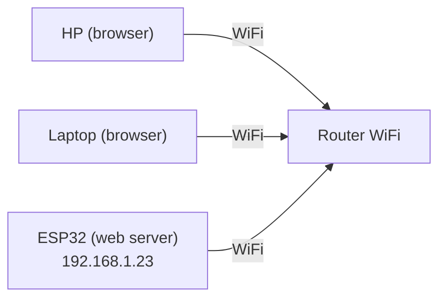
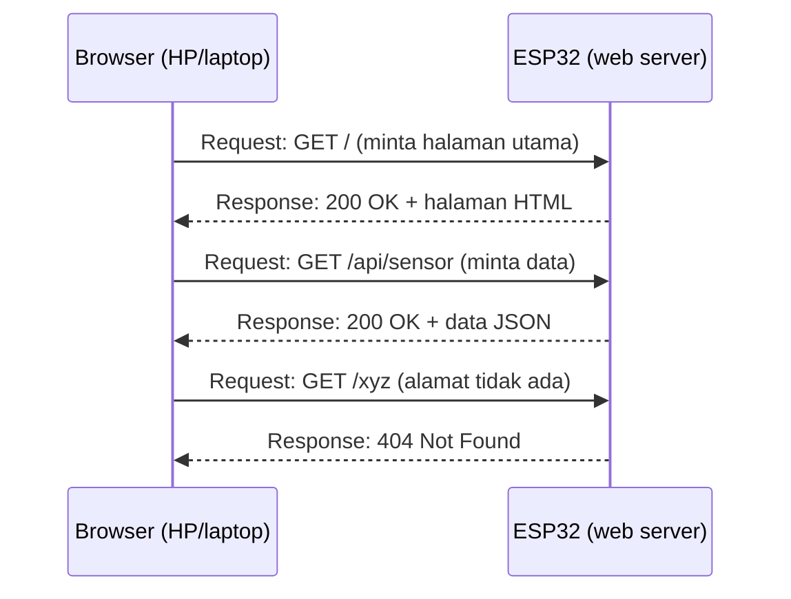
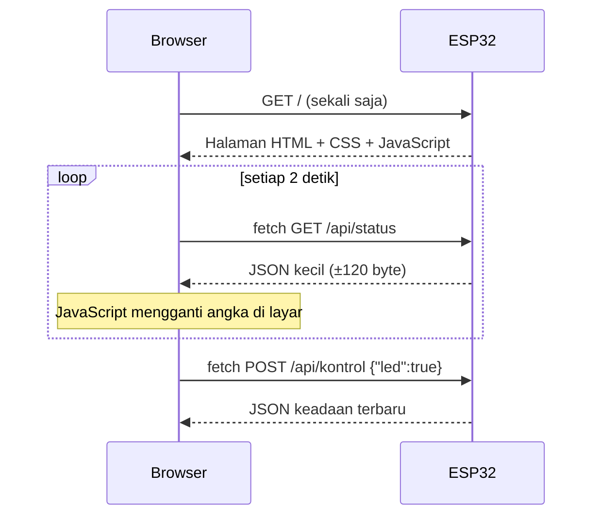

# BAB 46: Web Server — Dashboard IoT Berbasis Browser

> ✅ **Prasyarat:** Selesaikan **BAB 42 (WiFi Station Mode)** — ESP32-mu sudah bisa tersambung ke WiFi dan kamu tahu cara melihat alamat IP-nya di Serial Monitor. Program 2–4 memakai sensor dari **BAB 26 (DHT11 — Suhu & Kelembapan)** dan pola `struct Timer` dari **BAB 16 (Non-Blocking Programming)**. Program 3 menyalakan *relay* seperti di **BAB 37 (*Relay* — Kontrol AC/DC)**, dan Program 4 memakai folder `data` dari **BAB 40 (SPIFFS / LittleFS)**.

Bayangkan kamu bisa melihat suhu ruangan dan menyalakan lampu cukup dari *browser* di HP, tanpa memasang aplikasi apa pun. Itulah yang dilakukan ***web server***: ESP32 "melayani" halaman web, persis seperti situs internet, tetapi di jaringan WiFi rumahmu sendiri. Di BAB ini kamu belajar dasar HTTP (cara *browser* dan *server* bercakap-cakap), membuat halaman web pertama di ESP32, menyediakan data sensor dalam format JSON, lalu menggabungkan semuanya menjadi *dashboard* IoT yang memperbarui angkanya sendiri dan punya tombol untuk mengontrol LED dan *relay*.

## 📌 Tujuan Pembelajaran

Setelah mempelajari BAB ini, kamu bisa:

- Menjelaskan cara kerja *web server*: *client* dan *server*, *request* dan *response*, URL, *method* GET dan POST, serta kode status HTTP.
- Menjelaskan peran HTML, CSS, dan JavaScript dalam sebuah halaman web.
- Membuat *web server* di ESP32 dengan *library* `WebServer` bawaan: mendaftarkan alamat dengan `server.on()`, menangani alamat yang tidak ada dengan `server.onNotFound()`, dan membaca parameter dengan `server.arg()`.
- Menyimpan halaman HTML di dalam kode dengan *raw string literal* dan memahami pengaruh ukuran halaman terhadap memori.
- Membuat API JSON dengan *library* ArduinoJson 7 dan mengujinya dengan *browser* serta `curl`.
- Membuat *dashboard* yang memperbarui data sensor dengan `fetch()` tanpa memuat ulang halaman, dan tombol untuk mengontrol LED serta *relay*.
- Menyajikan *file* HTML, CSS, dan JavaScript dari LittleFS dengan `server.serveStatic()`.
- Memahami risiko keamanan *web server* tanpa kata sandi di jaringan lokal.

## 🧰 Yang Perlu Disiapkan

| Kebutuhan | Keterangan |
|---|---|
| *Hardware* | Kit Bluino ESP32 IoT Starter Shield + kabel USB **data** |
| Kabel *jumper* | 4 kabel *female-female* (sudah ada di kit): `DHT` → IO27 dan `VR10K` → IO34 untuk Program 2–4, `LED1` (merah) → IO4 dan `RELAY` → IO26 untuk Program 3 |
| Komponen tambahan | Tidak ada. *Relay* cukup dicoba tanpa beban — **jangan** menyambungkan listrik PLN 220 V |
| *Software* | Arduino IDE 2.x + *board package* **esp32** versi 3.3.x (lihat [BAB 5](../BAB-05/README.md)); untuk Program 4 juga *plugin* **arduino-littlefs-upload** (cara memasangnya di [BAB 40](../BAB-40/README.md#4011-mengunggah-file-dari-komputer-folder-data)) |
| *Library* | `WiFi`, `WebServer`, dan `LittleFS` bawaan *board package* (tidak perlu dipasang). Program 2–4: **DHT sensor library** by Adafruit + **Adafruit Unified Sensor** (lihat [BAB 26](../BAB-26/README.md)) dan **ArduinoJson** by Benoit Blanchon versi 7 (cara memasangnya di [46.6](#466-json-dan-api)) |
| Alat uji | **Serial Monitor** (baud 115200) untuk melihat alamat IP; *browser* (Chrome, Firefox, Safari, Edge) di laptop atau HP; `curl` di **Command Prompt** (Windows) atau **Terminal** (macOS/Linux) untuk menguji API |
| Jaringan | Router WiFi atau *hotspot* HP berfrekuensi **2,4 GHz**. Laptop/HP yang membuka halaman harus tersambung ke WiFi yang **sama** dengan ESP32. Tidak perlu internet |

## 📑 Daftar Isi

- [46.1 Apa Itu Web Server?](#461-apa-itu-web-server)
- [46.2 Dasar HTTP untuk Pemula](#462-dasar-http-untuk-pemula)
- [46.3 HTML, CSS, dan JavaScript](#463-html-css-dan-javascript)
- [46.4 Library WebServer: Pola Dasar](#464-library-webserver-pola-dasar)
- [46.5 Program 1: Web Server Pertama](#465-program-1-web-server-pertama)
- [46.6 JSON dan API](#466-json-dan-api)
- [46.7 Program 2: API JSON Sensor](#467-program-2-api-json-sensor)
- [46.8 Memperbarui Halaman dengan fetch()](#468-memperbarui-halaman-dengan-fetch)
- [46.9 Program 3: Dashboard IoT Interaktif](#469-program-3-dashboard-iot-interaktif)
- [46.10 Program 4: Halaman Web dari LittleFS](#4610-program-4-halaman-web-dari-littlefs)
- [46.11 Keamanan: Siapa Saja Bisa Mengontrol?](#4611-keamanan-siapa-saja-bisa-mengontrol)
- [46.12 Batasan WebServer dan Langkah Berikutnya](#4612-batasan-webserver-dan-langkah-berikutnya)
- [46.13 Troubleshooting](#4613-troubleshooting)
- [📝 Rangkuman](#-rangkuman)
- [💪 Latihan](#-latihan)
- [📚 Referensi](#-referensi)

---

## 46.1 Apa Itu Web Server?

Bayangkan sebuah warung makan. Pelanggan datang dan memesan, "Nasi goreng satu!" Pelayan mencatat pesanan, dapur memasaknya, lalu pelayan mengantarkan piringnya ke meja. Kalau pelanggan memesan menu yang tidak ada, pelayan menjawab, "Maaf, menu itu tidak tersedia."

Komunikasi di web bekerja dengan cara yang sama:

| Di warung | Di web | Di BAB ini |
|---|---|---|
| Pelanggan | ***Client*** — pihak yang meminta | *Browser* di HP atau laptop, atau perintah `curl` |
| Pelayan + dapur | ***Server*** — pihak yang melayani | ESP32 yang menjalankan program *web server* |
| Pesanan | ***Request*** (permintaan) | "Tolong kirim halaman utama" |
| Piring yang diantar | ***Response*** (jawaban) | Isi halaman HTML atau data sensor |
| Daftar menu | Daftar alamat yang dikenal *server* | `/`, `/halo`, `/api/sensor`, … |
| "Menu tidak tersedia" | Kode status **404 Not Found** | Alamat yang tidak didaftarkan di program |

***Web server*** adalah program yang menunggu *request* dari *client*, lalu mengirim *response* yang sesuai. Situs besar seperti Wikipedia memakai komputer *server* yang besar, sedangkan di BAB ini *server*-nya adalah ESP32 kecil di kit-mu. Keuntungannya:

- **Tidak perlu aplikasi khusus.** Semua HP dan laptop sudah punya *browser*, apa pun sistem operasinya (Android, iOS, Windows, macOS, Linux).
- **Antarmuka bebas dirancang.** Kamu menentukan sendiri isi halamannya: angka sensor, tombol, warna, dan tata letaknya.
- **Tidak perlu internet.** Cukup jaringan WiFi lokal (router rumah atau *hotspot* HP).

### 46.1.1 Kenapa Harus WiFi yang Sama?

Program di BAB ini memakai **mode Station** dari [BAB 42](../BAB-42/README.md): ESP32 bergabung ke router WiFi dan mendapat **alamat IP lokal** dari router, misalnya `192.168.1.23`. Alamat seperti ini hanya berlaku **di dalam** jaringan tersebut, mirip nomor kamar di sebuah hotel: tamu di hotel yang sama bisa mengetuk kamar 23, tetapi orang di luar hotel tidak bisa menemukannya hanya dengan nomor kamar.



*Gambar 46.1 — HP, laptop, dan ESP32 tersambung ke router yang sama, sehingga HP dan laptop bisa membuka alamat IP ESP32. Sumber: dibuat untuk materi ini.*

Jadi, saat menguji program:

- HP atau laptop harus tersambung ke WiFi yang **sama** dengan ESP32. Kalau HP memakai data seluler, matikan dulu data selulernya atau sambungkan HP ke WiFi tersebut.
- Kalau ESP32 tersambung ke *hotspot* HP, buka halamannya dari HP itu sendiri atau dari laptop yang juga tersambung ke *hotspot* tersebut.
- Dari luar rumah (lewat internet), *web server* ini **tidak** bisa dibuka. Untuk mengakses perangkat dari mana saja dipakai cara lain, misalnya MQTT di [BAB 50](../BAB-50/README.md).

> ⚠️ **Perhatian:** ESP32 hanya mendukung WiFi **2,4 GHz**, bukan 5 GHz. Nama dan kata sandi WiFi juga peka huruf besar-kecil (`RumahKu` berbeda dengan `rumahku`). Detailnya ada di [BAB 42](../BAB-42/README.md).

---

## 46.2 Dasar HTTP untuk Pemula

**HTTP** (*HyperText Transfer Protocol*) adalah aturan percakapan antara *browser* dan *web server*. Isi percakapannya berupa teks biasa yang dikirim lewat jaringan.

### 46.2.1 Request dan Response

Setiap kali kamu membuka sebuah alamat, *browser* mengirim satu *request* dan *server* membalas dengan satu *response*. Satu halaman bisa memicu beberapa *request* sekaligus, misalnya untuk halaman HTML-nya, *file* gaya (CSS), dan ikon kecil di tab *browser* (`/favicon.ico`).



*Gambar 46.2 — Setiap request dari browser dijawab dengan satu response oleh ESP32. Sumber: dibuat untuk materi ini.*

Seperti apa isi percakapannya? Inilah contoh *request* yang dikirim *browser* saat kamu membuka `http://192.168.1.23/halo?nama=Budi`:

```text
GET /halo?nama=Budi HTTP/1.1
Host: 192.168.1.23
User-Agent: Mozilla/5.0 (Linux; Android 14) ...
Accept: text/html
```

Dan inilah *response* dari ESP32 yang menjalankan Program 1 nanti (isi halamannya disingkat):

```text
HTTP/1.1 200 OK
Content-Type: text/html
Content-Length: 333
Connection: close

<!DOCTYPE html><html lang="id"><head><meta charset="UTF-8">...
```

Bagian-bagiannya:

- **Baris pertama.** Pada *request*: *method* (`GET`), alamat yang diminta (`/halo?nama=Budi`), dan versi HTTP. Pada *response*: versi HTTP, **kode status** (`200`), dan artinya (`OK`).
- ***Header*** — baris-baris `Nama: nilai` berisi keterangan tambahan, misalnya `Content-Type` (jenis isi) dan `Content-Length` (panjang isi dalam *byte*).
- **Baris kosong** — tanda bahwa *header* sudah selesai.
- ***Body*** (isi) — halaman HTML, data JSON, atau kosong.

Kamu tidak perlu menulis teks ini sendiri; *library* `WebServer` yang menyusunnya. Namun, memahami bentuknya membantu saat mencari kesalahan.

> 🧪 **Coba Sendiri:** Di *browser* laptop (Chrome, Edge, atau Firefox), tekan **F12** untuk membuka **Developer Tools**, lalu pilih tab **Network**. Buka situs apa saja: setiap baris di daftar itu adalah satu *request*, lengkap dengan *method*, kode status, dan jenis isinya. Nanti kamu akan memakai tab yang sama untuk mengintip *request* ke ESP32.

### 46.2.2 Membaca Alamat (URL)

**URL** (*Uniform Resource Locator*) adalah alamat lengkap yang kamu ketik di *browser*. Contoh `http://192.168.1.23:80/halo?nama=Budi` terdiri dari:

| Bagian | Contoh | Arti |
|---|---|---|
| Skema | `http://` | Protokol yang dipakai. ESP32 di BAB ini melayani `http://`, **bukan** `https://` (HTTPS dibahas di [BAB 49](../BAB-49/README.md)) |
| *Host* | `192.168.1.23` | Alamat IP ESP32, dilihat dari Serial Monitor. Kalau sudah mempelajari mDNS ([BAB 45](../BAB-45/README.md)), bisa diganti nama seperti `bluino.local` |
| *Port* | `:80` | "Nomor pintu" layanan di perangkat itu. Port 80 adalah pintu bawaan HTTP, jadi boleh tidak ditulis |
| *Path* | `/halo` | Halaman atau fitur yang diminta. Di ESP32, *path* dicocokkan dengan alamat yang didaftarkan lewat `server.on()` |
| *Query* | `?nama=Budi` | Data tambahan berbentuk `nama=nilai`. Beberapa pasangan dipisah tanda `&`, misalnya `?nama=Budi&umur=20`. Di ESP32 dibaca dengan `server.arg("nama")` |

> 💡 **Tips:** Ketik alamat ESP32 **lengkap dengan `http://`**. Kalau hanya mengetik angka IP, sebagian *browser* mencoba `https://` lebih dulu, padahal ESP32 tidak melayani HTTPS.

### 46.2.3 Method GET dan POST

***Method*** menyatakan maksud sebuah *request*. Di BAB ini kita memakai dua *method*:

| *Method* | Maksud | Analogi warung | Contoh di BAB ini |
|---|---|---|---|
| **GET** | Meminta atau membaca sesuatu, tanpa mengubah apa pun | Melihat daftar menu | Membuka halaman `/`, membaca data `/api/sensor` |
| **POST** | Mengirim data atau perintah yang **mengubah** sesuatu | Menyerahkan pesanan | Menyalakan LED atau *relay* lewat `/api/kontrol` |

Saat kamu mengetik alamat di *browser* atau mengeklik sebuah tautan (*link*), *browser* selalu mengirim GET. Karena itu, perintah yang mengubah keadaan perangkat sebaiknya memakai POST. Alasannya: *browser* boleh mengulang, menyimpan (*cache*), atau bahkan memuat GET lebih dulu tanpa kamu sadari. Bayangkan *relay* yang tiba-tiba menyala hanya karena *browser* memuat ulang tab lama dari riwayat!

### 46.2.4 Kode Status

Setiap *response* membawa angka tiga digit yang memberi tahu hasil *request*:

| Kode | Nama | Arti | Kapan muncul di BAB ini |
|---|---|---|---|
| **200** | OK | Berhasil, isi *response* adalah yang diminta | Halaman atau data berhasil dikirim |
| **400** | Bad Request | *Request*-nya salah, misalnya data JSON rusak atau parameter kurang | Perintah ke `/api/kontrol` tidak valid |
| **404** | Not Found | Alamat tidak dikenal oleh *server* | Mengetik *path* yang tidak didaftarkan |
| **500** | Internal Server Error | *Server* gagal memproses *request* | Misalnya *file* halaman di LittleFS tidak bisa dibuka |

Kode berawalan **2** berarti berhasil, **4** berarti kesalahan di pihak *client* (yang meminta), dan **5** berarti kesalahan di pihak *server*.

> 📌 **Catatan:** Di *server* besar, *request* dengan *method* yang salah (misalnya GET ke alamat yang hanya menerima POST) dijawab **405 Method Not Allowed**. *Library* `WebServer` di ESP32 tidak melakukannya otomatis: *request* yang *method*-nya tidak cocok dianggap alamat tidak dikenal dan diteruskan ke penangan 404.

### 46.2.5 Jenis Isi (Content-Type)

*Header* `Content-Type` memberi tahu *browser* cara menampilkan *body*. Jenis yang dipakai di BAB ini:

| Content-Type | Isi | Dipakai untuk |
|---|---|---|
| `text/html` | Halaman web (HTML) | Halaman utama dan *dashboard* |
| `text/css` | Aturan tampilan (CSS) | *File* `style.css` di Program 4 |
| `application/javascript` | Program JavaScript | *File* `app.js` di Program 4 |
| `application/json` | Data JSON | API sensor dan kontrol |
| `text/plain` | Teks biasa | Pesan kesalahan singkat |

Kalau jenisnya salah, *browser* bisa menampilkan kode HTML mentah sebagai teks, atau menolak menjalankan JavaScript.

---

## 46.3 HTML, CSS, dan JavaScript

Halaman web dibangun dari tiga bahasa yang masing-masing punya tugas. Bayangkan sebuah rumah:

| Bahasa | Analogi rumah | Tugas | Contoh |
|---|---|---|---|
| **HTML** (*HyperText Markup Language*) | Kerangka dan ruangan | Isi dan struktur halaman: judul, paragraf, tabel, tombol | `<h1>Dashboard</h1>` |
| **CSS** (*Cascading Style Sheets*) | Cat dan dekorasi | Tampilan: warna, ukuran huruf, jarak, tata letak | `h1 { color: #1565c0; }` |
| **JavaScript** | Listrik dan sakelar | Perilaku: bereaksi saat tombol ditekan, mengambil data baru dari *server* | `tombol.onclick = nyalakan;` |

Contoh halaman kecil yang memakai ketiganya:

```html
<!DOCTYPE html>
<html lang="id">
<head>
  <meta charset="UTF-8">
  <meta name="viewport" content="width=device-width, initial-scale=1">
  <title>Coba HTML</title>
  <style>
    body { font-family: Arial, sans-serif; padding: 16px; }
    .angka { font-size: 2em; color: #1565c0; }
  </style>
</head>
<body>
  <h1>Penghitung</h1>
  <p>Tombol sudah ditekan <span id="jumlah" class="angka">0</span> kali.</p>
  <button onclick="tambah()">Tekan aku</button>
  <script>
    let n = 0;
    function tambah() {
      n = n + 1;
      document.getElementById("jumlah").textContent = n;
    }
  </script>
</body>
</html>
```

Yang perlu diperhatikan:

- ***Tag* HTML** ditulis berpasangan: `<p>` membuka paragraf dan `</p>` menutupnya. Bagian `<head>` berisi keterangan halaman, sedangkan `<body>` berisi yang tampil di layar.
- `<meta charset="UTF-8">` membuat huruf khusus seperti `°` tampil benar. `<meta name="viewport" ...>` membuat halaman pas di layar HP; tanpa baris ini, HP menampilkan halaman seperti layar laptop yang diperkecil sehingga hurufnya kecil sekali.
- **CSS** ditulis di dalam `<style>`. Aturan `.angka { ... }` berlaku untuk elemen yang punya `class="angka"`.
- **JavaScript** ditulis di dalam `<script>`. `document.getElementById("jumlah")` mencari elemen yang punya `id="jumlah"`, lalu `textContent` mengganti teksnya. Pola inilah yang nanti dipakai *dashboard* untuk mengganti angka sensor.

> 🧪 **Coba Sendiri:** Kamu bisa mencoba HTML tanpa ESP32. Buka **Notepad** (Windows) atau **TextEdit** (macOS; pilih **Format → Make Plain Text**), salin contoh di atas, lalu simpan dengan nama `coba.html` (di Notepad pilih **Save as type: All files** dan **Encoding: UTF-8**). Klik dua kali *file* itu: halamannya terbuka di *browser*. Ubah warnanya, simpan, lalu tekan **F5** di *browser* untuk melihat hasilnya.

---

## 46.4 Library WebServer: Pola Dasar

*Board package* esp32 sudah menyertakan *library* `WebServer`, jadi tidak perlu memasang apa pun. Kerangka setiap program *web server* di BAB ini selalu sama (potongan kode; program lengkapnya ada di Program 1):

```cpp
#include <WiFi.h>
#include <WebServer.h>

WebServer server(80);  // 1. Buat objek server di port 80

void halamanUtama() {  // 2. Fungsi penangan (handler) untuk alamat "/"
  server.send(200, "text/html", "<h1>Halo dari ESP32!</h1>");
}

// --- di dalam setup(), SETELAH WiFi tersambung (seperti di BAB 42) ---
  server.on("/", HTTP_GET, halamanUtama);  // 3. Daftarkan alamat + method + handler
  server.begin();                           // 4. Mulai menerima request

// --- di dalam loop() ---
  server.handleClient();  // 5. Layani request yang masuk (wajib sesering mungkin)
```

Penjelasannya:

1. `WebServer server(80);` membuat objek *server* yang mendengarkan port 80.
2. **Fungsi penangan** (*handler*) adalah fungsi biasa yang dipanggil saat sebuah alamat diminta. Di dalamnya kamu memanggil `server.send()` untuk mengirim *response*.
3. `server.on("/", HTTP_GET, halamanUtama);` artinya: "kalau ada GET ke `/`, jalankan `halamanUtama()`". Pasangan alamat dan *handler* ini sering disebut ***route*** (rute). Kalau *method*-nya tidak ditulis, *route* menerima *method* apa saja.
4. `server.begin();` mulai membuka "pintu" port 80. Panggil **setelah** WiFi tersambung dan semua *route* didaftarkan.
5. `server.handleClient();` memeriksa apakah ada *request* yang masuk, lalu memanggil *handler* yang cocok.

### 46.4.1 Kenapa loop() Tidak Boleh Tertahan

`WebServer` bersifat **sinkron**: ia hanya bekerja saat `server.handleClient()` dipanggil, dan melayani satu *request* pada satu waktu. Ibaratnya warung dengan satu pelayan yang hanya mencatat pesanan setiap kali lewat di depan meja. Kalau pelayan itu tidur 5 detik (`delay(5000)`) di dapur, semua pelanggan menunggu 5 detik.

Akibatnya:

- **Jangan** memakai `delay()` panjang di `loop()`. Pakai pola `millis()` dan `struct Timer` dari [BAB 16](../BAB-16/README.md) untuk tugas berkala seperti membaca sensor.
- *Handler* harus cepat selesai. Membaca sensor yang lambat (DHT11 butuh ±25 ms) sebaiknya dilakukan berkala di `loop()`, lalu hasilnya disimpan di variabel. *Handler* cukup mengirim nilai terakhir itu.
- Kalau tidak ada *request*, `handleClient()` menunggu 1 ms lalu kembali. Itu wajar dan tidak mengganggu tugas lain.

### 46.4.2 Fungsi Penting WebServer

Semua fungsi di bawah sudah diperiksa pada *board package* esp32 versi 3.3.12:

| Fungsi | Kegunaan | Contoh |
|---|---|---|
| `server.on(path, method, fungsi)` | Mendaftarkan *route* | `server.on("/api/sensor", HTTP_GET, kirimSensor);` |
| `server.onNotFound(fungsi)` | *Handler* untuk alamat yang tidak terdaftar | `server.onNotFound(halaman404);` |
| `server.begin()` | Mulai menerima *request* | `server.begin();` |
| `server.handleClient()` | Melayani *request* yang masuk (di `loop()`) | `server.handleClient();` |
| `server.send(kode, jenis, isi)` | Mengirim *response* lengkap | `server.send(200, "text/plain", "OK");` |
| `server.sendHeader(nama, nilai)` | Menambah *header* sebelum `send()` | `server.sendHeader("Cache-Control", "no-store");` |
| `server.hasArg(nama)` | Mengecek apakah parameter ada | `server.hasArg("nama")` |
| `server.arg(nama)` | Mengambil nilai parameter (selalu berupa `String`) | `server.arg("nama")` |
| `server.arg("plain")` | Mengambil *body* mentah, misalnya JSON yang dikirim dengan POST | `deserializeJson(doc, server.arg("plain"));` |
| `server.uri()` | *Path* yang sedang diminta (tanpa *query*) | `"/halo"` |
| `server.method()` | *Method* yang sedang dipakai | `HTTP_GET`, `HTTP_POST` |
| `server.client().remoteIP()` | Alamat IP *client* yang meminta | `192.168.1.10` |
| `server.streamFile(file, jenis)` | Mengirim isi *file* (misalnya dari LittleFS) | `server.streamFile(f, "text/html");` |
| `server.serveStatic(path, fs, folder)` | Menyajikan *file* dari sistem *file* secara otomatis | `server.serveStatic("/", LittleFS, "/");` |

### 46.4.3 Menyimpan HTML di Dalam Kode

Halaman HTML panjang dan penuh tanda kutip (`"`). Kalau ditulis sebagai *string* C++ biasa, setiap tanda kutip harus ditulis `\"` dan setiap baris harus disambung — merepotkan dan mudah salah. Solusinya ***raw string literal*** (teks mentah):

```cpp
const char HALAMAN[] = R"rawliteral(
<!DOCTYPE html>
<html lang="id">
<p class="judul">Tanda kutip "seperti ini" aman, tanpa \ di depannya.</p>
</html>
)rawliteral";
```

Semua yang ada di antara `R"rawliteral(` dan `)rawliteral"` dianggap teks apa adanya, termasuk tanda kutip dan baris baru. Kata `rawliteral` hanyalah penanda pembuka dan penutup; kamu boleh menggantinya dengan kata lain asalkan pasangannya sama dan kata itu tidak muncul di dalam HTML-nya.

### 46.4.4 Ukuran Halaman dan Memori

ESP32 punya dua jenis memori yang relevan di sini:

| Memori | Kapasitas di ESP32 DEVKIT V1 | Isinya |
|---|---|---|
| ***Flash*** | 4 MB (bagian untuk program ±1,25 MB pada *partition scheme* bawaan) | Kode program dan data yang tidak berubah |
| **RAM** | 520 KB total; setelah WiFi aktif biasanya tersisa ±150–250 KB untuk program | Variabel, `String`, dan data yang berubah |

Hal-hal yang perlu kamu ketahui:

- *Array* yang ditulis dengan `const`, misalnya `const char HALAMAN[] = R"rawliteral(...)rawliteral";`, **tetap tinggal di *flash*** dan dibaca langsung dari sana. Kamu tidak perlu kata kunci `PROGMEM` seperti di Arduino Uno; di ESP32, `PROGMEM` didefinisikan kosong dan hanya ada supaya kode lama tetap bisa di-*compile*.
- Saat dikirim dengan `server.send(200, "text/html", HALAMAN)`, isi halaman **disalin sementara** ke RAM, lalu salinan itu dibuang setelah terkirim. Untuk halaman beberapa KB seperti di BAB ini, hal itu tidak masalah. Untuk halaman puluhan KB, pakai `server.send_P(200, "text/html", HALAMAN)` yang mengirim langsung dari *flash* tanpa menyalin, atau simpan halamannya sebagai *file* di LittleFS (Program 4).
- **Hindari menyusun halaman besar dengan `String` dan `+=`** di setiap *request*. Setiap penyambungan bisa memesan ulang memori dan lama-lama membuat RAM terpecah-pecah (fragmentasi, lihat [BAB 20](../BAB-20/README.md)). Pola yang lebih baik: halaman HTML tetap (statis) di *flash*, lalu angka-angka yang berubah diambil terpisah dalam format JSON yang kecil. Pola inilah yang dipakai Program 3 dan 4.

---

## 46.5 Program 1: Web Server Pertama

**Tujuan:** Membuat *web server* dengan tiga jenis alamat: halaman beranda (`/`) berisi formulir, halaman sapaan (`/halo?nama=...`) yang membaca parameter dari URL, dan halaman 404 untuk alamat yang tidak dikenal. Setiap *request* yang masuk dicatat di Serial Monitor, sehingga kamu bisa melihat percakapan HTTP-nya.

**Rangkaian:**

*Tidak perlu merangkai — program ini hanya memakai ESP32 dan WiFi.*

**Cara Menjalankan:**

1. Buka Arduino IDE → **File → New Sketch**, hapus isinya, lalu salin kode di bawah. Kode yang sama juga tersedia di *file* [`p1_basic.ino`](p1_basic/p1_basic.ino).
2. Ganti `NamaWiFiKamu` dan `PasswordWiFiKamu` dengan nama dan kata sandi WiFi 2,4 GHz milikmu (perhatikan huruf besar-kecil).
3. Pastikan **Tools → Board** = **ESP32 Dev Module** dan **Tools → Port** = *port* ESP32 kamu (misalnya `COM5` di Windows atau `/dev/ttyUSB0` di Linux).
4. Klik tombol **Upload** dan tunggu sampai muncul tulisan **Done uploading**.
5. Buka **Serial Monitor** (**Tools → Serial Monitor**) lalu pilih baud **115200**. Kalau tulisan alamat IP sudah terlewat, tekan tombol **EN** di *board* ESP32.
6. Sambungkan HP atau laptop ke WiFi yang **sama**, buka *browser*, lalu ketik alamat yang tertulis di Serial Monitor, misalnya `http://192.168.1.23/` (pakai angka IP milikmu).
7. Isi nama di formulir dan tekan **Kirim**. Coba juga tautan "alamat yang tidak ada", lalu perhatikan catatan di Serial Monitor.

**Kode Program:**

<!-- sketch: p1_basic -->
```cpp
/*
 * BAB 46 - Program 1: Web Server Pertama
 * - http://<IP>/            -> halaman beranda (HTML tetap, disimpan di flash)
 * - http://<IP>/halo?nama=X -> halaman sapaan yang membaca parameter "nama"
 * - alamat lain             -> halaman 404
 * Setiap request dicatat di Serial Monitor.
 * Rangkaian: tidak perlu (cukup ESP32 dan WiFi 2,4 GHz)
 */

#include <WiFi.h>
#include <WebServer.h>

const char *NAMA_WIFI = "NamaWiFiKamu";          // ← ganti dengan WiFi kamu
const char *PASSWORD_WIFI = "PasswordWiFiKamu";  // ← ganti dengan WiFi kamu

WebServer server(80);  // port 80 = port bawaan HTTP

// Halaman beranda. Karena "const", teks ini tetap di flash, bukan di RAM.
const char HALAMAN_BERANDA[] = R"rawliteral(
<!DOCTYPE html>
<html lang="id">
<head>
<meta charset="UTF-8">
<meta name="viewport" content="width=device-width, initial-scale=1">
<title>ESP32 Bluino</title>
<style>
  body { font-family: Arial, sans-serif; background: #f2f4f7; color: #222;
         max-width: 480px; margin: 0 auto; padding: 16px; }
  .kartu { background: #fff; border-radius: 12px; padding: 16px;
           box-shadow: 0 1px 4px rgba(0, 0, 0, 0.15); }
  h1 { font-size: 1.4em; color: #1565c0; margin-top: 0; }
  input, button { font-size: 1em; padding: 10px; border-radius: 8px; }
  input { border: 1px solid #999; width: 60%; }
  button { border: none; background: #1565c0; color: #fff; }
  a { color: #1565c0; }
</style>
</head>
<body>
<div class="kartu">
  <h1>Halo dari ESP32!</h1>
  <p>Halaman ini dikirim oleh web server di kit Bluino.</p>
  <form action="/halo" method="GET">
    <p><label for="nama">Siapa namamu?</label></p>
    <input id="nama" name="nama" maxlength="30" required>
    <button type="submit">Kirim</button>
  </form>
  <p>Atau coba buka <a href="/tidak-ada">alamat yang tidak ada</a>.</p>
</div>
</body>
</html>
)rawliteral";

// Mengganti karakter khusus HTML supaya teks dari pengguna
// tampil apa adanya dan tidak dianggap sebagai kode HTML
String amankanHtml(String teks) {
  teks.replace("&", "&amp;");
  teks.replace("<", "&lt;");
  teks.replace(">", "&gt;");
  teks.replace("\"", "&quot;");
  return teks;
}

// Mencetak satu baris catatan request di Serial Monitor
void catatRequest(int kodeStatus) {
  Serial.printf("[HTTP] %s %s -> %d (dari %s)\n",
                http_method_str(server.method()), server.uri().c_str(),
                kodeStatus, server.client().remoteIP().toString().c_str());
}

// Handler untuk GET /
void halamanBeranda() {
  server.send(200, "text/html", HALAMAN_BERANDA);
  catatRequest(200);
}

// Handler untuk GET /halo?nama=...
void halamanHalo() {
  String nama = "tamu";  // dipakai kalau parameter "nama" tidak ada atau kosong
  if (server.hasArg("nama") && server.arg("nama").length() > 0) {
    nama = server.arg("nama").substring(0, 30);  // ambil paling banyak 30 karakter
  }

  // Halaman kecil yang isinya berubah-ubah disusun dengan String
  String html;
  html.reserve(500);  // pesan memori sekaligus supaya tidak berkali-kali
  html += "<!DOCTYPE html><html lang=\"id\"><head><meta charset=\"UTF-8\">";
  html += "<meta name=\"viewport\" content=\"width=device-width, initial-scale=1\">";
  html += "<title>Halo</title></head>";
  html += "<body style=\"font-family: Arial, sans-serif; padding: 16px;\">";
  html += "<h1>Halo, ";
  html += amankanHtml(nama);
  html += "!</h1><p>ESP32 sudah menyala selama ";
  html += String(millis() / 1000);
  html += " detik.</p><p><a href=\"/\">Kembali ke beranda</a></p></body></html>";

  server.send(200, "text/html", html);
  catatRequest(200);
  Serial.printf("       nama = %s\n", nama.c_str());
}

// Handler untuk semua alamat yang tidak didaftarkan
void halaman404() {
  String html;
  html.reserve(400);
  html += "<!DOCTYPE html><html lang=\"id\"><head><meta charset=\"UTF-8\">";
  html += "<meta name=\"viewport\" content=\"width=device-width, initial-scale=1\">";
  html += "<title>404</title></head>";
  html += "<body style=\"font-family: Arial, sans-serif; padding: 16px;\">";
  html += "<h1>404 - Tidak Ditemukan</h1><p>Alamat <b>";
  html += amankanHtml(server.uri());
  html += "</b> tidak ada di ESP32 ini.</p><p><a href=\"/\">Kembali ke beranda</a></p></body></html>";

  server.send(404, "text/html", html);
  catatRequest(404);
}

void sambungkanWiFi() {
  WiFi.mode(WIFI_STA);
  WiFi.begin(NAMA_WIFI, PASSWORD_WIFI);
  Serial.printf("Menyambung ke WiFi \"%s\"", NAMA_WIFI);

  unsigned long mulai = millis();
  while (WiFi.status() != WL_CONNECTED) {
    if (millis() - mulai > 20000) {  // menyerah setelah 20 detik
      Serial.println("\nGagal tersambung. Periksa nama/password WiFi dan pastikan 2,4 GHz.");
      Serial.println("ESP32 restart dalam 5 detik...");
      delay(5000);
      ESP.restart();
    }
    delay(500);
    Serial.print(".");
  }
  Serial.println(" tersambung!");
  WiFi.setSleep(false);  // matikan hemat daya WiFi supaya halaman lebih cepat dijawab
}

void setup() {
  Serial.begin(115200);
  delay(1000);  // beri waktu Serial Monitor bersiap
  Serial.println("\nBAB 46 - Program 1: Web Server Pertama");

  sambungkanWiFi();

  // Daftar route: alamat + method + fungsi handler
  server.on("/", HTTP_GET, halamanBeranda);
  server.on("/halo", HTTP_GET, halamanHalo);
  server.onNotFound(halaman404);
  server.begin();

  Serial.print("Web server siap. Buka di browser: http://");
  Serial.print(WiFi.localIP());
  Serial.println("/");
}

void loop() {
  server.handleClient();  // layani request yang masuk
}
```

**Penjelasan Kode:**

- **Halaman beranda** ditulis utuh di `HALAMAN_BERANDA` dengan *raw string literal* ([46.4.3](#4643-menyimpan-html-di-dalam-kode)). Isinya tidak pernah berubah, jadi cukup dikirim apa adanya dengan `server.send(200, "text/html", HALAMAN_BERANDA)`.
- **Formulir** `<form action="/halo" method="GET">` mengirim isi kotak `name="nama"` sebagai *query*. Saat kamu mengetik `Budi` lalu menekan **Kirim**, *browser* membuka `http://192.168.1.23/halo?nama=Budi`. Spasi dan huruf khusus otomatis disandikan oleh *browser* (misalnya spasi menjadi `+`), lalu dikembalikan lagi oleh `WebServer` sehingga `server.arg("nama")` berisi teks aslinya.
- **`halamanHalo()`** membaca parameter dengan `server.hasArg("nama")` dan `server.arg("nama")`. Hasilnya selalu `String`. Kalau parameter tidak ada (misalnya kamu membuka `/halo` saja), program memakai kata `tamu`. `substring(0, 30)` membatasi panjangnya supaya halaman tetap kecil.
- **`amankanHtml()`** mengganti `<`, `>`, `&`, dan `"` dengan kode pengganti HTML. Tanpa fungsi ini, orang bisa mengirim `?nama=<script>...</script>` dan *browser* akan menjalankannya sebagai program. Kebiasaan ini penting: **jangan pernah menampilkan teks dari pengguna ke HTML tanpa diamankan**.
- **Halaman sapaan dan 404** isinya berubah-ubah (nama, lama menyala, alamat), jadi disusun dengan `String`. Halamannya kecil, dan `html.reserve()` memesan memori sekali di awal supaya `+=` tidak berulang kali memesan ulang memori.
- **`server.onNotFound(halaman404)`** menangkap semua alamat yang tidak didaftarkan dengan `server.on()`, lalu menjawab dengan kode **404**.
- **`catatRequest()`** mencetak *method*, *path*, kode status, dan IP *client*. `http_method_str()` mengubah kode *method* (misalnya `HTTP_GET`) menjadi teks `GET`.
- **`sambungkanWiFi()`** sama polanya dengan [BAB 42](../BAB-42/README.md): menunggu sampai tersambung, dan menyerah lalu *restart* kalau 20 detik belum berhasil. `WiFi.setSleep(false)` mematikan mode hemat daya WiFi. Dalam mode hemat daya, ESP32 hanya "bangun" berkala untuk menerima data, sehingga jawaban ke *browser* bisa terlambat ratusan milidetik. Sebagai gantinya, konsumsi arus sedikit lebih besar — tidak masalah kalau ESP32 dicolok ke USB atau adaptor.
- **`loop()`** hanya berisi `server.handleClient()`. Tidak ada `delay()`, jadi setiap *request* segera dilayani.

**Contoh Output:**

```text
BAB 46 - Program 1: Web Server Pertama
Menyambung ke WiFi "NamaWiFiKamu"...... tersambung!
Web server siap. Buka di browser: http://192.168.1.23/
[HTTP] GET / -> 200 (dari 192.168.1.10)
[HTTP] GET /favicon.ico -> 404 (dari 192.168.1.10)
[HTTP] GET /halo -> 200 (dari 192.168.1.10)
       nama = Budi
[HTTP] GET /tidak-ada -> 404 (dari 192.168.1.10)
```

Nama WiFi, jumlah titik, dan alamat IP mengikuti jaringanmu (`192.168.1.23` = ESP32, `192.168.1.10` = HP atau laptop yang membuka halaman). Baris `/favicon.ico` muncul karena *browser* otomatis meminta ikon kecil untuk tab-nya. Kita tidak menyediakan ikon, jadi jawabannya 404 — itu wajar.

Di *browser* muncul kartu putih bertuliskan **Halo dari ESP32!** dengan kotak isian nama. Setelah menekan **Kirim**, muncul halaman **Halo, Budi!** beserta lama ESP32 menyala dalam detik. Tekan **F5** (atau tarik layar ke bawah di HP) untuk memuat ulang, dan angka detiknya bertambah.

> 🧪 **Coba Sendiri:** Ketik langsung di kolom alamat *browser* `http://192.168.1.23/halo?nama=<b>Tebal</b>` (pakai IP milikmu). Karena `amankanHtml()`, halaman menampilkan teks `<b>Tebal</b>` apa adanya, bukan huruf tebal. Lalu buka `http://192.168.1.23/halo` tanpa parameter dan perhatikan sapaan untuk `tamu`.

> 💡 **Tips:** Bosan mencari alamat IP? Kalau sudah mempelajari [BAB 45](../BAB-45/README.md), tambahkan `#include <ESPmDNS.h>`, lalu panggil `MDNS.begin("bluino");` dan `MDNS.addService("http", "tcp", 80);` **setelah** WiFi tersambung (di `setup()`, sesudah `sambungkanWiFi()`). Halamannya kemudian bisa dibuka lewat `http://bluino.local/` dari perangkat yang mendukung mDNS.

**Kalau Belum Berhasil:**

- **Serial Monitor hanya menampilkan titik-titik, lalu `Gagal tersambung`** → nama atau kata sandi WiFi salah (ingat huruf besar-kecil), WiFi-nya 5 GHz, atau ESP32 terlalu jauh dari router. Coba dengan *hotspot* HP yang diatur ke 2,4 GHz.
- ***Browser* menampilkan "Situs tidak dapat dijangkau" atau terus memuat** → HP/laptop tidak berada di WiFi yang sama (cek juga data seluler HP), alamat IP salah ketik, atau ada `https://` di depannya. Ketik lengkap `http://` + IP dari Serial Monitor.
- **Sudah di WiFi yang sama tetapi tetap tidak bisa** → banyak WiFi kampus, kantor, kafe, dan jaringan tamu (*guest network*) menyalakan fitur *client isolation* (*AP isolation*) yang melarang perangkat saling berhubungan. Pakai *hotspot* HP atau router rumah.
- **Alamat IP tidak terlihat** → Serial Monitor dibuka setelah pesannya lewat. Tekan tombol **EN** di *board* untuk menjalankan ulang program.

---

## 46.6 JSON dan API

Halaman HTML cocok untuk dibaca manusia, tetapi sulit dibaca program lain. Misalnya, sebuah aplikasi di laptop ingin mengambil suhu dari ESP32. Kalau yang dikirim halaman HTML lengkap, aplikasi itu harus mencari angka suhu di antara *tag-tag* HTML — rumit dan mudah rusak saat tampilannya diubah. Lebih praktis kalau ESP32 menyediakan alamat khusus yang hanya berisi data.

### 46.6.1 Apa Itu API?

**API** (*Application Programming Interface*) adalah "pintu layanan" yang disediakan sebuah program untuk program lain. Kalau halaman HTML ibarat ruang makan untuk tamu, API ibarat loket pengambilan pesanan untuk kurir: tanpa hiasan, hanya barang yang dipesan. Alamat API seperti `/api/sensor` biasa disebut ***endpoint***.

API yang memakai HTTP dengan alamat yang rapi (misalnya `GET /api/sensor` untuk membaca, `POST /api/kontrol` untuk memerintah) sering disebut **REST API**. Kamu tidak perlu menghafal teorinya; cukup ingat pola ini:

| *Endpoint* | *Method* | Isi *request* | Isi *response* |
|---|---|---|---|
| `/api/sensor` (Program 2) | GET | — | Data sensor dalam JSON |
| `/api/status` (Program 3) | GET | — | Data sensor + keadaan LED dan *relay* |
| `/api/kontrol` (Program 3) | POST | Perintah dalam JSON, misalnya `{"led":true}` | Keadaan terbaru dalam JSON |

### 46.6.2 Format JSON

**JSON** (*JavaScript Object Notation*) adalah format teks untuk menyimpan data berpasangan nama dan nilai. Bentuknya mudah dibaca manusia sekaligus mudah diolah program:

```json
{
  "suhu": 28.6,
  "kelembapan": 70,
  "dht_ok": true,
  "potensiometer": 63,
  "waktu_nyala": 125,
  "rssi": -58
}
```

Aturannya:

- Data diapit kurung kurawal `{ }`. Setiap pasangan ditulis `"nama": nilai`, dipisah koma.
- Nama selalu diapit tanda kutip ganda `"..."`.
- Nilai bisa berupa angka (`28.6`, `-58`; desimal memakai **titik**), teks (`"Bluino"`), `true`/`false`, atau `null` (artinya "tidak ada nilai").
- Spasi dan baris baru tidak berpengaruh. ESP32 biasanya mengirim JSON dalam satu baris supaya ringkas: `{"suhu":28.6,"kelembapan":70,...}`.

### 46.6.3 Library ArduinoJson 7

Menyusun JSON dengan menyambung teks sendiri rawan salah (lupa koma, lupa tanda kutip). *Library* **ArduinoJson** melakukannya dengan rapi. Cara memasangnya:

1. Buka **Sketch → Include Library → Manage Libraries…** (atau klik ikon buku di sisi kiri Arduino IDE).
2. Ketik `ArduinoJson` di kotak pencarian.
3. Pilih **ArduinoJson** yang pembuatnya **Benoit Blanchon**, pastikan versinya **7.x** (diuji dengan 7.4.3), lalu klik **INSTALL**.

Contoh menyusun dan membaca JSON:

```cpp
#include <ArduinoJson.h>

// Menyusun JSON (serialize)
JsonDocument doc;          // wadah data; ukurannya diatur otomatis
doc["suhu"] = 28.6;
doc["dht_ok"] = true;
doc["catatan"] = nullptr;  // menghasilkan null
String json;
serializeJson(doc, json);  // json berisi {"suhu":28.6,"dht_ok":true,"catatan":null}

// Membaca JSON (deserialize)
JsonDocument perintah;
DeserializationError err = deserializeJson(perintah, "{\"led\":true}");
if (!err && perintah["led"].is<bool>()) {  // pastikan "led" ada dan bernilai true/false
  bool nyala = perintah["led"];             // nyala = true
}
```

> ⚠️ **Perhatian:** Banyak tutorial di internet masih memakai ArduinoJson versi 6 dengan `StaticJsonDocument<200>` atau `DynamicJsonDocument`. Di versi 7, keduanya sudah usang; cukup tulis `JsonDocument doc;`. Untuk mengecek apakah sebuah nilai ada dan jenisnya benar, pakai `doc["nama"].is<T>()`, misalnya `is<bool>()` atau `is<float>()`.

---

## 46.7 Program 2: API JSON Sensor

**Tujuan:** Menyediakan *endpoint* `GET /api/sensor` yang menjawab dengan data JSON: suhu dan kelembapan DHT11, posisi potensiometer, lama ESP32 menyala, dan kekuatan sinyal WiFi. DHT11 dibaca setiap 2 detik di `loop()` tanpa `delay()`, sedangkan *handler* cukup mengirim hasil bacaan terakhir. Kamu akan menguji API ini dengan *browser* dan dengan `curl`.

**Rangkaian:**

| Pin **Custom** di kit | Sambungkan ke pin ESP32 |
|---|---|
| `DHT` — DHT11 (header hijau, pin ke-3 dari atas) | IO27 |
| `VR10K` — potensiometer (header kuning, pin ke-5 dari kiri) | IO34 |


*Gambar 46.3 — Rangkaian DHT11 pada kit. Pin data tersambung ke header `DHT` dengan resistor pull-up 4,7 kΩ; sambungkan header itu ke IO27 dengan kabel jumper. Sumber: skematik ESP32 Starter Shield 3.2, [Bluino](http://www.bluino.com).*


*Gambar 46.4 — Potensiometer 10 kΩ pada kit: kaki tengahnya (wiper) keluar di header `VR10K`. Sambungkan ke IO34 (ADC1, tetap bisa dibaca saat WiFi aktif). Sumber: skematik ESP32 Starter Shield 3.2, [Bluino](http://www.bluino.com).*

**Cara Menjalankan:**

1. Sambungkan kabel *jumper* sesuai tabel **Rangkaian** di atas.
2. Pasang *library* yang dibutuhkan lewat **Sketch → Include Library → Manage Libraries…** (lewati yang sudah terpasang):
   - ketik `DHT sensor library`, pilih yang pembuatnya **Adafruit**, klik **INSTALL**, lalu klik **Install All** saat ditanya soal *library* pendukung (**Adafruit Unified Sensor**);
   - ketik `ArduinoJson`, pilih yang pembuatnya **Benoit Blanchon** versi 7.x, klik **INSTALL**.
3. Buka **File → New Sketch**, hapus isinya, lalu salin kode di bawah. Kode yang sama juga tersedia di *file* [`p2_api_sensor.ino`](p2_api_sensor/p2_api_sensor.ino).
4. Ganti `NamaWiFiKamu` dan `PasswordWiFiKamu` dengan WiFi milikmu.
5. Pastikan **Tools → Board** = **ESP32 Dev Module** dan **Tools → Port** = *port* ESP32 kamu, lalu klik **Upload** dan tunggu sampai muncul **Done uploading**.
6. Buka **Serial Monitor** (baud **115200**) dan catat alamat IP-nya. Tekan **EN** kalau sudah terlewat.
7. Di *browser* (HP/laptop di WiFi yang sama), buka `http://<IP>/api/sensor`, misalnya `http://192.168.1.23/api/sensor`. Putar potensiometer, lalu tekan **F5** untuk memuat ulang dan lihat angka `potensiometer` berubah.
8. Uji juga dengan `curl` seperti di bagian **Menguji API dengan curl** di bawah.

**Kode Program:**

<!-- sketch: p2_api_sensor -->
```cpp
/*
 * BAB 46 - Program 2: API JSON Sensor
 * - GET /           -> halaman petunjuk singkat
 * - GET /api/sensor -> data sensor dalam format JSON (ArduinoJson 7)
 * DHT11 dibaca setiap 2 detik tanpa delay() (struct Timer dari BAB 16).
 * Potensiometer dibaca langsung setiap kali ada request.
 * Rangkaian: DHT (header hijau) -> IO27, VR10K (header kuning) -> IO34
 */

#include <WiFi.h>
#include <WebServer.h>
#include <ArduinoJson.h>
#include <DHT.h>

const char *NAMA_WIFI = "NamaWiFiKamu";          // ← ganti dengan WiFi kamu
const char *PASSWORD_WIFI = "PasswordWiFiKamu";  // ← ganti dengan WiFi kamu

#define PIN_DHT 27
#define TIPE_DHT DHT11
#define PIN_POT 34  // potensiometer VR10K (ADC1, aman dipakai bersama WiFi)

// struct Timer dari BAB 16
struct Timer {
  unsigned long interval;   // ms
  unsigned long waktuLalu;  // hasil millis() saat terakhir dijalankan

  // Mengembalikan true kalau sudah waktunya, lalu mencatat waktunya
  bool sudahWaktunya(unsigned long sekarang) {
    if (sekarang - waktuLalu >= interval) {
      waktuLalu = sekarang;
      return true;
    }
    return false;
  }
};

WebServer server(80);
DHT dht(PIN_DHT, TIPE_DHT);
Timer timerDHT = {2000, 0};  // baca DHT11 setiap 2 detik (jangan kurang dari 2000)

// Hasil bacaan DHT11 terakhir, dipakai oleh handler
float suhu = NAN;
float kelembapan = NAN;
bool dhtOk = false;
bool bacaanPertama = true;

const char HALAMAN_BERANDA[] = R"rawliteral(
<!DOCTYPE html>
<html lang="id">
<head>
<meta charset="UTF-8">
<meta name="viewport" content="width=device-width, initial-scale=1">
<title>API Sensor ESP32</title>
<style>
  body { font-family: Arial, sans-serif; background: #f2f4f7; color: #222;
         max-width: 480px; margin: 0 auto; padding: 16px; }
  .kartu { background: #fff; border-radius: 12px; padding: 16px;
           box-shadow: 0 1px 4px rgba(0, 0, 0, 0.15); }
  h1 { font-size: 1.4em; color: #1565c0; margin-top: 0; }
  code { background: #e8eaf6; padding: 2px 4px; border-radius: 4px; }
  a { color: #1565c0; }
</style>
</head>
<body>
<div class="kartu">
  <h1>API Sensor ESP32</h1>
  <p>Data sensor tersedia dalam format JSON di <code>/api/sensor</code>.</p>
  <p><a href="/api/sensor">Buka /api/sensor</a></p>
  <p>Tekan F5 di halaman JSON untuk mengambil data terbaru.</p>
</div>
</body>
</html>
)rawliteral";

void catatRequest(int kodeStatus) {
  Serial.printf("[HTTP] %s %s -> %d (dari %s)\n",
                http_method_str(server.method()), server.uri().c_str(),
                kodeStatus, server.client().remoteIP().toString().c_str());
}

void bacaDHT() {
  dht.read(true);  // paksa membaca sensor sekarang (±25 ms), lihat BAB 26
  float h = dht.readHumidity();
  float t = dht.readTemperature();
  bool berhasil = !isnan(h) && !isnan(t);

  // Cetak pesan hanya pada bacaan pertama atau saat status berubah
  if (bacaanPertama || berhasil != dhtOk) {
    if (berhasil) {
      Serial.printf("[DHT11] OK: %.1f °C, %.0f %%RH\n", t, h);
    } else {
      Serial.println("[DHT11] Gagal membaca. Periksa kabel DHT -> IO27.");
    }
  }
  bacaanPertama = false;
  dhtOk = berhasil;
  if (berhasil) {
    suhu = t;
    kelembapan = h;
  }
}

// Posisi potensiometer dalam persen (0-100)
int bacaPotPersen() {
  return analogRead(PIN_POT) * 100 / 4095;
}

// Menyusun data sensor menjadi teks JSON
String buatJsonSensor() {
  JsonDocument doc;
  if (dhtOk) {
    doc["suhu"] = suhu;              // °C
    doc["kelembapan"] = kelembapan;  // %RH
  } else {
    doc["suhu"] = nullptr;  // null = belum ada data valid
    doc["kelembapan"] = nullptr;
  }
  doc["dht_ok"] = dhtOk;
  doc["potensiometer"] = bacaPotPersen();  // %
  doc["waktu_nyala"] = millis() / 1000;    // detik sejak ESP32 menyala
  doc["rssi"] = WiFi.RSSI();               // kekuatan sinyal WiFi (dBm)

  String json;
  serializeJson(doc, json);
  return json;
}

// Handler untuk GET /
void halamanBeranda() {
  server.send(200, "text/html", HALAMAN_BERANDA);
  catatRequest(200);
}

// Handler untuk GET /api/sensor
void kirimSensor() {
  server.sendHeader("Cache-Control", "no-store");  // minta browser tidak menyimpan data lama
  server.send(200, "application/json", buatJsonSensor());
  catatRequest(200);
}

void halaman404() {
  server.send(404, "text/plain", "404 - alamat tidak ditemukan. Coba /api/sensor");
  catatRequest(404);
}

void sambungkanWiFi() {
  WiFi.mode(WIFI_STA);
  WiFi.begin(NAMA_WIFI, PASSWORD_WIFI);
  Serial.printf("Menyambung ke WiFi \"%s\"", NAMA_WIFI);

  unsigned long mulai = millis();
  while (WiFi.status() != WL_CONNECTED) {
    if (millis() - mulai > 20000) {  // menyerah setelah 20 detik
      Serial.println("\nGagal tersambung. Periksa nama/password WiFi dan pastikan 2,4 GHz.");
      Serial.println("ESP32 restart dalam 5 detik...");
      delay(5000);
      ESP.restart();
    }
    delay(500);
    Serial.print(".");
  }
  Serial.println(" tersambung!");
  WiFi.setSleep(false);  // matikan hemat daya WiFi supaya halaman lebih cepat dijawab
}

void setup() {
  Serial.begin(115200);
  delay(1000);
  Serial.println("\nBAB 46 - Program 2: API JSON Sensor");

  dht.begin();
  sambungkanWiFi();

  server.on("/", HTTP_GET, halamanBeranda);
  server.on("/api/sensor", HTTP_GET, kirimSensor);
  server.onNotFound(halaman404);
  server.begin();

  Serial.print("Web server siap. Buka di browser: http://");
  Serial.print(WiFi.localIP());
  Serial.println("/");
  Serial.print("API JSON: http://");
  Serial.print(WiFi.localIP());
  Serial.println("/api/sensor");
}

void loop() {
  server.handleClient();  // tugas 1: layani request

  if (timerDHT.sudahWaktunya(millis())) {  // tugas 2: baca DHT11 setiap 2 detik
    bacaDHT();
  }
}
```

**Penjelasan Kode:**

- **Dua tugas di `loop()`.** `server.handleClient()` dipanggil terus-menerus, sedangkan `bacaDHT()` hanya dijalankan setiap 2 detik oleh `timerDHT` ([BAB 16](../BAB-16/README.md)). Satu kali pembacaan DHT11 menahan program sekitar 25 ms — masih jauh lebih singkat daripada `delay(2000)`, sehingga *request* tetap dilayani dengan cepat.
- **`dht.read(true)`** memaksa *library* membaca sensor sekarang. Alasannya sama dengan Program 4 di [BAB 26](../BAB-26/README.md#2612-program-4-membaca-dht11-tanpa-delay): *timer* kita sudah menjamin jeda 2 detik, jadi pengaman bawaan *library* tidak perlu menolak pembacaan.
- **Variabel `suhu`, `kelembapan`, dan `dhtOk`** menyimpan bacaan terakhir. *Handler* `kirimSensor()` tidak pernah menghubungi DHT11; ia hanya membaca variabel ini, jadi jawabannya instan.
- **`buatJsonSensor()`** menyusun JSON dengan ArduinoJson. Kalau DHT11 belum pernah terbaca atau sedang gagal, `suhu` dan `kelembapan` diisi `nullptr` sehingga JSON-nya berisi `null`. Program penerima jadi tahu bahwa datanya tidak ada, alih-alih menerima angka palsu.
- **`bacaPotPersen()`** mengubah hasil `analogRead()` (0–4095, ADC 12 bit dari [BAB 11](../BAB-11/README.md)) menjadi persen 0–100. IO34 termasuk ADC1, yang tetap bisa dipakai saat WiFi aktif; pin ADC2 tidak bisa.
- **`server.sendHeader("Cache-Control", "no-store")`** meminta *browser* tidak menyimpan jawaban lama, supaya setiap kali dimuat ulang yang tampil adalah data terbaru. *Header* tambahan harus dipasang **sebelum** `server.send()`.
- **`"application/json"`** sebagai jenis isi memberi tahu *browser* dan program lain bahwa *body*-nya JSON. Firefox, misalnya, langsung menampilkannya dengan rapi dan berwarna (tab **JSON**); tab **Raw Data** menampilkan teks aslinya.
- **`halaman404()`** kali ini cukup mengirim teks biasa (`text/plain`) karena alamatnya ditujukan untuk program, bukan manusia.

**Contoh Output:**

```text
BAB 46 - Program 2: API JSON Sensor
Menyambung ke WiFi "NamaWiFiKamu"..... tersambung!
Web server siap. Buka di browser: http://192.168.1.23/
API JSON: http://192.168.1.23/api/sensor
[DHT11] OK: 28.6 °C, 70 %RH
[HTTP] GET / -> 200 (dari 192.168.1.10)
[HTTP] GET /api/sensor -> 200 (dari 192.168.1.10)
[HTTP] GET /api/sensor -> 200 (dari 192.168.1.10)
```

Di *browser*, alamat `/api/sensor` menampilkan satu baris JSON seperti ini:

```json
{"suhu":28.6,"kelembapan":70,"dht_ok":true,"potensiometer":63,"waktu_nyala":125,"rssi":-58}
```

Angka suhu, kelembapan, posisi potensiometer, lama menyala, dan RSSI hanyalah contoh — angkamu bisa berbeda. Kelembapan tampil tanpa desimal (`70`) karena DHT11 hanya mengukur kelembapan dalam bilangan bulat. Arti setiap nilai:

| Nama | Satuan | Arti |
|---|---|---|
| `suhu` | °C | Suhu udara dari DHT11, atau `null` kalau belum ada data valid |
| `kelembapan` | %RH | Kelembapan relatif dari DHT11, atau `null` |
| `dht_ok` | — | `true` kalau bacaan DHT11 terakhir berhasil |
| `potensiometer` | % | Posisi kenop potensiometer, 0 (habis ke satu sisi) sampai 100 (habis ke sisi lain) |
| `waktu_nyala` | detik | Lama ESP32 menyala sejak terakhir *reset* |
| `rssi` | dBm | Kekuatan sinyal WiFi; makin mendekati 0 makin kuat (−50 sangat baik, −80 lemah) |

### 46.7.1 Menguji API dengan curl

`curl` adalah program baris perintah untuk mengirim *request* HTTP. Ia sudah tersedia di Windows 10/11, macOS, dan kebanyakan Linux, jadi tidak perlu dipasang. Cara membukanya:

- **Windows:** tekan tombol **Start**, ketik `cmd`, lalu tekan **Enter** untuk membuka **Command Prompt**.
- **macOS:** buka **Terminal** (tekan **Cmd+Spasi**, ketik `Terminal`, lalu **Enter**).
- **Linux:** buka aplikasi **Terminal** (di banyak distribusi: **Ctrl+Alt+T**).

Laptop harus tersambung ke WiFi yang sama dengan ESP32. Ketik perintah berikut (ganti IP-nya dengan IP ESP32 milikmu), lalu tekan **Enter**. Perintahnya sama di Command Prompt, Terminal macOS, dan Terminal Linux:

```bash
curl http://192.168.1.23/api/sensor
```

Hasilnya adalah teks JSON yang sama dengan yang tampil di *browser*. Tambahkan `-i` untuk melihat juga baris status dan *header* *response*:

```bash
curl -i http://192.168.1.23/api/sensor
```

```text
HTTP/1.1 200 OK
Content-Type: application/json
Cache-Control: no-store
Content-Length: 91
Connection: close

{"suhu":28.6,"kelembapan":70,"dht_ok":true,"potensiometer":63,"waktu_nyala":125,"rssi":-58}
```

Coba juga alamat yang tidak ada, misalnya `curl -i http://192.168.1.23/api/salah`, dan perhatikan baris pertamanya berubah menjadi `HTTP/1.1 404 Not Found`.

> 📌 **Catatan:** Di **Windows PowerShell** (bukan Command Prompt), kata `curl` adalah nama lain untuk perintah `Invoke-WebRequest` yang cara kerjanya berbeda. Kalau kamu memakai PowerShell, ketik **`curl.exe`**, misalnya `curl.exe -i http://192.168.1.23/api/sensor`. Di Command Prompt, `curl` dan `curl.exe` sama saja.

**Kalau Belum Berhasil:**

- ***Compile* gagal: `ArduinoJson.h: No such file or directory`** → *library* ArduinoJson belum terpasang. Pasang lewat Library Manager (langkah 2).
- ***Compile* gagal: `StaticJsonDocument` atau `DynamicJsonDocument` *is deprecated*** → kamu memakai contoh ArduinoJson versi 6 dari tempat lain. Ganti dengan `JsonDocument doc;`.
- **`"suhu":null` dan Serial Monitor menampilkan `[DHT11] Gagal membaca`** → kabel `DHT` → `27` belum terpasang atau bergeser satu pin. Cocokkan dengan [BAB 26](../BAB-26/README.md#264-rangkaian-dht11-di-kit).
- **`potensiometer` selalu 0 atau 100** → kabel `VR10K` belum terpasang ke `34`, atau terpasang ke pin lain.
- **`curl` menjawab `Failed to connect` atau `Could not resolve host`** → laptop tidak di WiFi yang sama, IP salah ketik, atau ada spasi di dalam alamat.

---

## 46.8 Memperbarui Halaman dengan fetch()

Di Program 2, kamu harus menekan **F5** untuk mendapat data baru. Cara lama untuk mengotomatiskannya adalah *tag* `<meta http-equiv="refresh" content="5">`, yang membuat *browser* memuat ulang **seluruh** halaman setiap 5 detik. Hasilnya kurang nyaman: layar berkedip, posisi gulir kembali ke atas, dan ESP32 harus mengirim ulang seluruh HTML padahal yang berubah hanya beberapa angka.

Cara yang lebih baik: halaman HTML dimuat **sekali saja**, lalu JavaScript di dalamnya mengambil data JSON kecil secara berkala dan hanya mengganti angka-angkanya. Teknik "bertanya berkala" ini disebut ***polling***. Fungsi JavaScript untuk mengirim *request* dari dalam halaman adalah **`fetch()`**.



*Gambar 46.5 — Halaman dimuat sekali, lalu JavaScript mengambil data JSON berkala (polling) dan mengirim perintah saat tombol ditekan. Sumber: dibuat untuk materi ini.*

Kerangka JavaScript-nya:

```javascript
async function perbarui() {
  try {
    const jawaban = await fetch("/api/status", { cache: "no-store" });
    const data = await jawaban.json();  // ubah teks JSON menjadi objek
    document.getElementById("suhu").textContent = data.suhu;
  } catch (e) {
    // gagal: ESP32 mati, WiFi putus, dsb.
  }
  setTimeout(perbarui, 2000);  // jadwalkan pengambilan berikutnya 2 detik lagi
}
perbarui();
```

- `fetch("/api/status")` mengirim GET ke alamat itu. Karena alamatnya diawali `/` tanpa IP, *browser* otomatis mengirimnya ke *server* yang sama dengan asal halaman, yaitu ESP32.
- `await` artinya "tunggu sampai jawabannya datang", tanpa membekukan halaman. Fungsi yang memakai `await` harus ditandai `async`.
- `jawaban.json()` mengubah teks JSON menjadi objek JavaScript, sehingga nilai `"suhu"` bisa diambil dengan `data.suhu`.
- `setTimeout(perbarui, 2000)` dipasang **setelah** jawaban diterima. Dengan begitu *request* tidak pernah menumpuk walaupun ESP32 sedang lambat menjawab. (`setInterval` akan terus mengirim setiap 2 detik walaupun *request* sebelumnya belum selesai.)

> 💡 **Tips:** Interval *polling* 1–5 detik cukup untuk *dashboard* sensor. Makin pendek intervalnya, makin sering ESP32 sibuk menjawab, apalagi kalau halamannya dibuka di beberapa HP sekaligus. Untuk data yang harus tampil seketika (misalnya tombol fisik yang ditekan), ada cara yang lebih efisien: WebSocket di [BAB 47](../BAB-47/README.md).

---

## 46.9 Program 3: Dashboard IoT Interaktif

**Tujuan:** Menggabungkan semuanya menjadi satu *dashboard*: halaman HTML dikirim sekali, lalu JavaScript mengambil `GET /api/status` setiap 2 detik untuk memperbarui suhu, kelembapan, dan posisi potensiometer **tanpa memuat ulang halaman**. Dua tombol mengirim `POST /api/kontrol` untuk menyalakan atau mematikan LED merah dan *relay*. Halaman ini nyaman dibuka di HP dan tidak membutuhkan internet.

**Rangkaian:**

| Pin **Custom** di kit | Sambungkan ke pin ESP32 |
|---|---|
| `DHT` — DHT11 (header hijau, pin ke-3 dari atas) | IO27 |
| `VR10K` — potensiometer (header kuning, pin ke-5 dari kiri) | IO34 |
| `LED1` — LED merah (header LED) | IO4 |
| `RELAY` (header biru, di **kanan** `BUZZ`) | IO26 |

Kabel `DHT` dan `VR10K` dari Program 2 tetap terpasang; tambahkan dua kabel untuk LED merah dan *relay*. Letak pin `RELAY` dan pin `26` bisa kamu lihat di Gambar 37.4 pada [BAB 37](../BAB-37/README.md#375-rangkaian-untuk-seluruh-bab).

> 🚨 **Bahaya:** Coba *relay* **tanpa beban**. Bunyi "klik" dan LED indikator kecil di dekat *relay* sudah cukup sebagai tanda bahwa *relay* bekerja. **Jangan pernah menyambungkan listrik PLN 220 V ke *relay* kit** — kit ini papan belajar terbuka yang tidak dirancang untuk tegangan itu ([BAB 37.4](../BAB-37/README.md#374-keselamatan-kit-ini-bukan-untuk-listrik-pln)). Apalagi *web server* ini bisa dikontrol siapa saja di WiFi yang sama (lihat [46.11](#4611-keamanan-siapa-saja-bisa-mengontrol)).

**Cara Menjalankan:**

1. Sambungkan kabel *jumper* sesuai tabel **Rangkaian** di atas.
2. Pastikan *library* **DHT sensor library**, **Adafruit Unified Sensor**, dan **ArduinoJson** (versi 7) sudah terpasang seperti di Program 2.
3. Buka **File → New Sketch**, hapus isinya, lalu salin kode di bawah. Kode yang sama juga tersedia di *file* [`p3_dashboard.ino`](p3_dashboard/p3_dashboard.ino).
4. Ganti `NamaWiFiKamu` dan `PasswordWiFiKamu` dengan WiFi milikmu.
5. Pastikan **Tools → Board** = **ESP32 Dev Module** dan **Tools → Port** = *port* ESP32 kamu, lalu klik **Upload** dan tunggu sampai muncul **Done uploading**.
6. Buka **Serial Monitor** (baud **115200**) dan catat alamat IP-nya.
7. Buka `http://<IP>/` di *browser* HP atau laptop yang tersambung ke WiFi yang sama. Putar potensiometer dan perhatikan angkanya berubah sendiri dalam 2 detik. Tekan tombol **Nyalakan** pada LED merah dan *relay*.
8. Coba juga mengontrol dari `curl` seperti di bagian **Mengontrol dengan curl** di bawah, lalu lihat tombol di *dashboard* ikut berubah.

**Kode Program:**

<!-- sketch: p3_dashboard -->
```cpp
/*
 * BAB 46 - Program 3: Dashboard IoT Interaktif
 * - GET  /             -> halaman dashboard (HTML + CSS + JavaScript, dikirim sekali)
 * - GET  /api/status   -> data sensor + keadaan LED dan relay (JSON)
 * - POST /api/kontrol  -> perintah JSON, misalnya {"led":true} atau {"relay":false}
 * Halaman memperbarui angkanya sendiri dengan fetch() setiap 2 detik.
 * Rangkaian: DHT -> IO27, VR10K -> IO34, LED1 (merah) -> IO4, RELAY -> IO26
 */

#include <WiFi.h>
#include <WebServer.h>
#include <ArduinoJson.h>
#include <DHT.h>

const char *NAMA_WIFI = "NamaWiFiKamu";          // ← ganti dengan WiFi kamu
const char *PASSWORD_WIFI = "PasswordWiFiKamu";  // ← ganti dengan WiFi kamu

#define PIN_DHT 27
#define TIPE_DHT DHT11
#define PIN_POT 34    // potensiometer VR10K (ADC1)
#define PIN_LED 4     // LED1 (merah), aktif HIGH
#define PIN_RELAY 26  // RELAY, aktif HIGH

// struct Timer dari BAB 16
struct Timer {
  unsigned long interval;   // ms
  unsigned long waktuLalu;  // hasil millis() saat terakhir dijalankan

  // Mengembalikan true kalau sudah waktunya, lalu mencatat waktunya
  bool sudahWaktunya(unsigned long sekarang) {
    if (sekarang - waktuLalu >= interval) {
      waktuLalu = sekarang;
      return true;
    }
    return false;
  }
};

WebServer server(80);
DHT dht(PIN_DHT, TIPE_DHT);
Timer timerDHT = {2000, 0};  // baca DHT11 setiap 2 detik

float suhu = NAN;
float kelembapan = NAN;
bool dhtOk = false;
bool bacaanPertama = true;
bool ledNyala = false;
bool relayNyala = false;

// Halaman dashboard: HTML + CSS + JavaScript dalam satu raw string literal.
// Tidak memakai CDN, jadi tetap berjalan tanpa internet.
const char HALAMAN_DASHBOARD[] = R"rawliteral(
<!DOCTYPE html>
<html lang="id">
<head>
<meta charset="UTF-8">
<meta name="viewport" content="width=device-width, initial-scale=1">
<title>Dashboard Bluino</title>
<style>
  * { box-sizing: border-box; }
  body { font-family: Arial, Helvetica, sans-serif; background: #f2f4f7;
         color: #222; margin: 0; padding: 16px; }
  .wadah { max-width: 520px; margin: 0 auto; }
  header { display: flex; justify-content: space-between; align-items: center; }
  h1 { font-size: 1.3em; margin: 0; color: #1565c0; }
  h2 { font-size: 1em; color: #555; margin: 20px 0 8px; }
  .koneksi { font-size: 0.85em; padding: 4px 10px; border-radius: 999px;
             background: #e0e0e0; color: #555; }
  .koneksi.ok { background: #e8f5e9; color: #2e7d32; }
  .koneksi.putus { background: #ffebee; color: #c62828; }
  .grid { display: grid; grid-template-columns: repeat(auto-fit, minmax(140px, 1fr));
          gap: 10px; }
  .kartu { background: #fff; border-radius: 12px; padding: 14px;
           box-shadow: 0 1px 3px rgba(0, 0, 0, 0.12); }
  .label { font-size: 0.9em; color: #666; }
  .nilai { font-size: 2em; font-weight: bold; margin-top: 4px; }
  .satuan { font-size: 0.5em; color: #666; font-weight: normal; }
  .batang { height: 8px; background: #e0e0e0; border-radius: 4px;
            margin-top: 8px; overflow: hidden; }
  .isi { height: 100%; width: 0; background: #1565c0; }
  .baris { display: flex; justify-content: space-between; align-items: center;
           gap: 10px; margin-bottom: 10px; }
  .lencana { display: inline-block; margin-top: 6px; font-size: 0.85em;
             padding: 2px 10px; border-radius: 999px; background: #eceff1; color: #546e7a; }
  .lencana.nyala { background: #fff3e0; color: #e65100; }
  button { font-size: 1em; padding: 12px 16px; min-width: 120px; border: none;
           border-radius: 8px; background: #1565c0; color: #fff; cursor: pointer; }
  button.matikan { background: #455a64; }
  button:disabled { background: #90a4ae; cursor: wait; }
  .peringatan { color: #c62828; font-size: 0.9em; min-height: 1.2em; margin: 8px 0 0; }
  .info { font-size: 0.85em; color: #666; line-height: 1.6; }
</style>
</head>
<body>
<div class="wadah">
  <header>
    <h1>Dashboard Bluino</h1>
    <span id="koneksi" class="koneksi">Memuat...</span>
  </header>

  <h2>Sensor</h2>
  <div class="grid">
    <div class="kartu">
      <div class="label">Suhu</div>
      <div class="nilai"><span id="suhu">--</span> <span class="satuan">°C</span></div>
    </div>
    <div class="kartu">
      <div class="label">Kelembapan</div>
      <div class="nilai"><span id="lembap">--</span> <span class="satuan">%RH</span></div>
    </div>
    <div class="kartu">
      <div class="label">Potensiometer</div>
      <div class="nilai"><span id="pot">--</span> <span class="satuan">%</span></div>
      <div class="batang"><div id="potBatang" class="isi"></div></div>
    </div>
  </div>
  <p id="dhtPesan" class="peringatan"></p>

  <h2>Kontrol</h2>
  <div class="kartu baris">
    <div>
      <div class="label">LED Merah (LED1, IO4)</div>
      <span id="ledStatus" class="lencana">...</span>
    </div>
    <button id="ledTombol" onclick="kirim('led')" disabled>Memuat...</button>
  </div>
  <div class="kartu baris">
    <div>
      <div class="label">Relay (IO26)</div>
      <span id="relayStatus" class="lencana">...</span>
    </div>
    <button id="relayTombol" onclick="kirim('relay')" disabled>Memuat...</button>
  </div>
  <p id="pesan" class="peringatan"></p>

  <h2>Info Perangkat</h2>
  <div class="kartu info">
    Sinyal WiFi: <span id="rssi">--</span><br>
    Lama menyala: <span id="lama">--</span><br>
    Diperbarui pukul: <span id="jam">--</span>
  </div>
</div>

<script>
function el(id) { return document.getElementById(id); }

// Mengirim request dan mengembalikan isi JSON-nya (batas tunggu 6 detik)
async function ambilJson(url, opsi) {
  const kendali = new AbortController();
  const batas = setTimeout(function () { kendali.abort(); }, 6000);
  try {
    const r = await fetch(url, Object.assign({ cache: "no-store", signal: kendali.signal }, opsi));
    if (!r.ok) throw new Error("HTTP " + r.status);
    return await r.json();
  } finally {
    clearTimeout(batas);
  }
}

function aturKoneksi(ok) {
  el("koneksi").textContent = ok ? "● Terhubung" : "● Terputus";
  el("koneksi").className = "koneksi " + (ok ? "ok" : "putus");
}

// Tulisan dan warna tombol mengikuti keadaan: "Nyalakan" (biru) atau "Matikan" (abu-abu)
function pulihkanTombol(tombol) {
  const nyala = tombol.dataset.nyala === "1";
  tombol.textContent = nyala ? "Matikan" : "Nyalakan";
  tombol.className = nyala ? "matikan" : "";
  tombol.disabled = false;
}

function aturTombol(nama, nyala, teksNyala) {
  const status = el(nama + "Status");
  const tombol = el(nama + "Tombol");
  status.textContent = nyala ? teksNyala : "Mati";
  status.className = "lencana" + (nyala ? " nyala" : "");
  tombol.dataset.nyala = nyala ? "1" : "0";
  if (tombol.dataset.kirim !== "1") {  // jangan ganggu tombol yang sedang mengirim
    pulihkanTombol(tombol);
  }
}

function tampilkan(d) {
  el("suhu").textContent = d.suhu === null ? "--" : d.suhu.toFixed(1).replace(".", ",");
  el("lembap").textContent = d.kelembapan === null ? "--" : d.kelembapan.toFixed(0);
  el("pot").textContent = d.potensiometer;
  el("potBatang").style.width = d.potensiometer + "%";
  el("dhtPesan").textContent = d.dht_ok ? "" : "DHT11 belum terbaca. Periksa kabel DHT ke IO27.";
  aturTombol("led", d.led, "Menyala");
  aturTombol("relay", d.relay, "Aktif");
  el("rssi").textContent = d.rssi + " dBm";
  const s = d.waktu_nyala;
  el("lama").textContent = Math.floor(s / 3600) + " jam " + Math.floor((s % 3600) / 60) +
                           " menit " + (s % 60) + " detik";
  el("jam").textContent = new Date().toLocaleTimeString("id-ID");
}

// Polling: ambil status, tampilkan, lalu jadwalkan lagi 2 detik kemudian
async function perbarui() {
  try {
    tampilkan(await ambilJson("/api/status"));
    aturKoneksi(true);
  } catch (e) {
    aturKoneksi(false);
  }
  setTimeout(perbarui, 2000);
}

// Dipanggil saat tombol ditekan: kirim perintah kebalikan dari keadaan sekarang
async function kirim(nama) {
  const tombol = el(nama + "Tombol");
  const perintah = {};
  perintah[nama] = tombol.dataset.nyala !== "1";
  tombol.dataset.kirim = "1";
  tombol.disabled = true;
  tombol.textContent = "Mengirim...";
  el("pesan").textContent = "";
  try {
    const d = await ambilJson("/api/kontrol", {
      method: "POST",
      headers: { "Content-Type": "application/json" },
      body: JSON.stringify(perintah)
    });
    tombol.dataset.kirim = "0";
    tampilkan(d);
    aturKoneksi(true);
  } catch (e) {
    tombol.dataset.kirim = "0";
    pulihkanTombol(tombol);
    el("pesan").textContent = "Perintah gagal dikirim. Periksa koneksi, lalu coba lagi.";
  }
}

perbarui();
</script>
</body>
</html>
)rawliteral";

void catatRequest(int kodeStatus) {
  Serial.printf("[HTTP] %s %s -> %d (dari %s)\n",
                http_method_str(server.method()), server.uri().c_str(),
                kodeStatus, server.client().remoteIP().toString().c_str());
}

void bacaDHT() {
  dht.read(true);  // paksa membaca sensor sekarang (±25 ms), lihat BAB 26
  float h = dht.readHumidity();
  float t = dht.readTemperature();
  bool berhasil = !isnan(h) && !isnan(t);

  if (bacaanPertama || berhasil != dhtOk) {
    if (berhasil) {
      Serial.printf("[DHT11] OK: %.1f °C, %.0f %%RH\n", t, h);
    } else {
      Serial.println("[DHT11] Gagal membaca. Periksa kabel DHT -> IO27.");
    }
  }
  bacaanPertama = false;
  dhtOk = berhasil;
  if (berhasil) {
    suhu = t;
    kelembapan = h;
  }
}

int bacaPotPersen() {
  return analogRead(PIN_POT) * 100 / 4095;
}

void aturLed(bool nyala) {
  ledNyala = nyala;
  digitalWrite(PIN_LED, nyala ? HIGH : LOW);
}

void aturRelay(bool nyala) {
  relayNyala = nyala;
  digitalWrite(PIN_RELAY, nyala ? HIGH : LOW);
}

// Menyusun status lengkap (sensor + aktuator) menjadi JSON
String buatJsonStatus() {
  JsonDocument doc;
  if (dhtOk) {
    doc["suhu"] = suhu;
    doc["kelembapan"] = kelembapan;
  } else {
    doc["suhu"] = nullptr;
    doc["kelembapan"] = nullptr;
  }
  doc["dht_ok"] = dhtOk;
  doc["potensiometer"] = bacaPotPersen();
  doc["led"] = ledNyala;
  doc["relay"] = relayNyala;
  doc["waktu_nyala"] = millis() / 1000;
  doc["rssi"] = WiFi.RSSI();

  String json;
  serializeJson(doc, json);
  return json;
}

void kirimJson(int kodeStatus, const String &json) {
  server.sendHeader("Cache-Control", "no-store");
  server.send(kodeStatus, "application/json", json);
}

// Mengirim pesan kesalahan dalam format {"error":"..."}
void kirimKesalahan(int kodeStatus, const char *pesan) {
  JsonDocument doc;
  doc["error"] = pesan;
  String json;
  serializeJson(doc, json);
  kirimJson(kodeStatus, json);
  catatRequest(kodeStatus);
  Serial.printf("       %s\n", pesan);
}

// Handler untuk GET /
void halamanDashboard() {
  server.send(200, "text/html", HALAMAN_DASHBOARD);
  catatRequest(200);
}

// Handler untuk GET /api/status (dipanggil dashboard setiap 2 detik,
// sengaja tidak dicatat supaya Serial Monitor tidak penuh)
void kirimStatus() {
  kirimJson(200, buatJsonStatus());
}

// Handler untuk POST /api/kontrol
void terimaKontrol() {
  // Body JSON tersedia di argumen khusus "plain"
  if (!server.hasArg("plain")) {
    kirimKesalahan(400, "Body kosong. Kirim JSON dengan header Content-Type: application/json");
    return;
  }

  JsonDocument perintah;
  DeserializationError err = deserializeJson(perintah, server.arg("plain"));
  if (err) {
    kirimKesalahan(400, "JSON tidak valid");
    return;
  }

  bool adaPerintah = false;
  if (perintah["led"].is<bool>()) {
    aturLed(perintah["led"]);
    adaPerintah = true;
  }
  if (perintah["relay"].is<bool>()) {
    aturRelay(perintah["relay"]);
    adaPerintah = true;
  }
  if (!adaPerintah) {
    kirimKesalahan(400, "Isi \"led\" atau \"relay\" dengan true atau false");
    return;
  }

  kirimJson(200, buatJsonStatus());  // jawab dengan keadaan terbaru
  catatRequest(200);
  Serial.printf("       LED %s, relay %s\n", ledNyala ? "MENYALA" : "MATI",
                relayNyala ? "AKTIF" : "MATI");
}

void halaman404() {
  server.send(404, "text/plain", "404 - alamat tidak ditemukan");
  catatRequest(404);
}

void sambungkanWiFi() {
  WiFi.mode(WIFI_STA);
  WiFi.begin(NAMA_WIFI, PASSWORD_WIFI);
  Serial.printf("Menyambung ke WiFi \"%s\"", NAMA_WIFI);

  unsigned long mulai = millis();
  while (WiFi.status() != WL_CONNECTED) {
    if (millis() - mulai > 20000) {  // menyerah setelah 20 detik
      Serial.println("\nGagal tersambung. Periksa nama/password WiFi dan pastikan 2,4 GHz.");
      Serial.println("ESP32 restart dalam 5 detik...");
      delay(5000);
      ESP.restart();
    }
    delay(500);
    Serial.print(".");
  }
  Serial.println(" tersambung!");
  WiFi.setSleep(false);  // matikan hemat daya WiFi supaya halaman lebih cepat dijawab
}

void setup() {
  Serial.begin(115200);
  delay(1000);
  Serial.println("\nBAB 46 - Program 3: Dashboard IoT Interaktif");

  pinMode(PIN_LED, OUTPUT);  // pinMode dulu, baru digitalWrite (core 3.x)
  pinMode(PIN_RELAY, OUTPUT);
  aturLed(false);
  aturRelay(false);
  dht.begin();

  sambungkanWiFi();

  server.on("/", HTTP_GET, halamanDashboard);
  server.on("/api/status", HTTP_GET, kirimStatus);
  server.on("/api/kontrol", HTTP_POST, terimaKontrol);
  server.onNotFound(halaman404);
  server.begin();

  Serial.print("Dashboard siap. Buka di browser: http://");
  Serial.print(WiFi.localIP());
  Serial.println("/");
}

void loop() {
  server.handleClient();

  if (timerDHT.sudahWaktunya(millis())) {
    bacaDHT();
  }
}
```

**Penjelasan Kode:**

*Bagian ESP32 (C++):*

- **Tiga *route*.** `GET /` mengirim halaman *dashboard* sekali saja. `GET /api/status` mengirim data terbaru dalam JSON. `POST /api/kontrol` menerima perintah. Pembagian ini membuat halaman yang besar (±6,7 KB) tidak perlu dikirim ulang; yang bolak-balik setiap 2 detik hanya JSON berukuran ±120 *byte*.
- **`terimaKontrol()`** mengambil *body* JSON dengan `server.arg("plain")`, lalu membacanya dengan `deserializeJson()`. Setiap kunci dicek dengan `is<bool>()`, sehingga perintah seperti `{"led":"ya"}` atau `{"lampu":true}` ditolak dengan kode **400** dan pesan yang jelas. Satu perintah boleh berisi dua kunci sekaligus, misalnya `{"led":true,"relay":true}`.
- **Jawaban POST berisi status terbaru**, bukan sekadar "OK". Dengan begitu tombol di halaman langsung menampilkan keadaan yang **sebenarnya** di ESP32.
- **`kirimStatus()` sengaja tidak mencetak apa pun** ke Serial Monitor. *Dashboard* memanggilnya setiap 2 detik, jadi mencatat setiap panggilan akan membanjiri Serial Monitor. Yang dicatat hanya pembukaan halaman, perintah kontrol, dan kesalahan.
- **`aturLed()` dan `aturRelay()`** mengubah pin sekaligus menyimpan keadaannya di variabel `ledNyala` dan `relayNyala`, sehingga status yang dikirim ke *browser* selalu sesuai dengan keadaan pin. Di `setup()`, `pinMode()` dipanggil lebih dulu karena di core 3.x `digitalWrite()` sebelum `pinMode()` diabaikan.

*Bagian halaman (HTML, CSS, JavaScript):*

- **HTML** menyediakan "wadah" kosong bertanda `id`, misalnya `<span id="suhu">--</span>`. Tanda `--` tampil sampai data pertama datang.
- **CSS** membuat kartu-kartu yang otomatis tersusun: `grid-template-columns: repeat(auto-fit, minmax(140px, 1fr))` artinya "isi sebanyak mungkin kolom selebar minimal 140 px", sehingga di laptop tiga kartu sensor berjajar dan di HP sebagian turun ke baris berikutnya.
- **`ambilJson()`** membungkus `fetch()`: memasang batas tunggu 6 detik dengan `AbortController` (kalau ESP32 tidak menjawab, *request* dibatalkan; alasan angka 6 detik ada di [46.12](#4612-batasan-webserver-dan-langkah-berikutnya)), memeriksa kode status dengan `r.ok`, lalu mengubah jawaban menjadi objek dengan `r.json()`.
- **`perbarui()`** adalah *polling* dari [46.8](#468-memperbarui-halaman-dengan-fetch). Kalau berhasil, label di pojok kanan atas menjadi **● Terhubung** (hijau); kalau gagal, **● Terputus** (merah), dan *polling* terus mencoba lagi setiap 2 detik.
- **`kirim()`** dipanggil saat tombol ditekan. Ia membuat perintah kebalikan dari keadaan sekarang (`{"led":true}` kalau LED sedang mati), menonaktifkan tombol dan mengganti tulisannya menjadi **Mengirim...** supaya tidak ditekan dua kali, lalu menampilkan keadaan dari jawaban ESP32. Kalau gagal, tombol dipulihkan dan pesan merah muncul di bawahnya.
- **`aturTombol()`** menulis status (**Menyala**/**Aktif** berlatar jingga, atau **Mati** berlatar abu-abu), lalu `pulihkanTombol()` mengatur tulisan dan warna tombol: **Nyalakan** berwarna biru, **Matikan** berwarna abu-abu tua, dan tombol yang sedang menunggu jawaban berwarna abu-abu muda. Jadi, status menunjukkan keadaan **sekarang**, sedangkan tombol menunjukkan **aksi** yang akan terjadi kalau ditekan. Tombol yang sedang mengirim (`dataset.kirim`) tidak diubah oleh *polling*, supaya tulisan **Mengirim...** tidak tertimpa.
- **`toFixed(1).replace(".", ",")`** membulatkan suhu menjadi satu angka desimal, lalu mengganti titik dengan koma sesuai penulisan angka di Indonesia (`28,6`). Di dalam JSON, angka tetap memakai titik (`28.6`) karena itulah aturan format JSON.
- **`textContent`** dipakai (bukan `innerHTML`) supaya data yang masuk selalu dianggap teks biasa, tidak pernah dijalankan sebagai HTML.
- **Tanpa CDN.** Semua CSS dan JavaScript ditulis langsung di halaman, tidak mengambil *file* dari internet (CDN, *Content Delivery Network*). Jadi *dashboard* tetap berjalan walaupun router tidak tersambung ke internet, atau saat ESP32 menjadi *Access Point* sendiri ([BAB 43](../BAB-43/README.md)).

**Contoh Output:**

```text
BAB 46 - Program 3: Dashboard IoT Interaktif
Menyambung ke WiFi "NamaWiFiKamu"..... tersambung!
Dashboard siap. Buka di browser: http://192.168.1.23/
[DHT11] OK: 28.6 °C, 70 %RH
[HTTP] GET / -> 200 (dari 192.168.1.10)
[HTTP] GET /favicon.ico -> 404 (dari 192.168.1.10)
[HTTP] POST /api/kontrol -> 200 (dari 192.168.1.10)
       LED MENYALA, relay MATI
[HTTP] POST /api/kontrol -> 200 (dari 192.168.1.10)
       LED MENYALA, relay AKTIF
```

Contoh di atas terjadi saat halaman dibuka, lalu tombol LED merah dan tombol *relay* ditekan berurutan. Alamat IP dan angka sensor bisa berbeda di jaringanmu.

Di *browser* muncul *dashboard* berjudul **Dashboard Bluino** dengan label **● Terhubung** berwarna hijau. Kartu **Suhu**, **Kelembapan**, dan **Potensiometer** menampilkan angka beserta satuannya; saat potensiometer diputar, angka dan batang birunya berubah dalam 2 detik tanpa layar berkedip. Di bawahnya ada dua baris kontrol: **LED Merah (LED1, IO4)** dan **Relay (IO26)**, masing-masing dengan status **Mati** dan tombol **Nyalakan**. Setelah tombol LED ditekan, LED merah di kit menyala, statusnya berubah menjadi **Menyala**, dan tombolnya menjadi **Matikan**. Tombol *relay* membuat *relay* berbunyi "klik" dan LED indikator *relay* menyala. Kartu **Info Perangkat** menampilkan sinyal WiFi, lama ESP32 menyala, dan jam terakhir data diperbarui.


*Gambar 46.6 — Contoh tampilan dashboard Program 3 di layar HP (lebar 390 piksel) setelah LED merah dinyalakan. Angka-angkanya hanya contoh. Sumber: tangkapan layar halaman Program 3, dibuat untuk materi ini.*

> 🧪 **Coba Sendiri:** Buka *dashboard* di HP **dan** laptop sekaligus. Tekan tombol LED di HP, lalu perhatikan tombol di laptop ikut berubah paling lambat 2 detik kemudian, karena keduanya membaca status yang sama dari ESP32. Lalu cabut kabel USB ESP32 sebentar: label berubah menjadi **● Terputus**, dan kembali **● Terhubung** sendiri setelah ESP32 menyala lagi (selama alamat IP-nya tetap).

### 46.9.1 Mengontrol dengan curl

Karena kontrolnya berupa API, program lain juga bisa memakainya, misalnya `curl`. Perintah POST dengan JSON harus menyertakan *header* `Content-Type: application/json` (`-H`) dan isi JSON (`-d`). Cara menulis tanda kutipnya berbeda di Windows dan macOS/Linux.

**Windows — Command Prompt** (tanda kutip ganda di dalam JSON ditulis `\"`):

```bat
curl -X POST -H "Content-Type: application/json" -d "{\"led\":true}" http://192.168.1.23/api/kontrol
```

**macOS / Linux — Terminal** (JSON diapit tanda kutip tunggal):

```bash
curl -X POST -H "Content-Type: application/json" -d '{"led":true}' http://192.168.1.23/api/kontrol
```

Jawabannya adalah status terbaru, dan LED merah di kit menyala:

```json
{"suhu":28.6,"kelembapan":70,"dht_ok":true,"potensiometer":63,"led":true,"relay":false,"waktu_nyala":312,"rssi":-58}
```

Variasi yang bisa dicoba (ganti bagian JSON-nya saja):

| JSON yang dikirim | Hasil |
|---|---|
| `{"led":false}` | LED merah mati |
| `{"relay":true}` | *Relay* aktif |
| `{"led":true,"relay":true}` | Keduanya menyala sekaligus |
| `{"led":"ya"}` | Ditolak: `400` dengan `{"error":"Isi \"led\" atau \"relay\" dengan true atau false"}` |
| `{"led":true` | Ditolak: `400` dengan `{"error":"JSON tidak valid"}` (kurung kurawal penutup hilang) |

Untuk membaca status saja, cukup `curl http://192.168.1.23/api/status` (sama di semua sistem operasi).

> 📌 **Catatan:** Kalau `-H "Content-Type: application/json"` lupa ditulis, `curl` mengirim data sebagai isian formulir biasa, sehingga `server.hasArg("plain")` bernilai `false` dan ESP32 menjawab `400` dengan pesan `Body kosong...`. Di **PowerShell**, aturan tanda kutipnya berbeda lagi dan rawan salah, jadi pakai **Command Prompt** untuk perintah di atas.

**Kalau Belum Berhasil:**

- **Angka sensor muncul, tetapi tombol tetap bertuliskan "Memuat..."** → JavaScript berhenti karena salah ketik saat menyalin kode. Di laptop, tekan **F12** → tab **Console** untuk melihat pesan kesalahannya, lalu salin ulang kodenya utuh.
- **Tombol ditekan, status berubah, tetapi LED atau *relay* di kit diam** → kabel `LED1` → `4` atau `RELAY` → `26` belum terpasang atau tertukar dengan `BUZZ`. Kalau *buzzer* yang berbunyi, kabelnya ada di `BUZZ`.
- **Label selalu "● Terputus"** → halaman dibuka dari alamat yang salah, atau ESP32 *restart* dan mendapat IP baru. Periksa IP di Serial Monitor, lalu buka ulang halamannya.
- **Muncul "Perintah gagal dikirim"** → koneksi WiFi HP/laptop atau ESP32 terputus sesaat. Tunggu label kembali **● Terhubung**, lalu tekan tombolnya lagi.

---

## 46.10 Program 4: Halaman Web dari LittleFS

**Tujuan:** Menyimpan halaman web sebagai *file* terpisah — `index.html`, `style.css`, dan `app.js` — di LittleFS ([BAB 40](../BAB-40/README.md)), lalu menyajikannya dengan `server.streamFile()` dan `server.serveStatic()`. Isinya *dashboard* sensor sederhana yang memakai API `/api/sensor` dari Program 2.

Kenapa repot memindahkan halaman ke *file*?

| Halaman di dalam kode (Program 1–3) | Halaman sebagai *file* di LittleFS (Program 4) |
|---|---|
| Satu *file* `.ino`, mudah disalin | Ada folder `data` yang harus diunggah terpisah |
| Mengubah tampilan = *compile* dan *upload* ulang seluruh program | Mengubah tampilan cukup mengunggah ulang folder `data`, tanpa *compile* |
| HTML, CSS, dan JavaScript bercampur dengan kode C++ | Setiap bahasa di *file*-nya sendiri, bisa diedit dengan editor web biasa dan dicoba dulu di komputer |
| Halaman ikut memakan ruang program (±1,25 MB) | Halaman memakai partisi LittleFS (±1,4 MB) yang terpisah |

Untuk *dashboard* kecil, cara Program 3 sudah cukup. Cara Program 4 berguna saat halamannya makin besar, punya gambar, atau sering diubah tampilannya.

**Rangkaian:**

Sama dengan Program 2:

| Pin **Custom** di kit | Sambungkan ke pin ESP32 |
|---|---|
| `DHT` — DHT11 (header hijau, pin ke-3 dari atas) | IO27 |
| `VR10K` — potensiometer (header kuning, pin ke-5 dari kiri) | IO34 |

### 46.10.1 Menyiapkan Folder data

Struktur folder *sketch*-nya:

```text
p4_web_littlefs/                <- folder sketch
├── p4_web_littlefs.ino
└── data/                       <- diunggah ke LittleFS dengan plugin
    ├── index.html              <- di ESP32 menjadi /index.html
    ├── style.css               <- di ESP32 menjadi /style.css
    └── app.js                  <- di ESP32 menjadi /app.js
```

Kalau kamu mengunduh repositori ini, folder [`p4_web_littlefs/data`](p4_web_littlefs/data/) sudah berisi ketiga *file* tersebut. Kalau membuat sendiri:

1. Simpan *sketch* Program 4 (kode di [46.10.2](#46102-kode-program-4)) dengan nama `p4_web_littlefs` lewat **File → Save As…**.
2. Pilih **Sketch → Show Sketch Folder** (Ctrl+Alt+K). Folder *sketch* terbuka di File Explorer/Finder. Buat folder baru bernama `data` (huruf kecil) di sana.
3. Buat tiga *file* di folder `data` dengan **Notepad** (Windows) atau **TextEdit** (macOS; pilih **Format → Make Plain Text**). Saat menyimpan di Notepad, pilih **Save as type: All files** dan **Encoding: UTF-8**. Kalau tidak, Notepad menamainya `index.html.txt` dan *file* itu tidak akan ditemukan ESP32.

> 💡 **Tips:** Di Windows, nyalakan **View → Show → File name extensions** di File Explorer supaya akhiran nama *file* (`.html`, `.txt`) terlihat. Kamu juga bisa membuka `index.html` dengan klik dua kali untuk melihat tampilannya di *browser* komputer. Angkanya tetap `--` karena tidak ada ESP32 yang menjawab `/api/sensor`, tetapi tata letak dan warnanya bisa dicek dulu.

***File* `data/index.html`** — isi dan struktur halaman:

```html
<!DOCTYPE html>
<html lang="id">
<head>
<meta charset="UTF-8">
<meta name="viewport" content="width=device-width, initial-scale=1">
<title>Sensor Bluino</title>
<link rel="stylesheet" href="style.css">
</head>
<body>
<div class="wadah">
  <header>
    <h1>Sensor Bluino</h1>
    <span id="koneksi" class="koneksi">Memuat...</span>
  </header>
  <p class="keterangan">Halaman ini disajikan dari file di LittleFS.</p>
  <div class="grid">
    <div class="kartu">
      <div class="label">Suhu</div>
      <div class="nilai"><span id="suhu">--</span> <span class="satuan">°C</span></div>
    </div>
    <div class="kartu">
      <div class="label">Kelembapan</div>
      <div class="nilai"><span id="lembap">--</span> <span class="satuan">%RH</span></div>
    </div>
    <div class="kartu">
      <div class="label">Potensiometer</div>
      <div class="nilai"><span id="pot">--</span> <span class="satuan">%</span></div>
    </div>
  </div>
  <p class="keterangan">Diperbarui pukul <span id="jam">--</span></p>
</div>
<script src="app.js"></script>
</body>
</html>
```

***File* `data/style.css`** — tampilan:

```css
* { box-sizing: border-box; }
body { font-family: Arial, Helvetica, sans-serif; background: #f2f4f7;
       color: #222; margin: 0; padding: 16px; }
.wadah { max-width: 520px; margin: 0 auto; }
header { display: flex; justify-content: space-between; align-items: center; }
h1 { font-size: 1.3em; margin: 0; color: #2e7d32; }
.keterangan { color: #666; font-size: 0.9em; }
.koneksi { font-size: 0.85em; padding: 4px 10px; border-radius: 999px;
           background: #e0e0e0; color: #555; }
.koneksi.ok { background: #e8f5e9; color: #2e7d32; }
.koneksi.putus { background: #ffebee; color: #c62828; }
.grid { display: grid; grid-template-columns: repeat(auto-fit, minmax(140px, 1fr));
        gap: 10px; }
.kartu { background: #fff; border-radius: 12px; padding: 14px;
         box-shadow: 0 1px 3px rgba(0, 0, 0, 0.12); }
.label { font-size: 0.9em; color: #666; }
.nilai { font-size: 2em; font-weight: bold; margin-top: 4px; }
.satuan { font-size: 0.5em; color: #666; font-weight: normal; }
```

***File* `data/app.js`** — perilaku (*polling* `/api/sensor` setiap 2 detik):

```javascript
function el(id) { return document.getElementById(id); }

function aturKoneksi(ok) {
  el("koneksi").textContent = ok ? "● Terhubung" : "● Terputus";
  el("koneksi").className = "koneksi " + (ok ? "ok" : "putus");
}

async function perbarui() {
  try {
    const r = await fetch("/api/sensor", { cache: "no-store" });
    if (!r.ok) throw new Error("HTTP " + r.status);
    const d = await r.json();
    el("suhu").textContent = d.suhu === null ? "--" : d.suhu.toFixed(1).replace(".", ",");
    el("lembap").textContent = d.kelembapan === null ? "--" : d.kelembapan.toFixed(0);
    el("pot").textContent = d.potensiometer;
    el("jam").textContent = new Date().toLocaleTimeString("id-ID");
    aturKoneksi(true);
  } catch (e) {
    aturKoneksi(false);
  }
  setTimeout(perbarui, 2000);
}

perbarui();
```

Perhatikan bahwa `index.html` memanggil dua *file* lainnya: `<link rel="stylesheet" href="style.css">` meminta CSS, dan `<script src="app.js">` meminta JavaScript. Jadi saat halaman dibuka, *browser* mengirim tiga *request*: `/`, `/style.css`, dan `/app.js`.

### 46.10.2 Kode Program 4

**Cara Menjalankan:**

1. Sambungkan kabel *jumper* sesuai tabel **Rangkaian** di atas.
2. Pastikan *plugin* **arduino-littlefs-upload** sudah terpasang (langkahnya di [BAB 40](../BAB-40/README.md#4011-mengunggah-file-dari-komputer-folder-data)) dan *library* DHT serta ArduinoJson sudah terpasang seperti di Program 2.
3. Buka *file* [`p4_web_littlefs.ino`](p4_web_littlefs/p4_web_littlefs.ino) dari repositori lewat **File → Open…**, atau buat *sketch* baru bernama `p4_web_littlefs`, salin kode di bawah, dan siapkan folder `data` seperti di [46.10.1](#46101-menyiapkan-folder-data).
4. Ganti `NamaWiFiKamu` dan `PasswordWiFiKamu` dengan WiFi milikmu.
5. Pastikan **Tools → Board** = **ESP32 Dev Module**, **Tools → Port** = *port* ESP32 kamu, dan **Tools → Partition Scheme** = **Default 4MB with spiffs**.
6. Klik **Upload** dan tunggu sampai muncul **Done uploading**.
7. **Tutup Serial Monitor** (klik tanda **×** pada tab-nya), lalu tekan **Ctrl+Shift+P** (macOS: **Cmd+Shift+P**), ketik `Upload LittleFS`, pilih **Upload LittleFS to Pico/ESP8266/ESP32**, dan tekan **Enter**. Tunggu sampai panel bawah menampilkan **Completed upload.**
8. Buka lagi **Serial Monitor** (baud **115200**), tekan tombol **EN**, lalu catat alamat IP-nya.
9. Buka `http://<IP>/` di *browser* HP atau laptop yang tersambung ke WiFi yang sama.

> 📌 **Catatan:** Urutan langkah 6 dan 7 boleh dibalik. Meng-*upload* program tidak menghapus isi LittleFS, dan mengunggah LittleFS tidak menghapus program. Namun, *plugin* menulis ulang **seluruh** partisi LittleFS, jadi *file* lain yang pernah dibuat program sebelumnya (misalnya log dari [BAB 40](../BAB-40/README.md)) akan hilang.

**Kode Program:**

<!-- sketch: p4_web_littlefs -->
```cpp
/*
 * BAB 46 - Program 4: Halaman Web dari LittleFS
 * File halaman (index.html, style.css, app.js) ada di folder "data" dan
 * diunggah ke LittleFS dengan plugin arduino-littlefs-upload (BAB 40).
 * - GET /           -> /index.html dari LittleFS (server.streamFile)
 * - GET /style.css, /app.js, dll. -> file dari LittleFS (server.serveStatic)
 * - GET /api/sensor -> data sensor dalam JSON (sama dengan Program 2)
 * Rangkaian: DHT (header hijau) -> IO27, VR10K (header kuning) -> IO34
 * Tools -> Partition Scheme: Default 4MB with spiffs
 */

#include <WiFi.h>
#include <WebServer.h>
#include <LittleFS.h>
#include <ArduinoJson.h>
#include <DHT.h>

const char *NAMA_WIFI = "NamaWiFiKamu";          // ← ganti dengan WiFi kamu
const char *PASSWORD_WIFI = "PasswordWiFiKamu";  // ← ganti dengan WiFi kamu

#define PIN_DHT 27
#define TIPE_DHT DHT11
#define PIN_POT 34  // potensiometer VR10K (ADC1)

// struct Timer dari BAB 16
struct Timer {
  unsigned long interval;   // ms
  unsigned long waktuLalu;  // hasil millis() saat terakhir dijalankan

  // Mengembalikan true kalau sudah waktunya, lalu mencatat waktunya
  bool sudahWaktunya(unsigned long sekarang) {
    if (sekarang - waktuLalu >= interval) {
      waktuLalu = sekarang;
      return true;
    }
    return false;
  }
};

WebServer server(80);
DHT dht(PIN_DHT, TIPE_DHT);
Timer timerDHT = {2000, 0};  // baca DHT11 setiap 2 detik

float suhu = NAN;
float kelembapan = NAN;
bool dhtOk = false;
bool bacaanPertama = true;

void catatRequest(int kodeStatus) {
  Serial.printf("[HTTP] %s %s -> %d (dari %s)\n",
                http_method_str(server.method()), server.uri().c_str(),
                kodeStatus, server.client().remoteIP().toString().c_str());
}

void bacaDHT() {
  dht.read(true);  // paksa membaca sensor sekarang (±25 ms), lihat BAB 26
  float h = dht.readHumidity();
  float t = dht.readTemperature();
  bool berhasil = !isnan(h) && !isnan(t);

  if (bacaanPertama || berhasil != dhtOk) {
    if (berhasil) {
      Serial.printf("[DHT11] OK: %.1f °C, %.0f %%RH\n", t, h);
    } else {
      Serial.println("[DHT11] Gagal membaca. Periksa kabel DHT -> IO27.");
    }
  }
  bacaanPertama = false;
  dhtOk = berhasil;
  if (berhasil) {
    suhu = t;
    kelembapan = h;
  }
}

int bacaPotPersen() {
  return analogRead(PIN_POT) * 100 / 4095;
}

// Handler untuk GET /api/sensor (dipanggil app.js setiap 2 detik, tidak dicatat)
void kirimSensor() {
  JsonDocument doc;
  if (dhtOk) {
    doc["suhu"] = suhu;
    doc["kelembapan"] = kelembapan;
  } else {
    doc["suhu"] = nullptr;
    doc["kelembapan"] = nullptr;
  }
  doc["dht_ok"] = dhtOk;
  doc["potensiometer"] = bacaPotPersen();
  doc["waktu_nyala"] = millis() / 1000;
  doc["rssi"] = WiFi.RSSI();

  String json;
  serializeJson(doc, json);
  server.sendHeader("Cache-Control", "no-store");
  server.send(200, "application/json", json);
}

// Handler untuk GET /: kirim isi file /index.html
void halamanUtama() {
  File f = LittleFS.open("/index.html", "r");
  if (!f) {
    server.send(500, "text/plain",
                "File /index.html tidak ada di LittleFS. Unggah folder data dulu (lihat BAB 40).");
    catatRequest(500);
    return;
  }
  server.streamFile(f, "text/html");  // kirim isi file sedikit demi sedikit
  f.close();
  catatRequest(200);
}

void halaman404() {
  server.send(404, "text/plain", "404 - alamat tidak ditemukan");
  catatRequest(404);
}

void sambungkanWiFi() {
  WiFi.mode(WIFI_STA);
  WiFi.begin(NAMA_WIFI, PASSWORD_WIFI);
  Serial.printf("Menyambung ke WiFi \"%s\"", NAMA_WIFI);

  unsigned long mulai = millis();
  while (WiFi.status() != WL_CONNECTED) {
    if (millis() - mulai > 20000) {  // menyerah setelah 20 detik
      Serial.println("\nGagal tersambung. Periksa nama/password WiFi dan pastikan 2,4 GHz.");
      Serial.println("ESP32 restart dalam 5 detik...");
      delay(5000);
      ESP.restart();
    }
    delay(500);
    Serial.print(".");
  }
  Serial.println(" tersambung!");
  WiFi.setSleep(false);  // matikan hemat daya WiFi supaya halaman lebih cepat dijawab
}

void setup() {
  Serial.begin(115200);
  delay(1000);
  Serial.println("\nBAB 46 - Program 4: Halaman Web dari LittleFS");

  // true = format otomatis kalau partisi belum pernah dipakai
  if (!LittleFS.begin(true)) {
    Serial.println("[LittleFS] Gagal dipasang. Periksa Tools -> Partition Scheme.");
  } else if (!LittleFS.exists("/index.html")) {
    Serial.println("[LittleFS] /index.html belum ada. Unggah folder data dulu (BAB 40).");
  } else {
    Serial.println("[LittleFS] OK: /index.html ditemukan.");
  }

  dht.begin();
  sambungkanWiFi();

  // Urutan penting: route khusus didaftarkan SEBELUM serveStatic
  server.on("/api/sensor", HTTP_GET, kirimSensor);
  server.on("/", HTTP_GET, halamanUtama);
  server.serveStatic("/", LittleFS, "/");  // /style.css, /app.js, dll. dari LittleFS
  server.onNotFound(halaman404);
  server.begin();

  Serial.print("Web server siap. Buka di browser: http://");
  Serial.print(WiFi.localIP());
  Serial.println("/");
}

void loop() {
  server.handleClient();

  if (timerDHT.sudahWaktunya(millis())) {
    bacaDHT();
  }
}
```

**Penjelasan Kode:**

- **`LittleFS.begin(true)`** memasang (*mount*) sistem *file* seperti di [BAB 40](../BAB-40/README.md). Setelah itu program memeriksa apakah `/index.html` ada, supaya kamu langsung tahu kalau folder `data` belum diunggah.
- **`halamanUtama()`** membuka `/index.html` lalu mengirimnya dengan `server.streamFile(f, "text/html")`. Isi *file* dibaca dan dikirim sedikit demi sedikit, jadi *file* sebesar apa pun tidak perlu dimuat utuh ke RAM. Kalau *file*-nya tidak ada, *browser* menerima kode **500** dengan pesan yang menjelaskan apa yang harus dilakukan.
- **`server.serveStatic("/", LittleFS, "/")`** artinya: "untuk *request* GET yang alamatnya diawali `/`, cari *file* dengan nama yang sama di LittleFS". `GET /style.css` menjadi *file* `/style.css`, `GET /app.js` menjadi `/app.js`. Jenis isinya ditentukan otomatis dari akhiran nama *file* (`.css` → `text/css`, `.js` → `application/javascript`). *File* baru di folder `data`, misalnya gambar `logo.png`, langsung bisa diakses tanpa menambah kode.
- **Kenapa `/` tidak diserahkan ke `serveStatic` saja?** Untuk alamat yang berakhiran `/`, `serveStatic` mencari *file* bernama **`index.htm`** (tanpa huruf `l`), bukan `index.html`. Karena itu `/` ditangani sendiri oleh `halamanUtama()`.
- **Urutan pendaftaran penting.** `WebServer` memeriksa *route* sesuai urutan didaftarkan, dan `serveStatic("/")` cocok dengan **semua** alamat GET. Kalau `serveStatic` didaftarkan lebih dulu, `GET /api/sensor` akan dicari sebagai *file* `/api/sensor`, tidak ditemukan, lalu berakhir di 404.
- **`kirimSensor()`** sama dengan Program 2, hanya saja JSON-nya langsung disusun di dalam *handler*. Pengambilan `/style.css`, `/app.js`, dan `/api/sensor` tidak dicatat ke Serial Monitor.

**Contoh Output:**

```text
BAB 46 - Program 4: Halaman Web dari LittleFS
[LittleFS] OK: /index.html ditemukan.
Menyambung ke WiFi "NamaWiFiKamu"..... tersambung!
Web server siap. Buka di browser: http://192.168.1.23/
[DHT11] OK: 28.6 °C, 70 %RH
[HTTP] GET / -> 200 (dari 192.168.1.10)
[HTTP] GET /favicon.ico -> 404 (dari 192.168.1.10)
```

Kalau folder `data` belum diunggah, baris kedua menjadi `[LittleFS] /index.html belum ada. Unggah folder data dulu (BAB 40).` dan *browser* menampilkan pesan yang sama dengan kode 500.

Di *browser* muncul halaman berjudul **Sensor Bluino** (judulnya berwarna hijau, berbeda dengan Program 3) dengan label **● Terhubung**, tiga kartu **Suhu**, **Kelembapan**, dan **Potensiometer**, serta jam pembaruan terakhir. Angkanya berubah sendiri setiap 2 detik.

> 🧪 **Coba Sendiri:** Ubah warna judul di `data/style.css`, misalnya `color: #2e7d32;` menjadi `color: #c62828;` (merah). Simpan, tutup Serial Monitor, lalu jalankan lagi **Upload LittleFS to Pico/ESP8266/ESP32** — **tanpa** meng-*upload* ulang program. Muat ulang halaman di *browser* (**Ctrl+F5** di laptop supaya *file* lama tidak dipakai lagi): judulnya kini merah.

**Kalau Belum Berhasil:**

- ***Browser* menampilkan "File /index.html tidak ada di LittleFS..."** → folder `data` belum diunggah, nama foldernya bukan `data` (huruf kecil), atau *file*-nya bernama `index.html.txt`. Periksa dengan **Sketch → Show Sketch Folder**, lalu ulangi langkah 7.
- **Halaman tampil polos tanpa warna, atau angkanya tetap `--`** → `style.css` atau `app.js` tidak terunggah atau salah nama. Buka `http://<IP>/style.css` dan `http://<IP>/app.js` di *browser*; keduanya harus menampilkan isi *file*, bukan `404`.
- **Perintah `Upload LittleFS...` tidak ada di Command Palette** → *plugin* belum terpasang atau Arduino IDE belum dibuka ulang. Ikuti [BAB 40](../BAB-40/README.md#4011-mengunggah-file-dari-komputer-folder-data).
- ***Plugin* gagal dengan pesan *port* sibuk** → Serial Monitor masih terbuka. Tutup tab Serial Monitor, lalu ulangi.

---

## 46.11 Keamanan: Siapa Saja Bisa Mengontrol?

Semua program di BAB ini **tidak memakai kata sandi**. Artinya, siapa pun yang tersambung ke WiFi yang sama dan tahu alamat IP ESP32 bisa membuka *dashboard*, menyalakan *relay*, atau mengirim perintah dengan `curl`. Mencari alamat IP pun mudah: aplikasi pemindai jaringan di HP bisa menampilkan semua perangkat di WiFi itu dalam hitungan detik.

Selain itu, HTTP **tidak terenkripsi**. Isi *request* dan *response* berupa teks biasa yang bisa diintip oleh perangkat lain di jaringan yang sama, mirip kartu pos yang bisa dibaca siapa saja yang memegangnya.

Untuk belajar di rumah, hal ini bisa diterima. Namun, biasakan langkah-langkah berikut:

1. **Pakai jaringan pribadi** yang kata sandinya kuat. Jangan menaruh perangkat yang mengontrol sesuatu di WiFi publik (kampus, kafe).
2. **Jangan membuka akses dari internet**, misalnya dengan *port forwarding* di router. *Web server* ESP32 tidak dirancang untuk menghadapi serangan dari internet.
3. **Periksa setiap masukan**, seperti yang sudah dilakukan: `amankanHtml()` di Program 1, batas panjang teks, dan pemeriksaan `is<bool>()` di Program 3.
4. **Jangan menyambung beban berbahaya.** *Relay* di kit hanya untuk latihan dengan beban DC kecil; listrik PLN 220 V dilarang ([BAB 37](../BAB-37/README.md#374-keselamatan-kit-ini-bukan-untuk-listrik-pln)). Pada perangkat sungguhan yang dibuat dengan modul dan wadah yang layak, tetap pasang sakelar manual dan sekering, dan jangan mengandalkan halaman web sebagai satu-satunya pengaman.
5. **Tambahkan login sederhana** kalau *dashboard* dipakai bersama orang lain (lihat di bawah).

### 46.11.1 Login dengan HTTP Basic Authentication

`WebServer` menyediakan **HTTP Basic Authentication**: *browser* menampilkan kotak isian nama pengguna dan kata sandi sebelum halaman dibuka. Contoh menambahkannya ke Program 3:

```cpp
const char *USER_WEB = "admin";
const char *PASS_WEB = "GantiSandiIni";  // ← ganti dengan kata sandi buatanmu

// Panggil di awal setiap handler yang perlu dilindungi
bool sudahLogin() {
  if (server.authenticate(USER_WEB, PASS_WEB)) {
    return true;
  }
  server.requestAuthentication();  // kirim kode 401: browser menampilkan kotak login
  return false;
}

void halamanDashboard() {
  if (!sudahLogin()) return;
  server.send(200, "text/html", HALAMAN_DASHBOARD);
}
// Lakukan hal yang sama di awal kirimStatus() dan terimaKontrol()
```

Setelah login berhasil, *browser* menyimpan nama dan kata sandinya untuk alamat itu, sehingga `fetch()` di *dashboard* ikut mengirimkannya secara otomatis. Di `curl`, tambahkan `-u nama:sandi`, misalnya `curl -u admin:GantiSandiIni http://192.168.1.23/api/status`.

> ⚠️ **Perhatian:** Pada Basic Authentication lewat HTTP, kata sandi hanya disandikan dengan Base64 — **bukan** dienkripsi — sehingga masih bisa dibaca orang lain di jaringan yang sama. Cara ini hanya mencegah orang iseng, bukan penyerang yang serius. Perlindungan yang lebih kuat membutuhkan HTTPS ([BAB 49](../BAB-49/README.md)).

---

## 46.12 Batasan WebServer dan Langkah Berikutnya

*Library* `WebServer` sederhana dan sudah cukup untuk *dashboard* pribadi. Namun, kenali batasannya:

| Batasan | Akibatnya | Jalan keluar |
|---|---|---|
| Melayani **satu koneksi** pada satu waktu, hanya saat `handleClient()` dipanggil | *Handler* yang lambat atau `delay()` di `loop()` membuat semua *client* menunggu | Jaga `loop()` tetap cepat dengan pola [BAB 16](../BAB-16/README.md) |
| Koneksi yang dibuka tetapi belum mengirim *request* ditunggu sampai **5 detik** | Kadang *browser* (terutama Chrome) membuka koneksi cadangan lebih dulu, sehingga *request* lain sesekali tertunda beberapa detik | Itulah sebabnya batas tunggu `fetch()` di Program 3 dibuat 6 detik, lebih lama dari 5 detik tersebut |
| *Polling*: *browser* yang harus bertanya | Perubahan baru terlihat setelah *polling* berikutnya; banyak *request* walaupun datanya tidak berubah | WebSocket, ESP32 yang mengirim data begitu ada perubahan ([BAB 47](../BAB-47/README.md)) |
| Hanya HTTP, tanpa enkripsi | Data dan kata sandi bisa diintip | HTTPS ([BAB 49](../BAB-49/README.md)) |
| Diakses dengan alamat IP yang bisa berubah | Alamat harus dicari lagi di Serial Monitor setelah IP berubah | Nama `bluino.local` dengan mDNS ([BAB 45](../BAB-45/README.md)), atau atur *DHCP reservation* di router |

> 💡 **Tips:** Program di BAB ini juga bisa berjalan tanpa router. Ganti bagian WiFi dengan mode *Access Point* dari [BAB 43](../BAB-43/README.md) (`WiFi.softAP(...)`), sambungkan HP ke WiFi buatan ESP32, lalu buka `http://192.168.4.1/`. Karena halaman di BAB ini tidak memakai CDN, *dashboard* tetap tampil utuh walaupun tidak ada internet sama sekali.

<details>
<summary><b>🔬 Pendalaman (opsional): WebServer, AsyncWebServer, dan ESP-IDF HTTP Server</b></summary>

Selain `WebServer` bawaan, ada dua pilihan lain yang sering kamu temui di tutorial:

| | `WebServer` (BAB ini) | ESPAsyncWebServer | `esp_http_server` (ESP-IDF) |
|---|---|---|---|
| Cara kerja | Sinkron; dilayani saat `handleClient()` dipanggil di `loop()` | Asinkron; *request* dilayani di *task* jaringan terpisah, tanpa `handleClient()` | *Server* berjalan di *task* FreeRTOS sendiri, tanpa `handleClient()` |
| Pemasangan | Bawaan *board package* | *Library* tambahan (ESPAsyncWebServer + Async TCP dari ESP32Async) | Bawaan ESP-IDF, bisa dipanggil dari Arduino |
| Banyak koneksi sekaligus | Satu per satu | Ya | Ya (bawaannya sampai 7 koneksi terbuka) |
| Kerumitan | Paling mudah | Sedang: *handler* tidak boleh memanggil fungsi yang menahan lama, dan data bersama harus dijaga | Paling rumit (API bahasa C) |

Untuk *dashboard* di kit ini, `WebServer` sudah memadai. Kalau kelak butuh banyak pengguna sekaligus atau *file* besar, pelajari ESPAsyncWebServer.

</details>

---

## 46.13 Troubleshooting

| Masalah | Kemungkinan Penyebab | Solusi |
|---|---|---|
| Serial Monitor menampilkan titik-titik lalu `Gagal tersambung` | Nama/kata sandi WiFi salah (huruf besar-kecil), WiFi 5 GHz, atau sinyal terlalu lemah | Periksa ejaan, pakai WiFi 2,4 GHz atau *hotspot* HP, dekatkan ESP32 ke router |
| Alamat IP tidak terlihat di Serial Monitor | Pesannya sudah lewat sebelum Serial Monitor dibuka, atau baud bukan 115200 | Pilih **115200**, lalu tekan tombol **EN** |
| *Browser*: "Situs tidak dapat dijangkau" / `ERR_CONNECTION_TIMED_OUT` | HP/laptop di WiFi lain atau memakai data seluler, IP salah ketik, atau *browser* memakai `https://` | Sambungkan ke WiFi yang sama, matikan data seluler, ketik lengkap `http://<IP>/` |
| WiFi sudah sama, tetapi tetap tidak bisa dibuka | Jaringan memakai *client isolation* (sering di WiFi kampus, kantor, kafe, *guest network*) | Pakai *hotspot* HP atau router rumah |
| Kemarin bisa, sekarang tidak | ESP32 mendapat alamat IP baru dari router | Lihat IP terbaru di Serial Monitor; pakai mDNS ([BAB 45](../BAB-45/README.md)) atau *DHCP reservation* |
| Halaman kadang lambat atau tertahan beberapa detik | Ada `delay()` di `loop()`, mode hemat daya WiFi aktif, atau koneksi cadangan *browser* sedang ditunggu | Hapus `delay()` dari `loop()`, pastikan ada `WiFi.setSleep(false)`, lihat [46.12](#4612-batasan-webserver-dan-langkah-berikutnya) |
| Muncul 404 padahal alamatnya sudah didaftarkan | Salah ketik *path* (huruf besar-kecil berpengaruh), *method* berbeda (GET ke *route* POST), atau `serveStatic("/")` didaftarkan lebih dulu | Samakan *path* dan *method*; daftarkan `server.on()` sebelum `serveStatic()` |
| Tanda `°` tampil sebagai `°` atau karakter aneh | Halaman tidak punya `<meta charset="UTF-8">` | Tambahkan baris itu di `<head>` |
| Halaman tampil sangat kecil di HP | Tidak ada `<meta name="viewport" ...>` | Tambahkan `<meta name="viewport" content="width=device-width, initial-scale=1">` |
| Tampilan tidak berubah setelah halaman diperbarui | *Browser* masih memakai *file* lama dari *cache* | Tekan **Ctrl+F5** (laptop) atau tutup lalu buka lagi tab di HP |
| `"suhu":null` dan `[DHT11] Gagal membaca` | Kabel `DHT` → `27` belum terpasang atau bergeser | Periksa kabel ([BAB 26](../BAB-26/README.md)) |
| POST dijawab `400` dengan `Body kosong...` | `curl` tanpa `-H "Content-Type: application/json"` | Tambahkan *header* tersebut |
| POST dijawab `400` dengan `JSON tidak valid` atau `Isi "led" atau "relay"...` | JSON rusak, atau tanda kutipnya hilang karena cara menulis tanda kutip tidak cocok dengan terminal (misalnya memakai tanda kutip tunggal `'...'` di Command Prompt) | Salin contoh di [46.9.1](#4691-mengontrol-dengan-curl) persis, sesuai sistem operasimu |
| PowerShell: `Invoke-WebRequest : A parameter cannot be found...` | Di PowerShell, `curl` adalah nama lain `Invoke-WebRequest` | Ketik `curl.exe`, atau pakai Command Prompt |
| *Compile* gagal: `ArduinoJson.h: No such file or directory` | *Library* ArduinoJson belum terpasang | Pasang lewat Library Manager ([46.6.3](#4663-library-arduinojson-7)) |
| *Compile* gagal: `StaticJsonDocument` *is deprecated* | Contoh kode ArduinoJson versi 6 | Ganti dengan `JsonDocument doc;` |
| *Upload* gagal (`Failed to connect to ESP32`) | *Port* salah, kabel USB hanya untuk mengisi daya, atau *driver* belum terpasang | Lihat [BAB 5](../BAB-05/README.md); tahan tombol **BOOT** saat muncul `Connecting...` |

---

## 📝 Rangkuman

- ***Web server*** menunggu *request* dari *client* (*browser*, `curl`) dan menjawab dengan *response*. ESP32 dengan alamat IP lokal hanya bisa dibuka dari perangkat di **WiFi yang sama**.
- **URL** terdiri dari skema (`http://`), *host* (IP), *port* (80, boleh tidak ditulis), *path* (`/halo`), dan *query* (`?nama=Budi`).
- **GET** untuk membaca, **POST** untuk perintah yang mengubah keadaan. Kode status: **200** berhasil, **400** *request* salah, **404** alamat tidak ada, **500** *server* gagal.
- **HTML** = isi dan struktur, **CSS** = tampilan, **JavaScript** = perilaku. Selalu sertakan `<meta charset="UTF-8">` dan `<meta name="viewport" ...>`.
- Pola `WebServer`: `server.on(path, method, handler)` → `server.onNotFound()` → `server.begin()` → `server.handleClient()` di `loop()`. **`loop()` tidak boleh tertahan**; baca sensor berkala dengan `struct Timer`.
- HTML ditulis dengan *raw string literal* `R"rawliteral(...)rawliteral"` dan disimpan sebagai `const char[]` di *flash* (`PROGMEM` tidak diperlukan di ESP32). `send()` menyalin halaman sementara ke RAM; `send_P()` dan LittleFS menghindarinya.
- Teks dari pengguna harus diamankan sebelum ditampilkan sebagai HTML, dan di JavaScript pakai `textContent`.
- **JSON** dengan ArduinoJson 7: `JsonDocument`, `serializeJson()`, `deserializeJson()`, `is<T>()`. Data yang tidak ada dikirim sebagai `null`. *Body* POST dibaca dengan `server.arg("plain")`.
- *Dashboard* yang baik memuat HTML sekali, lalu memperbarui angka dengan `fetch()` (*polling* memakai `setTimeout` setelah jawaban datang), menampilkan status koneksi, dan menonaktifkan tombol selama perintah dikirim.
- `server.serveStatic()` dan `server.streamFile()` menyajikan *file* dari LittleFS. Daftarkan *route* khusus sebelum `serveStatic("/")`, dan ingat bahwa `serveStatic` mencari `index.htm` untuk alamat berakhiran `/`.
- Tanpa login dan HTTPS, siapa pun di WiFi yang sama bisa mengontrol perangkat. Basic Authentication hanya pengaman ringan.

## 💪 Latihan

### Latihan Dasar

1. **Halaman Tentang.** Tambahkan halaman `/tentang` di Program 1 yang berisi namamu dan nama kit, lalu beri tautan ke halaman itu dari beranda.
   *Petunjuk:* Buat *handler* baru, daftarkan dengan `server.on("/tentang", HTTP_GET, ...)`, dan tambahkan `<a href="/tentang">Tentang</a>` di `HALAMAN_BERANDA`.
2. **Dua parameter.** Tambahkan kotak isian umur di formulir Program 1 sehingga halaman sapaan menampilkan "Halo, Budi (20 tahun)!".
   *Petunjuk:* Tambahkan `<input name="umur" type="number">`, lalu baca dengan `server.hasArg("umur")` dan `server.arg("umur").toInt()`. URL-nya menjadi `/halo?nama=Budi&umur=20`.
3. **Sensor cahaya di API.** Tambahkan nilai LDR ke JSON Program 2 dengan nama `"cahaya"`. Uji dengan `curl` sambil menutup LDR dengan jari.
   *Petunjuk:* Pasang kabel `LDR` → IO35 (ADC1). Ingat, di kit ini makin gelap nilai ADC makin besar ([BAB 32](../BAB-32/README.md)).

### Latihan Menengah

4. **Tombol buzzer.** Tambahkan kontrol *buzzer* (`BUZZ` → IO13) ke *dashboard* Program 3.
   *Petunjuk:* Tambahkan kunci `"buzzer"` di `buatJsonStatus()` dan `terimaKontrol()`, satu baris `kartu baris` baru di HTML, serta `aturTombol("buzzer", d.buzzer, "Berbunyi")` di `tampilkan()`.
5. **Tombol fisik ikut tampil.** Saat tombol S1 di kit ditekan, LED merah berganti keadaan, dan *dashboard* ikut menampilkan keadaan barunya.
   *Petunjuk:* Pasang `SW1` → IO15 dengan `pinMode(15, INPUT)` (ditekan = HIGH), deteksi perubahan dari LOW ke HIGH seperti di [BAB 9](../BAB-09/README.md), lalu panggil `aturLed(!ledNyala)`. *Polling* akan menampilkan keadaan barunya paling lambat 2 detik kemudian.
6. **Pasang login.** Lindungi semua *route* Program 3 dengan Basic Authentication seperti di [46.11.1](#46111-login-dengan-http-basic-authentication), lalu uji dengan `curl -u`.
   *Petunjuk:* Coba juga tanpa `-u` dan perhatikan kode statusnya menjadi `401`.

### Tantangan Lanjutan

7. **Dashboard Program 3 di LittleFS.** Pindahkan HTML, CSS, dan JavaScript Program 3 ke folder `data` seperti Program 4, lengkap dengan `/api/status` dan `/api/kontrol`.
   *Petunjuk:* Isi `<style>` menjadi `style.css`, isi `<script>` menjadi `app.js`, dan `/` dikirim dengan `server.streamFile()`.
8. **Grafik suhu tanpa CDN.** Tampilkan grafik garis 30 data suhu terakhir di *dashboard*.
   *Petunjuk:* Simpan data di *array* JavaScript (`push()`, lalu `shift()` kalau lebih dari 30), lalu gambar dengan elemen `<canvas>` dan fungsi `moveTo()`/`lineTo()`. Jangan memakai *library* grafik dari CDN supaya tetap jalan tanpa internet.
9. **Alamat IP di OLED.** Tampilkan alamat IP ESP32 di OLED ([BAB 35](../BAB-35/README.md)) supaya kamu tidak perlu membuka Serial Monitor untuk mengetahuinya.
   *Petunjuk:* Cek dulu apakah OLED menjawab di alamat `0x3C` seperti di BAB 35, lalu tulis `WiFi.localIP().toString()` setelah WiFi tersambung.

## 📚 Referensi

- [WebServer library — Espressif arduino-esp32 (GitHub)](https://github.com/espressif/arduino-esp32/tree/master/libraries/WebServer) — kode sumber dan contoh resmi (`HelloServer`, `FSBrowser`, `HttpBasicAuth`); perilaku `serveStatic()`, batas waktu 5 detik, dan urutan *route* di BAB ini diperiksa dari kode sumber versi 3.3.12.
- [An overview of HTTP — MDN Web Docs](https://developer.mozilla.org/en-US/docs/Web/HTTP/Guides/Overview) — penjelasan *client*, *server*, *request*, dan *response*.
- [HTTP response status codes — MDN Web Docs](https://developer.mozilla.org/en-US/docs/Web/HTTP/Reference/Status) — daftar lengkap kode status.
- [RFC 9110: HTTP Semantics — IETF](https://www.rfc-editor.org/rfc/rfc9110) — standar resmi *method*, kode status, dan *header* HTTP.
- [Using the Fetch API — MDN Web Docs](https://developer.mozilla.org/en-US/docs/Web/API/Fetch_API/Using_Fetch) — cara memakai `fetch()`, `async`/`await`, dan `AbortController`.
- [Viewport meta tag — MDN Web Docs](https://developer.mozilla.org/en-US/docs/Web/HTML/Reference/Elements/meta/name/viewport) — kenapa halaman perlu `<meta name="viewport">` agar pas di HP.
- [ArduinoJson 7 Documentation — Benoit Blanchon](https://arduinojson.org/v7/) — `JsonDocument`, `serializeJson()`, `deserializeJson()`, dan `is<T>()`.
- [arduino-littlefs-upload — Earle F. Philhower III (GitHub)](https://github.com/earlephilhower/arduino-littlefs-upload) — *plugin* pengunggah folder `data` untuk Arduino IDE 2.x.
- [Wi-Fi Performance and Power Save: Power-saving Mode — Espressif ESP-IDF Programming Guide](https://docs.espressif.com/projects/esp-idf/en/stable/esp32/api-guides/wifi-driver/wifi-performance-and-power-save.html#esp32-wi-fi-power-saving-mode) — mode hemat daya WiFi yang dimatikan dengan `WiFi.setSleep(false)`.
- [curl man page — curl.se](https://curl.se/docs/manpage.html) — arti opsi `-i`, `-X`, `-H`, `-d`, dan `-u`.
- [Cross Site Scripting Prevention Cheat Sheet — OWASP](https://cheatsheetseries.owasp.org/cheatsheets/Cross_Site_Scripting_Prevention_Cheat_Sheet.html) — kenapa teks dari pengguna harus diamankan sebelum ditampilkan.

---

[⬅️ BAB 45: mDNS — Akses ESP32 dengan Nama Domain Lokal](../BAB-45/README.md) · [🏠 Daftar Isi](../README.md) · [BAB 47: WebSocket — Komunikasi Real-Time Dua Arah ➡️](../BAB-47/README.md)

---

## ☕ Dukung Proyek Ini

Bab ini disusun dengan dedikasi waktu dan keahlian yang tidak sedikit. Kalau materi ini bermanfaat untuk proses belajar, riset, atau proyekmu, bentuk apresiasi terbaik yang bisa kamu berikan adalah mentraktir penulis secangkir kopi:

[](https://trakteer.id/limitless7/tip)

**💬 Konsultasi & Kolaborasi:**
Punya kritik, saran, atau butuh pendampingan khusus ESP32 & IoT? Silakan hubungi:
- ✉️ **Email:** [antonprafanto@unmul.ac.id](mailto:antonprafanto@unmul.ac.id)
- 📞 **WhatsApp:** [0811-553-393](https://wa.me/62811553393) / [0852-5069-0673](https://wa.me/6285250690673)
