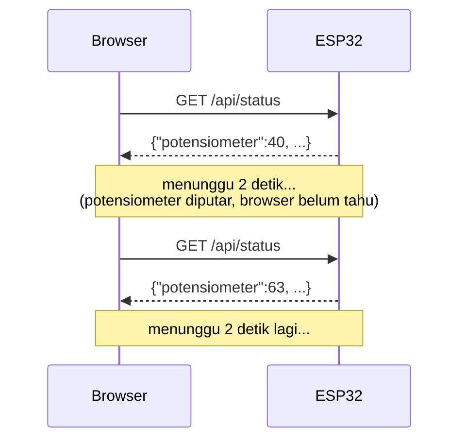
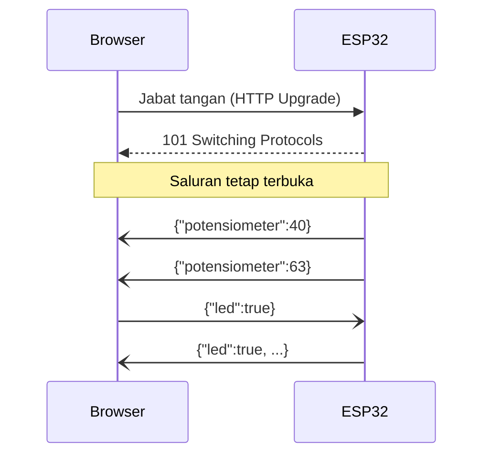
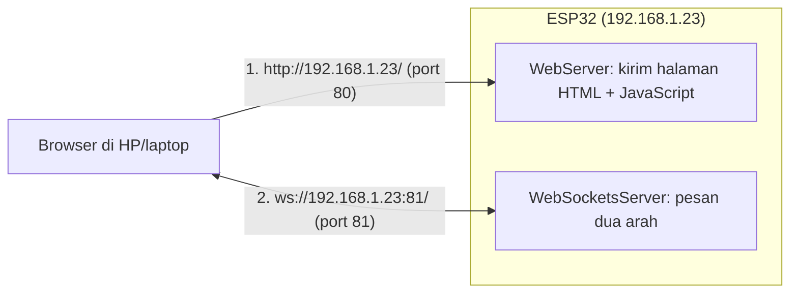
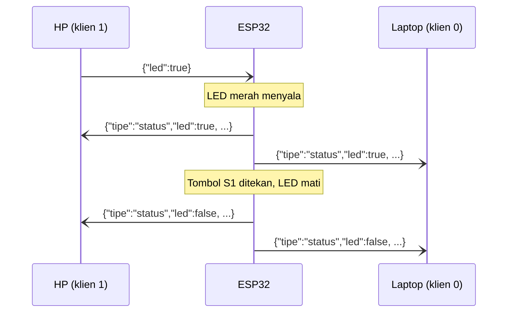

# BAB 47: WebSocket — Komunikasi Real-Time Dua Arah

> ✅ **Prasyarat:** Selesaikan **BAB 46 (Web Server — Dashboard IoT Berbasis Browser)** — kamu sudah bisa membuat *web server* di ESP32, membuka halamannya dari *browser* di WiFi yang sama, dan menyusun JSON dengan ArduinoJson 7. Program 2–3 juga memakai sensor dari **BAB 26 (DHT11 — Suhu & Kelembapan)**, potensiometer dari **BAB 11 (Analog Input & ADC)**, dan pola `struct Timer` dari **BAB 16 (Non-Blocking Programming)**. Program 3 memakai tombol dengan *debounce* dari **BAB 9 (Digital Input — Push Button)** dan *relay* dari **BAB 37 (*Relay* — Kontrol AC/DC)**. Nama `bluino.local` dari **BAB 45 (mDNS — Akses ESP32 dengan Nama Domain Lokal)** bersifat opsional.

Di BAB 46, *dashboard* harus terus bertanya ke ESP32 setiap 2 detik, "Ada data baru?" — cara ini disebut *polling*. Ibaratnya berkirim **surat**: setiap kali ingin tahu kabar, kamu harus menulis surat baru dan menunggu balasannya. Di BAB ini kamu belajar **WebSocket**, yang lebih mirip **telepon**: sekali tersambung, ESP32 dan *browser* bisa saling bicara kapan saja tanpa menutup sambungan. Hasilnya, angka di *dashboard* berubah begitu potensiometer diputar, dan tombol yang ditekan di HP langsung terlihat di laptop.

## 📌 Tujuan Pembelajaran

Setelah mempelajari BAB ini, kamu bisa:

- Menjelaskan perbedaan *polling* HTTP dan WebSocket, serta kapan sebaiknya memakai masing-masing.
- Menjelaskan cara kerja WebSocket: jabat tangan (*handshake*) HTTP *Upgrade*, *frame*, *ping/pong*, dan pemakaian dua *port* (80 untuk halaman, 81 untuk WebSocket).
- Membuat *server* WebSocket di ESP32 dengan *library* **WebSockets** (Markus Sattler): `begin()`, `loop()`, `onEvent()`, `sendTXT()`, `broadcastTXT()`, dan `connectedClients()`.
- Membuka koneksi WebSocket dari JavaScript di *browser*, menampilkan status **Terhubung/Terputus**, dan menyambung ulang secara otomatis.
- Melihat dan mengirim pesan WebSocket dengan DevTools *browser* (**F12**).
- Mengirim dan membaca pesan JSON dengan ArduinoJson 7, serta membatasi laju kiriman supaya ESP32 dan *browser* tidak kebanjiran pesan.
- Membuat *dashboard* dua arah yang tetap sinkron di beberapa *browser* sekaligus, termasuk saat tombol fisik di kit ditekan.

## 🧰 Yang Perlu Disiapkan

| Kebutuhan | Keterangan |
|---|---|
| *Hardware* | Kit Bluino ESP32 IoT Starter Shield + kabel USB **data** |
| Kabel *jumper* | Program 1: tidak perlu. Program 2: 2 kabel *female-female* (`DHT` → IO27, `VR10K` → IO34). Program 3: 5 kabel (`DHT` → IO27, `VR10K` → IO34, `LED1` merah → IO4, `RELAY` → IO26, `SW1` → IO15) |
| Komponen tambahan | Tidak ada. *Relay* cukup dicoba tanpa beban — **jangan** menyambungkan listrik PLN 220 V |
| *Software* | Arduino IDE 2.x + *board package* **esp32** versi 3.3.x (lihat [BAB 5](../BAB-05/README.md)) |
| *Library* | **WebSockets** by Markus Sattler versi 2.7.x (cara memasangnya di [47.3.1](#4731-memasang-library)). Program 2–3: **ArduinoJson** by Benoit Blanchon versi 7 ([BAB 46](../BAB-46/README.md#4663-library-arduinojson-7)), **DHT sensor library** by Adafruit + **Adafruit Unified Sensor** ([BAB 26](../BAB-26/README.md)). `WiFi`, `WebServer`, dan `ESPmDNS` sudah bawaan *board package* |
| Alat uji | **Serial Monitor** (baud 115200) untuk melihat alamat IP; *browser* **Chrome**, **Edge**, atau **Firefox** di laptop — DevTools (**F12**) dipakai untuk mengintip pesan WebSocket; HP sebagai *browser* kedua (opsional, untuk mencoba banyak *browser* sekaligus) |
| Jaringan | Router WiFi atau *hotspot* HP berfrekuensi **2,4 GHz**. Laptop/HP harus tersambung ke WiFi yang **sama** dengan ESP32. Tidak perlu internet |

## 📑 Daftar Isi

- [47.1 Polling vs WebSocket: Surat vs Telepon](#471-polling-vs-websocket-surat-vs-telepon)
- [47.2 Cara Kerja WebSocket](#472-cara-kerja-websocket)
- [47.3 Library WebSockets di ESP32](#473-library-websockets-di-esp32)
- [47.4 WebSocket di Browser (JavaScript)](#474-websocket-di-browser-javascript)
- [47.5 Program 1: Echo WebSocket](#475-program-1-echo-websocket)
- [47.6 Mengintip dan Menguji WebSocket dengan DevTools](#476-mengintip-dan-menguji-websocket-dengan-devtools)
- [47.7 Pesan JSON dan Laju Kiriman](#477-pesan-json-dan-laju-kiriman)
- [47.8 Program 2: Siaran Data Sensor Real-Time](#478-program-2-siaran-data-sensor-real-time)
- [47.9 Banyak Browser Sekaligus dan Koneksi Hantu](#479-banyak-browser-sekaligus-dan-koneksi-hantu)
- [47.10 Program 3: Dashboard Dua Arah](#4710-program-3-dashboard-dua-arah)
- [47.11 Keamanan, Batasan, dan Pilihan Lain](#4711-keamanan-batasan-dan-pilihan-lain)
- [47.12 Troubleshooting](#4712-troubleshooting)
- [📝 Rangkuman](#-rangkuman)
- [💪 Latihan](#-latihan)
- [📚 Referensi](#-referensi)

---

## 47.1 Polling vs WebSocket: Surat vs Telepon

Ingat lagi cara kerja *dashboard* di [BAB 46](../BAB-46/README.md#468-memperbarui-halaman-dengan-fetch): JavaScript di *browser* memanggil `fetch("/api/status")` setiap 2 detik. Setiap panggilan adalah satu ***request*** HTTP baru, dan ESP32 hanya boleh menjawab — ia **tidak bisa** mengirim apa pun kalau tidak ditanya. Pola "terus bertanya" ini disebut ***polling***.



*Gambar 47.1 — Polling HTTP: browser terus bertanya, dan setiap pertanyaan adalah request baru. Perubahan yang terjadi di antara dua pertanyaan baru terlihat pada pertanyaan berikutnya. Sumber: dibuat untuk materi ini.*

Ibaratnya **berkirim surat**. Setiap kali ingin tahu kabar, kamu harus menulis surat lengkap dengan alamat pengirim dan penerima (*header* HTTP), mengirimnya, lalu menunggu balasan. Kalau ada kabar penting di antara dua surat, kamu baru tahu di surat berikutnya.

**WebSocket** bekerja seperti **telepon**. Ada satu kali proses "menelepon" di awal (jabat tangan atau *handshake*). Setelah tersambung, saluran dibiarkan terbuka, dan **kedua pihak boleh bicara kapan saja**: ESP32 bisa langsung melapor saat ada perubahan, dan *browser* bisa langsung memberi perintah.



*Gambar 47.2 — WebSocket: setelah satu kali jabat tangan, ESP32 boleh mengirim data tanpa ditanya, dan browser boleh mengirim perintah kapan saja lewat saluran yang sama. Sumber: dibuat untuk materi ini.*

| Aspek | *Polling* HTTP (BAB 46) | WebSocket (BAB ini) |
|---|---|---|
| Analogi | Berkirim surat | Telepon yang dibiarkan tersambung |
| Siapa yang memulai kiriman | Selalu *browser* | ESP32 **dan** *browser*, kapan saja |
| Kapan perubahan terlihat | Pada pertanyaan berikutnya (sampai 2 detik kemudian) | Begitu ESP32 mengirimnya — di WiFi rumah biasanya dalam hitungan puluhan milidetik |
| Tambahan data per pesan | *Header* HTTP, biasanya ratusan *byte* untuk setiap *request* dan *response* | Bungkus (*frame*) hanya 2–14 *byte* |
| Kalau data tidak berubah | Tetap bertanya terus | Tidak perlu mengirim apa-apa |
| Banyak *browser* | Setiap *browser* bertanya sendiri-sendiri | ESP32 mengirim ke semua *browser* dengan satu perintah `broadcastTXT()` |
| Kerumitan | Sederhana, cukup *library* bawaan | Perlu *library* tambahan dan logika sambung ulang |

Bukan berarti WebSocket selalu lebih baik. Kalau datanya jarang berubah (misalnya membaca suhu kamar setiap 1 menit), atau kamu hanya perlu sesekali mengirim perintah, *polling* atau *request* HTTP biasa dari BAB 46 sudah cukup dan lebih sederhana. WebSocket unggul saat data berubah cepat, perintah harus terasa instan, atau beberapa *browser* harus selalu menampilkan keadaan yang sama.

---

## 47.2 Cara Kerja WebSocket

WebSocket adalah protokol standar (RFC 6455) yang didukung semua *browser* modern. Ia berjalan di atas **TCP** (*Transmission Control Protocol*), cara kirim data di jaringan yang menjamin data sampai utuh dan berurutan. Kalau HTTP biasa membuka sambungan TCP, bertukar satu *request* dan satu *response*, lalu (cepat atau lambat) menutupnya, WebSocket **mempertahankan** sambungan TCP itu selama halaman dibuka.

### 47.2.1 Jabat Tangan: Dari HTTP ke WebSocket

Sambungan WebSocket selalu diawali dengan *request* HTTP biasa yang membawa permintaan khusus: "Ayo kita ganti bahasa ke WebSocket." Permintaan ganti protokol ini disebut ***Upgrade***. Contoh *request* dari *browser* (kamu bisa melihatnya sendiri di DevTools, lihat [47.6](#476-mengintip-dan-menguji-websocket-dengan-devtools)):

```text
GET / HTTP/1.1
Host: 192.168.1.23:81
Upgrade: websocket
Connection: Upgrade
Sec-WebSocket-Key: dGhlIHNhbXBsZSBub25jZQ==
Sec-WebSocket-Version: 13
Origin: http://192.168.1.23
```

Kalau setuju, ESP32 menjawab dengan kode status **101 Switching Protocols**:

```text
HTTP/1.1 101 Switching Protocols
Server: arduino-WebSocketsServer
Upgrade: websocket
Connection: Upgrade
Sec-WebSocket-Version: 13
Sec-WebSocket-Accept: s3pPLMBiTxaQ9kYGzzhZRbK+xOo=
```

Yang perlu kamu pahami:

- **`Upgrade: websocket`** dan **`Connection: Upgrade`** adalah permintaan ganti protokol. Kode **101** artinya "setuju, mulai sekarang kita bicara WebSocket".
- **`Sec-WebSocket-Key`** adalah angka acak dari *browser*. *Server* mengolahnya dengan rumus tetap (SHA-1 + Base64) dan mengirim hasilnya di **`Sec-WebSocket-Accept`**. Ini hanya bukti bahwa *server* benar-benar memahami WebSocket — **bukan** pengaman atau kata sandi.
- Setelah jawaban 101, sambungan TCP yang sama **tidak lagi** dipakai untuk HTTP. Isinya kini pesan-pesan WebSocket. Kamu tidak perlu menulis jabat tangan ini sendiri; *library* di ESP32 dan *browser* yang mengurusnya.

### 47.2.2 Frame: Bungkus Setiap Pesan

Setelah jabat tangan, setiap pesan dikirim dalam bungkus kecil bernama ***frame***. Bungkus ini hanya 2–14 *byte*: 2 *byte* dasar, tambahan 2 atau 8 *byte* untuk pesan yang panjang, dan tambahan 4 *byte* "kunci penyamaran" (*mask*) yang wajib untuk pesan dari *browser* ke *server*. Bandingkan dengan *header* HTTP yang biasanya ratusan *byte* untuk setiap *request*.

Jenis *frame* yang perlu kamu kenal:

| Jenis *frame* | Isinya | Di BAB ini |
|---|---|---|
| ***Text*** | Teks UTF-8, misalnya `Halo` atau JSON | Dipakai untuk semua pesan |
| ***Binary*** | Data mentah (*byte*), misalnya gambar | Tidak dipakai |
| ***Ping*** | "Halo, masih di sana?" | Dikirim ESP32 untuk mengecek *browser* masih hidup |
| ***Pong*** | "Masih!" — balasan otomatis untuk *ping* | Dibalas otomatis oleh *browser* |
| ***Close*** | "Aku tutup teleponnya, ya" | Dikirim saat halaman ditutup atau di-*refresh* |

> 📌 **Catatan:** *Browser* membalas *ping* secara otomatis, tetapi JavaScript **tidak bisa** mengirim *ping* sendiri. Karena itu, untuk mengecek koneksi dari sisi *browser*, kita memakai cara lain: kalau beberapa detik tidak ada pesan sama sekali, anggap koneksi macet (lihat [47.4.2](#4742-menyambung-ulang-otomatis)).

### 47.2.3 Dua Port: 80 untuk Halaman, 81 untuk WebSocket

***Port*** adalah nomor "pintu" layanan di sebuah perangkat, mirip nomor loket di kantor pos: satu gedung (satu alamat IP) bisa punya beberapa loket dengan tugas berbeda. Di BAB ini ESP32 membuka dua pintu sekaligus:



*Gambar 47.3 — Browser mengambil halaman sekali lewat port 80, lalu JavaScript di halaman itu membuka koneksi WebSocket ke port 81 pada ESP32 yang sama. Sumber: dibuat untuk materi ini.*

- **Port 80** dilayani `WebServer` bawaan, persis seperti BAB 46. Tugasnya hanya mengirim halaman HTML, CSS, dan JavaScript sekali di awal.
- **Port 81** dilayani `WebSocketsServer` dari *library* WebSockets. Semua data sensor dan perintah lewat pintu ini.
- Alamat WebSocket diawali **`ws://`** (bukan `http://`), misalnya `ws://192.168.1.23:81/`. Versi terenkripsinya **`wss://`**, tetapi *server* WebSocket di ESP32 dengan *library* ini **tidak** mendukung `wss://`.

Kenapa tidak di port 80 saja? *Library* WebSockets menjalankan *server* TCP-nya sendiri, dan fitur untuk menumpang di `WebServer` pada port yang sama hanya tersedia untuk ESP8266 dan RP2040, tidak untuk ESP32. Memakai port terpisah juga membuat kodenya lebih mudah dipahami.

> ⚠️ **Perhatian:** Halaman ESP32 harus dibuka dengan **`http://`**. Halaman yang dibuka lewat `https://` (misalnya situs penguji WebSocket di internet) **diblokir** oleh *browser* saat mencoba membuka `ws://` yang tidak terenkripsi. Aturan keamanan ini disebut ***mixed content***.

---

## 47.3 Library WebSockets di ESP32

### 47.3.1 Memasang Library

*Board package* esp32 tidak menyertakan *server* WebSocket, jadi kita memasang *library* tambahan:

1. Di Arduino IDE, buka **Sketch → Include Library → Manage Libraries…** (atau klik ikon buku di sisi kiri).
2. Ketik `WebSockets` di kotak pencarian.
3. Cari yang namanya persis **WebSockets** dengan pembuat **Markus Sattler**. Pilih versi **2.7.x** (BAB ini diuji dengan 2.7.2), lalu klik **INSTALL**.

> ⚠️ **Perhatian:** Ada beberapa *library* dengan nama mirip, misalnya **ArduinoWebsockets** (Gil Maimon) dan **WebSockets_Generic** (Khoi Hoang). Cara pakainya berbeda dan kode di BAB ini tidak akan ter-*compile* dengan *library* tersebut. Pastikan pembuatnya **Markus Sattler**. Di GitHub, *library* ini bernama **arduinoWebSockets** (akun Links2004).

### 47.3.2 Pola Dasar Program

Kerangka setiap program WebSocket di BAB ini (potongan kode; program lengkapnya ada di Program 1):

```cpp
#include <WebSocketsServer.h>

WebSocketsServer ws(81);  // 1. Buat server WebSocket di port 81

// 2. Fungsi yang dipanggil library setiap ada kejadian WebSocket
void tanganiWebSocket(uint8_t nomor, WStype_t jenis, uint8_t *data, size_t panjang) {
  if (jenis == WStype_TEXT) {
    ws.sendTXT(nomor, "Pesan diterima");  // balas ke pengirimnya saja
  }
}

// --- di dalam setup(), SETELAH WiFi tersambung ---
  ws.begin();                    // 3. Mulai membuka port 81
  ws.onEvent(tanganiWebSocket);  // 4. Daftarkan fungsi penangan kejadian

// --- di dalam loop() ---
  ws.loop();  // 5. Terima koneksi baru dan pesan masuk (wajib sesering mungkin)
```

Mirip dengan `server.handleClient()` di BAB 46, `ws.loop()` hanya bekerja saat dipanggil. Kalau `loop()` tertahan oleh `delay()` panjang, koneksi baru dan pesan dari *browser* ikut tertahan. Karena itu, semua program di BAB ini memakai pola `millis()` dan `struct Timer` dari [BAB 16](../BAB-16/README.md).

### 47.3.3 Fungsi Penangan Kejadian (Event)

Setiap kali sesuatu terjadi — *browser* tersambung, terputus, atau mengirim pesan — *library* memanggil fungsi yang kamu daftarkan dengan `ws.onEvent()`. Fungsi seperti ini disebut ***callback*** ([BAB 18](../BAB-18/README.md)). Isinya empat parameter:

| Parameter | Isinya |
|---|---|
| `nomor` (`uint8_t`) | Nomor klien (*client*), mulai dari 0. Setiap *browser* (setiap tab) yang tersambung mendapat nomor sendiri. Nomor dipakai ulang setelah klien itu terputus |
| `jenis` (`WStype_t`) | Jenis kejadian, lihat tabel di bawah |
| `data` (`uint8_t *`) | Isi pesan. Untuk pesan teks, *library* sudah menambahkan karakter akhir (`'\0'`), jadi bisa dicetak sebagai teks |
| `panjang` (`size_t`) | Panjang isi pesan dalam *byte* |

Jenis kejadian yang penting:

| `jenis` | Kapan terjadi | Yang biasanya dilakukan |
|---|---|---|
| `WStype_CONNECTED` | Jabat tangan berhasil, *browser* baru tersambung | Catat di Serial Monitor, kirim data terbaru ke *browser* itu |
| `WStype_DISCONNECTED` | Koneksi tertutup (halaman ditutup, WiFi putus, atau *server* memutus) | Catat, perbarui jumlah klien |
| `WStype_TEXT` | Pesan teks diterima | Baca perintahnya, lalu jalankan |
| `WStype_PONG` | Balasan *pong* dari *browser* | Biasanya diabaikan. Muncul sekali setelah tersambung, karena *library* langsung mengirim *ping* setelah jabat tangan (dan berkala kalau *heartbeat* diaktifkan, lihat [47.9.3](#4793-koneksi-hantu-dan-heartbeat)) |
| `WStype_BIN`, `WStype_PING`, `WStype_ERROR`, `WStype_FRAGMENT_…` | Pesan *binary*, *ping* dari klien, dan pesan terpotong-potong | Tidak dipakai di BAB ini; abaikan |

> ⚠️ **Perhatian:** *Callback* dijalankan **di dalam** `ws.loop()`. Jangan memakai `delay()` atau pekerjaan lama (misalnya membaca DHT11) di dalamnya — selama *callback* belum selesai, semua koneksi lain ikut menunggu. Cukup catat perintahnya, ubah variabel, lalu biarkan `loop()` yang mengerjakan sisanya.

### 47.3.4 Fungsi Penting dan Batasannya

Semua fungsi berikut sudah diperiksa pada *library* WebSockets versi 2.7.2:

| Fungsi | Kegunaan | Contoh |
|---|---|---|
| `WebSocketsServer ws(port)` | Membuat *server* WebSocket di *port* tertentu | `WebSocketsServer ws(81);` |
| `ws.begin()` | Mulai menerima koneksi | `ws.begin();` |
| `ws.onEvent(fungsi)` | Mendaftarkan fungsi penangan kejadian | `ws.onEvent(tanganiWebSocket);` |
| `ws.loop()` | Menerima koneksi baru dan pesan masuk (di `loop()`) | `ws.loop();` |
| `ws.sendTXT(nomor, teks)` | Mengirim teks ke **satu** klien | `ws.sendTXT(nomor, "Halo");` |
| `ws.broadcastTXT(teks)` | Mengirim teks ke **semua** klien yang tersambung | `ws.broadcastTXT(json);` |
| `ws.connectedClients()` | Jumlah klien yang sedang tersambung | `if (ws.connectedClients() > 0) { ... }` |
| `ws.remoteIP(nomor)` | Alamat IP klien tertentu | `ws.remoteIP(nomor).toString()` |
| `ws.disconnect(nomor)` | Memutus satu klien | `ws.disconnect(2);` |
| `ws.enableHeartbeat(jeda, batasTunggu, jumlahGagal)` | Mengirim *ping* berkala dan memutus klien yang tidak menjawab | `ws.enableHeartbeat(15000, 3000, 2);` |

Batasan yang perlu kamu ketahui:

- **Maksimal 5 klien** sekaligus (konstanta `WEBSOCKETS_SERVER_CLIENT_MAX` di dalam *library*). Klien keenam langsung diputus. Detailnya di [47.9](#479-banyak-browser-sekaligus-dan-koneksi-hantu).
- **Pesan masuk maksimal 15 KB.** Pesan yang lebih besar membuat koneksi diputus. Untuk perintah dan data sensor, ukurannya jauh di bawah itu.
- `broadcastTXT()` tidak benar-benar mengirim "sekaligus" di udara. *Library* mengirim salinan pesan ke setiap klien satu per satu. Makin banyak klien, makin lama pengirimannya — salah satu alasan untuk tidak membanjiri pesan ([47.7.3](#4773-jangan-membanjiri-batasi-laju-kiriman)).
- Kalau isi pesan berupa `String`, simpan dulu di variabel, lalu kirim variabelnya: `String json = ...; ws.broadcastTXT(json);`. Menulis `ws.broadcastTXT(buatJson())` langsung akan gagal di-*compile*, karena versi fungsi untuk `String` hanya menerima variabel.

---

## 47.4 WebSocket di Browser (JavaScript)

Di sisi *browser*, WebSocket sudah tersedia tanpa *library* apa pun. Semua kode di bagian ini ditulis di dalam `<script>` pada halaman yang dikirim ESP32.

### 47.4.1 Membuka Koneksi dan Menerima Pesan

```javascript
// Alamat WebSocket = alamat halaman ini, tetapi port 81
const ws = new WebSocket("ws://" + location.hostname + ":81/");

ws.onopen = function () {        // jabat tangan berhasil
  console.log("Terhubung");
  ws.send("Halo ESP32");           // kirim teks ke ESP32
};
ws.onmessage = function (e) {     // ada pesan dari ESP32
  console.log("Diterima:", e.data);
};
ws.onclose = function () {        // koneksi tertutup (karena sebab apa pun)
  console.log("Terputus");
};
```

- **`location.hostname`** berisi alamat yang sedang dipakai untuk membuka halaman, misalnya `192.168.1.23` atau `bluino.local`. Dengan begitu kamu tidak perlu menulis alamat IP di dalam kode HTML, dan kode yang sama tetap benar di jaringan mana pun.
- **`onopen`**, **`onmessage`**, dan **`onclose`** adalah fungsi yang dipanggil *browser* saat kejadian itu terjadi — sama seperti *callback* di ESP32. Isi pesan ada di `e.data`.
- **`ws.send(teks)`** mengirim pesan teks ke ESP32. Kirim hanya kalau `ws.readyState === WebSocket.OPEN` (koneksi sudah terbuka), karena mengirim sebelum terhubung akan menimbulkan *error*.
- Ada juga **`onerror`**, tetapi setelah *error* *browser* selalu memanggil `onclose`. Jadi cukup tangani `onclose`.

### 47.4.2 Menyambung Ulang Otomatis

Koneksi WebSocket bisa putus kapan saja: ESP32 di-*restart* atau di-*upload* ulang, WiFi sesaat hilang, atau layar HP mati. Tanpa penanganan, halaman akan diam saja dengan angka lama. Karena itu, semua halaman di BAB ini memakai pola berikut:

```javascript
let ws;

function sambungkan() {
  ws = new WebSocket("ws://" + location.hostname + ":81/");
  ws.onopen = function () { aturKoneksi(true); };     // tampilkan "● Terhubung"
  ws.onmessage = function (e) { /* tampilkan data */ };
  ws.onclose = function () {
    aturKoneksi(false);                                 // tampilkan "● Terputus"
    setTimeout(sambungkan, 3000);                       // coba lagi 3 detik kemudian
  };
}

sambungkan();
```

Setiap kali koneksi tertutup, halaman menampilkan **● Terputus** lalu mencoba lagi setiap 3 detik sampai berhasil. Jeda 3 detik penting: tanpa jeda, *browser* akan mencoba ratusan kali per detik dan justru membebani ESP32 yang sedang menyala ulang.

Ada satu masalah lagi: kalau ESP32 tiba-tiba mati atau WiFi hilang **tanpa** sempat mengirim *frame close*, *browser* sering tidak langsung tahu bahwa koneksinya sudah mati — `onclose` baru terpanggil lama kemudian (bisa beberapa menit), atau baru saat *browser* mencoba mengirim sesuatu. Solusinya, ESP32 di Program 2 dan 3 sengaja mengirim data **minimal setiap 2 detik**, dan halaman memasang "pengawas": kalau 6 detik tidak ada pesan sama sekali, koneksi dianggap macet, ditutup, lalu disambung ulang. Kodenya dijelaskan di Program 2.

> 💡 **Tips:** Kalau kamu memakai nama `bluino.local` ([BAB 45](../BAB-45/README.md)), `location.hostname` berisi `bluino.local`, sehingga WebSocket juga tersambung lewat nama itu. Kalau perangkatmu tidak bisa membuka `.local`, buka halaman dengan alamat IP saja; semuanya tetap bekerja.

---

## 47.5 Program 1: Echo WebSocket

**Tujuan:** Membuat koneksi WebSocket pertama. ESP32 mengirim halaman berisi kotak pesan lewat port 80. Setiap teks yang kamu ketik dikirim lewat WebSocket (port 81), lalu ESP32 mengirimnya kembali dengan awalan `ESP32 menerima:` — pola ini disebut ***echo*** (gema). LED biru di *board* menyala selama ada minimal satu *browser* yang tersambung.

**Rangkaian:**

*Tidak perlu merangkai — program memakai LED biru bawaan board ESP32 di IO2.* Kalau ingin LED biru di kit juga ikut menyala, pasang satu kabel *jumper*:

| Pin **Custom** di kit | Sambungkan ke pin ESP32 |
|---|---|
| `LED3` — LED biru (header LED) — opsional | IO2 |

**Cara Menjalankan:**

1. Pasang *library* **WebSockets** by Markus Sattler seperti di [47.3.1](#4731-memasang-library).
2. Buka Arduino IDE → **File → New Sketch**, hapus isinya, lalu salin kode di bawah. Kode yang sama juga tersedia di *file* [`p1_echo.ino`](p1_echo/p1_echo.ino).
3. Ganti `NamaWiFiKamu` dan `PasswordWiFiKamu` dengan nama dan kata sandi WiFi kamu. Keduanya peka huruf besar-kecil, dan WiFi-nya harus 2,4 GHz. Kalau ada beberapa kit di WiFi yang sama (misalnya di kelas), ganti juga `NAMA_MDNS` dengan nama unik, misalnya `"bluino-andi"` ([BAB 45](../BAB-45/README.md#4524-aturan-memberi-nama)).
4. Pastikan **Tools → Board** = **ESP32 Dev Module** dan **Tools → Port** = *port* ESP32 kamu (misalnya `COM5` di Windows atau `/dev/ttyUSB0` di Linux).
5. Klik tombol **Upload** (ikon panah →) dan tunggu sampai muncul tulisan **Done uploading**.
6. Buka **Serial Monitor** (**Tools → Serial Monitor**) lalu pilih baud **115200**. Catat alamat yang muncul di baris `Halaman web`. Kalau tulisan awal terlewat, tekan tombol **EN** di *board* ESP32.
7. Di laptop atau HP yang tersambung ke WiFi yang **sama**, buka *browser* lalu ketik alamat tadi, misalnya `http://192.168.1.23/`.
8. Tunggu label di pojok kanan atas berubah menjadi **● Terhubung**, ketik pesan, lalu tekan **Enter** atau tombol **Kirim**.

**Kode Program:**

<!-- sketch: p1_echo -->
```cpp
/*
 * BAB 47 - Program 1: Echo WebSocket
 * - GET /           -> halaman uji (HTML + JavaScript), lewat port 80
 * - ws://<IP>:81/   -> WebSocket: setiap teks yang diterima dikirim balik (echo)
 * LED biru (IO2) menyala selama ada minimal satu browser yang tersambung.
 * Rangkaian: tidak perlu (LED biru bawaan board di IO2).
 *   Opsional: LED3 (biru) -> IO2 supaya LED biru di kit ikut menyala.
 */

#include <WiFi.h>
#include <ESPmDNS.h>
#include <WebServer.h>
#include <WebSocketsServer.h>

const char *NAMA_WIFI = "NamaWiFiKamu";          // ← ganti dengan WiFi kamu
const char *PASSWORD_WIFI = "PasswordWiFiKamu";  // ← ganti dengan WiFi kamu
const char *NAMA_MDNS = "bluino";                // nama .local, tanpa ".local" (BAB 45)

#define LED_BIRU 2  // LED biru bawaan board (dan LED3 kit) -> IO2

WebServer server(80);     // port 80: mengirim halaman web
WebSocketsServer ws(81);  // port 81: pesan WebSocket dua arah

// Halaman uji: HTML + CSS + JavaScript dalam satu raw string literal (BAB 46).
// Tidak memakai CDN, jadi tetap berjalan tanpa internet.
const char HALAMAN_ECHO[] = R"rawliteral(
<!DOCTYPE html>
<html lang="id">
<head>
<meta charset="UTF-8">
<meta name="viewport" content="width=device-width, initial-scale=1">
<title>Echo WebSocket</title>
<style>
  * { box-sizing: border-box; }
  body { font-family: Arial, Helvetica, sans-serif; background: #f2f4f7;
         color: #222; margin: 0; padding: 16px; }
  .wadah { max-width: 520px; margin: 0 auto; }
  header { display: flex; justify-content: space-between; align-items: center; }
  h1 { font-size: 1.3em; margin: 0; color: #1565c0; }
  .koneksi { font-size: 0.85em; padding: 4px 10px; border-radius: 999px;
             background: #e0e0e0; color: #555; }
  .koneksi.ok { background: #e8f5e9; color: #2e7d32; }
  .koneksi.putus { background: #ffebee; color: #c62828; }
  #log { background: #fff; border-radius: 12px; padding: 12px; height: 260px;
         overflow-y: auto; margin: 16px 0 10px; font-family: monospace;
         font-size: 0.9em; box-shadow: 0 1px 3px rgba(0, 0, 0, 0.12); }
  .kirim { color: #1565c0; }
  .terima { color: #2e7d32; }
  .sistem { color: #888; font-style: italic; }
  .baris { display: flex; gap: 8px; }
  input { flex: 1; min-width: 0; font-size: 1em; padding: 10px;
          border: 1px solid #bbb; border-radius: 8px; }
  button { font-size: 1em; padding: 10px 16px; border: none; border-radius: 8px;
           background: #1565c0; color: #fff; cursor: pointer; }
  button:disabled { background: #90a4ae; cursor: not-allowed; }
</style>
</head>
<body>
<div class="wadah">
  <header>
    <h1>Echo WebSocket</h1>
    <span id="koneksi" class="koneksi">Menyambung...</span>
  </header>
  <div id="log"></div>
  <div class="baris">
    <input id="teks" type="text" maxlength="100" placeholder="Ketik pesan, lalu Enter">
    <button id="tombol" onclick="kirim()" disabled>Kirim</button>
  </div>
</div>

<script>
function el(id) { return document.getElementById(id); }
let ws;

// Menambah satu baris (dengan jam) ke kotak log
function catat(teks, kelas) {
  const baris = document.createElement("div");
  baris.className = kelas;
  baris.textContent = new Date().toLocaleTimeString("id-ID") + "  " + teks;
  el("log").appendChild(baris);
  el("log").scrollTop = el("log").scrollHeight;
}

function aturKoneksi(ok) {
  el("koneksi").textContent = ok ? "● Terhubung" : "● Terputus";
  el("koneksi").className = "koneksi " + (ok ? "ok" : "putus");
  el("tombol").disabled = !ok;
}

// Membuka WebSocket ke port 81 di alamat yang sama dengan halaman ini
function sambungkan() {
  ws = new WebSocket("ws://" + location.hostname + ":81/");
  ws.onopen = function () {
    aturKoneksi(true);
    catat("Terhubung ke ESP32", "sistem");
  };
  ws.onmessage = function (e) {
    catat("◀ " + e.data, "terima");
  };
  ws.onclose = function () {
    aturKoneksi(false);
    catat("Koneksi terputus. Mencoba lagi dalam 3 detik...", "sistem");
    setTimeout(sambungkan, 3000);  // sambung ulang otomatis
  };
}

function kirim() {
  const teks = el("teks").value.trim();
  if (teks === "" || ws.readyState !== WebSocket.OPEN) return;
  ws.send(teks);
  catat("▶ " + teks, "kirim");
  el("teks").value = "";
}

el("teks").addEventListener("keydown", function (e) {
  if (e.key === "Enter") kirim();
});

sambungkan();
</script>
</body>
</html>
)rawliteral";

// LED biru menyala kalau ada minimal satu browser yang tersambung
void perbaruiLed() {
  digitalWrite(LED_BIRU, ws.connectedClients() > 0 ? HIGH : LOW);
}

// Dipanggil library (dari dalam ws.loop()) setiap ada kejadian WebSocket
void tanganiWebSocket(uint8_t nomor, WStype_t jenis, uint8_t *data, size_t panjang) {
  switch (jenis) {
    case WStype_CONNECTED: {
      Serial.printf("[WS] Klien #%u terhubung dari %s (total %d klien)\n", nomor,
                    ws.remoteIP(nomor).toString().c_str(), ws.connectedClients());
      char sapaan[48];
      snprintf(sapaan, sizeof(sapaan), "Halo! Kamu klien nomor %u", nomor);
      ws.sendTXT(nomor, sapaan);  // sapa browser yang baru tersambung saja
      perbaruiLed();
      break;
    }

    case WStype_DISCONNECTED:
      Serial.printf("[WS] Klien #%u terputus (sisa %d klien)\n", nomor, ws.connectedClients());
      perbaruiLed();
      break;

    case WStype_TEXT: {
      if (panjang == 0) break;  // abaikan pesan kosong
      // data sudah diakhiri '\0' oleh library, jadi aman dicetak sebagai teks
      Serial.printf("[WS] Pesan dari klien #%u: %s\n", nomor, (const char *)data);
      String balasan = "ESP32 menerima: ";
      balasan += (const char *)data;
      ws.sendTXT(nomor, balasan);  // echo: kirim balik HANYA ke pengirimnya
      break;
    }

    default:  // PONG, PING, BIN, dan lain-lain tidak dipakai di program ini
      break;
  }
}

// Handler untuk GET /
void halamanUtama() {
  server.send(200, "text/html", HALAMAN_ECHO);
}

void halaman404() {
  server.send(404, "text/plain", "404 - alamat tidak ditemukan");
}

void sambungkanWiFi() {
  WiFi.setHostname(NAMA_MDNS);  // nama di daftar perangkat router — SEBELUM WiFi.mode()
  WiFi.mode(WIFI_STA);
  WiFi.begin(NAMA_WIFI, PASSWORD_WIFI);
  Serial.printf("Menyambung ke WiFi \"%s\"", NAMA_WIFI);

  unsigned long mulai = millis();
  while (WiFi.status() != WL_CONNECTED) {
    if (millis() - mulai > 20000) {  // menyerah setelah 20 detik
      Serial.println("\nGagal tersambung. Periksa nama/password WiFi dan pastikan 2,4 GHz.");
      Serial.println("ESP32 restart dalam 5 detik...");
      delay(5000);
      ESP.restart();
    }
    delay(500);
    Serial.print(".");
  }
  Serial.println(" tersambung!");
  WiFi.setSleep(false);  // matikan hemat daya WiFi supaya pesan lebih cepat sampai
}

void setup() {
  Serial.begin(115200);
  delay(1000);
  Serial.println("\nBAB 47 - Program 1: Echo WebSocket");

  pinMode(LED_BIRU, OUTPUT);  // pinMode dulu, baru digitalWrite (core 3.x)
  digitalWrite(LED_BIRU, LOW);

  sambungkanWiFi();
  bool mdnsAktif = MDNS.begin(NAMA_MDNS);
  if (mdnsAktif) {
    MDNS.addService("http", "tcp", 80);
  }

  server.on("/", HTTP_GET, halamanUtama);
  server.onNotFound(halaman404);
  server.begin();  // port 80

  ws.begin();  // port 81
  ws.onEvent(tanganiWebSocket);

  String ip = WiFi.localIP().toString();
  Serial.printf("Halaman web : http://%s/\n", ip.c_str());
  if (mdnsAktif) {
    Serial.printf("              atau http://%s.local/\n", NAMA_MDNS);
  }
  Serial.printf("WebSocket   : ws://%s:81/\n", ip.c_str());
}

void loop() {
  server.handleClient();  // layani halaman web (port 80)
  ws.loop();              // layani WebSocket (port 81): koneksi baru dan pesan masuk
}
```

**Penjelasan Kode:**

*Bagian ESP32 (C++):*

- **Dua *server* sekaligus.** `WebServer server(80)` mengirim halaman, `WebSocketsServer ws(81)` mengurus WebSocket. Di `loop()`, keduanya dilayani bergantian dengan `server.handleClient()` dan `ws.loop()`. Tidak ada `delay()` di `loop()`, jadi keduanya selalu cepat menanggapi.
- **`tanganiWebSocket()`** adalah *callback* yang didaftarkan dengan `ws.onEvent()`. Isinya `switch` berdasarkan `jenis` kejadian:
  - `WStype_CONNECTED` → mencetak nomor dan IP klien, lalu menyapa **hanya** klien itu dengan `ws.sendTXT(nomor, ...)`. Teks sapaan disusun dengan `snprintf()` ke dalam *array* `char`.
  - `WStype_DISCONNECTED` → mencetak sisa klien.
  - `WStype_TEXT` → mencetak pesan, lalu mengirimnya kembali ke pengirim dengan awalan `ESP32 menerima:`. Pesan kosong diabaikan karena isinya (`data`) bisa berupa *pointer* kosong.
- **`ws.connectedClients()`** menghitung klien yang sedang tersambung. Kita tidak perlu menghitung sendiri dengan variabel `++`/`--`, yang mudah meleset kalau ada koneksi yang gagal di tengah jabat tangan.
- **`perbaruiLed()`** menyalakan LED biru kalau ada minimal satu klien. Dipanggil setiap ada klien tersambung atau terputus.
- **`WiFi.setHostname()` sebelum `WiFi.mode()`** — di core 3.3.x, urutan ini wajib supaya nama `bluino` tampil di daftar perangkat router ([BAB 45](../BAB-45/README.md#454-library-espmdns)). `MDNS.begin()` dipanggil setelah WiFi tersambung.
- **`WiFi.setSleep(false)`** mematikan mode hemat daya WiFi. Dengan mode hemat daya, ESP32 hanya "membuka telinga" secara berkala, sehingga pesan bisa terlambat ratusan milidetik.

*Bagian halaman (HTML dan JavaScript):*

- **`sambungkan()`** membuka WebSocket ke `ws://<alamat halaman>:81/`, persis pola di [47.4](#474-websocket-di-browser-javascript). Saat terputus, ia mencoba lagi setiap 3 detik.
- **`aturKoneksi()`** mengganti label menjadi **● Terhubung** (hijau) atau **● Terputus** (merah), sekaligus menonaktifkan tombol **Kirim** selama terputus.
- **`kirim()`** mengirim isi kotak teks dengan `ws.send()` hanya kalau koneksi terbuka (`WebSocket.OPEN`).
- **`catat()`** menambah baris ke kotak log dengan `textContent`, sehingga teks apa pun yang dikirim balik ESP32 selalu tampil sebagai teks biasa, tidak pernah dijalankan sebagai HTML.

**Contoh Output:**

```text
BAB 47 - Program 1: Echo WebSocket
Menyambung ke WiFi "NamaWiFiKamu"..... tersambung!
Halaman web : http://192.168.1.23/
              atau http://bluino.local/
WebSocket   : ws://192.168.1.23:81/
[WS] Klien #0 terhubung dari 192.168.1.10 (total 1 klien)
[WS] Pesan dari klien #0: Halo ESP32
[WS] Klien #1 terhubung dari 192.168.1.12 (total 2 klien)
[WS] Pesan dari klien #1: Ini dari HP
[WS] Klien #1 terputus (sisa 1 klien)
```

Contoh di atas terjadi saat halaman dibuka di laptop (`192.168.1.10`), lalu di HP (`192.168.1.12`), lalu tab di HP ditutup. Alamat IP di jaringanmu hampir pasti berbeda.

Di *browser* muncul halaman **Echo WebSocket** dengan label **● Terhubung** berwarna hijau. Kotak log menampilkan baris abu-abu `Terhubung ke ESP32` dan baris hijau `◀ Halo! Kamu klien nomor 0`. Saat kamu mengirim `Halo ESP32`, muncul baris biru `▶ Halo ESP32`, disusul hampir seketika oleh baris hijau `◀ ESP32 menerima: Halo ESP32`. LED biru di *board* menyala selama halaman terbuka, dan padam setelah semua tab ditutup.

> 🧪 **Coba Sendiri:** Saat halaman terbuka, tekan tombol **EN** di *board* ESP32. Label langsung berubah menjadi **● Terputus** dan log menampilkan `Koneksi terputus. Mencoba lagi dalam 3 detik...`. Beberapa detik setelah ESP32 tersambung lagi ke WiFi, label kembali **● Terhubung** dengan sendirinya — tanpa me-*refresh* halaman (selama alamat IP ESP32 tidak berubah).

**Kalau Belum Berhasil:**

- ***Compile* gagal: `WebSocketsServer.h: No such file or directory`** → *library* WebSockets belum terpasang, atau yang terpasang *library* lain yang namanya mirip. Pasang **WebSockets** by **Markus Sattler** ([47.3.1](#4731-memasang-library)).
- **Halaman terbuka, tetapi label tetap "● Terputus"** → port 81 tidak bisa dijangkau. Pastikan halaman dibuka dengan `http://` (bukan `https://`), dan matikan VPN atau aplikasi *firewall* di laptop yang memblokir *port* selain 80. Cek juga pesan kesalahannya di DevTools ([47.6](#476-mengintip-dan-menguji-websocket-dengan-devtools)).
- **Halaman tidak terbuka sama sekali** → HP/laptop tidak di WiFi yang sama, atau alamat IP salah ketik. Lihat Troubleshooting [BAB 46](../BAB-46/README.md#4613-troubleshooting).
- **Membuka `http://<IP>:81/` di *browser* hanya menampilkan `This is a Websocket server only!`** → itu normal. Port 81 hanya untuk WebSocket; halaman web ada di alamat tanpa `:81`.

---

## 47.6 Mengintip dan Menguji WebSocket dengan DevTools

Pesan WebSocket tidak terlihat di layar seperti halaman web biasa. Untuk melihat apa yang sebenarnya lewat, pakai **DevTools**, alat pengembang yang sudah ada di Chrome, Edge, dan Firefox versi laptop. Cara membukanya: buka halaman ESP32, lalu tekan **F12** (atau **Ctrl+Shift+I** di Windows/Linux, **Cmd+Option+I** di macOS).

> 📌 **Catatan:** DevTools hanya tersedia di *browser* laptop/komputer. Di HP, kamu cukup memakai halaman ESP32-nya saja.

### 47.6.1 Melihat Pesan di Tab Network

Dengan Program 1 berjalan:

1. Buka `http://<IP-ESP32>/` di Chrome atau Edge, lalu tekan **F12** dan pilih tab **Network**.
2. Tekan **F5** untuk memuat ulang halaman. DevTools hanya mencatat koneksi yang dibuat **setelah** ia terbuka.
3. Di deretan tombol *filter*, klik **WS** (di beberapa versi Chrome terbaru namanya **Socket**). Sekarang hanya koneksi WebSocket yang tampil, dengan kolom **Status** bernilai **101**.
4. Klik baris koneksi itu (namanya berupa alamat IP ESP32), lalu buka:
   - tab **Headers** → melihat *request* dan *response* jabat tangan seperti di [47.2.1](#4721-jabat-tangan-dari-http-ke-websocket);
   - tab **Messages** → daftar semua pesan. Pesan yang **dikirim** *browser* berlatar hijau muda, sedangkan pesan yang **diterima** berlatar putih. Kolom **Length** menunjukkan ukuran pesan, kolom **Time** menunjukkan jamnya.
5. Kirim beberapa pesan dari halaman dan perhatikan daftarnya bertambah.

Di **Firefox**, langkahnya hampir sama: tab **Network** → *filter* **WS** → klik koneksinya → tab **Response**. Pesan yang dikirim bertanda panah hijau, pesan yang diterima bertanda panah merah.

### 47.6.2 Mengirim Pesan dari Console

Tab **Console** di DevTools bisa menjalankan JavaScript langsung. Kita bisa membuat koneksi WebSocket kedua dari situ — tanpa menyentuh halaman.

1. Masih di halaman ESP32, buka tab **Console** di DevTools.
2. Ketik baris-baris berikut **satu per satu**, tekan **Enter** setelah setiap baris (baris pertama sengaja berisi dua perintah, supaya penerima pesan sudah terpasang sebelum ESP32 mengirim sapaan):

```javascript
let uji = new WebSocket("ws://" + location.hostname + ":81/"); uji.onmessage = (e) => console.log("Diterima:", e.data);
uji.send("Halo dari Console");
uji.close();
```

3. Hasil yang diharapkan: setelah baris pertama, Console menampilkan `Diterima: Halo! Kamu klien nomor 1` (nomornya bisa berbeda). Setelah baris kedua, muncul `Diterima: ESP32 menerima: Halo dari Console`. Di Serial Monitor muncul `[WS] Klien #1 terhubung ...`, lalu pesannya, lalu `terputus` setelah baris ketiga.

> ⚠️ **Perhatian:** Saat pertama kali kamu **menempel** (*paste*) kode ke Console, Chrome dan Firefox menampilkan peringatan dan memintamu mengetik `allow pasting` dulu (di Chrome lalu tekan **Enter**). Ini perlindungan dari penipuan yang menyuruh orang menempel kode berbahaya. Kode di atas aman karena kamu memahami isinya; alternatifnya, ketik sendiri tanpa menempel. Jangan pernah menempel kode dari orang yang tidak kamu kenal ke Console.

> 💡 **Tips:** Kalau `uji.send(...)` menghasilkan *error* `Still in CONNECTING state`, artinya koneksi belum selesai dibuka. Tunggu sebentar, lalu ulangi baris itu.

### 47.6.3 Alat Uji Lain

| Alat | Kapan dipakai | Catatan |
|---|---|---|
| DevTools *browser* (**F12**) | Melihat pesan dan mengirim pesan uji | Tidak perlu memasang apa pun. Paling disarankan |
| **Postman** (aplikasi desktop, gratis) | Menguji WebSocket tanpa halaman web | Pilih **New → WebSocket**, isi `ws://192.168.1.23:81/`, klik **Connect**, lalu ketik pesan dan klik **Send**. Pakai versi desktop karena versi *web* butuh agen tambahan untuk menjangkau jaringan lokal |
| Situs penguji WebSocket *online* | Sebaiknya **tidak** dipakai untuk ESP32 | Situs seperti itu dibuka lewat `https://`, sehingga *browser* memblokir koneksinya ke `ws://` ESP32 (*mixed content*, lihat [47.2.3](#4723-dua-port-80-untuk-halaman-81-untuk-websocket)) |

---

## 47.7 Pesan JSON dan Laju Kiriman

Program 1 mengirim teks bebas. Untuk *dashboard* sungguhan, pesannya harus rapi supaya mudah dibaca program di kedua sisi. Kita memakai **JSON**, format yang sudah kamu kenal di [BAB 46](../BAB-46/README.md#4662-format-json).

### 47.7.1 Memberi Label pada Setiap Pesan

Di HTTP, alamat (*endpoint*) seperti `/api/status` sudah menjelaskan isi jawabannya. Di WebSocket semua pesan lewat **satu** saluran, jadi setiap pesan perlu "label" jenisnya. Di BAB ini labelnya kunci `"tipe"`. Kesepakatan isi pesan seperti ini disebut **protokol aplikasi** — semacam "tata bahasa" yang disepakati ESP32 dan halaman web.

| Arah | Contoh pesan | Artinya |
|---|---|---|
| ESP32 → semua *browser* | `{"tipe":"sensor","suhu":28.6,"kelembapan":70,"dht_ok":true,"potensiometer":63,"klien":1,"waktu_nyala":125}` | Data sensor terbaru (Program 2) |
| ESP32 → semua *browser* | `{"tipe":"status","suhu":28.6, ..., "led":true,"relay":false, ...}` | Data sensor + keadaan LED dan *relay* (Program 3) |
| ESP32 → satu *browser* | `{"tipe":"error","pesan":"JSON tidak valid"}` | Perintah dari *browser* itu ditolak (Program 3) |
| *Browser* → ESP32 | `{"led":true}`, `{"relay":false}`, `{"led":true,"relay":true}` | Perintah kontrol (Program 3) — formatnya sama dengan `POST /api/kontrol` di BAB 46 |

Perhatikan bahwa perintah berisi **keadaan tujuan** (`"led":true` = "LED harus menyala"), bukan perintah "balik keadaan". Kalau tombol tidak sengaja ditekan dua kali, atau dua *browser* mengirim perintah yang sama, hasilnya tetap sama: LED menyala. Perintah "balik keadaan" justru bisa membuat LED menyala lalu langsung mati lagi.

### 47.7.2 JSON di ESP32 dan di Browser

Di ESP32, JSON disusun dan dibaca dengan ArduinoJson 7 (potongan kode):

```cpp
#include <ArduinoJson.h>

// Menyusun JSON lalu mengirimnya ke semua browser
JsonDocument doc;
doc["tipe"] = "sensor";
doc["suhu"] = 28.6;
String json;
serializeJson(doc, json);  // json berisi {"tipe":"sensor","suhu":28.6}
ws.broadcastTXT(json);     // kirim variabelnya, bukan hasil fungsi langsung

// Membaca perintah dari browser (di dalam case WStype_TEXT)
JsonDocument perintah;
DeserializationError err = deserializeJson(perintah, data, panjang);
if (!err && perintah["led"].is<bool>()) {  // pastikan "led" ada dan bernilai true/false
  bool nyala = perintah["led"];
}
```

`deserializeJson(perintah, data, panjang)` membaca langsung dari isi pesan WebSocket (`data`) sepanjang `panjang` *byte*. Pemeriksaan `is<bool>()` membuat perintah aneh seperti `{"led":"ya"}` ditolak, bukan dijalankan sembarangan.

Di *browser*, JavaScript sudah punya fungsi JSON bawaan:

```javascript
// Pesan masuk: teks JSON → objek
ws.onmessage = function (e) {
  let d;
  try {
    d = JSON.parse(e.data);
  } catch (err) {
    console.warn("Pesan bukan JSON:", e.data);  // pesan rusak tidak menghentikan halaman
    return;
  }
  if (d.tipe === "sensor") {
    // tampilkan d.suhu, d.kelembapan, ...
  }
};

// Pesan keluar: objek → teks JSON {"led":true}
ws.send(JSON.stringify({ led: true }));
```

### 47.7.3 Jangan Membanjiri: Batasi Laju Kiriman

Karena ESP32 boleh mengirim kapan saja, godaan terbesarnya adalah mengirim **terlalu sering** — misalnya mengirim nilai potensiometer di setiap putaran `loop()`, ribuan kali per detik. Akibatnya:

- **ESP32 sibuk mengirim**, sehingga tugas lain (membaca tombol, melayani halaman) ikut tersendat.
- **Antrean kirim penuh.** Kalau ada HP yang sinyalnya lemah, data menumpuk di antrean pengiriman. Saat antrean penuh, fungsi kirim di core 3.3.12 **menunggu** sampai ada tempat (bisa beberapa detik), sehingga `loop()` ikut macet.
- **HP ikut berat.** *Browser* di HP harus menggambar ulang halaman ribuan kali per detik, padahal mata manusia tidak bisa melihat perubahan secepat itu.
- **Derau ADC dikirim terus.** Nilai potensiometer yang diam pun bergoyang sedikit ([BAB 11](../BAB-11/README.md)), sehingga pesan terus terkirim walaupun tidak ada yang berubah.

Ibaratnya kurir paket: daripada bolak-balik untuk setiap paket kecil, kurir berangkat paling sering setiap beberapa menit dan membawa semua paket yang sudah terkumpul. Program 2 dan 3 menerapkan empat aturan:

1. **Kirim hanya kalau ada perubahan berarti.** Potensiometer dianggap berubah kalau selisihnya minimal 2 % — goyangan yang lebih kecil dianggap derau.
2. **Batasi frekuensi.** Paling sering satu pesan setiap 100 ms (10 pesan per detik). Perubahan yang terjadi di antara dua kiriman **digabung** ke kiriman berikutnya.
3. **Tetap kirim secara rutin** setiap 2 detik, walaupun tidak ada perubahan. Kiriman rutin ini membawa data DHT11 terbaru sekaligus menjadi "detak" bagi pengawas koneksi di *browser* ([47.4.2](#4742-menyambung-ulang-otomatis)).
4. **Lewati kalau tidak ada yang mendengarkan.** Kalau `ws.connectedClients()` bernilai 0, JSON tidak perlu disusun sama sekali.

Polanya di dalam `loop()` (potongan kode; versi lengkapnya di Program 2):

```cpp
const unsigned long JEDA_KIRIM_MIN = 100;  // ms: paling sering 10 pesan per detik
bool adaPerubahan = false;                 // ada data baru yang belum dikirim?
unsigned long waktuKirimTerakhir = 0;

// --- di dalam loop() ---
if (timerPot.sudahWaktunya(millis())) {
  int pot = bacaPotPersen();
  if (abs(pot - potTerkirim) >= AMBANG_POT) {  // aturan 1: abaikan goyangan kecil
    potTerkirim = pot;
    adaPerubahan = true;                        // tandai saja, jangan langsung kirim
  }
}
if (adaPerubahan && millis() - waktuKirimTerakhir >= JEDA_KIRIM_MIN) {  // aturan 2
  siarkanSensor();  // aturan 4 ada di dalam fungsi ini
  adaPerubahan = false;
  waktuKirimTerakhir = millis();
}
```

Patokan laju kiriman yang wajar:

| Jenis data | Laju yang disarankan |
|---|---|
| Suhu dan kelembapan DHT11 | Satu kali per 2 detik. DHT11 memang tidak bisa dibaca lebih sering dari satu kali per detik ([BAB 26](../BAB-26/README.md)) |
| Potensiometer, LDR, *slider* di halaman | Saat berubah, paling sering 10–20 kali per detik |
| Tombol, LED, *relay* | Segera saat berubah (tetap melewati jeda minimum) |
| "Detak" koneksi | Minimal satu pesan setiap beberapa detik, supaya *browser* bisa mendeteksi koneksi macet |

---

## 47.8 Program 2: Siaran Data Sensor Real-Time

**Tujuan:** ESP32 **mengirim sendiri** data sensor ke semua *browser* yang tersambung, tanpa diminta. Suhu dan kelembapan DHT11 dikirim setiap 2 detik, sedangkan nilai potensiometer dikirim begitu berubah (paling sering 10 kali per detik). Halaman menampilkan status koneksi, menyambung ulang otomatis, dan mendeteksi koneksi yang macet.

**Rangkaian:**

| Pin **Custom** di kit | Sambungkan ke pin ESP32 |
|---|---|
| `DHT` — DHT11 (header hijau, pin ke-3 dari atas) | IO27 |
| `VR10K` — potensiometer (header kuning, pin ke-5 dari kiri) | IO34 |


*Gambar 47.4 — Rangkaian DHT11 pada kit: pin data (DAT) sudah diberi resistor pull-up 4,7 kΩ ke 3,3 V. Kotak `IO27` di skematik adalah pin header `DHT` yang harus kamu sambungkan ke IO27 dengan kabel jumper. Sumber: skematik ESP32 Starter Shield 3.2, [Bluino](http://www.bluino.com).*

**Cara Menjalankan:**

1. Sambungkan kabel *jumper* sesuai tabel **Rangkaian** di atas.
2. Pastikan *library* **WebSockets** (Markus Sattler), **ArduinoJson** (versi 7), **DHT sensor library**, dan **Adafruit Unified Sensor** sudah terpasang (lihat tabel [🧰 Yang Perlu Disiapkan](#-yang-perlu-disiapkan)).
3. Buka **File → New Sketch**, hapus isinya, lalu salin kode di bawah. Kode yang sama juga tersedia di *file* [`p2_broadcast.ino`](p2_broadcast/p2_broadcast.ino).
4. Ganti `NamaWiFiKamu` dan `PasswordWiFiKamu` dengan WiFi milikmu (2,4 GHz).
5. Pastikan **Tools → Board** = **ESP32 Dev Module** dan **Tools → Port** = *port* ESP32 kamu, lalu klik **Upload** dan tunggu sampai muncul **Done uploading**.
6. Buka **Serial Monitor** (baud **115200**) dan catat alamat di baris `Halaman web`.
7. Buka alamat itu di *browser* laptop. Putar potensiometer perlahan dan perhatikan angka serta batang birunya mengikuti hampir tanpa jeda.
8. Buka alamat yang sama di HP (WiFi yang sama). Putar potensiometer lagi: laptop dan HP berubah bersamaan, dan jumlah **Browser tersambung** menjadi 2.

**Kode Program:**

<!-- sketch: p2_broadcast -->
```cpp
/*
 * BAB 47 - Program 2: Siaran Data Sensor Real-Time
 * - GET /           -> halaman monitor (HTML + JavaScript), lewat port 80
 * - ws://<IP>:81/   -> ESP32 MENGIRIM data sensor ke semua browser tanpa diminta:
 *     * suhu & kelembapan DHT11 setiap 2 detik
 *     * potensiometer begitu nilainya berubah (paling sering 10 pesan per detik)
 * Rangkaian: DHT -> IO27, VR10K -> IO34
 */

#include <WiFi.h>
#include <ESPmDNS.h>
#include <WebServer.h>
#include <WebSocketsServer.h>
#include <ArduinoJson.h>
#include <DHT.h>

const char *NAMA_WIFI = "NamaWiFiKamu";          // ← ganti dengan WiFi kamu
const char *PASSWORD_WIFI = "PasswordWiFiKamu";  // ← ganti dengan WiFi kamu
const char *NAMA_MDNS = "bluino";                // nama .local, tanpa ".local" (BAB 45)

#define PIN_DHT 27
#define TIPE_DHT DHT11
#define PIN_POT 34  // potensiometer VR10K (ADC1, aman dipakai bersama WiFi)

const int AMBANG_POT = 2;                  // %: perubahan lebih kecil dianggap derau
const unsigned long JEDA_KIRIM_MIN = 100;  // ms: paling sering 10 pesan per detik

// struct Timer dari BAB 16
struct Timer {
  unsigned long interval;   // ms
  unsigned long waktuLalu;  // hasil millis() saat terakhir dijalankan

  // Mengembalikan true kalau sudah waktunya, lalu mencatat waktunya
  bool sudahWaktunya(unsigned long sekarang) {
    if (sekarang - waktuLalu >= interval) {
      waktuLalu = sekarang;
      return true;
    }
    return false;
  }
};

WebServer server(80);     // port 80: mengirim halaman web
WebSocketsServer ws(81);  // port 81: pesan WebSocket
DHT dht(PIN_DHT, TIPE_DHT);

Timer timerDHT = {2000, 0};       // baca DHT11 + kiriman rutin setiap 2 detik
Timer timerPot = {20, 0};         // periksa potensiometer setiap 20 ms
Timer timerLaporan = {10000, 0};  // laporan di Serial Monitor setiap 10 detik

float suhu = NAN;
float kelembapan = NAN;
bool dhtOk = false;
bool bacaanPertama = true;
int potTerkirim = 0;  // nilai potensiometer (%) terbaru yang dikirim ke browser

bool adaPerubahan = false;  // ada data baru yang belum dikirim?
unsigned long waktuKirimTerakhir = 0;
unsigned long jumlahSiaran = 0;  // pesan yang disiarkan sejak laporan terakhir

// Halaman monitor. Tidak memakai CDN, jadi tetap berjalan tanpa internet.
const char HALAMAN_MONITOR[] = R"rawliteral(
<!DOCTYPE html>
<html lang="id">
<head>
<meta charset="UTF-8">
<meta name="viewport" content="width=device-width, initial-scale=1">
<title>Sensor Real-Time</title>
<style>
  * { box-sizing: border-box; }
  body { font-family: Arial, Helvetica, sans-serif; background: #f2f4f7;
         color: #222; margin: 0; padding: 16px; }
  .wadah { max-width: 520px; margin: 0 auto; }
  header { display: flex; justify-content: space-between; align-items: center; }
  h1 { font-size: 1.3em; margin: 0; color: #1565c0; }
  h2 { font-size: 1em; color: #555; margin: 20px 0 8px; }
  .koneksi { font-size: 0.85em; padding: 4px 10px; border-radius: 999px;
             background: #e0e0e0; color: #555; }
  .koneksi.ok { background: #e8f5e9; color: #2e7d32; }
  .koneksi.putus { background: #ffebee; color: #c62828; }
  .grid { display: grid; grid-template-columns: repeat(auto-fit, minmax(140px, 1fr));
          gap: 10px; }
  .kartu { background: #fff; border-radius: 12px; padding: 14px;
           box-shadow: 0 1px 3px rgba(0, 0, 0, 0.12); }
  .label { font-size: 0.9em; color: #666; }
  .nilai { font-size: 2em; font-weight: bold; margin-top: 4px; }
  .satuan { font-size: 0.5em; color: #666; font-weight: normal; }
  .batang { height: 8px; background: #e0e0e0; border-radius: 4px;
            margin-top: 8px; overflow: hidden; }
  .isi { height: 100%; width: 0; background: #1565c0; }
  .peringatan { color: #c62828; font-size: 0.9em; min-height: 1.2em; margin: 8px 0 0; }
  .info { font-size: 0.85em; color: #666; line-height: 1.6; }
</style>
</head>
<body>
<div class="wadah">
  <header>
    <h1>Sensor Real-Time</h1>
    <span id="koneksi" class="koneksi">Menyambung...</span>
  </header>

  <h2>Sensor</h2>
  <div class="grid">
    <div class="kartu">
      <div class="label">Suhu</div>
      <div class="nilai"><span id="suhu">--</span> <span class="satuan">°C</span></div>
    </div>
    <div class="kartu">
      <div class="label">Kelembapan</div>
      <div class="nilai"><span id="lembap">--</span> <span class="satuan">%RH</span></div>
    </div>
    <div class="kartu">
      <div class="label">Potensiometer</div>
      <div class="nilai"><span id="pot">--</span> <span class="satuan">%</span></div>
      <div class="batang"><div id="potBatang" class="isi"></div></div>
    </div>
  </div>
  <p id="dhtPesan" class="peringatan"></p>

  <h2>Info Koneksi</h2>
  <div class="kartu info">
    Browser tersambung: <span id="klien">--</span><br>
    Pesan diterima halaman ini: <span id="jumlah">0</span><br>
    Pesan terakhir pukul: <span id="jam">--</span><br>
    Lama ESP32 menyala: <span id="lama">--</span>
  </div>
</div>

<script>
function el(id) { return document.getElementById(id); }
let ws;
let pengawas;         // timer pendeteksi koneksi macet
let jumlahPesan = 0;

function aturKoneksi(ok) {
  el("koneksi").textContent = ok ? "● Terhubung" : "● Terputus";
  el("koneksi").className = "koneksi " + (ok ? "ok" : "putus");
}

function tampilkan(d) {
  el("suhu").textContent = d.suhu === null ? "--" : d.suhu.toFixed(1).replace(".", ",");
  el("lembap").textContent = d.kelembapan === null ? "--" : d.kelembapan.toFixed(0);
  el("pot").textContent = d.potensiometer;
  el("potBatang").style.width = d.potensiometer + "%";
  el("dhtPesan").textContent = d.dht_ok ? "" : "DHT11 belum terbaca. Periksa kabel DHT ke IO27.";
  el("klien").textContent = d.klien;
  jumlahPesan = jumlahPesan + 1;
  el("jumlah").textContent = jumlahPesan;
  el("jam").textContent = new Date().toLocaleTimeString("id-ID");
  const s = d.waktu_nyala;
  el("lama").textContent = Math.floor(s / 3600) + " jam " + Math.floor((s % 3600) / 60) +
                           " menit " + (s % 60) + " detik";
}

// Pengawas: ESP32 mengirim data minimal setiap 2 detik. Kalau 6 detik
// tidak ada pesan sama sekali, koneksi dianggap macet.
function aturPengawas() {
  clearTimeout(pengawas);
  pengawas = setTimeout(putus, 6000);
}

// Dipanggil saat koneksi tertutup ATAU macet:
// buang koneksi lama, lalu coba sambung lagi 3 detik kemudian
function putus() {
  clearTimeout(pengawas);
  aturKoneksi(false);
  ws.onclose = null;    // koneksi lama tidak dipedulikan lagi
  ws.onmessage = null;
  ws.close();
  setTimeout(sambungkan, 3000);
}

function sambungkan() {
  ws = new WebSocket("ws://" + location.hostname + ":81/");
  aturPengawas();       // kalau 6 detik belum juga tersambung, coba lagi
  ws.onopen = function () {
    aturKoneksi(true);
    aturPengawas();
  };
  ws.onmessage = function (e) {
    aturPengawas();     // ada pesan = koneksi masih hidup
    let d;
    try {
      d = JSON.parse(e.data);
    } catch (err) {
      console.warn("Pesan bukan JSON:", e.data);
      return;
    }
    if (d.tipe === "sensor") tampilkan(d);
  };
  ws.onclose = putus;
}

sambungkan();
</script>
</body>
</html>
)rawliteral";

// Dipanggil library (dari dalam ws.loop()) setiap ada kejadian WebSocket
void tanganiWebSocket(uint8_t nomor, WStype_t jenis, uint8_t *data, size_t panjang) {
  switch (jenis) {
    case WStype_CONNECTED:
      Serial.printf("[WS] Klien #%u terhubung dari %s (total %d klien)\n", nomor,
                    ws.remoteIP(nomor).toString().c_str(), ws.connectedClients());
      adaPerubahan = true;  // klien baru segera dapat data; yang lain melihat jumlah klien baru
      break;

    case WStype_DISCONNECTED:
      Serial.printf("[WS] Klien #%u terputus (sisa %d klien)\n", nomor, ws.connectedClients());
      adaPerubahan = true;
      break;

    case WStype_TEXT:
      // Program ini hanya MENGIRIM data; pesan dari browser cukup dicatat
      if (panjang > 0) {
        Serial.printf("[WS] Pesan dari klien #%u diabaikan: %s\n", nomor, (const char *)data);
      }
      break;

    default:
      break;
  }
}

void bacaDHT() {
  dht.read(true);  // paksa membaca sensor sekarang (±25 ms), lihat BAB 26
  float h = dht.readHumidity();
  float t = dht.readTemperature();
  bool berhasil = !isnan(h) && !isnan(t);

  if (bacaanPertama || berhasil != dhtOk) {  // cetak hanya saat status berubah
    if (berhasil) {
      Serial.printf("[DHT11] OK: %.1f °C, %.0f %%RH\n", t, h);
    } else {
      Serial.println("[DHT11] Gagal membaca. Periksa kabel DHT -> IO27.");
    }
  }
  bacaanPertama = false;
  dhtOk = berhasil;
  if (berhasil) {
    suhu = t;
    kelembapan = h;
  }
}

int bacaPotPersen() {
  long total = 0;
  for (int i = 0; i < 8; i++) {
    total += analogRead(PIN_POT);  // rata-rata 8 bacaan untuk meredam derau ADC
  }
  return (total / 8) * 100 / 4095;
}

// Menyusun data sensor menjadi teks JSON
String buatJsonSensor() {
  JsonDocument doc;
  doc["tipe"] = "sensor";
  if (dhtOk) {
    doc["suhu"] = suhu;
    doc["kelembapan"] = kelembapan;
  } else {
    doc["suhu"] = nullptr;  // null = tidak ada nilai
    doc["kelembapan"] = nullptr;
  }
  doc["dht_ok"] = dhtOk;
  doc["potensiometer"] = potTerkirim;
  doc["klien"] = ws.connectedClients();
  doc["waktu_nyala"] = millis() / 1000;

  String json;
  serializeJson(doc, json);
  return json;
}

// Mengirim data terbaru ke SEMUA browser yang tersambung
void siarkanSensor() {
  if (ws.connectedClients() == 0) return;  // tidak ada yang mendengarkan: lewati
  String json = buatJsonSensor();
  ws.broadcastTXT(json);
  jumlahSiaran = jumlahSiaran + 1;
}

void halamanUtama() {
  server.send(200, "text/html", HALAMAN_MONITOR);
}

void halaman404() {
  server.send(404, "text/plain", "404 - alamat tidak ditemukan");
}

void sambungkanWiFi() {
  WiFi.setHostname(NAMA_MDNS);  // nama di daftar perangkat router — SEBELUM WiFi.mode()
  WiFi.mode(WIFI_STA);
  WiFi.begin(NAMA_WIFI, PASSWORD_WIFI);
  Serial.printf("Menyambung ke WiFi \"%s\"", NAMA_WIFI);

  unsigned long mulai = millis();
  while (WiFi.status() != WL_CONNECTED) {
    if (millis() - mulai > 20000) {  // menyerah setelah 20 detik
      Serial.println("\nGagal tersambung. Periksa nama/password WiFi dan pastikan 2,4 GHz.");
      Serial.println("ESP32 restart dalam 5 detik...");
      delay(5000);
      ESP.restart();
    }
    delay(500);
    Serial.print(".");
  }
  Serial.println(" tersambung!");
  WiFi.setSleep(false);  // matikan hemat daya WiFi supaya pesan lebih cepat sampai
}

void setup() {
  Serial.begin(115200);
  delay(1000);
  Serial.println("\nBAB 47 - Program 2: Siaran Data Sensor Real-Time");

  dht.begin();
  potTerkirim = bacaPotPersen();

  sambungkanWiFi();
  bool mdnsAktif = MDNS.begin(NAMA_MDNS);
  if (mdnsAktif) {
    MDNS.addService("http", "tcp", 80);
  }

  server.on("/", HTTP_GET, halamanUtama);
  server.onNotFound(halaman404);
  server.begin();

  ws.begin();
  ws.onEvent(tanganiWebSocket);

  String ip = WiFi.localIP().toString();
  Serial.printf("Halaman web : http://%s/\n", ip.c_str());
  if (mdnsAktif) {
    Serial.printf("              atau http://%s.local/\n", NAMA_MDNS);
  }
  Serial.printf("WebSocket   : ws://%s:81/\n", ip.c_str());
}

void loop() {
  server.handleClient();
  ws.loop();

  unsigned long sekarang = millis();

  // 1. Kiriman rutin setiap 2 detik: baca DHT11 dan samakan nilai potensiometer
  if (timerDHT.sudahWaktunya(sekarang)) {
    bacaDHT();
    potTerkirim = bacaPotPersen();
    adaPerubahan = true;
  }

  // 2. Potensiometer: tandai kalau berubah cukup jauh (bukan sekadar derau)
  if (timerPot.sudahWaktunya(sekarang)) {
    int pot = bacaPotPersen();
    if (abs(pot - potTerkirim) >= AMBANG_POT) {
      potTerkirim = pot;
      adaPerubahan = true;
    }
  }

  // 3. Kirim kalau ada perubahan, tetapi paling sering setiap JEDA_KIRIM_MIN
  if (adaPerubahan && sekarang - waktuKirimTerakhir >= JEDA_KIRIM_MIN) {
    siarkanSensor();
    adaPerubahan = false;
    waktuKirimTerakhir = sekarang;
  }

  // 4. Laporan berkala di Serial Monitor
  if (timerLaporan.sudahWaktunya(sekarang)) {
    int klien = ws.connectedClients();
    if (klien > 0) {
      Serial.printf("[INFO] 10 detik terakhir: %lu pesan disiarkan ke %d klien\n",
                    jumlahSiaran, klien);
    }
    jumlahSiaran = 0;
  }
}
```

**Penjelasan Kode:**

*Bagian ESP32 (C++):*

- **Tiga tugas berkala** memakai `struct Timer` dari [BAB 16](../BAB-16/README.md): `timerDHT` (2 detik), `timerPot` (20 ms), dan `timerLaporan` (10 detik). Tidak ada `delay()` di `loop()`, jadi `server.handleClient()` dan `ws.loop()` tetap dipanggil ratusan kali per detik.
- **`adaPerubahan`** adalah "bendera": tugas-tugas cukup menandai bahwa ada data baru, lalu langkah 3 di `loop()` yang memutuskan kapan benar-benar mengirim. Dengan begitu, laju kiriman tidak pernah melebihi satu pesan per 100 ms (`JEDA_KIRIM_MIN`), sesuai aturan di [47.7.3](#4773-jangan-membanjiri-batasi-laju-kiriman).
- **`bacaPotPersen()`** mengambil rata-rata 8 bacaan ADC supaya derau berkurang, lalu mengubahnya menjadi 0–100 %. Perubahan kurang dari `AMBANG_POT` (2 %) diabaikan. Setiap 2 detik, nilai potensiometer juga disamakan, sehingga angka di halaman tetap tepat walaupun perubahannya sangat kecil.
- **`buatJsonSensor()`** menyusun JSON dengan label `"tipe":"sensor"`. Kalau DHT11 gagal dibaca, suhu dan kelembapan dikirim sebagai `null`, dan `dht_ok` bernilai `false`.
- **`siarkanSensor()`** mengirim JSON ke semua *browser* dengan `ws.broadcastTXT(json)`, tetapi langsung keluar kalau `ws.connectedClients()` bernilai 0.
- **Saat klien tersambung atau terputus**, *callback* hanya menyalakan bendera `adaPerubahan`. Klien baru mendapat data dalam waktu kurang dari 100 ms tanpa menunggu kiriman rutin, dan *browser* lain melihat jumlah klien yang baru.
- **`bacaDHT()`** sama seperti di BAB 46: membaca sensor (±25 ms) dan mencetak ke Serial Monitor hanya saat statusnya berubah, supaya Serial Monitor tidak penuh.
- **Laporan setiap 10 detik** menunjukkan berapa pesan yang disiarkan. Saat potensiometer diam, angkanya sekitar 5 (satu pesan setiap 2 detik). Saat diputar terus, angkanya naik, tetapi tidak akan lebih dari ±100 (10 pesan per detik).

*Bagian halaman (HTML dan JavaScript):*

- **Tidak ada `fetch()` sama sekali.** Halaman hanya menunggu pesan datang di `ws.onmessage`, lalu menampilkannya dengan `tampilkan()`.
- **`aturPengawas()`** memasang *timer* 6 detik yang diulang setiap kali pesan datang. Kalau 6 detik lewat tanpa pesan (padahal ESP32 seharusnya mengirim setiap 2 detik), fungsi **`putus()`** dipanggil.
- **`putus()`** dipakai untuk dua keadaan: koneksi tertutup (`ws.onclose = putus`) dan koneksi macet (dari pengawas). Ia melepas penangan koneksi lama (`onclose = null`, `onmessage = null`) supaya koneksi lama tidak memicu sambung ulang dua kali, menutupnya, lalu menjadwalkan `sambungkan()` 3 detik kemudian.
- **`sambungkan()`** juga langsung memasang pengawas, sehingga percobaan sambung yang menggantung (misalnya ESP32 sedang mati) dibatalkan setelah 6 detik dan dicoba lagi.
- **`JSON.parse()`** dibungkus `try`/`catch`, dan hanya pesan bertipe `"sensor"` yang ditampilkan. Pesan lain diabaikan dengan aman.
- Tampilan kartu, satuan (°C, %RH, %), dan label koneksi sengaja dibuat sama dengan *dashboard* BAB 46, supaya kamu mudah membandingkan keduanya.

**Contoh Output:**

```text
BAB 47 - Program 2: Siaran Data Sensor Real-Time
Menyambung ke WiFi "NamaWiFiKamu"..... tersambung!
Halaman web : http://192.168.1.23/
              atau http://bluino.local/
WebSocket   : ws://192.168.1.23:81/
[DHT11] OK: 28.6 °C, 70 %RH
[WS] Klien #0 terhubung dari 192.168.1.10 (total 1 klien)
[INFO] 10 detik terakhir: 6 pesan disiarkan ke 1 klien
[INFO] 10 detik terakhir: 5 pesan disiarkan ke 1 klien
[INFO] 10 detik terakhir: 47 pesan disiarkan ke 1 klien
[WS] Klien #1 terhubung dari 192.168.1.12 (total 2 klien)
[INFO] 10 detik terakhir: 6 pesan disiarkan ke 2 klien
```

Contoh di atas terjadi saat halaman dibuka di laptop, potensiometer diputar pada laporan ketiga, lalu halaman dibuka juga di HP. Angka sensor, jumlah pesan, dan alamat IP di tempatmu akan berbeda.

Di *browser* muncul halaman **Sensor Real-Time** dengan label **● Terhubung**. Kartu **Suhu**, **Kelembapan**, dan **Potensiometer** menampilkan angka beserta satuannya. Saat potensiometer diputar, angka dan batang biru bergerak mulus mengikuti putaran — bandingkan dengan BAB 46 yang baru berubah setiap 2 detik. Kartu **Info Koneksi** menampilkan jumlah *browser* yang tersambung, jumlah pesan yang sudah diterima halaman itu, jam pesan terakhir, dan lama ESP32 menyala. Saat diam, jam pesan terakhir berganti setiap 2 detik.

> 🧪 **Coba Sendiri:** Buka DevTools → **Network** → **WS** → tab **Messages** ([47.6.1](#4761-melihat-pesan-di-tab-network)), lalu putar potensiometer dengan cepat. Perhatikan kolom **Time**: jarak antarpesan tidak pernah kurang dari ±100 ms. Lalu ubah `JEDA_KIRIM_MIN` menjadi `1000`, *upload* ulang, dan rasakan bedanya.

**Kalau Belum Berhasil:**

- **Suhu dan kelembapan "--" dengan tulisan merah `DHT11 belum terbaca`** → kabel `DHT` → `27` belum terpasang atau bergeser. Serial Monitor menampilkan `[DHT11] Gagal membaca` ([BAB 26](../BAB-26/README.md)).
- **Angka potensiometer tidak berubah saat diputar, atau melompat-lompat sendiri** → kabel `VR10K` belum tersambung ke `34`, atau tertukar dengan pin lain di header kuning.
- **Label berganti-ganti "● Terhubung" dan "● Terputus"** → sinyal WiFi lemah, atau sudah ada 5 *browser*/tab yang tersambung ([47.9](#479-banyak-browser-sekaligus-dan-koneksi-hantu)). Tutup tab yang tidak dipakai dan dekatkan ESP32 ke router.
- ***Compile* gagal: `ArduinoJson.h` atau `DHT.h: No such file or directory`** → *library*-nya belum terpasang. Lihat [BAB 46](../BAB-46/README.md#4663-library-arduinojson-7) dan [BAB 26](../BAB-26/README.md).

---

## 47.9 Banyak Browser Sekaligus dan Koneksi Hantu

### 47.9.1 Setiap Tab Dihitung Satu Klien

Setiap tab *browser* yang membuka halaman ESP32 membuat **satu** koneksi WebSocket sendiri. Membuka halaman yang sama di dua tab laptop dan satu HP berarti 3 klien. Koneksi uji dari Console DevTools ([47.6.2](#4762-mengirim-pesan-dari-console)) juga dihitung.

*Library* WebSockets menyediakan **5 tempat** (klien nomor 0–4). Kalau tempatnya sudah penuh, koneksi keenam diterima sebentar lalu langsung ditutup. Di *browser* keenam, label menjadi **● Terputus** dan halaman terus mencoba setiap 3 detik; begitu ada tab lain yang ditutup, ia berhasil masuk. Serial Monitor tidak menampilkan apa-apa untuk koneksi yang ditolak ini.

> 📌 **Catatan:** Batas 5 klien ditentukan oleh `WEBSOCKETS_SERVER_CLIENT_MAX` di dalam *file* *library*. Menulis `#define WEBSOCKETS_SERVER_CLIENT_MAX 8` di *sketch* **tidak** berpengaruh, karena *file* *library* di-*compile* terpisah dari *sketch*. Untuk *dashboard* pribadi, 5 klien sudah cukup — cukup tutup tab yang tidak dipakai.

### 47.9.2 Semua Browser Selalu Sinkron

Dengan *polling* di BAB 46, setiap *browser* bertanya sendiri-sendiri, sehingga perubahan dari HP baru terlihat di laptop paling lambat 2 detik kemudian. Dengan WebSocket, setiap kali keadaan berubah — entah karena perintah dari *browser* mana pun atau karena tombol fisik di kit — ESP32 langsung menyiarkan keadaan terbaru ke **semua** klien:



*Gambar 47.5 — Setiap perubahan disiarkan ke semua browser, sehingga HP dan laptop selalu menampilkan keadaan yang sama, termasuk saat tombol fisik di kit ditekan. Sumber: dibuat untuk materi ini.*

Kuncinya: *browser* tidak pernah mengubah tampilannya sendiri berdasarkan tombol yang ia tekan. Ia hanya mengirim perintah, lalu **menunggu siaran status dari ESP32**. Karena semua *browser* membaca siaran yang sama, tampilannya pasti sama dan selalu sesuai keadaan pin yang sebenarnya.

### 47.9.3 Koneksi Hantu dan Heartbeat

Saat tab ditutup atau di-*refresh*, *browser* mengirim *frame close*, sehingga ESP32 tahu klien itu pergi. Namun, kalau HP tiba-tiba keluar jangkauan WiFi, baterainya habis, atau WiFi-nya dimatikan, *frame close* tidak pernah terkirim. ESP32 masih mengira klien itu tersambung: tempatnya terpakai dan pesan terus dikirim ke "penonton" yang sudah pergi. Klien seperti ini sering disebut **koneksi hantu**.

Solusinya adalah ***heartbeat*** (detak jantung): ESP32 mengirim *ping* secara berkala, dan klien yang tidak membalas *pong* diputus. Di Program 3 cukup satu baris setelah `ws.begin()`:

```cpp
ws.enableHeartbeat(15000, 3000, 2);  // ping tiap 15 detik, tunggu pong 3 detik, putus setelah 2x gagal
```

Artinya: setiap 15 detik ESP32 mengirim *ping* ke setiap klien. Kalau *pong* tidak datang dalam 3 detik, itu dihitung satu kegagalan dan *ping* langsung dikirim ulang. Setelah 2 kegagalan berturut-turut, klien diputus dan muncul kejadian `WStype_DISCONNECTED`. Jadi, koneksi hantu dibersihkan paling lambat sekitar 20 detik. *Browser* yang masih hidup membalas *ping* secara otomatis, bahkan saat tab-nya sedang tidak dilihat.

| Sisi | Cara mendeteksi koneksi yang mati | Dipakai di |
|---|---|---|
| ESP32 | *Heartbeat* `ws.enableHeartbeat()` — *ping* berkala | Program 3 |
| *Browser* | Pengawas: tidak ada pesan selama 6 detik → sambung ulang | Program 2 dan 3 |

---

## 47.10 Program 3: Dashboard Dua Arah

**Tujuan:** Versi WebSocket dari *dashboard* BAB 46. ESP32 menyiarkan status lengkap (suhu, kelembapan, potensiometer, LED merah, *relay*) ke semua *browser* setiap 2 detik dan **segera** setelah ada perubahan. Tombol di halaman mengirim perintah JSON untuk menyalakan atau mematikan LED merah dan *relay*. Tombol S1 di kit juga membalik keadaan LED merah, dan semua *browser* langsung ikut berubah. Perintah yang salah dijawab dengan pesan kesalahan hanya ke pengirimnya.

**Rangkaian:**

| Pin **Custom** di kit | Sambungkan ke pin ESP32 |
|---|---|
| `DHT` — DHT11 (header hijau, pin ke-3 dari atas) | IO27 |
| `VR10K` — potensiometer (header kuning, pin ke-5 dari kiri) | IO34 |
| `LED1` — LED merah (header LED) | IO4 |
| `RELAY` (header biru, di **kanan** `BUZZ`) | IO26 |
| `SW1` — tombol S1 (header kuning, pin ke-3 dari kiri) | IO15 |

Kabel `DHT` dan `VR10K` dari Program 2 tetap terpasang; tambahkan tiga kabel untuk LED merah, *relay*, dan tombol S1. Letak pin `RELAY` dan pin `26` bisa kamu lihat di Gambar 37.4 pada [BAB 37](../BAB-37/README.md#375-rangkaian-untuk-seluruh-bab).

> ⚠️ **Perhatian:** Di deretan pin ESP32, label `15` bersebelahan dengan `G` (GND). Kalau kabel S1 meleset satu pin ke `G`, menekan S1 akan menyambung 3,3 V langsung ke GND. Periksa sekali lagi sebelum menyalakan kit.

> 🚨 **Bahaya:** Coba *relay* **tanpa beban**. Bunyi "klik" dan LED indikator kecil di dekat *relay* sudah cukup sebagai tanda bahwa *relay* bekerja. **Jangan pernah menyambungkan listrik PLN 220 V ke *relay* kit** — kit ini papan belajar terbuka yang tidak dirancang untuk tegangan itu ([BAB 37](../BAB-37/README.md#374-keselamatan-kit-ini-bukan-untuk-listrik-pln)). Apalagi *dashboard* ini bisa dikontrol siapa saja di WiFi yang sama (lihat [47.11](#4711-keamanan-batasan-dan-pilihan-lain)).

**Cara Menjalankan:**

1. Sambungkan kabel *jumper* sesuai tabel **Rangkaian** di atas.
2. Pastikan keempat *library* dari Program 2 sudah terpasang.
3. Buka **File → New Sketch**, hapus isinya, lalu salin kode di bawah. Kode yang sama juga tersedia di *file* [`p3_dashboard.ino`](p3_dashboard/p3_dashboard.ino).
4. Ganti `NamaWiFiKamu` dan `PasswordWiFiKamu` dengan WiFi milikmu (2,4 GHz).
5. Pastikan **Tools → Board** = **ESP32 Dev Module** dan **Tools → Port** = *port* ESP32 kamu, lalu klik **Upload** dan tunggu sampai muncul **Done uploading**.
6. Buka **Serial Monitor** (baud **115200**) dan catat alamat di baris `Halaman web`.
7. Buka alamat itu di *browser* laptop **dan** di HP (WiFi yang sama). Tekan tombol **Nyalakan** untuk LED merah di HP, lalu perhatikan laptop.
8. Tekan tombol S1 di kit dan perhatikan kedua *browser* berubah bersamaan.

**Kode Program:**

<!-- sketch: p3_dashboard -->
```cpp
/*
 * BAB 47 - Program 3: Dashboard Dua Arah
 * - GET /           -> halaman dashboard (HTML + JavaScript), lewat port 80
 * - ws://<IP>:81/   -> WebSocket dua arah:
 *     ESP32 -> semua browser : {"tipe":"status", ...sensor, LED, relay...}
 *                              setiap 2 detik dan segera setelah ada perubahan
 *     browser -> ESP32       : {"led":true} atau {"relay":false}
 *     ESP32 -> satu browser  : {"tipe":"error","pesan":"..."} kalau perintah ditolak
 * Tombol S1 di kit membalik LED merah; semua browser ikut diperbarui.
 * Rangkaian: DHT -> IO27, VR10K -> IO34, LED1 (merah) -> IO4, RELAY -> IO26, SW1 -> IO15
 */

#include <WiFi.h>
#include <ESPmDNS.h>
#include <WebServer.h>
#include <WebSocketsServer.h>
#include <ArduinoJson.h>
#include <DHT.h>

const char *NAMA_WIFI = "NamaWiFiKamu";          // ← ganti dengan WiFi kamu
const char *PASSWORD_WIFI = "PasswordWiFiKamu";  // ← ganti dengan WiFi kamu
const char *NAMA_MDNS = "bluino";                // nama .local, tanpa ".local" (BAB 45)

#define PIN_DHT 27
#define TIPE_DHT DHT11
#define PIN_POT 34    // potensiometer VR10K (ADC1)
#define PIN_LED 4     // LED1 (merah), aktif HIGH
#define PIN_RELAY 26  // RELAY, aktif HIGH
#define PIN_S1 15     // tombol S1 (SW1), ditekan = HIGH (pull-down 10 kΩ di PCB)

const int AMBANG_POT = 2;                  // %: perubahan lebih kecil dianggap derau
const unsigned long JEDA_KIRIM_MIN = 100;  // ms: paling sering 10 pesan per detik
const unsigned long WAKTU_DEBOUNCE = 50;   // ms: tombol harus stabil selama ini (BAB 9)

// struct Timer dari BAB 16
struct Timer {
  unsigned long interval;   // ms
  unsigned long waktuLalu;  // hasil millis() saat terakhir dijalankan

  // Mengembalikan true kalau sudah waktunya, lalu mencatat waktunya
  bool sudahWaktunya(unsigned long sekarang) {
    if (sekarang - waktuLalu >= interval) {
      waktuLalu = sekarang;
      return true;
    }
    return false;
  }
};

WebServer server(80);     // port 80: mengirim halaman web
WebSocketsServer ws(81);  // port 81: pesan WebSocket dua arah
DHT dht(PIN_DHT, TIPE_DHT);

Timer timerDHT = {2000, 0};  // baca DHT11 + siaran rutin setiap 2 detik
Timer timerPot = {20, 0};    // periksa potensiometer setiap 20 ms

float suhu = NAN;
float kelembapan = NAN;
bool dhtOk = false;
bool bacaanPertama = true;
int potTerkirim = 0;  // nilai potensiometer (%) terbaru yang dikirim ke browser
bool ledNyala = false;
bool relayNyala = false;

bool adaPerubahan = false;  // ada keadaan baru yang belum disiarkan?
unsigned long waktuKirimTerakhir = 0;

// Data debounce tombol S1 (BAB 9)
int bacaanS1Sebelumnya = LOW;
int statusS1Stabil = LOW;
unsigned long waktuS1Berubah = 0;

// Halaman dashboard. Tidak memakai CDN, jadi tetap berjalan tanpa internet.
const char HALAMAN_DASHBOARD[] = R"rawliteral(
<!DOCTYPE html>
<html lang="id">
<head>
<meta charset="UTF-8">
<meta name="viewport" content="width=device-width, initial-scale=1">
<title>Dashboard Bluino</title>
<style>
  * { box-sizing: border-box; }
  body { font-family: Arial, Helvetica, sans-serif; background: #f2f4f7;
         color: #222; margin: 0; padding: 16px; }
  .wadah { max-width: 520px; margin: 0 auto; }
  header { display: flex; justify-content: space-between; align-items: center; }
  h1 { font-size: 1.3em; margin: 0; color: #1565c0; }
  h2 { font-size: 1em; color: #555; margin: 20px 0 8px; }
  .koneksi { font-size: 0.85em; padding: 4px 10px; border-radius: 999px;
             background: #e0e0e0; color: #555; }
  .koneksi.ok { background: #e8f5e9; color: #2e7d32; }
  .koneksi.putus { background: #ffebee; color: #c62828; }
  .grid { display: grid; grid-template-columns: repeat(auto-fit, minmax(140px, 1fr));
          gap: 10px; }
  .kartu { background: #fff; border-radius: 12px; padding: 14px;
           box-shadow: 0 1px 3px rgba(0, 0, 0, 0.12); }
  .label { font-size: 0.9em; color: #666; }
  .nilai { font-size: 2em; font-weight: bold; margin-top: 4px; }
  .satuan { font-size: 0.5em; color: #666; font-weight: normal; }
  .batang { height: 8px; background: #e0e0e0; border-radius: 4px;
            margin-top: 8px; overflow: hidden; }
  .isi { height: 100%; width: 0; background: #1565c0; }
  .baris { display: flex; justify-content: space-between; align-items: center;
           gap: 10px; margin-bottom: 10px; }
  .lencana { display: inline-block; margin-top: 6px; font-size: 0.85em;
             padding: 2px 10px; border-radius: 999px; background: #eceff1; color: #546e7a; }
  .lencana.nyala { background: #fff3e0; color: #e65100; }
  button { font-size: 1em; padding: 12px 16px; min-width: 120px; border: none;
           border-radius: 8px; background: #1565c0; color: #fff; cursor: pointer; }
  button.matikan { background: #455a64; }
  button:disabled { background: #90a4ae; cursor: not-allowed; }
  .peringatan { color: #c62828; font-size: 0.9em; min-height: 1.2em; margin: 8px 0 0; }
  .info { font-size: 0.85em; color: #666; line-height: 1.6; }
</style>
</head>
<body>
<div class="wadah">
  <header>
    <h1>Dashboard Bluino</h1>
    <span id="koneksi" class="koneksi">Menyambung...</span>
  </header>

  <h2>Sensor</h2>
  <div class="grid">
    <div class="kartu">
      <div class="label">Suhu</div>
      <div class="nilai"><span id="suhu">--</span> <span class="satuan">°C</span></div>
    </div>
    <div class="kartu">
      <div class="label">Kelembapan</div>
      <div class="nilai"><span id="lembap">--</span> <span class="satuan">%RH</span></div>
    </div>
    <div class="kartu">
      <div class="label">Potensiometer</div>
      <div class="nilai"><span id="pot">--</span> <span class="satuan">%</span></div>
      <div class="batang"><div id="potBatang" class="isi"></div></div>
    </div>
  </div>
  <p id="dhtPesan" class="peringatan"></p>

  <h2>Kontrol</h2>
  <div class="kartu baris">
    <div>
      <div class="label">LED Merah (LED1, IO4)</div>
      <span id="ledStatus" class="lencana">...</span>
    </div>
    <button id="ledTombol" onclick="kirim('led')" disabled>Memuat...</button>
  </div>
  <div class="kartu baris">
    <div>
      <div class="label">Relay (IO26)</div>
      <span id="relayStatus" class="lencana">...</span>
    </div>
    <button id="relayTombol" onclick="kirim('relay')" disabled>Memuat...</button>
  </div>
  <p id="pesan" class="peringatan"></p>

  <h2>Info Perangkat</h2>
  <div class="kartu info">
    Browser tersambung: <span id="klien">--</span><br>
    Sinyal WiFi: <span id="rssi">--</span><br>
    Lama menyala: <span id="lama">--</span><br>
    Diperbarui pukul: <span id="jam">--</span>
  </div>
</div>

<script>
function el(id) { return document.getElementById(id); }
let ws;
let pengawas;                             // timer pendeteksi koneksi macet
const keadaan = { led: false, relay: false };  // keadaan terakhir menurut ESP32

function aturKoneksi(ok) {
  el("koneksi").textContent = ok ? "● Terhubung" : "● Terputus";
  el("koneksi").className = "koneksi " + (ok ? "ok" : "putus");
  if (!ok) {  // selama terputus, tombol tidak bisa ditekan
    el("ledTombol").disabled = true;
    el("relayTombol").disabled = true;
  }
}

// Status = keadaan SEKARANG; tulisan tombol = AKSI yang terjadi kalau ditekan
function aturTombol(nama, nyala, teksNyala) {
  keadaan[nama] = nyala;
  el(nama + "Status").textContent = nyala ? teksNyala : "Mati";
  el(nama + "Status").className = "lencana" + (nyala ? " nyala" : "");
  const tombol = el(nama + "Tombol");
  tombol.textContent = nyala ? "Matikan" : "Nyalakan";
  tombol.className = nyala ? "matikan" : "";
  tombol.disabled = false;
}

function tampilkan(d) {
  el("suhu").textContent = d.suhu === null ? "--" : d.suhu.toFixed(1).replace(".", ",");
  el("lembap").textContent = d.kelembapan === null ? "--" : d.kelembapan.toFixed(0);
  el("pot").textContent = d.potensiometer;
  el("potBatang").style.width = d.potensiometer + "%";
  el("dhtPesan").textContent = d.dht_ok ? "" : "DHT11 belum terbaca. Periksa kabel DHT ke IO27.";
  aturTombol("led", d.led, "Menyala");
  aturTombol("relay", d.relay, "Aktif");
  el("klien").textContent = d.klien;
  el("rssi").textContent = d.rssi + " dBm";
  const s = d.waktu_nyala;
  el("lama").textContent = Math.floor(s / 3600) + " jam " + Math.floor((s % 3600) / 60) +
                           " menit " + (s % 60) + " detik";
  el("jam").textContent = new Date().toLocaleTimeString("id-ID");
}

// Tombol ditekan: kirim keadaan TUJUAN (kebalikan keadaan sekarang),
// lalu tunggu siaran status dari ESP32 untuk mengubah tampilan
function kirim(nama) {
  if (!ws || ws.readyState !== WebSocket.OPEN) return;
  const perintah = {};
  perintah[nama] = !keadaan[nama];
  ws.send(JSON.stringify(perintah));
  el("pesan").textContent = "";
}

// Pengawas: ESP32 menyiarkan status minimal setiap 2 detik.
// Kalau 6 detik tidak ada pesan sama sekali, koneksi dianggap macet.
function aturPengawas() {
  clearTimeout(pengawas);
  pengawas = setTimeout(putus, 6000);
}

// Dipanggil saat koneksi tertutup ATAU macet:
// buang koneksi lama, lalu coba sambung lagi 3 detik kemudian
function putus() {
  clearTimeout(pengawas);
  aturKoneksi(false);
  ws.onclose = null;    // koneksi lama tidak dipedulikan lagi
  ws.onmessage = null;
  ws.close();
  setTimeout(sambungkan, 3000);
}

function sambungkan() {
  ws = new WebSocket("ws://" + location.hostname + ":81/");
  aturPengawas();       // kalau 6 detik belum juga tersambung, coba lagi
  ws.onopen = function () {
    aturKoneksi(true);
    aturPengawas();
  };
  ws.onmessage = function (e) {
    aturPengawas();     // ada pesan = koneksi masih hidup
    let d;
    try {
      d = JSON.parse(e.data);
    } catch (err) {
      console.warn("Pesan bukan JSON:", e.data);
      return;
    }
    if (d.tipe === "status") {
      tampilkan(d);
    } else if (d.tipe === "error") {
      el("pesan").textContent = "ESP32 menolak perintah: " + d.pesan;
    }
  };
  ws.onclose = putus;
}

sambungkan();
</script>
</body>
</html>
)rawliteral";

void aturLed(bool nyala) {
  ledNyala = nyala;
  digitalWrite(PIN_LED, nyala ? HIGH : LOW);
  adaPerubahan = true;  // semua browser perlu tahu
}

void aturRelay(bool nyala) {
  relayNyala = nyala;
  digitalWrite(PIN_RELAY, nyala ? HIGH : LOW);
  adaPerubahan = true;
}

void bacaDHT() {
  dht.read(true);  // paksa membaca sensor sekarang (±25 ms), lihat BAB 26
  float h = dht.readHumidity();
  float t = dht.readTemperature();
  bool berhasil = !isnan(h) && !isnan(t);

  if (bacaanPertama || berhasil != dhtOk) {  // cetak hanya saat status berubah
    if (berhasil) {
      Serial.printf("[DHT11] OK: %.1f °C, %.0f %%RH\n", t, h);
    } else {
      Serial.println("[DHT11] Gagal membaca. Periksa kabel DHT -> IO27.");
    }
  }
  bacaanPertama = false;
  dhtOk = berhasil;
  if (berhasil) {
    suhu = t;
    kelembapan = h;
  }
}

int bacaPotPersen() {
  long total = 0;
  for (int i = 0; i < 8; i++) {
    total += analogRead(PIN_POT);  // rata-rata 8 bacaan untuk meredam derau ADC
  }
  return (total / 8) * 100 / 4095;
}

// Mengembalikan true SATU KALI setiap S1 baru ditekan (debounce + edge detection, BAB 9)
bool s1BaruDitekan() {
  int bacaan = digitalRead(PIN_S1);
  if (bacaan != bacaanS1Sebelumnya) {  // bacaan mentah berubah: ulangi "stopwatch"
    waktuS1Berubah = millis();
    bacaanS1Sebelumnya = bacaan;
  }
  if ((millis() - waktuS1Berubah) > WAKTU_DEBOUNCE && bacaan != statusS1Stabil) {
    statusS1Stabil = bacaan;
    return statusS1Stabil == HIGH;  // hanya saat berubah dari lepas ke ditekan
  }
  return false;
}

// Menyusun status lengkap (sensor + aktuator) menjadi teks JSON
String buatJsonStatus() {
  JsonDocument doc;
  doc["tipe"] = "status";
  if (dhtOk) {
    doc["suhu"] = suhu;
    doc["kelembapan"] = kelembapan;
  } else {
    doc["suhu"] = nullptr;
    doc["kelembapan"] = nullptr;
  }
  doc["dht_ok"] = dhtOk;
  doc["potensiometer"] = potTerkirim;
  doc["led"] = ledNyala;
  doc["relay"] = relayNyala;
  doc["klien"] = ws.connectedClients();
  doc["rssi"] = WiFi.RSSI();
  doc["waktu_nyala"] = millis() / 1000;

  String json;
  serializeJson(doc, json);
  return json;
}

// Menyiarkan status terbaru ke SEMUA browser yang tersambung
void siarkanStatus() {
  if (ws.connectedClients() == 0) return;  // tidak ada yang mendengarkan: lewati
  String json = buatJsonStatus();
  ws.broadcastTXT(json);
}

// Mengirim pesan kesalahan HANYA ke klien yang mengirim perintah salah
void kirimKesalahan(uint8_t nomor, const char *pesan) {
  JsonDocument doc;
  doc["tipe"] = "error";
  doc["pesan"] = pesan;
  String json;
  serializeJson(doc, json);
  ws.sendTXT(nomor, json);
  Serial.printf("[WS] Perintah dari klien #%u ditolak: %s\n", nomor, pesan);
}

// Membaca perintah JSON dari browser, misalnya {"led":true} atau {"relay":false}
void terimaPerintah(uint8_t nomor, uint8_t *data, size_t panjang) {
  JsonDocument perintah;
  DeserializationError err = deserializeJson(perintah, data, panjang);
  if (err) {
    kirimKesalahan(nomor, "JSON tidak valid");
    return;
  }

  bool adaPerintah = false;
  if (perintah["led"].is<bool>()) {
    aturLed(perintah["led"]);
    adaPerintah = true;
  }
  if (perintah["relay"].is<bool>()) {
    aturRelay(perintah["relay"]);
    adaPerintah = true;
  }
  if (!adaPerintah) {
    kirimKesalahan(nomor, "Isi \"led\" atau \"relay\" dengan true atau false");
    return;
  }

  Serial.printf("[WS] Perintah dari klien #%u: LED %s, relay %s\n", nomor,
                ledNyala ? "MENYALA" : "MATI", relayNyala ? "AKTIF" : "MATI");
}

// Dipanggil library (dari dalam ws.loop()) setiap ada kejadian WebSocket
void tanganiWebSocket(uint8_t nomor, WStype_t jenis, uint8_t *data, size_t panjang) {
  switch (jenis) {
    case WStype_CONNECTED:
      Serial.printf("[WS] Klien #%u terhubung dari %s (total %d klien)\n", nomor,
                    ws.remoteIP(nomor).toString().c_str(), ws.connectedClients());
      adaPerubahan = true;  // klien baru segera mendapat status terbaru
      break;

    case WStype_DISCONNECTED:
      Serial.printf("[WS] Klien #%u terputus (sisa %d klien)\n", nomor, ws.connectedClients());
      adaPerubahan = true;  // jumlah klien berubah
      break;

    case WStype_TEXT:
      if (panjang > 0) {
        terimaPerintah(nomor, data, panjang);
      }
      break;

    default:
      break;
  }
}

void halamanUtama() {
  server.send(200, "text/html", HALAMAN_DASHBOARD);
}

void halaman404() {
  server.send(404, "text/plain", "404 - alamat tidak ditemukan");
}

void sambungkanWiFi() {
  WiFi.setHostname(NAMA_MDNS);  // nama di daftar perangkat router — SEBELUM WiFi.mode()
  WiFi.mode(WIFI_STA);
  WiFi.begin(NAMA_WIFI, PASSWORD_WIFI);
  Serial.printf("Menyambung ke WiFi \"%s\"", NAMA_WIFI);

  unsigned long mulai = millis();
  while (WiFi.status() != WL_CONNECTED) {
    if (millis() - mulai > 20000) {  // menyerah setelah 20 detik
      Serial.println("\nGagal tersambung. Periksa nama/password WiFi dan pastikan 2,4 GHz.");
      Serial.println("ESP32 restart dalam 5 detik...");
      delay(5000);
      ESP.restart();
    }
    delay(500);
    Serial.print(".");
  }
  Serial.println(" tersambung!");
  WiFi.setSleep(false);  // matikan hemat daya WiFi supaya pesan lebih cepat sampai
}

void setup() {
  Serial.begin(115200);
  delay(1000);
  Serial.println("\nBAB 47 - Program 3: Dashboard Dua Arah");

  pinMode(PIN_LED, OUTPUT);  // pinMode dulu, baru digitalWrite (core 3.x)
  pinMode(PIN_RELAY, OUTPUT);
  pinMode(PIN_S1, INPUT);    // pull-down eksternal di PCB: ditekan = HIGH
  aturLed(false);
  aturRelay(false);
  dht.begin();
  potTerkirim = bacaPotPersen();

  sambungkanWiFi();
  bool mdnsAktif = MDNS.begin(NAMA_MDNS);
  if (mdnsAktif) {
    MDNS.addService("http", "tcp", 80);
  }

  server.on("/", HTTP_GET, halamanUtama);
  server.onNotFound(halaman404);
  server.begin();

  ws.begin();
  ws.onEvent(tanganiWebSocket);
  ws.enableHeartbeat(15000, 3000, 2);  // ping tiap 15 detik, putus setelah 2x tidak dijawab

  String ip = WiFi.localIP().toString();
  Serial.printf("Halaman web : http://%s/\n", ip.c_str());
  if (mdnsAktif) {
    Serial.printf("              atau http://%s.local/\n", NAMA_MDNS);
  }
  Serial.printf("WebSocket   : ws://%s:81/\n", ip.c_str());
}

void loop() {
  server.handleClient();
  ws.loop();

  unsigned long sekarang = millis();

  // 1. Tombol fisik S1 membalik LED merah
  if (s1BaruDitekan()) {
    aturLed(!ledNyala);
    Serial.printf("[TOMBOL] S1 ditekan: LED %s\n", ledNyala ? "MENYALA" : "MATI");
  }

  // 2. Siaran rutin setiap 2 detik: baca DHT11 dan samakan nilai potensiometer
  if (timerDHT.sudahWaktunya(sekarang)) {
    bacaDHT();
    potTerkirim = bacaPotPersen();
    adaPerubahan = true;
  }

  // 3. Potensiometer: tandai kalau berubah cukup jauh (bukan sekadar derau)
  if (timerPot.sudahWaktunya(sekarang)) {
    int pot = bacaPotPersen();
    if (abs(pot - potTerkirim) >= AMBANG_POT) {
      potTerkirim = pot;
      adaPerubahan = true;
    }
  }

  // 4. Siarkan kalau ada perubahan, tetapi paling sering setiap JEDA_KIRIM_MIN
  if (adaPerubahan && sekarang - waktuKirimTerakhir >= JEDA_KIRIM_MIN) {
    siarkanStatus();
    adaPerubahan = false;
    waktuKirimTerakhir = sekarang;
  }
}
```

**Penjelasan Kode:**

*Bagian ESP32 (C++):*

- **Satu pesan status untuk semuanya.** `buatJsonStatus()` menyusun semua keadaan — sensor, LED, *relay*, jumlah klien, sinyal WiFi — dalam satu JSON berlabel `"tipe":"status"`. Halaman cukup menampilkan isinya, apa pun penyebab pesan itu dikirim.
- **`aturLed()` dan `aturRelay()`** mengubah pin, menyimpan keadaannya di `ledNyala`/`relayNyala`, lalu menyalakan bendera `adaPerubahan`. Siapa pun yang mengubah keadaan — *browser* mana pun atau tombol S1 — otomatis memicu siaran ke semua *browser* dalam waktu kurang dari 100 ms.
- **`terimaPerintah()`** membaca JSON dengan `deserializeJson(perintah, data, panjang)` dan memeriksa setiap kunci dengan `is<bool>()`. Perintah yang rusak atau tidak dikenal dijawab dengan `kirimKesalahan()`, yang memakai `ws.sendTXT(nomor, ...)` sehingga pesan kesalahan **hanya** sampai ke *browser* pengirimnya, bukan ke semua orang.
- ***Callback* tetap ringan.** `tanganiWebSocket()` hanya mencatat, mengubah pin, dan menyalakan bendera. Pembacaan DHT11 (±25 ms) dan penyusunan siaran dilakukan di `loop()`, sesuai aturan di [47.3.3](#4733-fungsi-penangan-kejadian-event).
- **`s1BaruDitekan()`** adalah *debounce* dan *edge detection* dari Program 3 [BAB 9](../BAB-09/README.md), dibungkus dalam fungsi. Tombol S1 cukup memanggil `aturLed(!ledNyala)`; sisanya diurus bendera `adaPerubahan`. Inilah yang tidak bisa dilakukan *polling* dengan cepat: perubahan dari sisi ESP32 langsung "didorong" ke semua *browser*.
- **`ws.enableHeartbeat(15000, 3000, 2)`** membersihkan koneksi hantu ([47.9.3](#4793-koneksi-hantu-dan-heartbeat)).
- Laju kiriman dibatasi dengan pola yang sama seperti Program 2: paling sering satu siaran setiap 100 ms, ditambah siaran rutin setiap 2 detik.

*Bagian halaman (HTML dan JavaScript):*

- **`kirim()`** mengirim **keadaan tujuan**, misalnya `{"led":true}` kalau LED sedang mati ([47.7.1](#4771-memberi-label-pada-setiap-pesan)). Fungsi ini **tidak** mengubah tampilan tombol. Tampilan baru berubah saat siaran status dari ESP32 datang, sehingga semua *browser* selalu menampilkan keadaan yang sama dengan pin yang sebenarnya.
- **`keadaan`** menyimpan keadaan LED dan *relay* terakhir menurut ESP32. Kalau tombol ditekan dua kali dengan sangat cepat sebelum siaran datang, kedua perintah sama-sama berisi `{"led":true}`, jadi hasilnya tetap benar.
- **`aturTombol()`** menulis status (**Menyala**/**Aktif** berlatar jingga, **Mati** berlatar abu-abu) dan tulisan tombol (**Nyalakan** biru, **Matikan** abu-abu tua), sama seperti BAB 46. Selama koneksi terputus, `aturKoneksi(false)` menonaktifkan kedua tombol.
- **Pesan `"tipe":"error"`** ditampilkan sebagai teks merah di bawah tombol, misalnya `ESP32 menolak perintah: JSON tidak valid`.
- **Pengawas, `putus()`, dan `sambungkan()`** sama persis dengan Program 2.

**Contoh Output:**

```text
BAB 47 - Program 3: Dashboard Dua Arah
Menyambung ke WiFi "NamaWiFiKamu"..... tersambung!
Halaman web : http://192.168.1.23/
              atau http://bluino.local/
WebSocket   : ws://192.168.1.23:81/
[DHT11] OK: 28.6 °C, 70 %RH
[WS] Klien #0 terhubung dari 192.168.1.10 (total 1 klien)
[WS] Klien #1 terhubung dari 192.168.1.12 (total 2 klien)
[WS] Perintah dari klien #1: LED MENYALA, relay MATI
[WS] Perintah dari klien #0: LED MENYALA, relay AKTIF
[TOMBOL] S1 ditekan: LED MATI
[WS] Klien #1 terputus (sisa 1 klien)
```

Contoh di atas terjadi saat *dashboard* dibuka di laptop (klien #0) dan HP (klien #1), LED dinyalakan dari HP, *relay* diaktifkan dari laptop, tombol S1 ditekan, lalu tab di HP ditutup. Alamat IP dan angka sensor di tempatmu akan berbeda.

Di *browser* muncul *dashboard* berjudul **Dashboard Bluino** yang tampilannya mirip BAB 46: label **● Terhubung**, kartu **Suhu**, **Kelembapan**, dan **Potensiometer**, dua baris kontrol **LED Merah (LED1, IO4)** dan **Relay (IO26)**, serta kartu **Info Perangkat** yang juga menampilkan jumlah *browser* yang tersambung. Bedanya terasa saat dipakai:

- Menekan **Nyalakan** di HP membuat LED merah di kit menyala, dan tombol di **laptop** ikut berubah menjadi **Matikan** hampir bersamaan — tidak perlu menunggu 2 detik.
- Menekan tombol S1 di kit membuat LED merah berganti keadaan, dan semua *browser* langsung menampilkan keadaan barunya.
- Memutar potensiometer menggerakkan batang biru di semua *browser* secara mulus.


*Gambar 47.6 — Contoh tampilan dashboard Program 3 di layar HP (lebar 390 piksel) setelah LED merah dinyalakan, dengan dua browser tersambung. Angka-angkanya hanya contoh. Sumber: tangkapan layar halaman Program 3, dibuat untuk materi ini.*

> 🧪 **Coba Sendiri:** Buka DevTools → **Console** di laptop, lalu kirim perintah yang salah lewat koneksi WebSocket kedua: `let uji = new WebSocket("ws://" + location.hostname + ":81/"); uji.onmessage = (e) => console.log(e.data);`, tunggu sebentar, lalu `uji.send('{"led":"ya"}')`. Console menampilkan `{"tipe":"error","pesan":"Isi \"led\" atau \"relay\" dengan true atau false"}`, Serial Monitor mencatat `ditolak`, tetapi *browser* lain tidak menerima pesan kesalahan itu. Coba juga `uji.send('{"relay":true}')` dan lihat *dashboard* di HP ikut berubah.

**Kalau Belum Berhasil:**

- **Tombol tetap bertuliskan "Memuat..."** → belum ada siaran status yang diterima. Periksa label koneksi; kalau **● Terhubung** tetapi tombol tetap "Memuat...", JavaScript berhenti karena salah ketik saat menyalin. Tekan **F12** → tab **Console** untuk melihat pesan kesalahannya, lalu salin ulang kodenya utuh.
- **Status di halaman berubah, tetapi LED atau *relay* di kit diam** → kabel `LED1` → `4` atau `RELAY` → `26` belum terpasang atau tertukar dengan `BUZZ`. Kalau *buzzer* yang berbunyi, kabelnya ada di `BUZZ`.
- **Menekan S1 tidak berpengaruh, atau LED berganti dua kali** → kabel `SW1` belum di `15`, atau pantulan tombolmu lebih lama dari 50 ms. Naikkan `WAKTU_DEBOUNCE` menjadi 80 ([BAB 9](../BAB-09/README.md)).
- **Muncul `ESP32 menolak perintah`** → ada kode JavaScript yang diubah sehingga JSON yang dikirim tidak berisi `true`/`false`. Bandingkan dengan kode asli.

---

## 47.11 Keamanan, Batasan, dan Pilihan Lain

### 47.11.1 Siapa Saja Bisa Tersambung

Sama seperti BAB 46, semua program di BAB ini **tidak memakai kata sandi**. Bahkan lebih terbuka: siapa pun di WiFi yang sama bisa tersambung langsung ke port 81 — tanpa membuka halamannya — misalnya dari Console DevTools atau Postman, lalu mengirim `{"relay":true}`. Koneksi `ws://` juga **tidak terenkripsi**, jadi isi pesannya bisa diintip perangkat lain di jaringan yang sama.

Kebiasaan aman yang sama tetap berlaku ([BAB 46](../BAB-46/README.md#4611-keamanan-siapa-saja-bisa-mengontrol)):

1. **Pakai jaringan pribadi** yang kata sandinya kuat, bukan WiFi publik.
2. **Jangan membuka akses dari internet** (misalnya *port forwarding* port 80/81 di router).
3. **Periksa setiap pesan masuk**, seperti `is<bool>()` di Program 3. Jangan pernah menjalankan perintah dari pesan tanpa memeriksanya.
4. **Jangan menyambung beban berbahaya** ke *relay* kit.

<details>
<summary><b>🔬 Pendalaman (opsional): Menolak koneksi dari halaman lain dengan memeriksa Origin</b></summary>

Saat membuka WebSocket, *browser* selalu mengirim *header* `Origin` yang berisi alamat halaman pembuka koneksi, misalnya `Origin: http://192.168.1.23`. Tanpa pemeriksaan, sebuah situs lain yang sedang kamu buka di *browser* yang sama secara teori bisa diam-diam membuka WebSocket ke ESP32 di jaringan rumahmu. Serangan ini dikenal sebagai *Cross-Site WebSocket Hijacking*.

*Library* WebSockets menyediakan `onValidateHttpHeader()` untuk memeriksa *header* saat jabat tangan. Contoh potongan kode untuk Program 3 — hanya halaman yang dibuka dari ESP32 itu sendiri yang boleh tersambung:

```cpp
// Dipanggil library untuk setiap header jabat tangan (selain header khusus WebSocket)
bool periksaHeader(String nama, String nilai) {
  if (nama.equalsIgnoreCase("Origin")) {
    String asalIp = "http://" + WiFi.localIP().toString();
    String asalMdns = "http://" + String(NAMA_MDNS) + ".local";
    return nilai == asalIp || nilai == asalMdns;  // false = jabat tangan ditolak
  }
  return true;  // header lain tidak diperiksa
}

const char *HEADER_WAJIB[] = {"Origin"};  // koneksi tanpa header Origin ikut ditolak

// --- di dalam setup(), setelah ws.begin() ---
  ws.onValidateHttpHeader(periksaHeader, HEADER_WAJIB, 1);
```

Koneksi yang ditolak dijawab dengan kode **400**, dan di *browser* langsung memicu `onclose`. Ingat bahwa alat seperti Postman bisa mengirim *header* `Origin` palsu, jadi pemeriksaan ini hanya melindungi dari situs lain di *browser*, bukan pengganti kata sandi. Perlindungan yang lebih kuat (login dan enkripsi) dibahas di [BAB 49](../BAB-49/README.md).

</details>

### 47.11.2 Batasan WebSocket di ESP32

| Batasan | Akibatnya | Jalan keluar |
|---|---|---|
| Maksimal 5 klien | Tab keenam terus **● Terputus** | Tutup tab yang tidak dipakai ([47.9](#479-banyak-browser-sekaligus-dan-koneksi-hantu)) |
| Hanya `ws://`, tanpa enkripsi | Pesan bisa diintip di jaringan yang sama; halaman `https://` tidak bisa memakainya | Pakai jaringan pribadi; enkripsi dibahas di [BAB 49](../BAB-49/README.md) |
| Hanya di jaringan lokal | Tidak bisa dibuka dari luar rumah | MQTT lewat *broker* di internet ([BAB 50](../BAB-50/README.md)) |
| Port 81 terpisah dari port 80 | Sebagian jaringan kantor/kampus, VPN, atau *firewall* memblokir *port* selain 80 | Pakai router rumah atau *hotspot* HP |
| Dilayani di `loop()` (sinkron) | `delay()` atau *callback* yang lama menahan semua klien | Pola `millis()` ([BAB 16](../BAB-16/README.md)), *callback* dibuat singkat |
| Alamat IP bisa berubah | Halaman lama tidak bisa tersambung ulang setelah IP berganti | Nama `bluino.local` ([BAB 45](../BAB-45/README.md)) |

> 💡 **Tips:** Program di BAB ini juga bisa berjalan tanpa router. Ganti bagian WiFi dengan mode *Access Point* dari [BAB 43](../BAB-43/README.md) (`WiFi.softAP(...)`), sambungkan HP ke WiFi buatan ESP32, lalu buka `http://192.168.4.1/`. Karena halamannya tidak memakai CDN (*Content Delivery Network*, *server* penyedia *file* di internet), *dashboard* tetap tampil utuh walaupun tidak ada internet sama sekali.

### 47.11.3 Kapan Memakai Cara Lain?

| Cara | Arah komunikasi | Cocok untuk | Dibahas di |
|---|---|---|---|
| *Request* HTTP / *polling* | *Browser* bertanya, ESP32 menjawab | Data yang jarang berubah, perintah sesekali, API untuk program lain (`curl`, aplikasi) | [BAB 46](../BAB-46/README.md) |
| **WebSocket** | Dua arah, kapan saja | *Dashboard* lokal yang cepat, kontrol instan, banyak *browser* yang harus sinkron | BAB ini |
| *Server-Sent Events* (SSE) | Satu arah: ESP32 → *browser* | Hanya memantau data. Tidak tersedia di `WebServer` bawaan; ada di *library* ESPAsyncWebServer | — |
| MQTT | Lewat *broker* (perantara) | Banyak perangkat, kontrol dari mana saja lewat internet | [BAB 50](../BAB-50/README.md) |

---

## 47.12 Troubleshooting

| Masalah | Kemungkinan Penyebab | Solusi |
|---|---|---|
| *Compile* gagal: `WebSocketsServer.h: No such file or directory` | *Library* WebSockets belum terpasang | Pasang **WebSockets** by **Markus Sattler** ([47.3.1](#4731-memasang-library)) |
| *Compile* gagal: `'WebSocketsServer' does not name a type` atau muncul pesan `Multiple libraries were found` | Terpasang *library* lain yang namanya mirip | Hapus *library* yang bukan buatan Markus Sattler di Library Manager, lalu *compile* ulang |
| *Compile* gagal: `no matching function for call to ... broadcastTXT(String)` | Mengirim hasil fungsi `String` secara langsung | Simpan dulu ke variabel: `String json = buatJson(); ws.broadcastTXT(json);` |
| Serial Monitor menampilkan titik-titik lalu `Gagal tersambung` | Nama/kata sandi WiFi salah (huruf besar-kecil) atau WiFi 5 GHz | Periksa ejaan; pakai WiFi 2,4 GHz atau *hotspot* HP |
| Halaman terbuka, tetapi label selalu **● Terputus** | Port 81 diblokir VPN, antivirus/*firewall*, atau jaringan kantor/kampus; halaman dibuka lewat `https://`; atau sudah ada 5 klien | Matikan VPN, pakai router rumah atau *hotspot* HP, ketik `http://` secara lengkap, tutup tab lain |
| Console DevTools: `WebSocket connection to 'ws://...' failed` | ESP32 mati/sedang *restart*, IP berubah, atau port 81 diblokir | Lihat IP terbaru di Serial Monitor; periksa poin di atas |
| Membuka `http://<IP>:81/` menampilkan `This is a Websocket server only!` | Port 81 memang hanya untuk WebSocket | Normal. Buka halaman di `http://<IP>/` tanpa `:81` |
| Label berganti-ganti **Terhubung**/**Terputus** setiap beberapa detik | Sinyal WiFi lemah, klien keenam ditolak, atau ESP32 *restart* berulang | Dekatkan ESP32 ke router, tutup tab berlebih, lihat Serial Monitor apakah ESP32 *restart* |
| Program 1: label tetap **● Terhubung** padahal ESP32 sudah dicabut | Program 1 tidak punya pengawas, jadi *browser* belum tahu koneksinya mati | Normal untuk Program 1; tekan **F5**. Program 2 dan 3 mendeteksinya sendiri dalam 6 detik |
| Jumlah klien di Serial Monitor tidak berkurang padahal HP sudah keluar dari WiFi | Koneksi hantu: HP pergi tanpa sempat menutup koneksi | Tunggu ±20 detik di Program 3 (*heartbeat*); tambahkan `ws.enableHeartbeat()` di program lain |
| Data terasa terlambat atau tersendat | `delay()` di `loop()`, mode hemat daya WiFi, atau pesan dikirim terlalu sering | Hapus `delay()`, pastikan ada `WiFi.setSleep(false)`, batasi laju kiriman ([47.7.3](#4773-jangan-membanjiri-batasi-laju-kiriman)) |
| ESP32 macet atau *restart* saat banyak *browser* terbuka | Pesan dikirim terus-menerus sehingga antrean kirim penuh | Pakai bendera `adaPerubahan` dan `JEDA_KIRIM_MIN` seperti Program 2 |
| Tampilan halaman tidak berubah setelah *upload* program baru | *Browser* masih memakai halaman lama dari *cache* | Tekan **Ctrl+F5** (laptop) atau tutup lalu buka lagi tab di HP |
| `http://bluino.local/` tidak bisa dibuka | Perangkat tidak mendukung mDNS, atau ada kit lain bernama sama | Pakai alamat IP dari Serial Monitor; lihat [BAB 45](../BAB-45/README.md#453-laptop-dan-hp-mana-yang-bisa-membuka-local) |
| Suhu `--` dan `[DHT11] Gagal membaca` | Kabel `DHT` → `27` belum terpasang atau bergeser | Periksa kabel ([BAB 26](../BAB-26/README.md)) |
| *Upload* gagal (`Failed to connect to ESP32`) | *Port* salah, kabel USB hanya untuk mengisi daya, atau *driver* belum terpasang | Lihat [BAB 5](../BAB-05/README.md); tahan tombol **BOOT** saat muncul `Connecting...` |

---

## 📝 Rangkuman

- ***Polling*** (BAB 46) ibarat berkirim surat: *browser* terus bertanya. **WebSocket** ibarat telepon: setelah satu kali jabat tangan, ESP32 dan *browser* bisa saling mengirim pesan kapan saja lewat sambungan TCP yang tetap terbuka.
- Jabat tangan WebSocket adalah *request* HTTP dengan `Upgrade: websocket`, dijawab **101 Switching Protocols**. Setelah itu setiap pesan dibungkus *frame* kecil (2–14 *byte*). *Ping/pong* dipakai untuk mengecek koneksi; *browser* membalas *ping* secara otomatis.
- Di BAB ini halaman dikirim lewat **port 80** (`WebServer`), sedangkan data lewat **port 81** (`WebSocketsServer`) dengan alamat `ws://<IP>:81/`. Halaman harus dibuka lewat `http://`, bukan `https://`.
- *Library* **WebSockets** (Markus Sattler): `ws.begin()`, `ws.onEvent(fungsi)`, `ws.loop()` di `loop()`, `ws.sendTXT(nomor, teks)` untuk satu klien, `ws.broadcastTXT(teks)` untuk semua klien, `ws.connectedClients()`, dan `ws.enableHeartbeat()`. Maksimal 5 klien; pesan masuk maksimal 15 KB.
- *Callback* menerima `nomor`, `jenis` (`WStype_CONNECTED`, `WStype_DISCONNECTED`, `WStype_TEXT`, …), `data`, dan `panjang`. Jaga *callback* tetap singkat — tanpa `delay()`.
- Di *browser*: `new WebSocket("ws://" + location.hostname + ":81/")`, `onopen`, `onmessage`, `onclose`, `send()`. Tampilkan **● Terhubung/● Terputus**, sambung ulang dengan `setTimeout`, dan pasang pengawas untuk mendeteksi koneksi macet.
- Pakai **JSON** dengan label `"tipe"` di setiap pesan. Perintah berisi **keadaan tujuan** (`{"led":true}`), dan setiap pesan masuk diperiksa dengan `is<bool>()`.
- **Jangan membanjiri:** kirim hanya saat ada perubahan berarti, batasi paling sering setiap 100 ms, tetap kirim rutin setiap 2 detik, dan lewati kalau tidak ada klien.
- Siarkan setiap perubahan ke semua klien supaya semua *browser* sinkron. *Heartbeat* membersihkan koneksi hantu.
- Tanpa kata sandi dan enkripsi, siapa pun di WiFi yang sama bisa tersambung. Pakai jaringan pribadi dan jangan membuka akses dari internet.

## 💪 Latihan

### Latihan Dasar

1. **Echo huruf besar.** Ubah Program 1 supaya ESP32 membalas dengan teks yang sama dalam huruf besar, misalnya `halo` dibalas `ESP32 menerima: HALO`.
   *Petunjuk:* Sebelum dikirim, panggil `balasan.toUpperCase();` pada variabel `String`.
2. **Ruang obrolan mini.** Ubah Program 1 supaya setiap pesan dikirim ke **semua** *browser* dengan format `Klien #0: halo`. Buka halaman di laptop dan HP, lalu saling berkirim pesan.
   *Petunjuk:* Ganti `ws.sendTXT(nomor, balasan)` dengan `ws.broadcastTXT(balasan)`, dan susun teksnya dengan `"Klien #" + String(nomor) + ": "`.
3. **Rasakan laju kiriman.** Di Program 2, ubah `JEDA_KIRIM_MIN` menjadi `500` lalu `20`, dan `AMBANG_POT` menjadi `0`. Bandingkan kehalusan batang potensiometer dan angka `[INFO]` di Serial Monitor.
   *Petunjuk:* Lihat juga kolom **Time** di DevTools → **Network** → **WS** → **Messages**. Dengan `AMBANG_POT` 0, perhatikan pesan tetap terkirim walaupun potensiometer diam (derau ADC).

### Latihan Menengah

4. **Sensor cahaya.** Tambahkan nilai LDR (kunci `"cahaya"`, 0–100 %) ke Program 2 dengan aturan laju yang sama seperti potensiometer.
   *Petunjuk:* Pasang `LDR` → IO35 (ADC1). Ingat, di kit ini makin gelap nilai ADC makin besar ([BAB 32](../BAB-32/README.md)). Tambahkan satu kartu baru di HTML.
5. **Tombol buzzer.** Tambahkan kontrol *buzzer* (`BUZZ` → IO13) ke Program 3.
   *Petunjuk:* Buat `aturBuzzer()`, tambahkan `perintah["buzzer"].is<bool>()` di `terimaPerintah()`, kunci `"buzzer"` di `buatJsonStatus()`, satu baris `kartu baris` di HTML, dan `aturTombol("buzzer", d.buzzer, "Berbunyi")` di `tampilkan()`.
6. ***Relay* diingat setelah *restart*.** Simpan keadaan *relay* Program 3 di NVS ([BAB 39](../BAB-39/README.md)) dan muat kembali saat ESP32 menyala.
   *Petunjuk:* Pakai `Preferences`; tulis hanya saat nilainya **berubah** supaya *flash* tidak cepat aus. Pikirkan juga keselamatannya: apakah beban yang tersambung boleh menyala sendiri setelah listrik padam lalu menyala lagi?

### Tantangan Lanjutan

7. **Grafik *real-time* tanpa CDN.** Tampilkan grafik garis 60 nilai potensiometer terakhir di halaman Program 2.
   *Petunjuk:* Simpan nilai di *array* JavaScript (`push()`, lalu `shift()` kalau lebih dari 60), lalu gambar di elemen `<canvas>` dengan `moveTo()`/`lineTo()` setiap ada pesan. Jangan memakai *library* grafik dari CDN supaya tetap berjalan tanpa internet dan dalam mode *Access Point*.
8. **Peringatan suhu sekali kirim.** Saat suhu melewati 30 °C, ESP32 mengirim `{"tipe":"peringatan","pesan":"Suhu di atas 30 °C"}` **satu kali** (bukan setiap 2 detik), dan halaman menampilkan kotak merah. Saat suhu turun di bawah 29 °C, kirim pesan bahwa suhu sudah normal.
   *Petunjuk:* Simpan keadaan `panas`/`normal` dan kirim hanya saat keadaannya berganti, seperti *state machine* di [BAB 17](../BAB-17/README.md). Selisih 1 °C (*hysteresis*) mencegah pesan bolak-balik saat suhu tepat di sekitar 30 °C.
9. **Ukur latensi.** Setiap 5 detik, halaman mengirim `{"ping":N}` dengan N nomor urut, dan ESP32 membalas `{"tipe":"pong","ping":N}` hanya ke pengirimnya. Tampilkan waktu pulang-pergi dalam milidetik.
   *Petunjuk:* Di JavaScript, catat `performance.now()` saat mengirim nomor N, lalu hitung selisihnya saat balasan N datang. Di ESP32, pakai `ws.sendTXT(nomor, ...)`. Bandingkan hasilnya dengan dan tanpa `WiFi.setSleep(false)`.

## 📚 Referensi

- [arduinoWebSockets — Markus Sattler (GitHub)](https://github.com/Links2004/arduinoWebSockets) — kode sumber dan contoh *library* WebSockets; batas 5 klien, pesan 15 KB, *ping* setelah jabat tangan, dan `enableHeartbeat()` di BAB ini diperiksa dari kode sumber versi 2.7.2.
- [RFC 6455: The WebSocket Protocol — IETF](https://www.rfc-editor.org/rfc/rfc6455) — standar resmi jabat tangan, *frame*, *ping/pong*, *close*, dan *header* `Origin`.
- [The WebSocket API (WebSockets) — MDN Web Docs](https://developer.mozilla.org/en-US/docs/Web/API/WebSockets_API) — pengantar WebSocket di *browser* dan contoh pemakaiannya.
- [WebSocket — MDN Web Docs](https://developer.mozilla.org/en-US/docs/Web/API/WebSocket) — `readyState`, `send()`, `close()`, serta kejadian `open`, `message`, `close`, dan `error`.
- [Mixed content — MDN Web Docs](https://developer.mozilla.org/en-US/docs/Web/Security/Defenses/Mixed_content) — kenapa halaman `https://` tidak boleh membuka `ws://`.
- [Network features reference — Chrome DevTools](https://developer.chrome.com/docs/devtools/network/reference) — *filter* **WS** dan tab **Messages** untuk melihat pesan WebSocket.
- [Inspecting web sockets — Firefox Source Docs](https://firefox-source-docs.mozilla.org/devtools-user/network_monitor/inspecting_web_sockets/index.html) — melihat pesan WebSocket di Firefox.
- [Create a WebSocket request — Postman Docs](https://learning.postman.com/docs/use/send-requests/protocols/websocket/create-a-websocket-request/) — menguji WebSocket dengan Postman.
- [ArduinoJson 7 Documentation — Benoit Blanchon](https://arduinojson.org/v7/) — `JsonDocument`, `serializeJson()`, `deserializeJson()`, dan `is<T>()`.
- [Testing WebSockets — OWASP Web Security Testing Guide v4.2](https://wstg.owasp.org/v4.2/4-Web_Application_Security_Testing/11-Client-side_Testing/10-Testing_WebSockets/) — risiko keamanan WebSocket, termasuk pemeriksaan `Origin`.
- [Wi-Fi Driver: Station Sleep — Espressif ESP-IDF Programming Guide](https://docs.espressif.com/projects/esp-idf/en/stable/esp32/api-guides/wifi.html#station-sleep) — mode hemat daya WiFi yang dimatikan dengan `WiFi.setSleep(false)`.

---

[⬅️ BAB 46: Web Server — Dashboard IoT Berbasis Browser](../BAB-46/README.md) · [🏠 Daftar Isi](../README.md) · [BAB 48: HTTP Client & REST API — ESP32 Pergi ke Internet ➡️](../BAB-48/README.md)

---

## ☕ Dukung Proyek Ini

Bab ini disusun dengan dedikasi waktu dan keahlian yang tidak sedikit. Kalau materi ini bermanfaat untuk proses belajar, riset, atau proyekmu, bentuk apresiasi terbaik yang bisa kamu berikan adalah mentraktir penulis secangkir kopi:

[](https://trakteer.id/limitless7/tip)

**💬 Konsultasi & Kolaborasi:**
Punya kritik, saran, atau butuh pendampingan khusus ESP32 & IoT? Silakan hubungi:
- ✉️ **Email:** [antonprafanto@unmul.ac.id](mailto:antonprafanto@unmul.ac.id)
- 📞 **WhatsApp:** [0811-553-393](https://wa.me/62811553393) / [0852-5069-0673](https://wa.me/6285250690673)
