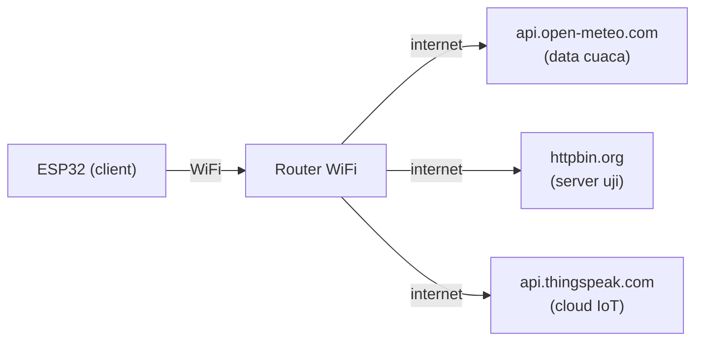
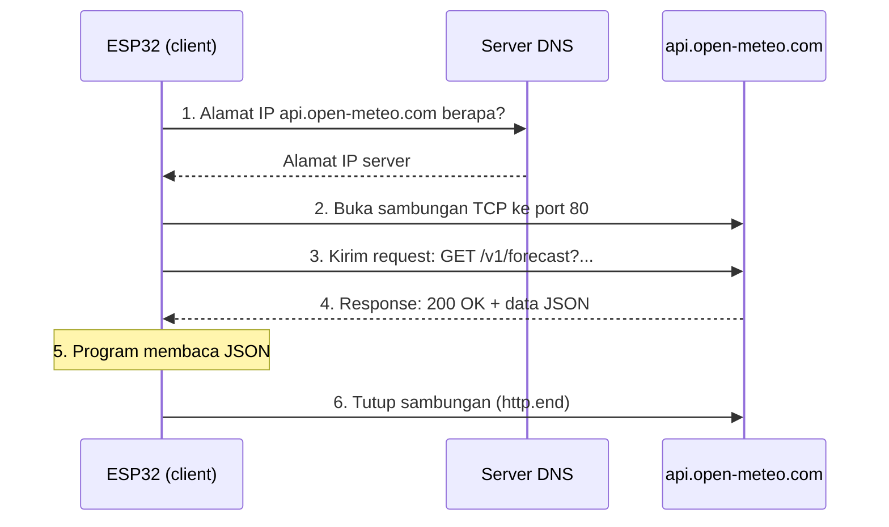
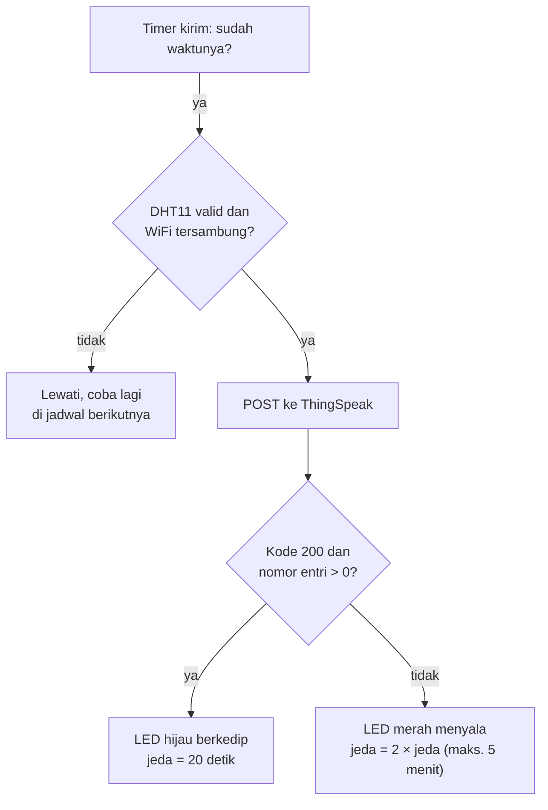

# BAB 48: HTTP Client & REST API — ESP32 Pergi ke Internet

> ✅ **Prasyarat:** Selesaikan **BAB 42 (WiFi Station Mode)** dan **BAB 46 (Web Server)** — ESP32-mu sudah bisa tersambung ke WiFi, dan kamu sudah mengenal dasar HTTP (*request*, *response*, GET/POST, kode status) serta JSON dengan ArduinoJson 7. Program 2 dan 3 memakai sensor dari **BAB 26 (DHT11 — Suhu & Kelembapan)** dan pola `struct Timer` dari **BAB 16 (Non-Blocking Programming)**.

Di BAB 46, ESP32 menjadi *web server*: ia diam menunggu *browser* datang meminta halaman, persis seperti warung yang menunggu pembeli. Di BAB ini perannya dibalik. ESP32 menjadi **pembeli** yang aktif pergi ke internet: menanyakan cuaca terkini ke layanan prakiraan cuaca, lalu menyetorkan data suhu kamarmu ke *cloud* supaya bisa dilihat dalam bentuk grafik dari mana saja. Peran ini disebut **HTTP *client***, dan hampir semua perangkat IoT sungguhan — dari jam pintar sampai meteran listrik pintar — bekerja dengan cara ini.

## 📌 Tujuan Pembelajaran

Setelah mempelajari BAB ini, kamu bisa:

- Menjelaskan perbedaan peran ESP32 sebagai *server* (BAB 46) dan sebagai *client* (BAB ini), serta kenapa perangkat IoT biasanya menjadi *client*.
- Membaca alamat sebuah API (skema, *host*, *path*, *query*), memilih *method* HTTP yang tepat, dan mengartikan kode status yang sering muncul.
- Mencoba sebuah API lebih dulu dengan *browser* dan `curl` sebelum menulis program.
- Memakai *library* `HTTPClient` untuk mengirim GET dan POST, lengkap dengan batas waktu (*timeout*) dan penanganan *error*.
- Mengambil data cuaca kota di Indonesia dari Open-Meteo dan membaca JSON-nya dengan ArduinoJson 7.
- Mengirim data DHT11 dalam format JSON ke *server* uji httpbin.org dan webhook.site.
- Mengirim data sensor ke *cloud* IoT ThingSpeak, memeriksa jawabannya, dan mengatur jeda pengiriman sesuai batas layanan.
- Menjelaskan kenapa `http://` tidak aman untuk data penting dan apa yang berubah dengan `https://` (dibahas lengkap di [BAB 49](../BAB-49/README.md)).

## 🧰 Yang Perlu Disiapkan

| Kebutuhan | Keterangan |
|---|---|
| *Hardware* | Kit Bluino ESP32 IoT Starter Shield + kabel USB **data** |
| Kabel *jumper* | Program 1: tidak perlu. Program 2: 1 kabel (`DHT` → IO27). Program 3: 3 kabel (`DHT` → IO27, `LED1` (merah) → IO4, `LED2` (hijau) → IO17). Semuanya kabel *female-female* yang sudah ada di kit |
| Komponen tambahan | Tidak ada |
| *Software* | Arduino IDE 2.x + *board package* **esp32** versi 3.3.x (lihat [BAB 5](../BAB-05/README.md)) |
| *Library* | `WiFi` dan `HTTPClient` bawaan *board package* (tidak perlu dipasang). Program 1–2: **ArduinoJson** by Benoit Blanchon versi 7. Program 2–3: **DHT sensor library** by Adafruit + **Adafruit Unified Sensor** (lihat [BAB 26](../BAB-26/README.md)) |
| Alat uji | **Serial Monitor** Arduino IDE (baud 115200; *line ending* **New Line** untuk Program 1); *browser* di laptop atau HP; `curl` di **Command Prompt** (Windows) atau **Terminal** (macOS/Linux); akun gratis **ThingSpeak** untuk Program 3; opsional: [webhook.site](https://webhook.site) |
| Jaringan | WiFi **2,4 GHz yang tersambung ke internet**, misalnya *router* rumah atau *hotspot* HP. WiFi kampus/kantor yang meminta *login* lewat halaman web (*captive portal*) biasanya tidak bisa dipakai ESP32. Laptop/HP untuk menguji **tidak** harus berada di WiFi yang sama |

## 📑 Daftar Isi

- [48.1 ESP32 Berganti Peran: dari Server Menjadi Client](#481-esp32-berganti-peran-dari-server-menjadi-client)
- [48.2 Mengenal REST API](#482-mengenal-rest-api)
- [48.3 Apa yang Terjadi Saat ESP32 Mengirim Request?](#483-apa-yang-terjadi-saat-esp32-mengirim-request)
- [48.4 Mencoba API Tanpa ESP32: Browser dan curl](#484-mencoba-api-tanpa-esp32-browser-dan-curl)
- [48.5 Library HTTPClient](#485-library-httpclient)
- [48.6 Program 1: Cuaca Terkini dari Open-Meteo](#486-program-1-cuaca-terkini-dari-open-meteo)
- [48.7 Program 2: Mengirim Data DHT11 dengan POST](#487-program-2-mengirim-data-dht11-dengan-post)
- [48.8 Sopan Memakai API: Batas Request dan Jeda](#488-sopan-memakai-api-batas-request-dan-jeda)
- [48.9 Program 3: Data Sensor ke Cloud ThingSpeak](#489-program-3-data-sensor-ke-cloud-thingspeak)
- [48.10 HTTP dan HTTPS: Kenapa BAB Ini Memakai http://](#4810-http-dan-https-kenapa-bab-ini-memakai-http)
- [48.11 Troubleshooting](#4811-troubleshooting)
- [📝 Rangkuman](#-rangkuman)
- [💪 Latihan](#-latihan)
- [📚 Referensi](#-referensi)

---

## 48.1 ESP32 Berganti Peran: dari Server Menjadi Client

Masih ingat analogi warung di [BAB 46](../BAB-46/README.md)? Di sana ESP32 adalah warungnya: ia menunggu, lalu melayani setiap pesanan yang datang. Di BAB ini ESP32 menjadi **pembeli**. Ia yang memutuskan kapan pergi, ke warung mana, dan apa yang dipesan — misalnya "minta data cuaca Jakarta" atau "tolong simpan angka suhu ini".

| Aspek | BAB 46: ESP32 sebagai *server* | BAB 48: ESP32 sebagai *client* |
|---|---|---|
| Siapa yang memulai percakapan | *Browser* atau HP | ESP32 sendiri |
| Lawan bicara | Perangkat di WiFi yang sama | *Server* di internet (Open-Meteo, httpbin.org, ThingSpeak, …) |
| Butuh internet? | Tidak | **Ya** |
| Alamat yang dipakai | Alamat IP lokal ESP32, misalnya `192.168.1.23` | Nama domain *server*, misalnya `api.open-meteo.com` |
| *Library* | `WebServer` | `HTTPClient` |
| Kerja di `loop()` | `server.handleClient()` dipanggil terus-menerus | Mengirim *request* sesekali, sesuai jadwal |
| Contoh pemakaian | *Dashboard* lokal, tombol kendali | Data cuaca, kirim data sensor ke *cloud*, notifikasi |



*Gambar 48.1 — ESP32 keluar ke internet lewat router WiFi untuk menghubungi tiga server yang dipakai di BAB ini. Sumber: dibuat untuk materi ini.*

### 48.1.1 Kenapa Perangkat IoT Biasanya Menjadi Client?

*Router* di rumahmu mengizinkan perangkat di dalam jaringan **memulai** percakapan ke internet, lalu meneruskan jawabannya kembali. Sebaliknya, permintaan yang datang dari internet dan ditujukan ke `192.168.1.23` **tidak** diteruskan — alamat itu hanya berlaku di dalam rumahmu. Ibaratnya kamar hotel: dari kamar kamu bisa menelepon ke luar dan lawan bicaramu bisa menjawab di sambungan yang sama, tetapi orang di luar tidak bisa menelepon langsung ke "kamar 23" tanpa lewat resepsionis.

Karena itu, *web server* di BAB 46 hanya bisa dibuka dari WiFi yang sama. Kalau datanya ingin dilihat dari mana saja, cara yang paling mudah adalah membalik perannya: ESP32 yang **mengirim** data ke *server* di internet (*cloud*), lalu kamu melihat data itu di *server* tersebut. Itulah yang dilakukan Program 3.

> ⚠️ **Perhatian:** ESP32 hanya mendukung WiFi **2,4 GHz**, bukan 5 GHz. Nama dan kata sandi WiFi peka huruf besar-kecil (`RumahKu` berbeda dengan `rumahku`). WiFi-nya juga harus benar-benar tersambung ke internet: coba buka sebuah situs dari HP yang tersambung ke WiFi itu. Detail cara menyambung ada di [BAB 42](../BAB-42/README.md).

---

## 48.2 Mengenal REST API

### 48.2.1 API di Internet

Di [BAB 46](../BAB-46/README.md) kamu sudah membuat API sendiri: alamat `/api/sensor` di ESP32 yang menjawab dengan data JSON. **API** (*Application Programming Interface*) di internet bekerja dengan cara yang sama, hanya saja *server*-nya milik orang lain dan bisa dipakai siapa saja. Ibaratnya loket layanan: kamu tidak perlu tahu bagaimana kantor di belakangnya bekerja, cukup tahu cara mengisi formulir di loket dan bentuk jawaban yang akan kamu terima. Aturan "cara mengisi formulir" itu ditulis di **dokumentasi API**.

Gaya API yang paling umum disebut **REST** (*Representational State Transfer*). Kamu tidak perlu menghafal teorinya; cukup kenali ciri-cirinya:

- Setiap data atau layanan punya **alamat** sendiri (URL), yang disebut ***endpoint***.
- Maksud permintaan dinyatakan dengan ***method*** HTTP: GET untuk membaca, POST untuk mengirim data baru, dan seterusnya.
- Data dikirim dan diterima sebagai teks, biasanya **JSON**.
- Hasilnya selalu disertai **kode status** (200, 404, …).

Inilah versi singkat alamat yang dipakai Program 1 untuk menanyakan suhu terkini di Jakarta:

```text
http://api.open-meteo.com/v1/forecast?latitude=-6.2088&longitude=106.8456&current=temperature_2m
```

| Bagian | Isi | Arti |
|---|---|---|
| Skema | `http://` | Protokol yang dipakai. Program di BAB ini memakai `http://`; tentang `https://`, lihat [48.10](#4810-http-dan-https-kenapa-bab-ini-memakai-http) |
| *Host* | `api.open-meteo.com` | **Nama domain** *server*. Sebelum menyambung, ESP32 menanyakan alamat IP-nya ke *server* DNS (*Domain Name System*, "buku telepon" internet) |
| *Path* | `/v1/forecast` | Layanan yang diminta. `v1` artinya API versi 1 |
| *Query* | `?latitude=-6.2088&longitude=106.8456&current=temperature_2m` | Pilihan permintaan berbentuk `nama=nilai`, dipisah tanda `&`. Di sini: lintang, bujur, dan data apa yang diminta |

> 📌 **Catatan:** Nilai di *query* tidak boleh mengandung spasi dan beberapa tanda khusus. Kalau perlu, tanda itu ditulis dengan kode `%`, misalnya spasi menjadi `%20` dan garis miring `/` menjadi `%2F`. Semua nilai di BAB ini hanya berisi huruf, angka, titik, koma, garis bawah, dan tanda minus, jadi aman ditulis apa adanya.

### 48.2.2 Method HTTP

| *Method* | Maksud | Analogi di loket | Dipakai di BAB ini |
|---|---|---|---|
| **GET** | Membaca data, tanpa mengubah apa pun | Menanyakan jadwal atau harga | Program 1 (data cuaca) |
| **POST** | Mengirim data baru | Menyerahkan formulir baru | Program 2 dan 3 (data sensor) |
| **PUT** | Mengganti seluruh data yang sudah ada | Mengganti seluruh isi formulir lama | — |
| **PATCH** | Mengubah sebagian data | Meralat satu kolom di formulir | — |
| **DELETE** | Menghapus data | Membatalkan formulir | — |

GET dan POST adalah dua *method* yang paling sering dipakai perangkat IoT. Ada juga API yang menerima data lewat GET demi kemudahan (ThingSpeak salah satunya, lihat [48.9](#489-program-3-data-sensor-ke-cloud-thingspeak)), tetapi kebiasaan yang baik tetap memakai POST untuk mengirim data.

### 48.2.3 Kode Status dari Sisi Client

Di BAB 46, ESP32 yang **memberi** kode status. Sekarang ESP32 yang **menerima**, jadi programnya harus memeriksa kode itu sebelum memakai isi jawaban.

| Kode | Nama | Artinya bagi ESP32 |
|---|---|---|
| **200** | OK | Berhasil. Isi jawaban adalah yang diminta |
| **201** | Created | Berhasil, data baru sudah dibuat di *server* (sering dipakai sebagai jawaban POST) |
| **204** | No Content | Berhasil, tetapi jawabannya memang kosong |
| **301**, **302**, **307**, **308** | Moved / Redirect | Alamatnya pindah. Alamat baru ada di *header* `Location`. Paling sering: "pindah ke `https://`". `HTTPClient` **tidak** mengikutinya secara otomatis |
| **400** | Bad Request | *Request*-mu salah, misalnya parameter keliru atau JSON rusak. Baca isi jawabannya — biasanya ada penjelasan |
| **401** / **403** | Unauthorized / Forbidden | Kunci API tidak ada, salah, atau tidak punya izin |
| **404** | Not Found | *Path* salah ketik atau *endpoint* tidak ada |
| **429** | Too Many Requests | Terlalu sering meminta. Perpanjang jeda antar-*request* (lihat [48.8](#488-sopan-memakai-api-batas-request-dan-jeda)) |
| **500** | Internal Server Error | Ada masalah di *server*. Bukan salahmu; coba lagi nanti |
| **502** / **503** | Bad Gateway / Service Unavailable | *Server* sedang sibuk atau dalam perawatan. Coba lagi nanti |

Kode berawalan **2** berarti berhasil, **3** berarti pindah alamat, **4** berarti kesalahan di pihak *client*, dan **5** berarti kesalahan di pihak *server*. Selain itu, `HTTPClient` bisa menghasilkan **angka negatif** (misalnya `-1` atau `-11`). Angka negatif **bukan** dari *server* — artinya percakapan gagal sebelum *server* sempat menjawab. Daftarnya ada di [48.5](#485-library-httpclient).

### 48.2.4 Header dan Kunci API

Selain alamat, setiap *request* membawa beberapa ***header*** (baris keterangan `Nama: nilai`). Tiga yang paling sering kamu atur sebagai *client*:

| *Header* | Gunanya | Contoh di BAB ini |
|---|---|---|
| `Content-Type` | Memberi tahu *server* jenis isi (*body*) yang kamu kirim | `application/json` (Program 2), `application/x-www-form-urlencoded` (Program 3) |
| `User-Agent` | "Nama" program *client*-mu. Sopan untuk API publik, dan membantu pengelola *server* kalau ada masalah | `BluinoKit-BAB48/1.0` |
| `Authorization` atau kunci API | Bukti bahwa kamu berhak memakai layanan | ThingSpeak memakai `api_key` di dalam *body* |

**Kunci API** (*API key*) adalah deretan huruf dan angka yang diberikan sebuah layanan setelah kamu mendaftar, mirip nomor kartu anggota perpustakaan. Dengan kunci itu, *server* tahu data siapa yang sedang diubah dan bisa membatasi pemakaian. Perlakukan kunci API seperti kata sandi: jangan dibagikan, jangan dicetak ke Serial Monitor, dan **jangan ikut diunggah** kalau kodenya kamu taruh di GitHub.

> 💡 **Tips:** Open-Meteo (Program 1) dan httpbin.org (Program 2) tidak memakai kunci API sama sekali, jadi bisa langsung dicoba. Kunci API baru dibutuhkan di Program 3.

### 48.2.5 Dua Format Isi yang Dipakai di BAB Ini

Isi (*body*) *request* POST bisa berformat apa saja, asalkan *server* memahaminya dan `Content-Type`-nya sesuai. Dua yang paling umum:

| Format | `Content-Type` | Contoh isi | Dipakai di |
|---|---|---|---|
| JSON | `application/json` | `{"perangkat":"bluino-01","suhu":28.6}` | Program 2 |
| Formulir (*form*) | `application/x-www-form-urlencoded` | `api_key=ABCD1234&field1=28.6` | Program 3 |

Format formulir sama persis dengan bagian *query* di URL, hanya saja ditaruh di *body*. Aturan JSON dan cara menyusunnya dengan ArduinoJson 7 sudah dibahas di [BAB 46](../BAB-46/README.md) (bagian **JSON dan API**).

---

## 48.3 Apa yang Terjadi Saat ESP32 Mengirim Request?

Satu baris `http.GET()` di program sebenarnya menjalankan beberapa langkah. Memahaminya membantu sekali saat mencari penyebab kegagalan.



*Gambar 48.2 — Langkah-langkah di balik `http.GET()`: tanya DNS, sambung ke server, kirim request, terima response, lalu tutup. Sumber: dibuat untuk materi ini.*

Inilah *request* yang benar-benar dikirim ESP32 pada langkah 3 (disusun otomatis oleh `HTTPClient`, alamatnya disingkat):

```text
GET /v1/forecast?latitude=-6.2088&longitude=106.8456&current=... HTTP/1.1
Host: api.open-meteo.com
User-Agent: BluinoKit-BAB48/1.0
Connection: keep-alive
Accept-Encoding: identity;q=1,chunked;q=0.1,*;q=0

```

Baris kosong di akhir menandai *header* sudah selesai. GET tidak membawa *body*, sedangkan POST menambahkan *header* `Content-Type` dan `Content-Length`, lalu *body*-nya setelah baris kosong.

Setiap langkah bisa gagal dengan cara yang berbeda:

| Langkah | Kalau gagal, yang terlihat | Penyebab yang sering terjadi |
|---|---|---|
| 1. Tanya DNS | `-1` (*connection refused*) | WiFi tidak tersambung ke internet, nama domain salah ketik |
| 2. Sambung TCP | `-1` setelah menunggu sampai batas `setConnectTimeout()` | *Server* mati, nomor *port* salah, jaringan memblokir |
| 3. Kirim *request* | `-2` atau `-3` | Sambungan putus di tengah jalan |
| 4. Tunggu jawaban | `-11` (*read timeout*) setelah batas `setTimeout()` | *Server* lambat atau sinyal WiFi lemah |
| 4. Jawaban datang | Kode status, misalnya `404` atau `429` | Alamat salah, terlalu sering meminta, dan sebagainya |
| 5. Baca JSON | Pesan *error* dari ArduinoJson, misalnya `InvalidInput` | Isi jawaban bukan JSON (misalnya halaman *error* HTML) |

> 📌 **Catatan:** Selama langkah 1–4 berlangsung, `http.GET()` **menunggu** dan `loop()` ikut berhenti. Biasanya hanya ratusan milidetik, tetapi kalau jaringan bermasalah bisa beberapa detik — sampai batas waktu yang kamu atur. Inilah sebabnya *request* dikirim sesekali saja (bukan di setiap putaran `loop()`) dan selalu diberi batas waktu. Pembahasannya ada di [48.8](#488-sopan-memakai-api-batas-request-dan-jeda).

---

## 48.4 Mencoba API Tanpa ESP32: Browser dan curl

Sebelum menulis program, biasakan mencoba API-nya dulu dari laptop. Kalau dari laptop saja gagal, masalahnya pasti bukan di kode ESP32-mu. Kalau dari laptop berhasil, kamu jadi tahu persis bentuk jawaban yang harus dibaca program.

### 48.4.1 Membuka API di Browser

*Browser* selalu mengirim GET, jadi cocok untuk mencoba API yang hanya membaca data. Salin alamat berikut ke *address bar* *browser* di laptop atau HP, lalu tekan **Enter**:

```text
http://api.open-meteo.com/v1/forecast?latitude=-6.2088&longitude=106.8456&current=temperature_2m,relative_humidity_2m,apparent_temperature,weather_code,wind_speed_10m&timezone=auto
```

Hasilnya teks JSON berisi cuaca terkini Jakarta. Firefox langsung menampilkannya dengan rapi (tab **JSON**; tab **Raw Data** untuk teks aslinya). Di Chrome, centang kotak **Pretty-print** di bagian atas halaman (kalau ada) supaya lebih mudah dibaca. Bagian yang nanti dibaca Program 1 adalah `"current"`:

```json
"current": {
  "time": "2026-10-24T05:30",
  "interval": 900,
  "temperature_2m": 25.8,
  "relative_humidity_2m": 89,
  "apparent_temperature": 31.0,
  "weather_code": 2,
  "wind_speed_10m": 4.8
}
```

Angkanya tentu berbeda saat kamu mencobanya. `interval: 900` artinya data diperbarui setiap 900 detik (15 menit).

> 📌 **Catatan:** Banyak *browser* sekarang otomatis mengganti `http://` menjadi `https://` kalau situsnya mendukung. Tidak masalah: Open-Meteo, httpbin.org, dan ThingSpeak melayani keduanya. Program ESP32 di BAB ini tetap memakai `http://`.

### 48.4.2 GET dengan curl

`curl` adalah program baris perintah untuk mengirim *request* HTTP. Program ini sudah ada di Windows 10/11, macOS, dan kebanyakan Linux, jadi tidak perlu dipasang. Cara membuka tempat mengetiknya:

- **Windows:** tekan tombol **Start**, ketik `cmd`, lalu tekan **Enter** untuk membuka **Command Prompt**.
- **macOS:** buka **Terminal** (tekan **Cmd+Spasi**, ketik `Terminal`, lalu **Enter**).
- **Linux:** buka aplikasi **Terminal** (di banyak distribusi: **Ctrl+Alt+T**).

Ketik perintah berikut, lalu tekan **Enter**. Perintahnya sama di Command Prompt, Terminal macOS, dan Terminal Linux:

```bash
curl "http://api.open-meteo.com/v1/forecast?latitude=-6.2088&longitude=106.8456&current=temperature_2m,weather_code&timezone=auto"
```

Perhatikan bahwa alamatnya **diapit tanda kutip ganda**. Tanpa tanda kutip, Command Prompt dan Terminal menganggap tanda `&` sebagai perintah khusus, sehingga alamatnya terpotong.

Tambahkan `-i` untuk melihat juga baris status dan *header* jawaban:

```bash
curl -i "http://api.open-meteo.com/v1/forecast?latitude=-6.2088&longitude=106.8456&current=temperature_2m&timezone=auto"
```

```text
HTTP/1.1 200 OK
Date: Fri, 23 Oct 2026 22:34:31 GMT
Content-Type: application/json; charset=utf-8
Transfer-Encoding: chunked
Connection: keep-alive

{"latitude":-6.221441,"longitude":106.856186, ... ,"current":{"time":"2026-10-24T05:30","interval":900,"temperature_2m":25.8}}
```

Baris pertama berisi kode status (`200 OK`). Coba juga mengganti `temperature_2m` dengan kata yang salah, misalnya `suhu`: jawabannya berubah menjadi `HTTP/1.1 400 Bad Request` dengan JSON berisi `"error":true` dan alasan kesalahannya.

> 📌 **Catatan:** Di **Windows PowerShell** (bukan Command Prompt), kata `curl` adalah nama lain untuk perintah `Invoke-WebRequest` yang cara kerjanya berbeda. Kalau kamu memakai PowerShell, ketik **`curl.exe`**, misalnya `curl.exe -i "http://httpbin.org/get"`. Untuk perintah di BAB ini, paling aman memakai **Command Prompt**.

### 48.4.3 POST JSON dengan curl

**httpbin.org** adalah *server* uji gratis yang memantulkan kembali (*echo*) apa pun yang kamu kirim. Cocok untuk memeriksa apakah data yang kamu kirim sudah benar. POST dengan JSON harus menyertakan *header* `Content-Type: application/json` (opsi `-H`) dan isi JSON (opsi `-d`). Cara menulis tanda kutipnya berbeda di Windows dan macOS/Linux.

**Windows (Command Prompt)** — tanda kutip ganda di dalam JSON ditulis `\"`:

```bash
curl -X POST -H "Content-Type: application/json" -d "{\"perangkat\":\"bluino-01\",\"suhu\":28.6}" http://httpbin.org/post
```

**macOS/Linux (Terminal)** — JSON diapit tanda kutip tunggal:

```bash
curl -X POST -H "Content-Type: application/json" -d '{"perangkat":"bluino-01","suhu":28.6}' http://httpbin.org/post
```

Jawabannya kurang lebih seperti ini (sebagian baris dihapus):

```json
{
  "data": "{\"perangkat\":\"bluino-01\",\"suhu\":28.6}",
  "headers": {
    "Content-Type": "application/json",
    "Host": "httpbin.org",
    "User-Agent": "curl/8.16.0"
  },
  "json": {
    "perangkat": "bluino-01",
    "suhu": 28.6
  },
  "url": "http://httpbin.org/post"
}
```

Bagian `"json"` adalah data yang berhasil dibaca *server* — persis yang kamu kirim. Bagian `"headers"` menunjukkan *header* yang sampai ke *server*, termasuk `User-Agent` milik `curl`. Program 2 nanti melakukan hal yang sama dari ESP32, dan kamu bisa membandingkan hasilnya.

---

## 48.5 Library HTTPClient

`HTTPClient` adalah *library* bawaan *board package* esp32, jadi tidak perlu dipasang. Cukup tulis `#include <HTTPClient.h>`. Pola dasarnya selalu sama — empat langkah (potongan kode, bukan program lengkap):

```cpp
#include <WiFi.h>
#include <HTTPClient.h>

// ... di dalam fungsi, setelah WiFi tersambung:
HTTPClient http;
http.begin("http://api.open-meteo.com/v1/forecast?latitude=-6.2&longitude=106.8&current=temperature_2m");  // 1. alamat tujuan
http.setTimeout(5000);                // (opsional) batas waktu menunggu jawaban, ms
int kode = http.GET();                // 2. kirim request, tunggu jawaban
if (kode > 0) {                       //    angka positif = kode status dari server
  String isi = http.getString();      // 3. ambil isi jawaban
  Serial.println(isi);
} else {                              //    angka negatif = gagal sebelum ada jawaban
  Serial.println(http.errorToString(kode));
}
http.end();                           // 4. tutup sambungan, bebaskan memori
```

### 48.5.1 Fungsi-Fungsi Penting

| Fungsi | Kegunaan |
|---|---|
| `http.begin(url)` | Menyiapkan alamat tujuan. Alamat **wajib** diawali `http://` (atau `https://`, lihat [48.10](#4810-http-dan-https-kenapa-bab-ini-memakai-http)). Menghasilkan `false` kalau alamatnya tidak bisa dibaca |
| `http.begin(client, url)` | Sama, tetapi memakai objek sambungan milikmu sendiri (`WiFiClient`, atau `WiFiClientSecure` untuk HTTPS di [BAB 49](../BAB-49/README.md)). Objek `client` harus dibuat **sebelum** objek `HTTPClient` dan tetap ada selama `http` dipakai |
| `http.setConnectTimeout(ms)` | Batas waktu menyambung ke *server*. Bawaan: 5000 ms |
| `http.setTimeout(ms)` | Batas waktu menunggu data dari *server*. Bawaan: 5000 ms. Tipenya `uint16_t`, jadi maksimal 65535 ms |
| `http.setUserAgent(teks)` | Mengganti *header* `User-Agent`. Bawaan: `ESP32HTTPClient` |
| `http.addHeader(nama, nilai)` | Menambah *header*, misalnya `Content-Type`. Panggil **setelah** `begin()` dan **sebelum** `GET()`/`POST()`. *Header* `User-Agent`, `Host`, `Connection`, dan `Accept-Encoding` **diabaikan** di sini karena diatur sendiri oleh *library* |
| `http.GET()` | Mengirim GET. Hasilnya kode status (positif) atau kode *error* (negatif) |
| `http.POST(isi)` | Mengirim POST dengan *body* `isi` (`String`, atau *pointer* `uint8_t*` + panjang) |
| `http.PUT(isi)`, `http.PATCH(isi)`, `http.sendRequest("DELETE")` | *Method* lain |
| `http.getString()` | Mengambil seluruh isi jawaban sebagai `String`. Aman untuk jawaban kecil (beberapa KB) |
| `http.getSize()` | Panjang isi jawaban menurut *header* `Content-Length`, atau `-1` kalau *server* tidak menyebutkannya |
| `http.getStream()` | Membaca jawaban sedikit demi sedikit langsung dari sambungan (untuk jawaban besar, lihat Pendalaman di [48.6](#486-program-1-cuaca-terkini-dari-open-meteo)) |
| `http.errorToString(kode)` | Mengubah kode *error* negatif menjadi teks, misalnya `connection refused` |
| `http.setFollowRedirects(HTTPC_STRICT_FOLLOW_REDIRECTS)` | Mengikuti *redirect* (3xx) secara otomatis. Bawaan: **tidak** diikuti |
| `http.end()` | Menutup sambungan dan membebaskan memori. Panggil setiap kali selesai, **termasuk** saat gagal |

> ⚠️ **Perhatian:** Contoh lama di internet sering menulis `http.addHeader("User-Agent", "...")`. Di esp32 core 3.3.x baris itu **tidak berpengaruh apa-apa** — *header*-nya diabaikan tanpa pesan *error*. Pakai `http.setUserAgent("...")`.

### 48.5.2 Kode Error Negatif

| Kode | Konstanta | Teks dari `errorToString()` | Artinya |
|---|---|---|---|
| `-1` | `HTTPC_ERROR_CONNECTION_REFUSED` | `connection refused` | Gagal menyambung: nama domain tidak ditemukan (DNS), tidak ada internet, *server* mati, atau batas `setConnectTimeout()` habis. Juga muncul kalau `begin()` gagal karena alamatnya salah tulis |
| `-2` | `HTTPC_ERROR_SEND_HEADER_FAILED` | `send header failed` | Gagal mengirim *header* |
| `-3` | `HTTPC_ERROR_SEND_PAYLOAD_FAILED` | `send payload failed` | Gagal mengirim *body* |
| `-4` | `HTTPC_ERROR_NOT_CONNECTED` | `not connected` | Sambungan sudah tertutup |
| `-5` | `HTTPC_ERROR_CONNECTION_LOST` | `connection lost` | Sambungan putus di tengah jalan |
| `-6` | `HTTPC_ERROR_NO_STREAM` | `no stream` | Tidak ada tempat menulis data |
| `-7` | `HTTPC_ERROR_NO_HTTP_SERVER` | `no HTTP server` | Yang menjawab bukan *server* HTTP |
| `-8` | `HTTPC_ERROR_TOO_LESS_RAM` | `too less ram` | Memori tidak cukup |
| `-9` | `HTTPC_ERROR_ENCODING` | `Transfer-Encoding not supported` | Format pengiriman jawaban tidak dikenali |
| `-10` | `HTTPC_ERROR_STREAM_WRITE` | `Stream write error` | Gagal menyalin isi jawaban |
| `-11` | `HTTPC_ERROR_READ_TIMEOUT` | `read Timeout` | *Server* tidak mengirim data selama batas `setTimeout()` |

### 48.5.3 Kebiasaan Baik

- **Selalu beri batas waktu** yang masuk akal (misalnya 5 detik). Tanpa batas yang jelas, program bisa "menggantung" lama saat jaringan bermasalah.
- **Selalu periksa kode** sebelum memakai isi jawaban: negatif berarti gagal, 2xx berarti berhasil, selain itu baca isi jawabannya untuk mencari tahu penyebabnya.
- **Selalu panggil `http.end()`** di setiap jalur, termasuk jalur gagal. Membuat objek `HTTPClient` sebagai variabel lokal di dalam fungsi juga membantu: saat fungsi selesai, objeknya otomatis dibersihkan.
- **Periksa `WiFi.status()`** sebelum mengirim. Kalau WiFi sedang terputus, lewati dulu dan coba lagi di jadwal berikutnya.
- **Kirim *request* sesekali**, sesuai jadwal dengan pola `millis()` dari [BAB 16](../BAB-16/README.md) — jangan di setiap putaran `loop()`.

---

## 48.6 Program 1: Cuaca Terkini dari Open-Meteo

**Tujuan:** ESP32 menanyakan cuaca terkini sebuah kota ke API **Open-Meteo** dengan GET, menampilkan JSON mentahnya, lalu membacanya dengan ArduinoJson dan menampilkan suhu, kelembapan, angin, serta kondisi cuaca dalam bahasa Indonesia. Data diambil saat ESP32 menyala, lalu setiap 15 menit. Kamu juga bisa memintanya kapan saja dengan mengetik sebuah huruf lalu menekan **Enter** di Serial Monitor.

[Open-Meteo](https://open-meteo.com) adalah layanan prakiraan cuaca yang **gratis untuk pemakaian non-komersial** (termasuk belajar dan proyek pribadi), **tanpa pendaftaran dan tanpa kunci API**. Datanya berlisensi CC BY 4.0, jadi kalau kamu menampilkannya di proyek yang dipublikasikan, sebutkan "Data cuaca: Open-Meteo.com".

**Rangkaian:**

*Tidak perlu merangkai — program ini hanya memakai WiFi.*

**Memilih Kota:**

Open-Meteo tidak menerima nama kota, tetapi **koordinat**: lintang (*latitude*) dan bujur (*longitude*). Program memakai Jakarta. Untuk kota lain, ganti `NAMA_KOTA`, `LINTANG`, dan `BUJUR` dengan salah satu baris di tabel ini:

| Kota | `LINTANG` | `BUJUR` | Zona waktu (diatur otomatis) |
|---|---|---|---|
| Jakarta | `-6.2088` | `106.8456` | WIB |
| Bandung | `-6.9175` | `107.6191` | WIB |
| Yogyakarta | `-7.7956` | `110.3695` | WIB |
| Surabaya | `-7.2575` | `112.7521` | WIB |
| Medan | `3.5952` | `98.6722` | WIB |
| Denpasar | `-8.6705` | `115.2126` | WITA |
| Makassar | `-5.1477` | `119.4327` | WITA |
| Samarinda | `-0.5022` | `117.1536` | WITA |
| Jayapura | `-2.5337` | `140.7181` | WIT |

Kotamu tidak ada di tabel? Buka [Google Maps](https://maps.google.com) di laptop, klik kanan lokasi yang kamu mau, lalu klik deretan dua angka di baris paling atas menu (misalnya `-6.2088, 106.8456`) untuk menyalinnya. Angka pertama adalah lintang, angka kedua bujur. Tanda minus pada lintang berarti di selatan garis khatulistiwa.

> ⚠️ **Perhatian:** Di dalam kode, desimal koordinat ditulis dengan **titik** (`-6.2088`), bukan koma. Koordinat dengan koma membuat Open-Meteo menjawab `400 Bad Request`.

**Cara Menjalankan:**

1. Pasang *library* **ArduinoJson** (lewati kalau sudah terpasang sejak BAB 46): buka **Sketch → Include Library → Manage Libraries…**, ketik `ArduinoJson`, pilih yang pembuatnya **Benoit Blanchon** dengan versi **7.x** (diuji dengan 7.4.3), lalu klik **INSTALL**.
2. Buka Arduino IDE → **File → New Sketch**, hapus isinya, lalu salin kode di bawah. Kode yang sama juga tersedia di *file* [`p1_get_json.ino`](p1_get_json/p1_get_json.ino).
3. Ganti `NamaWiFiKamu` dan `PasswordWiFiKamu` dengan nama dan kata sandi WiFi kamu (2,4 GHz, tersambung ke internet). Kalau perlu, ganti juga kotanya.
4. Pastikan **Tools → Board** = **ESP32 Dev Module** dan **Tools → Port** = *port* ESP32 kamu (misalnya `COM5` di Windows atau `/dev/ttyUSB0` di Linux).
5. Klik tombol **Upload** (ikon panah →) dan tunggu sampai muncul tulisan **Done uploading**.
6. Buka **Serial Monitor** (**Tools → Serial Monitor**), pilih baud **115200** dan *line ending* **New Line**. Kalau tulisan awal terlewat, tekan tombol **EN** di *board* ESP32.
7. Bandingkan JSON mentah yang dicetak ESP32 dengan hasil *browser* di [48.4.1](#4841-membuka-api-di-browser). Untuk mengambil data lagi tanpa menunggu 15 menit, ketik sebuah huruf (misalnya `c`) di kolom pesan Serial Monitor lalu tekan **Enter**.

**Kode Program:**

<!-- sketch: p1_get_json -->
```cpp
/*
 * BAB 48 - Program 1: Cuaca Terkini dari Open-Meteo (HTTP GET + JSON)
 * ESP32 meminta data cuaca ke API Open-Meteo (gratis, tanpa kunci API)
 * saat menyala lalu setiap 15 menit, dan menampilkannya di Serial Monitor.
 * Ketik sebuah huruf + Enter di Serial Monitor (line ending: New Line)
 * untuk mengambil data sekarang.
 * Rangkaian: tidak perlu.
 * Library  : ArduinoJson by Benoit Blanchon (versi 7)
 */

#include <WiFi.h>
#include <HTTPClient.h>
#include <ArduinoJson.h>

const char *NAMA_WIFI = "NamaWiFiKamu";          // ← ganti dengan WiFi kamu
const char *PASSWORD_WIFI = "PasswordWiFiKamu";  // ← ganti dengan WiFi kamu

// Lokasi yang ingin dilihat cuacanya (koordinat kota lain ada di README).
// Desimal memakai titik, bukan koma.
const char *NAMA_KOTA = "Jakarta";
const char *LINTANG = "-6.2088";  // latitude (minus = selatan khatulistiwa)
const char *BUJUR = "106.8456";   // longitude

// Data "current" Open-Meteo diperbarui setiap 15 menit, jadi tidak ada
// gunanya meminta lebih sering dari itu.
const unsigned long INTERVAL_CUACA = 15UL * 60UL * 1000UL;  // 15 menit (ms)

// struct Timer dari BAB 16
struct Timer {
  unsigned long interval;   // ms
  unsigned long waktuLalu;  // hasil millis() saat terakhir dijalankan

  // Mengembalikan true kalau sudah waktunya, lalu mencatat waktunya
  bool sudahWaktunya(unsigned long sekarang) {
    if (sekarang - waktuLalu >= interval) {
      waktuLalu = sekarang;
      return true;
    }
    return false;
  }
};

Timer timerCuaca = {INTERVAL_CUACA, 0};
char urlCuaca[256];  // alamat lengkap API, disusun di setup()

// Menerjemahkan kode cuaca WMO dari Open-Meteo ke bahasa Indonesia
const char *artiKodeCuaca(int kode) {
  switch (kode) {
    case 0: return "Cerah";
    case 1: return "Cerah berawan";
    case 2: return "Berawan sebagian";
    case 3: return "Mendung";
    case 45:
    case 48: return "Berkabut";
    case 51:
    case 53:
    case 55: return "Gerimis";
    case 61: return "Hujan ringan";
    case 63: return "Hujan sedang";
    case 65: return "Hujan lebat";
    case 80: return "Hujan lokal ringan";
    case 81: return "Hujan lokal sedang";
    case 82: return "Hujan lokal sangat lebat";
    case 95: return "Badai petir";
    case 96:
    case 99: return "Badai petir disertai hujan es";
    default: return "Lainnya (lihat tabel kode WMO)";
  }
}

void sambungkanWiFi() {
  WiFi.mode(WIFI_STA);
  WiFi.begin(NAMA_WIFI, PASSWORD_WIFI);
  Serial.printf("Menyambung ke WiFi \"%s\"", NAMA_WIFI);

  unsigned long mulai = millis();
  while (WiFi.status() != WL_CONNECTED) {
    if (millis() - mulai > 20000) {  // menyerah setelah 20 detik
      Serial.println("\nGagal tersambung. Periksa nama/password WiFi dan pastikan 2,4 GHz.");
      Serial.println("ESP32 restart dalam 5 detik...");
      delay(5000);
      ESP.restart();
    }
    delay(500);
    Serial.print(".");
  }
  Serial.print(" tersambung! IP: ");
  Serial.println(WiFi.localIP());
}

void ambilCuaca() {
  if (WiFi.status() != WL_CONNECTED) {
    Serial.println("[CUACA] WiFi terputus, permintaan dilewati.");
    return;
  }

  Serial.println();
  Serial.printf("[HTTP] GET %s\n", urlCuaca);
  unsigned long mulai = millis();

  // Langkah 1: siapkan alamat tujuan dan pengaturan request
  HTTPClient http;
  http.begin(urlCuaca);
  http.setConnectTimeout(5000);              // batas waktu menyambung (ms)
  http.setTimeout(5000);                     // batas waktu menunggu data (ms)
  http.setUserAgent("BluinoKit-BAB48/1.0");  // "nama" client kita

  // Langkah 2: kirim GET dan tunggu jawaban
  int kode = http.GET();
  if (kode < 0) {  // negatif = gagal sebelum server menjawab
    Serial.printf("[HTTP] Gagal: %d (%s)\n", kode, http.errorToString(kode).c_str());
    http.end();
    return;
  }

  // Langkah 3 dan 4: ambil isi jawaban, lalu tutup sambungan
  String isi = http.getString();
  http.end();
  Serial.printf("[HTTP] Kode status %d, %u byte, %lu ms\n",
                kode, isi.length(), millis() - mulai);

  if (kode != HTTP_CODE_OK) {  // HTTP_CODE_OK = 200
    Serial.print("[HTTP] Permintaan ditolak. Isi jawaban: ");
    Serial.println(isi);
    return;
  }
  Serial.println(isi);  // JSON mentah: bandingkan dengan tampilan di browser

  // Langkah 5: baca JSON dengan ArduinoJson 7
  JsonDocument doc;
  DeserializationError err = deserializeJson(doc, isi);
  if (err) {
    Serial.printf("[JSON] Gagal dibaca: %s\n", err.c_str());
    return;
  }

  JsonObject kini = doc["current"];
  if (!kini["temperature_2m"].is<float>() || !kini["weather_code"].is<int>()) {
    Serial.println("[JSON] Bagian \"current\" tidak lengkap.");
    return;
  }

  float suhu = kini["temperature_2m"];
  float terasa = kini["apparent_temperature"];
  int kelembapan = kini["relative_humidity_2m"];
  float angin = kini["wind_speed_10m"];
  int kodeCuaca = kini["weather_code"];
  const char *waktu = kini["time"] | "-";  // contoh: "2026-10-24T05:30"
  const char *jam = strchr(waktu, 'T');      // ambil bagian setelah huruf T
  jam = (jam != nullptr) ? jam + 1 : waktu;

  Serial.printf("=== Cuaca %s (data pukul %s) ===\n", NAMA_KOTA, jam);
  Serial.printf("Kondisi    : %s (kode %d)\n", artiKodeCuaca(kodeCuaca), kodeCuaca);
  Serial.printf("Suhu       : %.1f °C (terasa %.1f °C)\n", suhu, terasa);
  Serial.printf("Kelembapan : %d %%\n", kelembapan);
  Serial.printf("Angin      : %.1f km/jam\n", angin);
}

void setup() {
  Serial.begin(115200);
  delay(1000);
  Serial.println("\nBAB 48 - Program 1: Cuaca Terkini dari Open-Meteo");

  // Susun alamat API: koordinat + daftar data "current" yang diminta.
  // timezone=auto: jam di jawaban mengikuti zona waktu lokasi (WIB/WITA/WIT).
  snprintf(urlCuaca, sizeof(urlCuaca),
           "http://api.open-meteo.com/v1/forecast?latitude=%s&longitude=%s"
           "&current=temperature_2m,relative_humidity_2m,apparent_temperature,"
           "weather_code,wind_speed_10m&timezone=auto",
           LINTANG, BUJUR);

  sambungkanWiFi();
  Serial.println("Ketik sebuah huruf lalu tekan Enter di Serial Monitor untuk mengambil data sekarang.");

  ambilCuaca();                     // data pertama langsung diambil
  timerCuaca.waktuLalu = millis();  // berikutnya 15 menit lagi
}

void loop() {
  // Tugas 1: ambil cuaca setiap 15 menit
  if (timerCuaca.sudahWaktunya(millis())) {
    ambilCuaca();
  }

  // Tugas 2: ambil sekarang kalau ada Enter dari Serial Monitor
  bool adaEnter = false;
  while (Serial.available() > 0) {
    if (Serial.read() == '\n') {
      adaEnter = true;
    }
  }
  if (adaEnter) {
    ambilCuaca();
    timerCuaca.waktuLalu = millis();  // hitung ulang 15 menit dari sekarang
  }
}
```

**Penjelasan Kode:**

- **Koordinat ditulis sebagai teks** (`const char *LINTANG = "-6.2088"`), bukan `float`. Dengan begitu angkanya masuk ke alamat persis seperti yang kamu tulis, tanpa pembulatan.
- **`snprintf()` di `setup()`** menyusun alamat lengkap ke dalam `urlCuaca` sekali saja. Parameter `current=...` berisi daftar data yang diminta (suhu, kelembapan, suhu terasa, kode cuaca, kecepatan angin), sedangkan `timezone=auto` membuat jam di jawaban mengikuti zona waktu lokasi, sehingga tidak perlu mengatur WIB/WITA/WIT sendiri. Panjang alamatnya sekitar 180 karakter, masih muat di *array* 256 karakter.
- **`ambilCuaca()`** mengikuti empat langkah dari [48.5](#485-library-httpclient). Objek `http` dibuat di dalam fungsi, sehingga otomatis dibersihkan setiap kali fungsi selesai. `http.end()` dipanggil di jalur gagal maupun berhasil.
- **`kode < 0`** berarti percakapan gagal sebelum *server* menjawab (lihat [48.5.2](#4852-kode-error-negatif)). **`kode != HTTP_CODE_OK`** berarti *server* menjawab, tetapi bukan `200`. Isi jawabannya tetap dicetak, karena Open-Meteo menulis alasan kesalahannya di sana.
- **`millis() - mulai`** mengukur berapa lama `loop()` tertahan oleh satu *request*. Perhatikan angkanya di Serial Monitor — itulah harga sebuah *request* HTTP.
- **Membaca JSON:** `doc["current"]` mengambil objek `current`, lalu setiap nilai dibaca dengan namanya. Sebelum dipakai, `is<float>()` dan `is<int>()` memastikan nilai penting benar-benar ada dan berupa angka (`is<float>()` juga bernilai `true` untuk bilangan bulat). Tanda `| "-"` memberi nilai cadangan kalau `time` tidak ada.
- **`strchr(waktu, 'T')`** mencari huruf `T` di `"2026-10-24T05:30"`, sehingga yang dicetak hanya bagian jamnya (`05:30`).
- **`artiKodeCuaca()`** menerjemahkan kode cuaca WMO (*World Meteorological Organization*) menjadi teks. Tabel lengkapnya ada di bawah.
- **`loop()`** punya dua tugas: mengambil cuaca setiap 15 menit memakai `struct Timer` dari [BAB 16](../BAB-16/README.md), dan mengambil seketika setiap kali ada karakter baris baru (`'\n'`) dari Serial Monitor. Karena itulah *line ending* harus **New Line** atau **Both NL & CR**.

Arti kode cuaca dari Open-Meteo (`weather_code`) yang mungkin muncul di Indonesia:

| Kode | Kondisi |
|---|---|
| 0 | Cerah |
| 1, 2, 3 | Cerah berawan, berawan sebagian, mendung |
| 45, 48 | Berkabut |
| 51, 53, 55 | Gerimis ringan, sedang, lebat |
| 61, 63, 65 | Hujan ringan, sedang, lebat |
| 80, 81, 82 | Hujan lokal (*shower*) ringan, sedang, sangat lebat |
| 95 | Badai petir |
| 96, 99 | Badai petir disertai hujan es |

Kode lain (misalnya untuk salju, 71–77) hampir tidak pernah muncul di Indonesia, jadi program menampilkannya sebagai "Lainnya".

**Contoh Output:**

```text
BAB 48 - Program 1: Cuaca Terkini dari Open-Meteo
Menyambung ke WiFi "NamaWiFiKamu"..... tersambung! IP: 192.168.1.23
Ketik sebuah huruf lalu tekan Enter di Serial Monitor untuk mengambil data sekarang.

[HTTP] GET http://api.open-meteo.com/v1/forecast?latitude=-6.2088&longitude=106.8456&current=temperature_2m,relative_humidity_2m,apparent_temperature,weather_code,wind_speed_10m&timezone=auto
[HTTP] Kode status 200, 539 byte, 612 ms
{"latitude":-6.221441,"longitude":106.856186,"generationtime_ms":0.15163421630859375,"utc_offset_seconds":25200,"timezone":"Asia/Jakarta","timezone_abbreviation":"GMT+7","elevation":12.0,"current_units":{"time":"iso8601","interval":"seconds","temperature_2m":"°C","relative_humidity_2m":"%","apparent_temperature":"°C","weather_code":"wmo code","wind_speed_10m":"km/h"},"current":{"time":"2026-10-24T05:30","interval":900,"temperature_2m":25.8,"relative_humidity_2m":89,"apparent_temperature":31.0,"weather_code":2,"wind_speed_10m":4.8}}
=== Cuaca Jakarta (data pukul 05:30) ===
Kondisi    : Berawan sebagian (kode 2)
Suhu       : 25.8 °C (terasa 31.0 °C)
Kelembapan : 89 %
Angin      : 4.8 km/jam
```

Angka cuaca, alamat IP, dan lama *request* (`612 ms`) hanyalah contoh — milikmu pasti berbeda. *Request* pertama biasanya paling lama karena ESP32 masih harus menanyakan alamat IP ke DNS. Perhatikan juga bahwa koordinat di jawaban (`-6.221441`) sedikit berbeda dari yang diminta: Open-Meteo memakai titik *grid* model cuaca terdekat. Setiap 15 menit (atau setiap kamu menekan **Enter**), blok `[HTTP] GET ...` sampai `Angin` muncul lagi. Tidak ada yang berubah di kit, karena program ini hanya memakai WiFi.

**Kalau Belum Berhasil:**

- **`[HTTP] Gagal: -1 (connection refused)`** → ESP32 tersambung ke WiFi, tetapi tidak bisa keluar ke internet. Cek apakah HP yang tersambung ke WiFi yang sama bisa membuka situs web. WiFi kampus/kantor yang meminta *login* di *browser* tidak bisa dipakai; coba *hotspot* HP.
- **`[HTTP] Kode status 400` dengan `"error":true`** → alamatnya salah: koordinat memakai koma, nama data di `current=` salah ketik, atau ada spasi. Bacalah bagian `"reason"` di isi jawaban.
- **Menekan Enter tidak memicu pengambilan data** → *line ending* Serial Monitor masih **No Line Ending**. Ganti ke **New Line**.
- ***Compile* gagal: `ArduinoJson.h: No such file or directory`** → *library* ArduinoJson belum terpasang (langkah 1). Kalau pesannya menyebut `StaticJsonDocument` atau `DynamicJsonDocument`, kamu menyalin contoh ArduinoJson versi 6 dari tempat lain; di versi 7 cukup `JsonDocument doc;`.

<details>
<summary><b>🔬 Pendalaman (opsional): Jawaban besar — membaca langsung dengan getStream()</b></summary>

`http.getString()` menyalin **seluruh** jawaban ke memori dulu. Untuk jawaban Program 1 yang hanya ±540 *byte*, itu bukan masalah. Namun, sebagian API mengirim jawaban puluhan KB (misalnya prakiraan per jam selama seminggu), sedangkan ESP32 hanya punya ratusan KB RAM.

Untuk kasus seperti itu, ArduinoJson bisa membaca langsung dari sambungan sedikit demi sedikit dengan `http.getStream()`, sambil membuang bagian yang tidak diperlukan memakai **filter**:

```cpp
HTTPClient http;
http.begin(urlCuaca);
http.useHTTP10(true);  // minta jawaban tanpa "chunked" (penjelasan di bawah)
int kode = http.GET();
if (kode == HTTP_CODE_OK) {
  JsonDocument filter;                         // hanya simpan bagian yang dibutuhkan
  filter["current"]["temperature_2m"] = true;
  filter["current"]["weather_code"] = true;

  JsonDocument doc;
  DeserializationError err = deserializeJson(doc, http.getStream(),
                                             DeserializationOption::Filter(filter));
  if (!err) {
    float suhu = doc["current"]["temperature_2m"];
    Serial.println(suhu);
  }
}
http.end();
```

Kenapa perlu `http.useHTTP10(true)`? Dengan HTTP/1.1, Open-Meteo mengirim jawabannya per potongan (*chunked*): di sela-sela JSON terselip angka panjang potongan dalam heksadesimal. `getString()` membuang angka-angka itu secara otomatis, tetapi `getStream()` tidak, sehingga ArduinoJson akan bingung membacanya. HTTP/1.0 tidak mengenal *chunked*, jadi *server* terpaksa mengirim JSON utuh apa adanya. Kamu bisa melihat bedanya sendiri dengan `curl -i` (ada *header* `Transfer-Encoding: chunked`) dan `curl -i --http1.0` (tidak ada).

</details>

---

## 48.7 Program 2: Mengirim Data DHT11 dengan POST

**Tujuan:** ESP32 membaca DHT11 setiap 2 detik, lalu setiap 30 detik mengirim suhu dan kelembapan dalam format JSON ke `http://httpbin.org/post` dengan POST. httpbin.org memantulkan kembali data yang diterimanya, sehingga ESP32 bisa memastikan datanya sampai dengan benar. Di [48.7.1](#4871-melihat-data-di-browser-dengan-webhooksite), alamat tujuan diganti webhook.site supaya data yang masuk bisa dilihat langsung di *browser*.

**Rangkaian:**

| Pin **Custom** di kit | Sambungkan ke pin ESP32 |
|---|---|
| `DHT` — DHT11 (header hijau, pin ke-3 dari atas) | IO27 |


*Gambar 48.3 — Rangkaian DHT11 pada kit. Pin data tersambung ke header `DHT` dengan resistor pull-up 4,7 kΩ; sambungkan header itu ke IO27 dengan kabel jumper. Sumber: skematik ESP32 Starter Shield 3.2, [Bluino](http://www.bluino.com).*

**Cara Menjalankan:**

1. Sambungkan kabel *jumper* sesuai tabel **Rangkaian** di atas.
2. Pasang *library* yang dibutuhkan lewat **Sketch → Include Library → Manage Libraries…** (lewati yang sudah terpasang):
   - ketik `DHT sensor library`, pilih yang pembuatnya **Adafruit**, klik **INSTALL**, lalu klik **Install All** saat ditanya soal *library* pendukung (**Adafruit Unified Sensor**);
   - ketik `ArduinoJson`, pilih yang pembuatnya **Benoit Blanchon** versi 7.x, klik **INSTALL**.
3. Buka **File → New Sketch**, hapus isinya, lalu salin kode di bawah. Kode yang sama juga tersedia di *file* [`p2_post_sensor.ino`](p2_post_sensor/p2_post_sensor.ino).
4. Ganti `NamaWiFiKamu` dan `PasswordWiFiKamu` dengan WiFi milikmu. Kalau mau, ganti juga `NAMA_PERANGKAT` dengan nama kit-mu, misalnya `"bluino-andi"`.
5. Pastikan **Tools → Board** = **ESP32 Dev Module** dan **Tools → Port** = *port* ESP32 kamu, lalu klik **Upload** dan tunggu sampai muncul **Done uploading**.
6. Buka **Serial Monitor** (baud **115200**). Data pertama dikirim sekitar 30 detik setelah ESP32 menyala.
7. Bandingkan hasilnya dengan perintah `curl` POST di [48.4.3](#4843-post-json-dengan-curl).

**Kode Program:**

<!-- sketch: p2_post_sensor -->
```cpp
/*
 * BAB 48 - Program 2: Mengirim Data DHT11 dengan HTTP POST
 * DHT11 dibaca setiap 2 detik. Setiap 30 detik ESP32 mengirim suhu dan
 * kelembapan dalam format JSON ke http://httpbin.org/post. Server itu
 * memantulkan kembali data yang diterimanya, jadi kita bisa mengeceknya.
 * Rangkaian: DHT (header hijau) -> IO27
 * Library  : DHT sensor library + Adafruit Unified Sensor (Adafruit),
 *            ArduinoJson by Benoit Blanchon (versi 7)
 */

#include <WiFi.h>
#include <HTTPClient.h>
#include <ArduinoJson.h>
#include <DHT.h>

const char *NAMA_WIFI = "NamaWiFiKamu";          // ← ganti dengan WiFi kamu
const char *PASSWORD_WIFI = "PasswordWiFiKamu";  // ← ganti dengan WiFi kamu

// Alamat tujuan. Untuk melihat data di browser, ganti dengan alamat
// webhook.site milikmu (diawali http://, lihat README bagian 48.7.1).
const char *URL_TUJUAN = "http://httpbin.org/post";
const char *NAMA_PERANGKAT = "bluino-01";  // nama kit-mu di dalam data

#define PIN_DHT 27
#define TIPE_DHT DHT11

// struct Timer dari BAB 16
struct Timer {
  unsigned long interval;   // ms
  unsigned long waktuLalu;  // hasil millis() saat terakhir dijalankan

  // Mengembalikan true kalau sudah waktunya, lalu mencatat waktunya
  bool sudahWaktunya(unsigned long sekarang) {
    if (sekarang - waktuLalu >= interval) {
      waktuLalu = sekarang;
      return true;
    }
    return false;
  }
};

DHT dht(PIN_DHT, TIPE_DHT);
Timer timerDHT = {2000, 0};     // baca DHT11 setiap 2 detik (jangan kurang dari 2000)
Timer timerKirim = {30000, 0};  // kirim data setiap 30 detik

// Hasil bacaan DHT11 terakhir
float suhu = NAN;
float kelembapan = NAN;
bool dhtOk = false;
bool bacaanPertama = true;
unsigned long nomorKirim = 0;  // sudah berapa kali mencoba mengirim

void bacaDHT() {
  dht.read(true);  // paksa membaca sensor sekarang (±25 ms), lihat BAB 26
  float h = dht.readHumidity();
  float t = dht.readTemperature();
  bool berhasil = !isnan(h) && !isnan(t);

  // Cetak pesan hanya pada bacaan pertama atau saat status berubah
  if (bacaanPertama || berhasil != dhtOk) {
    if (berhasil) {
      Serial.printf("[DHT11] OK: %.1f °C, %.0f %%RH\n", t, h);
    } else {
      Serial.println("[DHT11] Gagal membaca. Periksa kabel DHT -> IO27.");
    }
  }
  bacaanPertama = false;
  dhtOk = berhasil;
  if (berhasil) {
    suhu = t;
    kelembapan = h;
  }
}

void sambungkanWiFi() {
  WiFi.mode(WIFI_STA);
  WiFi.begin(NAMA_WIFI, PASSWORD_WIFI);
  Serial.printf("Menyambung ke WiFi \"%s\"", NAMA_WIFI);

  unsigned long mulai = millis();
  while (WiFi.status() != WL_CONNECTED) {
    if (millis() - mulai > 20000) {  // menyerah setelah 20 detik
      Serial.println("\nGagal tersambung. Periksa nama/password WiFi dan pastikan 2,4 GHz.");
      Serial.println("ESP32 restart dalam 5 detik...");
      delay(5000);
      ESP.restart();
    }
    delay(500);
    Serial.print(".");
  }
  Serial.print(" tersambung! IP: ");
  Serial.println(WiFi.localIP());
}

void kirimData() {
  if (!dhtOk) {
    Serial.println("[KIRIM] Dilewati: belum ada bacaan DHT11 yang valid.");
    return;
  }
  if (WiFi.status() != WL_CONNECTED) {
    Serial.println("[KIRIM] Dilewati: WiFi terputus.");
    return;
  }
  nomorKirim = nomorKirim + 1;

  // 1. Susun data JSON
  JsonDocument data;
  data["perangkat"] = NAMA_PERANGKAT;
  data["suhu"] = suhu;                    // °C
  data["kelembapan"] = kelembapan;        // %RH
  data["nomor"] = nomorKirim;             // urutan pengiriman
  data["waktu_nyala"] = millis() / 1000;  // detik sejak ESP32 menyala
  String body;
  serializeJson(data, body);

  Serial.println();
  Serial.printf("[HTTP] POST %s\n", URL_TUJUAN);
  Serial.printf("[HTTP] Body: %s\n", body.c_str());
  unsigned long mulai = millis();

  // 2. Kirim dengan POST
  HTTPClient http;
  http.begin(URL_TUJUAN);
  http.setConnectTimeout(5000);
  http.setTimeout(5000);
  http.setUserAgent("BluinoKit-BAB48/1.0");
  http.addHeader("Content-Type", "application/json");  // beri tahu server: isinya JSON
  int kode = http.POST(body);
  if (kode < 0) {
    Serial.printf("[HTTP] Gagal: %d (%s)\n", kode, http.errorToString(kode).c_str());
    http.end();
    return;
  }
  String jawaban = http.getString();
  http.end();
  Serial.printf("[HTTP] Kode status %d, %lu ms\n", kode, millis() - mulai);

  if (kode < 200 || kode > 299) {  // 2xx = berhasil
    Serial.print("[HTTP] Ditolak server. Isi jawaban: ");
    Serial.println(jawaban.substring(0, 200));
    return;
  }

  // 3. httpbin.org memantulkan JSON kita di bagian "json".
  //    Filter: simpan bagian itu saja, abaikan sisanya.
  JsonDocument filter;
  filter["json"] = true;
  JsonDocument pantulan;
  DeserializationError err = deserializeJson(pantulan, jawaban,
                                             DeserializationOption::Filter(filter));
  if (!err && !pantulan["json"].isNull()) {
    Serial.print("[HTTP] Diterima server: ");
    serializeJson(pantulan["json"], Serial);
    Serial.println();
  } else {
    // Server lain (misalnya webhook.site) tidak memantulkan JSON
    Serial.print("[HTTP] Jawaban server: ");
    Serial.println(jawaban.substring(0, 120));
  }
}

void setup() {
  Serial.begin(115200);
  delay(1000);
  Serial.println("\nBAB 48 - Program 2: Mengirim Data DHT11 dengan HTTP POST");

  dht.begin();
  sambungkanWiFi();
  Serial.printf("Data dikirim setiap %lu detik ke %s\n", timerKirim.interval / 1000, URL_TUJUAN);
}

void loop() {
  unsigned long sekarang = millis();

  if (timerDHT.sudahWaktunya(sekarang)) {  // tugas 1: baca DHT11 setiap 2 detik
    bacaDHT();
  }
  if (timerKirim.sudahWaktunya(sekarang)) {  // tugas 2: kirim setiap 30 detik
    kirimData();
  }
}
```

**Penjelasan Kode:**

- **Dua *timer*, dua tugas.** DHT11 dibaca setiap 2 detik dan hasilnya disimpan di `suhu`, `kelembapan`, dan `dhtOk`. Pengiriman setiap 30 detik cukup memakai hasil terakhir itu. Membaca sensor tepat sebelum mengirim memang terdengar lebih sederhana, tetapi DHT11 selalu memberikan hasil pengukuran **sebelumnya** (lihat [BAB 26](../BAB-26/README.md)). Kalau hanya dibaca setiap 30 detik, datanya sudah berumur 30 detik.
- **`dht.read(true)`** memaksa *library* membaca sensor sekarang, karena `timerDHT` sudah menjamin jeda 2 detik. Fungsi `bacaDHT()` ini sama dengan yang dipakai di BAB 46.
- **Pemeriksaan di awal `kirimData()`.** Kalau bacaan DHT11 terakhir gagal atau WiFi sedang terputus, pengiriman dilewati dan dicoba lagi 30 detik kemudian. Tidak ada gunanya mengirim data kosong.
- **Menyusun JSON** dengan `JsonDocument` lalu `serializeJson(data, body)` — persis seperti di BAB 46, hanya saja sekarang JSON-nya **dikirim**, bukan dijadikan jawaban. ArduinoJson menulis `70.0` sebagai `70`, sehingga kelembapan tampil tanpa desimal.
- **`http.addHeader("Content-Type", "application/json")`** memberi tahu *server* bahwa *body*-nya JSON. httpbin.org cukup longgar dan tetap mencoba membaca JSON walaupun *header* ini tidak ada, tetapi banyak API lain akan menolaknya (misalnya dengan kode `400` atau `415 Unsupported Media Type`). Kalau jenisnya salah, misalnya `application/x-www-form-urlencoded`, httpbin.org membacanya sebagai formulir dan bagian `"json"` di jawabannya bernilai `null`.
- **`http.POST(body)`** mengirim *request* POST. *Library* menghitung sendiri *header* `Content-Length` dari panjang `body`.
- **Kode 2xx** (200–299) dianggap berhasil, karena sebagian API menjawab POST dengan `201 Created`, bukan `200`.
- **Filter ArduinoJson.** Jawaban httpbin.org berisi banyak bagian (`headers`, `origin`, `url`, …). `filter["json"] = true` membuat ArduinoJson hanya menyimpan bagian `"json"` dan membuang sisanya, sehingga memori yang terpakai lebih sedikit. Kalau jawaban *server* bukan JSON (misalnya dari webhook.site), program menampilkan 120 karakter pertama jawabannya saja.

**Contoh Output:**

```text
BAB 48 - Program 2: Mengirim Data DHT11 dengan HTTP POST
Menyambung ke WiFi "NamaWiFiKamu"..... tersambung! IP: 192.168.1.23
Data dikirim setiap 30 detik ke http://httpbin.org/post
[DHT11] OK: 28.6 °C, 70 %RH

[HTTP] POST http://httpbin.org/post
[HTTP] Body: {"perangkat":"bluino-01","suhu":28.6,"kelembapan":70,"nomor":1,"waktu_nyala":30}
[HTTP] Kode status 200, 1105 ms
[HTTP] Diterima server: {"kelembapan":70,"nomor":1,"perangkat":"bluino-01","suhu":28.6,"waktu_nyala":30}

[HTTP] POST http://httpbin.org/post
[HTTP] Body: {"perangkat":"bluino-01","suhu":28.7,"kelembapan":70,"nomor":2,"waktu_nyala":60}
[HTTP] Kode status 200, 487 ms
[HTTP] Diterima server: {"kelembapan":70,"nomor":2,"perangkat":"bluino-01","suhu":28.7,"waktu_nyala":60}
```

Angka suhu, kelembapan, alamat IP, dan lama *request* hanyalah contoh — milikmu bisa berbeda. Isi `Diterima server` sama dengan `Body` yang dikirim, hanya urutannya berbeda: httpbin.org mengurutkan nama menurut abjad. Itu tidak masalah, karena urutan di dalam objek JSON tidak punya arti. Tidak ada yang berubah di kit; buktinya cukup di Serial Monitor.

**Kalau Belum Berhasil:**

- **Muncul terus `[KIRIM] Dilewati: belum ada bacaan DHT11 yang valid.`** → kabel `DHT` → `27` belum terpasang atau bergeser satu pin. Cocokkan dengan Gambar 48.3 dan [BAB 26](../BAB-26/README.md).
- **`Kode status 502` atau `503`** → httpbin.org layanan gratis yang dipakai banyak orang dan sesekali kewalahan. Tunggu pengiriman berikutnya; kalau terus gagal, coba lagi beberapa menit kemudian atau pakai webhook.site.
- **Muncul baris `Jawaban server: ...` padahal tujuannya httpbin.org** → bagian `"json"` di jawabannya `null`, biasanya karena nilai *header* `Content-Type` salah ketik (harus persis `application/json`).
- **`[HTTP] Gagal: -1 (connection refused)`** → ESP32 tidak bisa keluar ke internet. Lihat solusi yang sama di Program 1.

### 48.7.1 Melihat Data di Browser dengan webhook.site

httpbin.org hanya memantulkan data ke ESP32, jadi kamu tidak bisa melihatnya dari tempat lain. [webhook.site](https://webhook.site) memberikan alamat unik yang **mencatat setiap *request* yang masuk** dan menampilkannya di *browser* — cocok untuk melihat dengan mata sendiri apa yang dikirim ESP32.

> 🧪 **Coba Sendiri:**
>
> 1. Buka [webhook.site](https://webhook.site) di *browser* laptop. Halaman itu langsung membuatkan alamat unik bertuliskan **Your unique URL**, misalnya `https://webhook.site/0e5f6a1c-1234-4cde-8f00-abcdef123456`.
> 2. Salin alamat itu ke `URL_TUJUAN` di Program 2, lalu ganti awalan `https://` menjadi **`http://`** (alasannya di [48.10](#4810-http-dan-https-kenapa-bab-ini-memakai-http)).
> 3. *Upload* ulang. Setiap 30 detik, satu baris baru muncul di daftar sebelah kiri halaman webhook.site. Klik barisnya untuk melihat *method* (`POST`), *header* (termasuk `User-Agent: BluinoKit-BAB48/1.0`), dan isi JSON yang dikirim ESP32.

Karena webhook.site tidak memantulkan JSON, Serial Monitor menampilkan potongan jawaban berupa teks HTML seperti ini (kode unikmu berbeda):

```text
[HTTP] Kode status 200, 1342 ms
[HTTP] Jawaban server: This URL has no default content configured. <a href="https://webhook.site/#!/edit/0e5f6a1c-1234-4cde-8f00-abcdef123456">
```

> ⚠️ **Perhatian:** Alamat gratis webhook.site berlaku **7 hari** dan hanya menerima sekitar **100 *request***. Dengan jeda 30 detik, kuota itu habis dalam ±50 menit, setelah itu *request* berikutnya ditolak dengan kode 4xx. Jadi, amati beberapa data saja, lalu kembalikan `URL_TUJUAN` ke httpbin.org. Siapa pun yang tahu alamat unikmu bisa melihat datanya, jadi jangan mengirim data rahasia.

---

## 48.8 Sopan Memakai API: Batas Request dan Jeda

*Server* API publik dipakai bersama oleh ribuan orang. Supaya adil, setiap layanan membatasi berapa kali kamu boleh meminta dalam waktu tertentu (*rate limit*). Kalau batasnya dilanggar, *server* menjawab `429 Too Many Requests`, menolak datanya, atau bahkan memblokir alamat IP-mu untuk sementara. Selain itu, setiap *request* menahan `loop()` dan menghabiskan daya, jadi meminta terlalu sering juga merugikan ESP32 sendiri.

| Layanan | Batas pemakaian gratis | Jeda di BAB ini |
|---|---|---|
| Open-Meteo | Non-komersial; kurang dari 10.000 *request* per hari, 5.000 per jam, dan 600 per menit | 15 menit — data `current` memang hanya diperbarui setiap 15 menit |
| httpbin.org | Tidak ada angka resmi; layanan bersama yang sesekali kewalahan (`502`/`503`) | 30 detik |
| webhook.site | Alamat gratis berlaku 7 hari dan menerima sekitar 100 *request* | 30 detik, sebentar saja |
| ThingSpeak | 1 data per 15 detik untuk setiap *channel*, 3 juta pesan per tahun, 4 *channel* | 20 detik |

Batas di atas dicek pada Oktober 2026 dan bisa berubah; selalu baca halaman ketentuan layanan yang kamu pakai. Pedoman umumnya:

1. **Sesuaikan jeda dengan seberapa cepat datanya berubah.** Cuaca cukup 15–30 menit sekali; suhu kamar cukup 20 detik sampai beberapa menit sekali.
2. **Jangan pernah mengirim *request* di setiap putaran `loop()`.** Contoh berikut **salah** — ESP32 bisa mengirim ratusan *request* per menit:

   ```cpp
   void loop() {
     http.begin(url);
     http.GET();  // ❌ dikirim terus-menerus tanpa jeda
     http.end();
   }
   ```

   Pakai *timer* `millis()` seperti di semua program BAB ini.
3. **Kalau gagal, jangan langsung mengulang terus-menerus.** Tunggu lebih lama setiap kali gagal, misalnya 20 detik, lalu 40, 80, dan seterusnya sampai batas tertentu. Cara ini disebut ***backoff***. Kalau *server* sedang bermasalah, ia tidak makin dibanjiri *request*. Program 3 memakai cara ini.
4. **Simpan hasilnya.** Kalau beberapa bagian program butuh data yang sama, ambil sekali lalu simpan di variabel, jangan meminta ulang ke *server*.

<details>
<summary><b>🔬 Pendalaman (opsional): Berapa lama loop() bisa tertahan?</b></summary>

`HTTPClient` bekerja secara ***blocking***: `http.GET()` dan `http.POST()` baru kembali setelah jawaban datang atau batas waktu habis. Program 1–3 mencetak lamanya (misalnya `612 ms`). Kalau jaringan sehat, angkanya ratusan milidetik. Kalau bermasalah, waktunya bisa menjadi:

| Tahap | Batas waktu |
|---|---|
| Menanyakan alamat IP ke DNS | Beberapa detik, tergantung jaringan |
| Menyambung ke *server* | Sampai batas `setConnectTimeout()` (5000 ms di BAB ini) |
| Menunggu data dari *server* | Sampai batas `setTimeout()` (5000 ms) **untuk setiap jeda tanpa data** |

Jadi, dalam kasus terburuk, `loop()` bisa tertahan lebih dari 10 detik. Selama itu tombol tidak terbaca dan *web server* tidak melayani *browser*. Untuk program sederhana, ini bisa diterima asalkan *request* jarang dikirim. Kalau programmu harus tetap responsif, pilihannya:

- perkecil batas waktu, misalnya `http.setConnectTimeout(3000)` dan `http.setTimeout(3000)` (risikonya, *server* yang lambat dianggap gagal);
- perbarui LED atau layar **sebelum** mengirim, supaya pengguna tahu ESP32 sedang sibuk;
- jalankan *request* HTTP di *task* terpisah dengan FreeRTOS, sehingga `loop()` tetap berjalan. Teknik ini dibahas di BAB 66 (FreeRTOS), yang sedang disusun.

</details>

---

## 48.9 Program 3: Data Sensor ke Cloud ThingSpeak

[ThingSpeak](https://thingspeak.mathworks.com) adalah layanan *cloud* IoT milik MathWorks (pembuat MATLAB). Datamu disimpan di sebuah ***channel*** yang punya sampai 8 kolom data (***field***), dan setiap *field* otomatis ditampilkan sebagai grafik yang bisa kamu buka dari mana saja — dari laptop di kampus atau HP di jalan, tidak harus di WiFi yang sama dengan ESP32. Akun gratisnya ditujukan untuk proyek kecil non-komersial, termasuk belajar.

> 📌 **Catatan:** Ada banyak platform IoT lain, misalnya **Antares** buatan Telkom Indonesia ([antares.id](https://antares.id)). Cara kerjanya mirip: daftar akun, dapatkan kunci API, lalu kirim data dengan HTTP. ThingSpeak dipilih di sini karena akun gratisnya langsung bisa dipakai, menerima `http://` biasa, dan langsung menampilkan grafik. Paket, cara mendaftar, dan alamat API sebuah platform bisa berubah, jadi selalu ikuti dokumentasi resminya.

### 48.9.1 Menyiapkan Akun dan Channel ThingSpeak

Lakukan langkah ini di *browser* laptop (sekali saja):

1. Buka [thingspeak.mathworks.com](https://thingspeak.mathworks.com), klik **Get Started For Free** (atau **Sign Up**), lalu buat akun MathWorks dengan alamat email-mu. Ikuti petunjuknya sampai email terverifikasi dan kamu berhasil masuk. Kalau ditanya soal email pribadi (bukan email kampus/kantor), pilih untuk tetap memakai email itu.
2. Klik menu **Channels → My Channels**, lalu klik **New Channel**.
3. Isi **Name**, misalnya `Kit Bluino Kamar`. Centang **Field 1** dan isi namanya `Suhu`, centang **Field 2** dan isi `Kelembapan`, lalu centang **Field 3** dan isi `RSSI`.
4. Gulir ke bawah dan klik **Save Channel**. Halaman *channel* terbuka dengan beberapa tab: **Private View**, **Public View**, **Channel Settings**, **Sharing**, **API Keys**, dan **Data Import/Export**.
5. Buka tab **API Keys**, lalu salin isi kotak **Write API Key** (16 huruf dan angka). Kunci inilah yang dipakai ESP32 untuk menulis data ke *channel*-mu.
6. Buka tab **Private View**. Ada tiga grafik kosong untuk Suhu, Kelembapan, dan RSSI.

> 💡 **Tips:** Secara bawaan *channel* bersifat **pribadi** (hanya bisa dilihat setelah kamu masuk). Untuk membagikan grafiknya ke teman, buka tab **Sharing**, pilih **Share channel view with everyone**, lalu bagikan alamat halaman *channel* (tab **Public View**).

### 48.9.2 Mencoba Mengirim dari Browser dan curl

Sebelum memakai ESP32, coba kirim satu data dari laptop. ThingSpeak juga menerima data lewat GET, jadi cukup dengan *browser*. Ketik alamat berikut di *address bar* (ganti `KUNCIMU` dengan **Write API Key** milikmu), lalu tekan **Enter**:

```text
http://api.thingspeak.com/update?api_key=KUNCIMU&field1=30&field2=65&field3=-60
```

Halaman *browser* hanya menampilkan satu angka, misalnya `1`. Itulah **nomor entri** data yang baru disimpan. Buka lagi tab **Private View**: setiap grafik sekarang punya satu titik. Kalau yang muncul `0`, datanya **ditolak** — biasanya karena kuncinya salah, atau karena kamu mengirim lagi kurang dari 15 detik setelah data sebelumnya.

Dengan `curl`, kamu bisa mencoba versi POST yang sama persis dengan yang dikirim Program 3. Perintahnya sama di Command Prompt, Terminal macOS, dan Terminal Linux (tunggu minimal 15 detik setelah percobaan di *browser*):

```bash
curl -d "api_key=KUNCIMU&field1=30.5&field2=66&field3=-61" http://api.thingspeak.com/update
```

Opsi `-d` membuat `curl` mengirim POST dengan *body* berformat formulir (`Content-Type: application/x-www-form-urlencoded`). Jawabannya nomor entri berikutnya, misalnya `2`.

### 48.9.3 Menjalankan Program 3

**Tujuan:** Setiap 20 detik, ESP32 mengirim suhu, kelembapan, dan kekuatan sinyal WiFi (RSSI) ke *channel* ThingSpeak dengan POST, lalu memeriksa jawabannya. LED hijau berkedip setiap kali data tersimpan. Kalau gagal, LED merah menyala dan jeda pengiriman berikutnya dilipatgandakan (40, 80, 160 detik, …, paling lama 5 menit), lalu kembali ke 20 detik begitu berhasil.



*Gambar 48.4 — Alur pengiriman di Program 3: data hanya dikirim kalau sensor dan WiFi siap, dan jeda diperpanjang setiap kali gagal (backoff). Sumber: dibuat untuk materi ini.*

**Rangkaian:**

| Pin **Custom** di kit | Sambungkan ke pin ESP32 |
|---|---|
| `DHT` — DHT11 (header hijau, pin ke-3 dari atas) | IO27 |
| `LED1` — LED merah (header LED) | IO4 |
| `LED2` — LED hijau (header LED) | IO17 |

Rangkaian DHT11 sama seperti Gambar 48.3. Keempat LED di kit masing-masing tersambung ke GND lewat resistor 330 Ω, sehingga menyala saat pin-nya HIGH:


*Gambar 48.5 — Rangkaian LED pada kit. LED1 (merah) dan LED2 (hijau) dipakai sebagai lampu status di Program 3. Sumber: skematik ESP32 Starter Shield 3.2, [Bluino](http://www.bluino.com).*

**Cara Menjalankan:**

1. Siapkan akun dan *channel* ThingSpeak seperti di [48.9.1](#4891-menyiapkan-akun-dan-channel-thingspeak), dan salin **Write API Key**-nya.
2. Sambungkan kabel *jumper* sesuai tabel **Rangkaian** di atas. Hati-hati, nomor LED tidak urut dengan nomor pin: `LED1` (merah) → `4`, `LED2` (hijau) → `17`.
3. Pastikan *library* **DHT sensor library** dan **Adafruit Unified Sensor** sudah terpasang (lihat Program 2). Program ini tidak memakai ArduinoJson.
4. Buka **File → New Sketch**, hapus isinya, lalu salin kode di bawah. Kode yang sama juga tersedia di *file* [`p3_iot_cloud.ino`](p3_iot_cloud/p3_iot_cloud.ino).
5. Ganti `NamaWiFiKamu` dan `PasswordWiFiKamu` dengan WiFi milikmu, lalu ganti `KUNCI_API_KAMU` dengan **Write API Key** dari ThingSpeak.
6. Pastikan **Tools → Board** = **ESP32 Dev Module** dan **Tools → Port** = *port* ESP32 kamu, lalu klik **Upload** dan tunggu sampai muncul **Done uploading**.
7. Buka **Serial Monitor** (baud **115200**). Data pertama dikirim sekitar 20 detik setelah ESP32 menyala.
8. Buka tab **Private View** *channel*-mu di *browser* (boleh dari HP dengan data seluler). Grafiknya bertambah satu titik setiap 20 detik; muat ulang halaman kalau titik baru belum muncul.

**Kode Program:**

<!-- sketch: p3_iot_cloud -->
```cpp
/*
 * BAB 48 - Program 3: Data DHT11 ke Cloud ThingSpeak
 * Setiap 20 detik ESP32 mengirim suhu, kelembapan, dan kekuatan sinyal WiFi
 * ke channel ThingSpeak dengan HTTP POST. Grafiknya bisa dilihat di browser.
 * Kalau pengiriman gagal, jeda berikutnya dilipatgandakan (maks. 5 menit).
 * LED2 (hijau) berkedip saat berhasil, LED1 (merah) menyala selama gagal.
 * Rangkaian: DHT -> IO27, LED1 (merah) -> IO4, LED2 (hijau) -> IO17
 * Library  : DHT sensor library + Adafruit Unified Sensor (Adafruit)
 */

#include <WiFi.h>
#include <HTTPClient.h>
#include <DHT.h>

const char *NAMA_WIFI = "NamaWiFiKamu";          // ← ganti dengan WiFi kamu
const char *PASSWORD_WIFI = "PasswordWiFiKamu";  // ← ganti dengan WiFi kamu

// Write API Key channel ThingSpeak-mu (tab "API Keys"). Rahasiakan!
const char *WRITE_API_KEY = "KUNCI_API_KAMU";  // ← ganti dengan Write API Key kamu
const char *URL_THINGSPEAK = "http://api.thingspeak.com/update";

#define PIN_DHT 27
#define TIPE_DHT DHT11
#define LED_MERAH 4   // LED1 (merah): menyala selama pengiriman terakhir gagal
#define LED_HIJAU 17  // LED2 (hijau): berkedip sebentar setiap kali berhasil

// Akun ThingSpeak gratis: paling cepat 1 data setiap 15 detik per channel.
const unsigned long INTERVAL_NORMAL = 20000;  // 20 detik (ada sisa aman)
const unsigned long INTERVAL_MAKS = 300000;   // jeda terlama setelah gagal: 5 menit

// struct Timer dari BAB 16
struct Timer {
  unsigned long interval;   // ms
  unsigned long waktuLalu;  // hasil millis() saat terakhir dijalankan

  // Mengembalikan true kalau sudah waktunya, lalu mencatat waktunya
  bool sudahWaktunya(unsigned long sekarang) {
    if (sekarang - waktuLalu >= interval) {
      waktuLalu = sekarang;
      return true;
    }
    return false;
  }
};

DHT dht(PIN_DHT, TIPE_DHT);
Timer timerDHT = {2000, 0};               // baca DHT11 setiap 2 detik
Timer timerKirim = {INTERVAL_NORMAL, 0};  // jadwal kirim (intervalnya bisa berubah)
Timer timerKedip = {200, 0};              // lama LED hijau menyala (ms)

float suhu = NAN;
float kelembapan = NAN;
bool dhtOk = false;
bool bacaanPertama = true;
unsigned long nomorKirim = 0;  // urutan pengiriman dari sisi ESP32
bool ledHijauNyala = false;

void bacaDHT() {
  dht.read(true);  // paksa membaca sensor sekarang (±25 ms), lihat BAB 26
  float h = dht.readHumidity();
  float t = dht.readTemperature();
  bool berhasil = !isnan(h) && !isnan(t);

  // Cetak pesan hanya pada bacaan pertama atau saat status berubah
  if (bacaanPertama || berhasil != dhtOk) {
    if (berhasil) {
      Serial.printf("[DHT11] OK: %.1f °C, %.0f %%RH\n", t, h);
    } else {
      Serial.println("[DHT11] Gagal membaca. Periksa kabel DHT -> IO27.");
    }
  }
  bacaanPertama = false;
  dhtOk = berhasil;
  if (berhasil) {
    suhu = t;
    kelembapan = h;
  }
}

void sambungkanWiFi() {
  WiFi.mode(WIFI_STA);
  WiFi.begin(NAMA_WIFI, PASSWORD_WIFI);
  Serial.printf("Menyambung ke WiFi \"%s\"", NAMA_WIFI);

  unsigned long mulai = millis();
  while (WiFi.status() != WL_CONNECTED) {
    if (millis() - mulai > 20000) {  // menyerah setelah 20 detik
      Serial.println("\nGagal tersambung. Periksa nama/password WiFi dan pastikan 2,4 GHz.");
      Serial.println("ESP32 restart dalam 5 detik...");
      delay(5000);
      ESP.restart();
    }
    delay(500);
    Serial.print(".");
  }
  Serial.print(" tersambung! IP: ");
  Serial.println(WiFi.localIP());
}

// Mengirim satu data ke ThingSpeak. Hasilnya true kalau data disimpan.
bool kirimKeThingSpeak() {
  int rssi = WiFi.RSSI();  // kekuatan sinyal WiFi (dBm)

  // Body berformat formulir: nama=nilai, dipisah tanda &
  char body[128];
  snprintf(body, sizeof(body), "api_key=%s&field1=%.1f&field2=%.0f&field3=%d",
           WRITE_API_KEY, suhu, kelembapan, rssi);

  Serial.println();
  // Kunci API sengaja tidak ikut dicetak
  Serial.printf("[KIRIM #%lu] suhu=%.1f kelembapan=%.0f rssi=%d\n",
                nomorKirim, suhu, kelembapan, rssi);
  unsigned long mulai = millis();

  HTTPClient http;
  http.begin(URL_THINGSPEAK);
  http.setConnectTimeout(5000);
  http.setTimeout(5000);
  http.setUserAgent("BluinoKit-BAB48/1.0");
  http.addHeader("Content-Type", "application/x-www-form-urlencoded");
  int kode = http.POST(body);
  if (kode < 0) {
    Serial.printf("[HTTP] Gagal: %d (%s)\n", kode, http.errorToString(kode).c_str());
    http.end();
    return false;
  }
  String jawaban = http.getString();
  http.end();
  jawaban.trim();
  Serial.printf("[HTTP] Kode status %d, jawaban \"%s\", %lu ms\n",
                kode, jawaban.substring(0, 40).c_str(), millis() - mulai);

  // ThingSpeak menjawab dengan nomor entri (1, 2, 3, ...) kalau data
  // disimpan, atau "0" kalau ditolak -- kadang tetap dengan kode 200!
  long nomorEntri = jawaban.toInt();
  if (kode == HTTP_CODE_OK && nomorEntri > 0) {
    Serial.printf("[KIRIM #%lu] Berhasil, tersimpan sebagai entri ke-%ld.\n", nomorKirim, nomorEntri);
    return true;
  }
  if (kode == HTTP_CODE_OK) {
    Serial.printf("[KIRIM #%lu] Ditolak (jawaban 0): jeda kurang dari 15 detik atau kuota habis.\n", nomorKirim);
  } else if (kode == HTTP_CODE_BAD_REQUEST || kode == HTTP_CODE_UNAUTHORIZED) {
    Serial.printf("[KIRIM #%lu] Ditolak: periksa Write API Key.\n", nomorKirim);
  } else {
    Serial.printf("[KIRIM #%lu] Server bermasalah, coba lagi nanti.\n", nomorKirim);
  }
  return false;
}

// Menentukan jeda sampai pengiriman berikutnya (backoff saat gagal)
void aturJadwal(bool berhasil) {
  if (berhasil) {
    timerKirim.interval = INTERVAL_NORMAL;
  } else {
    timerKirim.interval = timerKirim.interval * 2;  // 40, 80, 160 detik, ...
    if (timerKirim.interval > INTERVAL_MAKS) {
      timerKirim.interval = INTERVAL_MAKS;
    }
  }
  Serial.printf("[JADWAL] Kirim berikutnya %lu detik lagi.\n", timerKirim.interval / 1000);
}

void setup() {
  Serial.begin(115200);
  pinMode(LED_MERAH, OUTPUT);
  pinMode(LED_HIJAU, OUTPUT);
  digitalWrite(LED_MERAH, LOW);
  digitalWrite(LED_HIJAU, LOW);
  delay(1000);
  Serial.println("\nBAB 48 - Program 3: Data DHT11 ke Cloud ThingSpeak");

  if (strcmp(WRITE_API_KEY, "KUNCI_API_KAMU") == 0) {
    Serial.println("PERHATIAN: WRITE_API_KEY belum diganti! Lihat README bagian 48.9.1.");
  }

  dht.begin();
  sambungkanWiFi();
  Serial.printf("Data dikirim setiap %lu detik ke %s\n", INTERVAL_NORMAL / 1000, URL_THINGSPEAK);
}

void loop() {
  unsigned long sekarang = millis();

  // Tugas 1: baca DHT11 setiap 2 detik
  if (timerDHT.sudahWaktunya(sekarang)) {
    bacaDHT();
  }

  // Tugas 2: kirim ke ThingSpeak sesuai jadwal
  if (timerKirim.sudahWaktunya(sekarang)) {
    if (!dhtOk) {
      Serial.println("[KIRIM] Dilewati: belum ada bacaan DHT11 yang valid.");
    } else if (WiFi.status() != WL_CONNECTED) {
      Serial.println("[KIRIM] Dilewati: WiFi terputus, menunggu tersambung ulang.");
    } else {
      nomorKirim = nomorKirim + 1;
      bool berhasil = kirimKeThingSpeak();
      digitalWrite(LED_MERAH, berhasil ? LOW : HIGH);
      if (berhasil) {
        digitalWrite(LED_HIJAU, HIGH);  // mulai kedip
        ledHijauNyala = true;
        timerKedip.waktuLalu = millis();
      }
      aturJadwal(berhasil);
    }
  }

  // Tugas 3: matikan LED hijau 200 ms setelah menyala
  if (ledHijauNyala && timerKedip.sudahWaktunya(millis())) {
    digitalWrite(LED_HIJAU, LOW);
    ledHijauNyala = false;
  }
}
```

**Penjelasan Kode:**

- **Body berformat formulir.** `snprintf()` menyusun teks seperti `api_key=ABCD1234EFGH5678&field1=28.6&field2=70&field3=-58` — sama dengan yang kamu kirim lewat `curl -d` di [48.9.2](#4892-mencoba-mengirim-dari-browser-dan-curl). `field1`–`field3` sesuai dengan urutan *field* yang kamu buat di *channel*. *Header* `Content-Type: application/x-www-form-urlencoded` memberi tahu ThingSpeak cara membaca *body* ini. Program ini tidak butuh ArduinoJson karena datanya hanya beberapa angka.
- **Kunci API tidak pernah dicetak.** Baris `[KIRIM #...]` hanya menampilkan angka sensornya. Biasakan begitu, karena isi Serial Monitor sering disalin ke grup diskusi atau tangkapan layar.
- **Memeriksa jawaban, bukan hanya kode status.** ThingSpeak menjawab dengan **nomor entri** dalam bentuk teks. `jawaban.toInt()` mengubahnya menjadi angka. Data dianggap tersimpan hanya kalau kodenya `200` **dan** nomornya lebih dari 0. Kenapa? Karena saat kamu mengirim terlalu cepat, ThingSpeak tetap menjawab `200 OK` tetapi isinya `0`. Program yang hanya mengecek kode status akan mengira datanya tersimpan, padahal hilang.
- **`nomorKirim` berbeda dengan nomor entri.** `nomorKirim` dihitung ESP32 sejak menyala, sedangkan nomor entri dihitung ThingSpeak sejak *channel* dibuat — termasuk data uji dari *browser* dan `curl`, serta data dari ESP32 sebelum di-*restart*.
- **`aturJadwal()` — *backoff*.** Setelah berhasil, jeda kembali ke 20 detik. Setelah gagal, jeda dikali dua (40, 80, 160 detik, lalu dibatasi 300 detik). Karena hanya mengubah `timerKirim.interval`, `loop()` tetap memakai pola `struct Timer` yang sama.
- **Dilewati bukan berarti gagal.** Kalau DHT11 belum terbaca atau WiFi terputus, pengiriman dilewati tanpa mengubah jeda dan tanpa menyalakan LED merah.
- **LED tanpa `delay()`.** LED hijau dinyalakan, lalu `timerKedip` mematikannya 200 ms kemudian. LED merah tetap menyala selama pengiriman terakhir gagal, sehingga dari jauh pun kamu tahu ada masalah.
- **`pinMode()` sebelum `digitalWrite()`.** Di esp32 core 3.3.x, `digitalWrite()` ke pin yang belum di-`pinMode()` diabaikan, jadi urutannya penting.
- **Peringatan kunci belum diganti.** `strcmp()` membandingkan `WRITE_API_KEY` dengan teks contohnya. Kalau masih sama, Serial Monitor mengingatkanmu sejak awal.

**Contoh Output:**

```text
BAB 48 - Program 3: Data DHT11 ke Cloud ThingSpeak
Menyambung ke WiFi "NamaWiFiKamu"..... tersambung! IP: 192.168.1.23
Data dikirim setiap 20 detik ke http://api.thingspeak.com/update
[DHT11] OK: 28.6 °C, 70 %RH

[KIRIM #1] suhu=28.6 kelembapan=70 rssi=-58
[HTTP] Kode status 200, jawaban "3", 845 ms
[KIRIM #1] Berhasil, tersimpan sebagai entri ke-3.
[JADWAL] Kirim berikutnya 20 detik lagi.

[KIRIM #2] suhu=28.7 kelembapan=70 rssi=-61
[HTTP] Kode status 200, jawaban "4", 392 ms
[KIRIM #2] Berhasil, tersimpan sebagai entri ke-4.
[JADWAL] Kirim berikutnya 20 detik lagi.
```

Di contoh ini, entri 1 dan 2 adalah data uji dari *browser* dan `curl` di [48.9.2](#4892-mencoba-mengirim-dari-browser-dan-curl), jadi data pertama dari ESP32 menjadi entri ke-3. Angka sensor, RSSI, dan lama *request* hanyalah contoh. Di kit, LED hijau berkedip sebentar setiap 20 detik. Di tab **Private View**, grafik Suhu, Kelembapan, dan RSSI bertambah satu titik setiap kali ada baris `Berhasil`.

Kalau **Write API Key** salah, hasilnya seperti ini dan LED merah menyala:

```text
[KIRIM #1] suhu=28.6 kelembapan=70 rssi=-58
[HTTP] Kode status 400, jawaban "0", 803 ms
[KIRIM #1] Ditolak: periksa Write API Key.
[JADWAL] Kirim berikutnya 40 detik lagi.
```

> 🧪 **Coba Sendiri:** Saat Program 3 berjalan, kirim data dari *browser* seperti di [48.9.2](#4892-mencoba-mengirim-dari-browser-dan-curl) beberapa detik sebelum giliran ESP32. Kalau jaraknya kurang dari 15 detik, salah satu pengiriman ditolak dengan jawaban `0`. Perhatikan bagaimana Program 3 memperpanjang jedanya, lalu kembali ke 20 detik setelah berhasil.

**Kalau Belum Berhasil:**

- **`Kode status 400, jawaban "0"`** → **Write API Key** salah atau masih `KUNCI_API_KAMU`. Salin ulang dari tab **API Keys**; pastikan yang disalin **Write** API Key, bukan **Read** API Key.
- **`Kode status 200, jawaban "0"`** → data ditolak karena jeda kurang dari 15 detik (misalnya ada perangkat atau tab *browser* lain yang mengirim ke *channel* yang sama), atau kuota pesan tahunan habis. Jangan menurunkan `INTERVAL_NORMAL` di bawah 15000.
- **Serial Monitor `Berhasil`, tetapi grafik tidak berubah** → muat ulang halaman *channel*, dan pastikan kamu membuka *channel* yang sama dengan kunci yang dipakai. Untuk *channel* pribadi, grafiknya hanya terlihat setelah masuk ke akunmu.
- **LED tidak menyala sama sekali** → kabel `LED1`/`LED2` belum terpasang ke `4`/`17`, atau tertukar. Ingat: `LED1` merah, `LED2` hijau.

---

## 48.10 HTTP dan HTTPS: Kenapa BAB Ini Memakai http://

Semua program di BAB ini memakai `http://`. Pilihan ini disengaja supaya kamu bisa fokus pada cara kerja *client*, tetapi kamu perlu tahu konsekuensinya.

### 48.10.1 HTTP Itu Seperti Kartu Pos

Dengan `http://`, isi *request* dan *response* dikirim sebagai **teks biasa**. Ibaratnya kartu pos: setiap orang yang dilewati kartu itu — pengguna lain di WiFi umum, pemilik *router*, penyedia internet, sampai *server* perantara — bisa **membaca** isinya, bahkan **mengubahnya** diam-diam. Di Program 3, misalnya, siapa pun yang menyadap jaringan bisa membaca baris ini apa adanya:

```text
api_key=ABCD1234EFGH5678&field1=28.6&field2=70&field3=-58
```

Dengan **Write API Key** itu, orang lain bisa mengirim data palsu ke *channel*-mu. Untuk latihan dengan data cuaca publik dan suhu kamar, risikonya kecil dan masih bisa diterima. Namun, **jangan** memakai `http://` di internet untuk kata sandi, data pribadi, atau perintah yang mengendalikan perangkat berbahaya (misalnya *relay* yang tersambung ke listrik PLN).

**HTTPS** (*HTTP Secure*) membungkus percakapan yang sama dengan enkripsi **TLS** (*Transport Layer Security*) — seperti surat dalam amplop tersegel — dan sekaligus memastikan bahwa lawan bicaramu memang *server* yang asli.

| | `http://` (BAB ini) | `https://` ([BAB 49](../BAB-49/README.md)) |
|---|---|---|
| Isi bisa dibaca pihak di tengah jalan | Ya | Tidak, karena terenkripsi |
| Isi bisa diubah diam-diam | Ya | Tidak, perubahan ketahuan |
| Memastikan *server*-nya asli | Tidak | Ya, **asalkan sertifikatnya diperiksa** |
| *Port* bawaan | 80 | 443 |
| Beban untuk ESP32 | Ringan | Lebih berat: jabat tangan TLS butuh waktu tambahan dan puluhan KB RAM |

### 48.10.2 Banyak API Hanya Menerima https://

Open-Meteo, httpbin.org, webhook.site, dan ThingSpeak masih melayani `http://` — itu sudah dicoba saat materi ini disusun. Banyak API lain **hanya** menerima `https://`. Ciri-cirinya: *request* `http://` dijawab dengan kode **301**, **302**, atau **308**, dan *header* `Location` berisi alamat yang diawali `https://`. Contohnya API GitHub:

```bash
curl -i http://api.github.com
```

```text
HTTP/1.1 301 Moved Permanently
Location: https://api.github.com/
```

Program ESP32-mu akan menampilkan `Kode status 301`. Mengaktifkan `setFollowRedirects()` tidak menyelesaikan masalah ini, karena alamat tujuannya tetap butuh HTTPS. Caranya yang benar dibahas di [BAB 49](../BAB-49/README.md).

### 48.10.3 Jebakan: begin("https://...") Tanpa Pemeriksaan Sertifikat

Kalau kamu iseng mengganti alamat di Program 1 menjadi `https://api.open-meteo.com/...`, programnya **tetap berjalan**. Kenapa? Di esp32 core 3.3.x, `http.begin(url)` yang menerima alamat `https://` diam-diam membuat sambungan terenkripsi **tanpa memeriksa sertifikat** *server* (sama dengan memanggil `setInsecure()`).

Hasilnya, data memang terenkripsi, tetapi ESP32 **tidak tahu** apakah ia sedang berbicara dengan *server* asli atau dengan penyamar yang menyusup di tengah jalan (*man-in-the-middle*). Ibaratnya menyerahkan amplop tersegel kepada orang yang mengaku kurir tanpa memeriksa kartu identitasnya.

> ⚠️ **Perhatian:** Jangan menganggap "asal sudah `https://` berarti aman". Untuk data penting, ESP32 harus memeriksa sertifikat *server* memakai `WiFiClientSecure` dengan sertifikat *root CA* yang benar, lalu memanggil `http.begin(client, url)`. Semua itu dibahas langkah demi langkah di [BAB 49](../BAB-49/README.md).

---

## 48.11 Troubleshooting

| Masalah | Kemungkinan Penyebab | Solusi |
|---|---|---|
| `[HTTP] Gagal: -1 (connection refused)` | WiFi tersambung tetapi tidak ada internet, WiFi meminta *login* lewat halaman web (*captive portal*), nama domain salah ketik, atau *server* sedang mati | Uji internetnya dengan HP di WiFi yang sama. Pakai *hotspot* HP kalau WiFi kampus/kantor meminta *login*. Coba alamat yang sama di *browser* atau `curl` |
| `-1` langsung muncul tanpa jeda, untuk alamat apa pun | Alamat tidak diawali `http://`, sehingga `http.begin()` gagal | Tulis alamat lengkap, misalnya `http://httpbin.org/post` |
| `[HTTP] Gagal: -11 (read Timeout)` | *Server* lambat menjawab atau sinyal WiFi lemah | Dekatkan kit ke *router*. Naikkan `http.setTimeout()` (maksimal 65535) |
| Kode status `301`, `302`, atau `308` | API pindah ke `https://` | Lihat *header* `Location` dengan `curl -i`. Pakai HTTPS dengan benar di [BAB 49](../BAB-49/README.md) |
| Kode status `400` | Parameter salah, koordinat memakai koma, atau JSON rusak | Baca isi jawabannya; biasanya ada penjelasan. Bandingkan dengan percobaan `curl` |
| Kode status `401` atau `403` | Kunci API salah atau tidak punya izin | Salin ulang kuncinya; pastikan jenisnya benar (misalnya **Write** API Key) |
| Kode status `404` | *Path* salah ketik | Cocokkan dengan dokumentasi API dan percobaan di *browser* |
| Kode status `429`, atau ThingSpeak menjawab `0` dengan kode `200` | Terlalu sering mengirim | Perpanjang jeda; ThingSpeak gratis minimal 15 detik per *channel* |
| Kode status `502` atau `503` | *Server* sedang sibuk atau dalam perawatan | Bukan kesalahanmu. Tunggu jadwal berikutnya |
| `[JSON] Gagal dibaca: InvalidInput` | Jawabannya bukan JSON, misalnya halaman *error* HTML | Cetak isi jawabannya untuk melihat apa yang sebenarnya dikirim *server* |
| `[JSON] Gagal dibaca: NoMemory` | Jawaban terlalu besar untuk RAM ESP32 | Pakai filter dan `getStream()` (Pendalaman di [48.6](#486-program-1-cuaca-terkini-dari-open-meteo)) |
| *Header* `User-Agent` tidak berubah | Ditulis dengan `addHeader()`, yang mengabaikan *header* ini | Pakai `http.setUserAgent("...")` |
| *Header* `Content-Type` tidak sampai ke *server* | `addHeader()` dipanggil **sebelum** `begin()`, sehingga terhapus | Panggil `addHeader()` setelah `begin()` |
| *Compile* gagal: `StaticJsonDocument` atau `DynamicJsonDocument` | Contoh ArduinoJson versi 6 | Ganti dengan `JsonDocument doc;` (versi 7) |
| *Compile* gagal: `DHT.h` atau `Adafruit_Sensor.h: No such file or directory` | *Library* DHT belum lengkap | Pasang **DHT sensor library** dan **Adafruit Unified Sensor** (Program 2, langkah 2) |
| `loop()` sesekali "macet" beberapa detik | `HTTPClient` menunggu jawaban (*blocking*) | Normal. Kirim *request* sesekali saja dan beri batas waktu (lihat [48.8](#488-sopan-memakai-api-batas-request-dan-jeda)) |
| `curl` di Windows menjawab `Invoke-WebRequest : ...` | Perintah diketik di PowerShell | Pakai **Command Prompt**, atau ketik `curl.exe` |
| `curl` POST JSON di Windows ditolak *server* atau JSON-nya terpotong | Tanda kutip tunggal `'...'` dipakai di Command Prompt | Pakai versi Windows di [48.4.3](#4843-post-json-dengan-curl): `\"` di dalam tanda kutip ganda |
| *Upload* gagal (`Failed to connect to ESP32`) | *Port* salah atau kabel USB hanya untuk mengisi daya | Lihat [BAB 5](../BAB-05/README.md); tahan tombol **BOOT** saat muncul tulisan `Connecting...` |

---

## 📝 Rangkuman

- Di BAB 46, ESP32 menjadi *server* yang menunggu. Di BAB ini, ESP32 menjadi ***client*** yang aktif menghubungi *server* di internet. *Router* mengizinkan perangkat di dalam rumah memulai percakapan ke luar, sehingga perangkat IoT biasanya berperan sebagai *client* yang mengirim data ke *cloud*.
- **REST API**: setiap layanan punya alamat (*endpoint*), maksudnya dinyatakan dengan *method* (**GET** membaca, **POST** mengirim data baru), datanya biasanya JSON, dan hasilnya disertai kode status.
- **Kode status**: 2xx berhasil, 3xx pindah alamat (sering ke `https://`), 4xx kesalahan *client* (400, 401/403, 404, 429), 5xx kesalahan *server*. Kode **negatif** berasal dari `HTTPClient`, artinya gagal sebelum *server* menjawab.
- Coba API **lebih dulu** dengan *browser* (GET) dan `curl` (GET dan POST). Di Command Prompt Windows, JSON ditulis dengan `\"`; alamat yang mengandung `&` diapit tanda kutip ganda.
- Pola `HTTPClient`: `begin()` → atur batas waktu, `setUserAgent()`, `addHeader()` → `GET()`/`POST()` → periksa kode → `getString()` → `end()`. Selalu panggil `end()`, termasuk saat gagal.
- Program 1 mengambil cuaca dari **Open-Meteo** (tanpa kunci API) dan membaca JSON-nya dengan ArduinoJson 7. Program 2 mengirim JSON berisi data DHT11 ke **httpbin.org** (atau **webhook.site** untuk melihatnya di *browser*). Program 3 mengirim data ke **ThingSpeak** dan menampilkan grafiknya di *cloud*.
- Periksa **isi** jawaban, bukan hanya kode status: ThingSpeak bisa menjawab `200` dengan isi `0` yang berarti ditolak.
- Hormati batas layanan: kirim sesuai jadwal dengan `millis()`, jangan di setiap putaran `loop()`, dan perpanjang jeda setiap kali gagal (*backoff*). `HTTPClient` bersifat *blocking*, jadi setiap *request* menahan `loop()`.
- `http://` tidak terenkripsi. `http.begin("https://...")` tanpa sertifikat memang terenkripsi, tetapi tidak memeriksa keaslian *server*. Cara yang benar ada di [BAB 49](../BAB-49/README.md).

| Fungsi | Kegunaan singkat |
|---|---|
| `http.begin(url)` | Siapkan alamat tujuan |
| `http.setConnectTimeout(ms)` / `http.setTimeout(ms)` | Batas waktu menyambung / menunggu data |
| `http.setUserAgent(teks)` | Ganti *header* `User-Agent` |
| `http.addHeader(nama, nilai)` | Tambah *header* (setelah `begin()`) |
| `http.GET()` / `http.POST(isi)` | Kirim *request*, hasilnya kode status atau kode *error* negatif |
| `http.getString()` | Ambil isi jawaban |
| `http.errorToString(kode)` | Teks penjelasan kode *error* negatif |
| `http.end()` | Tutup sambungan |

Selanjutnya, di [BAB 49](../BAB-49/README.md) kamu akan mengamankan percakapan ini dengan HTTPS: memakai `WiFiClientSecure`, memeriksa sertifikat *server*, dan memahami kenapa `setInsecure()` hanya pantas untuk percobaan.

---

## 💪 Latihan

### Latihan Dasar

1. **Cuaca kotamu.** Ganti koordinat di Program 1 dengan koordinat kotamu, lalu bandingkan hasilnya dengan aplikasi cuaca di HP.
   *Petunjuk:* Pakai tabel kota di [48.6](#486-program-1-cuaca-terkini-dari-open-meteo) atau salin koordinat dari Google Maps. Desimalnya memakai titik.
2. **Tambah data tutupan awan.** Minta juga `cloud_cover` (tutupan awan dalam persen) dan tampilkan di Serial Monitor.
   *Petunjuk:* Tambahkan `,cloud_cover` ke daftar `current=` di `snprintf()`. Coba dulu alamatnya di *browser* untuk melihat namanya di JSON, lalu baca dengan `kini["cloud_cover"]`.
3. **Kenali pesan *error*.** Di Program 1, ganti sementara `api.open-meteo.com` menjadi `api.open-meteo.co` (domain salah), lalu ganti `temperature_2m` menjadi `suhu`. Catat pesan yang muncul untuk setiap kasus.
   *Petunjuk:* Kasus pertama gagal sebelum *server* menjawab (kode negatif). Kasus kedua dijawab *server* dengan kode 400 dan alasannya. Jangan lupa mengembalikan alamatnya.

### Latihan Menengah

4. **Cuaca di OLED.** Tampilkan nama kota, suhu, dan kondisi cuaca dari Program 1 di layar OLED.
   *Petunjuk:* Lihat [BAB 35](../BAB-35/README.md). Cek dulu apakah OLED menjawab di alamat `0x3C` dengan `Wire.beginTransmission(0x3C)` sebelum menulis "OLED ditemukan". Simbol derajat: `display.cp437(true); display.write(248);`. Perbarui layar hanya setelah data baru berhasil diambil.
5. **Suhu dalam vs. luar ruangan.** Gabungkan Program 1 dan 2: setiap 30 detik kirim JSON berisi `suhu_dalam` (DHT11) dan `suhu_luar` (Open-Meteo) ke httpbin.org.
   *Petunjuk:* Ambil cuaca setiap 15 menit saja dan simpan suhunya di variabel global. Pengiriman setiap 30 detik cukup memakai nilai yang tersimpan — jangan meminta ke Open-Meteo setiap 30 detik.
6. **Potensiometer di ThingSpeak.** Tambahkan posisi potensiometer (0–100 %) sebagai `field4` di Program 3.
   *Petunjuk:* Centang **Field 4** di tab **Channel Settings**, lalu klik **Save Channel**. Sambungkan `VR10K` → IO34 (ADC1, aman dipakai bersama WiFi), baca dengan `analogRead(34) * 100 / 4095` ([BAB 11](../BAB-11/README.md)), lalu tambahkan `&field4=%d` di `snprintf()`.

### Tantangan Lanjutan

7. **Patuhi `Retry-After`.** Sebagian *server* yang menjawab `429` menyertakan *header* `Retry-After` berisi jumlah detik yang harus ditunggu. Buat program yang membaca *header* itu dan menunda *request* berikutnya sesuai angkanya.
   *Petunjuk:* Sebelum `GET()`, daftarkan *header* yang ingin disimpan: `const char *kunci[] = {"Retry-After"}; http.collectHeaders(kunci, 1);`. Setelah `GET()`, baca dengan `http.header("Retry-After").toInt()`. Untuk menguji, minta `http://httpbin.org/response-headers?Retry-After=30` — alamat ini menjawab `200` dengan *header* `Retry-After: 30`.
8. **Perintah dari *cloud*.** Kendalikan LED3 (biru, IO2) dari *browser* di mana saja: ESP32 membaca angka terakhir di *field* 1 sebuah *channel* ThingSpeak **kedua** setiap 30 detik, lalu menyalakan LED kalau nilainya `1`.
   *Petunjuk:* Buat *channel* kedua (akun gratis boleh punya 4 *channel*) supaya tidak berebut batas 15 detik dengan Program 3. Ubah nilainya dari *browser* dengan `http://api.thingspeak.com/update?api_key=<WRITE_KEY_CHANNEL_2>&field1=1`. ESP32 membacanya dengan GET ke `http://api.thingspeak.com/channels/<ID_CHANNEL>/fields/1/last.txt` — tambahkan `?api_key=<READ_KEY>` kalau *channel*-nya pribadi. Jawabannya berupa teks angka, misalnya `1`.
9. **Coba platform IoT lain.** Pelajari dokumentasi platform IoT lain, misalnya Antares ([docs.antares.id](https://docs.antares.id)), lalu kirim data DHT11 yang sama ke sana.
   *Petunjuk:* Perhatikan tiga hal di dokumentasinya: alamat *endpoint*, letak kunci API (di *header*, *query*, atau *body*), dan format *body*. Kalau alamatnya hanya tersedia dalam `https://`, simpan tantangan ini sampai kamu menyelesaikan [BAB 49](../BAB-49/README.md).

---

## 📚 Referensi

- [HTTPClient — arduino-esp32, Espressif (GitHub)](https://github.com/espressif/arduino-esp32/tree/master/libraries/HTTPClient) — kode sumber dan contoh resmi *library* `HTTPClient` (`BasicHttpClient`, `StreamHttpClient`, `ReuseConnection`).
- [HTTPClient.cpp — arduino-esp32, Espressif (GitHub)](https://github.com/espressif/arduino-esp32/blob/master/libraries/HTTPClient/src/HTTPClient.cpp) — menunjukkan bahwa `addHeader()` mengabaikan `User-Agent`, `Host`, `Connection`, dan `Accept-Encoding`; bahwa `begin(url)` dengan alamat `https://` memanggil `setInsecure()`; batas waktu bawaan 5000 ms; dan daftar teks `errorToString()`.
- [How to use ArduinoJson with HTTPClient? — ArduinoJson](https://arduinojson.org/v7/how-to/use-arduinojson-with-httpclient/) — `getString()` vs. `getStream()` dan alasan memakai `useHTTP10(true)`.
- [deserializeJson() — ArduinoJson](https://arduinojson.org/v7/api/json/deserializejson/) — membaca JSON, termasuk `DeserializationOption::Filter`.
- [How to deserialize a very large document? — ArduinoJson](https://arduinojson.org/v7/how-to/deserialize-a-very-large-document/) — teknik filter untuk jawaban besar.
- [Weather Forecast API — Open-Meteo](https://open-meteo.com/en/docs) — parameter `latitude`, `longitude`, `current`, `timezone`, dan tabel kode cuaca WMO.
- [Terms & Privacy — Open-Meteo](https://open-meteo.com/en/terms) dan [Licence — Open-Meteo](https://open-meteo.com/en/licence) — pemakaian gratis non-komersial, batas 10.000 *request* per hari, 5.000 per jam, 600 per menit, dan lisensi data CC BY 4.0.
- [httpbin.org](https://httpbin.org) — *server* uji HTTP: `/post`, `/get`, `/status/<kode>`, dan `/response-headers`.
- [Webhook.site Documentation](https://docs.webhook.site/) — alamat unik untuk mencatat *request*; alamat gratis berlaku 7 hari dengan kuota *request* terbatas.
- [Write Data — ThingSpeak, MathWorks](https://www.mathworks.com/help/thingspeak/writedata.html) — *endpoint* `update`, parameter `api_key` dan `field1`–`field8`, serta jawaban berupa nomor entri atau `0` kalau gagal.
- [Read Last Field Entry — ThingSpeak, MathWorks](https://www.mathworks.com/help/thingspeak/readlastfieldentry.html) — membaca nilai terakhir sebuah *field* (Latihan 8).
- [Collect Data in a New Channel — ThingSpeak, MathWorks](https://www.mathworks.com/help/thingspeak/collect-data-in-a-new-channel.html) — langkah membuat *channel* dan letak tab **API Keys**.
- [ThingSpeak License FAQ — MathWorks](https://thingspeak.mathworks.com/pages/license_faq) — batas akun gratis: 3 juta pesan per tahun, 4 *channel*, dan jeda minimal 15 detik per *channel*.
- [HTTP response status codes — MDN Web Docs](https://developer.mozilla.org/en-US/docs/Web/HTTP/Reference/Status) dan [HTTP request methods — MDN Web Docs](https://developer.mozilla.org/en-US/docs/Web/HTTP/Reference/Methods) — penjelasan lengkap kode status dan *method* HTTP.
- [curl man page — curl.se](https://curl.se/docs/manpage.html) — arti opsi `-i`, `-X`, `-H`, `-d`, dan `--http1.0`.
- [Antares — Telkom Indonesia](https://antares.id) dan [dokumentasi Antares](https://docs.antares.id) — platform IoT buatan Indonesia (Latihan 9).

---

[⬅️ BAB 47: WebSocket — Komunikasi Real-Time Dua Arah](../BAB-47/README.md) · [🏠 Daftar Isi](../README.md) · [BAB 49: HTTPS & Keamanan ➡️](../BAB-49/README.md)

---

## ☕ Dukung Proyek Ini

Bab ini disusun dengan dedikasi waktu dan keahlian yang tidak sedikit. Kalau materi ini bermanfaat untuk proses belajar, riset, atau proyekmu, bentuk apresiasi terbaik yang bisa kamu berikan adalah mentraktir penulis secangkir kopi:

[](https://trakteer.id/limitless7/tip)

**💬 Konsultasi & Kolaborasi:**
Punya kritik, saran, atau butuh pendampingan khusus ESP32 & IoT? Silakan hubungi:
- ✉️ **Email:** [antonprafanto@unmul.ac.id](mailto:antonprafanto@unmul.ac.id)
- 📞 **WhatsApp:** [0811-553-393](https://wa.me/62811553393) / [0852-5069-0673](https://wa.me/6285250690673)
