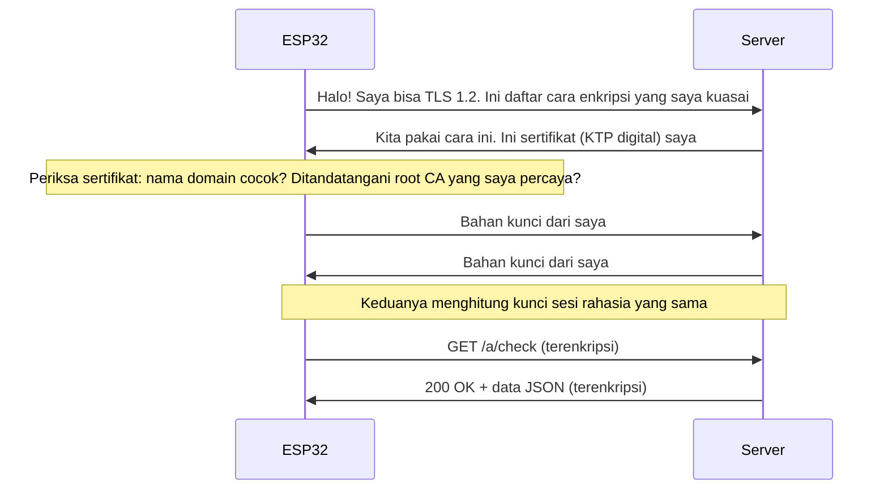
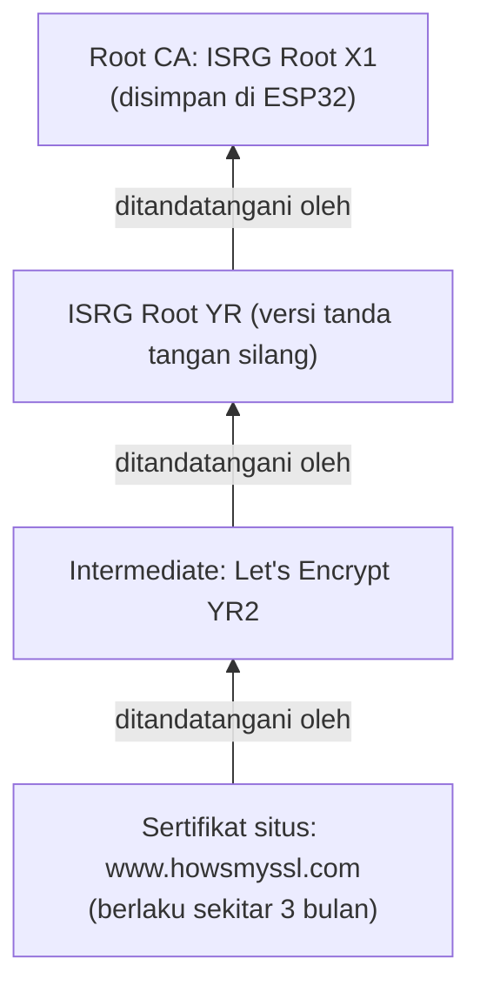
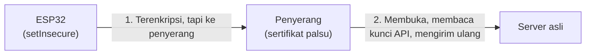
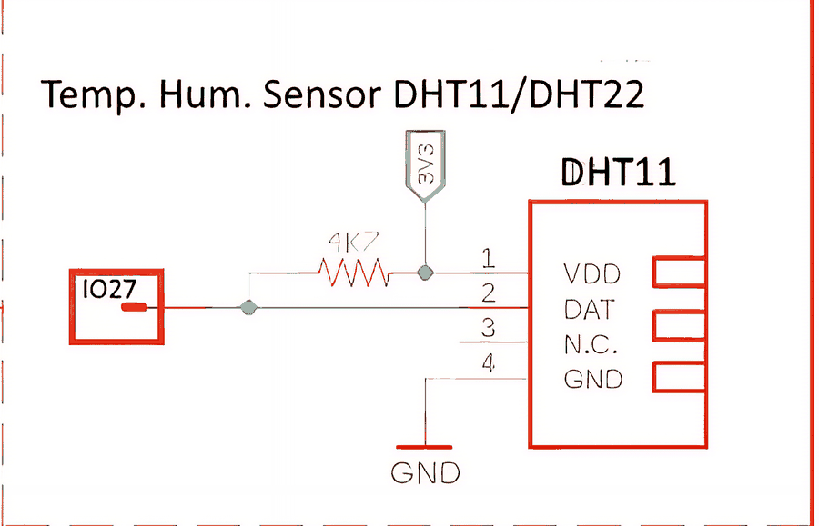

# BAB 49: HTTPS & Keamanan

> ✅ **Prasyarat:** Selesaikan **BAB 48 (HTTP Client & REST API — ESP32 Pergi ke Internet)** — kamu sudah bisa mengirim permintaan GET/POST dengan `HTTPClient` dan membaca JSON dengan ArduinoJson. Kamu juga perlu **BAB 42 (WiFi Station Mode — Koneksi Internet ESP32)**, termasuk bagian jam internet (NTP). Program 3 memakai DHT11 dari **BAB 26 (DHT11 — Suhu & Kelembapan)** dan tab tambahan dari **BAB 19 (Kode Terstruktur — Multi-File)**.

Di BAB 48, ESP32 mengirim dan menerima data lewat HTTP biasa. Masalahnya, HTTP itu seperti **kartu pos**: siapa pun yang ikut "mengantar" — pemilik WiFi, orang lain di jaringan yang sama, sampai penyedia internet — bisa membaca isinya, termasuk kunci API yang kamu kirim. Di BAB ini kamu belajar **HTTPS**, yaitu HTTP yang dibungkus **TLS**: datanya dimasukkan ke **amplop tersegel**, dan sebelum amplop diserahkan, ESP32 memeriksa **KTP digital** (sertifikat) penerimanya. Kamu juga akan belajar kenapa jalan pintas `setInsecure()` berbahaya, cara mengambil sertifikat *root* CA dari *browser*, dan kebiasaan aman sederhana supaya kata sandi WiFi dan kunci API-mu tidak bocor.

## 📌 Tujuan Pembelajaran

Setelah mempelajari BAB ini, kamu bisa:

- Menjelaskan perbedaan HTTP dan HTTPS, serta apa yang dilindungi dan tidak dilindungi oleh TLS.
- Menjelaskan sertifikat digital, *root* CA, dan rantai sertifikat dengan analogi KTP dan kantor penerbitnya.
- Menjelaskan serangan *man-in-the-middle* (MITM) dan alasan `setInsecure()` hanya boleh dipakai untuk percobaan pertama.
- Membuat koneksi HTTPS dari ESP32 dengan `WiFiClientSecure` dan `HTTPClient`, lalu mengukur memori yang dipakai TLS.
- Mengambil sertifikat *root* CA dari *browser* atau OpenSSL dan menempelkannya ke kode dengan *raw string* C++.
- Memverifikasi identitas *server* dengan `setCACert()` dan membaca pesan galat TLS dengan `lastError()`.
- Mengirim data DHT11 ke ThingSpeak lewat HTTPS dengan kunci API yang disimpan di tab terpisah.
- Memakai bundel sertifikat bawaan (`useBuiltinCACertBundle()`) untuk banyak situs sekaligus.
- Menerapkan kebiasaan aman: memakai *placeholder*, tidak mengunggah kunci ke GitHub, menyimpan rahasia di NVS, dan memahami batas keamanan HTTP di jaringan lokal.

## 🧰 Yang Perlu Disiapkan

| Kebutuhan | Keterangan |
|---|---|
| *Hardware* | Kit Bluino ESP32 IoT Starter Shield + kabel USB **data** |
| Kabel *jumper* | 3 kabel *female-female* untuk Program 3 (DHT11, LED merah, LED hijau). Program 1, 2, dan 4 tidak perlu merangkai |
| Komponen tambahan | Tidak ada |
| *Software* | Arduino IDE 2.x + *board package* **esp32** versi 3.3.x (lihat [BAB 5](../BAB-05/README.md)). Program 4 butuh versi **3.3.12** atau yang lebih baru |
| *Library* | **ArduinoJson** versi 7 (Program 1 dan 2); **DHT sensor library** + **Adafruit Unified Sensor** (Program 3). `WiFi`, `WiFiClientSecure`, `HTTPClient`, dan `Preferences` sudah bawaan *board package* esp32 |
| Alat uji | **Serial Monitor** Arduino IDE (baud 115200); *browser* (Chrome, Edge, atau Firefox) untuk melihat sertifikat dan grafik ThingSpeak; opsional: **OpenSSL** lewat Git Bash (Windows) atau Terminal (macOS/Linux) |
| Jaringan | WiFi **2,4 GHz** yang **tersambung ke internet** (ESP32 tidak mendukung 5 GHz). Hindari WiFi yang mewajibkan *login* lewat halaman web (misalnya WiFi kampus atau kafe) — ESP32 tidak bisa mengisi halaman itu |
| Akun | Akun **ThingSpeak** gratis untuk Program 3 (cara membuatnya ada di [49.10](#4910-program-3-kirim-data-dht11-ke-thingspeak-lewat-https)) |

## 📑 Daftar Isi

- [49.1 Kenapa HTTP Saja Tidak Cukup?](#491-kenapa-http-saja-tidak-cukup)
- [49.2 Cara Kerja HTTPS dan TLS](#492-cara-kerja-https-dan-tls)
- [49.3 Sertifikat Digital, Root CA, dan Rantai Sertifikat](#493-sertifikat-digital-root-ca-dan-rantai-sertifikat)
- [49.4 Bahaya setInsecure(): Serangan Man-in-the-Middle](#494-bahaya-setinsecure-serangan-man-in-the-middle)
- [49.5 WiFiClientSecure: Klien HTTPS di ESP32](#495-wificlientsecure-klien-https-di-esp32)
- [49.6 Program 1: HTTPS Pertama dengan setInsecure()](#496-program-1-https-pertama-dengan-setinsecure)
- [49.7 Mengambil Sertifikat Root CA](#497-mengambil-sertifikat-root-ca)
- [49.8 Jam, Masa Berlaku, dan Pergantian Sertifikat](#498-jam-masa-berlaku-dan-pergantian-sertifikat)
- [49.9 Program 2: HTTPS Aman dengan setCACert()](#499-program-2-https-aman-dengan-setcacert)
- [49.10 Program 3: Kirim Data DHT11 ke ThingSpeak lewat HTTPS](#4910-program-3-kirim-data-dht11-ke-thingspeak-lewat-https)
- [49.11 Program 4: Bundel Sertifikat Bawaan](#4911-program-4-bundel-sertifikat-bawaan)
- [49.12 Keamanan Dasar Perangkat IoT](#4912-keamanan-dasar-perangkat-iot)
- [49.13 Troubleshooting](#4913-troubleshooting)
- [📝 Rangkuman](#-rangkuman)
- [💪 Latihan](#-latihan)
- [📚 Referensi](#-referensi)

---

## 49.1 Kenapa HTTP Saja Tidak Cukup?

Saat ESP32 mengirim data ke internet, data itu tidak langsung "terbang" ke *server*. Data melewati banyak perantara: *router* WiFi, jaringan penyedia internet (ISP), lalu beberapa *router* lain di internet. Dengan HTTP biasa, semua perantara itu bisa **membaca** dan bahkan **mengubah** isinya — persis seperti kartu pos yang dibaca setiap petugas pos yang memegangnya.

Contohnya, permintaan dari Program 3 di BAB 48 (mengirim data DHT11 ke ThingSpeak lewat `http://`) kurang lebih berbentuk seperti ini saat lewat di jaringan (kuncinya contoh saja):

```text
POST /update HTTP/1.1
Host: api.thingspeak.com
User-Agent: BluinoKit-BAB48/1.0
Content-Type: application/x-www-form-urlencoded

api_key=K7XQ2M9PL0A3RT8W&field1=29.1&field2=65&field3=-58
```

Siapa pun yang menyadap jaringan (misalnya dengan aplikasi Wireshark di laptop yang tersambung ke WiFi yang sama) bisa melihat kunci API `K7XQ2M9PL0A3RT8W` itu, lalu memakainya untuk mengirim data palsu ke *channel*-mu. Dengan HTTPS, yang terlihat penyadap hanyalah deretan *byte* acak.

| | HTTP | HTTPS |
|---|---|---|
| Alamat | `http://...` | `https://...` |
| *Port* bawaan | 80 | 443 |
| Isi data di jaringan | Terbaca jelas (*plaintext*) | Terenkripsi |
| Bisa diubah di tengah jalan tanpa ketahuan? | Bisa | Tidak — perubahan langsung terdeteksi |
| Identitas *server* diperiksa? | Tidak | Ya, lewat sertifikat |
| Beban untuk ESP32 | Ringan | Lebih berat: butuh puluhan KB RAM dan waktu tambahan sekitar 1–2 detik untuk berkenalan (*handshake*) |
| Tanda di *browser* | "Not secure" | Ikon gembok / ikon pengaturan situs |

> 📌 **Catatan:** HTTPS menyembunyikan **isi** percakapan — alamat lengkap (`/update?...`), *header*, dan isi data. Yang **tidak** disembunyikan: alamat IP tujuan, **nama domain** yang dihubungi (misalnya `api.thingspeak.com`), waktu, dan perkiraan ukuran data. Jadi penyadap masih tahu ESP32-mu sedang "berbicara" dengan ThingSpeak, tetapi tidak tahu apa yang dibicarakan.

---

## 49.2 Cara Kerja HTTPS dan TLS

**HTTPS** (*HTTP Secure*) sebenarnya tetap HTTP yang sama dengan BAB 48. Bedanya, sebelum HTTP dikirim, ESP32 dan *server* membangun "terowongan" aman lebih dulu dengan protokol **TLS** (*Transport Layer Security*). Nama lamanya **SSL** (*Secure Sockets Layer*) — versi SSL sudah lama dinyatakan tidak aman dan tidak dipakai lagi, tetapi istilah "sertifikat SSL" masih sering kamu dengar.

TLS mengerjakan tiga tugas sekaligus. Bayangkan kamu mengirim dokumen penting lewat kurir:

| Tugas TLS | Analogi | Artinya untuk ESP32 |
|---|---|---|
| **Enkripsi** (kerahasiaan) | Dokumen dimasukkan ke amplop tertutup | Data tidak bisa dibaca orang di tengah jalan |
| **Integritas** (keutuhan) | Amplop disegel; segel rusak = ketahuan | Data yang diubah di tengah jalan langsung ditolak |
| **Autentikasi** (keaslian) | Kurir memeriksa KTP penerima sebelum menyerahkan amplop | ESP32 memastikan lawan bicaranya benar-benar `api.thingspeak.com`, bukan penipu |

Tugas ketiga sering dilupakan, padahal paling penting. Amplop tersegel tidak ada gunanya kalau diserahkan ke orang yang salah.

### 49.2.1 Jabat Tangan TLS (*Handshake*)

Sebelum data pertama dikirim, ESP32 dan *server* "berkenalan" dulu. Proses ini disebut ***handshake*** (jabat tangan). Versi yang disederhanakan:



*Gambar 49.1 — Alur jabat tangan TLS yang disederhanakan, lalu permintaan HTTP di dalam terowongan terenkripsi. Sumber: dibuat untuk materi ini.*

Hal-hal yang perlu kamu ingat dari diagram itu:

- **Pemeriksaan sertifikat terjadi di tengah *handshake*.** Kalau sertifikat ditolak, *handshake* dibatalkan dan **tidak ada satu *byte* pun data HTTP yang terkirim**. Di `HTTPClient`, kegagalan ini muncul sebagai kode `-1` (*connection refused*).
- **Kunci sesi** dihitung oleh kedua pihak dengan matematika khusus (ECDHE — *Elliptic Curve Diffie-Hellman Ephemeral*), sehingga kunci itu sendiri tidak pernah dikirim lewat jaringan. Penyadap yang merekam seluruh percakapan tetap tidak bisa menghitungnya.
- **TLS butuh kerja keras.** Langkah memeriksa tanda tangan dan menghitung kunci memakan waktu sekitar 1–2 detik di ESP32 dan butuh memori puluhan KB. Karena itu, mengirim data tiap 100 milidetik lewat HTTPS bukan ide bagus.

> 📌 **Catatan:** Versi TLS terbaru adalah **TLS 1.3** (2018), sedangkan **TLS 1.2** (2008) masih didukung hampir semua *server*. *Board package* esp32 versi 3.3.12 hanya mengaktifkan **TLS 1.2** — tidak masalah, karena layanan yang dipakai di BAB ini menerima TLS 1.2. Laptopmu biasanya memakai TLS 1.3, jadi jangan heran kalau hasil pemeriksaan di laptop berbeda dengan di ESP32.

---

## 49.3 Sertifikat Digital, Root CA, dan Rantai Sertifikat

### 49.3.1 Sertifikat = KTP Digital Server

**Sertifikat digital** (sertifikat X.509) adalah "KTP" milik sebuah situs. Isinya antara lain:

| Isi sertifikat | Padanan di KTP |
|---|---|
| Nama domain, misalnya `www.howsmyssl.com` | Nama pemilik |
| Kunci publik *server* (dipakai saat *handshake*) | Foto dan tanda tangan pemilik |
| Penerbit (*issuer*), misalnya Let's Encrypt | Instansi yang menerbitkan KTP |
| Masa berlaku (*not before* – *not after*) | Tanggal berlaku |
| Tanda tangan digital penerbit | Stempel dan tanda tangan pejabat |

Siapa pun bisa membuat sertifikat sendiri, sama seperti siapa pun bisa mencetak kartu bertuliskan "KTP". Yang membuat sertifikat bisa dipercaya adalah **tanda tangan penerbitnya**.

### 49.3.2 Certificate Authority dan Root CA

Penerbit sertifikat disebut **CA** (*Certificate Authority*) — lembaga yang memeriksa bahwa pemohon benar-benar menguasai sebuah domain sebelum menerbitkan sertifikat. Contohnya Let's Encrypt (gratis), DigiCert, GlobalSign, Sectigo, dan Google Trust Services.

CA bekerja berjenjang, mirip kantor kependudukan:

- ***Root* CA** = "kantor pusat". Sertifikat *root* CA menandatangani dirinya sendiri. Kepercayaan kepadanya bukan berasal dari tanda tangan, melainkan karena sertifikatnya **sudah disimpan sejak awal** di daftar tepercaya (*trust store*) milik Windows, macOS, Android, Chrome, Firefox — dan nanti di ESP32-mu.
- ***Intermediate* CA** (CA perantara) = "kantor cabang". Ditandatangani oleh *root* CA, dan inilah yang sehari-hari menandatangani sertifikat situs. *Root* CA sengaja disimpan *offline* supaya kuncinya aman.
- **Sertifikat situs** (*leaf certificate*) = KTP warga, ditandatangani *intermediate* CA.

### 49.3.3 Rantai Sertifikat (*Certificate Chain*)

Saat *handshake*, *server* mengirim sertifikatnya **beserta** sertifikat *intermediate*-nya. ESP32 lalu menelusuri tanda tangan dari bawah ke atas sampai bertemu *root* CA yang ia simpan:



*Gambar 49.2 — Rantai sertifikat `www.howsmyssl.com` saat BAB ini ditulis (Oktober 2026). Sumber: dibuat untuk materi ini berdasarkan hasil `openssl s_client`.*

Kalau setiap tanda tangan sah **dan** ujung rantainya adalah *root* CA yang dipercaya ESP32, sertifikat diterima. Kalau rantainya berakhir di *root* yang tidak dikenal (misalnya sertifikat buatan penipu), sertifikat ditolak.

> 💡 **Tips:** Karena itu, yang kita simpan di ESP32 adalah sertifikat ***root* CA**, bukan sertifikat situs. Sertifikat situs dari Let's Encrypt diganti setiap beberapa bulan, sedangkan *root* CA berlaku belasan tahun. Kalau kamu menyimpan sertifikat situs, program akan berhenti bekerja begitu sertifikat itu diganti.

Berikut *root* CA layanan yang dipakai di BAB ini (diperiksa Oktober 2026):

| Layanan | Dipakai di | *Root* CA | Berlaku sampai |
|---|---|---|---|
| `www.howsmyssl.com` | Program 1, 2, 4 | ISRG Root X1 (Let's Encrypt) | 4 Juni 2035 |
| `api.thingspeak.com` | Program 3, 4 (di Program 2, *root* ini dipakai sebagai "kunci yang salah") | DigiCert Global Root G2 | 15 Januari 2038 |
| `httpbin.org` (layanan uji dari BAB 48) | Program 4 | Amazon Root CA 1 | 17 Januari 2038 |

---

## 49.4 Bahaya `setInsecure()`: Serangan Man-in-the-Middle

`WiFiClientSecure` punya jalan pintas bernama `setInsecure()`: koneksi tetap **terenkripsi**, tetapi sertifikat *server* **tidak diperiksa sama sekali**. Kedengarannya "lumayan aman", padahal justru membuka pintu bagi serangan ***man-in-the-middle*** (MITM, "orang di tengah").

Contoh skenarionya: seseorang di kafe menyalakan *hotspot* bernama sama dengan WiFi kafe, lalu ESP32-mu tersambung ke *hotspot* palsu itu. Penyerang kini berada **di tengah** jalur. Saat ESP32 menghubungi `api.thingspeak.com`, penyerang menjawab dengan sertifikat buatannya sendiri.



*Gambar 49.3 — Serangan MITM: ESP32 yang memakai `setInsecure()` tidak memeriksa sertifikat, sehingga mengenkripsi data untuk penyerang. Sumber: dibuat untuk materi ini.*

| Pengaturan | Data terenkripsi? | Identitas *server* diperiksa? | Akibat jika ada penyerang di tengah |
|---|---|---|---|
| HTTP biasa | Tidak | Tidak | Data dan kunci API terbaca dan bisa diubah |
| HTTPS + `setInsecure()` | Ya | **Tidak** | Penyerang tinggal menyamar sebagai *server*; data dan kunci API tetap terbaca dan bisa diubah |
| HTTPS + `setCACert()` atau bundel sertifikat | Ya | **Ya** | Sertifikat palsu ditolak, koneksi dibatalkan, data tidak terkirim |

Artinya, `setInsecure()` ibarat amplop tersegel yang diserahkan kepada siapa pun yang **mengaku** sebagai penerima. Aturan di BAB ini:

> 🚨 **Bahaya:** Pakai `setInsecure()` **hanya** untuk percobaan pertama (Program 1) atau untuk mencari tahu apakah masalahmu ada di sertifikat atau di tempat lain. Jangan pernah memakainya di perangkat yang mengirim kata sandi, kunci API, atau perintah penting (misalnya membuka kunci pintu atau menyalakan *relay*).

---

## 49.5 WiFiClientSecure: Klien HTTPS di ESP32

`WiFiClientSecure` adalah "versi aman" dari `WiFiClient`. Kamu memasangkannya ke `HTTPClient` dengan `http.begin(klien, url)` seperti di BAB 48, sehingga semua fungsi HTTP (`GET()`, `POST()`, `getString()`, `addHeader()`, `setUserAgent()`) tetap sama. Di *board package* esp32 versi 3.x, nama aslinya adalah `NetworkClientSecure`; `WiFiClientSecure` hanyalah nama lain untuk kelas yang sama, jadi contoh lama tetap berjalan. *Library* ini sudah bawaan, tidak perlu diinstal.

Pola pemakaiannya (potongan kode di dalam sebuah fungsi):

```cpp
#include <WiFiClientSecure.h>
#include <HTTPClient.h>

WiFiClientSecure klienAman;           // 1. buat klien TLS (SEBELUM HTTPClient)
klienAman.setCACert(ROOT_CA);         // 2. pilih cara memeriksa sertifikat (lihat tabel)

HTTPClient http;
http.begin(klienAman, "https://www.howsmyssl.com/a/check");  // 3. pasangkan ke HTTPClient
http.setUserAgent("BluinoKit-BAB49/1.0");                     //    "nama" client kita
int kode = http.GET();                // 4. handshake TLS + kirim permintaan
// ... baca hasil dengan http.getString() ...
http.end();                           // 5. tutup koneksi, memori TLS dilepas
```

> 📌 **Catatan:** Urutan penulisan penting: `WiFiClientSecure` dibuat **sebelum** `HTTPClient`. Di C++, objek yang dibuat belakangan dihapus lebih dulu saat fungsi selesai. Dengan urutan ini, `http` (yang masih memegang sambungan) dihapus dulu, baru kemudian `klienAman`. Kalau urutannya terbalik, `http` bisa mencoba menutup sambungan milik klien yang sudah terhapus, dan ESP32 bisa *crash*. Sama seperti di BAB 48, *header* `User-Agent` diatur dengan `http.setUserAgent()`; `http.addHeader("User-Agent", ...)` diabaikan tanpa pesan apa pun.

### 49.5.1 Cara Memeriksa Sertifikat

Sebelum tersambung, kamu **wajib** memilih salah satu cara berikut. Kalau tidak memilih apa pun, koneksi langsung gagal dengan kode `-1` (*connection refused*) tanpa pesan lain — kesalahan pemula yang paling sering.

| Fungsi | Cara kerja | Kapan dipakai |
|---|---|---|
| `setInsecure()` | Tidak memeriksa sertifikat | **Hanya** percobaan pertama ([49.4](#494-bahaya-setinsecure-serangan-man-in-the-middle)) |
| `setCACert(teksPEM)` | Hanya percaya pada satu (atau beberapa) *root* CA yang kamu tempel di kode | Perangkat yang hanya menghubungi satu atau dua layanan — paling ketat |
| `useBuiltinCACertBundle()` | Memakai bundel ±150 *root* CA tepercaya (daftar Mozilla) yang sudah tertanam di *board package* | Perangkat yang menghubungi banyak situs. **Baru ada di versi 3.3.12** |
| `setCACertBundle(data, ukuran)` | Memakai bundel *root* CA buatanmu sendiri (format biner khusus ESP-IDF) | Lanjutan — tidak dibahas di BAB ini |

### 49.5.2 Fungsi Pendukung

| Fungsi | Kegunaan |
|---|---|
| `klienAman.lastError(teks, ukuran)` | Mengisi `teks` dengan pesan galat TLS terakhir (misalnya `X509 - Certificate verification failed...`) dan mengembalikan kodenya (misalnya `-9984`). Sangat membantu mencari penyebab kode `-1` |
| `klienAman.setHandshakeTimeout(detik)` | Batas waktu *handshake* dalam **detik** (bawaannya 120 detik — terlalu lama kalau *server* bermasalah) |
| `http.setConnectTimeout(ms)` | Batas waktu membuka sambungan TCP, dalam milidetik (bawaan 5000) |
| `http.setTimeout(ms)` | Batas waktu menunggu balasan *server*, dalam milidetik (bawaan 5000, maksimum 65535) |

> ⚠️ **Perhatian:** `setHandshakeTimeout()` memakai satuan **detik**, sedangkan `setTimeout()` dan `setConnectTimeout()` milik `HTTPClient` memakai **milidetik**. Menulis `setHandshakeTimeout(10000)` berarti hampir 3 jam!

### 49.5.3 TLS Butuh Banyak Memori

ESP32 klasik punya RAM sekitar 320 KB, dan setelah WiFi menyala biasanya tersisa sekitar 200 KB *heap* (memori yang bisa dipinjam program saat berjalan). Satu koneksi TLS meminjam cukup banyak:

- *buffer* terima 16 KB dan *buffer* kirim 16 KB (ukuran rekaman TLS maksimum yang diatur *board package*);
- sertifikat *server* yang sedang diperiksa dan disimpan selama koneksi terbuka;
- perhitungan kunci (RSA/ECDHE).

Totalnya biasanya sekitar **40–50 KB per koneksi** (angka pastinya tergantung *server*; Program 1 akan mengukurnya untukmu). Memori itu dikembalikan setelah `http.end()`. Akibatnya:

- jangan membuka banyak koneksi HTTPS sekaligus;
- selalu panggil `http.end()` setelah selesai;
- kalau programmu juga memakai banyak memori (*web server*, *buffer* JSON besar), cek `ESP.getFreeHeap()` sebelum membuka koneksi.

### 49.5.4 Jebakan dari BAB 48: `http.begin("https://...")` Tanpa Klien

Di [BAB 48](../BAB-48/README.md) kamu memakai `http.begin(url)` dengan satu argumen. Kalau alamatnya diganti menjadi `https://...`, program **tetap berjalan** — dan justru itu jebakannya. Di *board package* esp32 3.3.12, `HTTPClient` lalu membuat `WiFiClientSecure` sendiri dan memanggil `setInsecure()` di dalamnya, **tanpa pesan apa pun**. Datanya memang terenkripsi, tetapi sertifikat *server* tidak diperiksa, sehingga sama rentannya terhadap MITM seperti Program 1.

| Cara menulis | Sertifikat diperiksa? |
|---|---|
| `http.begin("https://api.thingspeak.com/update");` | **Tidak** — diam-diam sama dengan `setInsecure()` |
| `http.begin("https://api.thingspeak.com/update", ROOT_CA);` | Ya, dengan *root* CA yang kamu berikan |
| `http.begin(klienAman, "https://api.thingspeak.com/update");` dengan `klienAman.setCACert(ROOT_CA)` | Ya — **cara yang dipakai di BAB ini**, karena kamu juga bisa memakai `lastError()`, `setHandshakeTimeout()`, dan bundel sertifikat |

Jadi, "alamatnya sudah `https://`" belum tentu berarti aman. Yang menentukan adalah **apakah sertifikatnya diperiksa**.

---

## 49.6 Program 1: HTTPS Pertama dengan `setInsecure()`

**Tujuan:** Membuat koneksi HTTPS pertama ke layanan uji **How's My SSL?** (`https://www.howsmyssl.com/a/check`). Layanan ini membalas dengan JSON yang menilai koneksi TLS milik pengirim permintaan — jadi ESP32 bisa "bertanya" seberapa aman koneksinya sendiri. Program juga mengukur memori yang dipakai TLS. Program ini memakai `setInsecure()`, jadi **hanya untuk percobaan**; versi amannya ada di Program 2.

**Rangkaian:**

*Tidak perlu merangkai — program hanya memakai WiFi dan Serial Monitor.*

**Cara Menjalankan:**

1. Pasang *library* ArduinoJson (kalau belum pernah): buka **Sketch → Include Library → Manage Libraries…**, ketik `ArduinoJson`, pilih yang pembuatnya **Benoit Blanchon**, pastikan versinya **7.x**, lalu klik **INSTALL**.
2. Buka Arduino IDE → **File → New Sketch**, hapus isinya, lalu salin kode di bawah. Kode yang sama juga tersedia di *file* [`p1_https_insecure.ino`](p1_https_insecure/p1_https_insecure.ino).
3. Ganti `NamaWiFiKamu` dan `PasswordWiFiKamu` dengan nama dan kata sandi WiFi kamu. Keduanya peka huruf besar-kecil, WiFi-nya harus 2,4 GHz, dan harus tersambung ke internet.
4. Pastikan **Tools → Board** = **ESP32 Dev Module** dan **Tools → Port** = *port* ESP32 kamu (misalnya `COM5` di Windows atau `/dev/ttyUSB0` di Linux).
5. Klik tombol **Upload** (ikon panah →) dan tunggu sampai muncul tulisan **Done uploading**.
6. Buka **Serial Monitor** (**Tools → Serial Monitor**) lalu pilih baud **115200**. Kalau tulisan awal terlewat, tekan tombol **EN** di *board* ESP32.

**Kode Program:**

<!-- sketch: p1_https_insecure -->
```cpp
/*
 * BAB 49 - Program 1: HTTPS Pertama dengan setInsecure()
 * ESP32 menghubungi https://www.howsmyssl.com/a/check, lalu menampilkan
 * versi TLS, penilaian keamanan, dan memori yang dipakai TLS.
 *
 * PERCOBAAN SAJA: setInsecure() TIDAK memeriksa sertifikat server,
 * sehingga rentan serangan man-in-the-middle. Versi aman: Program 2.
 *
 * Rangkaian: tidak perlu.
 * Library  : ArduinoJson (Benoit Blanchon) versi 7.
 */

#include <WiFi.h>
#include <WiFiClientSecure.h>
#include <HTTPClient.h>
#include <ArduinoJson.h>

const char* WIFI_SSID     = "NamaWiFiKamu";      // ← ganti dengan WiFi kamu
const char* WIFI_PASSWORD = "PasswordWiFiKamu";  // ← ganti dengan WiFi kamu

const char* URL_CEK_TLS = "https://www.howsmyssl.com/a/check";
const unsigned long JEDA_CEK = 60000;  // ulangi setiap 60 detik

unsigned long waktuCekTerakhir = 0;
int nomorCek = 0;

void sambungWiFi() {
  WiFi.mode(WIFI_STA);
  WiFi.begin(WIFI_SSID, WIFI_PASSWORD);
  Serial.print("Menghubungkan ke WiFi");

  unsigned long mulai = millis();
  while (WiFi.status() != WL_CONNECTED) {
    if (millis() - mulai >= 20000) {  // menyerah setelah 20 detik
      Serial.println();
      Serial.println("Gagal terhubung! Periksa nama dan password WiFi (harus 2,4 GHz).");
      Serial.println("ESP32 restart dalam 5 detik...");
      delay(5000);
      ESP.restart();
    }
    Serial.print(".");
    delay(500);
  }
  Serial.println();
  Serial.print("Terhubung! Alamat IP: ");
  Serial.println(WiFi.localIP());
}

void cekTls() {
  nomorCek = nomorCek + 1;
  Serial.printf("\n--- Cek #%d: GET %s ---\n", nomorCek, URL_CEK_TLS);

  uint32_t heapAwal = ESP.getFreeHeap();

  WiFiClientSecure klienAman;
  klienAman.setInsecure();            // PERCOBAAN SAJA: sertifikat tidak diperiksa!
  klienAman.setHandshakeTimeout(15);  // batas waktu handshake TLS, dalam DETIK

  HTTPClient http;
  http.setConnectTimeout(10000);      // batas waktu membuka sambungan (ms)
  http.setTimeout(10000);             // batas waktu menunggu balasan (ms)
  if (!http.begin(klienAman, URL_CEK_TLS)) {
    Serial.println("Alamat URL tidak valid.");
    return;
  }
  http.setUserAgent("BluinoKit-BAB49/1.0");  // "nama" client kita

  unsigned long mulai = millis();
  int kode = http.GET();              // handshake TLS + kirim permintaan GET
  unsigned long lama = millis() - mulai;
  uint32_t heapSaatTls = ESP.getFreeHeap();  // koneksi TLS masih terbuka

  if (kode == HTTP_CODE_OK) {
    String isi = http.getString();

    // Ambil dua data saja dari JSON yang panjang
    JsonDocument saringan;
    saringan["tls_version"] = true;
    saringan["rating"] = true;

    JsonDocument doc;
    DeserializationError galat = deserializeJson(doc, isi, DeserializationOption::Filter(saringan));
    if (galat) {
      Serial.printf("JSON tidak bisa dibaca: %s\n", galat.c_str());
    } else {
      Serial.printf("Status HTTP  : %d (berhasil)\n", kode);
      Serial.printf("Versi TLS    : %s\n", doc["tls_version"] | "?");
      Serial.printf("Penilaian    : %s\n", doc["rating"] | "?");
      Serial.printf("Lama GET     : %lu ms\n", lama);
    }
  } else if (kode > 0) {
    Serial.printf("Server menjawab dengan kode HTTP %d\n", kode);
  } else {
    Serial.printf("Gagal: %s (kode %d)\n", http.errorToString(kode).c_str(), kode);
  }
  http.end();  // tutup koneksi, memori TLS dikembalikan

  uint32_t dipakaiTls = (heapAwal > heapSaatTls) ? (heapAwal - heapSaatTls) : 0;
  Serial.printf("Heap sebelum : %u byte\n", (unsigned)heapAwal);
  Serial.printf("Heap saat TLS: %u byte (dipakai TLS +/- %u byte)\n", (unsigned)heapSaatTls, (unsigned)dipakaiTls);
  Serial.printf("Heap sesudah : %u byte\n", (unsigned)ESP.getFreeHeap());
}

void setup() {
  Serial.begin(115200);
  delay(500);
  Serial.println();
  Serial.println("BAB 49 - Program 1: HTTPS Pertama dengan setInsecure()");
  Serial.println("PERINGATAN: sertifikat server TIDAK diperiksa. Hanya untuk percobaan!");

  sambungWiFi();
  cekTls();
  waktuCekTerakhir = millis();
}

void loop() {
  // Ulangi pemeriksaan setiap JEDA_CEK tanpa delay() (pola BAB 16)
  if (millis() - waktuCekTerakhir >= JEDA_CEK) {
    waktuCekTerakhir = millis();
    if (WiFi.status() == WL_CONNECTED) {
      cekTls();
    } else {
      Serial.println("WiFi terputus, menunggu tersambung ulang...");
    }
  }
}
```

**Penjelasan Kode:**

- `WiFiClientSecure klienAman;` membuat klien TLS. Klien ini dibuat **di dalam** fungsi `cekTls()`, sehingga seluruh memorinya dikembalikan begitu fungsi selesai.
- `klienAman.setInsecure();` adalah baris yang membuat program ini **tidak aman**: ESP32 menerima sertifikat apa pun. Di Program 2, baris ini diganti dengan `setCACert()`.
- `setHandshakeTimeout(15)` membatasi *handshake* paling lama 15 **detik** (bawaannya 120 detik). `http.setConnectTimeout()` dan `http.setTimeout()` memakai **milidetik**.
- `http.begin(klienAman, URL_CEK_TLS)` memasangkan klien TLS ke `HTTPClient` (`klienAman` dibuat lebih dulu, lihat catatan di [49.5](#495-wificlientsecure-klien-https-di-esp32)), dan `http.setUserAgent()` memberi "nama" *client* seperti di BAB 48. Selebihnya sama dengan BAB 48: `GET()` mengembalikan kode status HTTP (200 = berhasil) atau angka negatif kalau koneksi gagal.
- `ESP.getFreeHeap()` dibaca tiga kali: sebelum koneksi, **saat koneksi TLS masih terbuka** (setelah `GET()` dan sebelum `http.end()`), dan sesudah koneksi ditutup. Selisih dua angka pertama adalah perkiraan memori yang dipakai TLS.
- Balasan How's My SSL? cukup panjang (berisi daftar semua cara enkripsi yang ditawarkan ESP32). Dengan **saringan** (`DeserializationOption::Filter`), ArduinoJson hanya menyimpan `tls_version` dan `rating`, sehingga memori yang dipakai kecil.
- `doc["rating"] | "?"` artinya "pakai nilai `rating`; kalau tidak ada, pakai `"?"`".
- Pemeriksaan diulang setiap 60 detik dengan pola `millis()` dari [BAB 16](../BAB-16/README.md). Jangan mempercepatnya: layanan uji gratis tidak suka dibanjiri permintaan.

**Contoh Output:**

```text
BAB 49 - Program 1: HTTPS Pertama dengan setInsecure()
PERINGATAN: sertifikat server TIDAK diperiksa. Hanya untuk percobaan!
Menghubungkan ke WiFi.....
Terhubung! Alamat IP: 192.168.1.105

--- Cek #1: GET https://www.howsmyssl.com/a/check ---
Status HTTP  : 200 (berhasil)
Versi TLS    : TLS 1.2
Penilaian    : Improvable
Lama GET     : 1874 ms
Heap sebelum : 214360 byte
Heap saat TLS: 170512 byte (dipakai TLS +/- 43848 byte)
Heap sesudah : 213980 byte
```

Angka alamat IP, lama GET, dan *heap* di atas hanya contoh — angkamu pasti berbeda. Yang penting:

- **Versi TLS** selalu `TLS 1.2`, karena hanya versi itu yang diaktifkan di *board package* esp32 3.3.12.
- **Penilaian** bernilai `Probably Okay` (tidak ada masalah terdeteksi), `Improvable` (bisa ditingkatkan), atau `Bad` (ada masalah serius). Sejak pertengahan 2026, How's My SSL? memberi nilai `Improvable` kepada klien yang paling tinggi hanya mendukung TLS 1.2 atau belum mendukung pertukaran kunci tahan komputer kuantum (*post-quantum*). Itu wajar untuk ESP32 dan **bukan** berarti enkripsinya lemah. Yang perlu dicurigai adalah nilai `Bad`.
- **Dipakai TLS** biasanya sekitar 40–50 KB. Bandingkan dengan sisa *heap* ESP32 — kira-kira seperlimanya habis untuk satu koneksi.

Penilaian ini hanya menilai **enkripsi**. How's My SSL? tidak tahu bahwa ESP32-mu sama sekali tidak memeriksa sertifikatnya — itulah celah yang ditutup Program 2.

**Kalau Belum Berhasil:**

- **Titik-titik terus bertambah, lalu muncul `Gagal terhubung!`** → nama/kata sandi WiFi salah (perhatikan huruf besar-kecil) atau WiFi-nya 5 GHz. Pakai WiFi 2,4 GHz, misalnya *hotspot* HP.
- **`Gagal: connection refused (kode -1)`** → ESP32 tidak bisa mencapai *server*: WiFi tidak punya akses internet, WiFi meminta *login* lewat halaman web, atau *server* sedang bermasalah. Buka `https://www.howsmyssl.com/a/check` di *browser* HP yang tersambung ke WiFi yang **sama**. Kalau di HP pun gagal, masalahnya di jaringan.
- **`Gagal: read Timeout (kode -11)`** → koneksi internet lambat. Coba lagi, atau naikkan `http.setTimeout()`.
- **Kesalahan *compile* `ArduinoJson.h: No such file or directory`** → *library* ArduinoJson belum terpasang (langkah 1).

---

## 49.7 Mengambil Sertifikat Root CA

Supaya ESP32 bisa memeriksa sertifikat *server*, kamu harus memberinya sertifikat *root* CA yang tepat dalam format **PEM** — teks berawalan `-----BEGIN CERTIFICATE-----` dan berakhiran `-----END CERTIFICATE-----`. Langkahnya selalu sama: (1) cari tahu **nama** *root* CA situs itu, (2) ambil **berkas PEM**-nya, (3) periksa **masa berlakunya**, (4) tempelkan ke kode.

### 49.7.1 Cara A: Lewat Browser Chrome atau Edge

1. Buka situs tujuan, misalnya `https://www.howsmyssl.com`.
2. Klik ikon di sebelah kiri alamat situs (ikon gembok atau ikon pengaturan situs), lalu pilih **Connection is secure** (**Koneksi aman**).
3. Klik **Certificate is valid** (**Sertifikat valid**). Jendela **Certificate Viewer** terbuka.
4. Pilih tab **Details**. Di bagian **Certificate Hierarchy**, sertifikat paling atas adalah *root* CA dan paling bawah adalah sertifikat situs. Klik sertifikat **paling atas**.
5. Klik **Export…**, pilih format **Base64-encoded ASCII, single certificate**, lalu simpan, misalnya sebagai `isrg-root-x1.pem`.

### 49.7.2 Cara B: Lewat Firefox

1. Buka situs tujuan, klik ikon gembok di sebelah kiri alamat, lalu pilih **Connection secure** → **More information**.
2. Di jendela **Page Info**, klik **View Certificate**. Firefox membuka tab baru berisi satu kolom untuk setiap sertifikat di rantai (sertifikat situs, *intermediate*, dan *root*).
3. Klik kolom **paling kanan** (*root* CA), gulir ke bagian **Miscellaneous**, lalu klik **PEM (cert)** untuk mengunduhnya.

> 📌 **Catatan:** Nama menu bisa sedikit berbeda tergantung versi *browser* dan bahasanya. *Browser* juga menyusun rantai sertifikatnya sendiri dari daftar *root* miliknya, sehingga puncak rantai yang ditampilkan kadang berbeda dengan yang dikirim *server* ke ESP32. Biasanya *root* yang ditampilkan *browser* tetap bisa dipakai. Kalau ESP32 tetap menolak, pakai Cara C untuk melihat rantai yang benar-benar dikirim *server*, lalu Cara D untuk mengunduh *root*-nya.

### 49.7.3 Cara C: Lewat OpenSSL (Melihat Rantai yang Dikirim Server)

OpenSSL adalah alat baris perintah untuk urusan TLS. Cara membukanya:

- **Windows:** OpenSSL tidak bawaan Windows, tetapi ikut terpasang bersama **Git for Windows**. Buka **Git Bash** (tombol Start → ketik `Git Bash` → Enter). Kalau belum punya, unduh Git dari [git-scm.com](https://git-scm.com/downloads).
- **macOS:** buka **Terminal** (Command + Spasi → ketik `Terminal` → Enter); perintah `openssl` sudah tersedia.
- **Linux:** buka **Terminal** (Ctrl + Alt + T di Ubuntu). Kalau perintahnya belum ada: `sudo apt install openssl`.

Ketik perintah berikut (satu baris), lalu tekan Enter:

```bash
openssl s_client -connect www.howsmyssl.com:443 -servername www.howsmyssl.com -showcerts </dev/null
```

Keluarannya panjang. Cari bagian `Certificate chain` di awal. Contoh hasilnya (Oktober 2026):

```text
Certificate chain
 0 s:CN=www.howsmyssl.com
   i:C=US, O=Let's Encrypt, CN=YR2
 1 s:C=US, O=Let's Encrypt, CN=YR2
   i:C=US, O=ISRG, CN=Root YR
 2 s:C=US, O=ISRG, CN=Root YR
   i:C=US, O=Internet Security Research Group, CN=ISRG Root X1
```

Tampilan di macOS sedikit berbeda (misalnya `s:/CN=www.howsmyssl.com`), tetapi isinya sama. Bagian `</dev/null` membuat perintah langsung selesai; tanpa itu, OpenSSL menunggu ketikanmu — tekan **Ctrl + C** untuk keluar.

Cara membacanya: `s:` (*subject*) adalah pemilik sertifikat, `i:` (*issuer*) adalah penanda tangannya. Sertifikat nomor 0 milik situs, ditandatangani YR2; YR2 ditandatangani Root YR; Root YR ditandatangani **ISRG Root X1**. Penanda tangan **paling akhir** (`i:` pada baris terakhir) itulah *root* CA yang harus kamu simpan di ESP32.

Biasanya *server* **tidak** mengirim sertifikat *root*-nya sendiri (karena klien dianggap sudah menyimpannya), jadi blok PEM *root* tidak ada di keluaran ini. Unduh *root*-nya dengan Cara D.

> 💡 **Tips:** Untuk *server* dengan *port* lain, ganti angka `443`. Contoh: `openssl s_client -connect platform.antares.id:8443 -servername platform.antares.id -showcerts </dev/null`.

### 49.7.4 Cara D: Mengunduh dari Situs Resmi CA (Paling Dianjurkan)

Setelah tahu **nama** *root* CA-nya, unduh berkas PEM dari situs resmi penerbitnya:

| *Root* CA | Halaman resmi |
|---|---|
| ISRG Root X1 (Let's Encrypt) | [letsencrypt.org/certificates](https://letsencrypt.org/certificates/) → berkas `isrgrootx1.pem` |
| DigiCert Global Root G2 | [digicert.com — DigiCert Trusted Root Authority Certificates](https://www.digicert.com/kb/digicert-root-certificates.htm), atau langsung: [DigiCertGlobalRootG2.crt.pem](https://cacerts.digicert.com/DigiCertGlobalRootG2.crt.pem) |
| Amazon Root CA 1 | [amazontrust.com/repository](https://www.amazontrust.com/repository/) → `AmazonRootCA1.pem` |
| GlobalSign Root R46 | [GlobalSign Root Certificates](https://support.globalsign.com/ca-certificates/root-certificates/globalsign-root-certificates) |

Cara ini paling aman, karena kamu mengambil "kunci" langsung dari pemiliknya, bukan dari jaringan yang mungkin sedang disadap.

### 49.7.5 Memeriksa Isi dan Masa Berlaku Berkas PEM

Sebelum dipakai, pastikan berkas yang kamu pegang memang *root* yang benar dan masih lama berlakunya. Di Git Bash atau Terminal, pindah dulu ke folder tempat berkasnya tersimpan (biasanya folder unduhan: `cd ~/Downloads`), lalu ketik:

```bash
openssl x509 -in isrgrootx1.pem -noout -subject -dates
```

```text
subject=C=US, O=Internet Security Research Group, CN=ISRG Root X1
notBefore=Jun  4 11:04:38 2015 GMT
notAfter=Jun  4 11:04:38 2035 GMT
```

Tanpa OpenSSL, kamu bisa melihat tanggal berlakunya di **Certificate Viewer** *browser* (bagian **Validity Period** / **Issued On** dan **Expires On**). Di Windows, kamu juga bisa membuat salinan berkasnya dengan ekstensi `.crt`, lalu mengekliknya dua kali: jendela **Certificate** menampilkan **Valid from … to …**.

### 49.7.6 Menempelkan PEM ke Kode

Buka berkas `.pem` dengan Notepad (Windows) atau TextEdit (macOS), salin **seluruh** isinya, lalu tempelkan di antara `R"EOF(` dan `)EOF"`:

```cpp
const char ROOT_CA_ISRG_X1[] = R"EOF(
-----BEGIN CERTIFICATE-----
MIIFazCCA1OgAwIBAgIRAIIQz7DSQONZRGPgu2OCiwAwDQYJKoZIhvcNAQELBQAw
... (baris-baris lainnya, salin persis) ...
-----END CERTIFICATE-----
)EOF";
```

`R"EOF( ... )EOF"` adalah ***raw string literal*** C++: semua isi di antara tanda kurung dipakai **apa adanya**, termasuk ganti barisnya, tanpa perlu menulis `\n` dan tanda kutip di setiap baris. Kata `EOF` hanyalah penanda yang kamu pilih sendiri (boleh `PEM`, `CERT`, dan sebagainya), asalkan sama di awal dan di akhir.

> ⚠️ **Perhatian:** Salin baris `-----BEGIN CERTIFICATE-----` dan `-----END CERTIFICATE-----` beserta kelima tanda hubungnya. Satu karakter yang hilang atau berubah di tengah teks membuat sertifikat tidak bisa dibaca, dan koneksi gagal dengan kode `-1`. Sertifikat *root* CA bersifat **publik** — tidak apa-apa ditulis di kode dan dibagikan, tidak seperti kata sandi atau kunci API.

Kalau satu program perlu menghubungi dua layanan dengan *root* berbeda, kamu boleh menempelkan **dua blok PEM berurutan** di dalam satu *raw string*; ESP32 akan memercayai keduanya.

---

## 49.8 Jam, Masa Berlaku, dan Pergantian Sertifikat

### 49.8.1 Kenapa Jam Penting untuk Sertifikat?

Setiap sertifikat punya masa berlaku, sama seperti KTP atau SIM. Untuk menilai apakah sertifikat **masih** berlaku, sebuah perangkat harus tahu **tanggal hari ini**. Di sinilah ESP32 punya kelemahan: ESP32 tidak punya baterai jam. Setiap kali dinyalakan atau di-*reset*, jamnya mulai dari **1 Januari 1970**, sampai disetel lewat internet dengan **NTP** (*Network Time Protocol*) seperti di [BAB 42](../BAB-42/README.md). Perangkat yang memeriksa tanggal dengan jam 1970 akan menolak semua sertifikat, karena menurutnya sertifikat itu "belum berlaku".

### 49.8.2 Fakta Penting di Board Package esp32 3.3.12

Di *board package* esp32 versi 3.3.12, pemeriksaan tanggal sertifikat **dimatikan**: pengaturan mbedTLS (pustaka TLS di dalam ESP32) bernama `CONFIG_MBEDTLS_HAVE_TIME_DATE` tidak aktif. Akibatnya ada dua:

| Akibat | Penjelasan |
|---|---|
| Kabar baik | HTTPS tetap jalan walaupun jam belum disetel. Itu sebabnya Program 1 berhasil tanpa NTP |
| Kabar buruk | ESP32 **tidak menolak sertifikat yang sudah kedaluwarsa**. Tanda tangan, nama domain, dan rantainya tetap diperiksa, tetapi tanggalnya tidak |

Walaupun begitu, program yang baik tetap menyetel jam lewat NTP sebelum memakai HTTPS. Alasannya:

- data yang dikirim ke *server* dan catatan (*log*) di ESP32 butuh cap waktu yang benar;
- banyak layanan *cloud* memakai token atau tanda tangan yang **ada batas waktunya**, sehingga ditolak kalau jam ESP32 salah;
- proyek ESP-IDF atau versi *board package* lain bisa saja mengaktifkan pemeriksaan tanggal; program yang sudah menyetel jam tidak akan kaget.

Program 2 menyetel jam dengan `configTzTime()` dari BAB 42 sebelum membuka koneksi HTTPS.

### 49.8.3 Sertifikat Berganti — Rencanakan dari Awal

Sertifikat di setiap tingkat rantai berganti dengan kecepatan berbeda:

| Tingkat | Umur | Contoh |
|---|---|---|
| Sertifikat situs | Beberapa bulan, dan makin pendek | Let's Encrypt menerbitkan sertifikat 90 hari. Aturan CA/Browser Forum membatasi umur maksimum menjadi 200 hari (sejak Maret 2026), 100 hari (Maret 2027), lalu 47 hari (Maret 2029) |
| *Intermediate* CA | Beberapa tahun, dan bisa dirotasi kapan saja | *Intermediate* YR1/YR2 milik Let's Encrypt berlaku sampai September 2028, dan Let's Encrypt memilihnya secara acak |
| *Root* CA | Belasan sampai puluhan tahun | ISRG Root X1 berlaku sampai 2035; Let's Encrypt sudah menyiapkan penggantinya, ISRG Root YR |

Pelajaran dari sejarah: pada 30 September 2021, *root* lama yang dipakai Let's Encrypt (DST Root CA X3 milik IdenTrust) kedaluwarsa, dan banyak perangkat lama tiba-tiba gagal tersambung karena daftar *root*-nya tidak pernah diperbarui. Supaya ESP32-mu tidak bernasib sama:

1. **Simpan *root* CA, jangan sertifikat situs atau *intermediate*.**
2. **Catat tanggal kedaluwarsa** *root* yang kamu pakai (lihat tabel di [49.3](#493-sertifikat-digital-root-ca-dan-rantai-sertifikat)) di komentar kode.
3. **Siapkan jalan untuk memperbarui** *firmware* tanpa membongkar perangkat, misalnya OTA (*Over-The-Air update*) yang akan dibahas di BAB 69 (sedang disusun).
4. Untuk perangkat yang menghubungi banyak layanan, pertimbangkan **bundel sertifikat** ([Program 4](#4911-program-4-bundel-sertifikat-bawaan)): bundelnya ikut diperbarui setiap kali kamu memperbarui *board package* lalu meng-*upload* ulang program.

---

## 49.9 Program 2: HTTPS Aman dengan `setCACert()`

**Tujuan:** Menyetel jam lewat NTP, lalu menghubungi `www.howsmyssl.com` dua kali: **Uji A** dengan *root* CA yang benar (ISRG Root X1) dan **Uji B** dengan *root* CA yang salah (DigiCert Global Root G2). Uji A harus berhasil, Uji B harus ditolak — persis seperti yang terjadi kalau ada penyerang yang menyodorkan sertifikat palsu. Program juga menampilkan pesan galat TLS dengan `lastError()`.

**Rangkaian:**

*Tidak perlu merangkai — program hanya memakai WiFi dan Serial Monitor.*

**Cara Menjalankan:**

1. Pastikan *library* ArduinoJson versi 7 sudah terpasang (lihat Program 1).
2. Buka Arduino IDE → **File → New Sketch**, hapus isinya, lalu salin kode di bawah. Kode yang sama juga tersedia di *file* [`p2_https_cacert.ino`](p2_https_cacert/p2_https_cacert.ino). Saat menyalin, pastikan blok sertifikat tersalin utuh dari `-----BEGIN` sampai `-----END`.
3. Ganti `NamaWiFiKamu` dan `PasswordWiFiKamu` dengan nama dan kata sandi WiFi kamu. Kalau kamu tinggal di zona WITA atau WIT, ganti `ZONA_WAKTU` menjadi `"WITA-8"` atau `"WIT-9"`.
4. Pastikan **Tools → Board** = **ESP32 Dev Module** dan **Tools → Port** = *port* ESP32 kamu.
5. Klik **Upload** dan tunggu sampai muncul tulisan **Done uploading**.
6. Buka **Serial Monitor** (**Tools → Serial Monitor**) lalu pilih baud **115200**. Tekan tombol **EN** kalau tulisan awal terlewat.

**Kode Program:**

<!-- sketch: p2_https_cacert -->
```cpp
/*
 * BAB 49 - Program 2: HTTPS Aman dengan setCACert()
 * 1. Menyetel jam lewat NTP (BAB 42).
 * 2. Uji A: www.howsmyssl.com dengan root CA yang BENAR (ISRG Root X1) -> diterima.
 * 3. Uji B: www.howsmyssl.com dengan root CA yang SALAH (DigiCert Global Root G2)
 *    -> ditolak, sama seperti saat penyerang menyodorkan sertifikat palsu.
 *
 * Rangkaian: tidak perlu.
 * Library  : ArduinoJson (Benoit Blanchon) versi 7.
 */

#include <WiFi.h>
#include <WiFiClientSecure.h>
#include <HTTPClient.h>
#include <ArduinoJson.h>
#include <time.h>

const char* WIFI_SSID     = "NamaWiFiKamu";      // ← ganti dengan WiFi kamu
const char* WIFI_PASSWORD = "PasswordWiFiKamu";  // ← ganti dengan WiFi kamu

const char* URL_CEK_TLS = "https://www.howsmyssl.com/a/check";

const char* ZONA_WAKTU   = "WIB-7";            // WITA-8 atau WIT-9 (lihat BAB 42)
const char* SERVER_NTP_1 = "id.pool.ntp.org";
const char* SERVER_NTP_2 = "pool.ntp.org";

// Root CA yang BENAR untuk www.howsmyssl.com (sertifikatnya dari Let's Encrypt).
// Sumber: https://letsencrypt.org/certs/isrgrootx1.pem
// Berlaku sampai: 4 Juni 2035
const char ROOT_CA_ISRG_X1[] = R"EOF(
-----BEGIN CERTIFICATE-----
MIIFazCCA1OgAwIBAgIRAIIQz7DSQONZRGPgu2OCiwAwDQYJKoZIhvcNAQELBQAw
TzELMAkGA1UEBhMCVVMxKTAnBgNVBAoTIEludGVybmV0IFNlY3VyaXR5IFJlc2Vh
cmNoIEdyb3VwMRUwEwYDVQQDEwxJU1JHIFJvb3QgWDEwHhcNMTUwNjA0MTEwNDM4
WhcNMzUwNjA0MTEwNDM4WjBPMQswCQYDVQQGEwJVUzEpMCcGA1UEChMgSW50ZXJu
ZXQgU2VjdXJpdHkgUmVzZWFyY2ggR3JvdXAxFTATBgNVBAMTDElTUkcgUm9vdCBY
MTCCAiIwDQYJKoZIhvcNAQEBBQADggIPADCCAgoCggIBAK3oJHP0FDfzm54rVygc
h77ct984kIxuPOZXoHj3dcKi/vVqbvYATyjb3miGbESTtrFj/RQSa78f0uoxmyF+
0TM8ukj13Xnfs7j/EvEhmkvBioZxaUpmZmyPfjxwv60pIgbz5MDmgK7iS4+3mX6U
A5/TR5d8mUgjU+g4rk8Kb4Mu0UlXjIB0ttov0DiNewNwIRt18jA8+o+u3dpjq+sW
T8KOEUt+zwvo/7V3LvSye0rgTBIlDHCNAymg4VMk7BPZ7hm/ELNKjD+Jo2FR3qyH
B5T0Y3HsLuJvW5iB4YlcNHlsdu87kGJ55tukmi8mxdAQ4Q7e2RCOFvu396j3x+UC
B5iPNgiV5+I3lg02dZ77DnKxHZu8A/lJBdiB3QW0KtZB6awBdpUKD9jf1b0SHzUv
KBds0pjBqAlkd25HN7rOrFleaJ1/ctaJxQZBKT5ZPt0m9STJEadao0xAH0ahmbWn
OlFuhjuefXKnEgV4We0+UXgVCwOPjdAvBbI+e0ocS3MFEvzG6uBQE3xDk3SzynTn
jh8BCNAw1FtxNrQHusEwMFxIt4I7mKZ9YIqioymCzLq9gwQbooMDQaHWBfEbwrbw
qHyGO0aoSCqI3Haadr8faqU9GY/rOPNk3sgrDQoo//fb4hVC1CLQJ13hef4Y53CI
rU7m2Ys6xt0nUW7/vGT1M0NPAgMBAAGjQjBAMA4GA1UdDwEB/wQEAwIBBjAPBgNV
HRMBAf8EBTADAQH/MB0GA1UdDgQWBBR5tFnme7bl5AFzgAiIyBpY9umbbjANBgkq
hkiG9w0BAQsFAAOCAgEAVR9YqbyyqFDQDLHYGmkgJykIrGF1XIpu+ILlaS/V9lZL
ubhzEFnTIZd+50xx+7LSYK05qAvqFyFWhfFQDlnrzuBZ6brJFe+GnY+EgPbk6ZGQ
3BebYhtF8GaV0nxvwuo77x/Py9auJ/GpsMiu/X1+mvoiBOv/2X/qkSsisRcOj/KK
NFtY2PwByVS5uCbMiogziUwthDyC3+6WVwW6LLv3xLfHTjuCvjHIInNzktHCgKQ5
ORAzI4JMPJ+GslWYHb4phowim57iaztXOoJwTdwJx4nLCgdNbOhdjsnvzqvHu7Ur
TkXWStAmzOVyyghqpZXjFaH3pO3JLF+l+/+sKAIuvtd7u+Nxe5AW0wdeRlN8NwdC
jNPElpzVmbUq4JUagEiuTDkHzsxHpFKVK7q4+63SM1N95R1NbdWhscdCb+ZAJzVc
oyi3B43njTOQ5yOf+1CceWxG1bQVs5ZufpsMljq4Ui0/1lvh+wjChP4kqKOJ2qxq
4RgqsahDYVvTH9w7jXbyLeiNdd8XM2w9U/t7y0Ff/9yi0GE44Za4rF2LN9d11TPA
mRGunUHBcnWEvgJBQl9nJEiU0Zsnvgc/ubhPgXRR4Xq37Z0j4r7g1SgEEzwxA57d
emyPxgcYxn/eR44/KJ4EBs+lVDR3veyJm+kXQ99b21/+jh5Xos1AnX5iItreGCc=
-----END CERTIFICATE-----
)EOF";

// Root CA milik penerbit LAIN (DigiCert). Di program ini SENGAJA dipakai
// sebagai "kunci yang salah" untuk Uji B. (Di Program 3 dipakai untuk ThingSpeak.)
// Sumber: https://cacerts.digicert.com/DigiCertGlobalRootG2.crt.pem
// Berlaku sampai: 15 Januari 2038
const char ROOT_CA_DIGICERT_G2[] = R"EOF(
-----BEGIN CERTIFICATE-----
MIIDjjCCAnagAwIBAgIQAzrx5qcRqaC7KGSxHQn65TANBgkqhkiG9w0BAQsFADBh
MQswCQYDVQQGEwJVUzEVMBMGA1UEChMMRGlnaUNlcnQgSW5jMRkwFwYDVQQLExB3
d3cuZGlnaWNlcnQuY29tMSAwHgYDVQQDExdEaWdpQ2VydCBHbG9iYWwgUm9vdCBH
MjAeFw0xMzA4MDExMjAwMDBaFw0zODAxMTUxMjAwMDBaMGExCzAJBgNVBAYTAlVT
MRUwEwYDVQQKEwxEaWdpQ2VydCBJbmMxGTAXBgNVBAsTEHd3dy5kaWdpY2VydC5j
b20xIDAeBgNVBAMTF0RpZ2lDZXJ0IEdsb2JhbCBSb290IEcyMIIBIjANBgkqhkiG
9w0BAQEFAAOCAQ8AMIIBCgKCAQEAuzfNNNx7a8myaJCtSnX/RrohCgiN9RlUyfuI
2/Ou8jqJkTx65qsGGmvPrC3oXgkkRLpimn7Wo6h+4FR1IAWsULecYxpsMNzaHxmx
1x7e/dfgy5SDN67sH0NO3Xss0r0upS/kqbitOtSZpLYl6ZtrAGCSYP9PIUkY92eQ
q2EGnI/yuum06ZIya7XzV+hdG82MHauVBJVJ8zUtluNJbd134/tJS7SsVQepj5Wz
tCO7TG1F8PapspUwtP1MVYwnSlcUfIKdzXOS0xZKBgyMUNGPHgm+F6HmIcr9g+UQ
vIOlCsRnKPZzFBQ9RnbDhxSJITRNrw9FDKZJobq7nMWxM4MphQIDAQABo0IwQDAP
BgNVHRMBAf8EBTADAQH/MA4GA1UdDwEB/wQEAwIBhjAdBgNVHQ4EFgQUTiJUIBiV
5uNu5g/6+rkS7QYXjzkwDQYJKoZIhvcNAQELBQADggEBAGBnKJRvDkhj6zHd6mcY
1Yl9PMWLSn/pvtsrF9+wX3N3KjITOYFnQoQj8kVnNeyIv/iPsGEMNKSuIEyExtv4
NeF22d+mQrvHRAiGfzZ0JFrabA0UWTW98kndth/Jsw1HKj2ZL7tcu7XUIOGZX1NG
Fdtom/DzMNU+MeKNhJ7jitralj41E6Vf8PlwUHBHQRFXGU7Aj64GxJUTFy8bJZ91
8rGOmaFvE7FBcf6IKshPECBV1/MUReXgRPTqh5Uykw7+U0b6LJ3/iyK5S9kJRaTe
pLiaWN0bfVKfjllDiIGknibVb63dDcY3fe0Dkhvld1927jyNxF1WW6LZZm6zNTfl
MrY=
-----END CERTIFICATE-----
)EOF";

// Kemungkinan hasil satu uji
const int HASIL_BERHASIL = 0;   // sertifikat diterima, server menjawab 200
const int HASIL_DITOLAK  = 1;   // sertifikat server DITOLAK oleh ESP32
const int HASIL_GAGAL    = 2;   // gagal karena hal lain (jaringan, server, dll.)

const unsigned long JEDA_UJI = 300000;  // ulangi setiap 5 menit
unsigned long waktuUjiTerakhir = 0;

void sambungWiFi() {
  WiFi.mode(WIFI_STA);
  WiFi.begin(WIFI_SSID, WIFI_PASSWORD);
  Serial.print("Menghubungkan ke WiFi");

  unsigned long mulai = millis();
  while (WiFi.status() != WL_CONNECTED) {
    if (millis() - mulai >= 20000) {  // menyerah setelah 20 detik
      Serial.println();
      Serial.println("Gagal terhubung! Periksa nama dan password WiFi (harus 2,4 GHz).");
      Serial.println("ESP32 restart dalam 5 detik...");
      delay(5000);
      ESP.restart();
    }
    Serial.print(".");
    delay(500);
  }
  Serial.println();
  Serial.print("Terhubung! Alamat IP: ");
  Serial.println(WiFi.localIP());
}

void setelJam() {
  configTzTime(ZONA_WAKTU, SERVER_NTP_1, SERVER_NTP_2);
  Serial.print("Menyetel jam lewat NTP");

  struct tm waktu;
  unsigned long mulai = millis();
  while (!getLocalTime(&waktu, 0)) {  // 0 = jangan menunggu di dalam fungsi
    if (millis() - mulai >= 15000) {
      Serial.println();
      Serial.println("Jam belum tersinkron. Program tetap lanjut (lihat 49.8).");
      return;
    }
    Serial.print(".");
    delay(500);
  }

  char teksWaktu[32];
  strftime(teksWaktu, sizeof(teksWaktu), "%Y-%m-%d %H:%M:%S %Z", &waktu);
  Serial.println();
  Serial.printf("Jam sekarang: %s\n", teksWaktu);
}

// Menghubungi url dan hanya memercayai rootCa. Mengembalikan HASIL_...
int ujiHttps(const char* label, const char* url, const char* rootCa) {
  Serial.printf("\n[%s] GET %s\n", label, url);

  WiFiClientSecure klienAman;
  klienAman.setCACert(rootCa);        // hanya percaya pada root CA ini
  klienAman.setHandshakeTimeout(15);  // detik

  HTTPClient http;
  http.setConnectTimeout(10000);      // ms
  http.setTimeout(10000);             // ms
  if (!http.begin(klienAman, url)) {
    Serial.printf("[%s] Alamat URL tidak valid.\n", label);
    return HASIL_GAGAL;
  }
  http.setUserAgent("BluinoKit-BAB49/1.0");  // "nama" client kita

  int kode = http.GET();
  int hasil = HASIL_GAGAL;

  if (kode == HTTP_CODE_OK) {
    JsonDocument saringan;
    saringan["tls_version"] = true;
    JsonDocument doc;
    deserializeJson(doc, http.getString(), DeserializationOption::Filter(saringan));
    Serial.printf("[%s] BERHASIL: sertifikat server terverifikasi, HTTP %d, %s\n",
                  label, kode, doc["tls_version"] | "TLS ?");
    hasil = HASIL_BERHASIL;
  } else if (kode > 0) {
    Serial.printf("[%s] Sertifikat terverifikasi, tetapi server menjawab HTTP %d\n", label, kode);
  } else {
    // Koneksi gagal. Tanyakan penyebabnya ke lapisan TLS.
    char pesanTls[128];
    int kodeTls = klienAman.lastError(pesanTls, sizeof(pesanTls));
    if (kodeTls == MBEDTLS_ERR_X509_CERT_VERIFY_FAILED) {
      Serial.printf("[%s] DITOLAK: %s (kode HTTPClient %d)\n", label, http.errorToString(kode).c_str(), kode);
      hasil = HASIL_DITOLAK;
    } else {
      Serial.printf("[%s] GAGAL: %s (kode HTTPClient %d)\n", label, http.errorToString(kode).c_str(), kode);
    }
    Serial.printf("[%s] Pesan TLS: %s (kode %d)\n", label, pesanTls, kodeTls);
  }

  http.end();
  return hasil;
}

void jalankanUji() {
  int hasilA = ujiHttps("Uji A", URL_CEK_TLS, ROOT_CA_ISRG_X1);      // root CA benar
  int hasilB = ujiHttps("Uji B", URL_CEK_TLS, ROOT_CA_DIGICERT_G2);  // root CA salah

  Serial.println();
  Serial.println("Kesimpulan:");
  if (hasilA == HASIL_BERHASIL) {
    Serial.println("- Root CA benar (ISRG Root X1)       : diterima");
  } else {
    Serial.println("- Root CA benar (ISRG Root X1)       : GAGAL, periksa jaringan atau sertifikat");
  }
  if (hasilB == HASIL_DITOLAK) {
    Serial.println("- Root CA salah (DigiCert Global G2) : ditolak, sesuai harapan");
  } else if (hasilB == HASIL_BERHASIL) {
    Serial.println("- Root CA salah (DigiCert Global G2) : diterima?! Periksa kodenya");
  } else {
    Serial.println("- Root CA salah (DigiCert Global G2) : gagal karena hal lain, coba lagi");
  }
}

void setup() {
  Serial.begin(115200);
  delay(500);
  Serial.println();
  Serial.println("BAB 49 - Program 2: HTTPS Aman dengan setCACert()");

  sambungWiFi();
  setelJam();
  jalankanUji();
  waktuUjiTerakhir = millis();
}

void loop() {
  if (millis() - waktuUjiTerakhir >= JEDA_UJI) {
    waktuUjiTerakhir = millis();
    if (WiFi.status() == WL_CONNECTED) {
      jalankanUji();
    } else {
      Serial.println("WiFi terputus, menunggu tersambung ulang...");
    }
  }
}
```

**Penjelasan Kode:**

- **Dua sertifikat ditulis sebagai *raw string*** (`R"EOF( ... )EOF"`, lihat [49.7.6](#4976-menempelkan-pem-ke-kode)). Komentar di atasnya mencatat sumber resmi dan tanggal kedaluwarsanya — kebiasaan yang memudahkanmu memperbarui sertifikat kelak.
- `setelJam()` memanggil `configTzTime()` (BAB 42), lalu menunggu paling lama 15 detik sampai `getLocalTime(&waktu, 0)` berhasil. Kalau NTP gagal, program tetap lanjut karena *board package* 3.3.12 tidak memeriksa tanggal sertifikat ([49.8](#498-jam-masa-berlaku-dan-pergantian-sertifikat)).
- `klienAman.setCACert(rootCa)` adalah inti program ini. Mulai sekarang, ESP32 hanya mau tersambung kalau rantai sertifikat *server* berujung di *root* CA tersebut **dan** nama di sertifikat cocok dengan nama domain di URL.
- Fungsi `ujiHttps()` dipanggil dua kali dengan URL yang sama; yang berbeda hanya *root* CA-nya. Jadi kalau Uji A berhasil tetapi Uji B gagal, kita yakin penyebabnya adalah sertifikat, bukan jaringan.
- Saat `GET()` menghasilkan angka negatif, `klienAman.lastError(pesanTls, sizeof(pesanTls))` mengisi `pesanTls` dengan pesan dari mbedTLS dan mengembalikan kodenya. Kode `MBEDTLS_ERR_X509_CERT_VERIFY_FAILED` (nilainya `-0x2700` atau `-9984`) berarti **sertifikat ditolak**. Kode lain berarti masalah lain, misalnya jaringan.
- Konstanta `HASIL_BERHASIL`, `HASIL_DITOLAK`, dan `HASIL_GAGAL` membuat bagian "Kesimpulan" bisa membedakan "ditolak karena sertifikat" dari "gagal karena jaringan".
- Uji diulang setiap 5 menit dengan pola `millis()`.

**Contoh Output:**

```text
BAB 49 - Program 2: HTTPS Aman dengan setCACert()
Menghubungkan ke WiFi.....
Terhubung! Alamat IP: 192.168.1.105
Menyetel jam lewat NTP...
Jam sekarang: 2026-10-24 14:32:13 WIB

[Uji A] GET https://www.howsmyssl.com/a/check
[Uji A] BERHASIL: sertifikat server terverifikasi, HTTP 200, TLS 1.2

[Uji B] GET https://www.howsmyssl.com/a/check
[Uji B] DITOLAK: connection refused (kode HTTPClient -1)
[Uji B] Pesan TLS: X509 - Certificate verification failed, e.g. CRL, CA or signature check failed (kode -9984)

Kesimpulan:
- Root CA benar (ISRG Root X1)       : diterima
- Root CA salah (DigiCert Global G2) : ditolak, sesuai harapan
```

Alamat IP dan jamnya tentu berbeda di tempatmu. Perhatikan Uji B: *server*-nya sama, URL-nya sama, enkripsinya pun sama-sama TLS 1.2 — tetapi karena rantai sertifikatnya **tidak** berujung di *root* CA yang dipercaya, ESP32 menolak tersambung. Itulah yang akan terjadi kalau penyerang *man-in-the-middle* menyodorkan sertifikat buatannya sendiri.

> 🧪 **Coba Sendiri:** Ubah satu huruf di tengah blok `ROOT_CA_ISRG_X1` (misalnya huruf `A` menjadi `B`), lalu *upload* ulang. Kemungkinan besar Uji A sekarang ikut **ditolak**, karena satu huruf itu sudah mengubah "kunci" di dalam sertifikat. Kalau huruf yang berubah kebetulan merusak struktur sertifikat, pesan TLS-nya berbeda (misalnya diawali `X509 -` atau `PEM -`). Kesimpulannya: teks sertifikat harus disalin persis. Kembalikan hurufnya setelah selesai.

**Kalau Belum Berhasil:**

- **Uji A dan Uji B sama-sama `GAGAL`** dengan kode TLS selain `-9984` (misalnya kode `0` dengan pesan kosong, artinya gagal sebelum TLS dimulai, atau `UNKNOWN ERROR CODE (0001)`) → masalah jaringan, bukan sertifikat. Coba jalankan Program 1 dulu; kalau Program 1 juga gagal, periksa koneksi internet WiFi-mu.
- **Uji A `DITOLAK`** → blok `ROOT_CA_ISRG_X1` tersalin tidak utuh, atau `www.howsmyssl.com` sudah berganti penerbit sertifikat. Periksa rantainya dengan OpenSSL ([49.7.3](#4973-cara-c-lewat-openssl-melihat-rantai-yang-dikirim-server)), lalu perbarui *root* CA-nya.
- **`Jam belum tersinkron`** → NTP diblokir oleh jaringan (sering terjadi di jaringan kantor). Program tetap jalan; lihat juga Troubleshooting di BAB 42.
- **Error *compile* `'MBEDTLS_ERR_X509_CERT_VERIFY_FAILED' was not declared`** → kamu memakai *board package* esp32 versi 2.x. Perbarui ke versi 3.3.x ([BAB 5](../BAB-05/README.md)).

---

## 49.10 Program 3: Kirim Data DHT11 ke ThingSpeak lewat HTTPS

**Tujuan:** Setiap 20 detik, ESP32 membaca suhu dan kelembapan dari DHT11, lalu mengirimkannya ke **ThingSpeak** (layanan IoT milik MathWorks) dengan HTTPS POST yang sertifikatnya diperiksa (`setCACert`). Hasilnya bisa kamu lihat sebagai grafik di *browser*. Kata sandi WiFi dan kunci API dipisahkan ke tab `rahasia.h`, sehingga kode utama aman dibagikan.

### 49.10.1 Menyiapkan Akun dan Channel ThingSpeak

ThingSpeak menyimpan data dalam ***channel*** (saluran). Setiap *channel* punya sampai 8 kolom data (*field*) dan dua kunci API: **Write API Key** untuk mengirim data dan **Read API Key** untuk membaca data dari *channel* privat. Lisensi gratisnya untuk pemakaian non-komersial, dengan batas 3 juta pesan per tahun, 4 *channel*, dan **jeda minimal 15 detik** antar-kiriman.

> 💡 **Tips:** Kalau kamu sudah membuat *channel* untuk Program 3 di [BAB 48](../BAB-48/README.md), pakai saja *channel* itu: **Field 1** = suhu dan **Field 2** = kelembapan sama persis, sedangkan **Field 3** (RSSI) tidak diisi oleh program ini. Langsung ke langkah 4. Bedanya dengan BAB 48 hanya di cara mengirim: alamatnya kini `https://`, dan sertifikat ThingSpeak diperiksa.

1. Buka [thingspeak.mathworks.com](https://thingspeak.mathworks.com) di *browser*, klik **Get Started For Free**, lalu buat **MathWorks Account** dengan email-mu. Ikuti tautan verifikasi yang dikirim ke email, lalu masuk (**Sign In**).
2. Klik menu **Channels → My Channels**, lalu klik **New Channel**.
3. Isi **Name** dengan `Kit Bluino`, **Field 1** dengan `Suhu`, lalu centang kotak **Field 2** dan isi dengan `Kelembapan`. Gulir ke bawah dan klik **Save Channel**.
4. Buka tab **API Keys**. Salin isi kotak **Key** di bagian **Write API Key** — 16 karakter huruf besar dan angka. Inilah kunci rahasiamu.
5. Tab **Private View** akan menampilkan grafik **Field 1 Chart** dan **Field 2 Chart** setelah data mulai masuk.

> ⚠️ **Perhatian:** **Write API Key** sama berharganya dengan kata sandi: siapa pun yang memegangnya bisa mengisi *channel*-mu dengan data palsu. Jangan memotretnya, jangan menempelkannya di grup chat, dan jangan mengunggahnya ke GitHub. Kalau telanjur bocor, klik **Generate New Write API Key** di tab **API Keys** — kunci lama langsung tidak berlaku.

### 49.10.2 Menjalankan Program

**Rangkaian:**

| Pin **Custom** di kit | Sambungkan ke pin ESP32 |
|---|---|
| `DHT` (header hijau) | IO27 |
| LED1 (merah) | IO4 |
| LED2 (hijau) | IO17 |



*Gambar 49.4 — Rangkaian DHT11 pada kit; pin header `DHT` disambungkan ke IO27 dengan kabel jumper. Sumber: skematik ESP32 Starter Shield 3.2, [Bluino](http://www.bluino.com).*

**Cara Menjalankan:**

1. Sambungkan tiga kabel *jumper* sesuai tabel **Rangkaian** di atas.
2. Pasang *library* DHT (kalau sudah pernah dipasang di [BAB 26](../BAB-26/README.md), lewati langkah ini): buka **Sketch → Include Library → Manage Libraries…**, ketik `DHT sensor library`, pilih yang pembuatnya **Adafruit**, klik **INSTALL**, lalu klik **Install All** saat ditanya soal *library* pendukung (**Adafruit Unified Sensor**).
3. Buka Arduino IDE → **File → New Sketch**, hapus isinya, lalu salin kode **`p3_https_thingspeak.ino`** di bawah. Simpan dulu *sketch*-nya (**File → Save As…**) dengan nama `p3_https_thingspeak`.
4. Buat tab kedua: klik **⋯** di ujung kanan deretan tab → **New Tab** (atau tekan **Ctrl+Shift+N**), ketik `rahasia.h`, klik **OK**, lalu salin kode **`rahasia.h`** di bawah ke tab baru itu. Cara membuat tab dijelaskan lebih lengkap di [BAB 19](../BAB-19/README.md). Kedua *file* juga tersedia di folder [`p3_https_thingspeak`](p3_https_thingspeak/).
5. Di tab `rahasia.h`, ganti `NamaWiFiKamu` dan `PasswordWiFiKamu` dengan WiFi kamu (2,4 GHz, peka huruf besar-kecil), lalu ganti `KUNCI_API_KAMU` dengan **Write API Key** dari langkah 4 di [49.10.1](#49101-menyiapkan-akun-dan-channel-thingspeak).
6. Pastikan **Tools → Board** = **ESP32 Dev Module** dan **Tools → Port** = *port* ESP32 kamu, lalu klik **Upload** dan tunggu sampai muncul tulisan **Done uploading**.
7. Buka **Serial Monitor** (**Tools → Serial Monitor**), pilih baud **115200**.
8. Buka tab **Private View** *channel* ThingSpeak-mu di *browser*. Titik baru muncul di grafik setiap 20 detik (grafik kadang perlu dimuat ulang).

**Kode Program:**

*File* `p3_https_thingspeak.ino` (tab utama):

<!-- sketch: p3_https_thingspeak -->
```cpp
/*
 * BAB 49 - Program 3: Kirim Data DHT11 ke ThingSpeak lewat HTTPS
 * Setiap 20 detik: baca DHT11, lalu kirim suhu (field1) dan kelembapan
 * (field2) ke ThingSpeak dengan HTTPS POST. Sertifikat server diperiksa
 * dengan setCACert() memakai root CA DigiCert Global Root G2.
 * Kata sandi WiFi dan kunci API ada di tab "rahasia.h" (JANGAN dibagikan).
 *
 * Rangkaian (kabel jumper female-female):
 *   DHT        -> IO27
 *   LED1 merah -> IO4  (menyala 1 detik = gagal)
 *   LED2 hijau -> IO17 (menyala 1 detik = berhasil)
 * Library: DHT sensor library + Adafruit Unified Sensor (Adafruit).
 */

#include <WiFi.h>
#include <WiFiClientSecure.h>
#include <HTTPClient.h>
#include <DHT.h>
#include "rahasia.h"  // RAHASIA_WIFI_SSID, RAHASIA_WIFI_PASSWORD, RAHASIA_THINGSPEAK_KEY

#define PIN_DHT    27
#define LED_MERAH  4
#define LED_HIJAU  17

const char* URL_THINGSPEAK = "https://api.thingspeak.com/update";
const unsigned long JEDA_KIRIM = 20000;  // minimal 15 detik (batas akun gratis)
const unsigned long LAMA_LED   = 1000;   // LED status menyala 1 detik

// Root CA untuk api.thingspeak.com
// Sumber: https://cacerts.digicert.com/DigiCertGlobalRootG2.crt.pem
// Berlaku sampai: 15 Januari 2038
const char ROOT_CA_DIGICERT_G2[] = R"EOF(
-----BEGIN CERTIFICATE-----
MIIDjjCCAnagAwIBAgIQAzrx5qcRqaC7KGSxHQn65TANBgkqhkiG9w0BAQsFADBh
MQswCQYDVQQGEwJVUzEVMBMGA1UEChMMRGlnaUNlcnQgSW5jMRkwFwYDVQQLExB3
d3cuZGlnaWNlcnQuY29tMSAwHgYDVQQDExdEaWdpQ2VydCBHbG9iYWwgUm9vdCBH
MjAeFw0xMzA4MDExMjAwMDBaFw0zODAxMTUxMjAwMDBaMGExCzAJBgNVBAYTAlVT
MRUwEwYDVQQKEwxEaWdpQ2VydCBJbmMxGTAXBgNVBAsTEHd3dy5kaWdpY2VydC5j
b20xIDAeBgNVBAMTF0RpZ2lDZXJ0IEdsb2JhbCBSb290IEcyMIIBIjANBgkqhkiG
9w0BAQEFAAOCAQ8AMIIBCgKCAQEAuzfNNNx7a8myaJCtSnX/RrohCgiN9RlUyfuI
2/Ou8jqJkTx65qsGGmvPrC3oXgkkRLpimn7Wo6h+4FR1IAWsULecYxpsMNzaHxmx
1x7e/dfgy5SDN67sH0NO3Xss0r0upS/kqbitOtSZpLYl6ZtrAGCSYP9PIUkY92eQ
q2EGnI/yuum06ZIya7XzV+hdG82MHauVBJVJ8zUtluNJbd134/tJS7SsVQepj5Wz
tCO7TG1F8PapspUwtP1MVYwnSlcUfIKdzXOS0xZKBgyMUNGPHgm+F6HmIcr9g+UQ
vIOlCsRnKPZzFBQ9RnbDhxSJITRNrw9FDKZJobq7nMWxM4MphQIDAQABo0IwQDAP
BgNVHRMBAf8EBTADAQH/MA4GA1UdDwEB/wQEAwIBhjAdBgNVHQ4EFgQUTiJUIBiV
5uNu5g/6+rkS7QYXjzkwDQYJKoZIhvcNAQELBQADggEBAGBnKJRvDkhj6zHd6mcY
1Yl9PMWLSn/pvtsrF9+wX3N3KjITOYFnQoQj8kVnNeyIv/iPsGEMNKSuIEyExtv4
NeF22d+mQrvHRAiGfzZ0JFrabA0UWTW98kndth/Jsw1HKj2ZL7tcu7XUIOGZX1NG
Fdtom/DzMNU+MeKNhJ7jitralj41E6Vf8PlwUHBHQRFXGU7Aj64GxJUTFy8bJZ91
8rGOmaFvE7FBcf6IKshPECBV1/MUReXgRPTqh5Uykw7+U0b6LJ3/iyK5S9kJRaTe
pLiaWN0bfVKfjllDiIGknibVb63dDcY3fe0Dkhvld1927jyNxF1WW6LZZm6zNTfl
MrY=
-----END CERTIFICATE-----
)EOF";

DHT dht(PIN_DHT, DHT11);

bool sudahPernahKirim = false;
unsigned long waktuKirimTerakhir = 0;
unsigned long waktuLedNyala = 0;
bool ledMenyala = false;
int jumlahBerhasil = 0;
int jumlahGagal = 0;

void sambungWiFi() {
  WiFi.mode(WIFI_STA);
  WiFi.begin(RAHASIA_WIFI_SSID, RAHASIA_WIFI_PASSWORD);
  Serial.print("Menghubungkan ke WiFi");

  unsigned long mulai = millis();
  while (WiFi.status() != WL_CONNECTED) {
    if (millis() - mulai >= 20000) {  // menyerah setelah 20 detik
      Serial.println();
      Serial.println("Gagal terhubung! Periksa isi rahasia.h (WiFi harus 2,4 GHz).");
      Serial.println("ESP32 restart dalam 5 detik...");
      delay(5000);
      ESP.restart();
    }
    Serial.print(".");
    delay(500);
  }
  Serial.println();
  Serial.print("Terhubung! Alamat IP: ");
  Serial.println(WiFi.localIP());
}

// Nyalakan satu LED status; dimatikan otomatis di loop() setelah LAMA_LED
void nyalakanLed(int pin) {
  digitalWrite(LED_MERAH, LOW);
  digitalWrite(LED_HIJAU, LOW);
  digitalWrite(pin, HIGH);
  waktuLedNyala = millis();
  ledMenyala = true;
}

// Mengirim data ke ThingSpeak. Hasilnya true kalau data diterima.
bool kirimKeThingSpeak(float suhu, float kelembapan) {
  WiFiClientSecure klienAman;
  klienAman.setCACert(ROOT_CA_DIGICERT_G2);  // periksa sertifikat api.thingspeak.com
  klienAman.setHandshakeTimeout(15);         // detik

  HTTPClient http;
  http.setConnectTimeout(10000);             // ms
  http.setTimeout(10000);                    // ms
  if (!http.begin(klienAman, URL_THINGSPEAK)) {
    Serial.println("Alamat URL tidak valid.");
    return false;
  }
  http.setUserAgent("BluinoKit-BAB49/1.0");  // "nama" client kita
  http.addHeader("Content-Type", "application/x-www-form-urlencoded");

  // Kunci API dikirim di ISI permintaan (body), bukan di alamat URL
  char isi[96];
  snprintf(isi, sizeof(isi), "api_key=%s&field1=%.1f&field2=%.0f",
           RAHASIA_THINGSPEAK_KEY, suhu, kelembapan);

  int kode = http.POST(String(isi));
  bool berhasil = false;

  if (kode == HTTP_CODE_OK) {
    String balasan = http.getString();  // nomor entri, atau "0" kalau ditolak
    long nomorEntri = balasan.toInt();
    if (nomorEntri > 0) {
      Serial.printf("Terkirim! Nomor entri ThingSpeak: %ld\n", nomorEntri);
      berhasil = true;
    } else {
      Serial.println("Ditolak ThingSpeak (balasan 0). Jeda kiriman kurang dari 15 detik?");
    }
  } else if (kode > 0) {
    Serial.printf("ThingSpeak menjawab HTTP %d. Periksa Write API Key di rahasia.h.\n", kode);
  } else {
    char pesanTls[128];
    int kodeTls = klienAman.lastError(pesanTls, sizeof(pesanTls));
    Serial.printf("Koneksi gagal: %s (kode %d)\n", http.errorToString(kode).c_str(), kode);
    Serial.printf("Pesan TLS: %s (kode %d)\n", pesanTls, kodeTls);
  }

  http.end();
  return berhasil;
}

void setup() {
  Serial.begin(115200);
  pinMode(LED_MERAH, OUTPUT);
  pinMode(LED_HIJAU, OUTPUT);
  digitalWrite(LED_MERAH, LOW);
  digitalWrite(LED_HIJAU, LOW);
  delay(500);
  Serial.println();
  Serial.println("BAB 49 - Program 3: Kirim Data DHT11 ke ThingSpeak lewat HTTPS");

  dht.begin();
  sambungWiFi();
}

void loop() {
  // 1. Matikan LED status setelah LAMA_LED (tanpa delay)
  if (ledMenyala && millis() - waktuLedNyala >= LAMA_LED) {
    digitalWrite(LED_MERAH, LOW);
    digitalWrite(LED_HIJAU, LOW);
    ledMenyala = false;
  }

  // 2. Baca sensor dan kirim data setiap JEDA_KIRIM
  if (!sudahPernahKirim || millis() - waktuKirimTerakhir >= JEDA_KIRIM) {
    sudahPernahKirim = true;
    waktuKirimTerakhir = millis();

    float kelembapan = dht.readHumidity();
    float suhu = dht.readTemperature();
    if (isnan(suhu) || isnan(kelembapan)) {
      Serial.println("\nGagal membaca DHT11! Periksa kabel DHT -> IO27.");
      jumlahGagal = jumlahGagal + 1;
      nyalakanLed(LED_MERAH);
      return;
    }
    Serial.printf("\nSuhu: %.1f °C | Kelembapan: %.0f %%\n", suhu, kelembapan);

    if (WiFi.status() != WL_CONNECTED) {
      Serial.println("WiFi terputus, data kali ini dilewati.");
      jumlahGagal = jumlahGagal + 1;
      nyalakanLed(LED_MERAH);
      return;
    }

    if (kirimKeThingSpeak(suhu, kelembapan)) {
      jumlahBerhasil = jumlahBerhasil + 1;
      nyalakanLed(LED_HIJAU);
    } else {
      jumlahGagal = jumlahGagal + 1;
      nyalakanLed(LED_MERAH);
    }
    Serial.printf("Total: %d berhasil, %d gagal\n", jumlahBerhasil, jumlahGagal);
  }
}
```

*File* `rahasia.h` (tab kedua):

<!-- sketch: p3_https_thingspeak/rahasia.h -->
```cpp
// rahasia.h — SEMUA data rahasia proyek ini dikumpulkan di sini.
// JANGAN bagikan file ini: jangan di-upload ke GitHub, jangan dikirim ke grup chat.
// Kalau ingin membagikan proyek, sertakan salinan berisi placeholder saja.
#pragma once

#define RAHASIA_WIFI_SSID       "NamaWiFiKamu"      // ← ganti dengan WiFi kamu
#define RAHASIA_WIFI_PASSWORD   "PasswordWiFiKamu"  // ← ganti dengan WiFi kamu
#define RAHASIA_THINGSPEAK_KEY  "KUNCI_API_KAMU"    // ← ganti dengan Write API Key channel kamu
```

**Penjelasan Kode:**

- `#include "rahasia.h"` (dengan tanda kutip, bukan `< >`) memuat tab `rahasia.h` dari folder *sketch* yang sama. Kode utama hanya menyebut **nama** rahasianya (`RAHASIA_THINGSPEAK_KEY`), bukan isinya. Jadi kamu bisa membagikan `p3_https_thingspeak.ino` dengan aman, asalkan `rahasia.h` tidak ikut. Kebiasaan ini dibahas lagi di [49.12](#4912-keamanan-dasar-perangkat-iot).
- `ROOT_CA_DIGICERT_G2` adalah *root* CA untuk `api.thingspeak.com` (rantainya: `*.thingspeak.com` → DigiCert Global G2 TLS RSA SHA256 2020 CA1 → **DigiCert Global Root G2**). Sertifikat yang sama dipakai sebagai "kunci salah" di Program 2.
- `kirimKeThingSpeak()` mengirim **POST** dengan isi berformat formulir (`application/x-www-form-urlencoded`): `api_key=...&field1=29.1&field2=65`. ThingSpeak juga menerima GET dengan kunci di alamat URL (`/update?api_key=...`), tetapi alamat URL sering tercatat di *log server* dan riwayat *browser*. Walaupun HTTPS mengenkripsi alamat itu di jaringan, menaruh rahasia di isi permintaan tetap kebiasaan yang lebih baik.
- Balasan ThingSpeak berupa teks: **nomor entri** (misalnya `1`, `2`, `3`, ...) kalau data diterima, atau `0` kalau ditolak — biasanya karena jeda kiriman kurang dari 15 detik. Kalau kunci API salah, ThingSpeak menjawab dengan kode HTTP selain 200 (saat BAB ini ditulis: `400`).
- Kalau koneksi gagal (kode negatif), `lastError()` menampilkan penyebab dari lapisan TLS, sama seperti Program 2.
- `loop()` tidak memakai `delay()`: LED status dimatikan dengan pola `millis()`, dan pengiriman pertama dilakukan segera setelah ESP32 menyala berkat variabel `sudahPernahKirim`. Ingat, `http.POST()` sendiri menahan program sekitar 1–3 detik selama *handshake* dan menunggu balasan.

**Contoh Output:**

```text
BAB 49 - Program 3: Kirim Data DHT11 ke ThingSpeak lewat HTTPS
Menghubungkan ke WiFi.....
Terhubung! Alamat IP: 192.168.1.105

Suhu: 29.1 °C | Kelembapan: 65 %
Terkirim! Nomor entri ThingSpeak: 1
Total: 1 berhasil, 0 gagal

Suhu: 29.2 °C | Kelembapan: 64 %
Terkirim! Nomor entri ThingSpeak: 2
Total: 2 berhasil, 0 gagal
```

Angka suhu, kelembapan, dan alamat IP hanya contoh. Nomor entri dihitung ThingSpeak sejak *channel* dibuat, jadi kalau kamu memakai *channel* dari BAB 48, nomornya melanjutkan nomor terakhir di sana. Di kit, **LED hijau** menyala 1 detik setiap kali data berhasil terkirim, dan **LED merah** menyala 1 detik kalau gagal. Di tab **Private View** ThingSpeak, grafik **Field 1 Chart** (suhu) dan **Field 2 Chart** (kelembapan) bertambah satu titik setiap 20 detik.

**Kalau Belum Berhasil:**

- **`ThingSpeak menjawab HTTP 400`** → Write API Key salah atau tertukar dengan Read API Key. Salin ulang dari tab **API Keys** (bagian **Write API Key**) ke `rahasia.h`.
- **`Ditolak ThingSpeak (balasan 0)`** → data dikirim terlalu cepat (kurang dari 15 detik), misalnya karena ESP32 baru di-*reset* tepat setelah pengiriman sebelumnya. Tunggu kiriman berikutnya.
- **`Gagal membaca DHT11!`** → kabel `DHT` belum tersambung ke IO27, atau tersambung ke pin lain. Periksa juga apakah *library* yang terpasang adalah **DHT sensor library** buatan Adafruit.
- **Error *compile* `rahasia.h: No such file or directory`** → tab `rahasia.h` belum dibuat atau namanya salah ketik (harus huruf kecil semua, berakhiran `.h`). Pastikan juga *sketch* sudah disimpan sebelum membuat tab baru.
- **`Koneksi gagal: connection refused`** dengan pesan TLS `X509 - Certificate verification failed...` → ThingSpeak berganti penerbit sertifikat. Periksa rantainya dengan OpenSSL ([49.7.3](#4973-cara-c-lewat-openssl-melihat-rantai-yang-dikirim-server)) dan perbarui *root* CA-nya.

<details>
<summary><b>🔬 Pendalaman (opsional): Antares, platform IoT dari Indonesia</b></summary>

**Antares** adalah platform IoT milik PT Telkom Indonesia. Saat BAB ini ditulis (Oktober 2026), layanannya masih berjalan, tetapi untuk membuat *device* kamu harus memilih **paket** berlangganan (dokumentasinya menyebut paket *Free Trial* untuk uji coba). Karena syarat paket gratisnya bisa berubah, BAB ini memakai ThingSpeak untuk program utama. Kalau kamu punya akun Antares, berikut bekal untuk memindahkan Program 3 ke sana:

| Hal | Isi |
|---|---|
| Alamat | `https://platform.antares.id:8443/~/antares-cse/antares-id/NAMA_APLIKASI/NAMA_DEVICE` |
| Metode | `POST` |
| *Header* | `X-M2M-Origin: ACCESS_KEY_KAMU`, `Content-Type: application/json;ty=4`, `Accept: application/json` |
| Isi (*body*) | `{"m2m:cin":{"con":"{\"suhu\":29.1,\"kelembapan\":65}"}}` — data sensor ditulis sebagai **teks JSON** di dalam `con` |
| Balasan sukses | `201 Created` (karena membuat data baru), bukan `200` |
| *Root* CA (Oktober 2026) | **GlobalSign Root R46** (berlaku sampai 20 Maret 2046), lewat *intermediate* GlobalSign GCC R46 AlphaSSL CA 2025 |

Format `m2m:cin` (*content instance*) berasal dari standar **oneM2M**. Untuk mencoba, ubah `URL_THINGSPEAK`, ganti isi permintaan dengan JSON di atas (`http.addHeader()` untuk ketiga *header*), ganti *root* CA dengan GlobalSign Root R46 dari [halaman resmi GlobalSign](https://support.globalsign.com/ca-certificates/root-certificates/globalsign-root-certificates), dan anggap kode `201` sebagai berhasil. Simpan Access Key di `rahasia.h`, sama seperti kunci ThingSpeak. Panduan lengkapnya ada di [dokumentasi Antares](https://docs.antares.id).

</details>

---

## 49.11 Program 4: Bundel Sertifikat Bawaan

`setCACert()` itu ketat dan hemat, tetapi repot kalau ESP32 harus menghubungi banyak layanan dengan *root* CA berbeda-beda. Untuk itu, *board package* esp32 sudah membawa **bundel sertifikat**: kumpulan sekitar 150 *root* CA tepercaya dari daftar milik Mozilla (pembuat Firefox) — mirip daftar *root* di dalam *browser*. Bundel ini baru ikut ditanam ke *flash* kalau programmu memakainya (ukuran program bertambah sekitar 65–70 KB), dan isinya hanya dibaca saat sertifikat diperiksa, sehingga tidak menghabiskan RAM.

Mulai **versi 3.3.12**, bundel ini bisa dipakai langsung dari Arduino dengan satu baris:

```cpp
klienAman.useBuiltinCACertBundle();  // percayai semua root CA di bundel bawaan
```

| | `setCACert()` | `useBuiltinCACertBundle()` |
|---|---|---|
| Yang dipercaya | Hanya *root* yang kamu tempel | Sekitar 150 *root* CA umum |
| Cocok untuk | Perangkat yang menghubungi 1–2 layanan tetap | Perangkat yang menghubungi banyak layanan |
| Kalau layanan berganti CA | Program gagal sampai *root* diperbarui | Biasanya tetap jalan, selama CA barunya ada di bundel |
| Ketatnya | Paling ketat: CA lain mana pun ditolak | Lebih longgar: sertifikat dari CA mana pun di bundel diterima |
| Memperbarui daftar *root* | Ganti teks PEM di kode, lalu *upload* ulang | Perbarui *board package*, lalu *upload* ulang |

**Tujuan:** Satu program mencoba lima alamat HTTPS dengan bundel bawaan: tiga situs sah yang memakai *root* CA berbeda (harus diterima), dan dua situs uji dari **badssl.com** — situs yang sengaja memasang sertifikat bermasalah untuk keperluan belajar (harus ditolak).

**Rangkaian:**

*Tidak perlu merangkai — program hanya memakai WiFi dan Serial Monitor.*

**Cara Menjalankan:**

1. Pastikan *board package* esp32 versi **3.3.12** atau lebih baru: buka **Tools → Board → Boards Manager…**, ketik `esp32`, lalu lihat versi **esp32 by Espressif Systems** yang terpasang. Kalau versinya lebih lama, klik **UPDATE** (atau pilih versinya, lalu **INSTALL**).
2. Buka Arduino IDE → **File → New Sketch**, hapus isinya, lalu salin kode di bawah. Kode yang sama juga tersedia di *file* [`p4_bundel_sertifikat.ino`](p4_bundel_sertifikat/p4_bundel_sertifikat.ino).
3. Ganti `NamaWiFiKamu` dan `PasswordWiFiKamu` dengan WiFi kamu (2,4 GHz, tersambung ke internet).
4. Pastikan **Tools → Board** = **ESP32 Dev Module** dan **Tools → Port** = *port* ESP32 kamu, lalu klik **Upload**.
5. Buka **Serial Monitor** dengan baud **115200**. Pengujian berjalan sekali; tekan tombol **EN** di *board* untuk mengulang.

**Kode Program:**

<!-- sketch: p4_bundel_sertifikat -->
```cpp
/*
 * BAB 49 - Program 4: Bundel Sertifikat Bawaan
 * Satu klien HTTPS dengan useBuiltinCACertBundle() mencoba beberapa alamat:
 * tiga situs sah dengan root CA berbeda (harus DITERIMA) dan dua situs uji
 * badssl.com yang sengaja memakai sertifikat bermasalah (harus DITOLAK).
 * Butuh board package esp32 versi 3.3.12 atau lebih baru.
 *
 * Rangkaian: tidak perlu. Library: tidak perlu library tambahan.
 */

#include <WiFi.h>
#include <WiFiClientSecure.h>
#include <HTTPClient.h>

const char* WIFI_SSID     = "NamaWiFiKamu";      // ← ganti dengan WiFi kamu
const char* WIFI_PASSWORD = "PasswordWiFiKamu";  // ← ganti dengan WiFi kamu

// Daftar alamat yang diuji (tipe data ditulis di atas, sebelum fungsi apa pun)
struct SitusUji {
  const char* url;
  const char* keterangan;
};

const SitusUji DAFTAR_SITUS[] = {
  {"https://www.howsmyssl.com/a/check", "root CA: ISRG Root X1"},
  {"https://api.thingspeak.com/channels/9/feeds.json?results=1", "root CA: DigiCert Global Root G2"},
  {"https://httpbin.org/get", "root CA: Amazon Root CA 1"},
  {"https://self-signed.badssl.com/", "sertifikat buatan sendiri, harus DITOLAK"},
  {"https://wrong.host.badssl.com/", "nama domain tidak cocok, harus DITOLAK"},
};
const int JUMLAH_SITUS = sizeof(DAFTAR_SITUS) / sizeof(DAFTAR_SITUS[0]);

void sambungWiFi() {
  WiFi.mode(WIFI_STA);
  WiFi.begin(WIFI_SSID, WIFI_PASSWORD);
  Serial.print("Menghubungkan ke WiFi");

  unsigned long mulai = millis();
  while (WiFi.status() != WL_CONNECTED) {
    if (millis() - mulai >= 20000) {  // menyerah setelah 20 detik
      Serial.println();
      Serial.println("Gagal terhubung! Periksa nama dan password WiFi (harus 2,4 GHz).");
      Serial.println("ESP32 restart dalam 5 detik...");
      delay(5000);
      ESP.restart();
    }
    Serial.print(".");
    delay(500);
  }
  Serial.println();
  Serial.print("Terhubung! Alamat IP: ");
  Serial.println(WiFi.localIP());
}

void ujiSitus(int nomor, const SitusUji& situs) {
  Serial.printf("\n%d. %s\n   (%s)\n", nomor, situs.url, situs.keterangan);

  WiFiClientSecure klienAman;
  klienAman.useBuiltinCACertBundle();  // percayai root CA di bundel bawaan
  klienAman.setHandshakeTimeout(15);   // detik

  HTTPClient http;
  http.setConnectTimeout(10000);       // ms
  http.setTimeout(10000);              // ms
  if (!http.begin(klienAman, situs.url)) {
    Serial.println("   Alamat URL tidak valid.");
    return;
  }
  http.setUserAgent("BluinoKit-BAB49/1.0");  // "nama" client kita

  int kode = http.GET();
  if (kode > 0) {
    Serial.printf("   DITERIMA - sertifikat sah, server menjawab HTTP %d\n", kode);
  } else {
    char pesanTls[128];
    int kodeTls = klienAman.lastError(pesanTls, sizeof(pesanTls));
    if (kodeTls == MBEDTLS_ERR_X509_CERT_VERIFY_FAILED) {
      Serial.printf("   DITOLAK - sertifikat tidak lolos pemeriksaan (kode TLS %d)\n", kodeTls);
    } else {
      Serial.printf("   GAGAL - %s (kode HTTPClient %d, kode TLS %d)\n",
                    http.errorToString(kode).c_str(), kode, kodeTls);
    }
  }
  http.end();
}

void setup() {
  Serial.begin(115200);
  delay(500);
  Serial.println();
  Serial.println("BAB 49 - Program 4: Bundel Sertifikat Bawaan");

  sambungWiFi();
  for (int i = 0; i < JUMLAH_SITUS; i++) {
    ujiSitus(i + 1, DAFTAR_SITUS[i]);
  }
  Serial.println("\nSelesai. Tekan tombol EN di board untuk mengulang.");
}

void loop() {
  // Tidak ada yang dikerjakan: pengujian hanya berjalan sekali di setup().
}
```

**Penjelasan Kode:**

- `struct SitusUji` mengelompokkan alamat dan keterangannya, lalu `DAFTAR_SITUS[]` berisi lima alamat yang diuji. Tipe data ini sengaja ditulis di bagian atas, sebelum fungsi apa pun, supaya Arduino IDE tidak bingung saat membuat daftar fungsi otomatis.
- `klienAman.useBuiltinCACertBundle()` menggantikan `setCACert()`. Tidak ada satu pun teks PEM di program ini, tetapi sertifikat tetap diperiksa dengan bundel bawaan.
- Tiga alamat pertama memakai *root* CA berbeda (lihat tabel di [49.3](#493-sertifikat-digital-root-ca-dan-rantai-sertifikat)) dan semuanya diterima — inilah kelebihan bundel. `api.thingspeak.com/channels/9/feeds.json` adalah *channel* publik contoh milik ThingSpeak, jadi bisa dibaca tanpa kunci API.
- `self-signed.badssl.com` memakai sertifikat yang ditandatangani dirinya sendiri, seperti sertifikat buatan penyerang. `wrong.host.badssl.com` memakai sertifikat sah untuk `*.badssl.com`, tetapi tanda bintang hanya mewakili **satu** bagian nama, sehingga tidak cocok untuk `wrong.host.badssl.com`. Keduanya ditolak dengan kode `-9984`.
- `kode > 0` artinya *handshake* TLS berhasil dan *server* menjawab, apa pun kode HTTP-nya. Program ini hanya menguji sertifikat, jadi isi balasan tidak dibaca.

**Contoh Output:**

```text
BAB 49 - Program 4: Bundel Sertifikat Bawaan
Menghubungkan ke WiFi.....
Terhubung! Alamat IP: 192.168.1.105

1. https://www.howsmyssl.com/a/check
   (root CA: ISRG Root X1)
   DITERIMA - sertifikat sah, server menjawab HTTP 200

2. https://api.thingspeak.com/channels/9/feeds.json?results=1
   (root CA: DigiCert Global Root G2)
   DITERIMA - sertifikat sah, server menjawab HTTP 200

3. https://httpbin.org/get
   (root CA: Amazon Root CA 1)
   DITERIMA - sertifikat sah, server menjawab HTTP 200

4. https://self-signed.badssl.com/
   (sertifikat buatan sendiri, harus DITOLAK)
   DITOLAK - sertifikat tidak lolos pemeriksaan (kode TLS -9984)

5. https://wrong.host.badssl.com/
   (nama domain tidak cocok, harus DITOLAK)
   DITOLAK - sertifikat tidak lolos pemeriksaan (kode TLS -9984)

Selesai. Tekan tombol EN di board untuk mengulang.
```

Layanan uji gratis seperti `httpbin.org` sesekali sibuk dan menjawab `HTTP 503`. Itu tetap berarti sertifikatnya **diterima** — yang bermasalah hanya *server*-nya.

> 🧪 **Coba Sendiri:** Tambahkan `{"https://expired.badssl.com/", "sertifikat kedaluwarsa"}` ke `DAFTAR_SITUS`. Buka juga alamat itu di *browser* laptop — *browser* menolaknya dengan peringatan merah. Karena *board package* 3.3.12 tidak memeriksa tanggal sertifikat ([49.8.2](#4982-fakta-penting-di-board-package-esp32-3312)), ESP32 kemungkinan besar justru **menerimanya**. Ini pengingat bahwa pengaturan keamanan ESP32 tidak selalu sama dengan *browser*.

**Kalau Belum Berhasil:**

- **Error *compile* `'class NetworkClientSecure' has no member named 'useBuiltinCACertBundle'`** → *board package* esp32-mu lebih lama dari 3.3.12. Perbarui lewat **Boards Manager** (langkah 1), atau pakai `setCACert()` seperti Program 2.
- **Semua alamat `GAGAL`** → masalah jaringan; pastikan Program 1 berhasil di WiFi yang sama.
- **Situs 4 atau 5 `DITERIMA`** → periksa apakah baris `useBuiltinCACertBundle()` tidak sengaja diganti `setInsecure()`.

---

## 49.12 Keamanan Dasar Perangkat IoT

HTTPS melindungi data **di perjalanan**. Tetapi kebocoran paling sering justru terjadi di tempat lain: kata sandi yang tertulis di kode yang dibagikan, kunci API yang ikut terunggah ke GitHub, atau *web server* ESP32 yang bisa diakses siapa saja. Bagian ini membahas kebiasaan sederhana untuk mencegahnya.

### 49.12.1 Aturan Placeholder

Kode yang akan kamu bagikan — di GitHub, forum, grup WhatsApp, laporan praktikum, bahkan tangkapan layar — **tidak boleh** berisi kata sandi atau kunci asli. Ganti dengan *placeholder* (teks pengganti) yang jelas, seperti yang dipakai di seluruh kurikulum ini:

```cpp
const char* WIFI_SSID     = "NamaWiFiKamu";      // ← ganti dengan WiFi kamu
const char* WIFI_PASSWORD = "PasswordWiFiKamu";  // ← ganti dengan WiFi kamu
#define KUNCI_THINGSPEAK  "KUNCI_API_KAMU"      // ← ganti dengan Write API Key kamu
```

Kebiasaan pendukungnya:

- Sebelum membagikan kode, tekan **Ctrl+F** di Arduino IDE dan cari kata sandi WiFi-mu. Pastikan tidak ditemukan.
- Jangan mencetak kata sandi atau kunci API ke Serial Monitor. Tangkapan layar Serial Monitor sering ikut dibagikan saat bertanya di forum.
- Kalau terlanjur bocor, anggap rahasia itu **sudah dipakai orang lain**: ganti kata sandi WiFi dan buat kunci API baru (di ThingSpeak: **Generate New Write API Key**). Menghapus pesan atau *file* saja tidak cukup.

### 49.12.2 Kunci API di GitHub = Kunci yang Bocor

Repositori GitHub publik terus-menerus dipindai oleh program otomatis yang mencari kata sandi dan kunci API. Penelitian di konferensi keamanan NDSS 2019 menemukan lebih dari 100.000 repositori yang membocorkan rahasia, dengan ribuan rahasia baru bocor **setiap hari**. Menghapus *file* di *commit* berikutnya juga tidak menolong, karena riwayat Git masih menyimpannya.

Pola `rahasia.h` di Program 3 dibuat untuk masalah ini:

1. Semua rahasia dikumpulkan di `rahasia.h`; kode utama hanya menyebut namanya.
2. Buat *file* teks bernama `.gitignore` di folder utama repositorimu (di Notepad: **File → Save As…**, pilih **Save as type: All files (\*.\*)**, lalu ketik nama `.gitignore`). Isinya satu baris:

   ```text
   rahasia.h
   ```

   Git sekarang mengabaikan *file* itu. Cek dengan perintah `git status` di Git Bash (Windows) atau Terminal (macOS/Linux): `rahasia.h` tidak boleh muncul di daftar.
3. Untuk orang lain, sertakan salinan bernama `rahasia_contoh.h` yang isinya *placeholder*. Penerima tinggal menyalinnya menjadi `rahasia.h` lalu mengisi data miliknya sendiri.

> 📌 **Catatan:** `.gitignore` hanya mencegah *file* yang **belum pernah** di-*commit*. Kalau `rahasia.h` sudah telanjur masuk riwayat Git, ganti dulu semua rahasia di dalamnya (kata sandi baru, kunci API baru).

### 49.12.3 Menyimpan Rahasia di NVS

Cara yang lebih rapi lagi: kata sandi dan kunci API **tidak ditulis di kode sama sekali**, tetapi dimasukkan sekali lewat Serial Monitor lalu disimpan di NVS (*Non-Volatile Storage*, [BAB 39](../BAB-39/README.md)). Keuntungannya, *file* program bisa dibagikan utuh, setiap kit bisa memakai kunci berbeda, dan kunci bisa diganti tanpa meng-*upload* ulang. Program 5 di [BAB 42](../BAB-42/README.md) sudah memakai cara ini untuk nama dan kata sandi WiFi. Potongan kodenya untuk kunci API:

```cpp
#include <Preferences.h>

Preferences prefs;

// 1. Menyimpan kunci (dijalankan sekali, misalnya saat kamu mengetik
//    "kunci ABCD1234EFGH5678" di Serial Monitor)
void simpanKunci(const String& kunciBaru) {
  prefs.begin("rahasia", false);       // false = boleh menulis
  prefs.putString("ts_key", kunciBaru);
  prefs.end();
}

// 2. Membaca kunci setiap kali program berjalan
String bacaKunci() {
  prefs.begin("rahasia", true);        // true = hanya membaca
  String kunci = prefs.getString("ts_key", "");  // "" kalau belum pernah diisi
  prefs.end();
  return kunci;
}
```

> ⚠️ **Perhatian:** Secara bawaan, isi NVS **tidak dienkripsi**. Orang yang memegang kit-mu bisa membaca seluruh isi *flash* lewat kabel USB dengan alat seperti `esptool`, termasuk kunci di NVS dan teks di dalam program. Jadi NVS melindungi rahasia dari **kode yang dibagikan**, bukan dari orang yang mencuri perangkatnya. Perlindungan tingkat lanjut (*flash encryption* dan enkripsi NVS) akan dibahas di BAB 71 (sedang disusun).

### 49.12.4 HTTP vs HTTPS di Jaringan Lokal

*Web server* ESP32 di [BAB 46](../BAB-46/README.md) dan [BAB 47](../BAB-47/README.md) memakai HTTP biasa. Apakah itu masalah?

| Situasi | Risiko HTTP | Saran |
|---|---|---|
| WiFi rumah, hanya keluarga yang tahu kata sandinya | Rendah | HTTP masih wajar untuk belajar dan proyek rumahan |
| WiFi bersama (kos, kampus, kafe, kantor) | Tinggi: orang lain di WiFi yang sama bisa menyadap data dan mengirim perintah ke ESP32-mu | Jangan memasang perangkat yang mengendalikan sesuatu yang penting di jaringan ini |
| ESP32 dibuka ke internet lewat *port forwarding* di *router* | Sangat tinggi: siapa pun di dunia bisa mencobanya | Jangan lakukan. Untuk kendali jarak jauh, pakai layanan *cloud* lewat HTTPS atau MQTT dengan TLS ([BAB 50](../BAB-50/README.md)) |

Kenapa tidak sekalian membuat *web server* HTTPS di ESP32? Bisa, tetapi merepotkan untuk pemula: CA publik tidak mau menerbitkan sertifikat untuk alamat IP lokal atau nama `.local`, sehingga kamu harus memakai sertifikat buatan sendiri yang memunculkan peringatan merah di *browser* setiap kali dibuka. Selain itu, setiap koneksi TLS memakan 40–50 KB RAM, sehingga ESP32 hanya sanggup melayani sedikit *browser* sekaligus.

Langkah yang lebih realistis untuk jaringan lokal:

- pakai WiFi **WPA2/WPA3** dengan kata sandi yang kuat, dan ganti kata sandi bawaan *router*;
- kalau *router*-mu bisa, buat jaringan terpisah khusus perangkat IoT;
- jangan pernah membuka *web server* ESP32 ke internet;
- tambahkan *login* sederhana untuk halaman yang mengendalikan sesuatu. *Library* `WebServer` punya fungsi `server.authenticate()`. Ingat, lewat HTTP kata sandi *login* itu tetap bisa disadap oleh orang di WiFi yang sama.

### 49.12.5 Daftar Periksa Keamanan

| ✅ Lakukan | ❌ Hindari |
|---|---|
| HTTPS + `setCACert()` atau bundel sertifikat untuk layanan di internet | `setInsecure()` di perangkat yang benar-benar dipakai |
| Simpan *root* CA, catat tanggal kedaluwarsanya | Menyimpan sertifikat situs yang cepat berganti |
| Rahasia di `rahasia.h` (+ `.gitignore`) atau NVS | Kata sandi dan kunci asli di kode yang dibagikan |
| Kunci API dikirim di *header* atau isi permintaan | Kunci API di alamat URL |
| Ganti kata sandi bawaan (*hotspot* ESP32 di [BAB 43](../BAB-43/README.md), *router*) | Kata sandi bawaan atau `12345678` |
| Perbarui *board package* dan *library* secara berkala | *Port forwarding* ke *web server* ESP32 |

---

## 49.13 Troubleshooting

| Masalah | Kemungkinan Penyebab | Solusi |
|---|---|---|
| `GET()`/`POST()` menghasilkan `-1` (*connection refused*) padahal URL benar | Lupa memanggil `setCACert()`, `setInsecure()`, atau `useBuiltinCACertBundle()` | Pilih salah satu cara memeriksa sertifikat sebelum `http.begin()` ([49.5.1](#4951-cara-memeriksa-sertifikat)) |
| Kode `-1` dan `lastError()` memberi kode `-9984` (`X509 - Certificate verification failed`) | *Root* CA yang ditempel bukan *root* dari situs itu, situs berganti CA, atau nama domain di URL tidak cocok dengan sertifikat | Periksa rantainya dengan OpenSSL ([49.7.3](#4973-cara-c-lewat-openssl-melihat-rantai-yang-dikirim-server)), unduh *root* yang benar ([49.7.4](#4974-cara-d-mengunduh-dari-situs-resmi-ca-paling-dianjurkan)). Pastikan URL memakai nama domain, bukan alamat IP |
| Kode `-1` dengan pesan TLS diawali `X509 -` atau `PEM -` (bukan `-9984`) | Teks PEM rusak: baris `BEGIN`/`END` terpotong, ada karakter hilang, atau ada spasi di tengah teks | Salin ulang seluruh berkas PEM ke dalam `R"EOF( ... )EOF"` |
| Kode `-1` dan `lastError()` memberi kode `0` | Gagal sebelum TLS dimulai: nama domain tidak ditemukan (DNS), atau WiFi belum tersambung ke internet | Periksa internet WiFi-mu (buka situs yang sama di HP pada WiFi yang sama). WiFi yang meminta *login* lewat halaman web tidak bisa dipakai |
| Program 1 berhasil, tetapi program dengan `setCACert()` gagal | Masalahnya pasti di sertifikat, bukan di jaringan | Lihat dua baris di atas. Inilah satu-satunya alasan sah memakai `setInsecure()` sebentar: untuk memisahkan masalah jaringan dari masalah sertifikat |
| *Handshake* lama sekali (puluhan detik) sebelum gagal | Batas waktu *handshake* bawaan 120 detik | Panggil `setHandshakeTimeout(15)` (satuan **detik**) |
| `read Timeout (-11)` | Internet lambat atau *server* lambat menjawab | Naikkan `http.setTimeout()` (milidetik, maksimum 65535) |
| ESP32 *restart* sendiri atau koneksi gagal setelah berjalan lama | *Heap* habis: banyak koneksi TLS terbuka, `http.end()` lupa dipanggil, atau objek besar lain | Panggil `http.end()` setiap selesai; buat `WiFiClientSecure` di dalam fungsi; cetak `ESP.getFreeHeap()` untuk memantau |
| Situs bisa dibuka di laptop, tetapi ESP32 gagal *handshake* | *Server* hanya menerima TLS 1.3, sedangkan ESP32 (*board package* 3.3.12) hanya TLS 1.2 | Pilih layanan lain atau *endpoint* lain yang mendukung TLS 1.2. Hampir semua layanan besar masih mendukungnya |
| `useBuiltinCACertBundle` tidak dikenal saat *compile* | *Board package* lebih lama dari 3.3.12 | Perbarui lewat **Boards Manager**, atau pakai `setCACert()` |
| ThingSpeak menjawab `0` | Kiriman lebih cepat dari 15 detik | Jaga jeda kiriman minimal 15 detik (Program 3 memakai 20 detik) |
| ThingSpeak menjawab HTTP `400` | Write API Key salah | Salin ulang dari tab **API Keys** |
| Program lama yang dulu berjalan tiba-tiba gagal tersambung | *Root* CA kedaluwarsa atau layanan berganti CA | Perbarui *root* CA atau pakai bundel; rencanakan pembaruan *firmware* ([49.8.3](#4983-sertifikat-berganti--rencanakan-dari-awal)) |
| *Upload* gagal (`Failed to connect to ESP32`) | *Port* salah atau kabel USB hanya untuk mengisi daya | Lihat [BAB 5](../BAB-05/README.md); tahan tombol **BOOT** saat muncul tulisan `Connecting...` |

---

## 📝 Rangkuman

- **HTTP** ibarat kartu pos: isinya terbaca dan bisa diubah oleh siapa pun di jalur. **HTTPS** = HTTP di dalam terowongan **TLS** yang memberi **enkripsi**, **integritas**, dan **autentikasi *server***. Nama domain dan alamat IP tujuan tetap terlihat; isinya tidak.
- **Sertifikat** adalah KTP digital situs. Kepercayaannya berasal dari rantai tanda tangan: sertifikat situs → *intermediate* CA → ***root* CA** yang sudah disimpan di perangkat. Simpan *root* CA di ESP32, jangan sertifikat situs.
- `setInsecure()` tetap mengenkripsi, tetapi tidak memeriksa identitas *server*, sehingga tidak melindungi dari serangan ***man-in-the-middle***. Hanya untuk percobaan pertama.
- `WiFiClientSecure` (nama lain `NetworkClientSecure` di versi 3.x) dipasangkan ke `HTTPClient` dengan `http.begin(klienAman, url)`. Wajib memilih salah satu: `setCACert()`, `useBuiltinCACertBundle()` (mulai 3.3.12), atau `setInsecure()`.
- *Board package* esp32 3.3.12 hanya mendukung **TLS 1.2** dan **tidak memeriksa tanggal** sertifikat. Tetap setel jam lewat NTP untuk cap waktu dan layanan yang membutuhkannya.
- Satu koneksi TLS memakai sekitar **40–50 KB *heap***. Buat klien di dalam fungsi dan selalu panggil `http.end()`.
- Ambil *root* CA dari *browser* (Certificate Viewer → **Export**), lihat rantainya dengan `openssl s_client -showcerts`, unduh dari situs resmi CA, periksa dengan `openssl x509 -noout -subject -dates`, lalu tempel di *raw string* `R"EOF( ... )EOF"`.
- `lastError()` menjelaskan penyebab kode `-1`; kode `-9984` berarti sertifikat ditolak.
- Rahasia tidak boleh ada di kode yang dibagikan: pakai *placeholder*, `rahasia.h` + `.gitignore`, atau NVS. Kunci yang bocor harus segera diganti.

| Fungsi | Kegunaan singkat |
|---|---|
| `klienAman.setInsecure()` | Tanpa pemeriksaan sertifikat (percobaan saja) |
| `klienAman.setCACert(rootCa)` | Hanya percaya pada *root* CA tertentu |
| `klienAman.useBuiltinCACertBundle()` | Percaya pada ±150 *root* CA bawaan (versi 3.3.12+) |
| `klienAman.setHandshakeTimeout(detik)` | Batas waktu *handshake* (detik) |
| `klienAman.lastError(teks, ukuran)` | Pesan dan kode galat TLS terakhir |
| `http.begin(klienAman, url)` | Pasangkan klien TLS ke `HTTPClient` |
| `http.setConnectTimeout(ms)`, `http.setTimeout(ms)` | Batas waktu sambung dan menunggu balasan (milidetik) |

Selanjutnya, di [BAB 50](../BAB-50/README.md) kamu akan belajar MQTT — protokol yang lebih hemat daripada HTTP untuk mengirim data sensor terus-menerus, yang juga bisa dibungkus TLS dengan `WiFiClientSecure` yang sama.

---

## 💪 Latihan

### Latihan Dasar

1. **Bandingkan memori:** Jalankan Program 1 tiga kali (tekan **EN** di antaranya) dan catat angka "dipakai TLS". Apakah selalu sama?
   *Petunjuk:* Angkanya sedikit berubah karena ukuran sertifikat dan cara enkripsi yang dipilih *server* bisa berbeda. Hitung rata-ratanya.
2. **Baca rantai sendiri:** Pakai OpenSSL untuk melihat rantai sertifikat `api.thingspeak.com` dan `httpbin.org`. Tuliskan nama *root* CA masing-masing dan cocokkan dengan tabel di [49.3](#493-sertifikat-digital-root-ca-dan-rantai-sertifikat).
   *Petunjuk:* Pakai perintah di [49.7.3](#4973-cara-c-lewat-openssl-melihat-rantai-yang-dikirim-server) dan lihat baris `i:` paling akhir.
3. **Ekspor dari browser:** Ekspor *root* CA `www.howsmyssl.com` dari Chrome atau Firefox, lalu bandingkan isinya dengan `ROOT_CA_ISRG_X1` di Program 2.
   *Petunjuk:* Buka kedua teks berdampingan di Notepad. Baris pertama setelah `-----BEGIN CERTIFICATE-----` seharusnya sama: `MIIFazCCA1OgAwIBAgIRAIIQz7DSQONZRGPgu2OCiwAwDQYJKoZIhvcNAQELBQAw`.

### Latihan Menengah

4. **Program 1 versi aman:** Ubah Program 1 supaya memakai `setCACert(ROOT_CA_ISRG_X1)` dan bandingkan angka "dipakai TLS" dan "lama GET" dengan versi `setInsecure()`.
   *Petunjuk:* Salin blok `ROOT_CA_ISRG_X1` dari Program 2. Pemeriksaan sertifikat sedikit menambah waktu *handshake*.
5. **Dua *root* dalam satu teks:** Buat program yang menghubungi `www.howsmyssl.com` dan `api.thingspeak.com` dengan **satu** `WiFiClientSecure` yang diberi satu *raw string* berisi dua blok PEM (ISRG Root X1 dan DigiCert Global Root G2).
   *Petunjuk:* Tempel kedua blok `-----BEGIN ... -----END CERTIFICATE-----` berurutan di dalam satu `R"EOF( ... )EOF"`, lalu panggil `setCACert()` sekali.
6. **Kunci di NVS:** Ubah Program 3 supaya Write API Key tidak ditulis di `rahasia.h`, tetapi dimasukkan lewat Serial Monitor dengan perintah `kunci XXXXXXXXXXXXXXXX` dan disimpan di NVS.
   *Petunjuk:* Pakai potongan kode di [49.12.3](#49123-menyimpan-rahasia-di-nvs). Baca perintah dengan `Serial.readStringUntil('\n')` lalu `trim()`, dan pilih *line ending* **New Line** di Serial Monitor. Lihat Program 5 di [BAB 42](../BAB-42/README.md) sebagai contoh.

### Tantangan Lanjutan

7. **Tampilan OLED:** Tampilkan suhu, kelembapan, nomor entri terakhir, dan status kiriman (`OK`/`GAGAL`) Program 3 di OLED.
   *Petunjuk:* Lihat [BAB 35](../BAB-35/README.md). Periksa dulu apakah OLED menjawab di alamat `0x3C` sebelum memanggil `display.begin()`. Ingat, `http.POST()` menahan `loop()` 1–3 detik, jadi perbarui OLED setelah pengiriman selesai.
8. **Uji sertifikat bermasalah:** Tambahkan alamat `https://untrusted-root.badssl.com/` dan `https://expired.badssl.com/` ke Program 4. Catat mana yang ditolak dan mana yang diterima, lalu jelaskan alasannya dengan bahasamu sendiri.
   *Petunjuk:* Hubungkan hasilnya dengan [49.3](#493-sertifikat-digital-root-ca-dan-rantai-sertifikat) (rantai ke *root* yang tidak dikenal) dan [49.8.2](#4982-fakta-penting-di-board-package-esp32-3312) (tanggal tidak diperiksa).
9. **Pengingat kedaluwarsa:** Buat program yang membaca tanggal kedaluwarsa sertifikat *server* setelah tersambung, lalu memberi peringatan di Serial Monitor kalau tersisa kurang dari 14 hari. (Sertifikat Let's Encrypt biasanya diperpanjang sekitar 30 hari sebelum habis, jadi peringatan ini jarang muncul di situs yang dirawat dengan baik.)
   *Petunjuk:* Setelah `http.GET()` berhasil (sebelum `http.end()`), panggil `const mbedtls_x509_crt* sertifikat = klienAman.getPeerCertificate();`. Tanggalnya ada di `sertifikat->valid_to.year`, `.mon`, dan `.day`. Bandingkan dengan jam dari NTP (`getLocalTime()`).

---

## 📚 Referensi

- [NetworkClientSecure — arduino-esp32, Espressif (GitHub)](https://github.com/espressif/arduino-esp32/tree/master/libraries/NetworkClientSecure) — kode sumber `WiFiClientSecure`/`NetworkClientSecure`: `setCACert()`, `setInsecure()`, `useBuiltinCACertBundle()`, `setHandshakeTimeout()`, `lastError()`, serta contoh `WiFiClientSecureBuiltinCACertBundle`.
- [HTTPClient — arduino-esp32, Espressif (GitHub)](https://github.com/espressif/arduino-esp32/tree/master/libraries/HTTPClient) — `begin(client, url)`, `setTimeout()`, `setConnectTimeout()`, dan kode galat negatif.
- [ESP x509 Certificate Bundle — ESP-IDF Programming Guide, Espressif](https://docs.espressif.com/projects/esp-idf/en/stable/esp32/api-reference/protocols/esp_crt_bundle.html) — cara kerja bundel sertifikat bawaan (daftar Mozilla) yang dipakai `useBuiltinCACertBundle()`.
- [Mbed TLS — ESP-IDF Programming Guide, Espressif](https://docs.espressif.com/projects/esp-idf/en/stable/esp32/api-reference/protocols/mbedtls.html) — pustaka TLS di ESP32, termasuk dukungan TLS 1.2/1.3 dan pengaturannya.
- [Chains of Trust — Let's Encrypt](https://letsencrypt.org/certificates/) — daftar *root* (ISRG Root X1, X2, YR, YE) dan *intermediate* Let's Encrypt beserta masa berlakunya.
- [New "Generation Y" Hierarchy of Root and Intermediate Certificates — Let's Encrypt](https://letsencrypt.org/2025/11/24/gen-y-hierarchy) — pengumuman *root* ISRG Root YR/YE dan *intermediate* YR1/YR2 yang ditandatangani silang oleh ISRG Root X1.
- [DigiCert Trusted Root Authority Certificates — DigiCert](https://www.digicert.com/kb/digicert-root-certificates.htm) — unduhan resmi DigiCert Global Root G2.
- [GlobalSign Root Certificates — GlobalSign](https://support.globalsign.com/ca-certificates/root-certificates/globalsign-root-certificates) — unduhan resmi GlobalSign Root R46 (dipakai Antares).
- [RFC 5246 — The TLS Protocol Version 1.2, IETF](https://datatracker.ietf.org/doc/html/rfc5246) dan [RFC 8446 — TLS 1.3, IETF](https://datatracker.ietf.org/doc/html/rfc8446) — standar TLS.
- [RFC 5280 — Internet X.509 Public Key Infrastructure Certificate, IETF](https://datatracker.ietf.org/doc/html/rfc5280) — standar sertifikat X.509 dan validasi rantainya.
- [How's My SSL? — About](https://www.howsmyssl.com/s/about.html) — arti penilaian `Probably Okay`, `Improvable`, dan `Bad` yang dipakai Program 1.
- [badssl.com](https://badssl.com/) — kumpulan situs uji dengan sertifikat bermasalah (dipakai Program 4).
- [Write Data — ThingSpeak Documentation, MathWorks](https://www.mathworks.com/help/thingspeak/writedata.html) — format `POST /update`, parameter `api_key` dan `field1`–`field8`, serta balasan nomor entri atau `0`.
- [Collect Data in a New Channel — ThingSpeak Documentation, MathWorks](https://www.mathworks.com/help/thingspeak/collect-data-in-a-new-channel.html) — langkah membuat *channel* dan menemukan kunci API.
- [ThingSpeak License FAQ — MathWorks](https://thingspeak.mathworks.com/pages/license_faq) — batas lisensi gratis: 3 juta pesan per tahun, 4 *channel*, jeda 15 detik.
- [Dokumentasi Antares — Telkom Indonesia](https://docs.antares.id) — panduan akun, aplikasi, *device*, dan paket berlangganan Antares.
- [How Bad Can It Git? Characterizing Secret Leakage in Public GitHub Repositories — NDSS 2019](https://www.ndss-symposium.org/ndss-paper/how-bad-can-it-git-characterizing-secret-leakage-in-public-github-repositories/) — penelitian kebocoran kunci API dan kata sandi di GitHub publik.
- [Ballot SC-081v3 (masa berlaku sertifikat 200/100/47 hari) — ringkasan DNSimple](https://support.dnsimple.com/articles/announcement-ssl-certificate-validity-changes/) — jadwal pemendekan umur sertifikat situs 2026–2029.

---

[⬅️ BAB 48: HTTP Client & REST API — ESP32 Pergi ke Internet](../BAB-48/README.md) · [🏠 Daftar Isi](../README.md) · [BAB 50: MQTT ➡️](../BAB-50/README.md)

---

## ☕ Dukung Proyek Ini

Bab ini disusun dengan dedikasi waktu dan keahlian yang tidak sedikit. Kalau materi ini bermanfaat untuk proses belajar, riset, atau proyekmu, bentuk apresiasi terbaik yang bisa kamu berikan adalah mentraktir penulis secangkir kopi:

[](https://trakteer.id/limitless7/tip)

**💬 Konsultasi & Kolaborasi:**
Punya kritik, saran, atau butuh pendampingan khusus ESP32 & IoT? Silakan hubungi:
- ✉️ **Email:** [antonprafanto@unmul.ac.id](mailto:antonprafanto@unmul.ac.id)
- 📞 **WhatsApp:** [0811-553-393](https://wa.me/62811553393) / [0852-5069-0673](https://wa.me/6285250690673)
