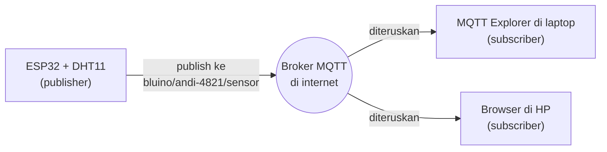
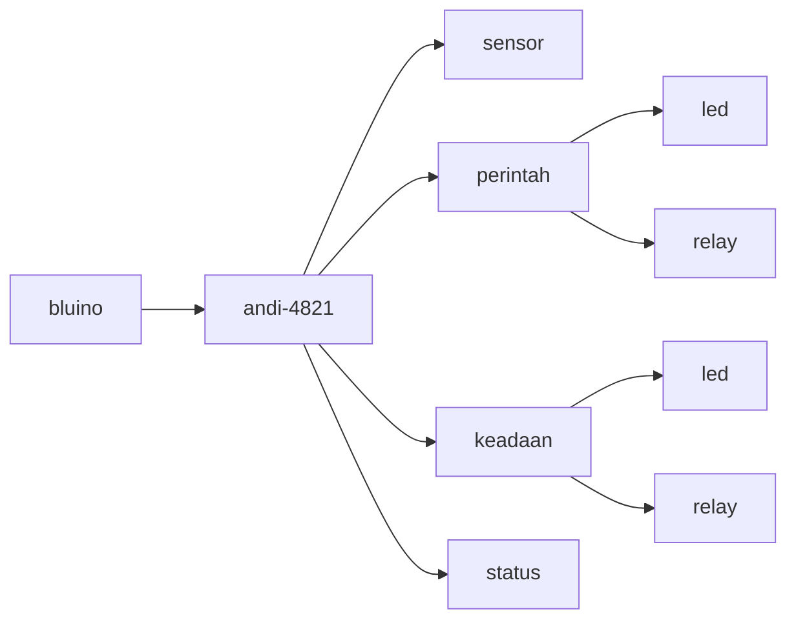
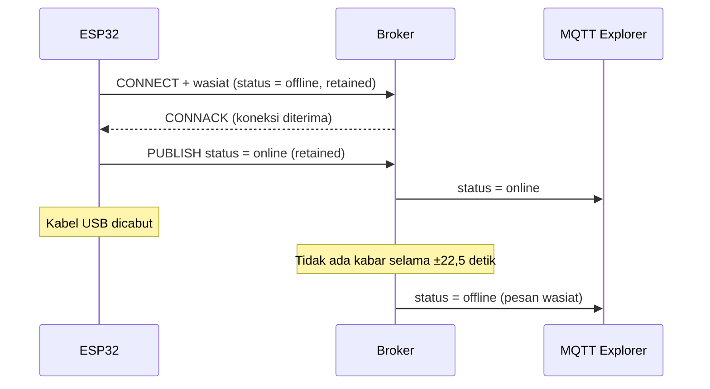
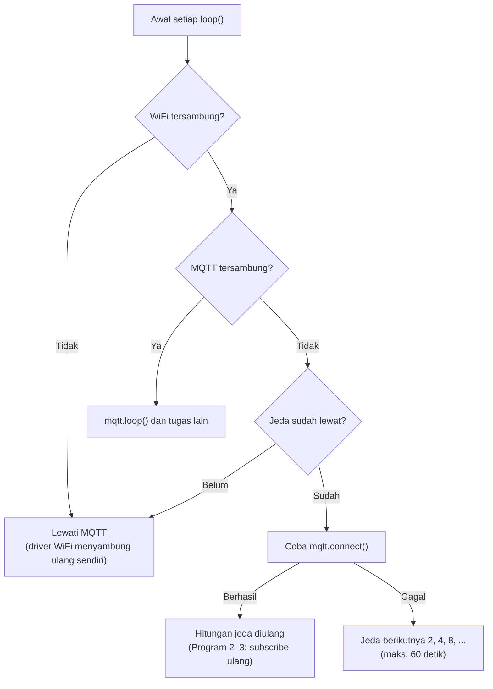

# BAB 50: MQTT

> ✅ **Prasyarat:** Selesaikan **BAB 42 (WiFi Station Mode)** — ESP32-mu sudah bisa tersambung ke WiFi dan menampilkan alamat IP di Serial Monitor. Program di BAB ini juga memakai sensor dari **BAB 26 (DHT11 — Suhu & Kelembapan)**, *relay* dari **BAB 37 (*Relay* — Kontrol AC/DC)**, JSON dengan ArduinoJson dari **BAB 46 (Web Server)** bagian 46.6, dan pola `millis()` dari **BAB 16 (Non-Blocking Programming)**. Pengalaman dengan HTTP di **BAB 48 (HTTP Client & REST API)** membantu, tetapi tidak wajib.

Di BAB 46–48, ESP32 berkomunikasi dengan HTTP: ada yang **bertanya**, lalu ada yang **menjawab**. Di BAB ini kamu belajar **MQTT**, protokol yang cara kerjanya mirip grup WhatsApp. ESP32 cukup mengirim data suhu ke sebuah "grup" (disebut **topik**), lalu semua aplikasi yang bergabung ke grup itu langsung menerimanya — tanpa perlu bertanya berulang-ulang. Sebaliknya, kamu bisa mengirim perintah "nyalakan *relay*" dari laptop atau HP, bahkan dari jaringan yang berbeda dengan ESP32, asalkan keduanya tersambung ke internet. Karena ringan dan hemat data, MQTT menjadi salah satu protokol paling populer di dunia IoT.

## 📌 Tujuan Pembelajaran

Setelah mempelajari BAB ini, kamu bisa:

- Menjelaskan model ***publish-subscribe*** MQTT dan bedanya dengan model *request-response* HTTP.
- Memahami istilah inti MQTT: *broker*, *client*, Client ID, topik, *wildcard* `+` dan `#`, QoS 0/1/2, *retained message*, *keep-alive*, dan *Last Will*.
- Memakai *broker* publik dengan aman: memakai awalan topik yang unik dan tidak mengirim data pribadi.
- Mencoba MQTT tanpa ESP32 dengan **MQTT Explorer** (aplikasi laptop) dan **HiveMQ WebSocket Client** (*browser*).
- Memakai *library* **PubSubClient** untuk mengirim data DHT11 dalam format JSON, menerima perintah untuk LED dan *relay*, serta melaporkan status `online`/`offline` dengan *Last Will*.
- Menulis sambung ulang MQTT yang tidak membekukan `loop()`, lengkap dengan jeda yang makin lama (*backoff*).

## 🧰 Yang Perlu Disiapkan

| Kebutuhan | Keterangan |
|---|---|
| *Hardware* | Kit Bluino ESP32 IoT Starter Shield + kabel USB **data** |
| Kabel *jumper* | 3 kabel *female-female* (sudah ada di kit): `DHT` → IO27 (Program 1 dan 3), `LED1` (merah) → IO4 dan `RELAY` → IO26 (Program 2 dan 3) |
| Komponen tambahan | Tidak ada. *Relay* cukup dicoba **tanpa beban** — jangan pernah menyambungkan listrik PLN 220 V |
| *Software* | Arduino IDE 2.x + *board package* **esp32** versi 3.3.x (lihat [BAB 5](../BAB-05/README.md)); aplikasi **MQTT Explorer** (gratis, Windows/macOS/Linux). Opsional: Mosquitto (`mosquitto_pub`/`mosquitto_sub`) |
| *Library* | **PubSubClient** by Nick O'Leary (diuji dengan versi 2.8); **ArduinoJson** by Benoit Blanchon versi 7; **DHT sensor library** by Adafruit + **Adafruit Unified Sensor** (Program 1 dan 3) |
| Alat uji | **Serial Monitor** Arduino IDE (baud 115200); **MQTT Explorer** di laptop; atau **HiveMQ WebSocket Client** di *browser* laptop/HP |
| Jaringan | WiFi **2,4 GHz** (ESP32 tidak mendukung 5 GHz) yang **tersambung ke internet**, karena *broker* yang dipakai ada di internet. Laptop/HP boleh berada di jaringan lain, asalkan juga tersambung ke internet. Sebagian WiFi kampus/kantor memblokir *port* MQTT 1883 — kalau begitu, pakai *hotspot* HP |

## 📑 Daftar Isi

- [50.1 Dari HTTP ke MQTT: Kenapa Publish-Subscribe?](#501-dari-http-ke-mqtt-kenapa-publish-subscribe)
- [50.2 Broker, Client, dan Topik](#502-broker-client-dan-topik)
- [50.3 QoS, Retained Message, Keep-Alive, dan Last Will](#503-qos-retained-message-keep-alive-dan-last-will)
- [50.4 Memakai Broker Publik dengan Aman](#504-memakai-broker-publik-dengan-aman)
- [50.5 Mencoba MQTT Tanpa ESP32](#505-mencoba-mqtt-tanpa-esp32)
- [50.6 Library PubSubClient](#506-library-pubsubclient)
- [50.7 Program 1: Publish Data DHT11](#507-program-1-publish-data-dht11)
- [50.8 Program 2: Subscribe — Kendalikan LED dan Relay](#508-program-2-subscribe--kendalikan-led-dan-relay)
- [50.9 Program 3: Sensor, Kontrol, dan Status Online/Offline](#509-program-3-sensor-kontrol-dan-status-onlineoffline)
- [50.10 Keamanan dan Langkah Berikutnya](#5010-keamanan-dan-langkah-berikutnya)
- [50.11 Troubleshooting](#5011-troubleshooting)
- [📝 Rangkuman](#-rangkuman)
- [💪 Latihan](#-latihan)
- [📚 Referensi](#-referensi)

---

## 50.1 Dari HTTP ke MQTT: Kenapa Publish-Subscribe?

### 50.1.1 Keterbatasan HTTP untuk IoT

HTTP memakai pola ***request-response***: satu pihak meminta, pihak lain menjawab. Pola ini cocok untuk membuka halaman web, tetapi kurang pas untuk banyak kebutuhan IoT:

- **ESP32 sebagai *web server*** ([BAB 46](../BAB-46/README.md)) hanya bisa dibuka dari WiFi yang sama. Dari luar rumah, *router* tidak mengizinkan orang lain masuk ke ESP32-mu.
- **ESP32 sebagai *client* HTTP** ([BAB 48](../BAB-48/README.md)) bisa mengirim data ke server di internet. Namun, untuk tahu apakah ada perintah baru, ESP32 harus bertanya berulang-ulang (***polling***): "Ada perintah? Belum. Ada perintah? Belum…" Cara ini boros data, dan perintah baru terasa terlambat.

### 50.1.2 Analogi Grup WhatsApp

MQTT memakai pola ***publish-subscribe*** (terbit-langganan). Bayangkan sebuah grup WhatsApp:

- Setiap anggota cukup **mengirim pesan ke grup**. Ia tidak perlu tahu siapa saja yang membacanya.
- Server WhatsApp **meneruskan** pesan itu ke semua anggota grup.
- Siapa pun yang **bergabung** ke grup langsung menerima pesan baru tanpa perlu bertanya.

Padanan istilahnya di MQTT:

| Grup WhatsApp | MQTT | Contoh di BAB ini |
|---|---|---|
| Server WhatsApp | ***Broker*** | `broker.hivemq.com` |
| Anggota grup (aplikasi WhatsApp di HP) | ***Client*** | ESP32, MQTT Explorer, *browser* |
| Nama grup | **Topik** (*topic*) | `bluino/andi-4821/sensor` |
| Mengirim pesan ke grup | ***Publish*** (menerbitkan) | ESP32 mengirim data suhu |
| Bergabung ke grup | ***Subscribe*** (berlangganan) | MQTT Explorer ingin menerima data suhu |
| Pesan yang disematkan (*pin*) | ***Retained message*** | Status terakhir ESP32: `online` |

Ada satu perbedaan penting: MQTT **tidak menyimpan riwayat pesan**. Pesan diteruskan saat itu juga, mirip siaran radio langsung — kalau radiomu sedang mati, siarannya terlewat. Pengecualiannya hanya *retained message*, yang mirip pesan yang disematkan di grup (dibahas di [50.3](#503-qos-retained-message-keep-alive-dan-last-will)).



*Gambar 50.1 — ESP32 mengirim (publish) data ke broker; broker meneruskannya ke semua client yang berlangganan (subscribe) topik itu. Sumber: dibuat untuk materi ini.*

Perhatikan bahwa ESP32, laptop, dan HP **tidak pernah saling menghubungi langsung**. Semuanya hanya membuka koneksi **keluar** ke *broker*. Karena itulah MQTT tetap bekerja walaupun ESP32 ada di WiFi rumah dan HP-mu memakai data seluler.

### 50.1.3 Perbandingan HTTP dan MQTT

| Aspek | HTTP ([BAB 46](../BAB-46/README.md)–[49](../BAB-49/README.md)) | MQTT (BAB ini) |
|---|---|---|
| Pola | *Request-response*: meminta lalu dijawab | *Publish-subscribe*: lewat perantara (*broker*) |
| Koneksi | Biasanya dibuka untuk setiap permintaan | Satu koneksi TCP yang **tetap terbuka** selama perangkat menyala |
| Data baru untuk perangkat | Perangkat harus bertanya berulang (*polling*) | *Broker* langsung mengirimkannya (*push*) begitu ada |
| Ukuran *header* | Puluhan sampai ratusan *byte* teks | Minimal 2 *byte* |
| Akses dari jaringan lain | ESP32 sebagai *web server* hanya bisa dibuka dari WiFi yang sama | Semua pihak cukup tersambung ke *broker* yang sama di internet |
| Cocok untuk | Halaman web, mengambil data dari API | Data sensor berkala, kontrol jarak jauh, banyak perangkat sekaligus |

> 📌 **Catatan:** MQTT dibuat pada 1999 oleh Andy Stanford-Clark (IBM) dan Arlen Nipper untuk memantau pipa minyak lewat koneksi satelit yang mahal dan lambat — karena itu protokolnya dibuat sangat hemat. Nama MQTT berasal dari *MQ Telemetry Transport* (MQ adalah nama produk IBM). Sekarang MQTT adalah standar terbuka OASIS; versi 3.1.1 (2014) juga menjadi standar ISO/IEC 20922. *Library* PubSubClient di BAB ini memakai MQTT 3.1.1.

---

## 50.2 Broker, Client, dan Topik

### 50.2.1 Broker dan Client

***Broker*** adalah server perantara yang menerima semua pesan lalu meneruskannya ke pihak yang berlangganan. Contoh perangkat lunak *broker*: Mosquitto, HiveMQ, dan EMQX. Di BAB ini kita memakai *broker* publik gratis yang sudah berjalan di internet, jadi kamu tidak perlu memasang apa pun.

***Client*** adalah setiap perangkat atau aplikasi yang tersambung ke *broker*: ESP32, MQTT Explorer di laptop, atau *browser* di HP. Satu *client* boleh mengirim (*publish*) dan berlangganan (*subscribe*) sekaligus. Program 2 dan 3 nanti melakukan keduanya.

Setiap *client* memperkenalkan diri dengan **Client ID**, semacam nama pengguna yang harus **unik** di satu *broker*. Kalau ada dua *client* tersambung dengan Client ID yang sama, *broker* memutus *client* yang lebih dulu tersambung. Kalau keduanya sama-sama punya fitur sambung ulang otomatis, mereka akan saling "menendang" terus-menerus. Program di BAB ini membuat Client ID dari alamat MAC ESP32 (nomor unik bawaan *chip* WiFi, lihat [BAB 45](../BAB-45/README.md)), misalnya `bluino-A1B2C3`, sehingga setiap kit otomatis punya ID berbeda.

*Client* terhubung ke *broker* lewat ***port***, yaitu nomor "pintu" layanan di server:

| *Port* | Dipakai untuk |
|---|---|
| 1883 | MQTT biasa tanpa enkripsi — dipakai ESP32 di BAB ini |
| 8883 | MQTT dengan enkripsi TLS (lihat [50.10](#5010-keamanan-dan-langkah-berikutnya)) |
| 8000/8884, 8083/8084, 8080/8081 | MQTT lewat WebSocket ([BAB 47](../BAB-47/README.md)) untuk *client* di *browser*; nomornya berbeda di tiap *broker* (lihat [50.4](#504-memakai-broker-publik-dengan-aman)) |

### 50.2.2 Topik

**Topik** adalah "alamat" pesan berupa teks bertingkat yang dipisah garis miring `/`, mirip alamat folder di komputer. Kamu tidak perlu membuat topik terlebih dahulu: topik otomatis "ada" begitu seseorang mengirim pesan ke sana.

Semua program di BAB ini memakai pohon topik berikut. `andi-4821` adalah **awalan unik** milikmu — ganti dengan nama panggilan dan 4 angka acak (alasannya ada di [50.4](#504-memakai-broker-publik-dengan-aman)).



*Gambar 50.2 — Pohon topik yang dipakai di BAB ini. Setiap jalur dari kiri ke kanan adalah satu topik, misalnya bluino/andi-4821/perintah/led. Sumber: dibuat untuk materi ini.*

| Topik | Isi pesan | Siapa yang mengirim |
|---|---|---|
| `bluino/andi-4821/sensor` | JSON suhu dan kelembapan, misalnya `{"suhu":28.6,"kelembapan":70,...}` | ESP32 (Program 1 dan 3) |
| `bluino/andi-4821/perintah/led` | `ON`, `OFF`, atau `TOGGLE` | Kamu, dari MQTT Explorer atau *browser* |
| `bluino/andi-4821/perintah/relay` | `ON`, `OFF`, atau `TOGGLE` | Kamu |
| `bluino/andi-4821/keadaan/led` | `ON` atau `OFF` — keadaan LED yang sebenarnya | ESP32 (Program 2 dan 3) |
| `bluino/andi-4821/keadaan/relay` | `ON` atau `OFF` — keadaan *relay* yang sebenarnya | ESP32 (Program 2 dan 3) |
| `bluino/andi-4821/status` | `online` atau `offline` | ESP32 dan *broker* (Program 3) |

Aturan menulis topik:

- **Huruf besar dan kecil dibedakan.** `bluino/Sensor` dan `bluino/sensor` adalah dua topik yang berbeda. Biasakan memakai huruf kecil semua.
- **Jangan memakai spasi** dan huruf beraksen. Pakai huruf, angka, tanda hubung `-`, dan garis bawah `_`.
- **Jangan diawali `/`.** Topik `/bluino/sensor` sah, tetapi tingkat pertamanya menjadi teks kosong — membingungkan dan tidak perlu.
- **Jangan diawali `$`.** Topik seperti `$SYS/...` dipakai *broker* untuk informasi internalnya.
- **Tanda `+` dan `#` hanya untuk berlangganan** (lihat bagian berikutnya), tidak boleh ada di topik tujuan pengiriman.

### 50.2.3 Wildcard: Berlangganan Banyak Topik Sekaligus

Saat berlangganan, kamu boleh memakai ***wildcard*** (karakter pengganti):

- **`+`** menggantikan **tepat satu** tingkat topik.
- **`#`** menggantikan **semua tingkat** di bawahnya, termasuk tingkat itu sendiri. `#` hanya boleh di posisi paling akhir.

| Berlangganan ke… | Menerima pesan dari | Tidak menerima dari |
|---|---|---|
| `bluino/andi-4821/perintah/+` | `.../perintah/led`, `.../perintah/relay` | `.../perintah` (tidak ada tingkat sesudahnya), `.../perintah/led/warna` (dua tingkat) |
| `bluino/andi-4821/keadaan/+` | `.../keadaan/led`, `.../keadaan/relay` | `.../sensor` |
| `bluino/andi-4821/#` | **Semua** topik milikmu: `.../sensor`, `.../perintah/led`, `.../status`, dan seterusnya | `bluino/budi-7305/sensor` (awalan orang lain) |
| `bluino/+/status` | Status semua kit yang memakai awalan `bluino/` | — |

Program 2 dan 3 memakai `bluino/andi-4821/perintah/+`, sehingga cukup satu kali berlangganan untuk menerima perintah LED **dan** *relay*. Saat memantau dari laptop, kamu cukup berlangganan `bluino/andi-4821/#` untuk melihat semua pesanmu.

### 50.2.4 Payload: Isi Pesan

Isi pesan MQTT disebut ***payload***. *Broker* tidak peduli isinya: boleh teks biasa (`ON`), angka (`28.6`), JSON, atau data biner. Yang penting pengirim dan penerima sepakat soal formatnya. Di BAB ini:

- Data sensor dikirim sebagai **JSON** ([BAB 46](../BAB-46/README.md) bagian 46.6), supaya beberapa nilai bisa dikirim dalam satu pesan.
- Perintah dan keadaan dikirim sebagai **teks pendek** (`ON`/`OFF`), supaya mudah diketik dari MQTT Explorer.

---

## 50.3 QoS, Retained Message, Keep-Alive, dan Last Will

### 50.3.1 QoS: Seberapa Pasti Pesan Sampai?

**QoS** (*Quality of Service*, tingkat jaminan pengiriman) menentukan seberapa keras pengirim berusaha memastikan pesan sampai:

| QoS | Nama | Cara kerja | Analogi |
|---|---|---|---|
| 0 | *At most once* (paling banyak sekali) | Dikirim sekali tanpa konfirmasi. Kalau hilang di jalan, ya sudah | Berseru sekali di keramaian |
| 1 | *At least once* (paling sedikit sekali) | Dikirim ulang sampai penerima membalas "sudah terima" (PUBACK). Bisa saja pesan sampai **dua kali** | Mengirim paket dan menunggu bukti terima; kalau tidak ada kabar, kirim lagi |
| 2 | *Exactly once* (tepat sekali) | Jabat tangan 4 langkah supaya pesan pasti sampai satu kali | Surat tercatat dengan tanda terima berlapis |

Makin tinggi QoS, makin banyak paket bolak-balik dan makin lambat. QoS berlaku di **tiap ruas**: dari pengirim ke *broker*, lalu dari *broker* ke tiap pelanggan. Pelanggan menerima pesan dengan QoS yang **lebih rendah** di antara QoS kiriman dan QoS langganannya.

> 📌 **Catatan:** *Library* PubSubClient yang dipakai ESP32 di BAB ini hanya bisa **mengirim** dengan QoS 0 dan **berlangganan** dengan QoS 0 atau 1. Untuk data sensor yang dikirim setiap 10 detik, QoS 0 sudah cukup: kalau satu pesan hilang, pesan berikutnya segera datang.

### 50.3.2 Retained Message: Pesan yang Disematkan

Biasanya *broker* tidak menyimpan pesan. Kalau kamu baru berlangganan topik `.../keadaan/relay`, kamu harus menunggu sampai ESP32 mengirim keadaan berikutnya — bisa lama.

Pesan yang dikirim dengan tanda ***retained*** berbeda: *broker* **menyimpan pesan terakhir** di topik itu, lalu langsung memberikannya kepada setiap pelanggan baru. Mirip pesan yang disematkan di grup: anggota baru langsung melihatnya.

- Setiap topik hanya menyimpan **satu** *retained message* — yang terbaru menggantikan yang lama.
- Cocok untuk **keadaan** atau **status** (misalnya `online`, keadaan *relay* `ON`).
- **Jangan** dipakai untuk **perintah**. Perintah `ON` yang disematkan di `.../perintah/relay` akan dijalankan ulang **setiap kali** ESP32 tersambung kembali — *relay* bisa menyala sendiri setelah listrik padam.
- Cara menghapusnya: kirim pesan **kosong** (tanpa isi) dengan tanda *retained* ke topik yang sama.

### 50.3.3 Keep-Alive: Tanda Masih Hidup

Koneksi MQTT dibiarkan terbuka terus. Lalu, bagaimana *broker* tahu bahwa ESP32 masih hidup kalau sedang tidak ada data yang dikirim? Jawabannya ***keep-alive***: saat tersambung, *client* berjanji akan "bersuara" paling lambat setiap N detik. Kalau tidak ada pesan yang perlu dikirim, *client* mengirim paket kecil **PINGREQ** ("aku masih di sini"), dan *broker* membalas **PINGRESP**.

PubSubClient memakai *keep-alive* **15 detik**. Kalau *broker* tidak mendengar apa pun selama 1,5 kali *keep-alive* (sekitar 22,5 detik), *broker* menganggap *client* sudah mati dan menutup koneksinya. Pengiriman PINGREQ dan penerimaan pesan semuanya dikerjakan di dalam fungsi `mqtt.loop()` — itulah sebabnya fungsi ini **wajib dipanggil sesering mungkin** di `loop()`.

### 50.3.4 Last Will: Pesan Titipan Saat Terputus Mendadak

***Last Will and Testament*** (LWT, "surat wasiat") adalah pesan yang **dititipkan** *client* kepada *broker* saat pertama kali tersambung. Isinya misalnya: "Kalau aku tiba-tiba hilang, kirimkan `offline` ke topik `bluino/andi-4821/status`."

*Broker* mengirim pesan wasiat itu kalau *client* terputus **tidak wajar**: kabel USB dicabut, WiFi hilang, ESP32 *restart*, atau *keep-alive* terlewat. Kalau *client* pamit baik-baik dengan `mqtt.disconnect()`, pesan wasiat **tidak** dikirim.

Digabung dengan *retained message*, kita mendapat topik status yang selalu benar:

1. Saat tersambung, ESP32 menitipkan wasiat `offline` (*retained*).
2. Begitu diterima *broker*, ESP32 sendiri mengirim `online` (*retained*).
3. Kalau ESP32 mati mendadak, *broker* mengirim `offline` (*retained*).

Siapa pun yang berlangganan `.../status` — kapan pun — langsung tahu apakah ESP32 sedang menyala.



*Gambar 50.3 — Status online/offline dengan Last Will: broker sendiri yang mengumumkan offline ketika ESP32 hilang tanpa pamit. Sumber: dibuat untuk materi ini.*

### 50.3.5 Clean Session: Berlangganan Ulang Setiap Tersambung

PubSubClient selalu tersambung dengan pengaturan ***clean session***: *broker* **melupakan** semua langganan *client* begitu koneksinya putus. Akibatnya, setiap kali ESP32 tersambung ulang, ia harus **berlangganan lagi**. Program 2 dan 3 memanggil `subscribe()` di dalam fungsi penyambungnya, sehingga langganan otomatis diperbarui setiap kali tersambung ulang.

---

## 50.4 Memakai Broker Publik dengan Aman

*Broker* publik adalah *broker* gratis yang boleh dipakai siapa saja **tanpa akun**. Sangat praktis untuk belajar, tetapi ada konsekuensinya. Tiga *broker* publik berikut sudah diperiksa pada **Oktober 2026** (tersambung, bisa kirim-terima, *retained message* dan *Last Will* bekerja):

| *Broker* | Alamat (*host*) | TCP | TLS | WebSocket untuk *browser* | Catatan |
|---|---|---|---|---|---|
| HiveMQ | `broker.hivemq.com` | 1883 | 8883 | 8000 (`ws`), 8884 (`wss`), *path* `/mqtt` | **Dipakai di BAB ini**, pasangan HiveMQ WebSocket Client |
| EMQX | `broker.emqx.io` | 1883 | 8883 | 8083 (`ws`), 8084 (`wss`), *path* `/mqtt` | Cadangan pertama |
| Eclipse Mosquitto | `test.mosquitto.org` | 1883 | 8883, 8886 | 8080 (`ws`), 8081 (`wss`) | *Server* uji coba pengembang Mosquitto; kadang lambat atau menjalankan versi percobaan |

Kalau satu *broker* sedang bermasalah, cukup ganti nama *host* di program dan di MQTT Explorer ke *broker* lain — kode lainnya tetap sama.

### 50.4.1 Aturan Wajib di Broker Publik

1. **Semua orang bisa membaca dan mengirim ke topik apa pun.** Tidak ada kata sandi. Jangan pernah mengirim data pribadi: nama lengkap, alamat rumah, lokasi, foto, kata sandi WiFi, atau token.
2. **Pakai awalan topik yang unik.** Ribuan orang memakai *broker* yang sama, termasuk pembaca kurikulum ini yang memakai kode yang sama persis. Kalau semua memakai `bluino/test`, kamu akan melihat data orang lain dan mereka bisa mengendalikan *relay*-mu. Pakai **nama panggilan + 4 angka acak**, misalnya `bluino/andi-4821`. Huruf kecil, tanpa spasi.
3. **Siapa pun yang tahu topikmu bisa mengirim perintah.** Awalan unik hanya mengurangi kemungkinan "salah alamat", **bukan pengaman**. Karena itu, *relay* di BAB ini dicoba **tanpa beban**.
4. **Tidak ada jaminan.** *Broker* publik bisa lambat, mati sementara, atau di-*restart* sehingga *retained message* hilang. Jangan dipakai untuk sistem sungguhan.
5. **Jangan membanjiri *broker*.** Kirim data paling cepat setiap beberapa detik. Jangan berlangganan `#` saja (semua topik di *broker*) — kamu akan dibanjiri ribuan pesan per detik dari seluruh dunia.

> ⚠️ **Perhatian:** Untuk proyek sungguhan, pakai *broker* sendiri (misalnya Mosquitto di komputer atau Raspberry Pi) atau layanan MQTT *cloud* yang memakai nama pengguna, kata sandi, dan enkripsi TLS. Gambarannya ada di [50.10](#5010-keamanan-dan-langkah-berikutnya).

### 50.4.2 Menentukan Awalan Topikmu

Sebelum lanjut, tentukan awalanmu sekarang dan catat, karena akan dipakai di semua alat uji dan program:

1. Ambil nama panggilanmu dalam huruf kecil, misalnya `andi`.
2. Tambahkan tanda hubung dan 4 angka acak, misalnya `4821`. Jangan memakai data pribadi seperti tanggal lahir atau nomor HP.
3. Awalanmu: `bluino/andi-4821`. Di semua contoh BAB ini, **ganti** `andi-4821` dengan milikmu.

---

## 50.5 Mencoba MQTT Tanpa ESP32

Sebelum menulis kode, rasakan dulu cara kerja MQTT dengan dua aplikasi yang saling berkirim pesan lewat *broker*. Alat yang sama nanti dipakai untuk menguji semua program ESP32.

| Alat | Jalan di | Kegunaan di BAB ini |
|---|---|---|
| **MQTT Explorer** | Laptop (Windows, macOS, Linux) | Alat utama: melihat pohon topik, mengirim perintah, menghapus *retained message* |
| **HiveMQ WebSocket Client** | *Browser* di laptop atau HP | Tanpa memasang apa pun; praktis untuk mengirim perintah dari HP |
| **Mosquitto** (`mosquitto_pub`/`mosquitto_sub`) | Command Prompt / Terminal | Opsional, untuk yang suka baris perintah |

### 50.5.1 MQTT Explorer di Laptop

**MQTT Explorer** adalah aplikasi gratis yang menampilkan semua topik dalam bentuk pohon, lengkap dengan isi pesan terbaru dan riwayatnya.

**Memasang:**

1. Buka [mqtt-explorer.com](https://mqtt-explorer.com) di *browser*. Saat BAB ini ditulis, versi terbarunya **0.4.0-beta.6**.
2. Pilih unduhan sesuai sistem operasimu:
   - **Windows:** *installer* `.exe`, versi *portable* (langsung jalan tanpa dipasang), atau lewat **Microsoft Store**.
   - **macOS:** lewat **Mac App Store**, atau *file* DMG (pilih Intel atau ARM/Apple Silicon sesuai Mac-mu).
   - **Linux:** AppImage, paket `.deb`, atau `sudo snap install mqtt-explorer` di Ubuntu.
3. Pasang seperti aplikasi biasa, lalu buka.

> 💡 **Tips:** Kalau Windows menampilkan peringatan SmartScreen saat membuka *installer*, kamu bisa memasang versi dari **Microsoft Store** saja — isinya sama.

**Menyambung ke *broker*:**

1. Saat dibuka, MQTT Explorer menampilkan jendela **MQTT Connection**. Di daftar koneksi sebelah kiri biasanya sudah ada contoh koneksi (misalnya `test.mosquitto.org`). Klik tombol **+** di atas daftar itu untuk membuat koneksi baru.
2. Isi kolomnya:

   | Kolom | Isi |
   |---|---|
   | **Name** | `HiveMQ Publik` (bebas, hanya nama tampilan) |
   | **Validate certificate** dan **Encryption (tls)** | Biarkan mati |
   | **Protocol** | `mqtt://` |
   | **Host** | `broker.hivemq.com` |
   | **Port** | `1883` |
   | **Username** dan **Password** | Kosongkan |

3. Klik **ADVANCED**. Di daftar topik langganan biasanya sudah ada `#` dan `$SYS/#`. **Hapus keduanya** dengan ikon tempat sampah di sampingnya — di *broker* publik, `#` berarti menerima pesan **semua orang** dan aplikasi bisa menjadi sangat lambat.
4. Di kolom **Topic**, ketik `bluino/andi-4821/#` (pakai awalanmu sendiri), lalu klik **ADD**. Klik **BACK**.
5. Klik **SAVE**, lalu **CONNECT**. Kalau berhasil, jendela utama terbuka. Panel kiri (pohon topik) masih kosong karena belum ada yang mengirim pesan ke topikmu.

**Mengirim pesan:**

1. Di panel kanan, cari bagian **Publish**.
2. Isi kolom topik dengan `bluino/andi-4821/halo`, pilih format **raw**, lalu ketik `Halo dari MQTT Explorer` di kotak pesan.
3. Klik **PUBLISH**. Di panel kiri muncul pohon `bluino` → `andi-4821` → `halo`. Klik `halo` untuk melihat isi pesannya di panel kanan (bagian **Value**).

Karena MQTT Explorer berlangganan topikmu sendiri, pesan yang ia kirim juga kembali kepadanya lewat *broker* — itu tanda *publish* dan *subscribe* bekerja.

### 50.5.2 HiveMQ WebSocket Client di Browser

*Browser* tidak bisa membuka koneksi MQTT biasa di *port* 1883. Sebagai gantinya, *browser* memakai MQTT di atas **WebSocket** ([BAB 47](../BAB-47/README.md)). Karena halaman HiveMQ dibuka lewat `https://`, koneksinya juga harus terenkripsi (`wss`), sehingga *port*-nya **8884**.

1. Buka [hivemq.com/demos/websocket-client](https://www.hivemq.com/demos/websocket-client/) di *browser* laptop atau HP. Laptop/HP tidak harus di WiFi yang sama dengan ESP32, cukup tersambung ke internet.
2. Di bagian **Connection**, periksa isinya: **Host** = `broker.hivemq.com`, **Port** = `8884`, dan kotak **SSL** dicentang. **ClientID** sudah diisi acak — biarkan saja. **Username** dan **Password** kosong.
3. Klik **Connect**. Status koneksi berubah menjadi tersambung (*connected*), biasanya ditandai warna hijau.
4. Di bagian **Subscriptions**, klik **Add New Topic Subscription**, isi **Topic** dengan `bluino/andi-4821/#`, biarkan **QoS** 0, lalu klik **Subscribe**.
5. Di bagian **Publish**, isi **Topic** dengan `bluino/andi-4821/halo` dan **Message** dengan `Halo dari browser`, lalu klik **Publish**. Pesannya muncul di bagian **Messages**.

> 📌 **Catatan:** Tampilan halaman ini bisa sedikit berubah dari waktu ke waktu. Yang penting: *host*, *port* WebSocket terenkripsi (8884), centang SSL, lalu berlangganan dan kirim ke topik dengan awalanmu. Alternatif serupa: [MQTTX Web](https://mqttx.app/web-client) dari EMQX (pakai `broker.emqx.io`, *port* 8084, *path* `/mqtt`).

### 50.5.3 Percobaan: Dua Aplikasi Saling Berkirim Pesan

> 🧪 **Coba Sendiri:** Buka MQTT Explorer di laptop dan HiveMQ WebSocket Client di HP (atau di tab *browser* lain). Pastikan keduanya berlangganan `bluino/andi-4821/#`.
>
> 1. **Kirim dari *browser*:** *publish* `Halo laptop` ke `bluino/andi-4821/halo`. Pesannya langsung muncul di MQTT Explorer. Kirim juga dari MQTT Explorer dan lihat pesannya muncul di *browser*.
> 2. ***Wildcard* `+`:** di *browser*, tambahkan langganan `bluino/andi-4821/+/suhu`. Dari MQTT Explorer, kirim `27` ke `bluino/andi-4821/kamar/suhu` dan `31` ke `bluino/andi-4821/dapur/suhu`. Keduanya cocok dengan `+`. Lalu kirim ke `bluino/andi-4821/kamar/lampu` — pesan ini hanya tertangkap oleh langganan `#`, bukan oleh `+/suhu`. (Pesan yang cocok dengan dua langganan sekaligus bisa tampil dua kali di *browser* — itu normal.)
> 3. ***Retained message*:** di MQTT Explorer, kirim `Pesan disematkan` ke `bluino/andi-4821/catatan` dengan kotak **retain** dicentang. Di *browser*, klik **Disconnect**, lalu **Connect** lagi dan berlangganan ulang `bluino/andi-4821/#`. Pesan itu langsung muncul walaupun dikirim sebelum kamu berlangganan. Kirim pesan biasa (tanpa *retain*) ke `bluino/andi-4821/halo`, lalu ulangi *disconnect-connect* — pesan biasa itu **tidak** muncul lagi.
> 4. **Menghapus *retained message*:** di MQTT Explorer, kirim pesan **kosong** dengan **retain** dicentang ke `bluino/andi-4821/catatan`. Cara lain: klik topiknya di pohon, lalu klik ikon tempat sampah di bagian **Value**.

<details>
<summary><b>🔬 Pendalaman (opsional): Mosquitto di Command Prompt atau Terminal</b></summary>

Mosquitto menyediakan dua program baris perintah: `mosquitto_sub` untuk berlangganan dan `mosquitto_pub` untuk mengirim.

**Memasang:**

- **Windows:** unduh *installer* dari [mosquitto.org/download](https://mosquitto.org/download/) (misalnya `mosquitto-2.1.2-install-windows-x64.exe`), lalu pasang. Kamu boleh menghapus centang **Service** karena kita hanya butuh program *client*-nya. Buka **Command Prompt** (tombol Start → ketik `cmd` → Enter), lalu masuk ke folder Mosquitto: `cd "C:\Program Files\mosquitto"`.
- **macOS:** pasang Homebrew dari [brew.sh](https://brew.sh), lalu jalankan `brew install mosquitto` di **Terminal**.
- **Ubuntu/Debian:** jalankan `sudo apt install mosquitto-clients` di **Terminal**.

**Berlangganan** (biarkan jendela ini terbuka; berhenti dengan **Ctrl + C**). Opsi `-h` = *host*, `-t` = topik, `-v` = tampilkan nama topik di depan isi pesan:

```bash
mosquitto_sub -h broker.hivemq.com -t "bluino/andi-4821/#" -v
```

**Mengirim** (buka jendela Command Prompt/Terminal **kedua**; di Windows, `cd` lagi ke folder Mosquitto). Opsi `-m` = isi pesan:

```bash
mosquitto_pub -h broker.hivemq.com -t "bluino/andi-4821/halo" -m "Halo dari terminal"
```

Jendela pertama akan menampilkan:

```text
bluino/andi-4821/halo Halo dari terminal
```

Opsi lain yang berguna: `-r` mengirim sebagai *retained message*, dan `-r -n` mengirim pesan kosong *retained* untuk menghapusnya. Selalu beri tanda kutip ganda pada topik, karena `#` punya arti khusus di Terminal macOS/Linux.

</details>

---

## 50.6 Library PubSubClient

ESP32 tidak punya *library* MQTT bawaan di Arduino IDE. Kita memakai **PubSubClient** karya Nick O'Leary — *library* MQTT yang paling banyak dipakai di Arduino, kecil, dan cukup untuk kebutuhan BAB ini.

### 50.6.1 Memasang Library

Buka **Sketch → Include Library → Manage Libraries…** (atau klik ikon buku di sisi kiri Arduino IDE), lalu pasang (lewati yang sudah terpasang):

1. Ketik `PubSubClient`. Pilih yang pembuatnya **Nick O'Leary** (diuji dengan versi **2.8**), lalu klik **INSTALL**. Hati-hati, ada beberapa *library* dengan nama mirip dari pembuat lain — pastikan nama pembuatnya benar.
2. Ketik `ArduinoJson`. Pilih yang pembuatnya **Benoit Blanchon**, versi **7.x**, lalu klik **INSTALL**.
3. Ketik `DHT sensor library`. Pilih yang pembuatnya **Adafruit**, klik **INSTALL**, lalu klik **Install All** saat ditanya soal *library* pendukung (**Adafruit Unified Sensor**).

### 50.6.2 Pola Dasar

Potongan kode berikut memperlihatkan urutan pemakaian PubSubClient. Program lengkapnya ada di [50.7](#507-program-1-publish-data-dht11).

Di bagian atas program (di luar fungsi):

```cpp
#include <WiFi.h>
#include <PubSubClient.h>

WiFiClient wifiClient;          // jalur TCP biasa (sama seperti di BAB 48)
PubSubClient mqtt(wifiClient);  // client MQTT yang berjalan di atas jalur itu

// Dipanggil oleh mqtt.loop() setiap ada pesan masuk di topik langganan
void pesanMasuk(char *topik, byte *payload, unsigned int panjang) {
  // ... olah pesan di sini ...
}
```

Di dalam `setup()`, setelah WiFi tersambung ([BAB 42](../BAB-42/README.md)):

```cpp
mqtt.setServer("broker.hivemq.com", 1883);  // 1. alamat broker
mqtt.setCallback(pesanMasuk);               // 2. fungsi penerima pesan
if (mqtt.connect("bluino-A1B2C3")) {        // 3. tersambung dengan Client ID unik
  mqtt.subscribe("bluino/andi-4821/perintah/+");             // 4. berlangganan
  mqtt.publish("bluino/andi-4821/halo", "Halo dari ESP32");  // 5. mengirim
}
```

Di dalam `loop()`:

```cpp
mqtt.loop();  // 6. wajib dipanggil sesering mungkin: menerima pesan dan menjaga keep-alive
```

### 50.6.3 Fungsi-Fungsi Penting

| Fungsi | Kegunaan |
|---|---|
| `mqtt.setServer(host, port)` | Menentukan alamat *broker*. PubSubClient hanya menyimpan **alamat memori** teks *host*, jadi pakai teks tetap (`"broker.hivemq.com"` atau variabel global), jangan `String` lokal yang hilang setelah fungsi selesai |
| `mqtt.setCallback(fungsi)` | Mendaftarkan fungsi yang dipanggil setiap ada pesan masuk ([BAB 18](../BAB-18/README.md) tentang *callback*). Pasang di `setup()`, sebelum pesan pertama datang |
| `mqtt.connect(id)` | Tersambung tanpa nama pengguna. Hasilnya `true` kalau diterima *broker* |
| `mqtt.connect(id, user, pass)` | Tersambung dengan nama pengguna dan kata sandi (untuk *broker* pribadi) |
| `mqtt.connect(id, topikWasiat, qosWasiat, retainWasiat, isiWasiat)` | Tersambung sambil menitipkan pesan *Last Will* (Program 3). QoS wasiat boleh 0, 1, atau 2 |
| `mqtt.publish(topik, teks)` | Mengirim teks dengan QoS 0. Hasilnya `true` kalau paket berhasil dikirim |
| `mqtt.publish(topik, teks, true)` | Mengirim sebagai *retained message* |
| `mqtt.subscribe(topik)` / `mqtt.subscribe(topik, 1)` | Berlangganan dengan QoS 0 atau QoS 1. Hasil `true` hanya berarti permintaannya terkirim — PubSubClient tidak menunggu jawaban *broker* |
| `mqtt.unsubscribe(topik)` | Berhenti berlangganan |
| `mqtt.loop()` | Membaca pesan masuk (lalu memanggil *callback*) dan mengirim PINGREQ *keep-alive*. Hasilnya `false` kalau sedang tidak tersambung |
| `mqtt.connected()` | `true` kalau sedang tersambung ke *broker* |
| `mqtt.state()` | Kode keadaan/alasan gagal (tabel di [50.6.5](#5065-arti-kode-state)) |
| `mqtt.disconnect()` | Memutus koneksi baik-baik. Pesan *Last Will* **tidak** dikirim |
| `mqtt.setBufferSize(n)` | Mengubah ukuran *buffer* (bawaan 256 *byte*). Hasilnya `false` kalau memori tidak cukup |
| `mqtt.setKeepAlive(detik)` | Mengubah *keep-alive* (bawaan 15 detik). Panggil sebelum `connect()` |
| `mqtt.setSocketTimeout(detik)` | Batas waktu menunggu jawaban *broker* (bawaan 15 detik) |

### 50.6.4 Batasan yang Perlu Kamu Tahu

- **Ukuran *buffer* 256 *byte*.** Satu paket MQTT (topik + isi pesan + sekitar 7 *byte* tambahan) harus muat di *buffer* ini. Kalau pesan yang **dikirim** terlalu besar, `publish()` menghasilkan `false` dan pesan tidak dikirim. Kalau pesan yang **masuk** terlalu besar, pesan itu **dibuang diam-diam** — *callback* tidak dipanggil sama sekali. Pesan di BAB ini kurang dari 150 *byte*, jadi aman. Kalau kamu butuh pesan lebih besar, panggil `mqtt.setBufferSize(512);` sekali di `setup()`.
- **QoS terbatas.** Mengirim hanya QoS 0; berlangganan QoS 0 atau 1. Pesan wasiat boleh QoS 0–2 karena yang mengirimkannya *broker*.
- **MQTT 3.1.1 saja.** Fitur MQTT 5 (misalnya *user properties*) tidak didukung — *broker* publik di atas tetap menerima MQTT 3.1.1.
- **`topik` dan `payload` di *callback* menunjuk ke *buffer* milik PubSubClient.** `payload` **tidak** diakhiri karakter `'\0'`, jadi salin dulu ke larik `char` sebelum dipakai sebagai teks. Memanggil `mqtt.publish()` di dalam *callback* akan menimpa *buffer* yang sama, sehingga `topik` dan `payload` tidak boleh dipakai lagi sesudahnya. Program 2 dan 3 memakai cara yang lebih aman: *callback* hanya mencatat perubahan, lalu laporan dikirim dari `loop()`.
- **`connect()` menahan program sebentar.** Setiap percobaan menyambung meliputi pencarian alamat *broker* (DNS), membuka koneksi TCP (di *board package* 3.3.12 paling lama sekitar 3 detik), lalu menunggu jawaban *broker* sampai batas `setSocketTimeout()`. Program di BAB ini memakai `mqtt.setSocketTimeout(5)` supaya satu percobaan paling lama sekitar 8 detik, bukan hampir 20 detik.

### 50.6.5 Arti Kode state()

Kalau `connect()` gagal atau koneksi terputus, `mqtt.state()` memberi tahu alasannya. Program di BAB ini mencetaknya sebagai `state=...`.

| Kode | Nama konstanta | Arti | Yang perlu dicek |
|---|---|---|---|
| -4 | `MQTT_CONNECTION_TIMEOUT` | *Broker* tidak menjawab dalam batas waktu, atau balasan *keep-alive* tidak datang | Koneksi internet lambat/putus; coba *broker* lain |
| -3 | `MQTT_CONNECTION_LOST` | Koneksi yang tadinya tersambung terputus | WiFi hilang, *broker* di-*restart*, atau ada perangkat lain dengan Client ID yang sama |
| -2 | `MQTT_CONNECT_FAILED` | Koneksi jaringan (TCP) ke *broker* gagal dibuka | Nama *host* salah ketik, *port* salah, tidak ada internet, atau *port* 1883 diblokir jaringan |
| -1 | `MQTT_DISCONNECTED` | Belum pernah tersambung, atau diputus dengan `disconnect()` | Normal sebelum percobaan pertama |
| 0 | `MQTT_CONNECTED` | Tersambung | — |
| 1 | `MQTT_CONNECT_BAD_PROTOCOL` | *Broker* tidak mendukung MQTT 3.1.1 | Pakai *broker* lain |
| 2 | `MQTT_CONNECT_BAD_CLIENT_ID` | Client ID ditolak | Pakai Client ID pendek dari huruf dan angka |
| 3 | `MQTT_CONNECT_UNAVAILABLE` | Layanan *broker* sedang tidak tersedia | Tunggu, atau pindah *broker* |
| 4 | `MQTT_CONNECT_BAD_CREDENTIALS` | Nama pengguna/kata sandi salah | Periksa *user*/*password* (*broker* pribadi) |
| 5 | `MQTT_CONNECT_UNAUTHORIZED` | Tidak diizinkan tersambung | *Broker* mewajibkan *login*, atau akunmu tidak berhak |

### 50.6.6 Sambung Ulang Tanpa Membekukan loop()

Contoh berikut sangat sering ditemukan di internet. **Jangan ditiru:**

```cpp
void loop() {
  while (!mqtt.connected()) {         // ❌ loop() terkurung di sini selama broker tak bisa dihubungi
    mqtt.connect("bluino-A1B2C3");
    delay(5000);
  }
  mqtt.loop();
}
```

Selama *broker* atau internet bermasalah, ESP32 berputar di `while` itu terus: sensor tidak dibaca, tombol tidak ditanggapi, dan tidak ada pesan apa pun di Serial Monitor. Program di BAB ini memakai pola dari [BAB 16](../BAB-16/README.md) dan [BAB 42](../BAB-42/README.md): `loop()` hanya **memeriksa** apakah sudah waktunya mencoba lagi, lalu langsung lanjut ke tugas lain.

Jeda antarpercobaan dibuat makin lama (***backoff***): setelah gagal pertama menunggu 2 detik, lalu 4, 8, 16, 32, dan paling lama 60 detik. Begitu berhasil, hitungan jeda diulang dari awal, sehingga kalau suatu saat koneksi putus lagi, percobaan pertama langsung dilakukan. Dengan begitu ESP32 tidak membanjiri *broker* yang sedang bermasalah, tetapi tetap cepat tersambung kalau gangguannya singkat.



*Gambar 50.4 — Alur sambung ulang MQTT dengan backoff. Tidak ada langkah yang menunggu dalam perulangan, sehingga loop() terus berjalan. Sumber: dibuat untuk materi ini.*

Untuk WiFi, kita mengandalkan fitur sambung ulang otomatis bawaan *driver* ([BAB 42](../BAB-42/README.md) bagian 42.6.2). Program cukup **tidak mencoba MQTT** selama WiFi belum tersambung.

---

## 50.7 Program 1: Publish Data DHT11

**Tujuan:** Setiap 10 detik, ESP32 membaca suhu dan kelembapan dari DHT11, lalu mengirimkannya dalam format JSON ke topik `bluino/andi-4821/sensor`. Kamu memantaunya dari MQTT Explorer atau *browser* — dari jaringan mana pun yang tersambung ke internet. Koneksi MQTT yang putus disambung ulang otomatis tanpa membekukan `loop()`.

**Rangkaian:**

| Pin **Custom** di kit | Sambungkan ke pin ESP32 |
|---|---|
| `DHT` — DHT11 (header hijau, pin ke-3 dari atas) | IO27 |


*Gambar 50.5 — Rangkaian DHT11 pada kit. Pin data tersambung ke header `DHT` dengan resistor pull-up 4,7 kΩ; sambungkan header itu ke IO27 dengan kabel jumper. Sumber: skematik ESP32 Starter Shield 3.2, [Bluino](http://www.bluino.com).*

Letak header `DHT` dan pin `27` di papan bisa kamu lihat di [BAB 26](../BAB-26/README.md). Di header hijau, `DHT` diapit `Tr` dan `DS`; di deretan pin ESP32 atas, `27` diapit `14` dan `26`.

**Cara Menjalankan:**

1. Sambungkan kabel *jumper* sesuai tabel **Rangkaian** di atas.
2. Pastikan *library* **PubSubClient**, **ArduinoJson** (versi 7), **DHT sensor library**, dan **Adafruit Unified Sensor** sudah terpasang ([50.6.1](#5061-memasang-library)).
3. Buka Arduino IDE → **File → New Sketch**, hapus isinya, lalu salin kode di bawah. Kode yang sama juga tersedia di *file* [`p1_mqtt_publish.ino`](p1_mqtt_publish/p1_mqtt_publish.ino).
4. Ganti `NamaWiFiKamu` dan `PasswordWiFiKamu` dengan nama dan kata sandi WiFi kamu. Keduanya peka huruf besar-kecil, dan WiFi-nya harus 2,4 GHz serta tersambung ke internet.
5. Ganti `andi-4821` di baris `#define ID_TOPIK` dengan awalan milikmu ([50.4.2](#5042-menentukan-awalan-topikmu)).
6. Pastikan **Tools → Board** = **ESP32 Dev Module** dan **Tools → Port** = *port* ESP32 kamu (misalnya `COM5` di Windows atau `/dev/ttyUSB0` di Linux).
7. Klik tombol **Upload** (ikon panah →) dan tunggu sampai muncul tulisan **Done uploading**.
8. Buka **Serial Monitor** (**Tools → Serial Monitor**) lalu pilih baud **115200**. Kalau tulisan awal terlewat, tekan tombol **EN** di *board* ESP32.
9. Di MQTT Explorer (atau HiveMQ WebSocket Client), pastikan kamu tersambung ke `broker.hivemq.com` dan berlangganan `bluino/andi-4821/#` (dengan awalanmu). Tunggu sekitar 10 detik sampai data pertama datang.

**Kode Program:**

<!-- sketch: p1_mqtt_publish -->
```cpp
/*
 * BAB 50 - Program 1: Publish Data DHT11
 * Setiap 10 detik ESP32 membaca DHT11, lalu mengirim (publish) hasilnya
 * dalam format JSON ke topik bluino/<ID_TOPIK>/sensor di broker publik.
 * Pantau dengan MQTT Explorer / HiveMQ WebSocket Client:
 *   subscribe ke bluino/<ID_TOPIK>/#
 *
 * Rangkaian: DHT (header hijau) -> IO27
 * Library  : PubSubClient (Nick O'Leary), ArduinoJson 7 (Benoit Blanchon),
 *            DHT sensor library + Adafruit Unified Sensor (Adafruit)
 */

#include <WiFi.h>
#include <PubSubClient.h>
#include <ArduinoJson.h>
#include <DHT.h>
#include "esp_mac.h"  // esp_read_mac(): membaca alamat MAC untuk Client ID

const char *NAMA_WIFI = "NamaWiFiKamu";          // ← ganti dengan WiFi kamu
const char *PASSWORD_WIFI = "PasswordWiFiKamu";  // ← ganti dengan WiFi kamu

// Broker publik gratis tanpa akun. Cadangan: "broker.emqx.io" atau "test.mosquitto.org"
const char *MQTT_BROKER = "broker.hivemq.com";
const uint16_t MQTT_PORT = 1883;

// Awalan topik unik: nama panggilan + 4 angka acak (huruf kecil, tanpa spasi)
#define ID_TOPIK "andi-4821"  // ← ganti dengan awalan milikmu
const char *TOPIK_SENSOR = "bluino/" ID_TOPIK "/sensor";

#define PIN_DHT 27
#define TIPE_DHT DHT11

// struct Timer dari BAB 16
struct Timer {
  unsigned long interval;   // ms
  unsigned long waktuLalu;  // hasil millis() saat terakhir dijalankan

  // Mengembalikan true kalau sudah waktunya, lalu mencatat waktunya
  bool sudahWaktunya(unsigned long sekarang) {
    if (sekarang - waktuLalu >= interval) {
      waktuLalu = sekarang;
      return true;
    }
    return false;
  }
};

WiFiClient wifiClient;          // jalur TCP yang dipakai MQTT
PubSubClient mqtt(wifiClient);  // client MQTT
DHT dht(PIN_DHT, TIPE_DHT);

Timer timerKirim = {10000, 0};  // kirim data setiap 10 detik
char idKlien[24];               // Client ID, misalnya "bluino-A1B2C3"

// Variabel sambung ulang MQTT dengan backoff
unsigned long jedaSambung = 0;  // jeda sebelum percobaan berikutnya (0 = boleh langsung)
unsigned long waktuCoba = 0;    // millis() saat percobaan terakhir
bool mqttTadiTersambung = false;
bool wifiTadiTersambung = true;

// Client ID dari 3 byte terakhir alamat MAC, supaya setiap kit berbeda
void buatIdKlien() {
  uint8_t mac[6];
  esp_read_mac(mac, ESP_MAC_WIFI_STA);
  snprintf(idKlien, sizeof(idKlien), "bluino-%02X%02X%02X", mac[3], mac[4], mac[5]);
}

void sambungkanWiFi() {
  WiFi.mode(WIFI_STA);
  WiFi.begin(NAMA_WIFI, PASSWORD_WIFI);
  Serial.printf("Menyambung ke WiFi \"%s\"", NAMA_WIFI);

  unsigned long mulai = millis();
  while (WiFi.status() != WL_CONNECTED) {
    if (millis() - mulai > 20000) {  // menyerah setelah 20 detik
      Serial.println("\nGagal tersambung. Periksa nama/password WiFi dan pastikan 2,4 GHz.");
      Serial.println("ESP32 restart dalam 5 detik...");
      delay(5000);
      ESP.restart();
    }
    delay(500);
    Serial.print(".");
  }
  Serial.println(" tersambung!");
  Serial.print("Alamat IP: ");
  Serial.println(WiFi.localIP());
}

// Satu kali percobaan menyambung ke broker. Hasilnya true kalau berhasil.
bool sambungMqtt() {
  Serial.printf("[MQTT] Menyambung ke %s:%u sebagai %s ... ", MQTT_BROKER, MQTT_PORT, idKlien);
  if (mqtt.connect(idKlien)) {
    Serial.println("berhasil!");
    return true;
  }
  Serial.printf("gagal, state=%d\n", mqtt.state());
  return false;
}

// Dipanggil setiap putaran loop(). Tidak pernah menunggu di dalam perulangan.
void jagaKoneksi() {
  // 1. Laporkan perubahan status WiFi (sambung ulang WiFi dikerjakan driver)
  bool wifiTersambung = (WiFi.status() == WL_CONNECTED);
  if (wifiTersambung != wifiTadiTersambung) {
    wifiTadiTersambung = wifiTersambung;
    if (wifiTersambung) {
      Serial.printf("[WiFi] Tersambung lagi, IP: %s\n", WiFi.localIP().toString().c_str());
    } else {
      Serial.println("[WiFi] Terputus, menunggu sambung ulang otomatis...");
    }
  }

  // 2. Laporkan kalau koneksi MQTT baru saja putus
  bool mqttTersambung = mqtt.connected();
  if (mqttTadiTersambung && !mqttTersambung) {
    Serial.printf("[MQTT] Koneksi terputus, state=%d\n", mqtt.state());
  }
  mqttTadiTersambung = mqttTersambung;
  if (mqttTersambung || !wifiTersambung) {
    return;  // sudah tersambung, atau WiFi belum siap
  }

  // 3. Belum waktunya mencoba lagi? Langsung keluar.
  unsigned long sekarang = millis();
  if (sekarang - waktuCoba < jedaSambung) {
    return;
  }
  waktuCoba = sekarang;

  if (sambungMqtt()) {
    mqttTadiTersambung = true;
    jedaSambung = 0;  // berhasil: kalau nanti putus, langsung coba lagi
  } else {
    // gagal: jeda 2, 4, 8, 16, 32, lalu paling lama 60 detik
    jedaSambung = (jedaSambung == 0) ? 2000 : min(jedaSambung * 2, 60000UL);
    Serial.printf("[MQTT] Coba lagi dalam %lu detik\n", jedaSambung / 1000);
  }
}

void kirimDataSensor() {
  float kelembapan = dht.readHumidity();
  float suhu = dht.readTemperature();
  bool dhtOk = !isnan(kelembapan) && !isnan(suhu);

  JsonDocument doc;
  if (dhtOk) {
    doc["suhu"] = suhu;              // °C
    doc["kelembapan"] = kelembapan;  // %RH
  } else {
    doc["suhu"] = nullptr;  // null = tidak ada data valid
    doc["kelembapan"] = nullptr;
    Serial.println("[DHT11] Gagal membaca. Periksa kabel DHT -> IO27.");
  }
  doc["dht_ok"] = dhtOk;
  doc["rssi"] = WiFi.RSSI();             // kekuatan sinyal WiFi (dBm)
  doc["waktu_nyala"] = millis() / 1000;  // detik sejak ESP32 menyala

  String payload;
  serializeJson(doc, payload);

  if (mqtt.publish(TOPIK_SENSOR, payload.c_str())) {
    Serial.printf("[PUB] %s -> %s\n", TOPIK_SENSOR, payload.c_str());
  } else {
    Serial.println("[PUB] Gagal! Koneksi putus atau pesan lebih besar dari buffer.");
  }
}

void setup() {
  Serial.begin(115200);
  delay(1000);
  Serial.println("\nBAB 50 - Program 1: Publish Data DHT11");

  dht.begin();
  buatIdKlien();
  sambungkanWiFi();

  mqtt.setServer(MQTT_BROKER, MQTT_PORT);
  mqtt.setSocketTimeout(5);  // tunggu jawaban broker paling lama 5 detik
  Serial.printf("Client ID: %s\n", idKlien);
  Serial.printf("Topik    : %s\n", TOPIK_SENSOR);
}

void loop() {
  jagaKoneksi();  // tugas 1: jaga koneksi WiFi dan MQTT
  mqtt.loop();    // tugas 2: keep-alive dan pesan masuk

  // tugas 3: kirim data setiap 10 detik, hanya kalau sedang tersambung
  if (timerKirim.sudahWaktunya(millis()) && mqtt.connected()) {
    kirimDataSensor();
  }
}
```

**Penjelasan Kode:**

- **Topik dari potongan teks.** Di C++, dua teks yang ditulis berdampingan otomatis disambung saat *compile*. Jadi `"bluino/" ID_TOPIK "/sensor"` menjadi `"bluino/andi-4821/sensor"`. Cukup ubah `ID_TOPIK` di satu tempat, semua topik ikut berubah.
- **`WiFiClient` dan `PubSubClient`.** `wifiClient` adalah jalur TCP biasa; `mqtt` memakai jalur itu untuk berbicara dengan bahasa MQTT. Pola dua objek seperti ini juga dipakai nanti saat beralih ke koneksi terenkripsi ([50.10](#5010-keamanan-dan-langkah-berikutnya)).
- **`buatIdKlien()`** membaca alamat MAC WiFi dengan `esp_read_mac()` — fungsi ini bisa dipanggil kapan saja, bahkan sebelum WiFi menyala. Tiga *byte* terakhirnya dijadikan Client ID seperti `bluino-A1B2C3`, jadi setiap kit otomatis berbeda dan tetap sama setiap kali menyala.
- **`sambungkanWiFi()`** sama dengan BAB 46: menunggu paling lama 20 detik, lalu *restart* kalau gagal. Menunggu di `setup()` tidak masalah karena program memang belum bisa bekerja tanpa WiFi.
- **`mqtt.setSocketTimeout(5)`** memperpendek waktu menunggu jawaban *broker* dari 15 menjadi 5 detik, sehingga satu percobaan yang gagal tidak menahan program terlalu lama ([50.6.4](#5064-batasan-yang-perlu-kamu-tahu)).
- **`jagaKoneksi()`** dipanggil di setiap putaran `loop()`. Fungsi ini hanya **memeriksa**: kalau MQTT sudah tersambung atau WiFi belum siap, ia langsung selesai. Kalau perlu menyambung, ia mencoba **satu kali**, lalu menentukan jeda berikutnya: 2, 4, 8, 16, 32, dan paling lama 60 detik ([50.6.6](#5066-sambung-ulang-tanpa-membekukan-loop)). Perhitungan `sekarang - waktuCoba` tetap benar walaupun `millis()` kembali ke nol setelah ±49 hari ([BAB 16](../BAB-16/README.md)).
- **`mqtt.loop()`** dipanggil terus-menerus. Di program ini memang belum ada pesan masuk, tetapi fungsi inilah yang mengirim PINGREQ supaya *broker* tahu ESP32 masih hidup.
- **`kirimDataSensor()`** membaca DHT11, menyusun JSON dengan ArduinoJson 7 (`JsonDocument`, tanpa ukuran), lalu mengubahnya menjadi teks dengan `serializeJson()`. Kalau DHT11 gagal dibaca, nilai suhu dan kelembapan diisi `null` sehingga penerima tahu datanya tidak valid. Hasil `mqtt.publish()` diperiksa: `false` berarti pesan tidak terkirim.
- **`timerKirim`** memakai `struct Timer` dari [BAB 16](../BAB-16/README.md). Jeda 10 detik juga sudah jauh di atas jeda minimal DHT11 (2 detik, lihat [BAB 26](../BAB-26/README.md)).

**Contoh Output:**

```text
BAB 50 - Program 1: Publish Data DHT11
Menyambung ke WiFi "NamaWiFiKamu"..... tersambung!
Alamat IP: 192.168.1.105
Client ID: bluino-A1B2C3
Topik    : bluino/andi-4821/sensor
[MQTT] Menyambung ke broker.hivemq.com:1883 sebagai bluino-A1B2C3 ... berhasil!
[PUB] bluino/andi-4821/sensor -> {"suhu":28.6,"kelembapan":70,"dht_ok":true,"rssi":-58,"waktu_nyala":10}
[PUB] bluino/andi-4821/sensor -> {"suhu":28.7,"kelembapan":70,"dht_ok":true,"rssi":-60,"waktu_nyala":20}
[PUB] bluino/andi-4821/sensor -> {"suhu":28.7,"kelembapan":71,"dht_ok":true,"rssi":-57,"waktu_nyala":30}
```

Alamat IP, Client ID, dan angka sensor hanyalah contoh — angkamu bisa berbeda. Kelembapan tampil tanpa desimal karena DHT11 mengukur kelembapan dalam bilangan bulat.

Di MQTT Explorer, pohon topik kiri menampilkan `bluino` → `andi-4821` → `sensor`. Klik `sensor`: panel **Value** menampilkan JSON terbaru dalam bentuk rapi, dan isinya diperbarui setiap 10 detik. Di HiveMQ WebSocket Client, setiap pesan muncul sebagai baris baru di bagian **Messages**.

Coba juga simulasi gangguan: matikan WiFi *router* atau *hotspot* sebentar. Serial Monitor menampilkan `[WiFi] Terputus, menunggu sambung ulang otomatis...`. Setelah WiFi menyala lagi, ESP32 tersambung ulang ke WiFi lalu ke *broker* dengan sendirinya. Kalau yang bermasalah hanya *broker*-nya, kamu akan melihat jeda yang makin panjang, misalnya:

```text
[MQTT] Koneksi terputus, state=-3
[MQTT] Menyambung ke broker.hivemq.com:1883 sebagai bluino-A1B2C3 ... gagal, state=-2
[MQTT] Coba lagi dalam 2 detik
[MQTT] Menyambung ke broker.hivemq.com:1883 sebagai bluino-A1B2C3 ... gagal, state=-2
[MQTT] Coba lagi dalam 4 detik
```

> 💡 **Tips:** MQTT Explorer bisa menggambar grafik dari angka di dalam JSON. Klik topik `sensor`, lalu di panel **Value** arahkan *mouse* ke angka `suhu` dan klik ikon grafik yang muncul di sampingnya. Grafiknya bertambah setiap ada data baru.

**Kalau Belum Berhasil:**

- **Serial Monitor menampilkan `gagal, state=-2` terus** → ESP32 tidak bisa membuka koneksi ke *broker*: WiFi tidak tersambung ke internet, nama *broker* salah ketik, atau *port* 1883 diblokir jaringan (sering terjadi di WiFi kampus/kantor). Coba *hotspot* HP, atau ganti `MQTT_BROKER` ke `"broker.emqx.io"`.
- ***Compile* gagal: `PubSubClient.h: No such file or directory`** → *library* belum terpasang. Pasang **PubSubClient** by Nick O'Leary ([50.6.1](#5061-memasang-library)).
- **ESP32 mengirim data, tetapi MQTT Explorer kosong** → awalan topik di program dan di langganan MQTT Explorer berbeda (perhatikan huruf besar-kecil), atau MQTT Explorer tersambung ke *broker* lain. Cocokkan dengan baris `Topik    :` di Serial Monitor.
- **`"suhu":null` dan muncul `[DHT11] Gagal membaca`** → kabel `DHT` → `27` belum terpasang atau bergeser satu pin. Cocokkan dengan [BAB 26](../BAB-26/README.md).

---

## 50.8 Program 2: Subscribe — Kendalikan LED dan Relay

**Tujuan:** ESP32 berlangganan topik `bluino/andi-4821/perintah/+`. Pesan `ON`, `OFF`, atau `TOGGLE` di `.../perintah/led` mengendalikan LED merah, dan di `.../perintah/relay` mengendalikan *relay*. Setelah setiap perubahan, ESP32 melaporkan keadaan sebenarnya sebagai *retained message* ke `.../keadaan/led` dan `.../keadaan/relay`, supaya aplikasi yang baru dibuka langsung tahu keadaannya.

**Rangkaian:**

| Pin **Custom** di kit | Sambungkan ke pin ESP32 |
|---|---|
| `LED1` — LED merah (header LED) | IO4 |
| `RELAY` (header biru, di **kanan** `BUZZ`) | IO26 |

Kabel `DHT` → IO27 dari Program 1 boleh tetap terpasang. Letak pin `RELAY` dan pin `26` bisa kamu lihat di Gambar 37.4 pada [BAB 37](../BAB-37/README.md). Hati-hati: `RELAY` bersebelahan dengan `BUZZ`, dan di deretan atas pin `27`, `26`, dan `25` berjajar rapat.


*Gambar 50.6 — Rangkaian 4 LED pada kit. Setiap LED aktif HIGH (menyala saat pinnya HIGH); LED1 (merah) disambungkan ke IO4. Sumber: skematik ESP32 Starter Shield 3.2, [Bluino](http://www.bluino.com).*


*Gambar 50.7 — Rangkaian driver relay pada kit: pin `RELAY` → resistor 10 kΩ → transistor BC547 → koil relay 5 V. Relay aktif HIGH. Sumber: skematik ESP32 Starter Shield 3.2, [Bluino](http://www.bluino.com).*

> 🚨 **Bahaya:** Coba *relay* **tanpa beban**. Bunyi "klik" dan LED indikator kecil di dekat *relay* sudah cukup sebagai tanda bahwa *relay* bekerja. **Jangan pernah menyambungkan listrik PLN 220 V ke *relay* kit** ([BAB 37](../BAB-37/README.md#374-keselamatan-kit-ini-bukan-untuk-listrik-pln)). Ingat juga: di *broker* publik, siapa pun yang tahu topikmu bisa mengirim perintah ke *relay* ini.

**Cara Menjalankan:**

1. Sambungkan kabel *jumper* sesuai tabel **Rangkaian** di atas.
2. Pastikan *library* **PubSubClient** sudah terpasang ([50.6.1](#5061-memasang-library)).
3. Buka **File → New Sketch**, hapus isinya, lalu salin kode di bawah. Kode yang sama juga tersedia di *file* [`p2_mqtt_subscribe.ino`](p2_mqtt_subscribe/p2_mqtt_subscribe.ino).
4. Ganti `NamaWiFiKamu`, `PasswordWiFiKamu`, dan `andi-4821` (di `#define ID_TOPIK`) dengan milikmu.
5. Pastikan **Tools → Board** = **ESP32 Dev Module** dan **Tools → Port** = *port* ESP32 kamu, lalu klik **Upload** dan tunggu sampai muncul **Done uploading**.
6. Buka **Serial Monitor** (baud **115200**). Tunggu sampai muncul `Subscribe ... OK`.
7. Kirim perintah dari MQTT Explorer (cara yang sama berlaku di HiveMQ WebSocket Client):
   1. Di bagian **Publish**, isi topik `bluino/andi-4821/perintah/led` (dengan awalanmu) dan pilih format **raw**.
   2. Ketik `ON` di kotak pesan — tanpa spasi atau Enter. Pastikan kotak **retain** **tidak** dicentang.
   3. Klik **PUBLISH**. LED merah di kit menyala.
   4. Coba `OFF`, lalu `TOGGLE` beberapa kali. Ulangi dengan topik `bluino/andi-4821/perintah/relay` dan dengarkan bunyi "klik" *relay*.

**Kode Program:**

<!-- sketch: p2_mqtt_subscribe -->
```cpp
/*
 * BAB 50 - Program 2: Subscribe - Kendalikan LED dan Relay
 * ESP32 berlangganan bluino/<ID_TOPIK>/perintah/+ lalu menjalankan perintah:
 *   .../perintah/led   -> LED merah (LED1, IO4)
 *   .../perintah/relay -> relay (IO26)
 *   isi pesan: ON, OFF, atau TOGGLE (huruf besar/kecil sama saja)
 * Keadaan terbaru dilaporkan sebagai retained message ke
 *   .../keadaan/led dan .../keadaan/relay
 *
 * Rangkaian: LED1 (merah) -> IO4, RELAY -> IO26
 * Library  : PubSubClient (Nick O'Leary)
 * Relay dicoba tanpa beban. Jangan pernah menyambungkan listrik PLN 220 V!
 */

#include <WiFi.h>
#include <PubSubClient.h>
#include "esp_mac.h"  // esp_read_mac(): membaca alamat MAC untuk Client ID

const char *NAMA_WIFI = "NamaWiFiKamu";          // ← ganti dengan WiFi kamu
const char *PASSWORD_WIFI = "PasswordWiFiKamu";  // ← ganti dengan WiFi kamu

const char *MQTT_BROKER = "broker.hivemq.com";  // cadangan: "broker.emqx.io"
const uint16_t MQTT_PORT = 1883;

#define ID_TOPIK "andi-4821"  // ← ganti dengan awalan milikmu
const char *TOPIK_PERINTAH = "bluino/" ID_TOPIK "/perintah/+";  // + = led atau relay
const char *TOPIK_PERINTAH_LED = "bluino/" ID_TOPIK "/perintah/led";
const char *TOPIK_PERINTAH_RELAY = "bluino/" ID_TOPIK "/perintah/relay";
const char *TOPIK_KEADAAN_LED = "bluino/" ID_TOPIK "/keadaan/led";
const char *TOPIK_KEADAAN_RELAY = "bluino/" ID_TOPIK "/keadaan/relay";

#define PIN_LED_MERAH 4  // LED1 (merah), aktif HIGH
#define PIN_RELAY 26     // relay, aktif HIGH

WiFiClient wifiClient;
PubSubClient mqtt(wifiClient);

char idKlien[24];
bool ledNyala = false;
bool relayNyala = false;
bool perluLapor = false;  // true = keadaan perlu dilaporkan dari loop()

// Variabel sambung ulang MQTT dengan backoff
unsigned long jedaSambung = 0;
unsigned long waktuCoba = 0;
bool mqttTadiTersambung = false;
bool wifiTadiTersambung = true;

void buatIdKlien() {
  uint8_t mac[6];
  esp_read_mac(mac, ESP_MAC_WIFI_STA);
  snprintf(idKlien, sizeof(idKlien), "bluino-%02X%02X%02X", mac[3], mac[4], mac[5]);
}

void sambungkanWiFi() {
  WiFi.mode(WIFI_STA);
  WiFi.begin(NAMA_WIFI, PASSWORD_WIFI);
  Serial.printf("Menyambung ke WiFi \"%s\"", NAMA_WIFI);

  unsigned long mulai = millis();
  while (WiFi.status() != WL_CONNECTED) {
    if (millis() - mulai > 20000) {  // menyerah setelah 20 detik
      Serial.println("\nGagal tersambung. Periksa nama/password WiFi dan pastikan 2,4 GHz.");
      Serial.println("ESP32 restart dalam 5 detik...");
      delay(5000);
      ESP.restart();
    }
    delay(500);
    Serial.print(".");
  }
  Serial.println(" tersambung!");
  Serial.print("Alamat IP: ");
  Serial.println(WiFi.localIP());
}

// Mengubah teks perintah menjadi keadaan baru: 1 = nyala, 0 = mati, -1 = tidak dikenal
int bacaPerintah(const char *isi, bool keadaanSekarang) {
  if (strcasecmp(isi, "ON") == 0) return 1;  // strcasecmp: huruf besar/kecil dianggap sama
  if (strcasecmp(isi, "OFF") == 0) return 0;
  if (strcasecmp(isi, "TOGGLE") == 0) return keadaanSekarang ? 0 : 1;
  return -1;
}

// Callback: dipanggil oleh mqtt.loop() setiap ada pesan di topik langganan.
// payload TIDAK diakhiri '\0', jadi disalin dulu menjadi teks biasa.
void pesanMasuk(char *topik, byte *payload, unsigned int panjang) {
  char isi[16];
  if (panjang >= sizeof(isi)) {
    Serial.printf("[SUB] %s -> (pesan %u byte, terlalu panjang, diabaikan)\n", topik, panjang);
    return;
  }
  memcpy(isi, payload, panjang);
  isi[panjang] = '\0';
  Serial.printf("[SUB] %s -> %s\n", topik, isi);

  if (panjang == 0) {
    return;  // pesan kosong (misalnya penghapus retained message): abaikan
  }

  bool untukLed = (strcmp(topik, TOPIK_PERINTAH_LED) == 0);
  bool untukRelay = (strcmp(topik, TOPIK_PERINTAH_RELAY) == 0);
  if (!untukLed && !untukRelay) {
    Serial.println("      Topik tidak dikenal, diabaikan.");
    return;
  }

  int baru = bacaPerintah(isi, untukLed ? ledNyala : relayNyala);
  if (baru < 0) {
    Serial.println("      Perintah tidak dikenal. Pakai ON, OFF, atau TOGGLE.");
    return;
  }

  if (untukLed) {
    ledNyala = (baru == 1);
    digitalWrite(PIN_LED_MERAH, ledNyala ? HIGH : LOW);
    Serial.printf("      LED merah -> %s\n", ledNyala ? "ON" : "OFF");
  } else {
    relayNyala = (baru == 1);
    digitalWrite(PIN_RELAY, relayNyala ? HIGH : LOW);
    Serial.printf("      Relay -> %s\n", relayNyala ? "ON" : "OFF");
  }
  perluLapor = true;  // laporan dikirim dari loop(), bukan dari dalam callback
}

// Melaporkan keadaan LED dan relay sebagai retained message
void laporKeadaan() {
  perluLapor = false;
  bool berhasil = mqtt.publish(TOPIK_KEADAAN_LED, ledNyala ? "ON" : "OFF", true) &&
                  mqtt.publish(TOPIK_KEADAAN_RELAY, relayNyala ? "ON" : "OFF", true);
  if (berhasil) {
    Serial.printf("[PUB] Keadaan: led=%s, relay=%s (retained)\n",
                  ledNyala ? "ON" : "OFF", relayNyala ? "ON" : "OFF");
  } else {
    Serial.println("[PUB] Gagal mengirim keadaan.");
  }
}

// Satu kali percobaan menyambung, lalu berlangganan ulang
bool sambungMqtt() {
  Serial.printf("[MQTT] Menyambung ke %s:%u sebagai %s ... ", MQTT_BROKER, MQTT_PORT, idKlien);
  if (!mqtt.connect(idKlien)) {
    Serial.printf("gagal, state=%d\n", mqtt.state());
    return false;
  }
  Serial.println("berhasil!");

  // Clean session: langganan hilang setiap koneksi putus, jadi subscribe lagi di sini
  bool ok = mqtt.subscribe(TOPIK_PERINTAH, 1);  // QoS 1
  Serial.printf("[MQTT] Subscribe %s (QoS 1): %s\n", TOPIK_PERINTAH, ok ? "OK" : "gagal");
  perluLapor = true;  // laporkan keadaan terbaru setelah tersambung
  return true;
}

// Dipanggil setiap putaran loop(). Tidak pernah menunggu di dalam perulangan.
void jagaKoneksi() {
  bool wifiTersambung = (WiFi.status() == WL_CONNECTED);
  if (wifiTersambung != wifiTadiTersambung) {
    wifiTadiTersambung = wifiTersambung;
    if (wifiTersambung) {
      Serial.printf("[WiFi] Tersambung lagi, IP: %s\n", WiFi.localIP().toString().c_str());
    } else {
      Serial.println("[WiFi] Terputus, menunggu sambung ulang otomatis...");
    }
  }

  bool mqttTersambung = mqtt.connected();
  if (mqttTadiTersambung && !mqttTersambung) {
    Serial.printf("[MQTT] Koneksi terputus, state=%d\n", mqtt.state());
  }
  mqttTadiTersambung = mqttTersambung;
  if (mqttTersambung || !wifiTersambung) {
    return;
  }

  unsigned long sekarang = millis();
  if (sekarang - waktuCoba < jedaSambung) {
    return;
  }
  waktuCoba = sekarang;

  if (sambungMqtt()) {
    mqttTadiTersambung = true;
    jedaSambung = 0;
  } else {
    jedaSambung = (jedaSambung == 0) ? 2000 : min(jedaSambung * 2, 60000UL);
    Serial.printf("[MQTT] Coba lagi dalam %lu detik\n", jedaSambung / 1000);
  }
}

void setup() {
  Serial.begin(115200);
  // pinMode dulu, baru digitalWrite (di board package 3.x urutan ini wajib)
  pinMode(PIN_LED_MERAH, OUTPUT);
  digitalWrite(PIN_LED_MERAH, LOW);
  pinMode(PIN_RELAY, OUTPUT);
  digitalWrite(PIN_RELAY, LOW);  // relay mati saat ESP32 baru menyala
  delay(1000);
  Serial.println("\nBAB 50 - Program 2: Subscribe - Kendalikan LED dan Relay");

  buatIdKlien();
  sambungkanWiFi();

  mqtt.setServer(MQTT_BROKER, MQTT_PORT);
  mqtt.setCallback(pesanMasuk);  // fungsi yang dipanggil saat pesan masuk
  mqtt.setSocketTimeout(5);
  Serial.printf("Client ID: %s\n", idKlien);
  Serial.printf("Perintah LED  : %s\n", TOPIK_PERINTAH_LED);
  Serial.printf("Perintah relay: %s\n", TOPIK_PERINTAH_RELAY);
}

void loop() {
  jagaKoneksi();  // tugas 1: jaga koneksi WiFi dan MQTT
  mqtt.loop();    // tugas 2: terima pesan -> pesanMasuk() dipanggil dari sini

  if (perluLapor && mqtt.connected()) {  // tugas 3: laporkan keadaan kalau berubah
    laporKeadaan();
  }
}
```

**Penjelasan Kode:**

- **Satu langganan untuk dua perintah.** `TOPIK_PERINTAH` berisi *wildcard* `+`, sehingga ESP32 menerima pesan dari `.../perintah/led` **dan** `.../perintah/relay`. Di dalam *callback*, `strcmp()` membandingkan topik yang masuk dengan topik lengkap untuk menentukan perintah itu ditujukan ke mana.
- **`mqtt.setCallback(pesanMasuk)`** mendaftarkan fungsi penerima. Fungsi ini **tidak** kamu panggil sendiri: `mqtt.loop()` yang memanggilnya setiap kali ada pesan masuk.
- **Menyalin `payload`.** Isi pesan diterima sebagai deretan *byte* tanpa penutup `'\0'`. Kode menyalinnya ke larik `isi` (maksimal 15 karakter) lalu menambahkan `'\0'`, sehingga bisa dicetak dan dibandingkan sebagai teks. Pesan yang terlalu panjang diabaikan supaya tidak menulis melewati batas larik.
- **`bacaPerintah()`** memakai `strcasecmp()`, yang membandingkan teks tanpa membedakan huruf besar dan kecil, sehingga `on`, `On`, dan `ON` sama saja. `TOGGLE` membalik keadaan sekarang.
- **Pesan kosong diabaikan.** Pesan kosong biasanya berasal dari orang yang menghapus *retained message*, bukan perintah.
- **Laporan dikirim dari `loop()`.** *Callback* hanya mengubah keadaan dan menyalakan tanda `perluLapor`. `laporKeadaan()` kemudian dijalankan dari `loop()`. Cara ini menghindari jebakan *buffer* bersama yang dijelaskan di [50.6.4](#5064-batasan-yang-perlu-kamu-tahu).
- **Keadaan sebagai *retained message*.** Parameter ketiga `true` di `mqtt.publish(..., true)` membuat *broker* menyimpan keadaan terakhir. Siapa pun yang baru membuka MQTT Explorer langsung melihat apakah *relay* sedang `ON` atau `OFF`.
- **Berlangganan ulang di `sambungMqtt()`.** Karena *clean session* ([50.3.5](#5035-clean-session-berlangganan-ulang-setiap-tersambung)), langganan hilang setiap kali koneksi putus. Dengan menaruh `subscribe()` di fungsi penyambung, langganan otomatis diperbarui setiap kali tersambung ulang. Langganan QoS 1 berarti *broker* meminta ESP32 membalas "sudah terima" (PUBACK) untuk setiap perintah — asalkan perintahnya juga dikirim dengan QoS 1 (di MQTT Explorer, pilih QoS **1** sebelum klik **PUBLISH**). Ingat aturan "QoS terendah" di [50.3.1](#5031-qos-seberapa-pasti-pesan-sampai).
- **Urutan `pinMode()` lalu `digitalWrite()`.** Di *board package* 3.x, `digitalWrite()` sebelum `pinMode()` diabaikan. *Relay* dimatikan sejak awal supaya tidak menyala sendiri saat ESP32 *restart*.

**Contoh Output:**

```text
BAB 50 - Program 2: Subscribe - Kendalikan LED dan Relay
Menyambung ke WiFi "NamaWiFiKamu"..... tersambung!
Alamat IP: 192.168.1.105
Client ID: bluino-A1B2C3
Perintah LED  : bluino/andi-4821/perintah/led
Perintah relay: bluino/andi-4821/perintah/relay
[MQTT] Menyambung ke broker.hivemq.com:1883 sebagai bluino-A1B2C3 ... berhasil!
[MQTT] Subscribe bluino/andi-4821/perintah/+ (QoS 1): OK
[PUB] Keadaan: led=OFF, relay=OFF (retained)
[SUB] bluino/andi-4821/perintah/led -> ON
      LED merah -> ON
[PUB] Keadaan: led=ON, relay=OFF (retained)
[SUB] bluino/andi-4821/perintah/relay -> toggle
      Relay -> ON
[PUB] Keadaan: led=ON, relay=ON (retained)
[SUB] bluino/andi-4821/perintah/relay -> nyala
      Perintah tidak dikenal. Pakai ON, OFF, atau TOGGLE.
```

Di kit, LED merah menyala dan padam mengikuti perintah. Saat *relay* aktif, terdengar bunyi "klik" dan LED indikator kecil di dekat *relay* menyala. Di MQTT Explorer muncul cabang `perintah` (pesan yang kamu kirim) dan `keadaan` (laporan ESP32). Topik di cabang `keadaan` ditandai sebagai *retained*: tutup lalu sambungkan ulang MQTT Explorer, dan keadaan terakhir tetap langsung tampil.

> ⚠️ **Perhatian:** Jangan mencentang **retain** saat mengirim perintah. Perintah yang disematkan akan diterima ulang **setiap kali** ESP32 tersambung — misalnya setelah listrik padam, *relay* langsung menyala sendiri. Kalau terlanjur, hapus dengan mengirim pesan kosong ber-*retain* ke topik perintah itu ([50.5.3](#5053-percobaan-dua-aplikasi-saling-berkirim-pesan)). Ingat juga bahwa QoS 1 bisa mengantarkan pesan **dua kali**: `ON` yang terulang tidak masalah, tetapi `TOGGLE` yang terulang membalik keadaan dua kali. Untuk hal penting, pakai `ON`/`OFF`.

**Kalau Belum Berhasil:**

- **Perintah terkirim, tetapi Serial Monitor tidak menampilkan `[SUB]`** → topik perintah salah ketik (misalnya `perintah/LED` dengan huruf besar atau awalan berbeda), atau MQTT Explorer tersambung ke *broker* lain. Cocokkan dengan baris `Perintah LED  :` di Serial Monitor.
- **Muncul `[SUB]`, tetapi `Perintah tidak dikenal`** → ada spasi atau Enter di akhir pesan. Hapus semua karakter selain `ON`/`OFF`/`TOGGLE`.
- **Serial Monitor menampilkan `LED merah -> ON`, tetapi LED tidak menyala** → kabel `LED1` belum ke pin `4`, atau tertukar dengan LED lain. Untuk *relay*: kabel `RELAY` tertukar dengan `BUZZ` (*buzzer* yang berbunyi) atau tidak di pin `26`.
- ***Relay* menyala sendiri setiap ESP32 tersambung** → ada perintah `ON` yang tersimpan sebagai *retained message* di `.../perintah/relay`. Hapus seperti dijelaskan di atas.

---

## 50.9 Program 3: Sensor, Kontrol, dan Status Online/Offline

**Tujuan:** Menggabungkan Program 1 dan 2 menjadi satu perangkat IoT lengkap. ESP32 mengirim data DHT11 setiap 10 detik, menerima perintah LED dan *relay*, melaporkan keadaannya, **dan** mengumumkan status `online`/`offline` di topik `bluino/andi-4821/status` dengan *Last Will* ([50.3.4](#5034-last-will-pesan-titipan-saat-terputus-mendadak)). Dari MQTT Explorer, kamu bisa melihat apakah kit sedang menyala tanpa perlu melihat kitnya.

**Rangkaian:**

| Pin **Custom** di kit | Sambungkan ke pin ESP32 |
|---|---|
| `DHT` — DHT11 (header hijau, pin ke-3 dari atas) | IO27 |
| `LED1` — LED merah (header LED) | IO4 |
| `RELAY` (header biru, di **kanan** `BUZZ`) | IO26 |

Ini gabungan rangkaian Program 1 dan 2 (Gambar 50.5–50.7). *Relay* tetap dicoba **tanpa beban**.

**Cara Menjalankan:**

1. Sambungkan ketiga kabel *jumper* sesuai tabel **Rangkaian** di atas.
2. Pastikan *library* **PubSubClient**, **ArduinoJson** (versi 7), **DHT sensor library**, dan **Adafruit Unified Sensor** sudah terpasang.
3. Buka **File → New Sketch**, hapus isinya, lalu salin kode di bawah. Kode yang sama juga tersedia di *file* [`p3_mqtt_full.ino`](p3_mqtt_full/p3_mqtt_full.ino).
4. Ganti `NamaWiFiKamu`, `PasswordWiFiKamu`, dan `andi-4821` (di `#define ID_TOPIK`) dengan milikmu.
5. Pastikan **Tools → Board** = **ESP32 Dev Module** dan **Tools → Port** = *port* ESP32 kamu, lalu klik **Upload** dan tunggu sampai muncul **Done uploading**.
6. Buka **Serial Monitor** (baud **115200**).
7. Di MQTT Explorer, berlangganan `bluino/andi-4821/#`. Amati cabang `status`, `sensor`, dan `keadaan`, lalu kirim perintah ke `perintah/led` dan `perintah/relay` seperti di Program 2.
8. Uji *Last Will* dengan langkah di bagian **Menguji Status Online/Offline** di bawah.

**Kode Program:**

<!-- sketch: p3_mqtt_full -->
```cpp
/*
 * BAB 50 - Program 3: Sensor, Kontrol, dan Status Online/Offline
 * - Publish data DHT11 (JSON) ke bluino/<ID_TOPIK>/sensor setiap 10 detik
 * - Subscribe bluino/<ID_TOPIK>/perintah/+ : ON/OFF/TOGGLE untuk led dan relay
 * - Laporan keadaan (retained) ke bluino/<ID_TOPIK>/keadaan/led dan .../relay
 * - Status (retained) di bluino/<ID_TOPIK>/status: "online", dan "offline"
 *   lewat Last Will kalau ESP32 hilang tanpa pamit
 *
 * Rangkaian: DHT -> IO27, LED1 (merah) -> IO4, RELAY -> IO26
 * Library  : PubSubClient (Nick O'Leary), ArduinoJson 7 (Benoit Blanchon),
 *            DHT sensor library + Adafruit Unified Sensor (Adafruit)
 * Relay dicoba tanpa beban. Jangan pernah menyambungkan listrik PLN 220 V!
 */

#include <WiFi.h>
#include <PubSubClient.h>
#include <ArduinoJson.h>
#include <DHT.h>
#include "esp_mac.h"  // esp_read_mac(): membaca alamat MAC untuk Client ID

const char *NAMA_WIFI = "NamaWiFiKamu";          // ← ganti dengan WiFi kamu
const char *PASSWORD_WIFI = "PasswordWiFiKamu";  // ← ganti dengan WiFi kamu

const char *MQTT_BROKER = "broker.hivemq.com";  // cadangan: "broker.emqx.io"
const uint16_t MQTT_PORT = 1883;

#define ID_TOPIK "andi-4821"  // ← ganti dengan awalan milikmu
const char *AWALAN_TOPIK = "bluino/" ID_TOPIK;
const char *TOPIK_SENSOR = "bluino/" ID_TOPIK "/sensor";
const char *TOPIK_STATUS = "bluino/" ID_TOPIK "/status";
const char *TOPIK_PERINTAH = "bluino/" ID_TOPIK "/perintah/+";  // + = led atau relay
const char *TOPIK_PERINTAH_LED = "bluino/" ID_TOPIK "/perintah/led";
const char *TOPIK_PERINTAH_RELAY = "bluino/" ID_TOPIK "/perintah/relay";
const char *TOPIK_KEADAAN_LED = "bluino/" ID_TOPIK "/keadaan/led";
const char *TOPIK_KEADAAN_RELAY = "bluino/" ID_TOPIK "/keadaan/relay";

#define PIN_DHT 27
#define TIPE_DHT DHT11
#define PIN_LED_MERAH 4  // LED1 (merah), aktif HIGH
#define PIN_RELAY 26     // relay, aktif HIGH

// struct Timer dari BAB 16
struct Timer {
  unsigned long interval;   // ms
  unsigned long waktuLalu;  // hasil millis() saat terakhir dijalankan

  // Mengembalikan true kalau sudah waktunya, lalu mencatat waktunya
  bool sudahWaktunya(unsigned long sekarang) {
    if (sekarang - waktuLalu >= interval) {
      waktuLalu = sekarang;
      return true;
    }
    return false;
  }
};

WiFiClient wifiClient;
PubSubClient mqtt(wifiClient);
DHT dht(PIN_DHT, TIPE_DHT);

Timer timerKirim = {10000, 0};  // kirim data sensor setiap 10 detik
char idKlien[24];
bool ledNyala = false;
bool relayNyala = false;
bool perluLapor = false;  // true = keadaan perlu dilaporkan dari loop()

// Variabel sambung ulang MQTT dengan backoff
unsigned long jedaSambung = 0;
unsigned long waktuCoba = 0;
bool mqttTadiTersambung = false;
bool wifiTadiTersambung = true;

void buatIdKlien() {
  uint8_t mac[6];
  esp_read_mac(mac, ESP_MAC_WIFI_STA);
  snprintf(idKlien, sizeof(idKlien), "bluino-%02X%02X%02X", mac[3], mac[4], mac[5]);
}

void sambungkanWiFi() {
  WiFi.mode(WIFI_STA);
  WiFi.begin(NAMA_WIFI, PASSWORD_WIFI);
  Serial.printf("Menyambung ke WiFi \"%s\"", NAMA_WIFI);

  unsigned long mulai = millis();
  while (WiFi.status() != WL_CONNECTED) {
    if (millis() - mulai > 20000) {  // menyerah setelah 20 detik
      Serial.println("\nGagal tersambung. Periksa nama/password WiFi dan pastikan 2,4 GHz.");
      Serial.println("ESP32 restart dalam 5 detik...");
      delay(5000);
      ESP.restart();
    }
    delay(500);
    Serial.print(".");
  }
  Serial.println(" tersambung!");
  Serial.print("Alamat IP: ");
  Serial.println(WiFi.localIP());
}

// ---------- Bagian sensor (dari Program 1) ----------

void kirimDataSensor() {
  float kelembapan = dht.readHumidity();
  float suhu = dht.readTemperature();
  bool dhtOk = !isnan(kelembapan) && !isnan(suhu);

  JsonDocument doc;
  if (dhtOk) {
    doc["suhu"] = suhu;              // °C
    doc["kelembapan"] = kelembapan;  // %RH
  } else {
    doc["suhu"] = nullptr;  // null = tidak ada data valid
    doc["kelembapan"] = nullptr;
    Serial.println("[DHT11] Gagal membaca. Periksa kabel DHT -> IO27.");
  }
  doc["dht_ok"] = dhtOk;
  doc["rssi"] = WiFi.RSSI();             // kekuatan sinyal WiFi (dBm)
  doc["waktu_nyala"] = millis() / 1000;  // detik sejak ESP32 menyala

  String payload;
  serializeJson(doc, payload);

  if (mqtt.publish(TOPIK_SENSOR, payload.c_str())) {
    Serial.printf("[PUB] %s -> %s\n", TOPIK_SENSOR, payload.c_str());
  } else {
    Serial.println("[PUB] Gagal! Koneksi putus atau pesan lebih besar dari buffer.");
  }
}

// ---------- Bagian kontrol (dari Program 2) ----------

// Mengubah teks perintah menjadi keadaan baru: 1 = nyala, 0 = mati, -1 = tidak dikenal
int bacaPerintah(const char *isi, bool keadaanSekarang) {
  if (strcasecmp(isi, "ON") == 0) return 1;
  if (strcasecmp(isi, "OFF") == 0) return 0;
  if (strcasecmp(isi, "TOGGLE") == 0) return keadaanSekarang ? 0 : 1;
  return -1;
}

// Callback: dipanggil oleh mqtt.loop() setiap ada pesan di topik langganan
void pesanMasuk(char *topik, byte *payload, unsigned int panjang) {
  char isi[16];
  if (panjang >= sizeof(isi)) {
    Serial.printf("[SUB] %s -> (pesan %u byte, terlalu panjang, diabaikan)\n", topik, panjang);
    return;
  }
  memcpy(isi, payload, panjang);  // payload tidak diakhiri '\0'
  isi[panjang] = '\0';
  Serial.printf("[SUB] %s -> %s\n", topik, isi);

  if (panjang == 0) {
    return;  // pesan kosong (misalnya penghapus retained message): abaikan
  }

  bool untukLed = (strcmp(topik, TOPIK_PERINTAH_LED) == 0);
  bool untukRelay = (strcmp(topik, TOPIK_PERINTAH_RELAY) == 0);
  if (!untukLed && !untukRelay) {
    Serial.println("      Topik tidak dikenal, diabaikan.");
    return;
  }

  int baru = bacaPerintah(isi, untukLed ? ledNyala : relayNyala);
  if (baru < 0) {
    Serial.println("      Perintah tidak dikenal. Pakai ON, OFF, atau TOGGLE.");
    return;
  }

  if (untukLed) {
    ledNyala = (baru == 1);
    digitalWrite(PIN_LED_MERAH, ledNyala ? HIGH : LOW);
    Serial.printf("      LED merah -> %s\n", ledNyala ? "ON" : "OFF");
  } else {
    relayNyala = (baru == 1);
    digitalWrite(PIN_RELAY, relayNyala ? HIGH : LOW);
    Serial.printf("      Relay -> %s\n", relayNyala ? "ON" : "OFF");
  }
  perluLapor = true;  // laporan dikirim dari loop(), bukan dari dalam callback
}

// Melaporkan keadaan LED dan relay sebagai retained message
void laporKeadaan() {
  perluLapor = false;
  bool berhasil = mqtt.publish(TOPIK_KEADAAN_LED, ledNyala ? "ON" : "OFF", true) &&
                  mqtt.publish(TOPIK_KEADAAN_RELAY, relayNyala ? "ON" : "OFF", true);
  if (berhasil) {
    Serial.printf("[PUB] Keadaan: led=%s, relay=%s (retained)\n",
                  ledNyala ? "ON" : "OFF", relayNyala ? "ON" : "OFF");
  } else {
    Serial.println("[PUB] Gagal mengirim keadaan.");
  }
}

// ---------- Bagian koneksi ----------

// Satu kali percobaan menyambung (dengan Last Will), lalu umumkan online dan subscribe
bool sambungMqtt() {
  Serial.printf("[MQTT] Menyambung ke %s:%u sebagai %s ... ", MQTT_BROKER, MQTT_PORT, idKlien);
  // Titipkan wasiat: kalau ESP32 hilang tanpa pamit, broker mengirim "offline"
  // ke TOPIK_STATUS dengan QoS 1 dan tanda retained.
  if (!mqtt.connect(idKlien, TOPIK_STATUS, 1, true, "offline")) {
    Serial.printf("gagal, state=%d\n", mqtt.state());
    return false;
  }
  Serial.println("berhasil!");

  // Timpa status dengan "online" (retained), lalu subscribe ulang
  mqtt.publish(TOPIK_STATUS, "online", true);
  Serial.printf("[PUB] %s -> online (retained, wasiat: offline)\n", TOPIK_STATUS);
  bool ok = mqtt.subscribe(TOPIK_PERINTAH, 1);  // QoS 1
  Serial.printf("[MQTT] Subscribe %s (QoS 1): %s\n", TOPIK_PERINTAH, ok ? "OK" : "gagal");
  perluLapor = true;  // laporkan keadaan terbaru setelah tersambung
  return true;
}

// Dipanggil setiap putaran loop(). Tidak pernah menunggu di dalam perulangan.
void jagaKoneksi() {
  bool wifiTersambung = (WiFi.status() == WL_CONNECTED);
  if (wifiTersambung != wifiTadiTersambung) {
    wifiTadiTersambung = wifiTersambung;
    if (wifiTersambung) {
      Serial.printf("[WiFi] Tersambung lagi, IP: %s\n", WiFi.localIP().toString().c_str());
    } else {
      Serial.println("[WiFi] Terputus, menunggu sambung ulang otomatis...");
    }
  }

  bool mqttTersambung = mqtt.connected();
  if (mqttTadiTersambung && !mqttTersambung) {
    Serial.printf("[MQTT] Koneksi terputus, state=%d\n", mqtt.state());
  }
  mqttTadiTersambung = mqttTersambung;
  if (mqttTersambung || !wifiTersambung) {
    return;
  }

  unsigned long sekarang = millis();
  if (sekarang - waktuCoba < jedaSambung) {
    return;
  }
  waktuCoba = sekarang;

  if (sambungMqtt()) {
    mqttTadiTersambung = true;
    jedaSambung = 0;
  } else {
    jedaSambung = (jedaSambung == 0) ? 2000 : min(jedaSambung * 2, 60000UL);
    Serial.printf("[MQTT] Coba lagi dalam %lu detik\n", jedaSambung / 1000);
  }
}

void setup() {
  Serial.begin(115200);
  pinMode(PIN_LED_MERAH, OUTPUT);
  digitalWrite(PIN_LED_MERAH, LOW);
  pinMode(PIN_RELAY, OUTPUT);
  digitalWrite(PIN_RELAY, LOW);  // relay mati saat ESP32 baru menyala
  delay(1000);
  Serial.println("\nBAB 50 - Program 3: Sensor, Kontrol, dan Status Online/Offline");

  dht.begin();
  buatIdKlien();
  sambungkanWiFi();

  mqtt.setServer(MQTT_BROKER, MQTT_PORT);
  mqtt.setCallback(pesanMasuk);
  mqtt.setSocketTimeout(5);
  Serial.printf("Client ID: %s\n", idKlien);
  Serial.printf("Awalan topik: %s\n", AWALAN_TOPIK);
}

void loop() {
  jagaKoneksi();  // tugas 1: jaga koneksi WiFi dan MQTT
  mqtt.loop();    // tugas 2: keep-alive dan pesan masuk

  if (perluLapor && mqtt.connected()) {  // tugas 3: laporkan keadaan kalau berubah
    laporKeadaan();
  }

  // tugas 4: kirim data sensor setiap 10 detik, hanya kalau tersambung
  if (timerKirim.sudahWaktunya(millis()) && mqtt.connected()) {
    kirimDataSensor();
  }
}
```

**Penjelasan Kode:**

Sebagian besar kode sama dengan Program 1 dan 2, hanya digabung dan dikelompokkan dengan komentar `Bagian sensor`, `Bagian kontrol`, dan `Bagian koneksi`. Yang baru:

- **`mqtt.connect(idKlien, TOPIK_STATUS, 1, true, "offline")`** adalah bentuk `connect()` yang membawa pesan wasiat: topik `TOPIK_STATUS`, QoS 1, *retained*, isi `offline`. *Broker* menyimpan wasiat ini selama koneksi berlangsung dan baru mengirimkannya kalau ESP32 hilang tanpa pamit.
- **`mqtt.publish(TOPIK_STATUS, "online", true)`** langsung dikirim setelah tersambung. Karena *retained*, pesan ini menimpa `offline` yang mungkin tersimpan dari kejadian sebelumnya. Hasilnya, topik `status` selalu berisi keadaan terkini.
- **Empat tugas di `loop()`.** Menjaga koneksi, `mqtt.loop()`, melaporkan keadaan, dan mengirim data sensor. Tidak ada yang menunggu lama, sehingga perintah dari MQTT Explorer tetap ditanggapi dalam hitungan milidetik walaupun ESP32 juga sibuk mengirim data.
- **Kenapa `online` cukup dikirim sekali?** Pesan *retained* tetap tersimpan di *broker*, jadi `online` cukup dikirim sekali setiap kali tersambung — tidak perlu diulang dengan *timer*. Sebaliknya, `offline` tidak mungkin dikirim ESP32 sendiri saat listriknya padam. Karena itulah tugas ini dititipkan kepada *broker* lewat wasiat.

**Contoh Output:**

```text
BAB 50 - Program 3: Sensor, Kontrol, dan Status Online/Offline
Menyambung ke WiFi "NamaWiFiKamu"..... tersambung!
Alamat IP: 192.168.1.105
Client ID: bluino-A1B2C3
Awalan topik: bluino/andi-4821
[MQTT] Menyambung ke broker.hivemq.com:1883 sebagai bluino-A1B2C3 ... berhasil!
[PUB] bluino/andi-4821/status -> online (retained, wasiat: offline)
[MQTT] Subscribe bluino/andi-4821/perintah/+ (QoS 1): OK
[PUB] Keadaan: led=OFF, relay=OFF (retained)
[PUB] bluino/andi-4821/sensor -> {"suhu":28.6,"kelembapan":70,"dht_ok":true,"rssi":-58,"waktu_nyala":10}
[SUB] bluino/andi-4821/perintah/relay -> ON
      Relay -> ON
[PUB] Keadaan: led=OFF, relay=ON (retained)
[PUB] bluino/andi-4821/sensor -> {"suhu":28.7,"kelembapan":70,"dht_ok":true,"rssi":-59,"waktu_nyala":20}
```

Angka sensor, alamat IP, dan Client ID hanyalah contoh — angkamu bisa berbeda. Di MQTT Explorer, pohon topikmu sekarang lengkap seperti Gambar 50.2:

```text
bluino
└── andi-4821
    ├── status = online
    ├── sensor = {"suhu":28.7,"kelembapan":70,"dht_ok":true,"rssi":-59,"waktu_nyala":20}
    ├── perintah
    │   └── relay = ON
    └── keadaan
        ├── led = OFF
        └── relay = ON
```

### 50.9.1 Menguji Status Online/Offline

1. Pastikan MQTT Explorer berlangganan `bluino/andi-4821/#` dan klik topik `status`. Isinya `online`.
2. **Cabut kabel USB** ESP32 (putus mendadak tanpa pamit). Perhatikan jam di laptopmu.
3. Sekitar **20–25 detik** kemudian, isi `status` berubah menjadi `offline`. Jeda ini berasal dari *keep-alive* 15 detik: *broker* menunggu 1,5 kali *keep-alive* sebelum menyimpulkan ESP32 sudah hilang ([50.3.3](#5033-keep-alive-tanda-masih-hidup)).
4. Tutup MQTT Explorer, buka lagi, lalu sambungkan. `status` langsung tampil `offline` karena pesannya *retained*.
5. Colokkan lagi kabel USB. Begitu ESP32 tersambung, `status` kembali `online`.
6. Coba tekan tombol **EN**. ESP32 *restart* dan tersambung lagi dengan Client ID yang sama dalam beberapa detik. *Broker* memutus koneksi lama, sehingga `status` sempat berubah `offline` lalu langsung `online` lagi. Perilaku ini sudah diuji di ketiga *broker* publik pada [50.4](#504-memakai-broker-publik-dengan-aman).

> 💡 **Tips:** Mau `offline` muncul lebih cepat? Panggil `mqtt.setKeepAlive(5);` sebelum `connect()` (di `setup()`). *Broker* akan mendeteksi ESP32 hilang dalam ±7,5 detik, dengan konsekuensi ESP32 lebih sering mengirim PINGREQ saat sedang tidak ada data.

**Kalau Belum Berhasil:**

- **`status` tidak pernah berubah menjadi `offline`** → tunggu minimal 25 detik setelah kabel dicabut. Kalau ESP32 masih menyala (misalnya mendapat daya dari sumber lain), *broker* tidak menganggapnya hilang.
- **`status` tetap `offline` padahal Serial Monitor menampilkan `berhasil!`** → MQTT Explorer mungkin sedang menampilkan pesan lama. Klik topik `status` lagi, atau putuskan lalu sambungkan ulang MQTT Explorer. Pastikan juga tidak ada kit lain yang memakai awalan topik yang sama.
- **`status` bergantian `online`/`offline` terus** → ada dua perangkat dengan Client ID yang sama, misalnya MQTT Explorer yang kolom **MQTT Client ID**-nya kamu isi sama dengan ESP32. Biarkan MQTT Explorer memakai ID acaknya sendiri.
- **Perintah dan data sensor tidak bekerja** → periksa langkah **Kalau Belum Berhasil** di Program 1 dan 2; kodenya sama.

---

## 50.10 Keamanan dan Langkah Berikutnya

### 50.10.1 Kelemahan Broker Publik dan Solusinya

*Broker* publik sangat praktis untuk belajar, tetapi semua kelemahan berikut membuatnya **tidak layak** untuk perangkat sungguhan:

| Kelemahan | Akibatnya | Solusi di sistem sungguhan |
|---|---|---|
| Tanpa *login* | Siapa pun bisa tersambung, membaca, dan mengirim perintah | *Broker* yang mewajibkan nama pengguna dan kata sandi: `mqtt.connect(idKlien, "user", "pass")` |
| Tanpa enkripsi di *port* 1883 | Isi pesan — termasuk kata sandi MQTT — bisa diintip di jaringan yang dilewati | MQTT di atas TLS (*port* 8883) dengan `WiFiClientSecure` ([BAB 49](../BAB-49/README.md)) |
| Tanpa pembatasan topik | Satu pengguna bisa menulis ke topik pengguna lain | Aturan akses per pengguna (ACL, *access control list*) di *broker* |
| Tanpa jaminan layanan | *Broker* bisa mati, di-*restart*, atau menghapus *retained message* | *Broker* sendiri, atau layanan MQTT *cloud* |

### 50.10.2 Gambaran MQTT dengan TLS

Mengenkripsi MQTT di ESP32 cukup mengganti "jalur" TCP-nya: `WiFiClient` diganti `WiFiClientSecure`, dan *port*-nya 8883. Kode PubSubClient lainnya tetap sama. Potongan kode berikut hanya gambaran — cara mendapatkan sertifikat *root* CA (*Certificate Authority*, lembaga penerbit sertifikat) dibahas di [BAB 49](../BAB-49/README.md).

```cpp
#include <WiFi.h>
#include <WiFiClientSecure.h>
#include <PubSubClient.h>

// Sertifikat root CA milik broker, format PEM (salin dari sumber resmi, lihat BAB 49)
const char *ROOT_CA = R"PEM(
-----BEGIN CERTIFICATE-----
...isi sertifikat...
-----END CERTIFICATE-----
)PEM";

WiFiClientSecure klienAman;     // pengganti WiFiClient: koneksi terenkripsi TLS
PubSubClient mqtt(klienAman);   // PubSubClient tetap sama

void setup() {
  // ... sambungkan WiFi ...
  klienAman.setCACert(ROOT_CA);               // periksa identitas broker
  mqtt.setServer("broker.hivemq.com", 8883);  // port MQTT + TLS
}
```

Beberapa hal yang perlu diingat:

- Saat BAB ini ditulis, sertifikat `broker.hivemq.com` diterbitkan oleh Amazon, sehingga *root* CA-nya adalah **Amazon Root CA 1**. Penerbit sertifikat bisa berganti, jadi selalu periksa ulang.
- `klienAman.setInsecure()` membuat koneksi tetap terenkripsi tetapi **tanpa** memeriksa identitas *broker*. Boleh untuk mencoba-coba, jangan untuk perangkat sungguhan.
- TLS memakai RAM tambahan puluhan KB dan membuat proses menyambung lebih lama (bisa 1–2 detik).

### 50.10.3 Broker Sendiri dan Layanan Cloud

- ***Broker* sendiri.** **Mosquitto** bisa dipasang di laptop atau Raspberry Pi ([mosquitto.org](https://mosquitto.org/download/)). ESP32 cukup diarahkan ke alamat IP komputer itu, misalnya `mqtt.setServer("192.168.1.10", 1883)`, dan data tidak perlu keluar ke internet. Sejak versi 2.0, Mosquitto hanya menerima koneksi dari komputer itu sendiri sampai kamu menambahkan baris `listener 1883` dan pengaturan *login* di *file* konfigurasinya — baca dokumentasinya sebelum mencoba.
- **Layanan MQTT *cloud*.** HiveMQ Cloud dan EMQX Cloud menyediakan paket gratis dengan akun pribadi, nama pengguna/kata sandi, dan TLS di *port* 8883. Ketentuan paket gratisnya bisa berubah, jadi cek di situs masing-masing.

<details>
<summary><b>🔬 Pendalaman (opsional): MQTT di platform Antares (Telkom Indonesia)</b></summary>

Antares adalah platform IoT buatan Telkom Indonesia yang juga menyediakan *broker* MQTT. Berbeda dengan *broker* publik di BAB ini, Antares memakai **standar oneM2M**, sehingga topik dan isi pesannya punya format khusus. Menurut [dokumentasi resmi Antares](https://docs.antares.id/en/api-or-mqtt) saat BAB ini ditulis:

| Hal | Nilai |
|---|---|
| *Broker* | `mqtt.antares.id`, *port* 1883 |
| Topik untuk mengirim | `/oneM2M/req/<access-key>/antares-cse/json` |
| Topik untuk menerima | `/oneM2M/resp/antares-cse/<access-key>/json` |
| Isi pesan | Objek oneM2M *request primitive* (JSON berisi `fr`, `to`, `op`, `rqi`, `pc`, `ty`), dengan data sensormu di dalam `"m2m:cin"` → `"con"` |

*Access key* didapat setelah mendaftar akun di Antares, dan alamat tujuan (`to`) memuat nama aplikasi dan *device* yang kamu buat di konsol Antares. Cara pendaftaran dan paket gratisnya bisa berubah, jadi periksa dulu di situs Antares. Karena itu, dan karena formatnya cukup rumit, contoh Antares **tidak** disertakan sebagai program di BAB ini (sama seperti di [BAB 48](../BAB-48/README.md), Antares hanya disebut sebagai pilihan). Kalau ingin mencobanya, ikuti contoh terbaru di dokumentasi resmi Antares. Konsep yang kamu pelajari di BAB ini — Client ID unik, *keep-alive*, `mqtt.loop()`, *callback*, dan sambung ulang dengan *backoff* — tetap berlaku sama persis.

</details>

### 50.10.4 Langkah Berikutnya

MQTT dipakai oleh banyak platform IoT, misalnya Node-RED, Home Assistant, dan ThingsBoard — pola topik, *retained message*, dan *Last Will* yang kamu pelajari di sini akan sering kamu temui lagi. Di [BAB 51](../BAB-51/README.md), kamu akan mengenal **CoAP**, protokol IoT lain yang berbeda pendekatan: tanpa *broker* dan tanpa koneksi yang terus terbuka, memakai UDP dengan pola *request-response* yang mirip HTTP, sehingga cocok untuk perangkat yang sangat hemat daya.

---

## 50.11 Troubleshooting

| Masalah | Kemungkinan Penyebab | Solusi |
|---|---|---|
| ***Compile* gagal: `PubSubClient.h: No such file or directory`** | *Library* belum terpasang | Pasang **PubSubClient** by Nick O'Leary lewat Library Manager ([50.6.1](#5061-memasang-library)) |
| ***Compile* gagal: `StaticJsonDocument` atau `DynamicJsonDocument` *is deprecated*** | Memakai contoh ArduinoJson versi 6 dari tempat lain | Ganti dengan `JsonDocument doc;` (ArduinoJson 7) |
| Titik-titik terus bertambah, lalu `Gagal tersambung` | Nama/kata sandi WiFi salah, atau WiFi 5 GHz | Periksa huruf besar-kecil; pakai WiFi 2,4 GHz atau *hotspot* HP |
| `[MQTT] ... gagal, state=-2` terus-menerus | Tidak bisa membuka koneksi TCP ke *broker*: WiFi tanpa internet, nama *broker* salah ketik, *port* 1883 diblokir | Buka situs apa pun dari HP di WiFi yang sama untuk cek internet. Cocokkan nama *broker*. Coba *hotspot* HP, atau *broker* cadangan `broker.emqx.io` |
| `state=-4` | *Broker* tidak menjawab tepat waktu (internet lambat, *broker* sibuk) | Tunggu percobaan berikutnya; kalau terus terjadi, pindah *broker* |
| `state=5` atau `state=4` | *Broker* mewajibkan *login* | *Broker* publik di BAB ini tidak butuh *login* — cek kembali nama *host*. Untuk *broker* pribadi, pakai `mqtt.connect(id, user, pass)` |
| Koneksi putus-sambung terus (`Koneksi terputus, state=-3` berulang) | Ada perangkat lain dengan Client ID sama; atau `mqtt.loop()` jarang dipanggil karena ada `delay()` panjang | Jangan menyalin Client ID ESP32 ke MQTT Explorer. Hapus `delay()` panjang dari `loop()` (pakai pola `millis()`, [BAB 16](../BAB-16/README.md)) |
| `[PUB] Gagal! ... lebih besar dari buffer` | Topik + isi pesan melebihi 256 *byte* | Panggil `mqtt.setBufferSize(512);` di `setup()`, atau perkecil isi pesan |
| *Callback* tidak pernah dipanggil, padahal MQTT Explorer melihat pesannya | Topik langganan ESP32 tidak cocok (huruf besar-kecil, awalan, `+` vs `#`); `mqtt.setCallback()` tidak dipanggil; `mqtt.loop()` tidak dipanggil; pesan masuk lebih besar dari *buffer* | Cocokkan topik di Serial Monitor dan MQTT Explorer; pastikan `setCallback()` di `setup()` dan `mqtt.loop()` di `loop()`; perbesar *buffer* untuk pesan besar |
| Langganan hilang setelah ESP32 tersambung ulang | `subscribe()` hanya dipanggil sekali di `setup()` | Taruh `subscribe()` di fungsi penyambung, seperti `sambungMqtt()` di Program 2 dan 3 |
| *Relay* menyala sendiri setiap ESP32 *restart* atau tersambung ulang | Perintah `ON` tersimpan sebagai *retained message* | Kirim pesan kosong ber-*retain* ke topik perintah itu; jangan mencentang **retain** saat mengirim perintah |
| MQTT Explorer sangat lambat atau penuh topik asing | Berlangganan `#` di *broker* publik | Hapus langganan `#` dan `$SYS/#` di **ADVANCED**, ganti dengan `bluino/andi-4821/#` |
| HiveMQ WebSocket Client tidak bisa *Connect* | *Port* salah (1883 tidak bisa dipakai di *browser*), atau SSL tidak dicentang | Pakai *port* `8884` dengan **SSL** dicentang |
| Ada data atau perintah "asing" di topikmu | Awalan topik dipakai orang lain | Ganti awalan dengan yang lebih unik (tambah angka acak) |
| `status` baru berubah `offline` setelah 20–25 detik | Normal: *broker* menunggu 1,5 × *keep-alive* (15 detik) | Kalau perlu lebih cepat, `mqtt.setKeepAlive(5);` sebelum `connect()` |
| *Upload* gagal (`Failed to connect to ESP32`) | *Port* salah atau kabel USB hanya untuk mengisi daya | Lihat [BAB 5](../BAB-05/README.md); tahan tombol **BOOT** saat muncul tulisan `Connecting...` |

---

## 📝 Rangkuman

- MQTT memakai pola ***publish-subscribe***: *client* mengirim pesan ke **topik** di ***broker***, dan *broker* meneruskannya ke semua *client* yang berlangganan topik itu. Pengirim dan penerima tidak perlu saling kenal, bahkan tidak perlu berada di jaringan yang sama.
- Topik bertingkat dengan `/` dan peka huruf besar-kecil. *Wildcard* (hanya untuk berlangganan): `+` = tepat satu tingkat, `#` = semua tingkat di bawahnya.
- **QoS 0** dikirim sekali tanpa konfirmasi, **QoS 1** dijamin sampai tetapi bisa dobel, **QoS 2** tepat sekali. PubSubClient: kirim QoS 0, berlangganan QoS 0/1.
- ***Retained message*** = pesan terakhir yang disimpan *broker* untuk pelanggan baru; cocok untuk status dan keadaan, **bukan** untuk perintah. Hapus dengan pesan kosong ber-*retain*.
- ***Keep-alive*** (PubSubClient: 15 detik) dan ***Last Will*** membuat *broker* bisa mengumumkan `offline` sekitar 22,5 detik setelah perangkat hilang tanpa pamit.
- *Broker* publik (`broker.hivemq.com`, `broker.emqx.io`, `test.mosquitto.org`) gratis tetapi **terbuka untuk semua orang**: pakai awalan topik unik, jangan kirim data pribadi, dan uji *relay* tanpa beban.
- Alat uji: **MQTT Explorer** (laptop) dan **HiveMQ WebSocket Client** (*browser*, *port* 8884 + SSL); opsional `mosquitto_pub`/`mosquitto_sub`.
- Pola kode PubSubClient: Client ID unik dari MAC → `setServer()` → `setCallback()` → `connect()` → `subscribe()` di fungsi penyambung → `mqtt.loop()` sesering mungkin. Sambung ulang dengan jeda bertahap (*backoff*), tanpa `while` yang mengurung `loop()`.
- *Buffer* bawaan 256 *byte* untuk satu paket; `payload` di *callback* tidak diakhiri `'\0'`; jangan memakai `topik`/`payload` lagi setelah `publish()` di dalam *callback*.

| Fungsi | Kegunaan singkat |
|---|---|
| `mqtt.setServer(host, port)` | Alamat *broker* |
| `mqtt.setCallback(fungsi)` | Fungsi penerima pesan |
| `mqtt.connect(id)` | Tersambung tanpa *login* |
| `mqtt.connect(id, topik, qos, retain, isi)` | Tersambung dengan *Last Will* |
| `mqtt.publish(topik, teks, retained)` | Mengirim pesan (QoS 0) |
| `mqtt.subscribe(topik, qos)` | Berlangganan (QoS 0 atau 1) |
| `mqtt.loop()` | Menerima pesan dan menjaga *keep-alive* |
| `mqtt.connected()` / `mqtt.state()` | Status koneksi / alasan gagal |
| `mqtt.setBufferSize(n)` / `setKeepAlive(s)` / `setSocketTimeout(s)` | Ukuran *buffer*, *keep-alive*, batas waktu menunggu *broker* |

---

## 💪 Latihan

### Latihan Dasar

1. **Dua penonton:** Jalankan Program 1, lalu pantau datanya dari MQTT Explorer di laptop **dan** HiveMQ WebSocket Client di HP yang memakai **data seluler** (bukan WiFi).
   *Petunjuk:* Di HP, matikan WiFi dulu. Data tetap sampai karena keduanya hanya perlu tersambung ke *broker* yang sama di internet.
2. **Nomor pesan:** Ubah Program 1 supaya mengirim setiap 30 detik dan menambahkan nomor urut `"pesan_ke"` di JSON.
   *Petunjuk:* Ubah `Timer timerKirim = {30000, 0};`. Buat variabel global `unsigned long nomorPesan = 0;`, tambahkan 1 setiap kali `kirimDataSensor()` dipanggil, lalu `doc["pesan_ke"] = nomorPesan;`. Kalau ada nomor yang terlewat di MQTT Explorer, berarti ada pesan QoS 0 yang hilang.
3. **Wildcard dari aplikasi:** Jalankan Program 3, lalu di HiveMQ WebSocket Client berlangganan hanya `bluino/andi-4821/keadaan/+`. Kirim perintah dari MQTT Explorer dan amati topik mana saja yang muncul di *browser*.
   *Petunjuk:* Hanya `keadaan/led` dan `keadaan/relay` yang muncul — tidak ada `sensor` atau `status`. Bandingkan dengan tabel di [50.2.3](#5023-wildcard-berlangganan-banyak-topik-sekaligus).

### Latihan Menengah

4. **LED kuning:** Tambahkan topik `.../perintah/led_kuning` ke Program 2 untuk mengendalikan LED4 (kuning) di IO16, lengkap dengan laporan `.../keadaan/led_kuning`.
   *Petunjuk:* Pasang kabel `LED4` → IO16. Langganan tidak perlu diubah karena `perintah/+` sudah mencakup topik baru itu. Tambahkan konstanta topik, variabel `ledKuningNyala`, cabang `strcmp()` baru di `pesanMasuk()`, dan satu `publish()` lagi di `laporKeadaan()`.
5. **Potensiometer ikut dikirim:** Tambahkan posisi potensiometer (0–100 %) ke JSON Program 1.
   *Petunjuk:* Pasang kabel `VR10K` → IO34 (ADC1, aman dipakai bersama WiFi). Hitung `analogRead(34) * 100 / 4095` seperti di [BAB 46](../BAB-46/README.md), lalu `doc["potensiometer"] = ...;`.
6. **Tombol lokal yang sinkron:** Di Program 3, tombol S1 membalik *relay* secara lokal, dan keadaan barunya langsung dilaporkan ke MQTT.
   *Petunjuk:* Pasang kabel `SW1` → IO15 dan pakai `pinMode(15, INPUT)` (kit memakai *pull-down*, ditekan = HIGH). Deteksi momen ditekan dengan *debounce* `millis()` ([BAB 9](../BAB-09/README.md)), lalu ubah `relayNyala`, panggil `digitalWrite()`, dan set `perluLapor = true`. MQTT Explorer akan melihat `keadaan/relay` berubah walaupun perintahnya tidak lewat MQTT.

### Tantangan Lanjutan

7. ***Relay* aman saat koneksi putus (*fail-safe*):** Ubah Program 3 supaya *relay* otomatis mati kalau koneksi MQTT terputus lebih dari 60 detik, dan laporkan kejadiannya setelah tersambung lagi.
   *Petunjuk:* Catat `millis()` saat `jagaKoneksi()` mendeteksi koneksi putus. Di `loop()`, kalau masih terputus dan sudah lewat 60 detik, matikan *relay* dan set `perluLapor = true` supaya keadaannya terkirim begitu tersambung. Bahas: kenapa perilaku seperti ini penting untuk perangkat yang dikendalikan dari jauh?
8. **Status di layar OLED:** Tampilkan status MQTT (`MQTT: OK` atau `MQTT: --`), suhu terakhir, dan keadaan *relay* di OLED.
   *Petunjuk:* Lihat [BAB 35](../BAB-35/README.md). OLED tersambung lewat *jumper cap* JP (SDA IO21, SCL IO22). Periksa dulu alamat `0x3C` dengan `Wire.beginTransmission(0x3C)`, lalu perbarui layar setiap 1 detik dengan `struct Timer`, jangan di setiap putaran `loop()`.
9. **MQTT terenkripsi:** Ubah Program 3 agar tersambung ke `broker.hivemq.com` di *port* 8883 dengan `WiFiClientSecure` dan *root* CA yang benar.
   *Petunjuk:* Ikuti [50.10.2](#50102-gambaran-mqtt-dengan-tls) dan cara mengambil sertifikat di [BAB 49](../BAB-49/README.md). Di MQTT Explorer, koneksi ke *port* 8883 perlu **Encryption (tls)** dinyalakan. Pastikan `status`, perintah, dan data sensor tetap bekerja.
10. **Dua kit saling bicara:** Bersama teman, buat kit A mengirim suhu (Program 1) dan kit B menyalakan LED merah kalau suhu kit A di atas 30 °C.
    *Petunjuk:* Kit B berlangganan `bluino/<awalan-teman>/sensor`, mengurai JSON dengan `deserializeJson()`, lalu memeriksa `doc["suhu"].is<float>()` sebelum membandingkan nilainya (lihat [BAB 46](../BAB-46/README.md) bagian 46.6.3). Ingat, pesan JSON ini lebih panjang dari 15 karakter, jadi *buffer* salinan di *callback* harus diperbesar.

---

## 📚 Referensi

- [MQTT Version 3.1.1 — OASIS Standard (2014)](https://docs.oasis-open.org/mqtt/mqtt/v3.1.1/os/mqtt-v3.1.1-os.html) — spesifikasi resmi: *keep-alive* 1,5 kali, kapan pesan *Last Will* dikirim, *retained message* kosong untuk menghapus, aturan topik dan *wildcard*.
- [MQTT — mqtt.org](https://mqtt.org/) — situs resmi MQTT: pengenalan, daftar *broker* dan *client*.
- [MQTT — Wikipedia](https://en.wikipedia.org/wiki/MQTT) — sejarah singkat (1999, Andy Stanford-Clark dan Arlen Nipper), asal nama *MQ Telemetry Transport*, dan standar ISO/IEC 20922.
- [PubSubClient — knolleary/pubsubclient (GitHub)](https://github.com/knolleary/pubsubclient) — kode sumber *library*; `PubSubClient.h` (*buffer* bawaan 256 *byte*, *keep-alive* 15 detik, kode `state()`) dan `PubSubClient.cpp` (*publish* hanya QoS 0, *subscribe* QoS 0/1, *clean session*) dipakai sebagai acuan BAB ini.
- [What Is MQTT Keep Alive and Client Take-Over? — MQTT Essentials Part 10, HiveMQ](https://www.hivemq.com/blog/mqtt-essentials-part-10-alive-client-take-over/) — penjelasan *keep-alive* dan pemutusan koneksi lama saat Client ID dipakai ulang.
- [Public MQTT Broker — HiveMQ](https://www.hivemq.com/mqtt/public-mqtt-broker/) dan [MQTT Dashboard — HiveMQ](https://www.mqtt-dashboard.com/) — `broker.hivemq.com`, *port* 1883/8883/8000/8884, dan ketentuan pemakaian (tanpa jaminan, jangan untuk data pribadi).
- [MQTT Websocket Client — HiveMQ](https://www.hivemq.com/demos/websocket-client/) — *client* MQTT berbasis *browser* yang dipakai di [50.5.2](#5052-hivemq-websocket-client-di-browser).
- [Free Public MQTT Broker — EMQX](https://www.emqx.com/en/mqtt/public-mqtt5-broker) — `broker.emqx.io`, *port* 1883/8883/8083/8084, *path* `/mqtt`; dan [MQTTX Web](https://mqttx.app/web-client).
- [test.mosquitto.org — Eclipse Mosquitto](https://test.mosquitto.org/) — daftar *port* *server* uji Mosquitto dan peringatan pemakaiannya.
- [MQTT Explorer](https://mqtt-explorer.com/) dan [thomasnordquist/MQTT-Explorer (GitHub)](https://github.com/thomasnordquist/MQTT-Explorer) — unduhan aplikasi (Windows, macOS, Linux) dan kode sumbernya.
- [Download — Eclipse Mosquitto](https://mosquitto.org/download/) dan [mosquitto_pub](https://mosquitto.org/man/mosquitto_pub-1.html) / [mosquitto_sub](https://mosquitto.org/man/mosquitto_sub-1.html) — pemasang Mosquitto dan arti opsi `-h`, `-t`, `-m`, `-r`, `-n`, `-v`.
- [ArduinoJson 7 — Benoit Blanchon](https://arduinojson.org/v7/) — dokumentasi `JsonDocument`, `serializeJson()`, dan `deserializeJson()`.
- [API or MQTT — Dokumentasi Antares](https://docs.antares.id/en/api-or-mqtt) — *broker* `mqtt.antares.id` dan format topik oneM2M (Pendalaman di [50.10.3](#50103-broker-sendiri-dan-layanan-cloud)).

---

[⬅️ BAB 49: HTTPS & Keamanan](../BAB-49/README.md) · [🏠 Daftar Isi](../README.md) · [BAB 51: CoAP ➡️](../BAB-51/README.md)

---

## ☕ Dukung Proyek Ini

Bab ini disusun dengan dedikasi waktu dan keahlian yang tidak sedikit. Kalau materi ini bermanfaat untuk proses belajar, riset, atau proyekmu, bentuk apresiasi terbaik yang bisa kamu berikan adalah mentraktir penulis secangkir kopi:

[](https://trakteer.id/limitless7/tip)

**💬 Konsultasi & Kolaborasi:**
Punya kritik, saran, atau butuh pendampingan khusus ESP32 & IoT? Silakan hubungi:
- ✉️ **Email:** [antonprafanto@unmul.ac.id](mailto:antonprafanto@unmul.ac.id)
- 📞 **WhatsApp:** [0811-553-393](https://wa.me/62811553393) / [0852-5069-0673](https://wa.me/6285250690673)
